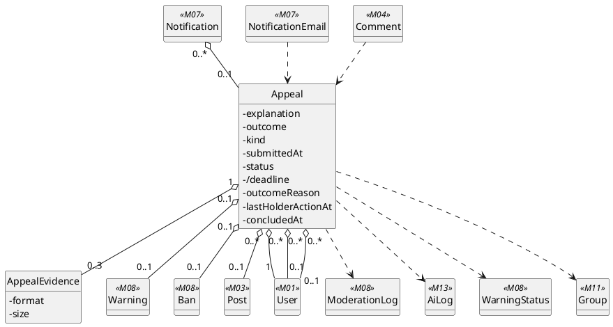

# Phân tích lớp thực thể — M09 Appeal

<!-- [Vietnamese Doc] Tài liệu tiếng Việt; tên lớp và thuộc tính viết tiếng Anh (input/CONVENTIONS.md mục 3). -->

| Mã tài liệu | EC-M09 |
|---|---|
| Dự án | iShare |
| Module | M09 — Appeal |
| Đầu vào | FR-M09 phiên bản 1.2 |
| Trạng thái | Bản nháp |
| Phiên bản | 0.4 |
| Ngày | 2026-11-18 |
| Tác giả | Phạm Văn Đức |

<!-- Quy ước chung cho mọi bảng dưới đây:
     - Không đổi tên cột, không xóa cột, không đổi số mục: tool đọc bảng theo số mục và tên cột.
     - Ô không có nội dung ghi "—".
     - Mục chưa tới bước làm thì để dòng "(Chưa làm — bước N)".
     - Cột Nguồn ghi mã trong FR: FR-M09-nn, FR-M09-nn.mm, BR-M09-nn, hoặc TN:<thuật ngữ> (mục 2.1 của FR).
     - Sơ đồ ở mục 4 do gen_puml.py sinh; không sửa tay. -->

## 1. Mô tả chức năng

### 1.1 Đoạn mô tả

(S1) Hệ thống quản lý khiếu nại, lời giải thích, ảnh bằng chứng và kết luận đối với cảnh cáo, ban, bài viết bị gỡ và bài viết bị AI tự từ chối. (S2) Hệ thống cho người bị xử lý gửi khiếu nại về xử lý của mình trong hạn tương ứng, kiểm tra khiếu nại đã có và tình trạng bị lật của xử lý, rồi lưu người khiếu nại, loại khiếu nại, xử lý bị khiếu nại, lời giải thích, ảnh bằng chứng, thời điểm gửi và trạng thái Chờ xét. (S3) Hệ thống xác định xử lý bị khiếu nại từ thông báo hoặc email ban và cho tài khoản BANNED khiếu nại lệnh ban đang hiệu lực, đồng thời gộp bài viết bị AI tự từ chối với cảnh cáo AI ra cùng lần từ chối vào một khiếu nại và một thông báo chung khi có cảnh cáo đi kèm. (S4) Hệ thống cho người khiếu nại xem khiếu nại của mình cùng xử lý bị khiếu nại, lời giải thích, bằng chứng, trạng thái, kết luận và lý do kết luận, đồng thời mở nội dung liên quan ở chế độ chỉ đọc, kể cả bài viết hoặc bình luận đã xóa. (S5) Hệ thống cho Mod và Admin xem hàng chờ khiếu nại Chờ xét theo thứ tự ưu tiên ban, cảnh cáo, bài viết và thời điểm gửi, đồng thời lọc theo loại khiếu nại, người ra xử lý và vai trò của người khiếu nại để Admin xét các trường hợp thuộc quyền Admin. (S6) Hệ thống ghi Mod hoặc Admin đủ quyền nhận một khiếu nại Chờ xét là người giữ khiếu nại, dùng mốc thao tác gần nhất của người giữ, cập nhật mốc khi người giữ mở xem và tự nhả khiếu nại khi hết thời gian không thao tác. (S7) Hệ thống cho Mod và Admin có quyền xem người khiếu nại, lời giải thích, bằng chứng và thời điểm gửi, đọc người ra xử lý, loại xử lý, lý do, thời điểm xử lý và nhật ký kiểm duyệt từ M08, đồng thời cung cấp nội dung liên quan đã xóa hoặc Tự ẩn và nhật ký quyết định AI của bài viết bị AI tự từ chối từ M13. (S8) Hệ thống cho Mod hoặc Admin đang giữ khiếu nại ghi kết luận Chấp nhận hoặc Từ chối cùng lý do kết luận, người kết luận và thời điểm kết luận, chuyển khiếu nại sang Đã kết luận và cung cấp kết quả cho M07 gửi thông báo, kèm email đối với khiếu nại ban. (S9) Khi chấp nhận khiếu nại ban, hệ thống giữ bản ghi ban ở trạng thái Bị lật, cập nhật số lần đã bị ban và đưa tài khoản về ACTIVE nếu ban đang hiệu lực, với người từng là Mod trở lại trong vai trò User. (S10) Khi chấp nhận khiếu nại cảnh cáo, hệ thống giữ bản ghi cảnh cáo ở trạng thái Bị lật, giảm số lần cảnh cáo hiện tại, tính lại mức cảnh cáo, áp hạn chế của mức mới và giữ thời điểm kết thúc thử thách hiện tại. (S11) Khi chấp nhận khiếu nại về bài viết bị gỡ, hệ thống đưa trạng thái kiểm duyệt của bài về Bình thường, cung cấp sự kiện hoàn điểm đã trừ cho M12 và lật cảnh cáo hoặc ban cùng lần gỡ nếu xử lý đi kèm còn đủ điều kiện đảo ngược. (S12) Khi chấp nhận khiếu nại gộp về bài viết bị AI tự từ chối, hệ thống lật cảnh cáo AI đi kèm nếu có, đưa bài chưa gửi lại sang Đã đăng nếu ngoài nhóm hoặc qua cổng duyệt M11 nếu thuộc nhóm, và dùng trạng thái bài hiện hành để xử lý trường hợp tác giả đã gửi lại. (S13) Hệ thống giữ khiếu nại đã lưu kể cả khi tài khoản bị xóa, cung cấp loại và kết luận khiếu nại cho M15 thống kê, đồng thời cung cấp hạn khiếu nại và kết luận từ chối của lệnh ban vĩnh viễn để M16 xác định khả năng khôi phục tài khoản Admin nhóm chat.

<!-- Một đoạn văn, mỗi câu đánh số (S1) (S2) … Xem steps/01-describe-functions.md. -->

### 1.2 Truy vết câu

| Câu | Nội dung tóm tắt | Nguồn |
|---|---|---|
| S1 | Phạm vi dữ liệu khiếu nại | FR-M09-01, FR-M09-07 |
| S2 | Điều kiện gửi và dữ liệu khiếu nại | FR-M09-01.01, FR-M09-01.03, FR-M09-01.09, FR-M09-01.13, FR-M09-01.14, FR-M09-01.23 |
| S3 | Xác định xử lý và gộp khiếu nại AI | FR-M09-01.04, FR-M09-01.05, FR-M09-01.06, FR-M09-01.18, FR-M09-01.19, FR-M09-01.20 |
| S4 | Tra cứu khiếu nại và xem lại nội dung | FR-M09-02, FR-M09-02.01, FR-M09-02.02, FR-M09-02.03 |
| S5 | Hàng chờ và quyền xem của Mod, Admin. FR-M09-05 đã bỏ và dẫn tới quy tắc lọc FR-M09-03.09. | FR-M09-03, FR-M09-03.01, FR-M09-03.02, FR-M09-03.04, FR-M09-03.05, FR-M09-03.08, FR-M09-03.09, FR-M09-05 |
| S6 | Người giữ, mốc thao tác và tự nhả | FR-M09-04, FR-M09-04.01, FR-M09-04.06, FR-M09-04.07, FR-M09-04.08 |
| S7 | Chi tiết khiếu nại và căn cứ xử lý | FR-M09-06, FR-M09-06.01, FR-M09-06.02, FR-M09-06.03, FR-M09-06.04, FR-M09-06.05 |
| S8 | Ghi kết luận và báo cho người khiếu nại | FR-M09-07, FR-M09-07.01, FR-M09-07.02, FR-M09-07.04, FR-M09-07.05, FR-M09-07.11 |
| S9 | Lật ban và cập nhật tài khoản | FR-M09-08, FR-M09-08.01, FR-M09-08.02, FR-M09-08.03, FR-M09-08.11 |
| S10 | Lật cảnh cáo và tính lại mức cảnh cáo | FR-M09-08.04, FR-M09-08.05, FR-M09-08.06, FR-M09-08.07 |
| S11 | Khôi phục bài, hoàn điểm và xử lý đi kèm | FR-M09-08.08, FR-M09-08.09, FR-M09-08.10, FR-M09-08.16, FR-M09-08.17 |
| S12 | Xử lý bài bị AI từ chối sau khi chấp nhận | FR-M09-08.12, FR-M09-08.13, FR-M09-08.14, FR-M09-08.18 |
| S13 | Lưu giữ và cung cấp dữ liệu liên module | FR-M09-01.01, FR-M09-01.13, FR-M09-01.16, FR-M09-07.01, FR-M09-07.02, FR-M09-07.03 |

## 2. Danh từ và phân loại

### 2.1 Sổ danh từ

| # | Danh từ | Xuất hiện ở | Phân loại | Kết quả | Lý do |
| --- | --- | --- | --- | --- | --- |
| 1 | Khiếu nại | S1 | Lớp | Appeal | T8, Bản ghi gửi, giữ, kết luận và lưu giữ khiếu nại. |
| 2 | Ảnh bằng chứng khiếu nại | S1 | Lớp | AppealEvidence | T8, Từng ảnh người khiếu nại nộp tùy chọn, dùng khi xét. |
| 3 | Cảnh cáo | S1 | Lớp | Warning | T4, Xử lý bị khiếu nại riêng hoặc đi kèm một lần xử lý bài. |
| 4 | Ban | S1 | Lớp | Ban | T4, Xử lý bị khiếu nại, kể cả ban vĩnh viễn hoặc ban đi kèm lần gỡ bài. |
| 5 | Bài viết | S1 | Lớp | Post | T4, Bài bị gỡ hoặc bị AI tự từ chối. Cách định vị từng lần xử lý của bài ở Q-01. |
| 6 | Lời giải thích | S1 | Thuộc tính | Appeal.explanation | T9, Bắt buộc khi gửi. Giữ nội dung đã gửi. |
| 7 | Kết luận khiếu nại | S1 | Thuộc tính | Appeal.outcome | T9, Chấp nhận hoặc Từ chối khi Đã kết luận. |
| 8 | Hệ thống | S1 | Loại bỏ | — | Trừu tượng, tác nhân xử lý. |
| 9 | Xử lý bị khiếu nại / lần gỡ bài / lần AI tự từ chối bài | S1 | Loại bỏ | — | Vai trò đích của các bản ghi nghiệp vụ. Cách tham chiếu chính xác từng lần xử lý bài được ghi tại Q-01. |
| 10 | AI | S1 | Loại bỏ | — | Tác nhân hệ thống trong xử lý gốc, dữ liệu căn cứ đến từ M08 hoặc M13. |
| 11 | Tài khoản | S2 | Lớp | User | T4, Người khiếu nại, người ra xử lý, người giữ hoặc kết luận. |
| 12 | Loại khiếu nại | S2 | Thuộc tính | Appeal.kind | T9, Ban, cảnh cáo hoặc bài viết. Khiếu nại gộp thuộc loại bài viết. |
| 13 | Thời điểm gửi khiếu nại | S2 | Thuộc tính | Appeal.submittedAt | T9, Ghi khi gửi. Cùng loại xếp theo thời điểm gửi. |
| 14 | Trạng thái khiếu nại | S2 | Thuộc tính | Appeal.status | T9, Chờ xét lúc gửi, chuyển Đã kết luận khi người giữ kết luận. |
| 15 | Hạn khiếu nại | S2 | Thuộc tính | Appeal.deadline | T7, Tính từ thời điểm xử lý theo BR-M09-04. Cảnh cáo dùng mức của chính cảnh cáo đó. Ban tạm dùng thời hạn ban, ban vĩnh viễn 90 ngày, bài bị gỡ 30 ngày, bài bị AI từ chối theo cảnh cáo cùng lần hoặc 3 ngày nếu vắng cảnh cáo. Cùng quy tắc dùng để kiểm tra trước khi gửi. N ngày là N × 24 giờ và mốc hết hạn bị loại. |
| 16 | Người bị xử lý / người khiếu nại / tác giả / Mod / Admin / người giữ / người kết luận / người ra xử lý | S2 | Loại bỏ | — | Vai trò của User. AI ở vai trò nguồn xử lý được xác định trong dữ liệu kiểm duyệt. |
| 17 | Thông báo | S3 | Lớp | Notification | T4, Thông báo về xử lý hoặc kết luận, gồm thông báo gộp. |
| 18 | Email thông báo | S3 | Lớp | NotificationEmail | T4, Email ban dẫn đến gửi khiếu nại và email kết luận khiếu nại ban. |
| 19 | Khiếu nại gộp | S3 | Loại bỏ | — | Cách ghi một Appeal với những đối tượng đi kèm theo BR-M09-24. |
| 20 | BANNED / ACTIVE / tài khoản bị xóa | S3 | Loại bỏ | — | Trạng thái hiện hành của User do M01 quản lý. |
| 21 | Đường dẫn khiếu nại / chế độ chỉ đọc | S3 | Loại bỏ | — | Kênh truy cập qua M07 hoặc quy tắc xem lại trong M03, M04. |
| 22 | Bình luận | S4 | Lớp | Comment | T4, Nội dung được đọc qua khiếu nại trong trường hợp liên quan đến cảnh cáo hoặc ban. |
| 23 | Lý do kết luận | S4 | Thuộc tính | Appeal.outcomeReason | T9, Bắt buộc với cả hai kết luận, hiển thị cho người khiếu nại. |
| 24 | Hàng chờ khiếu nại / thứ tự ưu tiên / bộ lọc loại | S5 | Loại bỏ | — | Tập kết quả truy vấn và quy tắc sắp theo loại, thời điểm gửi. |
| 25 | Vai trò lúc bị xử lý | S5 | Loại bỏ | — | Dữ liệu lịch sử dùng xét quyền theo BR-M09-12. Nguồn tra cứu đang chờ Q-02. |
| 26 | Thời điểm thao tác cuối của người giữ | S6 | Thuộc tính | Appeal.lastHolderActionAt | T9, Mốc nhận giữ hoặc thao tác gần nhất khi giữ. Dùng tính tự nhả sau 30 phút. |
| 27 | Nhận giữ / nhả khiếu nại / thời gian không thao tác | S6 | Loại bỏ | — | Thao tác và ngưỡng nghiệp vụ dùng người giữ và lastHolderActionAt. |
| 28 | Dòng nhật ký kiểm duyệt | S7 | Lớp | ModerationLog | T4, Dùng đọc thao tác gỡ bài và chi tiết xử lý của Mod khác. |
| 29 | Nhật ký quyết định AI | S7 | Lớp | AiLog | T4, Dùng xét bài bị AI tự từ chối. Tên dùng lại từ các EC tham chiếu, chờ EC-M13. |
| 30 | Loại xử lý / lý do xử lý / thời điểm xử lý | S7 | Loại bỏ | — | Dữ liệu của bản ghi xử lý nguồn, dùng đọc và tính hạn. |
| 31 | Nội dung liên quan / nội dung đã xóa / Tự ẩn | S7 | Loại bỏ | — | Dữ liệu bài viết hoặc bình luận do M03, M04 quản lý. |
| 32 | Thời điểm kết luận | S8 | Thuộc tính | Appeal.concludedAt | T9, Ghi khi khiếu nại chuyển sang Đã kết luận. |
| 33 | Chờ xét / Đã kết luận / Chấp nhận / Từ chối | S8 | Loại bỏ | — | Giá trị của Appeal.status và Appeal.outcome. |
| 34 | Bị lật / Đang hiệu lực | S9 | Loại bỏ | — | Giá trị trạng thái của Ban hoặc Warning theo nguồn M08. |
| 35 | Số lần đã bị ban / số lần cảnh cáo / mức cảnh cáo / thời điểm kết thúc thử thách / hạn chế theo mức | S9 | Loại bỏ | — | Dữ liệu nguồn thuộc M08, dùng khi đảo ngược xử lý. |
| 36 | Trạng thái cảnh cáo của người dùng | S10 | Lớp | WarningStatus | T4, Nguồn số lần cảnh cáo, mức và mốc kết thúc thử thách. |
| 37 | Bình thường / Đã đăng / trạng thái bài hiện hành | S11 | Loại bỏ | — | Dữ liệu trạng thái kiểm duyệt và đăng thuộc M03. |
| 38 | Điểm hoàn / sự kiện hoàn điểm | S11 | Loại bỏ | — | Dữ liệu và thao tác điểm thuộc M12. M09 cung cấp sự kiện theo FR-M09-08.09. |
| 39 | Nhóm | S12 | Lớp | Group | T4, Ngữ cảnh duyệt bài nhóm sau khi khiếu nại được chấp nhận. Tên dùng lại từ các EC tham chiếu, chờ EC-M11. |
| 40 | Cổng duyệt nhóm / việc gửi lại bài | S12 | Loại bỏ | — | Quy trình nguồn M11, M03 chi phối kết quả xử lý bài. |
| 41 | Thống kê khiếu nại / khả năng khôi phục tài khoản Admin nhóm chat | S13 | Loại bỏ | — | Dữ liệu sử dụng ở M15 và M16, M09 cung cấp các giá trị đã ghi nhận. |
| 42 | Định dạng ảnh bằng chứng | Quét: FR-M09-01.12 | Thuộc tính | AppealEvidence.format | T9, JPEG, PNG hoặc WebP. |
| 43 | Kích thước ảnh bằng chứng | Quét: FR-M09-01.12 | Thuộc tính | AppealEvidence.size | T9, Tối đa 5 MB mỗi ảnh, một khiếu nại có tối đa 3 ảnh. |
| 44 | Hằng số hạn khiếu nại / giới hạn số ảnh | Quét: BR-M09-03, BR-M09-04 | Loại bỏ | — | Ràng buộc nghiệp vụ ghi trong bảng thuộc tính. |
| 45 | Danh tính người báo cáo / lý do và bằng chứng của báo cáo | Quét: FR-M09-02.04 | Loại bỏ | — | Dữ liệu báo cáo thuộc M08. Quyền xem của người khiếu nại được giới hạn theo FR. |

Có 45 dòng, gồm 13 dòng thành lớp, 11 dòng thành thuộc tính và 21 dòng bị loại. Lượt quét bổ sung 4 dòng.

### 2.2 Lớp

| Lớp | Tên tiếng Việt | Nhóm | Sở hữu | Mô tả | Nguồn |
| --- | --- | --- | --- | --- | --- |
| Appeal | Khiếu nại | Thực thể | M09 | Bản ghi gửi, giữ, kết luận và lưu giữ khiếu nại. | FR-M09-01.01, FR-M09-01.16, FR-M09-04.01, FR-M09-07.01, FR-M09-07.02 |
| AppealEvidence | Ảnh bằng chứng khiếu nại | Thực thể | M09 | Từng ảnh người khiếu nại nộp tùy chọn, dùng khi xét. | FR-M09-01.01, FR-M09-01.12, BR-M09-03 |
| Warning | Cảnh cáo | Thực thể | M08 | Xử lý bị khiếu nại riêng hoặc đi kèm một lần xử lý bài. | FR-M09-01.07, FR-M09-01.20, FR-M09-08.04, FR-M09-08.10 |
| Ban | Ban | Thực thể | M08 | Xử lý bị khiếu nại, kể cả ban vĩnh viễn hoặc ban đi kèm lần gỡ bài. | FR-M09-01.04, FR-M09-08.01, FR-M09-08.10 |
| Post | Bài viết | Thực thể | M03 | Bài bị gỡ hoặc bị AI tự từ chối. Cách định vị từng lần xử lý của bài ở Q-01. | FR-M09-01.20, FR-M09-08.08, FR-M09-08.12 |
| User | Tài khoản | Thực thể | M01 | Người khiếu nại, người ra xử lý, người giữ hoặc kết luận. | FR-M09-01.01, FR-M09-04.01, FR-M09-06.02, FR-M09-07.01 |
| Notification | Thông báo | Thực thể | M07 | Thông báo về xử lý hoặc kết luận, gồm thông báo gộp. | FR-M09-01.06, FR-M09-01.19, FR-M09-07.04, FR-M09-07.05 |
| NotificationEmail | Email thông báo | Thực thể | M07 | Email ban dẫn đến gửi khiếu nại và email kết luận khiếu nại ban. | FR-M09-01.05, FR-M09-07.04 |
| Comment | Bình luận | Thực thể | M04 | Nội dung được đọc qua khiếu nại trong trường hợp liên quan đến cảnh cáo hoặc ban. | FR-M09-02.03, FR-M09-06.04, FR-M09-08.15 |
| ModerationLog | Dòng nhật ký kiểm duyệt | Thực thể | M08 | Dùng đọc thao tác gỡ bài và chi tiết xử lý của Mod khác. | FR-M09-06.02, FR-M09-06.03, BR-M09-15 |
| AiLog | Nhật ký quyết định AI | Thực thể | M13 | Dùng xét bài bị AI tự từ chối. Tên dùng lại từ các EC tham chiếu, chờ EC-M13. | FR-M09-06.05, BR-M09-15 |
| WarningStatus | Trạng thái cảnh cáo của người dùng | Thực thể | M08 | Nguồn số lần cảnh cáo, mức và mốc kết thúc thử thách. | FR-M09-08.05, FR-M09-08.06, FR-M09-08.07 |
| Group | Nhóm | Thực thể | M11 | Ngữ cảnh duyệt bài nhóm sau khi khiếu nại được chấp nhận. Tên dùng lại từ các EC tham chiếu, chờ EC-M11. | FR-M09-08.18, BR-M09-24 |

M09 sở hữu Appeal và AppealEvidence. Từng ảnh có định dạng và kích thước riêng theo BR-M09-03. Các vai trò tài khoản và đích xử lý được gọi tên trong sổ để xét quan hệ ở bước 3. Các lớp ngoài không khai báo lại thuộc tính của module sở hữu.

### 2.3 Thuộc tính

| Lớp | Thuộc tính | Tên tiếng Việt | Tính chất | Ràng buộc nguồn nêu | Nguồn |
| --- | --- | --- | --- | --- | --- |
| Appeal | explanation | Lời giải thích | Lưu | Bắt buộc khi gửi. Giữ nội dung đã gửi. | FR-M09-01.01, FR-M09-01.10, FR-M09-01.22, BR-M09-03 |
| Appeal | outcome | Kết luận khiếu nại | Lưu | Chấp nhận hoặc Từ chối khi Đã kết luận. | FR-M09-07.01, FR-M09-07.02 |
| Appeal | kind | Loại khiếu nại | Lưu | Ban, cảnh cáo hoặc bài viết. Khiếu nại gộp thuộc loại bài viết. | FR-M09-01.03, FR-M09-01.20, BR-M09-09 |
| Appeal | submittedAt | Thời điểm gửi khiếu nại | Lưu | Ghi khi gửi. Cùng loại xếp theo thời điểm gửi. | FR-M09-01.01, FR-M09-03.01, BR-M09-10 |
| Appeal | status | Trạng thái khiếu nại | Lưu | Chờ xét lúc gửi, chuyển Đã kết luận khi người giữ kết luận. | FR-M09-01.01, FR-M09-07.01, FR-M09-07.02 |
| Appeal | deadline | Hạn khiếu nại | Dẫn xuất | Tính từ thời điểm xử lý theo BR-M09-04. Cảnh cáo dùng mức của chính cảnh cáo đó. Ban tạm dùng thời hạn ban, ban vĩnh viễn 90 ngày, bài bị gỡ 30 ngày, bài bị AI từ chối theo cảnh cáo cùng lần hoặc 3 ngày nếu vắng cảnh cáo. Cùng quy tắc dùng để kiểm tra trước khi gửi. N ngày là N × 24 giờ và mốc hết hạn bị loại. | FR-M09-01.13, BR-M09-04, BR-M09-05 |
| Appeal | outcomeReason | Lý do kết luận | Lưu | Bắt buộc với cả hai kết luận, hiển thị cho người khiếu nại. | FR-M09-02.02, FR-M09-07.01, FR-M09-07.02, FR-M09-07.11, BR-M09-27 |
| Appeal | lastHolderActionAt | Thời điểm thao tác cuối của người giữ | Lưu | Mốc nhận giữ hoặc thao tác gần nhất khi giữ. Dùng tính tự nhả sau 30 phút. | FR-M09-04.01, FR-M09-04.06, FR-M09-04.07, BR-M09-11 |
| Appeal | concludedAt | Thời điểm kết luận | Lưu | Ghi khi khiếu nại chuyển sang Đã kết luận. | FR-M09-07.01, FR-M09-07.02 |
| AppealEvidence | format | Định dạng ảnh bằng chứng | Lưu | JPEG, PNG hoặc WebP. | FR-M09-01.12, BR-M09-03 |
| AppealEvidence | size | Kích thước ảnh bằng chứng | Lưu | Tối đa 5 MB mỗi ảnh, một khiếu nại có tối đa 3 ảnh. | FR-M09-01.11, FR-M09-01.12, BR-M09-03 |

Hạn khiếu nại được dẫn xuất từ dữ liệu xử lý gốc. Thẩm quyền xét dùng vai trò người khiếu nại tại thời điểm bị xử lý. Mốc lịch sử cần cho hai quy tắc được rà soát ở Q-01 và Q-02.

### 2.4 Đối chiếu với mục Dữ liệu nghiệp vụ của FR

| Thực thể trong FR | Trong mô hình | Xử lý |
| --- | --- | --- |
| Khiếu nại | Appeal, AppealEvidence | Khớp thông tin gửi, giữ và kết luận. Mô hình tách từng ảnh bằng chứng theo FR-M09-01.11/01.12 và bổ sung hạn dẫn xuất theo BR-M09-04. |
| Cảnh cáo (M08) | Warning | Khớp. M09 áp chuyển Bị lật trên trạng thái đã có của M08. |
| Ban (M08) | Ban | Khớp. M09 áp chuyển Bị lật trên trạng thái đã có của M08. |
| Bài viết (M03) | Post | Khớp dữ liệu trạng thái đăng và kiểm duyệt. FR quy định một khiếu nại cho mỗi lần gỡ hoặc tự từ chối, cách nhận diện lần xử lý được ghi tại Q-01. |
| Dữ liệu liên module | User, Notification, NotificationEmail, Comment, ModerationLog, AiLog, WarningStatus, Group | Dùng dữ liệu nguồn theo giao tiếp mục 5.12. M12 nhận sự kiện hoàn điểm, M15 và M16 dùng dữ liệu khiếu nại theo phạm vi FR. |

## 3. Quan hệ giữa các lớp

### 3.1 Ma trận cặp lớp

| Lớp | 01 | 02 | 03 | 04 | 05 | 06 | 07 | 08 | 09 | 10 | 11 | 12 | 13 |
| --- | --- | --- | --- | --- | --- | --- | --- | --- | --- | --- | --- | --- | --- |
| 01 Appeal |  | T | T | T | T | T | T | T | T | T | T | T | T |
| 02 AppealEvidence |  |  |  |  |  |  |  |  |  |  |  |  |  |
| 03 User |  |  |  |  |  |  |  |  |  |  |  |  |  |
| 04 Post |  |  |  |  |  |  |  |  |  |  |  |  |  |
| 05 Comment |  |  |  |  |  |  |  |  |  |  |  |  |  |
| 06 Warning |  |  |  |  |  |  |  |  |  |  |  |  |  |
| 07 Ban |  |  |  |  |  |  |  |  |  |  |  |  |  |
| 08 WarningStatus |  |  |  |  |  |  |  |  |  |  |  |  |  |
| 09 ModerationLog |  |  |  |  |  |  |  |  |  |  |  |  |  |
| 10 AiLog |  |  |  |  |  |  |  |  |  |  |  |  |  |
| 11 Notification |  |  |  |  |  |  |  |  |  |  |  |  |  |
| 12 NotificationEmail |  |  |  |  |  |  |  |  |  |  |  |  |  |
| 13 Group |  |  |  |  |  |  |  |  |  |  |  |  |  |

T đánh dấu cặp trực tiếp. Cặp User–Appeal có ba vai trò, tương ứng R-M09-01 đến R-M09-03. Các cặp hai lớp ngoài thuộc phạm vi module sở hữu.

### 3.2 Quan hệ số lượng

| Cặp | Câu A → B | Câu B → A | Dạng | Xử lý |
| --- | --- | --- | --- | --- |
| User – Appeal (R-M09-01) | Một tài khoản có thể gửi nhiều khiếu nại. | Mỗi khiếu nại ghi đúng một người gửi và được giữ cả khi tài khoản bị xóa. | 1-n | Giữ nguyên |
| User – Appeal (R-M09-02) | Một Mod hoặc Admin có thể giữ nhiều khiếu nại. | Một khiếu nại có tối đa một người giữ tại một thời điểm. Hệ thống nhả khiếu nại sau thời gian không thao tác. | 1-n | Giữ nguyên |
| User – Appeal (R-M09-03) | Một Mod hoặc Admin có thể kết luận nhiều khiếu nại. | Khiếu nại đã kết luận ghi một người kết luận. Khiếu nại đang Chờ xét chưa có người kết luận. | 1-n | Giữ nguyên |
| Appeal – AppealEvidence (R-M09-04) | Một khiếu nại có thể gồm tối đa ba ảnh. | Mỗi ảnh bằng chứng được xét trong một khiếu nại. FR giữ khiếu nại đã lưu cùng bằng chứng. | 1-n | Giữ nguyên |
| Ban – Appeal (R-M09-05) | Một ban có tối đa một khiếu nại về chính ban đó. | Khiếu nại loại ban ghi đúng một ban. Các loại khác không dùng vai trò này. | 1-1 | Giữ: bản ghi xử lý thuộc M08, khiếu nại thuộc M09. |
| Warning – Appeal (R-M09-06) | Một cảnh cáo có tối đa một khiếu nại tính cả trường hợp gộp. | Khiếu nại loại cảnh cáo ghi một cảnh cáo. Khiếu nại gộp bài có tối đa một cảnh cáo AI cùng lần từ chối. | 1-1 | Giữ: bản ghi xử lý thuộc M08, khiếu nại thuộc M09. |
| Post – Appeal (R-M09-07) | Một bài có thể liên quan nhiều khiếu nại qua các lần xử lý khác nhau. | Khiếu nại loại bài viết ghi đúng một bài liên quan. Đích nghiệp vụ còn phải xác định đúng lần xử lý theo Q-01. | 1-n | Giữ nguyên |
| Appeal – Notification (R-M09-08) | Một khiếu nại có thể được tham chiếu bởi nhiều thông báo trong mô hình dùng chung của M07. | Thông báo kết luận tham chiếu một khiếu nại. Các loại thông báo khác có thể không tham chiếu khiếu nại. | 1-n | Giữ nguyên |

| Quan hệ phụ thuộc | Câu đọc |
| --- | --- |
| R-M09-09 | NotificationEmail → Appeal. Email kết luận ban dùng kết luận và lý do của khiếu nại. Email ban ban đầu là lối vào gửi khiếu nại. |
| R-M09-10 | Comment → Appeal. Luồng đọc lại bình luận của tác giả dùng ngữ cảnh khiếu nại liên quan. Bình luận vẫn Bị ẩn khi lật cảnh cáo hoặc ban đi kèm. |
| R-M09-11 | Appeal → ModerationLog. Người xét đọc chi tiết thao tác kiểm duyệt qua nhật ký M08. Q-01 đã chọn nguồn và chờ làm rõ FR về tham chiếu đến đúng lần gỡ và các xử lý cùng lần. |
| R-M09-12 | Appeal → AiLog. Người xét đọc nhật ký quyết định AI của bài bị từ chối. Q-01 đã chọn nguồn và chờ làm rõ FR về tham chiếu đến đúng lần từ chối và cảnh cáo cùng lần. |
| R-M09-13 | Appeal → WarningStatus. Kết luận chấp nhận làm cập nhật số lần và mức cảnh cáo qua M08, giữ mốc kết thúc thử thách hiện tại. |
| R-M09-14 | Appeal → Group. Khi chấp nhận khiếu nại bài nhóm bị AI từ chối và bài chưa gửi lại, luồng xử lý cần cổng duyệt của nhóm M11. |

- Loại khiếu nại xác định đích chính là Ban, Warning hoặc lần xử lý một Post. Khiếu nại gộp bài bị AI từ chối ghi cảnh cáo AI cùng lần nếu có. Hạn của từng xử lý tuân theo BR-M09-04.
- Bội số ở R-M09-05 và R-M09-06 xét các khiếu nại trực tiếp và trường hợp gộp. Cảnh cáo hoặc ban bị lật theo một khiếu nại bài được xét theo BR-M09-29. Việc lật xử lý đi kèm thuộc quy tắc đảo ngược, tách với vai trò đích khiếu nại trực tiếp.
- Mỗi lần gỡ hoặc từ chối bài có tối đa một khiếu nại theo BR-M09-06. R-M09-07 chỉ thể hiện bài liên quan. Tham chiếu ổn định đến lần xử lý và cách nối các xử lý cùng lần chờ Q-01.
- Người giữ dùng mốc thao tác cuối để tự nhả. Người kết luận được lưu như một vai trò riêng. Quyền nhận, xem và xét dựa vào người ra xử lý và vai trò của người khiếu nại tại lúc bị xử lý theo BR-M09-12, nguồn vai trò lịch sử đã chọn ở Q-02 và chờ làm rõ trong FR.

### 3.3 Lớp liên kết

Các cặp định lượng có dạng 1-1 hoặc 1-n. Hai quan hệ 1-1 tùy chọn với Ban và Warning được giữ theo vòng đời và module sở hữu.

### 3.4 Quan hệ

| ID | Lớp A | Bội số A | Lớp B | Bội số B | Dạng | Loại | Bên chính | Căn cứ | Nguồn |
| --- | --- | --- | --- | --- | --- | --- | --- | --- | --- |
| R-M09-01 | User | 1 | Appeal | 0..* | 1-n | Kết tập | Appeal | Mỗi khiếu nại ghi đúng một người gửi và được giữ cả khi tài khoản bị xóa. | FR-M09-01.01, FR-M09-01.09, FR-M09-01.16 |
| R-M09-02 | User | 0..1 | Appeal | 0..* | 1-n | Kết tập | Appeal | Một khiếu nại có tối đa một người giữ tại một thời điểm. Hệ thống nhả khiếu nại sau thời gian không thao tác. | FR-M09-04.01, FR-M09-04.02, FR-M09-04.06, BR-M09-11 |
| R-M09-03 | User | 0..1 | Appeal | 0..* | 1-n | Kết tập | Appeal | Khiếu nại đã kết luận ghi một người kết luận. Khiếu nại đang Chờ xét chưa có người kết luận. | FR-M09-07.01, FR-M09-07.02, FR-M09-07.06, FR-M09-07.08 |
| R-M09-04 | Appeal | 1 | AppealEvidence | 0..3 | 1-n | Kết tập | Appeal | Mỗi ảnh bằng chứng được xét trong một khiếu nại. FR giữ khiếu nại đã lưu cùng bằng chứng. | FR-M09-01.01, FR-M09-01.11, FR-M09-01.16, FR-M09-02.01, BR-M09-03, BR-M09-22 |
| R-M09-05 | Ban | 0..1 | Appeal | 0..1 | 1-1 | Kết tập | Appeal | Khiếu nại loại ban ghi đúng một ban. Các loại khác không dùng vai trò này. | FR-M09-01.03, FR-M09-01.04, FR-M09-01.14, BR-M09-06 |
| R-M09-06 | Warning | 0..1 | Appeal | 0..1 | 1-1 | Kết tập | Appeal | Khiếu nại loại cảnh cáo ghi một cảnh cáo. Khiếu nại gộp bài có tối đa một cảnh cáo AI cùng lần từ chối. | FR-M09-01.07, FR-M09-01.14, FR-M09-01.20, FR-M09-01.21, BR-M09-06, BR-M09-24 |
| R-M09-07 | Post | 0..1 | Appeal | 0..* | 1-n | Kết tập | Appeal | Khiếu nại loại bài viết ghi đúng một bài liên quan. Đích nghiệp vụ còn phải xác định đúng lần xử lý theo Q-01. | FR-M09-01.03, FR-M09-01.14, FR-M09-01.20, BR-M09-06, BR-M09-24 |
| R-M09-08 | Appeal | 0..1 | Notification | 0..* | 1-n | Kết tập | Notification | Thông báo kết luận tham chiếu một khiếu nại. Các loại thông báo khác có thể không tham chiếu khiếu nại. | FR-M09-07.04, FR-M09-07.05, BR-M09-20 |
| R-M09-09 | NotificationEmail | — | Appeal | — | — | Phụ thuộc | Appeal | Email kết luận ban dùng kết luận và lý do của khiếu nại. Email ban ban đầu là lối vào gửi khiếu nại. | FR-M09-01.05, FR-M09-07.04, BR-M09-20 |
| R-M09-10 | Comment | — | Appeal | — | — | Phụ thuộc | Appeal | Luồng đọc lại bình luận của tác giả dùng ngữ cảnh khiếu nại liên quan. Bình luận vẫn Bị ẩn khi lật cảnh cáo hoặc ban đi kèm. | FR-M09-02.03, FR-M09-06.04, FR-M09-08.15 |
| R-M09-11 | Appeal | — | ModerationLog | — | — | Phụ thuộc | ModerationLog | Người xét đọc chi tiết thao tác kiểm duyệt qua nhật ký M08. Q-01 đã chọn nguồn và chờ làm rõ FR về tham chiếu đến đúng lần gỡ và các xử lý cùng lần. | FR-M09-06.02, FR-M09-06.03, FR-M09-08.10, BR-M09-15, BR-M09-29 |
| R-M09-12 | Appeal | — | AiLog | — | — | Phụ thuộc | AiLog | Người xét đọc nhật ký quyết định AI của bài bị từ chối. Q-01 đã chọn nguồn và chờ làm rõ FR về tham chiếu đến đúng lần từ chối và cảnh cáo cùng lần. | FR-M09-06.05, FR-M09-01.20, BR-M09-15, BR-M09-24 |
| R-M09-13 | Appeal | — | WarningStatus | — | — | Phụ thuộc | WarningStatus | Kết luận chấp nhận làm cập nhật số lần và mức cảnh cáo qua M08, giữ mốc kết thúc thử thách hiện tại. | FR-M09-08.05, FR-M09-08.06, FR-M09-08.07 |
| R-M09-14 | Appeal | — | Group | — | — | Phụ thuộc | Group | Khi chấp nhận khiếu nại bài nhóm bị AI từ chối và bài chưa gửi lại, luồng xử lý cần cổng duyệt của nhóm M11. | FR-M09-08.14, FR-M09-08.18, BR-M09-24 |

Appeal là bên ghi người gửi, người giữ, người kết luận, xử lý gốc và ảnh bằng chứng. Notification ghi khiếu nại liên quan của kết luận. Quan hệ ảnh bằng chứng là Kết tập theo quy tắc lưu giữ FR-M09-01.16 và BR-M09-22.

R-M09-01/07/08/09/10/11 đối chiếu lần lượt với R-M01-21, R-M03-20, R-M07-12, R-M07-32, R-M04-09 và R-M08-41. R-M08-42/43 diễn đạt Phụ thuộc của luồng đảo ngược xử lý. R-M09-05/06 diễn đạt các tham chiếu có bội số tới xử lý gốc mà khiếu nại nhắm đến. Khi gộp, đối chiếu hai cách biểu diễn theo vai trò đã ghi.

## 4. Sơ đồ lớp phân tích

<!-- BEGIN:PUML -->

<!-- END:PUML -->

Đọc sơ đồ cùng mã quan hệ trong mục 3.4 để phân biệt ba vai trò User và điều kiện theo loại khiếu nại. PlantUML và ký pháp bội số đang dùng theo mặc định của skill.

## 5. Liên module

| Lớp | Module sở hữu | Module này dùng thế nào | Thuộc tính module này bổ sung |
| --- | --- | --- | --- |
| User | M01 | Người gửi, người giữ và người kết luận là ba vai trò riêng. Trạng thái tài khoản dùng khi gửi và lật ban. Nguồn vai trò lịch sử đã chọn ở Q-02 và chờ làm rõ trong FR. | — |
| Post | M03 | Nội dung của khiếu nại bài. M03 dùng kết luận để phục hồi trạng thái đăng hoặc kiểm duyệt và cung cấp nội dung xem lại. | — |
| Comment | M04 | Nội dung xem lại khi liên quan tới cảnh cáo hoặc ban. M04 dùng ngữ cảnh khiếu nại để cấp quyền. | — |
| Warning | M08 | Đích khiếu nại cảnh cáo hoặc cảnh cáo cùng lần AI từ chối trong khiếu nại gộp. | — |
| Ban | M08 | Đích khiếu nại ban. Ban cùng lần gỡ bài được xét theo quy tắc lật xử lý đi kèm. | — |
| WarningStatus | M08 | Số lần cảnh cáo, mức hiện hành và thời điểm kết thúc thử thách. | — |
| ModerationLog | M08 | Căn cứ thao tác Mod hoặc Admin. Việc nhận diện lần gỡ và nối xử lý đi kèm chờ Q-01. | — |
| AiLog | M13 | Nhật ký quyết định AI khi xét bài bị từ chối. Tên chờ đối chiếu EC-M13. | — |
| Notification | M07 | Thông báo về xử lý là lối vào gửi khiếu nại. Khi kết luận, M07 nhận sự kiện để thông báo cho người khiếu nại. | — |
| NotificationEmail | M07 | Thông báo ban qua email dẫn vào gửi khiếu nại. Email kết luận dùng dữ liệu khiếu nại ban. | — |
| Group | M11 | Cổng duyệt nhóm sau khi chấp nhận khiếu nại bài nhóm bị AI từ chối. Tên chờ đối chiếu EC-M11. | — |

M09 cung cấp kết luận khôi phục nội dung cho M03, dữ liệu lật xử lý cho M08, sự kiện hoàn điểm cho M12, dữ liệu thống kê theo loại và kết luận cho M15, cùng hạn và kết luận khiếu nại ban vĩnh viễn cho M16.

## 6. Câu hỏi và điểm chưa chốt

| Mã | Loại | Câu hỏi | Trả lời | Ghi vào |
| --- | --- | --- | --- | --- |
| Q-01 | Thiếu | FR-M09 mục 5.10 và BR-M09-06/24/29 xét từng lần gỡ hoặc AI từ chối một bài. Đề xuất tham chiếu dòng ModerationLog cho lần gỡ và nhật ký AiLog tương ứng cho lần AI từ chối, kèm Post là nội dung. Cần xác nhận các bản ghi nguồn có đủ thông tin phân biệt từng lần và nối đúng cảnh cáo hoặc ban cùng lần hay cần làm rõ FR của module nguồn? | Người dùng đồng ý dùng ModerationLog cho lần gỡ và AiLog cho lời gọi dẫn tới lần AI từ chối. Post là nội dung liên quan. | Chờ làm rõ trong FR cách nối đúng cảnh cáo hoặc ban phát sinh cùng lần xử lý. Xem dự thảo register M09. |
| Q-02 | Thiếu | BR-M09-12 dùng vai trò của người khiếu nại tại lúc bị xử lý, kể cả Mod đã mất vai trò sau ban. Các bản ghi nguồn cần cho biết vai trò tại mốc xử lý. Đề xuất lấy vai trò lịch sử từ dữ liệu xử lý của module nguồn. Cần xác nhận nguồn dữ liệu lịch sử tương ứng trước khi mô hình hóa cách lưu. | Người dùng đồng ý dùng vai trò lịch sử từ module nguồn. Đề xuất dùng lịch sử thay đổi vai trò M10 theo BR-M10-21 và xét vai trò trước tác động thu hồi do chính lần ban. | Chờ làm rõ trong FR dữ liệu tái dựng vai trò tại thời điểm xử lý. Xem dự thảo register M09. |

Người dùng duyệt bước 2 và yêu cầu bước 3. Người dùng đã đồng ý theo đề xuất cho Q-01 và Q-02. FR-M09 v1.2 là nguồn của bảng quan hệ hiện hành. Nội dung làm rõ liên module chờ duyệt trong fr/.work/FR-M09-v1.3-register-draft.md.

## 7. Lịch sử sửa đổi

| Phiên bản | Ngày | Nội dung | Người sửa |
|---|---|---|---|
| 0.1 | 2026-11-18 | Soạn 13 câu mô tả, truy vết 7 chức năng hiện hành từ FR-M09 v1.2 và ghi mã chức năng đã bỏ, chờ duyệt bước 1 | Codex |
| 0.2 | 2026-11-18 | Ghi nhận duyệt bước 1, lập sổ danh từ, bảng lớp, thuộc tính và đối chiếu FR M09 | Codex |
| 0.3 | 2026-11-18 | Ghi nhận duyệt bước 2, lập ma trận và 14 quan hệ, sinh PlantUML, đối chiếu liên module và ghi phạm vi ảnh hưởng của Q-01/Q-02 | Codex |
| 0.4 | 2026-11-18 | Ghi nhận người dùng đồng ý theo đề xuất Q-01 và Q-02. Soạn dự thảo register và làm rõ dữ liệu nguồn trước khi đồng bộ mô hình | Codex |
