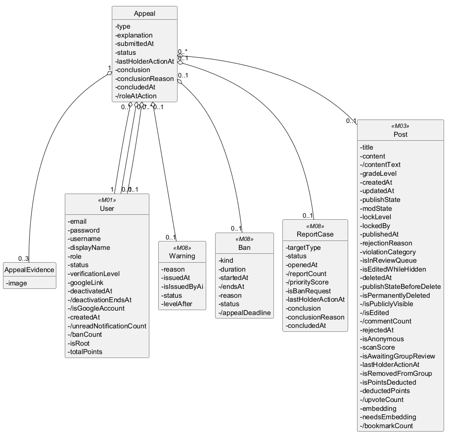

# Phân tích lớp thực thể — M09 Appeal

<!-- [Vietnamese Doc] Tài liệu tiếng Việt; tên lớp và thuộc tính viết tiếng Anh (input/CONVENTIONS.md mục 3). -->

| Mã tài liệu | EC-M09 |
|---|---|
| Dự án | iShare |
| Module | M09 — Appeal |
| Đầu vào | FR-M09 phiên bản 1.2 |
| Trạng thái | Đã chốt |
| Phiên bản | 1.1 |
| Ngày | 2026-11-20 |
| Tác giả | Phạm Văn Đức |

<!-- Quy ước chung cho mọi bảng dưới đây:
     - Không đổi tên cột, không xóa cột, không đổi số mục: tool đọc bảng theo số mục và tên cột.
     - Ô không có nội dung ghi "—".
     - Mục chưa tới bước làm thì để dòng "(Chưa làm — bước N)".
     - Cột Nguồn ghi mã trong FR: FR-Mxx-nn, FR-Mxx-nn.mm, BR-Mxx-nn, hoặc TN:<thuật ngữ> (mục 2.1 của FR).
     - Mục 4 chỉ chứa ảnh sơ đồ. gen_puml.py ghi mã PlantUML vào tệp riêng diagrams/EC-Mxx.puml, render
       diagrams/EC-Mxx.png và đặt ảnh vào mục 4. Không chép mã PlantUML vào tài liệu, không sửa tay tệp .puml hay ảnh. -->

## 1. Mô tả chức năng

### 1.1 Đoạn mô tả

Hệ thống quản lý khiếu nại của người dùng về các xử lý kiểm duyệt trên iShare: khiếu nại, hàng chờ khiếu nại, kết
luận khiếu nại và việc lật xử lý bị khiếu nại khi khiếu nại được chấp nhận. Xử lý bị khiếu nại là một cảnh cáo, một
ban hoặc một lần gỡ bài viết do M08 quản lý, hoặc một lần AI tự từ chối bài viết do M03 quản lý.

Hệ thống cho phép người dùng đã đăng nhập, kể cả tài khoản BANNED, gửi một khiếu nại về một xử lý bị khiếu nại của
chính mình: một cảnh cáo, kể cả cảnh cáo do AI tự ra, một ban, một lần gỡ bài viết của mình hoặc một lần AI tự từ chối
bài viết của mình, bất kể người ra xử lý là AI, Mod hay Admin. Trong khi trạng thái tài khoản do M01 quản lý là
BANNED, người dùng chỉ khiếu nại được ban đang hiệu lực. Mỗi khi một khiếu nại được gửi, hệ thống ghi lại người khiếu
nại, loại khiếu nại theo xử lý bị khiếu nại, xử lý bị khiếu nại, lời giải thích, bằng chứng là các ảnh đính kèm, thời
điểm gửi khiếu nại và trạng thái khiếu nại Chờ xét, rồi đưa khiếu nại vào hàng chờ khiếu nại. Khi một bài viết bị AI
tự từ chối kèm một cảnh cáo do AI tự ra, hệ thống gửi cho tác giả qua M07 một thông báo nêu cả lần từ chối và cảnh
cáo đó. Khi tác giả khiếu nại một lần AI tự từ chối bài viết, hệ thống gộp lần từ chối đó và cảnh cáo AI ra cùng lần
từ chối vào một khiếu nại gộp, và không nhận khiếu nại riêng cho cảnh cáo đó. Hệ thống chỉ nhận khiếu nại trong hạn
khiếu nại của xử lý bị khiếu nại, tính từ lúc có xử lý theo loại xử lý, nhận đúng một khiếu nại cho mỗi xử lý bị
khiếu nại và không nhận khiếu nại cho xử lý đã bị lật; hạn khiếu nại và giới hạn bằng chứng là hằng số chính sách,
không đổi được qua giao diện. Hệ thống không cho người khiếu nại rút hoặc sửa khiếu nại đã gửi, và giữ khiếu nại cả
khi tài khoản của người khiếu nại bị xóa.

Hệ thống cho phép người khiếu nại xem khiếu nại của mình gồm xử lý bị khiếu nại, lời giải thích, bằng chứng, trạng
thái khiếu nại và, khi khiếu nại đã kết luận, kết luận cùng lý do kết luận khiếu nại. Từ khiếu nại của mình, người
khiếu nại mở xem lại ở chế độ chỉ đọc bài viết hoặc bình luận bị xử lý, kể cả khi nội dung đó đã xóa hoặc đã xóa
hẳn, nhưng không thấy danh tính người báo cáo, lý do báo cáo, mô tả và bằng chứng của báo cáo do M08 quản lý.

Hệ thống cho phép Mod và Admin xem hàng chờ khiếu nại, tách khỏi hàng chờ báo cáo của M08, gồm các khiếu nại đang Chờ
xét xếp theo loại khiếu nại rồi theo thời điểm gửi khiếu nại, và lọc hàng chờ khiếu nại theo loại khiếu nại. Mod
không thấy trong hàng chờ khiếu nại, không nhận xử lý, không xem chi tiết và không kết luận các khiếu nại về xử lý do
chính Mod đó ra và các khiếu nại do một Mod gửi, xác định theo vai trò lúc bị xử lý của người khiếu nại; Admin xét
được mọi khiếu nại, kể cả khiếu nại về xử lý do chính Admin đó ra. Khiếu nại về xử lý do AI ra hiện với mọi Mod, trừ
khiếu nại do một Mod gửi, và khi không còn Mod nào khác người ra xử lý thì khiếu nại về xử lý đó chỉ hiện với Admin.
Hệ thống cho phép Mod và Admin nhận xử lý một khiếu nại đang Chờ xét chưa có người đang giữ khiếu nại, ghi lại Mod
hoặc Admin đó là người đang giữ khiếu nại, và tự nhả khiếu nại về Chờ xét chưa có người đang giữ khiếu nại khi người
đang giữ khiếu nại không có thao tác nào trên khiếu nại, tính từ lần thao tác hoặc lần mở xem khiếu nại gần nhất.

Hệ thống cho phép Mod và Admin xem chi tiết một khiếu nại: người khiếu nại, loại khiếu nại, lời giải thích, bằng
chứng và thời điểm gửi khiếu nại; xử lý bị khiếu nại với người ra xử lý, loại xử lý, lý do và thời điểm của xử lý,
kể cả thao tác của Mod khác trong nhật ký kiểm duyệt do M08 quản lý; bài viết hoặc bình luận liên quan, kể cả khi đã
xóa, đã xóa hẳn hoặc tự ẩn; và nhật ký quyết định AI do M13 quản lý của bài viết bị AI tự từ chối.

Hệ thống cho phép người đang giữ khiếu nại kết luận khiếu nại là Chấp nhận hoặc Từ chối kèm lý do kết luận khiếu nại;
mỗi khi một khiếu nại được kết luận, hệ thống ghi lại kết luận, lý do kết luận khiếu nại, người kết luận và thời điểm
kết luận, chuyển khiếu nại sang Đã kết luận và không cho kết luận lại. Chỉ Mod hoặc Admin kết luận khiếu nại, AI
không kết luận khiếu nại, và khi khiếu nại bị từ chối thì hệ thống giữ nguyên xử lý bị khiếu nại. Mỗi khi một khiếu
nại được kết luận, hệ thống gửi kết luận kèm lý do kết luận khiếu nại cho người khiếu nại qua M07, trong ứng dụng và
qua email với khiếu nại ban, chỉ trong ứng dụng với khiếu nại cảnh cáo và khiếu nại bài viết.

Khi một khiếu nại được chấp nhận, hệ thống lật xử lý bị khiếu nại: xử lý bị khiếu nại được giữ lại và đánh dấu Bị
lật, kể cả khi xử lý đó đã kết thúc trước lúc kết luận, còn xử lý đã bị lật từ trước thì giữ nguyên. Khi lật một ban,
hệ thống chuyển trạng thái của ban sang Bị lật, không tính ban Bị lật vào số lần đã bị ban, và nếu ban đang hiệu lực
thì đưa trạng thái tài khoản của người khiếu nại về ACTIVE mà không trả lại vai trò Mod cho người khiếu nại từng có
vai trò Mod. Khi lật một cảnh cáo, hệ thống chuyển trạng thái của cảnh cáo sang Bị lật, giảm số lần cảnh cáo của
người khiếu nại, tính lại mức cảnh cáo, áp ngay hạn chế của mức cảnh cáo mới và giữ nguyên thời điểm kết thúc thời
gian thử thách hiện tại do M08 quản lý. Khi khiếu nại một lần gỡ bài viết được chấp nhận, hệ thống chuyển trạng thái
kiểm duyệt của bài viết về Bình thường, hoàn điểm đã trừ vì lần gỡ đó qua M12, và lật cảnh cáo, ban ra cùng lần gỡ đó
chưa bị lật và chưa có khiếu nại riêng bị từ chối. Khi khiếu nại gộp được chấp nhận, hệ thống lật cảnh cáo AI ra cùng
lần từ chối, rồi chuyển trạng thái đăng của bài viết sang Đã đăng mà không quét lại, hoặc đưa bài viết của nhóm qua
cổng duyệt của nhóm do M11 quản lý; nếu tác giả đã gửi lại bài viết trước lúc kết luận thì hệ thống giữ nguyên trạng
thái hiện tại của bài viết. Khi lật một cảnh cáo hay một ban ra cùng lần ẩn một bình luận, hệ thống giữ trạng thái
kiểm duyệt của bình luận đó ở Bị ẩn.

Hệ thống cung cấp khiếu nại theo loại khiếu nại và kết luận cho thống kê kiểm duyệt của M15, cung cấp hạn khiếu nại
cho M01 để hiện hoặc ẩn việc gửi khiếu nại trên màn hình tài khoản bị khóa, và cung cấp hạn khiếu nại của ban vĩnh
viễn cùng việc khiếu nại bị từ chối cho M16.

<!-- Văn xuôi bình thường, có thể chia vài đoạn. KHÔNG ghi mã câu (S1), (S2)… trong đoạn văn: người đọc không hiểu
     các mã đó. Số câu chỉ nằm ở bảng 1.2. Xem steps/01-describe-functions.md. -->

### 1.2 Truy vết câu

<!-- Mỗi câu của đoạn mô tả một dòng, theo đúng thứ tự. Câu: 1, 2, 3…
     Nội dung câu: chép NGUYÊN VĂN câu đó từ mục 1.1 (tool so khớp từng câu với đoạn văn).
     Nguồn: mã chức năng hoặc yêu cầu của FR mà câu dựa vào. -->

| Câu | Nội dung câu | Nguồn |
|---|---|---|
| 1 | Hệ thống quản lý khiếu nại của người dùng về các xử lý kiểm duyệt trên iShare: khiếu nại, hàng chờ khiếu nại, kết luận khiếu nại và việc lật xử lý bị khiếu nại khi khiếu nại được chấp nhận. | FR-M09-01, FR-M09-03, FR-M09-07, FR-M09-08 |
| 2 | Xử lý bị khiếu nại là một cảnh cáo, một ban hoặc một lần gỡ bài viết do M08 quản lý, hoặc một lần AI tự từ chối bài viết do M03 quản lý. | FR-M09-01, FR-M09-01.03 |
| 3 | Hệ thống cho phép người dùng đã đăng nhập, kể cả tài khoản BANNED, gửi một khiếu nại về một xử lý bị khiếu nại của chính mình: một cảnh cáo, kể cả cảnh cáo do AI tự ra, một ban, một lần gỡ bài viết của mình hoặc một lần AI tự từ chối bài viết của mình, bất kể người ra xử lý là AI, Mod hay Admin. | FR-M09-01, FR-M09-01.06, FR-M09-01.07, FR-M09-01.08, FR-M09-01.09 |
| 4 | Trong khi trạng thái tài khoản do M01 quản lý là BANNED, người dùng chỉ khiếu nại được ban đang hiệu lực. | FR-M09-01.04, FR-M09-01.18 |
| 5 | Mỗi khi một khiếu nại được gửi, hệ thống ghi lại người khiếu nại, loại khiếu nại theo xử lý bị khiếu nại, xử lý bị khiếu nại, lời giải thích, bằng chứng là các ảnh đính kèm, thời điểm gửi khiếu nại và trạng thái khiếu nại Chờ xét, rồi đưa khiếu nại vào hàng chờ khiếu nại. | FR-M09-01.01, FR-M09-01.02, FR-M09-01.03, FR-M09-01.10, FR-M09-01.11 |
| 6 | Khi một bài viết bị AI tự từ chối kèm một cảnh cáo do AI tự ra, hệ thống gửi cho tác giả qua M07 một thông báo nêu cả lần từ chối và cảnh cáo đó. | FR-M09-01.19 |
| 7 | Khi tác giả khiếu nại một lần AI tự từ chối bài viết, hệ thống gộp lần từ chối đó và cảnh cáo AI ra cùng lần từ chối vào một khiếu nại gộp, và không nhận khiếu nại riêng cho cảnh cáo đó. | FR-M09-01.20, FR-M09-01.21 |
| 8 | Hệ thống chỉ nhận khiếu nại trong hạn khiếu nại của xử lý bị khiếu nại, tính từ lúc có xử lý theo loại xử lý, nhận đúng một khiếu nại cho mỗi xử lý bị khiếu nại và không nhận khiếu nại cho xử lý đã bị lật; hạn khiếu nại và giới hạn bằng chứng là hằng số chính sách, không đổi được qua giao diện. | FR-M09-01.13, FR-M09-01.14, FR-M09-01.23, FR-M09-01.17 |
| 9 | Hệ thống không cho người khiếu nại rút hoặc sửa khiếu nại đã gửi, và giữ khiếu nại cả khi tài khoản của người khiếu nại bị xóa. | FR-M09-01.22, FR-M09-01.16 |
| 10 | Hệ thống cho phép người khiếu nại xem khiếu nại của mình gồm xử lý bị khiếu nại, lời giải thích, bằng chứng, trạng thái khiếu nại và, khi khiếu nại đã kết luận, kết luận cùng lý do kết luận khiếu nại. | FR-M09-02, FR-M09-02.01, FR-M09-02.02, FR-M09-02.05 |
| 11 | Từ khiếu nại của mình, người khiếu nại mở xem lại ở chế độ chỉ đọc bài viết hoặc bình luận bị xử lý, kể cả khi nội dung đó đã xóa hoặc đã xóa hẳn, nhưng không thấy danh tính người báo cáo, lý do báo cáo, mô tả và bằng chứng của báo cáo do M08 quản lý. | FR-M09-02.03, FR-M09-02.04 |
| 12 | Hệ thống cho phép Mod và Admin xem hàng chờ khiếu nại, tách khỏi hàng chờ báo cáo của M08, gồm các khiếu nại đang Chờ xét xếp theo loại khiếu nại rồi theo thời điểm gửi khiếu nại, và lọc hàng chờ khiếu nại theo loại khiếu nại. | FR-M09-03, FR-M09-03.01, FR-M09-03.02, FR-M09-03.03, FR-M09-03.07 |
| 13 | Mod không thấy trong hàng chờ khiếu nại, không nhận xử lý, không xem chi tiết và không kết luận các khiếu nại về xử lý do chính Mod đó ra và các khiếu nại do một Mod gửi, xác định theo vai trò lúc bị xử lý của người khiếu nại; Admin xét được mọi khiếu nại, kể cả khiếu nại về xử lý do chính Admin đó ra. | FR-M09-03.04, FR-M09-03.05, FR-M09-03.08, FR-M09-04.03, FR-M09-04.08, FR-M09-06.07, FR-M09-06.08, FR-M09-07.07, FR-M09-07.10, FR-M09-07.12 |
| 14 | Khiếu nại về xử lý do AI ra hiện với mọi Mod, trừ khiếu nại do một Mod gửi, và khi không còn Mod nào khác người ra xử lý thì khiếu nại về xử lý đó chỉ hiện với Admin. | FR-M09-03.06, FR-M09-03.09, FR-M09-05 |
| 15 | Hệ thống cho phép Mod và Admin nhận xử lý một khiếu nại đang Chờ xét chưa có người đang giữ khiếu nại, ghi lại Mod hoặc Admin đó là người đang giữ khiếu nại, và tự nhả khiếu nại về Chờ xét chưa có người đang giữ khiếu nại khi người đang giữ khiếu nại không có thao tác nào trên khiếu nại, tính từ lần thao tác hoặc lần mở xem khiếu nại gần nhất. | FR-M09-04, FR-M09-04.01, FR-M09-04.02, FR-M09-04.04, FR-M09-04.05, FR-M09-04.06, FR-M09-04.07 |
| 16 | Hệ thống cho phép Mod và Admin xem chi tiết một khiếu nại: người khiếu nại, loại khiếu nại, lời giải thích, bằng chứng và thời điểm gửi khiếu nại; xử lý bị khiếu nại với người ra xử lý, loại xử lý, lý do và thời điểm của xử lý, kể cả thao tác của Mod khác trong nhật ký kiểm duyệt do M08 quản lý; bài viết hoặc bình luận liên quan, kể cả khi đã xóa, đã xóa hẳn hoặc tự ẩn; và nhật ký quyết định AI do M13 quản lý của bài viết bị AI tự từ chối. | FR-M09-06, FR-M09-06.01, FR-M09-06.02, FR-M09-06.03, FR-M09-06.04, FR-M09-06.05, FR-M09-06.06 |
| 17 | Hệ thống cho phép người đang giữ khiếu nại kết luận khiếu nại là Chấp nhận hoặc Từ chối kèm lý do kết luận khiếu nại; mỗi khi một khiếu nại được kết luận, hệ thống ghi lại kết luận, lý do kết luận khiếu nại, người kết luận và thời điểm kết luận, chuyển khiếu nại sang Đã kết luận và không cho kết luận lại. | FR-M09-07, FR-M09-07.01, FR-M09-07.02, FR-M09-07.06, FR-M09-07.08, FR-M09-07.11 |
| 18 | Chỉ Mod hoặc Admin kết luận khiếu nại, AI không kết luận khiếu nại, và khi khiếu nại bị từ chối thì hệ thống giữ nguyên xử lý bị khiếu nại. | FR-M09-07.09, FR-M09-07.03 |
| 19 | Mỗi khi một khiếu nại được kết luận, hệ thống gửi kết luận kèm lý do kết luận khiếu nại cho người khiếu nại qua M07, trong ứng dụng và qua email với khiếu nại ban, chỉ trong ứng dụng với khiếu nại cảnh cáo và khiếu nại bài viết. | FR-M09-07.04, FR-M09-07.05 |
| 20 | Khi một khiếu nại được chấp nhận, hệ thống lật xử lý bị khiếu nại: xử lý bị khiếu nại được giữ lại và đánh dấu Bị lật, kể cả khi xử lý đó đã kết thúc trước lúc kết luận, còn xử lý đã bị lật từ trước thì giữ nguyên. | FR-M09-08, FR-M09-08.01, FR-M09-08.04, FR-M09-08.17 |
| 21 | Khi lật một ban, hệ thống chuyển trạng thái của ban sang Bị lật, không tính ban Bị lật vào số lần đã bị ban, và nếu ban đang hiệu lực thì đưa trạng thái tài khoản của người khiếu nại về ACTIVE mà không trả lại vai trò Mod cho người khiếu nại từng có vai trò Mod. | FR-M09-08.01, FR-M09-08.02, FR-M09-08.03, FR-M09-08.11 |
| 22 | Khi lật một cảnh cáo, hệ thống chuyển trạng thái của cảnh cáo sang Bị lật, giảm số lần cảnh cáo của người khiếu nại, tính lại mức cảnh cáo, áp ngay hạn chế của mức cảnh cáo mới và giữ nguyên thời điểm kết thúc thời gian thử thách hiện tại do M08 quản lý. | FR-M09-08.04, FR-M09-08.05, FR-M09-08.06, FR-M09-08.07 |
| 23 | Khi khiếu nại một lần gỡ bài viết được chấp nhận, hệ thống chuyển trạng thái kiểm duyệt của bài viết về Bình thường, hoàn điểm đã trừ vì lần gỡ đó qua M12, và lật cảnh cáo, ban ra cùng lần gỡ đó chưa bị lật và chưa có khiếu nại riêng bị từ chối. | FR-M09-08.08, FR-M09-08.09, FR-M09-08.10, FR-M09-08.16 |
| 24 | Khi khiếu nại gộp được chấp nhận, hệ thống lật cảnh cáo AI ra cùng lần từ chối, rồi chuyển trạng thái đăng của bài viết sang Đã đăng mà không quét lại, hoặc đưa bài viết của nhóm qua cổng duyệt của nhóm do M11 quản lý; nếu tác giả đã gửi lại bài viết trước lúc kết luận thì hệ thống giữ nguyên trạng thái hiện tại của bài viết. | FR-M09-08.12, FR-M09-08.13, FR-M09-08.14, FR-M09-08.18 |
| 25 | Khi lật một cảnh cáo hay một ban ra cùng lần ẩn một bình luận, hệ thống giữ trạng thái kiểm duyệt của bình luận đó ở Bị ẩn. | FR-M09-08.15 |
| 26 | Hệ thống cung cấp khiếu nại theo loại khiếu nại và kết luận cho thống kê kiểm duyệt của M15, cung cấp hạn khiếu nại cho M01 để hiện hoặc ẩn việc gửi khiếu nại trên màn hình tài khoản bị khóa, và cung cấp hạn khiếu nại của ban vĩnh viễn cùng việc khiếu nại bị từ chối cho M16. | FR-M09-01.01, FR-M09-07.01, FR-M09-07.02, FR-M09-01.13, FR-M09-07.03 |

## 2. Danh từ và phân loại

### 2.1 Sổ danh từ

<!-- Phân loại: Lớp | Thuộc tính | Loại bỏ.
     Kết quả: tên lớp; hoặc Lớp.thuộcTính; hoặc "—" khi loại bỏ.
     Xuất hiện ở: "Câu n" (số câu ở bảng 1.2) hoặc "Quét: <mã FR>" (lượt quét bổ sung). -->

| # | Danh từ | Xuất hiện ở | Phân loại | Kết quả | Lý do |
|---|---|---|---|---|---|
| 1 | hệ thống | Câu 1 | Loại bỏ | — | Trừu tượng: chỉ chính phần mềm |
| 2 | khiếu nại | Câu 1 | Lớp | Appeal | Có danh tính, trạng thái và vòng đời riêng (Chờ xét, được giữ, Đã kết luận), được lưu với người khiếu nại, lời giải thích, bằng chứng, thời điểm gửi (FR-M09-01.01) và không bị xóa (BR-M09-22); dùng tên Appeal của glossary mà EC-M07 đã đặt tạm |
| 3 | người dùng / tài khoản | Câu 1 | Lớp | User | Lớp ngoài (M01): người khiếu nại, người đang giữ, người kết luận đều là tài khoản; "người dùng" và "tài khoản" chỉ cùng một đối tượng; dùng tên User của EC-M01 |
| 4 | xử lý kiểm duyệt | Câu 1 | Loại bỏ | — | Chung chung: mọi thao tác kiểm duyệt; module này chỉ nhận khiếu nại cho bốn loại xử lý ở dòng 9 (BR-M09-01, BR-M09-02) |
| 5 | iShare | Câu 1 | Loại bỏ | — | Trừu tượng: tên sản phẩm |
| 6 | hàng chờ khiếu nại | Câu 1 | Loại bỏ | — | Chung chung: là các khiếu nại Chờ xét xếp theo Appeal.type rồi Appeal.submittedAt (BR-M09-10), lọc theo Appeal.type (BR-M09-09); không lưu riêng |
| 7 | kết luận khiếu nại / kết luận | Câu 1 | Thuộc tính | Appeal.conclusion | Một trong hai giá trị Chấp nhận, Từ chối (TN:Kết luận khiếu nại); mỗi khiếu nại chỉ kết luận một lần (FR-M09-07.08) nên kết luận, lý do, người kết luận và thời điểm ghi trên chính khiếu nại |
| 8 | việc lật / lật | Câu 1 | Loại bỏ | — | Hành động không lưu dấu vết: lật chỉ đổi Warning.status, Ban.status sang Bị lật hoặc đổi trạng thái của bài viết (FR-M09-08.01, FR-M09-08.04, FR-M09-08.08, FR-M09-08.12); khiếu nại được Chấp nhận là dấu vết của lần lật |
| 9 | xử lý bị khiếu nại | Câu 1 | Loại bỏ | — | Chung chung: là một cảnh cáo, một ban, một lần gỡ bài viết hoặc một lần AI tự từ chối bài viết (dòng 10–13; TN:Xử lý bị khiếu nại); quan hệ với khiếu nại xét ở bước 3 |
| 10 | cảnh cáo | Câu 2 | Lớp | Warning | Lớp ngoài (M08): xử lý bị khiếu nại; M09 chuyển sang Bị lật khi khiếu nại được chấp nhận; dùng tên Warning của EC-M08 |
| 11 | ban | Câu 2 | Lớp | Ban | Lớp ngoài (M08): xử lý bị khiếu nại; M09 chuyển sang Bị lật khi khiếu nại được chấp nhận; dùng tên Ban của EC-M08 |
| 12 | lần gỡ bài viết / lần gỡ | Câu 2 | Lớp | ReportCase | Lớp ngoài (M08). M08 không lưu riêng từng lần gỡ: Mod, Admin chỉ gỡ bài viết trong một vụ báo cáo đang giữ (EC-M08 câu 11), và FR ghi "kết luận vụ" là đối tượng khiếu nại (mục Giao tiếp, dòng Dùng M08). Vụ cho biết bài viết bị gỡ, lý do, thời điểm và các cảnh cáo, ban ra cùng lần gỡ (FR-M09-08.10). Xem Q-01 |
| 13 | lần AI tự từ chối bài viết / lần từ chối / bài viết bị AI tự từ chối | Câu 2 | Lớp | Post | Lớp ngoài (M03). M03 không lưu riêng từng lần từ chối: lần AI tự từ chối là bài viết ở trạng thái đăng Bị từ chối có nhóm vi phạm do AI phát hiện (TN:Bài bị AI tự từ chối); lần gần nhất nhận ra bằng Post.rejectedAt (đề xuất, dòng 107). Xem Q-01 |
| 14 | bài viết | Câu 2 | Lớp | Post | Lớp ngoài (M03): bài bị gỡ, bài bị AI tự từ chối; M09 đổi trạng thái kiểm duyệt và trạng thái đăng khi khiếu nại được chấp nhận |
| 15 | M01, M03, M07, M08, M11, M12, M13, M15, M16 (tên module) | Câu 2 | Loại bỏ | — | Trừu tượng: tên các phần của hệ thống |
| 16 | AI | Câu 2 | Loại bỏ | — | Không lưu: tác nhân không có dữ liệu; việc do AI làm được nhận ra bằng Warning.isIssuedByAi và Post.violationCategory |
| 17 | người dùng đã đăng nhập | Câu 3 | Lớp | User | Vai trò User, có tài khoản, kể cả tài khoản BANNED (mục 4.2 của FR) |
| 18 | BANNED | Câu 3 | Loại bỏ | — | Giá trị của User.status |
| 19 | cảnh cáo do AI tự ra | Câu 3 | Thuộc tính | Warning.isIssuedByAi | Cảnh cáo có người ra là AI được nhận ra bằng một cờ của cảnh cáo (M08); M09 đọc để cho mọi Mod thấy khiếu nại về nó (BR-M09-14) |
| 20 | người ra xử lý | Câu 3 | Lớp | User | Vai trò theo ngữ cảnh của Mod, Admin đã ra xử lý (TN:Người ra xử lý), hoặc AI (dòng 16); M09 đọc qua người ra cảnh cáo, người ban, người kết luận vụ của EC-M08; quan hệ xét ở bước 3 |
| 21 | Mod | Câu 3 | Lớp | User | Vai trò có tài khoản; phân biệt bằng User.role |
| 22 | Admin | Câu 3 | Lớp | User | Vai trò có tài khoản; phân biệt bằng User.role |
| 23 | trạng thái tài khoản | Câu 4 | Thuộc tính | User.status | Thông tin của tài khoản (M01) mà M09 đọc (BR-M09-07) và đưa về ACTIVE (FR-M09-08.02) |
| 24 | ban đang hiệu lực / Đang hiệu lực | Câu 4 | Loại bỏ | — | Giá trị của Ban.status |
| 25 | người khiếu nại | Câu 5 | Lớp | User | Vai trò theo ngữ cảnh của tài khoản gửi khiếu nại (TN:Người khiếu nại); quan hệ xét ở bước 3 |
| 26 | loại khiếu nại | Câu 5 | Thuộc tính | Appeal.type | Một trong ba giá trị cố định, gắn theo xử lý bị khiếu nại (FR-M09-01.03, TN:Loại khiếu nại) |
| 27 | lời giải thích | Câu 5 | Thuộc tính | Appeal.explanation | Phần văn bản của khiếu nại (TN:Lời giải thích) |
| 28 | bằng chứng | Câu 5 | Lớp | AppealEvidence | Một khiếu nại có tới 3 ảnh, mỗi ảnh có ràng buộc riêng (BR-M09-03); thuộc tính nhiều giá trị nên tách lớp, như ReportEvidence của EC-M08 |
| 29 | ảnh đính kèm | Câu 5 | Thuộc tính | AppealEvidence.image | Nội dung của một bằng chứng (TN:Bằng chứng) |
| 30 | thời điểm gửi khiếu nại | Câu 5 | Thuộc tính | Appeal.submittedAt | So với hạn khiếu nại và xếp thứ tự trong hàng chờ (TN:Thời điểm gửi khiếu nại) |
| 31 | trạng thái khiếu nại | Câu 5 | Thuộc tính | Appeal.status | Có bảng chuyển trạng thái riêng (mục Chuyển trạng thái: Khiếu nại; TN:Trạng thái khiếu nại) |
| 32 | Chờ xét | Câu 5 | Loại bỏ | — | Giá trị của Appeal.status |
| 33 | tác giả | Câu 6 | Lớp | User | Vai trò theo ngữ cảnh của tài khoản viết bài viết; quan hệ tác giả thuộc M03, M09 dùng để kiểm người gửi khiếu nại (FR-M09-01.09) |
| 34 | thông báo | Câu 6 | Loại bỏ | — | Ngoài phạm vi module (M07): M09 gửi sự kiện, M07 tạo thông báo; quan hệ giữa thông báo và khiếu nại do EC-M07 ghi (R-M07-11) |
| 35 | cảnh cáo AI ra cùng lần từ chối | Câu 7 | Loại bỏ | — | Chung chung: cảnh cáo do AI tự ra gắn với bài viết bị từ chối (quan hệ Warning – Post của EC-M08, R-M08-14); khiếu nại gộp trỏ tới cả bài viết và cảnh cáo này, xét ở bước 3 |
| 36 | khiếu nại gộp | Câu 7 | Loại bỏ | — | Chung chung: khiếu nại loại bài viết trỏ tới một bài viết bị AI tự từ chối cùng cảnh cáo AI ra cùng lần (TN:Khiếu nại gộp); nhận ra qua quan hệ ở bước 3, không cần thuộc tính riêng |
| 37 | khiếu nại riêng | Câu 7 | Loại bỏ | — | Chung chung: khiếu nại chỉ trỏ tới một cảnh cáo hoặc ban ra cùng lần gỡ bài hay cùng lần AI từ chối bài, phân biệt với khiếu nại bài viết (FR-M09-01.21, FR-M09-08.16) |
| 38 | hạn khiếu nại / hạn khiếu nại của ban vĩnh viễn | Câu 8 | Loại bỏ | — | Hằng số của BR-M09-04: khoảng thời gian theo loại xử lý (TN:Hạn khiếu nại), không đổi lúc chạy (BR-M09-23); ghi ở ràng buộc của Warning.issuedAt, Ban.startedAt, ReportCase.concludedAt, Post.rejectedAt |
| 39 | lúc có xử lý / thời điểm của xử lý | Câu 8 | Loại bỏ | — | Chung chung: là Warning.issuedAt, Ban.startedAt, ReportCase.concludedAt hoặc Post.rejectedAt tùy loại xử lý (dòng 99, 102, 105, 107) |
| 40 | loại xử lý | Câu 8 | Loại bỏ | — | Chung chung: suy ra từ việc xử lý bị khiếu nại là cảnh cáo, ban, vụ báo cáo đã gỡ bài hay bài viết bị AI tự từ chối (quan hệ ở bước 3) |
| 41 | Bị lật / xử lý đã bị lật | Câu 8 | Loại bỏ | — | Giá trị của Warning.status và Ban.status (M09 đặt, TN:Lật); với lần gỡ bài viết, lật là bài viết trở lại Bình thường |
| 42 | giới hạn bằng chứng | Câu 8 | Loại bỏ | — | Hằng số của BR-M09-03: ghi ở ràng buộc của AppealEvidence.image |
| 43 | hằng số chính sách | Câu 8 | Loại bỏ | — | Hằng số của BR-M09-23: hạn khiếu nại và giới hạn bằng chứng không lưu, chỉ đổi qua triển khai |
| 44 | giao diện | Câu 8 | Loại bỏ | — | Giao diện |
| 45 | tài khoản bị xóa | Câu 9 | Loại bỏ | — | Ngoài phạm vi module (M01): việc xóa tài khoản; khiếu nại vẫn được giữ (BR-M09-22) |
| 46 | lý do kết luận khiếu nại | Câu 10 | Thuộc tính | Appeal.conclusionReason | FR-M09-07.01, FR-M09-07.02 yêu cầu lưu; người khiếu nại thấy (BR-M09-27) |
| 47 | chế độ chỉ đọc | Câu 11 | Loại bỏ | — | Giao diện: cách hiển thị nội dung bị xử lý |
| 48 | bình luận | Câu 11 | Loại bỏ | — | Ngoài phạm vi module (M04): bình luận không khiếu nại được (BR-M09-02) và M09 không đổi gì trên bình luận (FR-M09-08.15); bình luận liên quan tới cảnh cáo, ban được hiển thị qua quan hệ của EC-M08 (R-M08-05, R-M08-15); không có quan hệ với lớp nào của M09 |
| 49 | nội dung | Câu 11 | Loại bỏ | — | Chung chung: bài viết hoặc bình luận liên quan tới xử lý bị khiếu nại (dòng 14, 48) |
| 50 | đã xóa / đã xóa hẳn | Câu 11 | Loại bỏ | — | Ngoài phạm vi module (M03, M04): trạng thái xóa của bài viết, bình luận; M09 vẫn hiển thị nội dung đó (BR-M09-15, BR-M09-21) |
| 51 | danh tính người báo cáo / người báo cáo | Câu 11 | Loại bỏ | — | Ngoài phạm vi module (M08): M09 chỉ không hiển thị cho người khiếu nại (BR-M09-21) |
| 52 | lý do báo cáo | Câu 11 | Loại bỏ | — | Ngoài phạm vi module (M08): M09 chỉ không hiển thị cho người khiếu nại (BR-M09-21) |
| 53 | mô tả | Câu 11 | Loại bỏ | — | Ngoài phạm vi module (M08): mô tả của báo cáo; M09 chỉ không hiển thị cho người khiếu nại (BR-M09-21) |
| 54 | bằng chứng của báo cáo | Câu 11 | Loại bỏ | — | Ngoài phạm vi module (M08): M09 chỉ không hiển thị cho người khiếu nại (BR-M09-21) |
| 55 | báo cáo | Câu 11 | Loại bỏ | — | Ngoài phạm vi module (M08): không có quan hệ với lớp nào của M09 |
| 56 | hàng chờ báo cáo | Câu 12 | Loại bỏ | — | Ngoài phạm vi module (M08): hàng chờ khiếu nại tách khỏi nó (BR-M09-09) |
| 57 | chi tiết khiếu nại / chi tiết | Câu 13 | Loại bỏ | — | Giao diện: màn hình xem một khiếu nại |
| 58 | khiếu nại do một Mod gửi | Câu 13 | Loại bỏ | — | Chung chung: khiếu nại có Appeal.roleAtAction là MODERATOR (dòng 59) |
| 59 | vai trò lúc bị xử lý | Câu 13 | Thuộc tính | Appeal.roleAtAction | Vai trò của người khiếu nại tại thời điểm có xử lý, quyết định ai xét khiếu nại (TN:Vai trò lúc bị xử lý, BR-M09-12) |
| 60 | xử lý do AI ra | Câu 14 | Loại bỏ | — | Chung chung: cảnh cáo có Warning.isIssuedByAi đúng hoặc lần AI tự từ chối bài viết (dòng 13, 19) |
| 61 | người đang giữ khiếu nại | Câu 15 | Lớp | User | Vai trò theo ngữ cảnh của Mod, Admin đang giữ khiếu nại (TN:Nhận xử lý); quan hệ xét ở bước 3 |
| 62 | thao tác | Câu 15 | Loại bỏ | — | Hành động không lưu dấu vết: chỉ cần thời điểm thao tác cuối (dòng 63); thao tác gồm mở xem, kết luận (BR-M09-11) |
| 63 | lần thao tác gần nhất / lần mở xem khiếu nại gần nhất | Câu 15 | Thuộc tính | Appeal.lastHolderActionAt | Mốc tính 30 phút tự nhả khiếu nại (FR-M09-04.06, FR-M09-04.07) |
| 64 | lý do | Câu 16 | Loại bỏ | — | Chung chung: lý do của xử lý bị khiếu nại là Warning.reason, Ban.reason, ReportCase.conclusionReason hoặc Post.violationCategory (dòng 101, 104, 106, 108) |
| 65 | nhật ký kiểm duyệt / thao tác của Mod khác | Câu 16 | Loại bỏ | — | Ngoài phạm vi module (M08): chi tiết xử lý do Mod khác ra đọc từ chính cảnh cáo, ban, vụ báo cáo; M08 cho Mod xem thao tác của Mod khác khi xét khiếu nại (EC-M08 câu 29); không có quan hệ với lớp nào của M09 |
| 66 | tự ẩn | Câu 16 | Loại bỏ | — | Ngoài phạm vi module (M03): một giá trị trạng thái đăng của bài viết; M09 vẫn hiển thị bài đó (BR-M09-15) |
| 67 | nhật ký quyết định AI | Câu 16 | Loại bỏ | — | Ngoài phạm vi module (M13): gắn với bài viết, do M13 ghi; M09 chỉ hiển thị khi xét khiếu nại bài bị AI tự từ chối (FR-M09-06.05); không có quan hệ với lớp nào của M09 |
| 68 | Chấp nhận | Câu 17 | Loại bỏ | — | Giá trị của Appeal.conclusion |
| 69 | Từ chối | Câu 17 | Loại bỏ | — | Giá trị của Appeal.conclusion |
| 70 | người kết luận | Câu 17 | Lớp | User | Vai trò theo ngữ cảnh của Mod, Admin kết luận khiếu nại; quan hệ xét ở bước 3 |
| 71 | thời điểm kết luận | Câu 17 | Thuộc tính | Appeal.concludedAt | FR-M09-07.01, FR-M09-07.02 yêu cầu lưu |
| 72 | Đã kết luận | Câu 17 | Loại bỏ | — | Giá trị của Appeal.status |
| 73 | trong ứng dụng / email | Câu 19 | Loại bỏ | — | Ngoài phạm vi module (M07): kênh gửi thông báo |
| 74 | khiếu nại ban / khiếu nại cảnh cáo / khiếu nại bài viết | Câu 19 | Loại bỏ | — | Giá trị của Appeal.type |
| 75 | trạng thái của ban | Câu 21 | Thuộc tính | Ban.status | Thông tin của ban (M08) mà M09 đọc và chuyển sang Bị lật (FR-M09-08.01) |
| 76 | số lần đã bị ban | Câu 21 | Loại bỏ | — | Ngoài phạm vi module (M08): User.banCount do M08 tính và đã không tính ban Bị lật (EC-M08); M09 chỉ đổi Ban.status |
| 77 | ACTIVE | Câu 21 | Loại bỏ | — | Giá trị của User.status |
| 78 | vai trò Mod / vai trò | Câu 21 | Thuộc tính | User.role | Thông tin của tài khoản (M01) mà M09 đọc để kiểm quyền Mod, Admin (FR-M09-03.07); lật ban không trả lại vai trò Mod (FR-M09-08.11) |
| 79 | trạng thái của cảnh cáo | Câu 22 | Thuộc tính | Warning.status | Thông tin của cảnh cáo (M08) mà M09 đọc và chuyển sang Bị lật (FR-M09-08.04) |
| 80 | số lần cảnh cáo | Câu 22 | Loại bỏ | — | Ngoài phạm vi module (M08): M09 báo M08 lật cảnh cáo, M08 giảm số lần và tính lại mức (mục Giao tiếp, dòng Cung cấp M08); số lần cảnh cáo gắn với tài khoản, không có quan hệ với lớp nào của M09 (như EC-M03 dòng 30) |
| 81 | mức cảnh cáo / mức cảnh cáo mới | Câu 22 | Loại bỏ | — | Ngoài phạm vi module (M08): như dòng 80 |
| 82 | hạn chế của mức cảnh cáo | Câu 22 | Loại bỏ | — | Ngoài phạm vi module (M08): các module áp hạn chế theo mức cảnh cáo do M08 cung cấp |
| 83 | thời điểm kết thúc thời gian thử thách / thời gian thử thách | Câu 22 | Loại bỏ | — | Ngoài phạm vi module (M08): M09 không đổi thời điểm này khi lật cảnh cáo (FR-M09-08.07) |
| 84 | trạng thái kiểm duyệt của bài viết | Câu 23 | Thuộc tính | Post.modState | Thông tin của bài viết (M03) mà M09 đưa về Bình thường (FR-M09-08.08); tên modState của EC-M03 |
| 85 | Bình thường | Câu 23 | Loại bỏ | — | Giá trị của Post.modState |
| 86 | điểm đã trừ / điểm | Câu 23 | Loại bỏ | — | Ngoài phạm vi module (M12): M09 báo M12 hoàn điểm (mục Giao tiếp, dòng Cung cấp M12) |
| 87 | cảnh cáo, ban ra cùng lần gỡ | Câu 23 | Loại bỏ | — | Chung chung: các cảnh cáo, ban của vụ báo cáo đã gỡ bài (quan hệ Warning – ReportCase, Ban – ReportCase của EC-M08, R-M08-10, R-M08-11) |
| 88 | trạng thái đăng của bài viết / trạng thái hiện tại của bài viết | Câu 24 | Thuộc tính | Post.publishState | Thông tin của bài viết (M03) mà M09 chuyển từ Bị từ chối sang Đã đăng (FR-M09-08.12); tên publishState của EC-M03 |
| 89 | Đã đăng | Câu 24 | Loại bỏ | — | Giá trị của Post.publishState |
| 90 | nhóm / bài viết của nhóm | Câu 24 | Loại bỏ | — | Ngoài phạm vi module (M11): bài viết thuộc nhóm là quan hệ của M03, M11 |
| 91 | cổng duyệt của nhóm | Câu 24 | Loại bỏ | — | Ngoài phạm vi module (M11): M09 chỉ chuyển bài nhóm cho cổng duyệt của nhóm (FR-M09-08.18) |
| 92 | lần ẩn một bình luận | Câu 25 | Loại bỏ | — | Ngoài phạm vi module (M04, M08): như dòng 48 |
| 93 | trạng thái kiểm duyệt của bình luận | Câu 25 | Loại bỏ | — | Ngoài phạm vi module (M04): M09 không đổi (FR-M09-08.15) |
| 94 | Bị ẩn | Câu 25 | Loại bỏ | — | Ngoài phạm vi module (M04): giá trị trạng thái kiểm duyệt của bình luận; giá trị tương ứng của bài viết ở dòng 110 |
| 95 | thống kê kiểm duyệt | Câu 26 | Loại bỏ | — | Ngoài phạm vi module (M15): M15 đếm khiếu nại theo Appeal.type và Appeal.conclusion |
| 96 | màn hình tài khoản bị khóa | Câu 26 | Loại bỏ | — | Giao diện (M01) |
| 97 | ban vĩnh viễn / ban tạm thời | Câu 26 | Loại bỏ | — | Giá trị của Ban.kind |
| 98 | việc khiếu nại bị từ chối | Câu 26 | Loại bỏ | — | Chung chung: khiếu nại có Appeal.conclusion là Từ chối |
| 99 | thời điểm cảnh cáo | Quét: BR-M09-04 | Thuộc tính | Warning.issuedAt | Mốc tính hạn khiếu nại cảnh cáo (BR-M09-04); thời điểm của xử lý hiển thị cho người xét (FR-M09-06.02) |
| 100 | mức mà cảnh cáo đưa người dùng tới | Quét: BR-M09-04 | Thuộc tính | Warning.levelAfter | Quyết định hạn 7, 10 hay 15 ngày của chính cảnh cáo đó (BR-M09-04); tên levelAfter của EC-M08 |
| 101 | lý do cảnh cáo | Quét: FR-M09-06.02 | Thuộc tính | Warning.reason | Lý do của xử lý hiển thị cho người xét (FR-M09-06.02) |
| 102 | thời điểm bắt đầu ban | Quét: BR-M09-04 | Thuộc tính | Ban.startedAt | Mốc tính hạn khiếu nại ban (BR-M09-04) |
| 103 | thời hạn ban | Quét: BR-M09-04 | Thuộc tính | Ban.duration | Hạn khiếu nại ban tạm thời bằng thời hạn ban (BR-M09-04) |
| 104 | lý do ban | Quét: FR-M09-06.02 | Thuộc tính | Ban.reason | Lý do của xử lý hiển thị cho người xét (FR-M09-06.02) |
| 105 | thời điểm kết luận vụ | Quét: BR-M09-04 | Thuộc tính | ReportCase.concludedAt | Mốc tính hạn khiếu nại bài bị gỡ (BR-M09-04); xem Q-01 |
| 106 | lý do kết luận vụ | Quét: FR-M09-06.02 | Thuộc tính | ReportCase.conclusionReason | Lý do của lần gỡ bài viết hiển thị cho người xét (FR-M09-06.02) |
| 107 | thời điểm bài viết bị từ chối | Quét: BR-M09-04 | Thuộc tính | Post.rejectedAt | Mốc tính hạn 3 ngày khi bài bị AI tự từ chối không kèm cảnh cáo (BR-M09-04); EC-M03 chưa có, M09 đề xuất (mục 5) |
| 108 | nhóm vi phạm | Quét: FR-M09-06.02 | Thuộc tính | Post.violationCategory | Lý do của lần AI tự từ chối bài viết hiển thị cho người xét (FR-M09-06.02); tên violationCategory của EC-M03 |
| 109 | Bị từ chối | Quét: TN:Bài bị AI tự từ chối | Loại bỏ | — | Giá trị của Post.publishState |
| 110 | Bị ẩn vì vi phạm / Bị Mod ẩn | Quét: TN:Bài bị gỡ | Loại bỏ | — | Giá trị của Post.modState (EC-M03 gọi là "Bị Mod ẩn") |
| 111 | điểm quét | Quét: TN:Bài bị AI tự từ chối | Loại bỏ | — | Ngoài phạm vi module (M03, M13): điểm quyết định việc AI tự từ chối; M09 không dùng |

### 2.2 Lớp

<!-- Nhóm: Thực thể | Liên kết | Thống kê. Sở hữu: mã module sở hữu lớp (Mxx của tài liệu này, hoặc Myy với lớp ngoài).
     Thuộc tính: tên mọi thuộc tính của lớp ở mục 2.3, ngăn bởi dấu phẩy, thuộc tính dẫn xuất có "/" phía trước;
     để người đọc thấy lớp và thuộc tính trên cùng một dòng. Lớp chưa có thuộc tính ghi "—". -->

| Lớp | Tên tiếng Việt | Nhóm | Sở hữu | Mô tả | Thuộc tính | Nguồn |
|---|---|---|---|---|---|---|
| Appeal | Khiếu nại | Thực thể | M09 | Một yêu cầu người bị xử lý gửi để phản đối một xử lý kiểm duyệt; được Mod, Admin giữ và kết luận một lần, không bị xóa | type, explanation, submittedAt, status, lastHolderActionAt, conclusion, conclusionReason, concludedAt, /roleAtAction | FR-M09-01.01, FR-M09-04.01, FR-M09-07.01, FR-M09-07.02 |
| AppealEvidence | Bằng chứng khiếu nại | Thực thể | M09 | Một ảnh người khiếu nại đính kèm khiếu nại | image | FR-M09-01.01, BR-M09-03 |
| User | Người dùng (tài khoản) | Thực thể | M01 | Người khiếu nại, người đang giữ khiếu nại, người kết luận; tài khoản được đưa về ACTIVE khi khiếu nại ban được chấp nhận | email, password, username, displayName, role, status, verificationLevel, googleLink, deactivatedAt, /deactivationEndsAt, /isGoogleAccount, createdAt, /unreadNotificationCount, /banCount, isRoot, totalPoints | FR-M09-01.01, FR-M09-04.01, FR-M09-07.01, FR-M09-08.02 |
| Warning | Cảnh cáo | Thực thể | M08 | Xử lý bị khiếu nại loại cảnh cáo, kể cả cảnh cáo AI ra cùng lần từ chối bài; bị lật khi khiếu nại được chấp nhận | reason, issuedAt, isIssuedByAi, status, levelAfter | FR-M09-01.01, FR-M09-08.04 |
| Ban | Lần ban | Thực thể | M08 | Xử lý bị khiếu nại loại ban, tạm thời hoặc vĩnh viễn; bị lật khi khiếu nại được chấp nhận | kind, duration, startedAt, /endsAt, reason, status, /appealDeadline | FR-M09-01.01, FR-M09-08.01 |
| ReportCase | Vụ báo cáo | Thực thể | M08 | Lần gỡ bài viết: vụ báo cáo trong đó Mod, Admin ẩn bài viết vi phạm (Q-01) | targetType, status, openedAt, /reportCount, /priorityScore, isBanRequest, lastHolderActionAt, conclusion, conclusionReason, concludedAt | FR-M09-01.03, FR-M09-06.02, FR-M09-08.10 |
| Post | Bài viết | Thực thể | M03 | Bài bị gỡ và bài bị AI tự từ chối; hiện lại hoặc được đăng khi khiếu nại được chấp nhận | title, content, /contentText, gradeLevel, createdAt, updatedAt, publishState, modState, lockLevel, lockedBy, publishedAt, rejectionReason, violationCategory, isInReviewQueue, isEditedWhileHidden, deletedAt, publishStateBeforeDelete, isPermanentlyDeleted, /isPubliclyVisible, /isEdited, /commentCount, rejectedAt, isAnonymous, scanScore, isAwaitingGroupReview, lastHolderActionAt, isRemovedFromGroup, isPointsDeducted, deductedPoints, /upvoteCount, embedding, needsEmbedding, /bookmarkCount | FR-M09-01.03, FR-M09-08.08, FR-M09-08.12 |

### 2.3 Thuộc tính

<!-- Mỗi lớp có ĐỦ thuộc tính để người đọc hình dung được nó; xếp các dòng theo lớp.
     Tính chất: Lưu | Dẫn xuất. Chưa có id, chưa có kiểu, chưa có khóa ngoại.
     Căn cứ: Nguồn nêu (FR nói tới) | Đề xuất (FR không nói, nhưng chức năng hoặc quy tắc ở cột Nguồn cần nó) |
             Tham chiếu (thuộc tính của lớp ngoài; module sở hữu lớp đó định nghĩa. Sau lượt gộp hệ thống,
             lớp ngoài ghi đủ thuộc tính như EC-SYS, MD-05).
     Ràng buộc nguồn nêu: độ dài tối đa, duy nhất, bắt buộc/tùy chọn, tập giá trị, mặc định, công thức (với Dẫn xuất)
             — chép từ FR kèm mã. Đề xuất mà FR không nêu ràng buộc thì ghi "—".
     Nguồn: mã FR/BR nêu thuộc tính; với Đề xuất là mã chức năng hoặc quy tắc cần nó.
     Ghi chú: bắt buộc với Đề xuất (vì sao cần) và Tham chiếu (module này dùng nó làm gì). -->

| Lớp | Thuộc tính | Tên tiếng Việt | Tính chất | Căn cứ | Ràng buộc nguồn nêu | Nguồn | Ghi chú |
|---|---|---|---|---|---|---|---|
| Appeal | type | Loại khiếu nại | Lưu | Nguồn nêu | Ban, Cảnh cáo, Bài viết; gắn theo xử lý bị khiếu nại, khiếu nại bài bị gỡ và khiếu nại gộp đều là Bài viết (FR-M09-01.03, TN:Loại khiếu nại); hàng chờ xếp Ban, rồi Cảnh cáo, rồi Bài viết (BR-M09-10); lọc theo loại (BR-M09-09) | FR-M09-01.01, FR-M09-01.03, BR-M09-10 | Suy ra được từ xử lý bị khiếu nại nhưng FR-M09-01.01 yêu cầu lưu; phải khớp với quan hệ ở bước 3. M15 thống kê theo loại (mục Giao tiếp, dòng Cung cấp M15) |
| Appeal | explanation | Lời giải thích | Lưu | Nguồn nêu | Bắt buộc, không trống (BR-M09-03, FR-M09-01.10); không sửa sau khi gửi (BR-M09-27) | FR-M09-01.01, FR-M09-01.10 | — |
| Appeal | submittedAt | Thời điểm gửi khiếu nại | Lưu | Nguồn nêu | Lúc hệ thống nhận khiếu nại hợp lệ; phải trước khi hết hạn khiếu nại của xử lý (BR-M09-04); cùng loại thì khiếu nại gửi trước đứng trước (BR-M09-10) | FR-M09-01.01, FR-M09-01.13, BR-M09-10 | — |
| Appeal | status | Trạng thái khiếu nại | Lưu | Nguồn nêu | Chờ xét, Đã kết luận; khiếu nại mới là Chờ xét (FR-M09-01.01); Đã kết luận là trạng thái cuối, không kết luận lại (FR-M09-07.08); "chưa ai giữ" và "đang được giữ" của Chờ xét suy ra từ việc có người đang giữ (mục Chuyển trạng thái: Khiếu nại) | FR-M09-01.01, FR-M09-07.01, FR-M09-07.02 | Người đang giữ là quan hệ, xét ở bước 3 |
| Appeal | lastHolderActionAt | Thời điểm thao tác cuối của người giữ | Lưu | Nguồn nêu | Đặt lúc nhận xử lý và mỗi lần người giữ mở xem khiếu nại; 30 phút không thao tác thì tự nhả về Chờ xét chưa ai giữ (BR-M09-11) | FR-M09-04.01, FR-M09-04.06, FR-M09-04.07, BR-M09-11 | Cùng tên và cơ chế với ReportCase.lastHolderActionAt của EC-M08 (BR-M09-11: "cùng cơ chế với hàng chờ báo cáo") |
| Appeal | conclusion | Kết luận | Lưu | Nguồn nêu | Chấp nhận, Từ chối; chỉ có khi Đã kết luận; chỉ người đang giữ kết luận được (FR-M09-07.06); Từ chối là cuối cùng, không gửi lại khiếu nại cho cùng xử lý (BR-M09-06) | FR-M09-07.01, FR-M09-07.02 | M15 thống kê theo kết luận; M16 dùng việc khiếu nại ban vĩnh viễn bị từ chối (mục Giao tiếp) |
| Appeal | conclusionReason | Lý do kết luận khiếu nại | Lưu | Nguồn nêu | Bắt buộc ở cả Chấp nhận và Từ chối (BR-M09-27, FR-M09-07.11); người khiếu nại thấy (FR-M09-02.02); gửi kèm thông báo kết luận (BR-M09-20) | FR-M09-07.01, FR-M09-07.02, FR-M09-07.11 | — |
| Appeal | concludedAt | Thời điểm kết luận | Lưu | Nguồn nêu | — | FR-M09-07.01, FR-M09-07.02 | Cho biết khiếu nại nào được Chấp nhận trước khi một cảnh cáo, ban ra cùng lần gỡ bài có cả khiếu nại riêng và khiếu nại bài (BR-M09-29) |
| Appeal | roleAtAction | Vai trò lúc bị xử lý | Dẫn xuất | Nguồn nêu | USER hoặc MODERATOR (Admin không có khiếu nại, BR-M09-01); là vai trò của người khiếu nại tại thời điểm có xử lý, vẫn là MODERATOR khi người khiếu nại đã mất vai trò Mod vì bị ban (FR-M09-03.08); MODERATOR thì chỉ Admin thấy, nhận, xét khiếu nại (BR-M09-12) | TN:Vai trò lúc bị xử lý, FR-M09-03.08, BR-M09-12 | Không đọc từ User.role được, vì vai trò Mod bị thu hồi ngay lúc ban. Tính từ thời điểm có xử lý và các mục thay đổi vai trò trong nhật ký thao tác Admin của M10 (FR-M10 ghi mọi thay đổi vai trò, kể cả mất vai trò Mod do bị ban) |
| AppealEvidence | image | Ảnh | Lưu | Nguồn nêu | Tùy chọn; mỗi khiếu nại tối đa 3 ảnh; mỗi ảnh tối đa 5MB, định dạng JPEG, PNG hoặc WebP, cùng giới hạn với bằng chứng của báo cáo (BR-M09-03); không sửa sau khi gửi (BR-M09-27) | FR-M09-01.01, FR-M09-01.11, FR-M09-01.12, BR-M09-03 | — |
| User | email | Email | Lưu | Tham chiếu | — | FR-M01-01.01, FR-M01-01.06, FR-M01-12.06 | Ghi đủ lớp sau gộp (MD-05); EC-M01 định nghĩa |
| User | password | Mật khẩu | Lưu | Tham chiếu | — | FR-M01-01.10, FR-M01-08.01, FR-M01-09.02 | Ghi đủ lớp sau gộp (MD-05); EC-M01 định nghĩa |
| User | username | Tên định danh | Lưu | Tham chiếu | — | FR-M09-06.01 | Hiển thị người khiếu nại cho Mod, Admin khi xem chi tiết khiếu nại |
| User | displayName | Tên hiển thị | Lưu | Tham chiếu | — | FR-M01-03.01, FR-M01-03.12, FR-M01-03.13, FR-M01-03.14, FR-M01-04.02 | Ghi đủ lớp sau gộp (MD-05); EC-M01 định nghĩa |
| User | role | Vai trò | Lưu | Tham chiếu | — | FR-M09-03.07, FR-M09-04.04, FR-M09-08.11 | M09 đọc để kiểm quyền Mod, Admin xem hàng chờ, nhận và xét khiếu nại; lật ban không trả lại vai trò Mod (FR-M09-08.11) nên M09 không ghi |
| User | status | Trạng thái tài khoản | Lưu | Tham chiếu | — | FR-M09-01.04, FR-M09-01.18, FR-M09-08.02 | Tài khoản BANNED chỉ khiếu nại được ban đang hiệu lực (BR-M09-07); khiếu nại một ban đang hiệu lực được chấp nhận thì tài khoản về ACTIVE (M01 thực hiện việc chuyển) |
| User | verificationLevel | Mức xác minh | Lưu | Tham chiếu | — | FR-M01-01.01, FR-M01-02.01, FR-M01-03.01, FR-M01-04.01 | Ghi đủ lớp sau gộp (MD-05); EC-M01 định nghĩa |
| User | googleLink | Liên kết Google | Lưu | Tham chiếu | — | FR-M01-04.04, FR-M01-12.08 | Ghi đủ lớp sau gộp (MD-05); EC-M01 định nghĩa |
| User | deactivatedAt | Thời điểm vô hiệu hóa | Lưu | Tham chiếu | — | FR-M01-10.07 | Ghi đủ lớp sau gộp (MD-05); EC-M01 định nghĩa |
| User | deactivationEndsAt | Thời điểm hết thời hạn vô hiệu hóa | Dẫn xuất | Tham chiếu | — | FR-M01-10.07, FR-M01-11.05, FR-M01-12.01, FR-M01-12.05 | Ghi đủ lớp sau gộp (MD-05); EC-M01 định nghĩa |
| User | isGoogleAccount | Là tài khoản Google | Dẫn xuất | Tham chiếu | — | FR-M01-05.13, FR-M01-08.06, FR-M01-09.07 | Ghi đủ lớp sau gộp (MD-05); EC-M01 định nghĩa |
| User | createdAt | Thời điểm tạo tài khoản | Lưu | Tham chiếu | — | FR-M01-01.01, FR-M01-04.01 | Ghi đủ lớp sau gộp (MD-05); EC-M01 định nghĩa |
| User | unreadNotificationCount | Số thông báo chưa đọc | Dẫn xuất | Tham chiếu | — | FR-M07-05.10, BR-M07-12 | Ghi đủ lớp sau gộp (MD-05); EC-M01 định nghĩa |
| User | banCount | Số lần đã bị ban | Dẫn xuất | Tham chiếu | — | FR-M08-14.12, BR-M08-34 | Ghi đủ lớp sau gộp (MD-05); EC-M01 định nghĩa |
| User | isRoot | Là tài khoản ADMIN gốc | Lưu | Tham chiếu | — | FR-M10-07.04, FR-M10-01.05, BR-M10-10, BR-M10-11 | Ghi đủ lớp sau gộp (MD-05); EC-M01 định nghĩa |
| User | totalPoints | Tổng điểm | Lưu | Tham chiếu | — | FR-M12-02.01, FR-M12-02.02, FR-M12-02.03, FR-M12-02.12 | Ghi đủ lớp sau gộp (MD-05); EC-M01 định nghĩa |
| Warning | reason | Lý do | Lưu | Tham chiếu | — | FR-M09-06.02 | Hiển thị chi tiết xử lý bị khiếu nại cho người xét |
| Warning | issuedAt | Thời điểm cảnh cáo | Lưu | Tham chiếu | Hạn khiếu nại cảnh cáo: 7, 10 hoặc 15 × 24 giờ kể từ thời điểm này theo levelAfter LIGHT, MEDIUM, HEAVY, không đổi khi có cảnh cáo sau hay khi giảm mức, theo giờ Việt Nam (BR-M09-04) | FR-M09-01.13, FR-M09-06.02, BR-M09-04 | Mốc tính hạn khiếu nại và thời điểm của xử lý hiển thị cho người xét; với khiếu nại gộp, hạn của bài bị AI tự từ chối bằng hạn của cảnh cáo này |
| Warning | isIssuedByAi | Do AI ra | Lưu | Tham chiếu | — | FR-M09-01.07, FR-M09-03.06, BR-M09-14 | Cảnh cáo do AI ra không có Mod là người ra, nên mọi Mod thấy khiếu nại về nó, trừ khiếu nại do Mod gửi |
| Warning | status | Trạng thái | Lưu | Tham chiếu | — | FR-M09-08.04, FR-M09-08.13, FR-M09-01.23 | M09 chuyển sang Bị lật khi khiếu nại được chấp nhận; cảnh cáo đã Bị lật thì không nhận khiếu nại mới (BR-M09-29) |
| Warning | levelAfter | Mức đạt sau cảnh cáo | Lưu | Tham chiếu | — | BR-M09-04 | Quyết định hạn 7, 10 hay 15 ngày của chính cảnh cáo đó |
| Ban | kind | Loại ban | Lưu | Tham chiếu | — | FR-M09-01.13, BR-M09-04 | Ban tạm thời và ban vĩnh viễn có hạn khiếu nại khác nhau |
| Ban | duration | Thời hạn | Lưu | Tham chiếu | — | BR-M09-04 | Hạn khiếu nại ban tạm thời bằng thời hạn ban |
| Ban | startedAt | Thời điểm bắt đầu | Lưu | Tham chiếu | Hạn khiếu nại: ban tạm thời bằng thời hạn ban, ban vĩnh viễn 90 × 24 giờ, kể từ thời điểm này, theo giờ Việt Nam (BR-M09-04); quá hạn với ban vĩnh viễn thì mất hẳn quyền khiếu nại (BR-M09-05) | FR-M09-01.13, FR-M09-06.02, BR-M09-04 | Mốc tính hạn khiếu nại; M01 dùng hạn này để hiện hoặc ẩn nút gửi khiếu nại, M16 dùng hạn khiếu nại ban vĩnh viễn (mục Giao tiếp) |
| Ban | endsAt | Thời điểm hết hạn | Dẫn xuất | Tham chiếu | — | FR-M08-14.08, BR-M08-37 | Ghi đủ lớp sau gộp (MD-05); EC-M08 định nghĩa |
| Ban | reason | Lý do | Lưu | Tham chiếu | — | FR-M09-06.02 | Hiển thị chi tiết xử lý bị khiếu nại cho người xét |
| Ban | status | Trạng thái | Lưu | Tham chiếu | — | FR-M09-01.04, FR-M09-08.01, FR-M09-08.02 | M09 chuyển sang Bị lật, kể cả từ Hết hạn, Đã gỡ (mục Chuyển trạng thái: Ban); tài khoản BANNED chỉ khiếu nại được ban Đang hiệu lực (BR-M09-07) |
| Ban | appealDeadline | Hết thời hạn khiếu nại | Dẫn xuất | Tham chiếu | — | BR-M09-04, FR-M09-01.13, FR-M01-05.08, FR-M01-05.09 | Ghi đủ lớp sau gộp (MD-05); EC-M08 định nghĩa |
| ReportCase | targetType | Loại đối tượng | Lưu | Tham chiếu | — | FR-M08-01.02, FR-M08-01.04 | Ghi đủ lớp sau gộp (MD-05); EC-M08 định nghĩa |
| ReportCase | status | Trạng thái | Lưu | Tham chiếu | — | FR-M08-01.04, FR-M08-05.01 | Ghi đủ lớp sau gộp (MD-05); EC-M08 định nghĩa |
| ReportCase | openedAt | Thời điểm mở | Lưu | Tham chiếu | — | FR-M08-02.07, BR-M08-07 | Ghi đủ lớp sau gộp (MD-05); EC-M08 định nghĩa |
| ReportCase | reportCount | Số báo cáo trong vụ | Dẫn xuất | Tham chiếu | — | BR-M08-06 | Ghi đủ lớp sau gộp (MD-05); EC-M08 định nghĩa |
| ReportCase | priorityScore | Điểm ưu tiên | Dẫn xuất | Tham chiếu | — | FR-M08-01.05, BR-M08-06 | Ghi đủ lớp sau gộp (MD-05); EC-M08 định nghĩa |
| ReportCase | isBanRequest | Yêu cầu ban | Lưu | Tham chiếu | — | FR-M08-14.11, FR-M08-02.08 | Ghi đủ lớp sau gộp (MD-05); EC-M08 định nghĩa |
| ReportCase | lastHolderActionAt | Thời điểm thao tác cuối của người giữ | Lưu | Tham chiếu | — | FR-M08-03.04, FR-M08-03.08 | Ghi đủ lớp sau gộp (MD-05); EC-M08 định nghĩa |
| ReportCase | conclusion | Kết luận | Lưu | Tham chiếu | — | FR-M08-05.01 | Ghi đủ lớp sau gộp (MD-05); EC-M08 định nghĩa |
| ReportCase | conclusionReason | Lý do kết luận | Lưu | Tham chiếu | — | FR-M09-06.02 | Lý do của lần gỡ bài viết, hiển thị cho người xét |
| ReportCase | concludedAt | Thời điểm kết luận | Lưu | Tham chiếu | Hạn khiếu nại bài bị gỡ: 30 × 24 giờ kể từ lúc bài bị gỡ, theo giờ Việt Nam (BR-M09-04) | FR-M09-01.13, FR-M09-06.02, BR-M09-04 | Bài bị gỡ trong vụ đang giữ, trước khi vụ được kết luận; M08 không ghi thời điểm gỡ riêng ngoài dòng nhật ký kiểm duyệt, nên lấy thời điểm kết luận vụ làm thời điểm có xử lý (Q-01) |
| Post | title | Tiêu đề | Lưu | Tham chiếu | — | FR-M09-02.03, FR-M09-06.04 | Hiển thị bài bị xử lý cho người khiếu nại (chỉ đọc) và người xét, kể cả bài đã xóa, đã xóa hẳn, tự ẩn (BR-M09-15, BR-M09-21) |
| Post | content | Nội dung | Lưu | Tham chiếu | — | FR-M09-02.03, FR-M09-06.04 | Như Post.title |
| Post | contentText | Nội dung chữ | Dẫn xuất | Tham chiếu | — | FR-M03-07.01 | Ghi đủ lớp sau gộp (MD-05); EC-M03 định nghĩa |
| Post | gradeLevel | Lớp/Khối | Lưu | Tham chiếu | — | FR-M03-01.05, FR-M03-01.06, FR-M03-01.07 | Ghi đủ lớp sau gộp (MD-05); EC-M03 định nghĩa |
| Post | createdAt | Thời điểm tạo | Lưu | Tham chiếu | — | FR-M03-01.08 | Ghi đủ lớp sau gộp (MD-05); EC-M03 định nghĩa |
| Post | updatedAt | Thời điểm cập nhật | Lưu | Tham chiếu | — | FR-M03-01.08 | Ghi đủ lớp sau gộp (MD-05); EC-M03 định nghĩa |
| Post | publishState | Trạng thái đăng | Lưu | Tham chiếu | — | FR-M09-08.12, FR-M09-08.14, FR-M09-08.18 | M09 chuyển bài Bị từ chối không thuộc nhóm sang Đã đăng mà không quét lại; bài nhóm đi qua cổng duyệt của nhóm (M11); bài đã được gửi lại thì giữ nguyên |
| Post | modState | Trạng thái kiểm duyệt | Lưu | Tham chiếu | — | FR-M09-08.08 | M09 chuyển bài Bị Mod ẩn về Bình thường khi khiếu nại bài bị gỡ được chấp nhận |
| Post | lockLevel | Mức khóa | Lưu | Tham chiếu | — | FR-M03-01.09, FR-M03-14.01, FR-M03-14.03 | Ghi đủ lớp sau gộp (MD-05); EC-M03 định nghĩa |
| Post | lockedBy | Người khóa | Lưu | Tham chiếu | — | FR-M03-14.01, FR-M03-14.02, FR-M03-14.09 | Ghi đủ lớp sau gộp (MD-05); EC-M03 định nghĩa |
| Post | publishedAt | Thời điểm đăng | Lưu | Tham chiếu | — | FR-M03-04.03, FR-M03-05.01, FR-M03-06.02 | Ghi đủ lớp sau gộp (MD-05); EC-M03 định nghĩa |
| Post | rejectionReason | Lý do từ chối | Lưu | Tham chiếu | — | FR-M03-06.03, FR-M03-06.05 | Ghi đủ lớp sau gộp (MD-05); EC-M03 định nghĩa |
| Post | violationCategory | Nhóm vi phạm | Lưu | Tham chiếu | — | FR-M09-06.02 | Lý do của lần AI tự từ chối bài viết, hiển thị cho người xét; chỉ có khi AI tự từ chối (EC-M03) |
| Post | isInReviewQueue | Đang trong hàng chờ duyệt | Lưu | Tham chiếu | — | FR-M03-06.01, FR-M03-05.02, FR-M03-05.04, FR-M03-15.06 | Ghi đủ lớp sau gộp (MD-05); EC-M03 định nghĩa |
| Post | isEditedWhileHidden | Có bản sửa lưu trong lúc Tự ẩn chưa quét | Lưu | Tham chiếu | — | FR-M03-13.06, FR-M03-05.14 | Ghi đủ lớp sau gộp (MD-05); EC-M03 định nghĩa |
| Post | deletedAt | Thời điểm xóa | Lưu | Tham chiếu | — | FR-M03-15.01, FR-M03-16.02 | Ghi đủ lớp sau gộp (MD-05); EC-M03 định nghĩa |
| Post | publishStateBeforeDelete | Trạng thái trước khi xóa | Lưu | Tham chiếu | — | FR-M03-15.01, FR-M03-16.01, FR-M03-16.06 | Ghi đủ lớp sau gộp (MD-05); EC-M03 định nghĩa |
| Post | isPermanentlyDeleted | Đã xóa hẳn | Lưu | Tham chiếu | — | FR-M03-17.01, FR-M03-17.02 | Ghi đủ lớp sau gộp (MD-05); EC-M03 định nghĩa |
| Post | isPubliclyVisible | Hiển thị công khai | Dẫn xuất | Tham chiếu | — | FR-M03-07.01, BR-M03-18 | Ghi đủ lớp sau gộp (MD-05); EC-M03 định nghĩa |
| Post | isEdited | Đã chỉnh sửa | Dẫn xuất | Tham chiếu | — | FR-M03-12.01 | Ghi đủ lớp sau gộp (MD-05); EC-M03 định nghĩa |
| Post | commentCount | Số bình luận của bài | Dẫn xuất | Tham chiếu | — | FR-M04-01.10, BR-M04-18 | Ghi đủ lớp sau gộp (MD-05); EC-M03 định nghĩa |
| Post | rejectedAt | Thời điểm bị từ chối | Lưu | Tham chiếu | Hạn khiếu nại bài bị AI tự từ chối bằng hạn của cảnh cáo AI ra cùng lần; không có cảnh cáo đi kèm thì 3 × 24 giờ kể từ thời điểm này, theo giờ Việt Nam (BR-M09-04) | BR-M09-04, FR-M09-01.14, FR-M09-06.02, FR-M09-08.14 | M09 định nghĩa; đã đưa vào lớp Post của EC-M03 (MD-05). BR-M09-04 tính hạn 3 ngày từ lúc bài bị AI tự từ chối khi không có cảnh cáo đi kèm (tác giả đang HEAVY), và FR-M09-06.02 hiển thị thời điểm của xử lý. Bài được sửa, gửi lại và bị từ chối nhiều lần (BR-M09-24), nên cần thời điểm lần từ chối gần nhất để biết khiếu nại thuộc lần nào (FR-M09-01.14) và bài đã được gửi lại trước lúc kết luận chưa (FR-M09-08.14) |
| Post | isAnonymous | Đăng ẩn danh | Lưu | Tham chiếu | — | FR-M11-12.07, FR-M11-12.08, FR-M11-12.09, FR-M11-12.10 | Ghi đủ lớp sau gộp (MD-05); EC-M03 định nghĩa |
| Post | scanScore | Điểm quét | Lưu | Tham chiếu | — | FR-M11-12.02, FR-M11-12.03, FR-M11-12.04, FR-M11-12.05 | Ghi đủ lớp sau gộp (MD-05); EC-M03 định nghĩa |
| Post | isAwaitingGroupReview | Đang chờ nhóm duyệt | Lưu | Tham chiếu | — | FR-M11-12.03, FR-M11-12.04, FR-M11-13.01, FR-M11-02.15 | Ghi đủ lớp sau gộp (MD-05); EC-M03 định nghĩa |
| Post | lastHolderActionAt | Thời điểm thao tác cuối | Lưu | Tham chiếu | — | FR-M11-13.02, FR-M11-13.04, BR-M11-20 | Ghi đủ lớp sau gộp (MD-05); EC-M03 định nghĩa |
| Post | isRemovedFromGroup | Bị gỡ khỏi nhóm | Lưu | Tham chiếu | — | FR-M11-14.01, FR-M11-14.05 | Ghi đủ lớp sau gộp (MD-05); EC-M03 định nghĩa |
| Post | isPointsDeducted | Đã trừ điểm | Lưu | Tham chiếu | — | FR-M12-02.08, FR-M12-02.10, FR-M12-02.12, FR-M12-02.18 | Ghi đủ lớp sau gộp (MD-05); EC-M03 định nghĩa |
| Post | deductedPoints | Số điểm đã trừ | Lưu | Tham chiếu | — | FR-M12-02.08, FR-M12-02.10, FR-M12-02.12 | Ghi đủ lớp sau gộp (MD-05); EC-M03 định nghĩa |
| Post | upvoteCount | Số upvote | Dẫn xuất | Tham chiếu | — | FR-M12-01.01, FR-M12-01.02 | Ghi đủ lớp sau gộp (MD-05); EC-M03 định nghĩa |
| Post | embedding | Embedding | Lưu | Tham chiếu | — | FR-M13-03.01, FR-M13-03.02, FR-M13-03.03, FR-M13-03.07 | Ghi đủ lớp sau gộp (MD-05); EC-M03 định nghĩa |
| Post | needsEmbedding | Đang chờ tạo bù embedding | Lưu | Tham chiếu | — | FR-M13-03.08, FR-M13-03.09, FR-M13-03.10, BR-M13-26 | Ghi đủ lớp sau gộp (MD-05); EC-M03 định nghĩa |
| Post | bookmarkCount | Số bookmark | Dẫn xuất | Tham chiếu | — | FR-M14-03.02, FR-M14-03.10 | Ghi đủ lớp sau gộp (MD-05); EC-M03 định nghĩa |

### 2.4 Đối chiếu với mục Dữ liệu nghiệp vụ của FR

<!-- Mỗi thực thể ở bảng "Dữ liệu nghiệp vụ" của FR một dòng; chép đúng tên ở cột Thực thể của FR.
     Xử lý: Khớp | Đã thêm qua sổ danh từ | Mô hình có thêm: … | Lệch: … (kèm Q-nn). -->

| Thực thể trong FR | Trong mô hình | Xử lý |
|---|---|---|
| Khiếu nại | Appeal, AppealEvidence | Khớp: loại khiếu nại → type; lời giải thích → explanation; thời điểm gửi → submittedAt; trạng thái → status; thời điểm thao tác cuối của người giữ → lastHolderActionAt; kết luận → conclusion; lý do kết luận → conclusionReason; thời điểm kết luận → concludedAt; người khiếu nại, người đang giữ, người kết luận → quan hệ với User (bước 3). Mô hình có thêm: bằng chứng tách thành lớp AppealEvidence vì một khiếu nại có tới 3 ảnh (BR-M09-03); roleAtAction (TN:Vai trò lúc bị xử lý, BR-M09-12). Lệch: FR ghi khiếu nại "nhắm vào … một Bài viết (M03)", mô hình cho khiếu nại bài bị gỡ trỏ tới vụ báo cáo đã gỡ bài (ReportCase), xem Q-01 |
| Cảnh cáo (M08) | Warning | Khớp: trạng thái Bị lật → Warning.status (Tham chiếu). Mô hình có thêm: reason, issuedAt, isIssuedByAi, levelAfter (Tham chiếu) để hiển thị chi tiết xử lý (FR-M09-06.02), tính hạn khiếu nại (BR-M09-04) và cho mọi Mod thấy khiếu nại cảnh cáo do AI ra (FR-M09-03.06) |
| Ban (M08) | Ban | Khớp: trạng thái Bị lật → Ban.status (Tham chiếu). Mô hình có thêm: kind, duration, startedAt, reason (Tham chiếu) để tính hạn khiếu nại (BR-M09-04) và hiển thị chi tiết xử lý (FR-M09-06.02) |
| Bài viết (M03) | Post, ReportCase | Khớp: trạng thái kiểm duyệt → Post.modState; trạng thái đăng → Post.publishState (Tham chiếu). Mô hình có thêm: title, content, violationCategory (Tham chiếu) để hiển thị bài và lý do từ chối; rejectedAt (Đề xuất) để tính hạn và phân biệt từng lần từ chối. Lệch: "khiếu nại được một lần cho mỗi lần bị gỡ" — mô hình biểu diễn lần gỡ bằng vụ báo cáo (ReportCase, lớp ngoài M08), không phải bằng bài viết, xem Q-01 |

## 3. Quan hệ giữa các lớp

### 3.1 Ma trận cặp lớp

<!-- T = quan hệ trực tiếp; G(X) = chỉ gián tiếp qua lớp X; trống = không liên quan. Chỉ điền nửa trên. -->

Chỉ ghi các hàng của lớp thuộc M09; cặp hai lớp ngoài không xét (CONVENTIONS mục 5). Ô T giữa User và Appeal ứng với ba quan hệ theo vai trò (người khiếu nại, người đang giữ, người kết luận), mỗi vai trò một dòng ở mục 3.2. Người ra xử lý không phải quan hệ của khiếu nại: M09 đọc qua người ra cảnh cáo, người ban và người kết luận vụ của EC-M08 (R-M08-13, R-M08-18, R-M08-09). Bài bị gỡ không có quan hệ trực tiếp với khiếu nại: khiếu nại bài bị gỡ trỏ tới vụ báo cáo, và vụ ghi lại bài (R-M08-04); ô Appeal – Post là T vì khiếu nại gộp trỏ thẳng tới bài bị AI tự từ chối (Q-01).

| | AppealEvidence | User | Warning | Ban | ReportCase | Post |
|---|---|---|---|---|---|---|
| Appeal | T | T | T | T | T | T |
| AppealEvidence |   |   |   |   |   |   |

### 3.2 Quan hệ số lượng

<!-- Mỗi ô T của ma trận một dòng. Dạng đọc theo thứ tự A–B: 1-1 | 1-n | n-1 | n-n.
     Xử lý: Giữ nguyên | Gộp vào <Lớp>: … | Giữ: … | Tách: thêm lớp <X>. -->

| Cặp | Câu A → B | Câu B → A | Dạng | Xử lý |
|---|---|---|---|---|
| Appeal – AppealEvidence | Một khiếu nại có thể có từ 0 đến 3 bằng chứng. | Một bằng chứng thuộc đúng một khiếu nại. | 1-n | Giữ nguyên |
| User – Appeal (người khiếu nại) | Một người dùng có thể gửi nhiều khiếu nại ở các thời điểm khác nhau, mỗi xử lý của mình nhiều nhất một khiếu nại. | Một khiếu nại do đúng một người dùng gửi, là người bị xử lý, và vẫn ứng với tài khoản đó khi tài khoản bị xóa. | 1-n | Giữ nguyên |
| User – Appeal (người đang giữ) | Một người dùng (Mod, Admin) có thể giữ nhiều khiếu nại ở các thời điểm khác nhau. | Một khiếu nại tại một thời điểm có nhiều nhất một người đang giữ; không có khi chưa ai giữ hoặc đã tự nhả. | 1-n | Giữ nguyên |
| User – Appeal (người kết luận) | Một người dùng (Mod, Admin) có thể kết luận nhiều khiếu nại. | Một khiếu nại do nhiều nhất một người kết luận; chỉ có khi khiếu nại Đã kết luận. | 1-n | Giữ nguyên |
| Warning – Appeal | Một cảnh cáo có nhiều nhất một khiếu nại: khiếu nại riêng của nó, hoặc khiếu nại gộp khi cảnh cáo do AI ra cùng lần tự từ chối bài. | Một khiếu nại nhắm vào nhiều nhất một cảnh cáo: khiếu nại cảnh cáo có đúng một; khiếu nại gộp có một, hoặc không có khi AI không ra cảnh cáo đi kèm (tác giả đang HEAVY); khiếu nại ban và khiếu nại bài bị gỡ không có. | 1-1 | Giữ: hai đầu tùy chọn; khác module sở hữu (Warning của M08); vòng đời khác nhau, cảnh cáo có trước và phần lớn không bị khiếu nại |
| Ban – Appeal | Một ban có nhiều nhất một khiếu nại. | Một khiếu nại nhắm vào nhiều nhất một ban; chỉ khiếu nại ban có. | 1-1 | Giữ: hai đầu tùy chọn; khác module sở hữu (Ban của M08); vòng đời khác nhau |
| ReportCase – Appeal | Một vụ báo cáo có nhiều nhất một khiếu nại, là khiếu nại bài bị gỡ trong vụ đó; vụ không gỡ bài thì không có. | Một khiếu nại nhắm vào nhiều nhất một vụ báo cáo; chỉ khiếu nại bài bị gỡ có. | 1-1 | Giữ: hai đầu tùy chọn; khác module sở hữu (ReportCase của M08); vòng đời khác nhau |
| Post – Appeal | Một bài viết có thể có nhiều khiếu nại gộp ở các thời điểm khác nhau, nhiều nhất một cho mỗi lần bị AI tự từ chối (bài được sửa, gửi lại và bị từ chối nhiều lần). | Một khiếu nại nhắm vào nhiều nhất một bài viết bị AI tự từ chối; chỉ khiếu nại gộp có. | 1-n | Giữ nguyên |

Không có cặp n-n. Ba cặp 1-1 (Warning – Appeal, Ban – Appeal, ReportCase – Appeal) được giữ vì hai đầu đều tùy chọn và hai lớp thuộc hai module khác nhau. M09 không có lớp thống kê.

### 3.3 Lớp liên kết

<!-- Mỗi lớp có Nhóm = Liên kết một dòng. "Tách từ quan hệ n-n" viết dạng "LớpA – LớpB".
     "Thuộc tính riêng của liên kết": tên các thuộc tính (đã ghi ở mục 2.3); không có thì ghi rõ vì sao. -->

Không có lớp liên kết: không cặp nào ở mục 3.2 có dạng n-n.

| Lớp liên kết | Tách từ quan hệ n-n | Thuộc tính riêng của liên kết | Nguồn |
|---|---|---|---|
| — | — | — | — |

### 3.4 Quan hệ

<!-- Bội số A = số đối tượng A ứng với một đối tượng B (ghi ở đầu A trên sơ đồ). Cú pháp: 1, 0..1, 0..*, 1..*, 1..3.
     Loại: Kế thừa | Hợp thành | Kết tập | Liên kết | Phụ thuộc.
     Bên chính: lớp cha (Kế thừa), lớp toàn thể (Hợp thành, Kết tập), lớp được dùng (Phụ thuộc); "—" với Liên kết.
     Kế thừa và Phụ thuộc ghi "—" ở Bội số A, Bội số B, Dạng. Không được còn dạng n-n. -->

| ID | Lớp A | Bội số A | Lớp B | Bội số B | Dạng | Loại | Bên chính | Căn cứ | Nguồn |
|---|---|---|---|---|---|---|---|---|---|
| R-M09-01 | Appeal | 1 | AppealEvidence | 0..3 | 1-n | Kết tập | Appeal | Khiếu nại gồm các ảnh bằng chứng. Đủ điều (i), (ii) nhưng không có căn cứ cho điều (iii): khiếu nại không bao giờ bị xóa (BR-M09-22, ma trận CRUD) và không sửa được (BR-M09-27), nên không ghi hợp thành; cùng cách với R-M08-02 | FR-M09-01.01, FR-M09-01.11, BR-M09-03, BR-M09-22 |
| R-M09-02 | User | 1 | Appeal | 0..* | 1-n | Kết tập | Appeal | Người khiếu nại: khiếu nại ghi lại tài khoản gửi nó, "thuộc một Tài khoản" (mục Dữ liệu nghiệp vụ của FR); người gửi phải là người bị xử lý (FR-M09-01.09). Tài khoản tồn tại độc lập và khiếu nại còn lại khi tài khoản bị xóa (BR-M09-22), nên không ghi hợp thành | FR-M09-01.01, FR-M09-01.09, BR-M09-22 |
| R-M09-03 | User | 0..1 | Appeal | 0..* | 1-n | Kết tập | Appeal | Người đang giữ: khiếu nại ghi lại Mod, Admin đang giữ (FR-M09-04.01); không có khi chưa ai giữ hoặc đã tự nhả (FR-M09-04.06); một khiếu nại có nhiều nhất một người giữ (BR-M09-11). Cùng cách với R-M08-08 | FR-M09-04.01, FR-M09-04.06, BR-M09-11 |
| R-M09-04 | User | 0..1 | Appeal | 0..* | 1-n | Kết tập | Appeal | Người kết luận: khiếu nại ghi lại Mod, Admin kết luận nó (FR-M09-07.01, FR-M09-07.02); chỉ có khi khiếu nại Đã kết luận; AI không kết luận (FR-M09-07.09). Cùng cách với R-M08-09 | FR-M09-07.01, FR-M09-07.02, FR-M09-07.09 |
| R-M09-05 | Warning | 0..1 | Appeal | 0..1 | 1-1 | Kết tập | Appeal | Khiếu nại ghi lại xử lý bị khiếu nại là cảnh cáo (FR-M09-01.01); cảnh cáo tồn tại độc lập và được giữ cả khi bị lật (FR-M09-08.04). Khiếu nại gộp cũng ghi lại cảnh cáo AI ra cùng lần từ chối, nên cảnh cáo đó không có khiếu nại riêng (FR-M09-01.20, FR-M09-01.21); mỗi cảnh cáo nhiều nhất một khiếu nại (BR-M09-06). Mỗi khiếu nại có đúng một xử lý bị khiếu nại qua R-M09-05 đến R-M09-08 (khiếu nại gộp có thêm cảnh cáo AI đi kèm), khớp Appeal.type | FR-M09-01.01, FR-M09-01.20, FR-M09-01.21, BR-M09-06 |
| R-M09-06 | Ban | 0..1 | Appeal | 0..1 | 1-1 | Kết tập | Appeal | Khiếu nại ghi lại xử lý bị khiếu nại là ban (FR-M09-01.01); ban tồn tại độc lập và được giữ cả khi bị lật (FR-M09-08.01); mỗi ban nhiều nhất một khiếu nại (BR-M09-06). Mỗi khiếu nại có đúng một xử lý bị khiếu nại qua R-M09-05 đến R-M09-08, khớp Appeal.type | FR-M09-01.01, FR-M09-08.01, BR-M09-06 |
| R-M09-07 | ReportCase | 0..1 | Appeal | 0..1 | 1-1 | Kết tập | Appeal | Khiếu nại bài bị gỡ ghi lại lần gỡ là vụ báo cáo trong đó bài bị ẩn (Q-01); vụ tồn tại độc lập và cho biết bài bị gỡ (R-M08-04) cùng các cảnh cáo, ban ra cùng lần gỡ (R-M08-10, R-M08-11) mà FR-M09-08.10 lật. Mỗi vụ nhiều nhất một khiếu nại (BR-M09-06). Mỗi khiếu nại có đúng một xử lý bị khiếu nại qua R-M09-05 đến R-M09-08, khớp Appeal.type | FR-M09-01.03, FR-M09-08.08, FR-M09-08.10, BR-M09-06 |
| R-M09-08 | Post | 0..1 | Appeal | 0..* | 1-n | Kết tập | Appeal | Khiếu nại gộp ghi lại bài bị AI tự từ chối (FR-M09-01.20, Q-01); bài tồn tại độc lập. Nhiều nhất một khiếu nại cho mỗi lần từ chối, nhận ra bằng Post.rejectedAt (FR-M09-01.14). Mỗi khiếu nại có đúng một xử lý bị khiếu nại qua R-M09-05 đến R-M09-08 (khiếu nại gộp có thêm cảnh cáo AI đi kèm), khớp Appeal.type | FR-M09-01.03, FR-M09-01.14, FR-M09-01.20, BR-M09-24 |

## 4. Sơ đồ lớp phân tích

<!-- BEGIN:DIAGRAM -->

Mã nguồn sơ đồ: [diagrams/EC-M09.puml](diagrams/EC-M09.puml). Ảnh và tệp .puml do `gen_puml.py` sinh từ các bảng của tài liệu này; muốn đổi sơ đồ thì sửa bảng rồi chạy lại tool, không sửa tay.
<!-- END:DIAGRAM -->

## 5. Liên module

<!-- Mỗi lớp có Sở hữu khác module này một dòng. -->

| Lớp | Module sở hữu | Module này dùng thế nào | Thuộc tính module này bổ sung |
|---|---|---|---|
| User | M01 | Người khiếu nại, người đang giữ, người kết luận (R-M09-02, R-M09-03, R-M09-04). Đọc role để kiểm quyền Mod, Admin; đọc status để tài khoản BANNED chỉ khiếu nại được ban đang hiệu lực; đọc username để hiển thị người khiếu nại. Khiếu nại một ban đang hiệu lực được chấp nhận thì M01 đưa status về ACTIVE; không ghi role | — |
| Warning | M08 | Xử lý bị khiếu nại của khiếu nại cảnh cáo và khiếu nại gộp (R-M09-05); cảnh cáo ra cùng lần gỡ bài đọc qua vụ (R-M08-10); người ra cảnh cáo đọc qua R-M08-13. Đọc reason, issuedAt, isIssuedByAi, levelAfter; ghi status (Bị lật), rồi M08 giảm số lần cảnh cáo và tính lại mức | — |
| Ban | M08 | Xử lý bị khiếu nại của khiếu nại ban (R-M09-06); ban ra cùng lần gỡ bài đọc qua vụ (R-M08-11); người ban đọc qua R-M08-18. Đọc kind, duration, startedAt, reason; ghi status (Bị lật) | — |
| ReportCase | M08 | Lần gỡ bài viết của khiếu nại bài bị gỡ (R-M09-07, Q-01); bài bị gỡ đọc qua R-M08-04, người ra xử lý là người kết luận vụ (R-M08-09). Đọc conclusionReason, concludedAt; không ghi | — |
| Post | M03 | Bài bị AI tự từ chối của khiếu nại gộp (R-M09-08); bài bị gỡ đọc qua vụ (R-M08-04). Đọc title, content, violationCategory, rejectedAt; ghi modState (Bình thường) và publishState (Đã đăng) | rejectedAt — đã đưa vào lớp của EC-M03 (MD-05) |

## 6. Câu hỏi và điểm chưa chốt

<!-- Loại: Thiếu | Mơ hồ | Mâu thuẫn | Lệch. Ghi vào: mục của tài liệu này đã sửa theo câu trả lời, hoặc "Chờ cập nhật FR-Mxx". -->

| Mã | Loại | Câu hỏi | Trả lời | Ghi vào |
|---|---|---|---|---|
| Q-01 | Lệch | Mục Dữ liệu nghiệp vụ của FR ghi khiếu nại nhắm vào "một Cảnh cáo, một Ban (M08) hoặc một Bài viết (M03)", và bài viết "khiếu nại được một lần cho mỗi lần bị gỡ hoặc bị AI tự từ chối"; nhưng M08 không lưu riêng từng lần gỡ và M03 không lưu riêng từng lần từ chối. Đề xuất: (a) lần gỡ bài viết là vụ báo cáo (ReportCase) trong đó bài bị ẩn, vì mục Giao tiếp dòng Dùng M08 ghi "kết luận vụ" là đối tượng khiếu nại và vụ cho biết bài, lý do, thời điểm và các cảnh cáo, ban ra cùng lần gỡ (FR-M09-08.10); (b) lần AI tự từ chối là bài viết ở trạng thái Bị từ chối, thêm đề xuất Post.rejectedAt để tính hạn và phân biệt từng lần | Người dùng đồng ý cả (a) và (b) ở cổng bước 2: lần gỡ bài viết là vụ báo cáo (ReportCase) trong đó bài bị ẩn, thời điểm gỡ lấy bằng ReportCase.concludedAt; lần AI tự từ chối là bài viết ở trạng thái Bị từ chối, kèm Post.rejectedAt (Đề xuất) | Mục 2.1 dòng 12, 13, 105, 107; mục 2.2, 2.3, 2.4; mục 3.4 R-M09-07, R-M09-08; mục 5 |

## 7. Lịch sử sửa đổi

| Phiên bản | Ngày | Nội dung | Người sửa |
|---|---|---|---|
| 0.1 | 2026-11-19 | Tạo mới | Phạm Văn Đức |
| 1.0 | 2026-11-19 | Chốt sau 3 bước: 2 lớp của M09, 5 lớp ngoài, 8 quan hệ (R-M09-01 đến R-M09-08); Q-01 đã trả lời | Phạm Văn Đức |
| 1.1 | 2026-11-20 | Áp dụng quyết định gộp hệ thống (EC-SYS): MD-05: dòng module này bổ sung trên lớp ngoài đổi thành Tham chiếu: Post.rejectedAt, ghi đủ thuộc tính của lớp ngoài theo EC-SYS: thêm 50 dòng Tham chiếu, tên tiếng Việt của thuộc tính lớp ngoài theo module sở hữu: User.username: Tên đăng nhập → Tên định danh; MD-09: tên tiếng Việt của AppealEvidence: Bằng chứng → Bằng chứng khiếu nại | Phạm Văn Đức |
