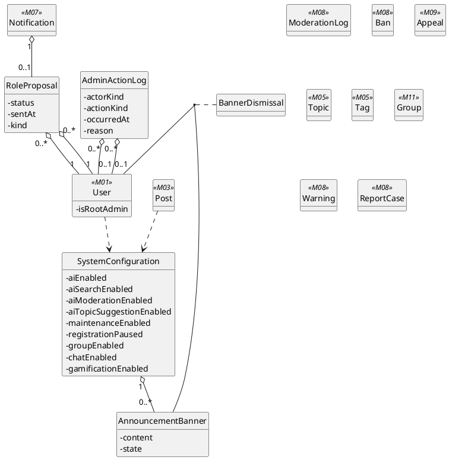

# Phân tích lớp thực thể — M10 Admin Panel

<!-- [Vietnamese Doc] Tài liệu tiếng Việt; tên lớp và thuộc tính viết tiếng Anh (input/CONVENTIONS.md mục 3). -->

| Mã tài liệu | EC-M10 |
|---|---|
| Dự án | iShare |
| Module | M10 — Admin Panel |
| Đầu vào | FR-M10 phiên bản 1.4 |
| Trạng thái | Bản nháp |
| Phiên bản | 0.4 |
| Ngày | 2026-11-18 |
| Tác giả | Phạm Văn Đức |

<!-- Quy ước chung cho mọi bảng dưới đây:
     - Không đổi tên cột, không xóa cột, không đổi số mục: tool đọc bảng theo số mục và tên cột.
     - Ô không có nội dung ghi "—".
     - Mục chưa tới bước làm thì để dòng "(Chưa làm — bước N)".
     - Cột Nguồn ghi mã trong FR: FR-M10-nn, FR-M10-nn.mm, BR-M10-nn, hoặc TN:<thuật ngữ> (mục 2.1 của FR).
     - Sơ đồ ở mục 4 do gen_puml.py sinh; không sửa tay. -->

## 1. Mô tả chức năng

### 1.1 Đoạn mô tả

(S1) M10 quản lý vai trò tài khoản, đề xuất làm Mod hoặc làm Admin, cấu hình vận hành, banner thông báo và nhật ký thao tác Admin. (S2) Admin tìm người dùng theo username hoặc tên hiển thị bằng cách khớp của M06, lọc theo vai trò, xem trạng thái tài khoản, nhận biết tài khoản ADMIN gốc và xem nhật ký kiểm duyệt M08 theo Mod thực hiện thao tác. (S3) Admin gửi đề xuất làm Mod cho tài khoản USER và chỉ tài khoản ADMIN gốc được gửi đề xuất làm Admin cho tài khoản USER hoặc MODERATOR, với điều kiện tài khoản được đề xuất đang ACTIVE và đã hoàn tất đăng ký theo M01. (S4) Hệ thống lưu đề xuất ở trạng thái Chưa trả lời cùng thời điểm gửi, chuyển đề xuất cũ cùng loại sang Hết hiệu lực khi bị thay thế hoặc quá hạn và gửi thông báo đề xuất qua M07. (S5) Người được đề xuất trả lời một lần khi đề xuất còn hiệu lực, hệ thống ghi trạng thái Đã từ chối khi từ chối và chỉ ghi Đã chấp nhận kèm việc cấp vai trò MODERATOR hoặc ADMIN khi tài khoản còn ACTIVE và vai trò hiện tại đủ điều kiện. (S6) Admin giáng cấp Mod về USER, Mod hoặc Admin khác tài khoản ADMIN gốc có thể xác nhận từ chức về USER, và tài khoản ADMIN gốc có thể thu hồi vai trò của Admin khác về USER. (S7) Hệ thống chuyển vai trò của Mod về USER ngay khi M08 ban tài khoản Mod và duy trì vai trò USER khi ban hết hạn hoặc được gỡ, với trường hợp ban bị lật theo quy định của M09. (S8) Admin lưu trạng thái công tắc AI tổng và các công tắc Search, Moderation, Topic suggestion để các module áp dụng từ thời điểm đổi, trong đó công tắc tổng quyết định hiệu lực của các công tắc riêng và điều khiển tóm tắt AI. (S9) Admin lưu trạng thái chế độ bảo trì và tạm dừng đăng ký để M01 giới hạn đăng nhập và thao tác cho tài khoản ADMIN khi bảo trì, đồng thời chặn tạo tài khoản mới khi tạm dừng đăng ký. (S10) Admin đổi và lưu cờ tính năng Group, Chat và Gamification để khi tắt, module tương ứng chặn thao tác của người dùng không có vai trò ADMIN, vẫn chạy tác vụ tự động và kiểm duyệt, đồng thời giữ dữ liệu đã có. (S11) Admin đặt, sửa hoặc gỡ banner thông báo toàn trang bằng văn bản thuần, người xem kể cả khách chưa đăng nhập có thể đóng banner hiện tại, và banner xuất hiện lại với mọi người khi Admin sửa nội dung hoặc đặt banner mới. (S12) Hệ thống ghi vĩnh viễn vào nhật ký thao tác Admin các thay đổi dữ liệu do Admin thực hiện trong vai trò Admin, gồm thao tác kiểm duyệt, kết luận khiếu nại và thao tác Topic hoặc Tag, cùng các thay đổi vai trò do người dùng hoặc hệ thống thực hiện, với người làm, thao tác, đối tượng, thời điểm và lý do nếu có. (S13) Admin xem nhật ký thao tác Admin theo thứ tự mới nhất trước, lọc theo người làm hoặc loại thao tác, và chỉ có quyền đọc các mục đã ghi.

<!-- Một đoạn văn, mỗi câu đánh số (S1) (S2) … Xem steps/01-describe-functions.md. -->

### 1.2 Truy vết câu

| Câu | Nội dung tóm tắt | Nguồn |
|---|---|---|
| S1 | Phạm vi dữ liệu M10 | FR-M10-02, FR-M10-07, FR-M10-09, FR-M10-10, FR-M10-11, FR-M10-12, FR-M10-13, FR-M10-14 |
| S2 | Tra cứu người dùng và thao tác của Mod | FR-M10-01, FR-M10-01.03, FR-M10-01.04, FR-M10-01.05, FR-M10-01.06 |
| S3 | Quyền gửi và điều kiện nhận đề xuất | FR-M10-02, FR-M10-02.01, FR-M10-02.09, FR-M10-07, FR-M10-07.05, FR-M10-07.07, FR-M10-07.08 |
| S4 | Dữ liệu, hiệu lực và thông báo đề xuất | FR-M10-02.01, FR-M10-02.02, FR-M10-02.05, FR-M10-02.08, FR-M10-02.10, FR-M10-07.05, FR-M10-07.06, FR-M10-07.09, FR-M10-07.10 |
| S5 | Trả lời đề xuất và cấp vai trò | FR-M10-03, FR-M10-03.01, FR-M10-03.02, FR-M10-03.03, FR-M10-03.06, FR-M10-03.08, FR-M10-03.09, FR-M10-03.10, FR-M10-03.11 |
| S6 | Giáng cấp, từ chức và thu hồi vai trò | FR-M10-04, FR-M10-04.01, FR-M10-05, FR-M10-05.01, FR-M10-05.04, FR-M10-05.05, FR-M10-08 |
| S7 | Thu hồi vai trò khi Mod bị ban | FR-M10-06, FR-M10-06.01, FR-M10-06.02 |
| S8 | Cấu hình công tắc AI và hiệu lực | FR-M10-09, FR-M10-09.01, FR-M10-09.02, FR-M10-09.03, FR-M10-09.04, FR-M10-09.05, FR-M10-09.06, FR-M10-09.07 |
| S9 | Cấu hình bảo trì và đăng ký | FR-M10-10, FR-M10-10.01, FR-M10-10.02, FR-M10-11, FR-M10-11.01, FR-M10-11.02 |
| S10 | Cờ tính năng và tác động đến module | FR-M10-12, FR-M10-12.01, FR-M10-12.03, FR-M10-12.04, FR-M10-12.06, FR-M10-12.07, FR-M10-12.08 |
| S11 | Nội dung, phạm vi và hiệu lực khi đóng banner | FR-M10-13, FR-M10-13.01, FR-M10-13.02, FR-M10-13.04, FR-M10-13.06, FR-M10-13.07, FR-M10-13.08, FR-M10-13.09 |
| S12 | Phạm vi và nội dung mục nhật ký | FR-M10-14, FR-M10-14.01, FR-M10-14.02, FR-M10-14.03, FR-M10-14.04, FR-M10-14.06, FR-M10-14.07, FR-M10-14.09 |
| S13 | Đọc và lọc nhật ký | FR-M10-15, FR-M10-15.01, FR-M10-15.02, FR-M10-15.03, FR-M10-15.04, FR-M10-15.05 |

## 2. Danh từ và phân loại

### 2.1 Sổ danh từ

<!-- Phân loại: Lớp | Thuộc tính | Loại bỏ.
     Kết quả: tên lớp; hoặc Lớp.thuộcTính; hoặc "—" khi loại bỏ.
     Xuất hiện ở: S<n> (câu của đoạn mô tả) hoặc "Quét: <mã FR>" (lượt quét bổ sung). -->

| # | Danh từ | Xuất hiện ở | Phân loại | Kết quả | Lý do |
|---|---|---|---|---|---|
| 1 | tài khoản / người dùng / Admin / Mod / tài khoản ADMIN gốc / tài khoản được đề xuất / người được đề xuất / người gửi đề xuất / người làm là tài khoản | S1 | Lớp | User | T3. Dùng lớp M01 cho các vai trò và ngữ cảnh của tài khoản. |
| 2 | vai trò tài khoản / vai trò hiện tại | S1 | Loại bỏ | — | Ngoài phạm vi module ở cấp thuộc tính. Dùng User.role đã có ở M01, M10 quản lý việc chuyển vai trò theo BR-M10-01 và ghi lệch tên ở Q-01. |
| 3 | đề xuất / đề xuất làm Mod / đề xuất làm Admin | S1 | Lớp | RoleProposal | T8. Bản ghi mỗi lần gửi, có loại, thời điểm và vòng đời trạng thái. |
| 4 | cấu hình vận hành / cấu hình hệ thống | S1 | Lớp | SystemConfiguration | T8. Cấu hình dùng chung được khởi tạo, có các giá trị được thay độc lập trong lúc hệ thống vận hành. |
| 5 | banner thông báo / banner thông báo toàn trang / banner hiện tại / banner mới | S1 | Lớp | AnnouncementBanner | T8. Có nội dung, trạng thái và vòng đời đặt, thay, sửa, gỡ; xác định phạm vi việc đóng banner. |
| 6 | nhật ký thao tác Admin / mục nhật ký thao tác Admin / mục đã ghi | S1 | Lớp | AdminActionLog | T8. Thông tin được quản lý trên từng mục chỉ ghi thêm; nhật ký là tập hợp các mục đó. |
| 7 | username | S2 | Loại bỏ | — | Ngoài phạm vi module (M01). Dùng User.username để tìm người dùng. |
| 8 | tên hiển thị | S2 | Loại bỏ | — | Ngoài phạm vi module (M01). Dùng User.displayName để tìm và hiển thị. |
| 9 | cách khớp | S2 | Loại bỏ | — | Ngoài phạm vi module (M06). Là quy tắc tra cứu dùng lại theo FR-M10-01.03. |
| 10 | trạng thái tài khoản / trạng thái ACTIVE | S2 | Loại bỏ | — | Ngoài phạm vi module (M01). ACTIVE là giá trị của User.accountState dùng kiểm tra đủ điều kiện. |
| 11 | nhật ký kiểm duyệt / mục nhật ký kiểm duyệt | S2 | Lớp | ModerationLog | T4. Có dữ liệu ngoài để truy vấn theo Mod và đối chiếu phạm vi ghi log. |
| 12 | thao tác kiểm duyệt | S2 | Loại bỏ | — | Chung chung. Chỉ là nhóm sự kiện; dấu vết từng lần thuộc ModerationLog và trong trường hợp FR quy định thuộc AdminActionLog. |
| 13 | tài khoản USER / tài khoản MODERATOR / tài khoản ADMIN | S3 | Loại bỏ | — | Giá trị của User.role trên cùng một lớp User. ADMIN gốc là dấu riêng. |
| 14 | điều kiện nhận đề xuất / điều kiện đủ để chấp nhận | S3 | Loại bỏ | — | Trừu tượng. Quy tắc kiểm tra trạng thái tài khoản, mức xác minh và vai trò theo BR-M10-05 và BR-M10-27. |
| 15 | hoàn tất đăng ký | S3 | Loại bỏ | — | Ngoài phạm vi module (M01). Điều kiện là đã hoàn tất bước 3, đọc User.verifyLevel. |
| 16 | hệ thống | S4 | Loại bỏ | — | Không lưu: tác nhân không có dữ liệu riêng. Với mục nhật ký tự động, Hệ thống là giá trị biểu diễn người làm. |
| 17 | trạng thái đề xuất | S4 | Thuộc tính | RoleProposal.status | T9. Mô tả vòng đời của một đề xuất. |
| 18 | thời điểm gửi / thời điểm gửi đề xuất | S4 | Thuộc tính | RoleProposal.sentAt | T9. Mốc của từng đề xuất. |
| 19 | loại đề xuất / loại của đề xuất | S4 | Thuộc tính | RoleProposal.kind | T9. Phân biệt loại và điều kiện áp dụng của đề xuất. |
| 20 | thông báo đề xuất | S4 | Lớp | Notification | T4. Thông báo thuộc M07, phát sinh khi lưu đề xuất. |
| 21 | đề xuất còn hiệu lực / đề xuất quá hạn | S5 | Loại bỏ | — | Trừu tượng. Kết quả kiểm tra trạng thái và hạn, dùng RoleProposal.status và RoleProposal.sentAt theo BR-M10-07/27. |
| 22 | Chưa trả lời / Đã chấp nhận / Đã từ chối / Hết hiệu lực | S4 | Loại bỏ | — | Giá trị của RoleProposal.status. |
| 23 | trả lời đề xuất / chấp nhận đề xuất / từ chối đề xuất / cấp vai trò | S5 | Loại bỏ | — | Trừu tượng. Trả lời cập nhật RoleProposal.status; chấp nhận còn đổi User.role và phát sinh AdminActionLog. FR không nêu bản ghi phản hồi riêng. |
| 24 | giáng cấp / từ chức / thu hồi vai trò | S6 | Loại bỏ | — | Trừu tượng. Hành động thay đổi User.role và để lại dấu vết trong AdminActionLog. |
| 25 | xác nhận từ chức | S6 | Loại bỏ | — | Hành động không lưu dấu vết riêng. Xác nhận là điều kiện trước khi đổi vai trò theo BR-M10-25. |
| 26 | ban | S7 | Lớp | Ban | T4. Việc M08 ban Mod là đầu vào làm đổi vai trò. |
| 27 | ban hết hạn / ban được gỡ / ban bị lật | S7 | Loại bỏ | — | Ngoài phạm vi module (M08, M09). Điều kiện từ vòng đời Ban và kết luận Appeal; Mod giữ USER theo BR-M10-09. |
| 28 | quy định | S7 | Loại bỏ | — | Trừu tượng. Chỉ đến quy tắc nghiệp vụ trong FR. |
| 29 | trạng thái công tắc / Bật / Tắt | S8 | Loại bỏ | — | Giá trị của các thuộc tính bật hoặc tắt trên SystemConfiguration. |
| 30 | công tắc AI tổng | S8 | Thuộc tính | SystemConfiguration.aiEnabled | T9. Giá trị cấu hình có tập cố định và được Admin thay đổi khi vận hành. |
| 31 | công tắc Search | S8 | Thuộc tính | SystemConfiguration.aiSearchEnabled | T9. Giá trị cấu hình có tập cố định và được Admin thay đổi khi vận hành. |
| 32 | công tắc Moderation | S8 | Thuộc tính | SystemConfiguration.aiModerationEnabled | T9. Giá trị cấu hình có tập cố định và được Admin thay đổi khi vận hành. |
| 33 | công tắc Topic suggestion | S8 | Thuộc tính | SystemConfiguration.aiTopicSuggestionEnabled | T9. Giá trị cấu hình có tập cố định và được Admin thay đổi khi vận hành. |
| 34 | AI / Search / Moderation / Topic suggestion / tóm tắt AI | S8 | Loại bỏ | — | Ngoài phạm vi module. Là tính năng dùng trạng thái cấu hình; M10 không quản lý các kết quả AI. |
| 35 | module / module tương ứng | S8 | Loại bỏ | — | Chung chung. Chỉ phạm vi áp dụng cấu hình, không có danh mục module do M10 quản lý. |
| 36 | thời điểm đổi cấu hình | S8 | Loại bỏ | — | Trừu tượng. Là thời điểm hiệu lực của thao tác đổi; dấu vết thời điểm thuộc AdminActionLog.occurredAt theo BR-M10-13/23. |
| 37 | hiệu lực công tắc riêng | S8 | Loại bỏ | — | Trừu tượng. Quy tắc áp dụng theo công tắc tổng và riêng tại BR-M10-14, không phải giá trị cấu hình độc lập. |
| 38 | chế độ bảo trì | S9 | Thuộc tính | SystemConfiguration.maintenanceEnabled | T9. Giá trị cấu hình có tập cố định và được Admin thay đổi khi vận hành. |
| 39 | tạm dừng đăng ký | S9 | Thuộc tính | SystemConfiguration.registrationPaused | T9. Giá trị cấu hình có tập cố định và được Admin thay đổi khi vận hành. |
| 40 | đăng nhập / thao tác của người dùng / tạo tài khoản mới | S9 | Loại bỏ | — | Ngoài phạm vi module. Là hành vi áp dụng điều kiện cấu hình, không phải dữ liệu do M10 quản lý. |
| 41 | cờ tính năng | S10 | Loại bỏ | — | Chung chung. Nhóm ba thuộc tính cấu hình cố định được ghi riêng trong sổ. |
| 42 | cờ tính năng Group | S10 | Thuộc tính | SystemConfiguration.groupEnabled | T9. Giá trị cấu hình có tập cố định và được Admin thay đổi khi vận hành. |
| 43 | cờ tính năng Chat | S10 | Thuộc tính | SystemConfiguration.chatEnabled | T9. Giá trị cấu hình có tập cố định và được Admin thay đổi khi vận hành. |
| 44 | cờ tính năng Gamification | S10 | Thuộc tính | SystemConfiguration.gamificationEnabled | T9. Giá trị cấu hình có tập cố định và được Admin thay đổi khi vận hành. |
| 45 | module Group / Chat / Gamification | S10 | Loại bỏ | — | Ngoài phạm vi module với nghĩa phân hệ được áp cờ. Dữ liệu nhóm là thực thể Group M11 được xét riêng theo phạm vi nhật ký. |
| 46 | tác vụ tự động / kiểm duyệt / dữ liệu đã có | S10 | Loại bỏ | — | Ngoài phạm vi module. Là hoạt động và dữ liệu của các module dùng cờ, không phát sinh bản ghi riêng tại M10. |
| 47 | nội dung banner / văn bản thuần | S11 | Thuộc tính | AnnouncementBanner.content | T9. Nội dung của banner. |
| 48 | người xem / khách chưa đăng nhập / Guest | S11 | Loại bỏ | — | Không lưu: nhóm đối tượng xem banner. Người đăng nhập dùng User; Guest không có tài khoản, chỉ ghi nhận việc đóng theo trình duyệt. |
| 49 | trang / toàn trang | S11 | Loại bỏ | — | Giao diện. Phạm vi xuất hiện của banner theo FR-M10-13.01. |
| 50 | đặt banner / sửa banner / gỡ banner | S11 | Loại bỏ | — | Trừu tượng. Thao tác quản lý AnnouncementBanner, các lần do Admin làm có dấu vết trong AdminActionLog. |
| 51 | việc đóng banner / người xem đã đóng banner hiện tại | S11 | Lớp | BannerDismissal | Tách n-n tại bước 3. Lưu dấu đóng giữa User đã đăng nhập và banner; Guest theo trình duyệt. Sửa nội dung hoặc đặt mới làm dấu cũ hết tác dụng. Xem Q-02. |
| 52 | thay đổi dữ liệu / thay đổi vai trò | S12 | Loại bỏ | — | Chung chung. Phạm vi sự kiện ghi AdminActionLog; không có bảng lịch sử vai trò độc lập được FR nêu. |
| 53 | khiếu nại / kết luận khiếu nại | S12 | Lớp | Appeal | T4. Kết luận thuộc dữ liệu Appeal và là sự kiện ghi nhật ký. |
| 54 | Topic | S12 | Lớp | Topic | T4. Đối tượng ngoài thuộc M05 có thao tác được ghi nhật ký. |
| 55 | Tag | S12 | Lớp | Tag | T4. Đối tượng ngoài thuộc M05 có thao tác được ghi nhật ký. |
| 56 | người làm | S12 | Thuộc tính | AdminActionLog.actorKind | T9. Dấu phân biệt người làm là tài khoản hay Hệ thống; đối tượng User được xét riêng. |
| 57 | thao tác / loại thao tác | S12 | Thuộc tính | AdminActionLog.actionKind | T9. Giá trị phân loại sự kiện được ghi. |
| 58 | đối tượng thao tác | S12 | Loại bỏ | — | Chung chung. Là đối tượng nghiệp vụ của thao tác; cách lưu đối tượng của nhật ký được xét ở bước 3. FR không nêu trường mô tả riêng. |
| 59 | thời điểm thao tác / thời điểm ghi nhật ký | S12 | Thuộc tính | AdminActionLog.occurredAt | T9. Mốc thời gian của mục nhật ký. |
| 60 | lý do của mục nhật ký | S12 | Thuộc tính | AdminActionLog.reason | T9. Nội dung giải thích trên mục nhật ký. |
| 61 | thứ tự mới nhất trước / bộ lọc nhật ký / quyền đọc | S13 | Loại bỏ | — | Trừu tượng. Quy tắc sắp xếp, tìm và phân quyền; FR không yêu cầu lưu cấu hình lọc theo Admin. |
| 62 | dấu ADMIN gốc | Quét: FR-M10-01.05, FR-M10-07.04 | Thuộc tính | User.isRootAdmin | T9. Dấu hiệu trên một tài khoản, tách khỏi giá trị vai trò. |
| 63 | hạn của đề xuất | Quét: TN:Hạn của đề xuất | Loại bỏ | — | Hằng số của BR-M10-07. Mốc hết hạn tính từ RoleProposal.sentAt cộng 7 × 24 giờ, không thêm trường lưu. |
| 64 | trạng thái banner | Quét: FR-M10-13.01, FR-M10-13.02, FR-M10-13.10 | Thuộc tính | AnnouncementBanner.state | T9. Mô tả vòng đời hiển thị của banner, độc lập với việc từng người đã đóng. |
| 65 | ký tự của banner | Quét: TN:Ký tự của banner | Loại bỏ | — | Hằng số của BR-M10-20 về giới hạn 1–200 ký tự. Độ dài là phép kiểm trên AnnouncementBanner.content, không có số liệu nghiệp vụ để lưu hoặc xem. |
| 66 | trình duyệt đã đóng banner | Quét: BR-M10-20 | Loại bỏ | — | Ngoài phạm vi hệ thống với nghĩa một thực thể quản lý. FR dùng trình duyệt làm phạm vi ghi nhớ việc đóng của Guest. |
| 67 | Hệ thống với tư cách người làm | Quét: FR-M10-14.07 | Loại bỏ | — | Giá trị của AdminActionLog.actorKind; không tạo tài khoản cho tác nhân hệ thống. |
| 68 | cảnh cáo | Quét: FR-M10-14.02 | Lớp | Warning | T4. Đối tượng kiểm duyệt thuộc M08, thao tác của Admin được ghi nhật ký. |
| 69 | vụ báo cáo | Quét: FR-M10-14.02 | Lớp | ReportCase | T4. Vụ được Admin kết luận và thao tác được ghi nhật ký. |
| 70 | nhóm | Quét: FR-M10-14.02 | Lớp | Group | T4. Ẩn, khóa và mở khóa nhóm là thao tác thuộc phạm vi ghi nhật ký. |
| 71 | bài viết của người khác | Quét: FR-M10-14.02 | Lớp | Post | T4. Bài có Topic hoặc Tag bị Admin đổi trong phạm vi ghi nhật ký. |
| 72 | nội dung bị ẩn | Quét: FR-M10-14.02 | Loại bỏ | — | Chung chung. FR nêu nhóm thao tác ẩn nội dung, hợp đồng nghiệp vụ và loại đích cụ thể do M08 quy định. |
| 73 | nhật ký quyết định AI | Quét: FR-M10-14.05 | Loại bỏ | — | Ngoài phạm vi module (M13). Nhật ký AI được lưu riêng, không phải một đối tượng do M10 tra cứu hoặc cập nhật. |
| 74 | giờ Việt Nam | Quét: BR-M10-23 | Loại bỏ | — | Hằng số của BR-M10-23 dùng khi hiển thị AdminActionLog.occurredAt. |
| 75 | hằng số chính sách | Quét: BR-M10-04 | Loại bỏ | — | Hằng số của BR-M10-04. Không thuộc cấu hình Admin thay đổi khi vận hành. |

### 2.2 Lớp

<!-- Nhóm: Thực thể | Liên kết | Thống kê. Sở hữu: mã module sở hữu lớp (M10 của tài liệu này, hoặc Myy với lớp ngoài). -->

| Lớp | Tên tiếng Việt | Nhóm | Sở hữu | Mô tả | Nguồn |
|---|---|---|---|---|---|
| RoleProposal | Đề xuất vai trò | Thực thể | M10 | Mỗi đề xuất làm Mod hoặc làm Admin có loại, thời điểm gửi và trạng thái riêng. Dùng tên EC-M07 đã tham chiếu. | FR-M10-02.01, FR-M10-07.05, BR-M10-27 |
| SystemConfiguration | Cấu hình hệ thống | Thực thể | M10 | Cấu hình dùng chung khi hệ thống vận hành, gồm các công tắc AI, bảo trì, tạm dừng đăng ký và cờ tính năng. Dùng tên các EC trước đã tham chiếu. | FR-M10-09.01, FR-M10-10.01, FR-M10-11.01, FR-M10-12.03, BR-M10-12 |
| AnnouncementBanner | Banner thông báo toàn trang | Thực thể | M10 | Thông báo văn bản có nội dung và trạng thái, có thể đặt, thay, sửa hoặc gỡ. Việc đóng chỉ áp dụng cho banner hiện tại và mất tác dụng khi nội dung thay đổi hoặc có banner mới. | FR-M10-13, FR-M10-13.01, FR-M10-13.04, FR-M10-13.07, FR-M10-13.08, BR-M10-20 |
| AdminActionLog | Mục nhật ký thao tác Admin | Thực thể | M10 | Bản ghi của từng thao tác quản trị đổi dữ liệu hoặc thay đổi vai trò. Chỉ ghi thêm, giữ vĩnh viễn. Dùng tên EC-M05 và EC-M08 đã tham chiếu. | FR-M10-14.01, FR-M10-14.04, FR-M10-14.06, FR-M10-14.07 |
| User | Tài khoản | Thực thể | M01 | Tài khoản được tra cứu, gửi hoặc nhận đề xuất, đổi vai trò, làm thao tác hoặc là đối tượng ghi nhật ký. M10 bổ sung dấu nhận biết ADMIN gốc. | FR-M10-01.05, FR-M10-02.01, FR-M10-07.04, FR-M10-07.05, FR-M10-14.01, BR-M10-10 |
| Notification | Thông báo | Thực thể | M07 | Thông báo đề xuất được gửi cho người nhận và dùng để chuyển phản hồi về M10. | FR-M10-02.02, FR-M10-03.01, FR-M10-07.06 |
| ModerationLog | Dòng nhật ký kiểm duyệt | Thực thể | M08 | Tra cứu thao tác theo Mod. Nhật ký kiểm duyệt và nhật ký thao tác Admin cùng ghi những thao tác kiểm duyệt của Admin thuộc phạm vi FR. | FR-M10-01.06, FR-M10-14.03 |
| Ban | Ban | Thực thể | M08 | Ban Mod kích hoạt chuyển vai trò về USER. Ban và gỡ ban của Admin thuộc phạm vi ghi nhật ký. | FR-M10-06.01, FR-M10-06.02, FR-M10-14.02 |
| Appeal | Khiếu nại | Thực thể | M09 | Kết luận khiếu nại của Admin thuộc phạm vi ghi nhật ký; khiếu nại ban Mod liên quan đến quy tắc giữ vai trò USER. | FR-M10-06.02, FR-M10-14.02, BR-M10-09 |
| Topic | Topic | Thực thể | M05 | Thêm, gộp, xóa Topic và sửa Topic trên bài người khác thuộc phạm vi ghi nhật ký. | FR-M10-14.02, FR-M10-14.03 |
| Tag | Tag | Thực thể | M05 | Vô hiệu hóa, kích hoạt lại Tag và sửa Tag trên bài người khác thuộc phạm vi ghi nhật ký. | FR-M10-14.02, FR-M10-14.03 |
| Group | Group | Thực thể | M11 | Tên đã được EC trước tham chiếu, chờ EC-M11 xác nhận. Thao tác ẩn, khóa và mở khóa nhóm thuộc phạm vi nhật ký. | FR-M10-12.03, FR-M10-14.02 |
| Warning | Cảnh cáo | Thực thể | M08 | Cảnh cáo và bỏ cảnh cáo AI do Admin thực hiện thuộc phạm vi ghi nhật ký. | FR-M10-14.02 |
| ReportCase | Vụ báo cáo | Thực thể | M08 | Kết luận vụ báo cáo của Admin thuộc phạm vi ghi nhật ký. | FR-M10-14.02 |
| Post | Bài viết | Thực thể | M03 | Bài của người khác có thể được Admin đổi Topic hoặc Tag, thao tác được ghi nhật ký. | FR-M10-14.02 |
| BannerDismissal | Dấu đóng banner | Liên kết | M10 | Cặp tài khoản đã đăng nhập và banner được đóng. Hiệu lực thuộc banner hiện tại, bị mất khi nội dung banner được sửa hoặc đặt banner mới. | FR-M10-13.07, FR-M10-13.08, BR-M10-20 |

### 2.3 Thuộc tính

<!-- Tính chất: Lưu | Dẫn xuất. Chưa có id, chưa có kiểu, chưa có khóa ngoại.
     Ràng buộc nguồn nêu: độ dài tối đa, duy nhất, bắt buộc/tùy chọn, tập giá trị, mặc định, công thức (với Dẫn xuất) — chép từ FR kèm mã. -->

| Lớp | Thuộc tính | Tên tiếng Việt | Tính chất | Ràng buộc nguồn nêu | Nguồn |
|---|---|---|---|---|---|
| RoleProposal | status | Trạng thái đề xuất | Lưu | Khởi tạo Chưa trả lời; sau đó Đã chấp nhận, Đã từ chối hoặc Hết hiệu lực. Chỉ trả lời một lần. Đề xuất cũ cùng loại cho cùng người chuyển Hết hiệu lực khi bị thay hoặc đủ 7 × 24 giờ mà chưa trả lời theo BR-M10-07 và BR-M10-27. | FR-M10-02.01, FR-M10-02.08, FR-M10-02.10, FR-M10-03.02, FR-M10-03.03, FR-M10-03.06, FR-M10-07.09, FR-M10-07.10 |
| RoleProposal | sentAt | Thời điểm gửi | Lưu | Lúc hệ thống lưu đề xuất; mốc tính thời hạn 7 × 24 giờ theo BR-M10-07. | FR-M10-02.01, FR-M10-07.05, BR-M10-07 |
| RoleProposal | kind | Loại đề xuất | Lưu | Làm Mod hoặc làm Admin. Mỗi người có tối đa một đề xuất còn hiệu lực cho mỗi loại theo BR-M10-27. | FR-M10-02.01, FR-M10-07.05, BR-M10-06, BR-M10-27 |
| SystemConfiguration | aiEnabled | Công tắc AI tổng | Lưu | Bật hoặc Tắt, mặc định Bật. Tắt sẽ vô hiệu mọi tính năng AI; tóm tắt chỉ theo công tắc tổng. | FR-M10-09.01, FR-M10-09.03, FR-M10-09.05, FR-M10-09.10, BR-M10-14, BR-M10-26 |
| SystemConfiguration | aiSearchEnabled | Công tắc AI Search | Lưu | Bật hoặc Tắt, mặc định Bật. Giữ giá trị đã đặt kể cả khi công tắc tổng Tắt. | FR-M10-09.01, FR-M10-09.06, FR-M10-09.10, BR-M10-15 |
| SystemConfiguration | aiModerationEnabled | Công tắc AI Moderation | Lưu | Bật hoặc Tắt, mặc định Bật. Giữ giá trị đã đặt kể cả khi công tắc tổng Tắt. | FR-M10-09.01, FR-M10-09.06, FR-M10-09.10, BR-M10-15 |
| SystemConfiguration | aiTopicSuggestionEnabled | Công tắc AI Topic suggestion | Lưu | Bật hoặc Tắt, mặc định Bật. Giữ giá trị đã đặt kể cả khi công tắc tổng Tắt. | FR-M10-09.01, FR-M10-09.06, FR-M10-09.10, BR-M10-15 |
| SystemConfiguration | maintenanceEnabled | Chế độ bảo trì | Lưu | Bật hoặc Tắt, mặc định Tắt. M01 áp dụng cho đăng nhập và phiên đang có. | FR-M10-10.01, FR-M10-10.02, FR-M10-10.04, BR-M10-17 |
| SystemConfiguration | registrationPaused | Tạm dừng đăng ký | Lưu | Bật hoặc Tắt, mặc định Tắt. M01 chặn tạo tài khoản mới; tài khoản có sẵn được liên kết Google hoặc hoàn tất thiết lập. | FR-M10-11.01, FR-M10-11.02, FR-M10-11.04, BR-M10-18 |
| SystemConfiguration | groupEnabled | Cờ tính năng Group | Lưu | Bật hoặc Tắt, mặc định Bật, áp dụng cho M11 theo BR-M10-28. | FR-M10-12.01, FR-M10-12.03, FR-M10-12.09, BR-M10-28 |
| SystemConfiguration | chatEnabled | Cờ tính năng Chat | Lưu | Bật hoặc Tắt, mặc định Bật, áp dụng cho M16 theo BR-M10-28. | FR-M10-12.01, FR-M10-12.03, FR-M10-12.09, BR-M10-28 |
| SystemConfiguration | gamificationEnabled | Cờ tính năng Gamification | Lưu | Bật hoặc Tắt, mặc định Bật, áp dụng cho M12 theo BR-M10-28. | FR-M10-12.01, FR-M10-12.03, FR-M10-12.09, BR-M10-28 |
| AnnouncementBanner | content | Nội dung banner | Lưu | Văn bản thuần, bắt buộc khi đặt hoặc sửa. Dài 1–200 ký tự sau khi bỏ khoảng trắng ở đầu và cuối theo BR-M10-20. | FR-M10-13.05, FR-M10-13.06, FR-M10-13.09, BR-M10-20 |
| AdminActionLog | actorKind | Loại người làm | Lưu | Phân biệt tài khoản và Hệ thống. Khi chấp nhận đề xuất hoặc tự từ chức, người làm là chính tài khoản; khi Mod mất vai trò do bị ban, người làm là Hệ thống. Tài khoản cụ thể để bước 3 xét. | FR-M10-14.01, FR-M10-14.06, FR-M10-14.07, BR-M10-23 |
| AdminActionLog | actionKind | Loại thao tác | Lưu | Theo phạm vi FR-M10-14.02/06/07, dùng để lọc nhật ký. Sự kiện xem, nhận hoặc nhả vụ và thao tác thường của Admin nằm ngoài phạm vi ghi. | FR-M10-14.01, FR-M10-14.02, FR-M10-14.06, FR-M10-14.07, FR-M10-14.08, FR-M10-15.05 |
| AdminActionLog | occurredAt | Thời điểm thao tác | Lưu | Thời điểm thao tác hoàn tất và được ghi nhận. Đọc theo giờ Việt Nam, mục mới nhất trước. | FR-M10-14.01, FR-M10-15.01, FR-M10-15.04, BR-M10-23 |
| AdminActionLog | reason | Lý do | Lưu | Tùy chọn. Nếu module nguồn bắt buộc lý do khi thao tác, ghi đúng lý do đó. | FR-M10-14.01, FR-M10-14.09, BR-M10-23 |
| User | isRootAdmin | Dấu ADMIN gốc | Lưu | Phần M10 bổ sung trên User của M01. Chỉ tài khoản ADMIN gốc được đánh dấu, tạo sẵn khi khởi tạo, duy nhất, không qua đăng ký và không thể từ chức hoặc bị thu hồi vai trò. | FR-M10-01.05, FR-M10-05.05, FR-M10-07.04, FR-M10-08.04, BR-M10-10 |
| AnnouncementBanner | state | Trạng thái banner | Lưu | Đang hiện hoặc Không hiện theo mục 5.18. Khởi tạo hệ thống chưa có banner. Tối đa một banner đang hiện; gỡ kết thúc hiển thị, đặt lại hoặc sửa nội dung làm banner hiện trở lại với mọi người. | FR-M10-13.01, FR-M10-13.02, FR-M10-13.04, FR-M10-13.08, FR-M10-13.10, BR-M10-20, BR-M10-26 |

### 2.4 Đối chiếu với mục Dữ liệu nghiệp vụ của FR

<!-- Mỗi thực thể ở bảng "Dữ liệu nghiệp vụ" của FR một dòng; chép đúng tên ở cột Thực thể của FR.
     Xử lý: Khớp | Đã thêm qua sổ danh từ | Mô hình có thêm: … | Lệch: … (kèm Q-nn). -->

| Thực thể trong FR | Trong mô hình | Xử lý |
|---|---|---|
| Tài khoản (M01) | User | Đã xác nhận MODERATOR là tên vai trò dùng tại M10 theo Q-01. MOD trong FR-M01 và EC-M01 chỉ cùng vai trò. User.isRootAdmin là phần M10 bổ sung theo FR-M10-01.05 và BR-M10-10. |
| Đề xuất | RoleProposal | Khớp |
| Cấu hình hệ thống | SystemConfiguration, AnnouncementBanner, BannerDismissal | Mô hình có thêm AnnouncementBanner cho vòng đời đặt, thay, sửa, gỡ. BannerDismissal biểu diễn người đăng nhập đã đóng banner hiện tại theo FR-M10-13.07/08 và Q-02. Guest theo trình duyệt theo BR-M10-20. |
| Mục nhật ký thao tác Admin | AdminActionLog | Khớp |
| Tham chiếu ngoài | Notification, ModerationLog, Ban, Appeal, Topic, Tag, Group, Warning, ReportCase, Post | Mô hình có thêm các đối tượng từ FR-M10-01.06, FR-M10-02.02, FR-M10-06.01/02, FR-M10-07.06, FR-M10-14.02/03 và mục 5.19. Module gốc tiếp tục sở hữu dữ liệu. |

## 3. Quan hệ giữa các lớp

### 3.1 Ma trận cặp lớp

<!-- T = quan hệ trực tiếp; G(X) = chỉ gián tiếp qua lớp X; trống = không liên quan. Chỉ điền nửa trên. -->

| Lớp | 1 | 2 | 3 | 4 | 5 | 6 | 7 | 8 | 9 | 10 | 11 | 12 | 13 | 14 | 15 | 16 |
| --- | --- | --- | --- | --- | --- | --- | --- | --- | --- | --- | --- | --- | --- | --- | --- | --- |
| 1 RoleProposal |  |  |  | G(User) |  | T | T |  |  |  |  |  |  |  |  |  |
| 2 SystemConfiguration |  |  | T |  |  | P |  |  |  |  |  |  |  |  |  | P |
| 3 AnnouncementBanner |  |  |  |  | T | T |  |  |  |  |  |  |  |  |  |  |
| 4 AdminActionLog |  |  |  |  |  | T |  |  |  |  |  |  |  |  |  |  |
| 5 BannerDismissal |  |  |  |  |  | T |  |  |  |  |  |  |  |  |  |  |
| 6 User |  |  |  |  |  |  |  |  |  |  |  |  |  |  |  |  |
| 7 Notification |  |  |  |  |  |  |  |  |  |  |  |  |  |  |  |  |
| 8 ModerationLog |  |  |  |  |  |  |  |  |  |  |  |  |  |  |  |  |
| 9 Ban |  |  |  |  |  |  |  |  |  |  |  |  |  |  |  |  |
| 10 Appeal |  |  |  |  |  |  |  |  |  |  |  |  |  |  |  |  |
| 11 Topic |  |  |  |  |  |  |  |  |  |  |  |  |  |  |  |  |
| 12 Tag |  |  |  |  |  |  |  |  |  |  |  |  |  |  |  |  |
| 13 Group |  |  |  |  |  |  |  |  |  |  |  |  |  |  |  |  |
| 14 Warning |  |  |  |  |  |  |  |  |  |  |  |  |  |  |  |  |
| 15 ReportCase |  |  |  |  |  |  |  |  |  |  |  |  |  |  |  |  |
| 16 Post |  |  |  |  |  |  |  |  |  |  |  |  |  |  |  |  |

Ô `P` ghi phụ thuộc nghiệp vụ, không áp dụng bội số. Ô `T` giữa RoleProposal và User, giữa AdminActionLog và User có hai vai trò được ghi thành các dòng riêng ở mục 3.2. Ô `T` giữa AnnouncementBanner và User là cặp nghiệp vụ ban đầu được tách bằng BannerDismissal.

Các ô liên quan đến đối tượng của nhật ký ngoài trường hợp đổi vai trò để trống khi FR-M10 mới nêu danh sách thao tác cần ghi, chưa chốt cách giữ đối tượng trong mục nhật ký lâu dài theo Q-04. Việc cùng ghi vào ModerationLog và AdminActionLog tạo hai bản ghi theo FR-M10-14.03, chưa có căn cứ nối từng mục với nhau.

Không có quan hệ đệ quy lưu giữa đề xuất cũ và đề xuất mới. Hết hiệu lực do bị thay là chuyển trạng thái theo loại và người nhận, theo BR-M10-27.

### 3.2 Quan hệ số lượng

<!-- Mỗi ô T của ma trận một dòng. Dạng đọc theo thứ tự A–B: 1-1 | 1-n | n-1 | n-n.
     Xử lý: Giữ nguyên | Gộp vào <Lớp>: … | Giữ: … | Tách: thêm lớp <X>. -->

| Cặp | Câu A → B | Câu B → A | Dạng | Xử lý |
|---|---|---|---|---|
| RoleProposal – User (người gửi) | Một RoleProposal do đúng một User có quyền gửi. | Một User có thể gửi từ 0 đến nhiều RoleProposal theo thời gian. | n-1 | Giữ nguyên |
| RoleProposal – User (người nhận) | Một RoleProposal gửi đến đúng một User. | Một User có thể nhận từ 0 đến nhiều RoleProposal theo thời gian, tối đa một đề xuất còn hiệu lực cho mỗi loại tại một thời điểm. | n-1 | Giữ nguyên |
| RoleProposal – Notification | Một RoleProposal hợp lệ phát sinh đúng một Notification đề xuất riêng. | Một Notification gắn với 0 hoặc 1 RoleProposal. Loại thông báo đề xuất có đúng một RoleProposal. | 1-1 | Giữ: khác module sở hữu, đầu RoleProposal tùy chọn trên Notification thông thường. |
| SystemConfiguration – AnnouncementBanner | Một SystemConfiguration có thể có 0 đến nhiều AnnouncementBanner được đặt nối tiếp theo thời gian, tối đa một banner đang hiện tại một thời điểm. | Một AnnouncementBanner thuộc đúng một cấu hình toàn hệ thống. | 1-n | Giữ nguyên |
| AnnouncementBanner – User | Một AnnouncementBanner có thể được 0 đến nhiều User đóng. | Một User có thể đóng 0 đến nhiều AnnouncementBanner theo thời gian. | n-n | Tách: thêm lớp BannerDismissal |
| AnnouncementBanner – BannerDismissal | Một AnnouncementBanner có thể có từ 0 đến nhiều BannerDismissal. | Một BannerDismissal ứng với đúng một AnnouncementBanner. | 1-n | Giữ nguyên |
| User – BannerDismissal | Một User có thể có từ 0 đến nhiều BannerDismissal đối với các banner theo thời gian. | Một BannerDismissal của người đăng nhập thuộc đúng một User. | 1-n | Giữ nguyên |
| AdminActionLog – User (người làm) | Một AdminActionLog do 0 hoặc 1 User thực hiện. Mục tự động do Hệ thống có 0 User ở vai trò người làm. | Một User có thể là người làm của 0 đến nhiều AdminActionLog. | n-1 | Giữ nguyên |
| AdminActionLog – User (đối tượng đổi vai trò) | Một AdminActionLog ghi một thao tác đổi vai trò cho đúng một User. Những mục khác có thể không có User ở vai trò đối tượng. | Một User có thể là đối tượng đổi vai trò trong 0 đến nhiều AdminActionLog. | n-1 | Giữ nguyên |

### 3.3 Lớp liên kết

<!-- Mỗi lớp có Nhóm = Liên kết một dòng. "Tách từ quan hệ n-n" viết dạng "LớpA – LớpB". -->

| Lớp liên kết | Tách từ quan hệ n-n | Thuộc tính riêng của liên kết | Nguồn |
|---|---|---|---|
| BannerDismissal | AnnouncementBanner – User | —. Sự tồn tại của cặp biểu thị người dùng đã đóng banner hiện tại. Chỉ một dấu còn hiệu lực cho mỗi cặp. Sửa nội dung hoặc đặt mới làm dấu cũ hết hiệu lực. | FR-M10-13.07, FR-M10-13.08, BR-M10-20 |

### 3.4 Quan hệ

<!-- Bội số A = số đối tượng A ứng với một đối tượng B (ghi ở đầu A trên sơ đồ). Cú pháp: 1, 0..1, 0..*, 1..*, 1..3.
     Loại: Kế thừa | Hợp thành | Kết tập | Liên kết | Phụ thuộc.
     Bên chính: lớp cha (Kế thừa), lớp toàn thể (Hợp thành, Kết tập), lớp được dùng (Phụ thuộc); "—" với Liên kết.
     Kế thừa và Phụ thuộc ghi "—" ở Bội số A, Bội số B, Dạng. Không được còn dạng n-n. -->

| ID | Lớp A | Bội số A | Lớp B | Bội số B | Dạng | Loại | Bên chính | Căn cứ | Nguồn |
|---|---|---|---|---|---|---|---|---|---|
| R-M10-01 | RoleProposal | 0..* | User | 1 | n-1 | Kết tập | RoleProposal | RoleProposal ghi người gửi. Đề xuất làm Mod do Admin gửi, đề xuất làm Admin do ADMIN gốc gửi. Tài khoản có vòng đời riêng. | FR-M10-02.01, FR-M10-07.05, FR-M10-07.07, BR-M10-11 |
| R-M10-02 | RoleProposal | 0..* | User | 1 | n-1 | Kết tập | RoleProposal | RoleProposal ghi người nhận. Chỉ người nhận được trả lời, và đề xuất mới cùng loại cho cùng người làm đề xuất cũ hết hiệu lực. | FR-M10-02.01, FR-M10-02.08, FR-M10-03.07, FR-M10-07.05, FR-M10-07.09, BR-M10-27 |
| R-M10-03 | RoleProposal | 0..1 | Notification | 1 | 1-1 | Kết tập | Notification | Notification loại đề xuất chứa ngữ cảnh của RoleProposal. Cùng hướng và bội số với R-M07-15. Một đề xuất gửi lại tạo thông báo riêng. | FR-M10-02.02, FR-M10-02.05, FR-M10-07.06, FR-M10-07.09 |
| R-M10-04 | SystemConfiguration | 1 | AnnouncementBanner | 0..* | 1-n | Kết tập | SystemConfiguration | Cấu hình gồm banner toàn trang. Khởi tạo chưa có banner, các lần đặt mới có thể thay nhau. FR chỉ quy định banner hiện hành, quan hệ theo vòng đời không yêu cầu lưu lại mọi banner đã gỡ. | FR-M10-13.01, FR-M10-13.02, FR-M10-13.04, FR-M10-13.10, BR-M10-12, BR-M10-20, BR-M10-26 |
| R-M10-05 | AnnouncementBanner | 1 | BannerDismissal | 0..* | 1-n | Liên kết | — | Mỗi dấu đóng gắn với banner có hiệu lực tại lúc đóng. Sửa nội dung hoặc đặt mới làm các dấu đóng cũ hết tác dụng. | FR-M10-13.07, FR-M10-13.08, BR-M10-20 |
| R-M10-06 | User | 1 | BannerDismissal | 0..* | 1-n | Liên kết | — | Mỗi dấu đóng nhận biết theo tài khoản đã đăng nhập theo Q-02. Cùng một tài khoản chỉ cần một dấu đóng còn hiệu lực cho cùng banner. Guest được nhận biết theo trình duyệt theo BR-M10-20. | FR-M10-13.07, FR-M10-13.08, BR-M10-20 |
| R-M10-07 | AdminActionLog | 0..* | User | 0..1 | n-1 | Kết tập | AdminActionLog | Mục nhật ký ghi tài khoản thực hiện nếu người làm là tài khoản. Mục do Hệ thống thực hiện dùng actorKind. Cách nhận biết tài khoản sau DELETED được tách thành Q-05. | FR-M10-14.01, FR-M10-14.04, FR-M10-14.06, FR-M10-14.07, BR-M10-21, BR-M10-23 |
| R-M10-08 | AdminActionLog | 0..* | User | 0..1 | n-1 | Kết tập | AdminActionLog | Mục nhật ký thao tác đổi vai trò ghi tài khoản bị tác động, kể cả khi người làm là Hệ thống hoặc chính tài khoản đó. Bội số này chỉ dành cho đối tượng đổi vai trò. Đối tượng của các loại thao tác khác xét ở Q-04. | FR-M10-04.01, FR-M10-05.01, FR-M10-05.04, FR-M10-06.01, FR-M10-08.03, FR-M10-14.01, FR-M10-14.06, FR-M10-14.07, BR-M10-21 |
| R-M10-09 | User | — | SystemConfiguration | — | — | Phụ thuộc | SystemConfiguration | Tài khoản sử dụng cấu hình vận hành dùng chung khi đăng ký hoặc đăng nhập. Bảo trì và tạm dừng đăng ký được M01 thi hành, đồng nhất chiều với R-M01-26. | FR-M10-10.02, FR-M10-11.02 |
| R-M10-10 | Post | — | SystemConfiguration | — | — | Phụ thuộc | SystemConfiguration | Luồng đăng bài dùng trạng thái AI tổng và Moderation để quyết định quét. Cùng chiều với R-M03-22. | FR-M10-09.03, FR-M10-09.04, FR-M10-09.07, BR-M10-15 |

**Cách đọc và phân loại.** R-M10-01/02 có toàn thể là RoleProposal vì đề xuất ghi người gửi, người nhận. R-M10-03 có toàn thể là Notification như EC-M07 vì thông báo đề xuất chứa ngữ cảnh đề xuất. R-M10-04 có toàn thể là SystemConfiguration vì cấu hình gồm banner. R-M10-07/08 có toàn thể là AdminActionLog vì mục nhật ký ghi người làm và tài khoản bị đổi vai trò. Các đầu tham chiếu có vòng đời riêng hoặc FR chưa quy định xóa theo toàn thể, nên các dòng này là Kết tập.

R-M10-05/06 là hai liên kết tách từ cặp AnnouncementBanner–User. Dấu đóng hợp lệ thuộc duy nhất một cặp tài khoản và banner trong phạm vi nội dung đang hiện. Sửa nội dung hoặc đặt mới làm dấu trước đó hết hiệu lực, kể cả khi nội dung mới tình cờ trùng một nội dung cũ. Guest đóng trên trình duyệt và không tham gia lớp liên kết tài khoản. FR chưa yêu cầu thời điểm đóng hay lưu lịch sử đóng đã hết hiệu lực.

R-M10-09/10 đọc theo hướng User và Post dùng SystemConfiguration để xử lý nghiệp vụ. Các module dùng công tắc còn lại được ghi theo hợp đồng FR-M10 mục 5.19, ở cấp module.

Quy tắc lưu nhật ký vĩnh viễn áp dụng độc lập với vòng đời đối tượng. FR chưa đủ căn cứ để chọn cách giữ đối tượng của mọi loại mục hoặc nhận biết người làm sau DELETED. Xem Q-04/05.

## 4. Sơ đồ lớp phân tích

<!-- BEGIN:PUML -->

<!-- END:PUML -->

## 5. Liên module

<!-- Mỗi lớp có Sở hữu khác module này một dòng. -->

| Lớp | Module sở hữu | Module này dùng thế nào | Thuộc tính module này bổ sung |
|---|---|---|---|
| User | M01 | Người gửi và người nhận đề xuất, tài khoản đổi vai trò, người làm hoặc đối tượng nhật ký, người đóng banner đã đăng nhập. Đăng ký và đăng nhập dùng SystemConfiguration. Vai trò Mod dùng tên MODERATOR theo Q-01. | isRootAdmin |
| Notification | M07 | Đề xuất hợp lệ phát sinh một thông báo. M07 chuyển lựa chọn về M10 và phản ánh trạng thái M10. | — |
| ModerationLog | M08 | Tra cứu thao tác của Mod theo người làm. Cùng ghi các thao tác kiểm duyệt của Admin theo FR-M10-14.03, mỗi nhật ký quản lý bản ghi riêng. | — |
| Ban | M08 | Sự kiện ban Mod kích hoạt chuyển vai trò thành USER và hai thao tác ghi nhận theo BR-M10-21. Việc gỡ, hết hạn hoặc lật ban giữ vai trò USER. | — |
| Appeal | M09 | Kết luận khiếu nại thuộc phạm vi ghi nhật ký. Kết luận lật ban Mod áp dụng BR-M10-09. Dữ liệu vai trò lịch sử theo Q-03. | — |
| Topic | M05 | Ghi các thao tác thêm, gộp, xóa hoặc sửa Topic trên bài. Cách giữ đối tượng của thao tác gộp hoặc xóa theo Q-04. | — |
| Tag | M05 | Ghi các thao tác vô hiệu hóa, kích hoạt lại Tag và sửa Tag trên bài theo FR-M10-14.02. | — |
| Group | M11 | Ghi các thao tác ẩn, khóa và mở khóa nhóm. Module M11 dùng cờ Group, còn lớp Group chờ đối chiếu với EC-M11. | — |
| Warning | M08 | Cảnh cáo và bỏ cảnh cáo AI do Admin thực hiện được ghi theo FR-M10-14.02. | — |
| ReportCase | M08 | Kết luận vụ được ghi theo FR-M10-14.02. Nhận hoặc nhả vụ thuộc ngoại lệ tại FR-M10-14.08. | — |
| Post | M03 | Luồng đăng bài dùng công tắc AI; Admin đổi Topic hoặc Tag trên bài người khác phát sinh mục nhật ký. | — |

## 6. Câu hỏi và điểm chưa chốt

<!-- Loại: Thiếu | Mơ hồ | Mâu thuẫn | Lệch. Ghi vào: mục của tài liệu này đã sửa theo câu trả lời, hoặc "Chờ cập nhật FR-M10". -->

| Mã | Loại | Câu hỏi | Trả lời | Ghi vào |
|---|---|---|---|---|
| Q-01 | Lệch | BR-M01-01 và EC-M01 dùng MOD, BR-M10-01 dùng MODERATOR cho cùng vai trò Mod. | Đã duyệt MODERATOR làm tên thống nhất. MOD trong tài liệu M01 hiện hành chỉ cùng một vai trò. | Mục 2.4 và 5. Chờ thống nhất trong FR-M01 và EC-M01. |
| Q-02 | Mơ hồ | FR-M10-13.07 và BR-M10-20 nêu banner không hiện lại với người xem đã đóng, có phạm vi trình duyệt riêng đối với Guest. | Đã duyệt ghi nhận việc đóng theo User đối với người đăng nhập. Guest tiếp tục theo trình duyệt. Cả hai mất hiệu lực khi sửa nội dung hoặc đặt mới. | Mục 2.2, 2.4, 3.1–3.4. Áp dụng như cách hiểu đối với người xem đã có tài khoản. |
| Q-03 | Thiếu | EC-M09 Q-02 yêu cầu lấy vai trò lịch sử từ module nguồn. BR-M10-21 và BR-M10-23 chưa quy định dữ liệu tái dựng vai trò tại thời điểm xử lý, trước tác động của cùng lần ban. | Đã duyệt hướng làm rõ vai trò trước và sau trong mục nhật ký đổi vai trò để làm nguồn, hoặc xác nhận nguồn lịch sử khác trong FR. | Chờ cập nhật FR-M10 hoặc FR của nguồn đã xác nhận. Chưa thêm thuộc tính. |
| Q-04 | Thiếu | FR-M10-14.01/02 và BR-M10-22/23 yêu cầu giữ đối tượng của mục nhật ký vĩnh viễn, trong khi FR-M05-07.05 xóa Topic nguồn khỏi danh mục sau gộp và FR-M05-08.01 cho xóa Topic. FR-M10 cũng chưa quy định mục gộp hiển thị một hay cả hai Topic. Đề xuất giữ mô tả đối tượng tại lúc thao tác và phân biệt Topic nguồn, Topic đích đối với mục gộp. | Đã duyệt giữ mô tả đối tượng tại thời điểm thao tác. Mục gộp ghi rõ Topic nguồn và Topic đích. | Chờ cập nhật FR-M10. Mục 3.4 chỉ ghi bội số User với thao tác đổi vai trò đã đủ căn cứ. |
| Q-05 | Thiếu | FR-M10-14.04 và FR-M10-15.01/05 yêu cầu giữ và tra cứu nhật ký theo người làm. FR-M01-12.10 chỉ quy định tra cứu qua username sau khi xóa cho nhật ký kiểm duyệt và nhật ký AI. Đề xuất làm rõ có dùng username được giữ lại cho nhật ký thao tác Admin sau DELETED hay không. | Đã duyệt dùng username được giữ lại sau DELETED để nhận biết và tra cứu người làm trong nhật ký thao tác Admin. | Chờ làm rõ FR-M01 và FR-M10 về nhận biết và tra cứu người làm sau DELETED. |

## 7. Lịch sử sửa đổi

| Phiên bản | Ngày | Nội dung | Người sửa |
|---|---|---|---|
| 0.1 | 2026-11-18 | Soạn 13 câu mô tả và truy vết 15 chức năng từ FR-M10 v1.4, chờ duyệt bước 1 | Codex |
| 0.2 | 2026-11-18 | Ghi nhận duyệt bước 1, phân loại danh từ, lập bảng lớp và thuộc tính, đối chiếu FR-M10 và ghi câu hỏi | Codex |
| 0.3 | 2026-11-18 | Ghi nhận duyệt bước 2 và Q-01 đến Q-03. Lập ma trận, bội số, lớp liên kết, quan hệ, sơ đồ PlantUML và liên module. Bổ sung Q-04 và Q-05, chờ chốt EC-M10. | Codex |
| 0.4 | 2026-11-18 | Ghi nhận duyệt Q-04 và Q-05. Theo dõi cập nhật FR-M01 và FR-M10. | Codex |
