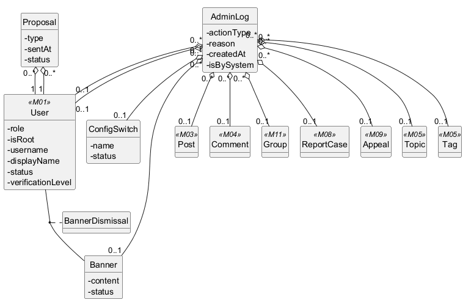

# Phân tích lớp thực thể — M10 Admin Panel

<!-- [Vietnamese Doc] Tài liệu tiếng Việt; tên lớp và thuộc tính viết tiếng Anh (input/CONVENTIONS.md mục 3). -->

| Mã tài liệu | EC-M10 |
|---|---|
| Dự án | iShare |
| Module | M10 — Admin Panel |
| Đầu vào | FR-M10 phiên bản 1.4 |
| Trạng thái | Đã chốt |
| Phiên bản | 1.0 |
| Ngày | 2026-11-19 |
| Tác giả | Phạm Văn Đức |

<!-- Quy ước chung cho mọi bảng dưới đây:
     - Không đổi tên cột, không xóa cột, không đổi số mục: tool đọc bảng theo số mục và tên cột.
     - Ô không có nội dung ghi "—".
     - Mục chưa tới bước làm thì để dòng "(Chưa làm — bước N)".
     - Cột Nguồn ghi mã trong FR: FR-Mxx-nn, FR-Mxx-nn.mm, BR-Mxx-nn, hoặc TN:<thuật ngữ> (mục 2.1 của FR).
     - Mục 4 chỉ chứa ảnh sơ đồ. gen_puml.py ghi mã PlantUML vào tệp riêng diagrams/EC-Mxx.puml, render
       diagrams/EC-Mxx.png và đặt ảnh vào mục 4. Không chép mã PlantUML vào tài liệu, không sửa tay tệp .puml hay ảnh. -->

## 1. Mô tả chức năng

### 1.1 Đoạn mô tả

Hệ thống quản lý vai trò của tài khoản, đề xuất, cấu hình hệ thống và nhật ký thao tác Admin của iShare. Mỗi tài khoản
do M01 quản lý có đúng một vai trò trong ba vai trò USER, MODERATOR, ADMIN, theo thứ bậc USER < MODERATOR < ADMIN, và
vai trò cao hơn có mọi quyền của vai trò thấp hơn. Khi khởi tạo hệ thống, hệ thống có sẵn một tài khoản ADMIN gốc mang
dấu gốc, không tạo qua đăng ký, không bị thu hồi vai trò và không tự từ chức.

Hệ thống cho phép Admin vào Admin Panel, tìm người dùng theo username hoặc tên hiển thị, lọc người dùng theo vai trò và
xem ở mỗi người dùng username, tên hiển thị, vai trò, trạng thái tài khoản và dấu gốc. Từ một Mod, Admin mở nhật ký
kiểm duyệt do M08 quản lý, lọc theo người làm là Mod đó.

Hệ thống cho phép Admin gửi đề xuất làm Mod cho một tài khoản USER, và cho tài khoản ADMIN gốc gửi đề xuất làm Admin cho
một tài khoản USER hoặc MODERATOR; người được đề xuất phải có trạng thái tài khoản ACTIVE và đã hoàn tất bước 3 đăng
ký. Mỗi khi một đề xuất được gửi, hệ thống ghi lại loại đề xuất, người gửi, người được đề xuất, thời điểm gửi đề xuất và
trạng thái của đề xuất Chưa trả lời, rồi gửi cho người được đề xuất qua M07 một thông báo đề xuất. Mỗi người được đề
xuất có nhiều nhất một đề xuất còn hiệu lực cho mỗi loại đề xuất: đề xuất mới cùng loại làm đề xuất cũ Hết hiệu lực, và
đề xuất vẫn Chưa trả lời khi hết hạn của đề xuất tính từ thời điểm gửi đề xuất cũng Hết hiệu lực. Hệ thống cho phép
người được đề xuất trả lời một đề xuất còn hiệu lực đúng một lần bằng Chấp nhận hoặc Từ chối, và ghi lựa chọn đó vào
trạng thái của đề xuất. Khi người được đề xuất chấp nhận, hệ thống đổi vai trò của người được đề xuất thành MODERATOR
hoặc ADMIN theo loại đề xuất, nếu vai trò lúc chấp nhận còn hợp lệ và trạng thái tài khoản là ACTIVE.

Hệ thống cho phép Admin giáng cấp một Mod về USER, và cho tài khoản ADMIN gốc thu hồi vai trò Admin của một tài khoản
ADMIN khác về USER, ngay và không cần đồng ý. Hệ thống cho phép Mod và Admin không phải tài khoản ADMIN gốc tự từ chức
về USER sau một bước xác nhận. Khi M08 ban một tài khoản MODERATOR, hệ thống đổi vai trò của tài khoản đó thành USER và
không trả lại vai trò khi ban hết hạn, được gỡ hay bị lật.

Hệ thống cho phép Admin bật, tắt từng công tắc cấu hình lúc hệ thống đang chạy: công tắc AI tổng, ba công tắc AI riêng
Search, Moderation, Topic suggestion, chế độ bảo trì, tạm dừng đăng ký và ba cờ tính năng Group, Chat, Gamification. Hệ
thống lưu trạng thái của công tắc cấu hình là Bật hoặc Tắt, đặt trạng thái khởi tạo của từng công tắc cấu hình khi
khởi tạo hệ thống, và áp dụng trạng thái mới từ thời điểm đổi mà không cần triển khai lại. Hệ thống cung cấp trạng thái
của công tắc AI cho M03, M04, M05, M06, M08, M13, trạng thái của chế độ bảo trì và tạm dừng đăng ký cho M01, và trạng
thái của cờ tính năng cho M11, M12, M16; trong khi một cờ tính năng tắt, yêu cầu của người dùng không phải Admin tới
module đó bị từ chối nhưng dữ liệu của module được giữ nguyên.

Hệ thống cho phép Admin đặt, sửa và gỡ một banner thông báo toàn trang có nội dung banner là văn bản thuần, và ghi lại
trạng thái của banner là Đang hiện hoặc Không hiện. Hệ thống hiện banner đang hiện trên mọi trang cho mọi người xem, kể
cả Guest, cho người xem đóng banner, ghi lại những người dùng đã đóng banner hiện tại, và hiện banner lại với mọi người
khi Admin sửa nội dung banner hoặc đặt banner mới.

Mỗi khi Admin hoàn tất một thao tác làm đổi dữ liệu với vai trò Admin, hoặc vai trò của một tài khoản đổi, hệ thống ghi
một mục nhật ký thao tác Admin gồm người làm, thao tác, đối tượng, lý do và thời điểm. Người làm của mục nhật ký thao tác
Admin là tài khoản đã làm thao tác, kể cả người được đề xuất khi chấp nhận đề xuất và người tự từ chức, hoặc là người
làm là Hệ thống khi Mod mất vai trò do bị ban. Đối tượng của mục nhật ký thao tác Admin là tài khoản, công tắc cấu hình
hoặc banner mà thao tác của Admin chạm tới, hoặc bài viết, bình luận, nhóm, vụ báo cáo, khiếu nại, Topic, Tag mà thao
tác kiểm duyệt, thao tác Topic, Tag của Admin chạm tới, kể cả khi thao tác đó cũng được ghi ở nhật ký kiểm duyệt. Hệ
thống giữ mục nhật ký thao tác Admin vĩnh viễn và không cho ai sửa hoặc xóa. Hệ thống cho phép Admin xem nhật ký thao
tác Admin với thời điểm theo giờ Việt Nam, mục mới nhất trước, và lọc nhật ký thao tác Admin theo người làm hoặc theo
loại thao tác.

Hệ thống cung cấp vai trò của tài khoản cho M05, M08, M09 để xét quyền xử lý và cho M15 để thống kê tài khoản theo vai
trò.

<!-- Văn xuôi bình thường, có thể chia vài đoạn. KHÔNG ghi mã câu (S1), (S2)… trong đoạn văn: người đọc không hiểu
     các mã đó. Số câu chỉ nằm ở bảng 1.2. Xem steps/01-describe-functions.md. -->

### 1.2 Truy vết câu

<!-- Mỗi câu của đoạn mô tả một dòng, theo đúng thứ tự. Câu: 1, 2, 3…
     Nội dung câu: chép NGUYÊN VĂN câu đó từ mục 1.1 (tool so khớp từng câu với đoạn văn).
     Nguồn: mã chức năng hoặc yêu cầu của FR mà câu dựa vào. -->

| Câu | Nội dung câu | Nguồn |
|---|---|---|
| 1 | Hệ thống quản lý vai trò của tài khoản, đề xuất, cấu hình hệ thống và nhật ký thao tác Admin của iShare. | FR-M10-02, FR-M10-03, FR-M10-09, FR-M10-14 |
| 2 | Mỗi tài khoản do M01 quản lý có đúng một vai trò trong ba vai trò USER, MODERATOR, ADMIN, theo thứ bậc USER < MODERATOR < ADMIN, và vai trò cao hơn có mọi quyền của vai trò thấp hơn. | FR-M10-07.03, BR-M10-01 |
| 3 | Khi khởi tạo hệ thống, hệ thống có sẵn một tài khoản ADMIN gốc mang dấu gốc, không tạo qua đăng ký, không bị thu hồi vai trò và không tự từ chức. | FR-M10-07.04, FR-M10-08.04, FR-M10-05.05, BR-M10-10 |
| 4 | Hệ thống cho phép Admin vào Admin Panel, tìm người dùng theo username hoặc tên hiển thị, lọc người dùng theo vai trò và xem ở mỗi người dùng username, tên hiển thị, vai trò, trạng thái tài khoản và dấu gốc. | FR-M10-01, FR-M10-01.02, FR-M10-01.03, FR-M10-01.04, FR-M10-01.05 |
| 5 | Từ một Mod, Admin mở nhật ký kiểm duyệt do M08 quản lý, lọc theo người làm là Mod đó. | FR-M10-01.06 |
| 6 | Hệ thống cho phép Admin gửi đề xuất làm Mod cho một tài khoản USER, và cho tài khoản ADMIN gốc gửi đề xuất làm Admin cho một tài khoản USER hoặc MODERATOR; người được đề xuất phải có trạng thái tài khoản ACTIVE và đã hoàn tất bước 3 đăng ký. | FR-M10-02, FR-M10-02.01, FR-M10-02.09, FR-M10-07, FR-M10-07.05, FR-M10-07.08 |
| 7 | Mỗi khi một đề xuất được gửi, hệ thống ghi lại loại đề xuất, người gửi, người được đề xuất, thời điểm gửi đề xuất và trạng thái của đề xuất Chưa trả lời, rồi gửi cho người được đề xuất qua M07 một thông báo đề xuất. | FR-M10-02.01, FR-M10-02.02, FR-M10-07.05, FR-M10-07.06 |
| 8 | Mỗi người được đề xuất có nhiều nhất một đề xuất còn hiệu lực cho mỗi loại đề xuất: đề xuất mới cùng loại làm đề xuất cũ Hết hiệu lực, và đề xuất vẫn Chưa trả lời khi hết hạn của đề xuất tính từ thời điểm gửi đề xuất cũng Hết hiệu lực. | FR-M10-02.08, FR-M10-02.10, FR-M10-07.09, FR-M10-07.10 |
| 9 | Hệ thống cho phép người được đề xuất trả lời một đề xuất còn hiệu lực đúng một lần bằng Chấp nhận hoặc Từ chối, và ghi lựa chọn đó vào trạng thái của đề xuất. | FR-M10-03, FR-M10-03.02, FR-M10-03.03, FR-M10-03.04, FR-M10-03.06, FR-M10-03.08 |
| 10 | Khi người được đề xuất chấp nhận, hệ thống đổi vai trò của người được đề xuất thành MODERATOR hoặc ADMIN theo loại đề xuất, nếu vai trò lúc chấp nhận còn hợp lệ và trạng thái tài khoản là ACTIVE. | FR-M10-03.01, FR-M10-03.09, FR-M10-03.10, FR-M10-03.11 |
| 11 | Hệ thống cho phép Admin giáng cấp một Mod về USER, và cho tài khoản ADMIN gốc thu hồi vai trò Admin của một tài khoản ADMIN khác về USER, ngay và không cần đồng ý. | FR-M10-04, FR-M10-04.01, FR-M10-04.02, FR-M10-08, FR-M10-08.03 |
| 12 | Hệ thống cho phép Mod và Admin không phải tài khoản ADMIN gốc tự từ chức về USER sau một bước xác nhận. | FR-M10-05, FR-M10-05.01, FR-M10-05.03, FR-M10-05.04 |
| 13 | Khi M08 ban một tài khoản MODERATOR, hệ thống đổi vai trò của tài khoản đó thành USER và không trả lại vai trò khi ban hết hạn, được gỡ hay bị lật. | FR-M10-06, FR-M10-06.01, FR-M10-06.02 |
| 14 | Hệ thống cho phép Admin bật, tắt từng công tắc cấu hình lúc hệ thống đang chạy: công tắc AI tổng, ba công tắc AI riêng Search, Moderation, Topic suggestion, chế độ bảo trì, tạm dừng đăng ký và ba cờ tính năng Group, Chat, Gamification. | FR-M10-09, FR-M10-10, FR-M10-11, FR-M10-12, FR-M10-09.01, FR-M10-12.03 |
| 15 | Hệ thống lưu trạng thái của công tắc cấu hình là Bật hoặc Tắt, đặt trạng thái khởi tạo của từng công tắc cấu hình khi khởi tạo hệ thống, và áp dụng trạng thái mới từ thời điểm đổi mà không cần triển khai lại. | FR-M10-09.02, FR-M10-10.01, FR-M10-11.01, FR-M10-12.01, FR-M10-09.10, FR-M10-10.04, FR-M10-11.04, FR-M10-12.09 |
| 16 | Hệ thống cung cấp trạng thái của công tắc AI cho M03, M04, M05, M06, M08, M13, trạng thái của chế độ bảo trì và tạm dừng đăng ký cho M01, và trạng thái của cờ tính năng cho M11, M12, M16; trong khi một cờ tính năng tắt, yêu cầu của người dùng không phải Admin tới module đó bị từ chối nhưng dữ liệu của module được giữ nguyên. | FR-M10-09.03, FR-M10-09.04, FR-M10-10.02, FR-M10-11.02, FR-M10-12.04, FR-M10-12.07 |
| 17 | Hệ thống cho phép Admin đặt, sửa và gỡ một banner thông báo toàn trang có nội dung banner là văn bản thuần, và ghi lại trạng thái của banner là Đang hiện hoặc Không hiện. | FR-M10-13, FR-M10-13.01, FR-M10-13.02, FR-M10-13.05, FR-M10-13.06, FR-M10-13.09 |
| 18 | Hệ thống hiện banner đang hiện trên mọi trang cho mọi người xem, kể cả Guest, cho người xem đóng banner, ghi lại những người dùng đã đóng banner hiện tại, và hiện banner lại với mọi người khi Admin sửa nội dung banner hoặc đặt banner mới. | FR-M10-13.01, FR-M10-13.04, FR-M10-13.07, FR-M10-13.08 |
| 19 | Mỗi khi Admin hoàn tất một thao tác làm đổi dữ liệu với vai trò Admin, hoặc vai trò của một tài khoản đổi, hệ thống ghi một mục nhật ký thao tác Admin gồm người làm, thao tác, đối tượng, lý do và thời điểm. | FR-M10-14, FR-M10-14.01, FR-M10-14.02, FR-M10-14.06 |
| 20 | Người làm của mục nhật ký thao tác Admin là tài khoản đã làm thao tác, kể cả người được đề xuất khi chấp nhận đề xuất và người tự từ chức, hoặc là người làm là Hệ thống khi Mod mất vai trò do bị ban. | FR-M10-14.06, FR-M10-14.07 |
| 21 | Đối tượng của mục nhật ký thao tác Admin là tài khoản, công tắc cấu hình hoặc banner mà thao tác của Admin chạm tới, hoặc bài viết, bình luận, nhóm, vụ báo cáo, khiếu nại, Topic, Tag mà thao tác kiểm duyệt, thao tác Topic, Tag của Admin chạm tới, kể cả khi thao tác đó cũng được ghi ở nhật ký kiểm duyệt. | FR-M10-14.02, FR-M10-14.03 |
| 22 | Hệ thống giữ mục nhật ký thao tác Admin vĩnh viễn và không cho ai sửa hoặc xóa. | FR-M10-14.04, FR-M10-15.03 |
| 23 | Hệ thống cho phép Admin xem nhật ký thao tác Admin với thời điểm theo giờ Việt Nam, mục mới nhất trước, và lọc nhật ký thao tác Admin theo người làm hoặc theo loại thao tác. | FR-M10-15, FR-M10-15.01, FR-M10-15.04, FR-M10-15.05 |
| 24 | Hệ thống cung cấp vai trò của tài khoản cho M05, M08, M09 để xét quyền xử lý và cho M15 để thống kê tài khoản theo vai trò. | FR-M10-07.03, FR-M10-03.01, FR-M10-04.01 |

## 2. Danh từ và phân loại

### 2.1 Sổ danh từ

<!-- Phân loại: Lớp | Thuộc tính | Loại bỏ.
     Kết quả: tên lớp; hoặc Lớp.thuộcTính; hoặc "—" khi loại bỏ.
     Xuất hiện ở: "Câu n" (số câu ở bảng 1.2) hoặc "Quét: <mã FR>" (lượt quét bổ sung). -->

| # | Danh từ | Xuất hiện ở | Phân loại | Kết quả | Lý do |
|---|---|---|---|---|---|
| 1 | hệ thống | Câu 1 | Loại bỏ | — | Trừu tượng: chỉ chính phần mềm |
| 2 | vai trò | Câu 1 | Thuộc tính | User.role | Một trong ba giá trị USER, MODERATOR, ADMIN gắn với mỗi tài khoản (TN:Vai trò, BR-M10-01); M10 đổi giá trị này (mục Chuyển trạng thái: Vai trò của tài khoản); thuộc tính đã có ở EC-M01 |
| 3 | tài khoản / người dùng | Câu 1 | Lớp | User | Lớp ngoài (M01): tài khoản nhận đề xuất, đổi vai trò, là người làm hoặc đối tượng trong nhật ký thao tác Admin (mục Dữ liệu nghiệp vụ, dòng Tài khoản (M01)); hai từ chỉ cùng một đối tượng; dùng tên User của EC-M01 |
| 4 | đề xuất | Câu 1 | Lớp | Proposal | Có danh tính, trạng thái và vòng đời riêng (Chưa trả lời, Đã chấp nhận, Đã từ chối, Hết hiệu lực), được lưu với loại, người gửi, người được đề xuất, thời điểm gửi (FR-M10-02.01, FR-M10-07.05) và không bị xóa (ma trận CRUD); dùng tên Proposal mà EC-M07 đã đặt tạm |
| 5 | cấu hình hệ thống | Câu 1 | Loại bỏ | — | Chung chung: gồm đúng các công tắc cấu hình và banner thông báo toàn trang (BR-M10-12, TN:Cấu hình hệ thống), mỗi thứ là một lớp riêng (dòng 49, 65); xem Q-01 |
| 6 | nhật ký thao tác Admin / mục nhật ký thao tác Admin | Câu 1 | Lớp | AdminLog | Nhật ký là tập các mục; mỗi mục ghi một thao tác với người làm, thao tác, đối tượng, lý do, thời điểm (FR-M10-14.01) và được giữ vĩnh viễn, không sửa, không xóa (FR-M10-14.04); dùng tên AdminLog mà EC-M05 đã đặt tạm |
| 7 | iShare | Câu 1 | Loại bỏ | — | Trừu tượng: tên sản phẩm |
| 8 | M01, M03, M04, M05, M06, M07, M08, M09, M11, M12, M13, M15, M16 (tên module) | Câu 2 | Loại bỏ | — | Trừu tượng: tên các phần của hệ thống |
| 9 | USER, MODERATOR, ADMIN | Câu 2 | Loại bỏ | — | Giá trị của User.role (xem Q-03 về cách viết MOD hay MODERATOR) |
| 10 | thứ bậc | Câu 2 | Loại bỏ | — | Hằng số của BR-M10-01: thứ tự cố định USER < MODERATOR < ADMIN giữa các giá trị của User.role, không lưu |
| 11 | vai trò cao hơn / vai trò thấp hơn | Câu 2 | Loại bỏ | — | Chung chung: so sánh các giá trị của User.role theo thứ bậc (dòng 10) |
| 12 | quyền / quyền xử lý | Câu 2 | Loại bỏ | — | Trừu tượng: quyền suy ra từ User.role và User.isRoot (BR-M10-01, BR-M10-02, ma trận quyền mục 4.3 của FR), không lưu riêng |
| 13 | khởi tạo hệ thống | Câu 3 | Loại bỏ | — | Hành động không lưu dấu vết: việc đội phát triển dựng hệ thống, tạo tài khoản ADMIN gốc và đặt giá trị cấu hình ban đầu (BR-M10-10, BR-M10-26) |
| 14 | tài khoản ADMIN gốc | Câu 3 | Lớp | User | Vai trò theo ngữ cảnh: tài khoản ADMIN được đánh dấu gốc, không phải vai trò thứ tư (TN:Tài khoản ADMIN gốc); phân biệt bằng User.isRoot |
| 15 | dấu gốc | Câu 3 | Thuộc tính | User.isRoot | Đánh dấu tài khoản ADMIN gốc (BR-M10-10); FR ghi "dấu gốc — phần M10 quản lý" trên Tài khoản (M01) ở mục Dữ liệu nghiệp vụ; quyết định ai gửi được đề xuất làm Admin, thu hồi được vai trò Admin và ai không bị thu hồi, không tự từ chức |
| 16 | đăng ký | Câu 3 | Loại bỏ | — | Ngoài phạm vi module (M01): luồng tạo tài khoản; tài khoản ADMIN gốc không qua đăng ký (FR-M10-07.04) |
| 17 | Admin | Câu 4 | Lớp | User | Vai trò có tài khoản; phân biệt bằng User.role (ADMIN) |
| 18 | Admin Panel | Câu 4 | Loại bỏ | — | Giao diện: khu vực quản trị chỉ tài khoản ADMIN vào được (TN:Admin Panel) |
| 19 | username | Câu 4 | Thuộc tính | User.username | Thông tin của tài khoản (M01) mà M10 đọc để tìm và hiển thị người dùng (FR-M10-01.03, FR-M10-01.05) |
| 20 | tên hiển thị | Câu 4 | Thuộc tính | User.displayName | Thông tin của tài khoản (M01) mà M10 đọc để tìm và hiển thị người dùng (FR-M10-01.03, FR-M10-01.05) |
| 21 | trạng thái tài khoản | Câu 4 | Thuộc tính | User.status | Thông tin của tài khoản (M01) mà M10 đọc để hiển thị (FR-M10-01.05) và để xét người nhận, người chấp nhận đề xuất (BR-M10-05) |
| 22 | Mod | Câu 5 | Lớp | User | Vai trò có tài khoản; phân biệt bằng User.role (MODERATOR) |
| 23 | nhật ký kiểm duyệt | Câu 5 | Loại bỏ | — | Ngoài phạm vi module (M08): M10 chỉ mở nhật ký kiểm duyệt lọc theo một Mod (FR-M10-01.06, BR-M10-30); không có quan hệ với lớp nào của M10 |
| 24 | người làm | Câu 5 | Lớp | User | Vai trò theo ngữ cảnh của tài khoản đã làm thao tác (TN:Người làm (của mục nhật ký)); ở mục nhật ký thao tác Admin, người làm là Hệ thống ghi bằng AdminLog.isBySystem (dòng 79); quan hệ xét ở bước 3 |
| 25 | đề xuất làm Mod / đề xuất làm Admin | Câu 6 | Loại bỏ | — | Giá trị của Proposal.type |
| 26 | người được đề xuất | Câu 6 | Lớp | User | Vai trò theo ngữ cảnh: tài khoản nhận một đề xuất (TN:Người được đề xuất); quan hệ xét ở bước 3 |
| 27 | ACTIVE | Câu 6 | Loại bỏ | — | Giá trị của User.status |
| 28 | bước 3 đăng ký | Câu 6 | Thuộc tính | User.verificationLevel | Hoàn tất bước 3 là mức xác minh SETUP_COMPLETED của tài khoản (EC-M01); M10 đọc để xét người nhận đề xuất (BR-M10-05) |
| 29 | loại đề xuất | Câu 7 | Thuộc tính | Proposal.type | Một trong hai giá trị cố định làm Mod, làm Admin (TN:Đề xuất); quyết định vai trò mới khi chấp nhận và giới hạn một đề xuất còn hiệu lực cho mỗi loại (BR-M10-27) |
| 30 | người gửi | Câu 7 | Lớp | User | Vai trò theo ngữ cảnh: Admin gửi đề xuất làm Mod, tài khoản ADMIN gốc gửi đề xuất làm Admin (mục Dữ liệu nghiệp vụ, dòng Đề xuất); quan hệ xét ở bước 3 |
| 31 | thời điểm gửi đề xuất | Câu 7 | Thuộc tính | Proposal.sentAt | Mốc tính hạn của đề xuất (TN:Thời điểm gửi đề xuất, BR-M10-07) |
| 32 | trạng thái của đề xuất | Câu 7 | Thuộc tính | Proposal.status | Có bảng chuyển trạng thái riêng (mục Chuyển trạng thái: Đề xuất; TN:Trạng thái của đề xuất) |
| 33 | Chưa trả lời | Câu 7 | Loại bỏ | — | Giá trị của Proposal.status |
| 34 | thông báo đề xuất / thông báo | Câu 7 | Loại bỏ | — | Ngoài phạm vi module (M07): M10 gửi sự kiện, M07 tạo thông báo; quan hệ giữa thông báo và đề xuất do EC-M07 ghi (R-M07-12) |
| 35 | đề xuất còn hiệu lực | Câu 8 | Loại bỏ | — | Giá trị của Proposal.status: đề xuất ở trạng thái Chưa trả lời (TN:Đề xuất còn hiệu lực) |
| 36 | đề xuất mới / đề xuất cũ | Câu 8 | Loại bỏ | — | Chung chung: hai đề xuất cùng loại cho cùng người được đề xuất, phân biệt bằng Proposal.sentAt (BR-M10-27) |
| 37 | Hết hiệu lực | Câu 8 | Loại bỏ | — | Giá trị của Proposal.status |
| 38 | hạn của đề xuất | Câu 8 | Loại bỏ | — | Hằng số của BR-M10-07: 7 × 24 giờ từ Proposal.sentAt (TN:Hạn của đề xuất), là hằng số chính sách không đổi lúc chạy (BR-M10-04); ghi ở ràng buộc của Proposal.sentAt |
| 39 | lựa chọn | Câu 9 | Loại bỏ | — | Giá trị của Proposal.status (Đã chấp nhận, Đã từ chối): FR-M10-03.02, FR-M10-03.03 ghi lựa chọn bằng trạng thái của đề xuất; cùng cách EC-M07 đã chốt ở Q-02 của EC-M07 |
| 40 | Chấp nhận | Câu 9 | Loại bỏ | — | Giá trị của Proposal.status (Đã chấp nhận) |
| 41 | Từ chối | Câu 9 | Loại bỏ | — | Giá trị của Proposal.status (Đã từ chối) |
| 42 | vai trò lúc chấp nhận | Câu 10 | Loại bỏ | — | Chung chung: là User.role tại lúc chấp nhận, xét theo Proposal.type (BR-M10-27); không lưu riêng |
| 43 | giáng cấp | Câu 11 | Loại bỏ | — | Hành động không lưu dấu vết riêng: chỉ đổi User.role về USER (FR-M10-04.01); dấu vết là một mục AdminLog (FR-M10-14.02) |
| 44 | thu hồi vai trò Admin | Câu 11 | Loại bỏ | — | Hành động không lưu dấu vết riêng: chỉ đổi User.role về USER (FR-M10-08.03); dấu vết là một mục AdminLog (FR-M10-14.02) |
| 45 | đồng ý | Câu 11 | Loại bỏ | — | Hành động không lưu dấu vết: giáng cấp, thu hồi vai trò Admin không cần đồng ý (BR-M10-08, BR-M10-11) |
| 46 | tự từ chức | Câu 12 | Loại bỏ | — | Hành động không lưu dấu vết riêng: chỉ đổi User.role về USER (FR-M10-05.01, FR-M10-05.04); dấu vết là một mục AdminLog có người làm là chính người từ chức (FR-M10-14.06) |
| 47 | bước xác nhận | Câu 12 | Loại bỏ | — | Giao diện: hỏi xác nhận một lần trước khi đổi vai trò (BR-M10-25) |
| 48 | ban | Câu 13 | Loại bỏ | — | Ngoài phạm vi module (M08): M10 chỉ nhận sự kiện ban một Mod để đổi User.role (FR-M10-06.01, mục Giao tiếp dòng Dùng M08); dấu vết là mục AdminLog có người làm là Hệ thống; không có quan hệ với lớp nào của M10 |
| 49 | công tắc cấu hình | Câu 14 | Lớp | ConfigSwitch | Mỗi công tắc có trạng thái riêng với bảng chuyển trạng thái (mục Chuyển trạng thái: Công tắc cấu hình, "mỗi công tắc"), được Admin đổi riêng từng cái (FR-M10-09.02, FR-M10-09.06) và là đối tượng của mục nhật ký "đổi mỗi công tắc cấu hình" (FR-M10-14.02); có chín công tắc phân biệt bằng tên; xem Q-01 |
| 50 | công tắc AI tổng | Câu 14 | Loại bỏ | — | Giá trị của ConfigSwitch.name (TN:Công tắc AI tổng) |
| 51 | công tắc AI riêng / Search / Moderation / Topic suggestion | Câu 14 | Loại bỏ | — | Giá trị của ConfigSwitch.name: ba công tắc AI riêng (TN:Công tắc AI riêng, FR-M10-09.01) |
| 52 | chế độ bảo trì | Câu 14 | Loại bỏ | — | Giá trị của ConfigSwitch.name (TN:Chế độ bảo trì) |
| 53 | tạm dừng đăng ký | Câu 14 | Loại bỏ | — | Giá trị của ConfigSwitch.name (TN:Tạm dừng đăng ký; không phải cờ tính năng, BR-M10-19) |
| 54 | cờ tính năng | Câu 14 | Loại bỏ | — | Giá trị của ConfigSwitch.name: ba cờ Group, Chat, Gamification (TN:Cờ tính năng, BR-M10-19) |
| 55 | Group, Chat, Gamification | Câu 14 | Loại bỏ | — | Ngoài phạm vi module (M11, M16, M12): module được cờ tính năng bật, tắt; tên cờ là giá trị của ConfigSwitch.name (dòng 54) |
| 56 | trạng thái của công tắc cấu hình | Câu 15 | Thuộc tính | ConfigSwitch.status | Bật hoặc Tắt (TN:Trạng thái của công tắc cấu hình), có bảng chuyển trạng thái riêng |
| 57 | Bật / Tắt | Câu 15 | Loại bỏ | — | Giá trị của ConfigSwitch.status |
| 58 | trạng thái khởi tạo | Câu 15 | Loại bỏ | — | Hằng số của BR-M10-26: giá trị ban đầu của ConfigSwitch.status, đặt một lần khi khởi tạo hệ thống; ghi ở ràng buộc của ConfigSwitch.status |
| 59 | thời điểm đổi | Câu 15 | Loại bỏ | — | Chung chung: là AdminLog.createdAt của mục ghi lần đổi công tắc (FR-M10-14.02); trạng thái mới áp dụng ngay sau khi lưu (BR-M10-13), không cần lưu riêng trên công tắc |
| 60 | triển khai lại | Câu 15 | Loại bỏ | — | Ngoài phạm vi hệ thống: việc của đội phát triển (BR-M10-13) |
| 61 | công tắc AI | Câu 16 | Loại bỏ | — | Chung chung: công tắc AI tổng và ba công tắc AI riêng (dòng 50, 51) |
| 62 | yêu cầu | Câu 16 | Loại bỏ | — | Hành động không lưu dấu vết: yêu cầu bị từ chối khi cờ tắt không được ghi lại (BR-M10-28) |
| 63 | module | Câu 16 | Loại bỏ | — | Trừu tượng: một phần của hệ thống |
| 64 | dữ liệu của module | Câu 16 | Loại bỏ | — | Ngoài phạm vi module (M11, M12, M16): dữ liệu do module đó quản lý, giữ nguyên khi cờ tắt (FR-M10-12.07) |
| 65 | banner thông báo toàn trang / banner / banner đang hiện / banner hiện tại / banner mới | Câu 17 | Lớp | Banner | Có nội dung và trạng thái riêng với bảng chuyển trạng thái (Không hiện, Đang hiện), được Admin đặt, sửa, gỡ (FR-M10-13) và là đối tượng của mục nhật ký "đặt, sửa, gỡ banner" (FR-M10-14.02); tại một thời điểm có nhiều nhất một banner đang hiện (BR-M10-20); "banner mới" thay banner đang hiện (FR-M10-13.04), xem Q-02 |
| 66 | nội dung banner | Câu 17 | Thuộc tính | Banner.content | FR-M10-13.05 ràng buộc độ dài; Admin sửa được (FR-M10-13.09) |
| 67 | văn bản thuần | Câu 17 | Loại bỏ | — | Hằng số của BR-M10-20: Banner.content luôn hiện dưới dạng văn bản thuần; ghi ở ràng buộc của Banner.content |
| 68 | trạng thái của banner | Câu 17 | Thuộc tính | Banner.status | Có bảng chuyển trạng thái riêng (mục Chuyển trạng thái: Banner thông báo toàn trang) |
| 69 | Đang hiện / Không hiện | Câu 17 | Loại bỏ | — | Giá trị của Banner.status |
| 70 | trang | Câu 18 | Loại bỏ | — | Giao diện |
| 71 | người xem | Câu 18 | Lớp | User | Vai trò theo ngữ cảnh: người dùng đã đăng nhập xem và đóng banner; người xem là Guest không lưu (dòng 72) |
| 72 | Guest | Câu 18 | Loại bỏ | — | Không lưu: tác nhân không có dữ liệu; việc Guest đã đóng banner chỉ có tác dụng trên trình duyệt đã đóng (BR-M10-20) |
| 73 | người dùng đã đóng banner | Câu 18 | Lớp | User | Vai trò theo ngữ cảnh: FR ghi "những người xem đã đóng banner hiện tại" ở Cấu hình hệ thống (mục Dữ liệu nghiệp vụ); quan hệ User – Banner xét ở bước 3 |
| 74 | thao tác làm đổi dữ liệu | Câu 19 | Lớp | AdminLog | FR yêu cầu lưu dấu vết từng thao tác: mỗi thao tác làm đổi dữ liệu của Admin và mỗi lần đổi vai trò là một mục nhật ký (FR-M10-14.01, FR-M10-14.06, FR-M10-14.07) |
| 75 | thao tác / loại thao tác | Câu 19 | Thuộc tính | AdminLog.actionType | FR-M10-14.01 yêu cầu lưu; lọc theo loại thao tác (FR-M10-15.05); tên actionType như EC-M05 đã tham chiếu |
| 76 | đối tượng | Câu 19 | Loại bỏ | — | Chung chung: là một tài khoản, công tắc cấu hình, banner, bài viết, bình luận, nhóm, vụ báo cáo, khiếu nại, Topic hoặc Tag (dòng 3, 49, 65, 81–87); quan hệ xét ở bước 3 |
| 77 | lý do | Câu 19 | Thuộc tính | AdminLog.reason | FR-M10-14.01 yêu cầu lưu, tùy chọn (FR-M10-14.09) |
| 78 | thời điểm | Câu 19 | Thuộc tính | AdminLog.createdAt | FR-M10-14.01 yêu cầu lưu (TN:Thời điểm (của mục nhật ký)); tên createdAt như ModerationLog.createdAt của EC-M08 |
| 79 | người làm là Hệ thống | Câu 20 | Thuộc tính | AdminLog.isBySystem | Người làm có thể là "Hệ thống", không có tài khoản (TN:Người làm (của mục nhật ký), FR-M10-14.07); cùng cách ModerationLog.isByAi của EC-M08 |
| 80 | người tự từ chức | Câu 20 | Lớp | User | Vai trò theo ngữ cảnh: Mod, Admin tự từ chức, là người làm của mục nhật ký (FR-M10-14.06) |
| 81 | bài viết | Câu 21 | Lớp | Post | Lớp ngoài (M03): đối tượng của mục nhật ký khi Admin ẩn bài hoặc đổi Topic, Tag trên bài người khác (FR-M10-14.02); dùng tên Post của EC-M03 |
| 82 | bình luận | Câu 21 | Lớp | Comment | Lớp ngoài (M04): đối tượng của mục nhật ký khi Admin ẩn bình luận (FR-M10-14.02); dùng tên Comment của EC-M04 |
| 83 | nhóm | Câu 21 | Lớp | Group | Lớp ngoài (M11): đối tượng của mục nhật ký khi Admin ẩn, khóa, mở khóa nhóm (FR-M10-14.02); tên Group mà EC-M03, EC-M08 đã dùng, tên tạm chờ EC-M11 |
| 84 | vụ báo cáo | Câu 21 | Lớp | ReportCase | Lớp ngoài (M08): đối tượng của mục nhật ký khi Admin kết luận vụ báo cáo (FR-M10-14.02); dùng tên ReportCase của EC-M08 |
| 85 | khiếu nại | Câu 21 | Lớp | Appeal | Lớp ngoài (M09): đối tượng của mục nhật ký khi Admin kết luận khiếu nại (FR-M10-14.02); dùng tên Appeal của EC-M09 |
| 86 | Topic | Câu 21 | Lớp | Topic | Lớp ngoài (M05): đối tượng của mục nhật ký khi Admin thêm, gộp, xóa Topic (FR-M10-14.02); dùng tên Topic của EC-M05 |
| 87 | Tag | Câu 21 | Lớp | Tag | Lớp ngoài (M05): đối tượng của mục nhật ký khi Admin vô hiệu hóa, kích hoạt lại Tag (FR-M10-14.02); dùng tên Tag của EC-M05 |
| 88 | thao tác kiểm duyệt / thao tác Topic, Tag | Câu 21 | Loại bỏ | — | Giá trị của AdminLog.actionType: cảnh cáo, bỏ cảnh cáo AI, ban, gỡ ban, ẩn nội dung, ẩn, khóa, mở khóa nhóm, kết luận vụ báo cáo, kết luận khiếu nại; thêm, gộp, xóa Topic; vô hiệu hóa, kích hoạt lại Tag; đổi Topic, Tag trên bài người khác (FR-M10-14.02) |
| 89 | giờ Việt Nam | Câu 23 | Loại bỏ | — | Giao diện: múi giờ hiển thị AdminLog.createdAt (TN:Giờ Việt Nam) |
| 90 | thống kê | Câu 24 | Loại bỏ | — | Ngoài phạm vi module (M15): M15 đếm tài khoản theo User.role |
| 91 | hằng số chính sách | Quét: TN:Hằng số chính sách | Loại bỏ | — | Hằng số của BR-M10-04: không lưu, không chỉnh qua Admin Panel, chỉ đổi qua triển khai |
| 92 | ký tự của banner | Quét: TN:Ký tự của banner | Loại bỏ | — | Hằng số của BR-M10-20: Banner.content dài 1–200 ký tự sau khi bỏ khoảng trắng ở đầu và cuối; ghi ở ràng buộc của Banner.content |
| 93 | việc hệ thống tự làm | Quét: TN:Việc hệ thống tự làm | Loại bỏ | — | Ngoài phạm vi module (M11, M12, M16): vẫn chạy khi cờ tính năng tắt (FR-M10-12.06) |
| 94 | lý do bắt buộc của module gốc | Quét: FR-M10-14.09 | Loại bỏ | — | Ngoài phạm vi module (M05, M08, M09): lý do do module gốc bắt buộc; M10 chép đúng lý do đó vào AdminLog.reason (BR-M10-23) |
| 95 | embedding / embedding bù | Quét: BR-M10-16 | Loại bỏ | — | Ngoài phạm vi module (M06, M13): M13 tạo embedding bù khi công tắc Search bật lại |
| 96 | nhãn "Đã hết hạn" | Quét: FR-M10-02.10 | Loại bỏ | — | Giao diện (M07): nhãn hiện trên thông báo đề xuất khi Proposal.status là Hết hiệu lực |
| 97 | nhãn "gốc" | Quét: FR-M10-01.05 | Loại bỏ | — | Giao diện: cách hiển thị User.isRoot trong danh sách người dùng |

### 2.2 Lớp

<!-- Nhóm: Thực thể | Liên kết | Thống kê. Sở hữu: mã module sở hữu lớp (Mxx của tài liệu này, hoặc Myy với lớp ngoài).
     Thuộc tính: tên mọi thuộc tính của lớp ở mục 2.3, ngăn bởi dấu phẩy, thuộc tính dẫn xuất có "/" phía trước;
     để người đọc thấy lớp và thuộc tính trên cùng một dòng. Lớp chưa có thuộc tính ghi "—". -->

| Lớp | Tên tiếng Việt | Nhóm | Sở hữu | Mô tả | Thuộc tính | Nguồn |
|---|---|---|---|---|---|---|
| Proposal | Đề xuất | Thực thể | M10 | Lời mời một tài khoản nhận vai trò Mod hoặc Admin; người được đề xuất trả lời một lần, quá hạn hoặc bị đề xuất mới cùng loại thay thì hết hiệu lực; không bị xóa | type, sentAt, status | FR-M10-02.01, FR-M10-07.05, FR-M10-03.02, FR-M10-03.03 |
| ConfigSwitch | Công tắc cấu hình | Thực thể | M10 | Một trong chín công tắc của cấu hình hệ thống (công tắc AI tổng, ba công tắc AI riêng, chế độ bảo trì, tạm dừng đăng ký, ba cờ tính năng), Admin bật, tắt lúc hệ thống đang chạy; các module khác đọc trạng thái | name, status | FR-M10-09.01, FR-M10-10.01, FR-M10-11.01, FR-M10-12.01 |
| Banner | Banner thông báo toàn trang | Thực thể | M10 | Thông báo văn bản do Admin đặt, hiện trên mọi trang cho mọi người; nhiều nhất một banner đang hiện | content, status | FR-M10-13.01, FR-M10-13.02, FR-M10-13.09 |
| BannerDismissal | Lượt đóng banner | Liên kết | M10 | Một người dùng đã đóng một banner; tách từ quan hệ n-n User – Banner | — | FR-M10-13.07, FR-M10-13.08 |
| AdminLog | Mục nhật ký thao tác Admin | Thực thể | M10 | Một thao tác làm đổi dữ liệu của Admin hoặc một lần đổi vai trò; chỉ ghi thêm, giữ vĩnh viễn | actionType, reason, createdAt, isBySystem | FR-M10-14.01, FR-M10-14.06, FR-M10-14.07 |
| User | Người dùng (tài khoản) | Thực thể | M01 | Người gửi, người được đề xuất, người làm và đối tượng của mục nhật ký, người đã đóng banner; vai trò do M10 đổi | role, isRoot, username, displayName, status, verificationLevel | FR-M10-01.05, FR-M10-02.01, FR-M10-03.01, FR-M10-14.01 |
| Post | Bài viết | Thực thể | M03 | Đối tượng của mục nhật ký khi Admin ẩn bài hoặc đổi Topic, Tag trên bài người khác | — | FR-M10-14.02 |
| Comment | Bình luận | Thực thể | M04 | Đối tượng của mục nhật ký khi Admin ẩn bình luận | — | FR-M10-14.02 |
| Group | Nhóm | Thực thể | M11 | Đối tượng của mục nhật ký khi Admin ẩn, khóa, mở khóa nhóm (tên tạm, chờ EC-M11) | — | FR-M10-14.02 |
| ReportCase | Vụ báo cáo | Thực thể | M08 | Đối tượng của mục nhật ký khi Admin kết luận vụ báo cáo | — | FR-M10-14.02 |
| Appeal | Khiếu nại | Thực thể | M09 | Đối tượng của mục nhật ký khi Admin kết luận khiếu nại | — | FR-M10-14.02 |
| Topic | Topic | Thực thể | M05 | Đối tượng của mục nhật ký khi Admin thêm, gộp, xóa Topic | — | FR-M10-14.02 |
| Tag | Tag | Thực thể | M05 | Đối tượng của mục nhật ký khi Admin vô hiệu hóa, kích hoạt lại Tag | — | FR-M10-14.02 |

### 2.3 Thuộc tính

<!-- Mỗi lớp có ĐỦ thuộc tính để người đọc hình dung được nó; xếp các dòng theo lớp.
     Tính chất: Lưu | Dẫn xuất. Chưa có id, chưa có kiểu, chưa có khóa ngoại.
     Căn cứ: Nguồn nêu (FR nói tới) | Đề xuất (FR không nói, nhưng chức năng hoặc quy tắc ở cột Nguồn cần nó) |
             Tham chiếu (thuộc tính của lớp ngoài mà module này đọc hoặc ghi; module sở hữu lớp đó định nghĩa).
     Ràng buộc nguồn nêu: độ dài tối đa, duy nhất, bắt buộc/tùy chọn, tập giá trị, mặc định, công thức (với Dẫn xuất)
             — chép từ FR kèm mã. Đề xuất mà FR không nêu ràng buộc thì ghi "—".
     Nguồn: mã FR/BR nêu thuộc tính; với Đề xuất là mã chức năng hoặc quy tắc cần nó.
     Ghi chú: bắt buộc với Đề xuất (vì sao cần) và Tham chiếu (module này dùng nó làm gì). -->

| Lớp | Thuộc tính | Tên tiếng Việt | Tính chất | Căn cứ | Ràng buộc nguồn nêu | Nguồn | Ghi chú |
|---|---|---|---|---|---|---|---|
| Proposal | type | Loại đề xuất | Lưu | Nguồn nêu | Làm Mod, Làm Admin (TN:Đề xuất); đề xuất làm Mod gửi cho tài khoản USER (FR-M10-02.07), đề xuất làm Admin gửi cho tài khoản USER hoặc MODERATOR (FR-M10-07.02, BR-M10-11); mỗi người được đề xuất có nhiều nhất một đề xuất Chưa trả lời cho mỗi loại (BR-M10-27) | FR-M10-02.01, FR-M10-07.05, BR-M10-27 | Quyết định vai trò mới khi chấp nhận: MODERATOR hoặc ADMIN (FR-M10-03.01, FR-M10-03.09) |
| Proposal | sentAt | Thời điểm gửi đề xuất | Lưu | Nguồn nêu | Lúc hệ thống lưu đề xuất (TN:Thời điểm gửi đề xuất); hạn của đề xuất là 7 × 24 giờ kể từ thời điểm này, là hằng số chính sách (BR-M10-07, BR-M10-04) | FR-M10-02.01, FR-M10-07.05, FR-M10-02.10, FR-M10-07.10 | — |
| Proposal | status | Trạng thái của đề xuất | Lưu | Nguồn nêu | Chưa trả lời, Đã chấp nhận, Đã từ chối, Hết hiệu lực (TN:Trạng thái của đề xuất); mới gửi là Chưa trả lời; chỉ trả lời được một lần (BR-M10-07); Chưa trả lời chuyển sang Hết hiệu lực khi đủ 7 × 24 giờ từ sentAt hoặc khi có đề xuất mới cùng loại cho cùng người (BR-M10-27); không xóa (ma trận CRUD) | FR-M10-02.01, FR-M10-03.02, FR-M10-03.03, FR-M10-02.08, FR-M10-02.10 | M07 đọc để hiện lựa chọn đã chọn hoặc "Đã hết hạn" trên thông báo đề xuất (EC-M07, Q-02 của EC-M07) |
| ConfigSwitch | name | Tên công tắc | Lưu | Nguồn nêu | Đúng chín công tắc: công tắc AI tổng; ba công tắc AI riêng Search, Moderation, Topic suggestion; chế độ bảo trì; tạm dừng đăng ký; ba cờ tính năng Group, Chat, Gamification (FR-M10-09.01, FR-M10-12.03, BR-M10-12, BR-M10-19); không có công tắc dịch vụ email, công tắc riêng cho tóm tắt AI, cờ cho module khác (BR-M10-12, BR-M10-15, BR-M10-19); không tạo thêm, không xóa (ma trận CRUD) | FR-M10-09.01, FR-M10-12.03, BR-M10-12, BR-M10-19 | Phân biệt các công tắc; M01, M03, M04, M05, M06, M08, M11, M12, M13, M16 đọc đúng công tắc của mình (mục Giao tiếp) |
| ConfigSwitch | status | Trạng thái | Lưu | Nguồn nêu | Bật, Tắt (TN:Trạng thái của công tắc cấu hình); khởi tạo: công tắc AI và ba cờ tính năng Bật, chế độ bảo trì và tạm dừng đăng ký Tắt (BR-M10-26); áp dụng cho mọi thao tác sau thời điểm đổi (BR-M10-13); công tắc AI riêng vẫn được lưu khi công tắc AI tổng tắt và chỉ có tác dụng khi công tắc tổng bật (FR-M10-09.06, BR-M10-14) | FR-M10-09.01, FR-M10-09.02, FR-M10-10.01, FR-M10-11.01, FR-M10-12.01 | — |
| Banner | content | Nội dung | Lưu | Nguồn nêu | Bắt buộc; 1–200 ký tự đếm sau khi bỏ khoảng trắng ở đầu và cuối (TN:Ký tự của banner); hiện dưới dạng văn bản thuần (BR-M10-20, FR-M10-13.05, FR-M10-13.06) | FR-M10-13.01, FR-M10-13.05, FR-M10-13.06, FR-M10-13.09 | Admin sửa nội dung thì banner hiện lại với cả người đã đóng (FR-M10-13.08) |
| Banner | status | Trạng thái | Lưu | Nguồn nêu | Đang hiện, Không hiện (TN:Trạng thái của công tắc cấu hình); khởi tạo không có banner (BR-M10-26); nhiều nhất một banner Đang hiện (BR-M10-20); đặt banner mới thì banner đang hiện được thay (FR-M10-13.04) | FR-M10-13.01, FR-M10-13.02, FR-M10-13.04, FR-M10-13.10 | — |
| AdminLog | actionType | Thao tác | Lưu | Nguồn nêu | Gửi đề xuất làm Mod, làm Admin; chấp nhận đề xuất; giáng cấp Mod; thu hồi vai trò Admin; tự từ chức; thu hồi vai trò Mod do bị ban; đổi mỗi công tắc cấu hình; đặt, sửa, gỡ banner; cảnh cáo, bỏ cảnh cáo AI, ban, gỡ ban, ẩn nội dung, ẩn, khóa, mở khóa nhóm, kết luận vụ báo cáo, kết luận khiếu nại; thêm, gộp, xóa Topic; vô hiệu hóa, kích hoạt lại Tag; đổi Topic, Tag trên bài người khác (FR-M10-14.02, FR-M10-14.06, FR-M10-14.07); không ghi việc xem, nhận, nhả vụ hay khiếu nại, việc Admin làm như người dùng thường và quyết định của AI (FR-M10-14.05, FR-M10-14.08) | FR-M10-14.01, FR-M10-14.02, FR-M10-15.05 | Lọc theo loại thao tác (FR-M10-15.05); M05 ghi thêm, gộp, xóa Topic (EC-M05); M09 đọc các mục đổi vai trò để tính Appeal.roleAtAction (EC-M09) |
| AdminLog | reason | Lý do | Lưu | Nguồn nêu | Tùy chọn; với thao tác mà module gốc bắt buộc lý do thì lấy đúng lý do đó (BR-M10-23, FR-M10-14.09) | FR-M10-14.01, FR-M10-14.09 | — |
| AdminLog | createdAt | Thời điểm | Lưu | Nguồn nêu | Lúc thao tác hoàn tất và được ghi nhận (TN:Thời điểm (của mục nhật ký)); hiển thị theo giờ Việt Nam, mục mới nhất trước (BR-M10-23); không sửa, không xóa, giữ vĩnh viễn (BR-M10-22) | FR-M10-14.01, FR-M10-15.01, FR-M10-15.04 | Tên createdAt như ModerationLog.createdAt của EC-M08 |
| AdminLog | isBySystem | Người làm là Hệ thống | Lưu | Nguồn nêu | Đúng khi Mod mất vai trò do bị ban (FR-M10-14.07, BR-M10-21) | FR-M10-14.07, BR-M10-21 | Khi đúng thì mục nhật ký không có người làm là tài khoản (bước 3); cùng cách ModerationLog.isByAi của EC-M08 |
| User | role | Vai trò | Lưu | Tham chiếu | — | FR-M10-01.04, FR-M10-03.01, FR-M10-03.09, FR-M10-04.01, FR-M10-05.01, FR-M10-06.01, FR-M10-08.03 | M10 ghi: đổi vai trò khi chấp nhận đề xuất, giáng cấp, tự từ chức, thu hồi vai trò Mod khi bị ban, thu hồi vai trò Admin (mục Chuyển trạng thái: Vai trò của tài khoản); đọc để kiểm quyền Admin, lọc người dùng theo vai trò và xét vai trò còn hợp lệ khi chấp nhận (BR-M10-27). Cách viết giá trị MOD hay MODERATOR: Q-03 |
| User | isRoot | Là tài khoản ADMIN gốc | Lưu | Nguồn nêu | Chỉ đúng ở một tài khoản, tạo sẵn khi khởi tạo hệ thống, mang vai trò ADMIN (BR-M10-10); tài khoản này không bị thu hồi vai trò, không tự từ chức, là tài khoản duy nhất gửi đề xuất làm Admin và thu hồi vai trò Admin (BR-M10-10, BR-M10-11) | FR-M10-07.04, FR-M10-01.05, BR-M10-10, BR-M10-11 | FR-M10 ghi "dấu gốc — phần M10 quản lý" trên Tài khoản (M01); EC-M01 chưa có, M10 bổ sung trên lớp ngoài User (mục 5) |
| User | username | Tên định danh | Lưu | Tham chiếu | — | FR-M10-01.03, FR-M10-01.05 | Tìm (khớp như tìm người dùng ở M06) và hiển thị người dùng trong Admin Panel |
| User | displayName | Tên hiển thị | Lưu | Tham chiếu | — | FR-M10-01.03, FR-M10-01.05 | Tìm (khớp như tìm người dùng ở M06) và hiển thị người dùng trong Admin Panel |
| User | status | Trạng thái tài khoản | Lưu | Tham chiếu | — | FR-M10-01.05, FR-M10-02.09, FR-M10-07.08, FR-M10-03.11 | Hiển thị trong Admin Panel; chỉ tài khoản ACTIVE nhận và chấp nhận được đề xuất (BR-M10-05) |
| User | verificationLevel | Mức xác minh | Lưu | Tham chiếu | — | FR-M10-02.09, FR-M10-07.08 | Chỉ gửi đề xuất cho tài khoản đã hoàn tất bước 3 đăng ký, tức mức SETUP_COMPLETED (BR-M10-05) |

### 2.4 Đối chiếu với mục Dữ liệu nghiệp vụ của FR

<!-- Mỗi thực thể ở bảng "Dữ liệu nghiệp vụ" của FR một dòng; chép đúng tên ở cột Thực thể của FR.
     Xử lý: Khớp | Đã thêm qua sổ danh từ | Mô hình có thêm: … | Lệch: … (kèm Q-nn). -->

| Thực thể trong FR | Trong mô hình | Xử lý |
|---|---|---|
| Tài khoản (M01) | User | Khớp: vai trò → User.role (Tham chiếu, M10 ghi); dấu "gốc" → User.isRoot (Nguồn nêu, M10 bổ sung trên lớp ngoài, mục 5). Mô hình có thêm: username, displayName, status, verificationLevel (Tham chiếu) để tìm, hiển thị người dùng (FR-M10-01.03, FR-M10-01.05) và xét người nhận đề xuất (BR-M10-05). Nhận đề xuất, là người làm hoặc đối tượng trong nhật ký → quan hệ (bước 3) |
| Đề xuất | Proposal | Khớp: loại → type; thời điểm gửi → sentAt; trạng thái → status; người được đề xuất, người gửi → quan hệ với User (bước 3); "mỗi đề xuất có một thông báo (M07)" → quan hệ R-M07-12 đã ghi ở EC-M07 |
| Cấu hình hệ thống | ConfigSwitch, Banner, BannerDismissal | Lệch: FR ghi một thực thể gồm chín công tắc và banner; mô hình tách thành ConfigSwitch (mỗi công tắc một đối tượng: name, status) và Banner (content, status), xem Q-01. "Những người xem đã đóng banner hiện tại" → quan hệ User – Banner, tách thành lớp liên kết BannerDismissal ở bước 3 |
| Mục nhật ký thao tác Admin | AdminLog | Khớp: thao tác → actionType; lý do → reason; thời điểm → createdAt; người làm "Hệ thống" → isBySystem; người làm là tài khoản và đối tượng → quan hệ (bước 3). Mô hình có thêm: quan hệ tới các lớp đối tượng ngoài User (ConfigSwitch, Banner, Post, Comment, Group, ReportCase, Appeal, Topic, Tag) theo danh sách thao tác của FR-M10-14.02, cùng cách EC-M08 với ModerationLog |

## 3. Quan hệ giữa các lớp

### 3.1 Ma trận cặp lớp

<!-- T = quan hệ trực tiếp; G(X) = chỉ gián tiếp qua lớp X; trống = không liên quan. Chỉ điền nửa trên. -->

Chỉ ghi các hàng của lớp thuộc M10; cặp hai lớp ngoài không xét (CONVENTIONS mục 5). Ô T giữa User và Proposal ứng với
hai quan hệ theo vai trò (người gửi, người được đề xuất); ô T giữa AdminLog và User ứng với hai quan hệ (người làm, đối
tượng). Ô Proposal – AdminLog là G(User): mục nhật ký "gửi đề xuất", "chấp nhận đề xuất" ghi tài khoản là người làm và
đối tượng, không ghi đề xuất (ví dụ của BR-M10-21). Lớp liên kết BannerDismissal sinh ra ở mục 3.3 nên không có hàng.

| | ConfigSwitch | Banner | AdminLog | User | Post | Comment | Group | ReportCase | Appeal | Topic | Tag |
|---|---|---|---|---|---|---|---|---|---|---|---|
| Proposal |   |   | G(User) | T |   |   |   |   |   |   |   |
| ConfigSwitch |   |   | T |   |   |   |   |   |   |   |   |
| Banner |   |   | T | T |   |   |   |   |   |   |   |
| AdminLog |   |   |   | T | T | T | T | T | T | T | T |

### 3.2 Quan hệ số lượng

<!-- Mỗi ô T của ma trận một dòng. Dạng đọc theo thứ tự A–B: 1-1 | 1-n | n-1 | n-n.
     Xử lý: Giữ nguyên | Gộp vào <Lớp>: … | Giữ: … | Tách: thêm lớp <X>. -->

| Cặp | Câu A → B | Câu B → A | Dạng | Xử lý |
|---|---|---|---|---|
| User – Proposal (người gửi) | Một tài khoản (Admin, tài khoản ADMIN gốc) có thể gửi nhiều đề xuất ở các thời điểm khác nhau. | Một đề xuất do đúng một tài khoản gửi: một Admin với đề xuất làm Mod, tài khoản ADMIN gốc với đề xuất làm Admin. | 1-n | Giữ nguyên |
| User – Proposal (người được đề xuất) | Một tài khoản có thể nhận nhiều đề xuất ở các thời điểm khác nhau, nhiều nhất một đề xuất còn hiệu lực cho mỗi loại. | Một đề xuất gửi cho đúng một tài khoản. | 1-n | Giữ nguyên |
| ConfigSwitch – AdminLog | Một công tắc cấu hình có thể được ghi trong nhiều mục nhật ký thao tác Admin, mỗi lần Admin đổi công tắc đó một mục. | Một mục nhật ký thao tác Admin có nhiều nhất một công tắc cấu hình là đối tượng (mục khác có đối tượng khác). | 1-n | Giữ nguyên |
| Banner – AdminLog | Một banner có thể được ghi trong nhiều mục nhật ký thao tác Admin (đặt, sửa, gỡ). | Một mục nhật ký thao tác Admin có nhiều nhất một banner là đối tượng. | 1-n | Giữ nguyên |
| Banner – User | Một banner có thể được nhiều người dùng đóng. | Một người dùng có thể đã đóng nhiều banner ở các thời điểm khác nhau, mỗi lần Admin đặt banner mới (Q-02). | n-n | Tách: thêm lớp BannerDismissal |
| User – AdminLog (người làm) | Một tài khoản có thể làm nhiều thao tác được ghi ở nhật ký thao tác Admin. | Một mục nhật ký thao tác Admin có nhiều nhất một người làm là tài khoản; người làm là Hệ thống thì không có. | 1-n | Giữ nguyên |
| User – AdminLog (đối tượng) | Một tài khoản có thể là đối tượng của nhiều mục nhật ký thao tác Admin (gửi đề xuất, giáng cấp, thu hồi vai trò, cảnh cáo, ban). | Một mục nhật ký thao tác Admin có nhiều nhất một đối tượng là tài khoản. | 1-n | Giữ nguyên |
| Post – AdminLog | Một bài viết có thể là đối tượng của nhiều mục nhật ký thao tác Admin (ẩn bài, đổi Topic, Tag trên bài). | Một mục nhật ký thao tác Admin có nhiều nhất một đối tượng là bài viết. | 1-n | Giữ nguyên |
| Comment – AdminLog | Một bình luận có thể là đối tượng của nhiều mục nhật ký thao tác Admin (ẩn bình luận). | Một mục nhật ký thao tác Admin có nhiều nhất một đối tượng là bình luận. | 1-n | Giữ nguyên |
| Group – AdminLog | Một nhóm có thể là đối tượng của nhiều mục nhật ký thao tác Admin (ẩn, khóa, mở khóa nhóm). | Một mục nhật ký thao tác Admin có nhiều nhất một đối tượng là nhóm. | 1-n | Giữ nguyên |
| ReportCase – AdminLog | Một vụ báo cáo có thể là đối tượng của nhiều mục nhật ký thao tác Admin (kết luận vụ). | Một mục nhật ký thao tác Admin có nhiều nhất một đối tượng là vụ báo cáo. | 1-n | Giữ nguyên |
| Appeal – AdminLog | Một khiếu nại có thể là đối tượng của nhiều mục nhật ký thao tác Admin (kết luận khiếu nại). | Một mục nhật ký thao tác Admin có nhiều nhất một đối tượng là khiếu nại. | 1-n | Giữ nguyên |
| Topic – AdminLog | Một Topic có thể là đối tượng của nhiều mục nhật ký thao tác Admin (thêm, gộp, xóa). | Một mục nhật ký thao tác Admin có nhiều nhất một đối tượng là Topic. | 1-n | Giữ nguyên |
| Tag – AdminLog | Một Tag có thể là đối tượng của nhiều mục nhật ký thao tác Admin (vô hiệu hóa, kích hoạt lại). | Một mục nhật ký thao tác Admin có nhiều nhất một đối tượng là Tag. | 1-n | Giữ nguyên |
| Banner – BannerDismissal | Một banner có thể có nhiều lượt đóng banner. | Một lượt đóng banner thuộc đúng một banner. | 1-n | Giữ nguyên |
| User – BannerDismissal | Một người dùng có thể có nhiều lượt đóng banner, nhiều nhất một cho mỗi banner. | Một lượt đóng banner do đúng một người dùng. | 1-n | Giữ nguyên |

Một cặp n-n (Banner – User) được tách bằng BannerDismissal; hai dòng cuối là hai quan hệ 1-n mới. Không có cặp 1-1.
M10 không có lớp thống kê.

### 3.3 Lớp liên kết

<!-- Mỗi lớp có Nhóm = Liên kết một dòng. "Tách từ quan hệ n-n" viết dạng "LớpA – LớpB".
     "Thuộc tính riêng của liên kết": tên các thuộc tính (đã ghi ở mục 2.3); không có thì ghi rõ vì sao. -->

| Lớp liên kết | Tách từ quan hệ n-n | Thuộc tính riêng của liên kết | Nguồn |
|---|---|---|---|
| BannerDismissal | User – Banner | Không có: FR chỉ nêu "những người xem đã đóng banner hiện tại" (mục Dữ liệu nghiệp vụ); lượt đóng chỉ có tác dụng với nội dung hiện tại, Admin sửa nội dung banner thì các lượt đóng của banner đó không còn tác dụng (FR-M10-13.08), nên không cần thời điểm đóng | FR-M10-13.07, FR-M10-13.08, BR-M10-20 |

### 3.4 Quan hệ

<!-- Bội số A = số đối tượng A ứng với một đối tượng B (ghi ở đầu A trên sơ đồ). Cú pháp: 1, 0..1, 0..*, 1..*, 1..3.
     Loại: Kế thừa | Hợp thành | Kết tập | Liên kết | Phụ thuộc.
     Bên chính: lớp cha (Kế thừa), lớp toàn thể (Hợp thành, Kết tập), lớp được dùng (Phụ thuộc); "—" với Liên kết.
     Kế thừa và Phụ thuộc ghi "—" ở Bội số A, Bội số B, Dạng. Không được còn dạng n-n. -->

| ID | Lớp A | Bội số A | Lớp B | Bội số B | Dạng | Loại | Bên chính | Căn cứ | Nguồn |
|---|---|---|---|---|---|---|---|---|---|
| R-M10-01 | User | 1 | Proposal | 0..* | 1-n | Kết tập | Proposal | Người gửi: đề xuất ghi lại tài khoản gửi nó (mục Dữ liệu nghiệp vụ, dòng Đề xuất); tài khoản tồn tại độc lập, đề xuất không bị xóa (ma trận CRUD) nên không ghi hợp thành. Đề xuất làm Admin chỉ do tài khoản ADMIN gốc gửi (BR-M10-11) | FR-M10-02.01, FR-M10-07.05, BR-M10-11 |
| R-M10-02 | User | 1 | Proposal | 0..* | 1-n | Kết tập | Proposal | Người được đề xuất: đề xuất ghi lại tài khoản nhận nó; chỉ người này trả lời được (FR-M10-03.07); nhiều nhất một đề xuất Chưa trả lời cho mỗi loại (BR-M10-27). Tài khoản tồn tại độc lập | FR-M10-02.01, FR-M10-07.05, FR-M10-03.07, BR-M10-27 |
| R-M10-03 | User | 0..1 | AdminLog | 0..* | 1-n | Kết tập | AdminLog | Người làm: mục nhật ký ghi lại tài khoản làm thao tác, kể cả người được đề xuất khi chấp nhận và người tự từ chức (FR-M10-14.06); đầu User là 0..1 vì người làm có thể là Hệ thống (AdminLog.isBySystem). Mục giữ vĩnh viễn (BR-M10-22) nên không ghi hợp thành. Cùng cách với R-M08-19 | FR-M10-14.01, FR-M10-14.06, FR-M10-14.07 |
| R-M10-04 | User | 0..1 | AdminLog | 0..* | 1-n | Kết tập | AdminLog | Đối tượng là tài khoản: mục nhật ký ghi lại tài khoản được đề xuất, bị giáng cấp, bị thu hồi vai trò, bị cảnh cáo, ban, gỡ ban ("là người làm hoặc đối tượng trong nhật ký thao tác Admin", mục Dữ liệu nghiệp vụ). Mỗi mục có nhiều nhất một đối tượng trong các quan hệ R-M10-04 đến R-M10-13 | FR-M10-14.01, FR-M10-14.02 |
| R-M10-05 | ConfigSwitch | 0..1 | AdminLog | 0..* | 1-n | Kết tập | AdminLog | Đối tượng là công tắc cấu hình: mục nhật ký ghi lại công tắc được đổi ("đổi mỗi công tắc cấu hình"); công tắc tồn tại độc lập, không bị xóa. Mỗi mục có nhiều nhất một đối tượng trong R-M10-04 đến R-M10-13 | FR-M10-14.02 |
| R-M10-06 | Banner | 0..1 | AdminLog | 0..* | 1-n | Kết tập | AdminLog | Đối tượng là banner: mục nhật ký ghi lại banner được đặt, sửa, gỡ; banner tồn tại độc lập. Mỗi mục có nhiều nhất một đối tượng trong R-M10-04 đến R-M10-13 | FR-M10-14.02 |
| R-M10-07 | Post | 0..1 | AdminLog | 0..* | 1-n | Kết tập | AdminLog | Đối tượng là bài viết: mục nhật ký ghi lại bài bị Admin ẩn hoặc bị đổi Topic, Tag; bài viết tồn tại độc lập. Cùng cách với R-M08-21. Mỗi mục có nhiều nhất một đối tượng trong R-M10-04 đến R-M10-13 | FR-M10-14.02, FR-M10-14.03 |
| R-M10-08 | Comment | 0..1 | AdminLog | 0..* | 1-n | Kết tập | AdminLog | Đối tượng là bình luận: mục nhật ký ghi lại bình luận bị Admin ẩn; bình luận tồn tại độc lập. Cùng cách với R-M08-22. Mỗi mục có nhiều nhất một đối tượng trong R-M10-04 đến R-M10-13 | FR-M10-14.02, FR-M10-14.03 |
| R-M10-09 | Group | 0..1 | AdminLog | 0..* | 1-n | Kết tập | AdminLog | Đối tượng là nhóm: mục nhật ký ghi lại nhóm bị Admin ẩn, khóa, mở khóa; nhóm tồn tại độc lập. Cùng cách với R-M08-23. Mỗi mục có nhiều nhất một đối tượng trong R-M10-04 đến R-M10-13 | FR-M10-14.02, FR-M10-14.03 |
| R-M10-10 | ReportCase | 0..1 | AdminLog | 0..* | 1-n | Kết tập | AdminLog | Đối tượng là vụ báo cáo: mục nhật ký ghi lại vụ Admin kết luận; vụ tồn tại độc lập. Cùng cách với R-M08-25. Mỗi mục có nhiều nhất một đối tượng trong R-M10-04 đến R-M10-13 | FR-M10-14.02, FR-M10-14.03 |
| R-M10-11 | Appeal | 0..1 | AdminLog | 0..* | 1-n | Kết tập | AdminLog | Đối tượng là khiếu nại: mục nhật ký ghi lại khiếu nại Admin kết luận; khiếu nại không bị xóa (EC-M09). Mỗi mục có nhiều nhất một đối tượng trong R-M10-04 đến R-M10-13 | FR-M10-14.02 |
| R-M10-12 | Topic | 0..1 | AdminLog | 0..* | 1-n | Kết tập | AdminLog | Đối tượng là Topic: mục nhật ký ghi lại Topic Admin thêm, gộp, xóa; nhật ký giữ vĩnh viễn, độc lập với Topic. Cùng loại, chiều và bội số với R-M05-13 của EC-M05 (lượt gộp khử trùng). Mỗi mục có nhiều nhất một đối tượng trong R-M10-04 đến R-M10-13 | FR-M10-14.02, FR-M10-14.03 |
| R-M10-13 | Tag | 0..1 | AdminLog | 0..* | 1-n | Kết tập | AdminLog | Đối tượng là Tag: mục nhật ký ghi lại Tag Admin vô hiệu hóa, kích hoạt lại; Tag không bị xóa. Cùng cách với R-M08-24. Mỗi mục có nhiều nhất một đối tượng trong R-M10-04 đến R-M10-13 | FR-M10-14.02, FR-M10-14.03 |
| R-M10-14 | Banner | 1 | BannerDismissal | 0..* | 1-n | Liên kết | — | Nửa của quan hệ n-n Banner – User đã tách (mục 3.3) | FR-M10-13.07, FR-M10-13.08 |
| R-M10-15 | User | 1 | BannerDismissal | 0..* | 1-n | Liên kết | — | Nửa của quan hệ n-n Banner – User đã tách (mục 3.3); người xem là Guest không có lượt đóng được lưu (BR-M10-20) | FR-M10-13.07, BR-M10-20 |

## 4. Sơ đồ lớp phân tích

<!-- BEGIN:DIAGRAM -->

Mã nguồn sơ đồ: [diagrams/EC-M10.puml](diagrams/EC-M10.puml). Ảnh và tệp .puml do `gen_puml.py` sinh từ các bảng của tài liệu này; muốn đổi sơ đồ thì sửa bảng rồi chạy lại tool, không sửa tay.
<!-- END:DIAGRAM -->

## 5. Liên module

<!-- Mỗi lớp có Sở hữu khác module này một dòng. -->

| Lớp | Module sở hữu | Module này dùng thế nào | Thuộc tính module này bổ sung |
|---|---|---|---|
| User | M01 | Người gửi, người được đề xuất (R-M10-01, R-M10-02); người làm và đối tượng của mục nhật ký (R-M10-03, R-M10-04); người đã đóng banner (R-M10-15). Ghi role khi chấp nhận đề xuất, giáng cấp, tự từ chức, thu hồi vai trò Mod khi bị ban, thu hồi vai trò Admin; đọc username, displayName, status, verificationLevel để tìm, hiển thị người dùng và xét người nhận đề xuất. Tài khoản ADMIN gốc tạo sẵn khi khởi tạo (FR-M10-07.04) | isRoot |
| Post | M03 | Đối tượng của mục nhật ký khi Admin ẩn bài hoặc đổi Topic, Tag (R-M10-07); không đọc, không ghi thuộc tính | — |
| Comment | M04 | Đối tượng của mục nhật ký khi Admin ẩn bình luận (R-M10-08); không đọc, không ghi thuộc tính | — |
| Group | M11 | Đối tượng của mục nhật ký khi Admin ẩn, khóa, mở khóa nhóm (R-M10-09); không đọc, không ghi thuộc tính. Tên tạm, chờ EC-M11 | — |
| ReportCase | M08 | Đối tượng của mục nhật ký khi Admin kết luận vụ (R-M10-10); không đọc, không ghi thuộc tính | — |
| Appeal | M09 | Đối tượng của mục nhật ký khi Admin kết luận khiếu nại (R-M10-11); không đọc, không ghi thuộc tính | — |
| Topic | M05 | Đối tượng của mục nhật ký khi Admin thêm, gộp, xóa Topic (R-M10-12, trùng R-M05-13); không đọc, không ghi thuộc tính | — |
| Tag | M05 | Đối tượng của mục nhật ký khi Admin vô hiệu hóa, kích hoạt lại Tag (R-M10-13); không đọc, không ghi thuộc tính | — |

## 6. Câu hỏi và điểm chưa chốt

<!-- Loại: Thiếu | Mơ hồ | Mâu thuẫn | Lệch. Ghi vào: mục của tài liệu này đã sửa theo câu trả lời, hoặc "Chờ cập nhật FR-Mxx". -->

| Mã | Loại | Câu hỏi | Trả lời | Ghi vào |
|---|---|---|---|---|
| Q-01 | Lệch | Mục Dữ liệu nghiệp vụ của FR ghi "Cấu hình hệ thống" là một thực thể gồm chín công tắc (mỗi công tắc Bật hoặc Tắt) và banner. Đề xuất (a): tách thành lớp ConfigSwitch (mỗi công tắc một đối tượng, thuộc tính name, status; chín đối tượng cố định) và lớp Banner (content, status), vì bảng chuyển trạng thái của FR viết cho "mỗi công tắc", Admin đổi từng công tắc và mục nhật ký ghi "đổi mỗi công tắc cấu hình" với công tắc là đối tượng. Phương án (b): một lớp SystemConfig chỉ có một đối tượng, mỗi công tắc là một thuộc tính đúng/sai (aiMasterEnabled, aiSearchEnabled…, maintenanceMode, registrationPaused, groupEnabled, chatEnabled, gamificationEnabled) cộng bannerContent, bannerStatus; khi đó mục nhật ký không trỏ được tới một công tắc cụ thể mà ghi tên công tắc trong actionType | Người dùng chọn phương án (a) (2026-11-19): tách ConfigSwitch (mỗi công tắc một đối tượng, name, status) và Banner (content, status), mỗi lần đặt banner là một banner mới theo Q-02; không dùng lớp SystemConfig | Mục 2.1 dòng 5, 49; mục 2.2, 2.3, 2.4; mục 3.4 R-M10-05, R-M10-06 |
| Q-02 | Mơ hồ | "Đặt banner mới" (FR-M10-13.04, FR-M10-13.08) tạo một banner mới thay banner đang hiện, hay ghi đè nội dung của một banner duy nhất? Đề xuất: mỗi lần Admin đặt banner là một banner mới, banner cũ chuyển sang Không hiện; sửa là đổi nội dung của banner đang hiện; gỡ chuyển sang Không hiện. Cách này cho mục nhật ký trỏ đúng banner từng được đặt và làm quan hệ User – Banner thành n-n (tách bằng BannerDismissal). Nếu chọn ghi đè thì chỉ có một banner, BannerDismissal vẫn giữ nhưng mọi lượt đóng bị bỏ mỗi lần đặt mới | Người dùng đồng ý (2026-11-19): mỗi lần Admin đặt banner là một banner mới, banner cũ chuyển sang Không hiện; sửa là đổi nội dung của banner đang hiện | Mục 2.1 dòng 65; mục 3.2 Banner – User; mục 3.3 |
| Q-03 | Mâu thuẫn | FR-M01 (BR-M01-01) và EC-M01 viết giá trị vai trò là USER, MOD, ADMIN; FR-M10 (BR-M10-01), FR-M09 và EC-M09 viết MODERATOR. Đề xuất: thống nhất là MODERATOR theo FR-M10 (module quản lý vai trò), sửa ở lượt gộp EC-SYS và cập nhật câu chữ BR-M01-01 khi rà FR-M01 | Người dùng chốt (2026-11-19): giá trị vai trò là MODERATOR; User.role của EC-M01 và câu chữ BR-M01-01 sửa theo ở lượt gộp EC-SYS | Mục 2.1 dòng 9; mục 2.3 User.role (Chờ lượt gộp EC-SYS) |

## 7. Lịch sử sửa đổi

| Phiên bản | Ngày | Nội dung | Người sửa |
|---|---|---|---|
| 0.1 | 2026-11-19 | Tạo mới; làm liền 3 bước theo yêu cầu của người dùng (không dừng ở cổng), chờ duyệt và trả lời Q-01 đến Q-03 | Phạm Văn Đức |
| 1.0 | 2026-11-19 | Chốt sau 3 bước: 5 lớp của M10, 8 lớp ngoài, 15 quan hệ (R-M10-01 đến R-M10-15); Q-01 đến Q-03 đã trả lời | Phạm Văn Đức |
