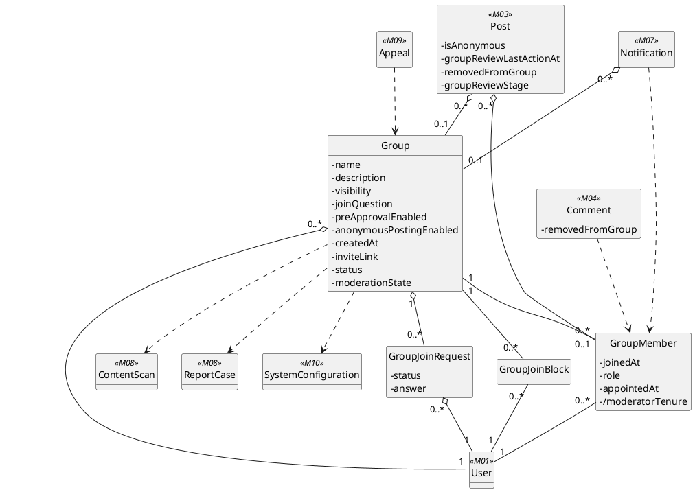

# Phân tích lớp thực thể — M11 Group

<!-- [Vietnamese Doc] Tài liệu tiếng Việt; tên lớp và thuộc tính viết tiếng Anh (input/CONVENTIONS.md mục 3). -->

| Mã tài liệu | EC-M11 |
|---|---|
| Dự án | iShare |
| Module | M11 — Group |
| Đầu vào | FR-M11 phiên bản 1.3 |
| Trạng thái | Bản nháp |
| Phiên bản | 0.4 |
| Ngày | 2026-11-18 |
| Tác giả | Phạm Văn Đức |

<!-- Quy ước chung cho mọi bảng dưới đây:
     - Không đổi tên cột, không xóa cột, không đổi số mục: tool đọc bảng theo số mục và tên cột.
     - Ô không có nội dung ghi "—".
     - Mục chưa tới bước làm thì để dòng "(Chưa làm — bước N)".
     - Cột Nguồn ghi mã trong FR: FR-M11-nn, FR-M11-nn.mm, BR-M11-nn, hoặc TN:<thuật ngữ> (mục 2.1 của FR).
     - Sơ đồ ở mục 4 do gen_puml.py sinh; không sửa tay. -->

## 1. Mô tả chức năng

### 1.1 Đoạn mô tả

(S1) M11 quản lý nhóm, thành viên nhóm, yêu cầu tham gia, danh sách chặn và việc duyệt nội dung ở cấp nhóm. (S2) Người dùng đã đăng nhập tạo nhóm với tên, mô tả, chế độ Public hoặc Private, câu hỏi tham gia tùy chọn và công tắc duyệt trước, ẩn danh, hệ thống ghi người tạo là Owner với thời điểm tham gia bằng thời điểm tạo nhóm. (S3) Owner sửa thông tin và cài đặt nhóm, hệ thống áp chế độ xem, câu hỏi tham gia và công tắc duyệt trước cho các thao tác tiếp theo, giữ ẩn danh cho bài đã đăng ẩn danh và chấp nhận các yêu cầu đang chờ nếu nhóm chuyển sang chế độ vào ngay. (S4) Hệ thống cho Guest và người dùng xem nhóm Public, giới hạn quyền xem nhóm Private theo tư cách thành viên, xếp danh sách nhóm theo thời điểm tạo và cung cấp danh sách thành viên kèm vai trò nhóm cho người được xem nhóm. (S5) Hệ thống dùng chế độ nhóm và tư cách thành viên để xác định quyền xem, bình luận, vote, báo cáo và bookmark bài nhóm, cung cấp dữ liệu lọc cho hồ sơ, tìm kiếm, feed và Trending Topic hoặc Tag, đồng thời cho Mod hoặc Admin xem nội dung Private trong vụ báo cáo M08 đang giữ. (S6) Người ngoài nhóm vào ngay nhóm Public không có câu hỏi tham gia, hoặc gửi yêu cầu tham gia ở trạng thái Chờ duyệt cho nhóm Private hay nhóm Public có câu hỏi, kèm câu trả lời khi có câu hỏi, và có thể rút yêu cầu đang chờ để chuyển sang Đã rút. (S7) Thành viên chia sẻ link mời chung của nhóm hoặc mời người dùng cụ thể qua thông báo M07 kèm link, người được mời tham gia theo điều kiện hiện tại của nhóm. (S8) Owner hoặc Group Mod xem yêu cầu tham gia kèm câu trả lời, chuyển yêu cầu sang Đã chấp nhận hoặc Đã từ chối, và khi chấp nhận thì hệ thống thêm Member, ghi thời điểm tham gia và phát sự kiện M07 cho người gửi. (S9) Owner hoặc Group Mod ghi người gửi yêu cầu vào danh sách chặn của nhóm, làm yêu cầu Chờ duyệt chuyển sang Đã từ chối và ngăn việc tham gia cho đến khi được bỏ chặn. (S10) Owner bổ nhiệm Member làm Group Mod, ghi thời điểm bổ nhiệm và thông báo qua M07, hoặc giáng Group Mod về Member. (S11) Owner hoặc Group Mod có thể kick thành viên trong phạm vi quyền của mình, Member và Group Mod có thể tự rời, hệ thống giữ bài viết, bình luận, danh tính hiển thị và điểm của thành viên đã rời hoặc bị kick, đồng thời gửi thông báo cho người bị kick. (S12) Owner rời nhóm có thành viên khác phải chỉ định người kế nhiệm, hệ thống chuyển vai trò Owner rồi đưa Owner cũ ra khỏi nhóm, còn nhóm chỉ có Owner được xóa mềm khi Owner xác nhận rời. (S13) Khi tài khoản Owner bị ban, vô hiệu hóa hoặc xóa, hệ thống chọn Group Mod theo thâm niên từ lần bổ nhiệm gần nhất hoặc Member theo thời điểm tham gia sớm nhất nếu không còn Group Mod, chuyển quyền, giữ Owner cũ làm Member khi có người kế nhiệm và xóa mềm nhóm khi không còn thành viên khác. (S14) Thành viên gửi bài viết M03 gắn với nhóm, cổng duyệt dùng điểm quét AI M13 và công tắc duyệt trước để quyết định Đã đăng, chờ nhóm duyệt hoặc Bị từ chối, với luồng riêng cho Owner, Admin và trường hợp AI tắt hoặc quét thất bại. (S15) Khi nhóm bật ẩn danh, thành viên chọn ẩn danh cho từng bài viết, hệ thống giữ danh tính thật của tác giả và hiển thị danh tính ấy cho Owner, Group Mod của nhóm, Mod và Admin trong phạm vi quyền xem. (S16) Owner hoặc Group Mod nhận bài viết từ hàng chờ duyệt của nhóm, hệ thống ghi người đang giữ và dùng thời điểm thao tác cuối để nhả bài khi quá hạn, người đang giữ có thể chấp nhận để đăng hoặc từ chối kèm lý do. (S17) Tác giả có thể sửa và gửi lại bài bị nhóm từ chối, hệ thống đưa bài bị AI tự từ chối trở lại cổng duyệt khi M09 chấp nhận khiếu nại và công bố kết quả Đã đăng hoặc Bị từ chối qua sự kiện thông báo của M03 và M07. (S18) Owner hoặc Group Mod gỡ bài viết hoặc bình luận thuộc phạm vi quyền bằng cách xóa mềm, hệ thống giới hạn người xem, giữ trạng thái đăng của bài viết để M15 thống kê, gửi thông báo cho tác giả qua M07 và giữ điểm do M12 quản lý. (S19) Khi Owner xóa nhóm, hệ thống chuyển nhóm sang Đã xóa, ngừng hiển thị nhóm và nội dung, đồng thời giữ dữ liệu và điểm của thành viên. (S20) Hệ thống áp trạng thái kiểm duyệt M08 lên nhóm, giữ dữ liệu khi nhóm bị ẩn, giới hạn thao tác và cho đọc nội dung theo quyền xem khi nhóm bị khóa, rồi khôi phục các thao tác bị chặn khi mở khóa. (S21) Khi cờ tính năng Group của M10 tắt, hệ thống từ chối thao tác nhóm của người dùng khác Admin, duy trì dữ liệu và khả năng hiển thị nhóm, bài nhóm tại các lối truy cập liên module, đồng thời tiếp tục kiểm duyệt M08 và tự chuyển quyền Owner.

<!-- Một đoạn văn, mỗi câu đánh số (S1) (S2) … Xem steps/01-describe-functions.md. -->

### 1.2 Truy vết câu

| Câu | Nội dung tóm tắt | Nguồn |
|---|---|---|
| S1 | Phạm vi dữ liệu của Group | FR-M11-01, FR-M11-04, FR-M11-06, FR-M11-07, FR-M11-13, FR-M11-14 |
| S2 | Tạo nhóm, cấu hình ban đầu và Owner | FR-M11-01, FR-M11-01.01, FR-M11-01.02, FR-M11-01.11 |
| S3 | Thay đổi cài đặt và tác động lên dữ liệu | FR-M11-02, FR-M11-02.01, FR-M11-02.02, FR-M11-02.05, FR-M11-02.06, FR-M11-02.07, FR-M11-02.14, FR-M11-02.15 |
| S4 | Quyền xem nhóm và danh sách thành viên | FR-M11-03, FR-M11-03.01, FR-M11-03.02, FR-M11-03.04, FR-M11-03.05, FR-M11-03.14, FR-M11-03.16, FR-M11-03.17 |
| S5 | Điều kiện truy cập nội dung và cung cấp dữ liệu liên module | FR-M11-02.03, FR-M11-02.04, FR-M11-03.06, FR-M11-03.07, FR-M11-03.08, FR-M11-03.12, FR-M11-03.13, FR-M11-12.12, FR-M11-12.13 |
| S6 | Tham gia ngay, gửi và rút yêu cầu | FR-M11-04, FR-M11-04.01, FR-M11-04.02, FR-M11-04.03, FR-M11-04.10 |
| S7 | Link mời, thông báo mời và luồng tham gia | FR-M11-05, FR-M11-05.01, FR-M11-05.02, FR-M11-05.05, FR-M11-05.06 |
| S8 | Duyệt yêu cầu và ghi nhận thành viên | FR-M11-06, FR-M11-06.01, FR-M11-06.02, FR-M11-06.03, FR-M11-06.04, FR-M11-06.07 |
| S9 | Chặn, bỏ chặn và trạng thái yêu cầu | FR-M11-07, FR-M11-07.01, FR-M11-07.02, FR-M11-07.03, FR-M11-07.04, FR-M11-07.05 |
| S10 | Bổ nhiệm, giáng và mốc bổ nhiệm | FR-M11-08, FR-M11-08.01, FR-M11-08.02, FR-M11-08.03 |
| S11 | Chấm dứt tư cách thành viên và giữ nội dung | FR-M11-09, FR-M11-09.01, FR-M11-09.02, FR-M11-09.05, FR-M11-09.06, FR-M11-10, FR-M11-10.01, FR-M11-10.02, FR-M11-10.08, FR-M11-10.09 |
| S12 | Chuyển quyền khi Owner tự rời | FR-M11-10.03, FR-M11-10.04, FR-M11-10.05, FR-M11-10.06, FR-M11-10.07, FR-M11-15 |
| S13 | Kế nhiệm tự động theo trạng thái tài khoản và thâm niên | FR-M11-11, FR-M11-11.01, FR-M11-11.02, FR-M11-11.03, FR-M11-11.04, FR-M11-11.05, FR-M11-11.06, FR-M11-11.07 |
| S14 | Định tuyến bài viết qua cổng duyệt nhóm | FR-M11-12, FR-M11-12.01, FR-M11-12.02, FR-M11-12.03, FR-M11-12.04, FR-M11-12.05, FR-M11-12.06, FR-M11-12.14, FR-M11-12.15, FR-M11-12.16, FR-M11-12.17, FR-M11-12.18, FR-M11-12.19, FR-M11-12.20 |
| S15 | Ẩn danh theo bài và danh tính tác giả | FR-M11-02.06, FR-M11-03.09, FR-M11-03.10, FR-M11-12.07, FR-M11-12.08, FR-M11-12.10 |
| S16 | Hàng chờ, người giữ, thời điểm và kết quả duyệt | FR-M11-13, FR-M11-13.01, FR-M11-13.02, FR-M11-13.03, FR-M11-13.04, FR-M11-13.05, FR-M11-13.06, FR-M11-13.10, FR-M11-13.13 |
| S17 | Gửi lại bài, kết quả khiếu nại và thông báo | FR-M11-13.05, FR-M11-13.06, FR-M11-13.11, FR-M11-13.12, FR-M11-13.14 |
| S18 | Gỡ nội dung, quyền xem và dữ liệu liên module | FR-M11-14, FR-M11-14.01, FR-M11-14.04, FR-M11-14.06, FR-M11-14.07, FR-M11-14.08 |
| S19 | Xóa mềm và giữ dữ liệu | FR-M11-15, FR-M11-15.01, FR-M11-15.02, FR-M11-15.03 |
| S20 | Áp dụng trạng thái Ẩn, Khóa và mở khóa | FR-M11-16, FR-M11-16.01, FR-M11-16.02, FR-M11-16.03, FR-M11-16.04, FR-M11-16.05, FR-M11-16.06, FR-M11-16.07, FR-M11-16.09, FR-M11-16.10 |
| S21 | Áp dụng cờ Group và duy trì xử lý tự động | FR-M11-17, FR-M11-17.01, FR-M11-17.03, FR-M11-17.04, FR-M11-17.05, FR-M11-17.07, FR-M11-17.08, FR-M11-11.04 |

## 2. Danh từ và phân loại

### 2.1 Sổ danh từ

<!-- Phân loại: Lớp | Thuộc tính | Loại bỏ.
     Kết quả: tên lớp; hoặc Lớp.thuộcTính; hoặc "—" khi loại bỏ.
     Xuất hiện ở: S<n> (câu của đoạn mô tả) hoặc "Quét: <mã FR>" (lượt quét bổ sung). -->

| # | Danh từ | Xuất hiện ở | Phân loại | Kết quả | Lý do |
|---|---|---|---|---|---|
| 1 | nhóm | S1 | Lớp | Group | T8. Có vòng đời, chế độ, cài đặt và trạng thái riêng. |
| 2 | thành viên nhóm / thành viên / Owner / Group Mod / Member / người kế nhiệm / Owner cũ | S1 | Lớp | GroupMember | T3. Các vai trò Owner, Group Mod, Member là giá trị của GroupMember.role trong một nhóm. |
| 3 | yêu cầu tham gia | S1 | Lớp | GroupJoinRequest | T8. Mỗi lần gửi có vòng đời duyệt, từ chối hoặc rút riêng. |
| 4 | danh sách chặn / chặn tham gia / dấu chặn tham gia | S1 | Lớp | GroupJoinBlock | Lớp liên kết Group và User theo Q-01. Cặp tồn tại khi đang chặn, kết thúc khi bỏ chặn. |
| 5 | duyệt nội dung ở cấp nhóm / quyết định kiểm duyệt cấp nhóm | S1 | Loại bỏ | — | Trừu tượng. Quyết định làm đổi dữ liệu của bài hoặc bình luận. FR nêu kết quả, lý do khi từ chối và dấu gỡ, chưa nêu lịch sử quyết định cấp nhóm riêng. |
| 6 | người dùng đã đăng nhập / người ngoài nhóm / người được mời / người gửi yêu cầu / người bị chặn / người tạo / tài khoản / Mod / Admin / tác giả | S2 | Lớp | User | T3. Cùng tài khoản M01 trong các ngữ cảnh khác nhau. Vai trò nhóm xét theo GroupMember. |
| 7 | tên nhóm | S2 | Thuộc tính | Group.name | T9. Giá trị mô tả đối tượng nghiệp vụ. |
| 8 | mô tả nhóm | S2 | Thuộc tính | Group.description | T9. Giá trị mô tả đối tượng nghiệp vụ. |
| 9 | chế độ nhóm / chế độ xem | S2 | Thuộc tính | Group.visibility | T9. Giá trị mô tả đối tượng nghiệp vụ. |
| 10 | Public / Private | S2 | Loại bỏ | — | Giá trị của Group.visibility. |
| 11 | câu hỏi tham gia | S2 | Thuộc tính | Group.joinQuestion | T9. Giá trị mô tả đối tượng nghiệp vụ. |
| 12 | công tắc duyệt trước | S2 | Thuộc tính | Group.preApprovalEnabled | T9. Giá trị mô tả đối tượng nghiệp vụ. |
| 13 | công tắc ẩn danh | S2 | Thuộc tính | Group.anonymousPostingEnabled | T9. Giá trị mô tả đối tượng nghiệp vụ. |
| 14 | Bật / Tắt | S2 | Loại bỏ | — | Giá trị của các công tắc trong Group và SystemConfiguration. |
| 15 | hệ thống | S2 | Loại bỏ | — | Không lưu: tác nhân không có dữ liệu riêng. |
| 16 | thời điểm tham gia | S2 | Thuộc tính | GroupMember.joinedAt | T9. Giá trị mô tả đối tượng nghiệp vụ. |
| 17 | thời điểm tạo nhóm | S2 | Thuộc tính | Group.createdAt | T9. Giá trị mô tả đối tượng nghiệp vụ. |
| 18 | thông tin nhóm / cài đặt nhóm | S3 | Loại bỏ | — | Chung chung. Tập các thuộc tính của Group đã xét riêng. |
| 19 | thay đổi cài đặt / thao tác tiếp theo / thời điểm đổi | S3 | Loại bỏ | — | Trừu tượng. FR nêu hiệu lực đối với thao tác sau khi đổi, chưa yêu cầu lịch sử hoặc mốc đổi được lưu riêng. |
| 20 | bài viết / bài nhóm / bài ẩn danh / bài đã đăng ẩn danh | S3 | Lớp | Post | T4. Cùng bài viết M03, có ngữ cảnh nhóm và thuộc tính ẩn danh khi phù hợp. |
| 21 | chế độ vào ngay / nhóm vào ngay | S3 | Loại bỏ | — | Trừu tượng. Điều kiện nghiệp vụ tính từ Group.visibility là Public và Group.joinQuestion trống theo BR-M11-07/32. |
| 22 | Guest | S4 | Loại bỏ | — | Không lưu: tác nhân không có dữ liệu. |
| 23 | quyền xem / tư cách thành viên | S4 | Loại bỏ | — | Trừu tượng đối với quyền xem. Điều kiện tính từ chế độ, trạng thái và sự tồn tại của GroupMember, không phải lớp quyền riêng. |
| 24 | danh sách nhóm / danh sách thành viên | S4 | Loại bỏ | — | Giao diện. Kết quả lọc và sắp xếp Group hoặc GroupMember. |
| 25 | vai trò nhóm | S4 | Thuộc tính | GroupMember.role | T9. Giá trị mô tả đối tượng nghiệp vụ. |
| 26 | bình luận | S5 | Lớp | Comment | T4. M04 sở hữu; M11 cần kiểm tra quyền và đánh dấu nội dung bị gỡ cấp nhóm. |
| 27 | vote / báo cáo / bookmark | S5 | Loại bỏ | — | Ngoài phạm vi module (M12, M08, M02). M11 cung cấp điều kiện thao tác; dữ liệu lượt vote, báo cáo và bookmark thuộc module nguồn. |
| 28 | hồ sơ / tìm kiếm / feed / Trending Topic hoặc Tag | S5 | Loại bỏ | — | Ngoài phạm vi module (M02, M06, M14, M05). Các chức năng nhận điều kiện lọc bài nhóm. |
| 29 | quyền bình luận / quyền vote / quyền báo cáo / quyền bookmark / dữ liệu lọc | S5 | Loại bỏ | — | Trừu tượng. Là kết quả áp quy tắc truy cập, không phải dữ liệu quyền riêng được lưu. |
| 30 | vụ báo cáo đang giữ / vụ báo cáo | S5 | Lớp | ReportCase | T4. Ngữ cảnh dữ liệu M08 cấp quyền xem nội dung Private trong vụ. |
| 31 | nội dung nhóm | S5 | Loại bỏ | — | Chung chung. Gồm bài viết và bình luận; đã xét theo từng đối tượng. |
| 32 | vào ngay / gửi yêu cầu tham gia / rút yêu cầu tham gia | S6 | Loại bỏ | — | Trừu tượng. Là hành động tạo GroupMember hoặc tạo, đổi trạng thái GroupJoinRequest. |
| 33 | trạng thái yêu cầu tham gia | S6 | Thuộc tính | GroupJoinRequest.status | T9. Giá trị mô tả đối tượng nghiệp vụ. |
| 34 | Chờ duyệt (yêu cầu) / Đã chấp nhận / Đã từ chối / Đã rút | S6 | Loại bỏ | — | Giá trị của GroupJoinRequest.status. |
| 35 | câu trả lời | S6 | Thuộc tính | GroupJoinRequest.answer | T9. Giá trị mô tả đối tượng nghiệp vụ. |
| 36 | link mời chung / link mời | S7 | Thuộc tính | Group.inviteLink | T9. Giá trị mô tả đối tượng nghiệp vụ. |
| 37 | thông báo / thông báo mời | S7 | Lớp | Notification | T4. M07 sở hữu thông báo nhóm; M11 phát các sự kiện nguồn. |
| 38 | lời mời / mời đích danh | S7 | Loại bỏ | — | Trừu tượng. Dùng link chung và thông báo, FR-M11-05.04 xác định lời mời không có bản ghi chấp nhận hoặc từ chối riêng. |
| 39 | luồng tham gia / điều kiện tham gia | S7 | Loại bỏ | — | Trừu tượng. Là quy tắc theo Group và GroupJoinRequest. |
| 40 | sự kiện thông báo M07 | S8 | Loại bỏ | — | Trừu tượng. Là giao tiếp giữa module, bản ghi người nhận thuộc Notification của M07. |
| 41 | chấp nhận yêu cầu / từ chối yêu cầu | S8 | Loại bỏ | — | Trừu tượng. Đổi GroupJoinRequest.status; chấp nhận còn tạo GroupMember. |
| 42 | bỏ chặn | S9 | Loại bỏ | — | Trừu tượng. Gỡ dấu chặn của cặp nhóm và tài khoản, FR không nêu lịch sử riêng. |
| 43 | thời điểm bổ nhiệm / lần bổ nhiệm gần nhất | S10 | Thuộc tính | GroupMember.appointedAt | T9. Giá trị mô tả đối tượng nghiệp vụ. |
| 44 | bổ nhiệm / giáng Group Mod | S10 | Loại bỏ | — | Trừu tượng. Đổi GroupMember.role và cập nhật mốc bổ nhiệm khi bổ nhiệm. FR không yêu cầu lịch sử bổ nhiệm riêng. |
| 45 | kick / rời nhóm | S11 | Loại bỏ | — | Trừu tượng. Kết thúc tư cách GroupMember, bài viết và bình luận vẫn thuộc nhóm. FR không nêu bản ghi hành động riêng. |
| 46 | danh tính hiển thị / danh tính thật | S11 | Loại bỏ | — | Ngoài phạm vi module ở cấp thuộc tính tài khoản. M11 giữ quan hệ tác giả hiện có của Post và dùng cờ ẩn danh để xác định cách hiển thị. |
| 47 | điểm của thành viên / điểm của tác giả | S11 | Loại bỏ | — | Ngoài phạm vi module (M12). M11 truyền ngữ cảnh nghiệp vụ để M12 giữ nguyên điểm theo FR. |
| 48 | chuyển vai trò Owner / tự chuyển quyền Owner / chỉ định người kế nhiệm | S12 | Loại bỏ | — | Trừu tượng. Quy tắc chuyển vai trò GroupMember; không có lịch sử chuyển quyền riêng trong FR. |
| 49 | xác nhận rời | S12 | Loại bỏ | — | Hành động không lưu dấu vết riêng. Là điều kiện trước khi xóa mềm nhóm chỉ có Owner. |
| 50 | xóa nhóm / xóa mềm nhóm / trạng thái tồn tại của nhóm | S12 | Thuộc tính | Group.status | T9. Giá trị mô tả đối tượng nghiệp vụ. |
| 51 | ban / vô hiệu hóa / xóa tài khoản / trạng thái tài khoản | S13 | Loại bỏ | — | Ngoài phạm vi module (M01, M08). M11 dùng trạng thái User và sự kiện đổi trạng thái để chọn Owner. |
| 52 | thâm niên Group Mod | S13 | Thuộc tính | GroupMember.moderatorTenure | T7. Đại lượng tính từ vai trò hiện hành và thời điểm bổ nhiệm gần nhất. |
| 53 | cổng duyệt của nhóm / luồng duyệt | S14 | Loại bỏ | — | Trừu tượng. Quy tắc định tuyến từ điểm quét và cấu hình, áp lên Post. |
| 54 | kết quả quét nội dung | S14 | Lớp | ContentScan | T4. Dùng kết quả quét có tên đã định nghĩa tại M08; giao tiếp điểm quét với M13. |
| 55 | điểm quét AI | S14 | Loại bỏ | — | Ngoài phạm vi module ở cấp thuộc tính. Điểm quét thuộc ContentScan.score, được cổng duyệt nhóm đọc. |
| 56 | công tắc AI tổng / công tắc Moderation / cờ tính năng Group | S14 | Loại bỏ | — | Ngoài phạm vi module (M10). Các giá trị thuộc SystemConfiguration, M11 chỉ đọc. |
| 57 | cấu hình hệ thống | Quét: FR-M11-12.14, FR-M11-17.03 | Lớp | SystemConfiguration | T4. M10 sở hữu các công tắc dùng để vận hành nhóm. |
| 58 | trạng thái đăng / Đã đăng / Bị từ chối | S14 | Loại bỏ | — | Ngoài phạm vi module (M03). Giá trị trạng thái đã có trên Post.publishState; M11 chỉ mô tả thay đổi và giai đoạn duyệt thuộc nhóm. |
| 59 | AI tắt / quét thất bại | S14 | Loại bỏ | — | Trừu tượng. Sự kiện hoặc điều kiện định tuyến; nguồn quét thuộc M08 và M13, cấu hình thuộc M10. |
| 60 | lựa chọn ẩn danh / tính ẩn danh | S15 | Thuộc tính | Post.isAnonymous | T9. Giá trị mô tả đối tượng nghiệp vụ. |
| 61 | hàng chờ duyệt của nhóm | S16 | Loại bỏ | — | Trừu tượng. Tập Post gắn với nhóm và đang ở giai đoạn chờ nhóm duyệt; FR không nêu bản ghi hàng chờ riêng. |
| 62 | người đang giữ bài | S16 | Lớp | GroupMember | T3. Người giữ trong ngữ cảnh nhóm phải là Owner hoặc Group Mod. Tham chiếu cụ thể xét ở bước 3. |
| 63 | nhận bài / nhả bài / chấp nhận bài / từ chối bài | S16 | Loại bỏ | — | Trừu tượng. Hành động cập nhật người đang giữ, mốc thao tác và trạng thái của Post. |
| 64 | thời điểm thao tác cuối | S16 | Thuộc tính | Post.groupReviewLastActionAt | T9. Giá trị mô tả đối tượng nghiệp vụ. |
| 65 | thời hạn giữ bài | S16 | Loại bỏ | — | Hằng số của BR-M11-20. Tính từ mốc thao tác cuối và 30 phút; không thêm trường thời hạn. |
| 66 | lý do từ chối bài | S16 | Loại bỏ | — | Ngoài phạm vi module ở cấp thuộc tính có sẵn. Dùng Post.rejectionReason đã có ở EC-M03; khi nhóm từ chối phải có lý do theo FR-M11-13.06/10. |
| 67 | khiếu nại / kết quả khiếu nại | S17 | Lớp | Appeal | T4. M09 quản lý kết quả; M11 dùng kết quả chấp nhận với bài bị AI từ chối. |
| 68 | sửa và gửi lại bài | S17 | Loại bỏ | — | Trừu tượng. Tác giả sửa Post và đưa qua cổng duyệt thêm lần theo FR-M11-13.11; chưa nêu lịch sử hàng chờ độc lập. |
| 69 | dấu bị gỡ khỏi nhóm trên bài viết | S18 | Thuộc tính | Post.removedFromGroup | T9. Giá trị mô tả đối tượng nghiệp vụ. |
| 70 | dấu bị gỡ khỏi nhóm trên bình luận | S18 | Thuộc tính | Comment.removedFromGroup | T9. Giá trị mô tả đối tượng nghiệp vụ. |
| 71 | gỡ khỏi nhóm / xóa mềm nội dung | S18 | Loại bỏ | — | Trừu tượng. Hành động đặt dấu trên Post hoặc Comment và phát sự kiện M07; không thêm lớp hành động riêng. |
| 72 | thống kê trạng thái đăng | S18 | Loại bỏ | — | Ngoài phạm vi module (M15). M11 cung cấp nguyên trạng thái đăng của bài bị gỡ. |
| 73 | Hoạt động / Đã xóa (nhóm) | S19 | Loại bỏ | — | Giá trị của Group.status. |
| 74 | trạng thái kiểm duyệt của nhóm | S20 | Thuộc tính | Group.moderationState | T9. Giá trị mô tả đối tượng nghiệp vụ. |
| 75 | Bình thường / Bị ẩn / Bị khóa | S20 | Loại bỏ | — | Giá trị của Group.moderationState. |
| 76 | ẩn nhóm / khóa nhóm / mở khóa nhóm | S20 | Loại bỏ | — | Ngoài phạm vi module (M08). M11 áp dụng trạng thái và điều kiện nghiệp vụ. |
| 77 | lối truy cập liên module | S21 | Loại bỏ | — | Giao diện. Danh sách bề mặt hiện nhóm và bài nhóm khi cờ tắt, không tạo đối tượng dữ liệu. |
| 78 | giới hạn nhóm tạo trong 24 giờ / 24 giờ gần nhất | Quét: FR-M11-01.03 | Loại bỏ | — | Hằng số của BR-M11-03. Tối đa 5 nhóm trong khoảng 24 giờ, tính cả nhóm đã xóa và áp dụng cho Admin. |
| 79 | số nhóm đã tạo trong 24 giờ | Quét: FR-M11-01.03, FR-M11-01.06 | Loại bỏ | — | Trừu tượng với mô hình lớp. Điều kiện kiểm giới hạn tính theo người tạo và Group.createdAt trong cửa sổ trượt, chưa phải số liệu cần lưu hoặc hiển thị. |
| 80 | độ dài tên và mô tả nhóm / ký tự | Quét: FR-M11-01.08, FR-M11-01.09 | Loại bỏ | — | Hằng số của BR-M11-31. Độ dài dùng để kiểm Group.name và Group.description. |
| 81 | giai đoạn chờ duyệt của bài nhóm | Quét: TN:Chờ duyệt (đang quét), Chờ duyệt (chờ nhóm duyệt) | Thuộc tính | Post.groupReviewStage | T9. Giá trị mô tả đối tượng nghiệp vụ. |
| 82 | ngưỡng điểm quét | Quét: FR-M11-12.02, FR-M11-12.03 | Loại bỏ | — | Hằng số của BR-M11-18 và BR-M11-40. Dùng các mốc 0.5 và 0.9 để định tuyến; không lưu trên Group. |

### 2.2 Lớp

<!-- Nhóm: Thực thể | Liên kết | Thống kê. Sở hữu: mã module sở hữu lớp (M11 của tài liệu này, hoặc Myy với lớp ngoài). -->

| Lớp | Tên tiếng Việt | Nhóm | Sở hữu | Mô tả | Nguồn |
|---|---|---|---|---|---|
| Group | Nhóm | Thực thể | M11 | Không gian nhóm do người dùng tạo và Owner quản lý, có chế độ, cài đặt, trạng thái tồn tại và trạng thái kiểm duyệt do M08 quyết định. Dùng tên glossary và các EC trước. | FR-M11-01.01, FR-M11-02, FR-M11-15.01, FR-M11-16, BR-M11-01 |
| GroupMember | Thành viên nhóm | Liên kết | M11 | Tư cách thành viên theo nhóm, có đúng một vai trò nhóm, thời điểm tham gia và mốc bổ nhiệm khi là Group Mod. Dùng tên glossary và các EC trước. | FR-M11-01.02, FR-M11-04.01, FR-M11-06.02, FR-M11-08.01, BR-M11-05 |
| GroupJoinRequest | Yêu cầu tham gia | Thực thể | M11 | Bản ghi theo từng lần xin vào nhóm, có vòng đời duyệt, từ chối hoặc rút, kèm câu trả lời khi có câu hỏi. | FR-M11-04.03, FR-M11-04.10, FR-M11-06.02, FR-M11-06.03, BR-M11-09 |
| GroupJoinBlock | Dấu chặn tham gia | Liên kết | M11 | Cặp nhóm và tài khoản đang bị nhóm chặn. Bỏ chặn kết thúc cặp. Không lưu thêm mốc hoặc lịch sử chặn theo FR hiện hành. | FR-M11-04.06, FR-M11-07.01, FR-M11-07.04, FR-M11-07.05, BR-M11-10 |
| User | Tài khoản | Thực thể | M01 | Người tạo, người gửi yêu cầu, người bị chặn và tài khoản có tư cách thành viên. Trạng thái tài khoản dùng để xét kế nhiệm Owner. | FR-M11-01.02, FR-M11-04.03, FR-M11-07.01, FR-M11-11.01 |
| Post | Bài viết | Thực thể | M03 | Bài có thể thuộc một nhóm. M11 bổ sung dữ liệu ẩn danh, hàng chờ duyệt nhóm và dấu bị gỡ khỏi nhóm. | FR-M11-12.01, FR-M11-12.07, FR-M11-13.01, FR-M11-13.02, FR-M11-14.01, BR-M11-01 |
| Comment | Bình luận | Thực thể | M04 | Bình luận trên bài nhóm, M11 bổ sung dấu bị gỡ cấp nhóm theo quy tắc quyền xem của M11. | FR-M11-03.08, FR-M11-10.02, FR-M11-14.01, BR-M11-30 |
| Notification | Thông báo | Thực thể | M07 | M07 gửi các thông báo nhóm theo sự kiện M11 và xử lý quyền xem nội dung đích. | FR-M11-05.02, FR-M11-06.04, FR-M11-06.07, FR-M11-08.03, FR-M11-09.06, FR-M11-10.07, FR-M11-11.07, FR-M11-14.06 |
| ContentScan | Kết quả quét nội dung | Thực thể | M08 | Dùng tên EC-M08. Cổng duyệt dùng điểm quét, giao tiếp FR-M11 mục 5.21 cung cấp kết quả từ M13. | FR-M11-12.02, FR-M11-12.03, FR-M11-12.04, FR-M11-12.05, BR-M11-18 |
| ReportCase | Vụ báo cáo | Thực thể | M08 | Ngữ cảnh để Mod hoặc Admin đang giữ vụ xem nội dung Private được báo cáo. | FR-M11-03.12, FR-M11-14.04, BR-M11-33 |
| Appeal | Khiếu nại | Thực thể | M09 | Kết quả khiếu nại đối với bài nhóm bị AI từ chối có thể đưa bài trở lại cổng duyệt nhóm. | FR-M11-13.12, FR-M11-13.14, BR-M11-38 |
| SystemConfiguration | Cấu hình hệ thống | Thực thể | M10 | Cung cấp cờ Group, công tắc AI tổng và công tắc Moderation. Dùng tên đã được EC-M10 định nghĩa. | FR-M11-12.14, FR-M11-17.01, FR-M11-17.03, BR-M11-29 |

### 2.3 Thuộc tính

<!-- Tính chất: Lưu | Dẫn xuất. Chưa có id, chưa có kiểu, chưa có khóa ngoại.
     Ràng buộc nguồn nêu: độ dài tối đa, duy nhất, bắt buộc/tùy chọn, tập giá trị, mặc định, công thức (với Dẫn xuất) — chép từ FR kèm mã. -->

| Lớp | Thuộc tính | Tên tiếng Việt | Tính chất | Ràng buộc nguồn nêu | Nguồn |
|---|---|---|---|---|---|
| Group | name | Tên nhóm | Lưu | Bắt buộc, tối đa 100 ký tự, được trùng tên nhóm khác theo BR-M11-31. | FR-M11-01.08, FR-M11-01.10, FR-M11-02.01, FR-M11-02.11, BR-M11-31 |
| Group | description | Mô tả nhóm | Lưu | Tùy chọn, tối đa 500 ký tự theo BR-M11-31. | FR-M11-01.09, FR-M11-02.01, FR-M11-02.11, BR-M11-31 |
| Group | visibility | Chế độ nhóm | Lưu | Public hoặc Private, bắt buộc chọn khi tạo. Owner được đổi, áp dụng cho thao tác sau thời điểm đổi. | FR-M11-01.01, FR-M11-02.02, BR-M11-15 |
| Group | joinQuestion | Câu hỏi tham gia | Lưu | Tùy chọn, mặc định trống, tối đa một câu mỗi nhóm. Owner đặt, sửa hoặc bỏ, áp dụng cho đề nghị gửi sau đó. | FR-M11-01.11, FR-M11-01.12, FR-M11-02.07, FR-M11-02.08, BR-M11-08 |
| Group | preApprovalEnabled | Công tắc duyệt trước | Lưu | Bật hoặc Tắt, mặc định Tắt. Thay đổi áp dụng cho bài gửi sau đó. Tắt không loại bài đã chờ duyệt khỏi hàng chờ. | FR-M11-01.12, FR-M11-02.05, FR-M11-02.15, BR-M11-18 |
| Group | anonymousPostingEnabled | Công tắc ẩn danh | Lưu | Bật hoặc Tắt, mặc định Tắt. Tắt chặn lựa chọn cho bài mới; bài đã đăng ẩn danh giữ nguyên. | FR-M11-01.12, FR-M11-02.06, FR-M11-12.07, FR-M11-12.08, BR-M11-16 |
| GroupMember | joinedAt | Thời điểm tham gia | Lưu | Ghi khi vào ngay, khi chấp nhận yêu cầu, kể cả do đổi sang vào ngay, hoặc lúc tạo nhóm đối với Owner đầu tiên. | FR-M11-01.02, FR-M11-02.14, FR-M11-04.01, FR-M11-06.02, BR-M11-32 |
| Group | createdAt | Thời điểm tạo nhóm | Lưu | Dùng để xếp nhóm mới nhất trước và xác định số nhóm do người tạo tạo trong 24 giờ gần nhất, kể cả các nhóm đã xóa. | FR-M11-01.02, FR-M11-01.03, FR-M11-01.06, FR-M11-03.17, BR-M11-03, BR-M11-35 |
| GroupMember | role | Vai trò nhóm | Lưu | Owner, Group Mod hoặc Member, đúng một vai trò mỗi thành viên trong một nhóm. Mỗi nhóm có đúng một Owner. Owner đầu tiên là người tạo; người vào nhóm thông thường là Member. | FR-M11-01.02, FR-M11-04.01, FR-M11-06.02, FR-M11-08.01, FR-M11-08.02, BR-M11-04, BR-M11-05 |
| GroupJoinRequest | status | Trạng thái yêu cầu | Lưu | Khởi tạo Chờ duyệt, có thể sang Đã chấp nhận, Đã từ chối hoặc Đã rút. Cùng người và nhóm chỉ có tối đa một yêu cầu Chờ duyệt. Chặn làm yêu cầu chờ bị từ chối; đổi sang vào ngay chấp nhận yêu cầu chờ. | FR-M11-02.14, FR-M11-04.03, FR-M11-04.09, FR-M11-04.10, FR-M11-06.02, FR-M11-06.03, FR-M11-07.03, BR-M11-09, BR-M11-36 |
| GroupJoinRequest | answer | Câu trả lời tham gia | Lưu | Bắt buộc có nội dung nếu nhóm có câu hỏi khi gửi. Owner và Group Mod đọc khi duyệt; FR không nêu giới hạn độ dài. | FR-M11-04.03, FR-M11-04.08, FR-M11-06.01, BR-M11-08 |
| Group | inviteLink | Link mời nhóm | Lưu | Mỗi nhóm đúng một link chung, không hết hạn, không thu hồi hoặc tạo lại. Mời đích danh chuyển link qua thông báo M07. | FR-M11-05.01, FR-M11-05.02, FR-M11-05.06, FR-M11-05.07, BR-M11-12 |
| GroupMember | appointedAt | Thời điểm bổ nhiệm Group Mod | Lưu | Dùng cho thành viên đang là Group Mod. Ghi mốc lần bổ nhiệm gần nhất, tính lại từ đầu sau khi được bổ nhiệm lại theo BR-M11-26. | FR-M11-08.01, FR-M11-11.06, BR-M11-05, BR-M11-26 |
| Group | status | Trạng thái tồn tại | Lưu | Hoạt động hoặc Đã xóa; khởi tạo Hoạt động. Đã xóa khi Owner xóa, xác nhận rời nhóm chỉ có Owner hoặc Owner mất quyền trong nhóm chỉ còn mình. Giữ dữ liệu nhóm và nội dung. | FR-M11-01.01, FR-M11-10.06, FR-M11-11.03, FR-M11-15.01, FR-M11-15.02, BR-M11-23 |
| GroupMember | moderatorTenure | Thâm niên Group Mod | Dẫn xuất | Khoảng thời gian từ appointedAt của lần bổ nhiệm gần nhất tới thời điểm xét kế nhiệm, chỉ tính GroupMember hiện giữ vai trò Group Mod. | FR-M11-11.01, FR-M11-11.06, BR-M11-26 |
| Post | isAnonymous | Ẩn danh của bài nhóm | Lưu | Phần M11 bổ sung trên Post. Có hoặc Không cho từng bài nhóm. Chỉ chọn Có khi nhóm bật ẩn danh; tắt công tắc không đổi bài đã đăng ẩn danh. Giữ quan hệ tác giả thật. | FR-M11-02.06, FR-M11-03.09, FR-M11-03.10, FR-M11-12.07, FR-M11-12.08, FR-M11-12.09, FR-M11-12.10, BR-M11-16, BR-M11-17 |
| Post | groupReviewLastActionAt | Thời điểm thao tác cuối khi giữ bài | Lưu | Phần M11 bổ sung trên Post. Khi có người giữ bài nhóm, dùng mốc thao tác gần nhất của người giữ. Quá 30 phút không thao tác thì trả về hàng chờ nhóm theo BR-M11-20. | FR-M11-13.02, FR-M11-13.04, BR-M11-20 |
| Post | removedFromGroup | Dấu bị gỡ khỏi nhóm | Lưu | Phần M11 xác nhận trên Post, giữ cùng tên đã tham chiếu trong EC-M03. Xóa mềm do Owner hoặc Group Mod, giữ trạng thái đăng, chỉ còn hiển thị với các đối tượng được BR-M11-30 cho phép. | FR-M11-14.01, FR-M11-14.05, BR-M11-30 |
| Comment | removedFromGroup | Dấu bị gỡ khỏi nhóm | Lưu | Phần M11 bổ sung trên Comment. Xóa mềm do Owner hoặc Group Mod, giữ quyền xem đặc thù; tác giả không tự hiện lại. | FR-M11-14.01, FR-M11-14.05, BR-M11-30, TN:Bị gỡ khỏi nhóm |
| Group | moderationState | Trạng thái kiểm duyệt nhóm | Lưu | Bình thường, Bị khóa hoặc Bị ẩn. Khởi tạo Bình thường. M08 quyết định thay đổi, M11 áp dụng quyền xem và thao tác. Cùng tên đã được EC-M08 dùng cho Group. | FR-M11-01.01, FR-M11-16.01, FR-M11-16.03, FR-M11-16.06, BR-M11-27, BR-M11-28 |
| Post | groupReviewStage | Giai đoạn duyệt của bài nhóm | Lưu | Phần M11 bổ sung trên Post khi publishState là Chờ duyệt. Phân biệt đang quét và chờ nhóm duyệt. Trường hợp hàng chờ Mod hệ thống của bài Owner được xử lý theo M03, không xếp vào hàng chờ nhóm. | FR-M11-12.01, FR-M11-12.03, FR-M11-12.15, FR-M11-12.18, FR-M11-13.01, TN:Chờ duyệt (đang quét), Chờ duyệt (chờ nhóm duyệt) |

### 2.4 Đối chiếu với mục Dữ liệu nghiệp vụ của FR

<!-- Mỗi thực thể ở bảng "Dữ liệu nghiệp vụ" của FR một dòng; chép đúng tên ở cột Thực thể của FR.
     Xử lý: Khớp | Đã thêm qua sổ danh từ | Mô hình có thêm: … | Lệch: … (kèm Q-nn). -->

| Thực thể trong FR | Trong mô hình | Xử lý |
|---|---|---|
| Nhóm | Group | Khớp |
| Thành viên nhóm | GroupMember | Mô hình có thêm GroupMember.moderatorTenure là giá trị dẫn xuất từ lần bổ nhiệm gần nhất, có nguồn FR-M11-11.06 và BR-M11-26. |
| Yêu cầu tham gia | GroupJoinRequest | Khớp về dữ liệu FR hiện hành. Bản sao câu hỏi được duyệt theo Q-02 và chờ cập nhật FR-M11 trước khi thêm vào lớp. |
| Chặn tham gia | GroupJoinBlock | Khớp với Q-01. Cặp Group–User chứa đủ thông tin chặn nêu trong FR. |
| Bài viết (M03) — phần M11 | Post, ContentScan | Mô hình có thêm Post.groupReviewStage để phân biệt các giai đoạn của Chờ duyệt được nêu tại mục 2.1 và 5.20, có nguồn FR-M11-12 và FR-M11-13. Dùng ContentScan.score và Post.rejectionReason hiện có. Nhóm và người giữ được xét dưới dạng quan hệ ở bước 3. |
| Tham chiếu ngoài | User, Comment, Notification, ReportCase, Appeal, SystemConfiguration | Mô hình có thêm lớp tham chiếu theo FR-M11-03.12, FR-M11-05.02, FR-M11-11.01, FR-M11-13.14, FR-M11-14.01, FR-M11-17.01 và mục 5.21. Comment.removedFromGroup là phần M11 bổ sung theo FR-M11-14.01 và TN:Bị gỡ khỏi nhóm. |

## 3. Quan hệ giữa các lớp

### 3.1 Ma trận cặp lớp

<!-- T = quan hệ trực tiếp; G(X) = chỉ gián tiếp qua lớp X; trống = không liên quan. Chỉ điền nửa trên. -->

| Lớp | 1 | 2 | 3 | 4 | 5 | 6 | 7 | 8 | 9 | 10 | 11 | 12 |
| --- | --- | --- | --- | --- | --- | --- | --- | --- | --- | --- | --- | --- |
| 1 Group |  | T | T | T | T | T | G(Post) | T | P | P | P | P |
| 2 GroupMember |  |  |  |  | T | T | P | P |  |  |  |  |
| 3 GroupJoinRequest |  |  |  |  | T |  |  |  |  |  |  |  |
| 4 GroupJoinBlock |  |  |  |  | T |  |  |  |  |  |  |  |
| 5 User |  |  |  |  |  |  |  |  |  |  |  |  |
| 6 Post |  |  |  |  |  |  |  |  |  |  |  |  |
| 7 Comment |  |  |  |  |  |  |  |  |  |  |  |  |
| 8 Notification |  |  |  |  |  |  |  |  |  |  |  |  |
| 9 ContentScan |  |  |  |  |  |  |  |  |  |  |  |  |
| 10 ReportCase |  |  |  |  |  |  |  |  |  |  |  |  |
| 11 Appeal |  |  |  |  |  |  |  |  |  |  |  |  |
| 12 SystemConfiguration |  |  |  |  |  |  |  |  |  |  |  |  |

Ô `T` của Group–User có bốn ngữ cảnh, gồm người tạo, tư cách thành viên, chặn tham gia và lần gửi yêu cầu. Ô `P` là phụ thuộc nghiệp vụ, không xét bội số. Ô `G(Post)` đọc là Group liên hệ với Comment qua Post. Cặp hai lớp ngoài được dẫn chiếu theo EC sở hữu; ngoại lệ là các phụ thuộc trực tiếp vào GroupMember đã ghi rõ ở mục 3.4.

### 3.2 Quan hệ số lượng

<!-- Mỗi ô T của ma trận một dòng. Dạng đọc theo thứ tự A–B: 1-1 | 1-n | n-1 | n-n.
     Xử lý: Giữ nguyên | Gộp vào <Lớp>: … | Giữ: … | Tách: thêm lớp <X>. -->

| Cặp | Câu A → B | Câu B → A | Dạng | Xử lý |
|---|---|---|---|---|
| Group – User (tư cách thành viên) | Một Group có nhiều User là thành viên qua thời gian, và có Owner khi còn hoạt động. | Một User có thể tham gia nhiều Group. | n-n | Tách: dùng lớp tư cách thành viên |
| Group – User (chặn tham gia) | Một Group có thể chặn nhiều User. | Một User có thể bị nhiều Group chặn độc lập. | n-n | Tách: dùng lớp chặn tham gia |
| Group – User (lần gửi yêu cầu) | Một Group có thể nhận yêu cầu từ nhiều User. | Một User có thể gửi yêu cầu tới nhiều Group và gửi nhiều lần tới cùng một nhóm theo BR-M11-09. | n-n | Tách: dùng lớp lần gửi yêu cầu |
| Group – User (người tạo) (R-M11-01) | Một Group ghi đúng một User tạo nhóm. | Một User có thể tạo từ 0 đến nhiều Group theo thời gian. | n-1 | Giữ nguyên |
| Group – GroupMember (R-M11-02) | Một Group có từ 0 đến nhiều GroupMember trong mô hình tổng quát. Khi Hoạt động, Group phải có ít nhất Owner. | Một GroupMember thuộc đúng một Group. | 1-n | Giữ nguyên |
| GroupMember – User (R-M11-03) | Một GroupMember tương ứng đúng một User. | Một User có từ 0 đến nhiều GroupMember. | n-1 | Giữ nguyên |
| Group – GroupJoinBlock (R-M11-04) | Một Group có thể có từ 0 đến nhiều GroupJoinBlock. | Một GroupJoinBlock thuộc đúng một Group. | 1-n | Giữ nguyên |
| GroupJoinBlock – User (R-M11-05) | Một GroupJoinBlock chỉ chặn đúng một User. | Một User có thể có từ 0 đến nhiều GroupJoinBlock, ở các nhóm khác nhau. | n-1 | Giữ nguyên |
| Group – GroupJoinRequest (R-M11-06) | Một Group có thể nhận từ 0 đến nhiều GroupJoinRequest. | Một GroupJoinRequest gửi tới đúng một Group. | 1-n | Giữ nguyên |
| GroupJoinRequest – User (R-M11-07) | Một GroupJoinRequest do đúng một User gửi. | Một User có thể gửi từ 0 đến nhiều GroupJoinRequest. | n-1 | Giữ nguyên |
| Group – Post (R-M11-08) | Một Group có thể chứa từ 0 đến nhiều Post. | Một Post có thể thuộc 0 hoặc 1 Group. | 1-n | Giữ nguyên |
| Group – Notification (đích nhóm) (R-M11-09) | Một Group có thể là đích của từ 0 đến nhiều Notification. | Một Notification ghi 0 hoặc 1 Group làm đích. | 1-n | Giữ nguyên |
| GroupMember – Post (người đang giữ bài) (R-M11-10) | Một GroupMember đủ quyền có thể giữ các Post theo thời gian. FR không nêu giới hạn số bài mỗi người được giữ. | Một Post chờ nhóm duyệt có 0 hoặc 1 GroupMember đang giữ. | 1-n | Giữ nguyên |

GroupJoinRequest giữ Nhóm = Thực thể vì mỗi lần gửi có nội dung và vòng đời riêng; một cặp Group–User có thể có nhiều lần gửi. Chấp nhận yêu cầu tạo tư cách thành viên, nhưng FR không yêu cầu giữ liên kết từ GroupMember đến một yêu cầu riêng; thành viên có thể vào ngay hoặc là Owner đầu tiên.

Ở Group, người tạo là tài khoản lịch sử, còn Owner hiện hành được xác định qua GroupMember.role. Mỗi nhóm Hoạt động có đúng một Owner. Thay Owner không thay người tạo, nên giới hạn tạo tiếp tục tính đúng và tính cả nhóm đã xóa mềm.

Điều kiện tác giả là thành viên được kiểm khi gửi bài. Post và Comment tiếp tục tham chiếu tác giả theo M03/M04 sau khi người đó rời hoặc bị kick. GroupMember liên quan trực tiếp tới Post chỉ trong ngữ cảnh người đang giữ bài để duyệt.

### 3.3 Lớp liên kết

<!-- Mỗi lớp có Nhóm = Liên kết một dòng. "Tách từ quan hệ n-n" viết dạng "LớpA – LớpB". -->

| Lớp liên kết | Tách từ quan hệ n-n | Thuộc tính riêng của liên kết | Nguồn |
|---|---|---|---|
| GroupMember | Group – User | role, joinedAt, appointedAt, moderatorTenure (dẫn xuất). Tối đa một tư cách hiện hành cho một cặp. Owner là vai trò trên GroupMember. | FR-M11-01.02, FR-M11-04.01, FR-M11-06.02, FR-M11-08.01, FR-M11-11.06, BR-M11-04, BR-M11-26 |
| GroupJoinBlock | Group – User | —. Một cặp đang tồn tại biểu thị User đang bị Group chặn. Khi bỏ chặn, cặp kết thúc. | FR-M11-04.06, FR-M11-07.01, FR-M11-07.05, BR-M11-10 |

### 3.4 Quan hệ

<!-- Bội số A = số đối tượng A ứng với một đối tượng B (ghi ở đầu A trên sơ đồ). Cú pháp: 1, 0..1, 0..*, 1..*, 1..3.
     Loại: Kế thừa | Hợp thành | Kết tập | Liên kết | Phụ thuộc.
     Bên chính: lớp cha (Kế thừa), lớp toàn thể (Hợp thành, Kết tập), lớp được dùng (Phụ thuộc); "—" với Liên kết.
     Kế thừa và Phụ thuộc ghi "—" ở Bội số A, Bội số B, Dạng. Không được còn dạng n-n. -->

| ID | Lớp A | Bội số A | Lớp B | Bội số B | Dạng | Loại | Bên chính | Căn cứ | Nguồn |
|---|---|---|---|---|---|---|---|---|---|
| R-M11-01 | Group | 0..* | User | 1 | n-1 | Kết tập | Group | Group ghi đúng một người tạo ban đầu để tính giới hạn tạo, kể cả nhóm đã xóa mềm và nhóm đã đổi Owner. User có vòng đời riêng. | FR-M11-01.02, FR-M11-01.03, FR-M11-01.06, FR-M11-10.04, BR-M11-03, BR-M11-04 |
| R-M11-02 | Group | 1 | GroupMember | 0..* | 1-n | Liên kết | — | Mỗi GroupMember thuộc đúng một Group. Nhóm Hoạt động có ít nhất Owner. Bội số tổng quát không áp cận dưới của nhóm Hoạt động cho nhóm Đã xóa. | FR-M11-01.02, FR-M11-04.01, FR-M11-06.02, FR-M11-15.02, BR-M11-04, BR-M11-23 |
| R-M11-03 | GroupMember | 0..* | User | 1 | n-1 | Liên kết | — | GroupMember xác định tư cách và vai trò của một User trong một Group. Mỗi cặp có tối đa một tư cách hiện hành. Rời hoặc bị kick kết thúc tư cách, tham gia lại ghi thời điểm tham gia mới. | FR-M11-01.02, FR-M11-04.01, FR-M11-06.02, FR-M11-09.01, FR-M11-09.07, FR-M11-10.01, BR-M11-05, BR-M11-24 |
| R-M11-04 | Group | 1 | GroupJoinBlock | 0..* | 1-n | Liên kết | — | Mỗi dấu chặn thuộc đúng một Group. Chặn chỉ có hiệu lực trong nhóm đó. | FR-M11-07.01, FR-M11-07.04, FR-M11-07.05, BR-M11-10 |
| R-M11-05 | GroupJoinBlock | 0..* | User | 1 | n-1 | Liên kết | — | Mỗi dấu chặn chỉ đích danh một User. Sự tồn tại của cặp biểu thị đang chặn theo Q-01, gỡ dấu khi bỏ chặn. | FR-M11-04.06, FR-M11-07.01, FR-M11-07.05, BR-M11-10 |
| R-M11-06 | Group | 1 | GroupJoinRequest | 0..* | 1-n | Kết tập | Group | Group có tập yêu cầu tham gia và giữ vòng đời của từng yêu cầu. FR áp xóa mềm nhóm và trạng thái cho yêu cầu đã rút, không quy định xóa dây chuyền trước đó. | FR-M11-04.03, FR-M11-04.04, FR-M11-04.10, FR-M11-06.01, FR-M11-15.02, BR-M11-09, BR-M11-23 |
| R-M11-07 | GroupJoinRequest | 0..* | User | 1 | n-1 | Kết tập | GroupJoinRequest | GroupJoinRequest ghi đúng một người gửi. Có thể gửi nhiều lần theo thời gian tới cùng nhóm, tối đa một yêu cầu Chờ duyệt cho mỗi cặp. | FR-M11-04.03, FR-M11-04.04, FR-M11-04.09, FR-M11-04.10, BR-M11-09 |
| R-M11-08 | Group | 0..1 | Post | 0..* | 1-n | Kết tập | Post | Post ghi nhóm chứa bài, phù hợp R-M03-14. Nhóm có thể xóa mềm và giữ nội dung, bài cũng có thể thuộc Forum và có vòng đời M03. | FR-M11-12.01, FR-M11-12.16, FR-M11-15.02, BR-M11-01, BR-M11-23 |
| R-M11-09 | Group | 0..1 | Notification | 0..* | 1-n | Kết tập | Notification | Thông báo loại có đích nhóm ghi một Group, phù hợp R-M07-08. Các thông báo đích bài, bình luận dùng quan hệ đích của M07. Một sự kiện nhóm có thể thông báo cho nhiều người. | FR-M11-05.02, FR-M11-06.04, FR-M11-06.07, FR-M11-08.03, FR-M11-09.06, FR-M11-10.07, FR-M11-11.07, BR-M11-37 |
| R-M11-10 | GroupMember | 0..1 | Post | 0..* | 1-n | Kết tập | Post | Post ghi thành viên đang giữ bài theo FR-M11-13.02. Chỉ Owner hoặc Group Mod cùng nhóm giữ bài, mỗi bài có tối đa một người giữ hiện hành. Việc mất quyền trong lúc giữ bài theo Q-03. | FR-M11-13.02, FR-M11-13.03, FR-M11-13.04, FR-M11-13.08, FR-M11-13.13, BR-M11-20 |
| R-M11-11 | Group | — | SystemConfiguration | — | — | Phụ thuộc | SystemConfiguration | Group dùng cờ Group và công tắc AI từ cấu hình hệ thống M10. Việc tự chuyển quyền Owner vẫn chạy khi cờ Group tắt. | FR-M11-11.04, FR-M11-12.14, FR-M11-17.01, FR-M11-17.03, BR-M11-29 |
| R-M11-12 | Group | — | ContentScan | — | — | Phụ thuộc | ContentScan | Cổng duyệt nhóm dùng điểm của kết quả quét bài để chọn trạng thái. Không đặt trường điểm quét trên Group, và giữ quan hệ Post dùng ContentScan của EC-M03/08. | FR-M11-12.02, FR-M11-12.03, FR-M11-12.04, FR-M11-12.05, BR-M11-18 |
| R-M11-13 | Group | — | ReportCase | — | — | Phụ thuộc | ReportCase | Quyền xem nội dung Private của Mod, Admin ngoài nhóm dùng ngữ cảnh vụ báo cáo đang giữ. Quan hệ vụ báo cáo có đích Group thuộc EC-M08. | FR-M11-03.12, FR-M11-14.04, BR-M11-33 |
| R-M11-14 | Appeal | — | Group | — | — | Phụ thuộc | Group | Khi kết quả chấp nhận khiếu nại bài nhóm bị AI từ chối, luồng M09 dùng cổng duyệt nhóm. Cùng hướng R-M09-14. | FR-M11-13.12, FR-M11-13.14, BR-M11-38 |
| R-M11-15 | Comment | — | GroupMember | — | — | Phụ thuộc | GroupMember | Quyền bình luận, sửa, xóa và gỡ cấp nhóm xét tư cách và vai trò. Cùng hướng R-M04-10. Bình luận tiếp tục tồn tại khi tư cách thành viên kết thúc. | FR-M11-03.07, FR-M11-03.08, FR-M11-10.02, FR-M11-10.08, FR-M11-10.09, FR-M11-14.01, FR-M11-14.08 |
| R-M11-16 | Notification | — | GroupMember | — | — | Phụ thuộc | GroupMember | Thông báo nội dung Private dùng quyền xem nhóm. Vai trò nhóm còn xác định người nhận thông báo yêu cầu mới. Cùng hướng R-M07-26. | FR-M11-03.05, FR-M11-03.06, FR-M11-06.07, BR-M11-37 |

**Cách đọc các quan hệ kết tập.** Group ghi người tạo (R-M11-01) và có các yêu cầu tham gia (R-M11-06). GroupJoinRequest ghi người gửi (R-M11-07). Post ghi nhóm và thành viên đang giữ bài (R-M11-08/10). Notification ghi nhóm khi nhóm là đích thông báo (R-M11-09). Các lớp tham chiếu có vòng đời riêng hoặc FR giữ dữ liệu qua xóa mềm; vì vậy các dòng này được mô hình hóa là Kết tập.

**Kiểm duyệt và vòng đời.** Bài nhóm chỉ có một người giữ tại một thời điểm. Người giữ phải là Owner hoặc Group Mod cùng nhóm và Group Mod không duyệt bài của mình. Khi mốc giữ hết hạn, bài được nhả theo BR-M11-20. Đã duyệt cách nhả bài khi mất quyền và cách chọn Owner khi đồng hạng ở Q-03/04. Hai quy tắc chờ cập nhật FR-M11.

**Ký pháp sơ đồ.** Group–User có cạnh ghi người tạo và hai lớp liên kết khác nhau. Công cụ sinh sơ đồ biểu diễn mỗi lớp liên kết bằng hai nhánh 1-n riêng để giữ rõ từng quan hệ và bội số.

## 4. Sơ đồ lớp phân tích

<!-- BEGIN:PUML -->

<!-- END:PUML -->

## 5. Liên module

<!-- Mỗi lớp có Sở hữu khác module này một dòng. -->

| Lớp | Module sở hữu | Module này dùng thế nào | Thuộc tính module này bổ sung |
|---|---|---|---|
| User | M01 | Người tạo nhóm, người nắm tư cách thành viên, người gửi yêu cầu hoặc bị chặn. Trạng thái tài khoản kích hoạt kế nhiệm Owner. Tác giả bài và bình luận vẫn thuộc quan hệ M03, M04 sau khi rời nhóm. | — |
| Post | M03 | Thuộc tối đa một Group. Quyền gửi bài xét tư cách hiện hành, tác giả tham chiếu User. Người giữ bài duyệt tham chiếu GroupMember. Trạng thái đăng và lý do từ chối dùng dữ liệu Post hiện có. | isAnonymous, groupReviewStage, groupReviewLastActionAt, removedFromGroup |
| Comment | M04 | Nhóm của bình luận đi qua Post. Đọc tư cách thành viên và chế độ nhóm cho quyền xem, thao tác và gỡ cấp nhóm. | removedFromGroup |
| Notification | M07 | Thông báo M11 dùng đích nhóm, bài hoặc bình luận tương ứng và quyền xem nhóm Private. Mời đích danh gửi link mời chung. | — |
| ContentScan | M08 | Dùng điểm quét tại cổng duyệt. M08 sở hữu lớp theo EC-M08; M13 cung cấp kết quả qua hợp đồng giao tiếp. | — |
| ReportCase | M08 | Cấp ngữ cảnh vụ đang giữ để Mod hoặc Admin xem nội dung Private trong vụ. Quan hệ đối tượng báo cáo và đa hình xử lý tại M08. | — |
| Appeal | M09 | Luồng chấp nhận khiếu nại bài AI từ chối dùng cổng duyệt M11. Quyết định cấp nhóm thuộc ngoại lệ không khiếu nại. | — |
| SystemConfiguration | M10 | Cờ Group và các công tắc AI tổng, Moderation chi phối truy cập và duyệt. Chức năng đang tắt vẫn cho Admin thao tác theo quyền. | — |

## 6. Câu hỏi và điểm chưa chốt

<!-- Loại: Thiếu | Mơ hồ | Mâu thuẫn | Lệch. Ghi vào: mục của tài liệu này đã sửa theo câu trả lời, hoặc "Chờ cập nhật FR-M11". -->

| Mã | Loại | Câu hỏi | Trả lời | Ghi vào |
|---|---|---|---|---|
| Q-01 | Lệch | Biểu diễn chặn tham gia tại mục 5.19 của FR-M11. | Đã duyệt GroupJoinBlock là lớp liên kết Group–User. Sự tồn tại của cặp có nghĩa đang chặn. | Mục 2.1, 2.2, 2.4 và 3.1–3.4. |
| Q-02 | Mơ hồ | FR-M11-02.07 và FR-M11-06.01 chưa quy định lưu câu hỏi cũ cho yêu cầu vẫn chờ sau khi sửa. | Đã duyệt giữ bản sao câu hỏi tại thời điểm gửi cùng câu trả lời. | Chờ cập nhật FR-M11. Chưa thêm thuộc tính bản sao. |
| Q-03 | Thiếu | FR-M11-13.02/03/04/08 quy định quyền giữ, xử lý và mốc tự nhả; FR-M11-08.02, FR-M11-09.01/02, FR-M11-10.01 cho phép người giữ mất quyền do giáng, kick hoặc rời nhóm. Khi đó bài được nhả ngay hay chờ hết hạn? Đề xuất nhả ngay khi người đang giữ không còn đủ quyền duyệt. | Đã duyệt nhả bài ngay khi người đang giữ mất quyền duyệt do bị giáng, bị kick hoặc rời nhóm. | Chờ làm rõ FR-M11. Mục 3.4 chỉ ghi liên kết đang giữ và mốc tự nhả hiện hành. |
| Q-04 | Thiếu | FR-M11-11.01/02/06 và BR-M11-26 ưu tiên theo thâm niên hoặc thời điểm tham gia. BR-M11-32 có thể tạo nhiều Member có cùng thời điểm tham gia. Đề xuất chọn đúng một người theo thứ tự ổn định khi các ứng viên đồng hạng, ưu tiên thời điểm tham gia sớm hơn nếu đồng hạng thâm niên Group Mod. | Đã duyệt chọn đúng một người theo thứ tự ổn định khi đồng hạng. Nếu Group Mod có cùng thâm niên, ưu tiên người tham gia nhóm sớm hơn trước khi áp dụng thứ tự ổn định. | Chờ làm rõ FR-M11. Chưa thêm tiêu chí phá hòa vào mô hình. |

## 7. Lịch sử sửa đổi

| Phiên bản | Ngày | Nội dung | Người sửa |
|---|---|---|---|
| 0.1 | 2026-11-18 | Soạn 21 câu mô tả và truy vết 17 chức năng từ FR-M11 v1.3, chờ duyệt bước 1 | Codex |
| 0.2 | 2026-11-18 | Ghi nhận duyệt bước 1, phân loại danh từ, lập bảng lớp và thuộc tính, đối chiếu FR-M11 và ghi câu hỏi | Codex |
| 0.3 | 2026-11-18 | Ghi nhận duyệt bước 2 và Q-01/02. Lập ma trận, bội số, lớp liên kết, quan hệ, PlantUML và liên module. Ghi Q-03/04, chờ chốt EC-M11. | Codex |
| 0.4 | 2026-11-18 | Ghi nhận duyệt Q-03 và Q-04, chờ cập nhật FR-M11 và chốt EC-M11. | Codex |
