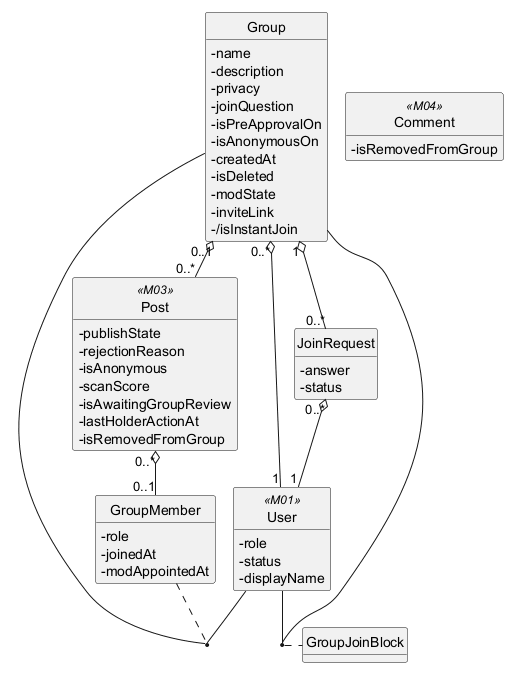

# Phân tích lớp thực thể — M11 Group

<!-- [Vietnamese Doc] Tài liệu tiếng Việt; tên lớp và thuộc tính viết tiếng Anh (input/CONVENTIONS.md mục 3). -->

| Mã tài liệu | EC-M11 |
|---|---|
| Dự án | iShare |
| Module | M11 — Group |
| Đầu vào | FR-M11 phiên bản 1.3 |
| Trạng thái | Đã chốt |
| Phiên bản | 1.0 |
| Ngày | 2026-11-19 |
| Tác giả | Phạm Văn Đức |

<!-- Quy ước chung cho mọi bảng dưới đây:
     - Không đổi tên cột, không xóa cột, không đổi số mục: tool đọc bảng theo số mục và tên cột.
     - Ô không có nội dung ghi "—".
     - Mục chưa tới bước làm thì để dòng "(Chưa làm — bước N)".
     - Cột Nguồn ghi mã trong FR: FR-Mxx-nn, FR-Mxx-nn.mm, BR-Mxx-nn, hoặc TN:<thuật ngữ> (mục 2.1 của FR).
     - Mục 4 chỉ chứa ảnh sơ đồ. gen_puml.py ghi mã PlantUML vào tệp riêng diagrams/EC-Mxx.puml, render
       diagrams/EC-Mxx.png và đặt ảnh vào mục 4. Không chép mã PlantUML vào tài liệu, không sửa tay tệp .puml hay ảnh. -->

## 1. Mô tả chức năng

### 1.1 Đoạn mô tả

Hệ thống quản lý nhóm của iShare: nhóm, thành viên nhóm, yêu cầu tham gia, việc chặn tham gia và bài nhóm đi qua cổng
duyệt của nhóm. Bài nhóm là bài viết do M03 quản lý được gắn với một nhóm; một bài viết thuộc nhiều nhất một nhóm.

Hệ thống cho phép người dùng đã đăng nhập tạo nhóm với tên nhóm, mô tả nhóm, chế độ Public hoặc Private, công tắc duyệt
trước, công tắc ẩn danh và câu hỏi tham gia tùy chọn; hệ thống ghi lại người tạo và thời điểm tạo, đặt trạng thái tồn
tại Hoạt động và trạng thái kiểm duyệt của nhóm Bình thường, và ghi người tạo là thành viên nhóm đầu tiên với vai trò
nhóm Owner. Hệ thống giới hạn số nhóm một người dùng tạo trong một khoảng thời gian, tính cả nhóm đã bị xóa. Hệ thống
cho phép Owner sửa tên nhóm, mô tả nhóm và đổi chế độ, công tắc duyệt trước, công tắc ẩn danh, câu hỏi tham gia; khi
nhóm thành nhóm vào ngay, mọi yêu cầu tham gia đang Chờ duyệt được chấp nhận.

Hệ thống cho phép mọi người, kể cả Guest, xem trang danh sách nhóm gồm các nhóm Public và các nhóm Private mà người xem
là thành viên nhóm, xếp theo thời điểm tạo, mỗi nhóm kèm tên nhóm, mô tả nhóm và chế độ. Người xem được trang nhóm theo
chế độ thấy bài nhóm và danh sách thành viên nhóm kèm vai trò nhóm; bài ẩn danh hiện nhãn "Ẩn danh" thay cho tác giả,
trừ với Owner, Group Mod của nhóm, Mod và Admin.

Hệ thống cho phép người ngoài nhóm tham gia nhóm: với nhóm vào ngay, người ngoài nhóm thành thành viên nhóm với vai trò
nhóm Member ngay; với nhóm khác, người ngoài nhóm gửi một yêu cầu tham gia kèm câu trả lời khi nhóm có câu hỏi tham gia,
ở trạng thái Chờ duyệt. Mỗi người gửi có nhiều nhất một yêu cầu tham gia Chờ duyệt cho mỗi nhóm, được rút yêu cầu tham
gia sang Đã rút và được gửi lại ngay sau khi bị từ chối. Hệ thống cho phép mọi thành viên nhóm mời người khác bằng link
mời chung không hết hạn của nhóm, gửi kèm thông báo mời qua M07; lời mời không phải một đối tượng riêng và người được
mời tham gia theo luồng tham gia. Hệ thống cho phép Owner và Group Mod xem các yêu cầu tham gia Chờ duyệt kèm câu trả
lời, chấp nhận yêu cầu tham gia để thêm người gửi làm thành viên nhóm với vai trò nhóm Member, hoặc từ chối yêu cầu tham
gia sang Đã từ chối. Hệ thống cho phép Owner và Group Mod chặn người dùng khỏi nhóm, xem danh sách chặn và bỏ chặn;
người bị chặn không vào được nhóm bằng cách nào và yêu cầu tham gia Chờ duyệt của người bị chặn chuyển sang Đã từ chối.
Mỗi khi một người dùng thành thành viên nhóm, hệ thống ghi lại người dùng, nhóm, vai trò nhóm và thời điểm tham gia.

Hệ thống cho phép Owner bổ nhiệm một Member làm Group Mod, ghi lại thời điểm bổ nhiệm Group Mod, và giáng Group Mod về
Member; Owner kick được Member và Group Mod, Group Mod kick được Member. Hệ thống cho phép thành viên nhóm rời nhóm; bài
nhóm và bình luận của người rời nhóm hoặc bị kick được giữ nguyên, và Owner chỉ rời được sau khi chỉ định người kế nhiệm
là một thành viên nhóm khác. Khi tài khoản của Owner bị ban, bị vô hiệu hóa hoặc bị xóa, hệ thống tự chuyển vai trò
nhóm Owner cho Group Mod có thâm niên Group Mod dài nhất, không có Group Mod thì cho Member có thời điểm tham gia sớm
nhất, và giữ Owner cũ làm Member; nhóm chỉ còn Owner thì bị xóa mềm.

Hệ thống cho phép thành viên nhóm gửi bài nhóm, và cho tác giả chọn đăng ẩn danh cho từng bài nhóm khi công tắc ẩn danh
của nhóm bật; hệ thống luôn giữ danh tính thật của tác giả bài ẩn danh. Bài nhóm của thành viên khác Owner đi qua cổng
duyệt của nhóm theo điểm quét do M13 trả về và công tắc duyệt trước: bị tự từ chối, vào hàng chờ duyệt của nhóm hoặc
được đăng; hệ thống ghi lại điểm quét của bài nhóm. Bài nhóm của Owner không vào hàng chờ duyệt của nhóm mà theo luồng
duyệt của M03. Hệ thống cho phép Owner và Group Mod nhận một bài nhóm trong hàng chờ duyệt của nhóm, ghi lại người đang
giữ bài và thời điểm thao tác cuối, rồi chấp nhận để đăng hoặc từ chối kèm lý do từ chối; người đang giữ bài không thao
tác thì bài nhóm được tự nhả về hàng chờ duyệt của nhóm, và Group Mod không duyệt bài nhóm của chính mình. Hệ thống cho
phép Owner và Group Mod gỡ bài nhóm và bình luận khỏi nhóm bằng xóa mềm, đặt dấu bị gỡ khỏi nhóm; quyết định kiểm duyệt
cấp nhóm không khiếu nại được.

Hệ thống cho phép Owner xóa nhóm bằng xóa mềm: nhóm chuyển sang trạng thái tồn tại Đã xóa, không hiện với ai nhưng dữ
liệu của nhóm được giữ. Hệ thống áp trạng thái kiểm duyệt của nhóm Bị ẩn, Bị khóa do M08 quyết lên cách nhóm hiển thị
và các thao tác được phép trong nhóm. Trong khi cờ tính năng Group do M10 quản lý tắt, hệ thống từ chối thao tác của
người dùng khác Admin với nhóm nhưng giữ nguyên dữ liệu của nhóm và vẫn tự chuyển vai trò nhóm Owner.

<!-- Văn xuôi bình thường, có thể chia vài đoạn. KHÔNG ghi mã câu (S1), (S2)… trong đoạn văn: người đọc không hiểu
     các mã đó. Số câu chỉ nằm ở bảng 1.2. Xem steps/01-describe-functions.md. -->

### 1.2 Truy vết câu

<!-- Mỗi câu của đoạn mô tả một dòng, theo đúng thứ tự. Câu: 1, 2, 3…
     Nội dung câu: chép NGUYÊN VĂN câu đó từ mục 1.1 (tool so khớp từng câu với đoạn văn).
     Nguồn: mã chức năng hoặc yêu cầu của FR mà câu dựa vào. -->

| Câu | Nội dung câu | Nguồn |
|---|---|---|
| 1 | Hệ thống quản lý nhóm của iShare: nhóm, thành viên nhóm, yêu cầu tham gia, việc chặn tham gia và bài nhóm đi qua cổng duyệt của nhóm. | FR-M11-01, FR-M11-04, FR-M11-07, FR-M11-12 |
| 2 | Bài nhóm là bài viết do M03 quản lý được gắn với một nhóm; một bài viết thuộc nhiều nhất một nhóm. | FR-M11-12.01, BR-M11-01 |
| 3 | Hệ thống cho phép người dùng đã đăng nhập tạo nhóm với tên nhóm, mô tả nhóm, chế độ Public hoặc Private, công tắc duyệt trước, công tắc ẩn danh và câu hỏi tham gia tùy chọn; hệ thống ghi lại người tạo và thời điểm tạo, đặt trạng thái tồn tại Hoạt động và trạng thái kiểm duyệt của nhóm Bình thường, và ghi người tạo là thành viên nhóm đầu tiên với vai trò nhóm Owner. | FR-M11-01, FR-M11-01.01, FR-M11-01.02, FR-M11-01.11, FR-M11-01.12 |
| 4 | Hệ thống giới hạn số nhóm một người dùng tạo trong một khoảng thời gian, tính cả nhóm đã bị xóa. | FR-M11-01.03, FR-M11-01.06 |
| 5 | Hệ thống cho phép Owner sửa tên nhóm, mô tả nhóm và đổi chế độ, công tắc duyệt trước, công tắc ẩn danh, câu hỏi tham gia; khi nhóm thành nhóm vào ngay, mọi yêu cầu tham gia đang Chờ duyệt được chấp nhận. | FR-M11-02, FR-M11-02.01, FR-M11-02.02, FR-M11-02.05, FR-M11-02.06, FR-M11-02.07, FR-M11-02.14 |
| 6 | Hệ thống cho phép mọi người, kể cả Guest, xem trang danh sách nhóm gồm các nhóm Public và các nhóm Private mà người xem là thành viên nhóm, xếp theo thời điểm tạo, mỗi nhóm kèm tên nhóm, mô tả nhóm và chế độ. | FR-M11-03, FR-M11-03.01, FR-M11-03.02, FR-M11-03.03, FR-M11-03.16, FR-M11-03.17 |
| 7 | Người xem được trang nhóm theo chế độ thấy bài nhóm và danh sách thành viên nhóm kèm vai trò nhóm; bài ẩn danh hiện nhãn "Ẩn danh" thay cho tác giả, trừ với Owner, Group Mod của nhóm, Mod và Admin. | FR-M11-03.04, FR-M11-03.05, FR-M11-03.06, FR-M11-03.09, FR-M11-03.10, FR-M11-03.14 |
| 8 | Hệ thống cho phép người ngoài nhóm tham gia nhóm: với nhóm vào ngay, người ngoài nhóm thành thành viên nhóm với vai trò nhóm Member ngay; với nhóm khác, người ngoài nhóm gửi một yêu cầu tham gia kèm câu trả lời khi nhóm có câu hỏi tham gia, ở trạng thái Chờ duyệt. | FR-M11-04, FR-M11-04.01, FR-M11-04.02, FR-M11-04.03, FR-M11-04.08 |
| 9 | Mỗi người gửi có nhiều nhất một yêu cầu tham gia Chờ duyệt cho mỗi nhóm, được rút yêu cầu tham gia sang Đã rút và được gửi lại ngay sau khi bị từ chối. | FR-M11-04.04, FR-M11-04.09, FR-M11-04.10 |
| 10 | Hệ thống cho phép mọi thành viên nhóm mời người khác bằng link mời chung không hết hạn của nhóm, gửi kèm thông báo mời qua M07; lời mời không phải một đối tượng riêng và người được mời tham gia theo luồng tham gia. | FR-M11-05, FR-M11-05.01, FR-M11-05.02, FR-M11-05.04, FR-M11-05.05, FR-M11-05.06 |
| 11 | Hệ thống cho phép Owner và Group Mod xem các yêu cầu tham gia Chờ duyệt kèm câu trả lời, chấp nhận yêu cầu tham gia để thêm người gửi làm thành viên nhóm với vai trò nhóm Member, hoặc từ chối yêu cầu tham gia sang Đã từ chối. | FR-M11-06, FR-M11-06.01, FR-M11-06.02, FR-M11-06.03 |
| 12 | Hệ thống cho phép Owner và Group Mod chặn người dùng khỏi nhóm, xem danh sách chặn và bỏ chặn; người bị chặn không vào được nhóm bằng cách nào và yêu cầu tham gia Chờ duyệt của người bị chặn chuyển sang Đã từ chối. | FR-M11-07, FR-M11-07.01, FR-M11-07.03, FR-M11-07.04, FR-M11-07.05, FR-M11-04.06 |
| 13 | Mỗi khi một người dùng thành thành viên nhóm, hệ thống ghi lại người dùng, nhóm, vai trò nhóm và thời điểm tham gia. | FR-M11-01.02, FR-M11-04.01, FR-M11-06.02 |
| 14 | Hệ thống cho phép Owner bổ nhiệm một Member làm Group Mod, ghi lại thời điểm bổ nhiệm Group Mod, và giáng Group Mod về Member; Owner kick được Member và Group Mod, Group Mod kick được Member. | FR-M11-08, FR-M11-08.01, FR-M11-08.02, FR-M11-09, FR-M11-09.01, FR-M11-09.02 |
| 15 | Hệ thống cho phép thành viên nhóm rời nhóm; bài nhóm và bình luận của người rời nhóm hoặc bị kick được giữ nguyên, và Owner chỉ rời được sau khi chỉ định người kế nhiệm là một thành viên nhóm khác. | FR-M11-10, FR-M11-10.01, FR-M11-10.02, FR-M11-10.03, FR-M11-10.04, FR-M11-09.05 |
| 16 | Khi tài khoản của Owner bị ban, bị vô hiệu hóa hoặc bị xóa, hệ thống tự chuyển vai trò nhóm Owner cho Group Mod có thâm niên Group Mod dài nhất, không có Group Mod thì cho Member có thời điểm tham gia sớm nhất, và giữ Owner cũ làm Member; nhóm chỉ còn Owner thì bị xóa mềm. | FR-M11-11, FR-M11-11.01, FR-M11-11.02, FR-M11-11.03, FR-M11-11.05, FR-M11-11.06 |
| 17 | Hệ thống cho phép thành viên nhóm gửi bài nhóm, và cho tác giả chọn đăng ẩn danh cho từng bài nhóm khi công tắc ẩn danh của nhóm bật; hệ thống luôn giữ danh tính thật của tác giả bài ẩn danh. | FR-M11-12, FR-M11-12.07, FR-M11-12.08, FR-M11-12.10 |
| 18 | Bài nhóm của thành viên khác Owner đi qua cổng duyệt của nhóm theo điểm quét do M13 trả về và công tắc duyệt trước: bị tự từ chối, vào hàng chờ duyệt của nhóm hoặc được đăng; hệ thống ghi lại điểm quét của bài nhóm. | FR-M11-12.01, FR-M11-12.02, FR-M11-12.03, FR-M11-12.04, FR-M11-12.05, FR-M11-12.14, FR-M11-12.15 |
| 19 | Bài nhóm của Owner không vào hàng chờ duyệt của nhóm mà theo luồng duyệt của M03. | FR-M11-12.16, FR-M11-12.17, FR-M11-12.18, FR-M11-12.19, FR-M11-12.20 |
| 20 | Hệ thống cho phép Owner và Group Mod nhận một bài nhóm trong hàng chờ duyệt của nhóm, ghi lại người đang giữ bài và thời điểm thao tác cuối, rồi chấp nhận để đăng hoặc từ chối kèm lý do từ chối; người đang giữ bài không thao tác thì bài nhóm được tự nhả về hàng chờ duyệt của nhóm, và Group Mod không duyệt bài nhóm của chính mình. | FR-M11-13, FR-M11-13.02, FR-M11-13.04, FR-M11-13.05, FR-M11-13.06, FR-M11-13.10, FR-M11-13.13 |
| 21 | Hệ thống cho phép Owner và Group Mod gỡ bài nhóm và bình luận khỏi nhóm bằng xóa mềm, đặt dấu bị gỡ khỏi nhóm; quyết định kiểm duyệt cấp nhóm không khiếu nại được. | FR-M11-14, FR-M11-14.01, FR-M11-14.03, FR-M11-13.07 |
| 22 | Hệ thống cho phép Owner xóa nhóm bằng xóa mềm: nhóm chuyển sang trạng thái tồn tại Đã xóa, không hiện với ai nhưng dữ liệu của nhóm được giữ. | FR-M11-15, FR-M11-15.01, FR-M11-15.02 |
| 23 | Hệ thống áp trạng thái kiểm duyệt của nhóm Bị ẩn, Bị khóa do M08 quyết lên cách nhóm hiển thị và các thao tác được phép trong nhóm. | FR-M11-16, FR-M11-16.01, FR-M11-16.04, FR-M11-16.07 |
| 24 | Trong khi cờ tính năng Group do M10 quản lý tắt, hệ thống từ chối thao tác của người dùng khác Admin với nhóm nhưng giữ nguyên dữ liệu của nhóm và vẫn tự chuyển vai trò nhóm Owner. | FR-M11-17, FR-M11-17.01, FR-M11-17.03, FR-M11-17.04, FR-M11-11.04 |

## 2. Danh từ và phân loại

### 2.1 Sổ danh từ

<!-- Phân loại: Lớp | Thuộc tính | Loại bỏ.
     Kết quả: tên lớp; hoặc Lớp.thuộcTính; hoặc "—" khi loại bỏ.
     Xuất hiện ở: "Câu n" (số câu ở bảng 1.2) hoặc "Quét: <mã FR>" (lượt quét bổ sung). -->

| # | Danh từ | Xuất hiện ở | Phân loại | Kết quả | Lý do |
|---|---|---|---|---|---|
| 1 | hệ thống | Câu 1 | Loại bỏ | — | Trừu tượng: chỉ chính phần mềm |
| 2 | nhóm | Câu 1 | Lớp | Group | Có danh tính và ba trạng thái riêng (tồn tại, kiểm duyệt, chế độ; mục Chuyển trạng thái), nhiều thông tin riêng (tên, mô tả, cài đặt, link mời), được tạo, sửa, xóa mềm (ma trận CRUD); dùng tên Group của glossary mà EC-M03, EC-M06, EC-M07, EC-M08 đã đặt tạm |
| 3 | iShare | Câu 1 | Loại bỏ | — | Trừu tượng: tên sản phẩm |
| 4 | thành viên nhóm | Câu 1 | Lớp | GroupMember | FR gọi là thực thể với vai trò nhóm, thời điểm tham gia, thời điểm bổ nhiệm Group Mod (mục Dữ liệu nghiệp vụ); được tạo khi tham gia, sửa khi đổi vai trò, xóa khi rời hoặc bị kick (ma trận CRUD). Ở bước 3 là lớp liên kết của quan hệ n-n User – Group |
| 5 | yêu cầu tham gia | Câu 1 | Lớp | JoinRequest | Có trạng thái riêng (Chờ duyệt, Đã chấp nhận, Đã từ chối, Đã rút; mục Chuyển trạng thái) và câu trả lời; một người có nhiều yêu cầu theo thời gian tới cùng một nhóm (mục Dữ liệu nghiệp vụ) |
| 6 | việc chặn tham gia / chặn tham gia | Câu 1 | Loại bỏ | — | Chung chung: quan hệ giữa nhóm và người bị chặn (dòng 55), không có thông tin riêng (mục Dữ liệu nghiệp vụ, dòng Chặn tham gia chỉ nêu nhóm và người bị chặn); xét ở bước 3 |
| 7 | bài nhóm | Câu 1 | Lớp | Post | Lớp ngoài (M03): bài viết gắn với một nhóm (TN:Bài nhóm), không phải loại bài riêng (BR-M11-01); dùng tên Post của EC-M03 |
| 8 | cổng duyệt của nhóm | Câu 1 | Loại bỏ | — | Hành động không lưu dấu vết: bước quyết định bài nhóm bị từ chối, chờ nhóm duyệt hay được đăng (TN:Cổng duyệt của nhóm); kết quả ghi bằng Post.publishState và Post.isAwaitingGroupReview |
| 9 | bài viết | Câu 2 | Lớp | Post | Lớp ngoài (M03); "bài nhóm" là bài viết có nhóm (dòng 7) |
| 10 | M03, M07, M08, M10, M13 (tên module) | Câu 2 | Loại bỏ | — | Trừu tượng: tên các phần của hệ thống |
| 11 | người dùng đã đăng nhập / người dùng / tài khoản | Câu 3 | Lớp | User | Lớp ngoài (M01): người tạo nhóm, thành viên nhóm, người gửi yêu cầu, người bị chặn; dùng tên User của EC-M01 |
| 12 | tên nhóm | Câu 3 | Thuộc tính | Group.name | Nhập khi tạo, Owner sửa được (FR-M11-01.01, FR-M11-02.01); tên name mà EC-M06 đã tham chiếu |
| 13 | mô tả nhóm | Câu 3 | Thuộc tính | Group.description | Nhập khi tạo, Owner sửa được (FR-M11-01.01, FR-M11-02.01) |
| 14 | chế độ | Câu 3 | Thuộc tính | Group.privacy | Public hoặc Private, có bảng chuyển trạng thái (mục Chuyển trạng thái: Nhóm — chế độ); tên privacy mà EC-M03, EC-M06 đã tham chiếu |
| 15 | Public / Private | Câu 3 | Loại bỏ | — | Giá trị của Group.privacy |
| 16 | công tắc duyệt trước | Câu 3 | Thuộc tính | Group.isPreApprovalOn | Cài đặt Bật, Tắt của nhóm (TN:Công tắc duyệt trước) |
| 17 | công tắc ẩn danh | Câu 3 | Thuộc tính | Group.isAnonymousOn | Cài đặt Bật, Tắt của nhóm (TN:Công tắc ẩn danh) |
| 18 | câu hỏi tham gia | Câu 3 | Thuộc tính | Group.joinQuestion | Tối đa một câu hỏi mỗi nhóm (BR-M11-08) nên là một giá trị của nhóm |
| 19 | người tạo | Câu 3 | Lớp | User | Vai trò theo ngữ cảnh: tài khoản tạo nhóm (mục Dữ liệu nghiệp vụ, dòng Nhóm); dùng để đếm giới hạn tạo nhóm kể cả khi vai trò Owner đã chuyển (BR-M11-03); quan hệ xét ở bước 3 |
| 20 | thời điểm tạo | Câu 3 | Thuộc tính | Group.createdAt | Mục Dữ liệu nghiệp vụ nêu: đếm số nhóm tạo trong 24 giờ, xếp danh sách nhóm |
| 21 | trạng thái tồn tại | Câu 3 | Thuộc tính | Group.isDeleted | Hai giá trị Hoạt động, Đã xóa (TN:Trạng thái tồn tại của nhóm); mục Dữ liệu nghiệp vụ gọi là "đã xóa" |
| 22 | Hoạt động / Đã xóa | Câu 3 | Loại bỏ | — | Giá trị của Group.isDeleted (sai, đúng) |
| 23 | trạng thái kiểm duyệt của nhóm | Câu 3 | Thuộc tính | Group.modState | Bình thường, Bị khóa, Bị ẩn do M08 quyết (TN:Trạng thái kiểm duyệt của nhóm); tên modState mà EC-M08 đã định nghĩa trên lớp ngoài Group |
| 24 | Bình thường / Bị ẩn / Bị khóa | Câu 3 | Loại bỏ | — | Giá trị của Group.modState |
| 25 | vai trò nhóm | Câu 3 | Thuộc tính | GroupMember.role | Một trong ba giá trị Owner, Group Mod, Member của thành viên trong một nhóm (TN:Vai trò nhóm); khác User.role |
| 26 | Owner / Owner cũ | Câu 3 | Lớp | User | Vai trò theo ngữ cảnh: thành viên nhóm có GroupMember.role là Owner; mỗi nhóm đúng một (BR-M11-04); xem Q-04 |
| 27 | số nhóm | Câu 4 | Loại bỏ | — | Hằng số của BR-M11-03: tối đa 5 nhóm; đếm trên các nhóm có cùng người tạo theo Group.createdAt |
| 28 | khoảng thời gian | Câu 4 | Loại bỏ | — | Hằng số của BR-M11-03: 24 giờ gần nhất tính tới lúc tạo (TN:24 giờ gần nhất); ghi ở ràng buộc của Group.createdAt |
| 29 | nhóm đã bị xóa | Câu 4 | Loại bỏ | — | Chung chung: nhóm có Group.isDeleted đúng (FR-M11-01.06) |
| 30 | nhóm vào ngay | Câu 5 | Thuộc tính | Group.isInstantJoin | Nhóm Public không có câu hỏi tham gia (TN:Nhóm vào ngay) → thuộc tính dẫn xuất từ Group.privacy và Group.joinQuestion |
| 31 | Chờ duyệt | Câu 5 | Loại bỏ | — | Giá trị của JoinRequest.status |
| 32 | mọi người | Câu 6 | Loại bỏ | — | Chung chung: mọi người xem, kể cả Guest |
| 33 | Guest | Câu 6 | Loại bỏ | — | Không lưu: tác nhân không có dữ liệu |
| 34 | trang danh sách nhóm | Câu 6 | Loại bỏ | — | Giao diện (TN:Trang danh sách nhóm) |
| 35 | người xem | Câu 6 | Loại bỏ | — | Chung chung: người dùng hoặc Guest xem nhóm; quyền xem tính từ Group.privacy và việc có GroupMember hay không (BR-M11-13, BR-M11-34); M11 không ghi việc xem |
| 36 | trang nhóm | Câu 7 | Loại bỏ | — | Giao diện |
| 37 | danh sách thành viên nhóm | Câu 7 | Loại bỏ | — | Chung chung: các GroupMember của nhóm kèm GroupMember.role (BR-M11-34) |
| 38 | bài ẩn danh | Câu 7 | Loại bỏ | — | Chung chung: bài nhóm có Post.isAnonymous đúng (TN:Bài ẩn danh) |
| 39 | nhãn "Ẩn danh" | Câu 7 | Loại bỏ | — | Giao diện: cách hiển thị tác giả của bài ẩn danh (BR-M11-17) |
| 40 | tác giả | Câu 7 | Lớp | User | Vai trò theo ngữ cảnh: tài khoản viết bài viết, bình luận; quan hệ tác giả thuộc M03, M04, M11 không ghi lại |
| 41 | Group Mod | Câu 7 | Lớp | User | Vai trò theo ngữ cảnh: thành viên nhóm có GroupMember.role là Group Mod (TN:Group Mod); khác Mod hệ thống |
| 42 | Mod / Admin | Câu 7 | Lớp | User | Vai trò hệ thống có tài khoản; phân biệt bằng User.role (M01, M10) |
| 43 | người ngoài nhóm | Câu 8 | Lớp | User | Vai trò theo ngữ cảnh: người dùng đã đăng nhập không có GroupMember của nhóm đang xét (TN:Người ngoài nhóm) |
| 44 | Member | Câu 8 | Lớp | User | Vai trò theo ngữ cảnh: thành viên nhóm có GroupMember.role là Member |
| 45 | câu trả lời | Câu 8 | Thuộc tính | JoinRequest.answer | Mục Dữ liệu nghiệp vụ nêu trên yêu cầu tham gia; Owner, Group Mod xem khi duyệt (FR-M11-06.01) |
| 46 | trạng thái | Câu 8 | Thuộc tính | JoinRequest.status | Có bảng chuyển trạng thái riêng (mục Chuyển trạng thái: Yêu cầu tham gia) |
| 47 | người gửi | Câu 9 | Lớp | User | Vai trò theo ngữ cảnh: tài khoản gửi yêu cầu tham gia (mục Dữ liệu nghiệp vụ); quan hệ xét ở bước 3 |
| 48 | Đã rút / Đã từ chối | Câu 9 | Loại bỏ | — | Giá trị của JoinRequest.status |
| 49 | link mời chung / link mời | Câu 10 | Thuộc tính | Group.inviteLink | Mỗi nhóm một link chung, không hết hạn (BR-M11-12); tên inviteLink mà EC-M07 đã tham chiếu |
| 50 | thông báo mời / thông báo | Câu 10 | Loại bỏ | — | Ngoài phạm vi module (M07): M11 gửi sự kiện, M07 tạo thông báo; quan hệ thông báo – nhóm do EC-M07 ghi (R-M07-07) |
| 51 | lời mời | Câu 10 | Loại bỏ | — | Chung chung: không phải thực thể riêng có chấp nhận, từ chối (TN:Lời mời, link mời; FR-M11-05.04); là thông báo mời của M07 kèm Group.inviteLink |
| 52 | người khác / người được mời | Câu 10 | Loại bỏ | — | Chung chung: người dùng nhận thông báo mời; M11 không ghi ai được mời (FR-M11-05.04); khi tham gia thì thành người gửi yêu cầu hoặc thành viên nhóm |
| 53 | luồng tham gia | Câu 10 | Loại bỏ | — | Hành động không lưu dấu vết: cách vào nhóm theo BR-M11-07; kết quả là GroupMember hoặc JoinRequest |
| 54 | danh sách chặn | Câu 12 | Loại bỏ | — | Chung chung: các người dùng bị nhóm chặn (dòng 55, FR-M11-07.04) |
| 55 | người bị chặn | Câu 12 | Lớp | User | Vai trò theo ngữ cảnh: người dùng bị nhóm chặn tham gia (mục Dữ liệu nghiệp vụ, dòng Chặn tham gia); quan hệ chặn xét ở bước 3 |
| 56 | thời điểm tham gia | Câu 13 | Thuộc tính | GroupMember.joinedAt | Mục Dữ liệu nghiệp vụ nêu (TN:Thời điểm tham gia) |
| 57 | thời điểm bổ nhiệm Group Mod | Câu 14 | Thuộc tính | GroupMember.modAppointedAt | FR-M11-08.01 yêu cầu ghi; tính thâm niên Group Mod (BR-M11-26) |
| 58 | kick | Câu 14 | Loại bỏ | — | Hành động không lưu dấu vết: đưa thành viên ra khỏi nhóm như tự rời (TN:Kick, BR-M11-24), tức xóa GroupMember; thông báo do M07 gửi |
| 59 | bình luận | Câu 15 | Lớp | Comment | Lớp ngoài (M04): bình luận trong nhóm bị Owner, Group Mod gỡ khỏi nhóm (FR-M11-14.01); dùng tên Comment của EC-M04 |
| 60 | người rời nhóm | Câu 15 | Loại bỏ | — | Chung chung: người dùng không còn GroupMember của nhóm; M11 không ghi ai đã rời (ma trận CRUD: thành viên nhóm bị xóa); quyền sửa bài sau khi rời tính từ Group.privacy (BR-M11-24) |
| 61 | người kế nhiệm | Câu 15 | Loại bỏ | — | Hành động không lưu dấu vết: chỉ đổi GroupMember.role của người được chọn sang Owner (FR-M11-10.04) |
| 62 | việc tài khoản bị ban, bị vô hiệu hóa, bị xóa | Câu 16 | Loại bỏ | — | Giá trị của User.status (BANNED, DEACTIVATED, DELETED) mà M11 đọc để tự chuyển vai trò Owner (TN:Owner mất quyền ngoài ý muốn) |
| 63 | thâm niên Group Mod | Câu 16 | Loại bỏ | — | Chung chung: thời gian kể từ GroupMember.modAppointedAt; Group Mod có modAppointedAt sớm nhất là người có thâm niên dài nhất (TN:Thâm niên Group Mod, BR-M11-26), không cần lưu riêng |
| 64 | xóa mềm | Câu 16 | Loại bỏ | — | Chung chung: cách xóa giữ dữ liệu; với nhóm là Group.isDeleted, với nội dung gỡ khỏi nhóm là Post.isRemovedFromGroup, Comment.isRemovedFromGroup |
| 65 | đăng ẩn danh | Câu 17 | Thuộc tính | Post.isAnonymous | Mục Dữ liệu nghiệp vụ nêu "ẩn danh (Có, Không)" trên phần M11 của bài viết |
| 66 | danh tính thật | Câu 17 | Loại bỏ | — | Chung chung: là tác giả của bài viết (quan hệ của M03), luôn được giữ (BR-M11-17) |
| 67 | điểm quét | Câu 18 | Thuộc tính | Post.scanScore | Mục Dữ liệu nghiệp vụ nêu "điểm quét" trên phần M11 của bài viết (TN:Điểm quét) |
| 68 | hàng chờ duyệt của nhóm | Câu 18 | Thuộc tính | Post.isAwaitingGroupReview | Hàng chờ là tập các bài nhóm đang chờ nhóm duyệt, không có thông tin riêng (TN:Hàng chờ duyệt của nhóm); điều cần lưu là bài đã vào hàng chờ của nhóm hay còn đang quét (TN:Chờ duyệt (đang quét), Chờ duyệt (chờ nhóm duyệt)); cùng cách Post.isInReviewQueue của EC-M03 |
| 69 | luồng duyệt của M03 | Câu 19 | Loại bỏ | — | Ngoài phạm vi module (M03): bài của Owner có điểm 0.5–< 0.9 hoặc quét lỗi vào hàng chờ của Mod hệ thống (BR-M11-40) |
| 70 | người đang giữ bài | Câu 20 | Lớp | GroupMember | Vai trò theo ngữ cảnh: Owner hoặc Group Mod của nhóm, tức một thành viên nhóm có vai trò Owner hoặc Group Mod (TN:Nhận bài); quan hệ xét ở bước 3; xem Q-01 |
| 71 | thời điểm thao tác cuối | Câu 20 | Thuộc tính | Post.lastHolderActionAt | Mục Dữ liệu nghiệp vụ nêu trên phần M11 của bài viết (TN:Thời điểm thao tác cuối) |
| 72 | lý do từ chối | Câu 20 | Thuộc tính | Post.rejectionReason | Mục Dữ liệu nghiệp vụ nêu "lý do khi nhóm từ chối"; EC-M03 đã có Post.rejectionReason cho lý do từ chối mà tác giả xem; xem Q-02 |
| 73 | dấu bị gỡ khỏi nhóm | Câu 21 | Thuộc tính | Post.isRemovedFromGroup | Mục Dữ liệu nghiệp vụ nêu trên phần M11 của bài viết (TN:Bị gỡ khỏi nhóm); EC-M03 dòng 99 để EC-M11 ghi |
| 74 | quyết định kiểm duyệt cấp nhóm | Câu 21 | Loại bỏ | — | Chung chung: việc nhóm từ chối bài chờ duyệt, gỡ bài, bình luận (TN:Quyết định kiểm duyệt cấp nhóm); dấu vết là Post.rejectionReason, Post.isRemovedFromGroup, Comment.isRemovedFromGroup; không khiếu nại (BR-M11-21) |
| 75 | dữ liệu của nhóm | Câu 22 | Loại bỏ | — | Chung chung: nhóm, thành viên nhóm, yêu cầu tham gia và bài nhóm, giữ nguyên khi xóa mềm (BR-M11-23) |
| 76 | thao tác | Câu 23 | Loại bỏ | — | Hành động không lưu dấu vết: thao tác bị chặn khi nhóm Bị khóa hoặc cờ Group tắt không được ghi (BR-M11-28, BR-M11-29) |
| 77 | cờ tính năng Group | Câu 24 | Loại bỏ | — | Ngoài phạm vi module (M10): M11 chỉ đọc; không có dữ liệu của M11 gắn với cờ (như EC-M03, EC-M05, EC-M06 với công tắc AI) |
| 78 | dấu bị gỡ khỏi nhóm của bình luận | Quét: TN:Bị gỡ khỏi nhóm | Thuộc tính | Comment.isRemovedFromGroup | Thuật ngữ nói dấu đặt trên bài, bình luận khi Owner hoặc Group Mod gỡ khỏi nhóm; EC-M04 dòng 72 để EC-M11 ghi |
| 79 | ký tự (tên, mô tả nhóm) | Quét: BR-M11-31 | Loại bỏ | — | Hằng số của BR-M11-31: tên 1–100 ký tự, mô tả tối đa 500 ký tự; ghi ở ràng buộc của Group.name, Group.description |
| 80 | 30 phút tự nhả | Quét: BR-M11-20 | Loại bỏ | — | Hằng số của BR-M11-20; ghi ở ràng buộc của Post.lastHolderActionAt |
| 81 | Chờ duyệt (đang quét) / Chờ duyệt (chờ nhóm duyệt) | Quét: TN:Chờ duyệt (đang quét), Chờ duyệt (chờ nhóm duyệt) | Loại bỏ | — | Giá trị của Post.isAwaitingGroupReview (sai, đúng) trong trạng thái đăng Chờ duyệt của M03 |
| 82 | trạng thái đăng | Quét: FR-M11-12.02 | Thuộc tính | Post.publishState | Thông tin của bài viết (M03) mà M11 ghi theo cổng duyệt của nhóm (FR-M11-12.02 đến FR-M11-12.05, FR-M11-13.05, FR-M11-13.06) |
| 83 | Đã đăng / Bị từ chối | Quét: FR-M11-12.02 | Loại bỏ | — | Giá trị của Post.publishState |
| 84 | kế nhiệm Owner | Quét: TN:Kế nhiệm Owner | Loại bỏ | — | Hành động không lưu dấu vết riêng: chỉ đổi GroupMember.role (FR-M11-10.04, FR-M11-11.01) |
| 85 | feed chính / tab Group | Quét: TN:Feed chính | Loại bỏ | — | Ngoài phạm vi module (M14): nơi hiện bài nhóm theo Group.privacy (BR-M11-14) |
| 86 | "Nội dung không tồn tại" | Quét: FR-M11-02.13 | Loại bỏ | — | Giao diện |
| 87 | leaderboard, reputation theo nhóm | Quét: BR-M11-02 | Loại bỏ | — | Ngoài phạm vi hệ thống: đã quyết không làm (BR-M11-02) |

### 2.2 Lớp

<!-- Nhóm: Thực thể | Liên kết | Thống kê. Sở hữu: mã module sở hữu lớp (Mxx của tài liệu này, hoặc Myy với lớp ngoài).
     Thuộc tính: tên mọi thuộc tính của lớp ở mục 2.3, ngăn bởi dấu phẩy, thuộc tính dẫn xuất có "/" phía trước;
     để người đọc thấy lớp và thuộc tính trên cùng một dòng. Lớp chưa có thuộc tính ghi "—". -->

| Lớp | Tên tiếng Việt | Nhóm | Sở hữu | Mô tả | Thuộc tính | Nguồn |
|---|---|---|---|---|---|---|
| Group | Nhóm | Thực thể | M11 | Không gian cộng đồng Public hoặc Private có thành viên, bài nhóm và cổng duyệt riêng; xóa mềm | name, description, privacy, joinQuestion, isPreApprovalOn, isAnonymousOn, createdAt, isDeleted, modState, inviteLink, /isInstantJoin | FR-M11-01.01, FR-M11-02.01, FR-M11-15.01 |
| GroupMember | Thành viên nhóm | Liên kết | M11 | Một người dùng trong một nhóm với đúng một vai trò nhóm; tách từ quan hệ n-n User – Group | role, joinedAt, modAppointedAt | FR-M11-01.02, FR-M11-04.01, FR-M11-06.02, FR-M11-08.01 |
| JoinRequest | Yêu cầu tham gia | Thực thể | M11 | Đề nghị vào nhóm của một người ngoài nhóm, chờ Owner hoặc Group Mod duyệt; không bị xóa | answer, status | FR-M11-04.03, FR-M11-06.02, FR-M11-06.03, FR-M11-04.10 |
| GroupJoinBlock | Chặn tham gia | Liên kết | M11 | Một người dùng bị một nhóm chặn tham gia; tách từ quan hệ n-n User – Group | — | FR-M11-07.01, FR-M11-07.05 |
| User | Người dùng (tài khoản) | Thực thể | M01 | Người tạo nhóm, thành viên nhóm, người gửi yêu cầu tham gia, người bị chặn | role, status, displayName | FR-M11-01.02, FR-M11-04.03, FR-M11-07.01, FR-M11-11.01 |
| Post | Bài viết | Thực thể | M03 | Bài nhóm: bài viết gắn với một nhóm, đi qua cổng duyệt của nhóm | publishState, rejectionReason, isAnonymous, scanScore, isAwaitingGroupReview, lastHolderActionAt, isRemovedFromGroup | FR-M11-12.01, FR-M11-13.02, FR-M11-14.01 |
| Comment | Bình luận | Thực thể | M04 | Bình luận trong nhóm bị Owner, Group Mod gỡ khỏi nhóm | isRemovedFromGroup | FR-M11-14.01 |

### 2.3 Thuộc tính

<!-- Mỗi lớp có ĐỦ thuộc tính để người đọc hình dung được nó; xếp các dòng theo lớp.
     Tính chất: Lưu | Dẫn xuất. Chưa có id, chưa có kiểu, chưa có khóa ngoại.
     Căn cứ: Nguồn nêu (FR nói tới) | Đề xuất (FR không nói, nhưng chức năng hoặc quy tắc ở cột Nguồn cần nó) |
             Tham chiếu (thuộc tính của lớp ngoài mà module này đọc hoặc ghi; module sở hữu lớp đó định nghĩa).
     Ràng buộc nguồn nêu: độ dài tối đa, duy nhất, bắt buộc/tùy chọn, tập giá trị, mặc định, công thức (với Dẫn xuất)
             — chép từ FR kèm mã. Đề xuất mà FR không nêu ràng buộc thì ghi "—".
     Nguồn: mã FR/BR nêu thuộc tính; với Đề xuất là mã chức năng hoặc quy tắc cần nó.
     Ghi chú: bắt buộc với Đề xuất (vì sao cần) và Tham chiếu (module này dùng nó làm gì). -->

| Lớp | Thuộc tính | Tên tiếng Việt | Tính chất | Căn cứ | Ràng buộc nguồn nêu | Nguồn | Ghi chú |
|---|---|---|---|---|---|---|---|
| Group | name | Tên nhóm | Lưu | Nguồn nêu | Bắt buộc, tối đa 100 ký tự (BR-M11-31); được trùng với nhóm khác (FR-M11-01.10) | FR-M11-01.01, FR-M11-01.08, FR-M11-02.01, BR-M11-31 | M06 tìm nhóm theo tên (EC-M06) |
| Group | description | Mô tả nhóm | Lưu | Nguồn nêu | Tùy chọn, tối đa 500 ký tự (BR-M11-31) | FR-M11-01.01, FR-M11-01.09, FR-M11-02.01 | — |
| Group | privacy | Chế độ | Lưu | Nguồn nêu | Public, Private; người tạo chọn khi tạo; Owner đổi bất kỳ lúc nào, chế độ mới áp cho thao tác sau thời điểm đổi (BR-M11-15) | FR-M11-01.01, FR-M11-02.02, BR-M11-15 | Tên privacy mà EC-M03, EC-M06 đã tham chiếu |
| Group | joinQuestion | Câu hỏi tham gia | Lưu | Nguồn nêu | Tùy chọn, tối đa một câu hỏi mỗi nhóm, mặc định trống (BR-M11-08, BR-M11-31); Owner đặt, sửa, bỏ; câu hỏi mới áp cho yêu cầu gửi sau đó (FR-M11-02.07) | FR-M11-01.11, FR-M11-02.07, FR-M11-02.08, BR-M11-08 | — |
| Group | isPreApprovalOn | Công tắc duyệt trước | Lưu | Nguồn nêu | Bật, Tắt; mặc định Tắt (BR-M11-31); giá trị mới dùng cho bài gửi sau thời điểm đổi; tắt không nhả các bài đang chờ (BR-M11-18) | FR-M11-01.12, FR-M11-02.05, FR-M11-02.15, BR-M11-18 | — |
| Group | isAnonymousOn | Công tắc ẩn danh | Lưu | Nguồn nêu | Bật, Tắt; mặc định Tắt (BR-M11-31); tắt chỉ chặn chọn ẩn danh cho bài mới (BR-M11-16) | FR-M11-01.12, FR-M11-02.06, BR-M11-16 | — |
| Group | createdAt | Thời điểm tạo | Lưu | Nguồn nêu | Mỗi người dùng tạo tối đa 5 nhóm trong 24 giờ gần nhất tính tới lúc tạo, tính cả nhóm đã xóa, Admin cũng bị giới hạn (BR-M11-03); danh sách nhóm xếp mới nhất trước (BR-M11-35) | FR-M11-01.03, FR-M11-03.17, BR-M11-03, BR-M11-35 | — |
| Group | isDeleted | Đã xóa | Lưu | Nguồn nêu | Trạng thái tồn tại Hoạt động (sai) hoặc Đã xóa (đúng) (TN:Trạng thái tồn tại của nhóm); mới tạo là Hoạt động; Đã xóa là trạng thái cuối; xóa mềm, dữ liệu được giữ (BR-M11-23) | FR-M11-01.01, FR-M11-15.01, FR-M11-10.06, FR-M11-11.03 | — |
| Group | modState | Trạng thái kiểm duyệt của nhóm | Lưu | Nguồn nêu | Bình thường, Bị khóa, Bị ẩn; mới tạo là Bình thường (FR-M11-01.01); M08 quyết; Bị ẩn không bỏ được (BR-M11-27) | FR-M11-01.01, FR-M11-16.01, FR-M11-16.04, FR-M11-16.06 | M08 định nghĩa và ghi (EC-M08 mục 5, tên modState); M11 áp lên cách nhóm hiển thị và thao tác được phép |
| Group | inviteLink | Link mời | Lưu | Nguồn nêu | Một link chung mỗi nhóm, không hết hạn, không thu hồi, không tạo lại (BR-M11-12) | FR-M11-05.01, FR-M11-05.06, FR-M11-05.07 | M07 đưa vào thông báo "được mời" (EC-M07, tên inviteLink) |
| Group | isInstantJoin | Nhóm vào ngay | Dẫn xuất | Nguồn nêu | Đúng khi privacy là Public và joinQuestion trống (TN:Nhóm vào ngay, BR-M11-07) | FR-M11-04.01, FR-M11-02.14, BR-M11-32 | Người ngoài nhóm vào ngay; đổi cài đặt làm giá trị này thành đúng thì mọi yêu cầu Chờ duyệt được chấp nhận (BR-M11-32) |
| GroupMember | role | Vai trò nhóm | Lưu | Nguồn nêu | Owner, Group Mod, Member theo thứ bậc Member < Group Mod < Owner (TN:Vai trò nhóm, BR-M11-05); mỗi nhóm đúng một Owner (BR-M11-04); khác vai trò hệ thống User.role | FR-M11-01.02, FR-M11-08.01, FR-M11-08.02, FR-M11-10.04, FR-M11-11.01 | — |
| GroupMember | joinedAt | Thời điểm tham gia | Lưu | Nguồn nêu | Lúc vào ngay, lúc yêu cầu được chấp nhận, hoặc lúc tạo nhóm với Owner đầu tiên (TN:Thời điểm tham gia) | FR-M11-01.02, FR-M11-04.01, FR-M11-06.02, FR-M11-11.02 | Chọn Member tham gia sớm nhất làm Owner khi không còn Group Mod (BR-M11-26) |
| GroupMember | modAppointedAt | Thời điểm bổ nhiệm Group Mod | Lưu | Nguồn nêu | Chỉ có khi role là Group Mod; ghi mỗi lần bổ nhiệm, thâm niên tính từ lần bổ nhiệm gần nhất (BR-M11-26, FR-M11-11.06) | FR-M11-08.01, FR-M11-11.01, FR-M11-11.06 | Chọn Group Mod thâm niên dài nhất làm Owner (BR-M11-26) |
| JoinRequest | answer | Câu trả lời | Lưu | Nguồn nêu | Bắt buộc, không để trống khi nhóm có câu hỏi tham gia (BR-M11-08, FR-M11-04.08) | FR-M11-04.03, FR-M11-04.08, FR-M11-06.01 | Owner, Group Mod xem khi duyệt; xem Q-03 |
| JoinRequest | status | Trạng thái | Lưu | Nguồn nêu | Chờ duyệt, Đã chấp nhận, Đã từ chối, Đã rút (TN:Yêu cầu tham gia); mới gửi là Chờ duyệt; mỗi người nhiều nhất một yêu cầu Chờ duyệt cho mỗi nhóm (BR-M11-09); không xóa (ma trận CRUD) | FR-M11-04.03, FR-M11-06.02, FR-M11-06.03, FR-M11-07.03, FR-M11-04.10, FR-M11-02.14 | — |
| User | role | Vai trò | Lưu | Tham chiếu | — | FR-M11-12.06, FR-M11-12.20, FR-M11-03.10, FR-M11-03.11, FR-M11-17.03 | Bài của Admin không bị quét và theo công tắc duyệt trước; Mod, Admin thấy danh tính thật của bài ẩn danh và chỉ xem nhóm Private trong vụ báo cáo; Admin vẫn dùng module khi cờ Group tắt |
| User | status | Trạng thái tài khoản | Lưu | Tham chiếu | — | FR-M11-11.01 | Owner có trạng thái BANNED, DEACTIVATED hoặc DELETED thì hệ thống tự chuyển vai trò Owner (TN:Owner mất quyền ngoài ý muốn) |
| User | displayName | Tên hiển thị | Lưu | Tham chiếu | — | FR-M11-03.14, FR-M11-03.09 | Hiển thị thành viên trong danh sách thành viên nhóm; thay bằng "Ẩn danh" ở bài ẩn danh với người xem thường |
| Post | publishState | Trạng thái đăng | Lưu | Tham chiếu | — | FR-M11-12.02, FR-M11-12.05, FR-M11-13.05, FR-M11-13.06, FR-M11-13.14 | M11 ghi theo cổng duyệt của nhóm: Bị từ chối, Chờ duyệt, Đã đăng; bài bị gỡ khỏi nhóm giữ trạng thái đăng (TN:Bị gỡ khỏi nhóm) |
| Post | rejectionReason | Lý do từ chối | Lưu | Tham chiếu | — | FR-M11-13.06, FR-M11-13.10 | M11 ghi lý do bắt buộc khi nhóm từ chối bài (BR-M11-38) vào cùng thuộc tính lý do từ chối của EC-M03 (Q-02) |
| Post | isAnonymous | Đăng ẩn danh | Lưu | Nguồn nêu | Có, Không; chỉ chọn được khi bài thuộc nhóm có công tắc ẩn danh bật (BR-M11-16); giữ nguyên khi công tắc tắt sau đó; danh tính thật luôn được giữ (BR-M11-17) | FR-M11-12.07, FR-M11-12.08, FR-M11-12.09, FR-M11-12.10 | M11 bổ sung trên lớp ngoài Post (mục 5); M02, M14 đọc (mục Giao tiếp) |
| Post | scanScore | Điểm quét | Lưu | Nguồn nêu | 0 đến 1, do M13 trả về (TN:Điểm quét); cổng duyệt của nhóm dùng ngưỡng 0.9 và 0.5 (BR-M11-18); không có khi AI tắt, quét thất bại hoặc tác giả là Admin | FR-M11-12.02, FR-M11-12.03, FR-M11-12.04, FR-M11-12.05 | Mục Dữ liệu nghiệp vụ ghi trên phần M11 của bài viết; EC-M03 dòng 36 để M11 bổ sung (mục 5) |
| Post | isAwaitingGroupReview | Đang chờ nhóm duyệt | Lưu | Nguồn nêu | Đúng khi bài ở giai đoạn Chờ duyệt (chờ nhóm duyệt), sai khi Chờ duyệt (đang quét) hoặc bài đã ra khỏi hàng chờ của nhóm (TN:Chờ duyệt (đang quét), Chờ duyệt (chờ nhóm duyệt)) | FR-M11-12.03, FR-M11-12.04, FR-M11-13.01, FR-M11-02.15 | Hàng chờ duyệt của nhóm là các bài nhóm có giá trị này đúng (cùng cách Post.isInReviewQueue của EC-M03 cho hàng chờ của Mod); M11 bổ sung (mục 5) |
| Post | lastHolderActionAt | Thời điểm thao tác cuối | Lưu | Nguồn nêu | Đặt lúc nhận bài và mỗi lần người giữ mở xem, chấp nhận, từ chối; 30 phút không thao tác thì bài tự được nhả về hàng chờ (TN:Thời điểm thao tác cuối, BR-M11-20) | FR-M11-13.02, FR-M11-13.04, BR-M11-20 | Cùng tên và cơ chế với ReportCase.lastHolderActionAt (EC-M08), Appeal.lastHolderActionAt (EC-M09); M11 bổ sung (mục 5) |
| Post | isRemovedFromGroup | Bị gỡ khỏi nhóm | Lưu | Nguồn nêu | Đặt khi Owner, Group Mod gỡ khỏi nhóm (xóa mềm); không phải trạng thái đăng; tác giả không tự bỏ được (TN:Bị gỡ khỏi nhóm, BR-M11-30) | FR-M11-14.01, FR-M11-14.05 | Nội dung chỉ còn hiện với tác giả, Owner, Group Mod của nhóm, Mod, Admin (FR-M11-14.01); M11 bổ sung (mục 5) |
| Comment | isRemovedFromGroup | Bị gỡ khỏi nhóm | Lưu | Nguồn nêu | Như Post.isRemovedFromGroup (TN:Bị gỡ khỏi nhóm, BR-M11-30) | FR-M11-14.01, FR-M11-14.05 | M11 bổ sung trên lớp ngoài Comment (mục 5); EC-M04 dòng 72 để EC-M11 ghi |

### 2.4 Đối chiếu với mục Dữ liệu nghiệp vụ của FR

<!-- Mỗi thực thể ở bảng "Dữ liệu nghiệp vụ" của FR một dòng; chép đúng tên ở cột Thực thể của FR.
     Xử lý: Khớp | Đã thêm qua sổ danh từ | Mô hình có thêm: … | Lệch: … (kèm Q-nn). -->

| Thực thể trong FR | Trong mô hình | Xử lý |
|---|---|---|
| Nhóm | Group | Khớp: tên → name; mô tả → description; chế độ → privacy; câu hỏi tham gia → joinQuestion; công tắc duyệt trước → isPreApprovalOn; công tắc ẩn danh → isAnonymousOn; đã xóa → isDeleted; trạng thái kiểm duyệt → modState; thời điểm tạo → createdAt; link mời → inviteLink; người tạo → quan hệ với User (bước 3). Owner → thành viên nhóm có GroupMember.role Owner, không có quan hệ riêng (Q-04). Mô hình có thêm: /isInstantJoin (TN:Nhóm vào ngay, BR-M11-32) |
| Thành viên nhóm | GroupMember | Khớp: vai trò nhóm → role; thời điểm tham gia → joinedAt; thời điểm được bổ nhiệm Group Mod → modAppointedAt; người dùng, nhóm → quan hệ; ở bước 3 là lớp liên kết của quan hệ n-n User – Group |
| Yêu cầu tham gia | JoinRequest | Khớp: câu trả lời → answer; trạng thái → status; người gửi, nhóm → quan hệ (bước 3) |
| Chặn tham gia | GroupJoinBlock | Khớp: nhóm, người bị chặn → quan hệ; ở bước 3 là lớp liên kết của quan hệ n-n User – Group (chặn), không có thuộc tính riêng |
| Bài viết (M03) — phần M11 | Post, Comment | Khớp: nhóm (tùy chọn) → quan hệ Group – Post; ẩn danh → isAnonymous; điểm quét → scanScore; thời điểm thao tác cuối → lastHolderActionAt; dấu bị gỡ khỏi nhóm → isRemovedFromGroup (M11 bổ sung trên Post). Lệch: người đang giữ → quan hệ GroupMember – Post (Q-01); lý do khi nhóm từ chối → Post.rejectionReason của EC-M03 (Q-02). Mô hình có thêm: isAwaitingGroupReview (TN:Chờ duyệt (chờ nhóm duyệt), FR-M11-13.01); Comment.isRemovedFromGroup (TN:Bị gỡ khỏi nhóm nói cả bình luận) |

## 3. Quan hệ giữa các lớp

### 3.1 Ma trận cặp lớp

<!-- T = quan hệ trực tiếp; G(X) = chỉ gián tiếp qua lớp X; trống = không liên quan. Chỉ điền nửa trên. -->

Chỉ ghi các hàng của lớp thuộc M11 có từ bước 2; cặp hai lớp ngoài không xét (CONVENTIONS mục 5). Ô T giữa Group và
User ứng với ba quan hệ: người tạo (1-n), thành viên (n-n, tách bằng GroupMember đã có từ bước 2) và chặn tham gia (n-n,
tách bằng GroupJoinBlock), mỗi quan hệ một dòng ở mục 3.2. Các ô GroupMember – Group và GroupMember – User để trống vì
đó là hai nửa của quan hệ n-n thành viên. Comment không có quan hệ với lớp nào của M11: M11 chỉ đặt dấu bị gỡ khỏi nhóm
trên bình luận; bình luận thuộc nhóm qua bài viết (quan hệ của M04, M03).

| | GroupMember | JoinRequest | User | Post | Comment |
|---|---|---|---|---|---|
| Group |   | T | T | T |   |
| GroupMember |   |   |   | T |   |
| JoinRequest |   |   | T |   |   |

### 3.2 Quan hệ số lượng

<!-- Mỗi ô T của ma trận một dòng. Dạng đọc theo thứ tự A–B: 1-1 | 1-n | n-1 | n-n.
     Xử lý: Giữ nguyên | Gộp vào <Lớp>: … | Giữ: … | Tách: thêm lớp <X>. -->

| Cặp | Câu A → B | Câu B → A | Dạng | Xử lý |
|---|---|---|---|---|
| User – Group (người tạo) | Một người dùng có thể tạo nhiều nhóm ở các thời điểm khác nhau. | Một nhóm do đúng một người dùng tạo; người tạo vẫn được ghi khi vai trò Owner đã chuyển cho người khác. | 1-n | Giữ nguyên |
| User – Group (thành viên) | Một người dùng có thể là thành viên của nhiều nhóm, không giới hạn (BR-M11-03). | Một nhóm có ít nhất một thành viên (Owner) và có thể có nhiều thành viên. | n-n | Tách: thêm lớp GroupMember (đã có từ bước 2, đổi Nhóm thành Liên kết) |
| User – Group (chặn tham gia) | Một người dùng có thể bị nhiều nhóm chặn. | Một nhóm có thể chặn nhiều người dùng. | n-n | Tách: thêm lớp GroupJoinBlock |
| User – JoinRequest | Một người dùng có thể gửi nhiều yêu cầu tham gia ở các thời điểm khác nhau, nhiều nhất một yêu cầu Chờ duyệt cho mỗi nhóm. | Một yêu cầu tham gia do đúng một người dùng gửi. | 1-n | Giữ nguyên |
| Group – JoinRequest | Một nhóm có thể có nhiều yêu cầu tham gia. | Một yêu cầu tham gia gửi tới đúng một nhóm. | 1-n | Giữ nguyên |
| Group – Post | Một nhóm có thể có nhiều bài nhóm. | Một bài viết thuộc nhiều nhất một nhóm (BR-M11-01). | 1-n | Giữ nguyên |
| GroupMember – Post (người đang giữ) | Một thành viên nhóm có vai trò Owner hoặc Group Mod có thể đang giữ nhiều bài nhóm trong hàng chờ duyệt của nhóm. | Một bài nhóm tại một thời điểm có nhiều nhất một người đang giữ; không có khi bài chưa được nhận hoặc đã tự nhả. | 1-n | Giữ nguyên |
| User – GroupMember | Một người dùng có thể có nhiều thành viên nhóm, nhiều nhất một cho mỗi nhóm. | Một thành viên nhóm là đúng một người dùng. | 1-n | Giữ nguyên |
| Group – GroupMember | Một nhóm có ít nhất một thành viên nhóm, là Owner (BR-M11-04). | Một thành viên nhóm thuộc đúng một nhóm. | 1-n | Giữ nguyên |
| User – GroupJoinBlock | Một người dùng có thể có nhiều lần bị chặn tham gia, nhiều nhất một cho mỗi nhóm. | Một lần chặn tham gia nhắm vào đúng một người dùng. | 1-n | Giữ nguyên |
| Group – GroupJoinBlock | Một nhóm có thể có nhiều lần chặn tham gia. | Một lần chặn tham gia thuộc đúng một nhóm. | 1-n | Giữ nguyên |

Hai cặp n-n (User – Group thành viên, User – Group chặn tham gia) được tách; bốn dòng cuối là các quan hệ 1-n mới. Không
có cặp 1-1. M11 không có lớp thống kê.

### 3.3 Lớp liên kết

<!-- Mỗi lớp có Nhóm = Liên kết một dòng. "Tách từ quan hệ n-n" viết dạng "LớpA – LớpB".
     "Thuộc tính riêng của liên kết": tên các thuộc tính (đã ghi ở mục 2.3); không có thì ghi rõ vì sao. -->

| Lớp liên kết | Tách từ quan hệ n-n | Thuộc tính riêng của liên kết | Nguồn |
|---|---|---|---|
| GroupMember | User – Group | role, joinedAt, modAppointedAt (đều thuộc cặp người dùng – nhóm: cùng một người có vai trò, thời điểm tham gia khác nhau ở mỗi nhóm) | FR-M11-01.02, FR-M11-04.01, FR-M11-08.01 |
| GroupJoinBlock | User – Group | Không có: FR chỉ nêu nhóm và người bị chặn (mục Dữ liệu nghiệp vụ, dòng Chặn tham gia); không ghi người chặn hay thời điểm chặn | FR-M11-07.01, FR-M11-07.04, FR-M11-07.05 |

### 3.4 Quan hệ

<!-- Bội số A = số đối tượng A ứng với một đối tượng B (ghi ở đầu A trên sơ đồ). Cú pháp: 1, 0..1, 0..*, 1..*, 1..3.
     Loại: Kế thừa | Hợp thành | Kết tập | Liên kết | Phụ thuộc.
     Bên chính: lớp cha (Kế thừa), lớp toàn thể (Hợp thành, Kết tập), lớp được dùng (Phụ thuộc); "—" với Liên kết.
     Kế thừa và Phụ thuộc ghi "—" ở Bội số A, Bội số B, Dạng. Không được còn dạng n-n. -->

| ID | Lớp A | Bội số A | Lớp B | Bội số B | Dạng | Loại | Bên chính | Căn cứ | Nguồn |
|---|---|---|---|---|---|---|---|---|---|
| R-M11-01 | User | 1 | Group | 0..* | 1-n | Kết tập | Group | Người tạo: nhóm ghi lại tài khoản tạo nó (mục Dữ liệu nghiệp vụ, dòng Nhóm); dùng để đếm giới hạn tạo nhóm, kể cả nhóm đã xóa (BR-M11-03). Tài khoản tồn tại độc lập, nhóm không bị xóa theo tài khoản (BR-M11-26) | FR-M11-01.02, FR-M11-01.03, BR-M11-03 |
| R-M11-02 | User | 1 | GroupMember | 0..* | 1-n | Liên kết | — | Nửa thứ nhất của quan hệ n-n User – Group (thành viên) đã tách qua GroupMember | FR-M11-01.02, FR-M11-04.01, FR-M11-06.02 |
| R-M11-03 | Group | 1 | GroupMember | 1..* | 1-n | Liên kết | — | Nửa thứ hai của quan hệ n-n User – Group (thành viên); mỗi nhóm luôn có đúng một Owner nên có ít nhất một thành viên (BR-M11-04) | FR-M11-01.02, BR-M11-04 |
| R-M11-04 | User | 1 | GroupJoinBlock | 0..* | 1-n | Liên kết | — | Nửa thứ nhất của quan hệ n-n User – Group (chặn tham gia) đã tách qua GroupJoinBlock | FR-M11-07.01 |
| R-M11-05 | Group | 1 | GroupJoinBlock | 0..* | 1-n | Liên kết | — | Nửa thứ hai của quan hệ n-n User – Group (chặn tham gia) | FR-M11-07.01, FR-M11-07.04 |
| R-M11-06 | User | 1 | JoinRequest | 0..* | 1-n | Kết tập | JoinRequest | Người gửi: yêu cầu tham gia ghi lại tài khoản gửi nó (mục Dữ liệu nghiệp vụ); tài khoản tồn tại độc lập | FR-M11-04.03, FR-M11-04.09 |
| R-M11-07 | Group | 1 | JoinRequest | 0..* | 1-n | Kết tập | Group | Nhóm có nhiều yêu cầu tham gia (mục Dữ liệu nghiệp vụ, cột Quan hệ của dòng Nhóm). Đủ điều (i) và (ii) nhưng không có căn cứ cho điều (iii): nhóm chỉ xóa mềm, dữ liệu giữ nguyên (BR-M11-23), nên không ghi hợp thành | FR-M11-04.03, FR-M11-06.01, BR-M11-23 |
| R-M11-08 | Group | 0..1 | Post | 0..* | 1-n | Kết tập | Group | Nhóm có nhiều bài nhóm (mục Dữ liệu nghiệp vụ); bài viết tồn tại độc lập, bị gỡ khỏi nhóm vẫn giữ trạng thái đăng. Cùng loại, chiều và bội số với R-M03-06 của EC-M03 (lượt gộp khử trùng) | FR-M11-12.01, BR-M11-01 |
| R-M11-09 | GroupMember | 0..1 | Post | 0..* | 1-n | Kết tập | Post | Người đang giữ: bài nhóm trong hàng chờ ghi lại Owner hoặc Group Mod đang giữ nó (FR-M11-13.02, mục Dữ liệu nghiệp vụ); người giữ phải là thành viên của chính nhóm có bài, vai trò Owner hoặc Group Mod, và không phải tác giả nếu là Group Mod (BR-M11-39); không có khi chưa ai nhận hoặc đã tự nhả (BR-M11-20). Xem Q-01 | FR-M11-13.02, FR-M11-13.03, FR-M11-13.04, BR-M11-20 |

## 4. Sơ đồ lớp phân tích

<!-- BEGIN:DIAGRAM -->

Mã nguồn sơ đồ: [diagrams/EC-M11.puml](diagrams/EC-M11.puml). Ảnh và tệp .puml do `gen_puml.py` sinh từ các bảng của tài liệu này; muốn đổi sơ đồ thì sửa bảng rồi chạy lại tool, không sửa tay.
<!-- END:DIAGRAM -->

## 5. Liên module

<!-- Mỗi lớp có Sở hữu khác module này một dòng. -->

| Lớp | Module sở hữu | Module này dùng thế nào | Thuộc tính module này bổ sung |
|---|---|---|---|
| User | M01 | Người tạo nhóm (R-M11-01), thành viên nhóm (R-M11-02), người bị chặn (R-M11-04), người gửi yêu cầu tham gia (R-M11-06). Đọc role (Admin, Mod), status (kích hoạt kế nhiệm Owner), displayName (danh sách thành viên) | — |
| Post | M03 | Bài nhóm (R-M11-08, trùng R-M03-06); người đang giữ bài trong hàng chờ duyệt của nhóm (R-M11-09). Ghi publishState và rejectionReason theo cổng duyệt của nhóm | isAnonymous, scanScore, isAwaitingGroupReview, lastHolderActionAt, isRemovedFromGroup |
| Comment | M04 | Đặt dấu bị gỡ khỏi nhóm khi Owner, Group Mod gỡ bình luận; không có quan hệ với lớp nào của M11 | isRemovedFromGroup |

## 6. Câu hỏi và điểm chưa chốt

<!-- Loại: Thiếu | Mơ hồ | Mâu thuẫn | Lệch. Ghi vào: mục của tài liệu này đã sửa theo câu trả lời, hoặc "Chờ cập nhật FR-Mxx". -->

| Mã | Loại | Câu hỏi | Trả lời | Ghi vào |
|---|---|---|---|---|
| Q-01 | Lệch | Mục Dữ liệu nghiệp vụ ghi "người đang giữ" trên phần M11 của bài viết, tức quan hệ User – Post giữa hai lớp ngoài, mà EC không ghi quan hệ giữa hai lớp ngoài (CONVENTIONS mục 5). Đề xuất: người đang giữ là một GroupMember (thành viên của chính nhóm có bài, vai trò Owner hoặc Group Mod), quan hệ GroupMember 0..1 – Post 0..* (R-M11-09); thành viên rời nhóm hoặc bị kick thì bài được nhả theo. Phương án khác: ghi quan hệ User – Post như FR viết, để lượt gộp EC-SYS xử lý | Người dùng đồng ý (2026-11-19): người đang giữ là một GroupMember (Owner hoặc Group Mod của chính nhóm), quan hệ GroupMember – Post (R-M11-09) | Mục 2.1 dòng 70; mục 3.2; mục 3.4 R-M11-09 |
| Q-02 | Lệch | "Lý do khi nhóm từ chối" (mục Dữ liệu nghiệp vụ) có cần thuộc tính riêng không? Đề xuất: dùng chung Post.rejectionReason của EC-M03 (lý do từ chối tác giả xem được), M11 ghi khi nhóm từ chối; một bài tại một thời điểm chỉ bị một bên từ chối (nhóm, Mod hoặc AI) | Người dùng đồng ý (2026-11-19): dùng chung Post.rejectionReason của EC-M03, M11 ghi khi nhóm từ chối | Mục 2.1 dòng 72; mục 2.3 Post.rejectionReason |
| Q-03 | Thiếu | Owner sửa câu hỏi tham gia khi đang có yêu cầu Chờ duyệt: FR-M11-02.07 áp câu hỏi mới cho yêu cầu gửi sau đó, nhưng FR-M11-06.01 chỉ hiện câu trả lời, nên người duyệt có thể thấy câu trả lời cũ cạnh câu hỏi mới. Đề xuất: giữ như FR (không lưu câu hỏi trên yêu cầu); nếu muốn lưu câu hỏi lúc gửi thì đó là yêu cầu mới, cần cập nhật FR-M11 trước | Người dùng đồng ý (2026-11-19): giữ như FR, không lưu câu hỏi trên yêu cầu tham gia; FR-M11 không đổi | Mục 2.3 JoinRequest.answer |
| Q-04 | Mơ hồ | Mục Dữ liệu nghiệp vụ ghi "Owner" là thuộc tính của Nhóm và "một Owner" ở cột Quan hệ. Đề xuất: không có quan hệ Owner riêng; Owner là GroupMember có role Owner (mỗi nhóm đúng một, BR-M11-04), còn người tạo là quan hệ riêng R-M11-01 vì không đổi khi Owner được chuyển | Người dùng đồng ý (2026-11-19): Owner là GroupMember có role Owner, không có quan hệ Owner riêng; người tạo là quan hệ riêng R-M11-01 | Mục 2.1 dòng 26; mục 2.4 |

## 7. Lịch sử sửa đổi

| Phiên bản | Ngày | Nội dung | Người sửa |
|---|---|---|---|
| 0.1 | 2026-11-19 | Tạo mới; làm liền 3 bước theo yêu cầu của người dùng (không dừng ở cổng), chờ duyệt và trả lời Q-01 đến Q-04 | Phạm Văn Đức |
| 1.0 | 2026-11-19 | Chốt sau 3 bước: 4 lớp của M11, 3 lớp ngoài, 9 quan hệ (R-M11-01 đến R-M11-09); Q-01 đến Q-04 đã trả lời | Phạm Văn Đức |
