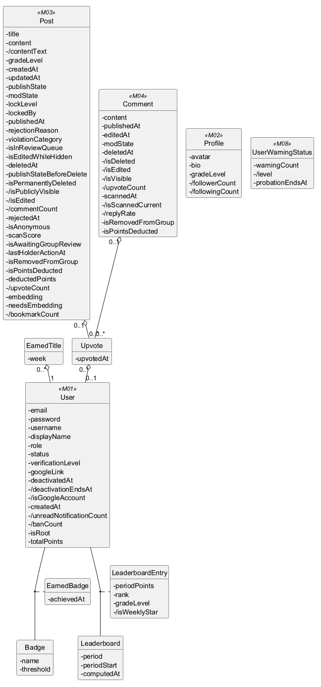

# Phân tích lớp thực thể — M12 Gamification

<!-- [Vietnamese Doc] Tài liệu tiếng Việt; tên lớp và thuộc tính viết tiếng Anh (input/CONVENTIONS.md mục 3). -->

| Mã tài liệu | EC-M12 |
|---|---|
| Dự án | iShare |
| Module | M12 — Gamification |
| Đầu vào | FR-M12 phiên bản 1.1 |
| Trạng thái | Đã chốt |
| Phiên bản | 1.1 |
| Ngày | 2026-11-20 |
| Tác giả | Phạm Văn Đức |

<!-- Quy ước chung cho mọi bảng dưới đây:
     - Không đổi tên cột, không xóa cột, không đổi số mục: tool đọc bảng theo số mục và tên cột.
     - Ô không có nội dung ghi "—".
     - Mục chưa tới bước làm thì để dòng "(Chưa làm — bước N)".
     - Cột Nguồn ghi mã trong FR: FR-Mxx-nn, FR-Mxx-nn.mm, BR-Mxx-nn, hoặc TN:<thuật ngữ> (mục 2.1 của FR).
     - Mục 4 chỉ chứa ảnh sơ đồ. gen_puml.py ghi mã PlantUML vào tệp riêng diagrams/EC-Mxx.puml, render
       diagrams/EC-Mxx.png và đặt ảnh vào mục 4. Không chép mã PlantUML vào tài liệu, không sửa tay tệp .puml hay ảnh. -->

## 1. Mô tả chức năng

### 1.1 Đoạn mô tả

Hệ thống quản lý upvote, điểm của người dùng, huy hiệu, danh hiệu "Ngôi sao tuần" và bảng xếp hạng của iShare.

Hệ thống cho phép người dùng đã đăng nhập upvote một bài viết hoặc một bình luận của người khác và rút lại upvote của
mình; mỗi khi một upvote được ghi nhận, hệ thống ghi lại người upvote, nội dung được upvote là bài viết hoặc bình luận,
và thời điểm upvote. Mỗi người dùng có nhiều nhất một upvote có hiệu lực trên mỗi bài viết hoặc bình luận, không upvote
được nội dung của chính mình, và không upvote được bài viết ở mức Khóa toàn bộ do M03 quản lý hay nội dung không còn
hiển thị. Upvote của tài khoản đã xóa vẫn được tính nhưng không còn ghi người upvote.

Hệ thống cập nhật ngay điểm của tác giả khi upvote được ghi nhận hoặc bị rút lại, theo trọng số của upvote bài viết và
upvote bình luận. Khi nội dung mất đi do trực tiếp, gồm tác giả tự xóa, Mod hoặc Admin gỡ vì vi phạm, hoặc AI tự ẩn
bình luận do M08 quản lý, hệ thống trừ khỏi điểm của tác giả phần điểm từ các upvote có hiệu lực trên nội dung, đánh dấu
nội dung đã trừ điểm và ghi số điểm đã trừ của bài viết; nội dung mất đi gián tiếp thì điểm được giữ. Khi khiếu nại bài
viết bị gỡ được chấp nhận do M09 quản lý, hệ thống cộng lại số điểm đã trừ của bài viết; điểm của bình luận đã trừ không
được hoàn. Điểm chỉ đến từ upvote, không giảm theo thời gian, và không ai cộng, trừ tay điểm.

Hệ thống có một danh mục cố định gồm các huy hiệu, mỗi huy hiệu có tên huy hiệu và ngưỡng điểm. Khi tổng điểm của người
dùng đạt ngưỡng điểm của một huy hiệu người đó chưa có, hệ thống trao huy hiệu đó và ghi lại huy hiệu đã đạt gồm người
dùng, huy hiệu và ngày đạt; huy hiệu đã đạt được giữ vĩnh viễn và không trao lại. Hệ thống cung cấp các huy hiệu đã đạt
kèm ngày đạt cho hồ sơ của M02, không kèm ngưỡng điểm hay tiến độ, và gửi sự kiện đạt huy hiệu cho M07.

Hệ thống tính bảng xếp hạng cho ba chu kỳ tuần, tháng và toàn thời gian, xếp người dùng theo điểm trong chu kỳ, chỉ xét
người có điểm trong chu kỳ lớn hơn không, cho đồng hạng khi cùng điểm, và loại người ở mức cảnh cáo HEAVY do M08 quản lý
cùng tài khoản BANNED, DEACTIVATED, DELETED. Bảng xếp hạng toàn thời gian được tính lại định kỳ; khi một tuần hoặc một
tháng kết thúc, lần tính định kỳ đầu tiên chốt bảng xếp hạng của chu kỳ đó bằng số liệu đúng mốc. Hệ thống chỉ giữ kết
quả bảng xếp hạng hiện hành của mỗi loại chu kỳ, gồm chu kỳ, thời điểm tính và các dòng bảng xếp hạng, mỗi dòng ứng với
một người được xếp hạng và ghi điểm trong chu kỳ, thứ hạng và Lớp/Khối tại lúc tính; kết quả mới thay kết quả cũ. Khi
chốt một tuần, hệ thống trao danh hiệu "Ngôi sao tuần" cho những người có thứ hạng trong hạng cắt, kể cả người đồng hạng,
ghi mỗi lần trao thành một danh hiệu đã đạt gồm người nhận và tuần đạt, và gửi sự kiện đạt danh hiệu cho M07; chốt tháng
không trao gì. Hệ thống cung cấp danh hiệu "Ngôi sao tuần" cho hồ sơ chỉ khi người dùng đạt ở tuần vừa chốt, và không
hiển thị lịch sử các lần đạt.

Hệ thống cho phép mọi người, kể cả Guest, xem bảng xếp hạng ở tab Tuần, Tháng, Toàn thời gian, lọc theo Lớp/Khối với
thứ hạng đánh lại trong nhóm lọc, mỗi dòng hiện thứ hạng, avatar, tên hiển thị, username, điểm trong chu kỳ và dấu
"Ngôi sao tuần". Trên bảng đã chốt, dòng của người trở thành bị loại sau lúc chốt bị ẩn khi hiển thị và tài khoản bị
xóa sau lúc chốt hiện mờ kèm nhãn "[Người dùng đã xóa]".

Trong khi trạng thái tài khoản do M01 quản lý là BANNED, hệ thống hiện nhãn "Tài khoản đã bị khóa" cạnh tên tài khoản ở
mọi nơi tên xuất hiện. Trong khi cờ tính năng Gamification do M10 quản lý tắt, hệ thống từ chối upvote, rút upvote và xem
bảng xếp hạng của người dùng không phải Admin nhưng vẫn tính điểm, trao huy hiệu, chốt chu kỳ và trao danh hiệu.

<!-- Văn xuôi bình thường, có thể chia vài đoạn. KHÔNG ghi mã câu (S1), (S2)… trong đoạn văn: người đọc không hiểu
     các mã đó. Số câu chỉ nằm ở bảng 1.2. Xem steps/01-describe-functions.md. -->

### 1.2 Truy vết câu

<!-- Mỗi câu của đoạn mô tả một dòng, theo đúng thứ tự. Câu: 1, 2, 3…
     Nội dung câu: chép NGUYÊN VĂN câu đó từ mục 1.1 (tool so khớp từng câu với đoạn văn).
     Nguồn: mã chức năng hoặc yêu cầu của FR mà câu dựa vào. -->

| Câu | Nội dung câu | Nguồn |
|---|---|---|
| 1 | Hệ thống quản lý upvote, điểm của người dùng, huy hiệu, danh hiệu "Ngôi sao tuần" và bảng xếp hạng của iShare. | FR-M12-01, FR-M12-02, FR-M12-03, FR-M12-04, FR-M12-05 |
| 2 | Hệ thống cho phép người dùng đã đăng nhập upvote một bài viết hoặc một bình luận của người khác và rút lại upvote của mình; mỗi khi một upvote được ghi nhận, hệ thống ghi lại người upvote, nội dung được upvote là bài viết hoặc bình luận, và thời điểm upvote. | FR-M12-01, FR-M12-01.01, FR-M12-01.02, FR-M12-01.04 |
| 3 | Mỗi người dùng có nhiều nhất một upvote có hiệu lực trên mỗi bài viết hoặc bình luận, không upvote được nội dung của chính mình, và không upvote được bài viết ở mức Khóa toàn bộ do M03 quản lý hay nội dung không còn hiển thị. | FR-M12-01.03, FR-M12-01.06, FR-M12-01.07, FR-M12-01.10, FR-M12-01.12 |
| 4 | Upvote của tài khoản đã xóa vẫn được tính nhưng không còn ghi người upvote. | FR-M12-02.04 |
| 5 | Hệ thống cập nhật ngay điểm của tác giả khi upvote được ghi nhận hoặc bị rút lại, theo trọng số của upvote bài viết và upvote bình luận. | FR-M12-02, FR-M12-02.01, FR-M12-02.02, FR-M12-02.03 |
| 6 | Khi nội dung mất đi do trực tiếp, gồm tác giả tự xóa, Mod hoặc Admin gỡ vì vi phạm, hoặc AI tự ẩn bình luận do M08 quản lý, hệ thống trừ khỏi điểm của tác giả phần điểm từ các upvote có hiệu lực trên nội dung, đánh dấu nội dung đã trừ điểm và ghi số điểm đã trừ của bài viết; nội dung mất đi gián tiếp thì điểm được giữ. | FR-M12-02.08, FR-M12-02.10, FR-M12-02.11, FR-M12-02.14, FR-M12-02.15, FR-M12-02.16, FR-M12-02.17, FR-M12-02.19, FR-M12-02.20, FR-M12-02.21 |
| 7 | Khi khiếu nại bài viết bị gỡ được chấp nhận do M09 quản lý, hệ thống cộng lại số điểm đã trừ của bài viết; điểm của bình luận đã trừ không được hoàn. | FR-M12-02.12, FR-M12-02.13 |
| 8 | Điểm chỉ đến từ upvote, không giảm theo thời gian, và không ai cộng, trừ tay điểm. | FR-M12-02.05, FR-M12-02.06, FR-M12-02.07 |
| 9 | Hệ thống có một danh mục cố định gồm các huy hiệu, mỗi huy hiệu có tên huy hiệu và ngưỡng điểm. | FR-M12-03.01 |
| 10 | Khi tổng điểm của người dùng đạt ngưỡng điểm của một huy hiệu người đó chưa có, hệ thống trao huy hiệu đó và ghi lại huy hiệu đã đạt gồm người dùng, huy hiệu và ngày đạt; huy hiệu đã đạt được giữ vĩnh viễn và không trao lại. | FR-M12-03, FR-M12-03.02, FR-M12-03.03, FR-M12-03.04, FR-M12-03.05 |
| 11 | Hệ thống cung cấp các huy hiệu đã đạt kèm ngày đạt cho hồ sơ của M02, không kèm ngưỡng điểm hay tiến độ, và gửi sự kiện đạt huy hiệu cho M07. | FR-M12-03.06, FR-M12-03.07, FR-M12-03.10 |
| 12 | Hệ thống tính bảng xếp hạng cho ba chu kỳ tuần, tháng và toàn thời gian, xếp người dùng theo điểm trong chu kỳ, chỉ xét người có điểm trong chu kỳ lớn hơn không, cho đồng hạng khi cùng điểm, và loại người ở mức cảnh cáo HEAVY do M08 quản lý cùng tài khoản BANNED, DEACTIVATED, DELETED. | FR-M12-04, FR-M12-04.02, FR-M12-04.03, FR-M12-04.06, FR-M12-04.07, FR-M12-04.08, FR-M12-04.12, FR-M12-04.17 |
| 13 | Bảng xếp hạng toàn thời gian được tính lại định kỳ; khi một tuần hoặc một tháng kết thúc, lần tính định kỳ đầu tiên chốt bảng xếp hạng của chu kỳ đó bằng số liệu đúng mốc. | FR-M12-04.01, FR-M12-05.01 |
| 14 | Hệ thống chỉ giữ kết quả bảng xếp hạng hiện hành của mỗi loại chu kỳ, gồm chu kỳ, thời điểm tính và các dòng bảng xếp hạng, mỗi dòng ứng với một người được xếp hạng và ghi điểm trong chu kỳ, thứ hạng và Lớp/Khối tại lúc tính; kết quả mới thay kết quả cũ. | FR-M12-04.14, FR-M12-05.08, FR-M12-06.09 |
| 15 | Khi chốt một tuần, hệ thống trao danh hiệu "Ngôi sao tuần" cho những người có thứ hạng trong hạng cắt, kể cả người đồng hạng, ghi mỗi lần trao thành một danh hiệu đã đạt gồm người nhận và tuần đạt, và gửi sự kiện đạt danh hiệu cho M07; chốt tháng không trao gì. | FR-M12-05, FR-M12-05.02, FR-M12-05.03, FR-M12-05.04, FR-M12-05.07, FR-M12-05.11 |
| 16 | Hệ thống cung cấp danh hiệu "Ngôi sao tuần" cho hồ sơ chỉ khi người dùng đạt ở tuần vừa chốt, và không hiển thị lịch sử các lần đạt. | FR-M12-05.12, FR-M12-05.13 |
| 17 | Hệ thống cho phép mọi người, kể cả Guest, xem bảng xếp hạng ở tab Tuần, Tháng, Toàn thời gian, lọc theo Lớp/Khối với thứ hạng đánh lại trong nhóm lọc, mỗi dòng hiện thứ hạng, avatar, tên hiển thị, username, điểm trong chu kỳ và dấu "Ngôi sao tuần". | FR-M12-06, FR-M12-06.01, FR-M12-06.02, FR-M12-06.03, FR-M12-06.08, FR-M12-06.11 |
| 18 | Trên bảng đã chốt, dòng của người trở thành bị loại sau lúc chốt bị ẩn khi hiển thị và tài khoản bị xóa sau lúc chốt hiện mờ kèm nhãn "[Người dùng đã xóa]". | FR-M12-04.11, FR-M12-04.18 |
| 19 | Trong khi trạng thái tài khoản do M01 quản lý là BANNED, hệ thống hiện nhãn "Tài khoản đã bị khóa" cạnh tên tài khoản ở mọi nơi tên xuất hiện. | FR-M12-07, FR-M12-07.01, FR-M12-07.03 |
| 20 | Trong khi cờ tính năng Gamification do M10 quản lý tắt, hệ thống từ chối upvote, rút upvote và xem bảng xếp hạng của người dùng không phải Admin nhưng vẫn tính điểm, trao huy hiệu, chốt chu kỳ và trao danh hiệu. | FR-M12-08, FR-M12-08.01, FR-M12-08.03, FR-M12-08.06, FR-M12-08.08, FR-M12-08.09 |

## 2. Danh từ và phân loại

### 2.1 Sổ danh từ

<!-- Phân loại: Lớp | Thuộc tính | Loại bỏ.
     Kết quả: tên lớp; hoặc Lớp.thuộcTính; hoặc "—" khi loại bỏ.
     Xuất hiện ở: "Câu n" (số câu ở bảng 1.2) hoặc "Quét: <mã FR>" (lượt quét bổ sung). -->

| # | Danh từ | Xuất hiện ở | Phân loại | Kết quả | Lý do |
|---|---|---|---|---|---|
| 1 | hệ thống | Câu 1 | Loại bỏ | — | Trừu tượng: chỉ chính phần mềm |
| 2 | upvote | Câu 1 | Lớp | Upvote | FR yêu cầu lưu dấu vết từng lần upvote: người upvote, nội dung được upvote, thời điểm upvote (FR-M12-01.01, mục Dữ liệu nghiệp vụ); được M04, M05, M06, M07, M14 đọc; dùng tên Upvote mà EC-M01, EC-M04 đã đặt tạm |
| 3 | điểm của người dùng / điểm / điểm của tác giả / tổng điểm | Câu 1 | Thuộc tính | User.totalPoints | Mỗi người dùng một tổng điểm, không có thông tin nào khác (mục Dữ liệu nghiệp vụ) → một giá trị của người dùng; kết quả tính được lưu và cập nhật tức thời (BR-M12-07) vì phần hoàn điểm dùng số điểm đã trừ đã ghi (BR-M12-10); xem Q-02 |
| 4 | huy hiệu | Câu 1 | Lớp | Badge | Danh mục cố định 5 huy hiệu, mỗi huy hiệu có tên và ngưỡng điểm (mục Dữ liệu nghiệp vụ); được tham chiếu riêng bởi huy hiệu đã đạt và thông báo đạt huy hiệu (R-M07-13 của EC-M07); không do người dùng thêm, sửa, xóa (ma trận CRUD) nhưng có hai thông tin riêng nên là lớp, không phải giá trị; dùng tên Badge mà EC-M07 đã đặt tạm |
| 5 | danh hiệu "Ngôi sao tuần" / danh hiệu | Câu 1 | Loại bỏ | — | Chung chung: hệ thống chỉ có một danh hiệu là "Ngôi sao tuần" (BR-M12-24), không có thông tin riêng; mỗi lần đạt là một EarnedTitle (dòng 48); xem Q-03 |
| 6 | bảng xếp hạng / kết quả bảng xếp hạng | Câu 1 | Lớp | Leaderboard | Kết quả tính được lưu theo FR-M12-04.14: bảng tuần, tháng chốt bằng số liệu đúng mốc và không đổi về sau (FR-M12-04.16), Lớp/Khối chụp lúc tính (BR-M12-16) nên không tính lại được → lớp Thực thể với thuộc tính Lưu, không phải lớp thống kê; xem Q-04 |
| 7 | iShare | Câu 1 | Loại bỏ | — | Trừu tượng: tên sản phẩm |
| 8 | người dùng đã đăng nhập / người dùng / tài khoản | Câu 2 | Lớp | User | Lớp ngoài (M01): người upvote, người nhận điểm, huy hiệu, danh hiệu, người được xếp hạng; dùng tên User của EC-M01 |
| 9 | bài viết | Câu 2 | Lớp | Post | Lớp ngoài (M03): đối tượng upvote, nội dung bị trừ và được hoàn điểm; dùng tên Post của EC-M03 |
| 10 | bình luận | Câu 2 | Lớp | Comment | Lớp ngoài (M04): đối tượng upvote, nội dung bị trừ điểm; dùng tên Comment của EC-M04 |
| 11 | người khác | Câu 2 | Loại bỏ | — | Chung chung: tác giả của nội dung khác người upvote (BR-M12-03) |
| 12 | người upvote | Câu 2 | Lớp | User | Vai trò theo ngữ cảnh: tài khoản cho upvote (mục Dữ liệu nghiệp vụ); quan hệ xét ở bước 3 |
| 13 | nội dung được upvote / nội dung | Câu 2 | Loại bỏ | — | Chung chung: là một bài viết hoặc một bình luận (dòng 9, 10); quan hệ xét ở bước 3 |
| 14 | thời điểm upvote | Câu 2 | Thuộc tính | Upvote.upvotedAt | FR-M12-01.01 yêu cầu ghi (TN:Thời điểm upvote) |
| 15 | upvote có hiệu lực | Câu 3 | Loại bỏ | — | Chung chung: upvote đang tồn tại, chưa bị rút (TN:Có hiệu lực, Đã rút; xem Q-01) |
| 16 | mức Khóa toàn bộ | Câu 3 | Loại bỏ | — | Giá trị của Post.lockLevel |
| 17 | M01, M02, M03, M07, M08, M09, M10 (tên module) | Câu 3 | Loại bỏ | — | Trừu tượng: tên các phần của hệ thống |
| 18 | nội dung không còn hiển thị | Câu 3 | Loại bỏ | — | Chung chung: bài viết, bình luận đã xóa hoặc bị ẩn, đọc qua Post.isPubliclyVisible, Comment.isVisible (FR-M12-01.12) |
| 19 | tài khoản đã xóa | Câu 4 | Loại bỏ | — | Chung chung: tài khoản có User.status DELETED; upvote được giữ, quan hệ với người upvote bị bỏ (R-M01-16 của EC-M01) |
| 20 | trọng số | Câu 5 | Loại bỏ | — | Hằng số của BR-M12-05: 2 với upvote bài viết, 1 với upvote bình luận; chỉ đổi bằng triển khai (BR-M12-06); ghi ở ràng buộc của User.totalPoints |
| 21 | upvote bài viết / upvote bình luận | Câu 5 | Loại bỏ | — | Chung chung: upvote nằm trên bài viết (Post Star) hay bình luận (Comment Star), phân biệt qua quan hệ ở bước 3 (FR-M12-01.04, TN:Post Star, Comment Star) |
| 22 | tác giả | Câu 5 | Lớp | User | Vai trò theo ngữ cảnh: tài khoản viết bài viết, bình luận; quan hệ tác giả thuộc M03, M04, M12 không ghi lại |
| 23 | nội dung mất đi do trực tiếp / nội dung mất đi gián tiếp | Câu 6 | Loại bỏ | — | Chung chung: các sự kiện liệt kê ở BR-M12-08; không lưu riêng, kết quả là Post.isPointsDeducted, Comment.isPointsDeducted |
| 24 | Mod / Admin | Câu 6 | Lớp | User | Vai trò hệ thống có tài khoản; phân biệt bằng User.role |
| 25 | AI | Câu 6 | Loại bỏ | — | Không lưu: tác nhân không có dữ liệu |
| 26 | nội dung đã trừ điểm | Câu 6 | Thuộc tính | Post.isPointsDeducted | Trạng thái Đang tính điểm, Đã trừ điểm của một nội dung với điểm của tác giả (TN:Đang tính điểm, Đã trừ điểm; mục Chuyển trạng thái); bình luận ở dòng 71 |
| 27 | số điểm đã trừ | Câu 6 | Thuộc tính | Post.deductedPoints | FR-M12-02.08, FR-M12-02.10 yêu cầu ghi để hoàn đúng số đó (BR-M12-10); xem Q-02 |
| 28 | khiếu nại bài viết bị gỡ / khiếu nại | Câu 7 | Loại bỏ | — | Ngoài phạm vi module (M09): M12 chỉ nhận sự kiện khiếu nại được chấp nhận để hoàn điểm |
| 29 | thời gian | Câu 8 | Loại bỏ | — | Trừu tượng |
| 30 | danh mục | Câu 9 | Loại bỏ | — | Chung chung: tập cố định 5 Badge (BR-M12-11) |
| 31 | tên huy hiệu | Câu 9 | Thuộc tính | Badge.name | Mục Dữ liệu nghiệp vụ nêu |
| 32 | ngưỡng điểm | Câu 9 | Thuộc tính | Badge.threshold | Mục Dữ liệu nghiệp vụ nêu; quyết định khi nào trao huy hiệu (BR-M12-11) |
| 33 | huy hiệu đã đạt | Câu 10 | Lớp | EarnedBadge | FR gọi là thực thể với người dùng, huy hiệu, ngày đạt (mục Dữ liệu nghiệp vụ); được tạo khi đạt, không sửa, không xóa (ma trận CRUD). Ở bước 3 là lớp liên kết của quan hệ n-n User – Badge |
| 34 | ngày đạt | Câu 10 | Thuộc tính | EarnedBadge.achievedAt | FR-M12-03.02 yêu cầu ghi |
| 35 | hồ sơ | Câu 11 | Lớp | Profile | Lớp ngoài (M02): M12 đọc Lớp/Khối và avatar của hồ sơ; dùng tên Profile của EC-M02 |
| 36 | tiến độ | Câu 11 | Loại bỏ | — | Ngoài phạm vi hệ thống: không cung cấp tiến độ tới huy hiệu chưa đạt (BR-M12-13) |
| 37 | sự kiện đạt huy hiệu | Câu 11 | Loại bỏ | — | Ngoài phạm vi module (M07): M12 gửi sự kiện, M07 tạo thông báo trỏ tới huy hiệu (R-M07-13) |
| 38 | chu kỳ | Câu 12 | Thuộc tính | Leaderboard.period | Mục Dữ liệu nghiệp vụ nêu "chu kỳ" trên kết quả bảng xếp hạng; trạng thái của chu kỳ (Đang diễn ra, Đã kết thúc chưa chốt…) suy ra được (dòng 80) |
| 39 | tuần, tháng, toàn thời gian | Câu 12 | Loại bỏ | — | Giá trị của Leaderboard.period |
| 40 | điểm trong chu kỳ | Câu 12 | Thuộc tính | LeaderboardEntry.periodPoints | Mục Dữ liệu nghiệp vụ nêu cho mỗi người trên kết quả bảng xếp hạng (TN:Điểm trong chu kỳ) |
| 41 | đồng hạng | Câu 12 | Loại bỏ | — | Chung chung: các dòng có cùng LeaderboardEntry.rank (TN:Đồng hạng, BR-M12-18) |
| 42 | mức cảnh cáo | Câu 12 | Thuộc tính | UserWarningStatus.level | Thông tin của lớp ngoài UserWarningStatus (M08) mà M12 đọc để loại người ở HEAVY (FR-M12-04.07); tên level của EC-M08 |
| 43 | HEAVY | Câu 12 | Loại bỏ | — | Giá trị của UserWarningStatus.level |
| 44 | BANNED, DEACTIVATED, DELETED | Câu 12 | Loại bỏ | — | Giá trị của User.status |
| 45 | lần tính định kỳ | Câu 13 | Loại bỏ | — | Hành động không lưu dấu vết riêng: kết quả là Leaderboard với Leaderboard.computedAt |
| 46 | số liệu đúng mốc | Câu 13 | Loại bỏ | — | Chung chung: các upvote có Upvote.upvotedAt trong chu kỳ (BR-M12-23) |
| 47 | thời điểm tính | Câu 14 | Thuộc tính | Leaderboard.computedAt | Mục Dữ liệu nghiệp vụ nêu |
| 48 | dòng bảng xếp hạng / dòng | Câu 14 | Lớp | LeaderboardEntry | Mỗi người trên kết quả bảng xếp hạng có thông tin riêng (điểm trong chu kỳ, thứ hạng, Lớp/Khối tại lúc tính; mục Dữ liệu nghiệp vụ) → thuộc tính nhiều giá trị nên tách lớp; ở bước 3 là lớp liên kết của quan hệ n-n User – Leaderboard |
| 49 | người được xếp hạng | Câu 14 | Lớp | User | Vai trò theo ngữ cảnh: tài khoản có dòng trên bảng xếp hạng (TN:Được xếp hạng) |
| 50 | thứ hạng | Câu 14 | Thuộc tính | LeaderboardEntry.rank | Mục Dữ liệu nghiệp vụ nêu |
| 51 | Lớp-Khối tại lúc tính | Câu 14 | Thuộc tính | LeaderboardEntry.gradeLevel | Mục Dữ liệu nghiệp vụ nêu; giá trị chụp lúc chốt, không đổi khi hồ sơ đổi (BR-M12-16) |
| 52 | kết quả mới / kết quả cũ | Câu 14 | Loại bỏ | — | Chung chung: hai Leaderboard cùng period ở hai lần tính; kết quả cũ bị thay, không lưu lịch sử (FR-M12-04.14) |
| 53 | hạng cắt | Câu 15 | Loại bỏ | — | Hằng số của BR-M12-23: hạng 3 (TN:Hạng cắt) |
| 54 | lần trao / danh hiệu đã đạt | Câu 15 | Lớp | EarnedTitle | FR yêu cầu ghi mỗi lần trao thành một bản ghi riêng gồm người nhận và tuần đạt (FR-M12-05.03), không sửa, không xóa (ma trận CRUD) |
| 55 | người nhận | Câu 15 | Lớp | User | Vai trò theo ngữ cảnh: tài khoản nhận danh hiệu; quan hệ xét ở bước 3 |
| 56 | tuần đạt | Câu 15 | Thuộc tính | EarnedTitle.week | Mục Dữ liệu nghiệp vụ nêu |
| 57 | sự kiện đạt danh hiệu | Câu 15 | Loại bỏ | — | Ngoài phạm vi module (M07): M12 gửi sự kiện, M07 tạo thông báo |
| 58 | tuần vừa chốt | Câu 16 | Loại bỏ | — | Chung chung: tuần của Leaderboard có period Tuần, xác định bằng Leaderboard.periodStart |
| 59 | lịch sử các lần đạt | Câu 16 | Loại bỏ | — | Giao diện: không hiển thị ở đâu (BR-M12-24); dữ liệu là các EarnedTitle |
| 60 | mọi người / Guest | Câu 17 | Loại bỏ | — | Không lưu: Guest là tác nhân không có dữ liệu; M12 không ghi việc xem |
| 61 | tab Tuần, Tháng, Toàn thời gian | Câu 17 | Loại bỏ | — | Giao diện |
| 62 | Lớp-Khối | Câu 17 | Thuộc tính | Profile.gradeLevel | Thông tin của hồ sơ (M02) mà M12 đọc lúc tính để chụp vào LeaderboardEntry.gradeLevel (FR-M12-06.09) |
| 63 | nhóm lọc | Câu 17 | Loại bỏ | — | Chung chung: các dòng có LeaderboardEntry.gradeLevel được chọn; thứ hạng đánh lại lúc hiển thị (BR-M12-16), không lưu |
| 64 | avatar | Câu 17 | Thuộc tính | Profile.avatar | Thông tin của hồ sơ (M02) mà M12 hiển thị trên dòng (FR-M12-06.11) |
| 65 | tên hiển thị | Câu 17 | Thuộc tính | User.displayName | Thông tin của tài khoản (M01) mà M12 hiển thị trên dòng (FR-M12-06.11) |
| 66 | username | Câu 17 | Thuộc tính | User.username | Thông tin của tài khoản (M01) mà M12 hiển thị và dùng xếp người đồng hạng (FR-M12-06.10) |
| 67 | dấu "Ngôi sao tuần" | Câu 17 | Thuộc tính | LeaderboardEntry.isWeeklyStar | Mục Dữ liệu nghiệp vụ nêu "nhận danh hiệu (tab Tuần)" trên mỗi người; suy ra từ thứ hạng (BR-M12-23) → thuộc tính dẫn xuất |
| 68 | bảng đã chốt | Câu 18 | Loại bỏ | — | Chung chung: Leaderboard có period Tuần hoặc Tháng |
| 69 | người trở thành bị loại | Câu 18 | Loại bỏ | — | Chung chung: tính lúc hiển thị từ User.status và UserWarningStatus.level hiện tại (BR-M12-20), không lưu |
| 70 | nhãn "[Người dùng đã xóa]" | Câu 18 | Loại bỏ | — | Giao diện: hiện khi User.status là DELETED (BR-M12-21) |
| 71 | trạng thái tài khoản | Câu 19 | Thuộc tính | User.status | Thông tin của tài khoản (M01) mà M12 đọc để loại khỏi bảng xếp hạng, ẩn huy hiệu và gắn nhãn (FR-M12-04.08, FR-M12-07.01) |
| 72 | nhãn "Tài khoản đã bị khóa" | Câu 19 | Loại bỏ | — | Giao diện: hiện khi User.status là BANNED (BR-M12-27), không lưu |
| 73 | cờ tính năng Gamification | Câu 20 | Loại bỏ | — | Ngoài phạm vi module (M10): M12 chỉ đọc; không có dữ liệu của M12 gắn với cờ |
| 74 | dấu đã trừ điểm của bình luận | Quét: TN:Đang tính điểm, Đã trừ điểm | Thuộc tính | Comment.isPointsDeducted | Thuật ngữ áp cho bài viết và bình luận; FR-M12-02.18 không cộng, không trừ lại nội dung đã trừ điểm |
| 75 | Đang tính điểm / Đã trừ điểm | Quét: TN:Đang tính điểm, Đã trừ điểm | Loại bỏ | — | Giá trị của Post.isPointsDeducted, Comment.isPointsDeducted (sai, đúng) |
| 76 | Có hiệu lực / Đã rút | Quét: TN:Có hiệu lực, Đã rút | Loại bỏ | — | Chung chung: upvote còn tồn tại hay đã bị xóa khi rút lại (ma trận CRUD: rút lại là Xóa); xem Q-01 |
| 77 | Đã xóa hẳn | Quét: TN:Đã xóa hẳn | Thuộc tính | Post.isPermanentlyDeleted | Thông tin của bài viết (M03): bài tự xóa chuyển Đã xóa hẳn thì trừ điểm (FR-M12-02.08) |
| 78 | gỡ vì vi phạm / Bị Mod ẩn | Quét: TN:Gỡ vì vi phạm | Thuộc tính | Post.modState | Thông tin của bài viết (M03): bài sang Bị Mod ẩn thì trừ điểm (FR-M12-02.10), về Bình thường khi khiếu nại được chấp nhận |
| 79 | trạng thái kiểm duyệt của bình luận | Quét: FR-M12-02.11 | Thuộc tính | Comment.modState | Thông tin của bình luận (M04): bình luận bị ẩn vì vi phạm thì trừ điểm (FR-M12-02.11, FR-M12-02.20, FR-M12-02.21) |
| 80 | Đang diễn ra, Đã kết thúc chưa chốt, Đã chốt đang hiển thị, Không còn hiển thị | Quét: TN:Đang diễn ra, Đã kết thúc chưa chốt, Đã chốt đang hiển thị, Không còn hiển thị | Loại bỏ | — | Chung chung: trạng thái của chu kỳ suy ra từ thời điểm hiện tại và Leaderboard.periodStart của kết quả đang giữ, không lưu riêng |
| 81 | mốc đầu chu kỳ | Quét: FR-M12-05.01 | Thuộc tính | Leaderboard.periodStart | FR-M12-05.01 chốt chu kỳ theo mốc đầu, cuối; cần biết kết quả đang giữ thuộc tuần, tháng nào (đề xuất) |
| 82 | Chưa đạt / Đã đạt | Quét: TN:Chưa đạt, Đã đạt | Loại bỏ | — | Chung chung: huy hiệu chưa có hay đã có EarnedBadge của người dùng |
| 83 | Được xếp hạng / Bị loại / Hiện mờ | Quét: TN:Được xếp hạng, Bị loại, Hiện mờ | Loại bỏ | — | Chung chung: có LeaderboardEntry hay không, cùng User.status, UserWarningStatus.level hiện tại; tính lúc hiển thị |
| 84 | 60 phút | Quét: BR-M12-19 | Loại bỏ | — | Hằng số của BR-M12-19: chu kỳ tính lại; ghi ở ràng buộc của Leaderboard.computedAt |
| 85 | Accepted Answer, downvote | Quét: BR-M12-01 | Loại bỏ | — | Ngoài phạm vi hệ thống: đã quyết không làm (BR-M12-01, BR-M12-06) |
| 86 | 20 dòng mỗi lần cuộn | Quét: BR-M12-29 | Loại bỏ | — | Giao diện |
| 87 | trạng thái cảnh cáo của người dùng | Quét: Dữ liệu nghiệp vụ | Lớp | UserWarningStatus | Lớp ngoài (M08): mục Dữ liệu nghiệp vụ ghi "mức cảnh cáo (M08)" trên phần M12 dùng của người dùng; EC-M08 đặt mức cảnh cáo trên lớp UserWarningStatus, M12 chỉ đọc level |
| 88 | số upvote của bài viết | Quét: Giao tiếp với module khác | Thuộc tính | Post.upvoteCount | Mục Giao tiếp, dòng Cung cấp M03, M04: "số upvote đang có hiệu lực của bài viết, bình luận"; số đếm tính lại được từ Upvote → thuộc tính dẫn xuất |

### 2.2 Lớp

<!-- Nhóm: Thực thể | Liên kết | Thống kê. Sở hữu: mã module sở hữu lớp (Mxx của tài liệu này, hoặc Myy với lớp ngoài).
     Thuộc tính: tên mọi thuộc tính của lớp ở mục 2.3, ngăn bởi dấu phẩy, thuộc tính dẫn xuất có "/" phía trước;
     để người đọc thấy lớp và thuộc tính trên cùng một dòng. Lớp chưa có thuộc tính ghi "—". -->

| Lớp | Tên tiếng Việt | Nhóm | Sở hữu | Mô tả | Thuộc tính | Nguồn |
|---|---|---|---|---|---|---|
| Upvote | Upvote | Thực thể | M12 | Một lượt đánh giá hữu ích của một người dùng cho một bài viết hoặc bình luận của người khác; rút lại thì xóa | upvotedAt | FR-M12-01.01, FR-M12-01.02 |
| Badge | Huy hiệu | Thực thể | M12 | Một trong 5 huy hiệu cố định trao theo mốc tổng điểm | name, threshold | FR-M12-03.01 |
| EarnedBadge | Huy hiệu đã đạt | Liên kết | M12 | Một huy hiệu một người dùng đã đạt, giữ vĩnh viễn; tách từ quan hệ n-n User – Badge | achievedAt | FR-M12-03.02, FR-M12-03.06 |
| EarnedTitle | Danh hiệu đã đạt | Thực thể | M12 | Một lần một người dùng đạt danh hiệu "Ngôi sao tuần" ở một tuần | week | FR-M12-05.02, FR-M12-05.03 |
| Leaderboard | Kết quả bảng xếp hạng | Thực thể | M12 | Kết quả hiện hành của bảng xếp hạng một loại chu kỳ: tuần, tháng đã chốt hoặc toàn thời gian lần tính gần nhất | period, periodStart, computedAt | FR-M12-04.01, FR-M12-04.14, FR-M12-05.01 |
| LeaderboardEntry | Dòng bảng xếp hạng | Liên kết | M12 | Một người dùng trên một kết quả bảng xếp hạng; tách từ quan hệ n-n User – Leaderboard | periodPoints, rank, gradeLevel, /isWeeklyStar | FR-M12-04.02, FR-M12-06.11 |
| User | Người dùng (tài khoản) | Thực thể | M01 | Người upvote, người nhận điểm, huy hiệu, danh hiệu, người được xếp hạng | email, password, username, displayName, role, status, verificationLevel, googleLink, deactivatedAt, /deactivationEndsAt, /isGoogleAccount, createdAt, /unreadNotificationCount, /banCount, isRoot, totalPoints | FR-M12-01.01, FR-M12-02.01, FR-M12-03.02, FR-M12-04.02 |
| Post | Bài viết | Thực thể | M03 | Đối tượng upvote; bị trừ điểm khi mất đi do trực tiếp, được hoàn khi khiếu nại bài bị gỡ được chấp nhận | title, content, /contentText, gradeLevel, createdAt, updatedAt, publishState, modState, lockLevel, lockedBy, publishedAt, rejectionReason, violationCategory, isInReviewQueue, isEditedWhileHidden, deletedAt, publishStateBeforeDelete, isPermanentlyDeleted, /isPubliclyVisible, /isEdited, /commentCount, rejectedAt, isAnonymous, scanScore, isAwaitingGroupReview, lastHolderActionAt, isRemovedFromGroup, isPointsDeducted, deductedPoints, /upvoteCount, embedding, needsEmbedding, /bookmarkCount | FR-M12-01.10, FR-M12-02.08, FR-M12-02.10, FR-M12-02.12 |
| Comment | Bình luận | Thực thể | M04 | Đối tượng upvote; bị trừ điểm khi mất đi do trực tiếp | content, publishedAt, editedAt, modState, deletedAt, /isDeleted, /isEdited, /isVisible, /upvoteCount, scannedAt, /isScannedCurrent, /replyRate, isRemovedFromGroup, isPointsDeducted | FR-M12-01.12, FR-M12-02.11, FR-M12-02.19 |
| Profile | Hồ sơ | Thực thể | M02 | Nguồn Lớp/Khối và avatar hiển thị trên bảng xếp hạng | avatar, bio, gradeLevel, /followerCount, /followingCount | FR-M12-06.03, FR-M12-06.11 |
| UserWarningStatus | Trạng thái cảnh cáo của người dùng | Thực thể | M08 | Nguồn mức cảnh cáo để loại người ở HEAVY khỏi bảng xếp hạng | warningCount, /level, probationEndsAt | FR-M12-04.07, FR-M12-05.10 |

### 2.3 Thuộc tính

<!-- Mỗi lớp có ĐỦ thuộc tính để người đọc hình dung được nó; xếp các dòng theo lớp.
     Tính chất: Lưu | Dẫn xuất. Chưa có id, chưa có kiểu, chưa có khóa ngoại.
     Căn cứ: Nguồn nêu (FR nói tới) | Đề xuất (FR không nói, nhưng chức năng hoặc quy tắc ở cột Nguồn cần nó) |
             Tham chiếu (thuộc tính của lớp ngoài; module sở hữu lớp đó định nghĩa. Sau lượt gộp hệ thống,
             lớp ngoài ghi đủ thuộc tính như EC-SYS, MD-05).
     Ràng buộc nguồn nêu: độ dài tối đa, duy nhất, bắt buộc/tùy chọn, tập giá trị, mặc định, công thức (với Dẫn xuất)
             — chép từ FR kèm mã. Đề xuất mà FR không nêu ràng buộc thì ghi "—".
     Nguồn: mã FR/BR nêu thuộc tính; với Đề xuất là mã chức năng hoặc quy tắc cần nó.
     Ghi chú: bắt buộc với Đề xuất (vì sao cần) và Tham chiếu (module này dùng nó làm gì). -->

| Lớp | Thuộc tính | Tên tiếng Việt | Tính chất | Căn cứ | Ràng buộc nguồn nêu | Nguồn | Ghi chú |
|---|---|---|---|---|---|---|---|
| Upvote | upvotedAt | Thời điểm upvote | Lưu | Nguồn nêu | Lúc người dùng bấm upvote và upvote có hiệu lực (TN:Thời điểm upvote); xếp upvote vào chu kỳ theo giờ Việt Nam (BR-M12-14) | FR-M12-01.01, FR-M12-04.15, BR-M12-14 | M05, M06, M14 dùng upvote kèm thời điểm cho Trending, xếp hạng, sắp xếp (mục Giao tiếp) |
| Badge | name | Tên huy hiệu | Lưu | Nguồn nêu | Người mới nổi, Cây bút triển vọng, Cây bút tích cực, Chuyên gia cộng đồng, Huyền thoại iShare (BR-M12-11); danh mục cố định, chỉ đổi bằng triển khai (BR-M12-06) | FR-M12-03.01, BR-M12-11 | — |
| Badge | threshold | Ngưỡng điểm | Lưu | Nguồn nêu | 25, 100, 300, 600, 1000 theo thứ tự tên ở trên (BR-M12-11); không hiển thị cùng huy hiệu (BR-M12-12) | FR-M12-03.01, FR-M12-03.02, BR-M12-11 | — |
| EarnedBadge | achievedAt | Ngày đạt | Lưu | Nguồn nêu | Ngày đạt đầu tiên, không đổi; huy hiệu không thu hồi, không trao lại (BR-M12-12) | FR-M12-03.02, FR-M12-03.05, FR-M12-03.06 | Hồ sơ (M02) hiện ngày đạt thay cho ngưỡng |
| EarnedTitle | week | Tuần đạt | Lưu | Nguồn nêu | Tuần lịch từ 00:00 thứ Hai đến trước 00:00 thứ Hai tuần sau, giờ Việt Nam (BR-M12-14); mỗi tuần đạt một bản ghi (BR-M12-24) | FR-M12-05.03, FR-M12-05.12 | Hồ sơ chỉ hiện danh hiệu khi tuần đạt là tuần vừa chốt (FR-M12-05.12) |
| Leaderboard | period | Chu kỳ | Lưu | Nguồn nêu | Tuần, Tháng, Toàn thời gian (BR-M12-14); không có chu kỳ năm (FR-M12-04.05); mỗi loại chu kỳ một kết quả hiện hành (mục Dữ liệu nghiệp vụ) | FR-M12-04.03, FR-M12-06.02, BR-M12-14 | — |
| Leaderboard | periodStart | Mốc đầu chu kỳ | Lưu | Đề xuất | — | FR-M12-05.01, FR-M12-06.04, BR-M12-22 | FR-M12-05.01 chốt khi "lần tính định kỳ thấy một tuần hoặc một tháng đã kết thúc từ lần tính trước": cần biết kết quả tuần, tháng đang giữ thuộc chu kỳ nào để biết chu kỳ vừa kết thúc đã được chốt chưa; tab Tuần, Tháng phải hiện bảng của đúng chu kỳ vừa kết thúc (BR-M12-22). Không có ở Toàn thời gian |
| Leaderboard | computedAt | Thời điểm tính | Lưu | Nguồn nêu | Bảng toàn thời gian tính lại mỗi 60 phút; bảng tuần, tháng tính một lần khi chốt, trễ tối đa 60 phút sau mốc cuối (BR-M12-19, BR-M12-25) | FR-M12-04.01, FR-M12-05.01, FR-M12-06.07 | — |
| LeaderboardEntry | periodPoints | Điểm trong chu kỳ | Lưu | Nguồn nêu | Lớn hơn 0; điểm theo trọng số BR-M12-05 từ các upvote có thời điểm upvote trong chu kỳ, còn hiệu lực lúc tính, trên nội dung chưa bị trừ điểm (BR-M12-15); toàn thời gian dùng tổng điểm (FR-M12-04.04) | FR-M12-04.02, FR-M12-04.15, BR-M12-15 | Kết quả tính được lưu (FR-M12-04.14): bảng đã chốt không đổi khi upvote bị rút hay nội dung bị trừ điểm sau đó (FR-M12-04.16) |
| LeaderboardEntry | rank | Thứ hạng | Lưu | Nguồn nêu | Người cùng điểm đồng hạng; người kế tiếp nhận hạng bằng số người đứng trên cộng một (BR-M12-18) | FR-M12-04.06, FR-M12-06.05 | Khi lọc theo Lớp/Khối, thứ hạng được đánh lại lúc hiển thị (FR-M12-06.08), không lưu |
| LeaderboardEntry | gradeLevel | Lớp/Khối tại lúc tính | Lưu | Nguồn nêu | 10, 11, 12 hoặc chưa đặt; lấy từ hồ sơ tại lúc chốt, với Toàn thời gian tại lần tính gần nhất (BR-M12-16) | FR-M12-06.09, BR-M12-16 | Giá trị chụp lúc tính, không đổi khi hồ sơ đổi sau đó |
| LeaderboardEntry | isWeeklyStar | Nhận danh hiệu | Dẫn xuất | Nguồn nêu | Đúng khi dòng thuộc kết quả có period Tuần và rank từ 1 đến 3 (BR-M12-23) | FR-M12-06.11, BR-M12-23 | Dấu "Ngôi sao tuần" ở tab Tuần; trùng với EarnedTitle của tuần đó |
| User | email | Email | Lưu | Tham chiếu | — | FR-M01-01.01, FR-M01-01.06, FR-M01-12.06 | Ghi đủ lớp sau gộp (MD-05); EC-M01 định nghĩa |
| User | password | Mật khẩu | Lưu | Tham chiếu | — | FR-M01-01.10, FR-M01-08.01, FR-M01-09.02 | Ghi đủ lớp sau gộp (MD-05); EC-M01 định nghĩa |
| User | username | Tên định danh | Lưu | Tham chiếu | — | FR-M12-06.10, FR-M12-06.11 | Hiển thị trên dòng bảng xếp hạng; xếp người đồng hạng theo username từ A đến Z |
| User | displayName | Tên hiển thị | Lưu | Tham chiếu | — | FR-M12-06.11 | Hiển thị trên dòng bảng xếp hạng |
| User | role | Vai trò | Lưu | Tham chiếu | — | FR-M12-08.06 | Admin vẫn dùng module khi cờ Gamification tắt |
| User | status | Trạng thái tài khoản | Lưu | Tham chiếu | — | FR-M12-04.08, FR-M12-04.12, FR-M12-04.17, FR-M12-03.11, FR-M12-07.01 | Loại BANNED, DEACTIVATED, DELETED khỏi bảng xếp hạng; ẩn huy hiệu của DELETED; nhãn "Tài khoản đã bị khóa" khi BANNED |
| User | verificationLevel | Mức xác minh | Lưu | Tham chiếu | — | FR-M01-01.01, FR-M01-02.01, FR-M01-03.01, FR-M01-04.01 | Ghi đủ lớp sau gộp (MD-05); EC-M01 định nghĩa |
| User | googleLink | Liên kết Google | Lưu | Tham chiếu | — | FR-M01-04.04, FR-M01-12.08 | Ghi đủ lớp sau gộp (MD-05); EC-M01 định nghĩa |
| User | deactivatedAt | Thời điểm vô hiệu hóa | Lưu | Tham chiếu | — | FR-M01-10.07 | Ghi đủ lớp sau gộp (MD-05); EC-M01 định nghĩa |
| User | deactivationEndsAt | Thời điểm hết thời hạn vô hiệu hóa | Dẫn xuất | Tham chiếu | — | FR-M01-10.07, FR-M01-11.05, FR-M01-12.01, FR-M01-12.05 | Ghi đủ lớp sau gộp (MD-05); EC-M01 định nghĩa |
| User | isGoogleAccount | Là tài khoản Google | Dẫn xuất | Tham chiếu | — | FR-M01-05.13, FR-M01-08.06, FR-M01-09.07 | Ghi đủ lớp sau gộp (MD-05); EC-M01 định nghĩa |
| User | createdAt | Thời điểm tạo tài khoản | Lưu | Tham chiếu | — | FR-M01-01.01, FR-M01-04.01 | Ghi đủ lớp sau gộp (MD-05); EC-M01 định nghĩa |
| User | unreadNotificationCount | Số thông báo chưa đọc | Dẫn xuất | Tham chiếu | — | FR-M07-05.10, BR-M07-12 | Ghi đủ lớp sau gộp (MD-05); EC-M01 định nghĩa |
| User | banCount | Số lần đã bị ban | Dẫn xuất | Tham chiếu | — | FR-M08-14.12, BR-M08-34 | Ghi đủ lớp sau gộp (MD-05); EC-M01 định nghĩa |
| User | isRoot | Là tài khoản ADMIN gốc | Lưu | Tham chiếu | — | FR-M10-07.04, FR-M10-01.05, BR-M10-10, BR-M10-11 | Ghi đủ lớp sau gộp (MD-05); EC-M01 định nghĩa |
| User | totalPoints | Tổng điểm | Lưu | Tham chiếu | = 2 × số upvote có hiệu lực trên bài viết + 1 × số upvote có hiệu lực trên bình luận của người đó, chỉ trên nội dung chưa bị trừ điểm, kể cả upvote của tài khoản đã xóa (BR-M12-05); cập nhật tức thời (BR-M12-07); không giảm theo thời gian, không chỉnh tay (BR-M12-06); cộng lại số điểm đã trừ khi khiếu nại bài bị gỡ được chấp nhận (BR-M12-10) | FR-M12-02.01, FR-M12-02.02, FR-M12-02.03, FR-M12-02.12 | M12 định nghĩa; đã đưa vào lớp User của EC-M01 (MD-05). Thực thể "Điểm của người dùng" của FR (Q-02); lưu, không tính lại, vì phần hoàn điểm cộng đúng số điểm đã trừ được ghi; M02 hiển thị (EC-M02 dòng 21) |
| Post | title | Tiêu đề | Lưu | Tham chiếu | — | FR-M03-01.14, FR-M03-04.08, FR-M03-07.04 | Ghi đủ lớp sau gộp (MD-05); EC-M03 định nghĩa |
| Post | content | Nội dung | Lưu | Tham chiếu | — | FR-M03-01.02, FR-M03-01.03, FR-M03-01.15, FR-M03-04.09 | Ghi đủ lớp sau gộp (MD-05); EC-M03 định nghĩa |
| Post | contentText | Nội dung chữ | Dẫn xuất | Tham chiếu | — | FR-M03-07.01 | Ghi đủ lớp sau gộp (MD-05); EC-M03 định nghĩa |
| Post | gradeLevel | Lớp/Khối | Lưu | Tham chiếu | — | FR-M03-01.05, FR-M03-01.06, FR-M03-01.07 | Ghi đủ lớp sau gộp (MD-05); EC-M03 định nghĩa |
| Post | createdAt | Thời điểm tạo | Lưu | Tham chiếu | — | FR-M03-01.08 | Ghi đủ lớp sau gộp (MD-05); EC-M03 định nghĩa |
| Post | updatedAt | Thời điểm cập nhật | Lưu | Tham chiếu | — | FR-M03-01.08 | Ghi đủ lớp sau gộp (MD-05); EC-M03 định nghĩa |
| Post | publishState | Trạng thái đăng | Lưu | Tham chiếu | — | FR-M03-01.01, FR-M03-04.01, FR-M03-13.01, FR-M03-15.01 | Ghi đủ lớp sau gộp (MD-05); EC-M03 định nghĩa |
| Post | modState | Trạng thái kiểm duyệt | Lưu | Tham chiếu | — | FR-M12-02.10, FR-M12-02.12 | Bài sang Bị Mod ẩn (gỡ vì vi phạm) thì trừ điểm ngay; khiếu nại được chấp nhận thì hoàn điểm |
| Post | lockLevel | Mức khóa | Lưu | Tham chiếu | — | FR-M12-01.10 | Khóa toàn bộ chặn upvote mới và rút upvote trên bài và mọi bình luận của bài |
| Post | lockedBy | Người khóa | Lưu | Tham chiếu | — | FR-M03-14.01, FR-M03-14.02, FR-M03-14.09 | Ghi đủ lớp sau gộp (MD-05); EC-M03 định nghĩa |
| Post | publishedAt | Thời điểm đăng | Lưu | Tham chiếu | — | FR-M03-04.03, FR-M03-05.01, FR-M03-06.02 | Ghi đủ lớp sau gộp (MD-05); EC-M03 định nghĩa |
| Post | rejectionReason | Lý do từ chối | Lưu | Tham chiếu | — | FR-M03-06.03, FR-M03-06.05 | Ghi đủ lớp sau gộp (MD-05); EC-M03 định nghĩa |
| Post | violationCategory | Nhóm vi phạm | Lưu | Tham chiếu | — | FR-M03-05.12 | Ghi đủ lớp sau gộp (MD-05); EC-M03 định nghĩa |
| Post | isInReviewQueue | Đang trong hàng chờ duyệt | Lưu | Tham chiếu | — | FR-M03-06.01, FR-M03-05.02, FR-M03-05.04, FR-M03-15.06 | Ghi đủ lớp sau gộp (MD-05); EC-M03 định nghĩa |
| Post | isEditedWhileHidden | Có bản sửa lưu trong lúc Tự ẩn chưa quét | Lưu | Tham chiếu | — | FR-M03-13.06, FR-M03-05.14 | Ghi đủ lớp sau gộp (MD-05); EC-M03 định nghĩa |
| Post | deletedAt | Thời điểm xóa | Lưu | Tham chiếu | — | FR-M03-15.01, FR-M03-16.02 | Ghi đủ lớp sau gộp (MD-05); EC-M03 định nghĩa |
| Post | publishStateBeforeDelete | Trạng thái trước khi xóa | Lưu | Tham chiếu | — | FR-M03-15.01, FR-M03-16.01, FR-M03-16.06 | Ghi đủ lớp sau gộp (MD-05); EC-M03 định nghĩa |
| Post | isPermanentlyDeleted | Đã xóa hẳn | Lưu | Tham chiếu | — | FR-M12-02.08, FR-M12-02.09 | Bài tự xóa chuyển Đã xóa hẳn thì trừ điểm; khôi phục trước đó thì không trừ |
| Post | isPubliclyVisible | Hiển thị công khai | Dẫn xuất | Tham chiếu | — | FR-M12-01.12 | Bài không còn hiển thị thì từ chối upvote |
| Post | isEdited | Đã chỉnh sửa | Dẫn xuất | Tham chiếu | — | FR-M03-12.01 | Ghi đủ lớp sau gộp (MD-05); EC-M03 định nghĩa |
| Post | commentCount | Số bình luận của bài | Dẫn xuất | Tham chiếu | — | FR-M04-01.10, BR-M04-18 | Ghi đủ lớp sau gộp (MD-05); EC-M03 định nghĩa |
| Post | rejectedAt | Thời điểm bị từ chối | Lưu | Tham chiếu | — | BR-M09-04, FR-M09-01.14, FR-M09-06.02, FR-M09-08.14 | Ghi đủ lớp sau gộp (MD-05); EC-M03 định nghĩa |
| Post | isAnonymous | Đăng ẩn danh | Lưu | Tham chiếu | — | FR-M11-12.07, FR-M11-12.08, FR-M11-12.09, FR-M11-12.10 | Ghi đủ lớp sau gộp (MD-05); EC-M03 định nghĩa |
| Post | scanScore | Điểm quét | Lưu | Tham chiếu | — | FR-M11-12.02, FR-M11-12.03, FR-M11-12.04, FR-M11-12.05 | Ghi đủ lớp sau gộp (MD-05); EC-M03 định nghĩa |
| Post | isAwaitingGroupReview | Đang chờ nhóm duyệt | Lưu | Tham chiếu | — | FR-M11-12.03, FR-M11-12.04, FR-M11-13.01, FR-M11-02.15 | Ghi đủ lớp sau gộp (MD-05); EC-M03 định nghĩa |
| Post | lastHolderActionAt | Thời điểm thao tác cuối | Lưu | Tham chiếu | — | FR-M11-13.02, FR-M11-13.04, BR-M11-20 | Ghi đủ lớp sau gộp (MD-05); EC-M03 định nghĩa |
| Post | isRemovedFromGroup | Bị gỡ khỏi nhóm | Lưu | Tham chiếu | — | FR-M11-14.01, FR-M11-14.05 | Ghi đủ lớp sau gộp (MD-05); EC-M03 định nghĩa |
| Post | isPointsDeducted | Đã trừ điểm | Lưu | Tham chiếu | Đang tính điểm (sai), Đã trừ điểm (đúng) (TN:Đang tính điểm, Đã trừ điểm); về Đang tính điểm khi khiếu nại bài bị gỡ được chấp nhận; upvote trên bài đã trừ điểm không được cộng, bài không bị trừ lại (FR-M12-02.18) | FR-M12-02.08, FR-M12-02.10, FR-M12-02.12, FR-M12-02.18 | M12 định nghĩa; đã đưa vào lớp Post của EC-M03 (MD-05) |
| Post | deductedPoints | Số điểm đã trừ | Lưu | Tham chiếu | Điểm từ các upvote có hiệu lực trên bài tại thời điểm trừ (BR-M12-09); dùng để hoàn đúng số đó (BR-M12-10) | FR-M12-02.08, FR-M12-02.10, FR-M12-02.12 | M12 định nghĩa; đã đưa vào lớp Post của EC-M03 (MD-05). Thực thể "Điểm đã trừ của nội dung" của FR (Q-02); chỉ bài viết cần, vì điểm bình luận không được hoàn (FR-M12-02.13) |
| Post | upvoteCount | Số upvote | Dẫn xuất | Tham chiếu | Số upvote đang có hiệu lực trên bài viết (mục Giao tiếp, dòng Cung cấp M03, M04; BR-M12-02) | FR-M12-01.01, FR-M12-01.02 | M12 định nghĩa; đã đưa vào lớp Post của EC-M03 (MD-05). M12 cung cấp cho M03 hiển thị và cho M05, M06, M14 tính Trending, xếp hạng (mục Giao tiếp); bình luận đã có Comment./upvoteCount ở EC-M04 |
| Post | embedding | Embedding | Lưu | Tham chiếu | — | FR-M13-03.01, FR-M13-03.02, FR-M13-03.03, FR-M13-03.07 | Ghi đủ lớp sau gộp (MD-05); EC-M03 định nghĩa |
| Post | needsEmbedding | Đang chờ tạo bù embedding | Lưu | Tham chiếu | — | FR-M13-03.08, FR-M13-03.09, FR-M13-03.10, BR-M13-26 | Ghi đủ lớp sau gộp (MD-05); EC-M03 định nghĩa |
| Post | bookmarkCount | Số bookmark | Dẫn xuất | Tham chiếu | — | FR-M14-03.02, FR-M14-03.10 | Ghi đủ lớp sau gộp (MD-05); EC-M03 định nghĩa |
| Comment | content | Nội dung bình luận | Lưu | Tham chiếu | — | FR-M04-04.01, FR-M04-05.07, BR-M04-01, BR-M04-19 | Ghi đủ lớp sau gộp (MD-05); EC-M04 định nghĩa |
| Comment | publishedAt | Thời điểm đăng | Lưu | Tham chiếu | — | FR-M04-02.01, FR-M04-04.03 | Ghi đủ lớp sau gộp (MD-05); EC-M04 định nghĩa |
| Comment | editedAt | Thời điểm sửa | Lưu | Tham chiếu | — | FR-M04-04.02, BR-M04-07 | Ghi đủ lớp sau gộp (MD-05); EC-M04 định nghĩa |
| Comment | modState | Trạng thái kiểm duyệt | Lưu | Tham chiếu | — | FR-M12-02.11, FR-M12-02.17, FR-M12-02.20, FR-M12-02.21 | Bình luận bị ẩn vì chính nó vi phạm (Mod, Admin; AI với điểm quét từ 0,9; kết luận vi phạm) thì trừ điểm; bị ẩn theo bài cha thì giữ điểm |
| Comment | deletedAt | Thời điểm xóa | Lưu | Tham chiếu | — | FR-M04-05.01, FR-M04-05.02, FR-M04-05.03 | Ghi đủ lớp sau gộp (MD-05); EC-M04 định nghĩa |
| Comment | isDeleted | Đã xóa | Dẫn xuất | Tham chiếu | — | FR-M12-02.19 | Tác giả tự xóa bình luận thì trừ điểm ngay |
| Comment | isEdited | Đã chỉnh sửa | Dẫn xuất | Tham chiếu | — | FR-M04-01.06 | Ghi đủ lớp sau gộp (MD-05); EC-M04 định nghĩa |
| Comment | isVisible | Hiển thị bình thường | Dẫn xuất | Tham chiếu | — | FR-M12-01.12 | Bình luận không còn hiển thị thì từ chối upvote |
| Comment | upvoteCount | Số upvote | Dẫn xuất | Tham chiếu | — | FR-M04-01.03, FR-M04-01.14, BR-M04-05 | Ghi đủ lớp sau gộp (MD-05); EC-M04 định nghĩa |
| Comment | scannedAt | Thời điểm quét gần nhất | Lưu | Tham chiếu | — | FR-M08-08.01, FR-M08-08.08 | Ghi đủ lớp sau gộp (MD-05); EC-M04 định nghĩa |
| Comment | isScannedCurrent | Đã quét với nội dung hiện tại | Dẫn xuất | Tham chiếu | — | FR-M08-08.01, FR-M08-08.08 | Ghi đủ lớp sau gộp (MD-05); EC-M04 định nghĩa |
| Comment | replyRate | Tốc độ trả lời | Dẫn xuất | Tham chiếu | — | FR-M08-08.01, BR-M08-20 | Ghi đủ lớp sau gộp (MD-05); EC-M04 định nghĩa |
| Comment | isRemovedFromGroup | Bị gỡ khỏi nhóm | Lưu | Tham chiếu | — | FR-M11-14.01, FR-M11-14.05 | Ghi đủ lớp sau gộp (MD-05); EC-M04 định nghĩa |
| Comment | isPointsDeducted | Đã trừ điểm | Lưu | Tham chiếu | Đang tính điểm (sai), Đã trừ điểm (đúng) (TN:Đang tính điểm, Đã trừ điểm); với bình luận, Đã trừ điểm là trạng thái cuối (mục Chuyển trạng thái) | FR-M12-02.11, FR-M12-02.19, FR-M12-02.20, FR-M12-02.18 | M12 định nghĩa; đã đưa vào lớp Comment của EC-M04 (MD-05) |
| Profile | avatar | Avatar | Lưu | Tham chiếu | — | FR-M12-06.11 | Hiển thị trên dòng bảng xếp hạng |
| Profile | bio | Bio | Lưu | Tham chiếu | — | FR-M02-03.02, FR-M02-03.04, FR-M02-03.11, FR-M02-03.12 | Ghi đủ lớp sau gộp (MD-05); EC-M02 định nghĩa |
| Profile | gradeLevel | Lớp/Khối | Lưu | Tham chiếu | — | FR-M12-06.03, FR-M12-06.09 | Chụp vào LeaderboardEntry.gradeLevel lúc tính |
| Profile | followerCount | Số người theo dõi | Dẫn xuất | Tham chiếu | — | FR-M02-01.02, FR-M02-02.07, FR-M02-02.08 | Ghi đủ lớp sau gộp (MD-05); EC-M02 định nghĩa |
| Profile | followingCount | Số đang theo dõi | Dẫn xuất | Tham chiếu | — | FR-M02-01.02, FR-M02-02.06, FR-M02-02.07 | Ghi đủ lớp sau gộp (MD-05); EC-M02 định nghĩa |
| UserWarningStatus | warningCount | Số lần cảnh cáo | Lưu | Tham chiếu | — | FR-M08-09.04, FR-M08-11.03, FR-M08-12.04 | Ghi đủ lớp sau gộp (MD-05); EC-M08 định nghĩa |
| UserWarningStatus | level | Mức cảnh cáo | Dẫn xuất | Tham chiếu | — | FR-M12-04.07, FR-M12-04.09, FR-M12-05.10 | Loại người ở HEAVY khỏi bảng xếp hạng và khỏi việc trao danh hiệu; LIGHT, MEDIUM không ảnh hưởng |
| UserWarningStatus | probationEndsAt | Thời điểm kết thúc thời gian thử thách | Lưu | Tham chiếu | — | FR-M08-13.01, FR-M08-12.03 | Ghi đủ lớp sau gộp (MD-05); EC-M08 định nghĩa |

### 2.4 Đối chiếu với mục Dữ liệu nghiệp vụ của FR

<!-- Mỗi thực thể ở bảng "Dữ liệu nghiệp vụ" của FR một dòng; chép đúng tên ở cột Thực thể của FR.
     Xử lý: Khớp | Đã thêm qua sổ danh từ | Mô hình có thêm: … | Lệch: … (kèm Q-nn). -->

| Thực thể trong FR | Trong mô hình | Xử lý |
|---|---|---|
| Upvote | Upvote | Khớp: người upvote → quan hệ với User (0..1 vì bị bỏ khi tài khoản đã xóa); nội dung được upvote → quan hệ với Post hoặc Comment; thời điểm upvote → upvotedAt. Trạng thái Có hiệu lực, Đã rút của mục Chuyển trạng thái: rút lại là xóa upvote theo ma trận CRUD (Q-01) |
| Điểm của người dùng | User.totalPoints | Lệch: FR ghi là thực thể nhưng chỉ có một giá trị cho mỗi người dùng → thuộc tính M12 bổ sung trên User (Q-02) |
| Điểm đã trừ của nội dung | Post.deductedPoints, Post.isPointsDeducted, Comment.isPointsDeducted | Lệch: FR ghi là thực thể gắn với một nội dung, chỉ có số điểm đã trừ → thuộc tính M12 bổ sung trên bài viết; trạng thái đã trừ điểm của bài viết và bình luận lấy từ mục Chuyển trạng thái (Q-02) |
| Huy hiệu | Badge | Khớp: tên → name; ngưỡng điểm → threshold |
| Huy hiệu đã đạt | EarnedBadge | Khớp: người dùng, huy hiệu → quan hệ; ngày đạt → achievedAt; ở bước 3 là lớp liên kết của quan hệ n-n User – Badge |
| Danh hiệu đã đạt | EarnedTitle | Khớp: người dùng → quan hệ; tuần đạt → week. "Danh hiệu Ngôi sao tuần" là danh hiệu duy nhất nên không có lớp danh hiệu riêng (Q-03) |
| Kết quả bảng xếp hạng | Leaderboard, LeaderboardEntry | Khớp: chu kỳ → period; thời điểm tính → computedAt; mỗi người: điểm trong chu kỳ → periodPoints, thứ hạng → rank, Lớp/Khối tại lúc tính → gradeLevel, nhận danh hiệu → /isWeeklyStar (dẫn xuất từ rank). Mô hình có thêm: periodStart (Đề xuất, FR-M12-05.01); các dòng tách thành LeaderboardEntry vì mỗi người có nhiều thông tin. Kết quả tính được lưu nên là Thực thể, không phải lớp thống kê (Q-04) |
| Người dùng (M01, M02, M08) — phần M12 dùng | User, Profile, UserWarningStatus | Khớp: Lớp/Khối → Profile.gradeLevel; trạng thái tài khoản → User.status; mức cảnh cáo → UserWarningStatus.level (Tham chiếu) |

## 3. Quan hệ giữa các lớp

### 3.1 Ma trận cặp lớp

<!-- T = quan hệ trực tiếp; G(X) = chỉ gián tiếp qua lớp X; trống = không liên quan. Chỉ điền nửa trên. -->

Chỉ ghi các hàng của lớp thuộc M12; cặp hai lớp ngoài không xét (CONVENTIONS mục 5). Ô Badge – User ứng với quan hệ n-n
"người dùng đạt huy hiệu", tách bằng EarnedBadge đã có từ bước 2; ô Leaderboard – User ứng với quan hệ n-n "người dùng có
dòng trên kết quả bảng xếp hạng", tách bằng LeaderboardEntry đã có từ bước 2. Các ô EarnedBadge – Badge, EarnedBadge –
User, LeaderboardEntry – Leaderboard, LeaderboardEntry – User để trống vì là các nửa của hai quan hệ n-n đó. Danh hiệu đã
đạt không có quan hệ với kết quả bảng xếp hạng: kết quả tuần bị thay ở lần chốt sau, còn danh hiệu được giữ. Profile và
UserWarningStatus không có quan hệ với lớp nào của M12: M12 chỉ đọc thuộc tính của chúng.

| | Badge | EarnedBadge | EarnedTitle | Leaderboard | LeaderboardEntry | User | Post | Comment | Profile | UserWarningStatus |
|---|---|---|---|---|---|---|---|---|---|---|
| Upvote |   |   |   |   |   | T | T | T |   |   |
| Badge |   |   |   |   |   | T |   |   |   |   |
| EarnedBadge |   |   |   |   |   |   |   |   |   |   |
| EarnedTitle |   |   |   |   |   | T |   |   |   |   |
| Leaderboard |   |   |   |   |   | T |   |   |   |   |
| LeaderboardEntry |   |   |   |   |   |   |   |   |   |   |

### 3.2 Quan hệ số lượng

<!-- Mỗi ô T của ma trận một dòng. Dạng đọc theo thứ tự A–B: 1-1 | 1-n | n-1 | n-n.
     Xử lý: Giữ nguyên | Gộp vào <Lớp>: … | Giữ: … | Tách: thêm lớp <X>. -->

| Cặp | Câu A → B | Câu B → A | Dạng | Xử lý |
|---|---|---|---|---|
| User – Upvote | Một người dùng có thể cho nhiều upvote, nhiều nhất một upvote có hiệu lực trên mỗi bài viết hoặc bình luận, không trên nội dung của chính mình. | Một upvote do nhiều nhất một người dùng cho; không còn ghi người cho khi tài khoản đã xóa. | 1-n | Giữ nguyên |
| Post – Upvote | Một bài viết có thể nhận nhiều upvote. | Một upvote nằm trên nhiều nhất một bài viết; upvote bình luận không nằm trên bài viết. | 1-n | Giữ nguyên |
| Comment – Upvote | Một bình luận có thể nhận nhiều upvote. | Một upvote nằm trên nhiều nhất một bình luận; upvote bài viết không nằm trên bình luận. | 1-n | Giữ nguyên |
| User – Badge | Một người dùng có thể đạt nhiều huy hiệu, mỗi huy hiệu nhiều nhất một lần. | Một huy hiệu có thể được nhiều người dùng đạt. | n-n | Tách: thêm lớp EarnedBadge (đã có từ bước 2, đổi Nhóm thành Liên kết) |
| User – EarnedTitle | Một người dùng có thể đạt danh hiệu ở nhiều tuần, mỗi tuần một danh hiệu đã đạt. | Một danh hiệu đã đạt thuộc đúng một người dùng. | 1-n | Giữ nguyên |
| User – Leaderboard | Một người dùng có thể có dòng trên nhiều kết quả bảng xếp hạng (tuần, tháng, toàn thời gian). | Một kết quả bảng xếp hạng có dòng của nhiều người dùng. | n-n | Tách: thêm lớp LeaderboardEntry (đã có từ bước 2, đổi Nhóm thành Liên kết) |
| User – EarnedBadge | Một người dùng có thể có nhiều huy hiệu đã đạt, nhiều nhất 5. | Một huy hiệu đã đạt thuộc đúng một người dùng. | 1-n | Giữ nguyên |
| Badge – EarnedBadge | Một huy hiệu có thể có nhiều huy hiệu đã đạt của những người khác nhau. | Một huy hiệu đã đạt là đúng một huy hiệu. | 1-n | Giữ nguyên |
| User – LeaderboardEntry | Một người dùng có nhiều nhất một dòng trên mỗi kết quả hiện hành, tức nhiều nhất 3 dòng. | Một dòng bảng xếp hạng là đúng một người dùng. | 1-n | Giữ nguyên |
| Leaderboard – LeaderboardEntry | Một kết quả bảng xếp hạng có thể có nhiều dòng, không có dòng nào khi chu kỳ không ai có điểm. | Một dòng bảng xếp hạng thuộc đúng một kết quả bảng xếp hạng. | 1-n | Giữ nguyên |

Hai cặp n-n (User – Badge, User – Leaderboard) được tách; bốn dòng cuối là các quan hệ 1-n mới. Không có cặp 1-1. M12
không có lớp thống kê: kết quả bảng xếp hạng là kết quả tính được lưu (Q-04).

### 3.3 Lớp liên kết

<!-- Mỗi lớp có Nhóm = Liên kết một dòng. "Tách từ quan hệ n-n" viết dạng "LớpA – LớpB".
     "Thuộc tính riêng của liên kết": tên các thuộc tính (đã ghi ở mục 2.3); không có thì ghi rõ vì sao. -->

| Lớp liên kết | Tách từ quan hệ n-n | Thuộc tính riêng của liên kết | Nguồn |
|---|---|---|---|
| EarnedBadge | User – Badge | achievedAt (ngày một người đạt một huy hiệu: đổi người hoặc đổi huy hiệu đều đổi giá trị) | FR-M12-03.02, BR-M12-12 |
| LeaderboardEntry | User – Leaderboard | periodPoints, rank, gradeLevel, /isWeeklyStar (đều thuộc cặp người dùng – kết quả bảng xếp hạng) | FR-M12-04.02, FR-M12-06.09, FR-M12-06.11 |

### 3.4 Quan hệ

<!-- Bội số A = số đối tượng A ứng với một đối tượng B (ghi ở đầu A trên sơ đồ). Cú pháp: 1, 0..1, 0..*, 1..*, 1..3.
     Loại: Kế thừa | Hợp thành | Kết tập | Liên kết | Phụ thuộc.
     Bên chính: lớp cha (Kế thừa), lớp toàn thể (Hợp thành, Kết tập), lớp được dùng (Phụ thuộc); "—" với Liên kết.
     Kế thừa và Phụ thuộc ghi "—" ở Bội số A, Bội số B, Dạng. Không được còn dạng n-n. -->

| ID | Lớp A | Bội số A | Lớp B | Bội số B | Dạng | Loại | Bên chính | Căn cứ | Nguồn |
|---|---|---|---|---|---|---|---|---|---|
| R-M12-01 | User | 0..1 | Upvote | 0..* | 1-n | Kết tập | Upvote | Người upvote: upvote ghi lại tài khoản cho nó (mục Dữ liệu nghiệp vụ); đầu User là 0..1 vì người upvote không còn được ghi khi tài khoản đã xóa, upvote vẫn được tính (FR-M12-02.04). Cùng loại, chiều và bội số với R-M01-16 của EC-M01 (lượt gộp khử trùng) | FR-M12-01.01, FR-M12-02.04, BR-M12-02 |
| R-M12-02 | Post | 0..1 | Upvote | 0..* | 1-n | Kết tập | Post | Bài viết nhận các upvote (Post Star); không ghi hợp thành vì upvote do người upvote tạo và rút, bài viết không bị xóa hẳn dữ liệu (M03). Cùng cách với R-M04-05 của bình luận. Mỗi upvote nằm trên đúng một bài viết (R-M12-02) hoặc một bình luận (R-M12-03) | FR-M12-01.01, FR-M12-01.04, BR-M12-01 |
| R-M12-03 | Comment | 0..1 | Upvote | 0..* | 1-n | Kết tập | Comment | Bình luận nhận các upvote (Comment Star). Cùng loại, chiều và bội số với R-M04-05 của EC-M04 (lượt gộp khử trùng). Mỗi upvote nằm trên đúng một bài viết (R-M12-02) hoặc một bình luận (R-M12-03) | FR-M12-01.01, FR-M12-01.04, BR-M12-01 |
| R-M12-04 | User | 1 | EarnedBadge | 0..5 | 1-n | Liên kết | — | Nửa thứ nhất của quan hệ n-n User – Badge đã tách qua EarnedBadge; mỗi người đạt mỗi huy hiệu nhiều nhất một lần, có 5 huy hiệu (BR-M12-11, BR-M12-12) | FR-M12-03.02, BR-M12-12 |
| R-M12-05 | Badge | 1 | EarnedBadge | 0..* | 1-n | Liên kết | — | Nửa thứ hai của quan hệ n-n User – Badge | FR-M12-03.02 |
| R-M12-06 | User | 1 | EarnedTitle | 0..* | 1-n | Kết tập | EarnedTitle | Danh hiệu đã đạt ghi lại người nhận (FR-M12-05.03); tài khoản tồn tại độc lập; bản ghi được giữ, không xóa (ma trận CRUD) nên không ghi hợp thành | FR-M12-05.03, FR-M12-05.04, BR-M12-24 |
| R-M12-07 | Leaderboard | 1 | LeaderboardEntry | 0..* | 1-n | Liên kết | — | Nửa thứ nhất của quan hệ n-n User – Leaderboard đã tách qua LeaderboardEntry; khi kết quả mới thay kết quả cũ thì các dòng của kết quả cũ cũng không còn (FR-M12-04.14) | FR-M12-04.02, FR-M12-04.14 |
| R-M12-08 | User | 1 | LeaderboardEntry | 0..3 | 1-n | Liên kết | — | Nửa thứ hai của quan hệ n-n User – Leaderboard; mỗi người nhiều nhất một dòng trên mỗi kết quả hiện hành của ba loại chu kỳ | FR-M12-04.02, FR-M12-04.13 |

## 4. Sơ đồ lớp phân tích

<!-- BEGIN:DIAGRAM -->

Mã nguồn sơ đồ: [diagrams/EC-M12.puml](diagrams/EC-M12.puml). Ảnh và tệp .puml do `gen_puml.py` sinh từ các bảng của tài liệu này; muốn đổi sơ đồ thì sửa bảng rồi chạy lại tool, không sửa tay.
<!-- END:DIAGRAM -->

## 5. Liên module

<!-- Mỗi lớp có Sở hữu khác module này một dòng. -->

| Lớp | Module sở hữu | Module này dùng thế nào | Thuộc tính module này bổ sung |
|---|---|---|---|
| User | M01 | Người upvote (R-M12-01, trùng R-M01-16), người đạt huy hiệu (R-M12-04), người nhận danh hiệu (R-M12-06), người được xếp hạng (R-M12-08). Đọc role, status, username, displayName; ghi totalPoints | totalPoints — đã đưa vào lớp của EC-M01 (MD-05) |
| Post | M03 | Bài viết nhận upvote (R-M12-02). Đọc lockLevel, isPubliclyVisible, modState, isPermanentlyDeleted để chặn upvote và trừ điểm; ghi isPointsDeducted, deductedPoints | isPointsDeducted, deductedPoints, upvoteCount — đã đưa vào lớp của EC-M03 (MD-05) |
| Comment | M04 | Bình luận nhận upvote (R-M12-03, trùng R-M04-05). Đọc modState, isDeleted, isVisible; ghi isPointsDeducted | isPointsDeducted — đã đưa vào lớp của EC-M04 (MD-05) |
| Profile | M02 | Đọc gradeLevel (chụp vào dòng bảng xếp hạng) và avatar (hiển thị); không có quan hệ với lớp nào của M12 | — |
| UserWarningStatus | M08 | Đọc level để loại người ở HEAVY khỏi bảng xếp hạng và việc trao danh hiệu; không có quan hệ với lớp nào của M12 | — |

## 6. Câu hỏi và điểm chưa chốt

<!-- Loại: Thiếu | Mơ hồ | Mâu thuẫn | Lệch. Ghi vào: mục của tài liệu này đã sửa theo câu trả lời, hoặc "Chờ cập nhật FR-Mxx". -->

| Mã | Loại | Câu hỏi | Trả lời | Ghi vào |
|---|---|---|---|---|
| Q-01 | Mâu thuẫn | Ma trận CRUD ghi rút lại upvote là Xóa (FR-M12-01.02), còn mục Chuyển trạng thái có trạng thái "Đã rút" của upvote. Đề xuất: rút lại là xóa upvote; upvote lại là một upvote mới với thời điểm upvote mới; không có thuộc tính trạng thái. Cách này đủ cho mọi quy tắc tính điểm, điểm trong chu kỳ và bảng đã chốt (BR-M12-15). Phương án khác: giữ upvote đã rút với Upvote.status (Có hiệu lực, Đã rút) | Người dùng đồng ý (2026-11-19): rút lại là xóa upvote; upvote lại là một upvote mới với thời điểm mới; không có Upvote.status | Mục 2.1 dòng 15, 76; mục 2.3 Upvote |
| Q-02 | Lệch | "Điểm của người dùng" và "Điểm đã trừ của nội dung" là thực thể trong FR nhưng mỗi cái chỉ có một giá trị gắn với một người dùng hoặc một nội dung. Đề xuất: thuộc tính M12 bổ sung trên lớp ngoài: User.totalPoints, Post.deductedPoints, Post.isPointsDeducted, Comment.isPointsDeducted. Tổng điểm là kết quả tính được lưu (không tính lại) vì phần hoàn điểm cộng đúng số điểm đã trừ được ghi (BR-M12-10) | Người dùng đồng ý (2026-11-19): User.totalPoints, Post.deductedPoints, Post.isPointsDeducted, Comment.isPointsDeducted là thuộc tính M12 bổ sung trên lớp ngoài | Mục 2.1 dòng 3, 26, 27, 74; mục 2.3; mục 2.4; mục 5 |
| Q-03 | Mâu thuẫn | EC-M07 đặt tạm lớp Title (Danh hiệu) và quan hệ R-M07-14 Title – Notification cho thông báo đạt "Ngôi sao tuần". FR-M12 chỉ có một danh hiệu và chỉ lưu "Danh hiệu đã đạt" (người nhận, tuần đạt), nên EC-M12 không có lớp Title mà có EarnedTitle. Đề xuất: ở lượt gộp EC-SYS, R-M07-14 trỏ tới EarnedTitle (thông báo ghi lại lần đạt danh hiệu) và bỏ lớp Title | Người dùng đồng ý (2026-11-19): lượt gộp EC-SYS sửa R-M07-14 của EC-M07 để trỏ tới EarnedTitle và bỏ lớp Title | Mục 2.1 dòng 5; mục 2.4 (chờ lượt gộp EC-SYS sửa EC-M07) |
| Q-04 | Lệch | Kết quả bảng xếp hạng là số liệu tính ra nhưng FR yêu cầu lưu kết quả hiện hành (FR-M12-04.14) và bảng tuần, tháng đã chốt không đổi về sau, nên mô hình để Leaderboard, LeaderboardEntry là lớp Thực thể với thuộc tính Lưu, không phải lớp thống kê (theo phương pháp gốc, lớp thống kê bị loại khỏi CSDL ở bước cuối). Bạn đồng ý? Kèm theo: đề xuất Leaderboard.periodStart (mốc đầu chu kỳ) để biết kết quả đang giữ thuộc tuần, tháng nào | Người dùng đồng ý (2026-11-19): Leaderboard, LeaderboardEntry là lớp Thực thể với thuộc tính Lưu; duyệt đề xuất Leaderboard.periodStart | Mục 2.1 dòng 6, 48, 81; mục 2.2; mục 2.3 Leaderboard.periodStart |

## 7. Lịch sử sửa đổi

| Phiên bản | Ngày | Nội dung | Người sửa |
|---|---|---|---|
| 0.1 | 2026-11-19 | Tạo mới; làm liền 3 bước theo yêu cầu của người dùng (không dừng ở cổng), chờ duyệt và trả lời Q-01 đến Q-04 | Phạm Văn Đức |
| 1.0 | 2026-11-19 | Chốt sau 3 bước: 6 lớp của M12, 5 lớp ngoài, 8 quan hệ (R-M12-01 đến R-M12-08); Q-01 đến Q-04 đã trả lời; đề xuất Leaderboard.periodStart được duyệt | Phạm Văn Đức |
| 1.1 | 2026-11-20 | Áp dụng quyết định gộp hệ thống (EC-SYS): MD-05: dòng module này bổ sung trên lớp ngoài đổi thành Tham chiếu: User.totalPoints, Post.isPointsDeducted, Post.deductedPoints, Post.upvoteCount, Comment.isPointsDeducted, ghi đủ thuộc tính của lớp ngoài theo EC-SYS: thêm 52 dòng Tham chiếu | Phạm Văn Đức |
