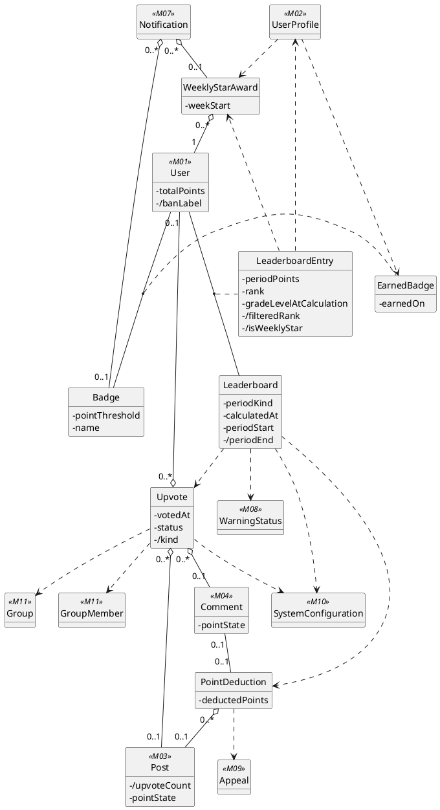

# Phân tích lớp thực thể — M12 Gamification

<!-- [Vietnamese Doc] Tài liệu tiếng Việt; tên lớp và thuộc tính viết tiếng Anh (input/CONVENTIONS.md mục 3). -->

| Mã tài liệu | EC-M12 |
|---|---|
| Dự án | iShare |
| Module | M12 — Gamification |
| Đầu vào | FR-M12 phiên bản 1.1 |
| Trạng thái | Bản nháp |
| Phiên bản | 0.3 |
| Ngày | 2026-11-19 |
| Tác giả | Phạm Văn Đức |

<!-- Quy ước chung cho mọi bảng dưới đây:
     - Không đổi tên cột, không xóa cột, không đổi số mục: tool đọc bảng theo số mục và tên cột.
     - Ô không có nội dung ghi "—".
     - Mục chưa tới bước làm thì để dòng "(Chưa làm — bước N)".
     - Cột Nguồn ghi mã trong FR: FR-M12-nn, FR-M12-nn.mm, BR-M12-nn, hoặc TN:<thuật ngữ> (mục 2.1 của FR).
     - Sơ đồ ở mục 4 do gen_puml.py sinh; không sửa tay. -->

## 1. Mô tả chức năng

### 1.1 Đoạn mô tả

(S1) M12 ghi nhận upvote trên bài viết và bình luận, tính điểm đóng góp, trao huy hiệu và danh hiệu Ngôi sao tuần, đồng thời lập bảng xếp hạng toàn hệ thống. (S2) Người dùng đã đăng nhập có thể upvote hoặc rút upvote trên bài viết và bình luận của người khác, hệ thống phân biệt Post Star với Comment Star, ghi thời điểm upvote và duy trì tối đa một upvote có hiệu lực cho mỗi người trên mỗi nội dung. (S3) Hệ thống áp dụng trạng thái hiển thị, mức khóa bài viết và quyền vote nhóm khi nhận thao tác upvote, đồng thời cung cấp số upvote có hiệu lực cho bài viết và bình luận, thời điểm upvote cho các chức năng xếp hạng nội dung, và sự kiện thêm hoặc rút upvote cho M07. (S4) Hệ thống cập nhật ngay tổng điểm của tác giả khi upvote được ghi nhận hoặc bị rút theo trọng số của từng loại nội dung, giữ phần điểm do tài khoản đã xóa trao và cung cấp tổng điểm hiện tại cho hồ sơ M02. (S5) Hệ thống trừ phần điểm từ upvote khi bài tự xóa chuyển sang Đã xóa hẳn hoặc khi nội dung bị xóa hay xử lý trực tiếp theo quy định, ghi số điểm bị trừ đối với bài viết và hoàn đúng số điểm đã trừ của lần gỡ khi M09 chấp nhận khiếu nại. (S6) Hệ thống giữ điểm khi nhóm bị xóa, thành viên rời hoặc bị kick, nội dung bị gỡ ở cấp nhóm, hoặc bình luận bị ẩn theo bài cha. (S7) Hệ thống tự trao mọi huy hiệu chưa đạt mà tổng điểm đã chạm ngưỡng, ghi ngày đạt đầu tiên, giữ huy hiệu khi điểm giảm và cung cấp huy hiệu đã đạt cho M02 cùng sự kiện đạt huy hiệu cho M07. (S8) Hệ thống xác định chu kỳ tuần và tháng theo giờ Việt Nam, tính điểm trong chu kỳ từ upvote đủ điều kiện theo thời điểm và hiệu lực, dùng tổng điểm cho bảng toàn thời gian, và xếp những người có điểm dương theo điểm với cùng thứ hạng khi đồng điểm. (S9) Hệ thống tính lại bảng toàn thời gian định kỳ, chốt bảng tuần và tháng bằng số liệu đúng mốc chu kỳ, giữ kết quả chốt gần nhất của mỗi loại cùng điểm, thứ hạng và Lớp/Khối tại lúc chốt hoặc lúc tính gần nhất. (S10) Hệ thống dùng mức cảnh cáo và trạng thái tài khoản để xác định tư cách xếp hạng, ẩn hoặc hiện lại dòng đã chốt theo điều kiện hiện tại, và dùng tên thay thế cho tài khoản bị xóa sau lúc chốt trên bảng tuần hoặc tháng còn hiển thị. (S11) Khi chốt tuần, hệ thống trao Ngôi sao tuần cho người có điểm dương ở các hạng đủ điều kiện, kể cả người đồng hạng tại hạng cắt, ghi người nhận và tuần đạt cho mỗi lần trao, thông báo qua M07 và cung cấp danh hiệu của tuần vừa chốt cho hồ sơ M02. (S12) Guest và người dùng đã đăng nhập được xem bảng xếp hạng theo chu kỳ và lọc theo Lớp/Khối, hệ thống tính lại thứ hạng trong nhóm lọc và cung cấp điểm, thứ hạng, thông tin nhận biết người dùng cùng dấu Ngôi sao tuần khi phù hợp. (S13) Hệ thống dùng trạng thái BANNED để cung cấp nhãn Tài khoản đã bị khóa tại những nơi tên tài khoản xuất hiện và bỏ nhãn khi tài khoản không còn BANNED. (S14) Khi cờ tính năng Gamification của M10 tắt, hệ thống từ chối upvote, rút upvote và mở bảng xếp hạng đối với người dùng khác Admin, đồng thời giữ dữ liệu, tiếp tục cập nhật điểm, tính và chốt bảng, trao thưởng, phát sự kiện thông báo và cung cấp số liệu hiển thị cho các module liên quan.

<!-- Một đoạn văn, mỗi câu đánh số (S1) (S2) … Xem steps/01-describe-functions.md. -->

### 1.2 Truy vết câu

| Câu | Nội dung tóm tắt | Nguồn |
|---|---|---|
| S1 | Phạm vi dữ liệu Gamification | FR-M12-01, FR-M12-02, FR-M12-03, FR-M12-04, FR-M12-05 |
| S2 | Ghi upvote, hiệu lực và thời điểm | FR-M12-01, FR-M12-01.01, FR-M12-01.02, FR-M12-01.03, FR-M12-01.04, FR-M12-01.07, FR-M12-01.08 |
| S3 | Điều kiện upvote, số đếm và giao tiếp liên module | FR-M12-01.01, FR-M12-01.02, FR-M12-01.10, FR-M12-01.11, FR-M12-01.12, FR-M12-01.13 |
| S4 | Cộng, trừ và cung cấp tổng điểm | FR-M12-02, FR-M12-02.01, FR-M12-02.02, FR-M12-02.03, FR-M12-02.04, FR-M12-02.05 |
| S5 | Trừ điểm trực tiếp và hoàn điểm theo lần gỡ bài | FR-M12-02.08, FR-M12-02.09, FR-M12-02.10, FR-M12-02.11, FR-M12-02.12, FR-M12-02.13, FR-M12-02.18, FR-M12-02.19, FR-M12-02.20, FR-M12-02.21, FR-M12-02.22 |
| S6 | Giữ điểm trong các trường hợp nội dung mất gián tiếp hoặc do cấp nhóm | FR-M12-02.14, FR-M12-02.15, FR-M12-02.16, FR-M12-02.17 |
| S7 | Trao huy hiệu, ngày đạt và sự kiện thông báo | FR-M12-03, FR-M12-03.01, FR-M12-03.02, FR-M12-03.03, FR-M12-03.04, FR-M12-03.05, FR-M12-03.06, FR-M12-03.10, FR-M12-03.11 |
| S8 | Tính điểm theo chu kỳ và thứ hạng | FR-M12-04, FR-M12-04.01, FR-M12-04.02, FR-M12-04.03, FR-M12-04.04, FR-M12-04.06, FR-M12-04.15, FR-M12-04.16 |
| S9 | Chốt và giữ kết quả bảng xếp hạng | FR-M12-04.01, FR-M12-04.14, FR-M12-04.16, FR-M12-05, FR-M12-05.01, FR-M12-05.08, FR-M12-06.07, FR-M12-06.09, FR-M12-06.11 |
| S10 | Điều kiện xếp hạng và cách hiển thị dòng đã chốt | FR-M12-04.07, FR-M12-04.08, FR-M12-04.09, FR-M12-04.10, FR-M12-04.11, FR-M12-04.12, FR-M12-04.17, FR-M12-04.18, FR-M12-04.19 |
| S11 | Trao, lưu và cung cấp danh hiệu tuần | FR-M12-05.02, FR-M12-05.03, FR-M12-05.04, FR-M12-05.07, FR-M12-05.09, FR-M12-05.10, FR-M12-05.12, FR-M12-05.13 |
| S12 | Xem bảng, lọc Lớp/Khối và tính lại hạng | FR-M12-06, FR-M12-06.01, FR-M12-06.02, FR-M12-06.03, FR-M12-06.04, FR-M12-06.05, FR-M12-06.07, FR-M12-06.08, FR-M12-06.09, FR-M12-06.10, FR-M12-06.11 |
| S13 | Nhãn công khai theo trạng thái tài khoản | FR-M12-07, FR-M12-07.01, FR-M12-07.02, FR-M12-07.03, FR-M12-07.04 |
| S14 | Cờ tính năng và các xử lý vẫn tiếp tục | FR-M12-08, FR-M12-08.01, FR-M12-08.03, FR-M12-08.04, FR-M12-08.06, FR-M12-08.08, FR-M12-08.09, FR-M12-08.10 |

## 2. Danh từ và phân loại

### 2.1 Sổ danh từ

<!-- Phân loại: Lớp | Thuộc tính | Loại bỏ.
     Kết quả: tên lớp; hoặc Lớp.thuộcTính; hoặc "—" khi loại bỏ.
     Xuất hiện ở: S<n> (câu của đoạn mô tả) hoặc "Quét: <mã FR>" (lượt quét bổ sung). -->

| # | Danh từ | Xuất hiện ở | Phân loại | Kết quả | Lý do |
|---|---|---|---|---|---|
| 1 | upvote / Post Star / Comment Star | S1 | Lớp | Upvote | T8. Lượt trên bài và bình luận dùng chung tên Upvote của các EC trước, phân biệt theo đối tượng. |
| 2 | bài viết / bài cha / bài tự xóa / bài bị gỡ | S1 | Lớp | Post | T4. Cùng đối tượng M03, M12 dùng trạng thái và giữ dấu tính điểm. |
| 3 | bình luận | S1 | Lớp | Comment | T4. Đối tượng M04; xử lý điểm riêng với bài cha. |
| 4 | điểm đóng góp / tổng điểm / tổng điểm hiện tại | S1 | Thuộc tính | User.totalPoints | T7 ngoại lệ. FR mô tả tổng điểm có bản ghi được cập nhật, đưa vào User của M01 như phần M12 bổ sung. |
| 5 | huy hiệu | S1 | Lớp | Badge | T8 theo danh mục FR mục 5.10. Mỗi mục được định danh bằng tên và quy định ngưỡng, dù danh mục cố định. |
| 6 | danh hiệu Ngôi sao tuần / danh hiệu của tuần vừa chốt / lần trao danh hiệu | S1 | Lớp | WeeklyStarAward | T8. Mỗi người nhận và tuần đạt có bản ghi riêng. Ngôi sao tuần là giá trị cố định của loại phần thưởng này, không thêm danh mục danh hiệu. |
| 7 | bảng xếp hạng / bảng tuần / bảng tháng / bảng toàn thời gian / kết quả chốt gần nhất | S1 | Lớp | Leaderboard | T7 ngoại lệ. FR-M12-04.14/05.08/06.07 yêu cầu giữ kết quả, xuất bản tới khi được thay thế. |
| 8 | người dùng đã đăng nhập / người upvote / tác giả / tài khoản / tài khoản đã xóa / người nhận / Admin | S2 | Lớp | User | T3. Cùng tài khoản M01 theo ngữ cảnh; tác giả và người upvote là vai trò, không tách lớp người. |
| 9 | hệ thống | S2 | Loại bỏ | — | Không lưu: tác nhân không có dữ liệu. |
| 10 | rút upvote / thêm upvote | S2 | Loại bỏ | — | Trừu tượng. Là chuyển đổi hiệu lực và phát sự kiện M07; mô hình chưa chốt cách giữ lịch sử ở Q-01. |
| 11 | thời điểm upvote | S2 | Thuộc tính | Upvote.votedAt | T9. Mô tả dữ liệu trên lớp tương ứng. |
| 12 | hiệu lực upvote / trạng thái upvote | S2 | Thuộc tính | Upvote.status | T9. Mô tả dữ liệu trên lớp tương ứng. |
| 13 | loại upvote | S2 | Thuộc tính | Upvote.kind | T7. Phân loại tính từ đối tượng upvote. |
| 14 | trạng thái hiển thị / mức khóa bài viết | S3 | Loại bỏ | — | Ngoài phạm vi module (M03, M04). M12 áp dụng trạng thái và quyền tương tác do module nguồn cấp. |
| 15 | quyền vote nhóm | S3 | Loại bỏ | — | Ngoài phạm vi module (M11). Kiểm theo Group và GroupMember, không lưu bản ghi quyền riêng ở M12. |
| 16 | số upvote có hiệu lực của bài viết | S3 | Thuộc tính | Post.upvoteCount | T7. Số đếm tính lại được từ Upvote. |
| 17 | số upvote có hiệu lực của bình luận | S3 | Loại bỏ | — | Ngoài phạm vi module ở cấp thuộc tính. Comment.upvoteCount đã có trong EC-M04; lấy số đếm từ M12. |
| 18 | xếp hạng nội dung | S3 | Loại bỏ | — | Ngoài phạm vi module (M05, M06, M14). M12 cung cấp tín hiệu upvote. |
| 19 | thông báo / thông báo upvote / thông báo huy hiệu, danh hiệu | S3 | Lớp | Notification | T4. Bản ghi do M07 quản lý; M12 phát sự kiện nguồn. |
| 20 | sự kiện thêm hoặc rút upvote / sự kiện đạt huy hiệu / sự kiện đạt danh hiệu tuần | S3 | Loại bỏ | — | Trừu tượng. Giao tiếp tới M07, FR không yêu cầu lớp sự kiện chung ở M12. |
| 21 | trọng số điểm | S4 | Loại bỏ | — | Hằng số của BR-M12-05/06. 2 với bài viết, 1 với bình luận, không thêm trường quản trị. |
| 22 | hồ sơ | S4 | Lớp | UserProfile | T4. M02 cung cấp Lớp/Khối và dùng dữ liệu phần thưởng. |
| 23 | điểm đã trừ của nội dung / lần trừ điểm | S5 | Lớp | PointDeduction | T8. Số điểm đã trừ được ghi để đọc và hoàn theo lần gỡ, không suy ra lại từ số upvote hiện tại. |
| 24 | số điểm đã trừ / số điểm hoàn theo lần gỡ | S5 | Thuộc tính | PointDeduction.deductedPoints | T7 ngoại lệ. Số phát sinh một lần cần được lưu để hoàn chính xác. |
| 25 | Đã xóa hẳn | S5 | Loại bỏ | — | Ngoài phạm vi module (M03). Cờ bài đầu vào cho trừ điểm. |
| 26 | xóa trực tiếp / xử lý trực tiếp / lần gỡ / gỡ vì vi phạm | S5 | Loại bỏ | — | Trừu tượng ở M12. Dùng sự kiện tác giả xóa hoặc kiểm duyệt M08 và dữ liệu trừ điểm; không tạo lớp kiểm duyệt mới. |
| 27 | khiếu nại | S5 | Lớp | Appeal | T4. Kết quả từ M09 kích hoạt hoàn điểm bài đã bị gỡ. |
| 28 | nhóm | S6 | Lớp | Group | T4. M11 sở hữu và cung cấp cài đặt hoặc ngữ cảnh thao tác. |
| 29 | thành viên / tư cách thành viên | S6 | Lớp | GroupMember | T4. M11 sở hữu tư cách nhóm dùng cho quyền vote. |
| 30 | xóa nhóm / rời nhóm / kick / gỡ ở cấp nhóm / ẩn theo bài cha | S6 | Loại bỏ | — | Ngoài phạm vi module ở cấp hành động. M12 dùng kết quả để giữ điểm theo FR-M12-02.14 đến FR-M12-02.17. |
| 31 | huy hiệu đã đạt / lần đạt huy hiệu | S7 | Lớp | EarnedBadge | T8. Có ngày đạt đầu tiên và giữ độc lập với điểm hiện tại. |
| 32 | ngưỡng huy hiệu / mốc tổng điểm | S7 | Thuộc tính | Badge.pointThreshold | T9. Mô tả dữ liệu trên lớp tương ứng. |
| 33 | ngày đạt đầu tiên / ngày đạt huy hiệu | S7 | Thuộc tính | EarnedBadge.earnedOn | T9. Mô tả dữ liệu trên lớp tương ứng. |
| 34 | chưa đạt / đã đạt / tiến độ huy hiệu | S7 | Loại bỏ | — | Trừu tượng. Sự tồn tại của EarnedBadge biểu thị đã đạt; không lưu tiến độ để cung cấp. |
| 35 | chu kỳ tuần / chu kỳ tháng / chu kỳ toàn thời gian | S8 | Thuộc tính | Leaderboard.periodKind | T9. Mô tả dữ liệu trên lớp tương ứng. |
| 36 | giờ Việt Nam | S8 | Loại bỏ | — | Hằng số của BR-M12-14. Quy ước UTC+7 để xác định mốc tuần và tháng. |
| 37 | điểm trong chu kỳ / điểm dương | S8 | Thuộc tính | LeaderboardEntry.periodPoints | T7 ngoại lệ. Điểm tính ra được giữ trong kết quả của một lần chốt hoặc tính. |
| 38 | thứ hạng / hạng tại lúc chốt | S8 | Thuộc tính | LeaderboardEntry.rank | T7 ngoại lệ. Thứ hạng của kết quả được lưu để hiển thị ổn định. |
| 39 | đồng hạng / đồng điểm | S8 | Loại bỏ | — | Trừu tượng. Quy tắc xếp hạng, không tạo dữ liệu người đồng hạng riêng. |
| 40 | thời điểm tính / thời điểm chốt | S9 | Thuộc tính | Leaderboard.calculatedAt | T9. Mô tả dữ liệu trên lớp tương ứng. |
| 41 | mốc đầu chu kỳ / tuần hoặc tháng của kết quả | S9 | Thuộc tính | Leaderboard.periodStart | T9. Mô tả dữ liệu trên lớp tương ứng. |
| 42 | mốc cuối chu kỳ | S9 | Thuộc tính | Leaderboard.periodEnd | T7. Có thể tính lại từ kỳ và mốc đầu. |
| 43 | Lớp/Khối tại lúc chốt hoặc tính | S9 | Thuộc tính | LeaderboardEntry.gradeLevelAtCalculation | T7 ngoại lệ. Kết quả giữ giá trị nguồn tại mốc tính. |
| 44 | lần tính định kỳ / chốt chu kỳ / khoảng thời gian tính lại | S9 | Loại bỏ | — | Trừu tượng đối với lớp riêng. Chốt hoặc tính tạo kết quả Leaderboard; chu kỳ tính 60 phút là hằng số của BR-M12-19/25. |
| 45 | mức cảnh cáo / trạng thái cảnh cáo | S10 | Lớp | WarningStatus | T4. Dùng WarningStatus.level của M08 đối với tư cách xếp hạng. |
| 46 | trạng thái tài khoản / BANNED / DEACTIVATED / DELETED | S10 | Loại bỏ | — | Ngoài phạm vi module ở cấp thuộc tính. Các giá trị thuộc User.accountState từ M01/M08. |
| 47 | tư cách xếp hạng / ẩn hoặc hiện lại dòng / hiện mờ | S10 | Loại bỏ | — | Trừu tượng. Áp điều kiện điểm, cảnh cáo và tài khoản khi tính, và hiển thị từ trạng thái hiện thời cho dòng đã chốt. Hạng lưu của người khác giữ nguyên. |
| 48 | dòng đã chốt / dòng bảng xếp hạng | S10 | Lớp | LeaderboardEntry | T7 ngoại lệ. Kết quả theo từng tài khoản cần giữ kỳ, điểm, hạng và Lớp/Khối. |
| 49 | tên thay thế của tài khoản bị xóa | S10 | Loại bỏ | — | Ngoài phạm vi module ở cấp dữ liệu nhận biết. Dùng trạng thái DELETED và nhãn của M01; FR-M12 xác định khi bảng hiển thị nhãn. |
| 50 | hạng cắt | S11 | Loại bỏ | — | Hằng số của BR-M12-23. Hạng 1–3 kể cả tất cả người đồng hạng ở hạng 3. |
| 51 | tuần đạt | S11 | Thuộc tính | WeeklyStarAward.weekStart | T9. Mô tả dữ liệu trên lớp tương ứng. |
| 52 | Guest | S12 | Loại bỏ | — | Không lưu: tác nhân không có dữ liệu. |
| 53 | bộ lọc theo Lớp/Khối | S12 | Loại bỏ | — | Giao diện. Tiêu chí truy vấn theo giá trị được giữ trên LeaderboardEntry; không có cấu hình lọc cá nhân trong FR. |
| 54 | thứ hạng trong nhóm lọc | S12 | Thuộc tính | LeaderboardEntry.filteredRank | T7. Tính lại theo nhóm lọc. |
| 55 | thông tin nhận biết người dùng / avatar / tên hiển thị / username | S12 | Loại bỏ | — | Ngoài phạm vi module ở cấp thuộc tính. Dùng User và UserProfile để hiển thị, chỉ Lớp/Khối được giữ riêng ở kết quả. |
| 56 | dấu Ngôi sao tuần | S12 | Thuộc tính | LeaderboardEntry.isWeeklyStar | T7. Dẫn từ bản ghi nhận thưởng đã lưu. |
| 57 | nhãn Tài khoản đã bị khóa | S13 | Thuộc tính | User.banLabel | T7. Suy ra từ trạng thái tài khoản. |
| 58 | cờ tính năng Gamification | S14 | Loại bỏ | — | Ngoài phạm vi module ở cấp thuộc tính. M10 sở hữu SystemConfiguration.gamificationEnabled, M12 đọc giá trị và áp ngoại lệ Admin. |
| 59 | cấu hình hệ thống | Quét: FR-M12-08.01, FR-M12-08.06 | Lớp | SystemConfiguration | T4. M10 sở hữu cờ tính năng. |
| 60 | trao thưởng / số liệu hiển thị / dữ liệu module | S14 | Loại bỏ | — | Chung chung. Các đối tượng điểm, bảng, huy hiệu, danh hiệu và số đếm được xét riêng. |
| 61 | tên huy hiệu | Quét: FR-M12-03.01 | Thuộc tính | Badge.name | T9. Mô tả dữ liệu trên lớp tương ứng. |
| 62 | trạng thái tính điểm của bài viết | Quét: FR-M12-02.18, mục 5.11 | Thuộc tính | Post.pointState | T9. Mô tả dữ liệu trên lớp tương ứng. |
| 63 | trạng thái tính điểm của bình luận | Quét: FR-M12-02.18, mục 5.11 | Thuộc tính | Comment.pointState | T9. Mô tả dữ liệu trên lớp tương ứng. |
| 64 | giai đoạn chu kỳ / đang diễn ra / đã kết thúc chưa chốt / đã chốt đang hiển thị / không còn hiển thị | Quét: FR-M12-04.14, mục 5.11 | Loại bỏ | — | Trừu tượng đối với dữ liệu lưu. Xác định giai đoạn từ mốc lịch và kết quả hiện hành; không có yêu cầu lưu lịch sử các bảng đã bị thay. |

### 2.2 Lớp

<!-- Nhóm: Thực thể | Liên kết | Thống kê. Sở hữu: mã module sở hữu lớp (M12 của tài liệu này, hoặc Myy với lớp ngoài). -->

| Lớp | Tên tiếng Việt | Nhóm | Sở hữu | Mô tả | Nguồn |
|---|---|---|---|---|---|
| Upvote | Upvote | Thực thể | M12 | Lượt Post Star hoặc Comment Star có thời điểm và hiệu lực. Dùng tên đã tham chiếu ở các EC trước. | FR-M12-01.01, FR-M12-01.02, FR-M12-01.04, FR-M12-02.04, BR-M12-02 |
| PointDeduction | Điểm đã trừ của nội dung | Thực thể | M12 | Ghi số điểm đã trừ, phục vụ hoàn đúng số điểm của lần gỡ bài được chấp nhận khiếu nại. Phạm vi ghi riêng cho bình luận và cách phân biệt lần gỡ xem Q-02/03. | FR-M12-02.08, FR-M12-02.10, FR-M12-02.12, BR-M12-09, BR-M12-10 |
| Badge | Huy hiệu | Thực thể | M12 | Mục danh mục huy hiệu cố định theo mốc tổng điểm, dùng tên glossary và EC-M02/M07. | FR-M12-03.01, FR-M12-03.02, BR-M12-06, BR-M12-11 |
| EarnedBadge | Huy hiệu đã đạt | Liên kết | M12 | Bản ghi đạt một huy hiệu của người dùng, giữ ngày đạt đầu tiên. Dùng tên EC-M02. | FR-M12-03.02, FR-M12-03.04, FR-M12-03.05, FR-M12-03.06 |
| WeeklyStarAward | Danh hiệu Ngôi sao tuần đã đạt | Thực thể | M12 | Bản ghi mỗi lần người dùng đạt Ngôi sao tuần. Dùng tên EC-M02/M07. | FR-M12-05.02, FR-M12-05.03, FR-M12-05.04, FR-M12-05.13 |
| Leaderboard | Kết quả bảng xếp hạng | Thực thể | M12 | Bản ghi kết quả đã chốt theo tuần, tháng hoặc kết quả toàn thời gian gần nhất. Dùng tên glossary. | FR-M12-04.01, FR-M12-04.14, FR-M12-05.01, FR-M12-05.08, FR-M12-06.07 |
| LeaderboardEntry | Dòng kết quả bảng xếp hạng | Liên kết | M12 | Điểm, hạng và Lớp/Khối được giữ cho từng người trong kết quả. Kết quả được đọc tới khi bảng được thay. | FR-M12-04.02, FR-M12-04.14, FR-M12-04.18, FR-M12-06.09, FR-M12-06.11 |
| User | Tài khoản | Thực thể | M01 | Người upvote, tác giả, người nhận huy hiệu/danh hiệu và đối tượng xếp hạng. M12 bổ sung tổng điểm và nhãn ban dẫn xuất. | FR-M12-01.01, FR-M12-02.01, FR-M12-03.02, FR-M12-04.02, FR-M12-05.03, FR-M12-07.01 |
| UserProfile | Hồ sơ | Thực thể | M02 | Cung cấp Lớp/Khối và thông tin nhận biết theo lớp sở hữu, đồng thời nhận dữ liệu điểm và phần thưởng. | FR-M12-03.06, FR-M12-05.12, FR-M12-06.09, FR-M12-06.11 |
| Post | Bài viết | Thực thể | M03 | Đối tượng của Post Star. M12 bổ sung số upvote có hiệu lực và trạng thái tính điểm. | FR-M12-01.01, FR-M12-01.10, FR-M12-02.08, FR-M12-02.18 |
| Comment | Bình luận | Thực thể | M04 | Đối tượng của Comment Star, dùng số upvote đã có trong EC-M04 và bổ sung trạng thái tính điểm. | FR-M12-01.01, FR-M12-02.11, FR-M12-02.17, FR-M12-02.19, FR-M12-02.20 |
| Notification | Thông báo | Thực thể | M07 | Nhận sự kiện upvote, rút upvote và trao phần thưởng; M07 sở hữu bản ghi và cơ chế gộp. | FR-M12-01.13, FR-M12-03.10, FR-M12-05.07, BR-M12-26 |
| WarningStatus | Trạng thái cảnh cáo của người dùng | Thực thể | M08 | Mức cảnh cáo dùng xác định tư cách xếp hạng và nhận danh hiệu. | FR-M12-04.07, FR-M12-04.09, FR-M12-05.10, BR-M12-20 |
| Appeal | Khiếu nại | Thực thể | M09 | Kết quả chấp nhận khiếu nại bài bị gỡ cho phép hoàn điểm đúng lần gỡ. | FR-M12-02.12, BR-M12-10 |
| Group | Nhóm | Thực thể | M11 | Chế độ, quyền vote của bài nhóm và ngữ cảnh mất nội dung ở cấp nhóm để xác định giữ điểm. | FR-M12-01.11, FR-M12-02.14, FR-M12-02.15, FR-M12-02.16 |
| GroupMember | Thành viên nhóm | Thực thể | M11 | Tư cách thành viên ảnh hưởng quyền upvote bài nhóm Private. | FR-M12-01.11, BR-M12-04 |
| SystemConfiguration | Cấu hình hệ thống | Thực thể | M10 | Cung cấp cờ Gamification và áp ngoại lệ Admin khi cờ tắt. | FR-M12-08.01, FR-M12-08.06, FR-M12-08.07, BR-M12-28 |

### 2.3 Thuộc tính

<!-- Tính chất: Lưu | Dẫn xuất. Chưa có id, chưa có kiểu, chưa có khóa ngoại.
     Ràng buộc nguồn nêu: độ dài tối đa, duy nhất, bắt buộc/tùy chọn, tập giá trị, mặc định, công thức (với Dẫn xuất) — chép từ FR kèm mã. -->

| Lớp | Thuộc tính | Tên tiếng Việt | Tính chất | Ràng buộc nguồn nêu | Nguồn |
|---|---|---|---|---|---|
| User | totalPoints | Tổng điểm đóng góp | Lưu | Mỗi tài khoản một tổng điểm cập nhật tức thời. Công thức nghiệp vụ BR-M12-05 tính từ upvote có hiệu lực trên nội dung đang tính điểm, trọng số bài 2, bình luận 1, kể cả upvote của tài khoản đã xóa. Xử lý trừ và hoàn điểm theo BR-M12-07/08/09/10; không giảm theo thời gian. Mục 5.10 ghi cập nhật và giữ bản ghi điểm. | FR-M12-02.01, FR-M12-02.02, FR-M12-02.03, FR-M12-02.04, FR-M12-02.05, FR-M12-02.12, FR-M12-04.04, BR-M12-05, BR-M12-07 |
| Upvote | votedAt | Thời điểm upvote | Lưu | Lúc lượt được ghi nhận và có hiệu lực. Upvote lại có mốc hiệu lực của lần upvote lại, dùng xếp vào chu kỳ giờ Việt Nam. | FR-M12-01.01, FR-M12-04.03, FR-M12-04.15, BR-M12-02, TN:Thời điểm upvote |
| Upvote | status | Trạng thái hiệu lực | Lưu | Có hiệu lực hoặc Đã rút theo mục 2.1 và 5.11. Tối đa một lượt có hiệu lực cho mỗi cặp người–nội dung. Biểu diễn trạng thái ở mức nghiệp vụ; Q-01 đối chiếu việc CRUD gọi rút là xóa và cách tái dựng ở ranh giới chu kỳ. | FR-M12-01.01, FR-M12-01.02, FR-M12-01.03, BR-M12-02, TN:Có hiệu lực, Đã rút |
| Upvote | kind | Loại upvote | Dẫn xuất | Đọc loại từ đối tượng: Post Star khi đích là Post, Comment Star khi đích là Comment. | FR-M12-01.04, BR-M12-01 |
| Post | upvoteCount | Số upvote bài viết | Dẫn xuất | Phần M12 bổ sung trên Post. Đếm lượt Upvote có hiệu lực gắn với bài viết; rút thì không tính. Đây là số lượt, độc lập với trọng số điểm. | FR-M12-01.01, FR-M12-01.02, FR-M12-08.10, BR-M12-02, BR-M12-05 |
| PointDeduction | deductedPoints | Số điểm đã trừ | Lưu | Với bài viết, ghi phần điểm từ các upvote có hiệu lực tại thời điểm trừ; khi chấp nhận khiếu nại lần gỡ, hoàn đúng số đã ghi. FR nêu trừ điểm bình luận, phạm vi giữ số điểm đã trừ của bình luận xem Q-03. | FR-M12-02.08, FR-M12-02.10, FR-M12-02.11, FR-M12-02.12, BR-M12-09, BR-M12-10 |
| Badge | pointThreshold | Ngưỡng tổng điểm | Lưu | Giá trị cố định trong danh mục theo BR-M12-06/11. Các mốc lần lượt 25, 100, 300, 600, 1000; chỉ đổi bằng triển khai. | FR-M12-03.01, FR-M12-03.02, BR-M12-06, BR-M12-11 |
| EarnedBadge | earnedOn | Ngày đạt | Lưu | Mỗi tài khoản đạt mỗi huy hiệu tối đa một lần. Giữ ngày đầu tiên và giữ huy hiệu khi điểm giảm. | FR-M12-03.02, FR-M12-03.04, FR-M12-03.05, FR-M12-03.06, BR-M12-12 |
| Leaderboard | periodKind | Loại chu kỳ | Lưu | Tuần, tháng, toàn thời gian. Mỗi loại giữ một kết quả hiện hành theo BR-M12-22. | FR-M12-04.03, FR-M12-04.04, FR-M12-04.14, FR-M12-06.02, BR-M12-14, BR-M12-22 |
| LeaderboardEntry | periodPoints | Điểm trong chu kỳ | Lưu | Giữ điểm kết quả của lần chốt hoặc tính gần nhất, chỉ gồm người có điểm dương. Tuần/tháng xét upvote thuộc kỳ còn hiệu lực và nội dung còn tính điểm theo BR-M12-15; toàn thời gian dùng User.totalPoints. | FR-M12-04.02, FR-M12-04.04, FR-M12-04.14, FR-M12-04.15, FR-M12-04.16, FR-M12-05.01, BR-M12-15 |
| LeaderboardEntry | rank | Thứ hạng đã tính | Lưu | Người đồng điểm có cùng hạng, hạng kế tiếp bằng số người đứng trên cộng một. Giữ hạng đã chốt khi ẩn dòng sau chốt. | FR-M12-04.06, FR-M12-04.14, FR-M12-04.18, FR-M12-06.05, BR-M12-18 |
| Leaderboard | calculatedAt | Thời điểm tính kết quả | Lưu | Thời điểm lần tính kết quả. Với tuần/tháng là lần chốt, phân biệt với mốc cuối chu kỳ. Toàn thời gian thay ở kỳ tính 60 phút theo BR-M12-19. | FR-M12-04.01, FR-M12-04.14, FR-M12-05.01, FR-M12-05.06, FR-M12-06.07, BR-M12-19, BR-M12-25 |
| Leaderboard | periodStart | Mốc bắt đầu kỳ của kết quả | Lưu | Áp dụng cho kết quả tuần hoặc tháng, theo tuần lịch hoặc tháng lịch giờ Việt Nam để phân biệt kết quả đã chốt với kỳ đang diễn ra. Toàn thời gian không có mốc của kỳ hữu hạn. | FR-M12-04.03, FR-M12-04.14, FR-M12-05.01, FR-M12-05.08, BR-M12-14, BR-M12-22 |
| Leaderboard | periodEnd | Mốc kết thúc chu kỳ | Dẫn xuất | Mốc bắt đầu tuần hoặc tháng kế tiếp tính từ periodStart theo lịch Việt Nam. Toàn thời gian không có mốc cuối. | FR-M12-04.03, FR-M12-05.01, BR-M12-14 |
| LeaderboardEntry | gradeLevelAtCalculation | Lớp/Khối tại lần tính | Lưu | Sao giá trị Lớp/Khối từ hồ sơ tại lúc chốt hoặc lần tính toàn thời gian gần nhất. Có thể chưa đặt, vẫn thuộc bộ lọc Tất cả. Thay đổi hồ sơ sau đó không đổi giá trị đã giữ. | FR-M12-06.03, FR-M12-06.08, FR-M12-06.09, BR-M12-16 |
| WeeklyStarAward | weekStart | Tuần đạt Ngôi sao tuần | Lưu | Mốc đầu tuần lịch giờ Việt Nam của kỳ được trao. Mỗi người tối đa một bản ghi cho mỗi tuần đạt; vẫn lưu bản ghi qua các tuần. | FR-M12-04.03, FR-M12-05.03, FR-M12-05.04, FR-M12-05.13, BR-M12-14, BR-M12-24 |
| LeaderboardEntry | filteredRank | Thứ hạng trong nhóm lọc | Dẫn xuất | Tính lại theo điểm các dòng của Lớp/Khối được lọc, áp quy tắc đồng hạng tại BR-M12-16/18. Không ghi đè hạng của kết quả gốc. | FR-M12-06.05, FR-M12-06.08, BR-M12-16, BR-M12-18 |
| LeaderboardEntry | isWeeklyStar | Dấu Ngôi sao tuần | Dẫn xuất | Chỉ áp với bảng tuần. Tra WeeklyStarAward của cùng tài khoản và tuần trong kết quả, không tính lại dựa vào thứ hạng sau lọc. | FR-M12-05.02, FR-M12-05.03, FR-M12-06.11, BR-M12-24, BR-M12-29 |
| User | banLabel | Nhãn tài khoản bị khóa | Dẫn xuất | Phần M12 bổ sung trên User. Có nhãn công khai khi User.accountState là BANNED, bỏ nhãn khi hết trạng thái. Trạng thái DEACTIVATED có nhãn khác từ M01. | FR-M12-07.01, FR-M12-07.03, FR-M12-07.04, BR-M12-27 |
| Badge | name | Tên huy hiệu | Lưu | Năm tên cố định theo BR-M12-11: Người mới nổi, Cây bút triển vọng, Cây bút tích cực, Chuyên gia cộng đồng, Huyền thoại iShare. | FR-M12-03.01, BR-M12-11 |
| Post | pointState | Trạng thái tính điểm | Lưu | Đang tính điểm hoặc Đã trừ điểm. Tạo nội dung ở Đang tính điểm, loại khỏi tổng điểm khi đã trừ, không trừ lần nữa. Bài bị gỡ có thể trở lại Đang tính điểm khi khiếu nại được chấp nhận. Bài tự xóa hẳn không hoàn. | FR-M12-02.08, FR-M12-02.10, FR-M12-02.12, FR-M12-02.18, BR-M12-08, BR-M12-10 |
| Comment | pointState | Trạng thái tính điểm | Lưu | Đang tính điểm hoặc Đã trừ điểm. Tạo nội dung ở Đang tính điểm, loại khỏi tổng điểm khi đã trừ, không trừ lần nữa. Điểm đã trừ của bình luận không hoàn. Ẩn theo bài cha vẫn giữ Đang tính điểm. | FR-M12-02.11, FR-M12-02.13, FR-M12-02.17, FR-M12-02.18, FR-M12-02.19, FR-M12-02.20, FR-M12-02.21, BR-M12-08 |

### 2.4 Đối chiếu với mục Dữ liệu nghiệp vụ của FR

<!-- Mỗi thực thể ở bảng "Dữ liệu nghiệp vụ" của FR một dòng; chép đúng tên ở cột Thực thể của FR.
     Xử lý: Khớp | Đã thêm qua sổ danh từ | Mô hình có thêm: … | Lệch: … (kèm Q-nn). -->

| Thực thể trong FR | Trong mô hình | Xử lý |
|---|---|---|
| Upvote | Upvote | Mô hình có thêm status từ mục 5.11, kind dẫn xuất từ đích theo FR-M12-01.04. Người trao và đích là quan hệ. FR mục 5.10 bỏ ghi nhận người trao khi tài khoản đã xóa. Q-01 làm rõ dữ liệu cần giữ sau rút và bật lại. |
| Điểm của người dùng | User.totalPoints | Đã duyệt Q-04. Một tổng điểm được cập nhật tức thời cho mỗi tài khoản, do M12 quản lý trên User. |
| Điểm đã trừ của nội dung | PointDeduction, Post.pointState, Comment.pointState | Mô hình có thêm trạng thái tính điểm từ FR-M12-02.18 và mục 5.11. Q-02 làm rõ phân biệt từng lần gỡ cần hoàn; Q-03 làm rõ số điểm đã trừ cần lưu cho bình luận. |
| Huy hiệu | Badge | Khớp |
| Huy hiệu đã đạt | EarnedBadge | Khớp |
| Danh hiệu đã đạt | WeeklyStarAward | Khớp |
| Kết quả bảng xếp hạng | Leaderboard, LeaderboardEntry | Mô hình chi tiết bảng và dòng kết quả lưu theo FR-M12-04.14, FR-M12-05.08, FR-M12-06.07, FR-M12-06.09. Dấu Ngôi sao tuần lấy từ bản ghi thưởng. Hạng trong nhóm lọc tính lại theo FR-M12-06.08. |
| Người dùng (M01, M02, M08) — phần M12 dùng | User, UserProfile, WarningStatus | Mô hình có thêm User.banLabel dẫn xuất theo FR-M12-07.01/03. Giữ nguồn tài khoản, hồ sơ và cảnh cáo theo module gốc. |
| Tham chiếu ngoài | Post, Comment, Notification, Appeal, Group, GroupMember, SystemConfiguration | Mô hình có thêm lớp ngoài theo yêu cầu và giao tiếp. Post.upvoteCount, Post.pointState và Comment.pointState là dữ liệu M12 quản lý trên nội dung. |

## 3. Quan hệ giữa các lớp

### 3.1 Ma trận cặp lớp

<!-- T = quan hệ trực tiếp; G(X) = chỉ gián tiếp qua lớp X; trống = không liên quan. Chỉ điền nửa trên. -->

| Lớp | 1 | 2 | 3 | 4 | 5 | 6 | 7 | 8 | 9 | 10 | 11 | 12 | 13 | 14 | 15 | 16 | 17 |
| --- | --- | --- | --- | --- | --- | --- | --- | --- | --- | --- | --- | --- | --- | --- | --- | --- | --- |
| 1 Upvote |  |  |  |  |  | P |  | T |  | T | T |  |  |  | P | P | P |
| 2 PointDeduction |  |  |  |  |  | P |  |  |  | T | T |  |  | P |  |  |  |
| 3 Badge |  |  |  | T |  |  |  | G(EarnedBadge) |  |  |  | T |  |  |  |  |  |
| 4 EarnedBadge |  |  |  |  |  |  |  | T | P |  |  |  |  |  |  |  |  |
| 5 WeeklyStarAward |  |  |  |  |  |  | P | T | P |  |  | T |  |  |  |  |  |
| 6 Leaderboard |  |  |  |  |  |  | T | G(LeaderboardEntry) |  |  |  |  | P |  |  |  | P |
| 7 LeaderboardEntry |  |  |  |  |  |  |  | T | P |  |  |  |  |  |  |  |  |
| 8 User |  |  |  |  |  |  |  |  |  | G(Upvote) | G(Upvote) |  |  |  |  |  |  |
| 9 UserProfile |  |  |  |  |  |  |  |  |  |  |  |  |  |  |  |  |  |
| 10 Post |  |  |  |  |  |  |  |  |  |  |  |  |  |  |  |  |  |
| 11 Comment |  |  |  |  |  |  |  |  |  |  |  |  |  |  |  |  |  |
| 12 Notification |  |  |  |  |  |  |  |  |  |  |  |  |  |  |  |  |  |
| 13 WarningStatus |  |  |  |  |  |  |  |  |  |  |  |  |  |  |  |  |  |
| 14 Appeal |  |  |  |  |  |  |  |  |  |  |  |  |  |  |  |  |  |
| 15 Group |  |  |  |  |  |  |  |  |  |  |  |  |  |  |  |  |  |
| 16 GroupMember |  |  |  |  |  |  |  |  |  |  |  |  |  |  |  |  |  |
| 17 SystemConfiguration |  |  |  |  |  |  |  |  |  |  |  |  |  |  |  |  |  |

Ô `T` chỉ liên hệ có bội số. Ô `P` là phụ thuộc nghiệp vụ. Ô `G(X)` chỉ liên hệ gián tiếp qua lớp X; các quan hệ n-n trước tách được ghi ở mục 3.2. Với User–Post và User–Comment, ma trận chỉ xét vai trò người trao upvote; quan hệ tác giả do M03, M04 quản lý.

### 3.2 Quan hệ số lượng

<!-- Mỗi ô T của ma trận một dòng. Dạng đọc theo thứ tự A–B: 1-1 | 1-n | n-1 | n-n.
     Xử lý: Giữ nguyên | Gộp vào <Lớp>: … | Giữ: … | Tách: thêm lớp <X>. -->

| Cặp | Câu A → B | Câu B → A | Dạng | Xử lý |
|---|---|---|---|---|
| User – Post (Upvote bài viết) | Một User có thể upvote nhiều Post của người khác theo thời gian. | Một Post có thể được nhiều User upvote. | n-n | Tách: dùng lớp Upvote bài viết |
| User – Comment (Upvote bình luận) | Một User có thể upvote nhiều Comment của người khác theo thời gian. | Một Comment có thể được nhiều User upvote. | n-n | Tách: dùng lớp Upvote bình luận |
| User – Badge (EarnedBadge) | Một User có thể đạt nhiều Badge trong danh mục. | Một Badge có thể được nhiều User đạt. | n-n | Tách: dùng lớp EarnedBadge |
| User – Leaderboard (LeaderboardEntry) | Một User có thể được xếp hạng ở nhiều Leaderboard theo loại kỳ và các lần công bố. | Một Leaderboard có thể xếp hạng nhiều User. | n-n | Tách: dùng lớp LeaderboardEntry |
| User – Upvote (R-M12-01) | Một User có thể trao từ 0 đến nhiều Upvote. | Một Upvote có đúng một User khi tạo và còn 0 hoặc 1 User sau xử lý xóa tài khoản. | 1-n | Giữ nguyên |
| Post – Upvote (R-M12-02) | Một Post có thể nhận từ 0 đến nhiều Upvote. | Một Upvote ghi một Post khi là Post Star, còn Comment Star có 0 Post. | 1-n | Giữ nguyên |
| Comment – Upvote (R-M12-03) | Một Comment có thể nhận từ 0 đến nhiều Upvote. | Một Upvote ghi một Comment khi là Comment Star, còn Post Star có 0 Comment. | 1-n | Giữ nguyên |
| Post – PointDeduction (R-M12-04) | Một Post có thể phát sinh từ 0 đến nhiều PointDeduction qua các lần trừ tách biệt. | Một PointDeduction gắn đúng một Post khi đối tượng trừ là bài viết. | 1-n | Giữ nguyên |
| Comment – PointDeduction (R-M12-05) | Một Comment ứng với 0 hoặc 1 PointDeduction, vì điểm đã trừ không được hoàn hoặc trừ lại. | Một PointDeduction gắn đúng một Comment khi đối tượng trừ là bình luận, còn 0 Comment khi trừ từ bài viết. | 1-1 | Giữ: đầu Comment tùy chọn theo loại đối tượng; bình luận thuộc M04 và có vòng đời riêng. |
| User – EarnedBadge (R-M12-06) | Một User có thể có từ 0 đến nhiều EarnedBadge trong danh mục hiện hành. | Một EarnedBadge ứng với đúng một User. | 1-n | Giữ nguyên |
| Badge – EarnedBadge (R-M12-07) | Một Badge có thể có từ 0 đến nhiều lượt được người dùng đạt. | Một EarnedBadge ghi đúng một Badge. | 1-n | Giữ nguyên |
| User – WeeklyStarAward (R-M12-08) | Một User có thể nhận từ 0 đến nhiều WeeklyStarAward ở các tuần khác nhau. | Một WeeklyStarAward có đúng một User nhận. | 1-n | Giữ nguyên |
| Leaderboard – LeaderboardEntry (R-M12-09) | Một Leaderboard có từ 0 đến nhiều LeaderboardEntry. | Một LeaderboardEntry thuộc đúng một Leaderboard. | 1-n | Giữ nguyên |
| User – LeaderboardEntry (R-M12-10) | Một User có thể xuất hiện ở từ 0 đến nhiều LeaderboardEntry. | Một LeaderboardEntry ứng với đúng một User. | 1-n | Giữ nguyên |
| Badge – Notification (R-M12-11) | Một Badge có thể liên quan từ 0 đến nhiều Notification tới các người nhận khác nhau. | Một Notification có 0 hoặc 1 Badge là đối tượng. | 1-n | Giữ nguyên |
| WeeklyStarAward – Notification (R-M12-12) | Một WeeklyStarAward có thể là đối tượng của từ 0 đến nhiều Notification theo mô hình sự kiện của M07. | Một Notification có 0 hoặc 1 WeeklyStarAward là đối tượng. | 1-n | Giữ nguyên |

Upvote là bản ghi có vòng đời ghi nhận, rút, upvote lại và có thể mất người trao khi tài khoản bị xóa. Vì vậy giữ Nhóm = Thực thể và giải quan hệ n-n qua các đầu User, Post và Comment. EarnedBadge và LeaderboardEntry thuộc một cặp duy nhất trong phạm vi liên kết hiện hành. Không phát sinh quan hệ n-n ở mục 3.4.

### 3.3 Lớp liên kết

<!-- Mỗi lớp có Nhóm = Liên kết một dòng. "Tách từ quan hệ n-n" viết dạng "LớpA – LớpB". -->

| Lớp liên kết | Tách từ quan hệ n-n | Thuộc tính riêng của liên kết | Nguồn |
|---|---|---|---|
| EarnedBadge | User – Badge | earnedOn. Một bản ghi cho mỗi cặp người dùng–huy hiệu, giữ ngày đầu tiên. | FR-M12-03.02, FR-M12-03.04, FR-M12-03.05, BR-M12-12 |
| LeaderboardEntry | User – Leaderboard | periodPoints, rank, gradeLevelAtCalculation. filteredRank và isWeeklyStar là giá trị dẫn xuất từ kết quả và bản ghi thưởng. | FR-M12-04.02, FR-M12-04.14, FR-M12-04.18, FR-M12-06.08, FR-M12-06.09, FR-M12-06.11 |

### 3.4 Quan hệ

<!-- Bội số A = số đối tượng A ứng với một đối tượng B (ghi ở đầu A trên sơ đồ). Cú pháp: 1, 0..1, 0..*, 1..*, 1..3.
     Loại: Kế thừa | Hợp thành | Kết tập | Liên kết | Phụ thuộc.
     Bên chính: lớp cha (Kế thừa), lớp toàn thể (Hợp thành, Kết tập), lớp được dùng (Phụ thuộc); "—" với Liên kết.
     Kế thừa và Phụ thuộc ghi "—" ở Bội số A, Bội số B, Dạng. Không được còn dạng n-n. -->

| ID | Lớp A | Bội số A | Lớp B | Bội số B | Dạng | Loại | Bên chính | Căn cứ | Nguồn |
|---|---|---|---|---|---|---|---|---|---|
| R-M12-01 | User | 0..1 | Upvote | 0..* | 1-n | Kết tập | Upvote | Upvote ghi một người trao khi tạo. Khi tài khoản trao chuyển DELETED, giữ lượt và bỏ nhận biết người trao theo FR mục 5.10, đồng nhất R-M01-23. Quy tắc một lượt hiệu lực áp cho từng cặp người trao còn nhận biết và đối tượng. | FR-M12-01.01, FR-M12-01.03, FR-M12-02.04, BR-M12-02, BR-M12-05 |
| R-M12-02 | Post | 0..1 | Upvote | 0..* | 1-n | Kết tập | Upvote | Upvote ghi Post nếu là Post Star. Cùng chiều và bội số với R-M03-18. Mỗi lượt phải có đúng một đích thuộc Post hoặc Comment. | FR-M12-01.01, FR-M12-01.04, FR-M12-02.01, BR-M12-01 |
| R-M12-03 | Comment | 0..1 | Upvote | 0..* | 1-n | Kết tập | Upvote | Upvote ghi Comment nếu là Comment Star. Cùng chiều và bội số với R-M04-07. Rút lượt và bị trừ điểm là hai quy tắc nghiệp vụ riêng. | FR-M12-01.01, FR-M12-01.02, FR-M12-01.04, FR-M12-02.02, FR-M12-02.18, BR-M12-01 |
| R-M12-04 | Post | 0..1 | PointDeduction | 0..* | 1-n | Kết tập | PointDeduction | Bản ghi số điểm trừ ghi nội dung. Một bài có thể bị gỡ, được hoàn rồi lại bị gỡ ở lần xử lý khác. Tại một thời điểm chỉ một khoản trừ áp dụng trên nội dung chừng nào chưa được hoàn. Cách gắn từng lần gỡ chờ FR theo Q-02. | FR-M12-02.08, FR-M12-02.10, FR-M12-02.12, FR-M12-02.18, BR-M12-09, BR-M12-10 |
| R-M12-05 | Comment | 0..1 | PointDeduction | 0..1 | 1-1 | Liên kết | — | FR mục 5.10 liệt kê bình luận là đích. Điểm trừ bình luận là trạng thái cuối và chỉ trừ một lần. Cách lưu số điểm của bình luận được duyệt ở Q-03 và chờ cập nhật FR. | FR-M12-02.11, FR-M12-02.13, FR-M12-02.18, FR-M12-02.19, FR-M12-02.20, FR-M12-02.21, BR-M12-10 |
| R-M12-06 | User | 1 | EarnedBadge | 0..* | 1-n | Liên kết | — | Mỗi EarnedBadge thuộc một User. Khi DELETED, ẩn huy hiệu đã đạt theo FR-M12-03.11, giữ quy tắc trao một lần. | FR-M12-03.02, FR-M12-03.04, FR-M12-03.05, FR-M12-03.11, BR-M12-12 |
| R-M12-07 | Badge | 1 | EarnedBadge | 0..* | 1-n | Liên kết | — | EarnedBadge biểu thị đúng một cặp User và Badge, lưu ngày đạt đầu tiên. | FR-M12-03.01, FR-M12-03.02, FR-M12-03.05, BR-M12-11, BR-M12-12 |
| R-M12-08 | User | 1 | WeeklyStarAward | 0..* | 1-n | Kết tập | WeeklyStarAward | Bản ghi trao gồm một người nhận và một tuần. Mỗi cặp người nhận–tuần có tối đa một bản ghi. Bản ghi được giữ qua các lần thay Leaderboard. | FR-M12-05.02, FR-M12-05.03, FR-M12-05.04, FR-M12-05.13, BR-M12-24 |
| R-M12-09 | Leaderboard | 1 | LeaderboardEntry | 0..* | 1-n | Liên kết | — | Mỗi dòng ứng với một kết quả bảng. Bảng có thể rỗng, chỉ xếp người có điểm dương. Khi kết quả bị thay, các dòng của kết quả cũ không còn được giữ theo FR-M12-04.14. | FR-M12-04.02, FR-M12-04.14, FR-M12-05.08, FR-M12-05.09, FR-M12-06.11 |
| R-M12-10 | User | 1 | LeaderboardEntry | 0..* | 1-n | Liên kết | — | Mỗi dòng ứng với một tài khoản trên kết quả đó. Trường hợp DELETED sau chốt vẫn giữ dòng tuần/tháng và hiển thị nhãn thay thế trong thời gian kết quả còn hiệu lực. | FR-M12-04.02, FR-M12-04.10, FR-M12-04.11, FR-M12-04.12, FR-M12-04.18, FR-M12-06.11 |
| R-M12-11 | Badge | 0..1 | Notification | 0..* | 1-n | Kết tập | Notification | Notification loại đạt huy hiệu ghi một Badge. Cùng chiều và bội số với R-M07-13. Mỗi lần đạt phát sự kiện riêng. | FR-M12-03.10, BR-M12-26 |
| R-M12-12 | WeeklyStarAward | 0..1 | Notification | 0..* | 1-n | Kết tập | Notification | Notification loại danh hiệu tuần ghi bản ghi WeeklyStarAward theo R-M07-14. Mỗi lần trao phát một sự kiện; bội số từ sự kiện sang bản ghi thông báo cụ thể do M07 quản lý. | FR-M12-05.03, FR-M12-05.07, BR-M12-26 |
| R-M12-13 | PointDeduction | — | Appeal | — | — | Phụ thuộc | Appeal | Khiếu nại được chấp nhận là căn cứ hoàn đúng khoản trừ của lần gỡ. Quan hệ lưu tới bản ghi nguồn của từng lần gỡ chờ cập nhật FR theo Q-02. | FR-M12-02.10, FR-M12-02.12, BR-M12-10 |
| R-M12-14 | Leaderboard | — | Upvote | — | — | Phụ thuộc | Upvote | Tính điểm chu kỳ dùng thời điểm và hiệu lực của upvote; khi đã chốt chỉ đọc kết quả đã lưu. Các mốc lịch sử cần giữ để tái dựng chờ FR theo Q-01. | FR-M12-04.14, FR-M12-04.15, FR-M12-04.16, FR-M12-05.01, BR-M12-15 |
| R-M12-15 | Leaderboard | — | PointDeduction | — | — | Phụ thuộc | PointDeduction | Khi tính điểm chu kỳ phải xét việc điểm nội dung đã bị trừ tại mốc tính; dữ liệu trước và sau mốc chờ FR bổ sung theo Q-02. Kết quả đã chốt giữ nguyên. | FR-M12-04.15, FR-M12-04.16, FR-M12-05.01, BR-M12-15 |
| R-M12-16 | Leaderboard | — | WarningStatus | — | — | Phụ thuộc | WarningStatus | Khi tính và hiển thị kết quả dùng mức cảnh cáo, giữ hạng đã chốt khi phải ẩn một dòng. FR kết hợp trạng thái tài khoản theo quan hệ dòng và User. | FR-M12-04.07, FR-M12-04.09, FR-M12-04.10, FR-M12-04.18, FR-M12-05.10, BR-M12-20 |
| R-M12-17 | LeaderboardEntry | — | UserProfile | — | — | Phụ thuộc | UserProfile | Kết quả chép Lớp/Khối tại lần tính hoặc chốt. Avatar và thông tin nhận biết dùng nguồn hồ sơ theo M01/M02, không lấy lại Lớp/Khối hiện thời để thay giá trị đã chốt. | FR-M12-06.03, FR-M12-06.09, FR-M12-06.11, BR-M12-16 |
| R-M12-18 | LeaderboardEntry | — | WeeklyStarAward | — | — | Phụ thuộc | WeeklyStarAward | Dấu danh hiệu của dòng tuần được tra bằng tài khoản và tuần đạt. Bản ghi thưởng giữ qua các lần thay bảng, không phụ thuộc vòng đời bảng cũ. | FR-M12-05.03, FR-M12-05.08, FR-M12-05.13, FR-M12-06.11, BR-M12-24 |
| R-M12-19 | UserProfile | — | EarnedBadge | — | — | Phụ thuộc | EarnedBadge | Hồ sơ dùng kết quả đạt huy hiệu và ngày đạt, đồng nhất R-M02-05. | FR-M12-03.06, FR-M12-03.07, FR-M12-03.11 |
| R-M12-20 | UserProfile | — | WeeklyStarAward | — | — | Phụ thuộc | WeeklyStarAward | Hồ sơ dùng danh hiệu đúng tuần vừa chốt, đồng nhất R-M02-06. | FR-M12-05.12, FR-M12-05.13 |
| R-M12-21 | Upvote | — | Group | — | — | Phụ thuộc | Group | Điều kiện vote nhóm dùng chế độ nhóm và quyền tương tác do M11 cung cấp. | FR-M12-01.11, BR-M12-04 |
| R-M12-22 | Upvote | — | GroupMember | — | — | Phụ thuộc | GroupMember | Người ngoài nhóm Private không được upvote. Tư cách thành viên là dữ liệu M11 dùng để kiểm quyền lúc thao tác. | FR-M12-01.11, BR-M12-04 |
| R-M12-23 | Upvote | — | SystemConfiguration | — | — | Phụ thuộc | SystemConfiguration | Cờ M10 chi phối upvote và rút, có ngoại lệ Admin. Không lưu giá trị cờ trên từng lượt. | FR-M12-08.01, FR-M12-08.06, FR-M12-08.08 |
| R-M12-24 | Leaderboard | — | SystemConfiguration | — | — | Phụ thuộc | SystemConfiguration | Cờ M10 chi phối mở bảng, có ngoại lệ Admin. Lần tính, chốt và trao giải vẫn chạy khi cờ tắt. | FR-M12-08.03, FR-M12-08.06, FR-M12-08.08, FR-M12-08.09 |

**Chiều kết tập.** Upvote ghi người trao và nội dung (R-M12-01–03). PointDeduction ghi bài bị trừ (R-M12-04). WeeklyStarAward ghi người nhận (R-M12-08). Notification ghi đối tượng huy hiệu hoặc danh hiệu tuần (R-M12-11/12). Các lớp được ghi lại có vòng đời độc lập hoặc FR không nêu việc xóa theo toàn thể.

**Ràng buộc loại đích và vòng đời.** Mỗi Upvote và mỗi PointDeduction ứng với đúng một trong Post hoặc Comment. Lượt của tài khoản DELETED giữ hiệu lực nếu trước đó còn hiệu lực và gỡ liên hệ với người trao. Trừ điểm do mất nội dung loại upvote khỏi tổng điểm theo pointState, không tự chuyển Upvote sang Đã rút. Việc lưu dữ liệu mốc hiệu lực chờ FR theo Q-01.

**Bảng kết quả và phần thưởng.** LeaderboardEntry tồn tại theo kết quả hiện hành và một tài khoản. Bảng tuần hoặc tháng bị thay ở lần chốt cùng loại sau; bản ghi WeeklyStarAward vẫn được lưu theo tuần đạt. LeaderboardEntry tra dấu thưởng theo người và tuần, không buộc vòng đời danh hiệu vào kết quả bảng. Tính hạng trong nhóm lọc không thay hạng đã lưu.

**Thông báo và điều kiện nghiệp vụ.** M07 dùng sự kiện upvote và rút để cập nhật dữ liệu gộp; FR-M12 không đòi bản ghi Notification liên kết bền vững với từng Upvote. Tác giả của nội dung giữ theo M03/M04. Q-02/03 chờ bổ sung FR, chưa dùng để thêm thuộc tính hoặc tham chiếu lần gỡ mới.

## 4. Sơ đồ lớp phân tích

<!-- BEGIN:PUML -->

<!-- END:PUML -->

## 5. Liên module

<!-- Mỗi lớp có Sở hữu khác module này một dòng. -->

| Lớp | Module sở hữu | Module này dùng thế nào | Thuộc tính module này bổ sung |
|---|---|---|---|
| User | M01 | Người trao, nhận điểm và phần thưởng hoặc được xếp hạng. Trạng thái DELETED gỡ liên hệ người trao mà vẫn giữ lượt. Dòng đã chốt giữ liên hệ để áp nhãn thay thế theo FR. | totalPoints, banLabel |
| UserProfile | M02 | Cung cấp Lớp/Khối để giữ theo kết quả và dữ liệu hiển thị. Hồ sơ nhận tổng điểm, huy hiệu, danh hiệu tuần và nhãn tài khoản. | — |
| Post | M03 | Đối tượng Post Star. Mức khóa và mốc Đã xóa hẳn chi phối thao tác và trừ điểm. | upvoteCount, pointState |
| Comment | M04 | Đối tượng Comment Star. Giữ điểm khi ẩn theo bài cha, trừ khi bị xóa hoặc xử lý trực tiếp theo FR. Comment.upvoteCount dùng lại từ EC-M04. | pointState |
| Notification | M07 | Nhận sự kiện thêm/rút upvote, huy hiệu, danh hiệu. Dùng cơ chế gộp và đối tượng thông báo của M07. | — |
| WarningStatus | M08 | Mức cảnh cáo dùng khi tính và hiển thị bảng. Chi tiết lần gỡ của M08 để đối chiếu hoàn điểm chờ FR theo Q-02. | — |
| Appeal | M09 | Kết quả chấp nhận khiếu nại bài bị gỡ cho phép hoàn đúng khoản điểm. | — |
| Group | M11 | Dùng chế độ nhóm khi xét quyền vote. Xóa nhóm hoặc gỡ cấp nhóm không trừ điểm. | — |
| GroupMember | M11 | Dùng tư cách thành viên khi xét quyền vote trên nhóm Private. Rời hoặc bị kick không trừ điểm. | — |
| SystemConfiguration | M10 | Đọc cờ Gamification và áp ngoại lệ Admin. Tính điểm, tính/chốt bảng và trao thưởng vẫn chạy khi tắt. | — |

## 6. Câu hỏi và điểm chưa chốt

<!-- Loại: Thiếu | Mơ hồ | Mâu thuẫn | Lệch. Ghi vào: mục của tài liệu này đã sửa theo câu trả lời, hoặc "Chờ cập nhật FR-M12". -->

| Mã | Loại | Câu hỏi | Trả lời | Ghi vào |
|---|---|---|---|---|
| Q-01 | Mâu thuẫn | CRUD mục 5.10 và bảng chuyển trạng thái mục 5.11 khác cách biểu diễn rút upvote; FR-M12-05.01 cần dữ liệu đúng mốc cuối kỳ. | Đã duyệt giữ các mốc bắt đầu và hết hiệu lực của từng lượt trong thời gian cần để chốt kỳ. | Chờ cập nhật FR-M12. Chưa thêm trường kết thúc hiệu lực hoặc quy tắc lưu trữ. |
| Q-02 | Thiếu | FR-M12-02.10/12 cần hoàn đúng khoản của lần gỡ được chấp nhận. FR-M12-05.01 cần phân biệt trừ và hoàn ở hai phía mốc cuối kỳ. | Đã duyệt gắn số điểm trừ với lần gỡ cụ thể của M08, ghi mốc trừ và mốc hoàn nếu có. | Chờ cập nhật FR-M12 và đối chiếu M08/M09. Chưa thêm trường thời điểm hoặc quan hệ lưu với bản ghi lần gỡ. |
| Q-03 | Mơ hồ | FR-M12 mục 5.10 liệt kê bình luận là nội dung có điểm đã trừ, nhưng ô Tạo chỉ dẫn tới yêu cầu ghi số điểm của bài viết. | Đã duyệt lưu số điểm đã trừ của bình luận và giữ quy tắc không hoàn điểm bình luận. | Chờ cập nhật FR-M12 về yêu cầu ghi số điểm trừ của bình luận. Tập đích Post hoặc Comment đã có trong bảng dữ liệu mục 5.10. |
| Q-04 | Lệch | FR mục 5.10 liệt kê Điểm của người dùng thành thực thể với một tổng điểm cho mỗi tài khoản. | Đã duyệt dùng User.totalPoints do M12 quản lý. Tổng điểm có vòng đời theo User. | Đã áp dụng ở mục 2.3, 2.4 và 5. |

## 7. Lịch sử sửa đổi

| Phiên bản | Ngày | Nội dung | Người sửa |
|---|---|---|---|
| 0.1 | 2026-11-19 | Soạn 14 câu mô tả và truy vết 8 chức năng từ FR-M12 v1.1, chờ duyệt bước 1 | Codex |
| 0.2 | 2026-11-19 | Ghi nhận duyệt bước 1, phân loại danh từ, lập bảng lớp và thuộc tính, đối chiếu FR-M12 và ghi câu hỏi | Codex |
| 0.3 | 2026-11-19 | Ghi nhận duyệt bước 2 và Q-01–Q-04. Lập ma trận, bội số, lớp liên kết, quan hệ, PlantUML và liên module. Theo dõi cập nhật FR-M12, chờ chốt EC-M12. | Codex |
