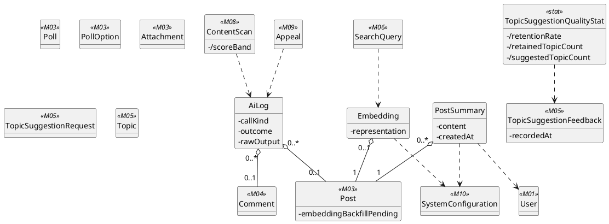

# Phân tích lớp thực thể — M13 AI Layer

<!-- [Vietnamese Doc] Tài liệu tiếng Việt; tên lớp và thuộc tính viết tiếng Anh (input/CONVENTIONS.md mục 3). -->

| Mã tài liệu | EC-M13 |
|---|---|
| Dự án | iShare |
| Module | M13 — AI Layer |
| Đầu vào | FR-M13 phiên bản 1.3 |
| Trạng thái | Bản nháp |
| Phiên bản | 0.3 |
| Ngày | 2026-11-19 |
| Tác giả | Phạm Văn Đức |

<!-- Quy ước chung cho mọi bảng dưới đây:
     - Không đổi tên cột, không xóa cột, không đổi số mục: tool đọc bảng theo số mục và tên cột.
     - Ô không có nội dung ghi "—".
     - Mục chưa tới bước làm thì để dòng "(Chưa làm — bước N)".
     - Cột Nguồn ghi mã trong FR: FR-M13-nn, FR-M13-nn.mm, BR-M13-nn, hoặc TN:<thuật ngữ> (mục 2.1 của FR).
     - Sơ đồ ở mục 4 do gen_puml.py sinh; không sửa tay. -->

## 1. Mô tả chức năng

### 1.1 Đoạn mô tả

(S1) M13 xử lý lời gọi AI, kết quả quét kiểm duyệt, embedding bài viết và truy vấn, gợi ý Topic và tóm tắt bài viết, đồng thời ghi nhật ký quyết định AI và tính chỉ số chất lượng gợi ý Topic. (S2) Khi module yêu cầu kết quả AI, hệ thống dùng công tắc AI tổng và công tắc riêng của M10 để quyết định có gửi yêu cầu tới dịch vụ AI hay không, thử lại khi lần thử đầu bị lỗi và báo riêng trạng thái AI tắt hoặc lời gọi thất bại cho module gọi. (S3) Hệ thống chấm điểm kiểm duyệt từ tiêu đề, nội dung chữ, bình chọn và ảnh đính kèm của bài viết do M03 gửi, hoặc từ nội dung chữ của từng bình luận do M08 chuyển trong luồng cần quét. (S4) Hệ thống dùng điểm theo nhóm vi phạm để xác định điểm quét, nhóm vi phạm và khoảng điểm, rồi chuyển kết quả cho M03, M04, M08 và M11 để áp dụng quy tắc kiểm duyệt của từng module. (S5) Hệ thống tạo embedding khi bài viết chuyển sang Đã đăng, kể cả bài nhóm, thay embedding hiện tại khi tiêu đề hoặc nội dung chữ thay đổi và cung cấp embedding bài viết cho M06. (S6) Hệ thống đưa bài viết cần embedding vào hàng chờ tạo bù khi AI hoặc Search tắt hoặc lời gọi thất bại, rồi tạo embedding theo nội dung hiện tại và đưa bài ra khỏi hàng chờ khi AI hoạt động trở lại. (S7) Hệ thống tạo embedding cho truy vấn tìm bài viết của người dùng đã đăng nhập và trả cho M06, hoặc chuyển trạng thái AI tắt hay lời gọi thất bại để M06 dùng tìm kiếm full-text cho truy vấn đó. (S8) Khi M05 gửi yêu cầu gợi ý Topic hợp lệ, hệ thống dùng tiêu đề và nội dung chữ của bài viết để lấy gợi ý, rồi chuyển kết quả AI về M05 đối chiếu danh mục Topic hoặc báo lỗi để tác giả tự chọn Topic. (S9) Người dùng đã đăng nhập có thể yêu cầu tóm tắt bài viết đủ độ dài và có quyền xem khi AI tổng bật, hệ thống trả bản tóm tắt còn hiệu lực hoặc tạo từ tiêu đề và nội dung chữ, giữ tạm để dùng chung và bỏ khi hết hạn hoặc nội dung nguồn thay đổi. (S10) Hệ thống ghi một bản ghi nhật ký cho mỗi lời gọi chấm điểm kiểm duyệt, tạo embedding bài viết hoặc lấy gợi ý Topic, gồm loại lời gọi, kết quả thành công hay thất bại, đầu ra thô nếu có và bài viết hoặc bình luận liên quan, rồi giữ bản ghi vĩnh viễn. (S11) Mod hoặc Admin xem nhật ký quyết định AI của bài viết khi xét khiếu nại bài bị AI tự từ chối ở M09, hệ thống giữ liên hệ tới tài khoản đã xóa qua username được M01 giữ lại để tiếp tục tra cứu. (S12) Hệ thống dùng phản hồi gợi ý Topic của M05, kể cả phản hồi của tài khoản đã xóa, để tính tỷ lệ Topic gợi ý được giữ lại từ số Topic được giữ và tổng số Topic AI gợi ý theo thời điểm ghi phản hồi, rồi cung cấp tỷ lệ hoặc trạng thái không có dữ liệu cho bảng thống kê Nội dung của M15 theo khoảng thời gian Admin chọn.

<!-- Một đoạn văn, mỗi câu đánh số (S1) (S2) … Xem steps/01-describe-functions.md. -->

### 1.2 Truy vết câu

| Câu | Nội dung tóm tắt | Nguồn |
|---|---|---|
| S1 | Phạm vi dữ liệu AI Layer | FR-M13-01, FR-M13-01.10, FR-M13-02, FR-M13-03, FR-M13-04, FR-M13-05, FR-M13-06, FR-M13-08, FR-M13-10 |
| S2 | Điều kiện lời gọi, lần thử và trạng thái trả về | FR-M13-01.01, FR-M13-01.02, FR-M13-01.03, FR-M13-01.04, FR-M13-01.05, FR-M13-01.06, FR-M13-01.07, FR-M13-01.09 |
| S3 | Nội dung đầu vào của lời gọi kiểm duyệt | FR-M13-02.01, FR-M13-02.02, FR-M13-02.03 |
| S4 | Kết quả quét chuyển cho các module nghiệp vụ | FR-M13-02.04, FR-M13-02.05, FR-M13-02.06, FR-M13-02.07, FR-M13-02.08, FR-M13-02.09 |
| S5 | Tạo, cập nhật và cung cấp embedding bài viết | FR-M13-03.01, FR-M13-03.02, FR-M13-03.03, FR-M13-03.04, FR-M13-03.07 |
| S6 | Hàng chờ và xử lý tạo bù embedding | FR-M13-03.08, FR-M13-03.09, FR-M13-03.10 |
| S7 | Embedding truy vấn và cách xử lý khi thiếu kết quả | FR-M13-04, FR-M13-04.01, FR-M13-04.02, FR-M13-04.03, FR-M13-04.04 |
| S8 | Yêu cầu, kết quả và đường dự phòng gợi ý Topic | FR-M13-05, FR-M13-05.01, FR-M13-05.02, FR-M13-05.03, FR-M13-05.04 |
| S9 | Yêu cầu, kết quả và vòng đời tóm tắt | FR-M13-06, FR-M13-06.01, FR-M13-06.02, FR-M13-06.03, FR-M13-06.04, FR-M13-06.05, FR-M13-06.07, FR-M13-07, FR-M13-07.01, FR-M13-07.02, FR-M13-07.03, FR-M13-07.07, FR-M13-07.08 |
| S10 | Phạm vi và nội dung lưu của nhật ký AI | FR-M13-08, FR-M13-08.01, FR-M13-08.02, FR-M13-08.03, FR-M13-08.04, FR-M13-08.05, FR-M13-08.07, FR-M13-08.09 |
| S11 | Quyền xem nhật ký và nhận biết tác giả đã xóa | FR-M13-08.08, FR-M13-09, FR-M13-09.01, FR-M13-09.02, FR-M13-09.03, FR-M13-09.04 |
| S12 | Chỉ số chất lượng gợi ý Topic và giao tiếp M15 | FR-M13-10, FR-M13-10.01, FR-M13-10.02, FR-M13-10.03, FR-M13-10.04 |

## 2. Danh từ và phân loại

### 2.1 Sổ danh từ

<!-- Phân loại: Lớp | Thuộc tính | Loại bỏ.
     Kết quả: tên lớp; hoặc Lớp.thuộcTính; hoặc "—" khi loại bỏ.
     Xuất hiện ở: S<n> (câu của đoạn mô tả) hoặc "Quét: <mã FR>" (lượt quét bổ sung). -->

| # | Danh từ | Xuất hiện ở | Phân loại | Kết quả | Lý do |
|---|---|---|---|---|---|
| 1 | lời gọi AI / yêu cầu kết quả AI | S1 | Loại bỏ | — | Trừu tượng đối với bản ghi riêng. Các lời gọi thuộc phạm vi FR-M13-08.01 để lại AiLog; FR không yêu cầu lưu một lớp lời gọi dùng chung. |
| 2 | kết quả quét kiểm duyệt | S1 | Lớp | ContentScan | T4. Dùng lớp của M08 cho điểm và nhóm vi phạm đã xử lý. |
| 3 | embedding bài viết / embedding hiện tại | S1 | Lớp | Embedding | T8. Bài có một biểu diễn được giữ và thay khi nội dung nguồn thay đổi. |
| 4 | embedding truy vấn | S1 | Loại bỏ | — | Trừu tượng đối với lớp lưu riêng. Biểu diễn được trả trực tiếp cho M06; FR không yêu cầu giữ hoặc ghi nhật ký. |
| 5 | gợi ý Topic / kết quả AI gợi ý Topic | S1 | Loại bỏ | — | Trừu tượng với nghĩa lời đáp. M13 chuyển đầu ra sang M05, việc giữ đầu ra thuộc AiLog và M05 quản lý dữ liệu gợi ý. |
| 6 | tóm tắt bài viết / bản tóm tắt còn hiệu lực / kết quả tóm tắt đang giữ | S1 | Lớp | PostSummary | T8. Có nội dung, thời điểm tạo và vòng đời giữ, dùng lại, hủy. |
| 7 | nhật ký quyết định AI / bản ghi nhật ký | S1 | Lớp | AiLog | T8. Bản ghi mỗi lời gọi đủ điều kiện, giữ lâu dài. |
| 8 | chỉ số chất lượng gợi ý Topic | S1 | Lớp | TopicSuggestionQualityStat | T7. Nhóm số liệu theo khoảng thời gian, tính lại từ phản hồi. |
| 9 | module / module gọi / hệ thống | S2 | Loại bỏ | — | Chung chung. Tác nhân hoặc phạm vi giao tiếp; FR không yêu cầu danh mục hay lưu tên module gọi. |
| 10 | dịch vụ AI | S2 | Loại bỏ | — | Ngoài phạm vi hệ thống. Nhà cung cấp nhận yêu cầu và trả kết quả; FR không yêu cầu quản lý danh mục dịch vụ. |
| 11 | công tắc AI tổng / công tắc AI riêng / công tắc Search / công tắc Moderation / công tắc Topic suggestion | S2 | Loại bỏ | — | Ngoài phạm vi module (M10). Các công tắc thuộc SystemConfiguration của M10. |
| 12 | lần thử / lần thử lại | S2 | Loại bỏ | — | Hành động không lưu dấu vết riêng. Mỗi lời gọi đủ điều kiện có một AiLog cho kết quả cuối. |
| 13 | AI tắt / lỗi tạm thời | S2 | Loại bỏ | — | Trừu tượng. Phân biệt điều kiện cấu hình và kết quả thất bại; bỏ qua vì công tắc tắt không phải một lời gọi thất bại. |
| 14 | bài viết / bài nhóm / bài viết bị AI tự từ chối | S3 | Lớp | Post | T4. Dùng chung Post do M03 sở hữu. |
| 15 | bình chọn | S3 | Lớp | Poll | T4. Nội dung bình chọn thuộc M03 và dùng khi quét bài. |
| 16 | ảnh đính kèm | S3 | Lớp | Attachment | T4. Dùng lớp tệp M03 với loại ảnh. |
| 17 | bình luận | S3 | Lớp | Comment | T4. Bình luận M04 là nguồn quét. |
| 18 | tiêu đề / nội dung chữ / nội dung nguồn | S3 | Loại bỏ | — | Ngoài phạm vi module ở cấp thuộc tính. Đọc thuộc tính nguồn của Post hoặc Comment. |
| 19 | luồng cần quét / luồng bình luận | S3 | Loại bỏ | — | Chung chung. M08 chọn tập bình luận cần quét, M13 ghi theo từng bình luận. |
| 20 | điểm theo nhóm vi phạm | S4 | Loại bỏ | — | Ngoài phạm vi của thuộc tính riêng. Các điểm thô thuộc AiLog.rawOutput khi có; FR không yêu cầu trường độc lập theo từng nhóm trong M13. |
| 21 | điểm quét / nhóm vi phạm | S4 | Loại bỏ | — | Ngoài phạm vi module ở cấp thuộc tính. Dùng ContentScan.score và ContentScan.violationCategory đã có trong EC-M08. Điểm quét là điểm cao nhất, phá hòa theo thứ tự BR-M13-12. |
| 22 | khoảng điểm | S4 | Thuộc tính | ContentScan.scoreBand | T7. Suy ra từ điểm quét. |
| 23 | quy tắc kiểm duyệt | S4 | Loại bỏ | — | Ngoài phạm vi module. M03, M04, M08, M11 áp dụng hệ quả theo kết quả. |
| 24 | Đã đăng | S5 | Loại bỏ | — | Giá trị của Post.publishState do M03 sở hữu. |
| 25 | hàng chờ tạo bù embedding / mục chờ tạo bù | S6 | Thuộc tính | Post.embeddingBackfillPending | T9. Mỗi mục chỉ đại diện một bài đang chờ; FR không nêu dữ liệu riêng của mục. |
| 26 | truy vấn tìm bài viết | S7 | Lớp | SearchQuery | T4. Dùng lớp truy vấn của M06. |
| 27 | người dùng đã đăng nhập / tác giả / Mod / Admin / tài khoản đã xóa | S7 | Lớp | User | T3. Tái sử dụng tài khoản M01; các vai trò nghiệp vụ không tạo lớp riêng. |
| 28 | tìm kiếm full-text | S7 | Loại bỏ | — | Ngoài phạm vi module (M06). Cách xử lý riêng của truy vấn khi AI tắt hoặc thất bại. |
| 29 | yêu cầu gợi ý Topic | S8 | Lớp | TopicSuggestionRequest | T4. M05 kiểm điều kiện và chuyển yêu cầu tới M13. |
| 30 | Topic / Topic được giữ lại / Topic AI gợi ý trong phản hồi | S8 | Lớp | Topic | T4. Dữ liệu Topic hợp lệ thuộc M05; các mục ứng viên thô không mặc nhiên khớp danh mục. |
| 31 | danh mục Topic | S8 | Loại bỏ | — | Chung chung. Tập Topic do M05 quản lý. |
| 32 | yêu cầu tóm tắt / quyền xem bài | S9 | Loại bỏ | — | Trừu tượng đối với bản ghi yêu cầu. M13 kiểm quyền xem và đăng nhập, giữ kết quả theo bài, không lưu danh tính từng người yêu cầu. |
| 33 | độ dài bài viết / số từ | S9 | Loại bỏ | — | Ngoài phạm vi module ở cấp thuộc tính. Dùng độ dài tiêu đề cộng nội dung chữ để kiểm đủ 300 từ theo BR-M13-20. |
| 34 | hết hạn tóm tắt | S9 | Loại bỏ | — | Trừu tượng. Kiểm mốc tạo kết quả cộng đủ 24 giờ hoặc khi nội dung chữ, tiêu đề thay đổi. |
| 35 | loại lời gọi | S10 | Thuộc tính | AiLog.callKind | T9. Dữ liệu mô tả lớp. |
| 36 | kết quả thành công hay thất bại / lời gọi thất bại | S10 | Thuộc tính | AiLog.outcome | T9. Dữ liệu mô tả lớp. |
| 37 | đầu ra thô | S10 | Thuộc tính | AiLog.rawOutput | T9. Dữ liệu mô tả lớp. |
| 38 | khiếu nại | S11 | Lớp | Appeal | T4. M09 dùng nhật ký theo ngữ cảnh xét bài bị AI tự từ chối. |
| 39 | username | S11 | Loại bỏ | — | Ngoài phạm vi module ở cấp thuộc tính. Dùng username M01 còn giữ; FR không nêu bản sao username bắt buộc trên AiLog. |
| 40 | phản hồi gợi ý Topic | S12 | Lớp | TopicSuggestionFeedback | T4. M05 sở hữu các tập Topic nguồn để tính chất lượng. |
| 41 | tỷ lệ Topic gợi ý được giữ lại | S12 | Thuộc tính | TopicSuggestionQualityStat.retentionRate | T7. Tính lại khi Admin xem hoặc đổi khoảng. |
| 42 | số Topic được giữ lại | S12 | Thuộc tính | TopicSuggestionQualityStat.retainedTopicCount | T7. Số đếm làm tử số. |
| 43 | tổng số Topic AI gợi ý | S12 | Thuộc tính | TopicSuggestionQualityStat.suggestedTopicCount | T7. Số đếm làm mẫu số. |
| 44 | thời điểm ghi phản hồi | S12 | Thuộc tính | TopicSuggestionFeedback.recordedAt | T9. Dữ liệu mô tả lớp. |
| 45 | khoảng thời gian Admin chọn | S12 | Loại bỏ | — | Ngoài phạm vi module. Bộ lọc do M15 cung cấp, gồm Hôm nay, 7 ngày, 30 ngày hoặc Toàn thời gian. |
| 46 | trạng thái không có dữ liệu | S12 | Loại bỏ | — | Trừu tượng. Phản hồi trả về khi khoảng không có phản hồi gợi ý, không lưu riêng một trạng thái thống kê. |
| 47 | bảng thống kê Nội dung | S12 | Loại bỏ | — | Ngoài phạm vi module (M15). Nơi hiển thị kết quả của M13. |
| 48 | cấu hình hệ thống | Quét: FR-M13-01.02, FR-M13-01.03 | Lớp | SystemConfiguration | T4. M10 sở hữu công tắc M13 đọc lúc xử lý. |
| 49 | lựa chọn bình chọn | Quét: FR-M13-02.01 | Lớp | PollOption | T4. Giá trị đầu vào lấy từ lựa chọn do M03 quản lý. |
| 50 | biểu diễn ngữ nghĩa bài viết | Quét: FR-M13-03.03, TN:Embedding | Thuộc tính | Embedding.representation | T9. Dữ liệu mô tả lớp. |
| 51 | nội dung tóm tắt | Quét: FR-M13-06.01, FR-M13-06.02 | Thuộc tính | PostSummary.content | T9. Dữ liệu mô tả lớp. |
| 52 | thời điểm tạo tóm tắt | Quét: FR-M13-06.02, FR-M13-06.04 | Thuộc tính | PostSummary.createdAt | T9. Dữ liệu mô tả lớp. |
| 53 | thời gian chờ / khoảng cách giữa hai lần thử | Quét: FR-M13-01.04, FR-M13-01.05 | Loại bỏ | — | Hằng số của BR-M13-08/09. Chờ mỗi lần thử 5 giây cho chấm điểm và embedding, 10 giây cho gợi ý và tóm tắt, đợi 2 giây để thử lại một lần. |
| 54 | ngưỡng quét / ngưỡng độ dài tóm tắt / thời hạn giữ tạm | Quét: FR-M13-02.07, FR-M13-06.02, FR-M13-07.02 | Loại bỏ | — | Hằng số của BR-M13-13/20/27 dùng trong ràng buộc điểm quét và tóm tắt. |

### 2.2 Lớp

<!-- Nhóm: Thực thể | Liên kết | Thống kê. Sở hữu: mã module sở hữu lớp (M13 của tài liệu này, hoặc Myy với lớp ngoài). -->

| Lớp | Tên tiếng Việt | Nhóm | Sở hữu | Mô tả | Nguồn |
|---|---|---|---|---|---|
| AiLog | Bản ghi nhật ký quyết định AI | Thực thể | M13 | Bản ghi vĩnh viễn cho một lời gọi thuộc diện ghi nhật ký. Dùng tên các EC trước đã tham chiếu. | FR-M13-08.01, FR-M13-08.02, FR-M13-08.03, FR-M13-08.07 |
| Embedding | Embedding bài viết | Thực thể | M13 | Biểu diễn ngữ nghĩa hiện hành của bài viết. M06 cũng nhận embedding truy vấn trong luồng xử lý, với phạm vi lưu riêng theo FR. | FR-M13-03.01, FR-M13-03.03, FR-M13-03.07, FR-M13-04.01 |
| PostSummary | Kết quả tóm tắt đang giữ | Thực thể | M13 | Kết quả tóm tắt giữ tạm, dùng chung theo bài viết, bỏ khi hết hạn hoặc nguồn thay đổi. | FR-M13-06.02, FR-M13-06.03, FR-M13-06.04, FR-M13-06.05, BR-M13-27 |
| TopicSuggestionQualityStat | Thống kê chất lượng gợi ý Topic | Thống kê | M13 | Tổng hợp theo khoảng M15 yêu cầu, tính từ phản hồi M05. | FR-M13-10.01, FR-M13-10.02, FR-M13-10.03, FR-M13-10.04 |
| Post | Bài viết | Thực thể | M03 | Nguồn quét, embedding, gợi ý Topic, tóm tắt và đối tượng nhật ký. M13 bổ sung dấu chờ tạo bù theo Q-01. | FR-M13-02.01, FR-M13-03.01, FR-M13-03.08, FR-M13-05.01, FR-M13-06.01, FR-M13-08.03 |
| Comment | Bình luận | Thực thể | M04 | Nguồn văn bản để quét và đối tượng nhật ký theo từng bình luận. | FR-M13-02.03, FR-M13-08.03, FR-M13-08.04 |
| Poll | Bình chọn | Thực thể | M03 | Cung cấp nội dung bình chọn của bài khi quét kiểm duyệt. | FR-M13-02.01 |
| PollOption | Lựa chọn bình chọn | Thực thể | M03 | Cung cấp các lựa chọn của bình chọn khi quét kiểm duyệt. | FR-M13-02.01 |
| Attachment | Tệp đính kèm | Thực thể | M03 | Ảnh đính kèm là đầu vào chấm điểm kiểm duyệt; loại tài liệu không được gửi. | FR-M13-02.01, FR-M13-02.02 |
| ContentScan | Kết quả quét nội dung | Thực thể | M08 | Kết quả nghiệp vụ dùng khi xử lý nội dung. Dùng lại điểm quét và nhóm vi phạm đã định nghĩa ở M08; M13 bổ sung khoảng điểm. | FR-M13-02.04, FR-M13-02.05, FR-M13-02.06, FR-M13-02.07, FR-M13-02.08 |
| SearchQuery | Truy vấn tìm kiếm | Thực thể | M06 | Đầu vào tạo embedding truy vấn cho tìm kiếm ngữ nghĩa. | FR-M13-04.01, FR-M13-04.02, FR-M13-04.03, FR-M13-04.04 |
| TopicSuggestionRequest | Yêu cầu gợi ý Topic | Thực thể | M05 | M05 kiểm điều kiện và chuyển yêu cầu hợp lệ để gọi dịch vụ AI. | FR-M13-05.01, FR-M13-05.03, FR-M13-05.04 |
| Topic | Topic | Thực thể | M05 | Danh mục đối chiếu và đối tượng tổng hợp từ hai tập Topic của phản hồi. Tên thô AI gợi ý không mặc nhiên là Topic hợp lệ. | FR-M13-05.02, FR-M13-10.01, BR-M13-23 |
| TopicSuggestionFeedback | Phản hồi gợi ý Topic | Thực thể | M05 | Nguồn chỉ số chất lượng. M13 cần thời điểm ghi và hai tập Topic, kể cả phản hồi giữ sau khi tài khoản bị xóa. | FR-M13-10.01, FR-M13-10.02, BR-M13-23 |
| User | Tài khoản | Thực thể | M01 | Kiểm vai trò và quyền yêu cầu, dùng username giữ lại của tác giả để tra nhật ký theo FR. | FR-M13-02.11, FR-M13-07.01, FR-M13-08.08, FR-M13-09.03 |
| Appeal | Khiếu nại | Thực thể | M09 | Ngữ cảnh Mod hoặc Admin xem nhật ký bài bị AI tự từ chối. | FR-M13-09.01, FR-M13-09.04 |
| SystemConfiguration | Cấu hình hệ thống | Thực thể | M10 | Cung cấp công tắc AI tổng và ba công tắc riêng. | FR-M13-01.02, FR-M13-01.03, FR-M13-01.09 |

### 2.3 Thuộc tính

<!-- Tính chất: Lưu | Dẫn xuất. Chưa có id, chưa có kiểu, chưa có khóa ngoại.
     Ràng buộc nguồn nêu: độ dài tối đa, duy nhất, bắt buộc/tùy chọn, tập giá trị, mặc định, công thức (với Dẫn xuất) — chép từ FR kèm mã. -->

| Lớp | Thuộc tính | Tên tiếng Việt | Tính chất | Ràng buộc nguồn nêu | Nguồn |
|---|---|---|---|---|---|
| ContentScan | scoreBand | Khoảng điểm quét | Dẫn xuất | Phần M13 bổ sung trên ContentScan. Tính từ score: cao ≥ 0,9; nghi ngờ từ 0,5 đến dưới 0,9; sạch dưới 0,5. Ngưỡng tạm theo BR-M13-13, chỉ đổi qua triển khai. Dùng chung cho bài viết và bình luận. | FR-M13-02.07, FR-M13-02.08, FR-M13-02.14, BR-M13-13, BR-M13-14 |
| Post | embeddingBackfillPending | Đang chờ tạo bù embedding | Lưu | Phần M13 bổ sung trên Post theo Q-01. Đánh dấu bài Đã đăng thiếu embedding theo nội dung hiện tại vì công tắc tắt hoặc lần tạo thất bại. Gỡ dấu sau khi tạo bù thành công. Hàng chờ gồm các bài được đánh dấu. | FR-M13-03.08, FR-M13-03.09, FR-M13-03.10, BR-M13-26 |
| AiLog | callKind | Loại lời gọi | Lưu | Chấm điểm kiểm duyệt, tạo embedding bài viết hoặc gợi ý Topic. Quét luồng bình luận ghi riêng cho từng bình luận. | FR-M13-08.01, FR-M13-08.02, FR-M13-08.04, FR-M13-08.05, BR-M13-21 |
| AiLog | outcome | Kết quả lời gọi | Lưu | Thành công hoặc thất bại theo kết quả cuối của lời gọi. Nếu lần đầu lỗi nhưng thử lại thành công thì vẫn chỉ có một bản ghi thành công. | FR-M13-01.05, FR-M13-01.06, FR-M13-08.01, FR-M13-08.02, FR-M13-08.09, BR-M13-21 |
| AiLog | rawOutput | Đầu ra thô | Lưu | Giữ nguyên đầu ra từ dịch vụ AI khi có. Nhật ký chỉ ghi thêm, giữ vĩnh viễn và gắn với nội dung nguồn. | FR-M13-08.02, FR-M13-08.03, FR-M13-08.07, BR-M13-21, BR-M13-22 |
| TopicSuggestionQualityStat | retentionRate | Tỷ lệ Topic gợi ý được giữ lại | Dẫn xuất | Tổng số Topic AI gợi ý được tác giả giữ lại chia tổng số Topic AI gợi ý trong các phản hồi lọc theo khoảng. Không có giá trị khi khoảng không có phản hồi. | FR-M13-10.01, FR-M13-10.02, FR-M13-10.03, FR-M13-10.04, BR-M13-29 |
| TopicSuggestionQualityStat | retainedTopicCount | Tổng số Topic được giữ lại | Dẫn xuất | Cộng số phần tử giao giữa tập gợi ý và tập tác giả chọn cuối của từng phản hồi trong khoảng, kể cả phản hồi đã gỡ danh tính. | FR-M13-10.01, FR-M13-10.02, BR-M13-23, BR-M13-29 |
| TopicSuggestionQualityStat | suggestedTopicCount | Tổng số Topic AI gợi ý | Dẫn xuất | Cộng số Topic gợi ý của từng phản hồi trong khoảng, kể cả phản hồi đã gỡ danh tính. | FR-M13-10.01, FR-M13-10.02, BR-M13-23, BR-M13-29 |
| TopicSuggestionFeedback | recordedAt | Thời điểm ghi phản hồi | Lưu | Phần dữ liệu trên lớp M05 mà FR-M13 mục 5.12 yêu cầu. Dùng mốc phản hồi được ghi để lọc theo giờ Việt Nam; đồng bộ hợp đồng nguồn với M05. | FR-M13-10.02, BR-M13-29 |
| Embedding | representation | Biểu diễn ngữ nghĩa hiện hành | Lưu | Biểu diễn tiêu đề và nội dung chữ do dịch vụ AI trả về. Giữ một embedding trên bài, tạo lại thay bản cũ. Quyền dùng bản cũ khi chờ tạo bù xem Q-03. | FR-M13-03.01, FR-M13-03.02, FR-M13-03.03, FR-M13-03.07, BR-M13-17, BR-M13-18 |
| PostSummary | content | Nội dung tóm tắt | Lưu | Chỉ giữ kết quả thành công, dùng chung theo bài. Nguồn gồm tiêu đề và nội dung chữ, bỏ bản đang giữ khi hai phần nguồn đổi hoặc bài còn dưới 300 từ. | FR-M13-06.01, FR-M13-06.02, FR-M13-06.03, FR-M13-06.05, FR-M13-06.07, BR-M13-27, BR-M13-28 |
| PostSummary | createdAt | Thời điểm tạo tóm tắt | Lưu | Giữ tạm đến trước mốc đủ 24 giờ kể từ lúc tạo, có thể bị bỏ sớm khi nội dung nguồn thay đổi. | FR-M13-06.02, FR-M13-06.04, FR-M13-06.05, BR-M13-27 |

### 2.4 Đối chiếu với mục Dữ liệu nghiệp vụ của FR

<!-- Mỗi thực thể ở bảng "Dữ liệu nghiệp vụ" của FR một dòng; chép đúng tên ở cột Thực thể của FR.
     Xử lý: Khớp | Đã thêm qua sổ danh từ | Mô hình có thêm: … | Lệch: … (kèm Q-nn). -->

| Thực thể trong FR | Trong mô hình | Xử lý |
|---|---|---|
| Nhật ký quyết định AI | AiLog | Khớp về dữ liệu hiện có. Q-02 hỏi cách xác định đúng lần gọi đằng sau một quyết định bị khiếu nại. |
| Embedding bài viết | Embedding | Khớp. representation là dữ liệu biểu diễn nguồn mô tả. Embedding truy vấn là đầu ra xử lý tạm thời; Q-03 làm rõ bản cũ của bài khi đang chờ tạo bù. |
| Hàng chờ tạo bù embedding | Post.embeddingBackfillPending | Đã duyệt Q-01. Cờ biểu diễn tư cách trong hàng chờ cho mỗi Post và được bỏ khi tạo bù thành công theo FR-M13-03.08/09/10. |
| Kết quả tóm tắt đang giữ | PostSummary | Khớp |
| Tỷ lệ Topic gợi ý được giữ lại | TopicSuggestionQualityStat | Mô hình có thêm hai số đếm dẫn xuất làm tử và mẫu theo FR-M13-10.01 và BR-M13-29. Chỉ số được tính lại khi M15 yêu cầu. |
| Phản hồi gợi ý Topic (M05) | TopicSuggestionFeedback | Mô hình ghi recordedAt theo FR-M13-10.02 và mục 5.12. Hai tập Topic theo mô hình M05. Việc gỡ danh tính tiếp tục theo Q-02 của EC-M05, không nối phản hồi với AiLog hoặc dùng dữ liệu nhận biết tác giả để tính chỉ số. |
| Công tắc AI (M10) | SystemConfiguration | Khớp. Tái sử dụng lớp và các công tắc do M10 sở hữu. |
| Tham chiếu ngoài | Post, Comment, Poll, PollOption, Attachment, ContentScan, SearchQuery, TopicSuggestionRequest, Topic, User, Appeal | Mô hình có thêm đối tượng dùng trong quét, tìm kiếm, gợi ý và xét khiếu nại theo FR. ContentScan.scoreBand là dữ liệu dẫn xuất M13 bổ sung theo FR-M13-02.07/08. |

## 3. Quan hệ giữa các lớp

### 3.1 Ma trận cặp lớp

<!-- T = quan hệ trực tiếp; G(X) = chỉ gián tiếp qua lớp X; trống = không liên quan. Chỉ điền nửa trên. -->

| Lớp | 1 | 2 | 3 | 4 | 5 | 6 | 7 | 8 | 9 | 10 | 11 | 12 | 13 | 14 | 15 | 16 | 17 |
| --- | --- | --- | --- | --- | --- | --- | --- | --- | --- | --- | --- | --- | --- | --- | --- | --- | --- |
| 1 AiLog |  |  |  |  | T | T |  |  |  | P |  |  |  |  | G(Post/Comment) | P |  |
| 2 Embedding |  |  |  |  | T |  |  |  |  |  | P |  |  |  |  |  | P |
| 3 PostSummary |  |  |  |  | T |  |  |  |  |  |  |  |  |  | P |  | P |
| 4 TopicSuggestionQualityStat |  |  |  |  |  |  |  |  |  |  |  |  | G(TopicSuggestionFeedback) | P |  |  |  |
| 5 Post |  |  |  |  |  |  |  |  |  |  |  |  |  |  |  |  |  |
| 6 Comment |  |  |  |  |  |  |  |  |  |  |  |  |  |  |  |  |  |
| 7 Poll |  |  |  |  |  |  |  |  |  |  |  |  |  |  |  |  |  |
| 8 PollOption |  |  |  |  |  |  |  |  |  |  |  |  |  |  |  |  |  |
| 9 Attachment |  |  |  |  |  |  |  |  |  |  |  |  |  |  |  |  |  |
| 10 ContentScan |  |  |  |  |  |  |  |  |  |  |  |  |  |  |  |  |  |
| 11 SearchQuery |  |  |  |  |  |  |  |  |  |  |  |  |  |  |  |  |  |
| 12 TopicSuggestionRequest |  |  |  |  |  |  |  |  |  |  |  |  |  |  |  |  |  |
| 13 Topic |  |  |  |  |  |  |  |  |  |  |  |  |  |  |  |  |  |
| 14 TopicSuggestionFeedback |  |  |  |  |  |  |  |  |  |  |  |  |  |  |  |  |  |
| 15 User |  |  |  |  |  |  |  |  |  |  |  |  |  |  |  |  |  |
| 16 Appeal |  |  |  |  |  |  |  |  |  |  |  |  |  |  |  |  |  |
| 17 SystemConfiguration |  |  |  |  |  |  |  |  |  |  |  |  |  |  |  |  |  |

Ô `T` ghi quan hệ trực tiếp có bội số. Ô `P` ghi phụ thuộc nghiệp vụ. Ô `G(X)` ghi liên hệ gián tiếp. Quan hệ giữa các lớp ngoài lấy từ EC sở hữu. Poll, PollOption, Attachment và TopicSuggestionRequest xuất hiện như dữ liệu đầu vào, với cách cung cấp ghi ở mục 5.

### 3.2 Quan hệ số lượng

<!-- Mỗi ô T của ma trận một dòng. Dạng đọc theo thứ tự A–B: 1-1 | 1-n | n-1 | n-n.
     Xử lý: Giữ nguyên | Gộp vào <Lớp>: … | Giữ: … | Tách: thêm lớp <X>. -->

| Cặp | Câu A → B | Câu B → A | Dạng | Xử lý |
|---|---|---|---|---|
| Post – AiLog (R-M13-01) | Một Post có thể có 0 đến nhiều AiLog qua các lời gọi đã kết thúc. | Một AiLog ghi đúng một Post khi lời gọi liên quan bài viết, hoặc không ghi Post khi ghi một Comment. | 1-n | Giữ nguyên |
| Comment – AiLog (R-M13-02) | Một Comment có thể có 0 đến nhiều AiLog qua các lời gọi quét. | Một AiLog ghi đúng một Comment khi quét bình luận, hoặc không ghi Comment khi ghi một Post. | 1-n | Giữ nguyên |
| Post – Embedding (R-M13-03) | Một Post có 0 hoặc 1 Embedding được giữ tại một thời điểm. Các lần tạo lại thay giá trị hiện có. | Một Embedding được giữ thuộc đúng một Post. | 1-1 | Giữ: khác module sở hữu, có thể chưa tạo hoặc cần tạo bù, thời điểm tạo lại theo vòng đời nội dung. |
| Post – PostSummary (R-M13-04) | Một Post có thể có từ 0 đến nhiều PostSummary được tạo ở các thời điểm khác nhau, tối đa một bản đang giữ. Bản trước bị bỏ khi hết hạn hoặc nguồn thay đổi. | Một PostSummary thuộc đúng một Post. | 1-n | Giữ nguyên |

R-M13-03 giữ quan hệ 1–1 với một biểu diễn ngữ nghĩa hiện hành, thay giá trị khi tạo lại. R-M13-04 xét vòng đời có nhiều lần tạo rồi bỏ bản tóm tắt, tại một thời điểm chỉ có tối đa một bản đang giữ; FR không yêu cầu lưu lịch sử tóm tắt.

### 3.3 Lớp liên kết

<!-- Mỗi lớp có Nhóm = Liên kết một dòng. "Tách từ quan hệ n-n" viết dạng "LớpA – LớpB". -->

| Lớp liên kết | Tách từ quan hệ n-n | Thuộc tính riêng của liên kết | Nguồn |
|---|---|---|---|
| — | — | — | — |

### 3.4 Quan hệ

<!-- Bội số A = số đối tượng A ứng với một đối tượng B (ghi ở đầu A trên sơ đồ). Cú pháp: 1, 0..1, 0..*, 1..*, 1..3.
     Loại: Kế thừa | Hợp thành | Kết tập | Liên kết | Phụ thuộc.
     Bên chính: lớp cha (Kế thừa), lớp toàn thể (Hợp thành, Kết tập), lớp được dùng (Phụ thuộc); "—" với Liên kết.
     Kế thừa và Phụ thuộc ghi "—" ở Bội số A, Bội số B, Dạng. Không được còn dạng n-n. -->

| ID | Lớp A | Bội số A | Lớp B | Bội số B | Dạng | Loại | Bên chính | Căn cứ | Nguồn |
|---|---|---|---|---|---|---|---|---|---|
| R-M13-01 | Post | 0..1 | AiLog | 0..* | 1-n | Kết tập | AiLog | AiLog ghi Post khi lời gọi quét bài, tạo embedding bài hoặc gợi ý Topic kết thúc. Bài có vòng đời riêng; log giữ vĩnh viễn, kể cả sau khi tài khoản tác giả chuyển DELETED. | FR-M13-02.01, FR-M13-03.01, FR-M13-05.01, FR-M13-08.01, FR-M13-08.03, FR-M13-08.07, FR-M13-08.08, BR-M13-21 |
| R-M13-02 | Comment | 0..1 | AiLog | 0..* | 1-n | Kết tập | AiLog | AiLog ghi Comment khi quét bình luận. Mỗi bình luận được ghi riêng trong lần quét luồng. Các lần quét khác nhau của cùng một bình luận có thể có bản ghi riêng. | FR-M13-02.03, FR-M13-08.01, FR-M13-08.03, FR-M13-08.04, FR-M13-08.07, FR-M13-08.09, BR-M13-21 |
| R-M13-03 | Post | 1 | Embedding | 0..1 | 1-1 | Kết tập | Embedding | Embedding biểu diễn đúng một Post. Giữ tối đa một bản, tạo lại thay bản cũ. Bài chưa Đã đăng hoặc đang thiếu có thể không có bản. Xóa mềm bài giữ dữ liệu theo mục 5.12, và quyền dùng bản cũ chờ FR theo Q-03. | FR-M13-03.01, FR-M13-03.02, FR-M13-03.03, FR-M13-03.05, FR-M13-03.08, FR-M13-03.09, FR-M13-03.10, BR-M13-17, BR-M13-26 |
| R-M13-04 | Post | 1 | PostSummary | 0..* | 1-n | Kết tập | PostSummary | PostSummary giữ kết quả của đúng một Post. Bản tóm tắt có thể tồn tại tạm rồi bị bỏ và được tạo lại theo yêu cầu. FR không đặt quy tắc xóa dây chuyền theo Post. | FR-M13-06.01, FR-M13-06.02, FR-M13-06.03, FR-M13-06.04, FR-M13-06.05, FR-M13-06.07, BR-M13-27 |
| R-M13-05 | ContentScan | — | AiLog | — | — | Phụ thuộc | AiLog | Kết quả nghiệp vụ dùng các điểm từ đầu ra AI. AiLog lưu đầu ra thô và kết quả cuối, đồng nhất R-M08-34 ở mức phụ thuộc dữ liệu, không thêm liên kết lưu theo lần xử lý. | FR-M13-02.04, FR-M13-02.05, FR-M13-02.08, FR-M13-08.02, FR-M13-08.09, BR-M13-21 |
| R-M13-06 | Appeal | — | AiLog | — | — | Phụ thuộc | AiLog | Người xét khiếu nại bài bị AI từ chối đọc nhật ký của bài, đồng nhất R-M09-12. Hợp đồng nối đúng lần AI từ chối chờ cập nhật theo Q-02. | FR-M13-09.01, FR-M13-09.03, FR-M13-09.04 |
| R-M13-07 | SearchQuery | — | Embedding | — | — | Phụ thuộc | Embedding | Tìm ngữ nghĩa của M06 dùng biểu diễn bài viết và embedding truy vấn. Embedding truy vấn trả trong luồng xử lý, không tạo bản lưu truy vấn trong lớp Embedding. Cùng hướng R-M06-26. | FR-M13-03.07, FR-M13-04.01, FR-M13-04.02, FR-M13-04.03, FR-M13-08.05 |
| R-M13-08 | Embedding | — | SystemConfiguration | — | — | Phụ thuộc | SystemConfiguration | Tạo và tạo bù embedding bài dùng công tắc tổng và công tắc Search. Dấu chờ tạo bù ở Post biểu thị bài cần xử lý khi điều kiện cho phép. | FR-M13-01.03, FR-M13-01.09, FR-M13-03.08, FR-M13-03.09, FR-M13-03.10 |
| R-M13-09 | PostSummary | — | SystemConfiguration | — | — | Phụ thuộc | SystemConfiguration | Yêu cầu tóm tắt lấy điều kiện công tắc AI tổng. FR quy định tóm tắt dùng chung theo bài, không giữ công tắc trên từng kết quả. | FR-M13-01.02, FR-M13-06.03, FR-M13-07.01, FR-M13-07.07, BR-M13-06 |
| R-M13-10 | PostSummary | — | User | — | — | Phụ thuộc | User | Tạo hoặc trả bản tóm tắt dựa trên người yêu cầu đã đăng nhập và có quyền xem Post. Kết quả dùng chung và không ghi người yêu cầu. | FR-M13-06.03, FR-M13-07.01, FR-M13-07.03, BR-M13-20, BR-M13-27 |
| R-M13-11 | TopicSuggestionQualityStat | — | TopicSuggestionFeedback | — | — | Phụ thuộc | TopicSuggestionFeedback | Tính theo thời điểm ghi phản hồi, lấy giao hai tập Topic làm tử số, tập gợi ý làm mẫu số, kể cả phản hồi đã gỡ danh tính. Kết quả tính lại khi M15 yêu cầu. | FR-M13-10.01, FR-M13-10.02, FR-M13-10.03, FR-M13-10.04, BR-M13-23, BR-M13-29 |

**Chiều kết tập.** AiLog ghi nội dung nguồn (R-M13-01/02). Embedding ghi biểu diễn của một bài (R-M13-03). PostSummary ghi kết quả tóm tắt của một bài (R-M13-04). Post và Comment có vòng đời độc lập, và FR không nêu quy tắc xóa dây chuyền.

**Nhật ký và định danh.** Mỗi AiLog phải gắn đúng một nội dung, hoặc Post hoặc Comment. Tài khoản tác giả được truy qua nội dung và username do M01 giữ, không thêm quan hệ AiLog–User trực tiếp. Việc dò đúng lần từ chối theo Q-02 chờ bổ sung FR.

**Tách ngữ cảnh nghiệp vụ.** Dấu Post.embeddingBackfillPending chỉ ghi tư cách chờ tạo bù. Embedding truy vấn là dữ liệu trả trong luồng của M06. Các công tắc thuộc M10. Tóm tắt giữ tạm dùng chung theo bài và không ghi danh tính người yêu cầu. Điều kiện cung cấp embedding hiện hành cho M06 theo Q-03 chờ cập nhật FR.

**Phản hồi ẩn danh.** Chỉ số dùng hai tập Topic và mốc ghi của phản hồi. Việc truy vết AiLog theo tác giả thuộc phạm vi xét khiếu nại và không dùng để nhận biết tác giả của phản hồi đánh giá. Tách hai mục đích theo FR-M13-08.08, FR-M13-10.01 và BR-M13-23.

## 4. Sơ đồ lớp phân tích

<!-- BEGIN:PUML -->

<!-- END:PUML -->

## 5. Liên module

<!-- Mỗi lớp có Sở hữu khác module này một dòng. -->

| Lớp | Module sở hữu | Module này dùng thế nào | Thuộc tính module này bổ sung |
|---|---|---|---|
| Post | M03 | Nguồn quét bài, embedding, tóm tắt và gợi ý Topic; đích của AiLog. Tác giả tra theo quan hệ Post–User của M03. | embeddingBackfillPending |
| Comment | M04 | Văn bản bình luận dùng khi quét và đích của AiLog theo từng bình luận. Tác giả tra theo quan hệ Comment–User của M04. | — |
| Poll | M03 | Câu hỏi bình chọn là một phần đầu vào quét bài, theo quan hệ Post–Poll của M03. | — |
| PollOption | M03 | Các lựa chọn của Poll đi cùng câu hỏi khi quét bài, theo quan hệ Poll–PollOption của M03. | — |
| Attachment | M03 | Lấy ảnh của Post cho quét kiểm duyệt. Tệp loại tài liệu nằm ngoài dữ liệu gửi theo FR-M13-02.02. | — |
| ContentScan | M08 | Dùng điểm quét và nhóm vi phạm đã có để phân loại khoảng điểm. Đầu ra thô thuộc AiLog. | scoreBand |
| SearchQuery | M06 | Dùng biểu diễn ngữ nghĩa. Khi lỗi tạo embedding truy vấn hoặc AI tắt, M06 dùng full-text theo FR. | — |
| TopicSuggestionRequest | M05 | M05 kiểm điều kiện và chuyển yêu cầu hợp lệ. M13 trả gợi ý thô, bản ghi AiLog chỉ gắn nội dung theo FR-M13-08.03. | — |
| Topic | M05 | M05 đối chiếu danh mục. Dữ liệu Topic dùng tính tỷ lệ đi qua hai tập trong TopicSuggestionFeedback. | — |
| TopicSuggestionFeedback | M05 | Cung cấp tập Topic gợi ý, tập Topic được chọn và thời điểm ghi. Đọc cả phản hồi đã gỡ danh tính, giữ nguồn theo EC-M05. | recordedAt |
| User | M01 | Kiểm đăng nhập và quyền xem bài cho tóm tắt. Tra AiLog theo tác giả của nội dung qua username được giữ khi DELETED. | — |
| Appeal | M09 | Ngữ cảnh đọc AiLog cho bài bị AI tự từ chối. Cách đối chiếu đúng lần xử lý chờ FR theo Q-02. | — |
| SystemConfiguration | M10 | Đọc công tắc tổng và công tắc riêng. Phân biệt nhánh AI tắt và nhánh lời gọi thất bại. | — |

## 6. Câu hỏi và điểm chưa chốt

<!-- Loại: Thiếu | Mơ hồ | Mâu thuẫn | Lệch. Ghi vào: mục của tài liệu này đã sửa theo câu trả lời, hoặc "Chờ cập nhật FR-M13". -->

| Mã | Loại | Câu hỏi | Trả lời | Ghi vào |
|---|---|---|---|---|
| Q-01 | Lệch | Hàng chờ tạo bù của FR-M13 mục 5.12 chỉ gồm bài Đã đăng chờ tạo embedding theo nội dung hiện tại. | Đã duyệt dùng Post.embeddingBackfillPending để ghi tư cách trong hàng chờ và bỏ dấu sau khi tạo bù thành công. | Áp dụng ở mục 2.3, 2.4, 3 và 5. |
| Q-02 | Thiếu | FR-M13-08.01/03 và FR-M13-09.01 ghi theo lời gọi và bài. EC-M09 Q-01 cần đúng lần AI từ chối khi bài được quét nhiều lần. | Đã duyệt liên kết quyết định từ chối với AiLog của lời gọi dẫn tới chính lần từ chối đó. | Chờ cập nhật FR-M13, FR-M03 và FR-M09. Quan hệ hiện hành chỉ mô tả việc đọc nhật ký của bài theo FR-M13-09.01. |
| Q-03 | Mơ hồ | FR-M13-03.02/03/07/08/09/10 chưa nêu M06 có dùng bản cũ khi bài đã đổi nội dung nhưng còn chờ tạo bù. | Đã duyệt chỉ cấp cho M06 embedding tương ứng nội dung hiện tại của bài. | Chờ cập nhật FR-M13 và hợp đồng M06. Chưa thêm thuộc tính nhận biết phiên bản hoặc thay đổi bội số. |

## 7. Lịch sử sửa đổi

| Phiên bản | Ngày | Nội dung | Người sửa |
|---|---|---|---|
| 0.1 | 2026-11-19 | Soạn 12 câu mô tả và truy vết 10 chức năng từ FR-M13 v1.3, chờ duyệt bước 1 | Codex |
| 0.2 | 2026-11-19 | Ghi nhận duyệt bước 1, phân loại danh từ, lập bảng lớp và thuộc tính, đối chiếu FR-M13 và ghi câu hỏi | Codex |
| 0.3 | 2026-11-19 | Ghi nhận duyệt bước 2 và Q-01–Q-03. Lập ma trận, bội số, quan hệ, PlantUML và liên module, theo dõi cập nhật FR liên quan. | Codex |
