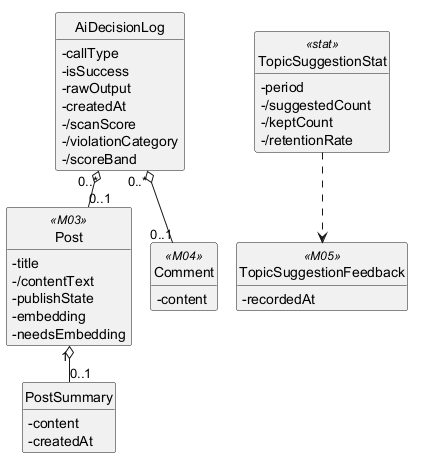

# Phân tích lớp thực thể — M13 AI Layer

<!-- [Vietnamese Doc] Tài liệu tiếng Việt; tên lớp và thuộc tính viết tiếng Anh (input/CONVENTIONS.md mục 3). -->

| Mã tài liệu | EC-M13 |
|---|---|
| Dự án | iShare |
| Module | M13 — AI Layer |
| Đầu vào | FR-M13 phiên bản 1.3 |
| Trạng thái | Đã chốt |
| Phiên bản | 1.0 |
| Ngày | 2026-11-19 |
| Tác giả | Phạm Văn Đức |

<!-- Quy ước chung cho mọi bảng dưới đây:
     - Không đổi tên cột, không xóa cột, không đổi số mục: tool đọc bảng theo số mục và tên cột.
     - Ô không có nội dung ghi "—".
     - Mục chưa tới bước làm thì để dòng "(Chưa làm — bước N)".
     - Cột Nguồn ghi mã trong FR: FR-Mxx-nn, FR-Mxx-nn.mm, BR-Mxx-nn, hoặc TN:<thuật ngữ> (mục 2.1 của FR).
     - Mục 4 chỉ chứa ảnh sơ đồ. gen_puml.py ghi mã PlantUML vào tệp riêng diagrams/EC-Mxx.puml, render
       diagrams/EC-Mxx.png và đặt ảnh vào mục 4. Không chép mã PlantUML vào tài liệu, không sửa tay tệp .puml hay ảnh. -->

## 1. Mô tả chức năng

### 1.1 Đoạn mô tả

Hệ thống cung cấp lớp AI dùng chung của iShare: gửi lời gọi AI của các module tới dịch vụ AI của bên thứ ba để chấm
điểm kiểm duyệt bài viết và bình luận, tạo embedding của bài viết và embedding của truy vấn, lấy gợi ý Topic và tóm tắt
bài viết; ghi nhật ký quyết định AI và đánh giá chất lượng gợi ý Topic. Mỗi lời gọi AI chỉ được gửi khi công tắc AI
tổng và công tắc AI riêng của loại lời gọi do M10 quản lý đang bật, gồm lần thử đầu và nhiều nhất một lần thử lại, mỗi
lần thử giới hạn bởi thời gian chờ; khi AI tắt hoặc lời gọi thất bại, hệ thống báo cho module gọi để module gọi dùng
cách làm thay thế, và giữ nguyên các công tắc AI.

Khi M03 gửi một bài viết để quét, hệ thống gửi tiêu đề, nội dung chữ, bình chọn và ảnh đính kèm của bài viết, không gồm
tài liệu đính kèm, cho AI kiểm duyệt; khi M08 kích hoạt quét một luồng bình luận, hệ thống gửi nội dung chữ của từng
bình luận. Từ đầu ra thô của dịch vụ AI, hệ thống lấy điểm của bốn nhóm vi phạm, tính điểm quét là điểm cao nhất, nhóm
vi phạm là nhóm có điểm đó và khoảng điểm cao, nghi ngờ hoặc sạch theo cặp ngưỡng, rồi trả điểm quét, nhóm vi phạm và
khoảng điểm cho module gọi. Hệ thống không chấm điểm kiểm duyệt nội dung của tài khoản Admin và tin nhắn chat.

Hệ thống tạo embedding của bài viết khi bài viết chuyển sang trạng thái đăng Đã đăng, tạo lại embedding của bài viết khi
tiêu đề hoặc nội dung chữ của bài viết Đã đăng thay đổi, và giữ đúng một embedding của bài viết cho mỗi bài viết; bình
luận không có embedding. Khi AI tắt hoặc việc tạo embedding của bài viết thất bại, hệ thống đưa bài viết vào hàng chờ
tạo bù embedding, rồi tạo embedding theo nội dung hiện tại cho bài viết trong hàng chờ tạo bù embedding khi AI dùng được
trở lại và đưa bài viết ra khỏi hàng chờ tạo bù embedding. Hệ thống cung cấp embedding của bài viết cho M06, và tạo
embedding của truy vấn cho truy vấn tìm bài viết của người dùng đã đăng nhập mà M06 chuyển tới. Khi M05 chuyển một yêu
cầu gợi ý Topic, hệ thống gửi tiêu đề và nội dung chữ của bài viết cho AI và chuyển các Topic AI trả về cho M05.

Hệ thống cho phép người dùng đã đăng nhập yêu cầu tóm tắt một bài viết có tiêu đề cộng nội dung chữ đủ số từ tối thiểu;
Guest không yêu cầu được tóm tắt. Khi bài viết chưa có kết quả tóm tắt đang giữ, hệ thống gửi tiêu đề và nội dung chữ
của bài viết cho AI và giữ tạm kết quả tóm tắt gồm nội dung tóm tắt và thời điểm tạo, dùng chung cho mọi người yêu cầu
bài viết đó. Hệ thống bỏ kết quả tóm tắt đang giữ khi hết thời gian giữ tạm tính từ thời điểm tạo, khi tiêu đề hoặc nội
dung chữ của bài viết thay đổi, hoặc khi bài viết không còn đủ số từ tối thiểu; lời gọi tóm tắt thất bại thì hệ thống
không giữ kết quả nào.

Mỗi khi một lời gọi chấm điểm kiểm duyệt, tạo embedding của bài viết hoặc lấy gợi ý Topic kết thúc, kể cả khi thất bại,
hệ thống ghi một bản ghi nhật ký quyết định AI gồm loại lời gọi, kết quả thành công hay thất bại và đầu ra thô, gắn với
bài viết hoặc bình luận liên quan; khi quét một luồng bình luận, mỗi bình luận được chấm điểm có một bản ghi nhật ký
quyết định AI riêng. Hệ thống không ghi lời gọi tóm tắt và lời gọi tạo embedding của truy vấn vào nhật ký quyết định
AI, và giữ bản ghi nhật ký quyết định AI vĩnh viễn, không sửa, không xóa, kể cả khi tài khoản của tác giả bị xóa. Hệ
thống cho phép Mod và Admin xem nhật ký quyết định AI của bài viết khi xét khiếu nại bài viết bị AI tự từ chối do M09
quản lý, và không cho tra cứu nhật ký quyết định AI ở chỗ nào khác.

Hệ thống tính tỷ lệ Topic gợi ý được giữ lại bằng số Topic AI gợi ý mà tác giả giữ lại chia cho tổng số Topic AI gợi
ý, trên các phản hồi gợi ý Topic do M05 ghi trong khoảng thời gian Admin chọn, và cung cấp tỷ lệ Topic gợi ý được giữ
lại cho bảng thống kê của M15.

<!-- Văn xuôi bình thường, có thể chia vài đoạn. KHÔNG ghi mã câu (S1), (S2)… trong đoạn văn: người đọc không hiểu
     các mã đó. Số câu chỉ nằm ở bảng 1.2. Xem steps/01-describe-functions.md. -->

### 1.2 Truy vết câu

<!-- Mỗi câu của đoạn mô tả một dòng, theo đúng thứ tự. Câu: 1, 2, 3…
     Nội dung câu: chép NGUYÊN VĂN câu đó từ mục 1.1 (tool so khớp từng câu với đoạn văn).
     Nguồn: mã chức năng hoặc yêu cầu của FR mà câu dựa vào. -->

| Câu | Nội dung câu | Nguồn |
|---|---|---|
| 1 | Hệ thống cung cấp lớp AI dùng chung của iShare: gửi lời gọi AI của các module tới dịch vụ AI của bên thứ ba để chấm điểm kiểm duyệt bài viết và bình luận, tạo embedding của bài viết và embedding của truy vấn, lấy gợi ý Topic và tóm tắt bài viết; ghi nhật ký quyết định AI và đánh giá chất lượng gợi ý Topic. | FR-M13-01, FR-M13-01.10, FR-M13-08, FR-M13-10 |
| 2 | Mỗi lời gọi AI chỉ được gửi khi công tắc AI tổng và công tắc AI riêng của loại lời gọi do M10 quản lý đang bật, gồm lần thử đầu và nhiều nhất một lần thử lại, mỗi lần thử giới hạn bởi thời gian chờ; khi AI tắt hoặc lời gọi thất bại, hệ thống báo cho module gọi để module gọi dùng cách làm thay thế, và giữ nguyên các công tắc AI. | FR-M13-01.01, FR-M13-01.02, FR-M13-01.03, FR-M13-01.04, FR-M13-01.05, FR-M13-01.06, FR-M13-01.07, FR-M13-01.09 |
| 3 | Khi M03 gửi một bài viết để quét, hệ thống gửi tiêu đề, nội dung chữ, bình chọn và ảnh đính kèm của bài viết, không gồm tài liệu đính kèm, cho AI kiểm duyệt; khi M08 kích hoạt quét một luồng bình luận, hệ thống gửi nội dung chữ của từng bình luận. | FR-M13-02, FR-M13-02.01, FR-M13-02.02, FR-M13-02.03 |
| 4 | Từ đầu ra thô của dịch vụ AI, hệ thống lấy điểm của bốn nhóm vi phạm, tính điểm quét là điểm cao nhất, nhóm vi phạm là nhóm có điểm đó và khoảng điểm cao, nghi ngờ hoặc sạch theo cặp ngưỡng, rồi trả điểm quét, nhóm vi phạm và khoảng điểm cho module gọi. | FR-M13-02.04, FR-M13-02.05, FR-M13-02.06, FR-M13-02.07, FR-M13-02.08 |
| 5 | Hệ thống không chấm điểm kiểm duyệt nội dung của tài khoản Admin và tin nhắn chat. | FR-M13-02.11, FR-M13-02.12 |
| 6 | Hệ thống tạo embedding của bài viết khi bài viết chuyển sang trạng thái đăng Đã đăng, tạo lại embedding của bài viết khi tiêu đề hoặc nội dung chữ của bài viết Đã đăng thay đổi, và giữ đúng một embedding của bài viết cho mỗi bài viết; bình luận không có embedding. | FR-M13-03, FR-M13-03.01, FR-M13-03.02, FR-M13-03.03, FR-M13-03.06 |
| 7 | Khi AI tắt hoặc việc tạo embedding của bài viết thất bại, hệ thống đưa bài viết vào hàng chờ tạo bù embedding, rồi tạo embedding theo nội dung hiện tại cho bài viết trong hàng chờ tạo bù embedding khi AI dùng được trở lại và đưa bài viết ra khỏi hàng chờ tạo bù embedding. | FR-M13-03.08, FR-M13-03.09, FR-M13-03.10 |
| 8 | Hệ thống cung cấp embedding của bài viết cho M06, và tạo embedding của truy vấn cho truy vấn tìm bài viết của người dùng đã đăng nhập mà M06 chuyển tới. | FR-M13-03.07, FR-M13-04, FR-M13-04.01, FR-M13-04.04 |
| 9 | Khi M05 chuyển một yêu cầu gợi ý Topic, hệ thống gửi tiêu đề và nội dung chữ của bài viết cho AI và chuyển các Topic AI trả về cho M05. | FR-M13-05, FR-M13-05.01, FR-M13-05.02 |
| 10 | Hệ thống cho phép người dùng đã đăng nhập yêu cầu tóm tắt một bài viết có tiêu đề cộng nội dung chữ đủ số từ tối thiểu; Guest không yêu cầu được tóm tắt. | FR-M13-07, FR-M13-07.01, FR-M13-07.02, FR-M13-07.03 |
| 11 | Khi bài viết chưa có kết quả tóm tắt đang giữ, hệ thống gửi tiêu đề và nội dung chữ của bài viết cho AI và giữ tạm kết quả tóm tắt gồm nội dung tóm tắt và thời điểm tạo, dùng chung cho mọi người yêu cầu bài viết đó. | FR-M13-06, FR-M13-06.01, FR-M13-06.02, FR-M13-06.03 |
| 12 | Hệ thống bỏ kết quả tóm tắt đang giữ khi hết thời gian giữ tạm tính từ thời điểm tạo, khi tiêu đề hoặc nội dung chữ của bài viết thay đổi, hoặc khi bài viết không còn đủ số từ tối thiểu; lời gọi tóm tắt thất bại thì hệ thống không giữ kết quả nào. | FR-M13-06.04, FR-M13-06.05, FR-M13-06.07, BR-M13-27 |
| 13 | Mỗi khi một lời gọi chấm điểm kiểm duyệt, tạo embedding của bài viết hoặc lấy gợi ý Topic kết thúc, kể cả khi thất bại, hệ thống ghi một bản ghi nhật ký quyết định AI gồm loại lời gọi, kết quả thành công hay thất bại và đầu ra thô, gắn với bài viết hoặc bình luận liên quan; khi quét một luồng bình luận, mỗi bình luận được chấm điểm có một bản ghi nhật ký quyết định AI riêng. | FR-M13-08, FR-M13-08.01, FR-M13-08.02, FR-M13-08.03, FR-M13-08.04, FR-M13-08.09 |
| 14 | Hệ thống không ghi lời gọi tóm tắt và lời gọi tạo embedding của truy vấn vào nhật ký quyết định AI, và giữ bản ghi nhật ký quyết định AI vĩnh viễn, không sửa, không xóa, kể cả khi tài khoản của tác giả bị xóa. | FR-M13-08.05, FR-M13-08.07, FR-M13-08.08 |
| 15 | Hệ thống cho phép Mod và Admin xem nhật ký quyết định AI của bài viết khi xét khiếu nại bài viết bị AI tự từ chối do M09 quản lý, và không cho tra cứu nhật ký quyết định AI ở chỗ nào khác. | FR-M13-09, FR-M13-09.01, FR-M13-09.02, FR-M13-09.04 |
| 16 | Hệ thống tính tỷ lệ Topic gợi ý được giữ lại bằng số Topic AI gợi ý mà tác giả giữ lại chia cho tổng số Topic AI gợi ý, trên các phản hồi gợi ý Topic do M05 ghi trong khoảng thời gian Admin chọn, và cung cấp tỷ lệ Topic gợi ý được giữ lại cho bảng thống kê của M15. | FR-M13-10, FR-M13-10.01, FR-M13-10.02, FR-M13-10.03, FR-M13-10.04 |

## 2. Danh từ và phân loại

### 2.1 Sổ danh từ

<!-- Phân loại: Lớp | Thuộc tính | Loại bỏ.
     Kết quả: tên lớp; hoặc Lớp.thuộcTính; hoặc "—" khi loại bỏ.
     Xuất hiện ở: "Câu n" (số câu ở bảng 1.2) hoặc "Quét: <mã FR>" (lượt quét bổ sung). -->

| # | Danh từ | Xuất hiện ở | Phân loại | Kết quả | Lý do |
|---|---|---|---|---|---|
| 1 | hệ thống | Câu 1 | Loại bỏ | — | Trừu tượng: chỉ chính phần mềm |
| 2 | lớp AI | Câu 1 | Loại bỏ | — | Trừu tượng: tên của module này (TN:Lớp AI (AI Layer)) |
| 3 | iShare | Câu 1 | Loại bỏ | — | Trừu tượng: tên sản phẩm |
| 4 | lời gọi AI / lời gọi | Câu 1 | Loại bỏ | — | Hành động không lưu dấu vết riêng: lời gọi chấm điểm kiểm duyệt, embedding bài, gợi ý Topic được ghi bằng một bản ghi AiDecisionLog (dòng 14); lời gọi tóm tắt và embedding truy vấn không được ghi (FR-M13-08.05) |
| 5 | module / module gọi | Câu 1 | Loại bỏ | — | Trừu tượng: các phần của hệ thống gửi lời gọi (M03, M04, M05, M06, M08, M11) |
| 6 | dịch vụ AI / bên thứ ba | Câu 1 | Loại bỏ | — | Ngoài phạm vi hệ thống: nhà cung cấp AI bên ngoài (TN:Dịch vụ AI) |
| 7 | chấm điểm kiểm duyệt | Câu 1 | Loại bỏ | — | Giá trị của AiDecisionLog.callType |
| 8 | bài viết | Câu 1 | Lớp | Post | Lớp ngoài (M03): bài được quét, có embedding, có kết quả tóm tắt đang giữ và bản ghi nhật ký quyết định AI; dùng tên Post của EC-M03 |
| 9 | bình luận | Câu 1 | Lớp | Comment | Lớp ngoài (M04): bình luận được quét và có bản ghi nhật ký quyết định AI; dùng tên Comment của EC-M04 |
| 10 | embedding của bài viết / embedding | Câu 1 | Thuộc tính | Post.embedding | Biểu diễn ý nghĩa tiêu đề và nội dung chữ của một bài (TN:Embedding); mỗi bài một embedding (BR-M13-17), không có thông tin nghiệp vụ khác (mục Dữ liệu nghiệp vụ) nên là một giá trị mô tả bài viết; xem Q-01 |
| 11 | embedding của truy vấn | Câu 1 | Loại bỏ | — | Hành động không lưu dấu vết: tạo cho từng truy vấn và trả ngay cho M06 (FR-M13-04.01), không ghi nhật ký (FR-M13-08.05); EC-M06 dòng 36 cũng không lưu |
| 12 | gợi ý Topic / yêu cầu gợi ý Topic | Câu 1 | Loại bỏ | — | Giá trị của AiDecisionLog.callType; lượt gợi ý và các Topic được gợi ý do M05 lưu (TopicSuggestion, SuggestedTopic của EC-M05) |
| 13 | tóm tắt bài viết / tóm tắt / kết quả tóm tắt đang giữ / kết quả tóm tắt | Câu 1 | Lớp | PostSummary | Có vòng đời riêng với bài viết: tạo khi có yêu cầu, bỏ khi đủ thời gian giữ tạm hoặc khi bài đổi (BR-M13-27); có nội dung và thời điểm tạo (mục Dữ liệu nghiệp vụ); mỗi bài nhiều nhất một kết quả đang giữ |
| 14 | nhật ký quyết định AI / bản ghi nhật ký quyết định AI | Câu 1 | Lớp | AiDecisionLog | FR yêu cầu lưu từng lời gọi: mỗi lời gọi chấm điểm, embedding bài, gợi ý Topic có đúng một bản ghi (BR-M13-21), giữ vĩnh viễn, không sửa, không xóa (BR-M13-22) |
| 15 | chất lượng gợi ý Topic | Câu 1 | Loại bỏ | — | Chung chung: được đo bằng tỷ lệ Topic gợi ý được giữ lại (dòng 58) |
| 16 | công tắc AI tổng / công tắc AI riêng / công tắc AI | Câu 2 | Loại bỏ | — | Ngoài phạm vi module (M10): M13 chỉ đọc trạng thái công tắc trước mỗi lời gọi; không có dữ liệu của M13 gắn với công tắc (như EC-M03 dòng 33, EC-M05 dòng 24, EC-M06 dòng 33) |
| 17 | loại lời gọi | Câu 2 | Thuộc tính | AiDecisionLog.callType | FR-M13-08.02 yêu cầu ghi trong mỗi bản ghi |
| 18 | M03, M05, M06, M08, M09, M10, M15 (tên module) | Câu 2 | Loại bỏ | — | Trừu tượng: tên các phần của hệ thống |
| 19 | lần thử đầu / lần thử lại / lần thử | Câu 2 | Loại bỏ | — | Hành động không lưu dấu vết: bản ghi nhật ký ghi một lần cho cả lời gọi, không ghi từng lần thử (BR-M13-21: lỗi lần 1, thành công lần 2 → một bản ghi thành công) |
| 20 | thời gian chờ | Câu 2 | Loại bỏ | — | Hằng số của BR-M13-08: 5 giây với chấm điểm kiểm duyệt và embedding, 10 giây với gợi ý Topic và tóm tắt |
| 21 | AI tắt | Câu 2 | Loại bỏ | — | Ngoài phạm vi module (M10): tình trạng do trạng thái công tắc của M10 (TN:AI tắt), không lưu ở M13 |
| 22 | cách làm thay thế | Câu 2 | Loại bỏ | — | Ngoài phạm vi module (M03, M05, M06, M08): mỗi module tự xử lý khi AI tắt hoặc lời gọi thất bại (BR-M13-10) |
| 23 | tiêu đề | Câu 3 | Thuộc tính | Post.title | Thông tin của bài viết (M03) mà M13 gửi cho AI và theo dõi thay đổi (FR-M13-02.01, FR-M13-03.02, FR-M13-06.05) |
| 24 | nội dung chữ | Câu 3 | Thuộc tính | Post.contentText | Thông tin của bài viết (M03) mà M13 gửi cho AI, đếm số từ và theo dõi thay đổi (FR-M13-02.01, FR-M13-07.02); tên contentText của EC-M03 |
| 25 | bình chọn | Câu 3 | Loại bỏ | — | Ngoài phạm vi module (M03): M13 chỉ đọc câu hỏi và các lựa chọn để gửi cho AI kiểm duyệt (BR-M13-25), không lưu; không có quan hệ với lớp nào của M13 |
| 26 | ảnh đính kèm | Câu 3 | Loại bỏ | — | Ngoài phạm vi module (M03): M13 chỉ đọc để gửi cho AI kiểm duyệt (BR-M13-25), không lưu; không có quan hệ với lớp nào của M13 |
| 27 | tài liệu đính kèm | Câu 3 | Loại bỏ | — | Ngoài phạm vi module (M03): không gửi cho AI (BR-M13-25, BR-M13-28) |
| 28 | AI kiểm duyệt / AI | Câu 3 | Loại bỏ | — | Ngoài phạm vi hệ thống: năng lực của dịch vụ AI bên ngoài (dòng 6) |
| 29 | luồng bình luận | Câu 3 | Loại bỏ | — | Ngoài phạm vi module (M08): M08 chọn luồng và kích hoạt quét (FR-M13-02.03); M13 chấm điểm từng bình luận |
| 30 | nội dung chữ của bình luận | Câu 3 | Thuộc tính | Comment.content | Thông tin của bình luận (M04) mà M13 gửi cho AI kiểm duyệt (FR-M13-02.03) |
| 31 | đầu ra thô | Câu 4 | Thuộc tính | AiDecisionLog.rawOutput | FR-M13-08.02 yêu cầu ghi khi có (TN:Đầu ra thô) |
| 32 | điểm của bốn nhóm vi phạm | Câu 4 | Loại bỏ | — | Chung chung: nằm trong AiDecisionLog.rawOutput (TN:Đầu ra thô, ví dụ "bốn điểm nhóm vi phạm"); điểm quét tính từ đó (BR-M13-12) |
| 33 | điểm quét | Câu 4 | Thuộc tính | AiDecisionLog.scanScore | Một giá trị tính ra từ đầu ra thô của một lời gọi chấm điểm (BR-M13-12, TN:Điểm quét) → thuộc tính dẫn xuất |
| 34 | nhóm vi phạm | Câu 4 | Thuộc tính | AiDecisionLog.violationCategory | Nhóm có điểm quét (BR-M13-12, TN:Nhóm vi phạm) → thuộc tính dẫn xuất |
| 35 | khoảng điểm | Câu 4 | Thuộc tính | AiDecisionLog.scoreBand | Khoảng của điểm quét theo cặp ngưỡng (BR-M13-13, TN:Khoảng điểm) → thuộc tính dẫn xuất |
| 36 | cao, nghi ngờ, sạch | Câu 4 | Loại bỏ | — | Giá trị của AiDecisionLog.scoreBand |
| 37 | cặp ngưỡng | Câu 4 | Loại bỏ | — | Hằng số của BR-M13-13: 0,9 / 0,5, là hằng số chính sách, chỉ đổi qua triển khai (BR-M13-14); ghi ở ràng buộc của AiDecisionLog.scoreBand |
| 38 | tài khoản Admin / tài khoản / tài khoản của tác giả | Câu 5 | Loại bỏ | — | Ngoài phạm vi module (M01): M13 đọc vai trò tác giả qua bài viết, bình luận để không chấm điểm nội dung của Admin (BR-M13-16); nhật ký vẫn tra được qua username giữ lại khi tài khoản bị xóa (BR-M13-22); không có quan hệ trực tiếp với lớp nào của M13 |
| 39 | tin nhắn chat | Câu 5 | Loại bỏ | — | Ngoài phạm vi module (M16): không chấm điểm (BR-M13-16) |
| 40 | trạng thái đăng | Câu 6 | Thuộc tính | Post.publishState | Thông tin của bài viết (M03) mà M13 đọc để chỉ tạo embedding cho bài Đã đăng (FR-M13-03.01, FR-M13-03.05) |
| 41 | Đã đăng | Câu 6 | Loại bỏ | — | Giá trị của Post.publishState |
| 42 | hàng chờ tạo bù embedding / hàng chờ | Câu 7 | Thuộc tính | Post.needsEmbedding | Mỗi mục của hàng chờ là một bài viết, không có thông tin riêng (mục Dữ liệu nghiệp vụ); việc một bài đang trong hàng chờ là một giá trị đúng/sai của bài viết (TN:Hàng chờ tạo bù embedding); xem Q-01 |
| 43 | nội dung hiện tại | Câu 7 | Loại bỏ | — | Chung chung: Post.title và Post.contentText lúc tạo embedding (BR-M13-26) |
| 44 | truy vấn / truy vấn tìm bài viết | Câu 8 | Loại bỏ | — | Ngoài phạm vi module (M06): M06 chuyển truy vấn tới, M13 không lưu |
| 45 | người dùng đã đăng nhập | Câu 8 | Loại bỏ | — | Ngoài phạm vi module (M01): M13 không ghi ai tìm kiếm hay ai yêu cầu tóm tắt; kết quả tóm tắt dùng chung cho mọi người (BR-M13-27); không có quan hệ với lớp nào của M13 |
| 46 | Topic / Topic AI trả về / Topic AI gợi ý | Câu 9 | Loại bỏ | — | Ngoài phạm vi module (M05): danh sách Topic AI trả về nằm trong AiDecisionLog.rawOutput; M05 đối chiếu với danh mục Topic và lưu ở SuggestedTopic (EC-M05) |
| 47 | số từ tối thiểu | Câu 10 | Loại bỏ | — | Hằng số của BR-M13-20: 300 từ tính trên tiêu đề cộng nội dung chữ |
| 48 | Guest | Câu 10 | Loại bỏ | — | Không lưu: tác nhân không có dữ liệu |
| 49 | nội dung tóm tắt | Câu 11 | Thuộc tính | PostSummary.content | Thuộc tính nguồn nêu của kết quả tóm tắt đang giữ (mục Dữ liệu nghiệp vụ) |
| 50 | thời điểm tạo | Câu 11 | Thuộc tính | PostSummary.createdAt | Mốc tính thời gian giữ tạm 24 giờ (BR-M13-27) |
| 51 | mọi người yêu cầu | Câu 11 | Loại bỏ | — | Chung chung: người dùng đã đăng nhập (dòng 45); kết quả dùng chung, không ghi người yêu cầu (FR-M13-06.03) |
| 52 | thời gian giữ tạm | Câu 12 | Loại bỏ | — | Hằng số của BR-M13-27: 24 × 60 phút từ PostSummary.createdAt (TN:24 giờ) |
| 53 | kết quả thành công hay thất bại | Câu 13 | Thuộc tính | AiDecisionLog.isSuccess | FR-M13-08.02 yêu cầu ghi |
| 54 | tác giả | Câu 14 | Loại bỏ | — | Ngoài phạm vi module (M03, M04): quan hệ tác giả của bài viết, bình luận; M13 không ghi lại tác giả (mục Dữ liệu nghiệp vụ: nhật ký gắn với tài khoản tác giả "qua" bài viết, bình luận) |
| 55 | Mod / Admin | Câu 15 | Loại bỏ | — | Ngoài phạm vi module (M01, M10): vai trò của người xem nhật ký, M13 chỉ kiểm vai trò (FR-M13-09.02); không ghi ai xem |
| 56 | khiếu nại / bài viết bị AI tự từ chối | Câu 15 | Loại bỏ | — | Ngoài phạm vi module (M09, M03): M13 chỉ hiển thị nhật ký của bài khi M09 xét khiếu nại (FR-M13-09.01); không có quan hệ với lớp nào của M13 |
| 57 | chỗ tra cứu | Câu 15 | Loại bỏ | — | Giao diện |
| 58 | tỷ lệ Topic gợi ý được giữ lại | Câu 16 | Lớp | TopicSuggestionStat | Số liệu tính ra theo một khoảng thời gian, tính lại từ dữ liệu, không lưu (ma trận CRUD) → lớp thống kê (T7); tên theo QU-01 (lớp gốc TopicSuggestion của EC-M05 + Stat) |
| 59 | số Topic AI gợi ý mà tác giả giữ lại | Câu 16 | Thuộc tính | TopicSuggestionStat.keptCount | Tử số của công thức BR-M13-29 |
| 60 | tổng số Topic AI gợi ý | Câu 16 | Thuộc tính | TopicSuggestionStat.suggestedCount | Mẫu số của công thức BR-M13-29 |
| 61 | phản hồi gợi ý Topic | Câu 16 | Lớp | TopicSuggestionFeedback | Lớp ngoài (M05): dữ liệu để tính tỷ lệ (BR-M13-23); dùng tên TopicSuggestionFeedback của EC-M05 |
| 62 | khoảng thời gian | Câu 16 | Thuộc tính | TopicSuggestionStat.period | Admin chọn ở bộ lọc của M15 (FR-M13-10.02) |
| 63 | bảng thống kê | Câu 16 | Loại bỏ | — | Ngoài phạm vi module (M15): nơi hiển thị tỷ lệ (FR-M13-10.04) |
| 64 | thời điểm ghi phản hồi | Quét: FR-M13-10.02 | Thuộc tính | TopicSuggestionFeedback.recordedAt | M13 xếp mỗi phản hồi vào khoảng thời gian theo lúc nó được ghi (FR-M13-10.02); tên recordedAt của EC-M05 |
| 65 | Hôm nay, 7 ngày, 30 ngày, Toàn thời gian | Quét: FR-M13-10.02 | Loại bỏ | — | Giá trị của TopicSuggestionStat.period |
| 66 | giờ Việt Nam | Quét: FR-M13-10.02 | Loại bỏ | — | Chung chung: múi giờ dùng để xếp phản hồi vào khoảng thời gian (BR-M13-29), không lưu |
| 67 | username giữ lại | Quét: FR-M13-08.08 | Loại bỏ | — | Ngoài phạm vi module (M01): User.username giữ vĩnh viễn khi tài khoản DELETED (EC-M01); M13 tra nhật ký qua bài viết, bình luận |
| 68 | ghi chú "Tóm tắt chưa bao gồm nội dung tệp đính kèm" | Quét: FR-M13-07.04 | Loại bỏ | — | Giao diện |
| 69 | nút "Tóm tắt" | Quét: FR-M13-07.02 | Loại bỏ | — | Giao diện: hiện khi bài từ 300 từ (BR-M13-20) |
| 70 | bản ghi lỗi cho Admin | Quét: FR-M13-08.09 | Loại bỏ | — | Chung chung: là bản ghi AiDecisionLog có isSuccess sai của bình luận quét lỗi (FR-M13-08.09) |
| 71 | dự đoán của AI / thao tác đánh dấu đúng sai | Quét: FR-M13-10.05 | Loại bỏ | — | Ngoài phạm vi hệ thống: đã quyết không làm (BR-M13-24) |
| 72 | giới hạn tần suất | Quét: BR-M13-19 | Loại bỏ | — | Ngoài phạm vi module (M05, M06): lớp AI không có giới hạn riêng (BR-M13-19) |

### 2.2 Lớp

<!-- Nhóm: Thực thể | Liên kết | Thống kê. Sở hữu: mã module sở hữu lớp (Mxx của tài liệu này, hoặc Myy với lớp ngoài).
     Thuộc tính: tên mọi thuộc tính của lớp ở mục 2.3, ngăn bởi dấu phẩy, thuộc tính dẫn xuất có "/" phía trước;
     để người đọc thấy lớp và thuộc tính trên cùng một dòng. Lớp chưa có thuộc tính ghi "—". -->

| Lớp | Tên tiếng Việt | Nhóm | Sở hữu | Mô tả | Thuộc tính | Nguồn |
|---|---|---|---|---|---|---|
| AiDecisionLog | Bản ghi nhật ký quyết định AI | Thực thể | M13 | Bản ghi của một lời gọi chấm điểm kiểm duyệt, embedding bài hoặc gợi ý Topic, kể cả lời gọi thất bại; gắn với một bài viết hoặc một bình luận; giữ vĩnh viễn | callType, isSuccess, rawOutput, createdAt, /scanScore, /violationCategory, /scoreBand | FR-M13-08.01, FR-M13-08.02, FR-M13-08.03 |
| PostSummary | Kết quả tóm tắt đang giữ | Thực thể | M13 | Tóm tắt AI của một bài viết, giữ tạm và dùng chung cho mọi người yêu cầu; bị bỏ khi hết hạn hoặc bài đổi | content, createdAt | FR-M13-06.02, FR-M13-06.04, FR-M13-06.05 |
| TopicSuggestionStat | Thống kê chất lượng gợi ý Topic | Thống kê | M13 | Tỷ lệ Topic gợi ý được giữ lại trong một khoảng thời gian, tính lại từ các phản hồi gợi ý Topic | period, /suggestedCount, /keptCount, /retentionRate | FR-M13-10.01, FR-M13-10.02 |
| Post | Bài viết | Thực thể | M03 | Bài được quét, có embedding, có kết quả tóm tắt đang giữ và bản ghi nhật ký quyết định AI | title, contentText, publishState, embedding, needsEmbedding | FR-M13-02.01, FR-M13-03.01, FR-M13-06.01 |
| Comment | Bình luận | Thực thể | M04 | Bình luận được quét khi M08 kích hoạt quét luồng; có bản ghi nhật ký quyết định AI | content | FR-M13-02.03, FR-M13-08.04 |
| TopicSuggestionFeedback | Phản hồi gợi ý | Thực thể | M05 | Phản hồi gợi ý Topic mà M13 dùng để tính tỷ lệ Topic gợi ý được giữ lại | recordedAt | FR-M13-10.01 |

### 2.3 Thuộc tính

<!-- Mỗi lớp có ĐỦ thuộc tính để người đọc hình dung được nó; xếp các dòng theo lớp.
     Tính chất: Lưu | Dẫn xuất. Chưa có id, chưa có kiểu, chưa có khóa ngoại.
     Căn cứ: Nguồn nêu (FR nói tới) | Đề xuất (FR không nói, nhưng chức năng hoặc quy tắc ở cột Nguồn cần nó) |
             Tham chiếu (thuộc tính của lớp ngoài mà module này đọc hoặc ghi; module sở hữu lớp đó định nghĩa).
     Ràng buộc nguồn nêu: độ dài tối đa, duy nhất, bắt buộc/tùy chọn, tập giá trị, mặc định, công thức (với Dẫn xuất)
             — chép từ FR kèm mã. Đề xuất mà FR không nêu ràng buộc thì ghi "—".
     Nguồn: mã FR/BR nêu thuộc tính; với Đề xuất là mã chức năng hoặc quy tắc cần nó.
     Ghi chú: bắt buộc với Đề xuất (vì sao cần) và Tham chiếu (module này dùng nó làm gì). -->

| Lớp | Thuộc tính | Tên tiếng Việt | Tính chất | Căn cứ | Ràng buộc nguồn nêu | Nguồn | Ghi chú |
|---|---|---|---|---|---|---|---|
| AiDecisionLog | callType | Loại lời gọi | Lưu | Nguồn nêu | Chấm điểm kiểm duyệt, embedding bài, gợi ý Topic (mục Dữ liệu nghiệp vụ, BR-M13-21); không có tóm tắt và embedding truy vấn (FR-M13-08.05) | FR-M13-08.02, BR-M13-21 | — |
| AiDecisionLog | isSuccess | Thành công | Lưu | Nguồn nêu | Đúng khi một trong hai lần thử có kết quả, sai khi cả hai lần thử lỗi (BR-M13-21); bản ghi sai của bình luận quét lỗi là bản ghi lỗi cho Admin (FR-M13-08.09) | FR-M13-08.02, FR-M13-08.09 | — |
| AiDecisionLog | rawOutput | Đầu ra thô | Lưu | Nguồn nêu | Kết quả dịch vụ AI trả về, giữ nguyên chưa qua xử lý (TN:Đầu ra thô), ví dụ bốn điểm nhóm vi phạm, danh sách Topic gợi ý; chỉ có khi lời gọi có kết quả (FR-M13-08.02); không sửa, không xóa (BR-M13-22) | FR-M13-08.02, BR-M13-21, BR-M13-22 | — |
| AiDecisionLog | createdAt | Thời điểm ghi | Lưu | Đề xuất | Không sửa, không xóa (BR-M13-22) | FR-M13-09.01, FR-M13-08.01 | FR-M13-09.01 hiển thị nhật ký quyết định AI của bài cho người xét khiếu nại; một bài được quét nhiều lần (bài mới gửi, bài đã đăng được sửa, bài tự ẩn được hiện lại, bài gửi lại sau khi bị từ chối) và được gợi ý Topic, tạo embedding nhiều lần, nên có nhiều bản ghi; cần thời điểm để biết bản ghi nào ứng với lần AI tự từ chối đang bị khiếu nại. Lý do của FR-M13-08 cũng dùng nhật ký để chỉnh ngưỡng theo dữ liệu thật theo thời gian |
| AiDecisionLog | scanScore | Điểm quét | Dẫn xuất | Nguồn nêu | 0 đến 1; = điểm cao nhất trong bốn điểm nhóm vi phạm của rawOutput (BR-M13-12); chỉ có ở lời gọi chấm điểm kiểm duyệt thành công | FR-M13-02.05, FR-M13-02.08, BR-M13-12 | Trả cho M03, M04, M08, M11 (FR-M13-02.08); M08 lưu ở Report.scanScore (EC-M08) |
| AiDecisionLog | violationCategory | Nhóm vi phạm | Dẫn xuất | Nguồn nêu | Quấy rối, Ngôn từ thù ghét, Nội dung người lớn, Bạo lực (TN:Nhóm vi phạm); = nhóm có điểm quét; nhiều nhóm cùng điểm cao nhất thì lấy nhóm đứng trước theo thứ tự trên (BR-M13-12) | FR-M13-02.05, FR-M13-02.06, BR-M13-12 | Trả cho module gọi; M03 lưu ở Post.violationCategory (EC-M03) |
| AiDecisionLog | scoreBand | Khoảng điểm | Dẫn xuất | Nguồn nêu | Cao (≥ 0,9), nghi ngờ (0,5 đến < 0,9), sạch (< 0,5) theo một cặp ngưỡng chung cho bài viết, bình luận và mọi tác giả (BR-M13-13); ngưỡng là hằng số chính sách, chỉ đổi qua triển khai (BR-M13-14) | FR-M13-02.07, FR-M13-02.08, BR-M13-13 | Module gọi chỉ tự xử lý khi khoảng cao (BR-M13-01) |
| PostSummary | content | Nội dung tóm tắt | Lưu | Nguồn nêu | Tạo từ tiêu đề và nội dung chữ của bài, không gồm tệp đính kèm và bình chọn (BR-M13-28); kết quả thất bại không được giữ (BR-M13-27) | FR-M13-06.02, BR-M13-28 | Hiển thị kèm ghi chú "Tóm tắt chưa bao gồm nội dung tệp đính kèm" (FR-M13-07.04) |
| PostSummary | createdAt | Thời điểm tạo | Lưu | Nguồn nêu | Kết quả bị bỏ khi đủ 24 × 60 phút kể từ thời điểm này (TN:24 giờ, BR-M13-27) | FR-M13-06.02, FR-M13-06.04, BR-M13-27 | — |
| TopicSuggestionStat | period | Khoảng thời gian | Lưu | Nguồn nêu | Hôm nay, 7 ngày, 30 ngày, Toàn thời gian, theo giờ Việt Nam (FR-M13-10.02, BR-M13-29) | FR-M13-10.02, BR-M13-29 | Admin chọn ở bộ lọc của M15 |
| TopicSuggestionStat | suggestedCount | Tổng số Topic AI gợi ý | Dẫn xuất | Nguồn nêu | Tổng số Topic AI gợi ý trên các phản hồi gợi ý Topic ghi trong khoảng thời gian, kể cả phản hồi của tài khoản đã xóa (BR-M13-29, BR-M13-23) | FR-M13-10.01, BR-M13-29 | — |
| TopicSuggestionStat | keptCount | Số Topic được giữ lại | Dẫn xuất | Nguồn nêu | Số Topic AI gợi ý có trong các Topic tác giả chọn cuối, trên cùng các phản hồi (BR-M13-29) | FR-M13-10.01, BR-M13-29 | — |
| TopicSuggestionStat | retentionRate | Tỷ lệ Topic gợi ý được giữ lại | Dẫn xuất | Nguồn nêu | keptCount ÷ suggestedCount; không có giá trị khi khoảng không có phản hồi nào (FR-M13-10.03, BR-M13-29) | FR-M13-10.01, FR-M13-10.03, BR-M13-29 | Cung cấp cho bảng thống kê Nội dung của M15, chỉ Admin xem (FR-M13-10.04) |
| Post | title | Tiêu đề | Lưu | Tham chiếu | — | FR-M13-02.01, FR-M13-05.01, FR-M13-06.01, FR-M13-03.02, FR-M13-06.05 | Gửi cho AI kiểm duyệt, gợi ý Topic, tóm tắt và dùng để tạo embedding; đổi tiêu đề thì tạo lại embedding và bỏ kết quả tóm tắt đang giữ |
| Post | contentText | Nội dung chữ | Dẫn xuất | Tham chiếu | — | FR-M13-02.01, FR-M13-05.01, FR-M13-06.01, FR-M13-07.02 | Như Post.title; đếm số từ (cùng tiêu đề) để hiện nút "Tóm tắt" và bỏ kết quả khi bài còn dưới 300 từ (BR-M13-20, BR-M13-27) |
| Post | publishState | Trạng thái đăng | Lưu | Tham chiếu | — | FR-M13-03.01, FR-M13-03.05 | Tạo embedding khi bài chuyển sang Đã đăng; không tạo cho bài Nháp, Chờ duyệt, Bị từ chối |
| Post | embedding | Embedding | Lưu | Nguồn nêu | Mỗi bài Đã đăng đúng một embedding, biểu diễn tiêu đề và nội dung chữ; tạo lại khi tiêu đề hoặc nội dung chữ đổi và thay embedding cũ; không tạo lại khi chỉ đổi Tag, Topic, ảnh, tài liệu; không có ở bài chưa Đã đăng (BR-M13-17, BR-M13-18) | FR-M13-03.01, FR-M13-03.02, FR-M13-03.03, FR-M13-03.07 | Thực thể "Embedding bài viết" của FR (Q-01); M06 so với embedding của truy vấn (EC-M06). EC-M03 chưa có; M13 bổ sung trên lớp ngoài Post (mục 5) |
| Post | needsEmbedding | Đang chờ tạo bù embedding | Lưu | Nguồn nêu | Đúng khi bài Đã đăng chưa có embedding theo nội dung hiện tại vì công tắc AI tổng hoặc Search tắt, hoặc vì lời gọi thất bại; về sai khi đã tạo embedding theo nội dung hiện tại (BR-M13-26) | FR-M13-03.08, FR-M13-03.09, FR-M13-03.10, BR-M13-26 | Thực thể "Hàng chờ tạo bù embedding" của FR (Q-01). EC-M03 chưa có; M13 bổ sung trên lớp ngoài Post (mục 5) |
| Comment | content | Nội dung | Lưu | Tham chiếu | — | FR-M13-02.03 | Nội dung chữ gửi cho AI kiểm duyệt khi M08 kích hoạt quét luồng bình luận |
| TopicSuggestionFeedback | recordedAt | Thời điểm ghi | Lưu | Tham chiếu | — | FR-M13-10.02 | Xếp mỗi phản hồi vào khoảng thời gian Admin chọn, theo giờ Việt Nam (BR-M13-29) |

### 2.4 Đối chiếu với mục Dữ liệu nghiệp vụ của FR

<!-- Mỗi thực thể ở bảng "Dữ liệu nghiệp vụ" của FR một dòng; chép đúng tên ở cột Thực thể của FR.
     Xử lý: Khớp | Đã thêm qua sổ danh từ | Mô hình có thêm: … | Lệch: … (kèm Q-nn). -->

| Thực thể trong FR | Trong mô hình | Xử lý |
|---|---|---|
| Nhật ký quyết định AI | AiDecisionLog | Khớp: loại lời gọi → callType; thành công hay thất bại → isSuccess; đầu ra thô → rawOutput; gắn với một bài viết hoặc một bình luận → quan hệ (bước 3); "qua đó với tài khoản tác giả" là quan hệ tác giả của M03, M04, không ghi lại ở M13. Mô hình có thêm: createdAt (Đề xuất, FR-M13-09.01); /scanScore, /violationCategory, /scoreBand (Dẫn xuất từ rawOutput, FR-M13-02.05 đến FR-M13-02.07) |
| Embedding bài viết | Post.embedding | Lệch: FR ghi là thực thể nhưng "không có thuộc tính nghiệp vụ khác" ngoài chính biểu diễn, mỗi bài đúng một → phép thử cho ra thuộc tính của bài viết (T9); xem Q-01 |
| Hàng chờ tạo bù embedding | Post.needsEmbedding | Lệch: mỗi mục của hàng chờ là một bài viết, không có thông tin riêng → phép thử cho ra thuộc tính đúng/sai của bài viết; xem Q-01 |
| Kết quả tóm tắt đang giữ | PostSummary | Khớp: nội dung tóm tắt → content; thời điểm tạo → createdAt; thuộc một bài viết, mỗi bài tối đa một → quan hệ (bước 3) |
| Tỷ lệ Topic gợi ý được giữ lại | TopicSuggestionStat | Khớp: giá trị tỷ lệ → /retentionRate; theo khoảng thời gian → period. Mô hình có thêm: /suggestedCount, /keptCount, hai vế của công thức BR-M13-29 |
| Phản hồi gợi ý Topic (M05) | TopicSuggestionFeedback | Khớp: thời điểm ghi → recordedAt (Tham chiếu). Các Topic AI gợi ý và các Topic tác giả chọn cuối là quan hệ của EC-M05 (SuggestedTopic, ChosenTopic), M13 đọc, không ghi lại |
| Công tắc AI (M10) | — | Không có trong mô hình: ConfigSwitch là lớp của EC-M10; M13 chỉ đọc trạng thái trước mỗi lời gọi, không có dữ liệu của M13 gắn với công tắc (cùng cách EC-M03, EC-M05, EC-M06) |

## 3. Quan hệ giữa các lớp

### 3.1 Ma trận cặp lớp

<!-- T = quan hệ trực tiếp; G(X) = chỉ gián tiếp qua lớp X; trống = không liên quan. Chỉ điền nửa trên. -->

Chỉ ghi các hàng của lớp thuộc M13; cặp hai lớp ngoài không xét (CONVENTIONS mục 5). Lớp thống kê TopicSuggestionStat
xét riêng ở mục 3.4. Nhật ký quyết định AI không có quan hệ trực tiếp với kết quả tóm tắt vì lời gọi tóm tắt không được
ghi (FR-M13-08.05).

| | PostSummary | Post | Comment | TopicSuggestionFeedback |
|---|---|---|---|---|
| AiDecisionLog |   | T | T |   |
| PostSummary |   | T |   |   |

### 3.2 Quan hệ số lượng

<!-- Mỗi ô T của ma trận một dòng. Dạng đọc theo thứ tự A–B: 1-1 | 1-n | n-1 | n-n.
     Xử lý: Giữ nguyên | Gộp vào <Lớp>: … | Giữ: … | Tách: thêm lớp <X>. -->

| Cặp | Câu A → B | Câu B → A | Dạng | Xử lý |
|---|---|---|---|---|
| Post – AiDecisionLog | Một bài viết có thể có nhiều bản ghi nhật ký quyết định AI ở các thời điểm khác nhau (mỗi lần quét, tạo embedding, gợi ý Topic). | Một bản ghi nhật ký quyết định AI gắn với nhiều nhất một bài viết; bản ghi của bình luận không gắn bài viết. | 1-n | Giữ nguyên |
| Comment – AiDecisionLog | Một bình luận có thể có nhiều bản ghi nhật ký quyết định AI (mỗi lần luồng của nó được quét). | Một bản ghi nhật ký quyết định AI gắn với nhiều nhất một bình luận; bản ghi của bài viết không gắn bình luận. | 1-n | Giữ nguyên |
| Post – PostSummary | Một bài viết có nhiều nhất một kết quả tóm tắt đang giữ; kết quả cũ bị bỏ trước khi có kết quả mới (BR-M13-27). | Một kết quả tóm tắt đang giữ thuộc đúng một bài viết. | 1-1 | Giữ: đầu PostSummary tùy chọn (0..1); khác module sở hữu (Post của M03); vòng đời khác nhau, kết quả bị bỏ khi bài vẫn còn |

Không có cặp n-n. Cặp 1-1 Post – PostSummary được giữ vì một đầu tùy chọn và hai lớp thuộc hai module khác nhau. Lớp
thống kê TopicSuggestionStat có một quan hệ Phụ thuộc ở mục 3.4.

### 3.3 Lớp liên kết

<!-- Mỗi lớp có Nhóm = Liên kết một dòng. "Tách từ quan hệ n-n" viết dạng "LớpA – LớpB".
     "Thuộc tính riêng của liên kết": tên các thuộc tính (đã ghi ở mục 2.3); không có thì ghi rõ vì sao. -->

Không có lớp liên kết: không cặp nào ở mục 3.2 có dạng n-n.

| Lớp liên kết | Tách từ quan hệ n-n | Thuộc tính riêng của liên kết | Nguồn |
|---|---|---|---|
| — | — | — | — |

### 3.4 Quan hệ

<!-- Bội số A = số đối tượng A ứng với một đối tượng B (ghi ở đầu A trên sơ đồ). Cú pháp: 1, 0..1, 0..*, 1..*, 1..3.
     Loại: Kế thừa | Hợp thành | Kết tập | Liên kết | Phụ thuộc.
     Bên chính: lớp cha (Kế thừa), lớp toàn thể (Hợp thành, Kết tập), lớp được dùng (Phụ thuộc); "—" với Liên kết.
     Kế thừa và Phụ thuộc ghi "—" ở Bội số A, Bội số B, Dạng. Không được còn dạng n-n. -->

| ID | Lớp A | Bội số A | Lớp B | Bội số B | Dạng | Loại | Bên chính | Căn cứ | Nguồn |
|---|---|---|---|---|---|---|---|---|---|
| R-M13-01 | Post | 0..1 | AiDecisionLog | 0..* | 1-n | Kết tập | AiDecisionLog | Bản ghi nhật ký quyết định AI ghi lại bài viết liên quan (FR-M13-08.03); bài viết tồn tại độc lập và bản ghi giữ vĩnh viễn kể cả khi tài khoản tác giả bị xóa (BR-M13-22), nên không ghi hợp thành. Mỗi bản ghi gắn với đúng một bài viết (R-M13-01) hoặc một bình luận (R-M13-02) | FR-M13-08.01, FR-M13-08.03, BR-M13-22 |
| R-M13-02 | Comment | 0..1 | AiDecisionLog | 0..* | 1-n | Kết tập | AiDecisionLog | Bản ghi nhật ký quyết định AI ghi lại bình luận được chấm điểm, mỗi bình luận của luồng một bản ghi (FR-M13-08.04); bình luận tồn tại độc lập. Mỗi bản ghi gắn với đúng một bài viết (R-M13-01) hoặc một bình luận (R-M13-02) | FR-M13-08.03, FR-M13-08.04, FR-M13-08.09 |
| R-M13-03 | Post | 1 | PostSummary | 0..1 | 1-1 | Kết tập | Post | Bài viết có kết quả tóm tắt đang giữ ("thuộc một bài viết", mục Dữ liệu nghiệp vụ). Đủ điều (i) không có kết quả khi chưa có bài và (ii) kết quả thuộc đúng một bài, nhưng không có căn cứ cho điều (iii): kết quả bị bỏ theo hạn giữ và theo thay đổi của bài (BR-M13-27), FR không nói gì khi bài bị xóa (bài chỉ xóa mềm, M03), nên không ghi hợp thành | FR-M13-06.02, FR-M13-06.05, BR-M13-27 |
| R-M13-04 | TopicSuggestionStat | — | TopicSuggestionFeedback | — | — | Phụ thuộc | TopicSuggestionFeedback | TopicSuggestionStat dùng các phản hồi gợi ý Topic ghi trong khoảng thời gian để tính tỷ lệ (BR-M13-29, BR-M13-23), không giữ phản hồi nào và không dùng lại thuộc tính của phản hồi; không phải số liệu của một phản hồi nên không kế thừa | FR-M13-10.01, FR-M13-10.02, BR-M13-29 |

## 4. Sơ đồ lớp phân tích

<!-- BEGIN:DIAGRAM -->

Mã nguồn sơ đồ: [diagrams/EC-M13.puml](diagrams/EC-M13.puml). Ảnh và tệp .puml do `gen_puml.py` sinh từ các bảng của tài liệu này; muốn đổi sơ đồ thì sửa bảng rồi chạy lại tool, không sửa tay.
<!-- END:DIAGRAM -->

## 5. Liên module

<!-- Mỗi lớp có Sở hữu khác module này một dòng. -->

| Lớp | Module sở hữu | Module này dùng thế nào | Thuộc tính module này bổ sung |
|---|---|---|---|
| Post | M03 | Bài được quét, tạo embedding, gợi ý Topic, tóm tắt; có bản ghi nhật ký quyết định AI (R-M13-01) và kết quả tóm tắt đang giữ (R-M13-03). Đọc title, contentText, publishState; ghi embedding và needsEmbedding | embedding, needsEmbedding |
| Comment | M04 | Bình luận được chấm điểm khi M08 quét luồng; có bản ghi nhật ký quyết định AI (R-M13-02). Đọc content | — |
| TopicSuggestionFeedback | M05 | Dữ liệu của lớp thống kê TopicSuggestionStat (R-M13-04). Đọc recordedAt; đọc các Topic gợi ý và Topic chọn cuối qua SuggestedTopic, ChosenTopic của EC-M05 | — |

## 6. Câu hỏi và điểm chưa chốt

<!-- Loại: Thiếu | Mơ hồ | Mâu thuẫn | Lệch. Ghi vào: mục của tài liệu này đã sửa theo câu trả lời, hoặc "Chờ cập nhật FR-Mxx". -->

| Mã | Loại | Câu hỏi | Trả lời | Ghi vào |
|---|---|---|---|---|
| Q-01 | Lệch | Mục Dữ liệu nghiệp vụ của FR ghi "Embedding bài viết" và "Hàng chờ tạo bù embedding" là hai thực thể, nhưng embedding "không có thuộc tính nghiệp vụ khác" và mỗi bài đúng một, còn mỗi mục hàng chờ "là một bài viết" không có thông tin riêng. Đề xuất (a): hai thuộc tính M13 bổ sung trên lớp ngoài Post: Post.embedding và Post.needsEmbedding (đúng khi bài đang trong hàng chờ tạo bù). Phương án (b): giữ hai lớp riêng của M13: PostEmbedding (vector, 1-1 với Post) và một lớp mục hàng chờ (0..1 mỗi bài). Việc tách bảng embedding cho pgvector là việc của bước thiết kế CSDL, không cần quyết ở đây | Người dùng đồng ý phương án (a) (2026-11-19): Post.embedding và Post.needsEmbedding là thuộc tính M13 bổ sung trên lớp ngoài Post; việc tách bảng embedding để bước thiết kế CSDL quyết | Mục 2.1 dòng 10, 42; mục 2.3 Post.embedding, Post.needsEmbedding; mục 2.4; mục 5 |

## 7. Lịch sử sửa đổi

| Phiên bản | Ngày | Nội dung | Người sửa |
|---|---|---|---|
| 0.1 | 2026-11-19 | Tạo mới; làm liền 3 bước theo yêu cầu của người dùng (không dừng ở cổng), chờ duyệt và trả lời Q-01 | Phạm Văn Đức |
| 1.0 | 2026-11-19 | Chốt sau 3 bước: 3 lớp của M13, 3 lớp ngoài, 4 quan hệ (R-M13-01 đến R-M13-04); Q-01 đã trả lời; đề xuất AiDecisionLog.createdAt được duyệt | Phạm Văn Đức |
