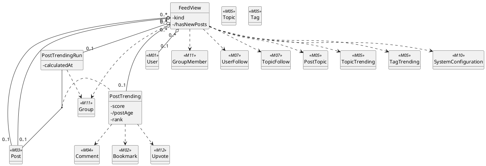

# Phân tích lớp thực thể — M14 Feed & Discovery

<!-- [Vietnamese Doc] Tài liệu tiếng Việt; tên lớp và thuộc tính viết tiếng Anh (input/CONVENTIONS.md mục 3). -->

| Mã tài liệu | EC-M14 |
|---|---|
| Dự án | iShare |
| Module | M14 — Feed & Discovery |
| Đầu vào | FR-M14 phiên bản 1.1 |
| Trạng thái | Bản nháp |
| Phiên bản | 0.3 |
| Ngày | 2026-11-19 |
| Tác giả | Phạm Văn Đức |

<!-- Quy ước chung cho mọi bảng dưới đây:
     - Không đổi tên cột, không xóa cột, không đổi số mục: tool đọc bảng theo số mục và tên cột.
     - Ô không có nội dung ghi "—".
     - Mục chưa tới bước làm thì để dòng "(Chưa làm — bước N)".
     - Cột Nguồn ghi mã trong FR: FR-M14-nn, FR-M14-nn.mm, BR-M14-nn, hoặc TN:<thuật ngữ> (mục 2.1 của FR).
     - Sơ đồ ở mục 4 do gen_puml.py sinh; không sửa tay. -->

## 1. Mô tả chức năng

### 1.1 Đoạn mô tả

(S1) M14 cung cấp các luồng Trending, Following, Group và Newest để người xem khám phá bài viết, Topic và Tag theo mức độ quan tâm, quan hệ theo dõi, tư cách thành viên nhóm hoặc thời điểm đăng. (S2) Guest và người dùng đã đăng nhập bắt đầu ở Trending Post, và hệ thống áp điều kiện hiển thị bài viết của M03 cùng trạng thái tài khoản của M01 cho mọi luồng. (S3) Hệ thống giữ bài đủ điều kiện của tài khoản BANNED hoặc ở mức cảnh cáo HEAVY trong feed, hiển thị nhãn tài khoản bị khóa do M12 cung cấp khi phù hợp và duy trì quyền truy cập feed khi cờ tính năng của module liên quan tắt. (S4) Hệ thống tính định kỳ điểm Trending Post từ số upvote còn hiệu lực, số bình luận chưa xóa kể cả trả lời, số bookmark còn hiệu lực và tuổi bài tính từ thời điểm đăng, rồi lưu kết quả xếp theo điểm và ưu tiên bài đăng sau khi đồng điểm. (S5) Hệ thống tính Trending Post cho bài đủ điều kiện trong giới hạn tuổi bài, gồm cả bài nhóm Public và bài chưa có tương tác, đồng thời loại bài nhóm Private khỏi tập tính điểm. (S6) Guest và người dùng đã đăng nhập xem cùng một kết quả Trending Post theo lần tính gần nhất khi mở lượt xem, hệ thống giữ kết quả đó trong lượt xem và kiểm lại quyền hiển thị khi tải bài, đồng thời lấy danh sách và thứ tự Trending Topic, Trending Tag từ M05. (S7) Với Following, hệ thống dùng quan hệ theo dõi người dùng hoặc Topic từ M07 để chọn bài đủ điều kiện cho người xem đã đăng nhập, gồm bài nhóm Public, gộp trùng và xếp theo thời điểm đăng, trong đó bài ẩn danh chỉ được đưa vào qua Topic đang theo dõi. (S8) Với Group, hệ thống lấy bài đủ điều kiện từ các nhóm Public và Private mà người xem đã tham gia, dùng tư cách thành viên hiện hành của M11 và xếp bài theo thời điểm đăng. (S9) Hệ thống tiếp tục liệt kê bài nhóm đủ điều kiện trong Trending Post, Following và Group khi cờ Group tắt, còn quyền mở bài và tương tác được M11 xử lý theo trạng thái cờ. (S10) Với Newest, hệ thống cung cấp cho Guest và người dùng đã đăng nhập các bài đủ điều kiện ngoài nhóm, xếp theo thời điểm đăng từ mới đến cũ. (S11) Hệ thống tải thêm bài nối tiếp vị trí của danh sách đang xem, tránh lặp hoặc bỏ sót khi có bài mới, và giữ kết quả tính đã chọn khi tải tiếp Trending Post. (S12) Trong Newest, Following và Group, hệ thống kiểm tra định kỳ bài mới thuộc phạm vi luồng theo bài mới nhất đang hiện, rồi chèn các bài mới lên đầu danh sách khi người xem yêu cầu và giữ vị trí đang đọc.

<!-- Một đoạn văn, mỗi câu đánh số (S1) (S2) … Xem steps/01-describe-functions.md. -->

### 1.2 Truy vết câu

| Câu | Nội dung tóm tắt | Nguồn |
|---|---|---|
| S1 | Phạm vi dữ liệu của feed | FR-M14-01, FR-M14-01.01, FR-M14-02, FR-M14-04, FR-M14-05, FR-M14-06 |
| S2 | Luồng mặc định và điều kiện hiển thị bài | FR-M14-01.02, FR-M14-01.05, FR-M14-01.08, FR-M14-01.09 |
| S3 | Trạng thái tài khoản, nhãn công khai và cờ tính năng | FR-M14-01.06, FR-M14-01.07, FR-M14-03.08 |
| S4 | Dữ liệu đầu vào, điểm và thứ tự Trending Post | FR-M14-03, FR-M14-03.02, FR-M14-03.03, FR-M14-03.04, FR-M14-03.10, FR-M14-03.11, FR-M14-03.12, FR-M14-03.13, FR-M14-03.14 |
| S5 | Phạm vi bài trong kết quả Trending Post | FR-M14-03.01, FR-M14-03.05, FR-M14-03.06, FR-M14-03.09 |
| S6 | Kết quả theo lượt xem và dữ liệu Trending từ M05 | FR-M14-02.02, FR-M14-02.03, FR-M14-02.04, FR-M14-02.05, FR-M14-02.06, FR-M14-02.09, FR-M14-02.11, FR-M14-02.12, FR-M14-07.05 |
| S7 | Chọn và xếp bài Following | FR-M14-04, FR-M14-04.01, FR-M14-04.02, FR-M14-04.03, FR-M14-04.04, FR-M14-04.06, FR-M14-04.07, FR-M14-04.09, FR-M14-04.10, FR-M14-04.13 |
| S8 | Chọn và xếp bài của các nhóm đã tham gia | FR-M14-05, FR-M14-05.01, FR-M14-05.02, FR-M14-05.03, FR-M14-05.04, FR-M14-05.05 |
| S9 | Duy trì danh sách bài nhóm khi cờ Group tắt | FR-M14-02.08, FR-M14-04.12, FR-M14-05.08 |
| S10 | Bài ngoài nhóm theo thời gian đăng | FR-M14-06, FR-M14-06.01, FR-M14-06.02, FR-M14-06.03, FR-M14-06.04 |
| S11 | Vị trí tải tiếp và tính nhất quán của lượt xem | FR-M14-07, FR-M14-07.01, FR-M14-07.02, FR-M14-07.03, FR-M14-07.04, FR-M14-07.05 |
| S12 | Kiểm tra, lấy và chèn bài mới | FR-M14-08, FR-M14-08.01, FR-M14-08.02, FR-M14-08.03, FR-M14-08.04, FR-M14-08.05, FR-M14-08.07 |

## 2. Danh từ và phân loại

### 2.1 Sổ danh từ

<!-- Phân loại: Lớp | Thuộc tính | Loại bỏ.
     Kết quả: tên lớp; hoặc Lớp.thuộcTính; hoặc "—" khi loại bỏ.
     Xuất hiện ở: S<n> (câu của đoạn mô tả) hoặc "Quét: <mã FR>" (lượt quét bổ sung). -->

| # | Danh từ | Xuất hiện ở | Phân loại | Kết quả | Lý do |
|---|---|---|---|---|---|
| 1 | bài viết / bài nhóm / bài đủ điều kiện / bài ngoài nhóm / bài ẩn danh / bài mới | S1 | Lớp | Post | Các ngữ cảnh của bài viết M03. |
| 2 | Topic / Topic đang theo dõi | S1 | Lớp | Topic | Đối tượng M05 dùng trong Following và Trending. |
| 3 | Tag | S1 | Lớp | Tag | Đối tượng M05 hiển thị qua Trending Tag. |
| 4 | tư cách thành viên nhóm / thành viên hiện hành | S1 | Lớp | GroupMember | Dùng dữ liệu M11. |
| 5 | feed / luồng feed / trang chủ | S1 | Loại bỏ | — | Giao diện. Nơi mở các luồng bài, ngữ cảnh lượt xem xét riêng. |
| 6 | Trending / Following / Group / Newest | S1 | Loại bỏ | — | Giá trị của FeedView.kind. |
| 7 | mức độ quan tâm | S1 | Loại bỏ | — | Trừu tượng. Biểu diễn qua điểm Trending Post. |
| 8 | quan hệ theo dõi | S1 | Loại bỏ | — | Chung chung. Các trường hợp UserFollow và TopicFollow xét riêng. |
| 9 | thời điểm đăng | S1 | Loại bỏ | — | Ngoài phạm vi module ở cấp thuộc tính. Dùng Post.publishedAt. |
| 10 | loại luồng / loại tab | S1 | Thuộc tính | FeedView.kind | T9. Mô tả luồng đang xem. |
| 11 | người xem đã đăng nhập / người dùng / tài khoản / tác giả | S2 | Lớp | User | Cùng tài khoản M01 theo vai trò. |
| 12 | Guest | S2 | Loại bỏ | — | Không lưu: tác nhân không có tài khoản. |
| 13 | hệ thống | S2 | Loại bỏ | — | Chung chung. Tác nhân xử lý, không có dữ liệu riêng. |
| 14 | điều kiện hiển thị / quyền hiển thị | S2 | Loại bỏ | — | Trừu tượng. Quy tắc đọc Post, User và Group khi tải. |
| 15 | trạng thái tài khoản / BANNED / DEACTIVATED / DELETED | S2 | Loại bỏ | — | Ngoài phạm vi module (M01, M08). Dùng trạng thái User. |
| 16 | mức cảnh cáo HEAVY | S3 | Loại bỏ | — | Ngoài phạm vi module (M08). Không lọc hoặc giảm điểm, không hiện mức cảnh cáo. |
| 17 | nhãn tài khoản bị khóa | S3 | Loại bỏ | — | Ngoài phạm vi module (M12). Dùng User.banLabel. |
| 18 | cờ tính năng / cờ Group / cờ Gamification | S3 | Loại bỏ | — | Ngoài phạm vi module (M10). Đọc cờ cấu hình dùng chung. |
| 19 | kết quả Trending Post / điểm của bài theo lần tính | S4 | Lớp | PostTrending | Kết quả một bài được giữ theo lần tính, dùng lại khi tải tiếp. |
| 20 | lần tính / kết quả của lần tính / lần tính gần nhất | S4 | Lớp | PostTrendingRun | Gom kết quả theo mốc tính để có thể tham chiếu nhiều mốc khi phục vụ các lượt xem. |
| 21 | số upvote còn hiệu lực | S4 | Loại bỏ | — | Ngoài phạm vi module (M12). Dùng số upvote hiệu lực do M12 cung cấp. |
| 22 | số bình luận chưa xóa / số trả lời | S4 | Loại bỏ | — | Ngoài phạm vi module (M04). Đếm cả trả lời; xem Q-03 về bình luận bị ẩn. |
| 23 | số bookmark còn hiệu lực | S4 | Loại bỏ | — | Ngoài phạm vi module (M02). Đếm Bookmark còn tồn tại theo bài. |
| 24 | điểm Trending Post | S4 | Thuộc tính | PostTrending.score | T7 ngoại lệ. Giữ kết quả để tải lại theo cùng lần tính. |
| 25 | tuổi bài | S4 | Thuộc tính | PostTrending.postAge | T7. Tính từ thời điểm đăng và thời điểm tính. |
| 26 | thứ tự Trending Post / thứ hạng Trending Post | S4 | Thuộc tính | PostTrending.rank | T7 ngoại lệ. Giữ thứ tự ổn định giữa các lần tải. |
| 27 | nhóm / nhóm Public / nhóm Private | S5 | Lớp | Group | Dùng lớp M11, Public và Private là chế độ. |
| 28 | giới hạn tuổi bài / ngưỡng tối thiểu | S5 | Loại bỏ | — | Hằng số của BR-M14-11/12. Tuổi tối đa 28 ngày và không áp ngưỡng điểm tối thiểu. |
| 29 | tập tính điểm / feed chính | S5 | Loại bỏ | — | Trừu tượng. Tập bài ngoài nhóm và nhóm Public thỏa điều kiện tại lúc tính. |
| 30 | bài chưa có tương tác | S5 | Loại bỏ | — | Trừu tượng. Các số đếm bằng 0; vẫn đưa vào khi đủ điều kiện. |
| 31 | lượt xem / lượt xem tab Trending | S6 | Lớp | FeedView | Có vòng đời mở đến rời hoặc tải lại, giữ kết quả và mốc đang dùng ở mức nghiệp vụ. |
| 32 | Trending Topic / danh sách Trending Topic | S6 | Lớp | TopicTrending | Dùng kết quả do M05 giữ và cung cấp. |
| 33 | Trending Tag / danh sách Trending Tag | S6 | Lớp | TagTrending | Dùng kết quả do M05 giữ và cung cấp. |
| 34 | thứ tự Trending Topic và Trending Tag | S6 | Loại bỏ | — | Ngoài phạm vi module (M05). M14 dùng thứ tự nhận được; xem Q-04. |
| 35 | lượt theo dõi người dùng / người dùng đang được theo dõi | S7 | Lớp | UserFollow | Dùng quan hệ M07 để xét nhánh theo dõi tác giả. |
| 36 | lượt theo dõi Topic | S7 | Lớp | TopicFollow | Dùng quan hệ M07 để xét nhánh theo dõi Topic. |
| 37 | gộp trùng | S7 | Loại bỏ | — | Trừu tượng. Mỗi Post chỉ xuất hiện một lần trong kết quả Following. |
| 38 | quyền mở bài / quyền tương tác | S9 | Loại bỏ | — | Ngoài phạm vi module (M11). Luồng mở bài áp cờ Group. |
| 39 | lần tải / vị trí tải tiếp | S11 | Loại bỏ | — | Trừu tượng với nghĩa bản ghi riêng. Vị trí là bài cuối đã tải, sẽ xét liên hệ ở bước 3. |
| 40 | bài mới nhất đang hiện | S12 | Loại bỏ | — | Trừu tượng với nghĩa lớp riêng. Là vai trò của Post trong lượt xem, sẽ xét ở bước 3. |
| 41 | vị trí đang đọc | S12 | Loại bỏ | — | Giao diện. Điểm neo khi chèn bài, không lưu lịch sử đọc theo FR. |
| 42 | tín hiệu có bài mới | S12 | Thuộc tính | FeedView.hasNewPosts | T7. Kết quả kiểm tra theo luồng và mốc bài. |
| 43 | cấu hình hệ thống | Quét: FR-M14-01.07, FR-M14-03.11 | Lớp | SystemConfiguration | M10 sở hữu các cờ tính năng. |
| 44 | lượt upvote | Quét: FR-M14-03.10 | Lớp | Upvote | Chỉ tính lượt có hiệu lực từ M12. |
| 45 | bình luận / trả lời bình luận | Quét: FR-M14-03.10, FR-M14-03.13 | Lớp | Comment | Cùng lớp M04, tính cả trả lời. |
| 46 | bookmark | Quét: FR-M14-03.10 | Lớp | Bookmark | Lượt lưu bài từ M02. |
| 47 | liên kết bài viết với Topic | Quét: FR-M14-04.01, FR-M14-04.10 | Lớp | PostTopic | Dùng dữ liệu M05 để đối chiếu Topic theo dõi. |
| 48 | banner có bài mới | Quét: FR-M14-08.02 | Loại bỏ | — | Giao diện. Biểu hiện của FeedView.hasNewPosts. |
| 49 | kích thước lượt tải / chu kỳ kiểm tra bài mới | Quét: FR-M14-07.01, FR-M14-08.01 | Loại bỏ | — | Hằng số của BR-M14-16/17. Tải thông thường tối đa 20 bài; kiểm tra không quá 60 giây; thao tác nhận bài mới lấy tất cả bài mới. |
| 50 | trạng thái rỗng | Quét: FR-M14-04.05, FR-M14-05.06 | Loại bỏ | — | Giao diện. Từ Following rỗng dẫn sang M06, từ Group rỗng dẫn sang M11. |
| 51 | thời điểm tính | Quét: FR-M14-03.03; TN:Lần tính | Thuộc tính | PostTrendingRun.calculatedAt | T9. Mốc của bộ kết quả. |

### 2.2 Lớp

<!-- Nhóm: Thực thể | Liên kết | Thống kê. Sở hữu: mã module sở hữu lớp (M14 của tài liệu này, hoặc Myy với lớp ngoài). -->

| Lớp | Tên tiếng Việt | Nhóm | Sở hữu | Mô tả | Nguồn |
|---|---|---|---|---|---|
| PostTrendingRun | Lần tính Trending Post | Thực thể | M14 | Bộ kết quả tại một mốc tính. Lượt xem đã mở có thể dùng lần tính cũ sau khi kết quả mới được công bố. | FR-M14-02.03, FR-M14-02.11, FR-M14-03.03, FR-M14-07.05 |
| PostTrending | Kết quả Trending của bài viết | Liên kết | M14 | Điểm và thứ tự cố định của một bài trong một lần tính. Tên nhất quán với TopicTrending và TagTrending của M05. | FR-M14-02.03, FR-M14-03.02, FR-M14-03.04, FR-M14-03.14 |
| FeedView | Lượt xem feed | Thực thể | M14 | Ngữ cảnh tạm theo luồng, cần nhận biết kết quả Trending đang dùng hoặc các vị trí tải bài. | FR-M14-02.11, FR-M14-07.02, FR-M14-07.05, FR-M14-08.01, FR-M14-08.03 |
| Post | Bài viết | Thực thể | M03 | Nguồn thời điểm đăng, tác giả, trạng thái hiển thị và bài nhóm. | FR-M14-01.05, FR-M14-03.12, FR-M14-04.01, FR-M14-06.01 |
| User | Tài khoản | Thực thể | M01 | Người xem, tác giả hoặc đối tượng theo dõi. Đọc trạng thái tài khoản và nhãn khóa do M12 cung cấp. | FR-M14-01.05, FR-M14-01.06, FR-M14-04.01 |
| Upvote | Upvote | Thực thể | M12 | Nguồn số lượt còn hiệu lực khi tính điểm. | FR-M14-03.02, FR-M14-03.10, FR-M14-03.11 |
| Comment | Bình luận | Thực thể | M04 | Nguồn số bình luận, kể cả trả lời. | FR-M14-03.02, FR-M14-03.10, FR-M14-03.13 |
| Bookmark | Bookmark | Thực thể | M02 | Nguồn số lượt lưu bài còn hiện hành. | FR-M14-03.02, FR-M14-03.10 |
| Group | Nhóm | Thực thể | M11 | Chế độ Public hoặc Private và phạm vi bài nhóm. | FR-M14-02.09, FR-M14-03.09, FR-M14-04.13, FR-M14-05.01 |
| GroupMember | Thành viên nhóm | Liên kết | M11 | Tư cách thành viên hiện hành để chọn bài Group. | FR-M14-05.01, FR-M14-05.03, FR-M14-05.04 |
| UserFollow | Lượt theo dõi người dùng | Thực thể | M07 | Điều kiện theo dõi tác giả để chọn bài Following. | FR-M14-04.01, FR-M14-04.06 |
| TopicFollow | Lượt theo dõi Topic | Thực thể | M07 | Điều kiện theo dõi Topic, kể cả đối với bài ẩn danh. | FR-M14-04.01, FR-M14-04.06, FR-M14-04.10 |
| Topic | Topic | Thực thể | M05 | Topic của bài và Topic người xem đang theo dõi. | FR-M14-04.01, FR-M14-04.10 |
| Tag | Tag | Thực thể | M05 | Đối tượng hiển thị qua kết quả Trending Tag. | FR-M14-02.06, FR-M14-02.10 |
| PostTopic | Liên kết bài viết–Topic | Liên kết | M05 | Cặp bài–Topic dùng để xét Following. | FR-M14-04.01, FR-M14-04.10 |
| TopicTrending | Kết quả Trending Topic | Thực thể | M05 | Danh sách và thứ tự do M05 tính. | FR-M14-02.06, FR-M14-02.10 |
| TagTrending | Kết quả Trending Tag | Thực thể | M05 | Danh sách và thứ tự do M05 tính. | FR-M14-02.06, FR-M14-02.10 |
| SystemConfiguration | Cấu hình hệ thống | Thực thể | M10 | Đọc cờ Group và Gamification. | FR-M14-01.07, FR-M14-02.08, FR-M14-03.11, FR-M14-04.12, FR-M14-05.08 |

### 2.3 Thuộc tính

<!-- Tính chất: Lưu | Dẫn xuất. Chưa có id, chưa có kiểu, chưa có khóa ngoại.
     Ràng buộc nguồn nêu: độ dài tối đa, duy nhất, bắt buộc/tùy chọn, tập giá trị, mặc định, công thức (với Dẫn xuất) — chép từ FR kèm mã. -->

| Lớp | Thuộc tính | Tên tiếng Việt | Tính chất | Ràng buộc nguồn nêu | Nguồn |
|---|---|---|---|---|---|
| FeedView | kind | Loại luồng | Lưu | Trending, Following, Group hoặc Newest. Ngữ cảnh tạm theo lượt xem. Trending là mặc định, Following và Group yêu cầu đăng nhập để có dữ liệu. | FR-M14-01.01, FR-M14-01.02, FR-M14-01.08, FR-M14-04.04, FR-M14-05.05 |
| PostTrending | score | Điểm Trending Post | Lưu | Điểm cố định tại lần tính. Công thức BR-M14-10 là 0,5^(t/7) × (1 + 2 × U + C + B), với t là tuổi bài, U là upvote hiệu lực, C là bình luận gồm trả lời, B là bookmark hiện hành. Xử lý bình luận bị ẩn xem Q-03. | FR-M14-02.03, FR-M14-03.02, FR-M14-03.04, FR-M14-03.10, FR-M14-07.05 |
| PostTrending | postAge | Tuổi bài tại lần tính | Dẫn xuất | Từ thời điểm đăng tới thời điểm tính, 24 giờ là một ngày, giữ phần lẻ. Chỉ bài có tuổi không quá 28 ngày thuộc tập tính. | FR-M14-03.01, FR-M14-03.05, FR-M14-03.12 |
| PostTrending | rank | Thứ hạng Trending Post | Lưu | Giữ vị trí theo lần tính. Điểm cao trước, đồng điểm thì bài đăng sau trước. Tiêu chí cuối đã duyệt tại Q-01, chờ cập nhật FR-M14. | FR-M14-02.03, FR-M14-02.11, FR-M14-03.14, FR-M14-07.05 |
| FeedView | hasNewPosts | Có bài mới thuộc luồng | Dẫn xuất | Áp dụng cho Newest, Following và Group, dựa trên bài mới hơn bài mới nhất đang hiện và đủ điều kiện vào luồng. Kiểm tra không quá 60 giây. Bài chỉ chèn theo yêu cầu người xem. | FR-M14-08.01, FR-M14-08.02, FR-M14-08.03, FR-M14-08.05, FR-M14-08.06 |
| PostTrendingRun | calculatedAt | Thời điểm tính Trending Post | Lưu | Tính lại mỗi 15–30 phút, tương tác vào điểm chậm nhất 30 phút. Lượt xem dùng mốc đã chọn lúc mở. | FR-M14-02.03, FR-M14-02.11, FR-M14-03.03, FR-M14-03.15, FR-M14-07.05 |

### 2.4 Đối chiếu với mục Dữ liệu nghiệp vụ của FR

<!-- Mỗi thực thể ở bảng "Dữ liệu nghiệp vụ" của FR một dòng; chép đúng tên ở cột Thực thể của FR.
     Xử lý: Khớp | Đã thêm qua sổ danh từ | Mô hình có thêm: … | Lệch: … (kèm Q-nn). -->

| Thực thể trong FR | Trong mô hình | Xử lý |
|---|---|---|
| Điểm Trending Post | PostTrending, PostTrendingRun, FeedView | Mô hình có thêm lần tính để giữ tập kết quả và lượt xem để giữ lần tính đang dùng. FR-M14-02.11/12, FR-M14-03.04 và FR-M14-07.05 yêu cầu giữ kết quả trong lượt xem. FeedView là ngữ cảnh tạm, mốc bài được xét ở bước 3. |
| Bài viết (M03) | Post | Khớp về nguồn bài. Cách đếm bình luận bị ẩn xem Q-03. |
| Quan hệ theo dõi (M07) | UserFollow, TopicFollow | Khớp |
| Thành viên nhóm (M11) | GroupMember, Group | Khớp. Chế độ Public/Private thuộc Group, tư cách hiện hành thuộc GroupMember. |
| Trending Topic, Trending Tag (M05) | TopicTrending, TagTrending | Khớp về nguồn kết quả. Q-04 làm rõ việc giữ kết quả M05 tại lúc mở mục. |
| Tham chiếu ngoài | User, Topic, Tag, PostTopic, Upvote, Comment, Bookmark, SystemConfiguration | Mô hình có thêm nguồn ngày giờ, tư cách, điểm và lọc theo FR-M14-01.05/06/07, FR-M14-02.06, FR-M14-03.02/10/13, FR-M14-04.01/10 và giao tiếp module mục 5.12. |

## 3. Quan hệ giữa các lớp

### 3.1 Ma trận cặp lớp

<!-- T = quan hệ trực tiếp; G(X) = chỉ gián tiếp qua lớp X; trống = không liên quan. Chỉ điền nửa trên. -->

| Lớp | 1 | 2 | 3 | 4 | 5 | 6 | 7 | 8 | 9 | 10 | 11 | 12 | 13 | 14 | 15 | 16 | 17 | 18 |
| --- | --- | --- | --- | --- | --- | --- | --- | --- | --- | --- | --- | --- | --- | --- | --- | --- | --- | --- |
| 1 PostTrendingRun |  | T | T | G(PostTrending) |  |  |  |  | P |  |  |  |  |  |  |  |  |  |
| 2 PostTrending |  |  | T | T |  | P | P | P |  |  |  |  |  |  |  |  |  |  |
| 3 FeedView |  |  |  | T | T |  |  |  | P | P | P | P | G(TopicTrending/TopicFollow) | G(TagTrending) | P | P | P | P |
| 4 Post |  |  |  |  |  |  |  |  |  |  |  |  |  |  |  |  |  |  |
| 5 User |  |  |  |  |  |  |  |  |  |  |  |  |  |  |  |  |  |  |
| 6 Upvote |  |  |  |  |  |  |  |  |  |  |  |  |  |  |  |  |  |  |
| 7 Comment |  |  |  |  |  |  |  |  |  |  |  |  |  |  |  |  |  |  |
| 8 Bookmark |  |  |  |  |  |  |  |  |  |  |  |  |  |  |  |  |  |  |
| 9 Group |  |  |  |  |  |  |  |  |  |  |  |  |  |  |  |  |  |  |
| 10 GroupMember |  |  |  |  |  |  |  |  |  |  |  |  |  |  |  |  |  |  |
| 11 UserFollow |  |  |  |  |  |  |  |  |  |  |  |  |  |  |  |  |  |  |
| 12 TopicFollow |  |  |  |  |  |  |  |  |  |  |  |  |  |  |  |  |  |  |
| 13 Topic |  |  |  |  |  |  |  |  |  |  |  |  |  |  |  |  |  |  |
| 14 Tag |  |  |  |  |  |  |  |  |  |  |  |  |  |  |  |  |  |  |
| 15 PostTopic |  |  |  |  |  |  |  |  |  |  |  |  |  |  |  |  |  |  |
| 16 TopicTrending |  |  |  |  |  |  |  |  |  |  |  |  |  |  |  |  |  |  |
| 17 TagTrending |  |  |  |  |  |  |  |  |  |  |  |  |  |  |  |  |  |  |
| 18 SystemConfiguration |  |  |  |  |  |  |  |  |  |  |  |  |  |  |  |  |  |  |

Ô `T` ghi quan hệ có bội số. Ô `P` ghi phụ thuộc nghiệp vụ. Ô `G(X)` ghi liên hệ qua lớp khác. Cặp FeedView–Post có hai vai trò ở mục 3.2. Cặp PostTrendingRun–Post được tách qua PostTrending.

### 3.2 Quan hệ số lượng

<!-- Mỗi ô T của ma trận một dòng. Dạng đọc theo thứ tự A–B: 1-1 | 1-n | n-1 | n-n.
     Xử lý: Giữ nguyên | Gộp vào <Lớp>: … | Giữ: … | Tách: thêm lớp <X>. -->

| Cặp | Câu A → B | Câu B → A | Dạng | Xử lý |
|---|---|---|---|---|
| PostTrendingRun – Post (bài trong lần tính) | Một PostTrendingRun có thể chứa nhiều Post đủ điều kiện. | Một Post có thể xuất hiện trong nhiều PostTrendingRun ở các thời điểm khác nhau. | n-n | Tách: dùng lớp PostTrending |
| PostTrendingRun – PostTrending (R-M14-01) | Một PostTrendingRun có từ 0 đến nhiều PostTrending. | Một PostTrending thuộc đúng một PostTrendingRun. | 1-n | Giữ nguyên |
| Post – PostTrending (R-M14-02) | Một Post có từ 0 đến nhiều PostTrending qua các lần tính. | Một PostTrending ứng với đúng một Post. | 1-n | Giữ nguyên |
| PostTrendingRun – FeedView (R-M14-03) | Một PostTrendingRun có thể được 0 đến nhiều FeedView cùng sử dụng. | Một FeedView có tối đa một PostTrendingRun, với Trending Post là lần tính được chọn lúc mở. | 1-n | Giữ nguyên |
| PostTrending – FeedView (mốc tải Trending Post) (R-M14-04) | Một PostTrending có thể làm mốc tải tiếp của 0 đến nhiều FeedView. | Một FeedView có 0 hoặc 1 PostTrending làm mốc tải tiếp của Trending Post. | 1-n | Giữ nguyên |
| Post – FeedView (mốc tải bài theo thời điểm) (R-M14-05) | Một Post có thể làm mốc tải tiếp của 0 đến nhiều FeedView. | Một FeedView theo thời điểm có 0 hoặc 1 Post làm mốc tải tiếp. | 1-n | Giữ nguyên |
| Post – FeedView (mốc bài mới nhất) (R-M14-06) | Một Post có thể là bài mới nhất đang hiện của 0 đến nhiều FeedView. | Một FeedView theo thời điểm có 0 hoặc 1 Post làm mốc bài mới nhất đang hiện. | 1-n | Giữ nguyên |
| User – FeedView (R-M14-07) | Một User có thể mở 0 đến nhiều FeedView. | Một FeedView có 0 hoặc 1 User là người xem. | 1-n | Giữ nguyên |

Lượt xem Trending Post giữ một lần tính và tải theo thứ tự của lần đó, kể cả khi có lần mới. Hệ thống vẫn kiểm tra quyền hiển thị tại lần tải theo FR-M14-02.05/09. Với các luồng theo thời điểm, việc cập nhật bài mới nhất không ghi đè mốc bài cuối đã tải.

### 3.3 Lớp liên kết

<!-- Mỗi lớp có Nhóm = Liên kết một dòng. "Tách từ quan hệ n-n" viết dạng "LớpA – LớpB". -->

| Lớp liên kết | Tách từ quan hệ n-n | Thuộc tính riêng của liên kết | Nguồn |
|---|---|---|---|
| PostTrending | PostTrendingRun – Post | score, rank. postAge dẫn xuất từ thời điểm đăng và thời điểm tính. Mỗi cặp bài–lần tính có tối đa một dòng. | FR-M14-02.03, FR-M14-02.11, FR-M14-03.01, FR-M14-03.02, FR-M14-03.12, FR-M14-03.14, FR-M14-07.05 |

### 3.4 Quan hệ

<!-- Bội số A = số đối tượng A ứng với một đối tượng B (ghi ở đầu A trên sơ đồ). Cú pháp: 1, 0..1, 0..*, 1..*, 1..3.
     Loại: Kế thừa | Hợp thành | Kết tập | Liên kết | Phụ thuộc.
     Bên chính: lớp cha (Kế thừa), lớp toàn thể (Hợp thành, Kết tập), lớp được dùng (Phụ thuộc); "—" với Liên kết.
     Kế thừa và Phụ thuộc ghi "—" ở Bội số A, Bội số B, Dạng. Không được còn dạng n-n. -->

| ID | Lớp A | Bội số A | Lớp B | Bội số B | Dạng | Loại | Bên chính | Căn cứ | Nguồn |
|---|---|---|---|---|---|---|---|---|---|
| R-M14-01 | PostTrendingRun | 1 | PostTrending | 0..* | 1-n | Liên kết | — | Một dòng điểm thuộc đúng một lần tính. Thứ tự và điểm là kết quả cố định; lần tính vẫn có thể rỗng khi không có bài đủ điều kiện. | FR-M14-02.03, FR-M14-02.11, FR-M14-03.01, FR-M14-03.04, FR-M14-03.05, FR-M14-07.05 |
| R-M14-02 | Post | 1 | PostTrending | 0..* | 1-n | Liên kết | — | Mỗi dòng là kết quả của đúng một bài. Trong mỗi lần tính, mỗi bài có tối đa một dòng; một bài có thể xuất hiện ở các lần tính khác nhau. | FR-M14-03.01, FR-M14-03.02, FR-M14-03.03, FR-M14-03.12, FR-M14-03.14 |
| R-M14-03 | PostTrendingRun | 0..1 | FeedView | 0..* | 1-n | Kết tập | FeedView | FeedView giữ lần tính Trending Post đang dùng. Lượt xem khác có thể dùng cùng lần tính; các luồng khác dùng dữ liệu của mình. Mở lại Trending chọn lần tính gần nhất. | FR-M14-02.03, FR-M14-02.11, FR-M14-02.12, FR-M14-03.04, FR-M14-07.05 |
| R-M14-04 | PostTrending | 0..1 | FeedView | 0..* | 1-n | Kết tập | FeedView | FeedView của Trending Post giữ mốc tiếp theo trong thứ tự của lần tính đang dùng. Mốc có thể chưa có lúc mở hoặc khi chưa tải bài nào. | FR-M14-02.03, FR-M14-02.11, FR-M14-07.01, FR-M14-07.02, FR-M14-07.05 |
| R-M14-05 | Post | 0..1 | FeedView | 0..* | 1-n | Kết tập | FeedView | Các luồng theo thời điểm dùng bài cuối đã tải làm mốc tiếp tục, tách với bài mới nhất đang hiện. Trước khi tải được bài có thể chưa có mốc. | FR-M14-04.03, FR-M14-05.02, FR-M14-06.02, FR-M14-07.01, FR-M14-07.02, FR-M14-07.03, FR-M14-07.04 |
| R-M14-06 | Post | 0..1 | FeedView | 0..* | 1-n | Kết tập | FeedView | Các luồng Newest, Following và Group so bài mới với bài mới nhất đang hiện. Mốc cập nhật khi chèn bài mới; không đổi mốc tải xuống danh sách chỉ vì chèn bài ở đầu. | FR-M14-08.01, FR-M14-08.03, FR-M14-08.04, FR-M14-08.05, FR-M14-08.07 |
| R-M14-07 | User | 0..1 | FeedView | 0..* | 1-n | Kết tập | FeedView | FeedView có tài khoản người xem khi đã đăng nhập. Guest xem Trending và Newest, nên đầu tài khoản tùy chọn. Following và Group chỉ có kết quả bài cho người đã đăng nhập. | FR-M14-01.02, FR-M14-01.03, FR-M14-01.08, FR-M14-02.02, FR-M14-04.04, FR-M14-05.05, FR-M14-06.04 |
| R-M14-08 | PostTrending | — | Upvote | — | — | Phụ thuộc | Upvote | Tính điểm dùng số lượt đang có hiệu lực do M12 cung cấp, kể cả khi cờ Gamification tắt. Kết quả giữ điểm chứ không lưu tập lượt nguồn. | FR-M14-03.02, FR-M14-03.10, FR-M14-03.11 |
| R-M14-09 | PostTrending | — | Comment | — | — | Phụ thuộc | Comment | Tính điểm dùng số bình luận của bài và tính cả trả lời, bỏ bình luận đã xóa. Phạm vi bỏ bình luận bị ẩn theo Q-03 chờ FR. | FR-M14-03.02, FR-M14-03.10, FR-M14-03.13 |
| R-M14-10 | PostTrending | — | Bookmark | — | — | Phụ thuộc | Bookmark | Tính điểm đọc số lượt bookmark hiện hành của bài. Lượt đã bỏ không còn được tính. | FR-M14-03.02, FR-M14-03.10 |
| R-M14-11 | PostTrendingRun | — | Group | — | — | Phụ thuộc | Group | Tập bài lúc tính gồm bài ngoài nhóm và bài nhóm Public đủ điều kiện, loại bài nhóm Private kể cả với thành viên. | FR-M14-03.01, FR-M14-03.09 |
| R-M14-12 | FeedView | — | Group | — | — | Phụ thuộc | Group | Dùng chế độ và quyền nhìn thấy nhóm khi tải, kiểm bài đủ điều kiện dù thứ tự Trending được giữ. Q-02 mở rộng quy tắc loại bài đã chuyển Private cho thành viên ở lần tải tiếp và chờ FR. | FR-M14-02.05, FR-M14-02.09, FR-M14-04.07, FR-M14-04.13, FR-M14-05.01 |
| R-M14-13 | FeedView | — | GroupMember | — | — | Phụ thuộc | GroupMember | Tab Group chọn bài từ nhóm mà người xem hiện là thành viên. Lần tải kế tiếp sau khi rời nhóm cập nhật điều kiện này. | FR-M14-05.01, FR-M14-05.03, FR-M14-05.04 |
| R-M14-14 | FeedView | — | UserFollow | — | — | Phụ thuộc | UserFollow | Following dùng lượt theo dõi người dùng đang còn hiệu lực, trừ nhánh nhận diện tác giả của bài ẩn danh. | FR-M14-04.01, FR-M14-04.06, FR-M14-04.09 |
| R-M14-15 | FeedView | — | TopicFollow | — | — | Phụ thuộc | TopicFollow | Following dùng lượt theo dõi Topic hiện hành; bài ẩn danh có thể xuất hiện qua nhánh Topic. | FR-M14-04.01, FR-M14-04.06, FR-M14-04.10 |
| R-M14-16 | FeedView | — | PostTopic | — | — | Phụ thuộc | PostTopic | Đối chiếu Topic gắn bài và Topic đang theo dõi. Bài thỏa nhiều nhánh chỉ trả một lần. | FR-M14-04.01, FR-M14-04.02, FR-M14-04.10 |
| R-M14-17 | FeedView | — | TopicTrending | — | — | Phụ thuộc | TopicTrending | Trending Topic dùng danh sách và thứ tự M05 cung cấp. Quy tắc giữ riêng lần tính M05 khi tải tiếp chờ FR theo Q-04. | FR-M14-02.06, FR-M14-02.10 |
| R-M14-18 | FeedView | — | TagTrending | — | — | Phụ thuộc | TagTrending | Trending Tag dùng danh sách và thứ tự M05 cung cấp. Quy tắc giữ riêng lần tính M05 khi tải tiếp chờ FR theo Q-04. | FR-M14-02.06, FR-M14-02.10 |
| R-M14-19 | FeedView | — | SystemConfiguration | — | — | Phụ thuộc | SystemConfiguration | Dùng cờ Group và Gamification khi hiển thị khả năng tương tác. Feed vẫn truy cập được; mở bài nhóm khi cờ tắt thuộc M11. | FR-M14-01.07, FR-M14-02.08, FR-M14-04.12, FR-M14-05.08 |

**Cách đọc.** PostTrending gắn mỗi bài với một lần tính qua R-M14-01/02. FeedView giữ lần tính, các mốc và tài khoản người xem theo R-M14-03–07. Các đối tượng được tham chiếu có vòng đời riêng, nên các đường ghi ngữ cảnh của FeedView là Kết tập.

**Vòng đời và lọc.** FeedView là ngữ cảnh tạm, không có yêu cầu lưu lịch sử lượt xem. Lần tính đã chọn phải còn đọc được trong khi lượt xem dùng nó. Khi bài mất điều kiện hiển thị, lần tải bỏ bài nhưng không thay kết quả hoặc thứ tự gốc đang duyệt.

**Giới hạn của mô hình.** Chưa xác định cơ chế lưu con trỏ hoặc chi tiết thứ tự cuối khi bằng nhau. Q-01 đến Q-04 đã được duyệt và chờ cập nhật FR. Quy tắc hiện hành về loại bài Private, số đếm bình luận và nguồn Trending Topic, Trending Tag vẫn theo FR-M14 v1.1.

## 4. Sơ đồ lớp phân tích

<!-- BEGIN:PUML -->

<!-- END:PUML -->

## 5. Liên module

<!-- Mỗi lớp có Sở hữu khác module này một dòng. -->

| Lớp | Module sở hữu | Module này dùng thế nào | Thuộc tính module này bổ sung |
|---|---|---|---|
| Post | M03 | Nguồn tác giả, trạng thái bài, thời điểm đăng; kết quả Trending gắn với bài. Bài theo vai trò mốc được giữ tạm trong FeedView. | — |
| User | M01 | Người xem đã đăng nhập, tác giả hoặc đối tượng theo dõi. Đọc trạng thái hiển thị và nhãn ban; Guest không có User. | — |
| Upvote | M12 | Nguồn số upvote có hiệu lực cho điểm Trending. | — |
| Comment | M04 | Nguồn số bình luận, kể cả trả lời. Cách lọc bình luận ẩn xem Q-03. | — |
| Bookmark | M02 | Nguồn số bookmark còn hiệu lực khi tính điểm. | — |
| Group | M11 | Chế độ nhóm dùng trong tập tính và các lần tải. M11 xử lý quyền mở bài khi cờ Group tắt. | — |
| GroupMember | M11 | Tư cách hiện hành để lấy bài ở luồng Group. | — |
| UserFollow | M07 | Nguồn theo dõi người dùng của Following. | — |
| TopicFollow | M07 | Nguồn theo dõi Topic của Following. | — |
| Topic | M05 | Đối chiếu ở nhánh Topic của Following và qua kết quả Trending Topic. | — |
| Tag | M05 | Hiển thị qua kết quả Trending Tag do M05 cung cấp. | — |
| PostTopic | M05 | Đối chiếu bài với Topic mà người xem theo dõi. | — |
| TopicTrending | M05 | Nguồn thứ tự Trending Topic. Cách giữ bản tại lượt xem theo Q-04. | — |
| TagTrending | M05 | Nguồn thứ tự Trending Tag. Cách giữ bản tại lượt xem theo Q-04. | — |
| SystemConfiguration | M10 | Cờ Group và Gamification. Nguồn điều kiện, không làm mất dữ liệu xếp hạng. | — |

## 6. Câu hỏi và điểm chưa chốt

<!-- Loại: Thiếu | Mơ hồ | Mâu thuẫn | Lệch. Ghi vào: mục của tài liệu này đã sửa theo câu trả lời, hoặc "Chờ cập nhật FR-M14". -->

| Mã | Loại | Câu hỏi | Trả lời | Ghi vào |
|---|---|---|---|---|
| Q-01 | Thiếu | Trong FR-M14-03.14, FR-M14-04.03/05.02/06.02 và FR-M14-07.04/05, mục phân thứ tự còn thiếu khi thời điểm đăng bằng nhau. | Đã duyệt dùng định danh bài làm tiêu chí xếp cuối cùng theo một chiều cố định. | Chờ cập nhật FR-M14. Chưa thêm định danh, chiều sắp hoặc cơ chế con trỏ. |
| Q-02 | Mơ hồ | FR-M14-03.09 áp loại bài Private khi tính, FR-M14-02.09 chỉ nêu người ngoài nhóm khi tải tiếp sau đổi chế độ. | Đã duyệt loại bài khỏi lần tải tiếp Trending Post của mọi người, kể cả thành viên. Quyền đọc phần đã tải do M11 xử lý. | Chờ cập nhật FR-M14 và giao tiếp M11. R-M14-12 giữ theo yêu cầu hiện hành. |
| Q-03 | Mơ hồ | FR-M14-03.10/13 nêu bình luận đã xóa nhưng chưa nêu bình luận bị ẩn như BR-M04-18. | Đã duyệt dùng số bình luận còn hiển thị do M04 cung cấp, kể cả trả lời. | Chờ cập nhật FR-M14. R-M14-09 giữ quy tắc hiện hành. |
| Q-04 | Mơ hồ | FR-M14-02.06/10/11 và FR-M14-07.05 chưa làm rõ phạm vi giữ kết quả Topic/Tag từ M05 trong lượt xem. | Đã duyệt giữ kết quả nhận lúc mở từng mục Trending Topic và Trending Tag để tải tiếp cùng thứ tự. | Chờ cập nhật FR-M14 và giao tiếp M05. Chưa thêm quan hệ lưu kết quả M05 trong FeedView. |

## 7. Lịch sử sửa đổi

| Phiên bản | Ngày | Nội dung | Người sửa |
|---|---|---|---|
| 0.1 | 2026-11-19 | Soạn 12 câu mô tả và truy vết 8 chức năng từ FR-M14 v1.1, chờ duyệt bước 1 | Codex |
| 0.2 | 2026-11-19 | Ghi nhận duyệt bước 1, phân loại danh từ, lập bảng lớp và thuộc tính, đối chiếu FR-M14 và ghi câu hỏi | Codex |
| 0.3 | 2026-11-19 | Ghi nhận duyệt bước 2 và Q-01–Q-04. Lập ma trận, bội số, lớp liên kết, sơ đồ và liên module. Theo dõi cập nhật FR liên quan. | Codex |
