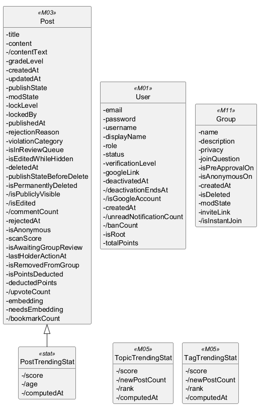

# Phân tích lớp thực thể — M14 Feed & Discovery

<!-- [Vietnamese Doc] Tài liệu tiếng Việt; tên lớp và thuộc tính viết tiếng Anh (input/CONVENTIONS.md mục 3). -->

| Mã tài liệu | EC-M14 |
|---|---|
| Dự án | iShare |
| Module | M14 — Feed & Discovery |
| Đầu vào | FR-M14 phiên bản 1.1 |
| Trạng thái | Đã chốt |
| Phiên bản | 1.1 |
| Ngày | 2026-11-20 |
| Tác giả | Phạm Văn Đức |

<!-- Quy ước chung cho mọi bảng dưới đây:
     - Không đổi tên cột, không xóa cột, không đổi số mục: tool đọc bảng theo số mục và tên cột.
     - Ô không có nội dung ghi "—".
     - Mục chưa tới bước làm thì để dòng "(Chưa làm — bước N)".
     - Cột Nguồn ghi mã trong FR: FR-Mxx-nn, FR-Mxx-nn.mm, BR-Mxx-nn, hoặc TN:<thuật ngữ> (mục 2.1 của FR).
     - Mục 4 chỉ chứa ảnh sơ đồ. gen_puml.py ghi mã PlantUML vào tệp riêng diagrams/EC-Mxx.puml, render
       diagrams/EC-Mxx.png và đặt ảnh vào mục 4. Không chép mã PlantUML vào tài liệu, không sửa tay tệp .puml hay ảnh. -->

## 1. Mô tả chức năng

### 1.1 Đoạn mô tả

Hệ thống cung cấp trang chủ feed của iShare gồm bốn tab Trending, Following, Group và Newest; tab Trending có ba mục con
Trending Post, Trending Topic và Trending Tag. Mọi tab chỉ hiện bài viết do M03 quản lý đủ điều kiện hiển thị, không hiện
bài của tác giả có trạng thái tài khoản DEACTIVATED hoặc DELETED, và hiện bài của tài khoản BANNED hoặc ở mức cảnh cáo
HEAVY như bài khác. Hệ thống mở feed ở tab Trending, mục con Trending Post, cho mọi người xem; Guest xem được tab Trending
và tab Newest, còn tab Following và tab Group yêu cầu đăng nhập.

Hệ thống tính lại định kỳ điểm Trending Post cho mọi bài viết của feed chính có tuổi bài không quá giới hạn, gồm bài
không thuộc nhóm và bài của nhóm Public do M11 quản lý, từ tuổi bài tính theo thời điểm đăng và số upvote, số bình luận,
số bookmark của bài viết tại lần tính. Mục con Trending Post hiện cùng một danh sách cho mọi người xem, xếp theo điểm
Trending Post giảm dần, bằng điểm thì bài có thời điểm đăng sau đứng trước, theo kết quả của lần tính gần nhất lúc mở
tab, và giữ kết quả đó trong suốt lượt xem tab Trending. Mục con Trending Topic và Trending Tag hiện danh sách và thứ tự do
M05 cung cấp.

Hệ thống cho người dùng đã đăng nhập xem tab Following gồm bài viết có tác giả là người dùng đang theo dõi hoặc có Topic
đang theo dõi theo quan hệ theo dõi do M07 quản lý, kể cả bài nhóm Public, không gồm bài nhóm Private; bài ẩn danh chỉ vào
tab Following nhờ Topic đang theo dõi. Hệ thống cho người dùng đã đăng nhập xem tab Group gồm bài viết của mọi nhóm mà
người đó là thành viên nhóm, cả nhóm Public lẫn nhóm Private. Hệ thống cho mọi người xem tab Newest gồm bài viết không
thuộc nhóm nào. Tab Following, Group và Newest xếp bài viết theo thời điểm đăng, bài đăng sau đứng trước; khi tab
Following hoặc tab Group rỗng, hệ thống hiện trạng thái rỗng dẫn sang trang tìm kiếm của M06 hoặc trang danh sách nhóm
của M11.

Hệ thống tải bài của mọi tab theo từng lần tải khi người xem cuộn, không lặp và không bỏ sót bài. Trong khi người xem ở
tab Newest, Following hoặc Group, hệ thống kiểm tra định kỳ và hiện banner "có bài mới" khi có bài viết mới thuộc tab,
rồi chèn các bài viết mới lên đầu danh sách khi người xem bấm banner mà giữ vị trí đang đọc. Feed không có cờ tính năng
riêng; khi cờ tính năng Group hoặc Gamification do M10 quản lý tắt, feed vẫn hiện bài nhóm và vẫn tính điểm Trending
Post.

<!-- Văn xuôi bình thường, có thể chia vài đoạn. KHÔNG ghi mã câu (S1), (S2)… trong đoạn văn: người đọc không hiểu
     các mã đó. Số câu chỉ nằm ở bảng 1.2. Xem steps/01-describe-functions.md. -->

### 1.2 Truy vết câu

<!-- Mỗi câu của đoạn mô tả một dòng, theo đúng thứ tự. Câu: 1, 2, 3…
     Nội dung câu: chép NGUYÊN VĂN câu đó từ mục 1.1 (tool so khớp từng câu với đoạn văn).
     Nguồn: mã chức năng hoặc yêu cầu của FR mà câu dựa vào. -->

| Câu | Nội dung câu | Nguồn |
|---|---|---|
| 1 | Hệ thống cung cấp trang chủ feed của iShare gồm bốn tab Trending, Following, Group và Newest; tab Trending có ba mục con Trending Post, Trending Topic và Trending Tag. | FR-M14-01, FR-M14-01.01, FR-M14-02.01 |
| 2 | Mọi tab chỉ hiện bài viết do M03 quản lý đủ điều kiện hiển thị, không hiện bài của tác giả có trạng thái tài khoản DEACTIVATED hoặc DELETED, và hiện bài của tài khoản BANNED hoặc ở mức cảnh cáo HEAVY như bài khác. | FR-M14-01.05, FR-M14-01.06 |
| 3 | Hệ thống mở feed ở tab Trending, mục con Trending Post, cho mọi người xem; Guest xem được tab Trending và tab Newest, còn tab Following và tab Group yêu cầu đăng nhập. | FR-M14-01.02, FR-M14-01.03, FR-M14-01.08, FR-M14-01.09, FR-M14-02.02, FR-M14-04.04, FR-M14-05.05, FR-M14-06.04 |
| 4 | Hệ thống tính lại định kỳ điểm Trending Post cho mọi bài viết của feed chính có tuổi bài không quá giới hạn, gồm bài không thuộc nhóm và bài của nhóm Public do M11 quản lý, từ tuổi bài tính theo thời điểm đăng và số upvote, số bình luận, số bookmark của bài viết tại lần tính. | FR-M14-03, FR-M14-03.01, FR-M14-03.02, FR-M14-03.03, FR-M14-03.09, FR-M14-03.10, FR-M14-03.12 |
| 5 | Mục con Trending Post hiện cùng một danh sách cho mọi người xem, xếp theo điểm Trending Post giảm dần, bằng điểm thì bài có thời điểm đăng sau đứng trước, theo kết quả của lần tính gần nhất lúc mở tab, và giữ kết quả đó trong suốt lượt xem tab Trending. | FR-M14-02, FR-M14-02.03, FR-M14-02.04, FR-M14-02.11, FR-M14-02.12, FR-M14-03.14, FR-M14-07.05 |
| 6 | Mục con Trending Topic và Trending Tag hiện danh sách và thứ tự do M05 cung cấp. | FR-M14-02.06, FR-M14-02.10 |
| 7 | Hệ thống cho người dùng đã đăng nhập xem tab Following gồm bài viết có tác giả là người dùng đang theo dõi hoặc có Topic đang theo dõi theo quan hệ theo dõi do M07 quản lý, kể cả bài nhóm Public, không gồm bài nhóm Private; bài ẩn danh chỉ vào tab Following nhờ Topic đang theo dõi. | FR-M14-04, FR-M14-04.01, FR-M14-04.02, FR-M14-04.07, FR-M14-04.09, FR-M14-04.10, FR-M14-04.13 |
| 8 | Hệ thống cho người dùng đã đăng nhập xem tab Group gồm bài viết của mọi nhóm mà người đó là thành viên nhóm, cả nhóm Public lẫn nhóm Private. | FR-M14-05, FR-M14-05.01, FR-M14-05.03, FR-M14-05.04 |
| 9 | Hệ thống cho mọi người xem tab Newest gồm bài viết không thuộc nhóm nào. | FR-M14-06, FR-M14-06.01, FR-M14-06.03 |
| 10 | Tab Following, Group và Newest xếp bài viết theo thời điểm đăng, bài đăng sau đứng trước; khi tab Following hoặc tab Group rỗng, hệ thống hiện trạng thái rỗng dẫn sang trang tìm kiếm của M06 hoặc trang danh sách nhóm của M11. | FR-M14-04.03, FR-M14-04.05, FR-M14-04.11, FR-M14-05.02, FR-M14-05.06, FR-M14-05.07, FR-M14-06.02 |
| 11 | Hệ thống tải bài của mọi tab theo từng lần tải khi người xem cuộn, không lặp và không bỏ sót bài. | FR-M14-07, FR-M14-07.01, FR-M14-07.02, FR-M14-07.03, FR-M14-07.04 |
| 12 | Trong khi người xem ở tab Newest, Following hoặc Group, hệ thống kiểm tra định kỳ và hiện banner "có bài mới" khi có bài viết mới thuộc tab, rồi chèn các bài viết mới lên đầu danh sách khi người xem bấm banner mà giữ vị trí đang đọc. | FR-M14-08, FR-M14-08.01, FR-M14-08.02, FR-M14-08.03, FR-M14-08.04 |
| 13 | Feed không có cờ tính năng riêng; khi cờ tính năng Group hoặc Gamification do M10 quản lý tắt, feed vẫn hiện bài nhóm và vẫn tính điểm Trending Post. | FR-M14-01.07, FR-M14-02.08, FR-M14-03.11, FR-M14-05.08 |

## 2. Danh từ và phân loại

### 2.1 Sổ danh từ

<!-- Phân loại: Lớp | Thuộc tính | Loại bỏ.
     Kết quả: tên lớp; hoặc Lớp.thuộcTính; hoặc "—" khi loại bỏ.
     Xuất hiện ở: "Câu n" (số câu ở bảng 1.2) hoặc "Quét: <mã FR>" (lượt quét bổ sung). -->

| # | Danh từ | Xuất hiện ở | Phân loại | Kết quả | Lý do |
|---|---|---|---|---|---|
| 1 | hệ thống | Câu 1 | Loại bỏ | — | Trừu tượng: chỉ chính phần mềm |
| 2 | trang chủ feed / feed | Câu 1 | Loại bỏ | — | Giao diện: trang chủ gồm các tab (TN:Feed); không lưu |
| 3 | iShare | Câu 1 | Loại bỏ | — | Trừu tượng: tên sản phẩm |
| 4 | tab / tab Trending / tab Following / tab Group / tab Newest | Câu 1 | Loại bỏ | — | Giao diện: luồng bài chọn lúc tải theo quy tắc BR-M14-05 đến BR-M14-08 (TN:Tab); không lưu |
| 5 | mục con | Câu 1 | Loại bỏ | — | Giao diện |
| 6 | Trending Post | Câu 1 | Lớp | PostTrendingStat | Một nhóm số liệu tính ra theo từng bài viết (điểm, tuổi bài, lần tính), tính lại định kỳ → lớp thống kê (T7), cùng cách TopicTrendingStat của EC-M05; tên theo QU-01 (Post + TrendingStat); xem Q-01, Q-02 |
| 7 | Trending Topic | Câu 1 | Lớp | TopicTrendingStat | Lớp ngoài (M05): M14 hiển thị danh sách và thứ tự (FR-M14-02.06); dùng tên TopicTrendingStat của EC-M05 |
| 8 | Trending Tag | Câu 1 | Lớp | TagTrendingStat | Lớp ngoài (M05): như dòng 7; dùng tên TagTrendingStat của EC-M05 |
| 9 | bài viết | Câu 2 | Lớp | Post | Lớp ngoài (M03): nguồn của mọi tab; dùng tên Post của EC-M03 |
| 10 | M03, M05, M06, M07, M10, M11 (tên module) | Câu 2 | Loại bỏ | — | Trừu tượng: tên các phần của hệ thống |
| 11 | đủ điều kiện hiển thị | Câu 2 | Thuộc tính | Post.isPubliclyVisible | Thông tin của bài viết (M03) mà M14 đọc để chọn bài cho mọi tab (TN:Bài đủ điều kiện hiển thị, BR-M14-04) |
| 12 | tác giả | Câu 2 | Lớp | User | Lớp ngoài (M01): tác giả của bài viết; quan hệ tác giả thuộc M03, M14 chỉ đọc |
| 13 | trạng thái tài khoản | Câu 2 | Thuộc tính | User.status | Thông tin của tài khoản (M01) mà M14 đọc để ẩn bài của tác giả DEACTIVATED, DELETED (TN:Bài đủ điều kiện hiển thị) |
| 14 | DEACTIVATED, DELETED, BANNED | Câu 2 | Loại bỏ | — | Giá trị của User.status |
| 15 | mức cảnh cáo / HEAVY | Câu 2 | Loại bỏ | — | Ngoài phạm vi module (M08): mức cảnh cáo không ảnh hưởng feed (BR-M14-15), M14 không đọc |
| 16 | mọi người xem / người xem | Câu 3 | Loại bỏ | — | Chung chung: người đang xem feed; M14 không ghi việc xem |
| 17 | Guest | Câu 3 | Loại bỏ | — | Không lưu: tác nhân không có dữ liệu |
| 18 | đăng nhập | Câu 3 | Loại bỏ | — | Ngoài phạm vi module (M01) |
| 19 | điểm Trending Post | Câu 4 | Thuộc tính | PostTrendingStat.score | Số liệu tính theo công thức BR-M14-10 (TN:Điểm Trending Post) |
| 20 | feed chính | Câu 4 | Loại bỏ | — | Chung chung: bài không thuộc nhóm và bài nhóm Public đủ điều kiện hiển thị (TN:Feed chính, BR-M14-05) |
| 21 | tuổi bài | Câu 4 | Thuộc tính | PostTrendingStat.age | Thời gian từ thời điểm đăng tới lần tính, tính bằng ngày (TN:Tuổi bài) → thuộc tính dẫn xuất |
| 22 | giới hạn | Câu 4 | Loại bỏ | — | Hằng số của BR-M14-11: 28 ngày; ghi ở ràng buộc của PostTrendingStat.age |
| 23 | nhóm | Câu 4 | Lớp | Group | Lớp ngoài (M11): M14 đọc chế độ của nhóm để chọn bài cho Trending Post, Following, Newest (BR-M14-05, BR-M14-06, BR-M14-08); dùng tên Group của EC-M11 |
| 24 | nhóm Public / nhóm Private | Câu 4 | Loại bỏ | — | Giá trị của Group.privacy |
| 25 | thời điểm đăng | Câu 4 | Thuộc tính | Post.publishedAt | Thông tin của bài viết (M03) mà M14 đọc để tính tuổi bài và xếp tab theo thời gian (TN:Thời điểm đăng) |
| 26 | số upvote | Câu 4 | Thuộc tính | Post.upvoteCount | Số đếm trên bài viết do M12 cung cấp (EC-M12), M14 đọc (mục Giao tiếp, dòng Dùng M12) |
| 27 | số bình luận | Câu 4 | Thuộc tính | Post.commentCount | Số đếm trên bài viết do M04 bổ sung (EC-M04), M14 đọc (mục Giao tiếp, dòng Dùng M04) |
| 28 | số bookmark | Câu 4 | Thuộc tính | Post.bookmarkCount | Mục Dữ liệu nghiệp vụ ghi "số bookmark" trên Bài viết (M03); chưa EC nào có; số đếm tính lại được từ Bookmark của M02 → thuộc tính dẫn xuất M14 bổ sung (mục 5) |
| 29 | lần tính / lần tính gần nhất | Câu 4 | Thuộc tính | PostTrendingStat.computedAt | Thời điểm tạo ra kết quả (TN:Lần tính); tên computedAt như TopicTrendingStat của EC-M05; xem Q-02 |
| 30 | danh sách | Câu 5 | Loại bỏ | — | Chung chung: các PostTrendingStat của một lần tính xếp theo score |
| 31 | lượt xem tab Trending | Câu 5 | Loại bỏ | — | Hành động không lưu dấu vết: phiên xem của một người (TN:Lượt xem tab Trending); xem Q-02 |
| 32 | người dùng đã đăng nhập / người dùng / người dùng đang theo dõi | Câu 7 | Lớp | User | Lớp ngoài (M01): người xem tab Following, Group và người được theo dõi |
| 33 | Topic / Topic đang theo dõi | Câu 7 | Loại bỏ | — | Ngoài phạm vi module (M05, M07): Topic của bài (PostTopic, EC-M05) và Topic đang theo dõi (Follow, EC-M07); M14 chỉ đọc các quan hệ đó, không có dữ liệu của M14 gắn với Topic |
| 34 | quan hệ theo dõi | Câu 7 | Loại bỏ | — | Ngoài phạm vi module (M07): lớp Follow của EC-M07; M14 đọc để chọn bài cho tab Following, không có dữ liệu của M14 gắn với nó |
| 35 | bài nhóm Public / bài nhóm Private | Câu 7 | Loại bỏ | — | Chung chung: bài viết thuộc nhóm (R-M03-06) có Group.privacy Public hoặc Private |
| 36 | bài ẩn danh | Câu 7 | Thuộc tính | Post.isAnonymous | Thông tin của bài viết do M11 bổ sung (EC-M11), M14 đọc để không đưa bài ẩn danh vào tab Following nhờ theo dõi tác giả (BR-M14-08) |
| 37 | thành viên nhóm | Câu 8 | Loại bỏ | — | Ngoài phạm vi module (M11): lớp GroupMember của EC-M11; M14 đọc để chọn bài cho tab Group, không có dữ liệu của M14 gắn với nó |
| 38 | trạng thái rỗng | Câu 10 | Loại bỏ | — | Giao diện (TN:Trạng thái rỗng) |
| 39 | trang tìm kiếm / trang danh sách nhóm | Câu 10 | Loại bỏ | — | Giao diện (M06, M11) |
| 40 | lần tải | Câu 11 | Loại bỏ | — | Hành động không lưu dấu vết: cách trả bài dần (TN:Lần tải, Vị trí tải tiếp; BR-M14-16) |
| 41 | banner "có bài mới" | Câu 12 | Loại bỏ | — | Giao diện (TN:Banner "có bài mới") |
| 42 | bài viết mới | Câu 12 | Loại bỏ | — | Chung chung: bài thuộc tab có Post.publishedAt sau bài mới nhất đang hiện (BR-M14-17) |
| 43 | vị trí đang đọc | Câu 12 | Loại bỏ | — | Giao diện |
| 44 | cờ tính năng / Group / Gamification | Câu 13 | Loại bỏ | — | Ngoài phạm vi module (M10): M14 không có cờ, chỉ đọc trạng thái cờ của module khác (BR-M14-22) |
| 45 | điểm Trending Topic | Quét: Dữ liệu nghiệp vụ | Thuộc tính | TopicTrendingStat.score | Thông tin của lớp ngoài (M05) mà M14 đọc: chỉ hiện mục có điểm lớn hơn 0 (FR-M14-02.10) |
| 46 | thứ tự Trending Topic | Quét: Dữ liệu nghiệp vụ | Thuộc tính | TopicTrendingStat.rank | Thông tin của lớp ngoài (M05) mà M14 đọc để hiện đúng thứ tự (FR-M14-02.06) |
| 47 | điểm Trending Tag | Quét: Dữ liệu nghiệp vụ | Thuộc tính | TagTrendingStat.score | Như dòng 45 |
| 48 | thứ tự Trending Tag | Quét: Dữ liệu nghiệp vụ | Thuộc tính | TagTrendingStat.rank | Như dòng 46 |
| 49 | lượt xem bài | Quét: BR-M14-10 | Loại bỏ | — | Ngoài phạm vi hệ thống: không tính vào điểm (FR-M14-03.07), không lưu |
| 50 | tab "For You" / cá nhân hóa | Quét: BR-M14-01 | Loại bỏ | — | Ngoài phạm vi hệ thống: đã quyết không làm (BR-M14-01) |
| 51 | nửa chu kỳ 7 ngày / trọng số | Quét: BR-M14-10 | Loại bỏ | — | Hằng số của BR-M14-10: 0,5^(t / 7), upvote ×2, bình luận ×1, bookmark ×1; ghi ở ràng buộc của PostTrendingStat.score |
| 52 | chu kỳ tính lại 15–30 phút | Quét: BR-M14-14 | Loại bỏ | — | Hằng số của BR-M14-14; ghi ở ràng buộc của PostTrendingStat.computedAt |
| 53 | 20 bài mỗi lần tải, 60 giây kiểm tra | Quét: BR-M14-16 | Loại bỏ | — | Giao diện: cách tải và kiểm tra bài mới (BR-M14-16, BR-M14-17) |

### 2.2 Lớp

<!-- Nhóm: Thực thể | Liên kết | Thống kê. Sở hữu: mã module sở hữu lớp (Mxx của tài liệu này, hoặc Myy với lớp ngoài).
     Thuộc tính: tên mọi thuộc tính của lớp ở mục 2.3, ngăn bởi dấu phẩy, thuộc tính dẫn xuất có "/" phía trước;
     để người đọc thấy lớp và thuộc tính trên cùng một dòng. Lớp chưa có thuộc tính ghi "—". -->

| Lớp | Tên tiếng Việt | Nhóm | Sở hữu | Mô tả | Thuộc tính | Nguồn |
|---|---|---|---|---|---|---|
| PostTrendingStat | Thống kê Trending Post | Thống kê | M14 | Điểm Trending Post và tuổi bài của một bài viết ở một lần tính; là danh sách Trending Post | /score, /age, /computedAt | FR-M14-03.01, FR-M14-03.02, FR-M14-02.03 |
| Post | Bài viết | Thực thể | M03 | Nguồn của mọi tab; lớp cha của PostTrendingStat | title, content, /contentText, gradeLevel, createdAt, updatedAt, publishState, modState, lockLevel, lockedBy, publishedAt, rejectionReason, violationCategory, isInReviewQueue, isEditedWhileHidden, deletedAt, publishStateBeforeDelete, isPermanentlyDeleted, /isPubliclyVisible, /isEdited, /commentCount, rejectedAt, isAnonymous, scanScore, isAwaitingGroupReview, lastHolderActionAt, isRemovedFromGroup, isPointsDeducted, deductedPoints, /upvoteCount, embedding, needsEmbedding, /bookmarkCount | FR-M14-01.05, FR-M14-03.02, FR-M14-04.09 |
| User | Người dùng (tài khoản) | Thực thể | M01 | Tác giả bài viết; người xem tab Following, Group | email, password, username, displayName, role, status, verificationLevel, googleLink, deactivatedAt, /deactivationEndsAt, /isGoogleAccount, createdAt, /unreadNotificationCount, /banCount, isRoot, totalPoints | FR-M14-01.05, FR-M14-04.01 |
| Group | Nhóm | Thực thể | M11 | Nhóm của bài nhóm; chế độ quyết định bài vào tab nào | name, description, privacy, joinQuestion, isPreApprovalOn, isAnonymousOn, createdAt, isDeleted, modState, inviteLink, /isInstantJoin | FR-M14-03.09, FR-M14-04.13, FR-M14-06.03 |
| TopicTrendingStat | Thống kê Trending Topic | Thống kê | M05 | Danh sách Trending Topic M14 hiển thị | /score, /newPostCount, /rank, /computedAt | FR-M14-02.06, FR-M14-02.10 |
| TagTrendingStat | Thống kê Trending Tag | Thống kê | M05 | Danh sách Trending Tag M14 hiển thị | /score, /newPostCount, /rank, /computedAt | FR-M14-02.06, FR-M14-02.10 |

### 2.3 Thuộc tính

<!-- Mỗi lớp có ĐỦ thuộc tính để người đọc hình dung được nó; xếp các dòng theo lớp.
     Tính chất: Lưu | Dẫn xuất. Chưa có id, chưa có kiểu, chưa có khóa ngoại.
     Căn cứ: Nguồn nêu (FR nói tới) | Đề xuất (FR không nói, nhưng chức năng hoặc quy tắc ở cột Nguồn cần nó) |
             Tham chiếu (thuộc tính của lớp ngoài; module sở hữu lớp đó định nghĩa. Sau lượt gộp hệ thống,
             lớp ngoài ghi đủ thuộc tính như EC-SYS, MD-05).
     Ràng buộc nguồn nêu: độ dài tối đa, duy nhất, bắt buộc/tùy chọn, tập giá trị, mặc định, công thức (với Dẫn xuất)
             — chép từ FR kèm mã. Đề xuất mà FR không nêu ràng buộc thì ghi "—".
     Nguồn: mã FR/BR nêu thuộc tính; với Đề xuất là mã chức năng hoặc quy tắc cần nó.
     Ghi chú: bắt buộc với Đề xuất (vì sao cần) và Tham chiếu (module này dùng nó làm gì). -->

| Lớp | Thuộc tính | Tên tiếng Việt | Tính chất | Căn cứ | Ràng buộc nguồn nêu | Nguồn | Ghi chú |
|---|---|---|---|---|---|---|---|
| PostTrendingStat | score | Điểm Trending Post | Dẫn xuất | Nguồn nêu | = 0,5^(age / 7) × (1 + 2 × upvoteCount + commentCount + bookmarkCount), các số đếm lấy tại lần tính; upvote đã rút, bình luận đã xóa, bookmark đã bỏ không tính; không tính lượt xem (BR-M14-10); không ngưỡng tối thiểu (BR-M14-12); xếp giảm dần, bằng điểm thì publishedAt sau đứng trước (BR-M14-13) | FR-M14-03.02, FR-M14-03.10, BR-M14-10, BR-M14-13 | Không loại, không chỉnh điểm bài của tài khoản BANNED hoặc HEAVY (BR-M14-15) |
| PostTrendingStat | age | Tuổi bài | Dẫn xuất | Nguồn nêu | (computedAt − publishedAt) tính bằng ngày, 24 giờ là một ngày, giữ phần lẻ (TN:Tuổi bài); bài có age lớn hơn 28 bị loại (BR-M14-11) | FR-M14-03.12, FR-M14-03.05, BR-M14-11 | — |
| PostTrendingStat | computedAt | Thời điểm tính | Dẫn xuất | Nguồn nêu | Lần tính cách nhau 15–30 phút; mỗi tương tác vào điểm chậm nhất 30 phút sau khi xảy ra (BR-M14-14); một lượt xem tab Trending giữ kết quả của lần tính hiện hành lúc mở tab (BR-M14-19) | FR-M14-03.03, FR-M14-03.04, FR-M14-02.11, BR-M14-14 | Cùng tên computedAt với TopicTrendingStat (EC-M05); xem Q-02 |
| Post | title | Tiêu đề | Lưu | Tham chiếu | — | FR-M03-01.14, FR-M03-04.08, FR-M03-07.04 | Ghi đủ lớp sau gộp (MD-05); EC-M03 định nghĩa |
| Post | content | Nội dung | Lưu | Tham chiếu | — | FR-M03-01.02, FR-M03-01.03, FR-M03-01.15, FR-M03-04.09 | Ghi đủ lớp sau gộp (MD-05); EC-M03 định nghĩa |
| Post | contentText | Nội dung chữ | Dẫn xuất | Tham chiếu | — | FR-M03-07.01 | Ghi đủ lớp sau gộp (MD-05); EC-M03 định nghĩa |
| Post | gradeLevel | Lớp/Khối | Lưu | Tham chiếu | — | FR-M03-01.05, FR-M03-01.06, FR-M03-01.07 | Ghi đủ lớp sau gộp (MD-05); EC-M03 định nghĩa |
| Post | createdAt | Thời điểm tạo | Lưu | Tham chiếu | — | FR-M03-01.08 | Ghi đủ lớp sau gộp (MD-05); EC-M03 định nghĩa |
| Post | updatedAt | Thời điểm cập nhật | Lưu | Tham chiếu | — | FR-M03-01.08 | Ghi đủ lớp sau gộp (MD-05); EC-M03 định nghĩa |
| Post | publishState | Trạng thái đăng | Lưu | Tham chiếu | — | FR-M03-01.01, FR-M03-04.01, FR-M03-13.01, FR-M03-15.01 | Ghi đủ lớp sau gộp (MD-05); EC-M03 định nghĩa |
| Post | modState | Trạng thái kiểm duyệt | Lưu | Tham chiếu | — | FR-M03-01.12, FR-M03-05.07 | Ghi đủ lớp sau gộp (MD-05); EC-M03 định nghĩa |
| Post | lockLevel | Mức khóa | Lưu | Tham chiếu | — | FR-M03-01.09, FR-M03-14.01, FR-M03-14.03 | Ghi đủ lớp sau gộp (MD-05); EC-M03 định nghĩa |
| Post | lockedBy | Người khóa | Lưu | Tham chiếu | — | FR-M03-14.01, FR-M03-14.02, FR-M03-14.09 | Ghi đủ lớp sau gộp (MD-05); EC-M03 định nghĩa |
| Post | publishedAt | Thời điểm đăng | Lưu | Tham chiếu | — | FR-M14-03.12, FR-M14-04.03, FR-M14-06.02, FR-M14-03.14 | Tính tuổi bài; xếp tab Following, Group, Newest; phân xử bằng điểm ở Trending Post |
| Post | rejectionReason | Lý do từ chối | Lưu | Tham chiếu | — | FR-M03-06.03, FR-M03-06.05 | Ghi đủ lớp sau gộp (MD-05); EC-M03 định nghĩa |
| Post | violationCategory | Nhóm vi phạm | Lưu | Tham chiếu | — | FR-M03-05.12 | Ghi đủ lớp sau gộp (MD-05); EC-M03 định nghĩa |
| Post | isInReviewQueue | Đang trong hàng chờ duyệt | Lưu | Tham chiếu | — | FR-M03-06.01, FR-M03-05.02, FR-M03-05.04, FR-M03-15.06 | Ghi đủ lớp sau gộp (MD-05); EC-M03 định nghĩa |
| Post | isEditedWhileHidden | Có bản sửa lưu trong lúc Tự ẩn chưa quét | Lưu | Tham chiếu | — | FR-M03-13.06, FR-M03-05.14 | Ghi đủ lớp sau gộp (MD-05); EC-M03 định nghĩa |
| Post | deletedAt | Thời điểm xóa | Lưu | Tham chiếu | — | FR-M03-15.01, FR-M03-16.02 | Ghi đủ lớp sau gộp (MD-05); EC-M03 định nghĩa |
| Post | publishStateBeforeDelete | Trạng thái trước khi xóa | Lưu | Tham chiếu | — | FR-M03-15.01, FR-M03-16.01, FR-M03-16.06 | Ghi đủ lớp sau gộp (MD-05); EC-M03 định nghĩa |
| Post | isPermanentlyDeleted | Đã xóa hẳn | Lưu | Tham chiếu | — | FR-M03-17.01, FR-M03-17.02 | Ghi đủ lớp sau gộp (MD-05); EC-M03 định nghĩa |
| Post | isPubliclyVisible | Hiển thị công khai | Dẫn xuất | Tham chiếu | — | FR-M14-01.05, FR-M14-02.05 | Mọi tab chỉ hiện bài đủ điều kiện hiển thị (BR-M14-04); bài không còn hiển thị lúc tải thì bị bỏ khỏi Trending Post |
| Post | isEdited | Đã chỉnh sửa | Dẫn xuất | Tham chiếu | — | FR-M03-12.01 | Ghi đủ lớp sau gộp (MD-05); EC-M03 định nghĩa |
| Post | commentCount | Số bình luận của bài | Dẫn xuất | Tham chiếu | — | FR-M14-03.02, FR-M14-03.13 | Thành phần của điểm Trending Post, kể cả trả lời; M04 bổ sung (EC-M04) |
| Post | rejectedAt | Thời điểm bị từ chối | Lưu | Tham chiếu | — | BR-M09-04, FR-M09-01.14, FR-M09-06.02, FR-M09-08.14 | Ghi đủ lớp sau gộp (MD-05); EC-M03 định nghĩa |
| Post | isAnonymous | Đăng ẩn danh | Lưu | Tham chiếu | — | FR-M14-04.09, FR-M14-04.10 | Bài ẩn danh không vào tab Following nhờ theo dõi tác giả, chỉ nhờ Topic đang theo dõi và hiện ở dạng ẩn danh; M11 bổ sung (EC-M11) |
| Post | scanScore | Điểm quét | Lưu | Tham chiếu | — | FR-M11-12.02, FR-M11-12.03, FR-M11-12.04, FR-M11-12.05 | Ghi đủ lớp sau gộp (MD-05); EC-M03 định nghĩa |
| Post | isAwaitingGroupReview | Đang chờ nhóm duyệt | Lưu | Tham chiếu | — | FR-M11-12.03, FR-M11-12.04, FR-M11-13.01, FR-M11-02.15 | Ghi đủ lớp sau gộp (MD-05); EC-M03 định nghĩa |
| Post | lastHolderActionAt | Thời điểm thao tác cuối | Lưu | Tham chiếu | — | FR-M11-13.02, FR-M11-13.04, BR-M11-20 | Ghi đủ lớp sau gộp (MD-05); EC-M03 định nghĩa |
| Post | isRemovedFromGroup | Bị gỡ khỏi nhóm | Lưu | Tham chiếu | — | FR-M11-14.01, FR-M11-14.05 | Ghi đủ lớp sau gộp (MD-05); EC-M03 định nghĩa |
| Post | isPointsDeducted | Đã trừ điểm | Lưu | Tham chiếu | — | FR-M12-02.08, FR-M12-02.10, FR-M12-02.12, FR-M12-02.18 | Ghi đủ lớp sau gộp (MD-05); EC-M03 định nghĩa |
| Post | deductedPoints | Số điểm đã trừ | Lưu | Tham chiếu | — | FR-M12-02.08, FR-M12-02.10, FR-M12-02.12 | Ghi đủ lớp sau gộp (MD-05); EC-M03 định nghĩa |
| Post | upvoteCount | Số upvote | Dẫn xuất | Tham chiếu | — | FR-M14-03.02, FR-M14-03.11 | Thành phần của điểm Trending Post; M12 bổ sung (EC-M12) |
| Post | embedding | Embedding | Lưu | Tham chiếu | — | FR-M13-03.01, FR-M13-03.02, FR-M13-03.03, FR-M13-03.07 | Ghi đủ lớp sau gộp (MD-05); EC-M03 định nghĩa |
| Post | needsEmbedding | Đang chờ tạo bù embedding | Lưu | Tham chiếu | — | FR-M13-03.08, FR-M13-03.09, FR-M13-03.10, BR-M13-26 | Ghi đủ lớp sau gộp (MD-05); EC-M03 định nghĩa |
| Post | bookmarkCount | Số bookmark | Dẫn xuất | Tham chiếu | Số bookmark bài đang có; bookmark đã bỏ không tính (BR-M14-10) | FR-M14-03.02, FR-M14-03.10 | M14 định nghĩa; đã đưa vào lớp Post của EC-M03 (MD-05). Mục Dữ liệu nghiệp vụ ghi "số bookmark" trên Bài viết (M03); tính từ Bookmark của EC-M02 |
| User | email | Email | Lưu | Tham chiếu | — | FR-M01-01.01, FR-M01-01.06, FR-M01-12.06 | Ghi đủ lớp sau gộp (MD-05); EC-M01 định nghĩa |
| User | password | Mật khẩu | Lưu | Tham chiếu | — | FR-M01-01.10, FR-M01-08.01, FR-M01-09.02 | Ghi đủ lớp sau gộp (MD-05); EC-M01 định nghĩa |
| User | username | Tên định danh | Lưu | Tham chiếu | — | FR-M01-03.01, FR-M01-03.05, FR-M01-03.06, FR-M01-12.07 | Ghi đủ lớp sau gộp (MD-05); EC-M01 định nghĩa |
| User | displayName | Tên hiển thị | Lưu | Tham chiếu | — | FR-M01-03.01, FR-M01-03.12, FR-M01-03.13, FR-M01-03.14, FR-M01-04.02 | Ghi đủ lớp sau gộp (MD-05); EC-M01 định nghĩa |
| User | role | Vai trò | Lưu | Tham chiếu | — | FR-M01-01.02, FR-M01-05.19 | Ghi đủ lớp sau gộp (MD-05); EC-M01 định nghĩa |
| User | status | Trạng thái tài khoản | Lưu | Tham chiếu | — | FR-M14-01.05, FR-M14-01.06 | Ẩn bài của tác giả DEACTIVATED, DELETED (TN:Bài đủ điều kiện hiển thị); bài của BANNED vẫn hiện như thường |
| User | verificationLevel | Mức xác minh | Lưu | Tham chiếu | — | FR-M01-01.01, FR-M01-02.01, FR-M01-03.01, FR-M01-04.01 | Ghi đủ lớp sau gộp (MD-05); EC-M01 định nghĩa |
| User | googleLink | Liên kết Google | Lưu | Tham chiếu | — | FR-M01-04.04, FR-M01-12.08 | Ghi đủ lớp sau gộp (MD-05); EC-M01 định nghĩa |
| User | deactivatedAt | Thời điểm vô hiệu hóa | Lưu | Tham chiếu | — | FR-M01-10.07 | Ghi đủ lớp sau gộp (MD-05); EC-M01 định nghĩa |
| User | deactivationEndsAt | Thời điểm hết thời hạn vô hiệu hóa | Dẫn xuất | Tham chiếu | — | FR-M01-10.07, FR-M01-11.05, FR-M01-12.01, FR-M01-12.05 | Ghi đủ lớp sau gộp (MD-05); EC-M01 định nghĩa |
| User | isGoogleAccount | Là tài khoản Google | Dẫn xuất | Tham chiếu | — | FR-M01-05.13, FR-M01-08.06, FR-M01-09.07 | Ghi đủ lớp sau gộp (MD-05); EC-M01 định nghĩa |
| User | createdAt | Thời điểm tạo tài khoản | Lưu | Tham chiếu | — | FR-M01-01.01, FR-M01-04.01 | Ghi đủ lớp sau gộp (MD-05); EC-M01 định nghĩa |
| User | unreadNotificationCount | Số thông báo chưa đọc | Dẫn xuất | Tham chiếu | — | FR-M07-05.10, BR-M07-12 | Ghi đủ lớp sau gộp (MD-05); EC-M01 định nghĩa |
| User | banCount | Số lần đã bị ban | Dẫn xuất | Tham chiếu | — | FR-M08-14.12, BR-M08-34 | Ghi đủ lớp sau gộp (MD-05); EC-M01 định nghĩa |
| User | isRoot | Là tài khoản ADMIN gốc | Lưu | Tham chiếu | — | FR-M10-07.04, FR-M10-01.05, BR-M10-10, BR-M10-11 | Ghi đủ lớp sau gộp (MD-05); EC-M01 định nghĩa |
| User | totalPoints | Tổng điểm | Lưu | Tham chiếu | — | FR-M12-02.01, FR-M12-02.02, FR-M12-02.03, FR-M12-02.12 | Ghi đủ lớp sau gộp (MD-05); EC-M01 định nghĩa |
| Group | name | Tên nhóm | Lưu | Tham chiếu | — | FR-M11-01.01, FR-M11-01.08, FR-M11-02.01, BR-M11-31 | Ghi đủ lớp sau gộp (MD-05); EC-M11 định nghĩa |
| Group | description | Mô tả nhóm | Lưu | Tham chiếu | — | FR-M11-01.01, FR-M11-01.09, FR-M11-02.01 | Ghi đủ lớp sau gộp (MD-05); EC-M11 định nghĩa |
| Group | privacy | Chế độ | Lưu | Tham chiếu | — | FR-M14-03.09, FR-M14-04.07, FR-M14-04.13, FR-M14-02.09 | Bài nhóm Public vào Trending Post và Following, bài nhóm Private chỉ vào tab Group của thành viên; không bài nhóm nào vào Newest |
| Group | joinQuestion | Câu hỏi tham gia | Lưu | Tham chiếu | — | FR-M11-01.11, FR-M11-02.07, FR-M11-02.08, BR-M11-08 | Ghi đủ lớp sau gộp (MD-05); EC-M11 định nghĩa |
| Group | isPreApprovalOn | Công tắc duyệt trước | Lưu | Tham chiếu | — | FR-M11-01.12, FR-M11-02.05, FR-M11-02.15, BR-M11-18 | Ghi đủ lớp sau gộp (MD-05); EC-M11 định nghĩa |
| Group | isAnonymousOn | Công tắc ẩn danh | Lưu | Tham chiếu | — | FR-M11-01.12, FR-M11-02.06, BR-M11-16 | Ghi đủ lớp sau gộp (MD-05); EC-M11 định nghĩa |
| Group | createdAt | Thời điểm tạo | Lưu | Tham chiếu | — | FR-M11-01.03, FR-M11-03.17, BR-M11-03, BR-M11-35 | Ghi đủ lớp sau gộp (MD-05); EC-M11 định nghĩa |
| Group | isDeleted | Đã xóa | Lưu | Tham chiếu | — | FR-M11-01.01, FR-M11-15.01, FR-M11-10.06, FR-M11-11.03 | Ghi đủ lớp sau gộp (MD-05); EC-M11 định nghĩa |
| Group | modState | Trạng thái kiểm duyệt của nhóm | Lưu | Tham chiếu | — | FR-M11-01.01, FR-M11-16.01, FR-M11-16.04, FR-M11-16.06, FR-M08-18.01, FR-M08-18.04, FR-M08-18.07 | Ghi đủ lớp sau gộp (MD-05); EC-M11 định nghĩa |
| Group | inviteLink | Link mời | Lưu | Tham chiếu | — | FR-M11-05.01, FR-M11-05.06, FR-M11-05.07 | Ghi đủ lớp sau gộp (MD-05); EC-M11 định nghĩa |
| Group | isInstantJoin | Nhóm vào ngay | Dẫn xuất | Tham chiếu | — | FR-M11-04.01, FR-M11-02.14, BR-M11-32 | Ghi đủ lớp sau gộp (MD-05); EC-M11 định nghĩa |
| TopicTrendingStat | score | Điểm Trending | Dẫn xuất | Tham chiếu | — | FR-M14-02.10 | Chỉ hiện mục có điểm lớn hơn 0 (BR-M14-24) |
| TopicTrendingStat | newPostCount | Số bài mới | Dẫn xuất | Tham chiếu | — | FR-M05-05.09, BR-M05-31 | Ghi đủ lớp sau gộp (MD-05); EC-M05 định nghĩa |
| TopicTrendingStat | rank | Thứ hạng | Dẫn xuất | Tham chiếu | — | FR-M14-02.06 | Hiện theo thứ tự do M05 cung cấp |
| TopicTrendingStat | computedAt | Thời điểm tính | Dẫn xuất | Tham chiếu | — | FR-M05-05.03, FR-M05-05.10 | Ghi đủ lớp sau gộp (MD-05); EC-M05 định nghĩa |
| TagTrendingStat | score | Điểm Trending | Dẫn xuất | Tham chiếu | — | FR-M14-02.10 | Như TopicTrendingStat.score |
| TagTrendingStat | newPostCount | Số bài mới | Dẫn xuất | Tham chiếu | — | FR-M05-05.09, BR-M05-31 | Ghi đủ lớp sau gộp (MD-05); EC-M05 định nghĩa |
| TagTrendingStat | rank | Thứ hạng | Dẫn xuất | Tham chiếu | — | FR-M14-02.06 | Như TopicTrendingStat.rank |
| TagTrendingStat | computedAt | Thời điểm tính | Dẫn xuất | Tham chiếu | — | FR-M05-05.03, FR-M05-05.10 | Ghi đủ lớp sau gộp (MD-05); EC-M05 định nghĩa |

### 2.4 Đối chiếu với mục Dữ liệu nghiệp vụ của FR

<!-- Mỗi thực thể ở bảng "Dữ liệu nghiệp vụ" của FR một dòng; chép đúng tên ở cột Thực thể của FR.
     Xử lý: Khớp | Đã thêm qua sổ danh từ | Mô hình có thêm: … | Lệch: … (kèm Q-nn). -->

| Thực thể trong FR | Trong mô hình | Xử lý |
|---|---|---|
| Điểm Trending Post | PostTrendingStat | Lệch: FR ghi là thực thể có bài viết, điểm, lần tính; mô hình để lớp thống kê kế thừa Post, mọi thuộc tính Dẫn xuất (score, computedAt), có thêm /age (TN:Tuổi bài), cùng cách EC-M05 với Trending Topic, Trending Tag (Q-01). "Thuộc một bài viết" → quan hệ Kế thừa (bước 3) |
| Bài viết (M03) | Post | Khớp: thời điểm đăng → publishedAt; đăng ẩn danh → isAnonymous; trạng thái hiển thị → isPubliclyVisible; số upvote → upvoteCount (EC-M12); số bình luận → commentCount (EC-M04); số bookmark → bookmarkCount (M14 bổ sung) (Tham chiếu). Tác giả, Topic, nhóm là quan hệ của M03, M05, M11, M14 chỉ đọc |
| Quan hệ theo dõi (M07) | — | Không có trong mô hình: lớp Follow của EC-M07; M14 chỉ đọc để chọn bài cho tab Following, không có dữ liệu của M14 gắn với nó |
| Thành viên nhóm (M11) | Group | Thành viên nhóm là GroupMember của EC-M11, M14 chỉ đọc, không đưa vào mô hình; chế độ của nhóm → Group.privacy (Tham chiếu) |
| Trending Topic, Trending Tag (M05) | TopicTrendingStat, TagTrendingStat | Khớp: điểm → score; thứ tự → rank (Tham chiếu) |

## 3. Quan hệ giữa các lớp

### 3.1 Ma trận cặp lớp

<!-- T = quan hệ trực tiếp; G(X) = chỉ gián tiếp qua lớp X; trống = không liên quan. Chỉ điền nửa trên. -->

M14 chỉ có một lớp của mình là lớp thống kê PostTrendingStat, nên không có ma trận cặp lớp: lớp thống kê xét riêng ở mục
3.4 (Kế thừa Post). Các lớp ngoài User, Group, TopicTrendingStat, TagTrendingStat không có quan hệ với lớp nào của M14:
M14 chỉ đọc thuộc tính của chúng; các quan hệ giữa chúng với Post (tác giả, nhóm, Topic, theo dõi) thuộc M03, M05, M07,
M11.

| | Post |
|---|---|
| PostTrendingStat |   |

### 3.2 Quan hệ số lượng

<!-- Mỗi ô T của ma trận một dòng. Dạng đọc theo thứ tự A–B: 1-1 | 1-n | n-1 | n-n.
     Xử lý: Giữ nguyên | Gộp vào <Lớp>: … | Giữ: … | Tách: thêm lớp <X>. -->

Không có ô T nào ở mục 3.1. Lớp thống kê PostTrendingStat có một quan hệ Kế thừa ở mục 3.4.

| Cặp | Câu A → B | Câu B → A | Dạng | Xử lý |
|---|---|---|---|---|

### 3.3 Lớp liên kết

<!-- Mỗi lớp có Nhóm = Liên kết một dòng. "Tách từ quan hệ n-n" viết dạng "LớpA – LớpB".
     "Thuộc tính riêng của liên kết": tên các thuộc tính (đã ghi ở mục 2.3); không có thì ghi rõ vì sao. -->

Không có lớp liên kết.

| Lớp liên kết | Tách từ quan hệ n-n | Thuộc tính riêng của liên kết | Nguồn |
|---|---|---|---|
| — | — | — | — |

### 3.4 Quan hệ

<!-- Bội số A = số đối tượng A ứng với một đối tượng B (ghi ở đầu A trên sơ đồ). Cú pháp: 1, 0..1, 0..*, 1..*, 1..3.
     Loại: Kế thừa | Hợp thành | Kết tập | Liên kết | Phụ thuộc.
     Bên chính: lớp cha (Kế thừa), lớp toàn thể (Hợp thành, Kết tập), lớp được dùng (Phụ thuộc); "—" với Liên kết.
     Kế thừa và Phụ thuộc ghi "—" ở Bội số A, Bội số B, Dạng. Không được còn dạng n-n. -->

| ID | Lớp A | Bội số A | Lớp B | Bội số B | Dạng | Loại | Bên chính | Căn cứ | Nguồn |
|---|---|---|---|---|---|---|---|---|---|
| R-M14-01 | Post | — | PostTrendingStat | — | — | Kế thừa | Post | PostTrendingStat dùng lại thuộc tính của Post (publishedAt để tính tuổi bài và phân xử bằng điểm; upvoteCount, commentCount, bookmarkCount để tính điểm) và thêm số liệu Trending; "Điểm Trending Post thuộc một bài viết" (mục Dữ liệu nghiệp vụ). Cùng cách R-M05-15 của EC-M05 | FR-M14-03.01, FR-M14-03.02, BR-M14-10 |

## 4. Sơ đồ lớp phân tích

<!-- BEGIN:DIAGRAM -->

Mã nguồn sơ đồ: [diagrams/EC-M14.puml](diagrams/EC-M14.puml). Ảnh và tệp .puml do `gen_puml.py` sinh từ các bảng của tài liệu này; muốn đổi sơ đồ thì sửa bảng rồi chạy lại tool, không sửa tay.
<!-- END:DIAGRAM -->

## 5. Liên module

<!-- Mỗi lớp có Sở hữu khác module này một dòng. -->

| Lớp | Module sở hữu | Module này dùng thế nào | Thuộc tính module này bổ sung |
|---|---|---|---|
| Post | M03 | Lớp cha của PostTrendingStat (R-M14-01); nguồn của mọi tab. Đọc isPubliclyVisible, publishedAt, upvoteCount (M12), commentCount (M04), isAnonymous (M11), bookmarkCount | bookmarkCount — đã đưa vào lớp của EC-M03 (MD-05) |
| User | M01 | Đọc status của tác giả để ẩn bài của tài khoản DEACTIVATED, DELETED; không có quan hệ với lớp nào của M14 | — |
| Group | M11 | Đọc privacy để chọn bài nhóm cho Trending Post, Following, Group, Newest; không có quan hệ với lớp nào của M14 | — |
| TopicTrendingStat | M05 | Đọc score, rank để hiển thị mục con Trending Topic; không có quan hệ với lớp nào của M14 | — |
| TagTrendingStat | M05 | Đọc score, rank để hiển thị mục con Trending Tag; không có quan hệ với lớp nào của M14 | — |

## 6. Câu hỏi và điểm chưa chốt

<!-- Loại: Thiếu | Mơ hồ | Mâu thuẫn | Lệch. Ghi vào: mục của tài liệu này đã sửa theo câu trả lời, hoặc "Chờ cập nhật FR-Mxx". -->

| Mã | Loại | Câu hỏi | Trả lời | Ghi vào |
|---|---|---|---|---|
| Q-01 | Lệch | Mục Dữ liệu nghiệp vụ ghi "Điểm Trending Post" (bài viết, điểm, lần tính) là thực thể. Đề xuất: làm như EC-M05 đã chốt cho Trending Topic, Trending Tag (Q-02 của EC-M05): lớp thống kê PostTrendingStat kế thừa Post, thuộc tính Dẫn xuất score, age, computedAt | Người dùng đồng ý (2026-11-19): lớp thống kê PostTrendingStat kế thừa Post, cùng cách EC-M05 | Mục 2.1 dòng 6; mục 2.2; mục 2.4; mục 3.4 R-M14-01 |
| Q-02 | Thiếu | BR-M14-19: một lượt xem tab Trending giữ kết quả của lần tính hiện hành lúc mở tab, kể cả khi đã có lần tính mới, để tải thêm không lặp, không sót bài. Như vậy kết quả của lần tính trước phải còn dùng được trong một lúc sau khi có lần tính mới. Đề xuất: ở bước phân tích giữ PostTrendingStat là lớp thống kê; việc lưu kết quả theo lần tính (ví dụ giữ hai lần tính gần nhất) để bước thiết kế CSDL quyết, cùng lúc với cách xử lý tương tự của Trending Topic, Trending Tag (EC-M05). Phương án khác: đổi thành lớp Thực thể "lần tính Trending Post" (computedAt) kèm các dòng điểm của từng bài, như kết quả bảng xếp hạng ở EC-M12 | Người dùng chọn phương án đề xuất (2026-11-19): giữ PostTrendingStat là lớp thống kê; việc giữ kết quả của lần tính trước cho lượt xem đang mở (BR-M14-19) để bước thiết kế CSDL quyết, chung với Trending Topic, Trending Tag của EC-M05 | Mục 2.1 dòng 29, 31; mục 2.3 PostTrendingStat.computedAt |

## 7. Lịch sử sửa đổi

| Phiên bản | Ngày | Nội dung | Người sửa |
|---|---|---|---|
| 0.1 | 2026-11-19 | Tạo mới; làm liền 3 bước theo yêu cầu của người dùng (không dừng ở cổng), chờ duyệt và trả lời Q-01, Q-02 | Phạm Văn Đức |
| 1.0 | 2026-11-19 | Chốt sau 3 bước: 1 lớp thống kê của M14, 5 lớp ngoài, 1 quan hệ (R-M14-01); Q-01, Q-02 đã trả lời | Phạm Văn Đức |
| 1.1 | 2026-11-20 | Áp dụng quyết định gộp hệ thống (EC-SYS): MD-05: dòng module này bổ sung trên lớp ngoài đổi thành Tham chiếu: Post.bookmarkCount, ghi đủ thuộc tính của lớp ngoài theo EC-SYS: thêm 56 dòng Tham chiếu, tên tiếng Việt của thuộc tính lớp ngoài theo module sở hữu: Post.commentCount: Số bình luận → Số bình luận của bài | Phạm Văn Đức |
