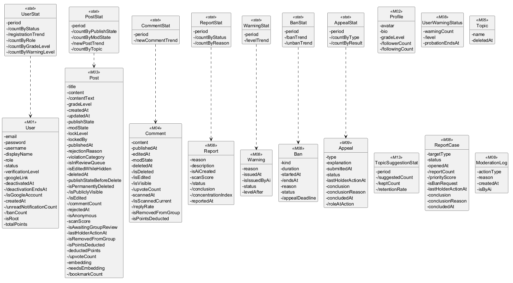

# Phân tích lớp thực thể — M15 Analytics & Stats

<!-- [Vietnamese Doc] Tài liệu tiếng Việt; tên lớp và thuộc tính viết tiếng Anh (input/CONVENTIONS.md mục 3). -->

| Mã tài liệu | EC-M15 |
|---|---|
| Dự án | iShare |
| Module | M15 — Analytics & Stats |
| Đầu vào | FR-M15 phiên bản 1.1 |
| Trạng thái | Đã chốt |
| Phiên bản | 1.1 |
| Ngày | 2026-11-20 |
| Tác giả | Phạm Văn Đức |

<!-- Quy ước chung cho mọi bảng dưới đây:
     - Không đổi tên cột, không xóa cột, không đổi số mục: tool đọc bảng theo số mục và tên cột.
     - Ô không có nội dung ghi "—".
     - Mục chưa tới bước làm thì để dòng "(Chưa làm — bước N)".
     - Cột Nguồn ghi mã trong FR: FR-Mxx-nn, FR-Mxx-nn.mm, BR-Mxx-nn, hoặc TN:<thuật ngữ> (mục 2.1 của FR).
     - Mục 4 chỉ chứa ảnh sơ đồ. gen_puml.py ghi mã PlantUML vào tệp riêng diagrams/EC-Mxx.puml, render
       diagrams/EC-Mxx.png và đặt ảnh vào mục 4. Không chép mã PlantUML vào tài liệu, không sửa tay tệp .puml hay ảnh. -->

## 1. Mô tả chức năng

### 1.1 Đoạn mô tả

Hệ thống cung cấp cho Admin ba trang thống kê người dùng, nội dung và kiểm duyệt của iShare, với số liệu tính tại lúc
xem từ dữ liệu do các module khác ghi, không lưu sẵn và không ghi thêm dữ liệu hoạt động của người dùng. Chỉ Admin xem
được các trang thống kê; Guest, User và Mod bị từ chối. Mỗi trang thống kê lọc theo một khoảng thời gian trong bốn lựa
chọn Hôm nay, 7 ngày, 30 ngày, Toàn thời gian, chọn sẵn Toàn thời gian, đếm các đối tượng được tạo hoặc các sự kiện xảy
ra trong khoảng thời gian theo giờ Việt Nam, xếp nhóm theo trạng thái của đối tượng tại lúc xem, và chia biểu đồ xu hướng
theo giờ, ngày hoặc tháng.

Thống kê người dùng gồm số tài khoản do M01 quản lý theo nhóm trạng thái tài khoản và mức xác minh, xu hướng đăng ký mới
theo thời điểm tạo tài khoản, và số tài khoản đã hoàn tất đăng ký theo vai trò, theo Lớp/Khối trên hồ sơ do M02 quản lý
và theo mức cảnh cáo do M08 quản lý.

Thống kê nội dung gồm số bài viết do M03 quản lý theo trạng thái đăng và trạng thái kiểm duyệt, xu hướng bài viết mới
theo thời điểm đăng, số bài viết theo từng Topic trong danh mục Topic hiện tại do M05 quản lý, xu hướng bình luận mới
theo thời điểm đăng của bình luận do M04 quản lý, và tỷ lệ Topic gợi ý được giữ lại do M13 tính. Thống kê nội dung xếp
bài viết theo thời điểm tạo ở các số đếm theo trạng thái và Topic, không đếm bài viết Nháp, và đếm bài nhóm, bài ẩn danh
như bài viết khác.

Thống kê kiểm duyệt gồm số báo cáo do M08 quản lý theo trạng thái báo cáo và kết luận, số báo cáo theo lý do tách theo
loại đối tượng, xu hướng cảnh cáo theo mức tài khoản đạt sau cảnh cáo, xu hướng ban tách ban tạm thời và ban vĩnh viễn,
xu hướng gỡ ban do Mod, Admin thực hiện, và số khiếu nại do M09 quản lý theo loại khiếu nại và kết quả. Hệ thống không
cung cấp xuất số liệu ra tệp, chỉ số người dùng hoạt động hay thống kê cho Mod.

<!-- Văn xuôi bình thường, có thể chia vài đoạn. KHÔNG ghi mã câu (S1), (S2)… trong đoạn văn: người đọc không hiểu
     các mã đó. Số câu chỉ nằm ở bảng 1.2. Xem steps/01-describe-functions.md. -->

### 1.2 Truy vết câu

<!-- Mỗi câu của đoạn mô tả một dòng, theo đúng thứ tự. Câu: 1, 2, 3…
     Nội dung câu: chép NGUYÊN VĂN câu đó từ mục 1.1 (tool so khớp từng câu với đoạn văn).
     Nguồn: mã chức năng hoặc yêu cầu của FR mà câu dựa vào. -->

| Câu | Nội dung câu | Nguồn |
|---|---|---|
| 1 | Hệ thống cung cấp cho Admin ba trang thống kê người dùng, nội dung và kiểm duyệt của iShare, với số liệu tính tại lúc xem từ dữ liệu do các module khác ghi, không lưu sẵn và không ghi thêm dữ liệu hoạt động của người dùng. | FR-M15-01, FR-M15-02, FR-M15-03, FR-M15-01.06, FR-M15-01.09 |
| 2 | Chỉ Admin xem được các trang thống kê; Guest, User và Mod bị từ chối. | FR-M15-01.12, FR-M15-02.16, FR-M15-03.09, FR-M15-03.16 |
| 3 | Mỗi trang thống kê lọc theo một khoảng thời gian trong bốn lựa chọn Hôm nay, 7 ngày, 30 ngày, Toàn thời gian, chọn sẵn Toàn thời gian, đếm các đối tượng được tạo hoặc các sự kiện xảy ra trong khoảng thời gian theo giờ Việt Nam, xếp nhóm theo trạng thái của đối tượng tại lúc xem, và chia biểu đồ xu hướng theo giờ, ngày hoặc tháng. | FR-M15-01.07, FR-M15-01.08, FR-M15-01.10, FR-M15-01.16, FR-M15-01.17, FR-M15-01.19, FR-M15-02.11, FR-M15-03.11 |
| 4 | Thống kê người dùng gồm số tài khoản do M01 quản lý theo nhóm trạng thái tài khoản và mức xác minh, xu hướng đăng ký mới theo thời điểm tạo tài khoản, và số tài khoản đã hoàn tất đăng ký theo vai trò, theo Lớp/Khối trên hồ sơ do M02 quản lý và theo mức cảnh cáo do M08 quản lý. | FR-M15-01, FR-M15-01.01, FR-M15-01.02, FR-M15-01.03, FR-M15-01.04, FR-M15-01.05, FR-M15-01.15 |
| 5 | Thống kê nội dung gồm số bài viết do M03 quản lý theo trạng thái đăng và trạng thái kiểm duyệt, xu hướng bài viết mới theo thời điểm đăng, số bài viết theo từng Topic trong danh mục Topic hiện tại do M05 quản lý, xu hướng bình luận mới theo thời điểm đăng của bình luận do M04 quản lý, và tỷ lệ Topic gợi ý được giữ lại do M13 tính. | FR-M15-02, FR-M15-02.01, FR-M15-02.02, FR-M15-02.03, FR-M15-02.04, FR-M15-02.05, FR-M15-02.06, FR-M15-02.07 |
| 6 | Thống kê nội dung xếp bài viết theo thời điểm tạo ở các số đếm theo trạng thái và Topic, không đếm bài viết Nháp, và đếm bài nhóm, bài ẩn danh như bài viết khác. | FR-M15-02.19, FR-M15-02.20, FR-M15-02.21, FR-M15-02.22, FR-M15-02.27 |
| 7 | Thống kê kiểm duyệt gồm số báo cáo do M08 quản lý theo trạng thái báo cáo và kết luận, số báo cáo theo lý do tách theo loại đối tượng, xu hướng cảnh cáo theo mức tài khoản đạt sau cảnh cáo, xu hướng ban tách ban tạm thời và ban vĩnh viễn, xu hướng gỡ ban do Mod, Admin thực hiện, và số khiếu nại do M09 quản lý theo loại khiếu nại và kết quả. | FR-M15-03, FR-M15-03.01, FR-M15-03.02, FR-M15-03.03, FR-M15-03.04, FR-M15-03.05, FR-M15-03.06, FR-M15-03.07, FR-M15-03.08 |
| 8 | Hệ thống không cung cấp xuất số liệu ra tệp, chỉ số người dùng hoạt động hay thống kê cho Mod. | FR-M15-01.14, FR-M15-02.10, FR-M15-03.10 |

## 2. Danh từ và phân loại

### 2.1 Sổ danh từ

<!-- Phân loại: Lớp | Thuộc tính | Loại bỏ.
     Kết quả: tên lớp; hoặc Lớp.thuộcTính; hoặc "—" khi loại bỏ.
     Xuất hiện ở: "Câu n" (số câu ở bảng 1.2) hoặc "Quét: <mã FR>" (lượt quét bổ sung). -->

| # | Danh từ | Xuất hiện ở | Phân loại | Kết quả | Lý do |
|---|---|---|---|---|---|
| 1 | hệ thống | Câu 1 | Loại bỏ | — | Trừu tượng: chỉ chính phần mềm |
| 2 | Admin | Câu 1 | Lớp | User | Vai trò hệ thống có tài khoản; phân biệt bằng User.role; người duy nhất xem được thống kê (BR-M15-01) |
| 3 | trang thống kê | Câu 1 | Loại bỏ | — | Giao diện (TN:Trang thống kê) |
| 4 | iShare | Câu 1 | Loại bỏ | — | Trừu tượng: tên sản phẩm |
| 5 | số liệu | Câu 1 | Loại bỏ | — | Chung chung: các thuộc tính dẫn xuất của các lớp thống kê (dòng 16, 30, 44, 49, 59, 64, 67) |
| 6 | dữ liệu / module | Câu 1 | Loại bỏ | — | Trừu tượng: dữ liệu nghiệp vụ do các module khác tạo và giữ (mục Dữ liệu nghiệp vụ: M15 không có thực thể riêng) |
| 7 | dữ liệu hoạt động của người dùng | Câu 1 | Loại bỏ | — | Ngoài phạm vi hệ thống: không ghi, không có DAU, WAU, MAU (BR-M15-06) |
| 8 | Guest, User, Mod | Câu 2 | Loại bỏ | — | Chung chung: người xem không có vai trò ADMIN (User.role), bị từ chối (BR-M15-01); M15 không ghi việc xem |
| 9 | khoảng thời gian | Câu 3 | Thuộc tính | UserStat.period | Bộ lọc dùng chung cho ba trang (TN:Khoảng thời gian); mọi lớp thống kê của M15 có thuộc tính period cùng nghĩa |
| 10 | Hôm nay, 7 ngày, 30 ngày, Toàn thời gian | Câu 3 | Loại bỏ | — | Giá trị của period ở mọi lớp thống kê (BR-M15-03) |
| 11 | đối tượng / sự kiện | Câu 3 | Loại bỏ | — | Chung chung: tài khoản, bài viết, bình luận, báo cáo, cảnh cáo, ban, gỡ ban, khiếu nại được đếm (BR-M15-18) |
| 12 | giờ Việt Nam | Câu 3 | Loại bỏ | — | Chung chung: múi giờ dùng để xếp dữ liệu vào khoảng (TN:Giờ Việt Nam, BR-M15-04), không lưu |
| 13 | trạng thái của đối tượng | Câu 3 | Loại bỏ | — | Chung chung: trạng thái của từng lớp nguồn tại lúc xem (BR-M15-18), đọc từ thuộc tính Tham chiếu |
| 14 | biểu đồ xu hướng / xu hướng | Câu 3 | Loại bỏ | — | Chung chung: các thuộc tính dẫn xuất dạng chuỗi số đếm theo thời gian (TN:Xu hướng) |
| 15 | giờ, ngày, tháng | Câu 3 | Loại bỏ | — | Hằng số của BR-M15-19: Hôm nay theo giờ, 7 ngày và 30 ngày theo ngày, Toàn thời gian theo tháng |
| 16 | thống kê người dùng | Câu 4 | Lớp | UserStat | Một nhóm số liệu tính ra từ tài khoản theo một khoảng thời gian, tính lại mỗi lần xem, không lưu (BR-M15-05) → lớp thống kê (T7) |
| 17 | số tài khoản theo nhóm trạng thái | Câu 4 | Thuộc tính | UserStat.countByStatus | Chỉ số của FR-M15-01.01 |
| 18 | tài khoản | Câu 4 | Lớp | User | Lớp ngoài (M01): nguồn của thống kê người dùng; dùng tên User của EC-M01 |
| 19 | M01, M02, M03, M04, M05, M08, M09, M13 (tên module) | Câu 4 | Loại bỏ | — | Trừu tượng: tên các phần của hệ thống |
| 20 | trạng thái tài khoản | Câu 4 | Thuộc tính | User.status | Thông tin của tài khoản (M01) mà M15 đọc để xếp nhóm (TN:Trạng thái tài khoản) |
| 21 | mức xác minh | Câu 4 | Thuộc tính | User.verificationLevel | Thông tin của tài khoản (M01) mà M15 đọc để tách Chờ xác minh email, Chờ hoàn tất hồ sơ (BR-M15-20) |
| 22 | xu hướng đăng ký mới | Câu 4 | Thuộc tính | UserStat.registrationTrend | Chỉ số của FR-M15-01.02 (TN:Đăng ký mới) |
| 23 | thời điểm tạo tài khoản | Câu 4 | Thuộc tính | User.createdAt | Thông tin của tài khoản (M01) mà M15 đọc để xếp đăng ký mới vào khoảng (mục Dữ liệu nghiệp vụ); EC-M01 đã có |
| 24 | tài khoản đã hoàn tất đăng ký | Câu 4 | Loại bỏ | — | Chung chung: tài khoản có User.verificationLevel SETUP_COMPLETED, không DELETED (BR-M15-20) |
| 25 | số tài khoản theo vai trò | Câu 4 | Thuộc tính | UserStat.countByRole | Chỉ số của FR-M15-01.03 |
| 26 | vai trò | Câu 4 | Thuộc tính | User.role | Thông tin của tài khoản (M01, M10) mà M15 đọc để đếm và để chỉ cho Admin xem (TN:Vai trò) |
| 27 | số tài khoản theo Lớp-Khối | Câu 4 | Thuộc tính | UserStat.countByGradeLevel | Chỉ số của FR-M15-01.04 |
| 28 | Lớp-Khối trên hồ sơ | Câu 4 | Thuộc tính | Profile.gradeLevel | Thông tin của hồ sơ (M02) mà M15 đọc (TN:Lớp/Khối (trên hồ sơ)) |
| 29 | hồ sơ | Câu 4 | Lớp | Profile | Lớp ngoài (M02): M15 đọc Lớp/Khối; dùng tên Profile của EC-M02 |
| 30 | số tài khoản theo mức cảnh cáo | Câu 4 | Thuộc tính | UserStat.countByWarningLevel | Chỉ số của FR-M15-01.05 |
| 31 | mức cảnh cáo | Câu 4 | Thuộc tính | UserWarningStatus.level | Thông tin của lớp ngoài UserWarningStatus (M08) mà M15 đọc (TN:Mức cảnh cáo); tên level của EC-M08 |
| 32 | thống kê nội dung | Câu 5 | Loại bỏ | — | Chung chung: gồm số liệu về bài viết (PostStat), về bình luận (CommentStat) và tỷ lệ Topic gợi ý được giữ lại của M13 |
| 33 | số bài viết | Câu 5 | Lớp | PostStat | Một nhóm số liệu tính ra từ bài viết theo một khoảng thời gian, tính lại mỗi lần xem (BR-M15-05) → lớp thống kê (T7) |
| 34 | bài viết | Câu 5 | Lớp | Post | Lớp ngoài (M03): nguồn của thống kê nội dung; dùng tên Post của EC-M03 |
| 35 | số bài viết theo trạng thái đăng | Câu 5 | Thuộc tính | PostStat.countByPublishState | Chỉ số của FR-M15-02.01 |
| 36 | trạng thái đăng | Câu 5 | Thuộc tính | Post.publishState | Thông tin của bài viết (M03) mà M15 đọc (TN:Trạng thái đăng của bài) |
| 37 | số bài viết theo trạng thái kiểm duyệt | Câu 5 | Thuộc tính | PostStat.countByModState | Chỉ số của FR-M15-02.02 |
| 38 | trạng thái kiểm duyệt | Câu 5 | Thuộc tính | Post.modState | Thông tin của bài viết (M03) mà M15 đọc (TN:Trạng thái kiểm duyệt của bài) |
| 39 | xu hướng bài viết mới | Câu 5 | Thuộc tính | PostStat.newPostTrend | Chỉ số của FR-M15-02.03 |
| 40 | thời điểm đăng | Câu 5 | Thuộc tính | Post.publishedAt | Thông tin của bài viết (M03) mà M15 đọc để xếp bài viết mới (TN:Thời điểm đăng (bài)) |
| 41 | số bài viết theo Topic | Câu 5 | Thuộc tính | PostStat.countByTopic | Chỉ số của FR-M15-02.04 |
| 42 | Topic | Câu 5 | Lớp | Topic | Lớp ngoài (M05): M15 đọc tên Topic trong danh mục hiện tại để đếm bài theo Topic; dùng tên Topic của EC-M05 |
| 43 | danh mục Topic hiện tại | Câu 5 | Thuộc tính | Topic.deletedAt | Thông tin của Topic (M05) mà M15 đọc: Topic còn trong danh mục khi chưa có thời điểm xóa (EC-M05); Topic bị gộp không còn dòng riêng (BR-M15-17) |
| 44 | xu hướng bình luận mới | Câu 5 | Thuộc tính | CommentStat.newCommentTrend | Chỉ số của FR-M15-02.06 |
| 45 | thời điểm đăng của bình luận | Câu 5 | Thuộc tính | Comment.publishedAt | Thông tin của bình luận (M04) mà M15 đọc (TN:Thời điểm đăng (bình luận)); tên publishedAt của EC-M04 |
| 46 | bình luận | Câu 5 | Lớp | Comment | Lớp ngoài (M04): nguồn của xu hướng bình luận mới; dùng tên Comment của EC-M04 |
| 47 | tỷ lệ Topic gợi ý được giữ lại | Câu 5 | Thuộc tính | TopicSuggestionStat.retentionRate | Thông tin của lớp thống kê TopicSuggestionStat (M13) mà M15 hiển thị (BR-M15-09); M13 sở hữu cách tính |
| 48 | thời điểm tạo | Câu 6 | Thuộc tính | Post.createdAt | Thông tin của bài viết (M03) mà M15 đọc để xếp bài ở các số đếm theo trạng thái và Topic (BR-M15-21) |
| 49 | Nháp | Câu 6 | Loại bỏ | — | Giá trị của Post.publishState; không được đếm (BR-M15-21) |
| 50 | bài nhóm, bài ẩn danh | Câu 6 | Loại bỏ | — | Chung chung: bài viết thuộc nhóm hoặc có Post.isAnonymous; đếm như bài khác (BR-M15-21), M15 không cần đọc |
| 51 | thống kê kiểm duyệt | Câu 7 | Loại bỏ | — | Chung chung: gồm số liệu về báo cáo (ReportStat), cảnh cáo (WarningStat), ban và gỡ ban (BanStat), khiếu nại (AppealStat) |
| 52 | số báo cáo | Câu 7 | Lớp | ReportStat | Một nhóm số liệu tính ra từ báo cáo theo một khoảng thời gian (BR-M15-05) → lớp thống kê (T7) |
| 53 | báo cáo | Câu 7 | Lớp | Report | Lớp ngoài (M08): nguồn của số báo cáo; dùng tên Report của EC-M08 |
| 54 | trạng thái báo cáo | Câu 7 | Thuộc tính | Report.status | Thông tin của báo cáo (M08) mà M15 đọc (TN:Báo cáo: Mở, Đã xử lý) |
| 55 | kết luận | Câu 7 | Thuộc tính | Report.conclusion | Thông tin của báo cáo (M08) mà M15 đọc để tách Đã xử lý – Có xử lý và Đã xử lý – Bác bỏ (FR-M15-03.01) |
| 56 | lý do | Câu 7 | Thuộc tính | Report.reason | Thông tin của báo cáo (M08) mà M15 đọc (TN:Lý do báo cáo) |
| 57 | loại đối tượng | Câu 7 | Thuộc tính | ReportCase.targetType | Thông tin của vụ báo cáo (M08) mà M15 đọc để tách lý do theo bài viết, bình luận, người dùng, nhóm (BR-M15-12); tên targetType của EC-M08 |
| 58 | số báo cáo theo trạng thái / số báo cáo theo lý do | Câu 7 | Loại bỏ | — | Chung chung: hai chỉ số ReportStat.countByStatus, ReportStat.countByReason (dòng 74, 75) |
| 59 | xu hướng cảnh cáo | Câu 7 | Lớp | WarningStat | Một nhóm số liệu tính ra từ cảnh cáo theo một khoảng thời gian (BR-M15-05) → lớp thống kê (T7) |
| 60 | mức tài khoản đạt sau cảnh cáo | Câu 7 | Thuộc tính | Warning.levelAfter | Thông tin của cảnh cáo (M08) mà M15 đọc (FR-M15-03.04); tên levelAfter của EC-M08 |
| 61 | cảnh cáo | Câu 7 | Lớp | Warning | Lớp ngoài (M08): nguồn của xu hướng cảnh cáo; dùng tên Warning của EC-M08 |
| 62 | xu hướng ban | Câu 7 | Lớp | BanStat | Một nhóm số liệu tính ra từ ban và gỡ ban theo một khoảng thời gian (BR-M15-05) → lớp thống kê (T7) |
| 63 | ban tạm thời / ban vĩnh viễn | Câu 7 | Loại bỏ | — | Giá trị của Ban.kind |
| 64 | ban | Câu 7 | Lớp | Ban | Lớp ngoài (M08): nguồn của xu hướng ban; dùng tên Ban của EC-M08 |
| 65 | xu hướng gỡ ban | Câu 7 | Thuộc tính | BanStat.unbanTrend | Chỉ số của FR-M15-03.06 |
| 66 | gỡ ban | Câu 7 | Lớp | ModerationLog | Lớp ngoài (M08): mỗi lần Mod, Admin gỡ ban được ghi bằng một dòng nhật ký kiểm duyệt (EC-M08 dòng 129); ban hết hạn, bị lật không phải gỡ ban (BR-M15-14) |
| 67 | số khiếu nại | Câu 7 | Lớp | AppealStat | Một nhóm số liệu tính ra từ khiếu nại theo một khoảng thời gian (BR-M15-05) → lớp thống kê (T7) |
| 68 | khiếu nại | Câu 7 | Lớp | Appeal | Lớp ngoài (M09): nguồn của số khiếu nại; dùng tên Appeal của EC-M09 |
| 69 | loại khiếu nại | Câu 7 | Thuộc tính | Appeal.type | Thông tin của khiếu nại (M09) mà M15 đọc |
| 70 | kết quả | Câu 7 | Thuộc tính | Appeal.conclusion | Thông tin của khiếu nại (M09) mà M15 đọc; Chờ xét là khiếu nại chưa kết luận (FR-M15-03.08) |
| 71 | Mod, Admin thực hiện | Câu 7 | Loại bỏ | — | Chung chung: người làm của dòng nhật ký gỡ ban (R-M08-19), M15 không đọc riêng |
| 72 | xuất số liệu ra tệp, chỉ số người dùng hoạt động, thống kê cho Mod | Câu 8 | Loại bỏ | — | Ngoài phạm vi hệ thống: không làm ở MS1 (BR-M15-06, BR-M15-15, BR-M15-16) |
| 73 | số tài khoản tạo mới (đăng ký mới) | Quét: TN:Đăng ký mới | Loại bỏ | — | Chung chung: tài khoản có User.createdAt trong khoảng, gồm cả tài khoản chưa hoàn tất hoặc đã xóa (BR-M15-20) |
| 74 | số báo cáo theo trạng thái và kết luận | Quét: FR-M15-03.01 | Thuộc tính | ReportStat.countByStatus | Chỉ số của FR-M15-03.01 |
| 75 | số báo cáo theo lý do và loại đối tượng | Quét: FR-M15-03.03 | Thuộc tính | ReportStat.countByReason | Chỉ số của FR-M15-03.03 |
| 76 | số cảnh cáo theo mức theo thời gian | Quét: FR-M15-03.04 | Thuộc tính | WarningStat.levelTrend | Chỉ số của FR-M15-03.04 |
| 77 | số lần ban theo thời gian | Quét: FR-M15-03.05 | Thuộc tính | BanStat.banTrend | Chỉ số của FR-M15-03.05 |
| 78 | số khiếu nại theo loại | Quét: FR-M15-03.07 | Thuộc tính | AppealStat.countByType | Chỉ số của FR-M15-03.07 |
| 79 | số khiếu nại theo kết quả | Quét: FR-M15-03.08 | Thuộc tính | AppealStat.countByResult | Chỉ số của FR-M15-03.08 |
| 80 | thống kê bình luận | Quét: FR-M15-02.06 | Lớp | CommentStat | Số liệu tính ra từ bình luận theo một khoảng thời gian (BR-M15-05) → lớp thống kê (T7) |
| 81 | thống kê chất lượng gợi ý Topic | Quét: Dữ liệu nghiệp vụ | Lớp | TopicSuggestionStat | Lớp ngoài (M13): "Tỷ lệ Topic gợi ý được giữ lại (M13)" ở mục Dữ liệu nghiệp vụ; dùng tên TopicSuggestionStat của EC-M13 |
| 82 | vụ báo cáo | Quét: Dữ liệu nghiệp vụ | Lớp | ReportCase | Lớp ngoài (M08): M15 đọc loại đối tượng của vụ chứa báo cáo; dùng tên ReportCase của EC-M08 |
| 83 | trạng thái cảnh cáo của người dùng | Quét: Dữ liệu nghiệp vụ | Lớp | UserWarningStatus | Lớp ngoài (M08) chứa mức cảnh cáo của tài khoản (EC-M08) |
| 84 | thời điểm báo cáo | Quét: BR-M15-18 | Thuộc tính | Report.reportedAt | BR-M15-18 đếm báo cáo được tạo trong khoảng; EC-M08 chưa có thời điểm trên báo cáo (đề xuất, mục 5) |
| 85 | thời điểm cảnh cáo | Quét: Dữ liệu nghiệp vụ | Thuộc tính | Warning.issuedAt | Thông tin của cảnh cáo (M08) mà M15 đọc để xếp vào khoảng và biểu đồ |
| 86 | thời điểm bắt đầu ban | Quét: Dữ liệu nghiệp vụ | Thuộc tính | Ban.startedAt | Thông tin của ban (M08) mà M15 đọc |
| 87 | loại ban | Quét: Dữ liệu nghiệp vụ | Thuộc tính | Ban.kind | Thông tin của ban (M08) mà M15 đọc để tách tạm thời, vĩnh viễn |
| 88 | thời điểm gửi khiếu nại | Quét: Dữ liệu nghiệp vụ | Thuộc tính | Appeal.submittedAt | Thông tin của khiếu nại (M09) mà M15 đọc |
| 89 | trạng thái khiếu nại | Quét: Dữ liệu nghiệp vụ | Thuộc tính | Appeal.status | Thông tin của khiếu nại (M09) mà M15 đọc để tách Chờ xét |
| 90 | thao tác gỡ ban (loại thao tác) | Quét: FR-M15-03.06 | Thuộc tính | ModerationLog.actionType | Thông tin của dòng nhật ký (M08) mà M15 đọc để chỉ đếm gỡ ban |
| 91 | thời điểm gỡ ban | Quét: FR-M15-03.06 | Thuộc tính | ModerationLog.createdAt | Thông tin của dòng nhật ký (M08) mà M15 đọc để xếp gỡ ban vào khoảng |
| 92 | tên Topic | Quét: Dữ liệu nghiệp vụ | Thuộc tính | Topic.name | Thông tin của Topic (M05) mà M15 hiển thị ở số bài theo Topic |
| 93 | Đã xóa hẳn | Quét: TN:Trạng thái đăng của bài | Thuộc tính | Post.isPermanentlyDeleted | Thông tin của bài viết (M03) mà M15 đọc: FR-M15 đếm Đã xóa hẳn như một nhóm trạng thái đăng, EC-M03 giữ là cờ riêng |
| 94 | xu hướng số tài khoản theo thời gian (period khác) | Quét: FR-M15-01.07 | Loại bỏ | — | Chung chung: mọi lớp thống kê có period (dòng 9); period của PostStat, CommentStat, ReportStat, WarningStat, BanStat, AppealStat cùng nghĩa |

### 2.2 Lớp

<!-- Nhóm: Thực thể | Liên kết | Thống kê. Sở hữu: mã module sở hữu lớp (Mxx của tài liệu này, hoặc Myy với lớp ngoài).
     Thuộc tính: tên mọi thuộc tính của lớp ở mục 2.3, ngăn bởi dấu phẩy, thuộc tính dẫn xuất có "/" phía trước;
     để người đọc thấy lớp và thuộc tính trên cùng một dòng. Lớp chưa có thuộc tính ghi "—". -->

| Lớp | Tên tiếng Việt | Nhóm | Sở hữu | Mô tả | Thuộc tính | Nguồn |
|---|---|---|---|---|---|---|
| UserStat | Thống kê người dùng | Thống kê | M15 | Số liệu về tài khoản trong một khoảng thời gian, tính lại mỗi lần xem | period, /countByStatus, /registrationTrend, /countByRole, /countByGradeLevel, /countByWarningLevel | FR-M15-01 |
| PostStat | Thống kê bài viết | Thống kê | M15 | Số liệu về bài viết trong một khoảng thời gian | period, /countByPublishState, /countByModState, /newPostTrend, /countByTopic | FR-M15-02.01, FR-M15-02.02, FR-M15-02.03, FR-M15-02.04 |
| CommentStat | Thống kê bình luận | Thống kê | M15 | Xu hướng bình luận mới trong một khoảng thời gian | period, /newCommentTrend | FR-M15-02.06 |
| ReportStat | Thống kê báo cáo | Thống kê | M15 | Số báo cáo theo trạng thái và theo lý do trong một khoảng thời gian | period, /countByStatus, /countByReason | FR-M15-03.01, FR-M15-03.03 |
| WarningStat | Thống kê cảnh cáo | Thống kê | M15 | Xu hướng cảnh cáo theo mức trong một khoảng thời gian | period, /levelTrend | FR-M15-03.04 |
| BanStat | Thống kê ban | Thống kê | M15 | Xu hướng ban và gỡ ban trong một khoảng thời gian | period, /banTrend, /unbanTrend | FR-M15-03.05, FR-M15-03.06 |
| AppealStat | Thống kê khiếu nại | Thống kê | M15 | Số khiếu nại theo loại và theo kết quả trong một khoảng thời gian | period, /countByType, /countByResult | FR-M15-03.07, FR-M15-03.08 |
| User | Người dùng (tài khoản) | Thực thể | M01 | Nguồn của thống kê người dùng; người xem thống kê là Admin | email, password, username, displayName, role, status, verificationLevel, googleLink, deactivatedAt, /deactivationEndsAt, /isGoogleAccount, createdAt, /unreadNotificationCount, /banCount, isRoot, totalPoints | FR-M15-01.01, FR-M15-01.02, FR-M15-01.03 |
| Profile | Hồ sơ | Thực thể | M02 | Nguồn Lớp/Khối | avatar, bio, gradeLevel, /followerCount, /followingCount | FR-M15-01.04 |
| UserWarningStatus | Trạng thái cảnh cáo của người dùng | Thực thể | M08 | Nguồn mức cảnh cáo của tài khoản | warningCount, /level, probationEndsAt | FR-M15-01.05 |
| Post | Bài viết | Thực thể | M03 | Nguồn của thống kê bài viết | title, content, /contentText, gradeLevel, createdAt, updatedAt, publishState, modState, lockLevel, lockedBy, publishedAt, rejectionReason, violationCategory, isInReviewQueue, isEditedWhileHidden, deletedAt, publishStateBeforeDelete, isPermanentlyDeleted, /isPubliclyVisible, /isEdited, /commentCount, rejectedAt, isAnonymous, scanScore, isAwaitingGroupReview, lastHolderActionAt, isRemovedFromGroup, isPointsDeducted, deductedPoints, /upvoteCount, embedding, needsEmbedding, /bookmarkCount | FR-M15-02.01, FR-M15-02.02, FR-M15-02.03 |
| Topic | Topic | Thực thể | M05 | Danh mục Topic hiện tại để đếm bài theo Topic | name, deletedAt | FR-M15-02.04, FR-M15-02.05 |
| Comment | Bình luận | Thực thể | M04 | Nguồn của xu hướng bình luận mới | content, publishedAt, editedAt, modState, deletedAt, /isDeleted, /isEdited, /isVisible, /upvoteCount, scannedAt, /isScannedCurrent, /replyRate, isRemovedFromGroup, isPointsDeducted | FR-M15-02.06 |
| TopicSuggestionStat | Thống kê chất lượng gợi ý Topic | Thống kê | M13 | Tỷ lệ Topic gợi ý được giữ lại M15 hiển thị | period, /suggestedCount, /keptCount, /retentionRate | FR-M15-02.07 |
| Report | Báo cáo | Thực thể | M08 | Nguồn của thống kê báo cáo | reason, description, isAiCreated, scanScore, /status, /conclusion, /concentrationIndex, reportedAt | FR-M15-03.01, FR-M15-03.03 |
| ReportCase | Vụ báo cáo | Thực thể | M08 | Loại đối tượng của các báo cáo trong vụ | targetType, status, openedAt, /reportCount, /priorityScore, isBanRequest, lastHolderActionAt, conclusion, conclusionReason, concludedAt | FR-M15-03.03 |
| Warning | Cảnh cáo | Thực thể | M08 | Nguồn của thống kê cảnh cáo | reason, issuedAt, isIssuedByAi, status, levelAfter | FR-M15-03.04 |
| Ban | Lần ban | Thực thể | M08 | Nguồn của thống kê ban | kind, duration, startedAt, /endsAt, reason, status, /appealDeadline | FR-M15-03.05 |
| ModerationLog | Dòng nhật ký kiểm duyệt | Thực thể | M08 | Dòng ghi lần Mod, Admin gỡ ban | actionType, reason, createdAt, isByAi | FR-M15-03.06 |
| Appeal | Khiếu nại | Thực thể | M09 | Nguồn của thống kê khiếu nại | type, explanation, submittedAt, status, lastHolderActionAt, conclusion, conclusionReason, concludedAt, /roleAtAction | FR-M15-03.07, FR-M15-03.08 |

### 2.3 Thuộc tính

<!-- Mỗi lớp có ĐỦ thuộc tính để người đọc hình dung được nó; xếp các dòng theo lớp.
     Tính chất: Lưu | Dẫn xuất. Chưa có id, chưa có kiểu, chưa có khóa ngoại.
     Căn cứ: Nguồn nêu (FR nói tới) | Đề xuất (FR không nói, nhưng chức năng hoặc quy tắc ở cột Nguồn cần nó) |
             Tham chiếu (thuộc tính của lớp ngoài; module sở hữu lớp đó định nghĩa. Sau lượt gộp hệ thống,
             lớp ngoài ghi đủ thuộc tính như EC-SYS, MD-05).
     Ràng buộc nguồn nêu: độ dài tối đa, duy nhất, bắt buộc/tùy chọn, tập giá trị, mặc định, công thức (với Dẫn xuất)
             — chép từ FR kèm mã. Đề xuất mà FR không nêu ràng buộc thì ghi "—".
     Nguồn: mã FR/BR nêu thuộc tính; với Đề xuất là mã chức năng hoặc quy tắc cần nó.
     Ghi chú: bắt buộc với Đề xuất (vì sao cần) và Tham chiếu (module này dùng nó làm gì). -->

| Lớp | Thuộc tính | Tên tiếng Việt | Tính chất | Căn cứ | Ràng buộc nguồn nêu | Nguồn | Ghi chú |
|---|---|---|---|---|---|---|---|
| UserStat | period | Khoảng thời gian | Lưu | Nguồn nêu | Hôm nay, 7 ngày, 30 ngày, Toàn thời gian; chọn sẵn Toàn thời gian; ranh giới theo giờ Việt Nam, 7 ngày và 30 ngày theo ngày lịch gồm hôm nay (BR-M15-03, BR-M15-04) | FR-M15-01.07, FR-M15-01.08, FR-M15-01.16, FR-M15-01.18 | Giá trị Admin chọn; dùng chung cho ba trang |
| UserStat | countByStatus | Số tài khoản theo trạng thái | Dẫn xuất | Nguồn nêu | Đếm tài khoản tạo trong khoảng theo sáu nhóm Chờ xác minh email, Chờ hoàn tất hồ sơ, ACTIVE (đã xong bước 3), DEACTIVATED, BANNED, DELETED, mỗi tài khoản đúng một nhóm theo trạng thái lúc xem (BR-M15-20, BR-M15-18) | FR-M15-01.01, BR-M15-20 | Nhóm không có dữ liệu hiện 0 (FR-M15-01.11) |
| UserStat | registrationTrend | Xu hướng đăng ký mới | Dẫn xuất | Nguồn nêu | Số tài khoản tạo theo từng giờ, ngày hoặc tháng của khoảng, kể cả tài khoản chưa hoàn tất hoặc đã xóa (BR-M15-20, BR-M15-19) | FR-M15-01.02, FR-M15-01.19 | — |
| UserStat | countByRole | Số tài khoản theo vai trò | Dẫn xuất | Nguồn nêu | USER, MODERATOR, ADMIN; chỉ tài khoản đã xong bước 3, không DELETED (BR-M15-20) | FR-M15-01.03, FR-M15-01.15 | — |
| UserStat | countByGradeLevel | Số tài khoản theo Lớp/Khối | Dẫn xuất | Nguồn nêu | 10, 11, 12, Chưa khai; chỉ tài khoản đã xong bước 3, không DELETED (BR-M15-20) | FR-M15-01.04, FR-M15-01.15 | — |
| UserStat | countByWarningLevel | Số tài khoản theo mức cảnh cáo | Dẫn xuất | Nguồn nêu | Sạch, LIGHT, MEDIUM, HEAVY, BANNED, mỗi tài khoản đúng một nhóm: BANNED chỉ ở nhóm BANNED, ADMIN ở nhóm Sạch; chỉ tài khoản đã xong bước 3, không DELETED (BR-M15-20) | FR-M15-01.05, FR-M15-01.15 | — |
| PostStat | period | Khoảng thời gian | Lưu | Nguồn nêu | Như UserStat.period (BR-M15-03, BR-M15-04) | FR-M15-02.11, FR-M15-02.12, FR-M15-02.23 | — |
| PostStat | countByPublishState | Số bài theo trạng thái đăng | Dẫn xuất | Nguồn nêu | Chờ duyệt, Đã đăng, Tự ẩn, Bị từ chối, Đã xóa, Đã xóa hẳn; bài tạo trong khoảng theo Post.createdAt; không đếm Nháp; bài nhóm, bài ẩn danh, bài bị ẩn vì tác giả, vì nhóm, bị gỡ khỏi nhóm vẫn đếm theo trạng thái của chính bài (BR-M15-21) | FR-M15-02.01, FR-M15-02.19, FR-M15-02.21, FR-M15-02.27 | — |
| PostStat | countByModState | Số bài theo trạng thái kiểm duyệt | Dẫn xuất | Nguồn nêu | Bình thường, Bị gắn cờ, Bị Mod ẩn; bài tạo trong khoảng, không đếm Nháp (BR-M15-21) | FR-M15-02.02, FR-M15-02.21 | — |
| PostStat | newPostTrend | Xu hướng bài viết mới | Dẫn xuất | Nguồn nêu | Số bài theo từng giờ, ngày hoặc tháng của khoảng, xếp theo thời điểm đăng (BR-M15-21, BR-M15-19) | FR-M15-02.03, FR-M15-02.26 | — |
| PostStat | countByTopic | Số bài theo Topic | Dẫn xuất | Nguồn nêu | Theo danh mục Topic hiện tại; bài nhiều Topic đếm một lần ở mỗi Topic; bài của Topic đã gộp đếm ở Topic đích (BR-M15-17, BR-M15-21) | FR-M15-02.04, FR-M15-02.05, FR-M15-02.22 | — |
| CommentStat | period | Khoảng thời gian | Lưu | Nguồn nêu | Như UserStat.period | FR-M15-02.11, FR-M15-02.12 | — |
| CommentStat | newCommentTrend | Xu hướng bình luận mới | Dẫn xuất | Nguồn nêu | Số bình luận theo từng giờ, ngày hoặc tháng của khoảng theo thời điểm đăng, kể cả bình luận về sau bị ẩn hoặc bị xóa (BR-M15-21, BR-M15-19) | FR-M15-02.06, FR-M15-02.26 | — |
| ReportStat | period | Khoảng thời gian | Lưu | Nguồn nêu | Như UserStat.period | FR-M15-03.11, FR-M15-03.12, FR-M15-03.19 | — |
| ReportStat | countByStatus | Số báo cáo theo trạng thái | Dẫn xuất | Nguồn nêu | Mở, Đã xử lý – Có xử lý, Đã xử lý – Bác bỏ; đếm theo từng báo cáo, không theo vụ; mục do AI tạo, kể cả yêu cầu ban của hệ thống, là một báo cáo (BR-M15-11, BR-M15-22) | FR-M15-03.01, FR-M15-03.02 | — |
| ReportStat | countByReason | Số báo cáo theo lý do | Dẫn xuất | Nguồn nêu | Theo lý do, tách theo loại đối tượng bài viết (8 lý do), bình luận (7), người dùng (2), nhóm (4); không gộp lý do cùng tên của hai loại (BR-M15-12, BR-M15-22) | FR-M15-03.03 | — |
| WarningStat | period | Khoảng thời gian | Lưu | Nguồn nêu | Như UserStat.period | FR-M15-03.11, FR-M15-03.12 | — |
| WarningStat | levelTrend | Xu hướng cảnh cáo theo mức | Dẫn xuất | Nguồn nêu | Số cảnh cáo ra theo từng giờ, ngày hoặc tháng, xếp theo mức LIGHT, MEDIUM, HEAVY tài khoản đạt ngay sau cảnh cáo; gồm cảnh cáo do AI và do Mod, Admin, kể cả về sau bị bỏ hoặc bị lật (BR-M15-13, BR-M15-22) | FR-M15-03.04 | — |
| BanStat | period | Khoảng thời gian | Lưu | Nguồn nêu | Như UserStat.period | FR-M15-03.11, FR-M15-03.12 | — |
| BanStat | banTrend | Xu hướng ban | Dẫn xuất | Nguồn nêu | Số ban ra theo từng giờ, ngày hoặc tháng, tách tạm thời và vĩnh viễn, kể cả ban về sau bị lật (BR-M15-14, BR-M15-22) | FR-M15-03.05 | — |
| BanStat | unbanTrend | Xu hướng gỡ ban | Dẫn xuất | Nguồn nêu | Chỉ đếm thao tác gỡ ban của Mod, Admin; ban hết hạn, bị lật không tính (BR-M15-14, BR-M15-22) | FR-M15-03.06 | Đếm trên các dòng ModerationLog loại gỡ ban |
| AppealStat | period | Khoảng thời gian | Lưu | Nguồn nêu | Như UserStat.period | FR-M15-03.11, FR-M15-03.12 | — |
| AppealStat | countByType | Số khiếu nại theo loại | Dẫn xuất | Nguồn nêu | Ban, cảnh cáo, bài viết; khiếu nại bài bị gỡ và khiếu nại gộp thuộc loại bài viết (BR-M15-10) | FR-M15-03.07 | — |
| AppealStat | countByResult | Số khiếu nại theo kết quả | Dẫn xuất | Nguồn nêu | Chờ xét, Chấp nhận, Từ chối (BR-M15-10, BR-M15-22) | FR-M15-03.08 | — |
| User | email | Email | Lưu | Tham chiếu | — | FR-M01-01.01, FR-M01-01.06, FR-M01-12.06 | Ghi đủ lớp sau gộp (MD-05); EC-M01 định nghĩa |
| User | password | Mật khẩu | Lưu | Tham chiếu | — | FR-M01-01.10, FR-M01-08.01, FR-M01-09.02 | Ghi đủ lớp sau gộp (MD-05); EC-M01 định nghĩa |
| User | username | Tên định danh | Lưu | Tham chiếu | — | FR-M01-03.01, FR-M01-03.05, FR-M01-03.06, FR-M01-12.07 | Ghi đủ lớp sau gộp (MD-05); EC-M01 định nghĩa |
| User | displayName | Tên hiển thị | Lưu | Tham chiếu | — | FR-M01-03.01, FR-M01-03.12, FR-M01-03.13, FR-M01-03.14, FR-M01-04.02 | Ghi đủ lớp sau gộp (MD-05); EC-M01 định nghĩa |
| User | role | Vai trò | Lưu | Tham chiếu | — | FR-M15-01.03, FR-M15-01.12 | Đếm theo vai trò; chỉ ADMIN xem được thống kê |
| User | status | Trạng thái tài khoản | Lưu | Tham chiếu | — | FR-M15-01.01, FR-M15-01.05 | Xếp nhóm trạng thái và nhóm BANNED của mức cảnh cáo |
| User | verificationLevel | Mức xác minh | Lưu | Tham chiếu | — | FR-M15-01.01, FR-M15-01.15 | Tách Chờ xác minh email, Chờ hoàn tất hồ sơ; chỉ đếm tài khoản đã xong bước 3 ở các phân bố |
| User | googleLink | Liên kết Google | Lưu | Tham chiếu | — | FR-M01-04.04, FR-M01-12.08 | Ghi đủ lớp sau gộp (MD-05); EC-M01 định nghĩa |
| User | deactivatedAt | Thời điểm vô hiệu hóa | Lưu | Tham chiếu | — | FR-M01-10.07 | Ghi đủ lớp sau gộp (MD-05); EC-M01 định nghĩa |
| User | deactivationEndsAt | Thời điểm hết thời hạn vô hiệu hóa | Dẫn xuất | Tham chiếu | — | FR-M01-10.07, FR-M01-11.05, FR-M01-12.01, FR-M01-12.05 | Ghi đủ lớp sau gộp (MD-05); EC-M01 định nghĩa |
| User | isGoogleAccount | Là tài khoản Google | Dẫn xuất | Tham chiếu | — | FR-M01-05.13, FR-M01-08.06, FR-M01-09.07 | Ghi đủ lớp sau gộp (MD-05); EC-M01 định nghĩa |
| User | createdAt | Thời điểm tạo tài khoản | Lưu | Tham chiếu | — | FR-M15-01.02, FR-M15-01.17 | Xếp tài khoản vào khoảng và xu hướng đăng ký mới |
| User | unreadNotificationCount | Số thông báo chưa đọc | Dẫn xuất | Tham chiếu | — | FR-M07-05.10, BR-M07-12 | Ghi đủ lớp sau gộp (MD-05); EC-M01 định nghĩa |
| User | banCount | Số lần đã bị ban | Dẫn xuất | Tham chiếu | — | FR-M08-14.12, BR-M08-34 | Ghi đủ lớp sau gộp (MD-05); EC-M01 định nghĩa |
| User | isRoot | Là tài khoản ADMIN gốc | Lưu | Tham chiếu | — | FR-M10-07.04, FR-M10-01.05, BR-M10-10, BR-M10-11 | Ghi đủ lớp sau gộp (MD-05); EC-M01 định nghĩa |
| User | totalPoints | Tổng điểm | Lưu | Tham chiếu | — | FR-M12-02.01, FR-M12-02.02, FR-M12-02.03, FR-M12-02.12 | Ghi đủ lớp sau gộp (MD-05); EC-M01 định nghĩa |
| Profile | avatar | Avatar | Lưu | Tham chiếu | — | FR-M02-04.01, FR-M02-04.02, FR-M02-04.05, FR-M02-01.18 | Ghi đủ lớp sau gộp (MD-05); EC-M02 định nghĩa |
| Profile | bio | Bio | Lưu | Tham chiếu | — | FR-M02-03.02, FR-M02-03.04, FR-M02-03.11, FR-M02-03.12 | Ghi đủ lớp sau gộp (MD-05); EC-M02 định nghĩa |
| Profile | gradeLevel | Lớp/Khối | Lưu | Tham chiếu | — | FR-M15-01.04 | Đếm theo Lớp/Khối; chưa đặt thì vào nhóm Chưa khai |
| Profile | followerCount | Số người theo dõi | Dẫn xuất | Tham chiếu | — | FR-M02-01.02, FR-M02-02.07, FR-M02-02.08 | Ghi đủ lớp sau gộp (MD-05); EC-M02 định nghĩa |
| Profile | followingCount | Số đang theo dõi | Dẫn xuất | Tham chiếu | — | FR-M02-01.02, FR-M02-02.06, FR-M02-02.07 | Ghi đủ lớp sau gộp (MD-05); EC-M02 định nghĩa |
| UserWarningStatus | warningCount | Số lần cảnh cáo | Lưu | Tham chiếu | — | FR-M08-09.04, FR-M08-11.03, FR-M08-12.04 | Ghi đủ lớp sau gộp (MD-05); EC-M08 định nghĩa |
| UserWarningStatus | level | Mức cảnh cáo | Dẫn xuất | Tham chiếu | — | FR-M15-01.05 | Đếm theo mức cảnh cáo |
| UserWarningStatus | probationEndsAt | Thời điểm kết thúc thời gian thử thách | Lưu | Tham chiếu | — | FR-M08-13.01, FR-M08-12.03 | Ghi đủ lớp sau gộp (MD-05); EC-M08 định nghĩa |
| Post | title | Tiêu đề | Lưu | Tham chiếu | — | FR-M03-01.14, FR-M03-04.08, FR-M03-07.04 | Ghi đủ lớp sau gộp (MD-05); EC-M03 định nghĩa |
| Post | content | Nội dung | Lưu | Tham chiếu | — | FR-M03-01.02, FR-M03-01.03, FR-M03-01.15, FR-M03-04.09 | Ghi đủ lớp sau gộp (MD-05); EC-M03 định nghĩa |
| Post | contentText | Nội dung chữ | Dẫn xuất | Tham chiếu | — | FR-M03-07.01 | Ghi đủ lớp sau gộp (MD-05); EC-M03 định nghĩa |
| Post | gradeLevel | Lớp/Khối | Lưu | Tham chiếu | — | FR-M03-01.05, FR-M03-01.06, FR-M03-01.07 | Ghi đủ lớp sau gộp (MD-05); EC-M03 định nghĩa |
| Post | createdAt | Thời điểm tạo | Lưu | Tham chiếu | — | FR-M15-02.21 | Xếp bài vào khoảng ở các số đếm theo trạng thái, Topic |
| Post | updatedAt | Thời điểm cập nhật | Lưu | Tham chiếu | — | FR-M03-01.08 | Ghi đủ lớp sau gộp (MD-05); EC-M03 định nghĩa |
| Post | publishState | Trạng thái đăng | Lưu | Tham chiếu | — | FR-M15-02.01, FR-M15-02.19 | Đếm theo trạng thái đăng; bỏ Nháp |
| Post | modState | Trạng thái kiểm duyệt | Lưu | Tham chiếu | — | FR-M15-02.02 | Đếm theo trạng thái kiểm duyệt |
| Post | lockLevel | Mức khóa | Lưu | Tham chiếu | — | FR-M03-01.09, FR-M03-14.01, FR-M03-14.03 | Ghi đủ lớp sau gộp (MD-05); EC-M03 định nghĩa |
| Post | lockedBy | Người khóa | Lưu | Tham chiếu | — | FR-M03-14.01, FR-M03-14.02, FR-M03-14.09 | Ghi đủ lớp sau gộp (MD-05); EC-M03 định nghĩa |
| Post | publishedAt | Thời điểm đăng | Lưu | Tham chiếu | — | FR-M15-02.03 | Xếp bài vào xu hướng bài viết mới |
| Post | rejectionReason | Lý do từ chối | Lưu | Tham chiếu | — | FR-M03-06.03, FR-M03-06.05 | Ghi đủ lớp sau gộp (MD-05); EC-M03 định nghĩa |
| Post | violationCategory | Nhóm vi phạm | Lưu | Tham chiếu | — | FR-M03-05.12 | Ghi đủ lớp sau gộp (MD-05); EC-M03 định nghĩa |
| Post | isInReviewQueue | Đang trong hàng chờ duyệt | Lưu | Tham chiếu | — | FR-M03-06.01, FR-M03-05.02, FR-M03-05.04, FR-M03-15.06 | Ghi đủ lớp sau gộp (MD-05); EC-M03 định nghĩa |
| Post | isEditedWhileHidden | Có bản sửa lưu trong lúc Tự ẩn chưa quét | Lưu | Tham chiếu | — | FR-M03-13.06, FR-M03-05.14 | Ghi đủ lớp sau gộp (MD-05); EC-M03 định nghĩa |
| Post | deletedAt | Thời điểm xóa | Lưu | Tham chiếu | — | FR-M03-15.01, FR-M03-16.02 | Ghi đủ lớp sau gộp (MD-05); EC-M03 định nghĩa |
| Post | publishStateBeforeDelete | Trạng thái trước khi xóa | Lưu | Tham chiếu | — | FR-M03-15.01, FR-M03-16.01, FR-M03-16.06 | Ghi đủ lớp sau gộp (MD-05); EC-M03 định nghĩa |
| Post | isPermanentlyDeleted | Đã xóa hẳn | Lưu | Tham chiếu | — | FR-M15-02.01 | FR-M15 đếm Đã xóa hẳn như một nhóm trạng thái đăng; EC-M03 giữ là cờ riêng |
| Post | isPubliclyVisible | Hiển thị công khai | Dẫn xuất | Tham chiếu | — | FR-M03-07.01, BR-M03-18 | Ghi đủ lớp sau gộp (MD-05); EC-M03 định nghĩa |
| Post | isEdited | Đã chỉnh sửa | Dẫn xuất | Tham chiếu | — | FR-M03-12.01 | Ghi đủ lớp sau gộp (MD-05); EC-M03 định nghĩa |
| Post | commentCount | Số bình luận của bài | Dẫn xuất | Tham chiếu | — | FR-M04-01.10, BR-M04-18 | Ghi đủ lớp sau gộp (MD-05); EC-M03 định nghĩa |
| Post | rejectedAt | Thời điểm bị từ chối | Lưu | Tham chiếu | — | BR-M09-04, FR-M09-01.14, FR-M09-06.02, FR-M09-08.14 | Ghi đủ lớp sau gộp (MD-05); EC-M03 định nghĩa |
| Post | isAnonymous | Đăng ẩn danh | Lưu | Tham chiếu | — | FR-M11-12.07, FR-M11-12.08, FR-M11-12.09, FR-M11-12.10 | Ghi đủ lớp sau gộp (MD-05); EC-M03 định nghĩa |
| Post | scanScore | Điểm quét | Lưu | Tham chiếu | — | FR-M11-12.02, FR-M11-12.03, FR-M11-12.04, FR-M11-12.05 | Ghi đủ lớp sau gộp (MD-05); EC-M03 định nghĩa |
| Post | isAwaitingGroupReview | Đang chờ nhóm duyệt | Lưu | Tham chiếu | — | FR-M11-12.03, FR-M11-12.04, FR-M11-13.01, FR-M11-02.15 | Ghi đủ lớp sau gộp (MD-05); EC-M03 định nghĩa |
| Post | lastHolderActionAt | Thời điểm thao tác cuối | Lưu | Tham chiếu | — | FR-M11-13.02, FR-M11-13.04, BR-M11-20 | Ghi đủ lớp sau gộp (MD-05); EC-M03 định nghĩa |
| Post | isRemovedFromGroup | Bị gỡ khỏi nhóm | Lưu | Tham chiếu | — | FR-M11-14.01, FR-M11-14.05 | Ghi đủ lớp sau gộp (MD-05); EC-M03 định nghĩa |
| Post | isPointsDeducted | Đã trừ điểm | Lưu | Tham chiếu | — | FR-M12-02.08, FR-M12-02.10, FR-M12-02.12, FR-M12-02.18 | Ghi đủ lớp sau gộp (MD-05); EC-M03 định nghĩa |
| Post | deductedPoints | Số điểm đã trừ | Lưu | Tham chiếu | — | FR-M12-02.08, FR-M12-02.10, FR-M12-02.12 | Ghi đủ lớp sau gộp (MD-05); EC-M03 định nghĩa |
| Post | upvoteCount | Số upvote | Dẫn xuất | Tham chiếu | — | FR-M12-01.01, FR-M12-01.02 | Ghi đủ lớp sau gộp (MD-05); EC-M03 định nghĩa |
| Post | embedding | Embedding | Lưu | Tham chiếu | — | FR-M13-03.01, FR-M13-03.02, FR-M13-03.03, FR-M13-03.07 | Ghi đủ lớp sau gộp (MD-05); EC-M03 định nghĩa |
| Post | needsEmbedding | Đang chờ tạo bù embedding | Lưu | Tham chiếu | — | FR-M13-03.08, FR-M13-03.09, FR-M13-03.10, BR-M13-26 | Ghi đủ lớp sau gộp (MD-05); EC-M03 định nghĩa |
| Post | bookmarkCount | Số bookmark | Dẫn xuất | Tham chiếu | — | FR-M14-03.02, FR-M14-03.10 | Ghi đủ lớp sau gộp (MD-05); EC-M03 định nghĩa |
| Topic | name | Tên Topic | Lưu | Tham chiếu | — | FR-M15-02.04 | Hiển thị số bài theo Topic |
| Topic | deletedAt | Thời điểm xóa | Lưu | Tham chiếu | — | FR-M15-02.04, FR-M15-02.05 | Chỉ đếm Topic trong danh mục hiện tại (chưa xóa, chưa bị gộp) |
| Comment | content | Nội dung bình luận | Lưu | Tham chiếu | — | FR-M04-04.01, FR-M04-05.07, BR-M04-01, BR-M04-19 | Ghi đủ lớp sau gộp (MD-05); EC-M04 định nghĩa |
| Comment | publishedAt | Thời điểm đăng | Lưu | Tham chiếu | — | FR-M15-02.06 | Xếp bình luận vào xu hướng bình luận mới |
| Comment | editedAt | Thời điểm sửa | Lưu | Tham chiếu | — | FR-M04-04.02, BR-M04-07 | Ghi đủ lớp sau gộp (MD-05); EC-M04 định nghĩa |
| Comment | modState | Trạng thái kiểm duyệt | Lưu | Tham chiếu | — | FR-M04-01.09, FR-M04-02.02, FR-M04-03.04 | Ghi đủ lớp sau gộp (MD-05); EC-M04 định nghĩa |
| Comment | deletedAt | Thời điểm xóa | Lưu | Tham chiếu | — | FR-M04-05.01, FR-M04-05.02, FR-M04-05.03 | Ghi đủ lớp sau gộp (MD-05); EC-M04 định nghĩa |
| Comment | isDeleted | Đã xóa | Dẫn xuất | Tham chiếu | — | FR-M04-05.01, FR-M04-05.07 | Ghi đủ lớp sau gộp (MD-05); EC-M04 định nghĩa |
| Comment | isEdited | Đã chỉnh sửa | Dẫn xuất | Tham chiếu | — | FR-M04-01.06 | Ghi đủ lớp sau gộp (MD-05); EC-M04 định nghĩa |
| Comment | isVisible | Hiển thị bình thường | Dẫn xuất | Tham chiếu | — | FR-M04-01.07, FR-M04-03.01, BR-M04-18 | Ghi đủ lớp sau gộp (MD-05); EC-M04 định nghĩa |
| Comment | upvoteCount | Số upvote | Dẫn xuất | Tham chiếu | — | FR-M04-01.03, FR-M04-01.14, BR-M04-05 | Ghi đủ lớp sau gộp (MD-05); EC-M04 định nghĩa |
| Comment | scannedAt | Thời điểm quét gần nhất | Lưu | Tham chiếu | — | FR-M08-08.01, FR-M08-08.08 | Ghi đủ lớp sau gộp (MD-05); EC-M04 định nghĩa |
| Comment | isScannedCurrent | Đã quét với nội dung hiện tại | Dẫn xuất | Tham chiếu | — | FR-M08-08.01, FR-M08-08.08 | Ghi đủ lớp sau gộp (MD-05); EC-M04 định nghĩa |
| Comment | replyRate | Tốc độ trả lời | Dẫn xuất | Tham chiếu | — | FR-M08-08.01, BR-M08-20 | Ghi đủ lớp sau gộp (MD-05); EC-M04 định nghĩa |
| Comment | isRemovedFromGroup | Bị gỡ khỏi nhóm | Lưu | Tham chiếu | — | FR-M11-14.01, FR-M11-14.05 | Ghi đủ lớp sau gộp (MD-05); EC-M04 định nghĩa |
| Comment | isPointsDeducted | Đã trừ điểm | Lưu | Tham chiếu | — | FR-M12-02.11, FR-M12-02.19, FR-M12-02.20, FR-M12-02.18 | Ghi đủ lớp sau gộp (MD-05); EC-M04 định nghĩa |
| TopicSuggestionStat | period | Khoảng thời gian | Lưu | Tham chiếu | — | FR-M13-10.02, BR-M13-29 | Ghi đủ lớp sau gộp (MD-05); EC-M13 định nghĩa |
| TopicSuggestionStat | suggestedCount | Tổng số Topic AI gợi ý | Dẫn xuất | Tham chiếu | — | FR-M13-10.01, BR-M13-29 | Ghi đủ lớp sau gộp (MD-05); EC-M13 định nghĩa |
| TopicSuggestionStat | keptCount | Số Topic được giữ lại | Dẫn xuất | Tham chiếu | — | FR-M13-10.01, BR-M13-29 | Ghi đủ lớp sau gộp (MD-05); EC-M13 định nghĩa |
| TopicSuggestionStat | retentionRate | Tỷ lệ Topic gợi ý được giữ lại | Dẫn xuất | Tham chiếu | — | FR-M15-02.07, FR-M15-02.08, FR-M15-02.09 | M13 tính theo khoảng M15 chọn; không có dữ liệu thì báo không có dữ liệu |
| Report | reason | Lý do báo cáo | Lưu | Tham chiếu | — | FR-M15-03.03 | Đếm theo lý do |
| Report | description | Mô tả | Lưu | Tham chiếu | — | FR-M08-01.02, BR-M08-04 | Ghi đủ lớp sau gộp (MD-05); EC-M08 định nghĩa |
| Report | isAiCreated | Mục do AI tạo | Lưu | Tham chiếu | — | FR-M08-04.09, BR-M08-49 | Ghi đủ lớp sau gộp (MD-05); EC-M08 định nghĩa |
| Report | scanScore | Điểm quét | Lưu | Tham chiếu | — | FR-M08-07.03, FR-M08-07.05, FR-M08-09.08 | Ghi đủ lớp sau gộp (MD-05); EC-M08 định nghĩa |
| Report | status | Trạng thái | Dẫn xuất | Tham chiếu | — | FR-M15-03.01 | Tách Mở, Đã xử lý |
| Report | conclusion | Kết luận | Dẫn xuất | Tham chiếu | — | FR-M15-03.01 | Tách Có xử lý, Bác bỏ ở báo cáo Đã xử lý |
| Report | concentrationIndex | Chỉ số tập trung | Dẫn xuất | Tham chiếu | — | FR-M08-04.04, BR-M08-19 | Ghi đủ lớp sau gộp (MD-05); EC-M08 định nghĩa |
| Report | reportedAt | Thời điểm báo cáo | Lưu | Tham chiếu | — | BR-M15-18, FR-M15-03.01, FR-M15-03.20 | M15 định nghĩa; đã đưa vào lớp Report của EC-M08 (MD-05). BR-M15-18 và FR-M15-03.20 đếm báo cáo được tạo trong khoảng đã chọn, nên mỗi báo cáo cần thời điểm tạo |
| ReportCase | targetType | Loại đối tượng | Lưu | Tham chiếu | — | FR-M15-03.03 | Tách lý do theo bài viết, bình luận, người dùng, nhóm |
| ReportCase | status | Trạng thái | Lưu | Tham chiếu | — | FR-M08-01.04, FR-M08-05.01 | Ghi đủ lớp sau gộp (MD-05); EC-M08 định nghĩa |
| ReportCase | openedAt | Thời điểm mở | Lưu | Tham chiếu | — | FR-M08-02.07, BR-M08-07 | Ghi đủ lớp sau gộp (MD-05); EC-M08 định nghĩa |
| ReportCase | reportCount | Số báo cáo trong vụ | Dẫn xuất | Tham chiếu | — | BR-M08-06 | Ghi đủ lớp sau gộp (MD-05); EC-M08 định nghĩa |
| ReportCase | priorityScore | Điểm ưu tiên | Dẫn xuất | Tham chiếu | — | FR-M08-01.05, BR-M08-06 | Ghi đủ lớp sau gộp (MD-05); EC-M08 định nghĩa |
| ReportCase | isBanRequest | Yêu cầu ban | Lưu | Tham chiếu | — | FR-M08-14.11, FR-M08-02.08 | Ghi đủ lớp sau gộp (MD-05); EC-M08 định nghĩa |
| ReportCase | lastHolderActionAt | Thời điểm thao tác cuối của người giữ | Lưu | Tham chiếu | — | FR-M08-03.04, FR-M08-03.08 | Ghi đủ lớp sau gộp (MD-05); EC-M08 định nghĩa |
| ReportCase | conclusion | Kết luận | Lưu | Tham chiếu | — | FR-M08-05.01 | Ghi đủ lớp sau gộp (MD-05); EC-M08 định nghĩa |
| ReportCase | conclusionReason | Lý do kết luận | Lưu | Tham chiếu | — | FR-M08-05.01, FR-M08-05.09 | Ghi đủ lớp sau gộp (MD-05); EC-M08 định nghĩa |
| ReportCase | concludedAt | Thời điểm kết luận | Lưu | Tham chiếu | — | FR-M08-05.01 | Ghi đủ lớp sau gộp (MD-05); EC-M08 định nghĩa |
| Warning | reason | Lý do | Lưu | Tham chiếu | — | FR-M08-10.01 | Ghi đủ lớp sau gộp (MD-05); EC-M08 định nghĩa |
| Warning | issuedAt | Thời điểm cảnh cáo | Lưu | Tham chiếu | — | FR-M15-03.04 | Xếp cảnh cáo vào khoảng và xu hướng |
| Warning | isIssuedByAi | Do AI ra | Lưu | Tham chiếu | — | FR-M08-09.01, FR-M08-11.01 | Ghi đủ lớp sau gộp (MD-05); EC-M08 định nghĩa |
| Warning | status | Trạng thái | Lưu | Tham chiếu | — | FR-M08-11.04, BR-M08-54 | Ghi đủ lớp sau gộp (MD-05); EC-M08 định nghĩa |
| Warning | levelAfter | Mức đạt sau cảnh cáo | Lưu | Tham chiếu | — | FR-M15-03.04 | Xếp cảnh cáo theo mức |
| Ban | kind | Loại ban | Lưu | Tham chiếu | — | FR-M15-03.05 | Tách tạm thời, vĩnh viễn |
| Ban | duration | Thời hạn | Lưu | Tham chiếu | — | FR-M08-14.01, BR-M08-34 | Ghi đủ lớp sau gộp (MD-05); EC-M08 định nghĩa |
| Ban | startedAt | Thời điểm bắt đầu | Lưu | Tham chiếu | — | FR-M15-03.05 | Xếp ban vào khoảng và xu hướng |
| Ban | endsAt | Thời điểm hết hạn | Dẫn xuất | Tham chiếu | — | FR-M08-14.08, BR-M08-37 | Ghi đủ lớp sau gộp (MD-05); EC-M08 định nghĩa |
| Ban | reason | Lý do | Lưu | Tham chiếu | — | FR-M08-14.01 | Ghi đủ lớp sau gộp (MD-05); EC-M08 định nghĩa |
| Ban | status | Trạng thái | Lưu | Tham chiếu | — | FR-M08-14.01, FR-M08-14.08, FR-M08-15.01 | Ghi đủ lớp sau gộp (MD-05); EC-M08 định nghĩa |
| Ban | appealDeadline | Hết thời hạn khiếu nại | Dẫn xuất | Tham chiếu | — | BR-M09-04, FR-M09-01.13, FR-M01-05.08, FR-M01-05.09 | Ghi đủ lớp sau gộp (MD-05); EC-M08 định nghĩa |
| ModerationLog | actionType | Loại thao tác | Lưu | Tham chiếu | — | FR-M15-03.06 | Chỉ đếm dòng gỡ ban |
| ModerationLog | reason | Lý do | Lưu | Tham chiếu | — | FR-M08-16.01 | Ghi đủ lớp sau gộp (MD-05); EC-M08 định nghĩa |
| ModerationLog | createdAt | Thời điểm | Lưu | Tham chiếu | — | FR-M15-03.06 | Xếp gỡ ban vào khoảng và xu hướng |
| ModerationLog | isByAi | Người làm là AI | Lưu | Tham chiếu | — | FR-M08-16.01, BR-M08-39 | Ghi đủ lớp sau gộp (MD-05); EC-M08 định nghĩa |
| Appeal | type | Loại khiếu nại | Lưu | Tham chiếu | — | FR-M15-03.07 | Đếm theo loại |
| Appeal | explanation | Lời giải thích | Lưu | Tham chiếu | — | FR-M09-01.01, FR-M09-01.10 | Ghi đủ lớp sau gộp (MD-05); EC-M09 định nghĩa |
| Appeal | submittedAt | Thời điểm gửi khiếu nại | Lưu | Tham chiếu | — | FR-M15-03.07, FR-M15-03.20 | Xếp khiếu nại vào khoảng |
| Appeal | status | Trạng thái khiếu nại | Lưu | Tham chiếu | — | FR-M15-03.08 | Khiếu nại Chờ xét |
| Appeal | lastHolderActionAt | Thời điểm thao tác cuối của người giữ | Lưu | Tham chiếu | — | FR-M09-04.01, FR-M09-04.06, FR-M09-04.07, BR-M09-11 | Ghi đủ lớp sau gộp (MD-05); EC-M09 định nghĩa |
| Appeal | conclusion | Kết luận | Lưu | Tham chiếu | — | FR-M15-03.08 | Tách Chấp nhận, Từ chối |
| Appeal | conclusionReason | Lý do kết luận khiếu nại | Lưu | Tham chiếu | — | FR-M09-07.01, FR-M09-07.02, FR-M09-07.11 | Ghi đủ lớp sau gộp (MD-05); EC-M09 định nghĩa |
| Appeal | concludedAt | Thời điểm kết luận | Lưu | Tham chiếu | — | FR-M09-07.01, FR-M09-07.02 | Ghi đủ lớp sau gộp (MD-05); EC-M09 định nghĩa |
| Appeal | roleAtAction | Vai trò lúc bị xử lý | Dẫn xuất | Tham chiếu | — | TN:Vai trò lúc bị xử lý, FR-M09-03.08, BR-M09-12 | Ghi đủ lớp sau gộp (MD-05); EC-M09 định nghĩa |

### 2.4 Đối chiếu với mục Dữ liệu nghiệp vụ của FR

<!-- Mỗi thực thể ở bảng "Dữ liệu nghiệp vụ" của FR một dòng; chép đúng tên ở cột Thực thể của FR.
     Xử lý: Khớp | Đã thêm qua sổ danh từ | Mô hình có thêm: … | Lệch: … (kèm Q-nn). -->

FR ghi "Module không có thực thể riêng; mọi thực thể dưới đây do module khác tạo và giữ, M15 chỉ đọc để đếm." Mô hình có
thêm bảy lớp thống kê của M15 (UserStat, PostStat, CommentStat, ReportStat, WarningStat, BanStat, AppealStat), không lưu
(BR-M15-05); xem Q-01.

| Thực thể trong FR | Trong mô hình | Xử lý |
|---|---|---|
| Tài khoản (M01) | User, Profile, UserWarningStatus | Khớp: trạng thái tài khoản → User.status; mức xác minh → User.verificationLevel; vai trò → User.role; Lớp/Khối → Profile.gradeLevel; mức cảnh cáo → UserWarningStatus.level; thời điểm tạo → User.createdAt (Tham chiếu). "Có nhiều Cảnh cáo, nhiều Ban" là quan hệ của EC-M08, M15 không ghi lại |
| Bài viết (M03) | Post | Khớp: trạng thái đăng → publishState (Đã xóa hẳn đọc từ isPermanentlyDeleted); trạng thái kiểm duyệt → modState; thời điểm tạo → createdAt; thời điểm đăng → publishedAt (Tham chiếu). Nhóm, ẩn danh không cần đọc vì đếm như bài khác (BR-M15-21); các Topic là quan hệ PostTopic của EC-M05 |
| Bình luận (M04) | Comment | Khớp: thời điểm đăng → publishedAt. Đã ẩn, đã xóa không cần đọc vì vẫn được đếm (BR-M15-21) |
| Topic (M05) | Topic | Khớp: tên → name; danh mục hiện tại → deletedAt (Tham chiếu) |
| Phản hồi gợi ý Topic (M05) | — | Không có trong mô hình: M13 đọc để tính tỷ lệ (ma trận CRUD: ô Đọc là M13); M15 chỉ đọc tỷ lệ |
| Tỷ lệ Topic gợi ý được giữ lại (M13) | TopicSuggestionStat | Khớp: giá trị theo khoảng thời gian → retentionRate (Tham chiếu) |
| Báo cáo (M08) | Report, ReportCase | Khớp: loại đối tượng → ReportCase.targetType; lý do → reason; trạng thái → status; kết luận của vụ → Report.conclusion (Tham chiếu). Mô hình có thêm: Report.reportedAt (Đề xuất, BR-M15-18). Người báo cáo không cần đọc vì mục do AI tạo cũng là một báo cáo |
| Vụ báo cáo (M08) | ReportCase | Khớp: M15 chỉ đọc loại đối tượng; kết luận đọc qua Report.conclusion |
| Cảnh cáo (M08) | Warning | Khớp: thời điểm → issuedAt; mức đạt sau → levelAfter (Tham chiếu). Người ra, trạng thái không cần đọc vì mọi cảnh cáo được đếm (BR-M15-22) |
| Ban (M08) | Ban, ModerationLog | Khớp: loại → kind; thời điểm bắt đầu → startedAt (Tham chiếu). Mô hình có thêm: gỡ ban đọc từ ModerationLog (actionType, createdAt) vì EC-M08 ghi người gỡ và thời điểm gỡ ở dòng nhật ký |
| Khiếu nại (M09) | Appeal | Khớp: loại → type; thời điểm gửi → submittedAt; trạng thái → status; kết luận → conclusion (Tham chiếu) |

## 3. Quan hệ giữa các lớp

### 3.1 Ma trận cặp lớp

<!-- T = quan hệ trực tiếp; G(X) = chỉ gián tiếp qua lớp X; trống = không liên quan. Chỉ điền nửa trên. -->

M15 chỉ có lớp thống kê, nên không có ma trận cặp lớp: mỗi lớp thống kê xét riêng ở mục 3.4 bằng một quan hệ Phụ thuộc
vào lớp nguồn chính. Các lớp ngoài khác (Profile, UserWarningStatus, Topic, TopicSuggestionStat, ReportCase,
ModerationLog) không có quan hệ với lớp nào của M15; M15 chỉ đọc thuộc tính của chúng.

| | User |
|---|---|
| UserStat |   |

### 3.2 Quan hệ số lượng

<!-- Mỗi ô T của ma trận một dòng. Dạng đọc theo thứ tự A–B: 1-1 | 1-n | n-1 | n-n.
     Xử lý: Giữ nguyên | Gộp vào <Lớp>: … | Giữ: … | Tách: thêm lớp <X>. -->

Không có ô T nào ở mục 3.1. Bảy lớp thống kê có quan hệ Phụ thuộc ở mục 3.4.

| Cặp | Câu A → B | Câu B → A | Dạng | Xử lý |
|---|---|---|---|---|

### 3.3 Lớp liên kết

<!-- Mỗi lớp có Nhóm = Liên kết một dòng. "Tách từ quan hệ n-n" viết dạng "LớpA – LớpB".
     "Thuộc tính riêng của liên kết": tên các thuộc tính (đã ghi ở mục 2.3); không có thì ghi rõ vì sao. -->

Không có lớp liên kết.

| Lớp liên kết | Tách từ quan hệ n-n | Thuộc tính riêng của liên kết | Nguồn |
|---|---|---|---|
| — | — | — | — |

### 3.4 Quan hệ

<!-- Bội số A = số đối tượng A ứng với một đối tượng B (ghi ở đầu A trên sơ đồ). Cú pháp: 1, 0..1, 0..*, 1..*, 1..3.
     Loại: Kế thừa | Hợp thành | Kết tập | Liên kết | Phụ thuộc.
     Bên chính: lớp cha (Kế thừa), lớp toàn thể (Hợp thành, Kết tập), lớp được dùng (Phụ thuộc); "—" với Liên kết.
     Kế thừa và Phụ thuộc ghi "—" ở Bội số A, Bội số B, Dạng. Không được còn dạng n-n. -->

| ID | Lớp A | Bội số A | Lớp B | Bội số B | Dạng | Loại | Bên chính | Căn cứ | Nguồn |
|---|---|---|---|---|---|---|---|---|---|
| R-M15-01 | UserStat | — | User | — | — | Phụ thuộc | User | UserStat đếm các tài khoản để tính số liệu (đọc thêm Profile.gradeLevel, UserWarningStatus.level), không giữ tài khoản nào, không dùng lại thuộc tính của User; không phải số liệu của một tài khoản nên không kế thừa | FR-M15-01, BR-M15-07 |
| R-M15-02 | PostStat | — | Post | — | — | Phụ thuộc | Post | PostStat đếm các bài viết (đọc thêm Topic qua PostTopic của EC-M05), không giữ bài nào; không phải số liệu của một bài nên không kế thừa | FR-M15-02, BR-M15-08 |
| R-M15-03 | CommentStat | — | Comment | — | — | Phụ thuộc | Comment | CommentStat đếm các bình luận theo thời điểm đăng, không giữ bình luận nào | FR-M15-02.06 |
| R-M15-04 | ReportStat | — | Report | — | — | Phụ thuộc | Report | ReportStat đếm từng báo cáo (đọc thêm loại đối tượng của vụ), không giữ báo cáo nào | FR-M15-03.01, FR-M15-03.03, BR-M15-22 |
| R-M15-05 | WarningStat | — | Warning | — | — | Phụ thuộc | Warning | WarningStat đếm các cảnh cáo theo mức đạt sau cảnh cáo, không giữ cảnh cáo nào | FR-M15-03.04 |
| R-M15-06 | BanStat | — | Ban | — | — | Phụ thuộc | Ban | BanStat đếm các ban theo loại (và các dòng ModerationLog gỡ ban), không giữ ban nào | FR-M15-03.05, FR-M15-03.06 |
| R-M15-07 | AppealStat | — | Appeal | — | — | Phụ thuộc | Appeal | AppealStat đếm các khiếu nại theo loại và kết quả, không giữ khiếu nại nào | FR-M15-03.07, FR-M15-03.08 |

## 4. Sơ đồ lớp phân tích

<!-- BEGIN:DIAGRAM -->

Mã nguồn sơ đồ: [diagrams/EC-M15.puml](diagrams/EC-M15.puml). Ảnh và tệp .puml do `gen_puml.py` sinh từ các bảng của tài liệu này; muốn đổi sơ đồ thì sửa bảng rồi chạy lại tool, không sửa tay.
<!-- END:DIAGRAM -->

## 5. Liên module

<!-- Mỗi lớp có Sở hữu khác module này một dòng. -->

| Lớp | Module sở hữu | Module này dùng thế nào | Thuộc tính module này bổ sung |
|---|---|---|---|
| User | M01 | Nguồn của UserStat (R-M15-01). Đọc status, verificationLevel, createdAt, role | — |
| Profile | M02 | Đọc gradeLevel cho UserStat; không có quan hệ với lớp nào của M15 | — |
| UserWarningStatus | M08 | Đọc level cho UserStat; không có quan hệ với lớp nào của M15 | — |
| Post | M03 | Nguồn của PostStat (R-M15-02). Đọc publishState, modState, createdAt, publishedAt, isPermanentlyDeleted | — |
| Topic | M05 | Đọc name, deletedAt cho PostStat; không có quan hệ với lớp nào của M15 | — |
| Comment | M04 | Nguồn của CommentStat (R-M15-03). Đọc publishedAt | — |
| TopicSuggestionStat | M13 | Đọc retentionRate để hiển thị; không có quan hệ với lớp nào của M15 | — |
| Report | M08 | Nguồn của ReportStat (R-M15-04). Đọc status, conclusion, reason, reportedAt | reportedAt — đã đưa vào lớp của EC-M08 (MD-05) |
| ReportCase | M08 | Đọc targetType cho ReportStat; không có quan hệ với lớp nào của M15 | — |
| Warning | M08 | Nguồn của WarningStat (R-M15-05). Đọc issuedAt, levelAfter | — |
| Ban | M08 | Nguồn của BanStat (R-M15-06). Đọc kind, startedAt | — |
| ModerationLog | M08 | Đọc actionType, createdAt để đếm gỡ ban cho BanStat; không có quan hệ với lớp nào của M15 | — |
| Appeal | M09 | Nguồn của AppealStat (R-M15-07). Đọc type, status, conclusion, submittedAt | — |

## 6. Câu hỏi và điểm chưa chốt

<!-- Loại: Thiếu | Mơ hồ | Mâu thuẫn | Lệch. Ghi vào: mục của tài liệu này đã sửa theo câu trả lời, hoặc "Chờ cập nhật FR-Mxx". -->

| Mã | Loại | Câu hỏi | Trả lời | Ghi vào |
|---|---|---|---|---|
| Q-01 | Mơ hồ | FR-M15 không có thực thể riêng. Đề xuất: bảy lớp thống kê theo nguồn dữ liệu (UserStat, PostStat, CommentStat, ReportStat, WarningStat, BanStat, AppealStat), mỗi lớp có period và các thuộc tính dẫn xuất là một phân bố (số đếm theo từng nhóm) hoặc một chuỗi xu hướng; mỗi lớp một quan hệ Phụ thuộc vào lớp nguồn chính. Lớp thống kê sẽ bị loại khỏi CSDL ở bước cuối (BR-M15-05: không lưu sẵn). Phương án khác: ba lớp theo ba trang thống kê; hoặc tách mỗi biểu đồ thành một lớp (nhóm, số đếm) để không có thuộc tính nhiều giá trị | Người dùng đồng ý (2026-11-19): bảy lớp thống kê theo nguồn dữ liệu, mỗi lớp một quan hệ Phụ thuộc | Mục 2.1; mục 2.2; mục 3.4 |
| Q-02 | Thiếu | BR-M15-18 đếm báo cáo được tạo trong khoảng thời gian, nhưng EC-M08 không có thời điểm trên Report (chỉ có ReportCase.openedAt). Đề xuất: thêm Report.reportedAt (Đề xuất, M15 bổ sung trên lớp ngoài), lượt gộp EC-SYS đưa về EC-M08 | Người dùng đồng ý (2026-11-19): thêm Report.reportedAt (Đề xuất, M15 bổ sung trên lớp ngoài); lượt gộp EC-SYS đưa về EC-M08 | Mục 2.1 dòng 84; mục 2.3 Report.reportedAt; mục 5 |

## 7. Lịch sử sửa đổi

| Phiên bản | Ngày | Nội dung | Người sửa |
|---|---|---|---|
| 0.1 | 2026-11-19 | Tạo mới; làm liền 3 bước theo yêu cầu của người dùng (không dừng ở cổng), chờ duyệt và trả lời Q-01, Q-02 | Phạm Văn Đức |
| 1.0 | 2026-11-19 | Chốt sau 3 bước: 7 lớp thống kê của M15, 13 lớp ngoài, 7 quan hệ (R-M15-01 đến R-M15-07); Q-01, Q-02 đã trả lời; đề xuất Report.reportedAt được duyệt | Phạm Văn Đức |
| 1.1 | 2026-11-20 | Áp dụng quyết định gộp hệ thống (EC-SYS): MD-05: dòng module này bổ sung trên lớp ngoài đổi thành Tham chiếu: Report.reportedAt, ghi đủ thuộc tính của lớp ngoài theo EC-SYS: thêm 90 dòng Tham chiếu, tên tiếng Việt của thuộc tính lớp ngoài theo module sở hữu: Report.reason: Lý do → Lý do báo cáo; MD-11: Tính chất theo module sở hữu: Report.status Lưu → Dẫn xuất; Report.conclusion Lưu → Dẫn xuất | Phạm Văn Đức |
