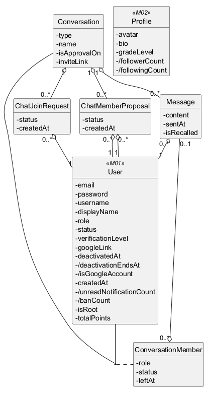

# Phân tích lớp thực thể — M16 Chat & Messaging

<!-- [Vietnamese Doc] Tài liệu tiếng Việt; tên lớp và thuộc tính viết tiếng Anh (input/CONVENTIONS.md mục 3). -->

| Mã tài liệu | EC-M16 |
|---|---|
| Dự án | iShare |
| Module | M16 — Chat & Messaging |
| Đầu vào | FR-M16 phiên bản 1.0 |
| Trạng thái | Đã chốt |
| Phiên bản | 1.1 |
| Ngày | 2026-11-20 |
| Tác giả | Phạm Văn Đức |

<!-- Quy ước chung cho mọi bảng dưới đây:
     - Không đổi tên cột, không xóa cột, không đổi số mục: tool đọc bảng theo số mục và tên cột.
     - Ô không có nội dung ghi "—".
     - Mục chưa tới bước làm thì để dòng "(Chưa làm — bước N)".
     - Cột Nguồn ghi mã trong FR: FR-Mxx-nn, FR-Mxx-nn.mm, BR-Mxx-nn, hoặc TN:<thuật ngữ> (mục 2.1 của FR).
     - Mục 4 chỉ chứa ảnh sơ đồ. gen_puml.py ghi mã PlantUML vào tệp riêng diagrams/EC-Mxx.puml, render
       diagrams/EC-Mxx.png và đặt ảnh vào mục 4. Không chép mã PlantUML vào tài liệu, không sửa tay tệp .puml hay ảnh. -->

## 1. Mô tả chức năng

### 1.1 Đoạn mô tả

Hệ thống quản lý cuộc trò chuyện, thành viên cuộc trò chuyện, tin nhắn, đề nghị thêm thành viên và yêu cầu gia nhập của
Chat trên iShare. Cuộc trò chuyện có hai loại là trò chuyện 1-1 và nhóm chat; nhóm chat độc lập với nhóm do M11 quản lý.

Hệ thống cho phép người dùng đã đăng nhập bắt đầu trò chuyện 1-1 với bất kỳ người dùng nào khác mà không cần theo dõi
nhau; mỗi cặp người dùng có nhiều nhất một trò chuyện 1-1 gồm đúng hai thành viên cuộc trò chuyện, và không bắt đầu được
cuộc mới với tài khoản đang bị ban, đang vô hiệu hóa hoặc đã xóa. Hệ thống cho phép người dùng đã đăng nhập tạo nhóm chat
với tên nhóm chat và các người dùng được chọn, trong giới hạn số thành viên; hệ thống ghi người tạo là thành viên cuộc
trò chuyện với vai trò Admin nhóm chat, những người được chọn với vai trò Member, đặt công tắc duyệt thành viên mới ở
trạng thái Tắt, và nhóm chat có một link mời chung không hết hạn. Hệ thống cho phép người dùng xem hộp thư Chat gồm các
cuộc trò chuyện mà người đó là thành viên hoặc thành viên cũ, xếp theo thời điểm gửi của tin nhắn mới nhất, đánh dấu
cuộc có tin nhắn mới hơn mốc đã đọc của người xem.

Hệ thống cho phép thành viên cuộc trò chuyện xem cuộc trò chuyện và toàn bộ lịch sử tin nhắn, mỗi tin nhắn kèm người
gửi, nội dung và thời điểm gửi, và thấy tin nhắn mới ngay khi có; thành viên cũ chỉ đọc các tin nhắn gửi trước thời điểm
rời. Hệ thống cho phép thành viên cuộc trò chuyện gửi tin nhắn văn bản kèm emoji, trong giới hạn độ dài và tần suất gửi;
mỗi khi một tin nhắn được gửi, hệ thống ghi lại cuộc trò chuyện, người gửi, nội dung và thời điểm gửi, rồi báo sự kiện
tin nhắn mới cho M07. Tin nhắn không sửa được, được giữ vĩnh viễn, không bị AI quét, và người gửi của tài khoản đã xóa
hiện tên thay thế do M01 quản lý. Hệ thống cho phép người gửi thu hồi tin nhắn của mình trong thời hạn thu hồi tính từ
thời điểm gửi; thu hồi là xóa mềm: tin nhắn được đánh dấu đã thu hồi, nội dung gốc được giữ nhưng không hiện với ai, và
mọi thành viên cuộc trò chuyện thấy dòng "Tin nhắn đã bị thu hồi" ở vị trí của tin nhắn đó.

Mỗi thành viên cuộc trò chuyện có một mốc đã đọc trong cuộc trò chuyện, là tin nhắn gần nhất người đó đã đọc; hệ thống
ghi mốc đã đọc khi thành viên mở cuộc trò chuyện, khi có tin mới lúc thành viên đang xem ở cuối cuộc trò chuyện và khi
thành viên gửi tin, và không để mốc đã đọc lùi. Từ mốc đã đọc, hệ thống hiển thị dưới tin nhắn mới nhất người đã xem và
trạng thái Đã gửi hoặc Đã xem mà không lưu trạng thái trên tin nhắn, và cung cấp mốc đã đọc cho M07 để đếm cuộc có tin
chưa đọc.

Hệ thống cho phép thành viên nhóm chat thêm người dùng vào nhóm chat và lấy link mời; người được thêm vào ngay làm Member
khi công tắc duyệt thành viên mới tắt hoặc khi người thêm là Admin nhóm chat, còn khi Member thêm lúc công tắc bật thì
hệ thống tạo một đề nghị thêm thành viên ghi nhóm chat, người được đề nghị, người đề nghị, trạng thái Chờ duyệt và thời
điểm tạo. Hệ thống cho phép người dùng đã đăng nhập mở link mời và xin gia nhập nhóm chat; khi công tắc tắt thì người đó
vào ngay, khi công tắc bật thì hệ thống tạo một yêu cầu gia nhập ghi nhóm chat, người xin, trạng thái Chờ duyệt và thời
điểm tạo, và mỗi người có nhiều nhất một yêu cầu gia nhập Chờ duyệt tới một nhóm chat. Hệ thống không đưa tài khoản đang
bị ban, đang vô hiệu hóa hoặc đã xóa vào nhóm chat và giữ số thành viên của nhóm chat trong giới hạn.

Hệ thống cho phép Admin nhóm chat bật, tắt công tắc duyệt thành viên mới, chấp nhận hoặc từ chối người chờ duyệt, xóa
thành viên và chuyển quyền Admin nhóm chat cho một Member; khi công tắc được tắt, người chờ duyệt được chấp nhận theo thứ
tự thời điểm tạo cho tới khi nhóm chat đủ chỗ, người còn lại bị từ chối. Hệ thống cho phép mọi thành viên nhóm chat đổi
tên nhóm chat và rời nhóm chat; khi thành viên rời hoặc bị xóa, hệ thống ghi trạng thái Đã rời hoặc Bị xóa và thời điểm
rời, giữ nhóm chat trong hộp thư Chat của thành viên cũ, và Admin nhóm chat chỉ rời được sau khi chuyển quyền, trừ khi là
thành viên cuối cùng. Thành viên cũ vào lại nhóm chat như người dùng mới.

Khi tài khoản của Admin nhóm chat không thể khôi phục, theo trạng thái tài khoản do M01 quản lý và kết quả ban, khiếu nại
do M08, M09 cung cấp, hệ thống tự tắt công tắc duyệt thành viên mới và để nhóm chat không có Admin nhóm chat; hệ thống
không tự chuyển quyền Admin nhóm chat. Trong khi trạng thái tài khoản là BANNED, hệ thống chặn mọi thao tác Chat của tài
khoản đó; trong khi cờ tính năng Chat do M10 quản lý tắt, hệ thống từ chối thao tác Chat của người dùng không phải Admin
nhưng giữ nguyên dữ liệu.

<!-- Văn xuôi bình thường, có thể chia vài đoạn. KHÔNG ghi mã câu (S1), (S2)… trong đoạn văn: người đọc không hiểu
     các mã đó. Số câu chỉ nằm ở bảng 1.2. Xem steps/01-describe-functions.md. -->

### 1.2 Truy vết câu

<!-- Mỗi câu của đoạn mô tả một dòng, theo đúng thứ tự. Câu: 1, 2, 3…
     Nội dung câu: chép NGUYÊN VĂN câu đó từ mục 1.1 (tool so khớp từng câu với đoạn văn).
     Nguồn: mã chức năng hoặc yêu cầu của FR mà câu dựa vào. -->

| Câu | Nội dung câu | Nguồn |
|---|---|---|
| 1 | Hệ thống quản lý cuộc trò chuyện, thành viên cuộc trò chuyện, tin nhắn, đề nghị thêm thành viên và yêu cầu gia nhập của Chat trên iShare. | FR-M16-01, FR-M16-02, FR-M16-05, FR-M16-08, FR-M16-16 |
| 2 | Cuộc trò chuyện có hai loại là trò chuyện 1-1 và nhóm chat; nhóm chat độc lập với nhóm do M11 quản lý. | FR-M16-01, FR-M16-02, BR-M16-01 |
| 3 | Hệ thống cho phép người dùng đã đăng nhập bắt đầu trò chuyện 1-1 với bất kỳ người dùng nào khác mà không cần theo dõi nhau; mỗi cặp người dùng có nhiều nhất một trò chuyện 1-1 gồm đúng hai thành viên cuộc trò chuyện, và không bắt đầu được cuộc mới với tài khoản đang bị ban, đang vô hiệu hóa hoặc đã xóa. | FR-M16-01.01, FR-M16-01.04, FR-M16-01.05, FR-M16-01.06, FR-M16-01.07 |
| 4 | Hệ thống cho phép người dùng đã đăng nhập tạo nhóm chat với tên nhóm chat và các người dùng được chọn, trong giới hạn số thành viên; hệ thống ghi người tạo là thành viên cuộc trò chuyện với vai trò Admin nhóm chat, những người được chọn với vai trò Member, đặt công tắc duyệt thành viên mới ở trạng thái Tắt, và nhóm chat có một link mời chung không hết hạn. | FR-M16-02, FR-M16-02.01, FR-M16-02.02, FR-M16-02.04, FR-M16-02.05, FR-M16-02.07, FR-M16-02.08, FR-M16-08.11 |
| 5 | Hệ thống cho phép người dùng xem hộp thư Chat gồm các cuộc trò chuyện mà người đó là thành viên hoặc thành viên cũ, xếp theo thời điểm gửi của tin nhắn mới nhất, đánh dấu cuộc có tin nhắn mới hơn mốc đã đọc của người xem. | FR-M16-03, FR-M16-03.01, FR-M16-03.04, FR-M16-03.05, FR-M16-03.06 |
| 6 | Hệ thống cho phép thành viên cuộc trò chuyện xem cuộc trò chuyện và toàn bộ lịch sử tin nhắn, mỗi tin nhắn kèm người gửi, nội dung và thời điểm gửi, và thấy tin nhắn mới ngay khi có; thành viên cũ chỉ đọc các tin nhắn gửi trước thời điểm rời. | FR-M16-04, FR-M16-04.01, FR-M16-04.03, FR-M16-04.04, FR-M16-04.05, FR-M16-04.10 |
| 7 | Hệ thống cho phép thành viên cuộc trò chuyện gửi tin nhắn văn bản kèm emoji, trong giới hạn độ dài và tần suất gửi; mỗi khi một tin nhắn được gửi, hệ thống ghi lại cuộc trò chuyện, người gửi, nội dung và thời điểm gửi, rồi báo sự kiện tin nhắn mới cho M07. | FR-M16-05, FR-M16-05.01, FR-M16-05.03, FR-M16-05.05, FR-M16-05.12 |
| 8 | Tin nhắn không sửa được, được giữ vĩnh viễn, không bị AI quét, và người gửi của tài khoản đã xóa hiện tên thay thế do M01 quản lý. | FR-M16-05.07, FR-M16-05.08, FR-M16-05.09, FR-M16-04.07 |
| 9 | Hệ thống cho phép người gửi thu hồi tin nhắn của mình trong thời hạn thu hồi tính từ thời điểm gửi; thu hồi là xóa mềm: tin nhắn được đánh dấu đã thu hồi, nội dung gốc được giữ nhưng không hiện với ai, và mọi thành viên cuộc trò chuyện thấy dòng "Tin nhắn đã bị thu hồi" ở vị trí của tin nhắn đó. | FR-M16-06, FR-M16-06.01, FR-M16-06.02, FR-M16-06.03, FR-M16-06.07 |
| 10 | Mỗi thành viên cuộc trò chuyện có một mốc đã đọc trong cuộc trò chuyện, là tin nhắn gần nhất người đó đã đọc; hệ thống ghi mốc đã đọc khi thành viên mở cuộc trò chuyện, khi có tin mới lúc thành viên đang xem ở cuối cuộc trò chuyện và khi thành viên gửi tin, và không để mốc đã đọc lùi. | FR-M16-07, FR-M16-07.01, FR-M16-07.02, FR-M16-07.04, FR-M16-07.05, FR-M16-07.11 |
| 11 | Từ mốc đã đọc, hệ thống hiển thị dưới tin nhắn mới nhất người đã xem và trạng thái Đã gửi hoặc Đã xem mà không lưu trạng thái trên tin nhắn, và cung cấp mốc đã đọc cho M07 để đếm cuộc có tin chưa đọc. | FR-M16-07.06, FR-M16-07.07, FR-M16-07.08, FR-M16-07.10 |
| 12 | Hệ thống cho phép thành viên nhóm chat thêm người dùng vào nhóm chat và lấy link mời; người được thêm vào ngay làm Member khi công tắc duyệt thành viên mới tắt hoặc khi người thêm là Admin nhóm chat, còn khi Member thêm lúc công tắc bật thì hệ thống tạo một đề nghị thêm thành viên ghi nhóm chat, người được đề nghị, người đề nghị, trạng thái Chờ duyệt và thời điểm tạo. | FR-M16-08, FR-M16-08.01, FR-M16-08.02, FR-M16-08.03, FR-M16-08.10 |
| 13 | Hệ thống cho phép người dùng đã đăng nhập mở link mời và xin gia nhập nhóm chat; khi công tắc tắt thì người đó vào ngay, khi công tắc bật thì hệ thống tạo một yêu cầu gia nhập ghi nhóm chat, người xin, trạng thái Chờ duyệt và thời điểm tạo, và mỗi người có nhiều nhất một yêu cầu gia nhập Chờ duyệt tới một nhóm chat. | FR-M16-16, FR-M16-16.01, FR-M16-16.03, FR-M16-16.04, FR-M16-16.06 |
| 14 | Hệ thống không đưa tài khoản đang bị ban, đang vô hiệu hóa hoặc đã xóa vào nhóm chat và giữ số thành viên của nhóm chat trong giới hạn. | FR-M16-02.09, FR-M16-08.05, FR-M16-08.09, FR-M16-16.05 |
| 15 | Hệ thống cho phép Admin nhóm chat bật, tắt công tắc duyệt thành viên mới, chấp nhận hoặc từ chối người chờ duyệt, xóa thành viên và chuyển quyền Admin nhóm chat cho một Member; khi công tắc được tắt, người chờ duyệt được chấp nhận theo thứ tự thời điểm tạo cho tới khi nhóm chat đủ chỗ, người còn lại bị từ chối. | FR-M16-09, FR-M16-09.01, FR-M16-09.03, FR-M16-09.04, FR-M16-10, FR-M16-10.01, FR-M16-10.02, FR-M16-11, FR-M16-11.01, FR-M16-13, FR-M16-13.01 |
| 16 | Hệ thống cho phép mọi thành viên nhóm chat đổi tên nhóm chat và rời nhóm chat; khi thành viên rời hoặc bị xóa, hệ thống ghi trạng thái Đã rời hoặc Bị xóa và thời điểm rời, giữ nhóm chat trong hộp thư Chat của thành viên cũ, và Admin nhóm chat chỉ rời được sau khi chuyển quyền, trừ khi là thành viên cuối cùng. | FR-M16-12, FR-M16-12.01, FR-M16-14, FR-M16-14.01, FR-M16-14.02, FR-M16-14.03, FR-M16-14.04, FR-M16-11.01 |
| 17 | Thành viên cũ vào lại nhóm chat như người dùng mới. | FR-M16-08.08, FR-M16-16.08 |
| 18 | Khi tài khoản của Admin nhóm chat không thể khôi phục, theo trạng thái tài khoản do M01 quản lý và kết quả ban, khiếu nại do M08, M09 cung cấp, hệ thống tự tắt công tắc duyệt thành viên mới và để nhóm chat không có Admin nhóm chat; hệ thống không tự chuyển quyền Admin nhóm chat. | FR-M16-17, FR-M16-17.01, FR-M16-17.02, FR-M16-17.03, FR-M16-13.03 |
| 19 | Trong khi trạng thái tài khoản là BANNED, hệ thống chặn mọi thao tác Chat của tài khoản đó; trong khi cờ tính năng Chat do M10 quản lý tắt, hệ thống từ chối thao tác Chat của người dùng không phải Admin nhưng giữ nguyên dữ liệu. | FR-M16-03.03, FR-M16-15, FR-M16-15.01, FR-M16-15.03, FR-M16-15.04 |

## 2. Danh từ và phân loại

### 2.1 Sổ danh từ

<!-- Phân loại: Lớp | Thuộc tính | Loại bỏ.
     Kết quả: tên lớp; hoặc Lớp.thuộcTính; hoặc "—" khi loại bỏ.
     Xuất hiện ở: "Câu n" (số câu ở bảng 1.2) hoặc "Quét: <mã FR>" (lượt quét bổ sung). -->

| # | Danh từ | Xuất hiện ở | Phân loại | Kết quả | Lý do |
|---|---|---|---|---|---|
| 1 | hệ thống | Câu 1 | Loại bỏ | — | Trừu tượng: chỉ chính phần mềm |
| 2 | cuộc trò chuyện | Câu 1 | Lớp | Conversation | Có danh tính, loại, tên, cài đặt, link mời (mục Dữ liệu nghiệp vụ), được tạo, sửa (ma trận CRUD); có nhiều thành viên và tin nhắn; dùng tên Conversation mà EC-M07 đã đặt tạm |
| 3 | thành viên cuộc trò chuyện / thành viên nhóm chat | Câu 1 | Lớp | ConversationMember | FR gọi là thực thể với vai trò, trạng thái, mốc đã đọc, thời điểm rời (mục Dữ liệu nghiệp vụ); có bảng chuyển trạng thái riêng. Ở bước 3 là lớp liên kết của quan hệ n-n User – Conversation |
| 4 | tin nhắn | Câu 1 | Lớp | Message | Có danh tính, nội dung, thời điểm gửi, trạng thái thu hồi (mục Dữ liệu nghiệp vụ, mục Chuyển trạng thái); giữ vĩnh viễn (BR-M16-18) |
| 5 | đề nghị thêm thành viên | Câu 1 | Lớp | ChatMemberProposal | Có trạng thái riêng (Chờ duyệt, Đã chấp nhận, Đã từ chối) và nhiều thông tin riêng (mục Dữ liệu nghiệp vụ); không xóa (ma trận CRUD); xem Q-03 về tên |
| 6 | yêu cầu gia nhập | Câu 1 | Lớp | ChatJoinRequest | Có trạng thái riêng, một người có nhiều yêu cầu theo thời gian tới cùng nhóm chat (BR-M16-29); tên khác GroupJoinRequest của EC-M11 để không trùng, xem Q-03 |
| 7 | Chat | Câu 1 | Loại bỏ | — | Trừu tượng: tên module |
| 8 | iShare | Câu 1 | Loại bỏ | — | Trừu tượng: tên sản phẩm |
| 9 | loại | Câu 2 | Thuộc tính | Conversation.type | Hai giá trị cố định trò chuyện 1-1, nhóm chat (TN:Cuộc trò chuyện, mục Dữ liệu nghiệp vụ) |
| 10 | trò chuyện 1-1 / nhóm chat | Câu 2 | Loại bỏ | — | Giá trị của Conversation.type |
| 11 | nhóm | Câu 2 | Loại bỏ | — | Ngoài phạm vi module (M11): nhóm chat độc lập với Group (BR-M16-01) |
| 12 | M01, M07, M08, M09, M10, M11 (tên module) | Câu 2 | Loại bỏ | — | Trừu tượng: tên các phần của hệ thống |
| 13 | người dùng đã đăng nhập / người dùng / tài khoản | Câu 3 | Lớp | User | Lớp ngoài (M01): thành viên, người gửi, người đề nghị, người được đề nghị, người xin; dùng tên User của EC-M01 |
| 14 | cặp người dùng | Câu 3 | Loại bỏ | — | Chung chung: hai thành viên của một trò chuyện 1-1; mỗi cặp nhiều nhất một cuộc (BR-M16-24) là ràng buộc của quan hệ ở bước 3 |
| 15 | tài khoản đang bị ban, đang vô hiệu hóa hoặc đã xóa | Câu 3 | Loại bỏ | — | Chung chung: tài khoản có User.status BANNED, DEACTIVATED hoặc DELETED (BR-M16-25) |
| 16 | tên nhóm chat | Câu 4 | Thuộc tính | Conversation.name | Mục Dữ liệu nghiệp vụ nêu (TN:Tên nhóm chat) |
| 17 | giới hạn số thành viên / giới hạn | Câu 4 | Loại bỏ | — | Hằng số của BR-M16-03: từ 3 thành viên khi tạo, tối đa 100 ở mọi lúc |
| 18 | người tạo | Câu 4 | Lớp | User | Vai trò theo ngữ cảnh: được ghi bằng thành viên có ConversationMember.role Admin nhóm chat lúc tạo (FR-M16-02.02); FR không yêu cầu giữ riêng người tạo |
| 19 | vai trò | Câu 4 | Thuộc tính | ConversationMember.role | Mục Dữ liệu nghiệp vụ nêu trên thành viên cuộc trò chuyện (chỉ ở nhóm chat) |
| 20 | Admin nhóm chat | Câu 4 | Lớp | User | Vai trò theo ngữ cảnh: thành viên có ConversationMember.role Admin nhóm chat (TN:Admin nhóm chat); khác vai trò hệ thống ADMIN; xem Q-01 |
| 21 | Member | Câu 4 | Lớp | User | Vai trò theo ngữ cảnh: thành viên có ConversationMember.role Member (TN:Member (nhóm chat)) |
| 22 | người được chọn | Câu 4 | Lớp | User | Vai trò theo ngữ cảnh: người dùng người tạo chọn đưa vào nhóm chat |
| 23 | công tắc duyệt thành viên mới / công tắc | Câu 4 | Thuộc tính | Conversation.isApprovalOn | Cài đặt Bật, Tắt của nhóm chat (TN:Công tắc duyệt thành viên mới) |
| 24 | trạng thái Tắt | Câu 4 | Loại bỏ | — | Giá trị của Conversation.isApprovalOn (giá trị khởi tạo, BR-M16-06) |
| 25 | link mời chung / link mời | Câu 4 | Thuộc tính | Conversation.inviteLink | Mỗi nhóm chat một link chung (TN:Link mời nhóm chat) |
| 26 | hộp thư Chat | Câu 5 | Loại bỏ | — | Chung chung: các cuộc trò chuyện mà người xem có ConversationMember (TN:Hộp thư Chat); không lưu riêng |
| 27 | thành viên cũ | Câu 5 | Loại bỏ | — | Chung chung: ConversationMember có status Đã rời hoặc Bị xóa (TN:Thành viên cũ) |
| 28 | thời điểm gửi | Câu 5 | Thuộc tính | Message.sentAt | Mục Dữ liệu nghiệp vụ nêu (TN:Thời điểm gửi) |
| 29 | tin nhắn mới nhất | Câu 5 | Loại bỏ | — | Chung chung: tin nhắn có Message.sentAt sau cùng của cuộc, kể cả tin đã thu hồi (TN:Tin nhắn mới nhất) |
| 30 | mốc đã đọc | Câu 5 | Lớp | Message | Vai trò theo ngữ cảnh của một tin nhắn: "tin nhắn gần nhất mà một thành viên đã đọc" (TN:Mốc đã đọc); quan hệ thành viên – tin nhắn xét ở bước 3; xem Q-02 |
| 31 | người xem | Câu 5 | Loại bỏ | — | Chung chung: người dùng đang mở hộp thư; M16 không ghi việc xem |
| 32 | lịch sử tin nhắn | Câu 6 | Loại bỏ | — | Chung chung: các Message của cuộc, tải dần (BR-M16-17) |
| 33 | người gửi | Câu 6 | Lớp | User | Vai trò theo ngữ cảnh: tài khoản gửi tin nhắn (mục Dữ liệu nghiệp vụ); quan hệ xét ở bước 3 |
| 34 | nội dung | Câu 6 | Thuộc tính | Message.content | Mục Dữ liệu nghiệp vụ nêu |
| 35 | thời điểm rời | Câu 6 | Thuộc tính | ConversationMember.leftAt | Mục Dữ liệu nghiệp vụ nêu (TN:Thời điểm rời) |
| 36 | văn bản / emoji | Câu 7 | Loại bỏ | — | Chung chung: dạng của Message.content (BR-M16-08) |
| 37 | độ dài và tần suất gửi | Câu 7 | Loại bỏ | — | Hằng số của BR-M16-08 (tối đa 1.000 từ) và BR-M16-09 (30 tin trong 60 giây gần nhất mỗi cuộc); ghi ở ràng buộc của Message.content, Message.sentAt |
| 38 | sự kiện tin nhắn mới | Câu 7 | Loại bỏ | — | Ngoài phạm vi module (M07): M16 báo sự kiện, M07 tạo thông báo |
| 39 | AI | Câu 8 | Loại bỏ | — | Ngoài phạm vi module (M13): tin nhắn không bị quét (BR-M16-20) |
| 40 | tên thay thế | Câu 8 | Loại bỏ | — | Ngoài phạm vi module (M01): "[Người dùng đã xóa]" hiện theo User.status DELETED (BR-M16-19) |
| 41 | thời hạn thu hồi | Câu 9 | Loại bỏ | — | Hằng số của BR-M16-11: 5 phút từ Message.sentAt; ghi ở ràng buộc của Message.sentAt |
| 42 | thu hồi / xóa mềm | Câu 9 | Loại bỏ | — | Hành động không lưu dấu vết riêng: chỉ đặt Message.isRecalled (TN:Thu hồi) |
| 43 | dấu đã thu hồi | Câu 9 | Thuộc tính | Message.isRecalled | Mục Dữ liệu nghiệp vụ nêu "đã thu hồi (cờ; nội dung gốc được giữ)" |
| 44 | nội dung gốc | Câu 9 | Loại bỏ | — | Chung chung: là Message.content, giữ nguyên khi thu hồi (BR-M16-12) |
| 45 | dòng "Tin nhắn đã bị thu hồi" | Câu 9 | Loại bỏ | — | Giao diện: hiện khi Message.isRecalled đúng |
| 46 | cuối cuộc trò chuyện | Câu 10 | Loại bỏ | — | Giao diện (TN:Đang xem ở cuối cuộc trò chuyện); không lưu |
| 47 | người đã xem | Câu 11 | Loại bỏ | — | Chung chung: các thành viên có mốc đã đọc không cũ hơn tin nhắn mới nhất, trừ người gửi (BR-M16-15); tính lúc hiển thị |
| 48 | Đã gửi / Đã xem | Câu 11 | Loại bỏ | — | Chung chung: suy ra từ mốc đã đọc, không lưu trên tin (TN:Đã gửi, Đã xem; BR-M16-15) |
| 49 | cuộc có tin chưa đọc | Câu 11 | Loại bỏ | — | Chung chung: cuộc có Message mới hơn mốc đã đọc của người xem trong số tin người đó thấy được (FR-M16-07.10); tính lúc cần |
| 50 | người được đề nghị | Câu 12 | Lớp | User | Vai trò theo ngữ cảnh (mục Dữ liệu nghiệp vụ, dòng Đề nghị thêm thành viên); quan hệ xét ở bước 3 |
| 51 | người đề nghị | Câu 12 | Lớp | User | Vai trò theo ngữ cảnh: Member thêm người khi công tắc bật; quan hệ xét ở bước 3 |
| 52 | Chờ duyệt | Câu 12 | Loại bỏ | — | Giá trị của ChatMemberProposal.status, ChatJoinRequest.status |
| 53 | trạng thái | Câu 12 | Thuộc tính | ChatMemberProposal.status | Có bảng chuyển trạng thái riêng (mục Chuyển trạng thái: Đề nghị thêm thành viên) |
| 54 | thời điểm tạo | Câu 12 | Thuộc tính | ChatMemberProposal.createdAt | Thứ tự chờ tính theo lúc đề nghị hoặc yêu cầu được tạo (TN:Người chờ duyệt, BR-M16-33) |
| 55 | người xin | Câu 13 | Lớp | User | Vai trò theo ngữ cảnh (mục Dữ liệu nghiệp vụ, dòng Yêu cầu gia nhập); quan hệ xét ở bước 3 |
| 56 | người chờ duyệt | Câu 15 | Loại bỏ | — | Chung chung: người dùng có ChatMemberProposal hoặc ChatJoinRequest Chờ duyệt (TN:Người chờ duyệt) |
| 57 | thứ tự | Câu 15 | Loại bỏ | — | Chung chung: theo ChatMemberProposal.createdAt, ChatJoinRequest.createdAt (BR-M16-33) |
| 58 | Đã rời / Bị xóa | Câu 16 | Loại bỏ | — | Giá trị của ConversationMember.status |
| 59 | thành viên cuối cùng | Câu 16 | Loại bỏ | — | Chung chung: nhóm chat chỉ còn một ConversationMember đang là thành viên (BR-M16-07) |
| 60 | tài khoản của Admin nhóm chat không thể khôi phục | Câu 18 | Loại bỏ | — | Ngoài phạm vi module (M01, M08, M09): suy ra từ User.status DELETED, hoặc ban vĩnh viễn hết hạn khiếu nại mà không khiếu nại, hoặc khiếu nại bị bác (TN:Admin nhóm chat không thể khôi phục); M16 không lưu |
| 61 | kết quả ban, khiếu nại | Câu 18 | Loại bỏ | — | Ngoài phạm vi module (M08, M09): M16 dùng để biết Admin nhóm chat không thể khôi phục; không có quan hệ với lớp nào của M16 |
| 62 | trạng thái tài khoản | Câu 18 | Thuộc tính | User.status | Thông tin của tài khoản (M01) mà M16 đọc (FR-M16-01.07, FR-M16-03.03, FR-M16-04.11) |
| 63 | BANNED | Câu 19 | Loại bỏ | — | Giá trị của User.status |
| 64 | cờ tính năng Chat | Câu 19 | Loại bỏ | — | Ngoài phạm vi module (M10): M16 chỉ đọc; không có dữ liệu của M16 gắn với cờ |
| 65 | Admin | Câu 19 | Lớp | User | Vai trò hệ thống có tài khoản; phân biệt bằng User.role; vẫn dùng Chat khi cờ tắt (FR-M16-15.04) |
| 66 | dữ liệu | Câu 19 | Loại bỏ | — | Chung chung: dữ liệu của Chat, giữ nguyên khi cờ tắt (FR-M16-15.03) |
| 67 | trạng thái của yêu cầu gia nhập | Quét: Dữ liệu nghiệp vụ | Thuộc tính | ChatJoinRequest.status | Mục Dữ liệu nghiệp vụ nêu; có bảng chuyển trạng thái (mục Chuyển trạng thái: Yêu cầu gia nhập) |
| 68 | thời điểm tạo yêu cầu gia nhập | Quét: TN:Người chờ duyệt | Thuộc tính | ChatJoinRequest.createdAt | Thứ tự chờ tính theo lúc yêu cầu được tạo (BR-M16-33) |
| 69 | Đã chấp nhận / Đã từ chối | Quét: Dữ liệu nghiệp vụ | Loại bỏ | — | Giá trị của ChatMemberProposal.status, ChatJoinRequest.status |
| 70 | đang là thành viên | Quét: Dữ liệu nghiệp vụ | Loại bỏ | — | Giá trị của ConversationMember.status |
| 71 | Bình thường / Đã thu hồi | Quét: FR-M16-06.07 | Loại bỏ | — | Giá trị của Message.isRecalled (sai, đúng) theo mục Chuyển trạng thái: Tin nhắn |
| 72 | avatar | Quét: FR-M16-03.05 | Thuộc tính | Profile.avatar | Thông tin của hồ sơ (M02) mà M16 hiển thị ở người gửi, người kia trong hộp thư, người đã xem (mục Giao tiếp, dòng Dùng M02) |
| 73 | display_name | Quét: FR-M16-03.05 | Thuộc tính | User.displayName | Thông tin của tài khoản (M01) mà M16 hiển thị ở người gửi và người kia trong hộp thư |
| 74 | 20 tin, 20 cuộc mỗi lần tải | Quét: BR-M16-17 | Loại bỏ | — | Giao diện: cách tải dần (BR-M16-17, BR-M16-31) |
| 75 | chặn, báo cáo tin nhắn, gọi thoại, gọi video, tệp đính kèm | Quét: BR-M16-20 | Loại bỏ | — | Ngoài phạm vi hệ thống: không làm ở MS1 (BR-M16-08, BR-M16-20) |
| 76 | cuộc trò chuyện người dùng đang mở | Quét: FR-M16-04.09 | Loại bỏ | — | Hành động không lưu dấu vết: trạng thái lúc chạy cung cấp cho M07, không lưu |
| 77 | hồ sơ | Quét: Giao tiếp với module khác | Lớp | Profile | Lớp ngoài (M02): M16 đọc avatar (mục Giao tiếp, dòng Dùng M02); dùng tên Profile của EC-M02 |

### 2.2 Lớp

<!-- Nhóm: Thực thể | Liên kết | Thống kê. Sở hữu: mã module sở hữu lớp (Mxx của tài liệu này, hoặc Myy với lớp ngoài).
     Thuộc tính: tên mọi thuộc tính của lớp ở mục 2.3, ngăn bởi dấu phẩy, thuộc tính dẫn xuất có "/" phía trước;
     để người đọc thấy lớp và thuộc tính trên cùng một dòng. Lớp chưa có thuộc tính ghi "—". -->

| Lớp | Tên tiếng Việt | Nhóm | Sở hữu | Mô tả | Thuộc tính | Nguồn |
|---|---|---|---|---|---|---|
| Conversation | Cuộc trò chuyện | Thực thể | M16 | Trò chuyện 1-1 giữa hai người dùng hoặc nhóm chat nhiều người; không bị xóa | type, name, isApprovalOn, inviteLink | FR-M16-01.01, FR-M16-02.01, FR-M16-12.01 |
| ConversationMember | Thành viên cuộc trò chuyện | Liên kết | M16 | Một người dùng trong một cuộc trò chuyện với vai trò, trạng thái và mốc đã đọc; tách từ quan hệ n-n User – Conversation | role, status, leftAt | FR-M16-01.04, FR-M16-02.02, FR-M16-14.01, FR-M16-07.01 |
| Message | Tin nhắn | Thực thể | M16 | Một lần gửi nội dung văn bản của một thành viên trong một cuộc trò chuyện; giữ vĩnh viễn, thu hồi là xóa mềm | content, sentAt, isRecalled | FR-M16-05.01, FR-M16-06.07 |
| ChatMemberProposal | Đề nghị thêm thành viên | Thực thể | M16 | Member thêm một người vào nhóm chat khi công tắc duyệt bật, chờ Admin nhóm chat duyệt | status, createdAt | FR-M16-08.03, FR-M16-10.01, FR-M16-10.02 |
| ChatJoinRequest | Yêu cầu gia nhập | Thực thể | M16 | Một người xin gia nhập nhóm chat qua link mời khi công tắc duyệt bật, chờ Admin nhóm chat duyệt | status, createdAt | FR-M16-16.04, FR-M16-10.01, FR-M16-10.02 |
| User | Người dùng (tài khoản) | Thực thể | M01 | Thành viên cuộc trò chuyện, người gửi tin, người đề nghị, người được đề nghị, người xin gia nhập | email, password, username, displayName, role, status, verificationLevel, googleLink, deactivatedAt, /deactivationEndsAt, /isGoogleAccount, createdAt, /unreadNotificationCount, /banCount, isRoot, totalPoints | FR-M16-01.01, FR-M16-05.01, FR-M16-08.03, FR-M16-16.04 |
| Profile | Hồ sơ | Thực thể | M02 | Nguồn avatar hiển thị ở người gửi, hộp thư và người đã xem | avatar, bio, gradeLevel, /followerCount, /followingCount | FR-M16-03.05, FR-M16-07.06 |

### 2.3 Thuộc tính

<!-- Mỗi lớp có ĐỦ thuộc tính để người đọc hình dung được nó; xếp các dòng theo lớp.
     Tính chất: Lưu | Dẫn xuất. Chưa có id, chưa có kiểu, chưa có khóa ngoại.
     Căn cứ: Nguồn nêu (FR nói tới) | Đề xuất (FR không nói, nhưng chức năng hoặc quy tắc ở cột Nguồn cần nó) |
             Tham chiếu (thuộc tính của lớp ngoài; module sở hữu lớp đó định nghĩa. Sau lượt gộp hệ thống,
             lớp ngoài ghi đủ thuộc tính như EC-SYS, MD-05).
     Ràng buộc nguồn nêu: độ dài tối đa, duy nhất, bắt buộc/tùy chọn, tập giá trị, mặc định, công thức (với Dẫn xuất)
             — chép từ FR kèm mã. Đề xuất mà FR không nêu ràng buộc thì ghi "—".
     Nguồn: mã FR/BR nêu thuộc tính; với Đề xuất là mã chức năng hoặc quy tắc cần nó.
     Ghi chú: bắt buộc với Đề xuất (vì sao cần) và Tham chiếu (module này dùng nó làm gì). -->

| Lớp | Thuộc tính | Tên tiếng Việt | Tính chất | Căn cứ | Ràng buộc nguồn nêu | Nguồn | Ghi chú |
|---|---|---|---|---|---|---|---|
| Conversation | type | Loại | Lưu | Nguồn nêu | Trò chuyện 1-1, nhóm chat (TN:Cuộc trò chuyện, BR-M16-01); trò chuyện 1-1 có đúng 2 thành viên, mỗi cặp người dùng nhiều nhất một cuộc (BR-M16-24) | FR-M16-01.04, FR-M16-02.01, BR-M16-01 | — |
| Conversation | name | Tên nhóm chat | Lưu | Nguồn nêu | Chỉ ở nhóm chat; bắt buộc, 1–100 ký tự sau khi bỏ khoảng trắng đầu, cuối; được trùng với nhóm chat khác (BR-M16-32); mọi thành viên đổi được (BR-M16-05) | FR-M16-02.07, FR-M16-12.01, FR-M16-12.03 | Hiện ở hộp thư và khi mở link mời (FR-M16-16.01) |
| Conversation | isApprovalOn | Công tắc duyệt thành viên mới | Lưu | Nguồn nêu | Chỉ ở nhóm chat; Bật, Tắt; Tắt khi tạo (BR-M16-06); chỉ Admin nhóm chat đổi; hệ thống tự tắt khi Admin nhóm chat không thể khôi phục (BR-M16-30) | FR-M16-02.08, FR-M16-09.01, FR-M16-17.02 | — |
| Conversation | inviteLink | Link mời | Lưu | Nguồn nêu | Chỉ ở nhóm chat; một link chung, không hết hạn, không thu hồi, không tạo lại (BR-M16-29) | FR-M16-08.10, FR-M16-08.11 | Cùng cách Group.inviteLink của EC-M11 |
| ConversationMember | role | Vai trò | Lưu | Nguồn nêu | Chỉ ở nhóm chat: Admin nhóm chat, Member; người tạo là Admin nhóm chat đầu tiên; mỗi nhóm chat nhiều nhất một Admin nhóm chat (BR-M16-04); chuyển quyền thì đổi vai trò của hai người (BR-M16-07) | FR-M16-02.02, FR-M16-13.01, BR-M16-04 | Khác User.role; xem Q-01 |
| ConversationMember | status | Trạng thái | Lưu | Nguồn nêu | Đang là thành viên, Đã rời, Bị xóa (hai giá trị sau chỉ ở nhóm chat); vào lại thì về đang là thành viên (mục Chuyển trạng thái: Thành viên cuộc trò chuyện) | FR-M16-14.01, FR-M16-11.01, FR-M16-14.03, FR-M16-08.08 | Thành viên cũ giữ nhóm chat trong hộp thư, chỉ đọc (BR-M16-27) |
| ConversationMember | leftAt | Thời điểm rời | Lưu | Nguồn nêu | Có khi Đã rời hoặc Bị xóa; thành viên cũ chỉ xem tin gửi trước thời điểm này (TN:Thời điểm rời, BR-M16-27) | FR-M16-04.10, FR-M16-03.06 | Người vào lại đọc toàn bộ lịch sử (BR-M16-27) |
| Message | content | Nội dung | Lưu | Nguồn nêu | Văn bản, có thể kèm emoji; không trống, không chỉ gồm khoảng trắng; tối đa 1.000 từ (BR-M16-08); không sửa (BR-M16-10); giữ cả khi thu hồi nhưng không hiện với ai (BR-M16-12) | FR-M16-05.01, FR-M16-05.11, FR-M16-05.12, FR-M16-06.07 | — |
| Message | sentAt | Thời điểm gửi | Lưu | Nguồn nêu | Lúc hệ thống nhận tin (TN:Thời điểm gửi); thu hồi được khi chưa quá 5 phút từ thời điểm này (BR-M16-11); mỗi người tối đa 30 tin trong 60 giây gần nhất ở một cuộc (BR-M16-09); xếp thứ tự tin và hộp thư (BR-M16-31) | FR-M16-05.01, FR-M16-05.05, FR-M16-06.01, FR-M16-03.04 | — |
| Message | isRecalled | Đã thu hồi | Lưu | Nguồn nêu | Bình thường (sai), Đã thu hồi (đúng); chỉ người gửi đặt, một lần (FR-M16-06.04, FR-M16-06.06); xóa mềm (BR-M16-12) | FR-M16-06.01, FR-M16-06.06, FR-M16-06.07 | — |
| ChatMemberProposal | status | Trạng thái | Lưu | Nguồn nêu | Chờ duyệt, Đã chấp nhận, Đã từ chối (TN:Đề nghị thêm thành viên); không xóa (ma trận CRUD) | FR-M16-08.03, FR-M16-10.01, FR-M16-10.02, FR-M16-09.04 | — |
| ChatMemberProposal | createdAt | Thời điểm tạo | Lưu | Nguồn nêu | Thứ tự chờ tính theo lúc đề nghị được tạo (TN:Người chờ duyệt, BR-M16-33) | FR-M16-09.03, BR-M16-33 | Khi công tắc duyệt bị tắt, người chờ sớm nhất vào nhóm trước |
| ChatJoinRequest | status | Trạng thái | Lưu | Nguồn nêu | Chờ duyệt, Đã chấp nhận, Đã từ chối (TN:Yêu cầu gia nhập); mỗi người nhiều nhất một yêu cầu Chờ duyệt tới một nhóm chat; bị từ chối thì gửi lại ngay được (BR-M16-29); không xóa (ma trận CRUD) | FR-M16-16.04, FR-M16-16.06, FR-M16-10.01, FR-M16-10.02 | — |
| ChatJoinRequest | createdAt | Thời điểm tạo | Lưu | Nguồn nêu | Thứ tự chờ tính theo lúc yêu cầu được tạo (TN:Người chờ duyệt, BR-M16-33) | FR-M16-09.03, BR-M16-33 | Như ChatMemberProposal.createdAt |
| User | email | Email | Lưu | Tham chiếu | — | FR-M01-01.01, FR-M01-01.06, FR-M01-12.06 | Ghi đủ lớp sau gộp (MD-05); EC-M01 định nghĩa |
| User | password | Mật khẩu | Lưu | Tham chiếu | — | FR-M01-01.10, FR-M01-08.01, FR-M01-09.02 | Ghi đủ lớp sau gộp (MD-05); EC-M01 định nghĩa |
| User | username | Tên định danh | Lưu | Tham chiếu | — | FR-M01-03.01, FR-M01-03.05, FR-M01-03.06, FR-M01-12.07 | Ghi đủ lớp sau gộp (MD-05); EC-M01 định nghĩa |
| User | displayName | Tên hiển thị | Lưu | Tham chiếu | — | FR-M16-03.05, FR-M16-04.04 | Hiện ở người gửi tin và người kia trong hộp thư |
| User | role | Vai trò | Lưu | Tham chiếu | — | FR-M16-15.04 | Admin vẫn dùng Chat khi cờ tính năng Chat tắt |
| User | status | Trạng thái tài khoản | Lưu | Tham chiếu | — | FR-M16-01.07, FR-M16-03.03, FR-M16-05.13, FR-M16-08.09, FR-M16-04.11 | BANNED chặn mọi thao tác Chat; BANNED, DEACTIVATED, DELETED không bắt đầu được 1-1 mới, không được thêm vào nhóm chat; DELETED không nhận tin trong 1-1; quyết định cách hiện người gửi (BR-M16-26) |
| User | verificationLevel | Mức xác minh | Lưu | Tham chiếu | — | FR-M01-01.01, FR-M01-02.01, FR-M01-03.01, FR-M01-04.01 | Ghi đủ lớp sau gộp (MD-05); EC-M01 định nghĩa |
| User | googleLink | Liên kết Google | Lưu | Tham chiếu | — | FR-M01-04.04, FR-M01-12.08 | Ghi đủ lớp sau gộp (MD-05); EC-M01 định nghĩa |
| User | deactivatedAt | Thời điểm vô hiệu hóa | Lưu | Tham chiếu | — | FR-M01-10.07 | Ghi đủ lớp sau gộp (MD-05); EC-M01 định nghĩa |
| User | deactivationEndsAt | Thời điểm hết thời hạn vô hiệu hóa | Dẫn xuất | Tham chiếu | — | FR-M01-10.07, FR-M01-11.05, FR-M01-12.01, FR-M01-12.05 | Ghi đủ lớp sau gộp (MD-05); EC-M01 định nghĩa |
| User | isGoogleAccount | Là tài khoản Google | Dẫn xuất | Tham chiếu | — | FR-M01-05.13, FR-M01-08.06, FR-M01-09.07 | Ghi đủ lớp sau gộp (MD-05); EC-M01 định nghĩa |
| User | createdAt | Thời điểm tạo tài khoản | Lưu | Tham chiếu | — | FR-M01-01.01, FR-M01-04.01 | Ghi đủ lớp sau gộp (MD-05); EC-M01 định nghĩa |
| User | unreadNotificationCount | Số thông báo chưa đọc | Dẫn xuất | Tham chiếu | — | FR-M07-05.10, BR-M07-12 | Ghi đủ lớp sau gộp (MD-05); EC-M01 định nghĩa |
| User | banCount | Số lần đã bị ban | Dẫn xuất | Tham chiếu | — | FR-M08-14.12, BR-M08-34 | Ghi đủ lớp sau gộp (MD-05); EC-M01 định nghĩa |
| User | isRoot | Là tài khoản ADMIN gốc | Lưu | Tham chiếu | — | FR-M10-07.04, FR-M10-01.05, BR-M10-10, BR-M10-11 | Ghi đủ lớp sau gộp (MD-05); EC-M01 định nghĩa |
| User | totalPoints | Tổng điểm | Lưu | Tham chiếu | — | FR-M12-02.01, FR-M12-02.02, FR-M12-02.03, FR-M12-02.12 | Ghi đủ lớp sau gộp (MD-05); EC-M01 định nghĩa |
| Profile | avatar | Avatar | Lưu | Tham chiếu | — | FR-M16-03.05, FR-M16-07.06 | Hiện ở người gửi, người kia trong hộp thư và danh sách người đã xem |
| Profile | bio | Bio | Lưu | Tham chiếu | — | FR-M02-03.02, FR-M02-03.04, FR-M02-03.11, FR-M02-03.12 | Ghi đủ lớp sau gộp (MD-05); EC-M02 định nghĩa |
| Profile | gradeLevel | Lớp/Khối | Lưu | Tham chiếu | — | FR-M02-03.02, FR-M02-03.06, FR-M02-03.08, FR-M02-03.14 | Ghi đủ lớp sau gộp (MD-05); EC-M02 định nghĩa |
| Profile | followerCount | Số người theo dõi | Dẫn xuất | Tham chiếu | — | FR-M02-01.02, FR-M02-02.07, FR-M02-02.08 | Ghi đủ lớp sau gộp (MD-05); EC-M02 định nghĩa |
| Profile | followingCount | Số đang theo dõi | Dẫn xuất | Tham chiếu | — | FR-M02-01.02, FR-M02-02.06, FR-M02-02.07 | Ghi đủ lớp sau gộp (MD-05); EC-M02 định nghĩa |

### 2.4 Đối chiếu với mục Dữ liệu nghiệp vụ của FR

<!-- Mỗi thực thể ở bảng "Dữ liệu nghiệp vụ" của FR một dòng; chép đúng tên ở cột Thực thể của FR.
     Xử lý: Khớp | Đã thêm qua sổ danh từ | Mô hình có thêm: … | Lệch: … (kèm Q-nn). -->

| Thực thể trong FR | Trong mô hình | Xử lý |
|---|---|---|
| Cuộc trò chuyện | Conversation | Khớp: loại → type; tên → name; công tắc duyệt thành viên mới → isApprovalOn; link mời → inviteLink. Lệch: Admin nhóm chat → thành viên có ConversationMember.role Admin nhóm chat, không có quan hệ riêng (Q-01) |
| Thành viên cuộc trò chuyện | ConversationMember | Khớp: vai trò → role; trạng thái → status; thời điểm rời → leftAt; người dùng, cuộc trò chuyện → quan hệ; ở bước 3 là lớp liên kết của quan hệ n-n User – Conversation. Lệch: mốc đã đọc → quan hệ với Message (Q-02) |
| Tin nhắn | Message | Khớp: nội dung → content; thời điểm gửi → sentAt; đã thu hồi → isRecalled; cuộc trò chuyện, người gửi → quan hệ (bước 3) |
| Đề nghị thêm thành viên | ChatMemberProposal | Khớp: trạng thái → status; nhóm chat, người được đề nghị, người đề nghị → quan hệ. Mô hình có thêm: createdAt (TN:Người chờ duyệt: thứ tự chờ tính theo lúc tạo) |
| Yêu cầu gia nhập | ChatJoinRequest | Khớp: trạng thái → status; nhóm chat, người xin → quan hệ. Mô hình có thêm: createdAt (TN:Người chờ duyệt) |

## 3. Quan hệ giữa các lớp

### 3.1 Ma trận cặp lớp

<!-- T = quan hệ trực tiếp; G(X) = chỉ gián tiếp qua lớp X; trống = không liên quan. Chỉ điền nửa trên. -->

Chỉ ghi các hàng của lớp thuộc M16; cặp hai lớp ngoài không xét (CONVENTIONS mục 5). Ô Conversation – User ứng với quan
hệ n-n "người dùng là thành viên của cuộc trò chuyện", tách bằng ConversationMember đã có từ bước 2; các ô
ConversationMember – Conversation và ConversationMember – User để trống vì là hai nửa của quan hệ n-n đó. Ô
ConversationMember – Message là mốc đã đọc. Ô ChatMemberProposal – User ứng với hai quan hệ theo vai trò (người được đề
nghị, người đề nghị). Profile không có quan hệ với lớp nào của M16: M16 chỉ đọc avatar.

| | ConversationMember | Message | ChatMemberProposal | ChatJoinRequest | User | Profile |
|---|---|---|---|---|---|---|
| Conversation |   | T | T | T | T |   |
| ConversationMember |   | T |   |   |   |   |
| Message |   |   |   |   | T |   |
| ChatMemberProposal |   |   |   |   | T |   |
| ChatJoinRequest |   |   |   |   | T |   |

### 3.2 Quan hệ số lượng

<!-- Mỗi ô T của ma trận một dòng. Dạng đọc theo thứ tự A–B: 1-1 | 1-n | n-1 | n-n.
     Xử lý: Giữ nguyên | Gộp vào <Lớp>: … | Giữ: … | Tách: thêm lớp <X>. -->

| Cặp | Câu A → B | Câu B → A | Dạng | Xử lý |
|---|---|---|---|---|
| User – Conversation | Một người dùng có thể là thành viên của nhiều cuộc trò chuyện. | Một cuộc trò chuyện có nhiều thành viên: trò chuyện 1-1 đúng hai, nhóm chat tối đa 100 người đang là thành viên. | n-n | Tách: thêm lớp ConversationMember (đã có từ bước 2, đổi Nhóm thành Liên kết) |
| Conversation – Message | Một cuộc trò chuyện có thể có nhiều tin nhắn. | Một tin nhắn thuộc đúng một cuộc trò chuyện. | 1-n | Giữ nguyên |
| User – Message (người gửi) | Một người dùng có thể gửi nhiều tin nhắn. | Một tin nhắn do đúng một người dùng gửi, là thành viên của cuộc khi gửi; vẫn giữ người gửi khi tài khoản đã xóa (BR-M16-19). | 1-n | Giữ nguyên |
| Message – ConversationMember (mốc đã đọc) | Một tin nhắn có thể là mốc đã đọc của nhiều thành viên của cuộc. | Một thành viên cuộc trò chuyện có nhiều nhất một mốc đã đọc tại một thời điểm; chưa có khi chưa đọc tin nào. | 1-n | Giữ nguyên |
| Conversation – ChatMemberProposal | Một nhóm chat có thể có nhiều đề nghị thêm thành viên. | Một đề nghị thêm thành viên thuộc đúng một nhóm chat. | 1-n | Giữ nguyên |
| User – ChatMemberProposal (người được đề nghị) | Một người dùng có thể được đề nghị thêm vào nhiều nhóm chat, ở các thời điểm khác nhau. | Một đề nghị thêm thành viên nhắm vào đúng một người dùng. | 1-n | Giữ nguyên |
| User – ChatMemberProposal (người đề nghị) | Một người dùng (Member) có thể đề nghị thêm nhiều người. | Một đề nghị thêm thành viên do đúng một người dùng đề nghị. | 1-n | Giữ nguyên |
| Conversation – ChatJoinRequest | Một nhóm chat có thể có nhiều yêu cầu gia nhập. | Một yêu cầu gia nhập gửi tới đúng một nhóm chat. | 1-n | Giữ nguyên |
| User – ChatJoinRequest | Một người dùng có thể gửi nhiều yêu cầu gia nhập ở các thời điểm khác nhau, nhiều nhất một Chờ duyệt cho mỗi nhóm chat. | Một yêu cầu gia nhập do đúng một người dùng gửi. | 1-n | Giữ nguyên |
| User – ConversationMember | Một người dùng có thể có nhiều thành viên cuộc trò chuyện, nhiều nhất một cho mỗi cuộc. | Một thành viên cuộc trò chuyện là đúng một người dùng. | 1-n | Giữ nguyên |
| Conversation – ConversationMember | Một cuộc trò chuyện có ít nhất một thành viên cuộc trò chuyện (kể cả thành viên cũ). | Một thành viên cuộc trò chuyện thuộc đúng một cuộc trò chuyện. | 1-n | Giữ nguyên |

Một cặp n-n (User – Conversation) được tách; hai dòng cuối là hai quan hệ 1-n mới. Không có cặp 1-1. M16 không có lớp
thống kê.

### 3.3 Lớp liên kết

<!-- Mỗi lớp có Nhóm = Liên kết một dòng. "Tách từ quan hệ n-n" viết dạng "LớpA – LớpB".
     "Thuộc tính riêng của liên kết": tên các thuộc tính (đã ghi ở mục 2.3); không có thì ghi rõ vì sao. -->

| Lớp liên kết | Tách từ quan hệ n-n | Thuộc tính riêng của liên kết | Nguồn |
|---|---|---|---|
| ConversationMember | User – Conversation | role, status, leftAt (đều thuộc cặp người dùng – cuộc trò chuyện); mốc đã đọc là quan hệ với Message (R-M16-05). Người vào lại dùng lại cùng thành viên (mục Chuyển trạng thái: Đã rời, Bị xóa → Member) | FR-M16-02.02, FR-M16-14.01, FR-M16-04.10, FR-M16-07.01 |

### 3.4 Quan hệ

<!-- Bội số A = số đối tượng A ứng với một đối tượng B (ghi ở đầu A trên sơ đồ). Cú pháp: 1, 0..1, 0..*, 1..*, 1..3.
     Loại: Kế thừa | Hợp thành | Kết tập | Liên kết | Phụ thuộc.
     Bên chính: lớp cha (Kế thừa), lớp toàn thể (Hợp thành, Kết tập), lớp được dùng (Phụ thuộc); "—" với Liên kết.
     Kế thừa và Phụ thuộc ghi "—" ở Bội số A, Bội số B, Dạng. Không được còn dạng n-n. -->

| ID | Lớp A | Bội số A | Lớp B | Bội số B | Dạng | Loại | Bên chính | Căn cứ | Nguồn |
|---|---|---|---|---|---|---|---|---|---|
| R-M16-01 | User | 1 | ConversationMember | 0..* | 1-n | Liên kết | — | Nửa thứ nhất của quan hệ n-n User – Conversation đã tách qua ConversationMember | FR-M16-01.04, FR-M16-02.02 |
| R-M16-02 | Conversation | 1 | ConversationMember | 1..* | 1-n | Liên kết | — | Nửa thứ hai của quan hệ n-n User – Conversation; trò chuyện 1-1 có đúng 2 thành viên, nhóm chat tối đa 100 người đang là thành viên (BR-M16-03); thành viên cũ vẫn được giữ (BR-M16-27) | FR-M16-01.04, FR-M16-02.01, BR-M16-03 |
| R-M16-03 | Conversation | 1 | Message | 0..* | 1-n | Kết tập | Conversation | Cuộc trò chuyện chứa các tin nhắn ("có nhiều tin nhắn", mục Dữ liệu nghiệp vụ). Đủ điều (i) và (ii) nhưng không có căn cứ cho điều (iii): cuộc trò chuyện không bị xóa (ma trận CRUD), tin nhắn giữ vĩnh viễn (BR-M16-18), nên không ghi hợp thành | FR-M16-05.01, BR-M16-18 |
| R-M16-04 | User | 1 | Message | 0..* | 1-n | Kết tập | Message | Người gửi: tin nhắn ghi lại tài khoản gửi nó; người gửi là thành viên của cuộc khi gửi (mục Dữ liệu nghiệp vụ); tin nhắn của tài khoản đã xóa giữ nguyên (BR-M16-19) | FR-M16-05.01, FR-M16-04.04, BR-M16-19 |
| R-M16-05 | Message | 0..1 | ConversationMember | 0..* | 1-n | Kết tập | ConversationMember | Mốc đã đọc: thành viên ghi lại tin nhắn gần nhất mình đã đọc trong cuộc (TN:Mốc đã đọc); tin mốc phải thuộc cùng cuộc với thành viên; mốc không lùi (BR-M16-13). Xem Q-02 | FR-M16-07.01, FR-M16-07.05, FR-M16-07.10, BR-M16-13 |
| R-M16-06 | Conversation | 1 | ChatMemberProposal | 0..* | 1-n | Kết tập | Conversation | Nhóm chat có nhiều đề nghị thêm thành viên (mục Dữ liệu nghiệp vụ); đề nghị không bị xóa, nhóm chat không bị xóa, không có căn cứ hợp thành | FR-M16-08.03, FR-M16-10.05 |
| R-M16-07 | User | 1 | ChatMemberProposal | 0..* | 1-n | Kết tập | ChatMemberProposal | Người được đề nghị: đề nghị ghi lại người dùng được thêm (mục Dữ liệu nghiệp vụ); tài khoản tồn tại độc lập | FR-M16-08.03, FR-M16-10.01 |
| R-M16-08 | User | 1 | ChatMemberProposal | 0..* | 1-n | Kết tập | ChatMemberProposal | Người đề nghị: đề nghị ghi lại Member đã thêm người (mục Dữ liệu nghiệp vụ); tài khoản tồn tại độc lập | FR-M16-08.03 |
| R-M16-09 | Conversation | 1 | ChatJoinRequest | 0..* | 1-n | Kết tập | Conversation | Nhóm chat có nhiều yêu cầu gia nhập (mục Dữ liệu nghiệp vụ); không có căn cứ hợp thành như R-M16-06 | FR-M16-16.04, FR-M16-10.05 |
| R-M16-10 | User | 1 | ChatJoinRequest | 0..* | 1-n | Kết tập | ChatJoinRequest | Người xin: yêu cầu ghi lại người dùng xin gia nhập (mục Dữ liệu nghiệp vụ); tài khoản tồn tại độc lập | FR-M16-16.04, FR-M16-16.06 |

## 4. Sơ đồ lớp phân tích

<!-- BEGIN:DIAGRAM -->

Mã nguồn sơ đồ: [diagrams/EC-M16.puml](diagrams/EC-M16.puml). Ảnh và tệp .puml do `gen_puml.py` sinh từ các bảng của tài liệu này; muốn đổi sơ đồ thì sửa bảng rồi chạy lại tool, không sửa tay.
<!-- END:DIAGRAM -->

## 5. Liên module

<!-- Mỗi lớp có Sở hữu khác module này một dòng. -->

| Lớp | Module sở hữu | Module này dùng thế nào | Thuộc tính module này bổ sung |
|---|---|---|---|
| User | M01 | Thành viên cuộc trò chuyện (R-M16-01), người gửi tin (R-M16-04), người được đề nghị và người đề nghị (R-M16-07, R-M16-08), người xin gia nhập (R-M16-10). Đọc status, role, displayName | — |
| Profile | M02 | Đọc avatar để hiển thị; không có quan hệ với lớp nào của M16 | — |

## 6. Câu hỏi và điểm chưa chốt

<!-- Loại: Thiếu | Mơ hồ | Mâu thuẫn | Lệch. Ghi vào: mục của tài liệu này đã sửa theo câu trả lời, hoặc "Chờ cập nhật FR-Mxx". -->

| Mã | Loại | Câu hỏi | Trả lời | Ghi vào |
|---|---|---|---|---|
| Q-01 | Mơ hồ | Mục Dữ liệu nghiệp vụ ghi "Admin nhóm chat (có thể không còn)" trên Cuộc trò chuyện và "vai trò (Admin nhóm chat, Member)" trên Thành viên cuộc trò chuyện. Đề xuất: chỉ dùng ConversationMember.role; khi Admin nhóm chat không thể khôi phục, vai trò của người đó chuyển thành Member (tài khoản vẫn là thành viên, BR-M16-25) để nhóm chat không còn Admin nhóm chat (FR-M16-17.03). Phương án khác: quan hệ Conversation – User (Admin nhóm chat) 0..1 riêng, bỏ giá trị Admin nhóm chat khỏi role | Người dùng đồng ý (2026-11-19): chỉ dùng ConversationMember.role; khi Admin nhóm chat không thể khôi phục, vai trò của người đó chuyển về Member | Mục 2.1 dòng 20; mục 2.3 ConversationMember.role; mục 2.4 |
| Q-02 | Lệch | Mục Dữ liệu nghiệp vụ ghi "mốc đã đọc" là thuộc tính của Thành viên cuộc trò chuyện, nhưng giá trị là một tin nhắn (TN:Mốc đã đọc). Đề xuất: quan hệ Message 0..1 – ConversationMember 0..* (R-M16-05), không phải thuộc tính | Người dùng đồng ý (2026-11-19): mốc đã đọc là quan hệ Message – ConversationMember (R-M16-05) | Mục 2.1 dòng 30; mục 3.4 R-M16-05 |
| Q-03 | Mơ hồ | Tên lớp: "Yêu cầu gia nhập" của nhóm chat đặt là ChatJoinRequest để không trùng GroupJoinRequest (yêu cầu tham gia Group) của EC-M11; "Đề nghị thêm thành viên" đặt là ChatMemberProposal để không lẫn với Proposal (đề xuất làm Mod, Admin) của EC-M10. Bạn đồng ý hai tên này? | Người dùng đồng ý (2026-11-19) hai tên ChatJoinRequest và ChatMemberProposal | Mục 2.1 dòng 5, 6; mục 2.2 |

## 7. Lịch sử sửa đổi

| Phiên bản | Ngày | Nội dung | Người sửa |
|---|---|---|---|
| 0.1 | 2026-11-19 | Tạo mới; làm liền 3 bước theo yêu cầu của người dùng (không dừng ở cổng), chờ duyệt và trả lời Q-01 đến Q-03 | Phạm Văn Đức |
| 1.0 | 2026-11-19 | Chốt sau 3 bước: 5 lớp của M16, 2 lớp ngoài, 10 quan hệ (R-M16-01 đến R-M16-10); Q-01 đến Q-03 đã trả lời | Phạm Văn Đức |
| 1.1 | 2026-11-20 | Áp dụng quyết định gộp hệ thống (EC-SYS): MD-05: ghi đủ thuộc tính của lớp ngoài theo EC-SYS: thêm 17 dòng Tham chiếu; MD-12: JoinRequest → GroupJoinRequest | Phạm Văn Đức |
