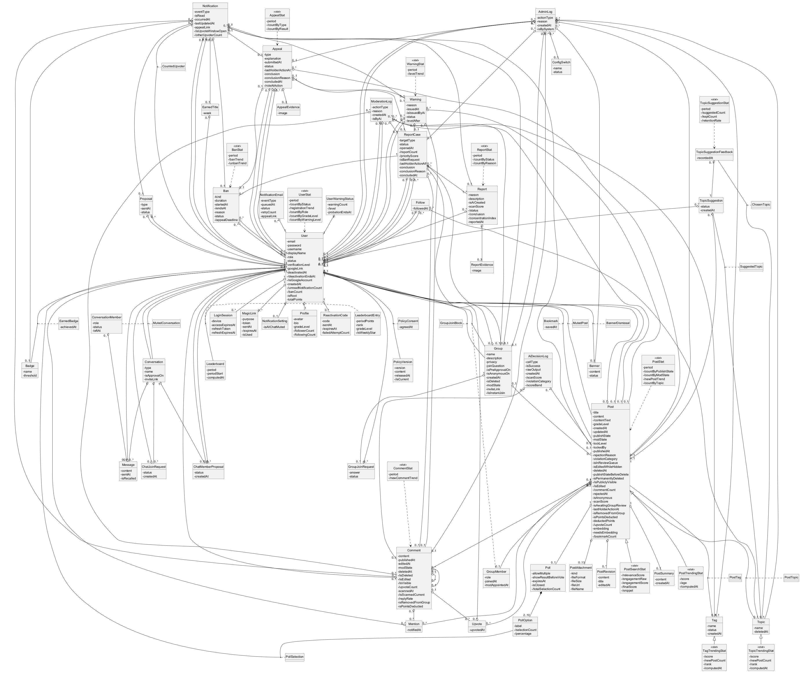

# Phân tích lớp thực thể — Toàn hệ thống iShare

<!-- [Vietnamese Doc] Bản gộp từ các EC-Mxx.md. Số mục giữ giống tài liệu module (2.2, 2.3, 3.3, 3.4, 4) để tool đọc được;
     các mục chỉ có ở tài liệu module (1.1, 1.2, 2.1, 2.4, 3.1, 3.2, 5) không có ở đây. -->

## 1. Tài liệu nguồn

| Tài liệu | Module | Phiên bản | Trạng thái |
|---|---|---|---|
| EC-M01 | M01 Authentication & Account | 1.1 | Đã chốt |
| EC-M02 | M02 User Profile | 1.1 | Đã chốt |
| EC-M03 | M03 Post & Content | 1.1 | Đã chốt |
| EC-M04 | M04 Comment | 1.1 | Đã chốt |
| EC-M05 | M05 Topic & Tag | 1.1 | Đã chốt |
| EC-M06 | M06 Search | 1.1 | Đã chốt |
| EC-M07 | M07 Notification | 1.1 | Đã chốt |
| EC-M08 | M08 Moderation | 1.1 | Đã chốt |
| EC-M09 | M09 Appeal | 1.1 | Đã chốt |
| EC-M10 | M10 Admin Panel | 1.1 | Đã chốt |
| EC-M11 | M11 Group | 1.1 | Đã chốt |
| EC-M12 | M12 Gamification | 1.1 | Đã chốt |
| EC-M13 | M13 AI Layer | 1.1 | Đã chốt |
| EC-M14 | M14 Feed & Discovery | 1.1 | Đã chốt |
| EC-M15 | M15 Analytics & Stats | 1.1 | Đã chốt |
| EC-M16 | M16 Chat & Messaging | 1.1 | Đã chốt |

Kiểm kê (việc A, `merge_ec.py`): 75 lớp, 279 thuộc tính, 159 quan hệ trước khi gộp; tool nêu 22 điểm lệch, soát thêm
được các điểm ở MD-02, MD-03, MD-10, MD-11, MD-12, MD-14. Không có quan hệ n-n lộ ra khi gộp; mỗi lớp thống kê có đúng
một quan hệ Kế thừa hoặc Phụ thuộc; các cặp lớp có nhiều quan hệ trong cùng một module đều là quan hệ theo vai trò khác
nhau (ví dụ người khiếu nại, người đang giữ, người kết luận của Appeal).

## 2. Lớp và thuộc tính

### 2.2 Lớp

<!-- Sở hữu: đúng một module. Cột "Module tham chiếu": các module khác có dùng lớp này. -->

| Lớp | Tên tiếng Việt | Nhóm | Sở hữu | Mô tả | Thuộc tính | Nguồn | Module tham chiếu |
|---|---|---|---|---|---|---|---|
| AdminLog | Mục nhật ký thao tác Admin | Thực thể | M10 | Một thao tác làm đổi dữ liệu của Admin hoặc một lần đổi vai trò; chỉ ghi thêm, giữ vĩnh viễn | actionType, reason, createdAt, isBySystem | M10: FR-M10-14.01, FR-M10-14.06, FR-M10-14.07 | M05 |
| AiDecisionLog | Bản ghi nhật ký quyết định AI | Thực thể | M13 | Bản ghi của một lời gọi chấm điểm kiểm duyệt, embedding bài hoặc gợi ý Topic, kể cả lời gọi thất bại; gắn với một bài viết hoặc một bình luận; giữ vĩnh viễn | callType, isSuccess, rawOutput, createdAt, /scanScore, /violationCategory, /scoreBand | M13: FR-M13-08.01, FR-M13-08.02, FR-M13-08.03 | — |
| Appeal | Khiếu nại | Thực thể | M09 | Một yêu cầu người bị xử lý gửi để phản đối một xử lý kiểm duyệt; được Mod, Admin giữ và kết luận một lần, không bị xóa | type, explanation, submittedAt, status, lastHolderActionAt, conclusion, conclusionReason, concludedAt, /roleAtAction | M09: FR-M09-01.01, FR-M09-04.01, FR-M09-07.01, FR-M09-07.02 | M07, M10, M15 |
| AppealEvidence | Bằng chứng khiếu nại | Thực thể | M09 | Một ảnh người khiếu nại đính kèm khiếu nại | image | M09: FR-M09-01.01, BR-M09-03 | — |
| AppealStat | Thống kê khiếu nại | Thống kê | M15 | Số khiếu nại theo loại và theo kết quả trong một khoảng thời gian | period, /countByType, /countByResult | M15: FR-M15-03.07, FR-M15-03.08 | — |
| Badge | Huy hiệu | Thực thể | M12 | Một trong 5 huy hiệu cố định trao theo mốc tổng điểm | name, threshold | M12: FR-M12-03.01 | M07 |
| Ban | Lần ban | Thực thể | M08 | Một lần Mod hoặc Admin khóa tài khoản, tạm thời hoặc vĩnh viễn | kind, duration, startedAt, /endsAt, reason, status, /appealDeadline | M08: FR-M08-14.01, FR-M08-14.02, FR-M08-15.01 | M01, M07, M09, M15 |
| BanStat | Thống kê ban | Thống kê | M15 | Xu hướng ban và gỡ ban trong một khoảng thời gian | period, /banTrend, /unbanTrend | M15: FR-M15-03.05, FR-M15-03.06 | — |
| Banner | Banner thông báo toàn trang | Thực thể | M10 | Thông báo văn bản do Admin đặt, hiện trên mọi trang cho mọi người; nhiều nhất một banner đang hiện | content, status | M10: FR-M10-13.01, FR-M10-13.02, FR-M10-13.09 | — |
| BannerDismissal | Lượt đóng banner | Liên kết | M10 | Một người dùng đã đóng một banner; tách từ quan hệ n-n User – Banner | — | M10: FR-M10-13.07, FR-M10-13.08 | — |
| Bookmark | Bookmark | Liên kết | M02 | Một lần người dùng lưu một bài viết để đọc lại; mỗi cặp người dùng – bài viết có nhiều nhất một bookmark | savedAt | M02: FR-M02-05, FR-M02-06, FR-M02-07 | M01 |
| ChatJoinRequest | Yêu cầu gia nhập | Thực thể | M16 | Một người xin gia nhập nhóm chat qua link mời khi công tắc duyệt bật, chờ Admin nhóm chat duyệt | status, createdAt | M16: FR-M16-16.04, FR-M16-10.01, FR-M16-10.02 | — |
| ChatMemberProposal | Đề nghị thêm thành viên | Thực thể | M16 | Member thêm một người vào nhóm chat khi công tắc duyệt bật, chờ Admin nhóm chat duyệt | status, createdAt | M16: FR-M16-08.03, FR-M16-10.01, FR-M16-10.02 | — |
| ChosenTopic | Topic chọn cuối | Liên kết | M05 | Một Topic tác giả chọn cuối cùng, ghi trong một phản hồi gợi ý | — | M05: FR-M05-02.12 | — |
| Comment | Bình luận | Thực thể | M04 | Phản hồi do người dùng đã đăng nhập viết dưới một bài viết; gồm bình luận gốc và trả lời, tổ chức thành luồng hai cấp | content, publishedAt, editedAt, modState, deletedAt, /isDeleted, /isEdited, /isVisible, /upvoteCount, scannedAt, /isScannedCurrent, /replyRate, isRemovedFromGroup, isPointsDeducted | M04: FR-M04-02, FR-M04-03, FR-M04-04, FR-M04-05, BR-M04-03 | M01, M07, M08, M10, M11, M12, M13, M15 |
| CommentStat | Thống kê bình luận | Thống kê | M15 | Xu hướng bình luận mới trong một khoảng thời gian | period, /newCommentTrend | M15: FR-M15-02.06 | — |
| ConfigSwitch | Công tắc cấu hình | Thực thể | M10 | Một trong chín công tắc của cấu hình hệ thống (công tắc AI tổng, ba công tắc AI riêng, chế độ bảo trì, tạm dừng đăng ký, ba cờ tính năng), Admin bật, tắt lúc hệ thống đang chạy; các module khác đọc trạng thái | name, status | M10: FR-M10-09.01, FR-M10-10.01, FR-M10-11.01, FR-M10-12.01 | — |
| Conversation | Cuộc trò chuyện | Thực thể | M16 | Trò chuyện 1-1 giữa hai người dùng hoặc nhóm chat nhiều người; không bị xóa | type, name, isApprovalOn, inviteLink | M16: FR-M16-01.01, FR-M16-02.01, FR-M16-12.01 | M07 |
| ConversationMember | Thành viên cuộc trò chuyện | Liên kết | M16 | Một người dùng trong một cuộc trò chuyện với vai trò, trạng thái và mốc đã đọc; tách từ quan hệ n-n User – Conversation | role, status, leftAt | M16: FR-M16-01.04, FR-M16-02.02, FR-M16-14.01, FR-M16-07.01 | — |
| CountedUpvoter | Người upvote đã được đếm | Liên kết | M07 | Một người dùng đã được đếm trong cửa sổ 5 phút của một thông báo upvote; mỗi cặp thông báo – người dùng có nhiều nhất một | — | M07: FR-M07-02.04, FR-M07-02.20 | — |
| EarnedBadge | Huy hiệu đã đạt | Liên kết | M12 | Một huy hiệu một người dùng đã đạt, giữ vĩnh viễn; tách từ quan hệ n-n User – Badge | achievedAt | M12: FR-M12-03.02, FR-M12-03.06 | — |
| EarnedTitle | Danh hiệu đã đạt | Thực thể | M12 | Một lần một người dùng đạt danh hiệu "Ngôi sao tuần" ở một tuần | week | M12: FR-M12-05.02, FR-M12-05.03 | — |
| Follow | Lượt theo dõi | Thực thể | M07 | Quan hệ theo dõi giữa một người dùng (người theo dõi) và một đối tượng theo dõi là người dùng khác hoặc Topic | followedAt | M07: FR-M07-01 | M01, M05 |
| Group | Nhóm | Thực thể | M11 | Không gian cộng đồng Public hoặc Private có thành viên, bài nhóm và cổng duyệt riêng; xóa mềm | name, description, privacy, joinQuestion, isPreApprovalOn, isAnonymousOn, createdAt, isDeleted, modState, inviteLink, /isInstantJoin | M11: FR-M11-01.01, FR-M11-02.01, FR-M11-15.01 | M03, M06, M07, M08, M10, M14 |
| GroupJoinBlock | Chặn tham gia | Liên kết | M11 | Một người dùng bị một nhóm chặn tham gia; tách từ quan hệ n-n User – Group | — | M11: FR-M11-07.01, FR-M11-07.05 | — |
| GroupJoinRequest | Yêu cầu tham gia | Thực thể | M11 | Đề nghị vào nhóm của một người ngoài nhóm, chờ Owner hoặc Group Mod duyệt; không bị xóa | answer, status | M11: FR-M11-04.03, FR-M11-06.02, FR-M11-06.03, FR-M11-04.10 | — |
| GroupMember | Thành viên nhóm | Liên kết | M11 | Một người dùng trong một nhóm với đúng một vai trò nhóm; tách từ quan hệ n-n User – Group | role, joinedAt, modAppointedAt | M11: FR-M11-01.02, FR-M11-04.01, FR-M11-06.02, FR-M11-08.01 | — |
| Leaderboard | Kết quả bảng xếp hạng | Thực thể | M12 | Kết quả hiện hành của bảng xếp hạng một loại chu kỳ: tuần, tháng đã chốt hoặc toàn thời gian lần tính gần nhất | period, periodStart, computedAt | M12: FR-M12-04.01, FR-M12-04.14, FR-M12-05.01 | — |
| LeaderboardEntry | Dòng bảng xếp hạng | Liên kết | M12 | Một người dùng trên một kết quả bảng xếp hạng; tách từ quan hệ n-n User – Leaderboard | periodPoints, rank, gradeLevel, /isWeeklyStar | M12: FR-M12-04.02, FR-M12-06.11 | — |
| LoginSession | Phiên đăng nhập | Thực thể | M01 | Trạng thái đã đăng nhập của một tài khoản trên một thiết bị, gồm phiên truy cập và phiên làm mới | device, accessExpiresAt, refreshToken, refreshExpiresAt | M01: FR-M01-05.12, FR-M01-06, FR-M01-07 | — |
| MagicLink | Magic link | Thực thể | M01 | Liên kết gửi tới email của tài khoản để xác minh email hoặc đặt lại mật khẩu | purpose, token, sentAt, /expiresAt, isUsed | M01: FR-M01-01.03, FR-M01-02, FR-M01-09 | — |
| Mention | Lượt nhắc tên | Thực thể | M01 | Một lần nhắc một người dùng trong bài viết hoặc bình luận | notifiedAt | M01: FR-M01-14 | — |
| Message | Tin nhắn | Thực thể | M16 | Một lần gửi nội dung văn bản của một thành viên trong một cuộc trò chuyện; giữ vĩnh viễn, thu hồi là xóa mềm | content, sentAt, isRecalled | M16: FR-M16-05.01, FR-M16-06.07 | — |
| ModerationLog | Dòng nhật ký kiểm duyệt | Thực thể | M08 | Một thao tác kiểm duyệt của Mod, Admin hoặc AI, giữ vĩnh viễn | actionType, reason, createdAt, isByAi | M08: FR-M08-16.01, FR-M08-16.02, FR-M08-16.05 | M05, M15 |
| MutedConversation | Tắt thông báo cuộc trò chuyện | Liên kết | M07 | Một cuộc trò chuyện mà một thành viên đã tắt thông báo; có khi thành viên tắt thông báo, bị bỏ khi bật lại hoặc khi rời, bị xóa khỏi nhóm chat | — | M07: FR-M07-09.01, FR-M07-09.02, FR-M07-09.08 | — |
| MutedPost | Tắt thông báo cho bài | Liên kết | M07 | Một bài viết mà một người dùng đã tắt thông báo; có khi người dùng bật công tắc, bị bỏ khi người dùng tắt công tắc | — | M07: FR-M07-08.02, FR-M07-08.03 | — |
| Notification | Thông báo | Thực thể | M07 | Bản ghi báo cho một người nhận về một sự kiện, hiện ở chuông và trang Thông báo; gồm cả thông báo upvote đã gộp và thông báo đề xuất | eventType, isRead, occurredAt, lastUpdatedAt, appealLink, /isUpvoteWindowOpen, /otherUpvoterCount | M07: FR-M07-02, FR-M07-05, FR-M07-06 | — |
| NotificationEmail | Email thông báo | Thực thể | M07 | Một email cho một người nhận về một sự kiện thuộc nhóm có email; nằm trong hàng đợi email tới khi gửi được hoặc bị dừng gửi | eventType, queuedAt, status, retryCount, appealLink | M07: FR-M07-04 | — |
| NotificationSetting | Cài đặt thông báo | Thực thể | M07 | Cài đặt thông báo của một người dùng; theo FR hiện chỉ có cài đặt tắt thông báo toàn bộ Chat | isAllChatMuted | M07: FR-M07-09.03, FR-M07-09.04 | — |
| PolicyConsent | Bản ghi đồng ý | Liên kết | M01 | Ghi nhận một tài khoản đã đồng ý một phiên bản chính sách vào một thời điểm | agreedAt | M01: FR-M01-01.14, FR-M01-04.13, FR-M01-16.02 | — |
| PolicyVersion | Phiên bản chính sách | Thực thể | M01 | Một bản nội dung của trang Privacy Policy/ToS | version, content, releasedAt, /isCurrent | M01: FR-M01-15 | — |
| Poll | Poll | Thực thể | M03 | Bình chọn đóng tùy chọn trong bài viết, tối đa một poll mỗi bài | allowMultiple, showResultBeforeVote, expiresAt, isClosed, /totalSelectionCount | M03: FR-M03-03, FR-M03-09, FR-M03-10, BR-M03-09 | — |
| PollOption | Lựa chọn | Thực thể | M03 | Một lựa chọn do tác giả đặt trong poll | label, /selectionCount, /percentage | M03: FR-M03-03.02, FR-M03-09.06, BR-M03-44 | — |
| PollSelection | Lượt chọn | Liên kết | M03 | Một lựa chọn một người dùng đã chọn trong poll; phiếu của một người là các lượt chọn của người đó trong poll (Q-01) | — | M03: FR-M03-08.01, FR-M03-08.04, FR-M03-08.05, BR-M03-15 | — |
| Post | Bài viết | Thực thể | M03 | Đơn vị nội dung trung tâm, một loại duy nhất, có ba trạng thái độc lập: trạng thái đăng, trạng thái kiểm duyệt, mức khóa | title, content, /contentText, gradeLevel, createdAt, updatedAt, publishState, modState, lockLevel, lockedBy, publishedAt, rejectionReason, violationCategory, isInReviewQueue, isEditedWhileHidden, deletedAt, publishStateBeforeDelete, isPermanentlyDeleted, /isPubliclyVisible, /isEdited, /commentCount, rejectedAt, isAnonymous, scanScore, isAwaitingGroupReview, lastHolderActionAt, isRemovedFromGroup, isPointsDeducted, deductedPoints, /upvoteCount, embedding, needsEmbedding, /bookmarkCount | M03: FR-M03-01, FR-M03-04, FR-M03-15, BR-M03-17 | M01, M02, M04, M05, M06, M07, M08, M09, M10, M11, M12, M13, M14, M15 |
| PostAttachment | Tệp đính kèm | Thực thể | M03 | Một ảnh hoặc tài liệu đính kèm ở phần dưới nội dung bài viết | kind, fileFormat, fileSize, fileUrl, fileName | M03: FR-M03-02, BR-M03-07, BR-M03-08 | — |
| PostRevision | Phiên bản sửa | Thực thể | M03 | Một phiên bản trong lịch sử sửa, ghi mỗi lần tác giả lưu bản sửa của bài đã gửi | content, title, editedAt | M03: FR-M03-11.02, FR-M03-12.02, BR-M03-27 | — |
| PostSearchStat | Kết quả tìm bài viết | Thống kê | M06 | Một bài viết trong kết quả tìm bài viết, kèm số liệu M06 tính lúc tìm: Điểm tương tác thô, và với truy vấn có chữ thêm Điểm liên quan, Điểm tương tác, Điểm cuối; cùng đoạn trích. Tính lại mỗi lần tìm, không lưu (Q-01) | /relevanceScore, /engagementRaw, /engagementScore, /finalScore, /snippet | M06: FR-M06-02, BR-M06-13, BR-M06-18 | — |
| PostStat | Thống kê bài viết | Thống kê | M15 | Số liệu về bài viết trong một khoảng thời gian | period, /countByPublishState, /countByModState, /newPostTrend, /countByTopic | M15: FR-M15-02.01, FR-M15-02.02, FR-M15-02.03, FR-M15-02.04 | — |
| PostSummary | Kết quả tóm tắt đang giữ | Thực thể | M13 | Tóm tắt AI của một bài viết, giữ tạm và dùng chung cho mọi người yêu cầu; bị bỏ khi hết hạn hoặc bài đổi | content, createdAt | M13: FR-M13-06.02, FR-M13-06.04, FR-M13-06.05 | — |
| PostTag | Liên kết bài viết–Tag | Liên kết | M05 | Một Tag được gắn cho một bài viết; giữ cả khi Tag bị vô hiệu hóa | — | M05: FR-M05-03.01, FR-M05-09.03 | — |
| PostTopic | Liên kết bài viết–Topic | Liên kết | M05 | Một Topic được gán cho một bài viết | — | M05: FR-M05-01.02, FR-M05-01.10 | — |
| PostTrendingStat | Thống kê Trending Post | Thống kê | M14 | Điểm Trending Post và tuổi bài của một bài viết ở một lần tính; là danh sách Trending Post | /score, /age, /computedAt | M14: FR-M14-03.01, FR-M14-03.02, FR-M14-02.03 | — |
| Profile | Hồ sơ | Thực thể | M02 | Thông tin công khai của một người dùng mà chính người dùng đó sửa: avatar, bio, Lớp/Khối | avatar, bio, gradeLevel, /followerCount, /followingCount | M02: FR-M02-01.02, FR-M02-03, FR-M02-04 | M01, M12, M15, M16 |
| Proposal | Đề xuất | Thực thể | M10 | Lời mời một tài khoản nhận vai trò Mod hoặc Admin; người được đề xuất trả lời một lần, quá hạn hoặc bị đề xuất mới cùng loại thay thì hết hiệu lực; không bị xóa | type, sentAt, status | M10: FR-M10-02.01, FR-M10-07.05, FR-M10-03.02, FR-M10-03.03 | M07 |
| ReactivationCode | Mã kích hoạt lại | Thực thể | M01 | Mã gửi tới email của tài khoản đã vô hiệu hóa để xác nhận kích hoạt lại | code, sentAt, /expiresAt, failedAttemptCount | M01: FR-M01-11 | — |
| Report | Báo cáo | Thực thể | M08 | Một lần người dùng đã đăng nhập tố cáo một đối tượng vi phạm, hoặc một mục do AI tạo; luôn thuộc một vụ báo cáo | reason, description, isAiCreated, scanScore, /status, /conclusion, /concentrationIndex, reportedAt | M08: FR-M08-01.02, FR-M08-07.09, FR-M08-08.05 | M07, M15 |
| ReportCase | Vụ báo cáo | Thực thể | M08 | Tập các báo cáo đang mở về cùng một đối tượng; đơn vị Mod, Admin nhận xử lý và kết luận; vụ đã kết luận giữ làm lịch sử báo cáo của đối tượng | targetType, status, openedAt, /reportCount, /priorityScore, isBanRequest, lastHolderActionAt, conclusion, conclusionReason, concludedAt | M08: FR-M08-01.04, FR-M08-02.01, FR-M08-03.01, FR-M08-05.01 | M09, M10, M15 |
| ReportEvidence | Bằng chứng báo cáo | Thực thể | M08 | Một ảnh người báo cáo đính kèm báo cáo | image | M08: FR-M08-01.02, BR-M08-03 | — |
| ReportStat | Thống kê báo cáo | Thống kê | M15 | Số báo cáo theo trạng thái và theo lý do trong một khoảng thời gian | period, /countByStatus, /countByReason | M15: FR-M15-03.01, FR-M15-03.03 | — |
| SuggestedTopic | Topic được gợi ý | Liên kết | M05 | Một Topic nằm trong kết quả của một lượt gợi ý Topic | — | M05: FR-M05-02.03, BR-M05-13 | — |
| Tag | Tag | Thực thể | M05 | Từ khóa tự do gắn cho bài viết, tự tạo khi gắn lần đầu; không bị xóa, chỉ vô hiệu hóa và kích hoạt lại | name, status, createdAt | M05: FR-M05-03, FR-M05-09, FR-M05-10 | M06, M08, M10 |
| TagTrendingStat | Thống kê Trending Tag | Thống kê | M05 | Điểm Trending, số bài mới và thứ hạng của một Tag đang hoạt động trong cửa sổ 7 ngày, tính lại định kỳ; là danh sách Trending Tag cung cấp cho M14 | /score, /newPostCount, /rank, /computedAt | M05: FR-M05-05 | M14 |
| Topic | Topic | Thực thể | M05 | Lĩnh vực nội dung trong danh mục Topic phẳng, do Admin quản lý; Topic bị xóa hoặc gộp chỉ được đánh dấu rời danh mục | name, deletedAt | M05: FR-M05-01, FR-M05-04.01, FR-M05-06, FR-M05-07, FR-M05-08 | M06, M07, M10, M15 |
| TopicSuggestion | Lượt gợi ý Topic | Thực thể | M05 | Một lần AI gợi ý Topic thành công cho bài viết đang soạn hoặc đang sửa | status, createdAt | M05: FR-M05-02 | — |
| TopicSuggestionFeedback | Phản hồi gợi ý | Thực thể | M05 | So sánh Topic AI gợi ý với Topic tác giả chọn cuối, ghi khi gửi bài hoặc lưu bản sửa mà gợi ý chưa lỗi thời | recordedAt | M05: FR-M05-02.12, FR-M05-02.22 | M13 |
| TopicSuggestionStat | Thống kê chất lượng gợi ý Topic | Thống kê | M13 | Tỷ lệ Topic gợi ý được giữ lại trong một khoảng thời gian, tính lại từ các phản hồi gợi ý Topic | period, /suggestedCount, /keptCount, /retentionRate | M13: FR-M13-10.01, FR-M13-10.02 | M15 |
| TopicTrendingStat | Thống kê Trending Topic | Thống kê | M05 | Điểm Trending, số bài mới và thứ hạng của một Topic trong cửa sổ 7 ngày, tính lại định kỳ; là danh sách Trending Topic cung cấp cho M14 | /score, /newPostCount, /rank, /computedAt | M05: FR-M05-05 | M14 |
| Upvote | Upvote | Thực thể | M12 | Một lượt đánh giá hữu ích của một người dùng cho một bài viết hoặc bình luận của người khác; rút lại thì xóa | upvotedAt | M12: FR-M12-01.01, FR-M12-01.02 | M01, M04 |
| User | Người dùng (tài khoản) | Thực thể | M01 | Tài khoản của một người dùng iShare; một loại tài khoản cho mọi vai trò (BR-M01-01) | email, password, username, displayName, role, status, verificationLevel, googleLink, deactivatedAt, /deactivationEndsAt, /isGoogleAccount, createdAt, /unreadNotificationCount, /banCount, isRoot, totalPoints | M01: FR-M01-01, FR-M01-03, FR-M01-04, FR-M01-10, FR-M01-12 | M02, M03, M04, M05, M06, M07, M08, M09, M10, M11, M12, M14, M15, M16 |
| UserStat | Thống kê người dùng | Thống kê | M15 | Số liệu về tài khoản trong một khoảng thời gian, tính lại mỗi lần xem | period, /countByStatus, /registrationTrend, /countByRole, /countByGradeLevel, /countByWarningLevel | M15: FR-M15-01 | — |
| UserWarningStatus | Trạng thái cảnh cáo của người dùng | Thực thể | M08 | Số lần cảnh cáo, mức cảnh cáo và thời điểm kết thúc thời gian thử thách hiện tại của một người dùng | warningCount, /level, probationEndsAt | M08: FR-M08-09.04, FR-M08-12.01, FR-M08-13.01 | M12, M15 |
| Warning | Cảnh cáo | Thực thể | M08 | Một lần người dùng bị ghi nhận vi phạm, do AI hoặc Mod, Admin ra | reason, issuedAt, isIssuedByAi, status, levelAfter | M08: FR-M08-09.01, FR-M08-10.01 | M07, M09, M15 |
| WarningStat | Thống kê cảnh cáo | Thống kê | M15 | Xu hướng cảnh cáo theo mức trong một khoảng thời gian | period, /levelTrend | M15: FR-M15-03.04 | — |

### 2.3 Thuộc tính

<!-- Nguồn ghi mã FR kèm mã module (ví dụ "M12: FR-M12-03.01"). Căn cứ: Nguồn nêu | Đề xuất. Bản hệ thống không còn dòng Tham chiếu. Thuộc tính do module khác bổ sung có Ghi chú "Bổ sung từ EC-Mxx (MD-05)". -->

| Lớp | Thuộc tính | Tên tiếng Việt | Tính chất | Căn cứ | Ràng buộc nguồn nêu | Nguồn | Ghi chú |
|---|---|---|---|---|---|---|---|
| AdminLog | actionType | Thao tác | Lưu | Nguồn nêu | Gửi đề xuất làm Mod, làm Admin; chấp nhận đề xuất; giáng cấp Mod; thu hồi vai trò Admin; tự từ chức; thu hồi vai trò Mod do bị ban; đổi mỗi công tắc cấu hình; đặt, sửa, gỡ banner; cảnh cáo, bỏ cảnh cáo AI, ban, gỡ ban, ẩn nội dung, ẩn, khóa, mở khóa nhóm, kết luận vụ báo cáo, kết luận khiếu nại; thêm, gộp, xóa Topic; vô hiệu hóa, kích hoạt lại Tag; đổi Topic, Tag trên bài người khác (FR-M10-14.02, FR-M10-14.06, FR-M10-14.07); không ghi việc xem, nhận, nhả vụ hay khiếu nại, việc Admin làm như người dùng thường và quyết định của AI (FR-M10-14.05, FR-M10-14.08) | M10: FR-M10-14.01, FR-M10-14.02, FR-M10-15.05 | Lọc theo loại thao tác (FR-M10-15.05); M05 ghi thêm, gộp, xóa Topic (EC-M05); M09 đọc các mục đổi vai trò để tính Appeal.roleAtAction (EC-M09) |
| AdminLog | reason | Lý do | Lưu | Nguồn nêu | Tùy chọn; với thao tác mà module gốc bắt buộc lý do thì lấy đúng lý do đó (BR-M10-23, FR-M10-14.09) | M10: FR-M10-14.01, FR-M10-14.09 | — |
| AdminLog | createdAt | Thời điểm | Lưu | Nguồn nêu | Lúc thao tác hoàn tất và được ghi nhận (TN:Thời điểm (của mục nhật ký)); hiển thị theo giờ Việt Nam, mục mới nhất trước (BR-M10-23); không sửa, không xóa, giữ vĩnh viễn (BR-M10-22) | M10: FR-M10-14.01, FR-M10-15.01, FR-M10-15.04 | Tên createdAt như ModerationLog.createdAt của EC-M08 |
| AdminLog | isBySystem | Người làm là Hệ thống | Lưu | Nguồn nêu | Đúng khi Mod mất vai trò do bị ban (FR-M10-14.07, BR-M10-21) | M10: FR-M10-14.07, BR-M10-21 | Khi đúng thì mục nhật ký không có người làm là tài khoản (bước 3); cùng cách ModerationLog.isByAi của EC-M08 |
| AiDecisionLog | callType | Loại lời gọi | Lưu | Nguồn nêu | Chấm điểm kiểm duyệt, embedding bài, gợi ý Topic (mục Dữ liệu nghiệp vụ, BR-M13-21); không có tóm tắt và embedding truy vấn (FR-M13-08.05) | M13: FR-M13-08.02, BR-M13-21 | — |
| AiDecisionLog | isSuccess | Thành công | Lưu | Nguồn nêu | Đúng khi một trong hai lần thử có kết quả, sai khi cả hai lần thử lỗi (BR-M13-21); bản ghi sai của bình luận quét lỗi là bản ghi lỗi cho Admin (FR-M13-08.09) | M13: FR-M13-08.02, FR-M13-08.09 | — |
| AiDecisionLog | rawOutput | Đầu ra thô | Lưu | Nguồn nêu | Kết quả dịch vụ AI trả về, giữ nguyên chưa qua xử lý (TN:Đầu ra thô), ví dụ bốn điểm nhóm vi phạm, danh sách Topic gợi ý; chỉ có khi lời gọi có kết quả (FR-M13-08.02); không sửa, không xóa (BR-M13-22) | M13: FR-M13-08.02, BR-M13-21, BR-M13-22 | — |
| AiDecisionLog | createdAt | Thời điểm ghi | Lưu | Đề xuất | Không sửa, không xóa (BR-M13-22) | M13: FR-M13-09.01, FR-M13-08.01 | FR-M13-09.01 hiển thị nhật ký quyết định AI của bài cho người xét khiếu nại; một bài được quét nhiều lần (bài mới gửi, bài đã đăng được sửa, bài tự ẩn được hiện lại, bài gửi lại sau khi bị từ chối) và được gợi ý Topic, tạo embedding nhiều lần, nên có nhiều bản ghi; cần thời điểm để biết bản ghi nào ứng với lần AI tự từ chối đang bị khiếu nại. Lý do của FR-M13-08 cũng dùng nhật ký để chỉnh ngưỡng theo dữ liệu thật theo thời gian |
| AiDecisionLog | scanScore | Điểm quét | Dẫn xuất | Nguồn nêu | 0 đến 1; = điểm cao nhất trong bốn điểm nhóm vi phạm của rawOutput (BR-M13-12); chỉ có ở lời gọi chấm điểm kiểm duyệt thành công | M13: FR-M13-02.05, FR-M13-02.08, BR-M13-12 | Trả cho M03, M04, M08, M11 (FR-M13-02.08); M08 lưu ở Report.scanScore (EC-M08) |
| AiDecisionLog | violationCategory | Nhóm vi phạm | Dẫn xuất | Nguồn nêu | Quấy rối, Ngôn từ thù ghét, Nội dung người lớn, Bạo lực (TN:Nhóm vi phạm); = nhóm có điểm quét; nhiều nhóm cùng điểm cao nhất thì lấy nhóm đứng trước theo thứ tự trên (BR-M13-12) | M13: FR-M13-02.05, FR-M13-02.06, BR-M13-12 | Trả cho module gọi; M03 lưu ở Post.violationCategory (EC-M03) |
| AiDecisionLog | scoreBand | Khoảng điểm | Dẫn xuất | Nguồn nêu | Cao (≥ 0,9), nghi ngờ (0,5 đến < 0,9), sạch (< 0,5) theo một cặp ngưỡng chung cho bài viết, bình luận và mọi tác giả (BR-M13-13); ngưỡng là hằng số chính sách, chỉ đổi qua triển khai (BR-M13-14) | M13: FR-M13-02.07, FR-M13-02.08, BR-M13-13 | Module gọi chỉ tự xử lý khi khoảng cao (BR-M13-01) |
| Appeal | type | Loại khiếu nại | Lưu | Nguồn nêu | Ban, Cảnh cáo, Bài viết; gắn theo xử lý bị khiếu nại, khiếu nại bài bị gỡ và khiếu nại gộp đều là Bài viết (FR-M09-01.03, TN:Loại khiếu nại); hàng chờ xếp Ban, rồi Cảnh cáo, rồi Bài viết (BR-M09-10); lọc theo loại (BR-M09-09) | M09: FR-M09-01.01, FR-M09-01.03, BR-M09-10 | Suy ra được từ xử lý bị khiếu nại nhưng FR-M09-01.01 yêu cầu lưu; phải khớp với quan hệ ở bước 3. M15 thống kê theo loại (mục Giao tiếp, dòng Cung cấp M15) |
| Appeal | explanation | Lời giải thích | Lưu | Nguồn nêu | Bắt buộc, không trống (BR-M09-03, FR-M09-01.10); không sửa sau khi gửi (BR-M09-27) | M09: FR-M09-01.01, FR-M09-01.10 | — |
| Appeal | submittedAt | Thời điểm gửi khiếu nại | Lưu | Nguồn nêu | Lúc hệ thống nhận khiếu nại hợp lệ; phải trước khi hết hạn khiếu nại của xử lý (BR-M09-04); cùng loại thì khiếu nại gửi trước đứng trước (BR-M09-10) | M09: FR-M09-01.01, FR-M09-01.13, BR-M09-10 | — |
| Appeal | status | Trạng thái khiếu nại | Lưu | Nguồn nêu | Chờ xét, Đã kết luận; khiếu nại mới là Chờ xét (FR-M09-01.01); Đã kết luận là trạng thái cuối, không kết luận lại (FR-M09-07.08); "chưa ai giữ" và "đang được giữ" của Chờ xét suy ra từ việc có người đang giữ (mục Chuyển trạng thái: Khiếu nại) | M09: FR-M09-01.01, FR-M09-07.01, FR-M09-07.02 | Người đang giữ là quan hệ, xét ở bước 3 |
| Appeal | lastHolderActionAt | Thời điểm thao tác cuối của người giữ | Lưu | Nguồn nêu | Đặt lúc nhận xử lý và mỗi lần người giữ mở xem khiếu nại; 30 phút không thao tác thì tự nhả về Chờ xét chưa ai giữ (BR-M09-11) | M09: FR-M09-04.01, FR-M09-04.06, FR-M09-04.07, BR-M09-11 | Cùng tên và cơ chế với ReportCase.lastHolderActionAt của EC-M08 (BR-M09-11: "cùng cơ chế với hàng chờ báo cáo") |
| Appeal | conclusion | Kết luận | Lưu | Nguồn nêu | Chấp nhận, Từ chối; chỉ có khi Đã kết luận; chỉ người đang giữ kết luận được (FR-M09-07.06); Từ chối là cuối cùng, không gửi lại khiếu nại cho cùng xử lý (BR-M09-06) | M09: FR-M09-07.01, FR-M09-07.02 | M15 thống kê theo kết luận; M16 dùng việc khiếu nại ban vĩnh viễn bị từ chối (mục Giao tiếp) |
| Appeal | conclusionReason | Lý do kết luận khiếu nại | Lưu | Nguồn nêu | Bắt buộc ở cả Chấp nhận và Từ chối (BR-M09-27, FR-M09-07.11); người khiếu nại thấy (FR-M09-02.02); gửi kèm thông báo kết luận (BR-M09-20) | M09: FR-M09-07.01, FR-M09-07.02, FR-M09-07.11 | — |
| Appeal | concludedAt | Thời điểm kết luận | Lưu | Nguồn nêu | — | M09: FR-M09-07.01, FR-M09-07.02 | Cho biết khiếu nại nào được Chấp nhận trước khi một cảnh cáo, ban ra cùng lần gỡ bài có cả khiếu nại riêng và khiếu nại bài (BR-M09-29) |
| Appeal | roleAtAction | Vai trò lúc bị xử lý | Dẫn xuất | Nguồn nêu | USER hoặc MODERATOR (Admin không có khiếu nại, BR-M09-01); là vai trò của người khiếu nại tại thời điểm có xử lý, vẫn là MODERATOR khi người khiếu nại đã mất vai trò Mod vì bị ban (FR-M09-03.08); MODERATOR thì chỉ Admin thấy, nhận, xét khiếu nại (BR-M09-12) | M09: TN:Vai trò lúc bị xử lý, FR-M09-03.08, BR-M09-12 | Không đọc từ User.role được, vì vai trò Mod bị thu hồi ngay lúc ban. Tính từ thời điểm có xử lý và các mục thay đổi vai trò trong nhật ký thao tác Admin của M10 (FR-M10 ghi mọi thay đổi vai trò, kể cả mất vai trò Mod do bị ban) |
| AppealEvidence | image | Ảnh | Lưu | Nguồn nêu | Tùy chọn; mỗi khiếu nại tối đa 3 ảnh; mỗi ảnh tối đa 5MB, định dạng JPEG, PNG hoặc WebP, cùng giới hạn với bằng chứng của báo cáo (BR-M09-03); không sửa sau khi gửi (BR-M09-27) | M09: FR-M09-01.01, FR-M09-01.11, FR-M09-01.12, BR-M09-03 | — |
| AppealStat | period | Khoảng thời gian | Lưu | Nguồn nêu | Như UserStat.period | M15: FR-M15-03.11, FR-M15-03.12 | — |
| AppealStat | countByType | Số khiếu nại theo loại | Dẫn xuất | Nguồn nêu | Ban, cảnh cáo, bài viết; khiếu nại bài bị gỡ và khiếu nại gộp thuộc loại bài viết (BR-M15-10) | M15: FR-M15-03.07 | — |
| AppealStat | countByResult | Số khiếu nại theo kết quả | Dẫn xuất | Nguồn nêu | Chờ xét, Chấp nhận, Từ chối (BR-M15-10, BR-M15-22) | M15: FR-M15-03.08 | — |
| Badge | name | Tên huy hiệu | Lưu | Nguồn nêu | Người mới nổi, Cây bút triển vọng, Cây bút tích cực, Chuyên gia cộng đồng, Huyền thoại iShare (BR-M12-11); danh mục cố định, chỉ đổi bằng triển khai (BR-M12-06) | M12: FR-M12-03.01, BR-M12-11 | — |
| Badge | threshold | Ngưỡng điểm | Lưu | Nguồn nêu | 25, 100, 300, 600, 1000 theo thứ tự tên ở trên (BR-M12-11); không hiển thị cùng huy hiệu (BR-M12-12) | M12: FR-M12-03.01, FR-M12-03.02, BR-M12-11 | — |
| Ban | kind | Loại ban | Lưu | Nguồn nêu | Tạm thời, Vĩnh viễn; thao tác "Ban" lần thứ 3 trở đi ra vĩnh viễn (BR-M08-34); thao tác "Ban vĩnh viễn" bỏ qua cách tính leo thang (BR-M08-35) | M08: FR-M08-14.01, FR-M08-14.02 | M15 đếm ban theo tạm thời, vĩnh viễn (mục Giao tiếp, dòng Cung cấp M15) |
| Ban | duration | Thời hạn | Lưu | Nguồn nêu | 30 ngày khi chưa từng bị ban, 90 ngày khi đã bị ban 1 lần (BR-M08-34); N ngày là đủ N × 24 giờ (BR-M08-43); không có với ban vĩnh viễn | M08: FR-M08-14.01, BR-M08-34 | — |
| Ban | startedAt | Thời điểm bắt đầu | Lưu | Nguồn nêu | — | M08: FR-M08-14.01 | — |
| Ban | endsAt | Thời điểm hết hạn | Dẫn xuất | Đề xuất | startedAt + duration (BR-M08-43); không có với ban vĩnh viễn | M08: FR-M08-14.08, BR-M08-37 | FR-M08-14.08, BR-M08-37: ban tạm thời hết hạn thì chuyển Hết hạn và tài khoản về ACTIVE ngay lúc hết hạn, nên cần thời điểm hết hạn; EC-M01 đã tham chiếu Ban.endsAt |
| Ban | reason | Lý do | Lưu | Nguồn nêu | — | M08: FR-M08-14.01 | M01 đọc để hiển thị trên màn hình tài khoản bị khóa (mục Giao tiếp, dòng Cung cấp M01); gửi kèm thông báo ban (FR-M08-14.04) |
| Ban | status | Trạng thái | Lưu | Nguồn nêu | Đang hiệu lực, Hết hạn, Đã gỡ, Bị lật; ban mới là Đang hiệu lực; Hết hạn, Đã gỡ, Bị lật là trạng thái cuối; mỗi tài khoản có nhiều nhất một ban Đang hiệu lực (BR-M08-52); Bị lật do M09 đặt | M08: FR-M08-14.01, FR-M08-14.08, FR-M08-15.01 | — |
| Ban | appealDeadline | Hết thời hạn khiếu nại | Dẫn xuất | Nguồn nêu | Ban tạm thời: startedAt + duration; ban vĩnh viễn: startedAt + 90 × 24 giờ; theo giờ Việt Nam (BR-M09-04); quá hạn với ban vĩnh viễn thì mất quyền khiếu nại (BR-M09-05) | M09: BR-M09-04, FR-M09-01.13; M01: FR-M01-05.08, FR-M01-05.09 | Thêm theo MD-04: M01 hiện thời gian khiếu nại còn lại và nút khiếu nại; M09 xét hạn khiếu nại; M16 xét Admin nhóm chat không thể khôi phục |
| BanStat | period | Khoảng thời gian | Lưu | Nguồn nêu | Như UserStat.period | M15: FR-M15-03.11, FR-M15-03.12 | — |
| BanStat | banTrend | Xu hướng ban | Dẫn xuất | Nguồn nêu | Số ban ra theo từng giờ, ngày hoặc tháng, tách tạm thời và vĩnh viễn, kể cả ban về sau bị lật (BR-M15-14, BR-M15-22) | M15: FR-M15-03.05 | — |
| BanStat | unbanTrend | Xu hướng gỡ ban | Dẫn xuất | Nguồn nêu | Chỉ đếm thao tác gỡ ban của Mod, Admin; ban hết hạn, bị lật không tính (BR-M15-14, BR-M15-22) | M15: FR-M15-03.06 | Đếm trên các dòng ModerationLog loại gỡ ban |
| Banner | content | Nội dung | Lưu | Nguồn nêu | Bắt buộc; 1–200 ký tự đếm sau khi bỏ khoảng trắng ở đầu và cuối (TN:Ký tự của banner); hiện dưới dạng văn bản thuần (BR-M10-20, FR-M10-13.05, FR-M10-13.06) | M10: FR-M10-13.01, FR-M10-13.05, FR-M10-13.06, FR-M10-13.09 | Admin sửa nội dung thì banner hiện lại với cả người đã đóng (FR-M10-13.08) |
| Banner | status | Trạng thái | Lưu | Nguồn nêu | Đang hiện, Không hiện (TN:Trạng thái của công tắc cấu hình); khởi tạo không có banner (BR-M10-26); nhiều nhất một banner Đang hiện (BR-M10-20); đặt banner mới thì banner đang hiện được thay (FR-M10-13.04) | M10: FR-M10-13.01, FR-M10-13.02, FR-M10-13.04, FR-M10-13.10 | — |
| Bookmark | savedAt | Thời điểm lưu | Lưu | Nguồn nêu | Mỗi người dùng lưu một bài viết nhiều nhất một lần (BR-M02-22); tab Bookmark xếp mới nhất trước (BR-M02-31) | M02: FR-M02-07.07 | M05 dùng để tính Trending Topic/Tag; M14 đếm cho điểm Trending Post |
| ChatJoinRequest | status | Trạng thái | Lưu | Nguồn nêu | Chờ duyệt, Đã chấp nhận, Đã từ chối (TN:Yêu cầu gia nhập); mỗi người nhiều nhất một yêu cầu Chờ duyệt tới một nhóm chat; bị từ chối thì gửi lại ngay được (BR-M16-29); không xóa (ma trận CRUD) | M16: FR-M16-16.04, FR-M16-16.06, FR-M16-10.01, FR-M16-10.02 | — |
| ChatJoinRequest | createdAt | Thời điểm tạo | Lưu | Nguồn nêu | Thứ tự chờ tính theo lúc yêu cầu được tạo (TN:Người chờ duyệt, BR-M16-33) | M16: FR-M16-09.03, BR-M16-33 | Như ChatMemberProposal.createdAt |
| ChatMemberProposal | status | Trạng thái | Lưu | Nguồn nêu | Chờ duyệt, Đã chấp nhận, Đã từ chối (TN:Đề nghị thêm thành viên); không xóa (ma trận CRUD) | M16: FR-M16-08.03, FR-M16-10.01, FR-M16-10.02, FR-M16-09.04 | — |
| ChatMemberProposal | createdAt | Thời điểm tạo | Lưu | Nguồn nêu | Thứ tự chờ tính theo lúc đề nghị được tạo (TN:Người chờ duyệt, BR-M16-33) | M16: FR-M16-09.03, BR-M16-33 | Khi công tắc duyệt bị tắt, người chờ sớm nhất vào nhóm trước |
| Comment | content | Nội dung bình luận | Lưu | Nguồn nêu | Bắt buộc, không được trống hoặc chỉ có khoảng trắng; tối đa 1.000 từ, đếm trên phần chữ người đọc thấy; khối trích dẫn tác giả tự gõ có tính, dòng trích dẫn khi trả lời không tính (BR-M04-19, TN:Từ, FR-M04-03.13); chỉ các định dạng in đậm, in nghiêng, code trong dòng, công thức LaTeX, liên kết, nhắc tên, trích dẫn (BR-M04-01); không có tệp đính kèm (BR-M04-02); áp khi gửi và khi lưu bản sửa (BR-M04-19) | M04: FR-M04-04.01, FR-M04-05.07, BR-M04-01, BR-M04-19 | Thay bằng nội dung mới khi tác giả lưu bản sửa; được giữ khi bình luận bị xóa để M08, M09 xem (BR-M04-21) |
| Comment | publishedAt | Thời điểm đăng | Lưu | Nguồn nêu | Lúc hệ thống ghi nhận bình luận được gửi (TN:Thời điểm đăng); không đổi khi sửa (FR-M04-04.03) | M04: FR-M04-02.01, FR-M04-04.03 | Xếp bình luận gốc theo Mới nhất, Cũ nhất, tách hòa ở Top, xếp trả lời (BR-M04-05, BR-M04-06); M05, M06, M14, M15 đọc (mục Giao tiếp của FR). Đặt tên như Post.publishedAt vì cùng thuật ngữ "thời điểm đăng" |
| Comment | editedAt | Thời điểm sửa | Lưu | Nguồn nêu | Thời điểm lần sửa gần nhất, thay cho lần trước (FR-M04-04.02); không lưu nội dung trước khi sửa (FR-M04-04.04) | M04: FR-M04-04.02, BR-M04-07 | Chưa sửa lần nào thì chưa có giá trị; register gọi edited_at |
| Comment | modState | Trạng thái kiểm duyệt | Lưu | Nguồn nêu | Bình thường, Bị ẩn (TN:Trạng thái kiểm duyệt của bình luận); bình luận mới là Bình thường (FR-M04-02.02, FR-M04-03.04); không đổi khi sửa (FR-M04-04.03); M08 đổi theo mục Chuyển trạng thái của FR | M04: FR-M04-01.09, FR-M04-02.02, FR-M04-03.04 | M08 ghi; M04 đọc để không hiện nội dung trong luồng và chặn sửa, xóa (BR-M04-13, BR-M04-20). Cùng tên với Post.modState |
| Comment | deletedAt | Thời điểm xóa | Lưu | Nguồn nêu | Chỉ có khi tác giả đã xóa bình luận; không xóa lại, không khôi phục (FR-M04-05.04, FR-M04-05.06) | M04: FR-M04-05.01, FR-M04-05.02, FR-M04-05.03 | Mục Giao tiếp của FR, dòng Cung cấp M12 (dẫn các mã ở cột Nguồn): "thời điểm tác giả xóa bình luận (mốc trừ điểm)" |
| Comment | isDeleted | Đã xóa | Dẫn xuất | Nguồn nêu | deletedAt có giá trị; FR gọi là cờ đã xóa, nội dung vẫn giữ (FR-M04-05.01, FR-M04-05.07) | M04: FR-M04-05.01, FR-M04-05.07 | Bỏ bình luận khỏi luồng hoặc hiện dấu "[Bình luận đã bị xóa]" (BR-M04-08); từ chối sửa, xóa lại, trả lời (FR-M04-04.08, FR-M04-05.06, FR-M04-03.10) |
| Comment | isEdited | Đã chỉnh sửa | Dẫn xuất | Nguồn nêu | editedAt có giá trị, tức bình luận đã được tác giả sửa ít nhất một lần (BR-M04-07) | M04: FR-M04-01.06 | Điều kiện hiện nhãn "(đã chỉnh sửa)" |
| Comment | isVisible | Hiển thị bình thường | Dẫn xuất | Nguồn nêu | Chưa bị xóa và modState là Bình thường (TN:Bình luận hiển thị bình thường) | M04: FR-M04-01.07, FR-M04-03.01, BR-M04-18 | Đếm số bình luận của bài; quyết định bình luận gốc hiện dấu hay bị bỏ khỏi luồng (FR-M04-01.15); chỉ trả lời được bình luận đang hiển thị bình thường |
| Comment | upvoteCount | Số upvote | Dẫn xuất | Nguồn nêu | Số người dùng đang upvote bình luận tại thời điểm xem, upvote đã rút lại không tính (TN:Số upvote của bình luận); đếm từ Upvote (M12) | M04: FR-M04-01.03, FR-M04-01.14, BR-M04-05 | Xếp bình luận gốc theo Top |
| Comment | scannedAt | Thời điểm quét gần nhất | Lưu | Đề xuất | — | M08: FR-M08-08.01, FR-M08-08.08 | Bổ sung từ EC-M08 (MD-05). TN:Đã quét với nội dung hiện tại là đã quét sau lần sửa nội dung gần nhất (hoặc sau khi đăng); cần thời điểm quét để so với Comment.editedAt mà M04 không phải xóa dấu khi sửa. M08 định nghĩa trên lớp ngoài Comment (mục 5) |
| Comment | isScannedCurrent | Đã quét với nội dung hiện tại | Dẫn xuất | Nguồn nêu | Đúng khi có scannedAt và scannedAt không sớm hơn Comment.editedAt (TN:Đã quét với nội dung hiện tại); mỗi lần kích hoạt chỉ quét bình luận chưa đúng (BR-M08-21) | M08: FR-M08-08.01, FR-M08-08.08 | Bổ sung từ EC-M08 (MD-05). M08 định nghĩa trên lớp ngoài Comment (mục 5) |
| Comment | replyRate | Tốc độ trả lời | Dẫn xuất | Nguồn nêu | Chỉ có ở bình luận gốc: số trả lời của luồng có thời điểm đăng trong khoảng thời gian trượt, chỉ đếm trả lời (BR-M08-20); đạt ngưỡng tốc độ thì kích hoạt quét (giá trị tạm 10 trả lời trong 5 phút, TBD-M08-04) | M08: FR-M08-08.01, BR-M08-20 | Bổ sung từ EC-M08 (MD-05). M08 định nghĩa trên lớp ngoài Comment (mục 5) |
| Comment | isRemovedFromGroup | Bị gỡ khỏi nhóm | Lưu | Nguồn nêu | Như Post.isRemovedFromGroup (TN:Bị gỡ khỏi nhóm, BR-M11-30) | M11: FR-M11-14.01, FR-M11-14.05 | Bổ sung từ EC-M11 (MD-05). M11 bổ sung trên lớp ngoài Comment (mục 5); EC-M04 dòng 72 để EC-M11 ghi |
| Comment | isPointsDeducted | Đã trừ điểm | Lưu | Nguồn nêu | Đang tính điểm (sai), Đã trừ điểm (đúng) (TN:Đang tính điểm, Đã trừ điểm); với bình luận, Đã trừ điểm là trạng thái cuối (mục Chuyển trạng thái) | M12: FR-M12-02.11, FR-M12-02.19, FR-M12-02.20, FR-M12-02.18 | Bổ sung từ EC-M12 (MD-05). M12 bổ sung trên lớp ngoài Comment (mục 5) |
| CommentStat | period | Khoảng thời gian | Lưu | Nguồn nêu | Như UserStat.period | M15: FR-M15-02.11, FR-M15-02.12 | — |
| CommentStat | newCommentTrend | Xu hướng bình luận mới | Dẫn xuất | Nguồn nêu | Số bình luận theo từng giờ, ngày hoặc tháng của khoảng theo thời điểm đăng, kể cả bình luận về sau bị ẩn hoặc bị xóa (BR-M15-21, BR-M15-19) | M15: FR-M15-02.06, FR-M15-02.26 | — |
| ConfigSwitch | name | Tên công tắc | Lưu | Nguồn nêu | Đúng chín công tắc: công tắc AI tổng; ba công tắc AI riêng Search, Moderation, Topic suggestion; chế độ bảo trì; tạm dừng đăng ký; ba cờ tính năng Group, Chat, Gamification (FR-M10-09.01, FR-M10-12.03, BR-M10-12, BR-M10-19); không có công tắc dịch vụ email, công tắc riêng cho tóm tắt AI, cờ cho module khác (BR-M10-12, BR-M10-15, BR-M10-19); không tạo thêm, không xóa (ma trận CRUD) | M10: FR-M10-09.01, FR-M10-12.03, BR-M10-12, BR-M10-19 | Phân biệt các công tắc; M01, M03, M04, M05, M06, M08, M11, M12, M13, M16 đọc đúng công tắc của mình (mục Giao tiếp) |
| ConfigSwitch | status | Trạng thái | Lưu | Nguồn nêu | Bật, Tắt (TN:Trạng thái của công tắc cấu hình); khởi tạo: công tắc AI và ba cờ tính năng Bật, chế độ bảo trì và tạm dừng đăng ký Tắt (BR-M10-26); áp dụng cho mọi thao tác sau thời điểm đổi (BR-M10-13); công tắc AI riêng vẫn được lưu khi công tắc AI tổng tắt và chỉ có tác dụng khi công tắc tổng bật (FR-M10-09.06, BR-M10-14) | M10: FR-M10-09.01, FR-M10-09.02, FR-M10-10.01, FR-M10-11.01, FR-M10-12.01 | — |
| Conversation | type | Loại | Lưu | Nguồn nêu | Trò chuyện 1-1, nhóm chat (TN:Cuộc trò chuyện, BR-M16-01); trò chuyện 1-1 có đúng 2 thành viên, mỗi cặp người dùng nhiều nhất một cuộc (BR-M16-24) | M16: FR-M16-01.04, FR-M16-02.01, BR-M16-01 | — |
| Conversation | name | Tên nhóm chat | Lưu | Nguồn nêu | Chỉ ở nhóm chat; bắt buộc, 1–100 ký tự sau khi bỏ khoảng trắng đầu, cuối; được trùng với nhóm chat khác (BR-M16-32); mọi thành viên đổi được (BR-M16-05) | M16: FR-M16-02.07, FR-M16-12.01, FR-M16-12.03 | Hiện ở hộp thư và khi mở link mời (FR-M16-16.01) |
| Conversation | isApprovalOn | Công tắc duyệt thành viên mới | Lưu | Nguồn nêu | Chỉ ở nhóm chat; Bật, Tắt; Tắt khi tạo (BR-M16-06); chỉ Admin nhóm chat đổi; hệ thống tự tắt khi Admin nhóm chat không thể khôi phục (BR-M16-30) | M16: FR-M16-02.08, FR-M16-09.01, FR-M16-17.02 | — |
| Conversation | inviteLink | Link mời | Lưu | Nguồn nêu | Chỉ ở nhóm chat; một link chung, không hết hạn, không thu hồi, không tạo lại (BR-M16-29) | M16: FR-M16-08.10, FR-M16-08.11 | Cùng cách Group.inviteLink của EC-M11 |
| ConversationMember | role | Vai trò | Lưu | Nguồn nêu | Chỉ ở nhóm chat: Admin nhóm chat, Member; người tạo là Admin nhóm chat đầu tiên; mỗi nhóm chat nhiều nhất một Admin nhóm chat (BR-M16-04); chuyển quyền thì đổi vai trò của hai người (BR-M16-07) | M16: FR-M16-02.02, FR-M16-13.01, BR-M16-04 | Khác User.role; xem Q-01 |
| ConversationMember | status | Trạng thái | Lưu | Nguồn nêu | Đang là thành viên, Đã rời, Bị xóa (hai giá trị sau chỉ ở nhóm chat); vào lại thì về đang là thành viên (mục Chuyển trạng thái: Thành viên cuộc trò chuyện) | M16: FR-M16-14.01, FR-M16-11.01, FR-M16-14.03, FR-M16-08.08 | Thành viên cũ giữ nhóm chat trong hộp thư, chỉ đọc (BR-M16-27) |
| ConversationMember | leftAt | Thời điểm rời | Lưu | Nguồn nêu | Có khi Đã rời hoặc Bị xóa; thành viên cũ chỉ xem tin gửi trước thời điểm này (TN:Thời điểm rời, BR-M16-27) | M16: FR-M16-04.10, FR-M16-03.06 | Người vào lại đọc toàn bộ lịch sử (BR-M16-27) |
| EarnedBadge | achievedAt | Ngày đạt | Lưu | Nguồn nêu | Ngày đạt đầu tiên, không đổi; huy hiệu không thu hồi, không trao lại (BR-M12-12) | M12: FR-M12-03.02, FR-M12-03.05, FR-M12-03.06 | Hồ sơ (M02) hiện ngày đạt thay cho ngưỡng |
| EarnedTitle | week | Tuần đạt | Lưu | Nguồn nêu | Tuần lịch từ 00:00 thứ Hai đến trước 00:00 thứ Hai tuần sau, giờ Việt Nam (BR-M12-14); mỗi tuần đạt một bản ghi (BR-M12-24) | M12: FR-M12-05.03, FR-M12-05.12 | Hồ sơ chỉ hiện danh hiệu khi tuần đạt là tuần vừa chốt (FR-M12-05.12) |
| Follow | followedAt | Thời điểm bắt đầu theo dõi | Lưu | Nguồn nêu | Ghi khi người dùng bắt đầu theo dõi (FR-M07-01.01) | M07: FR-M07-01.01 | M02 xếp danh sách theo dõi theo thời điểm này (mục Giao tiếp của FR, dòng Cung cấp M02) |
| Group | name | Tên nhóm | Lưu | Nguồn nêu | Bắt buộc, tối đa 100 ký tự (BR-M11-31); được trùng với nhóm khác (FR-M11-01.10) | M11: FR-M11-01.01, FR-M11-01.08, FR-M11-02.01, BR-M11-31 | M06 tìm nhóm theo tên (EC-M06) |
| Group | description | Mô tả nhóm | Lưu | Nguồn nêu | Tùy chọn, tối đa 500 ký tự (BR-M11-31) | M11: FR-M11-01.01, FR-M11-01.09, FR-M11-02.01 | — |
| Group | privacy | Chế độ | Lưu | Nguồn nêu | Public, Private; người tạo chọn khi tạo; Owner đổi bất kỳ lúc nào, chế độ mới áp cho thao tác sau thời điểm đổi (BR-M11-15) | M11: FR-M11-01.01, FR-M11-02.02, BR-M11-15 | Tên privacy mà EC-M03, EC-M06 đã tham chiếu |
| Group | joinQuestion | Câu hỏi tham gia | Lưu | Nguồn nêu | Tùy chọn, tối đa một câu hỏi mỗi nhóm, mặc định trống (BR-M11-08, BR-M11-31); Owner đặt, sửa, bỏ; câu hỏi mới áp cho yêu cầu gửi sau đó (FR-M11-02.07) | M11: FR-M11-01.11, FR-M11-02.07, FR-M11-02.08, BR-M11-08 | — |
| Group | isPreApprovalOn | Công tắc duyệt trước | Lưu | Nguồn nêu | Bật, Tắt; mặc định Tắt (BR-M11-31); giá trị mới dùng cho bài gửi sau thời điểm đổi; tắt không nhả các bài đang chờ (BR-M11-18) | M11: FR-M11-01.12, FR-M11-02.05, FR-M11-02.15, BR-M11-18 | — |
| Group | isAnonymousOn | Công tắc ẩn danh | Lưu | Nguồn nêu | Bật, Tắt; mặc định Tắt (BR-M11-31); tắt chỉ chặn chọn ẩn danh cho bài mới (BR-M11-16) | M11: FR-M11-01.12, FR-M11-02.06, BR-M11-16 | — |
| Group | createdAt | Thời điểm tạo | Lưu | Nguồn nêu | Mỗi người dùng tạo tối đa 5 nhóm trong 24 giờ gần nhất tính tới lúc tạo, tính cả nhóm đã xóa, Admin cũng bị giới hạn (BR-M11-03); danh sách nhóm xếp mới nhất trước (BR-M11-35) | M11: FR-M11-01.03, FR-M11-03.17, BR-M11-03, BR-M11-35 | — |
| Group | isDeleted | Đã xóa | Lưu | Nguồn nêu | Trạng thái tồn tại Hoạt động (sai) hoặc Đã xóa (đúng) (TN:Trạng thái tồn tại của nhóm); mới tạo là Hoạt động; Đã xóa là trạng thái cuối; xóa mềm, dữ liệu được giữ (BR-M11-23) | M11: FR-M11-01.01, FR-M11-15.01, FR-M11-10.06, FR-M11-11.03 | — |
| Group | modState | Trạng thái kiểm duyệt của nhóm | Lưu | Nguồn nêu | Bình thường, Bị khóa, Bị ẩn; mới tạo là Bình thường (FR-M11-01.01); M08 quyết trong vụ báo cáo; Bị ẩn là trạng thái cuối, không bỏ ẩn (FR-M08-18.03, BR-M08-50, BR-M11-27); nhóm Bị khóa có thể bị ẩn ở vụ sau (FR-M08-18.08) | M11: FR-M11-01.01, FR-M11-16.01, FR-M11-16.04, FR-M11-16.06; M08: FR-M08-18.01, FR-M08-18.04, FR-M08-18.07 | Gộp dòng của EC-M08 theo MD-06; M08 ghi, M11 áp lên hiển thị và thao tác |
| Group | inviteLink | Link mời | Lưu | Nguồn nêu | Một link chung mỗi nhóm, không hết hạn, không thu hồi, không tạo lại (BR-M11-12) | M11: FR-M11-05.01, FR-M11-05.06, FR-M11-05.07 | M07 đưa vào thông báo "được mời" (EC-M07, tên inviteLink) |
| Group | isInstantJoin | Nhóm vào ngay | Dẫn xuất | Nguồn nêu | Đúng khi privacy là Public và joinQuestion trống (TN:Nhóm vào ngay, BR-M11-07) | M11: FR-M11-04.01, FR-M11-02.14, BR-M11-32 | Người ngoài nhóm vào ngay; đổi cài đặt làm giá trị này thành đúng thì mọi yêu cầu Chờ duyệt được chấp nhận (BR-M11-32) |
| GroupJoinRequest | answer | Câu trả lời | Lưu | Nguồn nêu | Bắt buộc, không để trống khi nhóm có câu hỏi tham gia (BR-M11-08, FR-M11-04.08) | M11: FR-M11-04.03, FR-M11-04.08, FR-M11-06.01 | Owner, Group Mod xem khi duyệt; xem Q-03 |
| GroupJoinRequest | status | Trạng thái | Lưu | Nguồn nêu | Chờ duyệt, Đã chấp nhận, Đã từ chối, Đã rút (TN:Yêu cầu tham gia); mới gửi là Chờ duyệt; mỗi người nhiều nhất một yêu cầu Chờ duyệt cho mỗi nhóm (BR-M11-09); không xóa (ma trận CRUD) | M11: FR-M11-04.03, FR-M11-06.02, FR-M11-06.03, FR-M11-07.03, FR-M11-04.10, FR-M11-02.14 | — |
| GroupMember | role | Vai trò nhóm | Lưu | Nguồn nêu | Owner, Group Mod, Member theo thứ bậc Member < Group Mod < Owner (TN:Vai trò nhóm, BR-M11-05); mỗi nhóm đúng một Owner (BR-M11-04); khác vai trò hệ thống User.role | M11: FR-M11-01.02, FR-M11-08.01, FR-M11-08.02, FR-M11-10.04, FR-M11-11.01 | — |
| GroupMember | joinedAt | Thời điểm tham gia | Lưu | Nguồn nêu | Lúc vào ngay, lúc yêu cầu được chấp nhận, hoặc lúc tạo nhóm với Owner đầu tiên (TN:Thời điểm tham gia) | M11: FR-M11-01.02, FR-M11-04.01, FR-M11-06.02, FR-M11-11.02 | Chọn Member tham gia sớm nhất làm Owner khi không còn Group Mod (BR-M11-26) |
| GroupMember | modAppointedAt | Thời điểm bổ nhiệm Group Mod | Lưu | Nguồn nêu | Chỉ có khi role là Group Mod; ghi mỗi lần bổ nhiệm, thâm niên tính từ lần bổ nhiệm gần nhất (BR-M11-26, FR-M11-11.06) | M11: FR-M11-08.01, FR-M11-11.01, FR-M11-11.06 | Chọn Group Mod thâm niên dài nhất làm Owner (BR-M11-26) |
| Leaderboard | period | Chu kỳ | Lưu | Nguồn nêu | Tuần, Tháng, Toàn thời gian (BR-M12-14); không có chu kỳ năm (FR-M12-04.05); mỗi loại chu kỳ một kết quả hiện hành (mục Dữ liệu nghiệp vụ) | M12: FR-M12-04.03, FR-M12-06.02, BR-M12-14 | — |
| Leaderboard | periodStart | Mốc đầu chu kỳ | Lưu | Đề xuất | — | M12: FR-M12-05.01, FR-M12-06.04, BR-M12-22 | FR-M12-05.01 chốt khi "lần tính định kỳ thấy một tuần hoặc một tháng đã kết thúc từ lần tính trước": cần biết kết quả tuần, tháng đang giữ thuộc chu kỳ nào để biết chu kỳ vừa kết thúc đã được chốt chưa; tab Tuần, Tháng phải hiện bảng của đúng chu kỳ vừa kết thúc (BR-M12-22). Không có ở Toàn thời gian |
| Leaderboard | computedAt | Thời điểm tính | Lưu | Nguồn nêu | Bảng toàn thời gian tính lại mỗi 60 phút; bảng tuần, tháng tính một lần khi chốt, trễ tối đa 60 phút sau mốc cuối (BR-M12-19, BR-M12-25) | M12: FR-M12-04.01, FR-M12-05.01, FR-M12-06.07 | — |
| LeaderboardEntry | periodPoints | Điểm trong chu kỳ | Lưu | Nguồn nêu | Lớn hơn 0; điểm theo trọng số BR-M12-05 từ các upvote có thời điểm upvote trong chu kỳ, còn hiệu lực lúc tính, trên nội dung chưa bị trừ điểm (BR-M12-15); toàn thời gian dùng tổng điểm (FR-M12-04.04) | M12: FR-M12-04.02, FR-M12-04.15, BR-M12-15 | Kết quả tính được lưu (FR-M12-04.14): bảng đã chốt không đổi khi upvote bị rút hay nội dung bị trừ điểm sau đó (FR-M12-04.16) |
| LeaderboardEntry | rank | Thứ hạng | Lưu | Nguồn nêu | Người cùng điểm đồng hạng; người kế tiếp nhận hạng bằng số người đứng trên cộng một (BR-M12-18) | M12: FR-M12-04.06, FR-M12-06.05 | Khi lọc theo Lớp/Khối, thứ hạng được đánh lại lúc hiển thị (FR-M12-06.08), không lưu |
| LeaderboardEntry | gradeLevel | Lớp/Khối tại lúc tính | Lưu | Nguồn nêu | 10, 11, 12 hoặc chưa đặt; lấy từ hồ sơ tại lúc chốt, với Toàn thời gian tại lần tính gần nhất (BR-M12-16) | M12: FR-M12-06.09, BR-M12-16 | Giá trị chụp lúc tính, không đổi khi hồ sơ đổi sau đó |
| LeaderboardEntry | isWeeklyStar | Nhận danh hiệu | Dẫn xuất | Nguồn nêu | Đúng khi dòng thuộc kết quả có period Tuần và rank từ 1 đến 3 (BR-M12-23) | M12: FR-M12-06.11, BR-M12-23 | Dấu "Ngôi sao tuần" ở tab Tuần; trùng với EarnedTitle của tuần đó |
| LoginSession | device | Thiết bị | Lưu | Nguồn nêu | Mỗi thiết bị một phiên đăng nhập riêng (BR-M01-17) | M01: FR-M01-06.05 | — |
| LoginSession | accessExpiresAt | Hạn phiên truy cập | Lưu | Nguồn nêu | 1 giờ từ lúc cấp (BR-M01-16) | M01: FR-M01-06.01 | Đổi mỗi lần cấp phiên truy cập mới |
| LoginSession | refreshToken | Phiên làm mới hiện tại | Lưu | Đề xuất | — | M01: FR-M01-06.02, FR-M01-06.03 | Mỗi lần dùng, phiên làm mới được thay bằng phiên mới và phiên cũ mất hiệu lực; cần lưu giá trị của phiên làm mới hiện tại để nhận ra và từ chối phiên cũ bị dùng lại |
| LoginSession | refreshExpiresAt | Hạn phiên làm mới | Lưu | Nguồn nêu | 30 ngày từ lúc cấp phiên làm mới (BR-M01-16) | M01: FR-M01-06.04, FR-M01-06.07 | — |
| MagicLink | purpose | Loại magic link | Lưu | Nguồn nêu | Xác minh email hoặc đặt lại mật khẩu; với mỗi tài khoản, chỉ link mới nhất cùng loại còn hiệu lực (BR-M01-38) | M01: FR-M01-01.03, FR-M01-09.01 | Xem Q-01 |
| MagicLink | token | Mã của link | Lưu | Đề xuất | — | M01: FR-M01-02.01, FR-M01-09.02 | Khi chủ tài khoản mở magic link, hệ thống phải xác định được đó là link nào của tài khoản nào; giá trị này nằm trong liên kết gửi qua email |
| MagicLink | sentAt | Thời điểm gửi | Lưu | Nguồn nêu | Hai lần gửi link xác minh cách nhau ít nhất 60 giây (BR-M01-11) | M01: FR-M01-02.03, FR-M01-02.05, FR-M01-09.05 | — |
| MagicLink | expiresAt | Thời điểm hết hạn | Dẫn xuất | Nguồn nêu | sentAt + 1 giờ với link xác minh email (BR-M01-10); sentAt + 15 phút với link đặt lại mật khẩu (BR-M01-12) | M01: FR-M01-02.03, FR-M01-09.05 | — |
| MagicLink | isUsed | Đã dùng | Lưu | Nguồn nêu | Mỗi link chỉ dùng được một lần (BR-M01-38) | M01: FR-M01-02.06, FR-M01-09.10 | — |
| Mention | notifiedAt | Thời điểm gửi thông báo nhắc tên | Lưu | Đề xuất | — | M01: FR-M01-14.10, FR-M01-14.17 | Thông báo gửi khi nội dung hiển thị công khai; khi nội dung đã công khai được sửa chỉ người mới được nhắc thêm nhận thông báo, nên cần biết lượt nhắc nào đã được thông báo |
| Message | content | Nội dung | Lưu | Nguồn nêu | Văn bản, có thể kèm emoji; không trống, không chỉ gồm khoảng trắng; tối đa 1.000 từ (BR-M16-08); không sửa (BR-M16-10); giữ cả khi thu hồi nhưng không hiện với ai (BR-M16-12) | M16: FR-M16-05.01, FR-M16-05.11, FR-M16-05.12, FR-M16-06.07 | — |
| Message | sentAt | Thời điểm gửi | Lưu | Nguồn nêu | Lúc hệ thống nhận tin (TN:Thời điểm gửi); thu hồi được khi chưa quá 5 phút từ thời điểm này (BR-M16-11); mỗi người tối đa 30 tin trong 60 giây gần nhất ở một cuộc (BR-M16-09); xếp thứ tự tin và hộp thư (BR-M16-31) | M16: FR-M16-05.01, FR-M16-05.05, FR-M16-06.01, FR-M16-03.04 | — |
| Message | isRecalled | Đã thu hồi | Lưu | Nguồn nêu | Bình thường (sai), Đã thu hồi (đúng); chỉ người gửi đặt, một lần (FR-M16-06.04, FR-M16-06.06); xóa mềm (BR-M16-12) | M16: FR-M16-06.01, FR-M16-06.06, FR-M16-06.07 | — |
| ModerationLog | actionType | Loại thao tác | Lưu | Nguồn nêu | Cảnh cáo, bỏ cảnh cáo do AI ra, ban, gỡ ban, ẩn nội dung, ẩn nhóm, khóa nhóm, mở khóa nhóm, kết luận vụ, vô hiệu hóa Tag, kích hoạt lại Tag, đổi Topic hoặc Tag trên bài người khác (BR-M08-39); không ghi việc nhận, nhả vụ (FR-M08-16.07) | M08: FR-M08-16.01, FR-M08-16.02, FR-M08-16.05, BR-M08-39 | Tên actionType như EC-M05 đã tham chiếu |
| ModerationLog | reason | Lý do | Lưu | Nguồn nêu | — | M08: FR-M08-16.01 | — |
| ModerationLog | createdAt | Thời điểm | Lưu | Nguồn nêu | Dòng nhật ký giữ vĩnh viễn, không sửa, không xóa (BR-M08-40) | M08: FR-M08-16.01, FR-M08-16.03, FR-M08-16.06 | Tên createdAt như EC-M05 đã tham chiếu |
| ModerationLog | isByAi | Người làm là AI | Lưu | Nguồn nêu | Người làm là Mod, Admin hoặc AI (BR-M08-39) | M08: FR-M08-16.01, BR-M08-39 | Khi đúng thì dòng nhật ký không có người làm là tài khoản (bước 3) |
| Notification | eventType | Loại sự kiện | Lưu | Nguồn nêu | Một trong các sự kiện của BR-M07-01: mật khẩu đã đổi; đã liên kết Google; có người theo dõi mới; người bạn theo dõi có bài mới; bài được đăng; bài bị từ chối; bài bị ẩn; poll kết thúc; upvote bài viết; upvote bình luận; bình luận mới; trả lời; nhắc tên; bình luận của bạn đã bị ẩn; kết quả báo cáo; nhận cảnh cáo; ban; gỡ ban; kết luận khiếu nại về ban, về bài viết, về cảnh cáo; nhóm: được mời, có yêu cầu tham gia mới, yêu cầu được chấp nhận, được bổ nhiệm Group Mod, bị kick, trở thành Owner, bài hoặc bình luận bị gỡ khỏi nhóm; đạt badge; đạt danh hiệu "Ngôi sao tuần"; đề xuất làm Mod; đề xuất làm Admin. Không có tin nhắn (FR-M07-02.10), không có cảnh báo trước khi tự xóa (FR-M07-04.06), không có các trường hợp ở BR-M07-21 | M07: FR-M07-02.01, BR-M07-01 | Quyết định nội dung hiển thị và các quy tắc theo loại: gộp upvote (BR-M07-05), tắt thông báo bài chỉ chặn bình luận mới, trả lời, upvote (BR-M07-07), đề xuất có lựa chọn (BR-M07-20) |
| Notification | isRead | Đã đọc | Lưu | Nguồn nêu | Hai giá trị Chưa đọc, Đã đọc; mới tạo là Chưa đọc (FR-M07-02.01); Chưa đọc → Đã đọc khi người nhận bấm vào hoặc bấm "Đánh dấu tất cả đã đọc" (FR-M07-06.01, FR-M07-06.03, BR-M07-27); Đã đọc → Chưa đọc chỉ khi thông báo upvote được gộp thêm (FR-M07-02.04); mở chuông không đổi (FR-M07-05.11) | M07: FR-M07-02.01, FR-M07-05.03, FR-M07-06.01, FR-M07-06.03 | Người dùng không tự chuyển thông báo về Chưa đọc (mục Chuyển trạng thái của FR) |
| Notification | occurredAt | Thời điểm xảy ra sự kiện | Lưu | Nguồn nêu | Do module phát sinh sự kiện cung cấp (FR-M07-02.02); lưu theo UTC, hiển thị theo giờ Asia/Ho_Chi_Minh (BR-M07-22) | M07: FR-M07-02.02, FR-M07-05.04, BR-M07-22 | Mục Dữ liệu nghiệp vụ của FR gọi là thời điểm tạo. Với thông báo upvote, đây là lượt upvote mở cửa sổ 5 phút; cửa sổ tính từ đây và không kéo dài theo lượt sau (BR-M07-05), nên thuộc tính này không đổi khi gộp |
| Notification | lastUpdatedAt | Lần cập nhật cuối | Lưu | Nguồn nêu | Bằng occurredAt khi tạo; đổi thành thời điểm của lượt upvote gộp thêm (FR-M07-02.04); chuông hiện 10 thông báo mới nhất theo lần cập nhật cuối (BR-M07-12) | M07: FR-M07-05.01, FR-M07-02.04, BR-M07-12 | Đưa thông báo upvote vừa gộp lên đầu chuông (FR-M07-02.04) |
| Notification | appealLink | Đường dẫn khiếu nại | Lưu | Nguồn nêu | Chỉ có khi sự kiện là một xử lý khiếu nại được: cảnh cáo, ban, bài bị Mod hoặc Admin gỡ, bài bị AI từ chối (FR-M07-02.13) | M07: FR-M07-02.13 | M08 cung cấp (mục Giao tiếp của FR, dòng Dùng M08) |
| Notification | isUpvoteWindowOpen | Cửa sổ 5 phút đang mở | Dẫn xuất | Nguồn nêu | Chỉ với thông báo upvote: đúng khi thời điểm hiện tại còn trước occurredAt + 5 × 60 giây; không kéo dài theo lượt upvote sau (TN:Cửa sổ 5 phút, BR-M07-05) | M07: FR-M07-02.03, FR-M07-02.04, BR-M07-05 | Lượt upvote mới gộp vào thông báo upvote có cửa sổ đang mở của cùng bài viết hoặc bình luận; không có thì tạo thông báo mới (FR-M07-02.18) |
| Notification | otherUpvoterCount | Số người upvote khác | Dẫn xuất | Nguồn nêu | Chỉ với thông báo upvote: số người khác nhau đã được đếm trong cửa sổ 5 phút, trừ người upvote mới nhất; mỗi người đếm một lần (FR-M07-02.20); bỏ upvote không làm giảm (FR-M07-02.19) (BR-M07-05) | M07: FR-M07-02.04, BR-M07-05 | "N" trong "A và N người khác đã upvote…"; đếm từ các CountedUpvoter của thông báo (R-M07-03), trừ một cho người upvote mới nhất |
| NotificationEmail | eventType | Loại sự kiện | Lưu | Nguồn nêu | Một trong: mật khẩu đã đổi, đã liên kết Google, cảnh báo trước khi tự xóa, ban, gỡ ban, kết luận khiếu nại về ban (BR-M07-03) | M07: FR-M07-04.01, BR-M07-03 | Chọn nội dung email theo loại sự kiện |
| NotificationEmail | queuedAt | Thời điểm vào hàng đợi | Lưu | Nguồn nêu | — | M07: FR-M07-04.01 | Mục Dữ liệu nghiệp vụ của FR nêu; ghi khi email được đưa vào hàng đợi |
| NotificationEmail | status | Trạng thái gửi | Lưu | Nguồn nêu | Chờ gửi khi vào hàng đợi; Đã gửi khi gửi thành công (FR-M07-04.02); Đã dừng khi vẫn lỗi sau 3 lần gửi lại (FR-M07-04.10) | M07: FR-M07-04.02, FR-M07-04.09, FR-M07-04.10 | Lần quét chỉ gửi email đang Chờ gửi; mục Dữ liệu nghiệp vụ của FR ghi "đã gửi hay chưa", giá trị Đã dừng thêm theo FR-M07-04.10 |
| NotificationEmail | retryCount | Số lần đã gửi lại | Lưu | Nguồn nêu | Từ 0 tới 3; tăng 1 mỗi lần gửi lại sau lần gửi lỗi; hết 3 lần mà vẫn lỗi thì dừng gửi (BR-M07-26) | M07: FR-M07-04.09, FR-M07-04.10, BR-M07-26 | — |
| NotificationEmail | appealLink | Đường dẫn tới trang khiếu nại | Lưu | Nguồn nêu | Chỉ có với email về ban (FR-M07-04.08) | M07: FR-M07-04.08 | — |
| NotificationSetting | isAllChatMuted | Tắt thông báo toàn bộ Chat | Lưu | Nguồn nêu | Hai giá trị Đang nhận, Đã tắt (mục Chuyển trạng thái của FR); khi Đã tắt thì tin nhắn của mọi cuộc trò chuyện không hiện popup, không có ngoại lệ; khi về Đang nhận thì mỗi cuộc theo cài đặt riêng (BR-M07-08) | M07: FR-M07-09.03, FR-M07-09.04, BR-M07-08 | Đọc mỗi khi có tin nhắn mới để quyết định có hiện popup tin nhắn không (FR-M07-07.07); không đổi số trên biểu tượng Tin nhắn (FR-M07-09.07) |
| PolicyConsent | agreedAt | Thời điểm đồng ý | Lưu | Nguồn nêu | Mỗi lần đồng ý một bản ghi mới (BR-M01-44); bị xóa khi DELETED (BR-M01-47) | M01: FR-M01-01.14, FR-M01-04.13, FR-M01-16.02 | — |
| PolicyVersion | version | Số phiên bản | Lưu | Nguồn nêu | — | M01: FR-M01-15.08 | — |
| PolicyVersion | content | Nội dung trang | Lưu | Nguồn nêu | Gồm các mục của BR-M01-42; dữ liệu trình bày theo bốn nhóm của BR-M01-43; chỉ đổi qua việc triển khai bản mới (FR-M01-15.09) | M01: FR-M01-15.02, FR-M01-15.08 | — |
| PolicyVersion | releasedAt | Thời điểm phát hành | Lưu | Đề xuất | — | M01: BR-M01-44, FR-M01-16.01 | FR-M01-16.01 so phiên bản hiện hành với phiên bản người dùng đã đồng ý; cần thời điểm phát hành để biết phiên bản nào hiện hành và "mới hơn" |
| PolicyVersion | isCurrent | Là phiên bản hiện hành | Dẫn xuất | Nguồn nêu | Phiên bản có releasedAt muộn nhất (BR-M01-44) | M01: FR-M01-16.01, FR-M01-16.05 | — |
| Poll | allowMultiple | Cho chọn nhiều | Lưu | Nguồn nêu | Chọn một hoặc chọn nhiều, mặc định chọn nhiều; không đổi được sau khi bài được gửi (BR-M03-11) | M03: FR-M03-03.05, FR-M03-03.06, FR-M03-03.11 | Register gọi allow_multiple |
| Poll | showResultBeforeVote | Hiện kết quả trước khi bình chọn | Lưu | Nguồn nêu | Mặc định tắt; không đổi được sau khi bài được gửi (BR-M03-11) | M03: FR-M03-03.05, FR-M03-03.06, FR-M03-08.07 | — |
| Poll | expiresAt | Hạn kết thúc | Lưu | Nguồn nêu | Bắt buộc; không trước thời điểm hiện tại khi đặt hoặc đổi (BR-M03-12); kết thúc ngay là đặt bằng thời điểm hiện tại (BR-M03-14); tính theo giờ Việt Nam (TN:Hạn kết thúc poll) | M03: FR-M03-03.07, FR-M03-03.09, FR-M03-09.01, FR-M03-09.02 | — |
| Poll | isClosed | Đã đóng | Lưu | Nguồn nêu | Đóng khi đến hạn hoặc khi tác giả kết thúc ngay; không mở lại được (BR-M03-13, BR-M03-14) | M03: FR-M03-09.02, FR-M03-09.03, FR-M03-10.01 | Register gọi is_closed |
| Poll | totalSelectionCount | Tổng lượt chọn | Dẫn xuất | Nguồn nêu | Số PollSelection của mọi lựa chọn trong poll (BR-M03-15) | M03: FR-M03-08.12 | Mẫu số khi tính phần trăm |
| PollOption | label | Chữ của lựa chọn | Lưu | Nguồn nêu | Do tác giả đặt; không sửa được sau khi bài được gửi (BR-M03-44) | M03: FR-M03-03.02, FR-M03-09.06, BR-M03-44 | — |
| PollOption | selectionCount | Số lượt chọn | Dẫn xuất | Nguồn nêu | Số PollSelection của lựa chọn (BR-M03-15) | M03: FR-M03-08.12 | — |
| PollOption | percentage | Phần trăm | Dẫn xuất | Nguồn nêu | selectionCount ÷ Poll.totalSelectionCount, làm tròn tới số nguyên (BR-M03-15) | M03: FR-M03-08.10, FR-M03-08.12 | — |
| Post | title | Tiêu đề | Lưu | Nguồn nêu | Tối đa 150 ký tự (BR-M03-42); bắt buộc khi gửi (BR-M03-40); bài nháp được thiếu nếu có phần khác (BR-M03-41) | M03: FR-M03-01.14, FR-M03-04.08, FR-M03-07.04 | — |
| Post | content | Nội dung | Lưu | Nguồn nêu | Giàu định dạng theo BR-M03-03, công thức LaTeX dạng mã thô (BR-M03-05), không chứa ảnh (BR-M03-04); tối đa 6.000 từ đếm trên phần chữ người đọc thấy (BR-M03-42); khi gửi phải có nội dung hoặc poll (BR-M03-40) | M03: FR-M03-01.02, FR-M03-01.03, FR-M03-01.15, FR-M03-04.09 | Register gọi content_json, tức dạng lưu; dạng lưu là việc của bước thiết kế nên ở đây gọi content |
| Post | contentText | Nội dung chữ | Dẫn xuất | Nguồn nêu | Phần chữ người đọc thấy của content, không kèm định dạng | M03: FR-M03-07.01 | M06 tìm kiếm, M14, M13, M05 đọc (mục Giao tiếp của FR); register gọi content_text |
| Post | gradeLevel | Lớp/Khối | Lưu | Nguồn nêu | Tùy chọn; 10, 11 hoặc 12 (BR-M03-06); độc lập với Profile.gradeLevel của M02 | M03: FR-M03-01.05, FR-M03-01.06, FR-M03-01.07 | — |
| Post | createdAt | Thời điểm tạo | Lưu | Nguồn nêu | — | M03: FR-M03-01.08 | M02 xếp tab Bài viết, M15 thống kê |
| Post | updatedAt | Thời điểm cập nhật | Lưu | Nguồn nêu | — | M03: FR-M03-01.08 | — |
| Post | publishState | Trạng thái đăng | Lưu | Nguồn nêu | Nháp, Chờ duyệt, Đã đăng, Tự ẩn, Bị từ chối, Đã xóa (TN:Trạng thái đăng); bài mới là Nháp; chuyển theo mục Chuyển trạng thái của FR | M03: FR-M03-01.01, FR-M03-04.01, FR-M03-13.01, FR-M03-15.01 | Register gọi publish_state; EC-M02, EC-M05 từng gọi tạm publishStatus, đã đổi theo MD-03 |
| Post | modState | Trạng thái kiểm duyệt | Lưu | Nguồn nêu | Bình thường, Bị gắn cờ, Bị Mod ẩn; bài mới là Bình thường (BR-M03-48); sang Bị gắn cờ khi quét lại sau khi sửa cho điểm từ 0.5 (BR-M03-26); M08, M09 đổi các bước còn lại | M03: FR-M03-01.12, FR-M03-05.07 | Register gọi mod_state; EC-M02, EC-M05 từng gọi tạm moderationStatus, đã đổi theo MD-03 |
| Post | lockLevel | Mức khóa | Lưu | Nguồn nêu | Không khóa, Khóa bình luận, Khóa toàn bộ; bài mới là Không khóa (FR-M03-01.09); chỉ Mod, Admin đặt Khóa toàn bộ (BR-M03-31) | M03: FR-M03-01.09, FR-M03-14.01, FR-M03-14.03 | M04 đọc để chặn bình luận mới, M12 để chặn upvote |
| Post | lockedBy | Người khóa | Lưu | Nguồn nêu | Tác giả hoặc Mod (TN:Mức khóa); Admin khóa cũng ghi Mod (FR-M03-14.02); chỉ có khi lockLevel khác Không khóa; người khóa là Mod thì tác giả không mở hay đổi mức khóa (BR-M03-32) | M03: FR-M03-14.01, FR-M03-14.02, FR-M03-14.09 | Ghi vai trò của người khóa, không ghi người dùng cụ thể |
| Post | publishedAt | Thời điểm đăng | Lưu | Nguồn nêu | Lúc bài chuyển sang Đã đăng lần đầu (TN:Đã đăng); không đổi khi hiện lại sau Tự ẩn hay khôi phục (Q-02) | M03: FR-M03-04.03, FR-M03-05.01, FR-M03-06.02 | M14 xếp feed và tính tuổi bài, M15 thống kê, M13 tạo embedding, M05 tính Trending (mục Giao tiếp của FR) |
| Post | rejectionReason | Lý do từ chối | Lưu | Nguồn nêu | Bắt buộc khi Mod, Admin từ chối (FR-M03-06.04); tác giả xem được (FR-M03-06.05) | M03: FR-M03-06.03, FR-M03-06.05 | — |
| Post | violationCategory | Nhóm vi phạm | Lưu | Nguồn nêu | Chỉ có khi AI tự từ chối bài vừa gửi (FR-M03-05.03); tác giả xem được (BR-M03-46) | M03: FR-M03-05.12 | Danh mục nhóm vi phạm thuộc M08, M13 |
| Post | isInReviewQueue | Đang trong hàng chờ duyệt | Lưu | Đề xuất | — | M03: FR-M03-06.01, FR-M03-05.02, FR-M03-05.04, FR-M03-15.06 | Bài Chờ duyệt có thể còn đang được quét hoặc đã vào hàng chờ của Mod; FR-M03-06.01 chỉ hiện bài đã vào hàng chờ, FR-M03-15.06 đưa bài ra khỏi hàng chờ khi tác giả xóa |
| Post | isEditedWhileHidden | Có bản sửa lưu trong lúc Tự ẩn chưa quét | Lưu | Nguồn nêu | Đặt khi tác giả lưu bản sửa của bài Tự ẩn, không quét lúc lưu (FR-M03-05.14); khi hiện lại thì quét (FR-M03-05.05) | M03: FR-M03-13.06, FR-M03-05.14 | — |
| Post | deletedAt | Thời điểm xóa | Lưu | Nguồn nêu | Chỉ có khi bài Đã xóa; thời hạn khôi phục là 7 × 24 giờ kể từ thời điểm này (BR-M03-35) | M03: FR-M03-15.01, FR-M03-16.02 | — |
| Post | publishStateBeforeDelete | Trạng thái trước khi xóa | Lưu | Nguồn nêu | Một trạng thái đăng khác Đã xóa; khôi phục về trạng thái này, riêng Chờ duyệt thì về Nháp (BR-M03-35) | M03: FR-M03-15.01, FR-M03-16.01, FR-M03-16.06 | — |
| Post | isPermanentlyDeleted | Đã xóa hẳn | Lưu | Nguồn nêu | Gắn khi bài Đã xóa hết thời hạn khôi phục (BR-M03-37); chỉ là cờ, mọi dữ liệu của bài được giữ (FR-M03-17.02); không gỡ được | M03: FR-M03-17.01, FR-M03-17.02 | M12 trừ điểm, M02 bỏ bookmark tại lúc gắn cờ (mục Giao tiếp của FR) |
| Post | isPubliclyVisible | Hiển thị công khai | Dẫn xuất | Nguồn nêu | publishState là Đã đăng và modState là Bình thường; không phụ thuộc mức khóa (BR-M03-18) | M03: FR-M03-07.01, BR-M03-18 | — |
| Post | isEdited | Đã chỉnh sửa | Dẫn xuất | Nguồn nêu | Bài có ít nhất một PostRevision (BR-M03-27); Mod, Admin đổi Topic, Tag không tính (BR-M03-28) | M03: FR-M03-12.01 | Điều kiện hiện nhãn "(đã chỉnh sửa)" và nút "Xem lịch sử" |
| Post | commentCount | Số bình luận của bài | Dẫn xuất | Nguồn nêu | Số bình luận gốc và trả lời của bài có isVisible; không tính dấu "[Bình luận đã bị xóa]" và bình luận bị ẩn; mọi người xem thấy cùng một số (BR-M04-18) | M04: FR-M04-01.10, BR-M04-18 | Bổ sung từ EC-M04 (MD-05). M04 bổ sung trên lớp của M03 (mục 5); hiện trên bài viết; M05, M06, M14 dùng số bình luận cho Trending và xếp hạng |
| Post | rejectedAt | Thời điểm bị từ chối | Lưu | Đề xuất | Hạn khiếu nại bài bị AI tự từ chối bằng hạn của cảnh cáo AI ra cùng lần; không có cảnh cáo đi kèm thì 3 × 24 giờ kể từ thời điểm này, theo giờ Việt Nam (BR-M09-04) | M09: BR-M09-04, FR-M09-01.14, FR-M09-06.02, FR-M09-08.14 | Bổ sung từ EC-M09 (MD-05). BR-M09-04 tính hạn 3 ngày từ lúc bài bị AI tự từ chối khi không có cảnh cáo đi kèm (tác giả đang HEAVY), và FR-M09-06.02 hiển thị thời điểm của xử lý. Bài được sửa, gửi lại và bị từ chối nhiều lần (BR-M09-24), nên cần thời điểm lần từ chối gần nhất để biết khiếu nại thuộc lần nào (FR-M09-01.14) và bài đã được gửi lại trước lúc kết luận chưa (FR-M09-08.14). EC-M03 chưa có; M09 bổ sung trên lớp ngoài Post (mục 5) |
| Post | isAnonymous | Đăng ẩn danh | Lưu | Nguồn nêu | Có, Không; chỉ chọn được khi bài thuộc nhóm có công tắc ẩn danh bật (BR-M11-16); giữ nguyên khi công tắc tắt sau đó; danh tính thật luôn được giữ (BR-M11-17) | M11: FR-M11-12.07, FR-M11-12.08, FR-M11-12.09, FR-M11-12.10 | Bổ sung từ EC-M11 (MD-05). M11 bổ sung trên lớp ngoài Post (mục 5); M02, M14 đọc (mục Giao tiếp) |
| Post | scanScore | Điểm quét | Lưu | Nguồn nêu | 0 đến 1, do M13 trả về (TN:Điểm quét); cổng duyệt của nhóm dùng ngưỡng 0.9 và 0.5 (BR-M11-18); không có khi AI tắt, quét thất bại hoặc tác giả là Admin | M11: FR-M11-12.02, FR-M11-12.03, FR-M11-12.04, FR-M11-12.05 | Bổ sung từ EC-M11 (MD-05). Mục Dữ liệu nghiệp vụ ghi trên phần M11 của bài viết; EC-M03 dòng 36 để M11 bổ sung (mục 5) |
| Post | isAwaitingGroupReview | Đang chờ nhóm duyệt | Lưu | Nguồn nêu | Đúng khi bài ở giai đoạn Chờ duyệt (chờ nhóm duyệt), sai khi Chờ duyệt (đang quét) hoặc bài đã ra khỏi hàng chờ của nhóm (TN:Chờ duyệt (đang quét), Chờ duyệt (chờ nhóm duyệt)) | M11: FR-M11-12.03, FR-M11-12.04, FR-M11-13.01, FR-M11-02.15 | Bổ sung từ EC-M11 (MD-05). Hàng chờ duyệt của nhóm là các bài nhóm có giá trị này đúng (cùng cách Post.isInReviewQueue của EC-M03 cho hàng chờ của Mod); M11 bổ sung (mục 5) |
| Post | lastHolderActionAt | Thời điểm thao tác cuối | Lưu | Nguồn nêu | Đặt lúc nhận bài và mỗi lần người giữ mở xem, chấp nhận, từ chối; 30 phút không thao tác thì bài tự được nhả về hàng chờ (TN:Thời điểm thao tác cuối, BR-M11-20) | M11: FR-M11-13.02, FR-M11-13.04, BR-M11-20 | Bổ sung từ EC-M11 (MD-05). Cùng tên và cơ chế với ReportCase.lastHolderActionAt (EC-M08), Appeal.lastHolderActionAt (EC-M09); M11 bổ sung (mục 5) |
| Post | isRemovedFromGroup | Bị gỡ khỏi nhóm | Lưu | Nguồn nêu | Đặt khi Owner, Group Mod gỡ khỏi nhóm (xóa mềm); không phải trạng thái đăng; tác giả không tự bỏ được (TN:Bị gỡ khỏi nhóm, BR-M11-30) | M11: FR-M11-14.01, FR-M11-14.05 | Bổ sung từ EC-M11 (MD-05). Nội dung chỉ còn hiện với tác giả, Owner, Group Mod của nhóm, Mod, Admin (FR-M11-14.01); M11 bổ sung (mục 5) |
| Post | isPointsDeducted | Đã trừ điểm | Lưu | Nguồn nêu | Đang tính điểm (sai), Đã trừ điểm (đúng) (TN:Đang tính điểm, Đã trừ điểm); về Đang tính điểm khi khiếu nại bài bị gỡ được chấp nhận; upvote trên bài đã trừ điểm không được cộng, bài không bị trừ lại (FR-M12-02.18) | M12: FR-M12-02.08, FR-M12-02.10, FR-M12-02.12, FR-M12-02.18 | Bổ sung từ EC-M12 (MD-05). M12 bổ sung trên lớp ngoài Post (mục 5) |
| Post | deductedPoints | Số điểm đã trừ | Lưu | Nguồn nêu | Điểm từ các upvote có hiệu lực trên bài tại thời điểm trừ (BR-M12-09); dùng để hoàn đúng số đó (BR-M12-10) | M12: FR-M12-02.08, FR-M12-02.10, FR-M12-02.12 | Bổ sung từ EC-M12 (MD-05). Thực thể "Điểm đã trừ của nội dung" của FR (Q-02); chỉ bài viết cần, vì điểm bình luận không được hoàn (FR-M12-02.13); M12 bổ sung (mục 5) |
| Post | upvoteCount | Số upvote | Dẫn xuất | Nguồn nêu | Số upvote đang có hiệu lực trên bài viết (mục Giao tiếp, dòng Cung cấp M03, M04; BR-M12-02) | M12: FR-M12-01.01, FR-M12-01.02 | Bổ sung từ EC-M12 (MD-05). M12 cung cấp cho M03 hiển thị và cho M05, M06, M14 tính Trending, xếp hạng (mục Giao tiếp); EC-M06 đã tham chiếu tên upvoteCount chờ EC-M12; bình luận đã có Comment./upvoteCount ở EC-M04. M12 bổ sung trên lớp ngoài Post (mục 5) |
| Post | embedding | Embedding | Lưu | Nguồn nêu | Mỗi bài Đã đăng đúng một embedding, biểu diễn tiêu đề và nội dung chữ; tạo lại khi tiêu đề hoặc nội dung chữ đổi và thay embedding cũ; không tạo lại khi chỉ đổi Tag, Topic, ảnh, tài liệu; không có ở bài chưa Đã đăng (BR-M13-17, BR-M13-18) | M13: FR-M13-03.01, FR-M13-03.02, FR-M13-03.03, FR-M13-03.07 | Bổ sung từ EC-M13 (MD-05). Thực thể "Embedding bài viết" của FR (Q-01); M06 so với embedding của truy vấn (EC-M06). EC-M03 chưa có; M13 bổ sung trên lớp ngoài Post (mục 5) |
| Post | needsEmbedding | Đang chờ tạo bù embedding | Lưu | Nguồn nêu | Đúng khi bài Đã đăng chưa có embedding theo nội dung hiện tại vì công tắc AI tổng hoặc Search tắt, hoặc vì lời gọi thất bại; về sai khi đã tạo embedding theo nội dung hiện tại (BR-M13-26) | M13: FR-M13-03.08, FR-M13-03.09, FR-M13-03.10, BR-M13-26 | Bổ sung từ EC-M13 (MD-05). Thực thể "Hàng chờ tạo bù embedding" của FR (Q-01). EC-M03 chưa có; M13 bổ sung trên lớp ngoài Post (mục 5) |
| Post | bookmarkCount | Số bookmark | Dẫn xuất | Nguồn nêu | Số bookmark bài đang có; bookmark đã bỏ không tính (BR-M14-10) | M14: FR-M14-03.02, FR-M14-03.10 | Bổ sung từ EC-M14 (MD-05). Mục Dữ liệu nghiệp vụ ghi "số bookmark" trên Bài viết (M03); tính từ Bookmark của EC-M02; chưa EC nào có, M14 bổ sung trên lớp ngoài Post (mục 5) |
| PostAttachment | kind | Loại tệp | Lưu | Nguồn nêu | Ảnh hoặc tài liệu; mỗi bài tối đa 10 ảnh và 3 tài liệu, tính riêng (BR-M03-07, BR-M03-08) | M03: FR-M03-02.06, FR-M03-02.09, FR-M03-02.10 | — |
| PostAttachment | fileFormat | Định dạng tệp | Lưu | Nguồn nêu | Ảnh: JPEG, PNG, WebP (BR-M03-07); tài liệu: PDF, DOCX, XLSX, PPTX (BR-M03-08) | M03: FR-M03-02.04, FR-M03-02.07 | — |
| PostAttachment | fileSize | Dung lượng | Lưu | Nguồn nêu | Ảnh tối đa 5 MB, tài liệu tối đa 20 MB (BR-M03-07, BR-M03-08) | M03: FR-M03-02.05, FR-M03-02.08 | — |
| PostAttachment | fileUrl | Địa chỉ tệp | Lưu | Đề xuất | — | M03: FR-M03-02.03 | FR-M03-02.03 hiển thị tệp ở dưới nội dung bài: cần biết tệp đã tải lên nằm ở đâu |
| PostAttachment | fileName | Tên tệp | Lưu | Đề xuất | — | M03: FR-M03-02.03 | FR-M03-02.03 hiển thị tệp ở dưới nội dung bài: người xem cần tên để nhận ra tài liệu đính kèm |
| PostRevision | content | Nội dung trước lần sửa | Lưu | Nguồn nêu | Nội dung bài ngay trước lần lưu bản sửa (BR-M03-27); không sửa được | M03: FR-M03-11.02, FR-M03-12.02 | Phiên bản lưu tiêu đề và nội dung, không lưu Lớp/Khối và tệp đính kèm (Q-03) |
| PostRevision | title | Tiêu đề trước lần sửa | Lưu | Đề xuất | — | M03: FR-M03-11.01, FR-M03-12.02 | FR-M03-11.01 cho sửa cả tiêu đề, FR-M03-12.02 hiển thị các phiên bản của bài: phiên bản cần tiêu đề cũ (Q-03) |
| PostRevision | editedAt | Thời điểm sửa | Lưu | Nguồn nêu | — | M03: FR-M03-11.02, FR-M03-12.02 | — |
| PostSearchStat | relevanceScore | Điểm liên quan | Dẫn xuất | Nguồn nêu | Khoảng 0–1; chỉ có với truy vấn có chữ. Tìm ngữ nghĩa: (độ tương đồng cosine giữa embedding truy vấn và embedding bài viết + 1) ÷ 2; tìm full-text: số từ của truy vấn có trong tiêu đề hoặc nội dung chữ ÷ số từ của truy vấn (BR-M06-13, BR-M06-08). Tập ứng viên là 120 bài viết có relevanceScore cao nhất (FR-M06-02.28) | M06: BR-M06-13, FR-M06-02.27, FR-M06-02.28 | Embedding của bài viết và của truy vấn do M13 tạo, không mô hình hóa ở M06 (sổ danh từ dòng 36, 37) |
| PostSearchStat | engagementRaw | Điểm tương tác thô | Dẫn xuất | Nguồn nêu | log(1 + Post.upvoteCount) × 2 + log(1 + Post.commentCount) × 1 (BR-M06-13) | M06: BR-M06-13 | Upvote có trọng số gấp đôi bình luận, như công thức Trending (lý do của FR-M06-02) |
| PostSearchStat | engagementScore | Điểm tương tác | Dẫn xuất | Nguồn nêu | Khoảng 0–1, tính trong Tập ứng viên: (engagementRaw − engagementRaw nhỏ nhất) ÷ (engagementRaw lớn nhất − engagementRaw nhỏ nhất); mọi ứng viên cùng engagementRaw thì bằng 0 (BR-M06-13) | M06: BR-M06-13, FR-M06-02.10 | Phụ thuộc cả Tập ứng viên, nên chỉ có nghĩa trong một lần tìm |
| PostSearchStat | finalScore | Điểm cuối | Dẫn xuất | Nguồn nêu | relevanceScore × 0,8 + engagementScore × 0,2; nhân 0,5 khi tác giả bài viết đang ở mức cảnh cáo HEAVY do M08 cung cấp, chỉ khi sắp xếp theo Liên quan (BR-M06-13, BR-M06-14). Xếp giảm dần; bằng nhau thì relevanceScore cao hơn trước, rồi Post.publishedAt muộn hơn trước (FR-M06-02.29) | M06: BR-M06-13, BR-M06-14, FR-M06-02.10, FR-M06-02.11 | Không hiện cho người tìm (FR-M06-02.12) |
| PostSearchStat | snippet | Đoạn trích | Dẫn xuất | Nguồn nêu | 150 ký tự đầu của Post.contentText; ký tự thứ 150 nằm giữa một từ thì cắt trước từ đó và thêm "…"; không quá 150 ký tự thì lấy nguyên; bài viết không có nội dung chữ thì không có đoạn trích (BR-M06-18); không tô sáng từ khóa (FR-M06-02.15) | M06: FR-M06-02.15, FR-M06-02.32, BR-M06-18 | Có cả khi truy vấn rỗng (FR-M06-04.09) |
| PostStat | period | Khoảng thời gian | Lưu | Nguồn nêu | Như UserStat.period (BR-M15-03, BR-M15-04) | M15: FR-M15-02.11, FR-M15-02.12, FR-M15-02.23 | — |
| PostStat | countByPublishState | Số bài theo trạng thái đăng | Dẫn xuất | Nguồn nêu | Chờ duyệt, Đã đăng, Tự ẩn, Bị từ chối, Đã xóa, Đã xóa hẳn; bài tạo trong khoảng theo Post.createdAt; không đếm Nháp; bài nhóm, bài ẩn danh, bài bị ẩn vì tác giả, vì nhóm, bị gỡ khỏi nhóm vẫn đếm theo trạng thái của chính bài (BR-M15-21) | M15: FR-M15-02.01, FR-M15-02.19, FR-M15-02.21, FR-M15-02.27 | — |
| PostStat | countByModState | Số bài theo trạng thái kiểm duyệt | Dẫn xuất | Nguồn nêu | Bình thường, Bị gắn cờ, Bị Mod ẩn; bài tạo trong khoảng, không đếm Nháp (BR-M15-21) | M15: FR-M15-02.02, FR-M15-02.21 | — |
| PostStat | newPostTrend | Xu hướng bài viết mới | Dẫn xuất | Nguồn nêu | Số bài theo từng giờ, ngày hoặc tháng của khoảng, xếp theo thời điểm đăng (BR-M15-21, BR-M15-19) | M15: FR-M15-02.03, FR-M15-02.26 | — |
| PostStat | countByTopic | Số bài theo Topic | Dẫn xuất | Nguồn nêu | Theo danh mục Topic hiện tại; bài nhiều Topic đếm một lần ở mỗi Topic; bài của Topic đã gộp đếm ở Topic đích (BR-M15-17, BR-M15-21) | M15: FR-M15-02.04, FR-M15-02.05, FR-M15-02.22 | — |
| PostSummary | content | Nội dung tóm tắt | Lưu | Nguồn nêu | Tạo từ tiêu đề và nội dung chữ của bài, không gồm tệp đính kèm và bình chọn (BR-M13-28); kết quả thất bại không được giữ (BR-M13-27) | M13: FR-M13-06.02, BR-M13-28 | Hiển thị kèm ghi chú "Tóm tắt chưa bao gồm nội dung tệp đính kèm" (FR-M13-07.04) |
| PostSummary | createdAt | Thời điểm tạo | Lưu | Nguồn nêu | Kết quả bị bỏ khi đủ 24 × 60 phút kể từ thời điểm này (TN:24 giờ, BR-M13-27) | M13: FR-M13-06.02, FR-M13-06.04, BR-M13-27 | — |
| PostTrendingStat | score | Điểm Trending Post | Dẫn xuất | Nguồn nêu | = 0,5^(age / 7) × (1 + 2 × upvoteCount + commentCount + bookmarkCount), các số đếm lấy tại lần tính; upvote đã rút, bình luận đã xóa, bookmark đã bỏ không tính; không tính lượt xem (BR-M14-10); không ngưỡng tối thiểu (BR-M14-12); xếp giảm dần, bằng điểm thì publishedAt sau đứng trước (BR-M14-13) | M14: FR-M14-03.02, FR-M14-03.10, BR-M14-10, BR-M14-13 | Không loại, không chỉnh điểm bài của tài khoản BANNED hoặc HEAVY (BR-M14-15) |
| PostTrendingStat | age | Tuổi bài | Dẫn xuất | Nguồn nêu | (computedAt − publishedAt) tính bằng ngày, 24 giờ là một ngày, giữ phần lẻ (TN:Tuổi bài); bài có age lớn hơn 28 bị loại (BR-M14-11) | M14: FR-M14-03.12, FR-M14-03.05, BR-M14-11 | — |
| PostTrendingStat | computedAt | Thời điểm tính | Dẫn xuất | Nguồn nêu | Lần tính cách nhau 15–30 phút; mỗi tương tác vào điểm chậm nhất 30 phút sau khi xảy ra (BR-M14-14); một lượt xem tab Trending giữ kết quả của lần tính hiện hành lúc mở tab (BR-M14-19) | M14: FR-M14-03.03, FR-M14-03.04, FR-M14-02.11, BR-M14-14 | Cùng tên computedAt với TopicTrendingStat (EC-M05); xem Q-02 |
| Profile | avatar | Avatar | Lưu | Nguồn nêu | Tùy chọn, trống thì hiện avatar mặc định (BR-M02-32); ảnh JPEG, PNG hoặc WebP, tối đa 5 MB, không nhận GIF động (BR-M02-06); lưu ảnh gốc, hiển thị cắt tròn (BR-M02-08); đặt avatar mới thì ảnh cũ bị xóa khỏi nơi lưu ảnh (BR-M02-07); chỉ chủ hồ sơ có tài khoản ACTIVE đổi được (BR-M02-18) | M02: FR-M02-04.01, FR-M02-04.02, FR-M02-04.05, FR-M02-01.18 | M01 ghi ở bước 3 đăng ký và xóa khi tài khoản DELETED; M03, M04, M16, M01 đọc để hiển thị |
| Profile | bio | Bio | Lưu | Nguồn nêu | Tùy chọn; tối đa 155 ký tự đếm sau khi cắt khoảng trắng đầu và cuối, mỗi emoji, mỗi lần xuống dòng là một ký tự; chỉ gồm khoảng trắng thì lưu là trống (BR-M02-04, BR-M02-33); chỉ chủ hồ sơ có tài khoản ACTIVE sửa được (BR-M02-18) | M02: FR-M02-03.02, FR-M02-03.04, FR-M02-03.11, FR-M02-03.12 | M01 ghi ở bước 3 đăng ký và xóa khi tài khoản DELETED |
| Profile | gradeLevel | Lớp/Khối | Lưu | Nguồn nêu | Tùy chọn; một trong 10, 11, 12, bỏ chọn được; chỉ đổi khi chủ hồ sơ tự sửa, không tự tăng theo năm học; độc lập với Lớp/Khối trên bài viết (BR-M02-09, BR-M02-10) | M02: FR-M02-03.02, FR-M02-03.06, FR-M02-03.08, FR-M02-03.14 | M12 đọc lúc chốt bảng xếp hạng; M15 đọc cho phân bố theo Lớp/Khối |
| Profile | followerCount | Số người theo dõi | Dẫn xuất | Nguồn nêu | Số lượt theo dõi (M07) tới người dùng của hồ sơ, không đếm người theo dõi có tài khoản DEACTIVATED hoặc BANNED (BR-M02-27) | M02: FR-M02-01.02, FR-M02-02.07, FR-M02-02.08 | Guest cũng thấy con số (BR-M02-14) |
| Profile | followingCount | Số đang theo dõi | Dẫn xuất | Nguồn nêu | Số lượt theo dõi (M07) của người dùng của hồ sơ tới người dùng khác, không gồm Topic, bài viết, không đếm tài khoản DEACTIVATED hoặc BANNED (BR-M02-27) | M02: FR-M02-01.02, FR-M02-02.06, FR-M02-02.07 | — |
| Proposal | type | Loại đề xuất | Lưu | Nguồn nêu | Làm Mod, Làm Admin (TN:Đề xuất); đề xuất làm Mod gửi cho tài khoản USER (FR-M10-02.07), đề xuất làm Admin gửi cho tài khoản USER hoặc MODERATOR (FR-M10-07.02, BR-M10-11); mỗi người được đề xuất có nhiều nhất một đề xuất Chưa trả lời cho mỗi loại (BR-M10-27) | M10: FR-M10-02.01, FR-M10-07.05, BR-M10-27 | Quyết định vai trò mới khi chấp nhận: MODERATOR hoặc ADMIN (FR-M10-03.01, FR-M10-03.09) |
| Proposal | sentAt | Thời điểm gửi đề xuất | Lưu | Nguồn nêu | Lúc hệ thống lưu đề xuất (TN:Thời điểm gửi đề xuất); hạn của đề xuất là 7 × 24 giờ kể từ thời điểm này, là hằng số chính sách (BR-M10-07, BR-M10-04) | M10: FR-M10-02.01, FR-M10-07.05, FR-M10-02.10, FR-M10-07.10 | — |
| Proposal | status | Trạng thái của đề xuất | Lưu | Nguồn nêu | Chưa trả lời, Đã chấp nhận, Đã từ chối, Hết hiệu lực (TN:Trạng thái của đề xuất); mới gửi là Chưa trả lời; chỉ trả lời được một lần (BR-M10-07); Chưa trả lời chuyển sang Hết hiệu lực khi đủ 7 × 24 giờ từ sentAt hoặc khi có đề xuất mới cùng loại cho cùng người (BR-M10-27); không xóa (ma trận CRUD) | M10: FR-M10-02.01, FR-M10-03.02, FR-M10-03.03, FR-M10-02.08, FR-M10-02.10 | M07 đọc để hiện lựa chọn đã chọn hoặc "Đã hết hạn" trên thông báo đề xuất (EC-M07, Q-02 của EC-M07) |
| ReactivationCode | code | Mã | Lưu | Nguồn nêu | 6 chữ số (BR-M01-22) | M01: FR-M01-11.01 | — |
| ReactivationCode | sentAt | Thời điểm gửi | Lưu | Nguồn nêu | Hai lần gửi cách nhau ít nhất 60 giây (BR-M01-22) | M01: FR-M01-11.07, FR-M01-11.09 | — |
| ReactivationCode | expiresAt | Thời điểm hết hạn | Dẫn xuất | Nguồn nêu | sentAt + 15 phút (BR-M01-22) | M01: FR-M01-11.07 | — |
| ReactivationCode | failedAttemptCount | Số lần nhập sai | Lưu | Đề xuất | Tới lần sai thứ 5 thì mã mất hiệu lực (BR-M01-22) | M01: FR-M01-11.08 | FR-M01-11.08 làm mã mất hiệu lực ở lần nhập sai thứ 5, nên phải đếm số lần sai của từng mã |
| Report | reason | Lý do báo cáo | Lưu | Nguồn nêu | Bắt buộc, đúng một lý do (FR-M08-01.07, FR-M08-01.19); chọn từ danh sách riêng của loại đối tượng: bài viết 8, bình luận 7, người dùng 2, nhóm 4 lý do (BR-M08-02); mức nặng 10, 5, 2 theo lý do (BR-M08-06); với mục do AI tạo là nhóm vi phạm có điểm cao nhất trong bốn nhóm AI phát hiện (BR-M08-25, BR-M08-51); không sửa được sau khi gửi (FR-M08-01.18) | M08: FR-M08-01.02, BR-M08-02 | — |
| Report | description | Mô tả | Lưu | Nguồn nêu | Tùy chọn; bắt buộc khi lý do là "Khác" (BR-M08-04); không sửa được sau khi gửi (FR-M08-01.18) | M08: FR-M08-01.02, BR-M08-04 | — |
| Report | isAiCreated | Mục do AI tạo | Lưu | Nguồn nêu | Đúng khi người báo cáo là "Hệ thống (AI)" (TN:Mục do AI tạo); tạo khi bình luận bị AI ẩn với điểm 0,5 đến dưới 0,9, bài Bị gắn cờ sau khi quét lại, nội dung của Mod có điểm từ 0,9, hoặc yêu cầu ban (BR-M08-49); không gửi kết quả chung cho mục này (BR-M08-12) | M08: FR-M08-04.09, BR-M08-49 | Khi đúng thì báo cáo không có người báo cáo là tài khoản (bước 3) |
| Report | scanScore | Điểm quét | Lưu | Đề xuất | 0 đến 1, là điểm cao nhất trong bốn nhóm vi phạm (BR-M08-51); chỉ có ở mục do AI tạo | M08: FR-M08-07.03, FR-M08-07.05, FR-M08-09.08 | FR-M08-07.03 và FR-M08-07.05 chỉ cho Mod, Admin đưa bình luận bị AI ẩn về Bình thường và quyết có cảnh cáo hay không khi điểm quét từ 0,5 đến dưới 0,9; mục do AI tạo cho nội dung của Mod có điểm từ 0,9 (FR-M08-09.08) cũng nằm trong vụ nhưng bình luận đó không được đưa về Bình thường. Cần lưu điểm quét ở mục do AI tạo để biết vụ thuộc nhánh nào khi xét. Kết quả quét thô vẫn thuộc M13 |
| Report | status | Trạng thái | Dẫn xuất | Nguồn nêu | Mở, Đã xử lý (mục Chuyển trạng thái: Báo cáo); bằng ReportCase.status của vụ chứa báo cáo, vì báo cáo chỉ được thêm vào vụ đang Mở và mọi báo cáo Mở chuyển Đã xử lý cùng lúc vụ được kết luận (BR-M08-05, BR-M08-10) | M08: FR-M08-01.02, FR-M08-05.02 | FR ghi là thuộc tính của Báo cáo; mô hình ghi dẫn xuất vì luôn bằng trạng thái của vụ |
| Report | conclusion | Kết luận | Dẫn xuất | Nguồn nêu | Có xử lý, Bác bỏ; chỉ có khi Đã xử lý; bằng ReportCase.conclusion của vụ chứa báo cáo (BR-M08-10) | M08: FR-M08-05.02, BR-M08-10 | Chỉ số tập trung đếm báo cáo bị Bác bỏ (BR-M08-19); M15 đếm báo cáo theo kết luận (mục Giao tiếp) |
| Report | concentrationIndex | Chỉ số tập trung | Dẫn xuất | Nguồn nêu | Số báo cáo của người báo cáo nhắm vào đối tượng của vụ đang xem và bị Bác bỏ ÷ tổng số báo cáo của người báo cáo đã được xử lý; chỉ tính báo cáo có vụ kết luận trong 90 × 24 giờ gần nhất (BR-M08-19); tính lúc xem, chỉ để tham khảo, không tự phạt (BR-M08-18) | M08: FR-M08-04.04, BR-M08-19 | Mỗi người báo cáo có đúng một báo cáo trong một vụ đang Mở (BR-M08-47), nên chỉ số gắn với báo cáo của người đó trong vụ đang xem |
| Report | reportedAt | Thời điểm báo cáo | Lưu | Đề xuất | — | M15: BR-M15-18, FR-M15-03.01, FR-M15-03.20 | Bổ sung từ EC-M15 (MD-05). BR-M15-18 và FR-M15-03.20 đếm báo cáo được tạo trong khoảng đã chọn, nên mỗi báo cáo cần thời điểm tạo; EC-M08 chưa có thuộc tính này trên Report (chỉ có ReportCase.openedAt cho vụ). M15 bổ sung trên lớp ngoài Report (mục 5) |
| ReportCase | targetType | Loại đối tượng | Lưu | Nguồn nêu | Bài viết, bình luận, người dùng, nhóm (TN:Đối tượng bị báo cáo); quyết định danh sách lý do báo cáo dùng được (BR-M08-02) | M08: FR-M08-01.02, FR-M08-01.04 | Mọi báo cáo trong vụ có cùng đối tượng (TN:Vụ báo cáo) nên loại đối tượng ghi một lần ở vụ; FR ghi ở cả Báo cáo và Vụ báo cáo |
| ReportCase | status | Trạng thái | Lưu | Nguồn nêu | Mở, Đã xử lý; vụ mới ở Mở; Đã xử lý là trạng thái cuối, vụ không mở lại (BR-M08-05); mỗi đối tượng có nhiều nhất một vụ Mở (BR-M08-05) | M08: FR-M08-01.04, FR-M08-05.01 | — |
| ReportCase | openedAt | Thời điểm mở | Lưu | Nguồn nêu | Hai vụ bằng điểm ưu tiên thì vụ mở trước đứng trước (BR-M08-07) | M08: FR-M08-02.07, BR-M08-07 | — |
| ReportCase | reportCount | Số báo cáo trong vụ | Dẫn xuất | Nguồn nêu | Đếm các báo cáo của vụ, mục do AI tạo tính là một báo cáo (BR-M08-06, BR-M08-49) | M08: BR-M08-06 | — |
| ReportCase | priorityScore | Điểm ưu tiên | Dẫn xuất | Nguồn nêu | Mức nặng cao nhất trong các lý do của các báo cáo trong vụ + reportCount × 2; mức nặng 10, 5, 2 theo lý do (BR-M08-06); tính lại khi thêm báo cáo (FR-M08-01.05); hàng chờ xếp giảm dần (BR-M08-07) | M08: FR-M08-01.05, BR-M08-06 | — |
| ReportCase | isBanRequest | Yêu cầu ban | Lưu | Nguồn nêu | Đánh dấu khi người đang ở mức HEAVY lại bị xác định vi phạm (BR-M08-36); hiện trong hàng chờ (FR-M08-02.08) | M08: FR-M08-14.11, FR-M08-02.08 | — |
| ReportCase | lastHolderActionAt | Thời điểm thao tác cuối của người giữ | Lưu | Nguồn nêu | Thao tác gồm mở xem vụ, ẩn nội dung, cảnh cáo, ban, kết luận; 30 phút không thao tác thì tự nhả (BR-M08-09) | M08: FR-M08-03.04, FR-M08-03.08 | — |
| ReportCase | conclusion | Kết luận | Lưu | Nguồn nêu | Có xử lý, Bác bỏ; chỉ người đang giữ vụ kết luận được (BR-M08-08); không kết luận lại (FR-M08-05.08) | M08: FR-M08-05.01 | — |
| ReportCase | conclusionReason | Lý do kết luận | Lưu | Nguồn nêu | Bắt buộc khi kết luận (FR-M08-05.09); do Mod, Admin tự xác định, không cần trùng lý do báo cáo (FR-M08-05.03); người bị báo cáo nhận khi vụ Có xử lý (BR-M08-13) | M08: FR-M08-05.01, FR-M08-05.09 | — |
| ReportCase | concludedAt | Thời điểm kết luận | Lưu | Nguồn nêu | Dùng để chỉ tính báo cáo được xử lý trong 90 × 24 giờ gần nhất (BR-M08-19) | M08: FR-M08-05.01 | — |
| ReportEvidence | image | Ảnh | Lưu | Nguồn nêu | Mỗi báo cáo tối đa 3 ảnh; mỗi ảnh tối đa 5MB, định dạng JPEG, PNG hoặc WebP (BR-M08-03); bằng chứng là tùy chọn (TN:Báo cáo) | M08: FR-M08-01.02, FR-M08-01.09, FR-M08-01.10, BR-M08-03 | — |
| ReportStat | period | Khoảng thời gian | Lưu | Nguồn nêu | Như UserStat.period | M15: FR-M15-03.11, FR-M15-03.12, FR-M15-03.19 | — |
| ReportStat | countByStatus | Số báo cáo theo trạng thái | Dẫn xuất | Nguồn nêu | Mở, Đã xử lý – Có xử lý, Đã xử lý – Bác bỏ; đếm theo từng báo cáo, không theo vụ; mục do AI tạo, kể cả yêu cầu ban của hệ thống, là một báo cáo (BR-M15-11, BR-M15-22) | M15: FR-M15-03.01, FR-M15-03.02 | — |
| ReportStat | countByReason | Số báo cáo theo lý do | Dẫn xuất | Nguồn nêu | Theo lý do, tách theo loại đối tượng bài viết (8 lý do), bình luận (7), người dùng (2), nhóm (4); không gộp lý do cùng tên của hai loại (BR-M15-12, BR-M15-22) | M15: FR-M15-03.03 | — |
| Tag | name | Tên Tag chuẩn hóa | Lưu | Nguồn nêu | Bắt buộc; duy nhất; chữ thường, không bỏ dấu (BR-M05-24); chỉ chữ cái, chữ số, "_", ít nhất một chữ cái (BR-M05-20); tối đa 30 ký tự, không tính "#" (BR-M05-23); không sửa (BR-M05-25) | M05: BR-M05-20, BR-M05-23, BR-M05-24 | Hiển thị với "#" phía trước (FR-M05-03.14); dấu "#" không thuộc tên |
| Tag | status | Trạng thái | Lưu | Nguồn nêu | Giá trị: Hoạt động, Bị vô hiệu hóa; Hoạt động khi được tạo (FR-M05-03.02); chỉ đổi bằng FR-M05-09.01, FR-M05-10.01 | M05: FR-M05-03.02, FR-M05-09.01, FR-M05-10.01 | — |
| Tag | createdAt | Thời điểm tạo | Lưu | Nguồn nêu | — | M05: FR-M05-03.02 | FR chỉ nêu ở mục Dữ liệu nghiệp vụ; FR ghi rõ không lưu người tạo |
| TagTrendingStat | score | Điểm Trending | Dẫn xuất | Nguồn nêu | Như TopicTrendingStat.score, trên các bài có Tag đó; chỉ tính Tag đang hoạt động (FR-M05-05.07) | M05: BR-M05-29, FR-M05-05.01, FR-M05-05.07 | Tính lại định kỳ, chu kỳ 15–30 phút (BR-M05-30) |
| TagTrendingStat | newPostCount | Số bài mới | Dẫn xuất | Nguồn nêu | Số bài có Tag đó được đăng trong cửa sổ 7 ngày (TN:Bài mới) | M05: FR-M05-05.09, BR-M05-31 | — |
| TagTrendingStat | rank | Thứ hạng | Dẫn xuất | Nguồn nêu | Xếp theo score giảm dần, rồi newPostCount giảm dần, rồi tên Tag từ A đến Z; mỗi mục một hạng riêng (BR-M05-31) | M05: BR-M05-31, FR-M05-05.09 | — |
| TagTrendingStat | computedAt | Thời điểm tính | Dẫn xuất | Nguồn nêu | Thời điểm tạo ra kết quả; cửa sổ 7 ngày tính ngược từ thời điểm này (FR-M05-05.03) | M05: FR-M05-05.03, FR-M05-05.10 | — |
| Topic | name | Tên Topic | Lưu | Nguồn nêu | Bắt buộc; không trùng trong danh mục: so trùng không phân biệt hoa thường, bỏ khoảng trắng thừa ở đầu, cuối, giữa, phân biệt dấu (BR-M05-05, FR-M05-06.08); không đổi sau khi tạo (mục 1.2: không đổi tên Topic) | M05: FR-M05-06.01, BR-M05-05 | Danh mục chỉ gồm Topic chưa có deletedAt (Q-03) |
| Topic | deletedAt | Thời điểm xóa | Lưu | Đề xuất | — | M05: FR-M05-07.05, FR-M05-08.01, FR-M05-02.22 | Q-03: xóa hoặc gộp Topic chỉ ghi thời điểm rời danh mục; SuggestedTopic, ChosenTopic, AdminLog cũ giữ nguyên tham chiếu để tỷ lệ của M13 không đổi theo thời gian; xem, chọn, gợi ý và Trending chỉ dùng Topic chưa có giá trị này |
| TopicSuggestion | status | Trạng thái | Lưu | Nguồn nêu | Giá trị: Còn hiệu lực, Lỗi thời; Còn hiệu lực khi AI trả về Topic hợp lệ (mục Chuyển trạng thái của FR) | M05: FR-M05-02.09, BR-M05-15 | — |
| TopicSuggestion | createdAt | Thời điểm gợi ý | Lưu | Đề xuất | — | M05: FR-M05-02.12, BR-M05-16 | FR-M05-02.12 xét "gợi ý gần nhất" của bài viết khi gửi hoặc lưu bản sửa → cần thời điểm của từng lượt để biết lượt nào mới nhất |
| TopicSuggestionFeedback | recordedAt | Thời điểm ghi | Lưu | Đề xuất | — | M05: FR-M05-02.12 | Phản hồi được ghi khi gửi bài hoặc lưu bản sửa (FR-M05-02.12); FR-M13 đọc phản hồi theo khoảng thời gian ghi (BR-M13-29) và liệt kê "thời điểm ghi" cho thực thể này, FR-M05 chưa gọi tên |
| TopicSuggestionStat | period | Khoảng thời gian | Lưu | Nguồn nêu | Hôm nay, 7 ngày, 30 ngày, Toàn thời gian, theo giờ Việt Nam (FR-M13-10.02, BR-M13-29) | M13: FR-M13-10.02, BR-M13-29 | Admin chọn ở bộ lọc của M15 |
| TopicSuggestionStat | suggestedCount | Tổng số Topic AI gợi ý | Dẫn xuất | Nguồn nêu | Tổng số Topic AI gợi ý trên các phản hồi gợi ý Topic ghi trong khoảng thời gian, kể cả phản hồi của tài khoản đã xóa (BR-M13-29, BR-M13-23) | M13: FR-M13-10.01, BR-M13-29 | — |
| TopicSuggestionStat | keptCount | Số Topic được giữ lại | Dẫn xuất | Nguồn nêu | Số Topic AI gợi ý có trong các Topic tác giả chọn cuối, trên cùng các phản hồi (BR-M13-29) | M13: FR-M13-10.01, BR-M13-29 | — |
| TopicSuggestionStat | retentionRate | Tỷ lệ Topic gợi ý được giữ lại | Dẫn xuất | Nguồn nêu | keptCount ÷ suggestedCount; không có giá trị khi khoảng không có phản hồi nào (FR-M13-10.03, BR-M13-29) | M13: FR-M13-10.01, FR-M13-10.03, BR-M13-29 | Cung cấp cho bảng thống kê Nội dung của M15, chỉ Admin xem (FR-M13-10.04) |
| TopicTrendingStat | score | Điểm Trending | Dẫn xuất | Nguồn nêu | Tổng điểm tương tác trong cửa sổ 7 ngày trên các bài có Topic đó, chỉ bài đang hiển thị trên feed chính: đăng bài 1, upvote 2, comment (kể cả reply) 1, bookmark 1; tương tác đã rút lại không tính (BR-M05-29); chỉ vào danh sách khi lớn hơn 0 (FR-M05-05.14) | M05: BR-M05-29, FR-M05-05.01 | Tính lại định kỳ, chu kỳ 15–30 phút (BR-M05-30); upvote, comment, bookmark của bài lấy qua Post từ M12, M04, M02, không mô hình hóa ở M05 |
| TopicTrendingStat | newPostCount | Số bài mới | Dẫn xuất | Nguồn nêu | Số bài có Topic đó được đăng trong cửa sổ 7 ngày (TN:Bài mới) | M05: FR-M05-05.09, BR-M05-31 | — |
| TopicTrendingStat | rank | Thứ hạng | Dẫn xuất | Nguồn nêu | Xếp theo score giảm dần, rồi newPostCount giảm dần, rồi tên Topic từ A đến Z; mỗi mục một hạng riêng (BR-M05-31) | M05: BR-M05-31, FR-M05-05.09 | — |
| TopicTrendingStat | computedAt | Thời điểm tính | Dẫn xuất | Nguồn nêu | Thời điểm tạo ra kết quả; cửa sổ 7 ngày tính ngược từ thời điểm này (FR-M05-05.03) | M05: FR-M05-05.03, FR-M05-05.10 | — |
| Upvote | upvotedAt | Thời điểm upvote | Lưu | Nguồn nêu | Lúc người dùng bấm upvote và upvote có hiệu lực (TN:Thời điểm upvote); xếp upvote vào chu kỳ theo giờ Việt Nam (BR-M12-14) | M12: FR-M12-01.01, FR-M12-04.15, BR-M12-14 | M05, M06, M14 dùng upvote kèm thời điểm cho Trending, xếp hạng, sắp xếp (mục Giao tiếp) |
| User | email | Email | Lưu | Nguồn nêu | Bắt buộc; mỗi email thuộc tối đa một tài khoản (BR-M01-04); bị xóa và giải phóng khi DELETED (BR-M01-21, BR-M01-47) | M01: FR-M01-01.01, FR-M01-01.06, FR-M01-12.06 | — |
| User | password | Mật khẩu | Lưu | Nguồn nêu | 8–64 ký tự, nhận mọi ký tự, không tự cắt khoảng trắng; mật khẩu mới phải khác mật khẩu hiện tại (BR-M01-35); không có ở tài khoản Google (TN:Tài khoản Google); bị xóa khi DELETED (BR-M01-47) | M01: FR-M01-01.10, FR-M01-08.01, FR-M01-09.02 | — |
| User | username | Tên định danh | Lưu | Nguồn nêu | Bắt buộc từ bước 3; 3–20 ký tự a–z, A–Z, 0–9, "_"; duy nhất khi so không phân biệt hoa thường, kể cả tài khoản DELETED; hiển thị đúng hoa thường đã nhập (BR-M01-05); username cũ được giải phóng khi đổi (BR-M01-36); giữ vĩnh viễn khi DELETED (BR-M01-21) | M01: FR-M01-03.01, FR-M01-03.05, FR-M01-03.06, FR-M01-12.07 | Chưa có giá trị trước khi xong bước 3 |
| User | displayName | Tên hiển thị | Lưu | Nguồn nêu | Bắt buộc từ bước 3; bỏ khoảng trắng đầu, cuối rồi dài 1–50 ký tự, chỉ gồm chữ cái (kể cả có dấu), chữ số, khoảng trắng và . , - _ ' ( ); được trùng (BR-M01-06); tài khoản Google được điền sẵn tên Google (BR-M01-08); bị xóa khi DELETED (BR-M01-47) | M01: FR-M01-03.01, FR-M01-03.12, FR-M01-03.13, FR-M01-03.14, FR-M01-04.02 | — |
| User | role | Vai trò | Lưu | Nguồn nêu | USER, MODERATOR, ADMIN (MD-02); mặc định USER khi tạo (BR-M01-01); đổi về sau ở M10 | M01: FR-M01-01.02, FR-M01-05.19 | — |
| User | status | Trạng thái tài khoản | Lưu | Nguồn nêu | ACTIVE, DEACTIVATED, DELETED, BANNED (TN:Trạng thái tài khoản); mặc định ACTIVE; DELETED là trạng thái kết thúc (FR-M01-12.04) | M01: FR-M01-01.01, FR-M01-05.14, FR-M01-10.01, FR-M01-12.01 | — |
| User | verificationLevel | Mức xác minh | Lưu | Nguồn nêu | NONE, EMAIL_VERIFIED, SETUP_COMPLETED (TN:Mức xác minh); bắt đầu NONE khi đăng ký email, EMAIL_VERIFIED khi tạo bằng Google; không đi ngược (BR-M01-02, BR-M01-08) | M01: FR-M01-01.01, FR-M01-02.01, FR-M01-03.01, FR-M01-04.01 | — |
| User | googleLink | Liên kết Google | Lưu | Nguồn nêu | Tùy chọn: có ở tài khoản Google và tài khoản email đã liên kết (TN:Liên kết Google); bị xóa khi DELETED (BR-M01-47) | M01: FR-M01-04.04, FR-M01-12.08 | Ghi nhận tài khoản Google đã gắn với tài khoản |
| User | deactivatedAt | Thời điểm vô hiệu hóa | Lưu | Nguồn nêu | Có giá trị khi tài khoản đã vô hiệu hóa | M01: FR-M01-10.07 | — |
| User | deactivationEndsAt | Thời điểm hết thời hạn vô hiệu hóa | Dẫn xuất | Nguồn nêu | deactivatedAt + 14 × 24 giờ (TN:Thời hạn vô hiệu hóa, BR-M01-21) | M01: FR-M01-10.07, FR-M01-11.05, FR-M01-12.01, FR-M01-12.05 | Dùng để từ chối kích hoạt lại khi quá hạn, tự chuyển sang DELETED và gửi email cảnh báo 24 giờ trước |
| User | isGoogleAccount | Là tài khoản Google | Dẫn xuất | Nguồn nêu | Đúng khi tài khoản không có password (TN:Tài khoản Google) | M01: FR-M01-05.13, FR-M01-08.06, FR-M01-09.07 | — |
| User | createdAt | Thời điểm tạo tài khoản | Lưu | Đề xuất | — | M01: FR-M01-01.01, FR-M01-04.01 | Mục Giao tiếp với module khác: M01 cung cấp cho M15 việc tạo tài khoản mới để thống kê lượt đăng ký mới theo thời gian; cần thời điểm tạo |
| User | unreadNotificationCount | Số thông báo chưa đọc | Dẫn xuất | Nguồn nêu | Số Notification của người dùng đang Chưa đọc; không tính tin nhắn (FR-M07-05.10, BR-M07-12) | M07: FR-M07-05.10, BR-M07-12 | Bổ sung từ EC-M07 (MD-05). Hiện trên chuông; M07 định nghĩa, bổ sung trên lớp của M01 (mục 5) |
| User | banCount | Số lần đã bị ban | Dẫn xuất | Nguồn nêu | Số ban của tài khoản từng có hiệu lực, kể cả ban được gỡ sớm và ban vĩnh viễn, trừ ban Bị lật (BR-M08-34) | M08: FR-M08-14.12, BR-M08-34 | Bổ sung từ EC-M08 (MD-05). M08 định nghĩa trên lớp ngoài User; dùng tính thời hạn của thao tác "Ban" (mục 5) |
| User | isRoot | Là tài khoản ADMIN gốc | Lưu | Nguồn nêu | Chỉ đúng ở một tài khoản, tạo sẵn khi khởi tạo hệ thống, mang vai trò ADMIN (BR-M10-10); tài khoản này không bị thu hồi vai trò, không tự từ chức, là tài khoản duy nhất gửi đề xuất làm Admin và thu hồi vai trò Admin (BR-M10-10, BR-M10-11) | M10: FR-M10-07.04, FR-M10-01.05, BR-M10-10, BR-M10-11 | Bổ sung từ EC-M10 (MD-05). FR-M10 ghi "dấu gốc — phần M10 quản lý" trên Tài khoản (M01); EC-M01 chưa có, M10 bổ sung trên lớp ngoài User (mục 5) |
| User | totalPoints | Tổng điểm | Lưu | Nguồn nêu | = 2 × số upvote có hiệu lực trên bài viết + 1 × số upvote có hiệu lực trên bình luận của người đó, chỉ trên nội dung chưa bị trừ điểm, kể cả upvote của tài khoản đã xóa (BR-M12-05); cập nhật tức thời (BR-M12-07); không giảm theo thời gian, không chỉnh tay (BR-M12-06); cộng lại số điểm đã trừ khi khiếu nại bài bị gỡ được chấp nhận (BR-M12-10) | M12: FR-M12-02.01, FR-M12-02.02, FR-M12-02.03, FR-M12-02.12 | Bổ sung từ EC-M12 (MD-05). Thực thể "Điểm của người dùng" của FR (Q-02); lưu, không tính lại, vì phần hoàn điểm cộng đúng số điểm đã trừ được ghi; M02 hiển thị (EC-M02 dòng 21). EC-M01 chưa có; M12 bổ sung trên lớp ngoài User (mục 5) |
| UserStat | period | Khoảng thời gian | Lưu | Nguồn nêu | Hôm nay, 7 ngày, 30 ngày, Toàn thời gian; chọn sẵn Toàn thời gian; ranh giới theo giờ Việt Nam, 7 ngày và 30 ngày theo ngày lịch gồm hôm nay (BR-M15-03, BR-M15-04) | M15: FR-M15-01.07, FR-M15-01.08, FR-M15-01.16, FR-M15-01.18 | Giá trị Admin chọn; dùng chung cho ba trang |
| UserStat | countByStatus | Số tài khoản theo trạng thái | Dẫn xuất | Nguồn nêu | Đếm tài khoản tạo trong khoảng theo sáu nhóm Chờ xác minh email, Chờ hoàn tất hồ sơ, ACTIVE (đã xong bước 3), DEACTIVATED, BANNED, DELETED, mỗi tài khoản đúng một nhóm theo trạng thái lúc xem (BR-M15-20, BR-M15-18) | M15: FR-M15-01.01, BR-M15-20 | Nhóm không có dữ liệu hiện 0 (FR-M15-01.11) |
| UserStat | registrationTrend | Xu hướng đăng ký mới | Dẫn xuất | Nguồn nêu | Số tài khoản tạo theo từng giờ, ngày hoặc tháng của khoảng, kể cả tài khoản chưa hoàn tất hoặc đã xóa (BR-M15-20, BR-M15-19) | M15: FR-M15-01.02, FR-M15-01.19 | — |
| UserStat | countByRole | Số tài khoản theo vai trò | Dẫn xuất | Nguồn nêu | USER, MODERATOR, ADMIN; chỉ tài khoản đã xong bước 3, không DELETED (BR-M15-20) | M15: FR-M15-01.03, FR-M15-01.15 | — |
| UserStat | countByGradeLevel | Số tài khoản theo Lớp/Khối | Dẫn xuất | Nguồn nêu | 10, 11, 12, Chưa khai; chỉ tài khoản đã xong bước 3, không DELETED (BR-M15-20) | M15: FR-M15-01.04, FR-M15-01.15 | — |
| UserStat | countByWarningLevel | Số tài khoản theo mức cảnh cáo | Dẫn xuất | Nguồn nêu | Sạch, LIGHT, MEDIUM, HEAVY, BANNED, mỗi tài khoản đúng một nhóm: BANNED chỉ ở nhóm BANNED, ADMIN ở nhóm Sạch; chỉ tài khoản đã xong bước 3, không DELETED (BR-M15-20) | M15: FR-M15-01.05, FR-M15-01.15 | — |
| UserWarningStatus | warningCount | Số lần cảnh cáo | Lưu | Nguồn nêu | 0 đến 6 (TN:Mức cảnh cáo); tăng 1 mỗi cảnh cáo (FR-M08-09.04, FR-M08-10.02); giảm 1 khi cảnh cáo bị bỏ hoặc bị lật (BR-M08-54); hết thời gian thử thách thì thành 4, 2 hoặc 0 (BR-M08-30); tài khoản mới là 0 | M08: FR-M08-09.04, FR-M08-11.03, FR-M08-12.04 | Không tính lại được từ các cảnh cáo, vì giảm mức đặt lại số lần |
| UserWarningStatus | level | Mức cảnh cáo | Dẫn xuất | Nguồn nêu | Sạch (0), LIGHT (1–2), MEDIUM (3–4), HEAVY (5–6) theo warningCount (BR-M08-28); riêng tư: chỉ chính người đó và Mod, Admin thấy (BR-M08-32) | M08: FR-M08-13.01, BR-M08-28 | M03, M04, M06, M12 đọc để áp hạn chế (BR-M08-31, ma trận CRUD) |
| UserWarningStatus | probationEndsAt | Thời điểm kết thúc thời gian thử thách | Lưu | Nguồn nêu | Lúc cảnh cáo hoặc lúc giảm mức + 7, 10, 15 × 24 giờ theo mức LIGHT, MEDIUM, HEAVY (BR-M08-29, BR-M08-30); không đổi khi cảnh cáo bị bỏ (FR-M08-11.05); không có khi Sạch | M08: FR-M08-13.01, FR-M08-12.03 | — |
| Warning | reason | Lý do | Lưu | Nguồn nêu | Bắt buộc với cảnh cáo do Mod, Admin ra (FR-M08-10.01); với cảnh cáo do AI ra là nhóm vi phạm có điểm cao nhất mà AI phát hiện, như lý do của mục do AI tạo (BR-M08-51; Q-01) | M08: FR-M08-10.01 | — |
| Warning | issuedAt | Thời điểm cảnh cáo | Lưu | Nguồn nêu | Thời gian thử thách tính đủ N × 24 giờ kể từ lúc cảnh cáo (BR-M08-29, FR-M08-12.03) | M08: BR-M08-29, FR-M08-12.03 | — |
| Warning | isIssuedByAi | Do AI ra | Lưu | Nguồn nêu | Đúng khi người ra là AI (FR-M08-09.01); chỉ cảnh cáo do AI ra mới bỏ được (FR-M08-11.01) | M08: FR-M08-09.01, FR-M08-11.01 | Khi đúng thì cảnh cáo không có người ra là tài khoản (bước 3) |
| Warning | status | Trạng thái | Lưu | Nguồn nêu | Đang tính, Đã bỏ, Bị lật; cảnh cáo mới là Đang tính; bị bỏ hoặc bị lật thì bản ghi giữ, chỉ đổi trạng thái (BR-M08-54); Bị lật do M09 đặt | M08: FR-M08-11.04, BR-M08-54 | — |
| Warning | levelAfter | Mức đạt sau cảnh cáo | Lưu | Nguồn nêu | LIGHT, MEDIUM, HEAVY: mức của người bị cảnh cáo ngay sau cảnh cáo này (BR-M08-28) | M08: FR-M08-09.04, FR-M08-10.02 | Mục Giao tiếp, dòng Cung cấp M15: thống kê đếm cảnh cáo theo mức đạt sau cảnh cáo; phải lưu vì mức của người dùng đổi về sau |
| WarningStat | period | Khoảng thời gian | Lưu | Nguồn nêu | Như UserStat.period | M15: FR-M15-03.11, FR-M15-03.12 | — |
| WarningStat | levelTrend | Xu hướng cảnh cáo theo mức | Dẫn xuất | Nguồn nêu | Số cảnh cáo ra theo từng giờ, ngày hoặc tháng, xếp theo mức LIGHT, MEDIUM, HEAVY tài khoản đạt ngay sau cảnh cáo; gồm cảnh cáo do AI và do Mod, Admin, kể cả về sau bị bỏ hoặc bị lật (BR-M15-13, BR-M15-22) | M15: FR-M15-03.04 | — |

## 3. Quan hệ giữa các lớp

### 3.3 Lớp liên kết

| Lớp liên kết | Tách từ quan hệ n-n | Thuộc tính riêng của liên kết | Nguồn |
|---|---|---|---|
| BannerDismissal | User – Banner | Không có: FR chỉ nêu "những người xem đã đóng banner hiện tại" (mục Dữ liệu nghiệp vụ); lượt đóng chỉ có tác dụng với nội dung hiện tại, Admin sửa nội dung banner thì các lượt đóng của banner đó không còn tác dụng (FR-M10-13.08), nên không cần thời điểm đóng | M10: FR-M10-13.07, FR-M10-13.08, BR-M10-20 |
| Bookmark | User – Post | savedAt | M02: FR-M02-05.01, FR-M02-07.07, BR-M02-22 |
| ChosenTopic | TopicSuggestionFeedback – Topic | Không có: FR chỉ nêu các Topic tác giả chọn cuối cùng | M05: FR-M05-02.12 |
| ConversationMember | User – Conversation | role, status, leftAt (đều thuộc cặp người dùng – cuộc trò chuyện); mốc đã đọc là quan hệ với Message (R-M16-05). Người vào lại dùng lại cùng thành viên (mục Chuyển trạng thái: Đã rời, Bị xóa → Member) | M16: FR-M16-02.02, FR-M16-14.01, FR-M16-04.10, FR-M16-07.01 |
| CountedUpvoter | Notification – User | Không có: FR chỉ nêu những người khác nhau đã upvote trong cửa sổ, mỗi người đếm một lần (FR-M07-02.20); người upvote mới nhất là người gây sự kiện của thông báo (R-M07-02) nên không cần thời điểm upvote | M07: FR-M07-02.04, FR-M07-02.20, BR-M07-05 |
| EarnedBadge | User – Badge | achievedAt (ngày một người đạt một huy hiệu: đổi người hoặc đổi huy hiệu đều đổi giá trị) | M12: FR-M12-03.02, BR-M12-12 |
| GroupJoinBlock | User – Group | Không có: FR chỉ nêu nhóm và người bị chặn (mục Dữ liệu nghiệp vụ, dòng Chặn tham gia); không ghi người chặn hay thời điểm chặn | M11: FR-M11-07.01, FR-M11-07.04, FR-M11-07.05 |
| GroupMember | User – Group | role, joinedAt, modAppointedAt (đều thuộc cặp người dùng – nhóm: cùng một người có vai trò, thời điểm tham gia khác nhau ở mỗi nhóm) | M11: FR-M11-01.02, FR-M11-04.01, FR-M11-08.01 |
| LeaderboardEntry | User – Leaderboard | periodPoints, rank, gradeLevel, /isWeeklyStar (đều thuộc cặp người dùng – kết quả bảng xếp hạng) | M12: FR-M12-04.02, FR-M12-06.09, FR-M12-06.11 |
| MutedConversation | User – Conversation | Không có: FR chỉ nêu thành viên và cuộc trò chuyện; Đã tắt là việc có liên kết, bật lại hoặc rời, bị xóa khỏi nhóm chat thì bỏ liên kết (FR-M07-09.02, FR-M07-09.08) | M07: FR-M07-09.01, FR-M07-09.02, FR-M07-09.08 |
| MutedPost | User – Post | Không có: FR chỉ nêu người dùng và bài viết; Đã tắt là việc có liên kết, bật lại thông báo thì bỏ liên kết (FR-M07-08.03) | M07: FR-M07-08.02, FR-M07-08.03 |
| PolicyConsent | User – PolicyVersion | agreedAt | M01: FR-M01-01.14, FR-M01-16.02 |
| PollSelection | PollOption – User | Không có: FR chỉ nêu người bình chọn và các lựa chọn đã chọn; đổi phiếu là thay các lượt chọn, bỏ chọn là xóa chúng; không chức năng nào cần thời điểm chọn | M03: FR-M03-08.01, FR-M03-08.04, FR-M03-08.05, BR-M03-15 |
| PostTag | Post – Tag | Không có: FR chỉ nêu bài viết và Tag; liên kết được giữ khi Tag bị vô hiệu hóa mà không cần cờ riêng (trạng thái nằm ở Tag) | M05: FR-M05-03.01, FR-M05-09.03 |
| PostTopic | Post – Topic | Không có: FR chỉ nêu bài viết và Topic; không chức năng nào cần thời điểm gán hay thứ tự Topic | M05: FR-M05-01.02, FR-M05-01.10 |
| SuggestedTopic | TopicSuggestion – Topic | Không có: FR chỉ nêu các Topic được gợi ý (tối đa 3), không nêu thứ tự hay độ tin cậy | M05: FR-M05-02.03, BR-M05-13 |

### 3.4 Quan hệ

<!-- Giữ ID R-Mxx-nn của module; quan hệ khai trùng giữ ID của module sở hữu lớp phía n (MD-07, MD-08). -->

| ID | Lớp A | Bội số A | Lớp B | Bội số B | Dạng | Loại | Bên chính | Căn cứ | Nguồn |
|---|---|---|---|---|---|---|---|---|---|
| R-M01-01 | User | 1 | MagicLink | 0..* | 1-n | Kết tập | User | Tài khoản gồm các magic link gửi tới email của nó (magic link thuộc một tài khoản); không ghi hợp thành vì tài khoản không bao giờ bị xóa hẳn (FR-M01-12.03), link chỉ mất khi đã dùng hoặc hết hạn | M01: FR-M01-01.03, FR-M01-09.01, FR-M01-12.03 |
| R-M01-02 | User | 1 | ReactivationCode | 0..* | 1-n | Kết tập | User | Tài khoản gồm các mã kích hoạt lại gửi tới email của nó; không ghi hợp thành vì tài khoản không bao giờ bị xóa hẳn (FR-M01-12.03), mã chỉ mất khi đã dùng, hết hạn hoặc nhập sai 5 lần | M01: FR-M01-11.01, FR-M01-11.08, FR-M01-12.03 |
| R-M01-03 | User | 1 | LoginSession | 0..* | 1-n | Kết tập | User | Tài khoản có nhiều phiên đăng nhập; không ghi hợp thành vì tài khoản không bao giờ bị xóa hẳn (FR-M01-12.03): khi chuyển DELETED các phiên bị xóa nhưng tài khoản vẫn còn (FR-M01-12.08) | M01: FR-M01-05.12, FR-M01-06.05, FR-M01-12.08 |
| R-M01-04 | User | 1 | PolicyConsent | 0..* | 1-n | Liên kết | — | Nửa thứ nhất của quan hệ n-n User – PolicyVersion đã tách qua lớp liên kết PolicyConsent | M01: FR-M01-01.14, FR-M01-04.13, FR-M01-16.02 |
| R-M01-05 | PolicyVersion | 1 | PolicyConsent | 0..* | 1-n | Liên kết | — | Nửa thứ hai của quan hệ n-n User – PolicyVersion đã tách qua lớp liên kết PolicyConsent | M01: FR-M01-16.01, FR-M01-16.02 |
| R-M01-06 | User | 1 | Mention | 0..* | 1-n | Kết tập | Mention | Lượt nhắc tên ghi lại tài khoản người được nhắc; tài khoản tồn tại độc lập | M01: FR-M01-14.06, FR-M01-14.15 |
| R-M01-07 | Post | 0..1 | Mention | 0..* | 1-n | Kết tập | Post | Bài viết chứa các lượt nhắc tên, lượt nhắc đi theo nội dung; không ghi hợp thành vì một lượt nhắc thuộc bài viết hoặc bình luận nên bội số phía bài viết là 0..1 | M01: FR-M01-14.06, FR-M01-14.17 |
| R-M01-08 | Comment | 0..1 | Mention | 0..* | 1-n | Kết tập | Comment | Bình luận chứa các lượt nhắc tên, lượt nhắc đi theo nội dung; không ghi hợp thành vì lý do như dòng trên | M01: FR-M01-14.06, FR-M01-14.13 |
| R-M02-01 | User | 1 | Profile | 1 | 1-1 | Kết tập | User | Tài khoản có một hồ sơ; không ghi hợp thành vì tài khoản không bao giờ bị xóa hẳn: khi DELETED chỉ avatar, bio, Lớp/Khối của hồ sơ bị xóa (mục Giao tiếp với module khác, dòng Dùng M01). Cùng loại và chiều với R-M01-09. Cũng được khai ở R-M01-09, gộp theo MD-08 | M02: BR-M02-01, FR-M02-01.11, FR-M02-03.02 |
| R-M02-02 | User | 1 | Bookmark | 0..* | 1-n | Liên kết | — | Nửa thứ nhất của quan hệ n-n User – Post (lưu bài) đã tách qua lớp liên kết Bookmark; người lưu. Cũng được khai ở R-M01-10, gộp theo MD-07 | M02: FR-M02-05.01, BR-M02-22 |
| R-M02-03 | Post | 1 | Bookmark | 0..* | 1-n | Liên kết | — | Nửa thứ hai của quan hệ n-n User – Post (lưu bài); bài viết được lưu. Bookmark bị xóa khi bài bị xóa hẳn (BR-M02-30) | M02: FR-M02-05.01, FR-M02-07.06, BR-M02-30 |
| R-M03-01 | Post | 1 | PostAttachment | 0..13 | 1-n | Kết tập | Post | Bài viết gồm các tệp đính kèm ở dưới nội dung; không ghi hợp thành vì thiếu điều (iii): bài không bao giờ bị xóa dữ liệu (BR-M03-37), bài Đã xóa hẳn giữ nguyên tệp | M03: FR-M03-02.01, BR-M03-07, BR-M03-08, FR-M03-17.02 |
| R-M03-02 | Post | 1 | Poll | 0..1 | 1-1 | Kết tập | Post | Bài viết có một poll tùy chọn; không ghi hợp thành vì bài không bao giờ bị xóa dữ liệu, bài Đã xóa hẳn giữ nguyên poll | M03: FR-M03-03.01, BR-M03-09, FR-M03-17.02 |
| R-M03-03 | Poll | 1 | PollOption | 2..10 | 1-n | Hợp thành | Poll | (i) lựa chọn do tác giả đặt trong poll, không có ngoài poll; (ii) mỗi lựa chọn thuộc đúng một poll, không chuyển, không sửa hay xóa riêng sau khi gửi; (iii) bỏ poll khi bài còn nháp thì bỏ cả các lựa chọn: mục Dữ liệu nghiệp vụ ghi lựa chọn là thành phần của Poll ("Các lựa chọn (2–10)") | M03: FR-M03-03.02, FR-M03-03.10, BR-M03-09, BR-M03-44 |
| R-M03-04 | Post | 1 | PostRevision | 0..* | 1-n | Kết tập | Post | Bài viết giữ lịch sử sửa gồm các phiên bản; không ghi hợp thành vì bài không bao giờ bị xóa dữ liệu, bài Đã xóa hẳn giữ nguyên lịch sử sửa | M03: FR-M03-11.02, BR-M03-27, FR-M03-17.02 |
| R-M03-05 | User | 1 | Post | 0..* | 1-n | Kết tập | Post | Bài viết ghi lại tác giả; tài khoản tồn tại độc lập. Cùng loại và chiều với R-M01-11. Cũng được khai ở R-M01-11, gộp theo MD-08 | M03: FR-M03-01.08, FR-M03-11.02 |
| R-M03-06 | Group | 0..1 | Post | 0..* | 1-n | Kết tập | Group | Nhóm chứa các bài đăng trong nhóm; bài tồn tại độc lập: bị gỡ khỏi nhóm vẫn giữ trạng thái đăng (mục Giao tiếp, dòng Dùng M11). Cũng được khai ở R-M11-08, gộp theo MD-08 | M03: FR-M03-04.05, FR-M03-07.01 |
| R-M03-07 | PollOption | 1 | PollSelection | 0..* | 1-n | Liên kết | — | Nửa thứ nhất của quan hệ n-n PollOption – User đã tách qua lớp liên kết PollSelection; số lượt chọn của lựa chọn là kết quả poll | M03: FR-M03-08.01, BR-M03-15 |
| R-M03-08 | User | 1 | PollSelection | 0..* | 1-n | Liên kết | — | Nửa thứ hai của quan hệ n-n PollOption – User; trong một poll, đúng 1 lượt chọn khi poll không cho chọn nhiều, từ 1 tới mọi lựa chọn khi cho chọn nhiều | M03: FR-M03-08.01, FR-M03-08.02, FR-M03-08.03 |
| R-M04-01 | Post | 1 | Comment | 0..* | 1-n | Kết tập | Post | Bài viết chứa các bình luận của bài. Không ghi hợp thành vì thiếu điều (iii): khi bài bị xóa, kể cả hết thời hạn khôi phục, bình luận được giữ cùng bài và không bao giờ bị xóa hẳn. Một trả lời thuộc cùng bài với bình luận gốc của luồng | M04: FR-M04-02.01, FR-M04-05.11, BR-M04-21 |
| R-M04-02 | User | 1 | Comment | 0..* | 1-n | Kết tập | Comment | Bình luận ghi lại tác giả bình luận; tài khoản tồn tại độc lập. Cùng loại và chiều với R-M01-12. Cũng được khai ở R-M01-12, gộp theo MD-08 | M04: FR-M04-02.01, FR-M04-04.07, FR-M04-05.05 |
| R-M04-03 | Comment | 0..1 | Comment | 0..* | 1-n | Kết tập | Comment | Luồng bình luận: bình luận gốc (đầu A) chứa các trả lời (đầu B). Đầu A là 0..1 vì bình luận gốc không thuộc luồng nào; bình luận ở đầu A luôn là bình luận gốc, vì luồng chỉ có hai cấp. Không ghi hợp thành vì thiếu điều (iii): xóa bình luận gốc thì các trả lời giữ nguyên. Quan hệ này suy ra được bằng cách lần theo chuỗi R-M04-04 (BR-M04-03), nhưng được giữ vì: FR gọi tên "bình luận gốc của luồng" là dữ liệu của bình luận (mục Dữ liệu nghiệp vụ); luồng là đơn vị mà BR-M04-03, BR-M04-06, BR-M04-08, BR-M04-13 và việc quét theo luồng của M08 dùng trực tiếp; quan hệ được gán một lần lúc tạo trả lời và không đổi về sau (FR-M04-04.03). Ràng buộc với R-M04-04: bình luận được trả lời của một trả lời phải là bình luận gốc của luồng đó hoặc một trả lời khác trong cùng luồng | M04: FR-M04-03.02, FR-M04-03.03, BR-M04-03, FR-M04-05.01 |
| R-M04-04 | Comment | 0..* | Comment | 0..1 | n-1 | Kết tập | Comment | Trả lời (đầu A) ghi lại bình luận được trả lời (đầu B), là bình luận gốc của luồng hoặc một trả lời khác trong cùng luồng. Đầu B là 0..1 vì bình luận gốc không có bình luận được trả lời. Bình luận được trả lời tồn tại độc lập: khi nó bị xóa hoặc bị ẩn, trả lời vẫn còn và hiện "trả lời [bình luận đã bị xóa]" | M04: FR-M04-03.01, FR-M04-03.02, FR-M04-03.03, BR-M04-04, BR-M04-08 |
| R-M05-01 | Topic | 1 | PostTopic | 0..* | 1-n | Liên kết | — | Nửa thứ nhất của quan hệ n-n Post – Topic đã tách qua lớp liên kết PostTopic | M05: FR-M05-01.02 |
| R-M05-02 | Post | 1 | PostTopic | 0..3 | 1-n | Liên kết | — | Nửa thứ hai của quan hệ n-n Post – Topic; 1–3 khi đã gửi, 0–3 khi nháp | M05: BR-M05-03, FR-M05-01.10 |
| R-M05-03 | Tag | 1 | PostTag | 0..* | 1-n | Liên kết | — | Nửa thứ nhất của quan hệ n-n Post – Tag đã tách qua lớp liên kết PostTag | M05: FR-M05-03.01, FR-M05-09.03 |
| R-M05-04 | Post | 1 | PostTag | 0..5 | 1-n | Liên kết | — | Nửa thứ hai của quan hệ n-n Post – Tag | M05: BR-M05-22 |
| R-M05-05 | TopicSuggestion | 1 | SuggestedTopic | 1..3 | 1-n | Liên kết | — | Nửa thứ nhất của quan hệ n-n TopicSuggestion – Topic đã tách qua lớp liên kết SuggestedTopic | M05: FR-M05-02.03, BR-M05-13 |
| R-M05-06 | Topic | 1 | SuggestedTopic | 0..* | 1-n | Liên kết | — | Nửa thứ hai của quan hệ n-n TopicSuggestion – Topic | M05: FR-M05-02.03 |
| R-M05-07 | TopicSuggestionFeedback | 1 | ChosenTopic | 1..3 | 1-n | Liên kết | — | Nửa thứ nhất của quan hệ n-n TopicSuggestionFeedback – Topic đã tách qua lớp liên kết ChosenTopic; bài gửi có 1–3 Topic | M05: FR-M05-02.12, BR-M05-03 |
| R-M05-08 | Topic | 1 | ChosenTopic | 0..* | 1-n | Liên kết | — | Nửa thứ hai của quan hệ n-n TopicSuggestionFeedback – Topic | M05: FR-M05-02.12 |
| R-M05-09 | TopicSuggestion | 1 | TopicSuggestionFeedback | 0..1 | 1-1 | Kết tập | TopicSuggestionFeedback | Phản hồi gợi ý ghi lại lượt gợi ý Topic của nó (các Topic đã gợi ý); không đủ căn cứ hợp thành vì FR không nói xóa lượt gợi ý thì xóa phản hồi (phản hồi không bao giờ bị xóa) | M05: FR-M05-02.12, FR-M05-02.22 |
| R-M05-10 | Post | 1 | TopicSuggestion | 0..* | 1-n | Kết tập | TopicSuggestion | Lượt gợi ý Topic ghi lại bài viết được gợi ý; bài viết tồn tại độc lập | M05: FR-M05-02.01 |
| R-M05-11 | User | 0..1 | TopicSuggestion | 0..* | 1-n | Kết tập | TopicSuggestion | Lượt gợi ý Topic ghi lại tác giả yêu cầu; liên kết với người dùng bị bỏ khi tài khoản chuyển sang DELETED để phản hồi không gắn danh tính | M05: FR-M05-02.01, FR-M05-02.22 |
| R-M05-15 | Topic | — | TopicTrendingStat | — | — | Kế thừa | Topic | TopicTrendingStat dùng lại thuộc tính của Topic (tên, tiêu chí xếp cuối) và thêm số liệu Trending | M05: FR-M05-05.01, BR-M05-31 |
| R-M05-16 | Tag | — | TagTrendingStat | — | — | Kế thừa | Tag | TagTrendingStat dùng lại thuộc tính của Tag (tên, trạng thái hoạt động) và thêm số liệu Trending | M05: FR-M05-05.01, FR-M05-05.07, BR-M05-31 |
| R-M06-01 | Post | — | PostSearchStat | — | — | Kế thừa | Post | Mỗi kết quả bài viết là một bài viết: PostSearchStat dùng lại thuộc tính của Post (tên tác giả, nội dung chữ, thời điểm đăng, số upvote) và thêm Điểm liên quan, Điểm tương tác thô, Điểm tương tác, Điểm cuối, đoạn trích → lớp thống kê kế thừa lớp gốc (Q-01) | M06: FR-M06-02.14, FR-M06-02.15, FR-M06-04.06, FR-M06-04.07, BR-M06-13 |
| R-M07-01 | User | 1 | Notification | 0..* | 1-n | Kết tập | Notification | Thông báo ghi lại người nhận; người dùng tồn tại độc lập, thông báo được giữ vô thời hạn (BR-M07-13) | M07: FR-M07-02.01, BR-M07-13 |
| R-M07-02 | User | 0..1 | Notification | 0..* | 1-n | Kết tập | Notification | Thông báo ghi lại người gây sự kiện; quan hệ được giữ khi tài khoản đó DEACTIVATED, DELETED để hiện chữ thay thế (BR-M07-24) | M07: FR-M07-05.12, BR-M07-24 |
| R-M07-03 | Notification | 1 | CountedUpvoter | 0..* | 1-n | Liên kết | — | Nửa thứ nhất của quan hệ n-n Notification – User (người upvote đã được đếm) đã tách qua lớp liên kết CountedUpvoter | M07: FR-M07-02.04, FR-M07-02.20 |
| R-M07-04 | User | 1 | CountedUpvoter | 0..* | 1-n | Liên kết | — | Nửa thứ hai của quan hệ n-n Notification – User; nối người dùng chứ không nối lượt upvote vì bỏ upvote không đổi thông báo (FR-M07-02.19) | M07: FR-M07-02.19, FR-M07-02.20 |
| R-M07-05 | Post | 0..1 | Notification | 0..* | 1-n | Kết tập | Notification | Thông báo ghi lại bài viết là nội dung liên quan; bài tồn tại độc lập, bị ẩn hay xóa thì thông báo vẫn còn (BR-M07-27) | M07: FR-M07-02.02, BR-M07-27 |
| R-M07-06 | Comment | 0..1 | Notification | 0..* | 1-n | Kết tập | Notification | Thông báo ghi lại bình luận là nội dung liên quan; bình luận tồn tại độc lập (BR-M07-27) | M07: FR-M07-02.02, FR-M07-02.18, BR-M07-27 |
| R-M07-07 | Group | 0..1 | Notification | 0..* | 1-n | Kết tập | Notification | Thông báo ghi lại nhóm của sự kiện nhóm; nhóm tồn tại độc lập | M07: BR-M07-01, FR-M07-02.11 |
| R-M07-08 | Report | 0..1 | Notification | 0..* | 1-n | Kết tập | Notification | Thông báo ghi lại báo cáo của sự kiện kết quả báo cáo; báo cáo do M08 quản lý, tồn tại độc lập | M07: BR-M07-01, FR-M07-02.02 |
| R-M07-09 | Warning | 0..1 | Notification | 0..1 | 1-1 | Kết tập | Notification | Thông báo ghi lại cảnh cáo của sự kiện nhận cảnh cáo; cảnh cáo do M08 quản lý, tồn tại độc lập | M07: BR-M07-01, FR-M07-02.13 |
| R-M07-10 | Ban | 0..1 | Notification | 0..2 | 1-n | Kết tập | Notification | Thông báo ghi lại lần ban của sự kiện ban, gỡ ban; lần ban do M08 quản lý, tồn tại độc lập | M07: BR-M07-01, FR-M07-02.13 |
| R-M07-11 | Appeal | 0..1 | Notification | 0..1 | 1-1 | Kết tập | Notification | Thông báo ghi lại khiếu nại của sự kiện kết luận khiếu nại; khiếu nại do M09 quản lý, tồn tại độc lập | M07: BR-M07-01 |
| R-M07-12 | Proposal | 0..1 | Notification | 1 | 1-1 | Kết tập | Notification | Thông báo đề xuất ghi lại đề xuất mà nó trỏ tới và đọc trạng thái của đề xuất (Q-02); đề xuất do M10 quản lý, tồn tại độc lập | M07: FR-M07-02.14, FR-M07-02.15, FR-M07-02.30, BR-M07-20 |
| R-M07-13 | Badge | 0..1 | Notification | 0..* | 1-n | Kết tập | Notification | Thông báo ghi lại huy hiệu của sự kiện đạt huy hiệu; huy hiệu do M12 quản lý, tồn tại độc lập | M07: BR-M07-01 |
| R-M07-14 | EarnedTitle | 0..1 | Notification | 0..* | 1-n | Kết tập | Notification | Thông báo ghi lại lần đạt danh hiệu "Ngôi sao tuần" (EarnedTitle) của sự kiện đạt danh hiệu; EarnedTitle do M12 quản lý, tồn tại độc lập. Đổi từ Title theo MD-01 | M07: BR-M07-01 |
| R-M07-15 | User | 1 | Follow | 0..* | 1-n | Kết tập | Follow | Lượt theo dõi ghi lại người theo dõi; người dùng tồn tại độc lập. Cùng loại và chiều với R-M01-13. Cũng được khai ở R-M01-13, gộp theo MD-08 | M07: FR-M07-01.01, FR-M07-01.08 |
| R-M07-16 | User | 0..1 | Follow | 0..* | 1-n | Kết tập | Follow | Lượt theo dõi ghi lại người được theo dõi; bội số phía người dùng là 0..1 vì lượt theo dõi Topic không trỏ tới người dùng; lượt theo dõi được giữ khi tài khoản đó BANNED, DEACTIVATED (FR-M07-01.13). Cùng loại và chiều với R-M01-14. Cũng được khai ở R-M01-14, gộp theo MD-08 | M07: FR-M07-01.01, FR-M07-01.11, FR-M07-01.13 |
| R-M07-17 | Topic | 0..1 | Follow | 0..* | 1-n | Kết tập | Follow | Lượt theo dõi ghi lại Topic được theo dõi; không hợp thành vì lượt theo dõi chuyển sang Topic đích khi gộp (FR-M05-07.06). Cùng loại và chiều với R-M05-12. Mỗi lượt theo dõi trỏ tới đúng một trong hai: người dùng (R-M07-16) hoặc Topic. Cũng được khai ở R-M05-12, gộp theo MD-08 | M07: FR-M07-01.01, FR-M05-07.06, FR-M05-08.06 |
| R-M07-18 | User | 1 | NotificationEmail | 0..* | 1-n | Kết tập | NotificationEmail | Email thông báo ghi lại người nhận và gửi tới địa chỉ email của người đó; người dùng tồn tại độc lập | M07: FR-M07-04.01 |
| R-M07-19 | User | 1 | NotificationSetting | 0..1 | 1-1 | Kết tập | User | Người dùng có một cài đặt thông báo, như tài khoản có một hồ sơ (R-M01-09); không ghi hợp thành vì FR không nói xóa cài đặt (mục Dữ liệu nghiệp vụ: không có việc xóa) và tài khoản không bị xóa hẳn | M07: FR-M07-09.03, FR-M07-09.04 |
| R-M07-20 | User | 1 | MutedPost | 0..* | 1-n | Liên kết | — | Nửa thứ nhất của quan hệ n-n User – Post (tắt thông báo cho bài) đã tách qua lớp liên kết MutedPost; người tắt thông báo, chỉ áp cho chính người đó (FR-M07-08.04) | M07: FR-M07-08.02, FR-M07-08.04 |
| R-M07-21 | Post | 1 | MutedPost | 0..* | 1-n | Liên kết | — | Nửa thứ hai của quan hệ n-n User – Post; bài viết bị tắt thông báo | M07: FR-M07-08.01, FR-M07-08.02 |
| R-M07-22 | User | 1 | MutedConversation | 0..* | 1-n | Liên kết | — | Nửa thứ nhất của quan hệ n-n User – Conversation (tắt thông báo cuộc trò chuyện) đã tách qua lớp liên kết MutedConversation; chỉ thành viên mới tắt được (FR-M07-09.05) | M07: FR-M07-09.01, FR-M07-09.05 |
| R-M07-23 | Conversation | 1 | MutedConversation | 0..* | 1-n | Liên kết | — | Nửa thứ hai của quan hệ n-n User – Conversation; cuộc trò chuyện bị tắt thông báo. Liên kết bị bỏ khi thành viên rời, bị xóa khỏi nhóm chat (FR-M07-09.08) | M07: FR-M07-09.01, FR-M07-09.08 |
| R-M08-01 | ReportCase | 1 | Report | 1..* | 1-n | Kết tập | ReportCase | Vụ báo cáo gồm các báo cáo (mục Dữ liệu nghiệp vụ của FR). Đủ điều (i), (ii) nhưng không có căn cứ cho điều (iii): vụ không bao giờ bị xóa, giữ làm lịch sử (BR-M08-05, ma trận CRUD), nên không ghi hợp thành | M08: FR-M08-01.03, FR-M08-01.04, BR-M08-05 |
| R-M08-02 | Report | 1 | ReportEvidence | 0..3 | 1-n | Kết tập | Report | Báo cáo gồm các ảnh bằng chứng. Không có căn cứ cho điều (iii): báo cáo không bị xóa, không sửa được (FR-M08-01.18, ma trận CRUD), nên không ghi hợp thành | M08: FR-M08-01.02, BR-M08-03 |
| R-M08-03 | User | 0..1 | Report | 0..* | 1-n | Kết tập | Report | Báo cáo ghi lại người báo cáo; tài khoản tồn tại độc lập. Đầu User là 0..1 vì mục do AI tạo không có người báo cáo là tài khoản (Report.isAiCreated) | M08: FR-M08-01.02, FR-M08-04.09, BR-M08-47 |
| R-M08-04 | Post | 0..1 | ReportCase | 0..* | 1-n | Kết tập | ReportCase | Vụ ghi lại đối tượng bị báo cáo là bài viết; bài viết tồn tại độc lập. Mỗi vụ có đúng một đối tượng trong bốn quan hệ R-M08-04 đến R-M08-07, khớp ReportCase.targetType; một đối tượng có nhiều nhất một vụ Mở (BR-M08-05) | M08: FR-M08-01.04, BR-M08-05 |
| R-M08-05 | Comment | 0..1 | ReportCase | 0..* | 1-n | Kết tập | ReportCase | Vụ ghi lại đối tượng bị báo cáo là bình luận; bình luận tồn tại độc lập. Mỗi vụ có đúng một đối tượng trong bốn quan hệ R-M08-04 đến R-M08-07, khớp ReportCase.targetType | M08: FR-M08-01.04, BR-M08-05 |
| R-M08-06 | User | 0..1 | ReportCase | 0..* | 1-n | Kết tập | ReportCase | Vụ ghi lại đối tượng bị báo cáo là người dùng; tài khoản tồn tại độc lập. Mỗi vụ có đúng một đối tượng trong bốn quan hệ R-M08-04 đến R-M08-07, khớp ReportCase.targetType | M08: FR-M08-01.04, BR-M08-05 |
| R-M08-07 | Group | 0..1 | ReportCase | 0..* | 1-n | Kết tập | ReportCase | Vụ ghi lại đối tượng bị báo cáo là nhóm; nhóm tồn tại độc lập; người bị báo cáo là Owner của nhóm (BR-M08-50). Mỗi vụ có đúng một đối tượng trong bốn quan hệ R-M08-04 đến R-M08-07, khớp ReportCase.targetType | M08: FR-M08-01.04, FR-M08-04.10, BR-M08-50 |
| R-M08-08 | User | 0..1 | ReportCase | 0..* | 1-n | Kết tập | ReportCase | Người giữ vụ: vụ ghi lại Mod, Admin đang giữ (FR-M08-03.01); không có khi chưa ai giữ hoặc đã tự nhả (FR-M08-03.04); một vụ có nhiều nhất một người giữ (BR-M08-08) | M08: FR-M08-03.01, FR-M08-03.04, BR-M08-08 |
| R-M08-09 | User | 0..1 | ReportCase | 0..* | 1-n | Kết tập | ReportCase | Người kết luận: vụ ghi lại Mod, Admin kết luận vụ (FR-M08-05.01); chỉ có khi vụ Đã xử lý. Mod xem danh sách vụ mình đã xử lý qua quan hệ này (FR-M08-17.02) | M08: FR-M08-05.01, FR-M08-17.02 |
| R-M08-10 | ReportCase | 0..1 | Warning | 0..* | 1-n | Kết tập | Warning | Cảnh cáo do Mod, Admin ra ghi lại vụ liên quan (FR-M08-10.01); vụ tồn tại độc lập. Đầu vụ là 0..1 vì cảnh cáo do AI ra có thể không có vụ (bình luận từ 0,9 bị ẩn mà không vào hàng chờ, FR-M08-08.04) | M08: FR-M08-10.01, FR-M08-10.04, FR-M08-09.01 |
| R-M08-11 | ReportCase | 1 | Ban | 0..* | 1-n | Liên kết | — | Vụ báo cáo có thể dẫn tới ban (mục Dữ liệu nghiệp vụ của FR); mọi ban được tạo trong một vụ người ban đang giữ (BR-M08-48), nên đầu vụ là 1. FR không nói ban chứa hay ghi lại vụ (FR-M08-14.01 không liệt kê vụ), nên ghi liên kết, không ghi kết tập | M08: FR-M08-14.01, FR-M08-14.14, BR-M08-48 |
| R-M08-12 | User | 1 | Warning | 0..* | 1-n | Kết tập | Warning | Người bị cảnh cáo: cảnh cáo ghi lại tài khoản bị cảnh cáo, "thuộc một Tài khoản" (mục Dữ liệu nghiệp vụ của FR). Không có căn cứ cho điều (iii): FR không nói xóa tài khoản thì xóa cảnh cáo | M08: FR-M08-09.01, FR-M08-10.01 |
| R-M08-13 | User | 0..1 | Warning | 0..* | 1-n | Kết tập | Warning | Người ra cảnh cáo: cảnh cáo ghi lại Mod, Admin ra nó (FR-M08-10.01); đầu User là 0..1 vì cảnh cáo do AI ra không có người ra là tài khoản (Warning.isIssuedByAi) | M08: FR-M08-10.01, FR-M08-09.01 |
| R-M08-14 | Post | 0..1 | Warning | 0..* | 1-n | Kết tập | Warning | Cảnh cáo do AI ra ghi lại nội dung liên quan (mục Dữ liệu nghiệp vụ: "vụ hoặc nội dung liên quan"); mỗi bài viết có điểm từ 0,9 cho một cảnh cáo (FR-M08-09.12); bài viết tồn tại độc lập | M08: FR-M08-09.01, FR-M08-09.12 |
| R-M08-15 | Comment | 0..1 | Warning | 0..* | 1-n | Kết tập | Warning | Cảnh cáo do AI ra ghi lại nội dung liên quan; mỗi bình luận có điểm từ 0,9 cho một cảnh cáo (FR-M08-09.12); bình luận tồn tại độc lập | M08: FR-M08-09.01, FR-M08-09.12 |
| R-M08-16 | User | 1 | UserWarningStatus | 1 | 1-1 | Kết tập | UserWarningStatus | Trạng thái cảnh cáo ghi lại tài khoản mà nó thuộc về, "một cho mỗi Tài khoản" (mục Dữ liệu nghiệp vụ của FR); bắt đầu ở Sạch khi tài khoản được tạo (mục Chuyển trạng thái). Không có căn cứ cho điều (iii) nên không ghi hợp thành; khác module sở hữu nên không gộp | M08: FR-M08-09.04, FR-M08-12.01, FR-M08-13.01 |
| R-M08-17 | User | 1 | Ban | 0..* | 1-n | Kết tập | Ban | Người bị ban: lần ban ghi lại tài khoản bị ban; tài khoản tồn tại độc lập. Cùng loại và chiều với R-M01-15; mỗi tài khoản có nhiều nhất một ban Đang hiệu lực (BR-M08-52). Cũng được khai ở R-M01-15, gộp theo MD-08 | M08: FR-M08-14.01, BR-M08-52 |
| R-M08-18 | User | 1 | Ban | 0..* | 1-n | Kết tập | Ban | Người ban: lần ban ghi lại Mod, Admin tạo nó (FR-M08-14.01); đầu User là 1 vì AI không tạo ban (BR-M08-33) | M08: FR-M08-14.01, BR-M08-33 |
| R-M08-19 | User | 0..1 | ModerationLog | 0..* | 1-n | Kết tập | ModerationLog | Người làm: dòng nhật ký ghi lại Mod, Admin làm thao tác; đầu User là 0..1 vì người làm có thể là AI (ModerationLog.isByAi); người làm đã xóa tài khoản vẫn tra được (BR-M08-40) | M08: FR-M08-16.01, FR-M08-16.04, BR-M08-39 |
| R-M08-20 | User | 0..1 | ModerationLog | 0..* | 1-n | Kết tập | ModerationLog | Đối tượng là tài khoản: dòng nhật ký ghi lại tài khoản bị cảnh cáo, ban, gỡ ban. Mỗi dòng nhật ký có đúng một đối tượng trong sáu quan hệ R-M08-20 đến R-M08-25 (mục Dữ liệu nghiệp vụ của FR) | M08: FR-M08-16.01, FR-M08-16.05 |
| R-M08-21 | Post | 0..1 | ModerationLog | 0..* | 1-n | Kết tập | ModerationLog | Đối tượng là bài viết: dòng nhật ký ghi lại bài bị ẩn hoặc bị đổi Topic, Tag; bài viết tồn tại độc lập. Mỗi dòng nhật ký có đúng một đối tượng trong sáu quan hệ R-M08-20 đến R-M08-25 (mục Dữ liệu nghiệp vụ của FR) | M08: FR-M08-16.01, FR-M08-16.02 |
| R-M08-22 | Comment | 0..1 | ModerationLog | 0..* | 1-n | Kết tập | ModerationLog | Đối tượng là bình luận: dòng nhật ký ghi lại bình luận bị ẩn; bình luận tồn tại độc lập. Mỗi dòng nhật ký có đúng một đối tượng trong sáu quan hệ R-M08-20 đến R-M08-25 (mục Dữ liệu nghiệp vụ của FR) | M08: FR-M08-16.01 |
| R-M08-23 | Group | 0..1 | ModerationLog | 0..* | 1-n | Kết tập | ModerationLog | Đối tượng là nhóm: dòng nhật ký ghi lại nhóm bị ẩn, khóa, mở khóa; nhóm tồn tại độc lập. Mỗi dòng nhật ký có đúng một đối tượng trong sáu quan hệ R-M08-20 đến R-M08-25 (mục Dữ liệu nghiệp vụ của FR) | M08: FR-M08-16.05 |
| R-M08-24 | Tag | 0..1 | ModerationLog | 0..* | 1-n | Kết tập | ModerationLog | Đối tượng là Tag: dòng nhật ký ghi lại Tag bị vô hiệu hóa, kích hoạt lại; Tag không bị xóa. Cùng loại, chiều và bội số với R-M05-14. Mỗi dòng nhật ký có đúng một đối tượng trong sáu quan hệ R-M08-20 đến R-M08-25 (mục Dữ liệu nghiệp vụ của FR). Cũng được khai ở R-M05-14, gộp theo MD-08 | M08: FR-M08-16.02 |
| R-M08-25 | ReportCase | 0..1 | ModerationLog | 0..* | 1-n | Kết tập | ModerationLog | Đối tượng là vụ báo cáo: dòng nhật ký ghi lại vụ được kết luận; vụ tồn tại độc lập. Mỗi dòng nhật ký có đúng một đối tượng trong sáu quan hệ R-M08-20 đến R-M08-25 (mục Dữ liệu nghiệp vụ của FR) | M08: FR-M08-16.01 |
| R-M09-01 | Appeal | 1 | AppealEvidence | 0..3 | 1-n | Kết tập | Appeal | Khiếu nại gồm các ảnh bằng chứng. Đủ điều (i), (ii) nhưng không có căn cứ cho điều (iii): khiếu nại không bao giờ bị xóa (BR-M09-22, ma trận CRUD) và không sửa được (BR-M09-27), nên không ghi hợp thành; cùng cách với R-M08-02 | M09: FR-M09-01.01, FR-M09-01.11, BR-M09-03, BR-M09-22 |
| R-M09-02 | User | 1 | Appeal | 0..* | 1-n | Kết tập | Appeal | Người khiếu nại: khiếu nại ghi lại tài khoản gửi nó, "thuộc một Tài khoản" (mục Dữ liệu nghiệp vụ của FR); người gửi phải là người bị xử lý (FR-M09-01.09). Tài khoản tồn tại độc lập và khiếu nại còn lại khi tài khoản bị xóa (BR-M09-22), nên không ghi hợp thành | M09: FR-M09-01.01, FR-M09-01.09, BR-M09-22 |
| R-M09-03 | User | 0..1 | Appeal | 0..* | 1-n | Kết tập | Appeal | Người đang giữ: khiếu nại ghi lại Mod, Admin đang giữ (FR-M09-04.01); không có khi chưa ai giữ hoặc đã tự nhả (FR-M09-04.06); một khiếu nại có nhiều nhất một người giữ (BR-M09-11). Cùng cách với R-M08-08 | M09: FR-M09-04.01, FR-M09-04.06, BR-M09-11 |
| R-M09-04 | User | 0..1 | Appeal | 0..* | 1-n | Kết tập | Appeal | Người kết luận: khiếu nại ghi lại Mod, Admin kết luận nó (FR-M09-07.01, FR-M09-07.02); chỉ có khi khiếu nại Đã kết luận; AI không kết luận (FR-M09-07.09). Cùng cách với R-M08-09 | M09: FR-M09-07.01, FR-M09-07.02, FR-M09-07.09 |
| R-M09-05 | Warning | 0..1 | Appeal | 0..1 | 1-1 | Kết tập | Appeal | Khiếu nại ghi lại xử lý bị khiếu nại là cảnh cáo (FR-M09-01.01); cảnh cáo tồn tại độc lập và được giữ cả khi bị lật (FR-M09-08.04). Khiếu nại gộp cũng ghi lại cảnh cáo AI ra cùng lần từ chối, nên cảnh cáo đó không có khiếu nại riêng (FR-M09-01.20, FR-M09-01.21); mỗi cảnh cáo nhiều nhất một khiếu nại (BR-M09-06). Mỗi khiếu nại có đúng một xử lý bị khiếu nại qua R-M09-05 đến R-M09-08 (khiếu nại gộp có thêm cảnh cáo AI đi kèm), khớp Appeal.type | M09: FR-M09-01.01, FR-M09-01.20, FR-M09-01.21, BR-M09-06 |
| R-M09-06 | Ban | 0..1 | Appeal | 0..1 | 1-1 | Kết tập | Appeal | Khiếu nại ghi lại xử lý bị khiếu nại là ban (FR-M09-01.01); ban tồn tại độc lập và được giữ cả khi bị lật (FR-M09-08.01); mỗi ban nhiều nhất một khiếu nại (BR-M09-06). Mỗi khiếu nại có đúng một xử lý bị khiếu nại qua R-M09-05 đến R-M09-08, khớp Appeal.type | M09: FR-M09-01.01, FR-M09-08.01, BR-M09-06 |
| R-M09-07 | ReportCase | 0..1 | Appeal | 0..1 | 1-1 | Kết tập | Appeal | Khiếu nại bài bị gỡ ghi lại lần gỡ là vụ báo cáo trong đó bài bị ẩn (Q-01); vụ tồn tại độc lập và cho biết bài bị gỡ (R-M08-04) cùng các cảnh cáo, ban ra cùng lần gỡ (R-M08-10, R-M08-11) mà FR-M09-08.10 lật. Mỗi vụ nhiều nhất một khiếu nại (BR-M09-06). Mỗi khiếu nại có đúng một xử lý bị khiếu nại qua R-M09-05 đến R-M09-08, khớp Appeal.type | M09: FR-M09-01.03, FR-M09-08.08, FR-M09-08.10, BR-M09-06 |
| R-M09-08 | Post | 0..1 | Appeal | 0..* | 1-n | Kết tập | Appeal | Khiếu nại gộp ghi lại bài bị AI tự từ chối (FR-M09-01.20, Q-01); bài tồn tại độc lập. Nhiều nhất một khiếu nại cho mỗi lần từ chối, nhận ra bằng Post.rejectedAt (FR-M09-01.14). Mỗi khiếu nại có đúng một xử lý bị khiếu nại qua R-M09-05 đến R-M09-08 (khiếu nại gộp có thêm cảnh cáo AI đi kèm), khớp Appeal.type | M09: FR-M09-01.03, FR-M09-01.14, FR-M09-01.20, BR-M09-24 |
| R-M10-01 | User | 1 | Proposal | 0..* | 1-n | Kết tập | Proposal | Người gửi: đề xuất ghi lại tài khoản gửi nó (mục Dữ liệu nghiệp vụ, dòng Đề xuất); tài khoản tồn tại độc lập, đề xuất không bị xóa (ma trận CRUD) nên không ghi hợp thành. Đề xuất làm Admin chỉ do tài khoản ADMIN gốc gửi (BR-M10-11) | M10: FR-M10-02.01, FR-M10-07.05, BR-M10-11 |
| R-M10-02 | User | 1 | Proposal | 0..* | 1-n | Kết tập | Proposal | Người được đề xuất: đề xuất ghi lại tài khoản nhận nó; chỉ người này trả lời được (FR-M10-03.07); nhiều nhất một đề xuất Chưa trả lời cho mỗi loại (BR-M10-27). Tài khoản tồn tại độc lập | M10: FR-M10-02.01, FR-M10-07.05, FR-M10-03.07, BR-M10-27 |
| R-M10-03 | User | 0..1 | AdminLog | 0..* | 1-n | Kết tập | AdminLog | Người làm: mục nhật ký ghi lại tài khoản làm thao tác, kể cả người được đề xuất khi chấp nhận và người tự từ chức (FR-M10-14.06); đầu User là 0..1 vì người làm có thể là Hệ thống (AdminLog.isBySystem). Mục giữ vĩnh viễn (BR-M10-22) nên không ghi hợp thành. Cùng cách với R-M08-19 | M10: FR-M10-14.01, FR-M10-14.06, FR-M10-14.07 |
| R-M10-04 | User | 0..1 | AdminLog | 0..* | 1-n | Kết tập | AdminLog | Đối tượng là tài khoản: mục nhật ký ghi lại tài khoản được đề xuất, bị giáng cấp, bị thu hồi vai trò, bị cảnh cáo, ban, gỡ ban ("là người làm hoặc đối tượng trong nhật ký thao tác Admin", mục Dữ liệu nghiệp vụ). Mỗi mục có nhiều nhất một đối tượng trong các quan hệ R-M10-04 đến R-M10-13 | M10: FR-M10-14.01, FR-M10-14.02 |
| R-M10-05 | ConfigSwitch | 0..1 | AdminLog | 0..* | 1-n | Kết tập | AdminLog | Đối tượng là công tắc cấu hình: mục nhật ký ghi lại công tắc được đổi ("đổi mỗi công tắc cấu hình"); công tắc tồn tại độc lập, không bị xóa. Mỗi mục có nhiều nhất một đối tượng trong R-M10-04 đến R-M10-13 | M10: FR-M10-14.02 |
| R-M10-06 | Banner | 0..1 | AdminLog | 0..* | 1-n | Kết tập | AdminLog | Đối tượng là banner: mục nhật ký ghi lại banner được đặt, sửa, gỡ; banner tồn tại độc lập. Mỗi mục có nhiều nhất một đối tượng trong R-M10-04 đến R-M10-13 | M10: FR-M10-14.02 |
| R-M10-07 | Post | 0..1 | AdminLog | 0..* | 1-n | Kết tập | AdminLog | Đối tượng là bài viết: mục nhật ký ghi lại bài bị Admin ẩn hoặc bị đổi Topic, Tag; bài viết tồn tại độc lập. Cùng cách với R-M08-21. Mỗi mục có nhiều nhất một đối tượng trong R-M10-04 đến R-M10-13 | M10: FR-M10-14.02, FR-M10-14.03 |
| R-M10-08 | Comment | 0..1 | AdminLog | 0..* | 1-n | Kết tập | AdminLog | Đối tượng là bình luận: mục nhật ký ghi lại bình luận bị Admin ẩn; bình luận tồn tại độc lập. Cùng cách với R-M08-22. Mỗi mục có nhiều nhất một đối tượng trong R-M10-04 đến R-M10-13 | M10: FR-M10-14.02, FR-M10-14.03 |
| R-M10-09 | Group | 0..1 | AdminLog | 0..* | 1-n | Kết tập | AdminLog | Đối tượng là nhóm: mục nhật ký ghi lại nhóm bị Admin ẩn, khóa, mở khóa; nhóm tồn tại độc lập. Cùng cách với R-M08-23. Mỗi mục có nhiều nhất một đối tượng trong R-M10-04 đến R-M10-13 | M10: FR-M10-14.02, FR-M10-14.03 |
| R-M10-10 | ReportCase | 0..1 | AdminLog | 0..* | 1-n | Kết tập | AdminLog | Đối tượng là vụ báo cáo: mục nhật ký ghi lại vụ Admin kết luận; vụ tồn tại độc lập. Cùng cách với R-M08-25. Mỗi mục có nhiều nhất một đối tượng trong R-M10-04 đến R-M10-13 | M10: FR-M10-14.02, FR-M10-14.03 |
| R-M10-11 | Appeal | 0..1 | AdminLog | 0..* | 1-n | Kết tập | AdminLog | Đối tượng là khiếu nại: mục nhật ký ghi lại khiếu nại Admin kết luận; khiếu nại không bị xóa (EC-M09). Mỗi mục có nhiều nhất một đối tượng trong R-M10-04 đến R-M10-13 | M10: FR-M10-14.02 |
| R-M10-12 | Topic | 0..1 | AdminLog | 0..* | 1-n | Kết tập | AdminLog | Đối tượng là Topic: mục nhật ký ghi lại Topic Admin thêm, gộp, xóa; nhật ký giữ vĩnh viễn, độc lập với Topic. Cùng loại, chiều và bội số với R-M05-13 của EC-M05 (lượt gộp khử trùng). Mỗi mục có nhiều nhất một đối tượng trong R-M10-04 đến R-M10-13. Cũng được khai ở R-M05-13, gộp theo MD-08 | M10: FR-M10-14.02, FR-M10-14.03 |
| R-M10-13 | Tag | 0..1 | AdminLog | 0..* | 1-n | Kết tập | AdminLog | Đối tượng là Tag: mục nhật ký ghi lại Tag Admin vô hiệu hóa, kích hoạt lại; Tag không bị xóa. Cùng cách với R-M08-24. Mỗi mục có nhiều nhất một đối tượng trong R-M10-04 đến R-M10-13 | M10: FR-M10-14.02, FR-M10-14.03 |
| R-M10-14 | Banner | 1 | BannerDismissal | 0..* | 1-n | Liên kết | — | Nửa của quan hệ n-n Banner – User đã tách (mục 3.3) | M10: FR-M10-13.07, FR-M10-13.08 |
| R-M10-15 | User | 1 | BannerDismissal | 0..* | 1-n | Liên kết | — | Nửa của quan hệ n-n Banner – User đã tách (mục 3.3); người xem là Guest không có lượt đóng được lưu (BR-M10-20) | M10: FR-M10-13.07, BR-M10-20 |
| R-M11-01 | User | 1 | Group | 0..* | 1-n | Kết tập | Group | Người tạo: nhóm ghi lại tài khoản tạo nó (mục Dữ liệu nghiệp vụ, dòng Nhóm); dùng để đếm giới hạn tạo nhóm, kể cả nhóm đã xóa (BR-M11-03). Tài khoản tồn tại độc lập, nhóm không bị xóa theo tài khoản (BR-M11-26) | M11: FR-M11-01.02, FR-M11-01.03, BR-M11-03 |
| R-M11-02 | User | 1 | GroupMember | 0..* | 1-n | Liên kết | — | Nửa thứ nhất của quan hệ n-n User – Group (thành viên) đã tách qua GroupMember | M11: FR-M11-01.02, FR-M11-04.01, FR-M11-06.02 |
| R-M11-03 | Group | 1 | GroupMember | 1..* | 1-n | Liên kết | — | Nửa thứ hai của quan hệ n-n User – Group (thành viên); mỗi nhóm luôn có đúng một Owner nên có ít nhất một thành viên (BR-M11-04) | M11: FR-M11-01.02, BR-M11-04 |
| R-M11-04 | User | 1 | GroupJoinBlock | 0..* | 1-n | Liên kết | — | Nửa thứ nhất của quan hệ n-n User – Group (chặn tham gia) đã tách qua GroupJoinBlock | M11: FR-M11-07.01 |
| R-M11-05 | Group | 1 | GroupJoinBlock | 0..* | 1-n | Liên kết | — | Nửa thứ hai của quan hệ n-n User – Group (chặn tham gia) | M11: FR-M11-07.01, FR-M11-07.04 |
| R-M11-06 | User | 1 | GroupJoinRequest | 0..* | 1-n | Kết tập | GroupJoinRequest | Người gửi: yêu cầu tham gia ghi lại tài khoản gửi nó (mục Dữ liệu nghiệp vụ); tài khoản tồn tại độc lập | M11: FR-M11-04.03, FR-M11-04.09 |
| R-M11-07 | Group | 1 | GroupJoinRequest | 0..* | 1-n | Kết tập | Group | Nhóm có nhiều yêu cầu tham gia (mục Dữ liệu nghiệp vụ, cột Quan hệ của dòng Nhóm). Đủ điều (i) và (ii) nhưng không có căn cứ cho điều (iii): nhóm chỉ xóa mềm, dữ liệu giữ nguyên (BR-M11-23), nên không ghi hợp thành | M11: FR-M11-04.03, FR-M11-06.01, BR-M11-23 |
| R-M11-09 | GroupMember | 0..1 | Post | 0..* | 1-n | Kết tập | Post | Người đang giữ: bài nhóm trong hàng chờ ghi lại Owner hoặc Group Mod đang giữ nó (FR-M11-13.02, mục Dữ liệu nghiệp vụ); người giữ phải là thành viên của chính nhóm có bài, vai trò Owner hoặc Group Mod, và không phải tác giả nếu là Group Mod (BR-M11-39); không có khi chưa ai nhận hoặc đã tự nhả (BR-M11-20). Xem Q-01 | M11: FR-M11-13.02, FR-M11-13.03, FR-M11-13.04, BR-M11-20 |
| R-M12-01 | User | 0..1 | Upvote | 0..* | 1-n | Kết tập | Upvote | Người upvote: upvote ghi lại tài khoản cho nó (mục Dữ liệu nghiệp vụ); đầu User là 0..1 vì người upvote không còn được ghi khi tài khoản đã xóa, upvote vẫn được tính (FR-M12-02.04). Cùng loại, chiều và bội số với R-M01-16 của EC-M01 (lượt gộp khử trùng). Cũng được khai ở R-M01-16, gộp theo MD-08 | M12: FR-M12-01.01, FR-M12-02.04, BR-M12-02 |
| R-M12-02 | Post | 0..1 | Upvote | 0..* | 1-n | Kết tập | Post | Bài viết nhận các upvote (Post Star); không ghi hợp thành vì upvote do người upvote tạo và rút, bài viết không bị xóa hẳn dữ liệu (M03). Cùng cách với R-M04-05 của bình luận. Mỗi upvote nằm trên đúng một bài viết (R-M12-02) hoặc một bình luận (R-M12-03) | M12: FR-M12-01.01, FR-M12-01.04, BR-M12-01 |
| R-M12-03 | Comment | 0..1 | Upvote | 0..* | 1-n | Kết tập | Comment | Bình luận nhận các upvote (Comment Star). Cùng loại, chiều và bội số với R-M04-05 của EC-M04 (lượt gộp khử trùng). Mỗi upvote nằm trên đúng một bài viết (R-M12-02) hoặc một bình luận (R-M12-03). Cũng được khai ở R-M04-05, gộp theo MD-08 | M12: FR-M12-01.01, FR-M12-01.04, BR-M12-01 |
| R-M12-04 | User | 1 | EarnedBadge | 0..5 | 1-n | Liên kết | — | Nửa thứ nhất của quan hệ n-n User – Badge đã tách qua EarnedBadge; mỗi người đạt mỗi huy hiệu nhiều nhất một lần, có 5 huy hiệu (BR-M12-11, BR-M12-12) | M12: FR-M12-03.02, BR-M12-12 |
| R-M12-05 | Badge | 1 | EarnedBadge | 0..* | 1-n | Liên kết | — | Nửa thứ hai của quan hệ n-n User – Badge | M12: FR-M12-03.02 |
| R-M12-06 | User | 1 | EarnedTitle | 0..* | 1-n | Kết tập | EarnedTitle | Danh hiệu đã đạt ghi lại người nhận (FR-M12-05.03); tài khoản tồn tại độc lập; bản ghi được giữ, không xóa (ma trận CRUD) nên không ghi hợp thành | M12: FR-M12-05.03, FR-M12-05.04, BR-M12-24 |
| R-M12-07 | Leaderboard | 1 | LeaderboardEntry | 0..* | 1-n | Liên kết | — | Nửa thứ nhất của quan hệ n-n User – Leaderboard đã tách qua LeaderboardEntry; khi kết quả mới thay kết quả cũ thì các dòng của kết quả cũ cũng không còn (FR-M12-04.14) | M12: FR-M12-04.02, FR-M12-04.14 |
| R-M12-08 | User | 1 | LeaderboardEntry | 0..3 | 1-n | Liên kết | — | Nửa thứ hai của quan hệ n-n User – Leaderboard; mỗi người nhiều nhất một dòng trên mỗi kết quả hiện hành của ba loại chu kỳ | M12: FR-M12-04.02, FR-M12-04.13 |
| R-M13-01 | Post | 0..1 | AiDecisionLog | 0..* | 1-n | Kết tập | AiDecisionLog | Bản ghi nhật ký quyết định AI ghi lại bài viết liên quan (FR-M13-08.03); bài viết tồn tại độc lập và bản ghi giữ vĩnh viễn kể cả khi tài khoản tác giả bị xóa (BR-M13-22), nên không ghi hợp thành. Mỗi bản ghi gắn với đúng một bài viết (R-M13-01) hoặc một bình luận (R-M13-02) | M13: FR-M13-08.01, FR-M13-08.03, BR-M13-22 |
| R-M13-02 | Comment | 0..1 | AiDecisionLog | 0..* | 1-n | Kết tập | AiDecisionLog | Bản ghi nhật ký quyết định AI ghi lại bình luận được chấm điểm, mỗi bình luận của luồng một bản ghi (FR-M13-08.04); bình luận tồn tại độc lập. Mỗi bản ghi gắn với đúng một bài viết (R-M13-01) hoặc một bình luận (R-M13-02) | M13: FR-M13-08.03, FR-M13-08.04, FR-M13-08.09 |
| R-M13-03 | Post | 1 | PostSummary | 0..1 | 1-1 | Kết tập | Post | Bài viết có kết quả tóm tắt đang giữ ("thuộc một bài viết", mục Dữ liệu nghiệp vụ). Đủ điều (i) không có kết quả khi chưa có bài và (ii) kết quả thuộc đúng một bài, nhưng không có căn cứ cho điều (iii): kết quả bị bỏ theo hạn giữ và theo thay đổi của bài (BR-M13-27), FR không nói gì khi bài bị xóa (bài chỉ xóa mềm, M03), nên không ghi hợp thành | M13: FR-M13-06.02, FR-M13-06.05, BR-M13-27 |
| R-M13-04 | TopicSuggestionStat | — | TopicSuggestionFeedback | — | — | Phụ thuộc | TopicSuggestionFeedback | TopicSuggestionStat dùng các phản hồi gợi ý Topic ghi trong khoảng thời gian để tính tỷ lệ (BR-M13-29, BR-M13-23), không giữ phản hồi nào và không dùng lại thuộc tính của phản hồi; không phải số liệu của một phản hồi nên không kế thừa | M13: FR-M13-10.01, FR-M13-10.02, BR-M13-29 |
| R-M14-01 | Post | — | PostTrendingStat | — | — | Kế thừa | Post | PostTrendingStat dùng lại thuộc tính của Post (publishedAt để tính tuổi bài và phân xử bằng điểm; upvoteCount, commentCount, bookmarkCount để tính điểm) và thêm số liệu Trending; "Điểm Trending Post thuộc một bài viết" (mục Dữ liệu nghiệp vụ). Cùng cách R-M05-15 của EC-M05 | M14: FR-M14-03.01, FR-M14-03.02, BR-M14-10 |
| R-M15-01 | UserStat | — | User | — | — | Phụ thuộc | User | UserStat đếm các tài khoản để tính số liệu (đọc thêm Profile.gradeLevel, UserWarningStatus.level), không giữ tài khoản nào, không dùng lại thuộc tính của User; không phải số liệu của một tài khoản nên không kế thừa | M15: FR-M15-01, BR-M15-07 |
| R-M15-02 | PostStat | — | Post | — | — | Phụ thuộc | Post | PostStat đếm các bài viết (đọc thêm Topic qua PostTopic của EC-M05), không giữ bài nào; không phải số liệu của một bài nên không kế thừa | M15: FR-M15-02, BR-M15-08 |
| R-M15-03 | CommentStat | — | Comment | — | — | Phụ thuộc | Comment | CommentStat đếm các bình luận theo thời điểm đăng, không giữ bình luận nào | M15: FR-M15-02.06 |
| R-M15-04 | ReportStat | — | Report | — | — | Phụ thuộc | Report | ReportStat đếm từng báo cáo (đọc thêm loại đối tượng của vụ), không giữ báo cáo nào | M15: FR-M15-03.01, FR-M15-03.03, BR-M15-22 |
| R-M15-05 | WarningStat | — | Warning | — | — | Phụ thuộc | Warning | WarningStat đếm các cảnh cáo theo mức đạt sau cảnh cáo, không giữ cảnh cáo nào | M15: FR-M15-03.04 |
| R-M15-06 | BanStat | — | Ban | — | — | Phụ thuộc | Ban | BanStat đếm các ban theo loại (và các dòng ModerationLog gỡ ban), không giữ ban nào | M15: FR-M15-03.05, FR-M15-03.06 |
| R-M15-07 | AppealStat | — | Appeal | — | — | Phụ thuộc | Appeal | AppealStat đếm các khiếu nại theo loại và kết quả, không giữ khiếu nại nào | M15: FR-M15-03.07, FR-M15-03.08 |
| R-M16-01 | User | 1 | ConversationMember | 0..* | 1-n | Liên kết | — | Nửa thứ nhất của quan hệ n-n User – Conversation đã tách qua ConversationMember | M16: FR-M16-01.04, FR-M16-02.02 |
| R-M16-02 | Conversation | 1 | ConversationMember | 1..* | 1-n | Liên kết | — | Nửa thứ hai của quan hệ n-n User – Conversation; trò chuyện 1-1 có đúng 2 thành viên, nhóm chat tối đa 100 người đang là thành viên (BR-M16-03); thành viên cũ vẫn được giữ (BR-M16-27) | M16: FR-M16-01.04, FR-M16-02.01, BR-M16-03 |
| R-M16-03 | Conversation | 1 | Message | 0..* | 1-n | Kết tập | Conversation | Cuộc trò chuyện chứa các tin nhắn ("có nhiều tin nhắn", mục Dữ liệu nghiệp vụ). Đủ điều (i) và (ii) nhưng không có căn cứ cho điều (iii): cuộc trò chuyện không bị xóa (ma trận CRUD), tin nhắn giữ vĩnh viễn (BR-M16-18), nên không ghi hợp thành | M16: FR-M16-05.01, BR-M16-18 |
| R-M16-04 | User | 1 | Message | 0..* | 1-n | Kết tập | Message | Người gửi: tin nhắn ghi lại tài khoản gửi nó; người gửi là thành viên của cuộc khi gửi (mục Dữ liệu nghiệp vụ); tin nhắn của tài khoản đã xóa giữ nguyên (BR-M16-19) | M16: FR-M16-05.01, FR-M16-04.04, BR-M16-19 |
| R-M16-05 | Message | 0..1 | ConversationMember | 0..* | 1-n | Kết tập | ConversationMember | Mốc đã đọc: thành viên ghi lại tin nhắn gần nhất mình đã đọc trong cuộc (TN:Mốc đã đọc); tin mốc phải thuộc cùng cuộc với thành viên; mốc không lùi (BR-M16-13). Xem Q-02 | M16: FR-M16-07.01, FR-M16-07.05, FR-M16-07.10, BR-M16-13 |
| R-M16-06 | Conversation | 1 | ChatMemberProposal | 0..* | 1-n | Kết tập | Conversation | Nhóm chat có nhiều đề nghị thêm thành viên (mục Dữ liệu nghiệp vụ); đề nghị không bị xóa, nhóm chat không bị xóa, không có căn cứ hợp thành | M16: FR-M16-08.03, FR-M16-10.05 |
| R-M16-07 | User | 1 | ChatMemberProposal | 0..* | 1-n | Kết tập | ChatMemberProposal | Người được đề nghị: đề nghị ghi lại người dùng được thêm (mục Dữ liệu nghiệp vụ); tài khoản tồn tại độc lập | M16: FR-M16-08.03, FR-M16-10.01 |
| R-M16-08 | User | 1 | ChatMemberProposal | 0..* | 1-n | Kết tập | ChatMemberProposal | Người đề nghị: đề nghị ghi lại Member đã thêm người (mục Dữ liệu nghiệp vụ); tài khoản tồn tại độc lập | M16: FR-M16-08.03 |
| R-M16-09 | Conversation | 1 | ChatJoinRequest | 0..* | 1-n | Kết tập | Conversation | Nhóm chat có nhiều yêu cầu gia nhập (mục Dữ liệu nghiệp vụ); không có căn cứ hợp thành như R-M16-06 | M16: FR-M16-16.04, FR-M16-10.05 |
| R-M16-10 | User | 1 | ChatJoinRequest | 0..* | 1-n | Kết tập | ChatJoinRequest | Người xin: yêu cầu ghi lại người dùng xin gia nhập (mục Dữ liệu nghiệp vụ); tài khoản tồn tại độc lập | M16: FR-M16-16.04, FR-M16-16.06 |

## 4. Sơ đồ lớp phân tích toàn hệ thống

<!-- BEGIN:DIAGRAM -->

Mã nguồn sơ đồ: [diagrams/EC-SYS.puml](diagrams/EC-SYS.puml). Ảnh và tệp .puml do `gen_puml.py` sinh từ các bảng của tài liệu này; muốn đổi sơ đồ thì sửa bảng rồi chạy lại tool, không sửa tay.
<!-- END:DIAGRAM -->

## 7. Bảng tra nghĩa

<!-- Ghi chú ngắn để tra cứu nhanh. Ràng buộc, nguồn FR của thuộc tính ở mục 2.3; căn cứ chọn loại quan hệ ở
     mục 3.4. Thuộc tính dẫn xuất có "/" phía trước. -->

### 7.1 Lớp

| Lớp | Tên tiếng Việt | Ý nghĩa |
|---|---|---|
| AdminLog | Mục nhật ký thao tác Admin | Nhật ký thao tác của Admin và các lần đổi vai trò; chỉ ghi thêm, giữ vĩnh viễn |
| AiDecisionLog | Bản ghi nhật ký quyết định AI | Nhật ký mỗi lời gọi AI (chấm điểm kiểm duyệt, embedding, gợi ý Topic), kể cả lời gọi lỗi |
| Appeal | Khiếu nại | Khiếu nại của người bị xử lý về một cảnh cáo, ban, bài bị gỡ hoặc bài bị AI từ chối |
| AppealEvidence | Bằng chứng khiếu nại | Ảnh bằng chứng đính kèm khiếu nại |
| AppealStat | Thống kê khiếu nại | Số liệu khiếu nại theo loại và kết quả trong một khoảng thời gian |
| Badge | Huy hiệu | Danh mục 5 huy hiệu cố định, trao theo mốc tổng điểm |
| Ban | Lần ban | Một lần tài khoản bị ban, tạm thời hoặc vĩnh viễn |
| BanStat | Thống kê ban | Xu hướng ban và gỡ ban trong một khoảng thời gian |
| Banner | Banner thông báo toàn trang | Thông báo văn bản Admin đặt, hiện trên mọi trang |
| BannerDismissal | Lượt đóng banner | Ghi nhận một người dùng đã đóng một banner |
| Bookmark | Bookmark | Bài viết người dùng đã lưu để đọc lại |
| ChatJoinRequest | Yêu cầu gia nhập | Yêu cầu xin vào nhóm chat qua link mời, chờ Admin nhóm chat duyệt |
| ChatMemberProposal | Đề nghị thêm thành viên | Đề nghị của Member thêm một người vào nhóm chat, chờ Admin nhóm chat duyệt |
| ChosenTopic | Topic chọn cuối | Topic tác giả chọn cuối cùng, ghi trong phản hồi gợi ý |
| Comment | Bình luận | Bình luận gốc hoặc trả lời dưới bài viết, luồng hai cấp |
| CommentStat | Thống kê bình luận | Xu hướng bình luận mới trong một khoảng thời gian |
| ConfigSwitch | Công tắc cấu hình | Một trong 9 công tắc cấu hình hệ thống (AI, bảo trì, tạm dừng đăng ký, cờ tính năng) |
| Conversation | Cuộc trò chuyện | Cuộc trò chuyện 1-1 hoặc nhóm chat |
| ConversationMember | Thành viên cuộc trò chuyện | Tư cách thành viên của một người trong một cuộc trò chuyện (vai trò, trạng thái, mốc đã đọc) |
| CountedUpvoter | Người upvote đã được đếm | Người upvote đã được đếm vào một thông báo upvote gộp |
| EarnedBadge | Huy hiệu đã đạt | Huy hiệu một người dùng đã đạt, giữ vĩnh viễn |
| EarnedTitle | Danh hiệu đã đạt | Một lần người dùng đạt danh hiệu "Ngôi sao tuần" |
| Follow | Lượt theo dõi | Lượt theo dõi một người dùng khác hoặc một Topic |
| Group | Nhóm | Nhóm cộng đồng Public hoặc Private, có thành viên, bài nhóm và cổng duyệt riêng |
| GroupJoinBlock | Chặn tham gia | Người dùng bị một nhóm chặn tham gia |
| GroupJoinRequest | Yêu cầu tham gia | Yêu cầu vào nhóm của người ngoài nhóm, chờ Owner hoặc Group Mod duyệt |
| GroupMember | Thành viên nhóm | Tư cách thành viên của một người trong một nhóm, kèm vai trò nhóm |
| Leaderboard | Kết quả bảng xếp hạng | Kết quả bảng xếp hạng hiện hành của một chu kỳ (tuần, tháng, toàn thời gian) |
| LeaderboardEntry | Dòng bảng xếp hạng | Một dòng người dùng – điểm – hạng trên bảng xếp hạng |
| LoginSession | Phiên đăng nhập | Phiên đăng nhập của một tài khoản trên một thiết bị |
| MagicLink | Magic link | Link gửi qua email để xác minh email hoặc đặt lại mật khẩu |
| Mention | Lượt nhắc tên | Một lần nhắc tên người dùng trong bài viết hoặc bình luận |
| Message | Tin nhắn | Một tin nhắn văn bản trong cuộc trò chuyện |
| ModerationLog | Dòng nhật ký kiểm duyệt | Nhật ký thao tác kiểm duyệt của Mod, Admin hoặc AI; giữ vĩnh viễn |
| MutedConversation | Tắt thông báo cuộc trò chuyện | Cuộc trò chuyện một thành viên đã tắt thông báo |
| MutedPost | Tắt thông báo cho bài | Bài viết một người dùng đã tắt thông báo |
| Notification | Thông báo | Thông báo gửi một người nhận về một sự kiện, hiện ở chuông và trang Thông báo |
| NotificationEmail | Email thông báo | Email thông báo nằm trong hàng đợi gửi |
| NotificationSetting | Cài đặt thông báo | Cài đặt thông báo của người dùng (hiện chỉ có tắt toàn bộ Chat) |
| PolicyConsent | Bản ghi đồng ý | Ghi nhận một tài khoản đã đồng ý một phiên bản chính sách |
| PolicyVersion | Phiên bản chính sách | Một phiên bản trang Privacy Policy/ToS |
| Poll | Poll | Bình chọn gắn trong bài viết, tối đa một poll mỗi bài |
| PollOption | Lựa chọn | Một lựa chọn trong poll |
| PollSelection | Lượt chọn | Một lựa chọn người dùng đã chọn trong poll (phiếu bầu) |
| Post | Bài viết | Bài viết, nội dung trung tâm; có trạng thái đăng, trạng thái kiểm duyệt và mức khóa |
| PostAttachment | Tệp đính kèm | Ảnh hoặc tài liệu đính kèm bài viết |
| PostRevision | Phiên bản sửa | Một phiên bản cũ trong lịch sử sửa bài viết |
| PostSearchStat | Kết quả tìm bài viết | Một bài viết trong kết quả tìm kiếm, kèm các điểm M06 tính lúc tìm |
| PostStat | Thống kê bài viết | Số liệu bài viết trong một khoảng thời gian |
| PostSummary | Kết quả tóm tắt đang giữ | Tóm tắt AI của bài viết, giữ tạm 24 giờ và dùng chung cho mọi người |
| PostTag | Liên kết bài viết–Tag | Tag gắn cho bài viết |
| PostTopic | Liên kết bài viết–Topic | Topic gán cho bài viết |
| PostTrendingStat | Thống kê Trending Post | Điểm Trending của một bài viết ở một lần tính (danh sách Trending Post) |
| Profile | Hồ sơ | Hồ sơ công khai của người dùng: avatar, bio, Lớp/Khối |
| Proposal | Đề xuất | Lời mời một tài khoản nhận vai trò Mod hoặc Admin |
| ReactivationCode | Mã kích hoạt lại | Mã gửi qua email để kích hoạt lại tài khoản đã vô hiệu hóa |
| Report | Báo cáo | Một báo cáo vi phạm của người dùng, hoặc mục do AI tạo |
| ReportCase | Vụ báo cáo | Vụ báo cáo gom các báo cáo đang mở về cùng một đối tượng; đơn vị Mod, Admin xử lý |
| ReportEvidence | Bằng chứng báo cáo | Ảnh bằng chứng đính kèm báo cáo |
| ReportStat | Thống kê báo cáo | Số liệu báo cáo theo trạng thái và lý do trong một khoảng thời gian |
| SuggestedTopic | Topic được gợi ý | Topic nằm trong kết quả một lượt gợi ý Topic |
| Tag | Tag | Từ khóa tự do gắn cho bài viết; không xóa, chỉ vô hiệu hóa |
| TagTrendingStat | Thống kê Trending Tag | Điểm Trending và thứ hạng của một Tag trong cửa sổ 7 ngày |
| Topic | Topic | Lĩnh vực nội dung trong danh mục do Admin quản lý |
| TopicSuggestion | Lượt gợi ý Topic | Một lần AI gợi ý Topic cho bài đang soạn hoặc đang sửa |
| TopicSuggestionFeedback | Phản hồi gợi ý | So sánh Topic AI gợi ý với Topic tác giả chọn cuối |
| TopicSuggestionStat | Thống kê chất lượng gợi ý Topic | Tỷ lệ Topic gợi ý được giữ lại trong một khoảng thời gian |
| TopicTrendingStat | Thống kê Trending Topic | Điểm Trending và thứ hạng của một Topic trong cửa sổ 7 ngày |
| Upvote | Upvote | Một lượt đánh giá hữu ích cho bài viết hoặc bình luận của người khác |
| User | Người dùng (tài khoản) | Tài khoản người dùng iShare; một loại tài khoản cho mọi vai trò |
| UserStat | Thống kê người dùng | Số liệu tài khoản trong một khoảng thời gian |
| UserWarningStatus | Trạng thái cảnh cáo của người dùng | Số lần cảnh cáo, mức cảnh cáo và hạn thử thách hiện tại của một người dùng |
| Warning | Cảnh cáo | Một lần người dùng bị cảnh cáo vi phạm, do AI hoặc Mod, Admin ra |
| WarningStat | Thống kê cảnh cáo | Xu hướng cảnh cáo theo mức trong một khoảng thời gian |

### 7.2 Thuộc tính

| Lớp | Thuộc tính | Ý nghĩa |
|---|---|---|
| AdminLog | actionType | Loại thao tác Admin (đề xuất, giáng cấp, thu hồi vai trò, đổi cấu hình…) |
| AdminLog | reason | Lý do kèm thao tác, nếu có |
| AdminLog | createdAt | Thời điểm thao tác được ghi |
| AdminLog | isBySystem | Do hệ thống tự làm (Mod mất vai trò vì bị ban) |
| AiDecisionLog | callType | Loại lời gọi: chấm điểm kiểm duyệt, embedding, gợi ý Topic |
| AiDecisionLog | isSuccess | Lời gọi có kết quả hay lỗi sau hai lần thử |
| AiDecisionLog | rawOutput | Kết quả thô dịch vụ AI trả về |
| AiDecisionLog | createdAt | Thời điểm ghi bản ghi |
| AiDecisionLog | /scanScore | Điểm vi phạm cao nhất (0–1) lấy từ rawOutput |
| AiDecisionLog | /violationCategory | Nhóm vi phạm có điểm cao nhất |
| AiDecisionLog | /scoreBand | Khoảng điểm: cao, nghi ngờ, sạch |
| Appeal | type | Loại khiếu nại: Ban, Cảnh cáo, Bài viết |
| Appeal | explanation | Lời giải thích của người khiếu nại |
| Appeal | submittedAt | Thời điểm gửi khiếu nại |
| Appeal | status | Chờ xét hoặc Đã kết luận |
| Appeal | lastHolderActionAt | Lần thao tác cuối của người đang giữ; quá 30 phút thì tự nhả |
| Appeal | conclusion | Chấp nhận hoặc Từ chối |
| Appeal | conclusionReason | Lý do kết luận, gửi cho người khiếu nại |
| Appeal | concludedAt | Thời điểm kết luận |
| Appeal | /roleAtAction | Vai trò của người khiếu nại lúc bị xử lý; quyết định ai được xét |
| AppealEvidence | image | Ảnh bằng chứng |
| AppealStat | period | Khoảng thời gian thống kê |
| AppealStat | /countByType | Số khiếu nại theo loại |
| AppealStat | /countByResult | Số khiếu nại theo kết quả |
| Badge | name | Tên huy hiệu |
| Badge | threshold | Mốc tổng điểm để đạt huy hiệu |
| Ban | kind | Tạm thời hoặc Vĩnh viễn |
| Ban | duration | Thời hạn ban tạm thời (30 hoặc 90 ngày) |
| Ban | startedAt | Thời điểm bắt đầu ban |
| Ban | /endsAt | Thời điểm hết hạn ban tạm thời |
| Ban | reason | Lý do ban |
| Ban | status | Đang hiệu lực, Hết hạn, Đã gỡ, Bị lật |
| Ban | /appealDeadline | Hạn cuối được khiếu nại ban |
| BanStat | period | Khoảng thời gian thống kê |
| BanStat | /banTrend | Số ban ra theo thời gian |
| BanStat | /unbanTrend | Số lần gỡ ban theo thời gian |
| Banner | content | Nội dung banner (1–200 ký tự) |
| Banner | status | Đang hiện hoặc Không hiện |
| Bookmark | savedAt | Thời điểm lưu bài |
| ChatJoinRequest | status | Chờ duyệt, Đã chấp nhận, Đã từ chối |
| ChatJoinRequest | createdAt | Thời điểm gửi yêu cầu; dùng xếp thứ tự chờ |
| ChatMemberProposal | status | Chờ duyệt, Đã chấp nhận, Đã từ chối |
| ChatMemberProposal | createdAt | Thời điểm tạo đề nghị; dùng xếp thứ tự chờ |
| Comment | content | Nội dung bình luận |
| Comment | publishedAt | Thời điểm đăng |
| Comment | editedAt | Thời điểm sửa gần nhất |
| Comment | modState | Trạng thái kiểm duyệt: Bình thường, Bị ẩn |
| Comment | deletedAt | Thời điểm tác giả xóa |
| Comment | /isDeleted | Đã bị tác giả xóa |
| Comment | /isEdited | Đã được sửa ít nhất một lần |
| Comment | /isVisible | Còn hiển thị bình thường (chưa xóa, không bị ẩn) |
| Comment | /upvoteCount | Số upvote đang có hiệu lực |
| Comment | scannedAt | Lần AI quét gần nhất |
| Comment | /isScannedCurrent | Đã quét với nội dung hiện tại hay chưa |
| Comment | /replyRate | Tốc độ trả lời của luồng (chỉ bình luận gốc), dùng để kích hoạt quét |
| Comment | isRemovedFromGroup | Bị Owner, Group Mod gỡ khỏi nhóm |
| Comment | isPointsDeducted | Đã bị trừ điểm do vi phạm |
| CommentStat | period | Khoảng thời gian thống kê |
| CommentStat | /newCommentTrend | Số bình luận mới theo thời gian |
| ConfigSwitch | name | Tên công tắc |
| ConfigSwitch | status | Bật hoặc Tắt |
| Conversation | type | Trò chuyện 1-1 hoặc nhóm chat |
| Conversation | name | Tên nhóm chat |
| Conversation | isApprovalOn | Bật duyệt thành viên mới của nhóm chat |
| Conversation | inviteLink | Link mời vào nhóm chat |
| ConversationMember | role | Admin nhóm chat hoặc Member |
| ConversationMember | status | Đang là thành viên, Đã rời, Bị xóa |
| ConversationMember | leftAt | Thời điểm rời hoặc bị xóa |
| EarnedBadge | achievedAt | Ngày đạt huy hiệu |
| EarnedTitle | week | Tuần đạt danh hiệu |
| Follow | followedAt | Thời điểm bắt đầu theo dõi |
| Group | name | Tên nhóm |
| Group | description | Mô tả nhóm |
| Group | privacy | Public hoặc Private |
| Group | joinQuestion | Câu hỏi người xin vào phải trả lời |
| Group | isPreApprovalOn | Bật duyệt bài trước khi đăng trong nhóm |
| Group | isAnonymousOn | Cho phép đăng bài ẩn danh trong nhóm |
| Group | createdAt | Thời điểm tạo nhóm |
| Group | isDeleted | Nhóm đã bị xóa (xóa mềm) |
| Group | modState | Trạng thái kiểm duyệt: Bình thường, Bị khóa, Bị ẩn |
| Group | inviteLink | Link mời vào nhóm |
| Group | /isInstantJoin | Vào ngay không cần duyệt (Public, không có câu hỏi) |
| GroupJoinRequest | answer | Câu trả lời câu hỏi tham gia |
| GroupJoinRequest | status | Chờ duyệt, Đã chấp nhận, Đã từ chối, Đã rút |
| GroupMember | role | Owner, Group Mod hoặc Member |
| GroupMember | joinedAt | Thời điểm vào nhóm |
| GroupMember | modAppointedAt | Thời điểm được bổ nhiệm Group Mod |
| Leaderboard | period | Chu kỳ: Tuần, Tháng, Toàn thời gian |
| Leaderboard | periodStart | Mốc bắt đầu chu kỳ |
| Leaderboard | computedAt | Thời điểm tính bảng |
| LeaderboardEntry | periodPoints | Điểm của người dùng trong chu kỳ |
| LeaderboardEntry | rank | Thứ hạng |
| LeaderboardEntry | gradeLevel | Lớp/Khối của người dùng lúc tính, dùng để lọc bảng |
| LeaderboardEntry | /isWeeklyStar | Thuộc top 3 bảng tuần, nhận danh hiệu Ngôi sao tuần |
| LoginSession | device | Thiết bị đăng nhập |
| LoginSession | accessExpiresAt | Hạn phiên truy cập (1 giờ) |
| LoginSession | refreshToken | Mã phiên làm mới hiện tại |
| LoginSession | refreshExpiresAt | Hạn phiên làm mới (30 ngày) |
| MagicLink | purpose | Xác minh email hoặc đặt lại mật khẩu |
| MagicLink | token | Mã định danh của link |
| MagicLink | sentAt | Thời điểm gửi |
| MagicLink | /expiresAt | Thời điểm hết hạn |
| MagicLink | isUsed | Link đã được dùng |
| Mention | notifiedAt | Thời điểm đã gửi thông báo nhắc tên |
| Message | content | Nội dung tin nhắn |
| Message | sentAt | Thời điểm gửi |
| Message | isRecalled | Tin đã bị thu hồi |
| ModerationLog | actionType | Loại thao tác kiểm duyệt (cảnh cáo, ban, ẩn, khóa…) |
| ModerationLog | reason | Lý do thao tác |
| ModerationLog | createdAt | Thời điểm thao tác |
| ModerationLog | isByAi | Do AI thực hiện |
| Notification | eventType | Loại sự kiện được thông báo |
| Notification | isRead | Đã đọc hay chưa |
| Notification | occurredAt | Thời điểm sự kiện xảy ra |
| Notification | lastUpdatedAt | Lần cập nhật cuối (khi gộp thêm upvote); dùng để sắp xếp |
| Notification | appealLink | Link tới trang khiếu nại, với xử lý khiếu nại được |
| Notification | /isUpvoteWindowOpen | Cửa sổ gộp upvote 5 phút còn mở |
| Notification | /otherUpvoterCount | Số người upvote khác trong thông báo gộp |
| NotificationEmail | eventType | Loại sự kiện của email |
| NotificationEmail | queuedAt | Thời điểm vào hàng đợi |
| NotificationEmail | status | Chờ gửi, Đã gửi, Đã dừng |
| NotificationEmail | retryCount | Số lần đã gửi lại (tối đa 3) |
| NotificationEmail | appealLink | Link khiếu nại (chỉ email về ban) |
| NotificationSetting | isAllChatMuted | Đã tắt thông báo toàn bộ Chat |
| PolicyConsent | agreedAt | Thời điểm đồng ý |
| PolicyVersion | version | Số phiên bản |
| PolicyVersion | content | Nội dung trang chính sách |
| PolicyVersion | releasedAt | Thời điểm phát hành |
| PolicyVersion | /isCurrent | Là phiên bản hiện hành |
| Poll | allowMultiple | Cho chọn nhiều lựa chọn |
| Poll | showResultBeforeVote | Hiện kết quả trước khi bình chọn |
| Poll | expiresAt | Hạn kết thúc bình chọn |
| Poll | isClosed | Poll đã đóng |
| Poll | /totalSelectionCount | Tổng lượt chọn của poll |
| PollOption | label | Nội dung lựa chọn |
| PollOption | /selectionCount | Số lượt chọn của lựa chọn |
| PollOption | /percentage | Phần trăm lượt chọn |
| Post | title | Tiêu đề |
| Post | content | Nội dung giàu định dạng |
| Post | /contentText | Nội dung chữ thuần, dùng cho tìm kiếm và AI |
| Post | gradeLevel | Lớp/Khối của bài |
| Post | createdAt | Thời điểm tạo |
| Post | updatedAt | Thời điểm cập nhật |
| Post | publishState | Trạng thái đăng: Nháp, Chờ duyệt, Đã đăng, Tự ẩn, Bị từ chối, Đã xóa |
| Post | modState | Trạng thái kiểm duyệt: Bình thường, Bị gắn cờ, Bị Mod ẩn |
| Post | lockLevel | Mức khóa: Không khóa, Khóa bình luận, Khóa toàn bộ |
| Post | lockedBy | Người khóa là tác giả hay Mod |
| Post | publishedAt | Thời điểm đăng lần đầu |
| Post | rejectionReason | Lý do Mod, Admin từ chối |
| Post | violationCategory | Nhóm vi phạm khi AI tự từ chối |
| Post | isInReviewQueue | Đang nằm trong hàng chờ duyệt của Mod |
| Post | isEditedWhileHidden | Có bản sửa lưu lúc Tự ẩn, chưa quét |
| Post | deletedAt | Thời điểm xóa; mốc tính 7 ngày khôi phục |
| Post | publishStateBeforeDelete | Trạng thái đăng trước khi xóa, để khôi phục |
| Post | isPermanentlyDeleted | Đã xóa hẳn (hết hạn khôi phục) |
| Post | /isPubliclyVisible | Đang hiển thị công khai |
| Post | /isEdited | Đã được sửa (có lịch sử sửa) |
| Post | /commentCount | Số bình luận đang hiển thị |
| Post | rejectedAt | Thời điểm bị AI từ chối gần nhất; dùng tính hạn khiếu nại |
| Post | isAnonymous | Đăng ẩn danh trong nhóm |
| Post | scanScore | Điểm quét AI của bài nhóm (0–1) |
| Post | isAwaitingGroupReview | Đang chờ nhóm duyệt |
| Post | lastHolderActionAt | Lần thao tác cuối của người giữ bài trong hàng chờ nhóm |
| Post | isRemovedFromGroup | Bị gỡ khỏi nhóm |
| Post | isPointsDeducted | Đã bị trừ điểm do vi phạm |
| Post | deductedPoints | Số điểm đã trừ, để hoàn khi khiếu nại được chấp nhận |
| Post | /upvoteCount | Số upvote đang có hiệu lực |
| Post | embedding | Vector ngữ nghĩa của bài, dùng cho tìm kiếm |
| Post | needsEmbedding | Đang chờ tạo bù embedding |
| Post | /bookmarkCount | Số bookmark của bài |
| PostAttachment | kind | Ảnh hoặc tài liệu |
| PostAttachment | fileFormat | Định dạng tệp |
| PostAttachment | fileSize | Dung lượng tệp |
| PostAttachment | fileUrl | Địa chỉ lưu tệp |
| PostAttachment | fileName | Tên tệp |
| PostRevision | content | Nội dung trước lần sửa |
| PostRevision | title | Tiêu đề trước lần sửa |
| PostRevision | editedAt | Thời điểm sửa |
| PostSearchStat | /relevanceScore | Điểm liên quan với truy vấn |
| PostSearchStat | /engagementRaw | Điểm tương tác thô từ upvote và bình luận |
| PostSearchStat | /engagementScore | Điểm tương tác chuẩn hóa 0–1 |
| PostSearchStat | /finalScore | Điểm xếp hạng cuối của kết quả |
| PostSearchStat | /snippet | Đoạn trích hiện trong kết quả |
| PostStat | period | Khoảng thời gian thống kê |
| PostStat | /countByPublishState | Số bài theo trạng thái đăng |
| PostStat | /countByModState | Số bài theo trạng thái kiểm duyệt |
| PostStat | /newPostTrend | Số bài mới theo thời gian |
| PostStat | /countByTopic | Số bài theo Topic |
| PostSummary | content | Nội dung tóm tắt |
| PostSummary | createdAt | Thời điểm tạo; hết hạn sau 24 giờ |
| PostTrendingStat | /score | Điểm Trending của bài |
| PostTrendingStat | /age | Tuổi bài tính bằng ngày |
| PostTrendingStat | /computedAt | Thời điểm tính |
| Profile | avatar | Ảnh đại diện |
| Profile | bio | Giới thiệu ngắn |
| Profile | gradeLevel | Lớp/Khối người dùng khai |
| Profile | /followerCount | Số người theo dõi |
| Profile | /followingCount | Số người đang theo dõi |
| Proposal | type | Làm Mod hoặc Làm Admin |
| Proposal | sentAt | Thời điểm gửi; đề xuất có hạn 7 ngày |
| Proposal | status | Chưa trả lời, Đã chấp nhận, Đã từ chối, Hết hiệu lực |
| ReactivationCode | code | Mã 6 chữ số |
| ReactivationCode | sentAt | Thời điểm gửi |
| ReactivationCode | /expiresAt | Thời điểm hết hạn (15 phút) |
| ReactivationCode | failedAttemptCount | Số lần nhập sai; tới 5 thì mã mất hiệu lực |
| Report | reason | Lý do báo cáo |
| Report | description | Mô tả thêm, bắt buộc khi lý do là Khác |
| Report | isAiCreated | Mục do AI tạo |
| Report | scanScore | Điểm quét AI của mục do AI tạo |
| Report | /status | Mở hoặc Đã xử lý, theo vụ chứa báo cáo |
| Report | /conclusion | Có xử lý hoặc Bác bỏ, theo vụ chứa báo cáo |
| Report | /concentrationIndex | Tỷ lệ báo cáo bị bác bỏ của người báo cáo nhắm vào đối tượng; dấu hiệu báo cáo ác ý |
| Report | reportedAt | Thời điểm gửi báo cáo |
| ReportCase | targetType | Loại đối tượng bị báo cáo |
| ReportCase | status | Mở hoặc Đã xử lý |
| ReportCase | openedAt | Thời điểm mở vụ |
| ReportCase | /reportCount | Số báo cáo trong vụ |
| ReportCase | /priorityScore | Điểm ưu tiên xếp hàng chờ |
| ReportCase | isBanRequest | Yêu cầu ban (người ở mức HEAVY lại vi phạm) |
| ReportCase | lastHolderActionAt | Lần thao tác cuối của người giữ; quá 30 phút thì tự nhả |
| ReportCase | conclusion | Có xử lý hoặc Bác bỏ |
| ReportCase | conclusionReason | Lý do kết luận |
| ReportCase | concludedAt | Thời điểm kết luận |
| ReportEvidence | image | Ảnh bằng chứng |
| ReportStat | period | Khoảng thời gian thống kê |
| ReportStat | /countByStatus | Số báo cáo theo trạng thái |
| ReportStat | /countByReason | Số báo cáo theo lý do |
| Tag | name | Tên Tag đã chuẩn hóa |
| Tag | status | Hoạt động hoặc Bị vô hiệu hóa |
| Tag | createdAt | Thời điểm tạo |
| TagTrendingStat | /score | Điểm Trending của Tag |
| TagTrendingStat | /newPostCount | Số bài mới có Tag trong 7 ngày |
| TagTrendingStat | /rank | Thứ hạng |
| TagTrendingStat | /computedAt | Thời điểm tính |
| Topic | name | Tên Topic |
| Topic | deletedAt | Thời điểm xóa khỏi danh mục |
| TopicSuggestion | status | Còn hiệu lực hoặc Lỗi thời |
| TopicSuggestion | createdAt | Thời điểm gợi ý |
| TopicSuggestionFeedback | recordedAt | Thời điểm ghi phản hồi |
| TopicSuggestionStat | period | Khoảng thời gian thống kê |
| TopicSuggestionStat | /suggestedCount | Tổng số Topic AI gợi ý |
| TopicSuggestionStat | /keptCount | Số Topic gợi ý được tác giả giữ |
| TopicSuggestionStat | /retentionRate | Tỷ lệ giữ lại = keptCount ÷ suggestedCount |
| TopicTrendingStat | /score | Điểm Trending của Topic |
| TopicTrendingStat | /newPostCount | Số bài mới có Topic trong 7 ngày |
| TopicTrendingStat | /rank | Thứ hạng |
| TopicTrendingStat | /computedAt | Thời điểm tính |
| Upvote | upvotedAt | Thời điểm upvote |
| User | email | Email đăng nhập, duy nhất |
| User | password | Mật khẩu (tài khoản Google không có) |
| User | username | Tên định danh duy nhất |
| User | displayName | Tên hiển thị |
| User | role | Vai trò: USER, MODERATOR, ADMIN |
| User | status | Trạng thái tài khoản: ACTIVE, DEACTIVATED, DELETED, BANNED |
| User | verificationLevel | Mức xác minh: NONE, EMAIL_VERIFIED, SETUP_COMPLETED |
| User | googleLink | Liên kết tài khoản Google |
| User | deactivatedAt | Thời điểm vô hiệu hóa |
| User | /deactivationEndsAt | Hết thời hạn vô hiệu hóa (14 ngày) |
| User | /isGoogleAccount | Là tài khoản tạo bằng Google (không có mật khẩu) |
| User | createdAt | Thời điểm tạo tài khoản |
| User | /unreadNotificationCount | Số thông báo chưa đọc trên chuông |
| User | /banCount | Số lần đã bị ban; dùng tính thời hạn lần ban sau |
| User | isRoot | Tài khoản ADMIN gốc, không bị thu hồi vai trò |
| User | totalPoints | Tổng điểm từ upvote; dùng xét huy hiệu |
| UserStat | period | Khoảng thời gian thống kê |
| UserStat | /countByStatus | Số tài khoản theo trạng thái |
| UserStat | /registrationTrend | Số đăng ký mới theo thời gian |
| UserStat | /countByRole | Số tài khoản theo vai trò |
| UserStat | /countByGradeLevel | Số tài khoản theo Lớp/Khối |
| UserStat | /countByWarningLevel | Số tài khoản theo mức cảnh cáo |
| UserWarningStatus | warningCount | Số lần cảnh cáo đang tính (0–6) |
| UserWarningStatus | /level | Mức cảnh cáo: Sạch, LIGHT, MEDIUM, HEAVY |
| UserWarningStatus | probationEndsAt | Hết thời gian thử thách; khi đó mức cảnh cáo giảm |
| Warning | reason | Lý do cảnh cáo |
| Warning | issuedAt | Thời điểm cảnh cáo |
| Warning | isIssuedByAi | Do AI ra |
| Warning | status | Đang tính, Đã bỏ, Bị lật |
| Warning | levelAfter | Mức cảnh cáo đạt ngay sau cảnh cáo này |
| WarningStat | period | Khoảng thời gian thống kê |
| WarningStat | /levelTrend | Số cảnh cáo theo mức theo thời gian |

### 7.3 Quan hệ

| ID | Quan hệ (bội số) | Loại | Ý nghĩa |
|---|---|---|---|
| R-M01-01 | User (1) – MagicLink (0..*) | Kết tập | Một tài khoản có nhiều magic link gửi tới email của nó |
| R-M01-02 | User (1) – ReactivationCode (0..*) | Kết tập | Một tài khoản có nhiều mã kích hoạt lại |
| R-M01-03 | User (1) – LoginSession (0..*) | Kết tập | Một tài khoản có nhiều phiên đăng nhập, mỗi thiết bị một phiên |
| R-M01-04 | User (1) – PolicyConsent (0..*) | Liên kết | Tài khoản đồng ý chính sách (nửa n-n User – PolicyVersion) |
| R-M01-05 | PolicyVersion (1) – PolicyConsent (0..*) | Liên kết | Phiên bản chính sách được đồng ý (nửa n-n User – PolicyVersion) |
| R-M01-06 | User (1) – Mention (0..*) | Kết tập | Lượt nhắc tên trỏ tới người được nhắc |
| R-M01-07 | Post (0..1) – Mention (0..*) | Kết tập | Bài viết chứa các lượt nhắc tên |
| R-M01-08 | Comment (0..1) – Mention (0..*) | Kết tập | Bình luận chứa các lượt nhắc tên |
| R-M02-01 | User (1) – Profile (1) | Kết tập | Mỗi tài khoản có đúng một hồ sơ |
| R-M02-02 | User (1) – Bookmark (0..*) | Liên kết | Người lưu bài (nửa n-n User – Post qua Bookmark) |
| R-M02-03 | Post (1) – Bookmark (0..*) | Liên kết | Bài được lưu (nửa n-n User – Post qua Bookmark) |
| R-M03-01 | Post (1) – PostAttachment (0..13) | Kết tập | Bài viết có tối đa 13 tệp đính kèm (10 ảnh, 3 tài liệu) |
| R-M03-02 | Post (1) – Poll (0..1) | Kết tập | Bài viết có tối đa một poll |
| R-M03-03 | Poll (1) – PollOption (2..10) | Hợp thành | Poll gồm 2–10 lựa chọn; lựa chọn không tồn tại ngoài poll |
| R-M03-04 | Post (1) – PostRevision (0..*) | Kết tập | Bài viết giữ lịch sử các phiên bản sửa |
| R-M03-05 | User (1) – Post (0..*) | Kết tập | Tác giả của bài viết |
| R-M03-06 | Group (0..1) – Post (0..*) | Kết tập | Bài nhóm thuộc một nhóm; bài ngoài nhóm thì không |
| R-M03-07 | PollOption (1) – PollSelection (0..*) | Liên kết | Lựa chọn được chọn (nửa n-n PollOption – User) |
| R-M03-08 | User (1) – PollSelection (0..*) | Liên kết | Người bình chọn (nửa n-n PollOption – User) |
| R-M04-01 | Post (1) – Comment (0..*) | Kết tập | Bài viết chứa các bình luận |
| R-M04-02 | User (1) – Comment (0..*) | Kết tập | Tác giả của bình luận |
| R-M04-03 | Comment (0..1) – Comment (0..*) | Kết tập | Bình luận gốc chứa các trả lời trong luồng |
| R-M04-04 | Comment (0..*) – Comment (0..1) | Kết tập | Trả lời trỏ tới bình luận được trả lời |
| R-M05-01 | Topic (1) – PostTopic (0..*) | Liên kết | Topic được gán cho bài (nửa n-n Post – Topic) |
| R-M05-02 | Post (1) – PostTopic (0..3) | Liên kết | Bài viết có 1–3 Topic (nửa n-n Post – Topic) |
| R-M05-03 | Tag (1) – PostTag (0..*) | Liên kết | Tag được gắn cho bài (nửa n-n Post – Tag) |
| R-M05-04 | Post (1) – PostTag (0..5) | Liên kết | Bài viết có tối đa 5 Tag (nửa n-n Post – Tag) |
| R-M05-05 | TopicSuggestion (1) – SuggestedTopic (1..3) | Liên kết | Một lượt gợi ý có 1–3 Topic được gợi ý |
| R-M05-06 | Topic (1) – SuggestedTopic (0..*) | Liên kết | Topic xuất hiện trong nhiều lượt gợi ý |
| R-M05-07 | TopicSuggestionFeedback (1) – ChosenTopic (1..3) | Liên kết | Phản hồi gợi ý ghi 1–3 Topic tác giả chọn cuối |
| R-M05-08 | Topic (1) – ChosenTopic (0..*) | Liên kết | Topic được chọn cuối trong nhiều phản hồi |
| R-M05-09 | TopicSuggestion (1) – TopicSuggestionFeedback (0..1) | Kết tập | Lượt gợi ý có nhiều nhất một phản hồi |
| R-M05-10 | Post (1) – TopicSuggestion (0..*) | Kết tập | Lượt gợi ý Topic dành cho một bài viết |
| R-M05-11 | User (0..1) – TopicSuggestion (0..*) | Kết tập | Tác giả yêu cầu gợi ý; bỏ liên kết khi tài khoản bị xóa |
| R-M05-15 | Topic – TopicTrendingStat | Kế thừa | TopicTrendingStat kế thừa Topic, thêm số liệu Trending |
| R-M05-16 | Tag – TagTrendingStat | Kế thừa | TagTrendingStat kế thừa Tag, thêm số liệu Trending |
| R-M06-01 | Post – PostSearchStat | Kế thừa | PostSearchStat kế thừa Post, thêm các điểm tìm kiếm |
| R-M07-01 | User (1) – Notification (0..*) | Kết tập | Người nhận thông báo |
| R-M07-02 | User (0..1) – Notification (0..*) | Kết tập | Người gây ra sự kiện được thông báo |
| R-M07-03 | Notification (1) – CountedUpvoter (0..*) | Liên kết | Thông báo upvote gộp và người upvote đã đếm (nửa n-n) |
| R-M07-04 | User (1) – CountedUpvoter (0..*) | Liên kết | Người upvote đã được đếm vào thông báo (nửa n-n) |
| R-M07-05 | Post (0..1) – Notification (0..*) | Kết tập | Bài viết liên quan của thông báo |
| R-M07-06 | Comment (0..1) – Notification (0..*) | Kết tập | Bình luận liên quan của thông báo |
| R-M07-07 | Group (0..1) – Notification (0..*) | Kết tập | Nhóm liên quan của thông báo |
| R-M07-08 | Report (0..1) – Notification (0..*) | Kết tập | Báo cáo liên quan (thông báo kết quả báo cáo) |
| R-M07-09 | Warning (0..1) – Notification (0..1) | Kết tập | Cảnh cáo liên quan (thông báo nhận cảnh cáo) |
| R-M07-10 | Ban (0..1) – Notification (0..2) | Kết tập | Lần ban liên quan (thông báo ban, gỡ ban) |
| R-M07-11 | Appeal (0..1) – Notification (0..1) | Kết tập | Khiếu nại liên quan (thông báo kết luận khiếu nại) |
| R-M07-12 | Proposal (0..1) – Notification (1) | Kết tập | Mỗi đề xuất có đúng một thông báo đề xuất |
| R-M07-13 | Badge (0..1) – Notification (0..*) | Kết tập | Huy hiệu liên quan (thông báo đạt huy hiệu) |
| R-M07-14 | EarnedTitle (0..1) – Notification (0..*) | Kết tập | Lần đạt danh hiệu liên quan (thông báo Ngôi sao tuần) |
| R-M07-15 | User (1) – Follow (0..*) | Kết tập | Người theo dõi |
| R-M07-16 | User (0..1) – Follow (0..*) | Kết tập | Người được theo dõi (khi theo dõi người dùng) |
| R-M07-17 | Topic (0..1) – Follow (0..*) | Kết tập | Topic được theo dõi |
| R-M07-18 | User (1) – NotificationEmail (0..*) | Kết tập | Người nhận email thông báo |
| R-M07-19 | User (1) – NotificationSetting (0..1) | Kết tập | Mỗi người dùng có tối đa một cài đặt thông báo |
| R-M07-20 | User (1) – MutedPost (0..*) | Liên kết | Người tắt thông báo bài (nửa n-n User – Post) |
| R-M07-21 | Post (1) – MutedPost (0..*) | Liên kết | Bài bị tắt thông báo (nửa n-n User – Post) |
| R-M07-22 | User (1) – MutedConversation (0..*) | Liên kết | Người tắt thông báo cuộc trò chuyện (nửa n-n User – Conversation) |
| R-M07-23 | Conversation (1) – MutedConversation (0..*) | Liên kết | Cuộc trò chuyện bị tắt thông báo (nửa n-n User – Conversation) |
| R-M08-01 | ReportCase (1) – Report (1..*) | Kết tập | Vụ báo cáo gồm một hoặc nhiều báo cáo |
| R-M08-02 | Report (1) – ReportEvidence (0..3) | Kết tập | Báo cáo có tối đa 3 ảnh bằng chứng |
| R-M08-03 | User (0..1) – Report (0..*) | Kết tập | Người báo cáo; mục do AI tạo thì không có |
| R-M08-04 | Post (0..1) – ReportCase (0..*) | Kết tập | Đối tượng bị báo cáo là bài viết |
| R-M08-05 | Comment (0..1) – ReportCase (0..*) | Kết tập | Đối tượng bị báo cáo là bình luận |
| R-M08-06 | User (0..1) – ReportCase (0..*) | Kết tập | Đối tượng bị báo cáo là người dùng |
| R-M08-07 | Group (0..1) – ReportCase (0..*) | Kết tập | Đối tượng bị báo cáo là nhóm |
| R-M08-08 | User (0..1) – ReportCase (0..*) | Kết tập | Mod, Admin đang giữ vụ |
| R-M08-09 | User (0..1) – ReportCase (0..*) | Kết tập | Mod, Admin kết luận vụ |
| R-M08-10 | ReportCase (0..1) – Warning (0..*) | Kết tập | Cảnh cáo ra trong một vụ báo cáo |
| R-M08-11 | ReportCase (1) – Ban (0..*) | Liên kết | Mỗi ban được tạo trong một vụ báo cáo |
| R-M08-12 | User (1) – Warning (0..*) | Kết tập | Người bị cảnh cáo |
| R-M08-13 | User (0..1) – Warning (0..*) | Kết tập | Người ra cảnh cáo; cảnh cáo do AI ra thì không có |
| R-M08-14 | Post (0..1) – Warning (0..*) | Kết tập | Bài viết khiến AI ra cảnh cáo |
| R-M08-15 | Comment (0..1) – Warning (0..*) | Kết tập | Bình luận khiến AI ra cảnh cáo |
| R-M08-16 | User (1) – UserWarningStatus (1) | Kết tập | Mỗi tài khoản có một trạng thái cảnh cáo |
| R-M08-17 | User (1) – Ban (0..*) | Kết tập | Người bị ban |
| R-M08-18 | User (1) – Ban (0..*) | Kết tập | Mod, Admin ra lệnh ban |
| R-M08-19 | User (0..1) – ModerationLog (0..*) | Kết tập | Người làm thao tác kiểm duyệt; AI làm thì không có |
| R-M08-20 | User (0..1) – ModerationLog (0..*) | Kết tập | Tài khoản là đối tượng của thao tác kiểm duyệt |
| R-M08-21 | Post (0..1) – ModerationLog (0..*) | Kết tập | Bài viết là đối tượng của thao tác kiểm duyệt |
| R-M08-22 | Comment (0..1) – ModerationLog (0..*) | Kết tập | Bình luận là đối tượng của thao tác kiểm duyệt |
| R-M08-23 | Group (0..1) – ModerationLog (0..*) | Kết tập | Nhóm là đối tượng của thao tác kiểm duyệt |
| R-M08-24 | Tag (0..1) – ModerationLog (0..*) | Kết tập | Tag là đối tượng của thao tác kiểm duyệt |
| R-M08-25 | ReportCase (0..1) – ModerationLog (0..*) | Kết tập | Vụ báo cáo là đối tượng của thao tác kết luận vụ |
| R-M09-01 | Appeal (1) – AppealEvidence (0..3) | Kết tập | Khiếu nại có tối đa 3 ảnh bằng chứng |
| R-M09-02 | User (1) – Appeal (0..*) | Kết tập | Người gửi khiếu nại |
| R-M09-03 | User (0..1) – Appeal (0..*) | Kết tập | Mod, Admin đang giữ khiếu nại |
| R-M09-04 | User (0..1) – Appeal (0..*) | Kết tập | Mod, Admin kết luận khiếu nại |
| R-M09-05 | Warning (0..1) – Appeal (0..1) | Kết tập | Cảnh cáo bị khiếu nại |
| R-M09-06 | Ban (0..1) – Appeal (0..1) | Kết tập | Ban bị khiếu nại; mỗi ban tối đa một khiếu nại |
| R-M09-07 | ReportCase (0..1) – Appeal (0..1) | Kết tập | Vụ báo cáo đã gỡ bài bị khiếu nại |
| R-M09-08 | Post (0..1) – Appeal (0..*) | Kết tập | Bài bị AI từ chối được khiếu nại |
| R-M10-01 | User (1) – Proposal (0..*) | Kết tập | Người gửi đề xuất |
| R-M10-02 | User (1) – Proposal (0..*) | Kết tập | Người được đề xuất |
| R-M10-03 | User (0..1) – AdminLog (0..*) | Kết tập | Người làm thao tác Admin; hệ thống làm thì không có |
| R-M10-04 | User (0..1) – AdminLog (0..*) | Kết tập | Tài khoản là đối tượng của thao tác Admin |
| R-M10-05 | ConfigSwitch (0..1) – AdminLog (0..*) | Kết tập | Công tắc cấu hình được đổi |
| R-M10-06 | Banner (0..1) – AdminLog (0..*) | Kết tập | Banner được đặt, sửa, gỡ |
| R-M10-07 | Post (0..1) – AdminLog (0..*) | Kết tập | Bài viết bị Admin xử lý |
| R-M10-08 | Comment (0..1) – AdminLog (0..*) | Kết tập | Bình luận bị Admin ẩn |
| R-M10-09 | Group (0..1) – AdminLog (0..*) | Kết tập | Nhóm bị Admin ẩn, khóa, mở khóa |
| R-M10-10 | ReportCase (0..1) – AdminLog (0..*) | Kết tập | Vụ báo cáo Admin kết luận |
| R-M10-11 | Appeal (0..1) – AdminLog (0..*) | Kết tập | Khiếu nại Admin kết luận |
| R-M10-12 | Topic (0..1) – AdminLog (0..*) | Kết tập | Topic Admin thêm, gộp, xóa |
| R-M10-13 | Tag (0..1) – AdminLog (0..*) | Kết tập | Tag Admin vô hiệu hóa, kích hoạt lại |
| R-M10-14 | Banner (1) – BannerDismissal (0..*) | Liên kết | Banner được đóng (nửa n-n Banner – User) |
| R-M10-15 | User (1) – BannerDismissal (0..*) | Liên kết | Người đóng banner (nửa n-n Banner – User) |
| R-M11-01 | User (1) – Group (0..*) | Kết tập | Người tạo nhóm |
| R-M11-02 | User (1) – GroupMember (0..*) | Liên kết | Người dùng là thành viên nhóm (nửa n-n User – Group) |
| R-M11-03 | Group (1) – GroupMember (1..*) | Liên kết | Nhóm có ít nhất một thành viên là Owner (nửa n-n User – Group) |
| R-M11-04 | User (1) – GroupJoinBlock (0..*) | Liên kết | Người bị chặn tham gia (nửa n-n User – Group) |
| R-M11-05 | Group (1) – GroupJoinBlock (0..*) | Liên kết | Nhóm chặn người tham gia (nửa n-n User – Group) |
| R-M11-06 | User (1) – GroupJoinRequest (0..*) | Kết tập | Người gửi yêu cầu tham gia |
| R-M11-07 | Group (1) – GroupJoinRequest (0..*) | Kết tập | Nhóm nhận các yêu cầu tham gia |
| R-M11-09 | GroupMember (0..1) – Post (0..*) | Kết tập | Owner, Group Mod đang giữ bài trong hàng chờ của nhóm |
| R-M12-01 | User (0..1) – Upvote (0..*) | Kết tập | Người upvote; bỏ liên kết khi tài khoản bị xóa |
| R-M12-02 | Post (0..1) – Upvote (0..*) | Kết tập | Bài viết nhận upvote |
| R-M12-03 | Comment (0..1) – Upvote (0..*) | Kết tập | Bình luận nhận upvote |
| R-M12-04 | User (1) – EarnedBadge (0..5) | Liên kết | Người dùng đạt tối đa 5 huy hiệu (nửa n-n User – Badge) |
| R-M12-05 | Badge (1) – EarnedBadge (0..*) | Liên kết | Huy hiệu được nhiều người đạt (nửa n-n User – Badge) |
| R-M12-06 | User (1) – EarnedTitle (0..*) | Kết tập | Người đạt danh hiệu Ngôi sao tuần |
| R-M12-07 | Leaderboard (1) – LeaderboardEntry (0..*) | Liên kết | Bảng xếp hạng gồm các dòng xếp hạng |
| R-M12-08 | User (1) – LeaderboardEntry (0..3) | Liên kết | Mỗi người tối đa một dòng trên mỗi bảng của 3 chu kỳ |
| R-M13-01 | Post (0..1) – AiDecisionLog (0..*) | Kết tập | Bài viết của bản ghi quyết định AI |
| R-M13-02 | Comment (0..1) – AiDecisionLog (0..*) | Kết tập | Bình luận của bản ghi quyết định AI |
| R-M13-03 | Post (1) – PostSummary (0..1) | Kết tập | Bài viết có tối đa một tóm tắt AI đang giữ |
| R-M13-04 | TopicSuggestionStat – TopicSuggestionFeedback | Phụ thuộc | Thống kê gợi ý Topic tính từ các phản hồi gợi ý |
| R-M14-01 | Post – PostTrendingStat | Kế thừa | PostTrendingStat kế thừa Post, thêm điểm Trending |
| R-M15-01 | UserStat – User | Phụ thuộc | UserStat tính từ các tài khoản |
| R-M15-02 | PostStat – Post | Phụ thuộc | PostStat tính từ các bài viết |
| R-M15-03 | CommentStat – Comment | Phụ thuộc | CommentStat tính từ các bình luận |
| R-M15-04 | ReportStat – Report | Phụ thuộc | ReportStat tính từ các báo cáo |
| R-M15-05 | WarningStat – Warning | Phụ thuộc | WarningStat tính từ các cảnh cáo |
| R-M15-06 | BanStat – Ban | Phụ thuộc | BanStat tính từ các lần ban |
| R-M15-07 | AppealStat – Appeal | Phụ thuộc | AppealStat tính từ các khiếu nại |
| R-M16-01 | User (1) – ConversationMember (0..*) | Liên kết | Người dùng là thành viên cuộc trò chuyện (nửa n-n User – Conversation) |
| R-M16-02 | Conversation (1) – ConversationMember (1..*) | Liên kết | Cuộc trò chuyện có các thành viên: 1-1 đúng 2 người, nhóm chat tối đa 100 |
| R-M16-03 | Conversation (1) – Message (0..*) | Kết tập | Cuộc trò chuyện chứa các tin nhắn |
| R-M16-04 | User (1) – Message (0..*) | Kết tập | Người gửi tin nhắn |
| R-M16-05 | Message (0..1) – ConversationMember (0..*) | Kết tập | Tin nhắn là mốc đã đọc của thành viên |
| R-M16-06 | Conversation (1) – ChatMemberProposal (0..*) | Kết tập | Nhóm chat có các đề nghị thêm thành viên |
| R-M16-07 | User (1) – ChatMemberProposal (0..*) | Kết tập | Người được đề nghị thêm vào nhóm chat |
| R-M16-08 | User (1) – ChatMemberProposal (0..*) | Kết tập | Member đề nghị thêm người |
| R-M16-09 | Conversation (1) – ChatJoinRequest (0..*) | Kết tập | Nhóm chat nhận các yêu cầu gia nhập |
| R-M16-10 | User (1) – ChatJoinRequest (0..*) | Kết tập | Người xin gia nhập nhóm chat |

## 8. Quyết định gộp

<!-- Mỗi điểm lệch giữa các module một dòng. "Áp dụng cho": tài liệu module phải sửa theo (EC-Mxx, và CD-Mxx, DB-Mxx nếu bị kéo theo).
     CD-SYS và DB-SYS áp dụng lại đúng các quyết định này. -->

| Mã | Vấn đề | Các module | Quyết định | Áp dụng cho |
|---|---|---|---|---|
| MD-01 | EC-M07 đặt tạm lớp Title (Danh hiệu) và quan hệ R-M07-14 Title – Notification; EC-M12 không có lớp Title vì chỉ có một danh hiệu "Ngôi sao tuần", mỗi lần đạt là một EarnedTitle | M07, M12 | Đã duyệt ở Q-03 của EC-M12: bỏ lớp Title; R-M07-14 trỏ tới EarnedTitle (thông báo ghi lại lần đạt danh hiệu), bội số EarnedTitle 0..1 – Notification 0..* | EC-M07 |
| MD-02 | Giá trị vai trò: EC-M01 ghi USER, MOD, ADMIN; EC-M09, EC-M10, EC-M15 ghi MODERATOR | M01, M09, M10, M15 | Đã duyệt ở Q-03 của EC-M10: dùng MODERATOR. Câu chữ BR-M01-01 của FR-M01 cũng viết MOD, cần sửa bằng skill analyzing-functional-requirements | EC-M01 (User.role); FR-M01 (BR-M01-01) |
| MD-03 | EC-M02, EC-M05 làm trước khi EC-M03 chốt tên nên tham chiếu Post.publishStatus, Post.moderationStatus, Post.plainText; EC-M03 không có các thuộc tính này | M02, M03, M05 | Đã duyệt (2026-11-19): đổi theo tên của module sở hữu: publishStatus → publishState, moderationStatus → modState, plainText → contentText (cùng nghĩa: trạng thái đăng, trạng thái kiểm duyệt, nội dung chữ thuần) | EC-M02, EC-M05 |
| MD-04 | EC-M01 đọc Ban.appealDeadline (hiện thời gian khiếu nại còn lại, ẩn nút khiếu nại khi hết hạn) nhưng EC-M08 không có thuộc tính này; hạn khiếu nại do BR-M09-04 quy định và EC-M09 tính từ Ban.startedAt, Ban.kind, Ban.duration | M01, M08, M09, M16 | Đã duyệt phương án (a) (2026-11-19): thêm Ban./appealDeadline (Dẫn xuất, Nguồn nêu theo BR-M09-04: ban tạm thời = startedAt + duration, ban vĩnh viễn = startedAt + 90 × 24 giờ) vào lớp Ban; M01, M09, M16 cùng đọc | EC-M08 (thêm thuộc tính); EC-M01 (dòng tham chiếu giữ, Tính chất Dẫn xuất)
| MD-05 | 23 thuộc tính do module khác bổ sung trên lớp ngoài, chưa có ở lớp của module sở hữu: User (M01): banCount (M08), unreadNotificationCount (M07), isRoot (M10), totalPoints (M12); Post (M03): commentCount (M04), rejectedAt (M09), isAnonymous, scanScore, isAwaitingGroupReview, lastHolderActionAt, isRemovedFromGroup (M11), upvoteCount, isPointsDeducted, deductedPoints (M12), embedding, needsEmbedding (M13), bookmarkCount (M14); Comment (M04): isScannedCurrent, replyRate, scannedAt (M08), isRemovedFromGroup (M11), isPointsDeducted (M12); Report (M08): reportedAt (M15) | M01, M03, M04, M07, M08, M09, M10, M11, M12, M13, M14, M15 | Đã duyệt (2026-11-19): đưa cả 23 thuộc tính vào lớp của module sở hữu, giữ nguyên Tính chất, Căn cứ, ràng buộc và nguồn FR của module bổ sung; dòng ở module bổ sung đổi thành Tham chiếu. Lý do: skill designing-entity-classes chỉ chép thuộc tính từ EC của module sở hữu lớp. Kèm theo: check_ec.py hiện báo lỗi khi cột Nguồn có mã FR của module khác, cần sửa nhỏ để đối chiếu mỗi mã FR với FR của chính module đó. Người dùng yêu cầu thêm (2026-11-20, chọn cách ghi đủ ở mọi module): ở mỗi EC-Mxx, mọi lớp xuất hiện, kể cả lớp ngoài, có đủ thuộc tính như bản hệ thống; thuộc tính của lớp ngoài ghi Căn cứ Tham chiếu, Tên tiếng Việt và Tính chất theo module sở hữu; dòng module này thật sự đọc hoặc ghi giữ Ghi chú cũ, dòng thêm cho đủ ghi "Ghi đủ lớp sau gộp (MD-05)" và để ràng buộc ở module sở hữu. Quy ước mục 5 của CONVENTIONS sửa theo | EC-M01, EC-M03, EC-M04, EC-M08 (thêm thuộc tính); EC-M07, EC-M09, EC-M10, EC-M11, EC-M12, EC-M13, EC-M14, EC-M15 (dòng bổ sung đổi thành Tham chiếu); mọi EC-Mxx (ghi đủ thuộc tính lớp ngoài); tools/check_ec.py; input/CONVENTIONS.md mục 5 |
| MD-06 | Group.modState được khai ở cả EC-M08 (định nghĩa trên lớp ngoài) và EC-M11 (module sở hữu), cùng nghĩa, ràng buộc ghi khác chữ | M08, M11 | Đã duyệt (2026-11-19): giữ một dòng ở lớp Group (M11), ràng buộc hợp hai bên: Bình thường, Bị khóa, Bị ẩn; mới tạo là Bình thường; M08 quyết; Bị ẩn là trạng thái cuối; nhóm Bị khóa có thể bị ẩn ở vụ sau (FR-M08-18.03, FR-M08-18.08, BR-M11-27); dòng ở EC-M08 đổi thành Tham chiếu | EC-M11 (gộp ràng buộc); EC-M08 (đổi Căn cứ, bỏ ở cột "Thuộc tính module này bổ sung") |
| MD-07 | Bookmark: EC-M01 ghi tạm là Thực thể và quan hệ R-M01-10 User – Bookmark là Kết tập; EC-M02 (module sở hữu) ghi là Liên kết tách từ n-n User – Post, quan hệ R-M02-02 là Liên kết | M01, M02 | Đã duyệt (2026-11-19): theo module sở hữu: Bookmark là Liên kết; giữ R-M02-02, R-M01-10 ghi là trùng R-M02-02 | EC-M01 |
| MD-08 | 12 quan hệ được khai ở hai module, khớp bội số, loại và bên chính: R-M05-13 = R-M10-12; R-M01-15 = R-M08-17; R-M04-05 = R-M12-03; R-M01-12 = R-M04-02; R-M05-12 = R-M07-17; R-M01-13 = R-M07-15; R-M01-14 = R-M07-16; R-M03-06 = R-M11-08; R-M05-14 = R-M08-24; R-M01-11 = R-M03-05; R-M01-09 = R-M02-01; R-M01-16 = R-M12-01 | M01, M02, M03, M04, M05, M07, M08, M10, M11, M12 | Đã duyệt (2026-11-19): EC-SYS giữ ID của module sở hữu lớp phía n (R-M10-12, R-M08-17, R-M12-03, R-M04-02, R-M07-17, R-M07-15, R-M07-16, R-M03-06, R-M08-24, R-M03-05, R-M02-01, R-M12-01) và ghi ID kia ở cột Căn cứ. Ở tài liệu module, dòng trùng giữ nguyên ID (không đánh lại) nhưng ghi thêm "trùng R-…, theo MD-08" ở cột Căn cứ, để skill thiết kế lớp không sinh thuộc tính đối tượng hai lần | EC-M01, EC-M04, EC-M05, EC-M11 (ghi chú dòng trùng) |
| MD-09 | Tên tiếng Việt: User là "Người dùng" ở EC-M05, "Người dùng (tài khoản)" ở các EC khác; AppealEvidence (M09) và ReportEvidence (M08) cùng tên "Bằng chứng" | M05, M08, M09 | Đã duyệt (2026-11-19): User là "Người dùng (tài khoản)"; AppealEvidence là "Bằng chứng khiếu nại", ReportEvidence là "Bằng chứng báo cáo"; giữ hai lớp riêng vì thuộc hai lớp cha khác nhau | EC-M05, EC-M08, EC-M09 |
| MD-10 | Giá trị trạng thái kiểm duyệt của bài viết: EC-M03 (sở hữu) ghi "Bị Mod ẩn"; ghi chú của EC-M08 viết "Bị ẩn" | M03, M08 | Đã duyệt (2026-11-19): dùng "Bị Mod ẩn" theo module sở hữu (FR-M12, FR-M15 cũng gọi như vậy) | EC-M08 (ghi chú Post.modState) |
| MD-11 | Tính chất của dòng Tham chiếu khác module sở hữu: Ban.endsAt (EC-M01 ghi Lưu, EC-M08 Dẫn xuất), Report.conclusion (EC-M15 ghi Lưu, EC-M08 Dẫn xuất) | M01, M08, M15 | Đã duyệt (2026-11-19): theo module sở hữu (Dẫn xuất); sửa Tính chất ở hai dòng tham chiếu. Khi ghi đủ thuộc tính (MD-05) thấy thêm hai dòng cùng loại, sửa theo cùng nguyên tắc: Report.status ở EC-M15, Post.contentText ở EC-M05 (EC-M05 ghi Lưu, EC-M03 Dẫn xuất) | EC-M01, EC-M05, EC-M15 |
| MD-12 | Tên lớp JoinRequest (yêu cầu tham gia Group) dễ lẫn với ChatJoinRequest (yêu cầu gia nhập nhóm chat); các lớp khác của M11 đều có tiền tố Group (GroupMember, GroupJoinBlock) | M11, M16 | Đã duyệt (2026-11-19): đổi JoinRequest thành GroupJoinRequest; chỉ EC-M11 dùng lớp này | EC-M11 (đổi tên lớp); EC-M16 (câu nhắc tên ở Q-03) |
| MD-13 | 20 thuộc tính Đề xuất ở các module | M01, M03, M05, M08, M09, M12, M13, M15 | Đã duyệt (2026-11-19): giữ cả 20; đã rà, không có hai đề xuất cùng nghĩa ở hai module. Ghi chú cho skill designing-database: Comment.scannedAt, Post.scanScore, Report.scanScore có thể suy từ AiDecisionLog của M13, xét dư thừa ở bước loại thuộc tính dư thừa | — |
| MD-14 | Các cặp lớp 1-1 khác module: Profile – User, NotificationSetting – User, UserWarningStatus – User, PostSummary – Post, Warning/Ban/ReportCase – Appeal | M01, M02, M03, M07, M08, M09, M13 | Đã duyệt (2026-11-19): giữ riêng, không gộp: mỗi cặp thuộc hai module sở hữu khác nhau (tiêu chí bước 3) | — |

## 9. Lịch sử sửa đổi

| Phiên bản | Ngày | Nội dung | Người sửa |
|---|---|---|---|
| 0.1 | 2026-11-19 | Tạo mới; việc A: kiểm kê 16 EC-Mxx, lập 14 quyết định gộp (MD-01 đến MD-14) chờ duyệt | Phạm Văn Đức |
| 0.2 | 2026-11-19 | Việc B: dựng bản hợp nhất theo MD-01 đến MD-14 đã duyệt: 74 lớp, 280 thuộc tính, 16 lớp liên kết, 146 quan hệ; sơ đồ EC-SYS | Phạm Văn Đức |
| 0.3 | 2026-11-20 | Việc C: đưa MD-01 đến MD-12 về 16 EC-Mxx (phiên bản 1.1); theo yêu cầu thêm ở MD-05, mỗi EC-Mxx ghi đủ thuộc tính của mọi lớp nó dùng; MD-11 thêm Report.status, Post.contentText; check_ec.py đối chiếu mã FR của module khác với FR của module đó; nguồn đổi sang EC-Mxx v1.1 | Phạm Văn Đức |
| 1.0 | 2026-11-20 | Thêm mục 7 Bảng tra nghĩa (ý nghĩa ngắn của 74 lớp, 280 thuộc tính, 146 quan hệ); chốt | Phạm Văn Đức |
