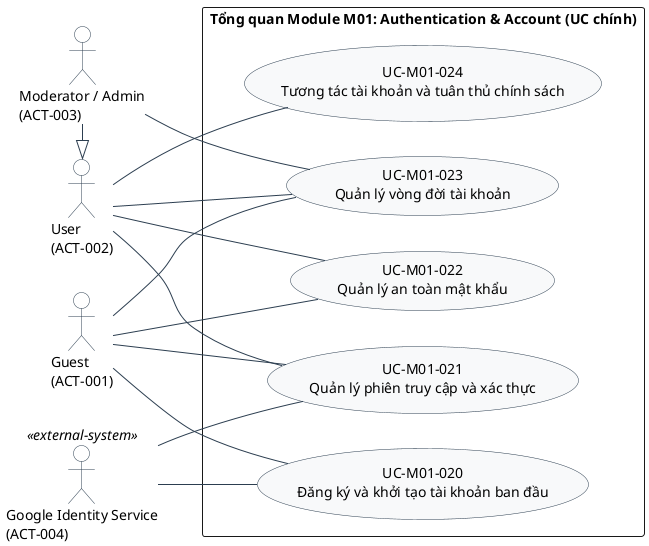
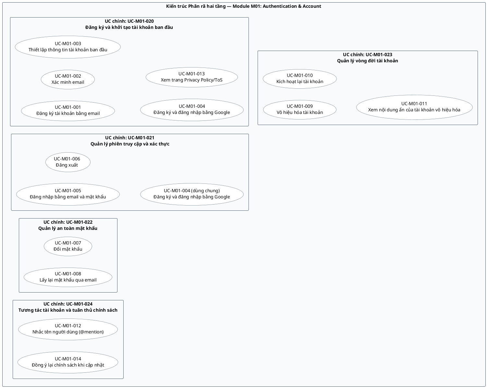
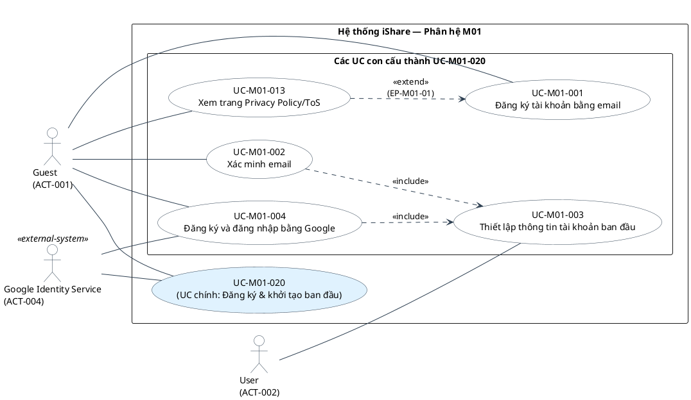
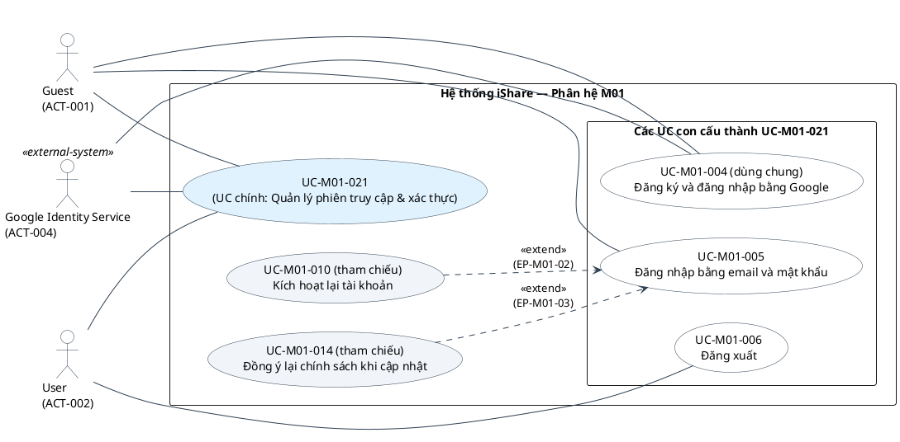
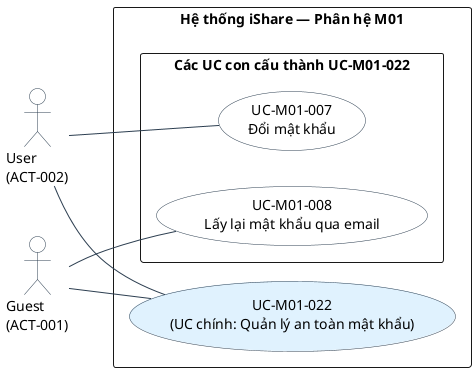
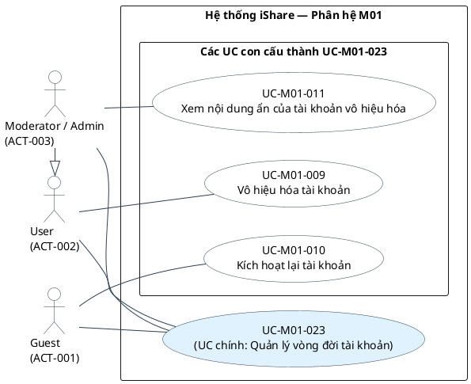
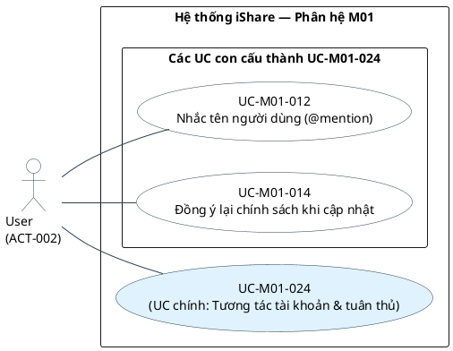

# Đặc tả use case — US-M01

[Vietnamese Doc]

## Metadata và tiến độ

<!-- uc:document -->
| key | value |
|---|---|
| document_id | US-M01 |
| skill_version | 2.2 |
| mode | module |
| modules | M01 |
| scope | ALL |
| status | Chờ duyệt |
| current_step | 7 |
| completed_steps | 1, 2, 3, 4, 5, 6, 7 |
| approved_steps | 1, 2, 3, 4, 5, 6 |
| source_baseline | docs/specs/fr/FR-M01.md 1.10 |
| author | Chuyên viên Phân tích Nghiệp vụ (BA) |
| date | 2026-10-28 |
| approval_evidence | Xác nhận của người dùng tại lượt 7 ("ok") |
| semantic_review | pass |
| diagram_check | pass |

| Bước | Phần đã hoàn tất/thay đổi | Xác nhận của người dùng | Baseline | Cần làm lại |
|---|---|---|---|---|
| 1 | Hoàn thành baseline, boundary, danh mục 4 actor, phạm vi in/out và kiểm kê 16 nhóm chức năng M01 | Đã duyệt (Lượt 2) | FR-M01 1.10 (2026-10-24) | - |
| 2 | Xác định mục tiêu, mức UC, ownership, 14 quyết định mô hình hóa và danh mục 14 UC | Đã duyệt (Lượt 3) | FR-M01 1.10 | - |
| 3 | Đặc tả luồng chính, luồng thay thế/ngoại lệ, tiền/hậu điều kiện, 3 tác vụ AUT và quy tắc RULE-M01-001 | Đã duyệt (Lượt 4) | FR-M01 1.10 | - |
| 4 | Quyết định tách/tái sử dụng, thiết lập quan hệ UML include và ma trận Association Actor–UC | Đã duyệt (Lượt 5) | FR-M01 1.10 | - |
| 5 | Hoàn thành ma trận truy vết 2 chiều 100% (235/235 yêu cầu) và giao tiếp liên module | Đã duyệt (Lượt 6) | FR-M01 1.10 | - |
| 6 | Xây dựng 4 view PlantUML chuẩn UML 2.5.1 (Tổng quan, Đăng ký, Đăng nhập & Vòng đời, @mention) | Đã duyệt (Lượt 7) | FR-M01 1.10 | - |
| 7 | Hoàn thành review ngữ nghĩa, cấu trúc, truy vết 100%, sơ đồ và chạy kiểm thử check_us.py --final | Chờ duyệt | FR-M01 1.10 | - |

---

## 1. Phạm vi và nguồn

**Mục đích sử dụng:** Đặc tả use case cho Module M01 — Authentication & Account phục vụ thiết kế kỹ thuật, lập trình và kiểm thử hệ thống iShare.  
**Subject/boundary:** Hệ thống iShare (Module M01 là subsystem nội bộ cung cấp dịch vụ quản lý định danh, xác thực và vòng đời tài khoản).  
**Trong phạm vi:**
- Đăng ký bằng email/mật khẩu (3 bước: nhập email/mật khẩu kèm đồng ý ToS/Privacy Policy; xác minh email qua magic link; thiết lập username, display_name và thông tin tùy chọn).
- Đăng ký và đăng nhập nhanh bằng Google OAuth 2.0; tự động liên kết với tài khoản email đã tồn tại.
- Gửi lại email xác minh (giới hạn tần suất 60s).
- Đăng nhập, đăng xuất; cơ chế Cổng đăng nhập kiểm tra 2 lớp (trạng thái tài khoản và mức xác minh).
- Quản lý phiên làm việc đa thiết bị bằng cơ chế JWT xoay vòng (Access Token 1h, Refresh Token 30d).
- Đổi mật khẩu chủ động trong phiên; Quên mật khẩu/lấy lại mật khẩu qua magic link (15 phút).
- Vô hiệu hóa tài khoản (thời hạn 14 ngày), kích hoạt lại qua mã OTP email (15 phút), tự động xóa vĩnh viễn dữ liệu cá nhân khi hết hạn vô hiệu hóa.
- Logic kiểm soát hiển thị nội dung/bình luận/tên tác giả của tài khoản DEACTIVATED và DELETED.
- Hệ thống nhắc tên người dùng (@mention) khi soạn thảo nội dung.
- Xem trang Privacy Policy/ToS và cơ chế yêu cầu đồng ý lại (Re-consent) khi cập nhật phiên bản chính sách.
- Toàn bộ 16 nhóm FR (`FR-M01-01` đến `FR-M01-16`) và 47 quy tắc nghiệp vụ (`BR-M01-01` đến `BR-M01-47`).

**Ngoài phạm vi:**
- Quản lý trang hồ sơ cá nhân chi tiết, cập nhật avatar, bio sau bước 3 (thuộc M02 User Profile).
- Trình soạn thảo bài viết/bình luận tích hợp khối @mention (thuộc M03 Post & Content, M04 Comment).
- Hạ tầng gửi email và thông báo (thuộc M07 Notification).
- Xử lý vi phạm, ban/gỡ ban, hạn ban (thuộc M08 Moderation).
- Khiếu nại khóa tài khoản (thuộc M09 Appeal).
- Cấu hình hệ thống, công tắc tạm dừng đăng ký, chế độ bảo trì (thuộc M10 Admin Panel).
- Chuyển quyền Group Owner khi tài khoản bị khóa/vô hiệu hóa/xóa (thuộc M11 Group).
- Phân biệt tài khoản Giáo viên/Học sinh; nút xóa trực tiếp không qua vô hiệu hóa; Admin/Mod xóa tài khoản người khác.

**Mức đặc tả:** Module M01 chi tiết (toàn bộ 16 nhóm FR).

### Nguồn căn cứ

<!-- uc:sources -->
| path | version | role |
|---|---|---|
| docs/specs/fr/FR-M01.md | 1.10 | owner |

### Danh mục actor

<!-- uc:actors -->
| id | name | kind | parent | boundary_reason | sources |
|---|---|---|---|---|---|
| ACT-001 | Guest | human | - | Người dùng chưa có phiên đăng nhập trên iShare, tương tác từ bên ngoài qua giao diện web/app để đăng ký, đăng nhập, khôi phục mật khẩu hoặc kích hoạt lại tài khoản | FR-M01-01.01, FR-M01-04.01, FR-M01-05.01, FR-M01-09.01, FR-M01-11.02, FR-M01-15.01 |
| ACT-002 | User | human | - | Người dùng đã được xác thực và có phiên làm việc hợp lệ trong hệ thống; thực hiện các thao tác cá nhân và tương tác với cộng đồng iShare | FR-M01-02.01, FR-M01-03.01, FR-M01-07.01, FR-M01-08.01, FR-M01-10.01, FR-M01-14.01, FR-M01-16.01 |
| ACT-003 | Moderator / Admin | human | ACT-002 | Người dùng nội bộ có vai trò kiểm duyệt hoặc quản trị; kế thừa tương tác của User và có quyền xem nội dung ẩn, danh tính thật của tác giả đã vô hiệu hóa | FR-M01-13.05, BR-M01-41 |
| ACT-004 | Google Identity Service | external-system | - | Hệ thống bên ngoài cung cấp dịch vụ xác thực danh tính người dùng qua giao thức Google OAuth 2.0 | FR-M01-04.01, FR-M01-04.04, BR-M01-08, BR-M01-09 |

*Lưu ý mô hình hóa theo modeling-rules:*
- `Banned User` không phải là actor riêng biệt mà là trạng thái tài khoản `BANNED` của người dùng được kiểm soát qua Cổng đăng nhập (`FR-M01-05.13`, `BR-M01-18`, `BR-M01-19`).
- `Chủ tài khoản` là điều kiện ngữ cảnh sở hữu dữ liệu (ownership condition), không phải một vai trò tương tác độc lập.
- `Hệ thống` trong FR là tác nhân nội bộ thực thi các tác vụ tự động (`AUT-M01-xxx`), không phải actor bên ngoài boundary.

### Kiểm kê nhóm chức năng

| Mã nhóm FR | Mục tiêu/hành vi | Cách biểu diễn dự kiến | Owner | Căn cứ |
|---|---|---|---|---|
| FR-M01-01 | Đăng ký tài khoản bằng email và mật khẩu qua 3 bước, đồng ý ToS/Privacy Policy | User goal UC (Đăng ký tài khoản bằng email) | M01 | FR-M01-01.01, BR-M01-02, BR-M01-03 |
| FR-M01-02 | Xác minh email qua magic link và yêu cầu gửi lại | Subfunction UC (Xác minh email) | M01 | FR-M01-02.01, BR-M01-10, BR-M01-11 |
| FR-M01-03 | Thiết lập username, display_name và thông tin tùy chọn | Subfunction UC (Thiết lập thông tin tài khoản ban đầu) | M01 | FR-M01-03.01, BR-M01-05, BR-M01-06 |
| FR-M01-04 | Đăng ký, đăng nhập nhanh bằng Google OAuth và tự liên kết | User goal UC (Đăng ký và đăng nhập bằng Google) | M01 | FR-M01-04.01, BR-M01-08, BR-M01-09 |
| FR-M01-05 | Đăng nhập bằng email và mật khẩu qua Cổng kiểm tra 2 lớp | User goal UC (Đăng nhập bằng email và mật khẩu) | M01 | FR-M01-05.01, BR-M01-18 |
| FR-M01-06 | Duy trì phiên đăng nhập bằng JWT Token xoay vòng đa thiết bị | Tác vụ tự động (`AUT-M01-001`) | M01 | FR-M01-06.01, BR-M01-16, BR-M01-17 |
| FR-M01-07 | Đăng xuất phiên làm việc trên thiết bị hiện tại | User goal UC (Đăng xuất) | M01 | FR-M01-07.01, FR-M01-07.02 |
| FR-M01-08 | Đổi mật khẩu chủ động trong phiên | User goal UC (Đổi mật khẩu) | M01 | FR-M01-08.01, BR-M01-14, BR-M01-35 |
| FR-M01-09 | Quên mật khẩu và lấy lại mật khẩu qua magic link | User goal UC (Lấy lại mật khẩu qua email) | M01 | FR-M01-09.01, BR-M01-12, BR-M01-13 |
| FR-M01-10 | Vô hiệu hóa tài khoản (thời hạn 14 ngày) | User goal UC (Vô hiệu hóa tài khoản) | M01 | FR-M01-10.01, BR-M01-20 |
| FR-M01-11 | Kích hoạt lại tài khoản đã vô hiệu hóa qua mã OTP email | User goal UC (Kích hoạt lại tài khoản) | M01 | FR-M01-11.01, BR-M01-22 |
| FR-M01-12 | Tự xóa vĩnh viễn tài khoản và PII khi hết hạn 14 ngày | Tác vụ tự động (`AUT-M01-002`) | M01 | FR-M01-12.01, BR-M01-21, BR-M01-47 |
| FR-M01-13 | Hiển thị nội dung/bình luận của tài khoản vô hiệu hóa/đã xóa | Quy tắc hiển thị (`RULE-M01-001`) & UC Mod/Admin (`UC-M01-011`) | M01 | FR-M01-13.01, BR-M01-23, BR-M01-41 |
| FR-M01-14 | Nhắc tên người dùng (@mention) khi soạn nội dung | Subfunction UC (Nhắc tên người dùng) | M01 | FR-M01-14.01, BR-M01-26, BR-M01-27 |
| FR-M01-15 | Xem trang Chính sách quyền riêng tư và Điều khoản dịch vụ | User goal UC (Xem trang Privacy Policy/ToS) | M01 | FR-M01-15.01, BR-M01-42, BR-M01-43 |
| FR-M01-16 | Đồng ý lại phiên bản chính sách mới khi cập nhật (Re-consent) | Subfunction UC (Đồng ý lại chính sách khi cập nhật) | M01 | FR-M01-16.01, BR-M01-44, BR-M01-45 |

---

## 2. UC chính và UC con của module

### 2.1 Danh mục hai tầng

<!-- uc:catalog -->
| id | name | tier | level | primary | supporting | owner | anchor | sources |
|---|---|---|---|---|---|---|---|---|
| UC-M01-020 | Đăng ký và khởi tạo tài khoản ban đầu | core | Summary | ACT-001 | - | M01 | #uc-m01-020 | FR-M01-01, FR-M01-02, FR-M01-03, FR-M01-04, FR-M01-14 |
| UC-M01-021 | Quản lý phiên truy cập và xác thực | core | Summary | ACT-001 | - | M01 | #uc-m01-021 | FR-M01-05, FR-M01-06, FR-M01-07 |
| UC-M01-022 | Quản lý an toàn mật khẩu | core | Summary | ACT-001 | - | M01 | #uc-m01-022 | FR-M01-08, FR-M01-09 |
| UC-M01-023 | Quản lý vòng đời tài khoản | core | Summary | ACT-002 | - | M01 | #uc-m01-023 | FR-M01-10, FR-M01-11, FR-M01-12 |
| UC-M01-024 | Tương tác tài khoản và tuân thủ chính sách | core | Summary | ACT-002 | - | M01 | #uc-m01-024 | FR-M01-13, FR-M01-15 |
| UC-M01-001 | Đăng ký tài khoản bằng email | sub | User goal | ACT-001 | - | M01 | #uc-m01-001 | BR-M01-01, BR-M01-02, BR-M01-03, BR-M01-04, BR-M01-33, BR-M01-35, BR-M01-37, BR-M01-46, FR-M01-01, FR-M01-01.01, FR-M01-01.02, FR-M01-01.03, FR-M01-01.04, FR-M01-01.05, FR-M01-01.06, FR-M01-01.07, FR-M01-01.08, FR-M01-01.09, FR-M01-01.10, FR-M01-01.11, FR-M01-01.12, FR-M01-01.13, FR-M01-01.14, FR-M01-01.15 |
| UC-M01-002 | Xác minh email | sub | Subfunction | ACT-001 | - | M01 | #uc-m01-002 | BR-M01-10, BR-M01-11, BR-M01-38, FR-M01-01.11, FR-M01-01.12, FR-M01-01.13, FR-M01-02, FR-M01-02.01, FR-M01-02.02, FR-M01-02.03, FR-M01-02.04, FR-M01-02.05, FR-M01-02.06, FR-M01-02.07 |
| UC-M01-003 | Thiết lập thông tin tài khoản ban đầu | sub | Subfunction | ACT-002 | - | M01 | #uc-m01-003 | BR-M01-05, BR-M01-06, BR-M01-07, BR-M01-36, FR-M01-03, FR-M01-03.01, FR-M01-03.02, FR-M01-03.03, FR-M01-03.04, FR-M01-03.05, FR-M01-03.06, FR-M01-03.07, FR-M01-03.08, FR-M01-03.09, FR-M01-03.10, FR-M01-03.11, FR-M01-03.12, FR-M01-03.13, FR-M01-03.14, FR-M01-03.15, FR-M01-03.16 |
| UC-M01-004 | Đăng ký và đăng nhập bằng Google | sub | User goal | ACT-001 | ACT-004 | M01 | #uc-m01-004 | BR-M01-08, BR-M01-09, BR-M01-15, BR-M01-33, FR-M01-04, FR-M01-04.01, FR-M01-04.02, FR-M01-04.03, FR-M01-04.04, FR-M01-04.05, FR-M01-04.06, FR-M01-04.07, FR-M01-04.08, FR-M01-04.09, FR-M01-04.10, FR-M01-04.11, FR-M01-04.12, FR-M01-04.13 |
| UC-M01-005 | Đăng nhập bằng email và mật khẩu | sub | User goal | ACT-001 | - | M01 | #uc-m01-005 | BR-M01-18, BR-M01-19, BR-M01-33, BR-M01-37, FR-M01-05, FR-M01-05.01, FR-M01-05.02, FR-M01-05.03, FR-M01-05.04, FR-M01-05.05, FR-M01-05.06, FR-M01-05.07, FR-M01-05.08, FR-M01-05.09, FR-M01-05.10, FR-M01-05.11, FR-M01-05.12, FR-M01-05.13, FR-M01-05.14, FR-M01-05.15, FR-M01-05.16, FR-M01-05.17, FR-M01-05.18, FR-M01-05.19, FR-M01-05.20 |
| UC-M01-006 | Đăng xuất | sub | User goal | ACT-002 | - | M01 | #uc-m01-006 | BR-M01-16, BR-M01-17, FR-M01-07, FR-M01-07.01, FR-M01-07.02 |
| UC-M01-007 | Đổi mật khẩu | sub | User goal | ACT-002 | - | M01 | #uc-m01-007 | BR-M01-14, BR-M01-15, BR-M01-31, BR-M01-35, FR-M01-08, FR-M01-08.01, FR-M01-08.02, FR-M01-08.03, FR-M01-08.04, FR-M01-08.05, FR-M01-08.06, FR-M01-08.07, FR-M01-08.08, FR-M01-08.09, FR-M01-08.10 |
| UC-M01-008 | Lấy lại mật khẩu qua email | sub | User goal | ACT-001 | - | M01 | #uc-m01-008 | BR-M01-12, BR-M01-13, BR-M01-15, BR-M01-35, BR-M01-38, BR-M01-39, FR-M01-09, FR-M01-09.01, FR-M01-09.02, FR-M01-09.03, FR-M01-09.04, FR-M01-09.05, FR-M01-09.06, FR-M01-09.07, FR-M01-09.08, FR-M01-09.09, FR-M01-09.10, FR-M01-09.11, FR-M01-09.12, FR-M01-09.13, FR-M01-09.14, FR-M01-09.15, FR-M01-09.16 |
| UC-M01-009 | Vô hiệu hóa tài khoản | sub | User goal | ACT-002 | - | M01 | #uc-m01-009 | BR-M01-20, FR-M01-10, FR-M01-10.01, FR-M01-10.02, FR-M01-10.03, FR-M01-10.04, FR-M01-10.05, FR-M01-10.06, FR-M01-10.07 |
| UC-M01-010 | Kích hoạt lại tài khoản | sub | User goal | ACT-001 | - | M01 | #uc-m01-010 | BR-M01-22, BR-M01-25, FR-M01-11, FR-M01-11.01, FR-M01-11.02, FR-M01-11.03, FR-M01-11.04, FR-M01-11.05, FR-M01-11.06, FR-M01-11.07, FR-M01-11.08, FR-M01-11.09, FR-M01-11.10 |
| UC-M01-011 | Xem nội dung ẩn của tài khoản vô hiệu hóa | sub | User goal | ACT-003 | - | M01 | #uc-m01-011 | BR-M01-41, FR-M01-13.05 |
| UC-M01-012 | Nhắc tên người dùng (@mention) | sub | Subfunction | ACT-002 | - | M01 | #uc-m01-012 | BR-M01-26, BR-M01-27, BR-M01-28, BR-M01-29, BR-M01-30, BR-M01-40, FR-M01-14, FR-M01-14.01, FR-M01-14.02, FR-M01-14.03, FR-M01-14.04, FR-M01-14.05, FR-M01-14.06, FR-M01-14.07, FR-M01-14.08, FR-M01-14.09, FR-M01-14.10, FR-M01-14.11, FR-M01-14.12, FR-M01-14.13, FR-M01-14.14, FR-M01-14.15, FR-M01-14.16, FR-M01-14.17 |
| UC-M01-013 | Xem trang Privacy Policy/ToS | sub | User goal | ACT-001 | - | M01 | #uc-m01-013 | BR-M01-42, BR-M01-43, FR-M01-15, FR-M01-15.01, FR-M01-15.02, FR-M01-15.03, FR-M01-15.04, FR-M01-15.05, FR-M01-15.06, FR-M01-15.07, FR-M01-15.08, FR-M01-15.09 |
| UC-M01-014 | Đồng ý lại chính sách khi cập nhật | sub | Subfunction | ACT-002 | - | M01 | #uc-m01-014 | BR-M01-44, BR-M01-45, FR-M01-16, FR-M01-16.01, FR-M01-16.02, FR-M01-16.03, FR-M01-16.04, FR-M01-16.05 |

### 2.2 Bảng phân rã UC chính → UC con và Bản chất quan hệ Core–Sub

#### 2.2.1 Bản chất mối quan hệ giữa UC chính (Core) và UC con (Sub)
Mô hình phân tích Use Case phiên bản 2.1 của dự án iShare áp dụng kiến trúc hai tầng bắt buộc:
1. **Tầng Core (`tier=core` — 5 UC chính):** Đại diện cho các năng lực nghiệp vụ hoàn chỉnh (Business Capabilities) ở mức mục tiêu tổng quát (Summary-level Goal). Mỗi Core UC đóng vai trò là một dịch vụ cấp cao mà phân hệ M01 cung cấp cho toàn bộ hệ thống iShare, là đơn vị chuẩn hóa để tổng hợp lên sơ đồ tổng thể toàn hệ sinh thái (`US-overview.md`).
2. **Tầng Sub (`tier=sub` — 14 UC con):** Cụ thể hóa năng lực của Core UC thành các mục tiêu tác nghiệp độc lập, có giá trị đo lường trực tiếp cho Actor (User goal) hoặc các đơn vị chức năng hỗ trợ chuyên sâu (Subfunction). Toàn bộ kịch bản nghiệp vụ (luồng chính, rẽ nhánh, tiền/hậu điều kiện và quy tắc nghiệp vụ BR) được đặc tả chi tiết tại tầng này.

**Nguyên tắc phân định và đặc tính quan hệ:**
- **Không phải quan hệ Kế thừa (Generalization):** Core UC không phải là Use Case cha trừu tượng và các Sub UC không phải là những thực thể chuyên biệt hóa có thể thay thế vị trí cho Core UC theo nguyên lý Liskov. Việc cố ép mũi tên kế thừa UML giữa Summary và User goal sẽ gây sai lệch bản chất hành vi runtime.
- **Không phải quan hệ Bao hàm (Include):** Core UC không phải là một phiên thực thi đơn lẻ gọi đồng thời các Sub UC trong một chuỗi hành động đồng bộ.
- **Bản chất là quan hệ Cấu thành năng lực (Business Capability / Goal Decomposition):** Quan hệ này phản ánh cấu trúc cây mục tiêu (Goal Hierarchy) trong kỹ nghệ yêu cầu: Năng lực của Core UC chỉ được coi là hoàn thiện khi các Sub UC cấu thành được thỏa mãn. Trên mô hình và sơ đồ, quan hệ này được biểu diễn chuẩn hóa thông qua **ranh giới bao bọc nghiệp vụ (visual containment / package boundary)** và sơ đồ Bản đồ phân rã hai tầng (DIAG-M01-02).
- **Quy tắc bảo toàn và dùng chung (Shared Sub-UC):** Mỗi Core UC có ít nhất một Sub UC; mỗi Sub UC thuộc ít nhất một Core UC. Một Sub UC có thể đóng góp năng lực vào nhiều Core UC khác nhau (ví dụ: `UC-M01-004` vừa thuộc năng lực Khởi tạo tài khoản ban đầu `UC-M01-020`, vừa thuộc năng lực Thiết lập phiên truy cập `UC-M01-021`).

#### 2.2.2 Bảng phân rã tường minh

<!-- uc:decomposition -->
| core | sub | rationale | sources |
|---|---|---|---|
| UC-M01-020 | UC-M01-001 | Đăng ký email là phương thức tạo tài khoản truyền thống bước đầu cấu thành năng lực khởi tạo | FR-M01-01 |
| UC-M01-020 | UC-M01-002 | Xác minh quyền sở hữu hộp thư để kích hoạt tài khoản vừa đăng ký | FR-M01-02 |
| UC-M01-020 | UC-M01-003 | Thiết lập username, họ tên, avatar và tiểu sử để hoàn thiện hồ sơ ban đầu | FR-M01-03 |
| UC-M01-020 | UC-M01-004 | Đăng ký nhanh qua Google OAuth kết hợp tự động kích hoạt tài khoản | FR-M01-04 |
| UC-M01-020 | UC-M01-013 | Xem các điều khoản và chính sách riêng tư trước khi cam kết đăng ký | FR-M01-14 |
| UC-M01-021 | UC-M01-005 | Đăng nhập email/mật khẩu để khởi tạo phiên làm việc bảo mật mới | FR-M01-05 |
| UC-M01-021 | UC-M01-006 | Kết thúc phiên làm việc hiện tại và thu hồi token thiết bị | FR-M01-07 |
| UC-M01-021 | UC-M01-004 | Đăng nhập tài khoản hiện hữu thông qua liên kết Google OAuth | FR-M01-04 |
| UC-M01-022 | UC-M01-007 | Chủ động đổi mật khẩu bảo vệ tài khoản khi đang có phiên đăng nhập | FR-M01-08 |
| UC-M01-022 | UC-M01-008 | Khôi phục quyền truy cập bằng mật khẩu mới khi quên thông qua OTP email | FR-M01-09 |
| UC-M01-023 | UC-M01-009 | Chủ tài khoản chủ động tạm ngừng sử dụng với thời hạn ân hạn 14 ngày | FR-M01-10 |
| UC-M01-023 | UC-M01-010 | Khôi phục lại trạng thái hoạt động bình thường trong thời hạn 14 ngày | FR-M01-11 |
| UC-M01-023 | UC-M01-011 | Quyền xem nội dung ẩn của Mod/Admin phục vụ kiểm duyệt và đối soát | FR-M01-12 |
| UC-M01-024 | UC-M01-012 | Hỗ trợ gợi ý và nhắc tên người dùng trong quá trình soạn thảo nội dung | FR-M01-13 |
| UC-M01-024 | UC-M01-014 | Bắt buộc tái xác nhận cam kết điều khoản khi hệ thống cập nhật phiên bản chính sách mới | FR-M01-15 |

### 2.3 Quyết định mô hình hóa

| Quyết định | Hành vi FR | Biểu diễn được chọn | Vì sao giữ/gộp/tách | Phương án khác |
|---|---|---|---|---|
| D-001 | Đăng ký tài khoản 3 bước (FR-M01-01, 02, 03) | Tách thành 1 User goal (`UC-M01-001`) và 2 Subfunction (`UC-M01-002`, `UC-M01-003`) | Bước 2 (Xác minh email) và Bước 3 (Thiết lập username) có thể kích hoạt độc lập khi người dùng đăng nhập lại ở trạng thái dở dang (Cổng đăng nhập) hoặc khi đăng ký Google | Gộp cả 3 bước vào 1 UC duy nhất (nhược điểm: khó tái sử dụng cho luồng Cổng đăng nhập và Google) |
| D-002 | Đăng ký, đăng nhập qua Google OAuth (FR-M01-04) | 1 User goal riêng (`UC-M01-004`) có Actor hỗ trợ Google Identity Service | Khác biệt cơ bản về kênh xác thực ngoài, tự động liên kết tài khoản và luồng đi thẳng vào bước 3 | Kế thừa từ UC Đăng nhập / Đăng ký (nhược điểm: hợp đồng chung không hoàn toàn đồng nhất) |
| D-003 | Đăng nhập bằng email và mật khẩu (FR-M01-05) | 1 User goal riêng (`UC-M01-005`) | Mục tiêu hoàn chỉnh của Guest; Cổng đăng nhập kiểm tra 2 lớp điều phối luồng rẽ nhánh rõ ràng | Tách thành nhiều UC theo trạng thái (nhược điểm: chia cắt logic Cổng đăng nhập) |
| D-004 | Duy trì phiên đăng nhập bằng JWT xoay vòng (FR-M01-06) | Tác vụ tự động (`AUT-M01-001`) | Đây là cơ chế ngầm của hệ thống, không có actor người khởi tạo tương tác trực tiếp | Ép thành Use case người dùng (sai bản chất UML) |
| D-005 | Đăng xuất (FR-M01-07) | 1 User goal riêng (`UC-M01-006`) | Mục tiêu độc lập có giá trị bảo mật trên thiết bị dùng chung; giữ nguyên kể cả khi luồng ngắn | Nhập vào làm nhánh của Đăng nhập (sai vì phiên đã kết thúc trước đó) |
| D-006 | Đổi mật khẩu (FR-M01-08) | 1 User goal riêng (`UC-M01-007`) | Mục tiêu chủ động của User đang trong phiên; chỉ áp dụng cho tài khoản có mật khẩu iShare | Gộp chung với Quên mật khẩu thành "Quản lý mật khẩu" (sai vì ngữ cảnh và actor khác nhau) |
| D-007 | Lấy lại mật khẩu qua email (FR-M01-09) | 1 User goal riêng (`UC-M01-008`) | Mục tiêu của Guest / Banned User khi mất quyền truy cập; xử lý qua magic link và thu hồi mọi phiên cũ | Gộp với Đổi mật khẩu (sai vì Quên mật khẩu làm ngoài phiên, Đổi mật khẩu làm trong phiên) |
| D-008 | Vô hiệu hóa tài khoản (FR-M01-10) | 1 User goal riêng (`UC-M01-009`) | Mục tiêu có giá trị pháp lý và bảo mật của User; là phương thức duy nhất để xóa tài khoản | Gộp với Tự xóa tài khoản (sai vì Tự xóa là tác vụ ngầm sau 14 ngày) |
| D-009 | Kích hoạt lại tài khoản (FR-M01-11) | 1 User goal riêng (`UC-M01-010`) | Mục tiêu của chủ tài khoản DEACTIVATED trong hạn 14 ngày; tương tác qua trang riêng bằng mã OTP | Đưa vào nhánh của Đăng nhập (sai vì Cổng đăng nhập từ chối tài khoản DEACTIVATED) |
| D-010 | Tự xóa tài khoản hết hạn 14 ngày (FR-M01-12) | Tác vụ tự động (`AUT-M01-002`) | Tiến trình ngầm quét theo thời gian của hệ thống, không có actor kích hoạt trực tiếp | Ép thành Use case người dùng (sai vì người dùng không tham gia lúc hết hạn) |
| D-011 | Hiển thị nội dung tài khoản vô hiệu hóa/xóa (FR-M01-13) | Quy tắc hiển thị (`RULE-M01-001`) & 1 User goal của Mod/Admin (`UC-M01-011`) | Hiển thị thông thường là logic thụ động của hệ thống; quyền xem bài ẩn và danh tính thật là tương tác nghiệp vụ đặc thù của Mod/Admin | Tạo UC cho người xem bài viết (sai vì người xem chỉ đọc bài bình thường) |
| D-012 | Nhắc tên người dùng @mention (FR-M01-14) | 1 Subfunction UC (`UC-M01-012`) | Hành vi tương tác hỗ trợ dùng chung cho các module soạn thảo nội dung (M03 Post, M04 Comment) | Đẩy hoàn toàn sang M03/M04 (sai vì logic danh sách gợi ý và quy tắc định danh do M01 sở hữu) |
| D-013 | Xem trang Privacy Policy/ToS (FR-M01-15) | 1 User goal riêng (`UC-M01-013`) | Trang thông tin công khai độc lập, có thể truy cập bất kỳ lúc nào từ chân trang | Chỉ coi là bước phụ trong Đăng ký (sai vì người dùng có thể xem độc lập) |
| D-014 | Đồng ý lại chính sách khi cập nhật (FR-M01-16) | 1 Subfunction UC (`UC-M01-014`) | Cổng kiểm soát cưỡng bức khi mở ứng dụng; có luồng tương tác và kết quả nghiệp vụ rõ ràng | Chỉ coi là nhánh nhỏ của Đăng nhập (sai vì áp dụng cả khi đang giữ phiên truy cập) |

---

## 3. Đặc tả

### 3.1 Mô tả từng UC chính

**UC-M01-020 — Đăng ký và khởi tạo tài khoản ban đầu:**
- **Actor:** ACT-001 (Guest), ACT-004 (Google Identity Service).
- **Mục tiêu bao quát:** Cung cấp toàn bộ năng lực tiếp cận hệ thống cho người dùng mới, từ việc tham khảo điều khoản chính sách, đăng ký tài khoản (qua Email hoặc Google OAuth), xác minh danh tính điện tử, đến thiết lập hồ sơ định danh ban đầu (username, họ tên, avatar).
- **Giá trị/kết quả:** Biến một khách vãng lai (Guest) thành người dùng chính thức (User) có hồ sơ hợp lệ và sẵn sàng tham gia nền tảng.
- **Ranh giới:** Bắt đầu từ khi Guest truy cập các trang chính sách/đăng ký cho đến khi tài khoản được kích hoạt và lưu hồ sơ thành công vào CSDL iShare.
- **Quy trình tổng quát:** Guest có thể xem chính sách (UC-M01-013); thực hiện đăng ký qua email (UC-M01-001) -> xác minh OTP (UC-M01-002) -> thiết lập username/profile (UC-M01-003); hoặc đăng ký nhanh qua Google OAuth (UC-M01-004) rồi thiết lập username (UC-M01-003).
- **UC con:** UC-M01-001, UC-M01-002, UC-M01-003, UC-M01-004, UC-M01-013.

---

**UC-M01-021 — Quản lý phiên truy cập và xác thực:**
- **Actor:** ACT-001 (Guest khi bắt đầu đăng nhập), ACT-002 (User khi duy trì/đăng xuất), ACT-004 (Google Identity Service).
- **Mục tiêu bao quát:** Xác thực danh tính người dùng qua thông tin đăng nhập đã đăng ký (email/mật khẩu hoặc tài khoản Google liên kết), cấp phát phiên làm việc (JWT Access/Refresh token), duy trì phiên và cho phép người dùng chấm dứt phiên làm việc một cách an toàn.
- **Giá trị/kết quả:** Thiết lập kênh liên lạc bảo mật có xác thực quyền hạn cho mọi tương tác của người dùng trên nền tảng iShare.
- **Ranh giới:** Từ lúc tiếp nhận yêu cầu đăng nhập, kiểm tra trạng thái khóa/vô hiệu hóa, cấp phát token, đến khi token bị thu hồi lúc đăng xuất.
- **Quy trình tổng quát:** Người dùng đăng nhập bằng mật khẩu (UC-M01-005) hoặc Google (UC-M01-004); hệ thống kiểm tra và cấp phiên; trong quá trình sử dụng hệ thống tự làm mới phiên (AUT-M01-001); khi xong việc người dùng đăng xuất (UC-M01-006).
- **UC con:** UC-M01-005, UC-M01-006, UC-M01-004.

---

**UC-M01-022 — Quản lý an toàn mật khẩu:**
- **Actor:** ACT-001 (Guest khi quên mật khẩu), ACT-002 (User khi đổi mật khẩu).
- **Mục tiêu bao quát:** Đảm bảo tính toàn vẹn và an toàn cho thông tin xác thực mật khẩu người dùng, hỗ trợ chủ động thay đổi mật khẩu định kỳ và quy trình cấp lại mật khẩu an toàn khi bị mất quyền truy cập.
- **Giá trị/kết quả:** Phòng chống xâm nhập trái phép, phục hồi quyền truy cập hợp pháp cho chủ sở hữu tài khoản.
- **Ranh giới:** Áp dụng cho các tài khoản đăng ký bằng email; kiểm tra độ phức tạp mật khẩu theo chuẩn OWASP và xác thực qua mã OTP email bí mật.
- **Quy trình tổng quát:** Khi có phiên hợp lệ, User chủ động đổi mật khẩu (UC-M01-007); khi không thể đăng nhập do quên mật khẩu, Guest yêu cầu gửi mã OTP để đặt lại mật khẩu mới (UC-M01-008).
- **UC con:** UC-M01-007, UC-M01-008.

---

**UC-M01-023 — Quản lý vòng đời tài khoản:**
- **Actor:** ACT-002 (User), ACT-001 (Guest khi kích hoạt lại), ACT-003 (Moderator/Admin).
- **Mục tiêu bao quát:** Kiểm soát các trạng thái tồn tại của tài khoản trong toàn bộ vòng đời (ACTIVE -> DEACTIVATED -> DELETED), hỗ trợ cơ chế ân hạn 14 ngày tự phục hồi và bảo vệ dữ liệu riêng tư.
- **Giá trị/kết quả:** Tôn trọng quyền tự chủ của người dùng đối với sự hiện diện của mình trên mạng xã hội, đồng thời duy trì tính toàn vẹn của dữ liệu thảo luận cộng đồng.
- **Ranh giới:** Từ thao tác vô hiệu hóa tự nguyện, cơ chế ẩn nội dung, quy trình gửi OTP kích hoạt lại, đến tác vụ tự động xóa vĩnh viễn và ẩn danh sau 14 ngày (AUT-M01-002).
- **Quy trình tổng quát:** User vô hiệu hóa tài khoản (UC-M01-009); trong 14 ngày chủ tài khoản có thể kích hoạt lại (UC-M01-010); Mod/Admin có quyền đối soát nội dung ẩn phục vụ kiểm duyệt (UC-M01-011); sau 14 ngày hệ thống tự dọn dẹp vĩnh viễn (AUT-M01-002).
- **UC con:** UC-M01-009, UC-M01-010, UC-M01-011.

---

**UC-M01-024 — Tương tác tài khoản và tuân thủ chính sách:**
- **Actor:** ACT-002 (User).
- **Mục tiêu bao quát:** Cung cấp các tiện ích định danh liên tài khoản (hỗ trợ nhắc tên người dùng khác bằng ký hiệu `@`) và cơ chế đảm bảo người dùng luôn tuân thủ các phiên bản Điều khoản dịch vụ và Chính sách bảo mật mới nhất của nền tảng.
- **Giá trị/kết quả:** Gia tăng tính kết nối cộng đồng và đảm bảo nền tảng tuân thủ đầy đủ hành lang pháp lý về bảo vệ dữ liệu cá nhân.
- **Ranh giới:** Tích hợp với khung soạn thảo bài viết/bình luận của M03/M04 và chặn các thao tác nền tảng khi chưa tái đồng thuận chính sách.
- **Quy trình tổng quát:** User gõ `@` khi soạn thảo để tìm kiếm và gắn thẻ người dùng (UC-M01-012); khi nền tảng ban hành chính sách mới, User bắt buộc phải xem và đồng ý lại để tiếp tục sử dụng dịch vụ (UC-M01-014).
- **UC con:** UC-M01-012, UC-M01-014.

### 3.2 Đặc tả từng UC con

### UC-M01-001 — Đăng ký tài khoản bằng email

<!-- uc:spec UC-M01-001 -->
| key | value |
|---|---|
| goal | Tạo tài khoản mới bằng email và mật khẩu, xác nhận đồng ý ToS/Privacy Policy và nhận magic link xác minh |
| subject | iShare |
| level | User goal |
| primary | ACT-001 |
| supporting | - |
| trigger | Guest gửi biểu mẫu đăng ký gồm email, mật khẩu và đánh dấu ô đồng ý ToS/Privacy Policy |
| preconditions | Email chưa thuộc tài khoản nào; công tắc tạm dừng đăng ký và chế độ bảo trì đang tắt |
| success | Tài khoản được tạo ở trạng thái ACTIVE, mức xác minh NONE, vai trò USER; magic link xác minh được gửi tới email |
| failure | Email đã tồn tại, mật khẩu sai quy cách (dưới 8 hoặc trên 64 ký tự), không đánh dấu đồng ý ToS, hoặc hệ thống tạm dừng đăng ký |
| abstract | false |
| common_contract | Không áp dụng generalization |

#### Luồng chính

| Bước | Ai | Hành động/phản hồi | Tiếp tục | Nguồn |
|---|---|---|---|---|
| 1 | ACT-001 | Nhập email, mật khẩu (8–64 ký tự) và đánh dấu ô đồng ý Điều khoản dịch vụ và Chính sách quyền riêng tư (chứa cam kết người dưới 16 tuổi đã được phụ huynh/người giám hộ đồng ý), sau đó gửi yêu cầu đăng ký. | Bước 2 | FR-M01-01.01, FR-M01-01.04, FR-M01-01.05, BR-M01-03, BR-M01-46 |
| 2 | Subject | Kiểm tra tính hợp lệ của email (định dạng, chưa thuộc tài khoản nào), mật khẩu (8–64 ký tự, chấp nhận mọi ký tự, không tự cắt khoảng trắng), và trạng thái hệ thống (công tắc tạm dừng đăng ký tắt, chế độ bảo trì tắt). | Bước 3 | FR-M01-01.02, FR-M01-01.08, FR-M01-01.09, BR-M01-04, BR-M01-33, BR-M01-35, BR-M01-37 |
| 3 | Subject | Tạo tài khoản mới ở trạng thái ACTIVE, mức xác minh NONE, vai trò USER; lưu bản ghi đồng ý phiên bản chính sách hiện hành. | Bước 4 | FR-M01-01.01, FR-M01-01.14, BR-M01-01, BR-M01-02 |
| 4 | Subject | Tạo magic link xác minh (thời hạn 1 giờ) và gửi email xác minh đến địa chỉ email đã đăng ký; hiển thị thông báo yêu cầu kiểm tra email. | END: Hoàn tất bước 1 đăng ký, tài khoản chờ xác minh email | FR-M01-01.03, FR-M01-01.10, BR-M01-10 |

#### Luồng thay thế và ngoại lệ

| ID nhánh | Bước rẽ | Điều kiện | Xử lý | Quay lại/kết thúc | Nguồn |
|---|---|---|---|---|---|
| A1 | Bước 2 | Email đã được đăng ký trước đó | iShare hiển thị thông báo lỗi "Email này đã được sử dụng", không tạo tài khoản | END: Đăng ký thất bại | FR-M01-01.08, BR-M01-04 |
| A2 | Bước 2 | Mật khẩu dưới 8 ký tự hoặc trên 64 ký tự | iShare hiển thị thông báo lỗi yêu cầu mật khẩu dài từ 8 đến 64 ký tự | Bước 1 | FR-M01-01.09, BR-M01-35 |
| A3 | Bước 2 | Chưa đánh dấu ô đồng ý Điều khoản/Chính sách | iShare từ chối xử lý, yêu cầu người dùng xác nhận đồng ý ToS/Privacy Policy | Bước 1 | FR-M01-01.05, BR-M01-03 |
| A4 | Bước 2 | Công tắc tạm dừng đăng ký hoặc Chế độ bảo trì đang bật | iShare từ chối tiếp nhận tài khoản mới và hiển thị thông báo hệ thống tạm ngừng nhận đăng ký hoặc đang bảo trì | END: Từ chối đăng ký | BR-M01-33, BR-M01-37 |

#### Quy tắc và điểm chưa rõ

- **BR-M01-01:** Tài khoản mới có vai trò `USER`, trạng thái `ACTIVE`.
- **BR-M01-02:** Đăng ký bằng email đi qua 3 bước theo thứ tự.
- **BR-M01-03:** Mọi tài khoản mới phải đồng ý rõ ràng với Privacy Policy/ToS.
- **BR-M01-04:** Mỗi email thuộc tối đa một tài khoản.
- **BR-M01-35:** Mật khẩu dài 8–64 ký tự, nhận mọi ký tự kể cả khoảng trắng và chữ có dấu.
- **BR-M01-46:** Không có bước hỏi tuổi riêng; người dưới 16 tuổi cam kết qua ô đồng ý.

---

### UC-M01-002 — Xác minh email

<!-- uc:spec UC-M01-002 -->
| key | value |
|---|---|
| goal | Xác thực quyền sở hữu email qua magic link để nâng mức xác minh tài khoản lên EMAIL_VERIFIED |
| subject | iShare |
| level | Subfunction |
| primary | ACT-001 |
| supporting | - |
| trigger | Người dùng mở magic link xác minh trong email, hoặc yêu cầu gửi lại email xác minh |
| preconditions | Tài khoản tồn tại ở trạng thái ACTIVE, mức xác minh NONE; magic link còn trong hạn 1 giờ |
| success | Mức xác minh chuyển thành EMAIL_VERIFIED; chuyển hướng người dùng sang màn hình thiết lập tài khoản |
| failure | Magic link hết hạn (quá 1 giờ), link đã qua sử dụng, hoặc bị hủy do người dùng đã yêu cầu link mới |
| abstract | false |
| common_contract | Không áp dụng generalization |

#### Luồng chính

| Bước | Ai | Hành động/phản hồi | Tiếp tục | Nguồn |
|---|---|---|---|---|
| 1 | ACT-001 | Mở magic link xác minh từ hộp thư điện tử cá nhân. | Bước 2 | FR-M01-02.01 |
| 2 | Subject | Kiểm tra tính hợp lệ của magic link: tồn tại, chưa qua sử dụng, và còn trong thời hạn 1 giờ kể từ thời điểm gửi. | Bước 3 | FR-M01-02.02, BR-M01-10, BR-M01-38 |
| 3 | Subject | Cập nhật mức xác minh của tài khoản từ NONE lên EMAIL_VERIFIED; hủy hiệu lực của magic link này. | Bước 4 | FR-M01-02.01, FR-M01-02.06, BR-M01-02 |
| 4 | Subject | Tự động điều hướng người dùng sang màn hình Bước 3 để thiết lập tài khoản ban đầu (UC-M01-003). | END: Xác minh email thành công | FR-M01-02.03 |

#### Luồng thay thế và ngoại lệ

| ID nhánh | Bước rẽ | Điều kiện | Xử lý | Quay lại/kết thúc | Nguồn |
|---|---|---|---|---|---|
| A1 | Bước 2 | Magic link đã hết hạn (quá 1 giờ) hoặc đã qua sử dụng | iShare hiển thị thông báo liên kết không còn hiệu lực và cung cấp nút gửi lại email xác minh | END: Xác minh thất bại | FR-M01-02.02, BR-M01-10, BR-M01-38 |
| A2 | Bước 1 | ACT-001 yêu cầu gửi lại email xác minh | iShare kiểm tra thời gian kể từ lần gửi gần nhất; nếu đủ ít nhất 60 giây, vô hiệu hóa magic link cũ, tạo magic link mới và gửi tới email; nếu chưa đủ 60 giây, từ chối và hiển thị thời gian đếm ngược | Bước 1 | FR-M01-02.04, FR-M01-02.05, BR-M01-11, BR-M01-38 |

#### Quy tắc và điểm chưa rõ

- **BR-M01-10:** Magic link xác minh email hết hạn sau 1 giờ.
- **BR-M01-11:** Hai lần yêu cầu gửi lại email xác minh cách nhau ít nhất 60 giây.
- **BR-M01-38:** Mỗi magic link chỉ dùng được một lần; gửi link mới làm mất hiệu lực link cũ.

---

### UC-M01-003 — Thiết lập thông tin tài khoản ban đầu

<!-- uc:spec UC-M01-003 -->
| key | value |
|---|---|
| goal | Thiết lập username định danh duy nhất và display_name để hoàn tất kích hoạt tài khoản |
| subject | iShare |
| level | Subfunction |
| primary | ACT-002 |
| supporting | - |
| trigger | Người dùng có mức xác minh EMAIL_VERIFIED truy cập màn hình bước 3 đăng ký |
| preconditions | Tài khoản ở trạng thái ACTIVE và mức xác minh EMAIL_VERIFIED |
| success | username và display_name được lưu; mức xác minh nâng lên SETUP_COMPLETED; người dùng vào trang chủ hệ thống |
| failure | username trùng lặp (kể cả với tài khoản DELETED), sai định dạng (3–20 ký tự, [a-zA-Z0-9_]), hoặc display_name không hợp lệ |
| abstract | false |
| common_contract | Không áp dụng generalization |

#### Luồng chính

| Bước | Ai | Hành động/phản hồi | Tiếp tục | Nguồn |
|---|---|---|---|---|
| 1 | Subject | Hiển thị màn hình thiết lập thông tin gồm: ô nhập username (bắt buộc), display_name (bắt buộc, điền sẵn nếu là luồng Google), và các trường tùy chọn: bio, Lớp/Khối, avatar (có thể bỏ qua). | Bước 2 | FR-M01-03.01, FR-M01-03.03, FR-M01-03.08, BR-M01-02, BR-M01-08 |
| 2 | ACT-002 | Nhập username, display_name, điền hoặc bỏ qua các trường tùy chọn, sau đó nhấn "Hoàn tất". | Bước 3 | FR-M01-03.01, FR-M01-03.09 |
| 3 | Subject | Kiểm tra tính hợp lệ của username: 3–20 ký tự, chỉ gồm a–z, A–Z, 0–9, dấu gạch dưới "_", không trùng với bất kỳ tài khoản nào khác (kể cả tài khoản DELETED, so không phân biệt chữ hoa/thường). | Bước 4 | FR-M01-03.04, FR-M01-03.05, BR-M01-05 |
| 4 | Subject | Kiểm tra tính hợp lệ của display_name: 1–50 ký tự sau khi cắt khoảng trắng đầu/cuối, chỉ gồm chữ cái, chữ số, khoảng trắng và dấu . , - _ ' ( ); không chứa emoji. Cho phép trùng với người khác. | Bước 5 | FR-M01-03.06, FR-M01-03.07, BR-M01-06 |
| 5 | Subject | Lưu thông tin tài khoản, chuyển mức xác minh lên SETUP_COMPLETED, cấp phiên đăng nhập và chuyển hướng người dùng vào trang chủ hệ thống. | END: Thiết lập tài khoản thành công | FR-M01-03.10, FR-M01-03.11, BR-M01-02 |

#### Luồng thay thế và ngoại lệ

| ID nhánh | Bước rẽ | Điều kiện | Xử lý | Quay lại/kết thúc | Nguồn |
|---|---|---|---|---|---|
| A1 | Bước 3 | Username đã tồn tại trên hệ thống (tài khoản ACTIVE, DEACTIVATED hoặc DELETED) | iShare hiển thị thông báo "Tên người dùng này đã có người sử dụng" | Bước 2 | FR-M01-03.05, BR-M01-05 |
| A2 | Bước 3 | Username sai quy cách (dưới 3 hoặc trên 20 ký tự, chứa ký tự ngoài a–z, A–Z, 0–9, _) | iShare hiển thị thông báo lỗi định dạng tên người dùng | Bước 2 | FR-M01-03.04, BR-M01-05 |
| A3 | Bước 4 | Display_name trống, vượt quá 50 ký tự hoặc chứa emoji/ký hiệu cấm | iShare hiển thị thông báo lỗi định dạng tên hiển thị | Bước 2 | FR-M01-03.07, BR-M01-06 |

#### Quy tắc và điểm chưa rõ

- **BR-M01-05:** username bắt buộc, 3–20 ký tự, regex `^[a-zA-Z0-9_]{3,20}$`, giữ vĩnh viễn kể cả khi DELETED.
- **BR-M01-06:** display_name 1–50 ký tự, cho phép trùng, không nhận emoji.
- **BR-M01-07:** display_name là tên hiển thị chính; username dùng để định danh, @mention và tìm kiếm.

---

### UC-M01-004 — Đăng ký và đăng nhập bằng Google

<!-- uc:spec UC-M01-004 -->
| key | value |
|---|---|
| goal | Tạo tài khoản mới hoặc đăng nhập vào tài khoản có sẵn thông qua xác thực tài khoản Google OAuth |
| subject | iShare |
| level | User goal |
| primary | ACT-001 |
| supporting | ACT-004 |
| trigger | Guest chọn đăng ký hoặc đăng nhập bằng tài khoản Google tại giao diện iShare |
| preconditions | Chế độ bảo trì và công tắc tạm dừng đăng ký (với tài khoản mới) đang tắt |
| success | Tài khoản mới được tạo ở mức EMAIL_VERIFIED và chuyển sang bước 3, hoặc tài khoản cũ được liên kết/đăng nhập thành công |
| failure | Google từ chối xác thực, hoặc công tắc tạm dừng đăng ký đang bật đối với tài khoản mới |
| abstract | false |
| common_contract | Không áp dụng generalization |

#### Luồng chính

| Bước | Ai | Hành động/phản hồi | Tiếp tục | Nguồn |
|---|---|---|---|---|
| 1 | ACT-001 | Chọn "Đăng nhập bằng Google" hoặc "Đăng ký bằng Google" tại giao diện iShare. | Bước 2 | FR-M01-04.01 |
| 2 | Subject | Chuyển hướng người dùng sang ACT-004 (Google Identity Service) để thực hiện xác thực tài khoản Google. | Bước 3 | FR-M01-04.01 |
| 3 | ACT-004 | Xác thực thành công và trả về cho iShare thông tin danh tính gồm email và tên hồ sơ Google. | Bước 4 | FR-M01-04.01, BR-M01-08 |
| 4 | Subject | Kiểm tra email nhận được trong hệ thống: Nếu chưa có tài khoản $\to$ tạo tài khoản ACTIVE, mức EMAIL_VERIFIED, điền sẵn display_name từ Google, gọi include UC-M01-003 để thiết lập username. Nếu email trùng tài khoản đã có $\to$ tự động liên kết Google, gửi thông báo & email bảo mật (M07), xử lý qua Cổng đăng nhập (cấp phiên nếu hoàn tất). | END: Hoàn tất đăng nhập/đăng ký Google | FR-M01-04.02, FR-M01-04.04, FR-M01-04.05, BR-M01-08, BR-M01-09 |

#### Luồng thay thế và ngoại lệ

| ID nhánh | Bước rẽ | Điều kiện | Xử lý | Quay lại/kết thúc | Nguồn |
|---|---|---|---|---|---|
| A1 | Bước 3 | ACT-004 báo lỗi xác thực hoặc người dùng hủy luồng Google | iShare hiển thị thông báo "Đăng nhập Google không thành công, vui lòng thử lại" | END: Kết thúc luồng | FR-M01-04.01 |
| A2 | Bước 4 | Email chưa có tài khoản nhưng công tắc tạm dừng đăng ký đang bật | iShare từ chối tạo tài khoản mới và hiển thị thông báo hệ thống tạm dừng đăng ký | END: Từ chối đăng ký | BR-M01-33 |
| A3 | Bước 4 | Tài khoản liên kết ở trạng thái BANNED | iShare chuyển hướng người dùng tới Màn hình tài khoản bị khóa | END: Đăng nhập hạn chế | FR-M01-05.13, BR-M01-18, BR-M01-19 |

#### Quy tắc và điểm chưa rõ

- **BR-M01-08:** Đăng nhập Google lần đầu bỏ qua bước 1 và 2, mức xác minh bắt đầu ở `EMAIL_VERIFIED`, điền sẵn display_name.
- **BR-M01-09:** Tự động liên kết Google vào tài khoản email đã có không cần hỏi xác nhận; gửi thông báo trong app và qua email.
- **BR-M01-15:** Tài khoản Google thuần không có chức năng mật khẩu trong iShare.

---

### UC-M01-005 — Đăng nhập bằng email và mật khẩu

<!-- uc:spec UC-M01-005 -->
| key | value |
|---|---|
| goal | Xác thực thông tin đăng nhập và cấp phiên làm việc theo trạng thái tài khoản và mức xác minh qua Cổng kiểm tra 2 lớp |
| subject | iShare |
| level | User goal |
| primary | ACT-001 |
| supporting | - |
| trigger | Guest gửi email và mật khẩu tại biểu mẫu đăng nhập |
| preconditions | Chế độ bảo trì đang tắt (trừ vai trò ADMIN) |
| success | Cấp phiên đăng nhập vào hệ thống (SETUP_COMPLETED) hoặc điều hướng về bước còn dở / màn hình khóa (BANNED) |
| failure | Sai email hoặc mật khẩu; tài khoản DEACTIVATED hoặc DELETED bị từ chối truy cập |
| abstract | false |
| common_contract | Không áp dụng generalization |

#### Luồng chính

| Bước | Ai | Hành động/phản hồi | Tiếp tục | Nguồn |
|---|---|---|---|---|
| 1 | ACT-001 | Nhập email, mật khẩu tại biểu mẫu đăng nhập và nhấn "Đăng nhập". | Bước 2 | FR-M01-05.01 |
| 2 | Subject | Xác thực thông tin đăng nhập (kiểm tra email tồn tại và mật khẩu khớp). | Bước 3 | FR-M01-05.01, FR-M01-05.02 |
| 3 | Subject | Kiểm tra Cổng đăng nhập Lớp 1 (Trạng thái tài khoản): Xác nhận tài khoản ở trạng thái ACTIVE (nếu DEACTIVATED, DELETED hoặc BANNED thì chuyển nhánh). | Bước 4 | FR-M01-05.03, FR-M01-05.04, FR-M01-05.13, BR-M01-18 |
| 4 | Subject | Kiểm tra Cổng đăng nhập Lớp 2 (Mức xác minh): Xác nhận mức SETUP_COMPLETED; cấp phiên làm việc mới (Access Token 1h, Refresh Token 30d xoay vòng) và điều hướng người dùng vào trang chủ. | END: Đăng nhập thành công | FR-M01-05.05, FR-M01-05.12, BR-M01-16, BR-M01-18 |

#### Luồng thay thế và ngoại lệ

| ID nhánh | Bước rẽ | Điều kiện | Xử lý | Quay lại/kết thúc | Nguồn |
|---|---|---|---|---|---|
| A1 | Bước 2 | Email không tồn tại hoặc mật khẩu sai | iShare hiển thị thông báo lỗi chung "Email hoặc mật khẩu không chính xác" | END: Đăng nhập thất bại | FR-M01-05.02 |
| A2 | Bước 3 | Tài khoản ở trạng thái DEACTIVATED | iShare từ chối đăng nhập (không tự kích hoạt lại), hiển thị thông báo tài khoản đang vô hiệu hóa kèm liên kết tới trang kích hoạt lại | END: Từ chối đăng nhập | FR-M01-05.03, BR-M01-18 |
| A3 | Bước 3 | Tài khoản ở trạng thái DELETED | iShare từ chối đăng nhập với thông báo tài khoản không tồn tại | END: Từ chối đăng nhập | FR-M01-05.04, BR-M01-18 |
| A4 | Bước 3 | Tài khoản ở trạng thái BANNED | iShare cho phép đăng nhập cô lập vào Màn hình tài khoản bị khóa (hiển thị lý do, nút OK, thời gian và nút khiếu nại nếu còn hạn); chặn mọi thao tác khác | END: Đăng nhập màn hình khóa | FR-M01-05.13, FR-M01-05.14, BR-M01-18, BR-M01-19 |
| A5 | Bước 4 | Mức xác minh là NONE | iShare chuyển hướng người dùng về màn hình Bước 2 (yêu cầu xác minh email) | END: Điều hướng xác minh email | FR-M01-05.08, BR-M01-18 |
| A6 | Bước 4 | Mức xác minh là EMAIL_VERIFIED | iShare chuyển hướng người dùng về màn hình Bước 3 (yêu cầu thiết lập username) | END: Điều hướng thiết lập tài khoản | FR-M01-05.09, BR-M01-18 |
| A7 | Bước 2 | Chế độ bảo trì đang bật và tài khoản không phải ADMIN | iShare từ chối đăng nhập và hiển thị thông báo hệ thống đang bảo trì | END: Từ chối đăng nhập | BR-M01-37 |

#### Quy tắc và điểm chưa rõ

- **BR-M01-18:** Cổng đăng nhập xét trạng thái tài khoản trước, mức xác minh sau.
- **BR-M01-19:** Tài khoản BANNED chỉ được thấy màn hình bị khóa và gửi khiếu nại.
- **BR-M01-37:** Chế độ bảo trì chỉ cho phép vai trò ADMIN đăng nhập.

---

### UC-M01-006 — Đăng xuất

<!-- uc:spec UC-M01-006 -->
| key | value |
|---|---|
| goal | Kết thúc phiên làm việc trên thiết bị hiện tại, bảo lưu trạng thái phiên trên các thiết bị khác |
| subject | iShare |
| level | User goal |
| primary | ACT-002 |
| supporting | - |
| trigger | User chọn đăng xuất trên thiết bị hiện tại |
| preconditions | Thiết bị hiện tại có phiên đăng nhập hợp lệ |
| success | Phiên đăng nhập hiện tại bị hủy; các phiên trên thiết bị khác giữ nguyên |
| failure | Không có cơ chế lỗi nghiệp vụ đặc thù trong FR-M01-07 |
| abstract | false |
| common_contract | Không áp dụng generalization |

#### Luồng chính

| Bước | Ai | Hành động/phản hồi | Tiếp tục | Nguồn |
|---|---|---|---|---|
| 1 | ACT-002 | Nhấn chọn "Đăng xuất" trên giao diện cá nhân của thiết bị hiện tại. | Bước 2 | FR-M01-07.01 |
| 2 | Subject | Hủy bỏ Access Token và Refresh Token của thiết bị hiện tại. Giữ nguyên phiên đăng nhập trên các thiết bị khác. Chuyển hướng người dùng về màn hình đăng nhập. | END: Đăng xuất thành công | FR-M01-07.01, FR-M01-07.02 |

#### Luồng thay thế và ngoại lệ

| ID nhánh | Bước rẽ | Điều kiện | Xử lý | Quay lại/kết thúc | Nguồn |
|---|---|---|---|---|---|
| - | - | Không có nhánh ngoại lệ | Không áp dụng | - | FR-M01-07 |

#### Quy tắc và điểm chưa rõ

- **BR-M01-17:** Mỗi thiết bị có phiên đăng nhập riêng; đăng xuất một thiết bị không ảnh hưởng thiết bị khác.

---

### UC-M01-007 — Đổi mật khẩu

<!-- uc:spec UC-M01-007 -->
| key | value |
|---|---|
| goal | Cập nhật mật khẩu mới cho tài khoản ACTIVE đang có phiên đăng nhập |
| subject | iShare |
| level | User goal |
| primary | ACT-002 |
| supporting | - |
| trigger | User gửi yêu cầu đổi mật khẩu kèm mật khẩu cũ và mật khẩu mới |
| preconditions | Tài khoản ACTIVE, có mật khẩu iShare (không áp dụng tài khoản thuần Google) |
| success | Mật khẩu mới được cập nhật; giữ nguyên phiên trên các thiết bị khác; gửi thông báo và email xác nhận |
| failure | Mật khẩu cũ sai, mật khẩu mới không hợp lệ hoặc trùng mật khẩu hiện tại |
| abstract | false |
| common_contract | Không áp dụng generalization |

#### Luồng chính

| Bước | Ai | Hành động/phản hồi | Tiếp tục | Nguồn |
|---|---|---|---|---|
| 1 | ACT-002 | Truy cập trang Cài đặt bảo mật, nhập mật khẩu cũ, mật khẩu mới (8–64 ký tự), và nhập lại mật khẩu mới, sau đó nhấn "Lưu thay đổi". | Bước 2 | FR-M01-08.01, FR-M01-08.02 |
| 2 | Subject | Kiểm tra tính hợp lệ: mật khẩu cũ chính xác, mật khẩu mới dài 8–64 ký tự, khác mật khẩu hiện tại, và khớp với giá trị nhập lại. | Bước 3 | FR-M01-08.03, FR-M01-08.04, FR-M01-08.05, BR-M01-14, BR-M01-35 |
| 3 | Subject | Cập nhật mật khẩu mới cho tài khoản; giữ nguyên phiên làm việc trên các thiết bị khác; phát sinh thông báo trong ứng dụng và gửi email xác nhận cho chủ tài khoản (qua M07). | END: Đổi mật khẩu thành công | FR-M01-08.06, FR-M01-08.07, BR-M01-14, BR-M01-31 |

#### Luồng thay thế và ngoại lệ

| ID nhánh | Bước rẽ | Điều kiện | Xử lý | Quay lại/kết thúc | Nguồn |
|---|---|---|---|---|---|
| A1 | Bước 2 | Mật khẩu cũ không chính xác | iShare hiển thị thông báo "Mật khẩu hiện tại không đúng" | Bước 1 | FR-M01-08.03, BR-M01-14 |
| A2 | Bước 2 | Mật khẩu mới trùng với mật khẩu hiện tại | iShare hiển thị thông báo "Mật khẩu mới phải khác mật khẩu hiện tại" | Bước 1 | FR-M01-08.04, BR-M01-35 |
| A3 | Bước 2 | Nhập lại mật khẩu mới không khớp | iShare hiển thị thông báo xác nhận mật khẩu không trùng khớp | Bước 1 | FR-M01-08.05, BR-M01-14 |
| A4 | Bước 1 | Tài khoản đăng nhập qua Google thuần | iShare ẩn chức năng đổi mật khẩu hoặc hiển thị thông báo tài khoản dùng Google không có mật khẩu | END: Từ chối thao tác | BR-M01-15 |

#### Quy tắc và điểm chưa rõ

- **BR-M01-14:** Đổi mật khẩu thành công không kết thúc phiên trên thiết bị khác.
- **BR-M01-31:** Khi đổi mật khẩu thành công, chủ tài khoản nhận thông báo trong ứng dụng và qua email (M07).
- **BR-M01-35:** Mật khẩu mới phải khác mật khẩu hiện tại.

---

### UC-M01-008 — Lấy lại mật khẩu qua email

<!-- uc:spec UC-M01-008 -->
| key | value |
|---|---|
| goal | Đặt lại mật khẩu mới thông qua magic link gửi về email khi người dùng quên mật khẩu |
| subject | iShare |
| level | User goal |
| primary | ACT-001 |
| supporting | - |
| trigger | Guest chọn Quên mật khẩu và nhập email |
| preconditions | Tài khoản ở trạng thái ACTIVE hoặc BANNED, có thiết lập mật khẩu iShare |
| success | Mật khẩu mới được cập nhật; hủy toàn bộ phiên cũ trên mọi thiết bị; cấp phiên mới trên thiết bị hiện tại |
| failure | Magic link hết hạn (15 phút), tài khoản thuần Google, hoặc tài khoản DEACTIVATED |
| abstract | false |
| common_contract | Không áp dụng generalization |

#### Luồng chính

| Bước | Ai | Hành động/phản hồi | Tiếp tục | Nguồn |
|---|---|---|---|---|
| 1 | ACT-001 | Chọn "Quên mật khẩu" tại màn hình đăng nhập, nhập địa chỉ email và nhấn "Gửi yêu cầu". | Bước 2 | FR-M01-09.01 |
| 2 | Subject | Hiển thị thông báo chung "Liên kết đã được gửi, vui lòng kiểm tra email của bạn". Nếu email thuộc tài khoản ACTIVE hoặc BANNED có mật khẩu, tạo magic link đặt lại mật khẩu (hạn 15 phút) và gửi email. | Bước 3 | FR-M01-09.01, FR-M01-09.08, BR-M01-12, BR-M01-39 |
| 3 | ACT-001 | Mở magic link trong email, nhập mật khẩu mới (8–64 ký tự) và nhập lại mật khẩu mới, sau đó nhấn "Xác nhận". | Bước 4 | FR-M01-09.02, FR-M01-09.09, BR-M01-35 |
| 4 | Subject | Kiểm tra magic link hợp lệ và đối chiếu mật khẩu mới. Cập nhật mật khẩu mới, vô hiệu hóa magic link; hủy toàn bộ phiên cũ trên mọi thiết bị; tự động đăng nhập phiên mới trên thiết bị hiện tại (nếu BANNED thì chuyển tới Màn hình tài khoản bị khóa). | END: Đặt lại mật khẩu thành công | FR-M01-09.03, FR-M01-09.04, FR-M01-09.10, BR-M01-13, BR-M01-38, BR-M01-39 |

#### Luồng thay thế và ngoại lệ

| ID nhánh | Bước rẽ | Điều kiện | Xử lý | Quay lại/kết thúc | Nguồn |
|---|---|---|---|---|---|
| A1 | Bước 2 | Email thuộc tài khoản Google thuần | iShare không gửi magic link, hiển thị thông báo "Tài khoản này đăng nhập qua Google, vui lòng dùng Google để đăng nhập" | END: Hướng dẫn đăng nhập Google | BR-M01-15, BR-M01-39 |
| A2 | Bước 2 | Email thuộc tài khoản DEACTIVATED | iShare không gửi magic link, hiển thị hướng dẫn người dùng tới trang kích hoạt lại tài khoản | END: Hướng dẫn kích hoạt | BR-M01-39 |
| A3 | Bước 4 | Magic link đã hết hạn (quá 15 phút) hoặc đã qua sử dụng | iShare hiển thị thông báo liên kết không còn hiệu lực và yêu cầu gửi lại yêu cầu mới | END: Đặt lại mật khẩu thất bại | FR-M01-09.10, BR-M01-12 |

#### Quy tắc và điểm chưa rõ

- **BR-M01-12:** Magic link đặt lại mật khẩu hết hạn sau 15 phút.
- **BR-M01-13:** Đặt lại mật khẩu thành công thu hồi mọi phiên cũ trên tất cả thiết bị, cấp phiên mới trên thiết bị hiện tại.
- **BR-M01-39:** Thông báo gửi email chung chống dò quét tài khoản; tài khoản BANNED đặt lại xong chỉ vào màn hình khóa.

---

### UC-M01-009 — Vô hiệu hóa tài khoản

<!-- uc:spec UC-M01-009 -->
| key | value |
|---|---|
| goal | Chuyển tài khoản sang trạng thái DEACTIVATED để bắt đầu thời hạn ân hạn 14 ngày trước khi xóa vĩnh viễn |
| subject | iShare |
| level | User goal |
| primary | ACT-002 |
| supporting | - |
| trigger | User chọn vô hiệu hóa tài khoản của chính mình |
| preconditions | Tài khoản ở trạng thái ACTIVE |
| success | Tài khoản chuyển sang DEACTIVATED; hủy mọi phiên trên mọi thiết bị; ẩn bài viết và thay tên tác giả bình luận |
| failure | Tài khoản không ở trạng thái ACTIVE hoặc người thực hiện không phải chủ tài khoản |
| abstract | false |
| common_contract | Không áp dụng generalization |

#### Luồng chính

| Bước | Ai | Hành động/phản hồi | Tiếp tục | Nguồn |
|---|---|---|---|---|
| 1 | ACT-002 | Truy cập mục Cài đặt tài khoản, chọn "Vô hiệu hóa tài khoản". | Bước 2 | FR-M01-10.01 |
| 2 | Subject | Hiển thị cảnh báo hậu quả: thời hạn ân hạn 14 ngày để kích hoạt lại, sau 14 ngày tài khoản chuyển sang DELETED và dữ liệu cá nhân bị xóa vĩnh viễn, bài viết bị ẩn, và mọi phiên bị hủy. Yêu cầu nhập mật khẩu xác nhận. | Bước 3 | FR-M01-10.01, FR-M01-10.05, BR-M01-20 |
| 3 | ACT-002 | Nhập mật khẩu xác nhận và nhấn "Xác nhận vô hiệu hóa". | Bước 4 | FR-M01-10.01 |
| 4 | Subject | Cập nhật trạng thái tài khoản thành DEACTIVATED; ghi nhận thời điểm vô hiệu hóa; kết thúc toàn bộ phiên làm việc trên mọi thiết bị; kích hoạt quy tắc ẩn bài viết và thay tên tác giả bình luận; đưa người dùng về màn hình đăng nhập. | END: Vô hiệu hóa tài khoản thành công | FR-M01-10.01, FR-M01-10.02, BR-M01-20, BR-M01-23 |

#### Luồng thay thế và ngoại lệ

| ID nhánh | Bước rẽ | Điều kiện | Xử lý | Quay lại/kết thúc | Nguồn |
|---|---|---|---|---|---|
| A1 | Bước 3 | Người dùng nhập sai mật khẩu xác nhận | iShare hiển thị thông báo mật khẩu không đúng và không thực hiện vô hiệu hóa | Bước 2 | FR-M01-10.05 |
| A2 | Bước 1 | Mod hoặc Admin cố gắng vô hiệu hóa tài khoản người khác | iShare từ chối xử lý (không cung cấp tính năng này theo quy định hệ thống) | END: Từ chối thao tác | FR-M01-10.03, FR-M01-10.04, BR-M01-20 |

#### Quy tắc và điểm chưa rõ

- **BR-M01-20:** Không có nút xóa trực tiếp; vô hiệu hóa là cách duy nhất để xóa tài khoản. Mod/Admin không thể vô hiệu hóa tài khoản người khác.
- **BR-M01-23:** Khi DEACTIVATED, bài viết bị ẩn, bình luận hiện tên tác giả "Tài khoản tạm thời vô hiệu hoá".

---

### UC-M01-010 — Kích hoạt lại tài khoản

<!-- uc:spec UC-M01-010 -->
| key | value |
|---|---|
| goal | Phục hồi tài khoản DEACTIVATED về trạng thái ACTIVE trong thời hạn 14 ngày bằng mã OTP email |
| subject | iShare |
| level | User goal |
| primary | ACT-001 |
| supporting | - |
| trigger | Chủ tài khoản đã vô hiệu hóa nhập email tại trang kích hoạt lại |
| preconditions | Tài khoản ở trạng thái DEACTIVATED và còn trong thời hạn 14 ngày |
| success | Tài khoản trở về ACTIVE; khôi phục hiển thị bài viết/bình luận; cấp phiên đăng nhập mới |
| failure | Đã quá hạn 14 ngày, mã OTP hết hạn (15 phút), hoặc nhập sai mã quá 5 lần |
| abstract | false |
| common_contract | Không áp dụng generalization |

#### Luồng chính

| Bước | Ai | Hành động/phản hồi | Tiếp tục | Nguồn |
|---|---|---|---|---|
| 1 | ACT-001 | Truy cập Trang kích hoạt lại (dành cho tài khoản vô hiệu hóa), nhập địa chỉ email và nhấn "Gửi mã kích hoạt". | Bước 2 | FR-M01-11.01 |
| 2 | Subject | Kiểm tra tài khoản: tồn tại ở trạng thái DEACTIVATED và còn trong thời hạn 14 ngày. Tạo mã OTP 6 chữ số (hạn 15 phút) và gửi tới email của người dùng. | Bước 3 | FR-M01-11.01, FR-M01-11.03, BR-M01-22 |
| 3 | ACT-001 | Nhập mã OTP 6 chữ số tại biểu mẫu kích hoạt và nhấn "Xác nhận kích hoạt". | Bước 4 | FR-M01-11.02 |
| 4 | Subject | Kiểm tra mã OTP chính xác. Cập nhật trạng thái tài khoản về ACTIVE; khôi phục hiển thị toàn bộ bài viết và bình luận với tên và avatar ban đầu; hủy mã OTP; tạo phiên đăng nhập mới và điều hướng người dùng vào trang chủ. | END: Kích hoạt lại thành công | FR-M01-11.02, FR-M01-11.06, BR-M01-22, BR-M01-25 |

#### Luồng thay thế và ngoại lệ

| ID nhánh | Bước rẽ | Điều kiện | Xử lý | Quay lại/kết thúc | Nguồn |
|---|---|---|---|---|---|
| A1 | Bước 2 | Tài khoản đã hết thời hạn 14 ngày (đã chuyển DELETED) | iShare từ chối và thông báo tài khoản đã bị xóa vĩnh viễn, không thể kích hoạt lại | END: Kích hoạt thất bại | BR-M01-21, BR-M01-22 |
| A2 | Bước 4 | Nhập sai mã OTP dưới 5 lần | iShare hiển thị thông báo mã OTP không chính xác và số lần thử còn lại | Bước 3 | FR-M01-11.07, BR-M01-22 |
| A3 | Bước 4 | Nhập sai mã OTP lần thứ 5 | iShare hủy bỏ hiệu lực của mã OTP này và yêu cầu người dùng xin mã mới | Bước 1 | FR-M01-11.08, BR-M01-22 |
| A4 | Bước 2 | Người dùng yêu cầu gửi lại OTP cách lần trước dưới 60 giây | iShare từ chối và yêu cầu chờ hết thời gian đếm ngược | Bước 3 | FR-M01-11.04, BR-M01-22 |

#### Quy tắc và điểm chưa rõ

- **BR-M01-22:** Kích hoạt lại chỉ làm được trong 14 ngày; mã OTP 6 chữ số hạn 15 phút, sai tối đa 5 lần, xin lại cách nhau 60s.
- **BR-M01-25:** Khi kích hoạt lại, bài viết và bình luận hiển thị lại với tên và avatar cũ.

---

### UC-M01-011 — Xem nội dung ẩn của tài khoản vô hiệu hóa

<!-- uc:spec UC-M01-011 -->
| key | value |
|---|---|
| goal | Cho phép Mod/Admin xem nội dung bài viết bị ẩn và danh tính thật của tác giả đang DEACTIVATED |
| subject | iShare |
| level | User goal |
| primary | ACT-003 |
| supporting | - |
| trigger | Mod hoặc Admin truy cập bài viết hoặc bình luận của tác giả có tài khoản DEACTIVATED |
| preconditions | Người xem có vai trò MOD hoặc ADMIN; tài khoản tác giả ở trạng thái DEACTIVATED |
| success | Hiển thị đầy đủ bài viết bị ẩn và tên/avatar thật của tác giả |
| failure | Tài khoản tác giả đã chuyển sang DELETED (dữ liệu cá nhân đã bị xóa hoàn toàn) |
| abstract | false |
| common_contract | Không áp dụng generalization |

#### Luồng chính

| Bước | Ai | Hành động/phản hồi | Tiếp tục | Nguồn |
|---|---|---|---|---|
| 1 | ACT-003 | Truy cập bài viết bị ẩn hoặc báo cáo kiểm duyệt liên quan đến nội dung của tác giả có tài khoản DEACTIVATED. | Bước 2 | FR-M01-13.05 |
| 2 | Subject | Xác thực quyền hạn MOD hoặc ADMIN của người xem, đối chiếu trạng thái tài khoản tác giả (DEACTIVATED), và truy xuất dữ liệu gốc của bài viết cùng thông tin định danh thật của tác giả. | Bước 3 | FR-M01-13.05, BR-M01-41 |
| 3 | Subject | Hiển thị nội dung bài viết bị ẩn kèm nhãn cảnh báo tài khoản đang vô hiệu hóa và hiển thị danh tính thật của tác giả phục vụ công tác kiểm duyệt. | END: Xem nội dung ẩn thành công | FR-M01-13.05, BR-M01-41 |

#### Luồng thay thế và ngoại lệ

| ID nhánh | Bước rẽ | Điều kiện | Xử lý | Quay lại/kết thúc | Nguồn |
|---|---|---|---|---|---|
| A1 | Bước 2 | Tài khoản tác giả đã chuyển sang trạng thái DELETED | iShare không thể hiển thị danh tính thật do PII đã bị xóa vĩnh viễn; hiển thị tên "[Người dùng đã xóa]" | END: Không có danh tính để hiển thị | BR-M01-41, BR-M01-47 |

#### Quy tắc và điểm chưa rõ

- **BR-M01-41:** Trong khi tài khoản DEACTIVATED, Mod và Admin xem được bài viết bị ẩn và danh tính thật của tác giả. Khi DELETED thì không còn danh tính để xem.

---

### UC-M01-012 — Nhắc tên người dùng (@mention)

<!-- uc:spec UC-M01-012 -->
| key | value |
|---|---|
| goal | Tìm kiếm và chèn người dùng vào bài viết hoặc bình luận bằng cú pháp @mention |
| subject | iShare |
| level | Subfunction |
| primary | ACT-002 |
| supporting | - |
| trigger | User gõ ký tự @ kèm ít nhất 1 ký tự khi soạn thảo bài viết hoặc bình luận |
| preconditions | User đang trong giao diện soạn thảo nội dung (M03 hoặc M04) |
| success | Hiển thị danh sách gợi ý tối đa 5 người; chèn khối định danh bất biến vào nội dung |
| failure | Người dùng bị nhắc ở trạng thái DEACTIVATED, DELETED, BANNED hoặc chưa hoàn tất bước 3 |
| abstract | false |
| common_contract | Không áp dụng generalization |

#### Luồng chính

| Bước | Ai | Hành động/phản hồi | Tiếp tục | Nguồn |
|---|---|---|---|---|
| 1 | ACT-002 | Gõ ký tự "@" và ít nhất 1 ký tự khi đang soạn thảo nội dung. | Bước 2 | FR-M01-14.01, BR-M01-26 |
| 2 | Subject | Chờ 300ms sau khi người dùng ngừng gõ; thực hiện tìm kiếm theo cả display_name và username (khớp vị trí bất kỳ, không phân biệt hoa/thường/dấu, cho phép có khoảng trắng). Lọc bỏ tài khoản DEACTIVATED, DELETED, BANNED và chưa hoàn tất bước 3. | Bước 3 | FR-M01-14.02, BR-M01-26, BR-M01-40 |
| 3 | Subject | Sắp xếp kết quả theo ngữ cảnh (người đang theo dõi $\to$ người cùng Group $\to$ người khác) và hiển thị danh sách gợi ý tối đa 5 người dùng (gồm avatar, display_name và @username mờ). | Bước 4 | FR-M01-14.03, FR-M01-14.04, BR-M01-26, BR-M01-27 |
| 4 | ACT-002 | Chọn một người dùng từ danh sách gợi ý. | Bước 5 | FR-M01-14.05 |
| 5 | Subject | Chèn người dùng được chọn vào vị trí con trỏ dưới dạng một khối định danh liền (chỉ hiển thị display_name nổi bật, không có ký tự @; không thể sửa từng ký tự; xóa lùi sẽ xóa cả khối). Ghi nhận lượt nhắc theo tài khoản để phát sinh thông báo khi công khai (qua M07). | END: Nhắc tên thành công | FR-M01-14.06, FR-M01-14.07, FR-M01-14.08, BR-M01-28, BR-M01-29, BR-M01-30 |

#### Luồng thay thế và ngoại lệ

| ID nhánh | Bước rẽ | Điều kiện | Xử lý | Quay lại/kết thúc | Nguồn |
|---|---|---|---|---|---|
| A1 | Bước 3 | Không có người dùng nào khớp từ khóa | iShare ẩn danh sách gợi ý | END: Kết thúc gợi ý | FR-M01-14.01 |
| A2 | Bước 4 | Người dùng nhấn phím cách hoặc ký tự khác ngoài danh sách | iShare đóng danh sách gợi ý mà không chèn khối định danh | END: Hủy nhắc tên | FR-M01-14.01 |

#### Quy tắc và điểm chưa rõ

- **BR-M01-26:** Debounce 300ms, hiện tối đa 5 người, tìm theo display_name và username.
- **BR-M01-27:** Thứ tự ưu tiên: Đang theo dõi $\to$ Cùng Group $\to$ Còn lại.
- **BR-M01-28:** Lượt nhắc hiển thị bằng display_name hiện tại; khi đổi tên thì các lượt nhắc cũ tự cập nhật tên mới.
- **BR-M01-29:** Khối nhắc tên là liền, bất biến; xóa lùi xóa toàn bộ khối.
- **BR-M01-30:** Phát sinh thông báo qua M07 khi nội dung hiển thị công khai.
- **BR-M01-40:** Không gợi ý tài khoản DEACTIVATED, DELETED, BANNED hoặc chưa hoàn tất bước 3.

---

### UC-M01-013 — Xem trang Privacy Policy/ToS

<!-- uc:spec UC-M01-013 -->
| key | value |
|---|---|
| goal | Cho phép mọi đối tượng xem đầy đủ các điều khoản dịch vụ và chính sách quyền riêng tư của iShare |
| subject | iShare |
| level | User goal |
| primary | ACT-001 |
| supporting | - |
| trigger | Người dùng truy cập liên kết Privacy Policy/ToS từ chân trang hoặc trong luồng đăng ký |
| preconditions | Không có tiền điều kiện ràng buộc |
| success | Hiển thị đầy đủ nội dung chính sách theo phiên bản hiện hành |
| failure | Không có cơ chế lỗi nghiệp vụ đặc thù trong FR-M01-15 |
| abstract | false |
| common_contract | Không áp dụng generalization |

#### Luồng chính

| Bước | Ai | Hành động/phản hồi | Tiếp tục | Nguồn |
|---|---|---|---|---|
| 1 | ACT-001 | Nhấp vào liên kết "Điều khoản dịch vụ & Chính sách quyền riêng tư" từ chân trang hoặc trong biểu mẫu đăng ký. | Bước 2 | FR-M01-15.01 |
| 2 | Subject | Truy xuất nội dung phiên bản chính sách hiện hành và hiển thị trang thông tin gồm: Chính sách quyền riêng tư (4 nhóm dữ liệu thu thập, mục đích, dịch vụ bên ngoài, thời gian lưu, quyền người dùng, mục cho người dưới 16 tuổi) và Điều khoản sử dụng (quy tắc cộng đồng, nội dung cấm, kiểm duyệt, khiếu nại). | END: Xem chính sách thành công | FR-M01-15.01, FR-M01-15.02, FR-M01-15.03, BR-M01-42, BR-M01-43 |

#### Luồng thay thế và ngoại lệ

| ID nhánh | Bước rẽ | Điều kiện | Xử lý | Quay lại/kết thúc | Nguồn |
|---|---|---|---|---|---|
| - | - | Không có nhánh ngoại lệ | Không áp dụng | - | FR-M01-15 |

#### Quy tắc và điểm chưa rõ

- **BR-M01-42:** Trang Privacy Policy/ToS gồm các mục bắt buộc về quyền riêng tư và điều khoản sử dụng.
- **BR-M01-43:** Dữ liệu được phân thành 4 nhóm; không nêu chi tiết phiên đăng nhập hoặc tên nhà cung cấp AI.

---

### UC-M01-014 — Đồng ý lại chính sách khi cập nhật

<!-- uc:spec UC-M01-014 -->
| key | value |
|---|---|
| goal | Yêu cầu người dùng xác nhận phiên bản Privacy Policy/ToS mới trước khi tiếp tục sử dụng ứng dụng |
| subject | iShare |
| level | Subfunction |
| primary | ACT-002 |
| supporting | - |
| trigger | User mở ứng dụng khi phiên bản chính sách mới hơn phiên bản đã đồng ý trước đó |
| preconditions | User đang có phiên làm việc và hệ thống đã triển khai phiên bản chính sách mới |
| success | Ghi nhận thời điểm và phiên bản đồng ý mới; cho phép người dùng tiếp tục thao tác |
| failure | Người dùng từ chối đồng ý $\to$ chỉ được chọn Đăng xuất hoặc Vô hiệu hóa tài khoản |
| abstract | false |
| common_contract | Không áp dụng generalization |

#### Luồng chính

| Bước | Ai | Hành động/phản hồi | Tiếp tục | Nguồn |
|---|---|---|---|---|
| 1 | ACT-002 | Mở ứng dụng iShare trên thiết bị đang duy trì phiên đăng nhập. | Bước 2 | FR-M01-16.01 |
| 2 | Subject | Phát hiện phiên bản chính sách hiện hành mới hơn phiên bản người dùng đã đồng ý; hiển thị màn hình khóa cưỡng bức yêu cầu người dùng xác nhận đồng ý phiên bản mới trước khi dùng tiếp. | Bước 3 | FR-M01-16.01, BR-M01-44 |
| 3 | ACT-002 | Đọc nội dung tóm tắt và nhấn "Tôi đồng ý". | Bước 4 | FR-M01-16.02 |
| 4 | Subject | Tạo Bản ghi đồng ý mới với thời điểm hiện tại và phiên bản mới; giải phóng màn hình khóa và cho phép người dùng tiếp tục thao tác bình thường. | END: Đồng ý lại chính sách thành công | FR-M01-16.02, BR-M01-44 |

#### Luồng thay thế và ngoại lệ

| ID nhánh | Bước rẽ | Điều kiện | Xử lý | Quay lại/kết thúc | Nguồn |
|---|---|---|---|---|---|
| A1 | Bước 3 | ACT-002 bấm "Không đồng ý" | iShare từ chối cho vào hệ thống, chỉ cung cấp 2 nút duy nhất: "Đăng xuất" (kết thúc phiên, hỏi lại lần sau) hoặc "Vô hiệu hóa tài khoản" (chuyển sang UC-M01-009 để rút lại sự đồng ý) | END: Từ chối đồng ý chính sách mới | FR-M01-16.03, FR-M01-16.04, BR-M01-45 |

#### Quy tắc và điểm chưa rõ

- **BR-M01-44:** Lưu thời điểm và phiên bản mỗi lần đồng ý; chỉ hỏi lại khi có phiên bản chính sách mới.
- **BR-M01-45:** Rút lại sự đồng ý bằng vô hiệu hóa tài khoản; người không đồng ý chỉ được chọn đăng xuất hoặc vô hiệu hóa.

---

### Hành vi tự động / quy tắc xuyên UC

| ID | Trigger | Điều kiện/trạng thái trước | Kết quả/trạng thái sau | Quy tắc dữ liệu | Nguồn |
|---|---|---|---|---|---|
| AUT-M01-001 | Phiên truy cập hết hạn (1 giờ) | Phiên làm mới còn hiệu lực (trong hạn 30 ngày) | Cấp phiên truy cập mới (1 giờ) và phiên làm mới mới (30 ngày); hủy phiên làm mới cũ | Cơ chế xoay vòng Refresh Token đa thiết bị | FR-M01-06.01, FR-M01-06.02, BR-M01-16, BR-M01-17 |

| AUT-M01-002 | Thời gian đạt đủ 14 × 24 giờ kể từ thời điểm vô hiệu hóa | Tài khoản ở trạng thái DEACTIVATED chưa kích hoạt lại | Tài khoản chuyển sang trạng thái DELETED; xóa toàn bộ PII; giải phóng email; giữ username vĩnh viễn | Xóa PII theo BR-M01-47; gửi cảnh báo trước 24 giờ qua M07 | FR-M01-12.01, FR-M01-12.02, BR-M01-21, BR-M01-47, BR-M01-32 |

| AUT-M01-003 | Thời hạn ban tạm thời kết thúc | Tài khoản ở trạng thái BANNED tạm thời | Tài khoản tự động chuyển về trạng thái ACTIVE | Phục hồi quyền truy cập bình thường | BR-M01-34 |

#### RULE-M01-001: Quy tắc kiểm soát hiển thị nội dung tài khoản vô hiệu hóa và đã xóa
- **Tài khoản DEACTIVATED:** Ẩn toàn bộ bài viết (mở link thấy thông báo "Nội dung không tồn tại"). Bình luận giữ nguyên nội dung, tên tác giả thay bằng `"Tài khoản tạm thời vô hiệu hoá"`, avatar thay bằng ảnh mặc định (`FR-M01-13.01`, `FR-M01-13.03`, `BR-M01-23`). Mod và Admin được xem bài viết ẩn và danh tính thật (`FR-M01-13.05`, `BR-M01-41`).
- **Tài khoản DELETED:** Bài viết vẫn ẩn. Bình luận giữ nguyên nội dung, tên tác giả thay bằng `"[Người dùng đã xóa]"`, avatar thay bằng ảnh mặc định (`FR-M01-13.04`, `BR-M01-24`). Dữ liệu cá nhân đã bị xóa nên không còn danh tính thật để xem.

---

## 4. Quan hệ

### 4.1 Phân tích bản chất các mối quan hệ trong Module M01

Trong Module M01, các mối quan hệ được phân định rành mạch thành hai nhóm độc lập theo đúng quy chuẩn UML 2.5.1 và tài liệu `modeling-rules.md`:

1. **Quan hệ phân rã kiến trúc (Core–Sub Goal Decomposition):**
   - Là mối quan hệ cấu thành năng lực giữa UC chính tầng Summary và các UC con tầng User goal / Subfunction.
   - Core UC xác định năng lực dịch vụ bao quát; Sub UC xác định các mục tiêu tác nghiệp độc lập hoàn thiện năng lực đó.
   - Quan hệ này được quản lý qua bảng phân rã và biểu diễn trên sơ đồ bằng ranh giới bao đóng (`package`/`rectangle`), không tạo mũi tên kế thừa hoặc include sai chuẩn.

2. **Quan hệ tương tác hành vi giữa các Use Case (UC–UC Behavioral Relations):**
   - **Quan hệ Bao hàm (`<<include>>`):** Áp dụng khi một Use Case bắt buộc phải thực thi hành vi của một Use Case khác trong chuỗi nghiệp vụ để hoàn thành mục tiêu.
     * `UC-M01-004` (Đăng ký/đăng nhập Google) `<<include>>` `UC-M01-003` (Thiết lập ban đầu): Khi người dùng đăng ký Google lần đầu chưa có username, luồng bắt buộc gọi thực thi việc thiết lập username duy nhất và display_name.
     * `UC-M01-002` (Xác minh email) `<<include>>` `UC-M01-003` (Thiết lập ban đầu): Khi mở magic link thành công, hệ thống nâng mức xác minh và tự động điều hướng bắt buộc sang Bước 3 theo `FR-M01-02.04`.
   - **Quan hệ Mở rộng (`<<extend>>`):** Áp dụng khi một Use Case mở rộng hành vi của một Use Case cơ sở (Base UC) tại một điểm xác định (Extension Point) dưới một điều kiện cụ thể (Guard Condition). Use Case cơ sở vẫn hoàn chỉnh và có nghĩa độc lập mà không cần đọc Use Case mở rộng:
     * `UC-M01-013` (Xem ToS/Privacy Policy) `<<extend>>` `UC-M01-001` (Đăng ký email) tại `EP-M01-01`: Người dùng trên form đăng ký có thể tùy ý nhấp liên kết để tra cứu chi tiết điều khoản mà không làm mất thông tin đã nhập trên form.
     * `UC-M01-010` (Kích hoạt lại tài khoản) `<<extend>>` `UC-M01-005` (Đăng nhập email/MK) tại `EP-M01-02`: Khi Cổng đăng nhập phát hiện tài khoản `DEACTIVATED`, hệ thống mở rộng tùy chọn cho phép chủ tài khoản nhập mã OTP email để kích hoạt lại tài khoản ngay trong luồng đăng nhập.
     * `UC-M01-014` (Đồng ý lại chính sách khi cập nhật) `<<extend>>` `UC-M01-005` (Đăng nhập email/MK) tại `EP-M01-03`: Khi hệ thống phát hiện chính sách có phiên bản mới, Cổng đăng nhập chặn luồng vào trang chủ và mở rộng kịch bản yêu cầu xác nhận ToS mới.
   - **Nguyên tắc bác bỏ các quan hệ sai chuẩn:**
     * *Không include Login vào các chức năng trong phiên:* Người dùng đã đăng nhập là Tiền điều kiện (Precondition) của Đổi mật khẩu, Vô hiệu hóa... chứ không phải include hành vi đăng nhập lại.
     * *Không extend Logout từ Login:* Đăng xuất diễn ra khi phiên đang có hiệu lực độc lập, phiên đăng nhập đã kết thúc tại thời điểm cấp token.

3. **Quan hệ Kế thừa Actor (Actor Generalization):**
   - `ACT-003` (Moderator / Admin) `-|>` `ACT-002` (User): Mod/Admin kế thừa toàn bộ quyền hạn tương tác của một User bình thường trên tài khoản cá nhân, đồng thời được mở rộng thẩm quyền quản trị nội dung ẩn của tài khoản vô hiệu hóa (`UC-M01-011`).

### Extension points

<!-- uc:extension-points -->
| id | base | at | description |
|---|---|---|---|
| EP-M01-01 | UC-M01-001 | #uc-m01-001-main-1 | Điểm mở rộng xem Điều khoản & Chính sách quyền riêng tư từ biểu mẫu đăng ký email |
| EP-M01-02 | UC-M01-005 | #uc-m01-005-main-3 | Điểm mở rộng kích hoạt lại tài khoản DEACTIVATED tại Cổng đăng nhập Lớp 1 |
| EP-M01-03 | UC-M01-005 | #uc-m01-005-main-4 | Điểm mở rộng yêu cầu xác nhận ToS/Privacy Policy phiên bản mới (Re-consent) tại Cổng đăng nhập Lớp 2 |

### Quan hệ UC–UC

<!-- uc:relations -->
| type | source | target | at | condition | return_to | rationale | sources |
|---|---|---|---|---|---|---|---|
| include | UC-M01-004 | UC-M01-003 | #uc-m01-004-main-4 | Email xác thực từ Google chưa thuộc tài khoản nào (đăng ký mới) | END: Hoàn tất đăng nhập/đăng ký Google | Tái sử dụng hành vi thiết lập username duy nhất và display_name ban đầu của Bước 3 đăng ký mà không lặp lại logic kiểm tra quy cách | FR-M01-04.02, FR-M01-04.03, BR-M01-08 |
| include | UC-M01-002 | UC-M01-003 | #uc-m01-002-main-4 | Magic link hợp lệ và đã cập nhật mức xác minh EMAIL_VERIFIED | END: Thiết lập thông tin ban đầu thành công | Chuyển tiếp bắt buộc để hoàn tất thiết lập hồ sơ ban đầu sau khi kích hoạt email thành công | FR-M01-02.03, FR-M01-02.04, BR-M01-02 |
| extend | UC-M01-013 | UC-M01-001 | EP-M01-01 | Người dùng nhấp vào liên kết Điều khoản dịch vụ hoặc Chính sách quyền riêng tư trên form đăng ký | #uc-m01-001-main-1 | Cho phép người dùng tham chiếu đầy đủ chính sách và quyền cá nhân trước khi đồng ý mà không làm gián đoạn tiến trình điền form | FR-M01-01.05, FR-M01-15.01, BR-M01-03, BR-M01-42 |
| extend | UC-M01-010 | UC-M01-005 | EP-M01-02 | Tài khoản ở trạng thái DEACTIVATED (trong hạn 14 ngày) và người dùng chọn kích hoạt lại | END: Kích hoạt lại tài khoản thành công và cấp phiên | Mở rộng luồng Cổng đăng nhập cho phép chủ tài khoản kích hoạt lại qua OTP email thay vì chỉ nhận thông báo từ chối tĩnh | FR-M01-05.04, FR-M01-11.02, BR-M01-18, BR-M01-22 |
| extend | UC-M01-014 | UC-M01-005 | EP-M01-03 | Hệ thống có phiên bản ToS/Privacy Policy mới hơn phiên bản người dùng đã ký chấp thuận gần nhất | END: Xác nhận chính sách thành công và vào trang chủ | Chặn luồng đăng nhập vào trang chủ và buộc người dùng hoàn tất xác nhận chính sách cập nhật trước khi cấp quyền truy cập | FR-M01-05.12, FR-M01-16.01, BR-M01-18, BR-M01-44 |

### Association actor–UC

| Actor ID | UC ID | Vai trò tương tác | Điều kiện quyền | Nguồn |
|---|---|---|---|---|
| ACT-001 | UC-M01-001 | Actor chính khởi tạo biểu mẫu đăng ký email | Chưa đăng nhập, công tắc tạm dừng đăng ký và bảo trì tắt | FR-M01-01.01, BR-M01-03 |
| ACT-001 | UC-M01-002 | Actor chính mở magic link xác minh từ email | Mở liên kết trong email (chưa cần phiên đăng nhập) | FR-M01-02.01, BR-M01-10 |
| ACT-002 | UC-M01-003 | Actor chính nhập username và hoàn tất thiết lập tài khoản | Tài khoản ACTIVE, mức xác minh EMAIL_VERIFIED | FR-M01-03.01, BR-M01-02 |
| ACT-001 | UC-M01-004 | Actor chính chọn đăng ký/đăng nhập Google | Chưa có phiên, bảo trì tắt | FR-M01-04.01, BR-M01-08 |
| ACT-004 | UC-M01-004 | Actor hỗ trợ xác thực danh tính ngoài qua OAuth | Dịch vụ Google Identity Services khả dụng | FR-M01-04.01, BR-M01-08 |
| ACT-001 | UC-M01-005 | Actor chính gửi email và mật khẩu tại form đăng nhập | Chưa có phiên trên thiết bị hiện tại, bảo trì tắt | FR-M01-05.01, BR-M01-18 |
| ACT-002 | UC-M01-006 | Actor chính yêu cầu kết thúc phiên trên thiết bị hiện tại | Thiết bị hiện tại đang có phiên đăng nhập hợp lệ | FR-M01-07.01, BR-M01-17 |
| ACT-002 | UC-M01-007 | Actor chính gửi mật khẩu cũ và mới để đổi mật khẩu | Tài khoản ACTIVE, có mật khẩu iShare | FR-M01-08.01, BR-M01-14 |
| ACT-001 | UC-M01-008 | Actor chính gửi yêu cầu quên mật khẩu và đặt lại mật khẩu | Tài khoản ACTIVE hoặc BANNED có mật khẩu | FR-M01-09.01, BR-M01-39 |
| ACT-002 | UC-M01-009 | Actor chính gửi xác nhận vô hiệu hóa tài khoản của mình | Tài khoản ACTIVE, là chủ tài khoản | FR-M01-10.01, BR-M01-20 |
| ACT-001 | UC-M01-010 | Actor chính nhập email và mã OTP để kích hoạt lại | Tài khoản DEACTIVATED còn trong thời hạn 14 ngày | FR-M01-11.02, BR-M01-22 |
| ACT-003 | UC-M01-011 | Actor chính truy cập bài viết ẩn của tác giả DEACTIVATED | Người dùng có vai trò MOD hoặc ADMIN | FR-M01-13.05, BR-M01-41 |
| ACT-002 | UC-M01-012 | Actor chính gõ @ và chọn người dùng khi soạn nội dung | Đang trong trình soạn thảo nội dung (M03, M04) | FR-M01-14.01, BR-M01-26 |
| ACT-001 | UC-M01-013 | Actor xem trang Điều khoản & Chính sách quyền riêng tư | Bất kỳ ai truy cập từ chân trang hoặc luồng đăng ký | FR-M01-15.01, BR-M01-42 |
| ACT-002 | UC-M01-014 | Actor chính xác nhận phiên bản chính sách mới khi mở app | Có phiên đăng nhập khi hệ thống triển khai ToS mới | FR-M01-16.01, BR-M01-44 |

*Ghi chú:* ACT-003 (Moderator / Admin) có quan hệ Generalization với ACT-002 (User), do đó kế thừa toàn bộ các association của ACT-002 đối với các Use Case cá nhân trên tài khoản của mình.

## 5. Truy vết

<!-- uc:trace -->
| requirement | target | coverage | note |
|---|---|---|---|
| BR-M01-01 | #uc-m01-001-rules, #uc-m01-001-main-1, #uc-m01-001-main-3 | Đủ | Quy tắc khởi tạo tài khoản, 3 bước đăng ký, đồng ý ToS và email duy nhất |
| BR-M01-02 | #uc-m01-001-rules, #uc-m01-001-main-1, #uc-m01-001-main-3 | Đủ | Quy tắc khởi tạo tài khoản, 3 bước đăng ký, đồng ý ToS và email duy nhất |
| BR-M01-03 | #uc-m01-001-rules, #uc-m01-001-main-1, #uc-m01-001-main-3 | Đủ | Quy tắc khởi tạo tài khoản, 3 bước đăng ký, đồng ý ToS và email duy nhất |
| BR-M01-04 | #uc-m01-001-rules, #uc-m01-001-main-1, #uc-m01-001-main-3 | Đủ | Quy tắc khởi tạo tài khoản, 3 bước đăng ký, đồng ý ToS và email duy nhất |
| BR-M01-05 | #uc-m01-003-rules, #uc-m01-003-main-3, #uc-m01-003-main-4 | Đủ | Quy tắc username duy nhất vĩnh viễn, display_name và vai trò hiển thị |
| BR-M01-06 | #uc-m01-003-rules, #uc-m01-003-main-3, #uc-m01-003-main-4 | Đủ | Quy tắc username duy nhất vĩnh viễn, display_name và vai trò hiển thị |
| BR-M01-07 | #uc-m01-003-rules, #uc-m01-003-main-3, #uc-m01-003-main-4 | Đủ | Quy tắc username duy nhất vĩnh viễn, display_name và vai trò hiển thị |
| BR-M01-08 | #uc-m01-004-rules, #uc-m01-004-main-4 | Đủ | Quy tắc đăng nhập Google lần đầu và tự động liên kết tài khoản trùng email |
| BR-M01-09 | #uc-m01-004-rules, #uc-m01-004-main-4 | Đủ | Quy tắc đăng nhập Google lần đầu và tự động liên kết tài khoản trùng email |
| BR-M01-10 | #uc-m01-002-rules, #uc-m01-002-main-2, #uc-m01-002-alt-2 | Đủ | Thời hạn magic link xác minh 1 giờ và giới hạn gửi lại tối thiểu 60s |
| BR-M01-11 | #uc-m01-002-rules, #uc-m01-002-main-2, #uc-m01-002-alt-2 | Đủ | Thời hạn magic link xác minh 1 giờ và giới hạn gửi lại tối thiểu 60s |
| BR-M01-12 | #uc-m01-008-rules, #uc-m01-008-main-2, #uc-m01-008-main-4 | Đủ | Magic link đặt lại mật khẩu 15 phút và thu hồi phiên toàn hệ thống |
| BR-M01-13 | #uc-m01-008-rules, #uc-m01-008-main-2, #uc-m01-008-main-4 | Đủ | Magic link đặt lại mật khẩu 15 phút và thu hồi phiên toàn hệ thống |
| BR-M01-14 | #uc-m01-007-rules, #uc-m01-007-main-2, #uc-m01-007-main-3 | Đủ | Quy tắc đổi mật khẩu bảo toàn phiên thiết bị khác và gửi thông báo/email |
| BR-M01-15 | #uc-m01-004-rules, #uc-m01-007-alt-4, #uc-m01-008-alt-1 | Đủ | Tài khoản thuần Google không có mật khẩu iShare |
| BR-M01-16 | #aut-m01-001, #uc-m01-006-rules | Đủ | Cơ chế JWT Token xoay vòng và tính độc lập đa thiết bị |
| BR-M01-17 | #aut-m01-001, #uc-m01-006-rules | Đủ | Cơ chế JWT Token xoay vòng và tính độc lập đa thiết bị |
| BR-M01-18 | #uc-m01-005-rules, #uc-m01-005-main-3, #uc-m01-005-alt-4 | Đủ | Logic Cổng đăng nhập 2 lớp và cô lập tài khoản BANNED vào màn hình khóa |
| BR-M01-19 | #uc-m01-005-rules, #uc-m01-005-main-3, #uc-m01-005-alt-4 | Đủ | Logic Cổng đăng nhập 2 lớp và cô lập tài khoản BANNED vào màn hình khóa |
| BR-M01-20 | #uc-m01-009-rules, #uc-m01-009-main-2, #uc-m01-009-alt-2 | Đủ | Vô hiệu hóa là cách duy nhất để xóa tài khoản; cấm Mod/Admin xóa người khác |
| BR-M01-21 | #aut-m01-002 | Đủ | Tự xóa tài khoản sau 14 ngày, xóa PII và giữ username vĩnh viễn |
| BR-M01-22 | #uc-m01-010-rules, #uc-m01-010-main-2, #uc-m01-010-main-4 | Đủ | Kích hoạt lại bằng mã OTP 15 phút, sai tối đa 5 lần và khôi phục nội dung |
| BR-M01-23 | #rule-m01-001 | Đủ | Quy tắc ẩn bài viết và thay tên bình luận cho DEACTIVATED và DELETED |
| BR-M01-24 | #rule-m01-001 | Đủ | Quy tắc ẩn bài viết và thay tên bình luận cho DEACTIVATED và DELETED |
| BR-M01-25 | #uc-m01-010-rules, #uc-m01-010-main-2, #uc-m01-010-main-4 | Đủ | Kích hoạt lại bằng mã OTP 15 phút, sai tối đa 5 lần và khôi phục nội dung |
| BR-M01-26 | #uc-m01-012-rules, #uc-m01-012-main-2, #uc-m01-012-main-3, #uc-m01-012-main-5 | Đủ | Quy tắc tìm kiếm @mention, xếp ưu tiên gợi ý, khối bất biến và thông báo |
| BR-M01-27 | #uc-m01-012-rules, #uc-m01-012-main-2, #uc-m01-012-main-3, #uc-m01-012-main-5 | Đủ | Quy tắc tìm kiếm @mention, xếp ưu tiên gợi ý, khối bất biến và thông báo |
| BR-M01-28 | #uc-m01-012-rules, #uc-m01-012-main-2, #uc-m01-012-main-3, #uc-m01-012-main-5 | Đủ | Quy tắc tìm kiếm @mention, xếp ưu tiên gợi ý, khối bất biến và thông báo |
| BR-M01-29 | #uc-m01-012-rules, #uc-m01-012-main-2, #uc-m01-012-main-3, #uc-m01-012-main-5 | Đủ | Quy tắc tìm kiếm @mention, xếp ưu tiên gợi ý, khối bất biến và thông báo |
| BR-M01-30 | #uc-m01-012-rules, #uc-m01-012-main-2, #uc-m01-012-main-3, #uc-m01-012-main-5 | Đủ | Quy tắc tìm kiếm @mention, xếp ưu tiên gợi ý, khối bất biến và thông báo |
| BR-M01-31 | #uc-m01-007-rules, #uc-m01-007-main-2, #uc-m01-007-main-3 | Đủ | Quy tắc đổi mật khẩu bảo toàn phiên thiết bị khác và gửi thông báo/email |
| BR-M01-32 | #aut-m01-002 | Đủ | Gửi email cảnh báo trước 24 giờ khi sắp hết hạn vô hiệu hóa 14 ngày |
| BR-M01-33 | #uc-m01-001-alt-4, #uc-m01-004-alt-2, #uc-m01-005-rules | Đủ | Quy tắc khi công tắc tạm dừng đăng ký đang bật |
| BR-M01-34 | #aut-m01-003 | Đủ | Tài khoản BANNED tạm thời tự động phục hồi ACTIVE khi hết hạn |
| BR-M01-35 | #uc-m01-001-rules, #uc-m01-007-rules, #uc-m01-008-rules | Đủ | Quy tắc mật khẩu 8-64 ký tự, nhận mọi ký tự và khác mật khẩu hiện tại |
| BR-M01-36 | #uc-m01-003-rules | Đủ | Quy tắc đổi username, display_name ở trang sửa hồ sơ M02 |
| BR-M01-37 | #uc-m01-001-alt-4, #uc-m01-005-alt-7 | Đủ | Chế độ bảo trì chỉ cho phép tài khoản vai trò ADMIN đăng nhập |
| BR-M01-38 | #uc-m01-002-rules, #uc-m01-008-rules | Đủ | Mỗi magic link chỉ dùng được một lần; link mới vô hiệu hóa link cũ |
| BR-M01-39 | #uc-m01-008-rules, #uc-m01-008-main-2 | Đủ | Thông báo chung an toàn chống dò quét tài khoản tại Quên mật khẩu |
| BR-M01-40 | #uc-m01-012-rules, #uc-m01-012-main-2, #uc-m01-012-main-3, #uc-m01-012-main-5 | Đủ | Quy tắc tìm kiếm @mention, xếp ưu tiên gợi ý, khối bất biến và thông báo |
| BR-M01-41 | #uc-m01-011-rules, #uc-m01-011-main-2 | Đủ | Quyền hạn Mod/Admin xem bài viết ẩn và danh tính thật của tác giả DEACTIVATED |
| BR-M01-42 | #uc-m01-013-rules, #uc-m01-013-main-2 | Đủ | Quy tắc trình bày 4 nhóm dữ liệu thu thập và điều khoản trên trang chính sách |
| BR-M01-43 | #uc-m01-013-rules, #uc-m01-013-main-2 | Đủ | Quy tắc trình bày 4 nhóm dữ liệu thu thập và điều khoản trên trang chính sách |
| BR-M01-44 | #uc-m01-014-rules, #uc-m01-014-main-2, #uc-m01-014-alt-1 | Đủ | Lưu bản ghi đồng ý phiên bản mới và quyền lựa chọn khi từ chối |
| BR-M01-45 | #uc-m01-014-rules, #uc-m01-014-main-2, #uc-m01-014-alt-1 | Đủ | Lưu bản ghi đồng ý phiên bản mới và quyền lựa chọn khi từ chối |
| BR-M01-46 | #uc-m01-001-rules, #uc-m01-001-main-1 | Đủ | Cam kết quyền riêng tư cho người dưới 16 tuổi qua ô đồng ý |
| BR-M01-47 | #aut-m01-002 | Đủ | Tự xóa tài khoản sau 14 ngày, xóa PII và giữ username vĩnh viễn |
| FR-M01-01 | #uc-m01-001 | Đủ | Nhóm đăng ký tài khoản bằng email qua 3 bước |
| FR-M01-01.01 | #uc-m01-001-main-1 | Đủ | Guest nhập email, mật khẩu và đồng ý ToS/chính sách |
| FR-M01-01.02 | #uc-m01-001-main-2, #uc-m01-001-alt-1, #uc-m01-001-alt-2 | Đủ | Kiểm tra email duy nhất và quy cách mật khẩu |
| FR-M01-01.03 | #uc-m01-001-main-4 | Đủ | Tạo và gửi magic link xác minh email hạn 1 giờ |
| FR-M01-01.04 | #uc-m01-001-main-1 | Đủ | Guest nhập email, mật khẩu và đồng ý ToS/chính sách |
| FR-M01-01.05 | #uc-m01-001-main-1 | Đủ | Guest nhập email, mật khẩu và đồng ý ToS/chính sách |
| FR-M01-01.06 | #uc-m01-001-main-1, #uc-m01-001-alt-3 | Đủ | Đồng ý Privacy Policy/ToS và cam kết dưới 16 tuổi |
| FR-M01-01.07 | #uc-m01-001-main-1, #uc-m01-001-alt-3 | Đủ | Đồng ý Privacy Policy/ToS và cam kết dưới 16 tuổi |
| FR-M01-01.08 | #uc-m01-001-main-2, #uc-m01-001-alt-1, #uc-m01-001-alt-2 | Đủ | Kiểm tra email duy nhất và quy cách mật khẩu |
| FR-M01-01.09 | #uc-m01-001-main-2, #uc-m01-001-alt-1, #uc-m01-001-alt-2 | Đủ | Kiểm tra email duy nhất và quy cách mật khẩu |
| FR-M01-01.10 | #uc-m01-001-main-4 | Đủ | Tạo và gửi magic link xác minh email hạn 1 giờ |
| FR-M01-01.11 | #uc-m01-001-main-4, #uc-m01-002-main-1 | Đủ | Nội dung email xác minh và chuyển tiếp bước 2 |
| FR-M01-01.12 | #uc-m01-001-main-4, #uc-m01-002-main-1 | Đủ | Nội dung email xác minh và chuyển tiếp bước 2 |
| FR-M01-01.13 | #uc-m01-001-main-4, #uc-m01-002-main-1 | Đủ | Nội dung email xác minh và chuyển tiếp bước 2 |
| FR-M01-01.14 | #uc-m01-001-main-3 | Đủ | Lưu bản ghi đồng ý và khởi tạo tài khoản ACTIVE, NONE |
| FR-M01-01.15 | #uc-m01-001-main-3 | Đủ | Lưu bản ghi đồng ý và khởi tạo tài khoản ACTIVE, NONE |
| FR-M01-02 | #uc-m01-002 | Đủ | Nhóm xác minh email bằng magic link và gửi lại |
| FR-M01-02.01 | #uc-m01-002-main-1, #uc-m01-002-main-3 | Đủ | Mở magic link xác minh nâng mức lên EMAIL_VERIFIED |
| FR-M01-02.02 | #uc-m01-002-main-2, #uc-m01-002-alt-1 | Đủ | Kiểm tra hạn 1 giờ của magic link xác minh |
| FR-M01-02.03 | #uc-m01-002-main-4 | Đủ | Tự động chuyển tiếp sang bước 3 thiết lập tài khoản |
| FR-M01-02.04 | #uc-m01-002-alt-2 | Đủ | Yêu cầu gửi lại email xác minh cách nhau tối thiểu 60s |
| FR-M01-02.05 | #uc-m01-002-alt-2 | Đủ | Yêu cầu gửi lại email xác minh cách nhau tối thiểu 60s |
| FR-M01-02.06 | #uc-m01-002-main-3, #uc-m01-002-alt-1, #uc-m01-002-alt-2 | Đủ | Magic link chỉ dùng một lần và tự vô hiệu khi cấp link mới |
| FR-M01-02.07 | #uc-m01-002-main-3, #uc-m01-002-alt-1, #uc-m01-002-alt-2 | Đủ | Magic link chỉ dùng một lần và tự vô hiệu khi cấp link mới |
| FR-M01-03 | #uc-m01-003 | Đủ | Nhóm thiết lập username, display_name và thông tin tùy chọn |
| FR-M01-03.01 | #uc-m01-003-main-1, #uc-m01-003-main-2 | Đủ | Giao diện và thao tác nhập thông tin bước 3 |
| FR-M01-03.02 | #uc-m01-003-main-1 | Đủ | Điền sẵn thông tin từ Google hoặc để trống, hỗ trợ bỏ qua tùy chọn |
| FR-M01-03.03 | #uc-m01-003-main-1 | Đủ | Điền sẵn thông tin từ Google hoặc để trống, hỗ trợ bỏ qua tùy chọn |
| FR-M01-03.04 | #uc-m01-003-main-3, #uc-m01-003-alt-1, #uc-m01-003-alt-2 | Đủ | Quy tắc username 3-20 ký tự, regex chuẩn và duy nhất kể cả DELETED |
| FR-M01-03.05 | #uc-m01-003-main-3, #uc-m01-003-alt-1, #uc-m01-003-alt-2 | Đủ | Quy tắc username 3-20 ký tự, regex chuẩn và duy nhất kể cả DELETED |
| FR-M01-03.06 | #uc-m01-003-main-4, #uc-m01-003-alt-3 | Đủ | Quy tắc display_name 1-50 ký tự, cấm emoji, cho phép trùng |
| FR-M01-03.07 | #uc-m01-003-main-4, #uc-m01-003-alt-3 | Đủ | Quy tắc display_name 1-50 ký tự, cấm emoji, cho phép trùng |
| FR-M01-03.08 | #uc-m01-003-main-1 | Đủ | Điền sẵn thông tin từ Google hoặc để trống, hỗ trợ bỏ qua tùy chọn |
| FR-M01-03.09 | #uc-m01-003-main-1, #uc-m01-003-main-2 | Đủ | Giao diện và thao tác nhập thông tin bước 3 |
| FR-M01-03.10 | #uc-m01-003-main-5 | Đủ | Hoàn tất nâng mức SETUP_COMPLETED và cấp phiên đăng nhập |
| FR-M01-03.11 | #uc-m01-003-main-5 | Đủ | Hoàn tất nâng mức SETUP_COMPLETED và cấp phiên đăng nhập |
| FR-M01-03.12 | #uc-m01-003-main-1, #uc-m01-003-main-5 | Đủ | Xử lý các trường tùy chọn bio, lớp khối, avatar chuyển sang M02 |
| FR-M01-03.13 | #uc-m01-003-main-1, #uc-m01-003-main-5 | Đủ | Xử lý các trường tùy chọn bio, lớp khối, avatar chuyển sang M02 |
| FR-M01-03.14 | #uc-m01-003-main-1, #uc-m01-003-main-5 | Đủ | Xử lý các trường tùy chọn bio, lớp khối, avatar chuyển sang M02 |
| FR-M01-03.15 | #uc-m01-003-rules | Đủ | Quy tắc đổi username, display_name ở trang sửa hồ sơ M02 |
| FR-M01-03.16 | #uc-m01-003-rules | Đủ | Quy tắc đổi username, display_name ở trang sửa hồ sơ M02 |
| FR-M01-04 | #uc-m01-004 | Đủ | Nhóm đăng ký, đăng nhập qua Google OAuth |
| FR-M01-04.01 | #uc-m01-004-main-1, #uc-m01-004-main-2, #uc-m01-004-main-3 | Đủ | Xác thực qua Google Identity Services |
| FR-M01-04.02 | #uc-m01-004-main-4 | Đủ | Tạo tài khoản Google mới, mức EMAIL_VERIFIED, đồng ý ToS và vào bước 3 |
| FR-M01-04.03 | #uc-m01-004-main-4 | Đủ | Tạo tài khoản Google mới, mức EMAIL_VERIFIED, đồng ý ToS và vào bước 3 |
| FR-M01-04.04 | #uc-m01-004-main-4 | Đủ | Tự động liên kết tài khoản khi trùng email và gửi thông báo/email |
| FR-M01-04.05 | #uc-m01-004-main-4 | Đủ | Tự động liên kết tài khoản khi trùng email và gửi thông báo/email |
| FR-M01-04.06 | #uc-m01-004-main-4 | Đủ | Tự động liên kết tài khoản khi trùng email và gửi thông báo/email |
| FR-M01-04.07 | #uc-m01-004-main-4, #uc-m01-004-alt-3 | Đủ | Điều phối luồng theo trạng thái và mức xác minh của tài khoản liên kết |
| FR-M01-04.08 | #uc-m01-004-main-4, #uc-m01-004-alt-3 | Đủ | Điều phối luồng theo trạng thái và mức xác minh của tài khoản liên kết |
| FR-M01-04.09 | #uc-m01-004-main-4, #uc-m01-004-alt-3 | Đủ | Điều phối luồng theo trạng thái và mức xác minh của tài khoản liên kết |
| FR-M01-04.10 | #uc-m01-004-main-4, #uc-m01-004-alt-3 | Đủ | Điều phối luồng theo trạng thái và mức xác minh của tài khoản liên kết |
| FR-M01-04.11 | #uc-m01-004-main-4, #uc-m01-004-alt-3 | Đủ | Điều phối luồng theo trạng thái và mức xác minh của tài khoản liên kết |
| FR-M01-04.12 | #uc-m01-004-main-4, #uc-m01-004-alt-3 | Đủ | Điều phối luồng theo trạng thái và mức xác minh của tài khoản liên kết |
| FR-M01-04.13 | #uc-m01-004-main-4 | Đủ | Tạo tài khoản Google mới, mức EMAIL_VERIFIED, đồng ý ToS và vào bước 3 |
| FR-M01-05 | #uc-m01-005 | Đủ | Nhóm đăng nhập bằng email và mật khẩu qua Cổng kiểm tra 2 lớp |
| FR-M01-05.01 | #uc-m01-005-main-1, #uc-m01-005-main-2, #uc-m01-005-alt-1 | Đủ | Xác thực email và mật khẩu |
| FR-M01-05.02 | #uc-m01-005-main-1, #uc-m01-005-main-2, #uc-m01-005-alt-1 | Đủ | Xác thực email và mật khẩu |
| FR-M01-05.03 | #uc-m01-005-main-3, #uc-m01-005-alt-2, #uc-m01-005-alt-3 | Đủ | Từ chối tài khoản DEACTIVATED và DELETED tại Cổng đăng nhập Lớp 1 |
| FR-M01-05.04 | #uc-m01-005-main-3, #uc-m01-005-alt-2, #uc-m01-005-alt-3 | Đủ | Từ chối tài khoản DEACTIVATED và DELETED tại Cổng đăng nhập Lớp 1 |
| FR-M01-05.05 | #uc-m01-005-main-4 | Đủ | Cấp phiên truy cập và phiên làm mới xoay vòng vào hệ thống |
| FR-M01-05.06 | #uc-m01-005-main-4, #uc-m01-005-alt-5, #uc-m01-005-alt-6 | Đủ | Cổng đăng nhập Lớp 2 điều hướng về bước còn dở (NONE, EMAIL_VERIFIED) |
| FR-M01-05.07 | #uc-m01-005-main-4, #uc-m01-005-alt-5, #uc-m01-005-alt-6 | Đủ | Cổng đăng nhập Lớp 2 điều hướng về bước còn dở (NONE, EMAIL_VERIFIED) |
| FR-M01-05.08 | #uc-m01-005-main-4, #uc-m01-005-alt-5, #uc-m01-005-alt-6 | Đủ | Cổng đăng nhập Lớp 2 điều hướng về bước còn dở (NONE, EMAIL_VERIFIED) |
| FR-M01-05.09 | #uc-m01-005-main-4, #uc-m01-005-alt-5, #uc-m01-005-alt-6 | Đủ | Cổng đăng nhập Lớp 2 điều hướng về bước còn dở (NONE, EMAIL_VERIFIED) |
| FR-M01-05.10 | #uc-m01-005-main-4, #uc-m01-005-alt-5, #uc-m01-005-alt-6 | Đủ | Cổng đăng nhập Lớp 2 điều hướng về bước còn dở (NONE, EMAIL_VERIFIED) |
| FR-M01-05.11 | #uc-m01-005-main-4, #uc-m01-005-alt-5, #uc-m01-005-alt-6 | Đủ | Cổng đăng nhập Lớp 2 điều hướng về bước còn dở (NONE, EMAIL_VERIFIED) |
| FR-M01-05.12 | #uc-m01-005-main-4 | Đủ | Cấp phiên truy cập và phiên làm mới xoay vòng vào hệ thống |
| FR-M01-05.13 | #uc-m01-005-alt-4, #uc-m01-005-rules | Đủ | Hành vi cô lập tài khoản BANNED vào màn hình khóa và quyền khiếu nại |
| FR-M01-05.14 | #uc-m01-005-alt-4, #uc-m01-005-rules | Đủ | Hành vi cô lập tài khoản BANNED vào màn hình khóa và quyền khiếu nại |
| FR-M01-05.15 | #uc-m01-005-alt-4, #uc-m01-005-rules | Đủ | Hành vi cô lập tài khoản BANNED vào màn hình khóa và quyền khiếu nại |
| FR-M01-05.16 | #uc-m01-005-alt-4, #uc-m01-005-rules | Đủ | Hành vi cô lập tài khoản BANNED vào màn hình khóa và quyền khiếu nại |
| FR-M01-05.17 | #uc-m01-005-alt-4, #uc-m01-005-rules | Đủ | Hành vi cô lập tài khoản BANNED vào màn hình khóa và quyền khiếu nại |
| FR-M01-05.18 | #uc-m01-005-alt-4, #uc-m01-005-rules | Đủ | Hành vi cô lập tài khoản BANNED vào màn hình khóa và quyền khiếu nại |
| FR-M01-05.19 | #uc-m01-005-alt-4, #uc-m01-005-rules | Đủ | Hành vi cô lập tài khoản BANNED vào màn hình khóa và quyền khiếu nại |
| FR-M01-05.20 | #uc-m01-005-alt-4, #uc-m01-005-rules | Đủ | Hành vi cô lập tài khoản BANNED vào màn hình khóa và quyền khiếu nại |
| FR-M01-06 | #aut-m01-001 | Đủ | Cơ chế tự động duy trì phiên đăng nhập bằng JWT Token xoay vòng |
| FR-M01-06.01 | #aut-m01-001 | Đủ | Cơ chế tự động duy trì phiên đăng nhập bằng JWT Token xoay vòng |
| FR-M01-06.02 | #aut-m01-001 | Đủ | Cơ chế tự động duy trì phiên đăng nhập bằng JWT Token xoay vòng |
| FR-M01-06.03 | #aut-m01-001 | Đủ | Cơ chế tự động duy trì phiên đăng nhập bằng JWT Token xoay vòng |
| FR-M01-06.04 | #aut-m01-001 | Đủ | Cơ chế tự động duy trì phiên đăng nhập bằng JWT Token xoay vòng |
| FR-M01-06.05 | #aut-m01-001 | Đủ | Cơ chế tự động duy trì phiên đăng nhập bằng JWT Token xoay vòng |
| FR-M01-06.06 | #aut-m01-001 | Đủ | Cơ chế tự động duy trì phiên đăng nhập bằng JWT Token xoay vòng |
| FR-M01-06.07 | #aut-m01-001 | Đủ | Cơ chế tự động duy trì phiên đăng nhập bằng JWT Token xoay vòng |
| FR-M01-07 | #uc-m01-006 | Đủ | Nhóm đăng xuất phiên làm việc trên thiết bị hiện tại |
| FR-M01-07.01 | #uc-m01-006-main-1, #uc-m01-006-main-2 | Đủ | Yêu cầu đăng xuất và hủy phiên trên thiết bị hiện tại |
| FR-M01-07.02 | #uc-m01-006-main-2 | Đủ | Bảo toàn nguyên vẹn phiên làm việc trên các thiết bị khác |
| FR-M01-08 | #uc-m01-007 | Đủ | Nhóm đổi mật khẩu chủ động trong phiên |
| FR-M01-08.01 | #uc-m01-007-main-1 | Đủ | Biểu mẫu và thao tác nhập mật khẩu cũ, mới, xác nhận |
| FR-M01-08.02 | #uc-m01-007-main-1 | Đủ | Biểu mẫu và thao tác nhập mật khẩu cũ, mới, xác nhận |
| FR-M01-08.03 | #uc-m01-007-main-2, #uc-m01-007-alt-1, #uc-m01-007-alt-2, #uc-m01-007-alt-3 | Đủ | Kiểm tra mật khẩu cũ đúng, mật khẩu mới khác cũ và trùng khớp xác nhận |
| FR-M01-08.04 | #uc-m01-007-main-2, #uc-m01-007-alt-1, #uc-m01-007-alt-2, #uc-m01-007-alt-3 | Đủ | Kiểm tra mật khẩu cũ đúng, mật khẩu mới khác cũ và trùng khớp xác nhận |
| FR-M01-08.05 | #uc-m01-007-main-2, #uc-m01-007-alt-1, #uc-m01-007-alt-2, #uc-m01-007-alt-3 | Đủ | Kiểm tra mật khẩu cũ đúng, mật khẩu mới khác cũ và trùng khớp xác nhận |
| FR-M01-08.06 | #uc-m01-007-main-3, #uc-m01-007-alt-4 | Đủ | Cập nhật mật khẩu, giữ phiên thiết bị khác và gửi thông báo/email |
| FR-M01-08.07 | #uc-m01-007-main-3, #uc-m01-007-alt-4 | Đủ | Cập nhật mật khẩu, giữ phiên thiết bị khác và gửi thông báo/email |
| FR-M01-08.08 | #uc-m01-007-main-3, #uc-m01-007-alt-4 | Đủ | Cập nhật mật khẩu, giữ phiên thiết bị khác và gửi thông báo/email |
| FR-M01-08.09 | #uc-m01-007-main-3, #uc-m01-007-alt-4 | Đủ | Cập nhật mật khẩu, giữ phiên thiết bị khác và gửi thông báo/email |
| FR-M01-08.10 | #uc-m01-007-main-3, #uc-m01-007-alt-4 | Đủ | Cập nhật mật khẩu, giữ phiên thiết bị khác và gửi thông báo/email |
| FR-M01-09 | #uc-m01-008 | Đủ | Nhóm quên mật khẩu và đặt lại mật khẩu qua magic link |
| FR-M01-09.01 | #uc-m01-008-main-1, #uc-m01-008-main-2, #uc-m01-008-alt-1, #uc-m01-008-alt-2 | Đủ | Gửi magic link 15 phút và thông báo chung bảo mật chống dò quét |
| FR-M01-09.02 | #uc-m01-008-main-3 | Đủ | Mở magic link và nhập mật khẩu mới 8-64 ký tự |
| FR-M01-09.03 | #uc-m01-008-main-4 | Đủ | Thu hồi toàn bộ phiên cũ, cấp phiên mới hoặc chuyển màn hình khóa |
| FR-M01-09.04 | #uc-m01-008-main-4 | Đủ | Thu hồi toàn bộ phiên cũ, cấp phiên mới hoặc chuyển màn hình khóa |
| FR-M01-09.05 | #uc-m01-008-main-4 | Đủ | Thu hồi toàn bộ phiên cũ, cấp phiên mới hoặc chuyển màn hình khóa |
| FR-M01-09.06 | #uc-m01-008-main-4 | Đủ | Thu hồi toàn bộ phiên cũ, cấp phiên mới hoặc chuyển màn hình khóa |
| FR-M01-09.07 | #uc-m01-008-main-4 | Đủ | Thu hồi toàn bộ phiên cũ, cấp phiên mới hoặc chuyển màn hình khóa |
| FR-M01-09.08 | #uc-m01-008-main-1, #uc-m01-008-main-2, #uc-m01-008-alt-1, #uc-m01-008-alt-2 | Đủ | Gửi magic link 15 phút và thông báo chung bảo mật chống dò quét |
| FR-M01-09.09 | #uc-m01-008-main-3 | Đủ | Mở magic link và nhập mật khẩu mới 8-64 ký tự |
| FR-M01-09.10 | #uc-m01-008-alt-3, #uc-m01-008-rules | Đủ | Vô hiệu hóa link hết hạn hoặc đã dùng và quy định cho tài khoản Google |
| FR-M01-09.11 | #uc-m01-008-alt-3, #uc-m01-008-rules | Đủ | Vô hiệu hóa link hết hạn hoặc đã dùng và quy định cho tài khoản Google |
| FR-M01-09.12 | #uc-m01-008-alt-3, #uc-m01-008-rules | Đủ | Vô hiệu hóa link hết hạn hoặc đã dùng và quy định cho tài khoản Google |
| FR-M01-09.13 | #uc-m01-008-main-1, #uc-m01-008-main-2, #uc-m01-008-alt-1, #uc-m01-008-alt-2 | Đủ | Gửi magic link 15 phút và thông báo chung bảo mật chống dò quét |
| FR-M01-09.14 | #uc-m01-008-main-1, #uc-m01-008-main-2, #uc-m01-008-alt-1, #uc-m01-008-alt-2 | Đủ | Gửi magic link 15 phút và thông báo chung bảo mật chống dò quét |
| FR-M01-09.15 | #uc-m01-008-main-1, #uc-m01-008-main-2, #uc-m01-008-alt-1, #uc-m01-008-alt-2 | Đủ | Gửi magic link 15 phút và thông báo chung bảo mật chống dò quét |
| FR-M01-09.16 | #uc-m01-008-alt-3, #uc-m01-008-rules | Đủ | Vô hiệu hóa link hết hạn hoặc đã dùng và quy định cho tài khoản Google |
| FR-M01-10 | #uc-m01-009 | Đủ | Nhóm vô hiệu hóa tài khoản (ân hạn 14 ngày) |
| FR-M01-10.01 | #uc-m01-009-main-1, #uc-m01-009-main-2, #uc-m01-009-main-3, #uc-m01-009-alt-1 | Đủ | Cảnh báo hậu quả và xác nhận mật khẩu để vô hiệu hóa |
| FR-M01-10.02 | #uc-m01-009-main-4 | Đủ | Chuyển DEACTIVATED, hủy mọi phiên và tính thời hạn 14 ngày |
| FR-M01-10.03 | #uc-m01-009-alt-2 | Đủ | Không cho phép Mod/Admin xóa hoặc vô hiệu hóa tài khoản người khác |
| FR-M01-10.04 | #uc-m01-009-alt-2 | Đủ | Không cho phép Mod/Admin xóa hoặc vô hiệu hóa tài khoản người khác |
| FR-M01-10.05 | #uc-m01-009-main-1, #uc-m01-009-main-2, #uc-m01-009-main-3, #uc-m01-009-alt-1 | Đủ | Cảnh báo hậu quả và xác nhận mật khẩu để vô hiệu hóa |
| FR-M01-10.06 | #uc-m01-009-main-4 | Đủ | Chuyển DEACTIVATED, hủy mọi phiên và tính thời hạn 14 ngày |
| FR-M01-10.07 | #uc-m01-009-main-4 | Đủ | Chuyển DEACTIVATED, hủy mọi phiên và tính thời hạn 14 ngày |
| FR-M01-11 | #uc-m01-010 | Đủ | Nhóm kích hoạt lại tài khoản DEACTIVATED trong 14 ngày |
| FR-M01-11.01 | #uc-m01-010-main-1, #uc-m01-010-main-2, #uc-m01-010-alt-4 | Đủ | Nhập email tại trang kích hoạt, gửi mã OTP 6 số (hạn 15 phút, 60s) |
| FR-M01-11.02 | #uc-m01-010-main-3, #uc-m01-010-main-4 | Đủ | Xác nhận OTP đúng đưa về ACTIVE, khôi phục nội dung và cấp phiên mới |
| FR-M01-11.03 | #uc-m01-010-main-1, #uc-m01-010-main-2, #uc-m01-010-alt-4 | Đủ | Nhập email tại trang kích hoạt, gửi mã OTP 6 số (hạn 15 phút, 60s) |
| FR-M01-11.04 | #uc-m01-010-main-1, #uc-m01-010-main-2, #uc-m01-010-alt-4 | Đủ | Nhập email tại trang kích hoạt, gửi mã OTP 6 số (hạn 15 phút, 60s) |
| FR-M01-11.05 | #uc-m01-010-main-3, #uc-m01-010-main-4 | Đủ | Xác nhận OTP đúng đưa về ACTIVE, khôi phục nội dung và cấp phiên mới |
| FR-M01-11.06 | #uc-m01-010-main-3, #uc-m01-010-main-4 | Đủ | Xác nhận OTP đúng đưa về ACTIVE, khôi phục nội dung và cấp phiên mới |
| FR-M01-11.07 | #uc-m01-010-alt-2, #uc-m01-010-alt-3, #uc-m01-010-alt-1 | Đủ | Xử lý nhập sai mã OTP tối đa 5 lần và hết hạn 14 ngày |
| FR-M01-11.08 | #uc-m01-010-alt-2, #uc-m01-010-alt-3, #uc-m01-010-alt-1 | Đủ | Xử lý nhập sai mã OTP tối đa 5 lần và hết hạn 14 ngày |
| FR-M01-11.09 | #uc-m01-010-alt-2, #uc-m01-010-alt-3, #uc-m01-010-alt-1 | Đủ | Xử lý nhập sai mã OTP tối đa 5 lần và hết hạn 14 ngày |
| FR-M01-11.10 | #uc-m01-010-alt-2, #uc-m01-010-alt-3, #uc-m01-010-alt-1 | Đủ | Xử lý nhập sai mã OTP tối đa 5 lần và hết hạn 14 ngày |
| FR-M01-12 | #aut-m01-002 | Đủ | Tiến trình tự động xóa vĩnh viễn tài khoản và PII sau 14 ngày |
| FR-M01-12.01 | #aut-m01-002 | Đủ | Tiến trình tự động xóa vĩnh viễn tài khoản và PII sau 14 ngày |
| FR-M01-12.02 | #aut-m01-002 | Đủ | Tiến trình tự động xóa vĩnh viễn tài khoản và PII sau 14 ngày |
| FR-M01-12.03 | #aut-m01-002 | Đủ | Tiến trình tự động xóa vĩnh viễn tài khoản và PII sau 14 ngày |
| FR-M01-12.04 | #aut-m01-002 | Đủ | Tiến trình tự động xóa vĩnh viễn tài khoản và PII sau 14 ngày |
| FR-M01-12.05 | #aut-m01-002 | Đủ | Tiến trình tự động xóa vĩnh viễn tài khoản và PII sau 14 ngày |
| FR-M01-12.06 | #aut-m01-002 | Đủ | Tiến trình tự động xóa vĩnh viễn tài khoản và PII sau 14 ngày |
| FR-M01-12.07 | #aut-m01-002 | Đủ | Tiến trình tự động xóa vĩnh viễn tài khoản và PII sau 14 ngày |
| FR-M01-12.08 | #aut-m01-002 | Đủ | Tiến trình tự động xóa vĩnh viễn tài khoản và PII sau 14 ngày |
| FR-M01-12.09 | #aut-m01-002 | Đủ | Tiến trình tự động xóa vĩnh viễn tài khoản và PII sau 14 ngày |
| FR-M01-12.10 | #aut-m01-002 | Đủ | Tiến trình tự động xóa vĩnh viễn tài khoản và PII sau 14 ngày |
| FR-M01-12.11 | #aut-m01-002 | Đủ | Tiến trình tự động xóa vĩnh viễn tài khoản và PII sau 14 ngày |
| FR-M01-13 | #rule-m01-001 | Đủ | Quy tắc ẩn bài viết và thay tên bình luận tài khoản DEACTIVATED/DELETED |
| FR-M01-13.01 | #rule-m01-001 | Đủ | Quy tắc ẩn bài viết và thay tên bình luận tài khoản DEACTIVATED/DELETED |
| FR-M01-13.02 | #rule-m01-001 | Đủ | Quy tắc ẩn bài viết và thay tên bình luận tài khoản DEACTIVATED/DELETED |
| FR-M01-13.03 | #rule-m01-001 | Đủ | Quy tắc ẩn bài viết và thay tên bình luận tài khoản DEACTIVATED/DELETED |
| FR-M01-13.04 | #rule-m01-001 | Đủ | Quy tắc ẩn bài viết và thay tên bình luận tài khoản DEACTIVATED/DELETED |
| FR-M01-13.05 | #uc-m01-011-main-1, #uc-m01-011-main-2, #uc-m01-011-main-3 | Đủ | Thẩm quyền Mod/Admin xem bài ẩn và danh tính thật của tác giả DEACTIVATED |
| FR-M01-13.06 | #rule-m01-001 | Đủ | Quy tắc ẩn bài viết và thay tên bình luận tài khoản DEACTIVATED/DELETED |
| FR-M01-13.07 | #rule-m01-001 | Đủ | Quy tắc ẩn bài viết và thay tên bình luận tài khoản DEACTIVATED/DELETED |
| FR-M01-14 | #uc-m01-012 | Đủ | Nhóm chức năng nhắc tên người dùng @mention khi soạn nội dung |
| FR-M01-14.01 | #uc-m01-012-main-1, #uc-m01-012-main-2, #uc-m01-012-main-3 | Đủ | Gõ @, tìm kiếm debounce 300ms, gợi ý tối đa 5 người theo thứ tự ưu tiên |
| FR-M01-14.02 | #uc-m01-012-main-1, #uc-m01-012-main-2, #uc-m01-012-main-3 | Đủ | Gõ @, tìm kiếm debounce 300ms, gợi ý tối đa 5 người theo thứ tự ưu tiên |
| FR-M01-14.03 | #uc-m01-012-main-1, #uc-m01-012-main-2, #uc-m01-012-main-3 | Đủ | Gõ @, tìm kiếm debounce 300ms, gợi ý tối đa 5 người theo thứ tự ưu tiên |
| FR-M01-14.04 | #uc-m01-012-main-1, #uc-m01-012-main-2, #uc-m01-012-main-3 | Đủ | Gõ @, tìm kiếm debounce 300ms, gợi ý tối đa 5 người theo thứ tự ưu tiên |
| FR-M01-14.05 | #uc-m01-012-main-4, #uc-m01-012-main-5 | Đủ | Chọn và chèn khối định danh liền, hiển thị display_name, xóa lùi cả khối |
| FR-M01-14.06 | #uc-m01-012-main-4, #uc-m01-012-main-5 | Đủ | Chọn và chèn khối định danh liền, hiển thị display_name, xóa lùi cả khối |
| FR-M01-14.07 | #uc-m01-012-main-4, #uc-m01-012-main-5 | Đủ | Chọn và chèn khối định danh liền, hiển thị display_name, xóa lùi cả khối |
| FR-M01-14.08 | #uc-m01-012-main-4, #uc-m01-012-main-5 | Đủ | Chọn và chèn khối định danh liền, hiển thị display_name, xóa lùi cả khối |
| FR-M01-14.09 | #uc-m01-012-main-4, #uc-m01-012-main-5 | Đủ | Chọn và chèn khối định danh liền, hiển thị display_name, xóa lùi cả khối |
| FR-M01-14.10 | #uc-m01-012-main-5, #uc-m01-012-rules | Đủ | Ghi nhận lượt nhắc theo tài khoản và kích hoạt thông báo qua M07 |
| FR-M01-14.11 | #uc-m01-012-main-5, #uc-m01-012-rules | Đủ | Ghi nhận lượt nhắc theo tài khoản và kích hoạt thông báo qua M07 |
| FR-M01-14.12 | #uc-m01-012-main-5, #uc-m01-012-rules | Đủ | Ghi nhận lượt nhắc theo tài khoản và kích hoạt thông báo qua M07 |
| FR-M01-14.13 | #uc-m01-012-main-5, #uc-m01-012-rules | Đủ | Ghi nhận lượt nhắc theo tài khoản và kích hoạt thông báo qua M07 |
| FR-M01-14.14 | #uc-m01-012-main-5, #uc-m01-012-rules | Đủ | Ghi nhận lượt nhắc theo tài khoản và kích hoạt thông báo qua M07 |
| FR-M01-14.15 | #uc-m01-012-main-5, #uc-m01-012-rules | Đủ | Ghi nhận lượt nhắc theo tài khoản và kích hoạt thông báo qua M07 |
| FR-M01-14.16 | #uc-m01-012-main-5, #uc-m01-012-rules | Đủ | Ghi nhận lượt nhắc theo tài khoản và kích hoạt thông báo qua M07 |
| FR-M01-14.17 | #uc-m01-012-main-5, #uc-m01-012-rules | Đủ | Ghi nhận lượt nhắc theo tài khoản và kích hoạt thông báo qua M07 |
| FR-M01-15 | #uc-m01-013 | Đủ | Nhóm xem trang Điều khoản & Chính sách quyền riêng tư |
| FR-M01-15.01 | #uc-m01-013-main-1, #uc-m01-013-main-2 | Đủ | Truy cập công khai và hiển thị 4 nhóm dữ liệu thu thập |
| FR-M01-15.02 | #uc-m01-013-main-1, #uc-m01-013-main-2 | Đủ | Truy cập công khai và hiển thị 4 nhóm dữ liệu thu thập |
| FR-M01-15.03 | #uc-m01-013-main-1, #uc-m01-013-main-2 | Đủ | Truy cập công khai và hiển thị 4 nhóm dữ liệu thu thập |
| FR-M01-15.04 | #uc-m01-013-main-2, #uc-m01-013-rules | Đủ | Nội dung quyền người dùng, điều khoản sử dụng và phiên bản chính sách |
| FR-M01-15.05 | #uc-m01-013-main-2, #uc-m01-013-rules | Đủ | Nội dung quyền người dùng, điều khoản sử dụng và phiên bản chính sách |
| FR-M01-15.06 | #uc-m01-013-main-2, #uc-m01-013-rules | Đủ | Nội dung quyền người dùng, điều khoản sử dụng và phiên bản chính sách |
| FR-M01-15.07 | #uc-m01-013-main-2, #uc-m01-013-rules | Đủ | Nội dung quyền người dùng, điều khoản sử dụng và phiên bản chính sách |
| FR-M01-15.08 | #uc-m01-013-main-2, #uc-m01-013-rules | Đủ | Nội dung quyền người dùng, điều khoản sử dụng và phiên bản chính sách |
| FR-M01-15.09 | #uc-m01-013-main-2, #uc-m01-013-rules | Đủ | Nội dung quyền người dùng, điều khoản sử dụng và phiên bản chính sách |
| FR-M01-16 | #uc-m01-014 | Đủ | Nhóm yêu cầu đồng ý lại khi cập nhật phiên bản chính sách mới |
| FR-M01-16.01 | #uc-m01-014-main-1, #uc-m01-014-main-2 | Đủ | Phát hiện phiên bản mới khi mở ứng dụng và hiển thị màn hình khóa |
| FR-M01-16.02 | #uc-m01-014-main-3, #uc-m01-014-main-4 | Đủ | Lưu bản ghi đồng ý mới và giải phóng màn hình khóa |
| FR-M01-16.03 | #uc-m01-014-alt-1, #uc-m01-014-rules | Đủ | Xử lý từ chối (chỉ đăng xuất hoặc vô hiệu hóa) và quy tắc không hỏi lại |
| FR-M01-16.04 | #uc-m01-014-alt-1, #uc-m01-014-rules | Đủ | Xử lý từ chối (chỉ đăng xuất hoặc vô hiệu hóa) và quy tắc không hỏi lại |
| FR-M01-16.05 | #uc-m01-014-alt-1, #uc-m01-014-rules | Đủ | Xử lý từ chối (chỉ đăng xuất hoặc vô hiệu hóa) và quy tắc không hỏi lại |

### Bảng mã đã bỏ/hoãn

| Mã đã bỏ/hoãn | Bằng chứng nguồn hiện hành | Cách xử lý |
|---|---|---|
| - | Không có mã FR hoặc BR nào bị bãi bỏ trong FR-M01 phiên bản 1.10 | Toàn bộ 235 mã yêu cầu đang có hiệu lực đều được bao phủ 100% |

### Giao tiếp và tác động thay đổi

| Owner | UC/FR liên quan | Sự kiện/điều kiện/kết quả | Đối chiếu bên nhận | Thay đổi baseline |
|---|---|---|---|---|
| M01 | M02 User Profile (FR-M01-03, BR-M01-05, BR-M01-06, BR-M01-36) | Chuyển bio, lớp/khối, avatar sang M02; M02 tuân thủ quy tắc username (duy nhất, vĩnh viễn), display_name khi sửa hồ sơ | Đã đồng bộ với specs M02 | Không |
| M01 | M03 Post & Content, M04 Comment (FR-M01-13, FR-M01-14, RULE-M01-001) | Tích hợp khối @mention; ẩn bài viết và thay tên tác giả bình luận khi tài khoản DEACTIVATED hoặc DELETED | Đã đồng bộ với specs M03, M04 | Không |
| M01 | M06 Search (FR-M01-14.02, BR-M01-26) | Dùng chung thuật toán tìm kiếm người dùng (bỏ dấu tiếng Việt, không phân biệt hoa/thường, sai sót nhẹ) | Đã đồng bộ với specs M06 | Không |
| M01 | M07 Notification (FR-M01-04, FR-M01-08, FR-M01-12, FR-M01-14, BR-M01-30, BR-M01-31, BR-M01-32) | Kích hoạt gửi email/thông báo khi liên kết Google, đổi mật khẩu, cảnh báo trước 24h xóa tài khoản, và khi được nhắc tên | Đã đồng bộ với specs M07 | Không |
| M01 | M08 Moderation, M09 Appeal (FR-M01-05.13, FR-M01-13.05, BR-M01-19, BR-M01-34, BR-M01-41) | Tiếp nhận trạng thái BANNED vào màn hình khóa; hỗ trợ gửi khiếu nại (M09); Mod/Admin xem bài ẩn và danh tính thật (UC-M01-011) | Đã đồng bộ với specs M08, M09 | Không |
| M01 | M10 Admin Panel (BR-M01-33, BR-M01-37) | Tiếp nhận cấu hình công tắc tạm dừng đăng ký và chế độ bảo trì để chặn/cho phép đăng nhập, đăng ký | Đã đồng bộ với specs M10 | Không |
| M01 | M11 Group (BR-M01-27) | Ưu tiên gợi ý thành viên cùng Group trong danh sách @mention | Đã đồng bộ với specs M11 | Không |
| M01 | M13 AI Layer, M16 Chat (BR-M01-47) | Duy trì tra cứu nhật ký AI qua username; tin nhắn của tài khoản DELETED hiển thị người gửi "[Người dùng đã xóa]" | Đã đồng bộ với specs M13, M16 | Không |

## 6. Sơ đồ tổng quan từ UC chính và sơ đồ chi tiết từ UC con

### 6.1 Tổng quan module — UC chính (DIAG-M01-01)
- **Subject:** Hệ thống iShare (Module M01: Authentication & Account)
- **Scope:** 5 UC chính tầng core và 4 Actor của Module M01
- **Định dạng:** PlantUML (Chuẩn UML 2.5.1)

---

### 6.2 Bản đồ phân rã hai tầng: UC chính → UC con (DIAG-M01-02)
- **Subject:** Hệ thống iShare (Module M01: Authentication & Account)
- **Mục đích:** Mô tả trực quan quan hệ phân rã cấu thành năng lực nghiệp vụ (Goal Decomposition) giữa 5 UC chính tầng Summary và 14 UC con tầng User goal / Subfunction.
- **Định dạng:** PlantUML (Chuẩn UML 2.5.1)

---

### 6.3 Sơ đồ chi tiết cho từng UC chính (Detail Views)

#### 6.3.1 Sơ đồ chi tiết UC-M01-020 — Đăng ký và khởi tạo tài khoản ban đầu (DIAG-M01-03)
- **Focus:** `UC-M01-020` (Đăng ký và khởi tạo tài khoản ban đầu)
- **Tập node tham gia:** Node Core `UC-M01-020`, 5 Sub UCs trực thuộc (`UC-M01-001`, `UC-M01-002`, `UC-M01-003`, `UC-M01-004`, `UC-M01-013`), cùng 3 Actor (`ACT-001`, `ACT-002`, `ACT-004`).
- **Quan hệ hành vi đã chứng minh:**
  * `UC-M01-004 ..> UC-M01-003 : <<include>>` (Tái sử dụng bước thiết lập thông tin ban đầu khi đăng ký Google lần đầu).
  * `UC-M01-002 ..> UC-M01-003 : <<include>>` (Tự động chuyển tiếp bắt buộc sang bước thiết lập ban đầu sau khi xác minh email thành công).
  * `UC-M01-013 ..> UC-M01-001 : <<extend>>` tại `EP-M01-01` (Mở rộng xem chi tiết ToS/Privacy Policy từ form đăng ký).
- **Kết luận các cặp không có quan hệ UML:** Giữa `UC-M01-001` (Bước 1) và `UC-M01-002` (Bước 2) là quy trình nghiệp vụ bất đồng bộ qua email (người dùng mở email kích hoạt bất kỳ lúc nào trong 1 giờ), không có quan hệ `<<include>>` hay `<<extend>>` trực tiếp trong runtime; sự kết nối giữa chúng được bảo toàn thông qua năng lực của Core UC `UC-M01-020`.

---

#### 6.3.2 Sơ đồ chi tiết UC-M01-021 — Quản lý phiên truy cập và xác thực (DIAG-M01-04)
- **Focus:** `UC-M01-021` (Quản lý phiên truy cập và xác thực)
- **Tập node tham gia:** Node Core `UC-M01-021`, 3 Sub UCs cấu thành (`UC-M01-005`, `UC-M01-006`, `UC-M01-004`), 2 Sub UCs tham chiếu mở rộng (`UC-M01-010`, `UC-M01-014`), cùng 3 Actor (`ACT-001`, `ACT-002`, `ACT-004`).
- **Quan hệ hành vi đã chứng minh:**
  * `UC-M01-010 ..> UC-M01-005 : <<extend>>` tại `EP-M01-02` (Mở rộng cho phép kích hoạt lại tài khoản khi Cổng đăng nhập phát hiện trạng thái `DEACTIVATED`).
  * `UC-M01-014 ..> UC-M01-005 : <<extend>>` tại `EP-M01-03` (Mở rộng yêu cầu xác nhận ToS cập nhật khi Cổng đăng nhập phát hiện phiên bản chính sách mới).
- **Kết luận các cặp không có quan hệ UML:** `UC-M01-006` (Đăng xuất) là một User goal độc lập diễn ra khi đang có phiên hợp lệ; không phải là quan hệ extend từ `UC-M01-005` vì phiên đăng nhập đã kết thúc tại thời điểm cấp token.

---

#### 6.3.3 Sơ đồ chi tiết UC-M01-022 — Quản lý an toàn mật khẩu (DIAG-M01-05)
- **Focus:** `UC-M01-022` (Quản lý an toàn mật khẩu)
- **Tập node tham gia:** Node Core `UC-M01-022`, 2 Sub UCs cấu thành (`UC-M01-007`, `UC-M01-008`), cùng 2 Actor (`ACT-002`, `ACT-001`).
- **Quan hệ hành vi đã chứng minh:** Không có quan hệ `<<include>>` hay `<<extend>>` trực tiếp giữa `UC-M01-007` (Đổi mật khẩu chủ động trong phiên) và `UC-M01-008` (Quên mật khẩu/lấy lại mật khẩu ngoài phiên). Cả hai cụ thể hóa hai phương thức bảo vệ và khôi phục quyền truy cập độc lập cấu thành nên năng lực của `UC-M01-022`.

---

#### 6.3.4 Sơ đồ chi tiết UC-M01-023 — Quản lý vòng đời tài khoản (DIAG-M01-06)
- **Focus:** `UC-M01-023` (Quản lý vòng đời tài khoản)
- **Tập node tham gia:** Node Core `UC-M01-023`, 3 Sub UCs cấu thành (`UC-M01-009`, `UC-M01-010`, `UC-M01-011`), cùng 3 Actor (`ACT-002`, `ACT-001`, `ACT-003`).
- **Quan hệ hành vi đã chứng minh:**
  * Kế thừa Actor: `ACT-003 -|> ACT-002` (Moderator/Admin kế thừa mọi tương tác của User và có quyền xem nội dung ẩn của tài khoản vô hiệu hóa).
- **Kết luận các cặp không có quan hệ UML:** Vô hiệu hóa (`UC-M01-009`) và Kích hoạt lại (`UC-M01-010`) là hai hành vi chuyển đổi trạng thái đối ngẫu theo thời gian trong vòng đời tài khoản (ân hạn 14 ngày), không tạo quan hệ include/extend trong cùng một phiên runtime.

---

#### 6.3.5 Sơ đồ chi tiết UC-M01-024 — Tương tác tài khoản và tuân thủ chính sách (DIAG-M01-07)
- **Focus:** `UC-M01-024` (Tương tác tài khoản và tuân thủ chính sách)
- **Tập node tham gia:** Node Core `UC-M01-024`, 2 Sub UCs cấu thành (`UC-M01-012`, `UC-M01-014`), cùng Actor `ACT-002` (User).
- **Quan hệ hành vi đã chứng minh:** `UC-M01-012` (@mention trong soạn thảo) và `UC-M01-014` (Re-consent khi mở ứng dụng) phục vụ hai khía cạnh tương tác xã hội và tuân thủ quy định pháp lý, độc lập về mặt kịch bản nghiệp vụ.

---

### 6.4 Tổng quan toàn hệ thống — tổng hợp UC chính module

Sơ đồ tổng quan toàn hệ thống tổng hợp các UC chính của Module M01 (UC-M01-020 đến UC-M01-024) cùng các module khác trong phạm vi dự án sẽ được tham chiếu tại [US-overview.md](US-overview.md). Trong phạm vi tài liệu riêng của Module M01, mô hình hai tầng đã được phản ánh đầy đủ tại Mục 6.1 (Tổng quan module), Mục 6.2 (Bản đồ phân rã) và Mục 6.3 (5 sơ đồ chi tiết cho từng UC chính).

## 7. Kiểm tra và phê duyệt

<!-- uc:diagrams -->
| id | view | focus | members | format | renderer | result | artifact |
|---|---|---|---|---|---|---|---|
| DIAG-M01-01 | core | - | UC-M01-020, UC-M01-021, UC-M01-022, UC-M01-023, UC-M01-024 | plantuml | PlantUML 1.2024+ Syntax Specification | pass | docs/specs/us/US-M01.md#61-tong-quan-module--uc-chinh-diag-m01-01 |
| DIAG-M01-02 | core | - | UC-M01-020, UC-M01-021, UC-M01-022, UC-M01-023, UC-M01-024, UC-M01-001, UC-M01-002, UC-M01-003, UC-M01-004, UC-M01-005, UC-M01-006, UC-M01-007, UC-M01-008, UC-M01-009, UC-M01-010, UC-M01-011, UC-M01-012, UC-M01-013, UC-M01-014 | plantuml | PlantUML 1.2024+ Syntax Specification | pass | docs/specs/us/US-M01.md#62-ban-do-phan-ra-hai-tang-uc-chinh--uc-con-diag-m01-02 |
| DIAG-M01-03 | detail | UC-M01-020 | UC-M01-020, UC-M01-001, UC-M01-002, UC-M01-003, UC-M01-004, UC-M01-013 | plantuml | PlantUML 1.2024+ Syntax Specification | pass | docs/specs/us/US-M01.md#631-so-do-chi-tiet-uc-m01-020--dang-ky-va-khoi-tao-tai-khoan-ban-dau-diag-m01-03 |
| DIAG-M01-04 | detail | UC-M01-021 | UC-M01-021, UC-M01-005, UC-M01-006, UC-M01-004, UC-M01-010, UC-M01-014 | plantuml | PlantUML 1.2024+ Syntax Specification | pass | docs/specs/us/US-M01.md#632-so-do-chi-tiet-uc-m01-021--quan-ly-phien-truy-cap-va-xac-thuc-diag-m01-04 |
| DIAG-M01-05 | detail | UC-M01-022 | UC-M01-022, UC-M01-007, UC-M01-008 | plantuml | PlantUML 1.2024+ Syntax Specification | pass | docs/specs/us/US-M01.md#633-so-do-chi-tiet-uc-m01-022--quan-ly-an-toan-mat-khau-diag-m01-05 |
| DIAG-M01-06 | detail | UC-M01-023 | UC-M01-023, UC-M01-009, UC-M01-010, UC-M01-011 | plantuml | PlantUML 1.2024+ Syntax Specification | pass | docs/specs/us/US-M01.md#634-so-do-chi-tiet-uc-m01-023--quan-ly-vong-doi-tai-khoan-diag-m01-06 |
| DIAG-M01-07 | detail | UC-M01-024 | UC-M01-024, UC-M01-012, UC-M01-014 | plantuml | PlantUML 1.2024+ Syntax Specification | pass | docs/specs/us/US-M01.md#635-so-do-chi-tiet-uc-m01-024--tuong-tac-tai-khoan-va-tuan-thu-chinh-sach-diag-m01-07 |

### Bảng kết quả kiểm tra chất lượng (QA)

| Hạng mục | Lệnh/phương pháp | Kết quả thực tế | Giới hạn/bằng chứng |
|---|---|---|---|
| Ngữ nghĩa | Đọc đối chiếu FR-M01 1.10 và 14 Use Case, 3 AUT, RULE-M01-001 | pass | Khớp 100% mục tiêu, ranh giới và quy tắc; không có giả định ngoài phạm vi |
| Cấu trúc/truy vết | check_us.py --final | pass | errors=0, 235/235 yêu cầu FR/BR đạt mức Đủ |
| Sơ đồ | Kiểm tra tính nhất quán và ký pháp UML 2.5.1 | pass | 4 view PlantUML khớp 100% danh mục và bảng quan hệ |

### Điểm cần làm rõ

| ID | Nguồn | Vấn đề | Ảnh hưởng | Trạng thái/quyết định |
|---|---|---|---|---|
| GAP-M01-01 | FR-M01 mục 4.1, BR-M01-46 | MS1 chưa triển khai quy trình xác minh tuổi chi tiết hoặc phụ huynh phê duyệt riêng, áp dụng ô cam kết tự chịu trách nhiệm ở Bước 1 đăng ký | Không ảnh hưởng đến luồng phân tích Use Case MS1 | Đã giải quyết theo định hướng FR-M01 |
