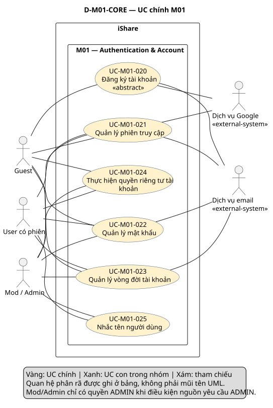
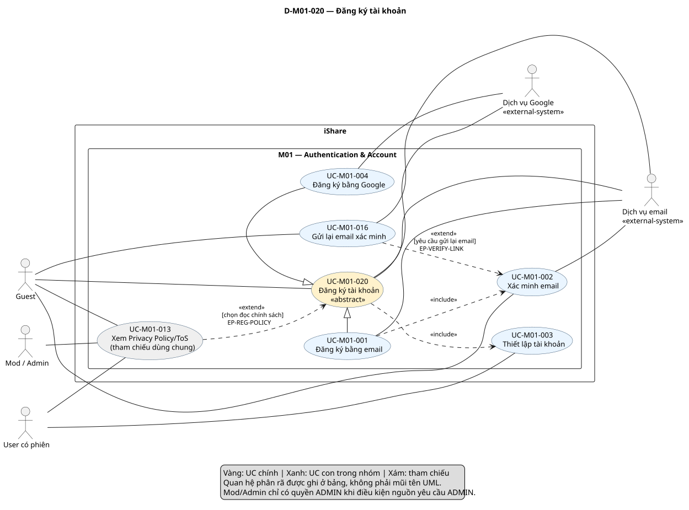
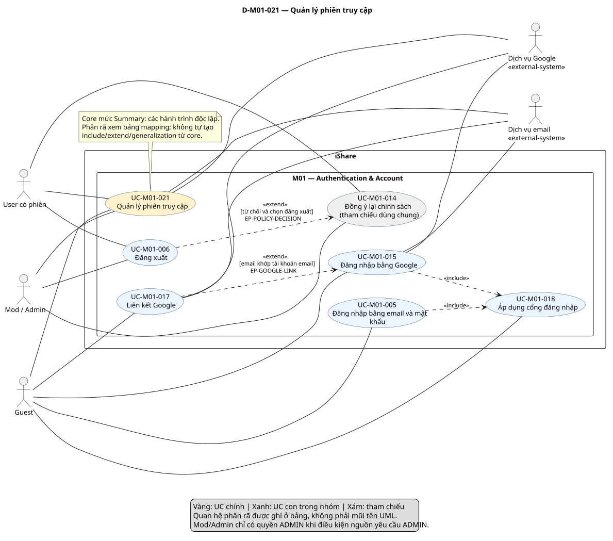
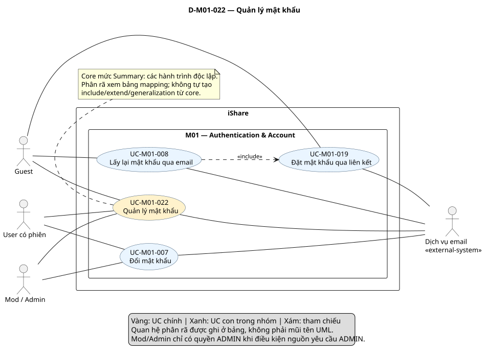
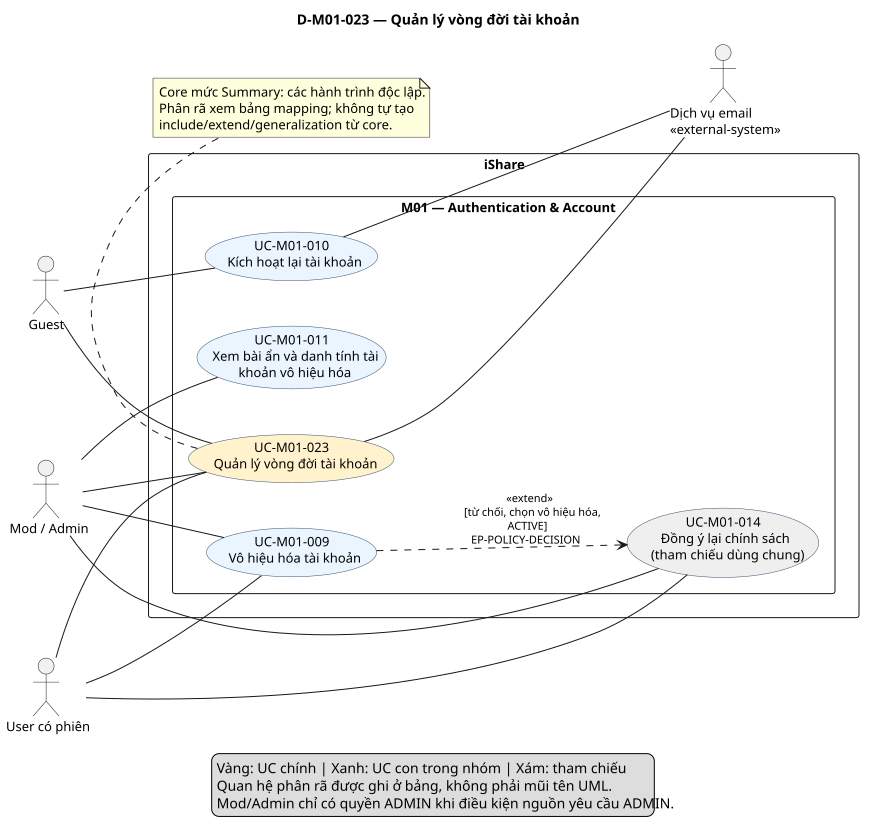
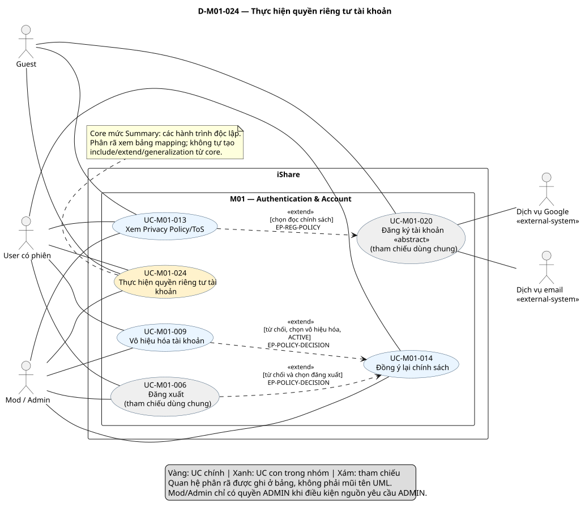
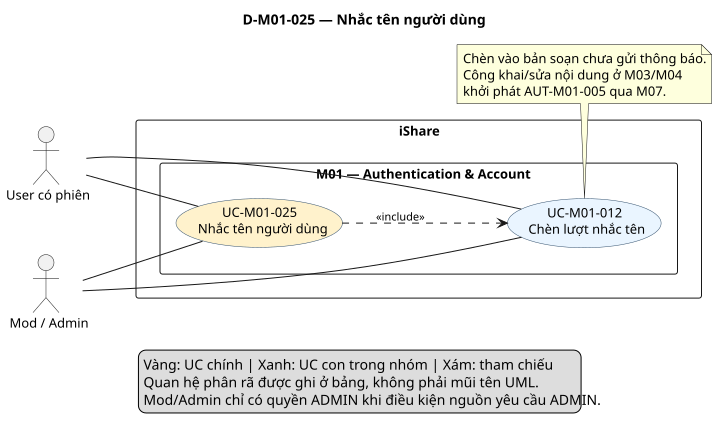

# Phân tích use case — M01 Authentication & Account (US-M01)

[Vietnamese Doc]

Bản phân tích theo skill use-case-analysis 2.2, hoàn tất các bước 1–7 cho M01, **Chờ duyệt**. Đầu ra gồm 6 UC chính, 19 UC con, bảng phân rã, đặc tả, truy vết và một sơ đồ chi tiết cho từng UC chính. UC chính là đầu vào tổng hợp hệ thống; tài liệu này chỉ phân tích M01.

## Metadata và tiến độ

<!-- uc:document -->
| key | value |
|---|---|
| document_id | US-M01 |
| skill_version | 2.2 |
| mode | module |
| modules | M01 |
| scope | ALL |
| status | Chờ duyệt |
| current_step | 7 |
| completed_steps | 1, 2, 3, 4, 5, 6, 7 |
| approved_steps | 1 |
| source_baseline | FR-M01 1.10; FR-M02 1.6; FR-M03 1.10; FR-M04 1.4; FR-M05 1.7; FR-M06 1.5; FR-M07 1.5; FR-M08 1.7; FR-M09 1.2; FR-M10 1.4; FR-M11 1.3; FR-M12 1.1; FR-M13 1.3; FR-M14 1.1; FR-M15 1.1; FR-M16 1.0 |
| author | Codex — hỗ trợ phân tích nghiệp vụ |
| date | 2026-10-29 |
| approval_evidence | Người dùng: “thực hiện tiếp các bước đi” — xác nhận tiếp tục sau bước 1 và cho phép thực hiện các bước còn lại trong lượt này; chưa phê duyệt kết quả cuối. |
| semantic_review | pass |
| diagram_check | pass |

| Bước | Kết quả | Xác nhận |
|---|---|---|
| 1 | Baseline, boundary, actor và kiểm kê 235 mã | Cho tiếp tục sau bước 1 |
| 2 | 6 UC chính, 19 UC con; giữ ID theo mục tiêu | Được phép triển khai; chưa duyệt riêng |
| 3 | Hợp đồng, luồng, nhánh, kết quả và điều kiện nghiệm thu | Được phép triển khai; chưa duyệt riêng |
| 4 | 20 mapping chính–con; 13 quan hệ và 4 extension point | Được phép triển khai; chưa duyệt riêng |
| 5 | Truy vết 16 nhóm, 172 FR chi tiết, 47 BR | Được phép triển khai; chưa duyệt riêng |
| 6 | 7 view PlantUML, một detail cho mỗi core; cú pháp/render/kiểm tra hình đạt | Chưa phê duyệt nội dung |
| 7 | Review ngữ nghĩa, kiểm tra cấu trúc và hình | Chờ duyệt bản cuối |

## 1. Phạm vi và nguồn

**Subject/boundary:** toàn hệ thống iShare. M01 là phạm vi chức năng phân tích, các module nội bộ không phải actor. Google và dịch vụ email nằm ngoài iShare. Người dùng có phiên chưa đồng nghĩa đã hoàn tất thiết lập. Trạng thái, mức xác minh, sở hữu tài khoản là điều kiện, không tạo actor mới.

**Phạm vi:** toàn bộ FR-M01 hiện hành: 16 nhóm, 172 FR chi tiết, 47 BR. Không xây UC ra quyết định kiểm duyệt, xử lý khiếu nại, quản trị công tắc, sửa hồ sơ, đăng bài/bình luận hoặc tải bản sao dữ liệu trong M01. Đọc các FR liên module để xác định ranh giới và hậu quả vòng đời; không coi đã đặc tả chi tiết mọi module.

<!-- uc:sources -->
| path | version | role |
|---|---|---|
| docs/specs/fr/FR-M01.md | 1.10 | owner |
| docs/specs/fr/FR-M02.md | 1.6 | related |
| docs/specs/fr/FR-M03.md | 1.10 | related |
| docs/specs/fr/FR-M04.md | 1.4 | related |
| docs/specs/fr/FR-M05.md | 1.7 | related |
| docs/specs/fr/FR-M06.md | 1.5 | related |
| docs/specs/fr/FR-M07.md | 1.5 | related |
| docs/specs/fr/FR-M08.md | 1.7 | related |
| docs/specs/fr/FR-M09.md | 1.2 | related |
| docs/specs/fr/FR-M10.md | 1.4 | related |
| docs/specs/fr/FR-M11.md | 1.3 | related |
| docs/specs/fr/FR-M12.md | 1.1 | related |
| docs/specs/fr/FR-M13.md | 1.3 | related |
| docs/specs/fr/FR-M14.md | 1.1 | related |
| docs/specs/fr/FR-M15.md | 1.1 | related |
| docs/specs/fr/FR-M16.md | 1.0 | related |

FR-M01 1.10 đã chốt ngày 2026-10-24. Danh mục nguồn dùng phiên bản hiện hành tại thời điểm phân tích. Phương pháp: [skill 2.2](../../../.agent-instructions/skills/use-case-analysis/SKILL.md); phương pháp không cung cấp thêm yêu cầu sản phẩm. Bản trong index Git chỉ dùng bảo toàn ID, không kế thừa phê duyệt.

### Actor

<!-- uc:actors -->
| id | name | kind | parent | boundary_reason | sources |
|---|---|---|---|---|---|
| ACT-001 | Guest — người chưa có phiên đăng nhập | human | - | Người bên ngoài iShare khởi tạo đăng ký, đăng nhập, lấy lại mật khẩu, kích hoạt lại hoặc xem chính sách; quyền tùy trạng thái tài khoản | FR-M01-01.01, FR-M01-04.01, FR-M01-05.01, FR-M01-09.01, FR-M01-11.01, FR-M01-15.01 |
| ACT-002 | User — người có phiên đăng nhập | human | - | Người bên ngoài iShare thao tác tài khoản của mình hoặc soạn nội dung; có thể chưa hoàn tất thiết lập, không mặc định đã SETUP_COMPLETED | FR-M01-03.09, FR-M01-07.01, FR-M01-08.01, FR-M01-10.01, FR-M01-14.11, FR-M01-16.01 |
| ACT-003 | Người dùng có vai trò Mod hoặc Admin trong phạm vi M01 | human | - | Con người ngoài subject; ngoài thao tác tài khoản cá nhân còn có quyền xem bài bị ẩn và danh tính của tài khoản DEACTIVATED theo M01; không tự suy các quyền module khác | FR-M01-13.05, BR-M01-41, FR-M01-10.04 |
| ACT-004 | Dịch vụ xác thực Google | external-system | - | Dịch vụ ngoài iShare cung cấp danh tính đã xác thực cho luồng Google | FR-M01-04.01, FR-M01-04.04, FR-M01-04.06, BR-M01-08 |
| ACT-005 | Dịch vụ gửi email bên ngoài | external-system | - | Hỗ trợ giao email ra ngoài iShare; tích hợp/điều phối thuộc M07. Không coi M07 là actor hoặc cấp quyền nhà cung cấp vào dữ liệu tài khoản | FR-M01-15.05, FR-M01-01.03, FR-M01-11.01, FR-M07-04.01, FR-M07-04.02 |


ACT-003 gộp Mod/Admin ở các quyền M01 giống nhau, không có generalization actor được suy đoán. Khi bảo trì, chỉ người thực sự có vai trò ADMIN được phép, không phải toàn bộ ACT-003. ACT-005 hỗ trợ gửi email qua điều phối M07; thông báo trong ứng dụng không tự tạo actor bên ngoài. Trong UC Subfunction, primary là actor khởi tạo được kế thừa từ ngữ cảnh gọi, không phải một thao tác UI riêng.

### Kiểm kê nhóm FR

| Nhóm | Mục tiêu/hành vi | FR chi tiết | Phân bổ |
|---|---|---|---|
| FR-M01-01 | Đăng ký tài khoản bằng email | 15 | UC-M01-001 |
| FR-M01-02 | Xác minh email | 7 | UC-M01-002, UC-M01-016 |
| FR-M01-03 | Thiết lập tài khoản | 16 | UC-M01-003, RULE-M01-002 |
| FR-M01-04 | Đăng ký, đăng nhập bằng Google | 13 | UC-M01-004, UC-M01-017, UC-M01-015 |
| FR-M01-05 | Đăng nhập bằng email và mật khẩu | 20 | UC-M01-018, UC-M01-005, RULE-M01-004, AUT-M01-004, UC-M01-006, RULE-M01-005 |
| FR-M01-06 | Duy trì phiên đăng nhập | 7 | AUT-M01-001 |
| FR-M01-07 | Đăng xuất | 2 | UC-M01-006 |
| FR-M01-08 | Đổi mật khẩu | 10 | UC-M01-007 |
| FR-M01-09 | Lấy lại mật khẩu | 16 | UC-M01-008, UC-M01-019 |
| FR-M01-10 | Vô hiệu hóa tài khoản | 7 | UC-M01-009 |
| FR-M01-11 | Kích hoạt lại tài khoản | 10 | UC-M01-010 |
| FR-M01-12 | Tự xóa tài khoản hết hạn vô hiệu hóa | 11 | AUT-M01-002, AUT-M01-003 |
| FR-M01-13 | Hiển thị nội dung của tài khoản đã vô hiệu hóa hoặc đã xóa | 7 | RULE-M01-001, UC-M01-011 |
| FR-M01-14 | Nhắc tên người dùng (@mention) | 17 | UC-M01-012, AUT-M01-005, RULE-M01-001 |
| FR-M01-15 | Xem trang Privacy Policy/ToS | 9 | UC-M01-013, RULE-M01-003 |
| FR-M01-16 | Đồng ý lại khi chính sách đổi | 5 | UC-M01-014 |

## 2. Danh mục hai tầng và phân rã

`tier` mô tả vai trò đầu ra; `level` mô tả mức mục tiêu. UC chính Summary gom các hành trình độc lập, không có nghĩa mọi UC con chạy trong một lần. UC-M01-020 là hợp đồng đăng ký trừu tượng; UC-M01-025 là mục tiêu nhắc tên cụ thể. Mapping chính–con không tự tạo quan hệ UML.

<!-- uc:catalog -->
| id | name | tier | level | primary | supporting | owner | anchor | sources |
|---|---|---|---|---|---|---|---|---|
| UC-M01-020 | Đăng ký tài khoản | core | User goal | ACT-001 | ACT-004, ACT-005 | M01 | #uc-m01-020 | FR-M01-01, FR-M01-02, FR-M01-03, FR-M01-04, BR-M01-02, BR-M01-03, BR-M01-08 |
| UC-M01-021 | Quản lý phiên truy cập | core | Summary | ACT-001, ACT-002, ACT-003 | ACT-004, ACT-005 | M01 | #uc-m01-021 | FR-M01-04, FR-M01-05, FR-M01-06, FR-M01-07 |
| UC-M01-022 | Quản lý mật khẩu | core | Summary | ACT-001, ACT-002, ACT-003 | ACT-005 | M01 | #uc-m01-022 | FR-M01-08, FR-M01-09, BR-M01-13, BR-M01-14, BR-M01-15 |
| UC-M01-023 | Quản lý vòng đời tài khoản | core | Summary | ACT-001, ACT-002, ACT-003 | ACT-005 | M01 | #uc-m01-023 | FR-M01-10, FR-M01-11, FR-M01-12, FR-M01-13, BR-M01-20, BR-M01-21 |
| UC-M01-024 | Thực hiện quyền riêng tư tài khoản | core | Summary | ACT-001, ACT-002, ACT-003 | - | M01 | #uc-m01-024 | FR-M01-15, FR-M01-16, BR-M01-44, BR-M01-45 |
| UC-M01-025 | Nhắc tên người dùng | core | User goal | ACT-002, ACT-003 | - | M01 | #uc-m01-025 | FR-M01-14, BR-M01-28, BR-M01-29, BR-M01-30 |
| UC-M01-001 | Đăng ký bằng email | sub | User goal | ACT-001 | ACT-005 | M01 | #uc-m01-001 | FR-M01-01, BR-M01-01, BR-M01-02, BR-M01-03, BR-M01-04, BR-M01-35 |
| UC-M01-002 | Xác minh email | sub | User goal | ACT-001 | ACT-005 | M01 | #uc-m01-002 | FR-M01-02.01, FR-M01-02.02, FR-M01-02.03, FR-M01-02.06, BR-M01-10, BR-M01-38 |
| UC-M01-003 | Thiết lập tài khoản | sub | User goal | ACT-002 | - | M01 | #uc-m01-003 | FR-M01-03, BR-M01-05, BR-M01-06, BR-M01-08 |
| UC-M01-004 | Đăng ký bằng Google | sub | User goal | ACT-001 | ACT-004 | M01 | #uc-m01-004 | FR-M01-04.01, FR-M01-04.02, FR-M01-04.03, FR-M01-04.07, FR-M01-04.10, FR-M01-04.12, FR-M01-04.13, BR-M01-08 |
| UC-M01-005 | Đăng nhập bằng email và mật khẩu | sub | User goal | ACT-001 | - | M01 | #uc-m01-005 | FR-M01-05, BR-M01-18, BR-M01-37 |
| UC-M01-006 | Đăng xuất | sub | User goal | ACT-002, ACT-003 | - | M01 | #uc-m01-006 | FR-M01-07, FR-M01-05.18, FR-M01-16.03, BR-M01-17 |
| UC-M01-007 | Đổi mật khẩu | sub | User goal | ACT-002, ACT-003 | ACT-005 | M01 | #uc-m01-007 | FR-M01-08, BR-M01-14, BR-M01-15, BR-M01-31, BR-M01-35 |
| UC-M01-008 | Lấy lại mật khẩu qua email | sub | User goal | ACT-001 | ACT-005 | M01 | #uc-m01-008 | FR-M01-09, BR-M01-12, BR-M01-13, BR-M01-39 |
| UC-M01-009 | Vô hiệu hóa tài khoản | sub | User goal | ACT-002, ACT-003 | - | M01 | #uc-m01-009 | FR-M01-10, BR-M01-20, BR-M01-21, BR-M01-45 |
| UC-M01-010 | Kích hoạt lại tài khoản | sub | User goal | ACT-001 | ACT-005 | M01 | #uc-m01-010 | FR-M01-11, BR-M01-22, BR-M01-25 |
| UC-M01-011 | Xem bài ẩn và danh tính tài khoản vô hiệu hóa | sub | User goal | ACT-003 | - | M01 | #uc-m01-011 | FR-M01-13.05, BR-M01-41 |
| UC-M01-012 | Chèn lượt nhắc tên | sub | Subfunction | ACT-002, ACT-003 | - | M01 | #uc-m01-012 | FR-M01-14, BR-M01-26, BR-M01-27, BR-M01-28, BR-M01-29, BR-M01-40 |
| UC-M01-013 | Xem Privacy Policy/ToS | sub | User goal | ACT-001, ACT-002, ACT-003 | - | M01 | #uc-m01-013 | FR-M01-15, BR-M01-42, BR-M01-43, BR-M01-46 |
| UC-M01-014 | Đồng ý lại chính sách | sub | User goal | ACT-002, ACT-003 | - | M01 | #uc-m01-014 | FR-M01-16, BR-M01-44, BR-M01-45 |
| UC-M01-015 | Đăng nhập bằng Google | sub | User goal | ACT-001 | ACT-004, ACT-005 | M01 | #uc-m01-015 | FR-M01-04.04, FR-M01-04.06, FR-M01-04.08, FR-M01-04.11, BR-M01-09, BR-M01-18 |
| UC-M01-016 | Gửi lại email xác minh | sub | User goal | ACT-001 | ACT-005 | M01 | #uc-m01-016 | FR-M01-02.04, FR-M01-02.05, FR-M01-02.07, BR-M01-11, BR-M01-38 |
| UC-M01-017 | Liên kết Google | sub | Subfunction | ACT-001 | ACT-004, ACT-005 | M01 | #uc-m01-017 | FR-M01-04.04, FR-M01-04.05, FR-M01-04.09, FR-M01-04.11, BR-M01-09, BR-M01-33 |
| UC-M01-018 | Áp dụng cổng đăng nhập | sub | Subfunction | ACT-001 | - | M01 | #uc-m01-018 | FR-M01-05.01, FR-M01-05.03, FR-M01-05.04, FR-M01-05.05, FR-M01-05.06, FR-M01-05.07, FR-M01-05.08, FR-M01-05.09, FR-M01-05.10, FR-M01-05.11, FR-M01-05.12, FR-M01-05.19, BR-M01-18, BR-M01-19, BR-M01-37 |
| UC-M01-019 | Đặt mật khẩu qua liên kết | sub | Subfunction | ACT-001 | ACT-005 | M01 | #uc-m01-019 | FR-M01-09.02, FR-M01-09.03, FR-M01-09.04, FR-M01-09.05, FR-M01-09.06, FR-M01-09.08, FR-M01-09.09, FR-M01-09.10, FR-M01-09.11, FR-M01-09.12, FR-M01-09.16, BR-M01-12, BR-M01-13, BR-M01-35, BR-M01-38, BR-M01-39 |

### Bảng phân rã UC chính → UC con

<!-- uc:decomposition -->
| core | sub | rationale | sources |
|---|---|---|---|
| UC-M01-020 | UC-M01-001 | Có tài khoản email hoàn tất ba bước đăng ký. | FR-M01-01, BR-M01-01, BR-M01-02, BR-M01-03, BR-M01-04, BR-M01-35 |
| UC-M01-020 | UC-M01-002 | Nâng mức xác minh tài khoản email từ NONE lên EMAIL_VERIFIED. | FR-M01-02.01, FR-M01-02.02, FR-M01-02.03, FR-M01-02.06, BR-M01-10, BR-M01-38 |
| UC-M01-020 | UC-M01-003 | Hoàn tất thông tin bắt buộc để dùng tài khoản. | FR-M01-03, BR-M01-05, BR-M01-06, BR-M01-08 |
| UC-M01-020 | UC-M01-004 | Tạo mới tài khoản bằng danh tính Google và hoàn tất thiết lập. | FR-M01-04.01, FR-M01-04.02, FR-M01-04.03, FR-M01-04.07, FR-M01-04.10, FR-M01-04.12, FR-M01-04.13, BR-M01-08 |
| UC-M01-020 | UC-M01-016 | Nhận link xác minh mới khi còn ở bước xác minh email. | FR-M01-02.04, FR-M01-02.05, FR-M01-02.07, BR-M01-11, BR-M01-38 |
| UC-M01-021 | UC-M01-005 | Truy cập tài khoản email trên thiết bị hiện tại. | FR-M01-05, BR-M01-18, BR-M01-37 |
| UC-M01-021 | UC-M01-015 | Truy cập tài khoản đã có bằng danh tính Google. | FR-M01-04.04, FR-M01-04.06, FR-M01-04.08, FR-M01-04.11, BR-M01-09, BR-M01-18 |
| UC-M01-021 | UC-M01-006 | Kết thúc phiên trên thiết bị đang dùng. | FR-M01-07, FR-M01-05.18, FR-M01-16.03, BR-M01-17 |
| UC-M01-021 | UC-M01-017 | Gắn danh tính Google vào tài khoản email có cùng email. | FR-M01-04.04, FR-M01-04.05, FR-M01-04.09, FR-M01-04.11, BR-M01-09, BR-M01-33 |
| UC-M01-021 | UC-M01-018 | Quyết định quyền và đích truy cập sau xác thực. | FR-M01-05.01, FR-M01-05.03, FR-M01-05.04, FR-M01-05.05, FR-M01-05.06, FR-M01-05.07, FR-M01-05.08, FR-M01-05.09, FR-M01-05.10, FR-M01-05.11, FR-M01-05.12, FR-M01-05.19, BR-M01-18, BR-M01-19, BR-M01-37 |
| UC-M01-022 | UC-M01-007 | Đổi mật khẩu khi còn biết mật khẩu hiện tại. | FR-M01-08, BR-M01-14, BR-M01-15, BR-M01-31, BR-M01-35 |
| UC-M01-022 | UC-M01-008 | Khôi phục truy cập tài khoản email khi quên mật khẩu. | FR-M01-09, BR-M01-12, BR-M01-13, BR-M01-39 |
| UC-M01-022 | UC-M01-019 | Thay mật khẩu qua magic link và thiết lập lại phiên truy cập. | FR-M01-09.02, FR-M01-09.03, FR-M01-09.04, FR-M01-09.05, FR-M01-09.06, FR-M01-09.08, FR-M01-09.09, FR-M01-09.10, FR-M01-09.11, FR-M01-09.12, FR-M01-09.16, BR-M01-12, BR-M01-13, BR-M01-35, BR-M01-38, BR-M01-39 |
| UC-M01-023 | UC-M01-009 | Ngừng sử dụng tài khoản của chính mình, đồng thời rút lại đồng ý. | FR-M01-10, BR-M01-20, BR-M01-21, BR-M01-45 |
| UC-M01-023 | UC-M01-010 | Khôi phục tài khoản DEACTIVATED trong thời hạn cho phép. | FR-M01-11, BR-M01-22, BR-M01-25 |
| UC-M01-023 | UC-M01-011 | Tra cứu nội dung bị ẩn và danh tính thật trong thời gian DEACTIVATED theo quyền kiểm duyệt. | FR-M01-13.05, BR-M01-41 |
| UC-M01-024 | UC-M01-013 | Đọc chính sách và quyền được công bố. | FR-M01-15, BR-M01-42, BR-M01-43, BR-M01-46 |
| UC-M01-024 | UC-M01-014 | Quyết định tiếp tục sử dụng theo chính sách mới. | FR-M01-16, BR-M01-44, BR-M01-45 |
| UC-M01-024 | UC-M01-009 | Dùng chung: vô hiệu hóa thực hiện rút lại đồng ý. | FR-M01-10, BR-M01-20, BR-M01-21, BR-M01-45 |
| UC-M01-025 | UC-M01-012 | Chèn khối nhắc tên gắn một tài khoản được chọn vào nội dung đang soạn. | FR-M01-14, BR-M01-26, BR-M01-27, BR-M01-28, BR-M01-29, BR-M01-40 |

<!-- uc:module-models -->
| module | path | baseline |
|---|---|---|


Mode module: bảng tổng hợp mô hình module khác để trống; không phát sinh US-overview trong lượt này.

| Quyết định | Biểu diễn | Lý do |
|---|---|---|
| D-01 | Giữ UC-M01-001…014 và core 020…024 theo ý nghĩa còn tương ứng | Không đổi ID chỉ vì thay level, tên hoặc view; UC004 tách phần đăng nhập sang UC015. |
| D-02 | Core025 nhắc tên riêng; core024 thu hẹp vào quyền riêng tư | Nhắc tên và chấp thuận chính sách có actor/mục tiêu/trigger khác nhau. |
| D-03 | UC018 dùng chung cho email và Google | Cổng là hành vi ra quyết định có luồng, không chỉ tiền điều kiện ACTIVE. |
| D-04 | UC016/017/019 tách hành vi có hợp đồng và điểm gọi | Không biến từng thao tác nhập/chọn/kiểm tra thành một oval. |
| D-05 | Đăng xuất, đổi/lấy lại mật khẩu, vô hiệu hóa/kích hoạt lại là hành trình độc lập | Không dùng extend chỉ vì chức năng xuất hiện sau đăng nhập. |
| D-06 | 5 AUT và 5 RULE giữ trách nhiệm nghiệp vụ không có thao tác khởi tạo | Không bỏ sót xóa theo hạn, làm mới phiên, hết ban hoặc thông báo nhắc tên. |
| D-07 | UC009 có hai mapping; UC013/006 xuất hiện ở nhiều view giữ nguyên ID | Tái sử dụng không nhân bản định nghĩa. |
| D-08 | Generalization chỉ cho hai phương thức đăng ký | Cùng hợp đồng đầu vào/đầu ra; Summary quản lý không phải cha kế thừa CRUD. |

## 3. Đặc tả UC, tác vụ và quy tắc

### 3.1 UC chính

<a id="uc-m01-020"></a>

### UC-M01-020 — Đăng ký tài khoản

<!-- uc:spec UC-M01-020 -->
| key | value |
|---|---|
| goal | Có tài khoản đã xác minh email, đồng ý chính sách và hoàn tất thiết lập. |
| subject | iShare |
| level | User goal |
| primary | ACT-001 |
| supporting | ACT-004, ACT-005 |
| trigger | Guest bắt đầu đăng ký bằng email hoặc Google. |
| preconditions | Guest chưa có tài khoản phù hợp; được phép tạo mới; phương thức cụ thể chịu quy tắc riêng. |
| success | ACTIVE, USER, SETUP_COMPLETED; thông tin bắt buộc hợp lệ; lưu thời điểm và phiên bản đồng ý. |
| failure | Không tạo tài khoản nếu chưa đồng ý hoặc đang tạm dừng đăng ký. Lỗi ở bước sau giữ mức hoàn tất trước đó; không tự coi tài khoản đã thiết lập. |
| abstract | true |
| common_contract | Hợp đồng chung: Guest cung cấp danh tính bằng phương thức cụ thể, chấp thuận chính sách, đạt EMAIL_VERIFIED rồi hoàn tất UC-M01-003 để đạt SETUP_COMPLETED. Email thêm tạo mật khẩu và magic link; Google dùng danh tính Google và bỏ bước xác minh bằng link. Hai phương thức thay thế nhau tại bước 1; cùng kế thừa bước 2–3. |

<a id="uc-m01-020-contract"></a>

**Hợp đồng chung:** Hợp đồng chung: Guest cung cấp danh tính bằng phương thức cụ thể, chấp thuận chính sách, đạt EMAIL_VERIFIED rồi hoàn tất UC-M01-003 để đạt SETUP_COMPLETED. Email thêm tạo mật khẩu và magic link; Google dùng danh tính Google và bỏ bước xác minh bằng link. Hai phương thức thay thế nhau tại bước 1; cùng kế thừa bước 2–3.

#### Luồng chính

<a id="uc-m01-020-main-1"></a>

| Bước | Tương tác actor–iShare | Tiếp tục | Nguồn |
|---|---|---|---|
| 1 | Kiểm tra không bảo trì và không tạm dừng tạo mới, rồi thực hiện phương thức đăng ký cụ thể: UC-M01-001 hoặc UC-M01-004. Bảo đảm đồng ý Privacy Policy/ToS và xác minh quyền sở hữu email; tại điểm đồng ý có thể mở UC-M01-013 (EP-REG-POLICY). | 2 | FR-M01-01, FR-M01-02, FR-M01-03, FR-M01-04, BR-M01-02, BR-M01-03, BR-M01-08 |

<a id="uc-m01-020-main-2"></a>

| Bước | Tương tác actor–iShare | Tiếp tục | Nguồn |
|---|---|---|---|
| 2 | Bắt buộc thực hiện UC-M01-003 để hoàn tất thiết lập chung sau khi email đã xác minh. | 3 | FR-M01-01, FR-M01-02, FR-M01-03, FR-M01-04, BR-M01-02, BR-M01-03, BR-M01-08 |

<a id="uc-m01-020-main-3"></a>

| Bước | Tương tác actor–iShare | Tiếp tục | Nguồn |
|---|---|---|---|
| 3 | Kết thúc khi thông tin bắt buộc hợp lệ và mức xác minh là SETUP_COMPLETED. | END: ACTIVE, USER, SETUP_COMPLETED; thông tin bắt buộc hợp lệ; lưu thời điểm và phiên bản đồng ý. | FR-M01-01, FR-M01-02, FR-M01-03, FR-M01-04, BR-M01-02, BR-M01-03, BR-M01-08 |

#### Luồng thay thế và ngoại lệ

<a id="uc-m01-020-alt-1"></a>

| Nhánh | Bước rẽ | Điều kiện | Xử lý | Quay lại/kết thúc | Nguồn |
|---|---|---|---|---|---|
| A1 | 1 | Không đồng ý chính sách hoặc tạm dừng tạo mới | Không tạo tài khoản; không áp dụng hạn chế tạo mới cho bước 2/3 của tài khoản đã có. | END: không đăng ký mới | FR-M01-01, FR-M01-02, FR-M01-03, FR-M01-04, BR-M01-02, BR-M01-03, BR-M01-08 |

<a id="uc-m01-020-alt-2"></a>

| Nhánh | Bước rẽ | Điều kiện | Xử lý | Quay lại/kết thúc | Nguồn |
|---|---|---|---|---|---|
| A2 | 2 | Thông tin thiết lập không hợp lệ hoặc chưa hoàn tất | Giữ EMAIL_VERIFIED; yêu cầu hoàn tất thiết lập khi quay lại. | 2 | FR-M01-01, FR-M01-02, FR-M01-03, FR-M01-04, BR-M01-02, BR-M01-03, BR-M01-08 |

<a id="uc-m01-020-rules"></a>

**Quy tắc áp dụng:** FR-M01-01, FR-M01-02, FR-M01-03, FR-M01-04, BR-M01-02, BR-M01-03, BR-M01-08. Các BR ở mục 3.5 là phần ràng buộc của đặc tả; các FR chi tiết dưới đây không tạo UC mới.

<a id="uc-m01-021"></a>

### UC-M01-021 — Quản lý phiên truy cập

**Actor chính:** ACT-001, ACT-002, ACT-003. **Hỗ trợ:** ACT-004, ACT-005. **Giá trị:** Truy cập tài khoản đúng trạng thái trên từng thiết bị.

**Khởi phát/phạm vi:** Đăng nhập, tiếp tục phiên hoặc đăng xuất. Tùy UC con; không yêu cầu Guest có phiên sẵn.

**Kết quả:** Phiên được cấp/duy trì đúng quyền hoặc kết thúc trên thiết bị được chọn. **Bảo đảm khi không đạt:** Từ chối quyền truy cập không hợp lệ, không tự kích hoạt lại tài khoản.

1. Chọn UC-M01-005 hoặc UC-M01-015 để đăng nhập; cả hai gọi cổng UC-M01-018. UC-M01-017 chỉ chèn vào nhánh Google trùng email tài khoản email.
2. Phiên đã có được duy trì bởi AUT-M01-001, vẫn chịu trạng thái, bảo trì và phiên bản chính sách.
3. UC-M01-006 kết thúc phiên của thiết bị hiện tại.

<a id="uc-m01-022"></a>

### UC-M01-022 — Quản lý mật khẩu

**Actor chính:** ACT-001, ACT-002, ACT-003. **Hỗ trợ:** ACT-005. **Giá trị:** Chủ tài khoản email thay đổi hoặc lấy lại mật khẩu.

**Khởi phát/phạm vi:** Chọn đổi mật khẩu hoặc quên mật khẩu. Phân biệt tài khoản email với Google; điều kiện theo từng hành trình.

**Kết quả:** Mật khẩu mới hợp lệ; phiên và thông báo xử lý đúng loại hành trình. **Bảo đảm khi không đạt:** Không thay mật khẩu khi điều kiện không đạt.

1. Đang đăng nhập và ACTIVE: UC-M01-007 đổi mật khẩu bằng mật khẩu cũ.
2. Quên mật khẩu: UC-M01-008 gửi yêu cầu rồi bắt buộc UC-M01-019 thực hiện đặt lại qua link.
3. Đổi mật khẩu giữ phiên thiết bị khác; đặt lại mật khẩu kết thúc mọi phiên cũ và cấp phiên mới cho thiết bị đặt lại.

<a id="uc-m01-023"></a>

### UC-M01-023 — Quản lý vòng đời tài khoản

**Actor chính:** ACT-001, ACT-002, ACT-003. **Hỗ trợ:** ACT-005. **Giá trị:** Chủ tài khoản ngừng sử dụng, khôi phục đúng hạn và được xóa dữ liệu đúng quy tắc.

**Khởi phát/phạm vi:** Chọn vô hiệu hóa, yêu cầu kích hoạt lại hoặc đến mốc thời gian. Theo trạng thái và quyền từng UC con.

**Kết quả:** Chuyển trạng thái có kiểm soát; hiển thị nội dung và dữ liệu phù hợp vòng đời. **Bảo đảm khi không đạt:** Không cho phục hồi DELETED hay thao tác tài khoản người khác.

1. Chủ tài khoản ACTIVE thực hiện UC-M01-009; tài khoản sang DEACTIVATED và các phiên kết thúc.
2. Trong 14 × 24 giờ, chủ tài khoản có thể thực hiện UC-M01-010; Mod/Admin có thể tra cứu theo UC-M01-011 trong thời gian DEACTIVATED.
3. AUT-M01-003 cảnh báo trước 24 giờ; AUT-M01-002 tự xóa khi hết hạn. Không có thao tác xóa trực tiếp.

<a id="uc-m01-024"></a>

### UC-M01-024 — Thực hiện quyền riêng tư tài khoản

**Actor chính:** ACT-001, ACT-002, ACT-003. **Hỗ trợ:** -. **Giá trị:** Xem chính sách, ghi nhận đồng ý đúng phiên bản hoặc rút lại đồng ý.

**Khởi phát/phạm vi:** Mở chính sách hoặc mở ứng dụng khi chính sách mới hơn bản đã đồng ý. Trang chính sách công khai; rút lại/đồng ý lại theo ngữ cảnh tài khoản.

**Kết quả:** Có thông tin chính sách; bản đồng ý được ghi nhận, hoặc tài khoản được đăng xuất/vô hiệu hóa. **Bảo đảm khi không đạt:** Không cho dùng tiếp khi chưa đồng ý chính sách mới.

1. UC-M01-013 cho mọi người đọc chính sách; đọc không đồng nghĩa với đồng ý.
2. UC-M01-014 yêu cầu đồng ý lại khi phiên bản thay đổi, kể cả phiên đang có.
3. Nếu từ chối: chọn đăng xuất bằng UC-M01-006 hoặc rút lại đồng ý qua UC-M01-009.

<a id="uc-m01-025"></a>

### UC-M01-025 — Nhắc tên người dùng

<!-- uc:spec UC-M01-025 -->
| key | value |
|---|---|
| goal | Gắn tham chiếu tài khoản vào nội dung đang soạn để người đọc nhận diện người được nhắc. |
| subject | iShare |
| level | User goal |
| primary | ACT-002, ACT-003 |
| supporting | - |
| trigger | Người đã đăng nhập soạn bài viết hoặc bình luận có nhắc người khác. |
| preconditions | Được phép soạn nội dung trong M03/M04; không phải tài khoản BANNED bị hạn chế; không giả định nội dung đã công khai. |
| success | Nội dung đang soạn chứa lượt nhắc gắn tài khoản; nhãn tuân theo danh tính hiện hành. |
| failure | Không tạo lượt nhắc từ một lựa chọn không hợp lệ; không gửi thông báo chỉ vì chèn vào bản soạn. |
| abstract | false |
| common_contract | Không áp dụng: không là UC tổng quát trong generalization. |

#### Luồng chính

<a id="uc-m01-025-main-1"></a>

| Bước | Tương tác actor–iShare | Tiếp tục | Nguồn |
|---|---|---|---|
| 1 | Thực hiện UC-M01-012 để tìm, chọn và chèn lượt nhắc tên trong ngữ cảnh bài viết/bình luận. | 2 | FR-M01-14, BR-M01-28, BR-M01-29, BR-M01-30 |

<a id="uc-m01-025-main-2"></a>

| Bước | Tương tác actor–iShare | Tiếp tục | Nguồn |
|---|---|---|---|
| 2 | Giữ lượt nhắc dưới dạng khối liền; người soạn có thể xóa cả khối. Kết thúc tại nội dung đang soạn; công khai nội dung thuộc M03/M04. | END: Nội dung đang soạn chứa lượt nhắc gắn tài khoản; nhãn tuân theo danh tính hiện hành. | FR-M01-14, BR-M01-28, BR-M01-29, BR-M01-30 |

#### Luồng thay thế và ngoại lệ

<a id="uc-m01-025-alt-1"></a>

| Nhánh | Bước rẽ | Điều kiện | Xử lý | Quay lại/kết thúc | Nguồn |
|---|---|---|---|---|---|
| A1 | 2 | Người được nhắc đổi tên, DEACTIVATED hoặc DELETED | Hiển thị tên hiện hành hoặc tên thay thế theo RULE-M01-001; không sửa nhãn thủ công. | END: hiển thị đúng trạng thái | FR-M01-14, BR-M01-28, BR-M01-29, BR-M01-30 |

<a id="uc-m01-025-rules"></a>

**Quy tắc áp dụng:** FR-M01-14, BR-M01-28, BR-M01-29, BR-M01-30. Các BR ở mục 3.5 là phần ràng buộc của đặc tả; các FR chi tiết dưới đây không tạo UC mới.

### 3.2 UC con

**Chuyển vai trò trong hành trình:** người khởi tạo đăng ký là Guest; để gửi bước 3 phải có phiên như FR-M01-03.09. Nếu chưa có phiên, dùng hành trình đăng nhập hiện có (UC005/UC015), cổng cho mức EMAIL_VERIFIED tới bước 3; không suy ra hệ thống tự đăng nhập ngay khi tạo tài khoản email. Đây là điều kiện truy cập bước 3, không tạo quan hệ include đăng nhập cho mọi UC.

<a id="uc-m01-001"></a>

### UC-M01-001 — Đăng ký bằng email

**UC chính:** UC-M01-020.

<!-- uc:spec UC-M01-001 -->
| key | value |
|---|---|
| goal | Có tài khoản email hoàn tất ba bước đăng ký. |
| subject | iShare |
| level | User goal |
| primary | ACT-001 |
| supporting | ACT-005 |
| trigger | Guest gửi đăng ký email. |
| preconditions | Guest; tạo mới được cho phép; email chưa thuộc tài khoản. |
| success | Hoàn tất hợp đồng UC-M01-020; tài khoản ACTIVE/USER/SETUP_COMPLETED. |
| failure | Chưa đồng ý, email trùng hoặc mật khẩu sai quy tắc thì không tạo; chưa xác minh/thiết lập thì chưa hoàn tất. |
| abstract | false |
| common_contract | Không áp dụng: không là UC tổng quát trong generalization. |

#### Luồng chính

<a id="uc-m01-001-main-1"></a>

| Bước | Tương tác actor–iShare | Tiếp tục | Nguồn |
|---|---|---|---|
| 1 | Nhập email, mật khẩu và nhập lại; đồng ý rõ ràng Privacy Policy/ToS; có liên kết đọc UC-M01-013 theo hợp đồng UC-M01-020. | 2 | FR-M01-01, BR-M01-01, BR-M01-02, BR-M01-03, BR-M01-04, BR-M01-35 |

<a id="uc-m01-001-main-2"></a>

| Bước | Tương tác actor–iShare | Tiếp tục | Nguồn |
|---|---|---|---|
| 2 | Kiểm tra dữ liệu và công tắc đăng ký; tạo ACTIVE/NONE, vai trò USER, lưu thời điểm/phiên bản đồng ý, gửi link xác minh qua M07. | 3 | FR-M01-01, BR-M01-01, BR-M01-02, BR-M01-03, BR-M01-04, BR-M01-35 |

<a id="uc-m01-001-main-3"></a>

| Bước | Tương tác actor–iShare | Tiếp tục | Nguồn |
|---|---|---|---|
| 3 | Thực hiện UC-M01-002 để xác minh email. | 4 | FR-M01-01, BR-M01-01, BR-M01-02, BR-M01-03, BR-M01-04, BR-M01-35 |

<a id="uc-m01-001-main-4"></a>

| Bước | Tương tác actor–iShare | Tiếp tục | Nguồn |
|---|---|---|---|
| 4 | Tiếp tục phần thiết lập chung UC-M01-020 bước 2–3 (UC-M01-003), không tạo một quan hệ include trùng với phần đã kế thừa. | END: Hoàn tất hợp đồng UC-M01-020; tài khoản ACTIVE/USER/SETUP_COMPLETED. | FR-M01-01, BR-M01-01, BR-M01-02, BR-M01-03, BR-M01-04, BR-M01-35 |

#### Luồng thay thế và ngoại lệ

<a id="uc-m01-001-alt-1"></a>

| Nhánh | Bước rẽ | Điều kiện | Xử lý | Quay lại/kết thúc | Nguồn |
|---|---|---|---|---|---|
| A1 | 1 | Không đồng ý, email trùng, mật khẩu/nhập lại không hợp lệ hoặc đang tạm dừng đăng ký | Từ chối tạo; mật khẩu 8–64 ký tự, nhận khoảng trắng/chữ có dấu và không tự cắt. | END: chưa tạo tài khoản | FR-M01-01, BR-M01-01, BR-M01-02, BR-M01-03, BR-M01-04, BR-M01-35 |

<a id="uc-m01-001-alt-2"></a>

| Nhánh | Bước rẽ | Điều kiện | Xử lý | Quay lại/kết thúc | Nguồn |
|---|---|---|---|---|---|
| A2 | 3 | Người dùng chưa mở link hợp lệ | Giữ NONE, không cho vượt bước; cho xin lại email theo UC-M01-016. | 3 | FR-M01-01, BR-M01-01, BR-M01-02, BR-M01-03, BR-M01-04, BR-M01-35 |

<a id="uc-m01-001-rules"></a>

**Quy tắc áp dụng:** FR-M01-01, BR-M01-01, BR-M01-02, BR-M01-03, BR-M01-04, BR-M01-35. Các BR ở mục 3.5 là phần ràng buộc của đặc tả; các FR chi tiết dưới đây không tạo UC mới.

#### Điều kiện nghiệm thu từ FR

Các điều kiện dưới đây bổ sung chi tiết cho hợp đồng và các nhánh phía trên; giữ nguyên nội dung chuẩn tắc của baseline, không phải UC độc lập.

| Mã nguồn | Điều kiện phải đáp ứng |
|---|---|
| <a id="uc-m01-001-fr-m01-01-01"></a>FR-M01-01.01 | Khi Guest gửi email, mật khẩu và đồng ý Privacy Policy/ToS, hệ thống phải tạo tài khoản ở trạng thái ACTIVE với mức xác minh NONE. |
| <a id="uc-m01-001-fr-m01-01-02"></a>FR-M01-01.02 | Hệ thống phải gán vai trò USER cho mọi tài khoản mới, dù tạo bằng email hay bằng Google. |
| <a id="uc-m01-001-fr-m01-01-03"></a>FR-M01-01.03 | Khi tạo tài khoản ở bước 1, hệ thống phải gửi magic link xác minh tới email vừa đăng ký. |
| <a id="uc-m01-001-fr-m01-01-04"></a>FR-M01-01.04 | Hệ thống phải hiển thị liên kết tới trang Privacy Policy/ToS trong luồng đăng ký. |
| <a id="uc-m01-001-fr-m01-01-05"></a>FR-M01-01.05 | Nếu người đăng ký không đồng ý Privacy Policy/ToS, hệ thống phải từ chối tạo tài khoản. |
| <a id="uc-m01-001-fr-m01-01-06"></a>FR-M01-01.06 | Nếu email đã thuộc một tài khoản khác, hệ thống phải từ chối tạo tài khoản. |
| <a id="uc-m01-001-fr-m01-01-07"></a>FR-M01-01.07 | Nếu thiếu email hoặc mật khẩu, hệ thống phải từ chối tạo tài khoản. |
| <a id="uc-m01-001-fr-m01-01-08"></a>FR-M01-01.08 | Trong khi công tắc tạm dừng đăng ký đang bật, hệ thống phải từ chối tạo tài khoản email mới. |
| <a id="uc-m01-001-fr-m01-01-09"></a>FR-M01-01.09 | Trong khi công tắc tạm dừng đăng ký đang bật, hệ thống phải vẫn cho tài khoản đã qua bước 1 làm tiếp bước 2 và bước 3. |
| <a id="uc-m01-001-fr-m01-01-10"></a>FR-M01-01.10 | Nếu mật khẩu dài dưới 8 hoặc trên 64 ký tự, hệ thống phải từ chối mật khẩu đó. |
| <a id="uc-m01-001-fr-m01-01-11"></a>FR-M01-01.11 | Hệ thống phải chấp nhận mọi ký tự trong mật khẩu, kể cả khoảng trắng và chữ có dấu, không bắt buộc loại ký tự và không tự cắt khoảng trắng. |
| <a id="uc-m01-001-fr-m01-01-12"></a>FR-M01-01.12 | Trong khi chế độ bảo trì đang bật, hệ thống phải từ chối tạo tài khoản mới bằng email hoặc bằng Google. |
| <a id="uc-m01-001-fr-m01-01-13"></a>FR-M01-01.13 | Hệ thống phải hiển thị ở bước 1 một ô đồng ý với nội dung "Tôi đồng ý với Điều khoản và Chính sách quyền riêng tư. Nếu dưới 16 tuổi, tôi đã được cha mẹ hoặc người giám hộ đồng ý." |
| <a id="uc-m01-001-fr-m01-01-14"></a>FR-M01-01.14 | Khi tạo tài khoản, hệ thống phải lưu thời điểm và phiên bản chính sách mà người đăng ký đã đồng ý. |
| <a id="uc-m01-001-fr-m01-01-15"></a>FR-M01-01.15 | Hệ thống phải không hỏi ngày sinh hay tuổi khi đăng ký. |

<a id="uc-m01-002"></a>

### UC-M01-002 — Xác minh email

**UC chính:** UC-M01-020.

<!-- uc:spec UC-M01-002 -->
| key | value |
|---|---|
| goal | Nâng mức xác minh tài khoản email từ NONE lên EMAIL_VERIFIED. |
| subject | iShare |
| level | User goal |
| primary | ACT-001 |
| supporting | ACT-005 |
| trigger | Chủ tài khoản mở link xác minh đã nhận. |
| preconditions | Tài khoản email đã tạo, còn cần xác minh; link thuộc tài khoản đó. |
| success | Email được xác minh; hướng tới bước thiết lập tài khoản. |
| failure | Link hết hạn/đã dùng không xác minh được; không vượt qua bước 2. |
| abstract | false |
| common_contract | Không áp dụng: không là UC tổng quát trong generalization. |

#### Luồng chính

<a id="uc-m01-002-main-1"></a>

| Bước | Tương tác actor–iShare | Tiếp tục | Nguồn |
|---|---|---|---|
| 1 | Chờ người dùng mở link đã gửi. EP-VERIFY-LINK cho phép yêu cầu UC-M01-016 khi cần gửi lại. | 2 | FR-M01-02.01, FR-M01-02.02, FR-M01-02.03, FR-M01-02.06, BR-M01-10, BR-M01-38 |

<a id="uc-m01-002-main-2"></a>

| Bước | Tương tác actor–iShare | Tiếp tục | Nguồn |
|---|---|---|---|
| 2 | Kiểm tra link còn hạn 1 giờ và chưa dùng, vẫn có hiệu lực. | 3 | FR-M01-02.01, FR-M01-02.02, FR-M01-02.03, FR-M01-02.06, BR-M01-10, BR-M01-38 |

<a id="uc-m01-002-main-3"></a>

| Bước | Tương tác actor–iShare | Tiếp tục | Nguồn |
|---|---|---|---|
| 3 | Chuyển mức xác minh sang EMAIL_VERIFIED; hướng tới bước 3. | END: Email được xác minh; hướng tới bước thiết lập tài khoản. | FR-M01-02.01, FR-M01-02.02, FR-M01-02.03, FR-M01-02.06, BR-M01-10, BR-M01-38 |

#### Luồng thay thế và ngoại lệ

<a id="uc-m01-002-alt-1"></a>

| Nhánh | Bước rẽ | Điều kiện | Xử lý | Quay lại/kết thúc | Nguồn |
|---|---|---|---|---|---|
| A1 | 2 | Link quá 1 giờ hoặc đã dùng/đã bị thay thế | Từ chối xác minh bằng link; có thể quay về yêu cầu gửi lại. | 1 | FR-M01-02.01, FR-M01-02.02, FR-M01-02.03, FR-M01-02.06, BR-M01-10, BR-M01-38 |

<a id="uc-m01-002-rules"></a>

**Quy tắc áp dụng:** FR-M01-02.01, FR-M01-02.02, FR-M01-02.03, FR-M01-02.06, BR-M01-10, BR-M01-38. Các BR ở mục 3.5 là phần ràng buộc của đặc tả; các FR chi tiết dưới đây không tạo UC mới.

#### Điều kiện nghiệm thu từ FR

Các điều kiện dưới đây bổ sung chi tiết cho hợp đồng và các nhánh phía trên; giữ nguyên nội dung chuẩn tắc của baseline, không phải UC độc lập.

| Mã nguồn | Điều kiện phải đáp ứng |
|---|---|
| <a id="uc-m01-002-fr-m01-02-01"></a>FR-M01-02.01 | Khi chủ tài khoản mở magic link xác minh còn hạn, hệ thống phải chuyển mức xác minh từ NONE sang EMAIL_VERIFIED. |
| <a id="uc-m01-002-fr-m01-02-02"></a>FR-M01-02.02 | Khi xác minh email thành công, hệ thống phải đưa người dùng tới bước 3. |
| <a id="uc-m01-002-fr-m01-02-03"></a>FR-M01-02.03 | Nếu magic link xác minh đã quá 1 giờ kể từ khi gửi, hệ thống phải từ chối xác minh. |
| <a id="uc-m01-002-fr-m01-02-06"></a>FR-M01-02.06 | Nếu magic link xác minh đã được dùng, hệ thống phải từ chối dùng lại link đó. |

<a id="uc-m01-003"></a>

### UC-M01-003 — Thiết lập tài khoản

**UC chính:** UC-M01-020.

<!-- uc:spec UC-M01-003 -->
| key | value |
|---|---|
| goal | Hoàn tất thông tin bắt buộc để dùng tài khoản. |
| subject | iShare |
| level | User goal |
| primary | ACT-002 |
| supporting | - |
| trigger | Tài khoản đã xác minh đến bước 3. |
| preconditions | Đã đăng nhập và đạt EMAIL_VERIFIED; bước 3 chưa hoàn tất. |
| success | Lưu thông tin hợp lệ, đạt SETUP_COMPLETED. |
| failure | Không lưu bộ thông tin không hợp lệ; NONE phải về bước 2, chưa đăng nhập bị từ chối. |
| abstract | false |
| common_contract | Không áp dụng: không là UC tổng quát trong generalization. |

#### Luồng chính

<a id="uc-m01-003-main-1"></a>

| Bước | Tương tác actor–iShare | Tiếp tục | Nguồn |
|---|---|---|---|
| 1 | Nhập username và display_name; có thể nhập hoặc bỏ qua bio, Lớp/Khối, avatar theo M02. | 2 | FR-M01-03, BR-M01-05, BR-M01-06, BR-M01-08 |

<a id="uc-m01-003-main-2"></a>

| Bước | Tương tác actor–iShare | Tiếp tục | Nguồn |
|---|---|---|---|
| 2 | Kiểm tra username 3–20 ký tự, a–z/A–Z/0–9/_; so trùng không phân biệt hoa thường, kể cả username DELETED. Trim display_name, kiểm tra 1–50 ký tự và tập ký tự cho phép. | 3 | FR-M01-03, BR-M01-05, BR-M01-06, BR-M01-08 |

<a id="uc-m01-003-main-3"></a>

| Bước | Tương tác actor–iShare | Tiếp tục | Nguồn |
|---|---|---|---|
| 3 | Lưu thông tin hợp lệ; chuyển mức xác minh thành SETUP_COMPLETED. | END: Lưu thông tin hợp lệ, đạt SETUP_COMPLETED. | FR-M01-03, BR-M01-05, BR-M01-06, BR-M01-08 |

#### Luồng thay thế và ngoại lệ

<a id="uc-m01-003-alt-1"></a>

| Nhánh | Bước rẽ | Điều kiện | Xử lý | Quay lại/kết thúc | Nguồn |
|---|---|---|---|---|---|
| A1 | 1 | Chưa đăng nhập hoặc mức NONE | Từ chối bước 3; NONE đưa về bước 2. | END: chưa thiết lập | FR-M01-03, BR-M01-05, BR-M01-06, BR-M01-08 |

<a id="uc-m01-003-alt-2"></a>

| Nhánh | Bước rẽ | Điều kiện | Xử lý | Quay lại/kết thúc | Nguồn |
|---|---|---|---|---|---|
| A2 | 2 | Thiếu/trùng/sai username, sai display_name hoặc thông tin tùy chọn vi phạm quy tắc M02 | Từ chối giá trị sai; người dùng sửa hoặc bỏ thông tin tùy chọn. | 1 | FR-M01-03, BR-M01-05, BR-M01-06, BR-M01-08 |

<a id="uc-m01-003-rules"></a>

**Quy tắc áp dụng:** FR-M01-03, BR-M01-05, BR-M01-06, BR-M01-08. Các BR ở mục 3.5 là phần ràng buộc của đặc tả; các FR chi tiết dưới đây không tạo UC mới.

#### Điều kiện nghiệm thu từ FR

Các điều kiện dưới đây bổ sung chi tiết cho hợp đồng và các nhánh phía trên; giữ nguyên nội dung chuẩn tắc của baseline, không phải UC độc lập.

| Mã nguồn | Điều kiện phải đáp ứng |
|---|---|
| <a id="uc-m01-003-fr-m01-03-01"></a>FR-M01-03.01 | Khi chủ tài khoản ở mức EMAIL_VERIFIED gửi username và display_name hợp lệ, hệ thống phải lưu hai thông tin này và chuyển mức xác minh sang SETUP_COMPLETED. |
| <a id="uc-m01-003-fr-m01-03-02"></a>FR-M01-03.02 | Hệ thống phải cho phép bỏ qua bio, Lớp/Khối và avatar ở bước 3. |
| <a id="uc-m01-003-fr-m01-03-03"></a>FR-M01-03.03 | Khi chủ tài khoản nhập bio, Lớp/Khối hoặc avatar ở bước 3, hệ thống phải lưu các thông tin đó vào hồ sơ theo quy tắc của M02. |
| <a id="uc-m01-003-fr-m01-03-04"></a>FR-M01-03.04 | Nếu thiếu username hoặc display_name, hệ thống phải từ chối hoàn tất bước 3. |
| <a id="uc-m01-003-fr-m01-03-05"></a>FR-M01-03.05 | Nếu username dài dưới 3 hoặc trên 20 ký tự, hoặc có ký tự ngoài a–z, A–Z, 0–9 và "_", hệ thống phải từ chối username đó. |
| <a id="uc-m01-003-fr-m01-03-06"></a>FR-M01-03.06 | Nếu username trùng username của một tài khoản khác, kể cả tài khoản đã DELETED, khi so không phân biệt chữ hoa, chữ thường, hệ thống phải từ chối username đó. |
| <a id="uc-m01-003-fr-m01-03-07"></a>FR-M01-03.07 | Hệ thống phải chấp nhận display_name trùng với display_name của tài khoản khác. |
| <a id="uc-m01-003-fr-m01-03-08"></a>FR-M01-03.08 | Nếu mức xác minh của tài khoản là NONE, hệ thống phải từ chối bước 3 và đưa người dùng về bước 2. |
| <a id="uc-m01-003-fr-m01-03-09"></a>FR-M01-03.09 | Nếu người gửi chưa đăng nhập, hệ thống phải từ chối bước 3. |
| <a id="uc-m01-003-fr-m01-03-12"></a>FR-M01-03.12 | Khi lưu display_name, hệ thống phải bỏ khoảng trắng ở đầu và cuối. |
| <a id="uc-m01-003-fr-m01-03-13"></a>FR-M01-03.13 | Nếu display_name sau khi bỏ khoảng trắng đầu, cuối bị rỗng hoặc dài quá 50 ký tự, hệ thống phải từ chối display_name đó. |
| <a id="uc-m01-003-fr-m01-03-14"></a>FR-M01-03.14 | Nếu display_name có ký tự ngoài chữ cái (kể cả chữ có dấu), chữ số, khoảng trắng và các dấu . , - _ ' ( ), hệ thống phải từ chối display_name đó. |

**Thông tin tùy chọn M02:** bio tối đa 155 ký tự sau trim, đếm mỗi emoji/xuống dòng là một ký tự; toàn khoảng trắng là trống. Lớp/Khối tự chọn theo nguồn M02. Avatar chỉ JPEG/PNG/WebP ≤5 MB, không GIF; lưu ảnh gốc, thay thành công xóa ảnh cũ. Không suy ra thao tác cắt ảnh bắt buộc. Căn cứ FR-M02-03.01, FR-M02-03.04, FR-M02-03.06, FR-M02-04.01, FR-M02-04.02, FR-M02-04.03, FR-M02-04.04, FR-M02-04.05 và BR-M02-04.

<a id="uc-m01-004"></a>

### UC-M01-004 — Đăng ký bằng Google

**UC chính:** UC-M01-020.

<!-- uc:spec UC-M01-004 -->
| key | value |
|---|---|
| goal | Tạo mới tài khoản bằng danh tính Google và hoàn tất thiết lập. |
| subject | iShare |
| level | User goal |
| primary | ACT-001 |
| supporting | ACT-004 |
| trigger | Guest dùng Google với email chưa có trong iShare. |
| preconditions | Danh tính Google được cung cấp; email chưa thuộc tài khoản; đồng ý chính sách; tạo mới được cho phép. |
| success | Tài khoản Google ACTIVE/USER/SETUP_COMPLETED theo hợp đồng UC-M01-020. |
| failure | Không tạo nếu thiếu đồng ý hoặc tạm dừng đăng ký; không hoàn tất khi thông tin thiết lập sai. |
| abstract | false |
| common_contract | Không áp dụng: không là UC tổng quát trong generalization. |

#### Luồng chính

<a id="uc-m01-004-main-1"></a>

| Bước | Tương tác actor–iShare | Tiếp tục | Nguồn |
|---|---|---|---|
| 1 | Nhận danh tính Google và kiểm tra email chưa thuộc tài khoản; yêu cầu đồng ý rõ ràng Privacy Policy/ToS tại điểm đồng ý của UC-M01-020. | 2 | FR-M01-04.01, FR-M01-04.02, FR-M01-04.03, FR-M01-04.07, FR-M01-04.10, FR-M01-04.12, FR-M01-04.13, BR-M01-08 |

<a id="uc-m01-004-main-2"></a>

| Bước | Tương tác actor–iShare | Tiếp tục | Nguồn |
|---|---|---|---|
| 2 | Tạo tài khoản Google ACTIVE/EMAIL_VERIFIED, lưu đồng ý; không tạo mật khẩu hoặc yêu cầu magic link xác minh. | 3 | FR-M01-04.01, FR-M01-04.02, FR-M01-04.03, FR-M01-04.07, FR-M01-04.10, FR-M01-04.12, FR-M01-04.13, BR-M01-08 |

<a id="uc-m01-004-main-3"></a>

| Bước | Tương tác actor–iShare | Tiếp tục | Nguồn |
|---|---|---|---|
| 3 | Tiếp tục UC-M01-020 bước 2–3: tên Google điền sẵn và sửa được; username tự đặt; hoàn tất UC-M01-003. | END: Tài khoản Google ACTIVE/USER/SETUP_COMPLETED theo hợp đồng UC-M01-020. | FR-M01-04.01, FR-M01-04.02, FR-M01-04.03, FR-M01-04.07, FR-M01-04.10, FR-M01-04.12, FR-M01-04.13, BR-M01-08 |

#### Luồng thay thế và ngoại lệ

<a id="uc-m01-004-alt-1"></a>

| Nhánh | Bước rẽ | Điều kiện | Xử lý | Quay lại/kết thúc | Nguồn |
|---|---|---|---|---|---|
| A1 | 1 | Email đã thuộc tài khoản | Áp dụng hành trình đăng nhập Google UC-M01-015; không tạo tài khoản thứ hai. | END: chuyển hành trình đăng nhập | FR-M01-04.01, FR-M01-04.02, FR-M01-04.03, FR-M01-04.07, FR-M01-04.10, FR-M01-04.12, FR-M01-04.13, BR-M01-08 |

<a id="uc-m01-004-alt-2"></a>

| Nhánh | Bước rẽ | Điều kiện | Xử lý | Quay lại/kết thúc | Nguồn |
|---|---|---|---|---|---|
| A2 | 1 | Không đồng ý hoặc đang tạm dừng đăng ký | Từ chối tạo tài khoản mới. | END: không tạo | FR-M01-04.01, FR-M01-04.02, FR-M01-04.03, FR-M01-04.07, FR-M01-04.10, FR-M01-04.12, FR-M01-04.13, BR-M01-08 |

<a id="uc-m01-004-rules"></a>

**Quy tắc áp dụng:** FR-M01-04.01, FR-M01-04.02, FR-M01-04.03, FR-M01-04.07, FR-M01-04.10, FR-M01-04.12, FR-M01-04.13, BR-M01-08. Các BR ở mục 3.5 là phần ràng buộc của đặc tả; các FR chi tiết dưới đây không tạo UC mới.

#### Điều kiện nghiệm thu từ FR

Các điều kiện dưới đây bổ sung chi tiết cho hợp đồng và các nhánh phía trên; giữ nguyên nội dung chuẩn tắc của baseline, không phải UC độc lập.

| Mã nguồn | Điều kiện phải đáp ứng |
|---|---|
| <a id="uc-m01-004-fr-m01-04-01"></a>FR-M01-04.01 | Khi Guest đăng nhập Google lần đầu với email chưa thuộc tài khoản nào, hệ thống phải tạo tài khoản Google ở trạng thái ACTIVE, mức xác minh EMAIL_VERIFIED, và đưa người dùng tới bước 3. |
| <a id="uc-m01-004-fr-m01-04-02"></a>FR-M01-04.02 | Khi tạo tài khoản Google, hệ thống phải điền sẵn display_name ở bước 3 bằng tên lấy từ Google và cho người dùng sửa. |
| <a id="uc-m01-004-fr-m01-04-03"></a>FR-M01-04.03 | Khi tạo tài khoản Google, hệ thống phải yêu cầu người dùng tự đặt username ở bước 3. |
| <a id="uc-m01-004-fr-m01-04-07"></a>FR-M01-04.07 | Nếu người đăng ký bằng Google chưa đồng ý Privacy Policy/ToS, hệ thống phải từ chối tạo tài khoản. |
| <a id="uc-m01-004-fr-m01-04-10"></a>FR-M01-04.10 | Trong khi công tắc tạm dừng đăng ký đang bật, hệ thống phải từ chối tạo tài khoản Google mới. |
| <a id="uc-m01-004-fr-m01-04-12"></a>FR-M01-04.12 | Khi tạo tài khoản Google, hệ thống phải yêu cầu người đăng ký đánh dấu cùng ô đồng ý như FR-M01-01.13. |
| <a id="uc-m01-004-fr-m01-04-13"></a>FR-M01-04.13 | Khi tạo tài khoản Google, hệ thống phải lưu thời điểm và phiên bản chính sách mà người đăng ký đã đồng ý. |

<a id="uc-m01-005"></a>

### UC-M01-005 — Đăng nhập bằng email và mật khẩu

**UC chính:** UC-M01-021.

<!-- uc:spec UC-M01-005 -->
| key | value |
|---|---|
| goal | Truy cập tài khoản email trên thiết bị hiện tại. |
| subject | iShare |
| level | User goal |
| primary | ACT-001 |
| supporting | - |
| trigger | Guest gửi email và mật khẩu. |
| preconditions | Chưa có phiên phù hợp trên thiết bị; không coi ACTIVE/SETUP_COMPLETED là tiền điều kiện vì phải kiểm tra trong luồng. |
| success | Truy cập đúng đích theo cổng: bước 2, bước 3, hệ thống hoặc màn hình bị khóa. |
| failure | Thông tin sai, tài khoản Google, DELETED/DEACTIVATED hoặc bảo trì không đủ quyền thì từ chối. |
| abstract | false |
| common_contract | Không áp dụng: không là UC tổng quát trong generalization. |

#### Luồng chính

<a id="uc-m01-005-main-1"></a>

| Bước | Tương tác actor–iShare | Tiếp tục | Nguồn |
|---|---|---|---|
| 1 | Nhận email/mật khẩu; xác thực và từ chối tài khoản Google dùng mật khẩu. | 2 | FR-M01-05, BR-M01-18, BR-M01-37 |

<a id="uc-m01-005-main-2"></a>

| Bước | Tương tác actor–iShare | Tiếp tục | Nguồn |
|---|---|---|---|
| 2 | Thực hiện UC-M01-018 với tài khoản đã xác thực. | 3 | FR-M01-05, BR-M01-18, BR-M01-37 |

<a id="uc-m01-005-main-3"></a>

| Bước | Tương tác actor–iShare | Tiếp tục | Nguồn |
|---|---|---|---|
| 3 | Tiếp nhận kết quả cổng và cho truy cập đúng đích; phiên thiết bị độc lập. | END: Truy cập đúng đích theo cổng: bước 2, bước 3, hệ thống hoặc màn hình bị khóa. | FR-M01-05, BR-M01-18, BR-M01-37 |

#### Luồng thay thế và ngoại lệ

<a id="uc-m01-005-alt-1"></a>

| Nhánh | Bước rẽ | Điều kiện | Xử lý | Quay lại/kết thúc | Nguồn |
|---|---|---|---|---|---|
| A1 | 1 | Sai email/mật khẩu hoặc tài khoản Google | Từ chối đăng nhập, không cấp quyền truy cập. | END: từ chối | FR-M01-05, BR-M01-18, BR-M01-37 |

<a id="uc-m01-005-alt-2"></a>

| Nhánh | Bước rẽ | Điều kiện | Xử lý | Quay lại/kết thúc | Nguồn |
|---|---|---|---|---|---|
| A2 | 2 | Cổng trả về từ chối | Dừng, không tự kích hoạt DEACTIVATED. | END: từ chối | FR-M01-05, BR-M01-18, BR-M01-37 |

<a id="uc-m01-005-rules"></a>

**Quy tắc áp dụng:** FR-M01-05, BR-M01-18, BR-M01-37. Các BR ở mục 3.5 là phần ràng buộc của đặc tả; các FR chi tiết dưới đây không tạo UC mới.

#### Điều kiện nghiệm thu từ FR

Các điều kiện dưới đây bổ sung chi tiết cho hợp đồng và các nhánh phía trên; giữ nguyên nội dung chuẩn tắc của baseline, không phải UC độc lập.

| Mã nguồn | Điều kiện phải đáp ứng |
|---|---|
| <a id="uc-m01-005-fr-m01-05-02"></a>FR-M01-05.02 | Nếu email hoặc mật khẩu không đúng, hệ thống phải từ chối đăng nhập. |
| <a id="uc-m01-005-fr-m01-05-13"></a>FR-M01-05.13 | Nếu tài khoản là tài khoản Google, hệ thống phải từ chối đăng nhập bằng mật khẩu. |

<a id="uc-m01-006"></a>

### UC-M01-006 — Đăng xuất

**UC chính:** UC-M01-021.

<!-- uc:spec UC-M01-006 -->
| key | value |
|---|---|
| goal | Kết thúc phiên trên thiết bị đang dùng. |
| subject | iShare |
| level | User goal |
| primary | ACT-002, ACT-003 |
| supporting | - |
| trigger | Người dùng chọn đăng xuất; bấm OK ở màn hình bị khóa; hoặc từ chối chính sách và chọn đăng xuất. |
| preconditions | Có phiên thiết bị hiện tại; cho phép đường thoát ở màn hình BANNED/chính sách. |
| success | Phiên truy cập và phiên làm mới trên thiết bị hiện tại không còn dùng được; thiết bị khác giữ nguyên. |
| failure | Không tiếp tục dùng phiên đã kết thúc; FR không quy định lỗi kỹ thuật hay cơ chế retry. |
| abstract | false |
| common_contract | Không áp dụng: không là UC tổng quát trong generalization. |

#### Luồng chính

<a id="uc-m01-006-main-1"></a>

| Bước | Tương tác actor–iShare | Tiếp tục | Nguồn |
|---|---|---|---|
| 1 | Tiếp nhận yêu cầu đăng xuất hoặc nút OK ở màn hình bị khóa. | 2 | FR-M01-07, FR-M01-05.18, FR-M01-16.03, BR-M01-17 |

<a id="uc-m01-006-main-2"></a>

| Bước | Tương tác actor–iShare | Tiếp tục | Nguồn |
|---|---|---|---|
| 2 | Kết thúc phiên truy cập và phiên làm mới trên thiết bị hiện tại; giữ nguyên các thiết bị khác. | END: Phiên truy cập và phiên làm mới trên thiết bị hiện tại không còn dùng được; thiết bị khác giữ nguyên. | FR-M01-07, FR-M01-05.18, FR-M01-16.03, BR-M01-17 |

#### Luồng thay thế và ngoại lệ

Đã đối chiếu FR: không bổ sung nhánh lỗi kỹ thuật chưa có nguồn; các điều kiện nghiệm thu vẫn bắt buộc.

<a id="uc-m01-006-rules"></a>

**Quy tắc áp dụng:** FR-M01-07, FR-M01-05.18, FR-M01-16.03, BR-M01-17. Các BR ở mục 3.5 là phần ràng buộc của đặc tả; các FR chi tiết dưới đây không tạo UC mới.

#### Điều kiện nghiệm thu từ FR

Các điều kiện dưới đây bổ sung chi tiết cho hợp đồng và các nhánh phía trên; giữ nguyên nội dung chuẩn tắc của baseline, không phải UC độc lập.

| Mã nguồn | Điều kiện phải đáp ứng |
|---|---|
| <a id="uc-m01-006-fr-m01-05-18"></a>FR-M01-05.18 | Khi người dùng bấm OK trên màn hình tài khoản bị khóa, hệ thống phải đăng xuất thiết bị đang dùng. |
| <a id="uc-m01-006-fr-m01-07-01"></a>FR-M01-07.01 | Khi người dùng đăng xuất, hệ thống phải kết thúc phiên đăng nhập của thiết bị đang dùng. |
| <a id="uc-m01-006-fr-m01-07-02"></a>FR-M01-07.02 | Khi người dùng đăng xuất trên một thiết bị, hệ thống phải giữ nguyên phiên đăng nhập trên các thiết bị khác. |

<a id="uc-m01-007"></a>

### UC-M01-007 — Đổi mật khẩu

**UC chính:** UC-M01-022.

<!-- uc:spec UC-M01-007 -->
| key | value |
|---|---|
| goal | Đổi mật khẩu khi còn biết mật khẩu hiện tại. |
| subject | iShare |
| level | User goal |
| primary | ACT-002, ACT-003 |
| supporting | ACT-005 |
| trigger | Người dùng gửi mật khẩu cũ, mới và nhập lại. |
| preconditions | Có phiên; tài khoản email ACTIVE; tài khoản Google không được cung cấp chức năng. |
| success | Mật khẩu mới được thay; phiên khác giữ nguyên; gửi thông báo in-app và email qua M07. |
| failure | Không thay mật khẩu nếu điều kiện không đạt. |
| abstract | false |
| common_contract | Không áp dụng: không là UC tổng quát trong generalization. |

#### Luồng chính

<a id="uc-m01-007-main-1"></a>

| Bước | Tương tác actor–iShare | Tiếp tục | Nguồn |
|---|---|---|---|
| 1 | Nhập mật khẩu cũ, mật khẩu mới và nhập lại. | 2 | FR-M01-08, BR-M01-14, BR-M01-15, BR-M01-31, BR-M01-35 |

<a id="uc-m01-007-main-2"></a>

| Bước | Tương tác actor–iShare | Tiếp tục | Nguồn |
|---|---|---|---|
| 2 | Kiểm tra mật khẩu cũ đúng, nhập lại khớp, mật khẩu mới khác hiện tại và 8–64 ký tự, không trim hay ép loại ký tự. | 3 | FR-M01-08, BR-M01-14, BR-M01-15, BR-M01-31, BR-M01-35 |

<a id="uc-m01-007-main-3"></a>

| Bước | Tương tác actor–iShare | Tiếp tục | Nguồn |
|---|---|---|---|
| 3 | Thay mật khẩu; giữ phiên thiết bị khác; phát thông báo trong ứng dụng và email qua M07. | END: Mật khẩu mới được thay; phiên khác giữ nguyên; gửi thông báo in-app và email qua M07. | FR-M01-08, BR-M01-14, BR-M01-15, BR-M01-31, BR-M01-35 |

#### Luồng thay thế và ngoại lệ

<a id="uc-m01-007-alt-1"></a>

| Nhánh | Bước rẽ | Điều kiện | Xử lý | Quay lại/kết thúc | Nguồn |
|---|---|---|---|---|---|
| A1 | 1 | Chưa đăng nhập, không ACTIVE hoặc tài khoản Google | Từ chối/không cung cấp chức năng cho Google. | END: không đổi | FR-M01-08, BR-M01-14, BR-M01-15, BR-M01-31, BR-M01-35 |

<a id="uc-m01-007-alt-2"></a>

| Nhánh | Bước rẽ | Điều kiện | Xử lý | Quay lại/kết thúc | Nguồn |
|---|---|---|---|---|---|
| A2 | 2 | Mật khẩu cũ sai, nhập lại không khớp, mật khẩu mới sai độ dài hoặc trùng hiện tại | Từ chối đổi. | END: không đổi | FR-M01-08, BR-M01-14, BR-M01-15, BR-M01-31, BR-M01-35 |

<a id="uc-m01-007-rules"></a>

**Quy tắc áp dụng:** FR-M01-08, BR-M01-14, BR-M01-15, BR-M01-31, BR-M01-35. Các BR ở mục 3.5 là phần ràng buộc của đặc tả; các FR chi tiết dưới đây không tạo UC mới.

#### Điều kiện nghiệm thu từ FR

Các điều kiện dưới đây bổ sung chi tiết cho hợp đồng và các nhánh phía trên; giữ nguyên nội dung chuẩn tắc của baseline, không phải UC độc lập.

| Mã nguồn | Điều kiện phải đáp ứng |
|---|---|
| <a id="uc-m01-007-fr-m01-08-01"></a>FR-M01-08.01 | Khi người dùng gửi mật khẩu cũ đúng, mật khẩu mới và nhập lại trùng khớp, hệ thống phải thay mật khẩu bằng mật khẩu mới. |
| <a id="uc-m01-007-fr-m01-08-02"></a>FR-M01-08.02 | Nếu mật khẩu cũ không đúng, hệ thống phải từ chối đổi mật khẩu. |
| <a id="uc-m01-007-fr-m01-08-03"></a>FR-M01-08.03 | Nếu mật khẩu nhập lại không khớp mật khẩu mới, hệ thống phải từ chối đổi mật khẩu. |
| <a id="uc-m01-007-fr-m01-08-04"></a>FR-M01-08.04 | Khi đổi mật khẩu thành công, hệ thống phải giữ nguyên phiên đăng nhập trên các thiết bị khác. |
| <a id="uc-m01-007-fr-m01-08-05"></a>FR-M01-08.05 | Khi đổi mật khẩu thành công, hệ thống phải gửi thông báo trong ứng dụng và email cho chủ tài khoản. |
| <a id="uc-m01-007-fr-m01-08-06"></a>FR-M01-08.06 | Nếu tài khoản là tài khoản Google, hệ thống phải không cung cấp chức năng đổi mật khẩu. |
| <a id="uc-m01-007-fr-m01-08-07"></a>FR-M01-08.07 | Nếu người gửi chưa đăng nhập, hệ thống phải từ chối đổi mật khẩu. |
| <a id="uc-m01-007-fr-m01-08-08"></a>FR-M01-08.08 | Nếu mật khẩu mới dài dưới 8 hoặc trên 64 ký tự, hệ thống phải từ chối đổi mật khẩu. |
| <a id="uc-m01-007-fr-m01-08-09"></a>FR-M01-08.09 | Nếu mật khẩu mới trùng mật khẩu hiện tại, hệ thống phải từ chối đổi mật khẩu. |
| <a id="uc-m01-007-fr-m01-08-10"></a>FR-M01-08.10 | Nếu tài khoản không ở trạng thái ACTIVE, hệ thống phải từ chối đổi mật khẩu. |

<a id="uc-m01-008"></a>

### UC-M01-008 — Lấy lại mật khẩu qua email

**UC chính:** UC-M01-022.

<!-- uc:spec UC-M01-008 -->
| key | value |
|---|---|
| goal | Khôi phục truy cập tài khoản email khi quên mật khẩu. |
| subject | iShare |
| level | User goal |
| primary | ACT-001 |
| supporting | ACT-005 |
| trigger | Guest gửi email ở chức năng quên mật khẩu. |
| preconditions | Không yêu cầu phiên; xử lý theo loại/trạng thái tài khoản. |
| success | Sau link hợp lệ và UC-M01-019, mật khẩu được đặt lại; mọi phiên cũ kết thúc, thiết bị hiện tại có phiên mới. |
| failure | Không gửi link tới tài khoản không đủ điều kiện; không tiết lộ sự tồn tại của email qua thông điệp chung. |
| abstract | false |
| common_contract | Không áp dụng: không là UC tổng quát trong generalization. |

#### Luồng chính

<a id="uc-m01-008-main-1"></a>

| Bước | Tương tác actor–iShare | Tiếp tục | Nguồn |
|---|---|---|---|
| 1 | Nhận email, phân loại tài khoản. Email ACTIVE/BANNED và email không tồn tại đều nhận đúng thông điệp chung theo FR-M01-09.13. | 2 | FR-M01-09, BR-M01-12, BR-M01-13, BR-M01-39 |

<a id="uc-m01-008-main-2"></a>

| Bước | Tương tác actor–iShare | Tiếp tục | Nguồn |
|---|---|---|---|
| 2 | Chỉ gửi magic link cho tài khoản email ACTIVE/BANNED; link mới làm link đặt lại trước mất hiệu lực. | 3 | FR-M01-09, BR-M01-12, BR-M01-13, BR-M01-39 |

<a id="uc-m01-008-main-3"></a>

| Bước | Tương tác actor–iShare | Tiếp tục | Nguồn |
|---|---|---|---|
| 3 | Khi chủ tài khoản mở link và đặt mật khẩu, thực hiện UC-M01-019. | 4 | FR-M01-09, BR-M01-12, BR-M01-13, BR-M01-39 |

<a id="uc-m01-008-main-4"></a>

| Bước | Tương tác actor–iShare | Tiếp tục | Nguồn |
|---|---|---|---|
| 4 | Kết thúc sau đặt lại; tài khoản BANNED vẫn chỉ vào màn hình tài khoản bị khóa. | END: Sau link hợp lệ và UC-M01-019, mật khẩu được đặt lại; mọi phiên cũ kết thúc, thiết bị hiện tại có phiên mới. | FR-M01-09, BR-M01-12, BR-M01-13, BR-M01-39 |

#### Luồng thay thế và ngoại lệ

<a id="uc-m01-008-alt-1"></a>

| Nhánh | Bước rẽ | Điều kiện | Xử lý | Quay lại/kết thúc | Nguồn |
|---|---|---|---|---|---|
| A1 | 1 | Email không thuộc tài khoản | Không gửi link, vẫn hiển thị thông điệp chung. | END: không gửi link | FR-M01-09, BR-M01-12, BR-M01-13, BR-M01-39 |

<a id="uc-m01-008-alt-2"></a>

| Nhánh | Bước rẽ | Điều kiện | Xử lý | Quay lại/kết thúc | Nguồn |
|---|---|---|---|---|---|
| A2 | 1 | Tài khoản Google | Hiển thị yêu cầu dùng Google; không gửi link. | END: dùng Google | FR-M01-09, BR-M01-12, BR-M01-13, BR-M01-39 |

<a id="uc-m01-008-alt-3"></a>

| Nhánh | Bước rẽ | Điều kiện | Xử lý | Quay lại/kết thúc | Nguồn |
|---|---|---|---|---|---|
| A3 | 1 | DEACTIVATED | Không gửi link; hướng tới trang kích hoạt lại. | END: hướng kích hoạt lại | FR-M01-09, BR-M01-12, BR-M01-13, BR-M01-39 |

<a id="uc-m01-008-alt-4"></a>

| Nhánh | Bước rẽ | Điều kiện | Xử lý | Quay lại/kết thúc | Nguồn |
|---|---|---|---|---|---|
| A4 | 3 | Không mở link hợp lệ | Chưa hoàn tất việc lấy lại; lỗi kiểm tra link theo UC-M01-019. | END: chưa đặt lại | FR-M01-09, BR-M01-12, BR-M01-13, BR-M01-39 |

<a id="uc-m01-008-rules"></a>

**Quy tắc áp dụng:** FR-M01-09, BR-M01-12, BR-M01-13, BR-M01-39. Các BR ở mục 3.5 là phần ràng buộc của đặc tả; các FR chi tiết dưới đây không tạo UC mới.

#### Điều kiện nghiệm thu từ FR

Các điều kiện dưới đây bổ sung chi tiết cho hợp đồng và các nhánh phía trên; giữ nguyên nội dung chuẩn tắc của baseline, không phải UC độc lập.

| Mã nguồn | Điều kiện phải đáp ứng |
|---|---|
| <a id="uc-m01-008-fr-m01-09-01"></a>FR-M01-09.01 | Khi Guest nhập email của một tài khoản email ACTIVE hoặc BANNED ở "Quên mật khẩu", hệ thống phải gửi magic link đặt lại mật khẩu tới email đó. |
| <a id="uc-m01-008-fr-m01-09-07"></a>FR-M01-09.07 | Nếu email nhập ở "Quên mật khẩu" thuộc tài khoản Google, hệ thống phải hiển thị "Tài khoản này đăng nhập qua Google, vui lòng dùng Google để đăng nhập" thay cho việc gửi magic link. |
| <a id="uc-m01-008-fr-m01-09-13"></a>FR-M01-09.13 | Khi nhận yêu cầu "Quên mật khẩu" cho email của một tài khoản email ACTIVE hoặc BANNED, hoặc cho email không thuộc tài khoản nào, hệ thống phải hiển thị cùng một câu "Liên kết đã được gửi, vui lòng kiểm tra email của bạn". |
| <a id="uc-m01-008-fr-m01-09-14"></a>FR-M01-09.14 | Nếu email nhập ở "Quên mật khẩu" không thuộc tài khoản nào, hệ thống phải không gửi magic link. |
| <a id="uc-m01-008-fr-m01-09-15"></a>FR-M01-09.15 | Nếu email nhập ở "Quên mật khẩu" thuộc tài khoản DEACTIVATED, hệ thống phải không gửi magic link và hướng người dùng tới trang kích hoạt lại. |

<a id="uc-m01-009"></a>

### UC-M01-009 — Vô hiệu hóa tài khoản

**UC chính:** UC-M01-023, UC-M01-024.

<!-- uc:spec UC-M01-009 -->
| key | value |
|---|---|
| goal | Ngừng sử dụng tài khoản của chính mình, đồng thời rút lại đồng ý. |
| subject | iShare |
| level | User goal |
| primary | ACT-002, ACT-003 |
| supporting | - |
| trigger | Chủ tài khoản yêu cầu vô hiệu hóa, kể cả khi từ chối chính sách mới. |
| preconditions | Đã đăng nhập; tài khoản của chính người yêu cầu đang ACTIVE. |
| success | DEACTIVATED; các phiên kết thúc; nội dung hiển thị theo RULE-M01-001; bắt đầu thời hạn 14 × 24 giờ. |
| failure | Từ chối khi không ACTIVE/chưa đăng nhập; không vô hiệu hóa người khác và không xóa trực tiếp. |
| abstract | false |
| common_contract | Không áp dụng: không là UC tổng quát trong generalization. |

#### Luồng chính

<a id="uc-m01-009-main-1"></a>

| Bước | Tương tác actor–iShare | Tiếp tục | Nguồn |
|---|---|---|---|
| 1 | Chủ tài khoản chọn vô hiệu hóa tài khoản của mình. | 2 | FR-M01-10, BR-M01-20, BR-M01-21, BR-M01-45 |

<a id="uc-m01-009-main-2"></a>

| Bước | Tương tác actor–iShare | Tiếp tục | Nguồn |
|---|---|---|---|
| 2 | Kiểm tra quyền và ACTIVE; chuyển DEACTIVATED, ghi mốc thời hạn. | 3 | FR-M01-10, BR-M01-20, BR-M01-21, BR-M01-45 |

<a id="uc-m01-009-main-3"></a>

| Bước | Tương tác actor–iShare | Tiếp tục | Nguồn |
|---|---|---|---|
| 3 | Kết thúc mọi phiên, ẩn bài và thay thế danh tính bình luận; bắt đầu cửa sổ kích hoạt lại theo UC-M01-010 và AUT-M01-002. | END: DEACTIVATED; các phiên kết thúc; nội dung hiển thị theo RULE-M01-001; bắt đầu thời hạn 14 × 24 giờ. | FR-M01-10, BR-M01-20, BR-M01-21, BR-M01-45 |

#### Luồng thay thế và ngoại lệ

<a id="uc-m01-009-alt-1"></a>

| Nhánh | Bước rẽ | Điều kiện | Xử lý | Quay lại/kết thúc | Nguồn |
|---|---|---|---|---|---|
| A1 | 2 | Chưa đăng nhập, không ACTIVE hoặc yêu cầu đối với người khác | Từ chối; Mod/Admin cũng không có quyền vô hiệu hóa người khác. | END: không chuyển trạng thái | FR-M01-10, BR-M01-20, BR-M01-21, BR-M01-45 |

<a id="uc-m01-009-rules"></a>

**Quy tắc áp dụng:** FR-M01-10, BR-M01-20, BR-M01-21, BR-M01-45. Các BR ở mục 3.5 là phần ràng buộc của đặc tả; các FR chi tiết dưới đây không tạo UC mới.

#### Điều kiện nghiệm thu từ FR

Các điều kiện dưới đây bổ sung chi tiết cho hợp đồng và các nhánh phía trên; giữ nguyên nội dung chuẩn tắc của baseline, không phải UC độc lập.

| Mã nguồn | Điều kiện phải đáp ứng |
|---|---|
| <a id="uc-m01-009-fr-m01-10-01"></a>FR-M01-10.01 | Khi người dùng vô hiệu hóa tài khoản ACTIVE của mình, hệ thống phải chuyển tài khoản sang DEACTIVATED. |
| <a id="uc-m01-009-fr-m01-10-02"></a>FR-M01-10.02 | Khi tài khoản chuyển sang DEACTIVATED, hệ thống phải kết thúc mọi phiên đăng nhập của tài khoản. |
| <a id="uc-m01-009-fr-m01-10-03"></a>FR-M01-10.03 | Hệ thống phải không có thao tác xóa tài khoản trực tiếp. |
| <a id="uc-m01-009-fr-m01-10-04"></a>FR-M01-10.04 | Nếu người thực hiện không là chủ tài khoản, hệ thống phải từ chối vô hiệu hóa, kể cả khi người đó là Mod hoặc Admin. |
| <a id="uc-m01-009-fr-m01-10-05"></a>FR-M01-10.05 | Nếu tài khoản đang BANNED, hệ thống phải từ chối vô hiệu hóa. |
| <a id="uc-m01-009-fr-m01-10-06"></a>FR-M01-10.06 | Nếu người gửi chưa đăng nhập, hệ thống phải từ chối vô hiệu hóa. |
| <a id="uc-m01-009-fr-m01-10-07"></a>FR-M01-10.07 | Hệ thống phải tính thời hạn vô hiệu hóa đủ 14 × 24 giờ kể từ thời điểm vô hiệu hóa. |

<a id="uc-m01-010"></a>

### UC-M01-010 — Kích hoạt lại tài khoản

**UC chính:** UC-M01-023.

<!-- uc:spec UC-M01-010 -->
| key | value |
|---|---|
| goal | Khôi phục tài khoản DEACTIVATED trong thời hạn cho phép. |
| subject | iShare |
| level | User goal |
| primary | ACT-001 |
| supporting | ACT-005 |
| trigger | Chủ tài khoản nhập email ở trang kích hoạt. |
| preconditions | Không yêu cầu phiên; chỉ DEACTIVATED còn trong 14 × 24 giờ được phục hồi. |
| success | ACTIVE; bài/bình luận hiện lại với tên/avatar; đăng nhập thiết bị bằng phiên mới. |
| failure | Không phục hồi khi quá hạn, DELETED hoặc mã không hợp lệ. |
| abstract | false |
| common_contract | Không áp dụng: không là UC tổng quát trong generalization. |

#### Luồng chính

<a id="uc-m01-010-main-1"></a>

| Bước | Tương tác actor–iShare | Tiếp tục | Nguồn |
|---|---|---|---|
| 1 | Nhận email; nếu DEACTIVATED và còn hạn thì gửi mã 6 chữ số qua email. | 2 | FR-M01-11, BR-M01-22, BR-M01-25 |

<a id="uc-m01-010-main-2"></a>

| Bước | Tương tác actor–iShare | Tiếp tục | Nguồn |
|---|---|---|---|
| 2 | Chủ tài khoản nhập mã; kiểm tra đúng, chưa quá 15 phút và còn hiệu lực; kiểm tra lại thời hạn vô hiệu hóa. | 3 | FR-M01-11, BR-M01-22, BR-M01-25 |

<a id="uc-m01-010-main-3"></a>

| Bước | Tương tác actor–iShare | Tiếp tục | Nguồn |
|---|---|---|---|
| 3 | Chuyển ACTIVE; phục hồi hiển thị bài/bình luận; cấp phiên mới cho thiết bị hiện tại. | END: ACTIVE; bài/bình luận hiện lại với tên/avatar; đăng nhập thiết bị bằng phiên mới. | FR-M01-11, BR-M01-22, BR-M01-25 |

#### Luồng thay thế và ngoại lệ

<a id="uc-m01-010-alt-1"></a>

| Nhánh | Bước rẽ | Điều kiện | Xử lý | Quay lại/kết thúc | Nguồn |
|---|---|---|---|---|---|
| A1 | 1 | Email không thuộc DEACTIVATED | Không gửi mã. | END: không gửi | FR-M01-11, BR-M01-22, BR-M01-25 |

<a id="uc-m01-010-alt-2"></a>

| Nhánh | Bước rẽ | Điều kiện | Xử lý | Quay lại/kết thúc | Nguồn |
|---|---|---|---|---|---|
| A2 | 2 | Sai mã | Từ chối; lần sai thứ 5 làm mã mất hiệu lực. | END: không kích hoạt | FR-M01-11, BR-M01-22, BR-M01-25 |

<a id="uc-m01-010-alt-3"></a>

| Nhánh | Bước rẽ | Điều kiện | Xử lý | Quay lại/kết thúc | Nguồn |
|---|---|---|---|---|---|
| A3 | 2 | Mã quá 15 phút hoặc hết thời hạn vô hiệu hóa | Từ chối; DELETED không chuyển trạng thái. | END: không kích hoạt | FR-M01-11, BR-M01-22, BR-M01-25 |

<a id="uc-m01-010-alt-4"></a>

| Nhánh | Bước rẽ | Điều kiện | Xử lý | Quay lại/kết thúc | Nguồn |
|---|---|---|---|---|---|
| A4 | 1 | Yêu cầu gửi lại mã khi chưa đủ 60 giây | Từ chối gửi lại; khi đủ điều kiện được yêu cầu mã. | END: chưa gửi lại | FR-M01-11, BR-M01-22, BR-M01-25 |

<a id="uc-m01-010-rules"></a>

**Quy tắc áp dụng:** FR-M01-11, BR-M01-22, BR-M01-25. Các BR ở mục 3.5 là phần ràng buộc của đặc tả; các FR chi tiết dưới đây không tạo UC mới.

#### Điều kiện nghiệm thu từ FR

Các điều kiện dưới đây bổ sung chi tiết cho hợp đồng và các nhánh phía trên; giữ nguyên nội dung chuẩn tắc của baseline, không phải UC độc lập.

| Mã nguồn | Điều kiện phải đáp ứng |
|---|---|
| <a id="uc-m01-010-fr-m01-11-01"></a>FR-M01-11.01 | Khi chủ tài khoản nhập email của một tài khoản DEACTIVATED ở trang kích hoạt, hệ thống phải gửi tới email đó một mã kích hoạt lại gồm 6 chữ số. |
| <a id="uc-m01-010-fr-m01-11-02"></a>FR-M01-11.02 | Khi chủ tài khoản nhập đúng mã kích hoạt lại trong thời hạn vô hiệu hóa, hệ thống phải chuyển tài khoản về ACTIVE. |
| <a id="uc-m01-010-fr-m01-11-03"></a>FR-M01-11.03 | Khi tài khoản được kích hoạt lại, hệ thống phải hiển thị lại bài viết và bình luận của tài khoản với tên và avatar của chủ tài khoản. |
| <a id="uc-m01-010-fr-m01-11-04"></a>FR-M01-11.04 | Nếu mã kích hoạt lại không đúng, hệ thống phải từ chối kích hoạt lại. |
| <a id="uc-m01-010-fr-m01-11-05"></a>FR-M01-11.05 | Nếu đã hết thời hạn vô hiệu hóa, hệ thống phải từ chối kích hoạt lại. |
| <a id="uc-m01-010-fr-m01-11-06"></a>FR-M01-11.06 | Khi kích hoạt lại thành công, hệ thống phải đăng nhập thiết bị đang dùng bằng một phiên đăng nhập mới. |
| <a id="uc-m01-010-fr-m01-11-07"></a>FR-M01-11.07 | Nếu mã kích hoạt lại đã quá 15 phút kể từ khi gửi, hệ thống phải từ chối mã đó. |
| <a id="uc-m01-010-fr-m01-11-08"></a>FR-M01-11.08 | Khi một mã kích hoạt lại bị nhập sai lần thứ 5, hệ thống phải làm mã đó mất hiệu lực. |
| <a id="uc-m01-010-fr-m01-11-09"></a>FR-M01-11.09 | Nếu yêu cầu gửi lại mã kích hoạt lại đến khi chưa đủ 60 giây từ lần gửi trước, hệ thống phải từ chối gửi. |
| <a id="uc-m01-010-fr-m01-11-10"></a>FR-M01-11.10 | Nếu email nhập ở trang kích hoạt không thuộc tài khoản DEACTIVATED, hệ thống phải không gửi mã kích hoạt lại. |

<a id="uc-m01-011"></a>

### UC-M01-011 — Xem bài ẩn và danh tính tài khoản vô hiệu hóa

**UC chính:** UC-M01-023.

<!-- uc:spec UC-M01-011 -->
| key | value |
|---|---|
| goal | Tra cứu nội dung bị ẩn và danh tính thật trong thời gian DEACTIVATED theo quyền kiểm duyệt. |
| subject | iShare |
| level | User goal |
| primary | ACT-003 |
| supporting | - |
| trigger | Mod/Admin xem nội dung của tài khoản DEACTIVATED. |
| preconditions | Người xem có vai trò MOD/ADMIN; tác giả DEACTIVATED; không mở rộng quyền sang người xem khác. |
| success | Xem được bài ẩn và danh tính thật còn được lưu. |
| failure | Không cung cấp dữ liệu cá nhân đã xóa của DELETED. |
| abstract | false |
| common_contract | Không áp dụng: không là UC tổng quát trong generalization. |

#### Luồng chính

<a id="uc-m01-011-main-1"></a>

| Bước | Tương tác actor–iShare | Tiếp tục | Nguồn |
|---|---|---|---|
| 1 | Mod/Admin truy cập bài bị ẩn của tài khoản DEACTIVATED. | 2 | FR-M01-13.05, BR-M01-41 |

<a id="uc-m01-011-main-2"></a>

| Bước | Tương tác actor–iShare | Tiếp tục | Nguồn |
|---|---|---|---|
| 2 | Kiểm tra vai trò và trạng thái; hiển thị bài và danh tính thật trong phạm vi FR-M01-13.05. | END: Xem được bài ẩn và danh tính thật còn được lưu. | FR-M01-13.05, BR-M01-41 |

#### Luồng thay thế và ngoại lệ

<a id="uc-m01-011-alt-1"></a>

| Nhánh | Bước rẽ | Điều kiện | Xử lý | Quay lại/kết thúc | Nguồn |
|---|---|---|---|---|---|
| A1 | 2 | Tác giả đã DELETED | Không còn dữ liệu cá nhân để xem; nhật ký được tra theo username theo AUT-M01-002, không khôi phục danh tính. | END: không cung cấp danh tính | FR-M01-13.05, BR-M01-41 |

<a id="uc-m01-011-alt-2"></a>

| Nhánh | Bước rẽ | Điều kiện | Xử lý | Quay lại/kết thúc | Nguồn |
|---|---|---|---|---|---|
| A2 | 2 | Người xem không phải Mod/Admin | Áp dụng hiển thị thay thế RULE-M01-001. | END: không cấp quyền đặc biệt | FR-M01-13.05, BR-M01-41 |

<a id="uc-m01-011-rules"></a>

**Quy tắc áp dụng:** FR-M01-13.05, BR-M01-41. Các BR ở mục 3.5 là phần ràng buộc của đặc tả; các FR chi tiết dưới đây không tạo UC mới.

#### Điều kiện nghiệm thu từ FR

Các điều kiện dưới đây bổ sung chi tiết cho hợp đồng và các nhánh phía trên; giữ nguyên nội dung chuẩn tắc của baseline, không phải UC độc lập.

| Mã nguồn | Điều kiện phải đáp ứng |
|---|---|
| <a id="uc-m01-011-fr-m01-13-05"></a>FR-M01-13.05 | Trong khi tài khoản ở trạng thái DEACTIVATED, hệ thống phải cho Mod và Admin xem các bài viết bị ẩn và danh tính thật của tác giả. |

<a id="uc-m01-012"></a>

### UC-M01-012 — Chèn lượt nhắc tên

**UC chính:** UC-M01-025.

<!-- uc:spec UC-M01-012 -->
| key | value |
|---|---|
| goal | Chèn khối nhắc tên gắn một tài khoản được chọn vào nội dung đang soạn. |
| subject | iShare |
| level | Subfunction |
| primary | ACT-002, ACT-003 |
| supporting | - |
| trigger | Người soạn gõ @ kèm ít nhất một ký tự và ngừng gõ 300 mili giây. |
| preconditions | Đã đăng nhập và đang soạn bài/bình luận; actor kế thừa ngữ cảnh UC-M01-025, không có thao tác độc lập ngoài trình soạn. |
| success | Khối nhắc tên gắn tài khoản, hiển thị display_name hiện tại và không có @. |
| failure | Không hiển thị gợi ý cho người chưa đăng nhập; không đưa tài khoản bị loại vào gợi ý. |
| abstract | false |
| common_contract | Không áp dụng: không là UC tổng quát trong generalization. |

#### Luồng chính

<a id="uc-m01-012-main-1"></a>

| Bước | Tương tác actor–iShare | Tiếp tục | Nguồn |
|---|---|---|---|
| 1 | Tìm theo cả display_name và username: khớp bất kỳ vị trí, không phân biệt hoa/thường, bỏ dấu tiếng Việt, hỗ trợ sai nhẹ và khoảng trắng. | 2 | FR-M01-14, BR-M01-26, BR-M01-27, BR-M01-28, BR-M01-29, BR-M01-40 |

<a id="uc-m01-012-main-2"></a>

| Bước | Tương tác actor–iShare | Tiếp tục | Nguồn |
|---|---|---|---|
| 2 | Lọc tài khoản không hợp lệ; hiển thị tối đa 5 kết quả kèm avatar/display_name/username mờ; xếp theo theo dõi, ngữ cảnh Group, rồi mức khớp trong cùng tầng. | 3 | FR-M01-14, BR-M01-26, BR-M01-27, BR-M01-28, BR-M01-29, BR-M01-40 |

<a id="uc-m01-012-main-3"></a>

| Bước | Tương tác actor–iShare | Tiếp tục | Nguồn |
|---|---|---|---|
| 3 | Người soạn chọn người; chèn khối gắn tài khoản, nhãn display_name hiện hành được làm nổi bật, không có @, không sửa nhãn được. | END: Khối nhắc tên gắn tài khoản, hiển thị display_name hiện tại và không có @. | FR-M01-14, BR-M01-26, BR-M01-27, BR-M01-28, BR-M01-29, BR-M01-40 |

#### Luồng thay thế và ngoại lệ

<a id="uc-m01-012-alt-1"></a>

| Nhánh | Bước rẽ | Điều kiện | Xử lý | Quay lại/kết thúc | Nguồn |
|---|---|---|---|---|---|
| A1 | 1 | Chưa đăng nhập | Không hiển thị gợi ý. | END: không chèn | FR-M01-14, BR-M01-26, BR-M01-27, BR-M01-28, BR-M01-29, BR-M01-40 |

<a id="uc-m01-012-alt-2"></a>

| Nhánh | Bước rẽ | Điều kiện | Xử lý | Quay lại/kết thúc | Nguồn |
|---|---|---|---|---|---|
| A2 | 2 | Tài khoản DEACTIVATED, DELETED, BANNED hoặc chưa xong bước 3 | Loại khỏi gợi ý. | 2 | FR-M01-14, BR-M01-26, BR-M01-27, BR-M01-28, BR-M01-29, BR-M01-40 |

<a id="uc-m01-012-alt-3"></a>

| Nhánh | Bước rẽ | Điều kiện | Xử lý | Quay lại/kết thúc | Nguồn |
|---|---|---|---|---|---|
| A3 | 3 | Xóa lùi vào lượt nhắc | Xóa cả khối; không sửa từng ký tự nhãn. | END: bỏ lượt nhắc | FR-M01-14, BR-M01-26, BR-M01-27, BR-M01-28, BR-M01-29, BR-M01-40 |

<a id="uc-m01-012-rules"></a>

**Quy tắc áp dụng:** FR-M01-14, BR-M01-26, BR-M01-27, BR-M01-28, BR-M01-29, BR-M01-40. Các BR ở mục 3.5 là phần ràng buộc của đặc tả; các FR chi tiết dưới đây không tạo UC mới.

#### Điều kiện nghiệm thu từ FR

Các điều kiện dưới đây bổ sung chi tiết cho hợp đồng và các nhánh phía trên; giữ nguyên nội dung chuẩn tắc của baseline, không phải UC độc lập.

| Mã nguồn | Điều kiện phải đáp ứng |
|---|---|
| <a id="uc-m01-012-fr-m01-14-01"></a>FR-M01-14.01 | Khi người soạn gõ "@" kèm ít nhất 1 ký tự rồi ngừng gõ 300 mili giây, hệ thống phải hiển thị danh sách gợi ý nhắc tên. |
| <a id="uc-m01-012-fr-m01-14-02"></a>FR-M01-14.02 | Hệ thống phải tìm người cho danh sách gợi ý nhắc tên theo cả display_name và username, khớp chuỗi tìm ở bất kỳ vị trí trong tên, không phân biệt chữ hoa, chữ thường, bỏ dấu tiếng Việt khi so, cho khớp gần đúng khi gõ sai nhẹ, và chấp nhận chuỗi tìm có khoảng trắng (BR-M01-26). |
| <a id="uc-m01-012-fr-m01-14-03"></a>FR-M01-14.03 | Hệ thống phải hiển thị tối đa 5 người trong danh sách gợi ý nhắc tên, mỗi người kèm avatar, display_name và username hiện mờ. |
| <a id="uc-m01-012-fr-m01-14-04"></a>FR-M01-14.04 | Khi người soạn đang soạn nội dung trong một Group, hệ thống phải xếp danh sách gợi ý theo thứ tự: người đang theo dõi, người cùng Group đó, những người còn lại. |
| <a id="uc-m01-012-fr-m01-14-05"></a>FR-M01-14.05 | Khi người soạn đang soạn bài viết ngoài Group, hệ thống phải xếp danh sách gợi ý theo thứ tự: người đang theo dõi, người có chung ít nhất một Group với người soạn, những người còn lại. |
| <a id="uc-m01-012-fr-m01-14-06"></a>FR-M01-14.06 | Khi người soạn chọn một người trong danh sách gợi ý, hệ thống phải chèn lượt nhắc tên dưới dạng một khối liền ghi nhận theo tài khoản người được nhắc. |
| <a id="uc-m01-012-fr-m01-14-07"></a>FR-M01-14.07 | Hệ thống phải hiển thị lượt nhắc tên bằng display_name hiện tại của người được nhắc, có làm nổi bật và không có ký tự "@". |
| <a id="uc-m01-012-fr-m01-14-08"></a>FR-M01-14.08 | Hệ thống phải không cho sửa nhãn của lượt nhắc tên. |
| <a id="uc-m01-012-fr-m01-14-09"></a>FR-M01-14.09 | Khi người soạn xóa lùi vào một lượt nhắc tên, hệ thống phải xóa cả lượt nhắc tên đó. |
| <a id="uc-m01-012-fr-m01-14-11"></a>FR-M01-14.11 | Nếu người soạn chưa đăng nhập, hệ thống phải không hiển thị danh sách gợi ý nhắc tên. |
| <a id="uc-m01-012-fr-m01-14-12"></a>FR-M01-14.12 | Khi nhiều người cùng một tầng ưu tiên trong danh sách gợi ý, hệ thống phải xếp người khớp chuỗi tìm nhiều hơn lên trước. |
| <a id="uc-m01-012-fr-m01-14-13"></a>FR-M01-14.13 | Khi người soạn nhắc tên trong bình luận, hệ thống phải xếp danh sách gợi ý theo ngữ cảnh của bài viết chứa bình luận. |
| <a id="uc-m01-012-fr-m01-14-14"></a>FR-M01-14.14 | Hệ thống phải không đưa vào danh sách gợi ý nhắc tên các tài khoản DEACTIVATED, DELETED, BANNED và tài khoản chưa hoàn tất bước 3. |

<a id="uc-m01-013"></a>

### UC-M01-013 — Xem Privacy Policy/ToS

**UC chính:** UC-M01-024.

<!-- uc:spec UC-M01-013 -->
| key | value |
|---|---|
| goal | Đọc chính sách và quyền được công bố. |
| subject | iShare |
| level | User goal |
| primary | ACT-001, ACT-002, ACT-003 |
| supporting | - |
| trigger | Mở trang công khai hoặc liên kết trong luồng đăng ký. |
| preconditions | Không yêu cầu đăng nhập; không yêu cầu đồng ý trước khi xem. |
| success | Hiển thị nội dung đúng phiên bản, đủ các mục/bốn nhóm dữ liệu theo BR-M01-42/43. |
| failure | Việc đọc không tự tạo bản đồng ý; FR chưa quy định hành vi lỗi tải trang. |
| abstract | false |
| common_contract | Không áp dụng: không là UC tổng quát trong generalization. |

#### Luồng chính

<a id="uc-m01-013-main-1"></a>

| Bước | Tương tác actor–iShare | Tiếp tục | Nguồn |
|---|---|---|---|
| 1 | Người xem mở trang Privacy Policy/ToS. | 2 | FR-M01-15, BR-M01-42, BR-M01-43, BR-M01-46 |

<a id="uc-m01-013-main-2"></a>

| Bước | Tương tác actor–iShare | Tiếp tục | Nguồn |
|---|---|---|---|
| 2 | Hiển thị các phần/mục theo BR-M01-42 và bốn nhóm dữ liệu BR-M01-43, phiên bản; nêu AI/dịch vụ bên ngoài/lưu giữ/quyền/người dưới 16 tuổi theo nguồn. | 3 | FR-M01-15, BR-M01-42, BR-M01-43, BR-M01-46 |

<a id="uc-m01-013-main-3"></a>

| Bước | Tương tác actor–iShare | Tiếp tục | Nguồn |
|---|---|---|---|
| 3 | Cho đọc chính sách; nếu mở từ đăng ký, quay lại điểm đồng ý của UC-M01-020; không tự ghi đồng ý. | END: Hiển thị nội dung đúng phiên bản, đủ các mục/bốn nhóm dữ liệu theo BR-M01-42/43. | FR-M01-15, BR-M01-42, BR-M01-43, BR-M01-46 |

#### Luồng thay thế và ngoại lệ

Đã đối chiếu FR: không bổ sung nhánh lỗi kỹ thuật chưa có nguồn; các điều kiện nghiệm thu vẫn bắt buộc.

<a id="uc-m01-013-rules"></a>

**Quy tắc áp dụng:** FR-M01-15, BR-M01-42, BR-M01-43, BR-M01-46. Các BR ở mục 3.5 là phần ràng buộc của đặc tả; các FR chi tiết dưới đây không tạo UC mới.

#### Điều kiện nghiệm thu từ FR

Các điều kiện dưới đây bổ sung chi tiết cho hợp đồng và các nhánh phía trên; giữ nguyên nội dung chuẩn tắc của baseline, không phải UC độc lập.

| Mã nguồn | Điều kiện phải đáp ứng |
|---|---|
| <a id="uc-m01-013-fr-m01-15-01"></a>FR-M01-15.01 | Hệ thống phải cho mọi người, kể cả Guest, xem trang Privacy Policy/ToS. |
| <a id="uc-m01-013-fr-m01-15-02"></a>FR-M01-15.02 | Hệ thống phải hiển thị trang Privacy Policy/ToS gồm các mục của BR-M01-42. |
| <a id="uc-m01-013-fr-m01-15-03"></a>FR-M01-15.03 | Hệ thống phải trình bày dữ liệu được thu thập trên trang theo bốn nhóm của BR-M01-43, không liệt kê từng trường dữ liệu. |
| <a id="uc-m01-013-fr-m01-15-04"></a>FR-M01-15.04 | Hệ thống phải nêu trên trang rằng nội dung bài viết, bình luận, kể cả bài đang soạn khi bấm "Gợi ý topic", được xử lý bởi nhà cung cấp dịch vụ AI, không nêu tên nhà cung cấp. |
| <a id="uc-m01-013-fr-m01-15-05"></a>FR-M01-15.05 | Hệ thống phải nêu trên trang rằng iShare dùng dịch vụ bên ngoài cho đăng nhập, lưu ảnh, gửi email và AI, và không bán dữ liệu của người dùng. |
| <a id="uc-m01-013-fr-m01-15-06"></a>FR-M01-15.06 | Hệ thống phải nêu trên trang rằng bình luận, tin nhắn, nhật ký kiểm duyệt và nhật ký AI được giữ lại sau khi xóa tài khoản để bảo đảm an toàn cộng đồng. |
| <a id="uc-m01-013-fr-m01-15-07"></a>FR-M01-15.07 | Hệ thống phải nêu trên trang quyền sửa thông tin, quyền xóa tài khoản, cách rút lại sự đồng ý bằng vô hiệu hóa tài khoản, và quyền nhận bản sao dữ liệu. |
| <a id="uc-m01-013-fr-m01-15-08"></a>FR-M01-15.08 | Hệ thống phải gắn mỗi bản nội dung của trang Privacy Policy/ToS với một phiên bản chính sách. |

<a id="uc-m01-014"></a>

### UC-M01-014 — Đồng ý lại chính sách

**UC chính:** UC-M01-024.

<!-- uc:spec UC-M01-014 -->
| key | value |
|---|---|
| goal | Quyết định tiếp tục sử dụng theo chính sách mới. |
| subject | iShare |
| level | User goal |
| primary | ACT-002, ACT-003 |
| supporting | - |
| trigger | Mở ứng dụng khi phiên bản hiện hành mới hơn phiên bản đã đồng ý, kể cả phiên đang có. |
| preconditions | Có tài khoản/phiên thuộc ngữ cảnh yêu cầu đồng ý lại; không áp đặt đã đồng ý bản mới làm tiền điều kiện. |
| success | Lưu thời điểm và phiên bản đồng ý; cho tiếp tục trong quyền hiện có. |
| failure | Chưa đồng ý thì không vào dùng tiếp; chỉ cho đăng xuất/vô hiệu hóa và hỏi lại lần mở sau. |
| abstract | false |
| common_contract | Không áp dụng: không là UC tổng quát trong generalization. |

#### Luồng chính

<a id="uc-m01-014-main-1"></a>

| Bước | Tương tác actor–iShare | Tiếp tục | Nguồn |
|---|---|---|---|
| 1 | So sánh phiên bản hiện hành với bản đã đồng ý; nếu mới hơn thì yêu cầu đồng ý trước khi dùng tiếp. | 2 | FR-M01-16, BR-M01-44, BR-M01-45 |

<a id="uc-m01-014-main-2"></a>

| Bước | Tương tác actor–iShare | Tiếp tục | Nguồn |
|---|---|---|---|
| 2 | Người dùng quyết định. EP-POLICY-DECISION: nếu từ chối, chỉ chọn UC-M01-006 đăng xuất hoặc UC-M01-009 vô hiệu hóa; hai lựa chọn loại trừ nhau. | 3 | FR-M01-16, BR-M01-44, BR-M01-45 |

<a id="uc-m01-014-main-3"></a>

| Bước | Tương tác actor–iShare | Tiếp tục | Nguồn |
|---|---|---|---|
| 3 | Nếu đồng ý, lưu thời điểm và phiên bản; tiếp tục sử dụng theo trạng thái/quyền hiện hành. | END: Lưu thời điểm và phiên bản đồng ý; cho tiếp tục trong quyền hiện có. | FR-M01-16, BR-M01-44, BR-M01-45 |

#### Luồng thay thế và ngoại lệ

<a id="uc-m01-014-alt-1"></a>

| Nhánh | Bước rẽ | Điều kiện | Xử lý | Quay lại/kết thúc | Nguồn |
|---|---|---|---|---|---|
| A1 | 1 | Phiên bản không đổi và đã đồng ý | Không hỏi lại. | END: dùng tiếp theo quyền | FR-M01-16, BR-M01-44, BR-M01-45 |

<a id="uc-m01-014-alt-2"></a>

| Nhánh | Bước rẽ | Điều kiện | Xử lý | Quay lại/kết thúc | Nguồn |
|---|---|---|---|---|---|
| A2 | 2 | Từ chối và chọn đăng xuất | UC-M01-006 kết thúc phiên; hỏi lại khi mở sau nếu chưa đồng ý. | END: đăng xuất | FR-M01-16, BR-M01-44, BR-M01-45 |

<a id="uc-m01-014-alt-3"></a>

| Nhánh | Bước rẽ | Điều kiện | Xử lý | Quay lại/kết thúc | Nguồn |
|---|---|---|---|---|---|
| A3 | 2 | Từ chối và chọn vô hiệu hóa | UC-M01-009 xử lý điều kiện ACTIVE; không tự miễn điều kiện vô hiệu hóa. | END: vô hiệu hóa nếu đủ điều kiện | FR-M01-16, BR-M01-44, BR-M01-45 |

<a id="uc-m01-014-rules"></a>

**Quy tắc áp dụng:** FR-M01-16, BR-M01-44, BR-M01-45. Các BR ở mục 3.5 là phần ràng buộc của đặc tả; các FR chi tiết dưới đây không tạo UC mới.

#### Điều kiện nghiệm thu từ FR

Các điều kiện dưới đây bổ sung chi tiết cho hợp đồng và các nhánh phía trên; giữ nguyên nội dung chuẩn tắc của baseline, không phải UC độc lập.

| Mã nguồn | Điều kiện phải đáp ứng |
|---|---|
| <a id="uc-m01-014-fr-m01-16-01"></a>FR-M01-16.01 | Khi người dùng mở ứng dụng, kể cả khi đang giữ phiên đăng nhập, mà phiên bản chính sách hiện hành mới hơn phiên bản họ đã đồng ý, hệ thống phải yêu cầu họ đồng ý phiên bản hiện hành trước khi dùng tiếp. |
| <a id="uc-m01-014-fr-m01-16-02"></a>FR-M01-16.02 | Khi người dùng đồng ý phiên bản chính sách mới, hệ thống phải lưu thời điểm và phiên bản đó. |
| <a id="uc-m01-014-fr-m01-16-03"></a>FR-M01-16.03 | Nếu người dùng không đồng ý phiên bản chính sách mới, hệ thống phải chỉ cho người dùng chọn đăng xuất hoặc vô hiệu hóa tài khoản. |
| <a id="uc-m01-014-fr-m01-16-04"></a>FR-M01-16.04 | Nếu người dùng chưa đồng ý phiên bản chính sách mới, hệ thống phải hỏi lại ở lần mở ứng dụng kế tiếp. |
| <a id="uc-m01-014-fr-m01-16-05"></a>FR-M01-16.05 | Trong khi phiên bản chính sách hiện hành không đổi, hệ thống phải không hỏi lại sự đồng ý của người đã đồng ý phiên bản đó. |

<a id="uc-m01-015"></a>

### UC-M01-015 — Đăng nhập bằng Google

**UC chính:** UC-M01-021.

<!-- uc:spec UC-M01-015 -->
| key | value |
|---|---|
| goal | Truy cập tài khoản đã có bằng danh tính Google. |
| subject | iShare |
| level | User goal |
| primary | ACT-001 |
| supporting | ACT-004, ACT-005 |
| trigger | Guest chọn đăng nhập Google và email thuộc tài khoản đã có. |
| preconditions | Nhận được danh tính Google; trạng thái và xác minh được kiểm tra trong luồng. |
| success | Phiên mới cho thiết bị và truy cập đúng kết quả cổng; liên kết/xác minh nếu đủ điều kiện. |
| failure | Không cấp quyền vượt trạng thái; không tạo tài khoản thứ hai. |
| abstract | false |
| common_contract | Không áp dụng: không là UC tổng quát trong generalization. |

#### Luồng chính

<a id="uc-m01-015-main-1"></a>

| Bước | Tương tác actor–iShare | Tiếp tục | Nguồn |
|---|---|---|---|
| 1 | Nhận danh tính Google; xác định tài khoản đã có qua email. | 2 | FR-M01-04.04, FR-M01-04.06, FR-M01-04.08, FR-M01-04.11, BR-M01-09, BR-M01-18 |

<a id="uc-m01-015-main-2"></a>

| Bước | Tương tác actor–iShare | Tiếp tục | Nguồn |
|---|---|---|---|
| 2 | EP-GOOGLE-LINK: nếu email khớp tài khoản email, thực hiện UC-M01-017 không hỏi xác nhận; tài khoản đã liên kết Google đi tiếp. | 3 | FR-M01-04.04, FR-M01-04.06, FR-M01-04.08, FR-M01-04.11, BR-M01-09, BR-M01-18 |

<a id="uc-m01-015-main-3"></a>

| Bước | Tương tác actor–iShare | Tiếp tục | Nguồn |
|---|---|---|---|
| 3 | Thực hiện UC-M01-018 với tài khoản đã xác thực/liên kết; cổng trạng thái vẫn có hiệu lực. | 4 | FR-M01-04.04, FR-M01-04.06, FR-M01-04.08, FR-M01-04.11, BR-M01-09, BR-M01-18 |

<a id="uc-m01-015-main-4"></a>

| Bước | Tương tác actor–iShare | Tiếp tục | Nguồn |
|---|---|---|---|
| 4 | Khi cổng cho đăng nhập, tạo phiên mới cho thiết bị và điều hướng đúng đích. | END: Phiên mới cho thiết bị và truy cập đúng kết quả cổng; liên kết/xác minh nếu đủ điều kiện. | FR-M01-04.04, FR-M01-04.06, FR-M01-04.08, FR-M01-04.11, BR-M01-09, BR-M01-18 |

#### Luồng thay thế và ngoại lệ

<a id="uc-m01-015-alt-1"></a>

| Nhánh | Bước rẽ | Điều kiện | Xử lý | Quay lại/kết thúc | Nguồn |
|---|---|---|---|---|---|
| A1 | 1 | Email chưa thuộc tài khoản | Chuyển hành trình tạo mới UC-M01-004 và điều kiện đồng ý/tạm dừng tạo mới. | END: chuyển đăng ký | FR-M01-04.04, FR-M01-04.06, FR-M01-04.08, FR-M01-04.11, BR-M01-09, BR-M01-18 |

<a id="uc-m01-015-alt-2"></a>

| Nhánh | Bước rẽ | Điều kiện | Xử lý | Quay lại/kết thúc | Nguồn |
|---|---|---|---|---|---|
| A2 | 3 | Cổng từ chối | Không cho truy cập; không tự kích hoạt DEACTIVATED. | END: từ chối | FR-M01-04.04, FR-M01-04.06, FR-M01-04.08, FR-M01-04.11, BR-M01-09, BR-M01-18 |

<a id="uc-m01-015-rules"></a>

**Quy tắc áp dụng:** FR-M01-04.04, FR-M01-04.06, FR-M01-04.08, FR-M01-04.11, BR-M01-09, BR-M01-18. Các BR ở mục 3.5 là phần ràng buộc của đặc tả; các FR chi tiết dưới đây không tạo UC mới.

#### Điều kiện nghiệm thu từ FR

Các điều kiện dưới đây bổ sung chi tiết cho hợp đồng và các nhánh phía trên; giữ nguyên nội dung chuẩn tắc của baseline, không phải UC độc lập.

| Mã nguồn | Điều kiện phải đáp ứng |
|---|---|
| <a id="uc-m01-015-fr-m01-04-06"></a>FR-M01-04.06 | Khi Guest đăng nhập Google vào một tài khoản đã có, hệ thống phải áp dụng cổng đăng nhập như khi đăng nhập bằng email và mật khẩu. |
| <a id="uc-m01-015-fr-m01-04-08"></a>FR-M01-04.08 | Khi đăng nhập Google thành công, hệ thống phải tạo một phiên đăng nhập mới cho thiết bị đang dùng. |
| <a id="uc-m01-015-fr-m01-04-11"></a>FR-M01-04.11 | Trong khi công tắc tạm dừng đăng ký đang bật, hệ thống phải vẫn cho liên kết Google vào tài khoản đã có. |

<a id="uc-m01-016"></a>

### UC-M01-016 — Gửi lại email xác minh

**UC chính:** UC-M01-020.

<!-- uc:spec UC-M01-016 -->
| key | value |
|---|---|
| goal | Nhận link xác minh mới khi còn ở bước xác minh email. |
| subject | iShare |
| level | User goal |
| primary | ACT-001 |
| supporting | ACT-005 |
| trigger | Chủ tài khoản tự yêu cầu gửi lại ở EP-VERIFY-LINK. |
| preconditions | Tài khoản còn cần xác minh; đủ ít nhất 60 giây kể từ lần gửi trước. |
| success | Gửi link mới qua M07; link xác minh trước mất hiệu lực; quay lại chờ mở link. |
| failure | Không gửi lại khi chưa đủ 60 giây; việc gửi không tự xác minh email. |
| abstract | false |
| common_contract | Không áp dụng: không là UC tổng quát trong generalization. |

#### Luồng chính

<a id="uc-m01-016-main-1"></a>

| Bước | Tương tác actor–iShare | Tiếp tục | Nguồn |
|---|---|---|---|
| 1 | Tiếp nhận yêu cầu và kiểm tra thời gian từ lần gửi trước. | 2 | FR-M01-02.04, FR-M01-02.05, FR-M01-02.07, BR-M01-11, BR-M01-38 |

<a id="uc-m01-016-main-2"></a>

| Bước | Tương tác actor–iShare | Tiếp tục | Nguồn |
|---|---|---|---|
| 2 | Khi đủ điều kiện, gửi link xác minh mới và làm link cùng loại trước mất hiệu lực. | 3 | FR-M01-02.04, FR-M01-02.05, FR-M01-02.07, BR-M01-11, BR-M01-38 |

<a id="uc-m01-016-main-3"></a>

| Bước | Tương tác actor–iShare | Tiếp tục | Nguồn |
|---|---|---|---|
| 3 | Quay lại UC-M01-002 bước 1, chờ người dùng mở link. | END: Gửi link mới qua M07; link xác minh trước mất hiệu lực; quay lại chờ mở link. | FR-M01-02.04, FR-M01-02.05, FR-M01-02.07, BR-M01-11, BR-M01-38 |

#### Luồng thay thế và ngoại lệ

<a id="uc-m01-016-alt-1"></a>

| Nhánh | Bước rẽ | Điều kiện | Xử lý | Quay lại/kết thúc | Nguồn |
|---|---|---|---|---|---|
| A1 | 1 | Chưa đủ 60 giây | Từ chối gửi lại. | END: chưa gửi | FR-M01-02.04, FR-M01-02.05, FR-M01-02.07, BR-M01-11, BR-M01-38 |

<a id="uc-m01-016-rules"></a>

**Quy tắc áp dụng:** FR-M01-02.04, FR-M01-02.05, FR-M01-02.07, BR-M01-11, BR-M01-38. Các BR ở mục 3.5 là phần ràng buộc của đặc tả; các FR chi tiết dưới đây không tạo UC mới.

#### Điều kiện nghiệm thu từ FR

Các điều kiện dưới đây bổ sung chi tiết cho hợp đồng và các nhánh phía trên; giữ nguyên nội dung chuẩn tắc của baseline, không phải UC độc lập.

| Mã nguồn | Điều kiện phải đáp ứng |
|---|---|
| <a id="uc-m01-016-fr-m01-02-04"></a>FR-M01-02.04 | Khi chủ tài khoản ở mức NONE yêu cầu gửi lại email xác minh, hệ thống phải gửi một magic link xác minh mới. |
| <a id="uc-m01-016-fr-m01-02-05"></a>FR-M01-02.05 | Nếu yêu cầu gửi lại email xác minh đến khi chưa đủ 60 giây từ lần gửi trước, hệ thống phải từ chối gửi. |
| <a id="uc-m01-016-fr-m01-02-07"></a>FR-M01-02.07 | Khi gửi magic link xác minh mới, hệ thống phải làm magic link xác minh trước đó mất hiệu lực. |

<a id="uc-m01-017"></a>

### UC-M01-017 — Liên kết Google

**UC chính:** UC-M01-021.

<!-- uc:spec UC-M01-017 -->
| key | value |
|---|---|
| goal | Gắn danh tính Google vào tài khoản email có cùng email. |
| subject | iShare |
| level | Subfunction |
| primary | ACT-001 |
| supporting | ACT-004, ACT-005 |
| trigger | Tại EP-GOOGLE-LINK của UC-M01-015 khi email Google trùng email tài khoản email. |
| preconditions | Danh tính Google đã nhận; email khớp tài khoản email, đã xác minh hoặc chưa; actor là người khởi tạo đăng nhập, không có màn hình xác nhận riêng. |
| success | Google được liên kết; NONE thành EMAIL_VERIFIED; gửi in-app và email; tiếp tục cổng đăng nhập. |
| failure | Không suy ra quyền truy cập từ việc liên kết; cổng vẫn xét trạng thái và bảo trì. |
| abstract | false |
| common_contract | Không áp dụng: không là UC tổng quát trong generalization. |

#### Luồng chính

<a id="uc-m01-017-main-1"></a>

| Bước | Tương tác actor–iShare | Tiếp tục | Nguồn |
|---|---|---|---|
| 1 | Đối chiếu email Google với tài khoản email, tự liên kết mà không hỏi xác nhận. | 2 | FR-M01-04.04, FR-M01-04.05, FR-M01-04.09, FR-M01-04.11, BR-M01-09, BR-M01-33 |

<a id="uc-m01-017-main-2"></a>

| Bước | Tương tác actor–iShare | Tiếp tục | Nguồn |
|---|---|---|---|
| 2 | Nếu mức NONE thì chuyển EMAIL_VERIFIED; gửi thông báo trong ứng dụng và email qua M07. | 3 | FR-M01-04.04, FR-M01-04.05, FR-M01-04.09, FR-M01-04.11, BR-M01-09, BR-M01-33 |

<a id="uc-m01-017-main-3"></a>

| Bước | Tương tác actor–iShare | Tiếp tục | Nguồn |
|---|---|---|---|
| 3 | Trả về UC-M01-015 bước 3 để áp dụng cổng; tài khoản ACTIVE vừa xác minh hướng bước 3. | END: Google được liên kết; NONE thành EMAIL_VERIFIED; gửi in-app và email; tiếp tục cổng đăng nhập. | FR-M01-04.04, FR-M01-04.05, FR-M01-04.09, FR-M01-04.11, BR-M01-09, BR-M01-33 |

#### Luồng thay thế và ngoại lệ

<a id="uc-m01-017-alt-1"></a>

| Nhánh | Bước rẽ | Điều kiện | Xử lý | Quay lại/kết thúc | Nguồn |
|---|---|---|---|---|---|
| A1 | 1 | Đang tạm dừng đăng ký mới | Vẫn cho liên kết vào tài khoản có sẵn; không tạo mới. | 2 | FR-M01-04.04, FR-M01-04.05, FR-M01-04.09, FR-M01-04.11, BR-M01-09, BR-M01-33 |

<a id="uc-m01-017-rules"></a>

**Quy tắc áp dụng:** FR-M01-04.04, FR-M01-04.05, FR-M01-04.09, FR-M01-04.11, BR-M01-09, BR-M01-33. Các BR ở mục 3.5 là phần ràng buộc của đặc tả; các FR chi tiết dưới đây không tạo UC mới.

#### Điều kiện nghiệm thu từ FR

Các điều kiện dưới đây bổ sung chi tiết cho hợp đồng và các nhánh phía trên; giữ nguyên nội dung chuẩn tắc của baseline, không phải UC độc lập.

| Mã nguồn | Điều kiện phải đáp ứng |
|---|---|
| <a id="uc-m01-017-fr-m01-04-04"></a>FR-M01-04.04 | Khi Guest đăng nhập Google với email trùng email của một tài khoản email, hệ thống phải liên kết Google vào tài khoản đó mà không yêu cầu xác nhận, dù email của tài khoản đó đã xác minh hay chưa. |
| <a id="uc-m01-017-fr-m01-04-05"></a>FR-M01-04.05 | Khi liên kết Google thành công, hệ thống phải thông báo cho chủ tài khoản trong ứng dụng và qua email. |
| <a id="uc-m01-017-fr-m01-04-09"></a>FR-M01-04.09 | Nếu tài khoản được liên kết đang ở mức xác minh NONE, hệ thống phải chuyển mức xác minh sang EMAIL_VERIFIED khi liên kết và đưa người dùng tới bước 3. |

<a id="uc-m01-018"></a>

### UC-M01-018 — Áp dụng cổng đăng nhập

**UC chính:** UC-M01-021.

<!-- uc:spec UC-M01-018 -->
| key | value |
|---|---|
| goal | Quyết định quyền và đích truy cập sau xác thực. |
| subject | iShare |
| level | Subfunction |
| primary | ACT-001 |
| supporting | - |
| trigger | Được UC-M01-005 hoặc UC-M01-015 gọi sau xác thực. |
| preconditions | Danh tính tài khoản đã được xác thực; trạng thái chưa được giả định là ACTIVE; actor kế thừa người khởi tạo đăng nhập. |
| success | Cho truy cập đúng trạng thái/mức xác minh hoặc trả kết quả từ chối. |
| failure | Không tự phục hồi DEACTIVATED, không bỏ qua BANNED/bảo trì. |
| abstract | false |
| common_contract | Không áp dụng: không là UC tổng quát trong generalization. |

#### Luồng chính

<a id="uc-m01-018-main-1"></a>

| Bước | Tương tác actor–iShare | Tiếp tục | Nguồn |
|---|---|---|---|
| 1 | Kiểm tra quyền trong bảo trì: chỉ ADMIN được đăng nhập. Xét trạng thái trước mức xác minh: DELETED hoặc DEACTIVATED bị từ chối. | 2 | FR-M01-05.01, FR-M01-05.03, FR-M01-05.04, FR-M01-05.05, FR-M01-05.06, FR-M01-05.07, FR-M01-05.08, FR-M01-05.09, FR-M01-05.10, FR-M01-05.11, FR-M01-05.12, FR-M01-05.19, BR-M01-18, BR-M01-19, BR-M01-37 |

<a id="uc-m01-018-main-2"></a>

| Bước | Tương tác actor–iShare | Tiếp tục | Nguồn |
|---|---|---|---|
| 2 | BANNED: cấp phiên hạn chế chỉ màn hình bị khóa, lý do, OK và khiếu nại/thời gian còn lại nếu còn hạn. | 3 | FR-M01-05.01, FR-M01-05.03, FR-M01-05.04, FR-M01-05.05, FR-M01-05.06, FR-M01-05.07, FR-M01-05.08, FR-M01-05.09, FR-M01-05.10, FR-M01-05.11, FR-M01-05.12, FR-M01-05.19, BR-M01-18, BR-M01-19, BR-M01-37 |

<a id="uc-m01-018-main-3"></a>

| Bước | Tương tác actor–iShare | Tiếp tục | Nguồn |
|---|---|---|---|
| 3 | ACTIVE: NONE về bước 2; EMAIL_VERIFIED về bước 3; SETUP_COMPLETED cấp phiên và vào hệ thống. Trả kết quả cho UC gọi. | END: Cho truy cập đúng trạng thái/mức xác minh hoặc trả kết quả từ chối. | FR-M01-05.01, FR-M01-05.03, FR-M01-05.04, FR-M01-05.05, FR-M01-05.06, FR-M01-05.07, FR-M01-05.08, FR-M01-05.09, FR-M01-05.10, FR-M01-05.11, FR-M01-05.12, FR-M01-05.19, BR-M01-18, BR-M01-19, BR-M01-37 |

#### Luồng thay thế và ngoại lệ

<a id="uc-m01-018-alt-1"></a>

| Nhánh | Bước rẽ | Điều kiện | Xử lý | Quay lại/kết thúc | Nguồn |
|---|---|---|---|---|---|
| A1 | 1 | Không ADMIN khi bảo trì, hoặc DELETED/DEACTIVATED | Từ chối đăng nhập; giữ nguyên trạng thái. | END: từ chối | FR-M01-05.01, FR-M01-05.03, FR-M01-05.04, FR-M01-05.05, FR-M01-05.06, FR-M01-05.07, FR-M01-05.08, FR-M01-05.09, FR-M01-05.10, FR-M01-05.11, FR-M01-05.12, FR-M01-05.19, BR-M01-18, BR-M01-19, BR-M01-37 |

<a id="uc-m01-018-alt-2"></a>

| Nhánh | Bước rẽ | Điều kiện | Xử lý | Quay lại/kết thúc | Nguồn |
|---|---|---|---|---|---|
| A2 | 2 | Hết hạn khiếu nại | Ẩn nút/thời gian khiếu nại; chỉ OK để đăng xuất. | END: màn hình bị khóa | FR-M01-05.01, FR-M01-05.03, FR-M01-05.04, FR-M01-05.05, FR-M01-05.06, FR-M01-05.07, FR-M01-05.08, FR-M01-05.09, FR-M01-05.10, FR-M01-05.11, FR-M01-05.12, FR-M01-05.19, BR-M01-18, BR-M01-19, BR-M01-37 |

<a id="uc-m01-018-rules"></a>

**Quy tắc áp dụng:** FR-M01-05.01, FR-M01-05.03, FR-M01-05.04, FR-M01-05.05, FR-M01-05.06, FR-M01-05.07, FR-M01-05.08, FR-M01-05.09, FR-M01-05.10, FR-M01-05.11, FR-M01-05.12, FR-M01-05.19, BR-M01-18, BR-M01-19, BR-M01-37. Các BR ở mục 3.5 là phần ràng buộc của đặc tả; các FR chi tiết dưới đây không tạo UC mới.

#### Điều kiện nghiệm thu từ FR

Các điều kiện dưới đây bổ sung chi tiết cho hợp đồng và các nhánh phía trên; giữ nguyên nội dung chuẩn tắc của baseline, không phải UC độc lập.

| Mã nguồn | Điều kiện phải đáp ứng |
|---|---|
| <a id="uc-m01-018-fr-m01-05-01"></a>FR-M01-05.01 | Khi Guest gửi đúng email và mật khẩu của một tài khoản, hệ thống phải xét trạng thái tài khoản trước, rồi mới xét mức xác minh. |
| <a id="uc-m01-018-fr-m01-05-03"></a>FR-M01-05.03 | Nếu tài khoản ở trạng thái DELETED, hệ thống phải từ chối đăng nhập. |
| <a id="uc-m01-018-fr-m01-05-04"></a>FR-M01-05.04 | Nếu tài khoản ở trạng thái DEACTIVATED, hệ thống phải từ chối đăng nhập và giữ tài khoản ở trạng thái DEACTIVATED. |
| <a id="uc-m01-018-fr-m01-05-05"></a>FR-M01-05.05 | Khi tài khoản BANNED đăng nhập đúng, hệ thống phải tạo phiên đăng nhập và chỉ hiển thị màn hình tài khoản bị khóa. |
| <a id="uc-m01-018-fr-m01-05-06"></a>FR-M01-05.06 | Trong khi tài khoản BANNED, hệ thống phải từ chối mọi thao tác của tài khoản đó trừ gửi khiếu nại và đăng xuất. |
| <a id="uc-m01-018-fr-m01-05-07"></a>FR-M01-05.07 | Hệ thống phải hiển thị lý do ban và nút OK trên màn hình tài khoản bị khóa. |
| <a id="uc-m01-018-fr-m01-05-08"></a>FR-M01-05.08 | Trong khi còn thời hạn khiếu nại, hệ thống phải hiển thị thời gian khiếu nại còn lại và nút khiếu nại trên màn hình tài khoản bị khóa. |
| <a id="uc-m01-018-fr-m01-05-09"></a>FR-M01-05.09 | Nếu đã hết thời hạn khiếu nại, hệ thống phải ẩn thời gian khiếu nại và nút khiếu nại trên màn hình tài khoản bị khóa. |
| <a id="uc-m01-018-fr-m01-05-10"></a>FR-M01-05.10 | Khi tài khoản ACTIVE ở mức NONE đăng nhập, hệ thống phải đưa người dùng tới bước 2. |
| <a id="uc-m01-018-fr-m01-05-11"></a>FR-M01-05.11 | Khi tài khoản ACTIVE ở mức EMAIL_VERIFIED đăng nhập, hệ thống phải đưa người dùng tới bước 3. |
| <a id="uc-m01-018-fr-m01-05-12"></a>FR-M01-05.12 | Khi tài khoản ACTIVE ở mức SETUP_COMPLETED đăng nhập, hệ thống phải tạo phiên đăng nhập cho thiết bị đang dùng và cho người dùng vào hệ thống. |
| <a id="uc-m01-018-fr-m01-05-19"></a>FR-M01-05.19 | Trong khi chế độ bảo trì đang bật, hệ thống phải từ chối đăng nhập của tài khoản không có vai trò ADMIN. |

<a id="uc-m01-019"></a>

### UC-M01-019 — Đặt mật khẩu qua liên kết

**UC chính:** UC-M01-022.

<!-- uc:spec UC-M01-019 -->
| key | value |
|---|---|
| goal | Thay mật khẩu qua magic link và thiết lập lại phiên truy cập. |
| subject | iShare |
| level | Subfunction |
| primary | ACT-001 |
| supporting | ACT-005 |
| trigger | Chủ tài khoản mở link và gửi mật khẩu mới trong UC-M01-008. |
| preconditions | Có magic link đặt lại; không yêu cầu phiên đăng nhập trước đó; tài khoản email ACTIVE hoặc BANNED. |
| success | Mật khẩu mới được lưu, link không dùng lại, mọi phiên cũ kết thúc, thiết bị hiện tại có phiên mới, gửi thông báo in-app/email. |
| failure | Link không hợp lệ hoặc mật khẩu sai quy tắc thì không thay mật khẩu. |
| abstract | false |
| common_contract | Không áp dụng: không là UC tổng quát trong generalization. |

#### Luồng chính

<a id="uc-m01-019-main-1"></a>

| Bước | Tương tác actor–iShare | Tiếp tục | Nguồn |
|---|---|---|---|
| 1 | Kiểm tra link chưa quá 15 phút, chưa dùng và chưa bị thay thế; kiểm tra mật khẩu mới/nhập lại khớp, khác mật khẩu hiện tại và 8–64 ký tự, không trim. | 2 | FR-M01-09.02, FR-M01-09.03, FR-M01-09.04, FR-M01-09.05, FR-M01-09.06, FR-M01-09.08, FR-M01-09.09, FR-M01-09.10, FR-M01-09.11, FR-M01-09.12, FR-M01-09.16, BR-M01-12, BR-M01-13, BR-M01-35, BR-M01-38, BR-M01-39 |

<a id="uc-m01-019-main-2"></a>

| Bước | Tương tác actor–iShare | Tiếp tục | Nguồn |
|---|---|---|---|
| 2 | Lưu mật khẩu mới, kết thúc mọi phiên cũ, cấp phiên mới cho thiết bị hiện tại; BANNED vẫn chỉ màn hình bị khóa. | 3 | FR-M01-09.02, FR-M01-09.03, FR-M01-09.04, FR-M01-09.05, FR-M01-09.06, FR-M01-09.08, FR-M01-09.09, FR-M01-09.10, FR-M01-09.11, FR-M01-09.12, FR-M01-09.16, BR-M01-12, BR-M01-13, BR-M01-35, BR-M01-38, BR-M01-39 |

<a id="uc-m01-019-main-3"></a>

| Bước | Tương tác actor–iShare | Tiếp tục | Nguồn |
|---|---|---|---|
| 3 | Gửi thông báo mật khẩu đã đổi trong ứng dụng và email; trả về UC-M01-008 bước 4. | END: Mật khẩu mới được lưu, link không dùng lại, mọi phiên cũ kết thúc, thiết bị hiện tại có phiên mới, gửi thông báo in-app/email. | FR-M01-09.02, FR-M01-09.03, FR-M01-09.04, FR-M01-09.05, FR-M01-09.06, FR-M01-09.08, FR-M01-09.09, FR-M01-09.10, FR-M01-09.11, FR-M01-09.12, FR-M01-09.16, BR-M01-12, BR-M01-13, BR-M01-35, BR-M01-38, BR-M01-39 |

#### Luồng thay thế và ngoại lệ

<a id="uc-m01-019-alt-1"></a>

| Nhánh | Bước rẽ | Điều kiện | Xử lý | Quay lại/kết thúc | Nguồn |
|---|---|---|---|---|---|
| A1 | 1 | Link hết hạn/đã dùng/đã thay thế, nhập lại không khớp, mật khẩu sai độ dài hoặc trùng hiện tại | Từ chối đặt lại. | END: chưa thay mật khẩu | FR-M01-09.02, FR-M01-09.03, FR-M01-09.04, FR-M01-09.05, FR-M01-09.06, FR-M01-09.08, FR-M01-09.09, FR-M01-09.10, FR-M01-09.11, FR-M01-09.12, FR-M01-09.16, BR-M01-12, BR-M01-13, BR-M01-35, BR-M01-38, BR-M01-39 |

<a id="uc-m01-019-rules"></a>

**Quy tắc áp dụng:** FR-M01-09.02, FR-M01-09.03, FR-M01-09.04, FR-M01-09.05, FR-M01-09.06, FR-M01-09.08, FR-M01-09.09, FR-M01-09.10, FR-M01-09.11, FR-M01-09.12, FR-M01-09.16, BR-M01-12, BR-M01-13, BR-M01-35, BR-M01-38, BR-M01-39. Các BR ở mục 3.5 là phần ràng buộc của đặc tả; các FR chi tiết dưới đây không tạo UC mới.

#### Điều kiện nghiệm thu từ FR

Các điều kiện dưới đây bổ sung chi tiết cho hợp đồng và các nhánh phía trên; giữ nguyên nội dung chuẩn tắc của baseline, không phải UC độc lập.

| Mã nguồn | Điều kiện phải đáp ứng |
|---|---|
| <a id="uc-m01-019-fr-m01-09-02"></a>FR-M01-09.02 | Khi người dùng mở magic link còn hạn và gửi mật khẩu mới cùng nhập lại trùng khớp, hệ thống phải thay mật khẩu bằng mật khẩu mới. |
| <a id="uc-m01-019-fr-m01-09-03"></a>FR-M01-09.03 | Khi đặt lại mật khẩu thành công, hệ thống phải kết thúc mọi phiên đăng nhập hiện có của tài khoản. |
| <a id="uc-m01-019-fr-m01-09-04"></a>FR-M01-09.04 | Khi đặt lại mật khẩu thành công, hệ thống phải đăng nhập thiết bị đang dùng bằng một phiên đăng nhập mới. |
| <a id="uc-m01-019-fr-m01-09-05"></a>FR-M01-09.05 | Nếu magic link đặt lại mật khẩu đã quá 15 phút kể từ khi gửi, hệ thống phải từ chối đặt lại mật khẩu. |
| <a id="uc-m01-019-fr-m01-09-06"></a>FR-M01-09.06 | Nếu mật khẩu nhập lại không khớp mật khẩu mới, hệ thống phải từ chối đặt lại mật khẩu. |
| <a id="uc-m01-019-fr-m01-09-08"></a>FR-M01-09.08 | Nếu mật khẩu mới dài dưới 8 hoặc trên 64 ký tự, hệ thống phải từ chối đặt lại mật khẩu. |
| <a id="uc-m01-019-fr-m01-09-09"></a>FR-M01-09.09 | Nếu mật khẩu mới trùng mật khẩu hiện tại, hệ thống phải từ chối đặt lại mật khẩu. |
| <a id="uc-m01-019-fr-m01-09-10"></a>FR-M01-09.10 | Nếu magic link đặt lại mật khẩu đã được dùng, hệ thống phải từ chối dùng lại link đó. |
| <a id="uc-m01-019-fr-m01-09-11"></a>FR-M01-09.11 | Khi gửi magic link đặt lại mật khẩu mới, hệ thống phải làm magic link đặt lại mật khẩu trước đó mất hiệu lực. |
| <a id="uc-m01-019-fr-m01-09-12"></a>FR-M01-09.12 | Khi đặt lại mật khẩu thành công, hệ thống phải gửi thông báo "mật khẩu đã đổi" trong ứng dụng và qua email cho chủ tài khoản. |
| <a id="uc-m01-019-fr-m01-09-16"></a>FR-M01-09.16 | Trong khi tài khoản BANNED, hệ thống phải cho đặt lại mật khẩu qua magic link để người dùng đăng nhập vào màn hình tài khoản bị khóa. |

### 3.3 Tác vụ tự động

<a id="aut-m01-001"></a>

#### AUT-M01-001 — Duy trì phiên trên từng thiết bị

| Trigger | Điều kiện | Kết quả | Quy tắc dữ liệu | Nguồn |
|---|---|---|---|---|
| Phiên truy cập hết hạn và thiết bị dùng phiên làm mới. | Phiên làm mới còn hạn và còn hiệu lực; tài khoản/phiên vẫn chịu cổng trạng thái, bảo trì và đồng ý chính sách. | Cấp phiên truy cập mới; thay phiên làm mới bằng phiên mới hạn 30 ngày; phiên làm mới cũ mất hiệu lực. Phiên truy cập hạn 1 giờ; nếu phiên làm mới hết hạn thì từ chối làm mới và yêu cầu đăng nhập lại, không ảnh hưởng thiết bị khác. | Mỗi thiết bị có phiên độc lập, không tự đồng bộ đăng xuất sang thiết bị khác. | FR-M01-06, BR-M01-16, BR-M01-17 |

#### Điều kiện nghiệm thu từ FR

Các điều kiện dưới đây bổ sung chi tiết cho hợp đồng và các nhánh phía trên; giữ nguyên nội dung chuẩn tắc của baseline, không phải UC độc lập.

| Mã nguồn | Điều kiện phải đáp ứng |
|---|---|
| <a id="aut-m01-001-fr-m01-06-01"></a>FR-M01-06.01 | Khi phiên truy cập hết hạn mà phiên làm mới còn hạn, hệ thống phải cấp phiên truy cập mới có hạn 1 giờ. |
| <a id="aut-m01-001-fr-m01-06-02"></a>FR-M01-06.02 | Khi một phiên làm mới được dùng, hệ thống phải thay nó bằng một phiên làm mới mới và làm phiên làm mới cũ mất hiệu lực. |
| <a id="aut-m01-001-fr-m01-06-03"></a>FR-M01-06.03 | Nếu một phiên làm mới đã mất hiệu lực được dùng lại, hệ thống phải từ chối. |
| <a id="aut-m01-001-fr-m01-06-04"></a>FR-M01-06.04 | Nếu phiên làm mới đã hết hạn 30 ngày, hệ thống phải từ chối làm mới và yêu cầu đăng nhập lại. |
| <a id="aut-m01-001-fr-m01-06-05"></a>FR-M01-06.05 | Hệ thống phải cho một tài khoản đăng nhập đồng thời trên nhiều thiết bị, mỗi thiết bị một phiên đăng nhập riêng. |
| <a id="aut-m01-001-fr-m01-06-06"></a>FR-M01-06.06 | Khi phiên đăng nhập của một thiết bị hết hạn, hệ thống phải giữ nguyên phiên đăng nhập của các thiết bị khác. |
| <a id="aut-m01-001-fr-m01-06-07"></a>FR-M01-06.07 | Khi cấp một phiên làm mới mới, hệ thống phải đặt hạn 30 ngày tính từ lúc cấp. |

<a id="aut-m01-002"></a>

#### AUT-M01-002 — Xóa dữ liệu khi hết hạn vô hiệu hóa

| Trigger | Điều kiện | Kết quả | Quy tắc dữ liệu | Nguồn |
|---|---|---|---|---|
| Đủ 14 × 24 giờ kể từ vô hiệu hóa mà chưa kích hoạt lại. | DEACTIVATED và hết thời hạn. | Chuyển DELETED vĩnh viễn; không có thao tác xóa trực tiếp và không phục hồi DELETED. | Xóa email/mật khẩu/liên kết Google/display_name/avatar/bio/Lớp-Khối/phiên/bookmark/follow hai chiều/bản ghi đồng ý; giải phóng email. Giữ username vĩnh viễn, trạng thái/vai trò, bài vẫn ẩn, bình luận/tin nhắn với danh tính thay thế; giữ điểm upvote đã cho không gắn người cho, nhật ký kiểm duyệt/AI gắn username, phản hồi Topic ẩn danh. | FR-M01-12, BR-M01-21, BR-M01-24, BR-M01-47 |

#### Điều kiện nghiệm thu từ FR

Các điều kiện dưới đây bổ sung chi tiết cho hợp đồng và các nhánh phía trên; giữ nguyên nội dung chuẩn tắc của baseline, không phải UC độc lập.

| Mã nguồn | Điều kiện phải đáp ứng |
|---|---|
| <a id="aut-m01-002-fr-m01-12-01"></a>FR-M01-12.01 | Khi tài khoản DEACTIVATED hết thời hạn vô hiệu hóa mà chưa kích hoạt lại, hệ thống phải chuyển tài khoản sang DELETED. |
| <a id="aut-m01-002-fr-m01-12-02"></a>FR-M01-12.02 | Khi tài khoản chuyển sang DELETED, hệ thống phải xóa dữ liệu cá nhân của tài khoản. |
| <a id="aut-m01-002-fr-m01-12-03"></a>FR-M01-12.03 | Khi tài khoản chuyển sang DELETED, hệ thống phải giữ tài khoản ở trạng thái DELETED thay vì xóa hẳn tài khoản. |
| <a id="aut-m01-002-fr-m01-12-04"></a>FR-M01-12.04 | Hệ thống phải không cho tài khoản DELETED chuyển sang trạng thái khác. |
| <a id="aut-m01-002-fr-m01-12-06"></a>FR-M01-12.06 | Khi tài khoản chuyển sang DELETED, hệ thống phải giải phóng email của tài khoản để email đó đăng ký được tài khoản mới. |
| <a id="aut-m01-002-fr-m01-12-07"></a>FR-M01-12.07 | Khi tài khoản chuyển sang DELETED, hệ thống phải giữ username của tài khoản vĩnh viễn và không cho tài khoản khác dùng username đó. |
| <a id="aut-m01-002-fr-m01-12-08"></a>FR-M01-12.08 | Khi tài khoản chuyển sang DELETED, hệ thống phải xóa email, mật khẩu, liên kết Google, display_name, avatar, bio, Lớp/Khối, mọi phiên đăng nhập, bookmark, mọi lượt theo dõi người dùng và Topic của tài khoản, mọi lượt người khác theo dõi tài khoản, và bản ghi đồng ý của tài khoản. |
| <a id="aut-m01-002-fr-m01-12-09"></a>FR-M01-12.09 | Khi tài khoản chuyển sang DELETED, hệ thống phải giữ các upvote tài khoản đã cho trong điểm của người nhận mà không còn ghi nhận người cho. |
| <a id="aut-m01-002-fr-m01-12-10"></a>FR-M01-12.10 | Khi tài khoản chuyển sang DELETED, hệ thống phải giữ liên kết giữa tài khoản đó với nhật ký kiểm duyệt và nhật ký AI qua username, để Mod và Admin tra cứu. |
| <a id="aut-m01-002-fr-m01-12-11"></a>FR-M01-12.11 | Khi tài khoản chuyển sang DELETED, hệ thống phải giữ các phản hồi gợi ý Topic (M05) của tài khoản để đánh giá AI, không gắn với danh tính. |

<a id="aut-m01-003"></a>

#### AUT-M01-003 — Cảnh báo trước khi tự xóa

| Trigger | Điều kiện | Kết quả | Quy tắc dữ liệu | Nguồn |
|---|---|---|---|---|
| Còn 24 giờ trước thời điểm tự chuyển DELETED. | Tài khoản vẫn DEACTIVATED và chưa được kích hoạt lại. | Gửi email cảnh báo chủ tài khoản qua M07; không có thông báo trong ứng dụng. | Dùng mốc vô hiệu hóa để xác định thời điểm; không tạo UC người dùng thao tác gửi cảnh báo. | FR-M01-12.05, BR-M01-32 |

#### Điều kiện nghiệm thu từ FR

Các điều kiện dưới đây bổ sung chi tiết cho hợp đồng và các nhánh phía trên; giữ nguyên nội dung chuẩn tắc của baseline, không phải UC độc lập.

| Mã nguồn | Điều kiện phải đáp ứng |
|---|---|
| <a id="aut-m01-003-fr-m01-12-05"></a>FR-M01-12.05 | Khi còn 24 giờ trước thời điểm tài khoản DEACTIVATED tự chuyển sang DELETED, hệ thống phải gửi một email cảnh báo cho chủ tài khoản. |

<a id="aut-m01-004"></a>

#### AUT-M01-004 — Hết hạn ban tạm thời

| Trigger | Điều kiện | Kết quả | Quy tắc dữ liệu | Nguồn |
|---|---|---|---|---|
| Đến thời điểm hết hạn ban tạm thời do M08 quản lý. | BANNED với ban tạm thời còn hiệu lực trước mốc này. | Chuyển ACTIVE ngay khi hết hạn; gỡ ban thủ công/chấp thuận khiếu nại là sự kiện khác trong RULE-M01-004. | Không tự đặt lại mức xác minh, không biến ban vĩnh viễn thành ban tạm. | FR-M01-05.17, BR-M01-34 |

#### Điều kiện nghiệm thu từ FR

Các điều kiện dưới đây bổ sung chi tiết cho hợp đồng và các nhánh phía trên; giữ nguyên nội dung chuẩn tắc của baseline, không phải UC độc lập.

| Mã nguồn | Điều kiện phải đáp ứng |
|---|---|
| <a id="aut-m01-004-fr-m01-05-17"></a>FR-M01-05.17 | Khi ban tạm thời của một tài khoản hết hạn, hệ thống phải chuyển tài khoản từ BANNED về ACTIVE ngay lúc hết hạn. |

<a id="aut-m01-005"></a>

#### AUT-M01-005 — Thông báo nhắc tên khi công khai nội dung

| Trigger | Điều kiện | Kết quả | Quy tắc dữ liệu | Nguồn |
|---|---|---|---|---|
| Nội dung chứa lượt nhắc tên hiển thị công khai; hoặc nội dung công khai được sửa thêm người được nhắc. | Sự kiện công khai/chỉnh sửa do M03/M04 phát sinh; có tài khoản được nhắc. | Qua M07 gửi thông báo nhắc tên dù người nhận đã tắt thông báo bài; khi sửa chỉ người mới được nhắc thêm nhận thông báo. | Không gửi ngay khi chọn gợi ý/chèn vào bản soạn. Kênh nhắc tên trong ứng dụng theo đối chiếu M07; không tự thêm email. | FR-M01-14.10, FR-M01-14.17, BR-M01-30 |

#### Điều kiện nghiệm thu từ FR

Các điều kiện dưới đây bổ sung chi tiết cho hợp đồng và các nhánh phía trên; giữ nguyên nội dung chuẩn tắc của baseline, không phải UC độc lập.

| Mã nguồn | Điều kiện phải đáp ứng |
|---|---|
| <a id="aut-m01-005-fr-m01-14-10"></a>FR-M01-14.10 | Khi nội dung chứa lượt nhắc tên hiển thị công khai, hệ thống phải gửi thông báo cho người được nhắc, dù lượt nhắc nằm trong bài viết hay bình luận, kể cả khi người đó đã tắt thông báo của bài viết. |
| <a id="aut-m01-005-fr-m01-14-17"></a>FR-M01-14.17 | Khi nội dung đã công khai được sửa, hệ thống phải chỉ gửi thông báo nhắc tên cho những người mới được nhắc thêm. |

### 3.4 Quy tắc xuyên UC và module

<a id="rule-m01-001"></a>

#### RULE-M01-001 — Hiển thị nội dung và danh tính theo trạng thái

DEACTIVATED: ẩn bài, URL bài hiện Nội dung không tồn tại; bình luận giữ nội dung, tên Tài khoản tạm thời vô hiệu hoá và avatar mặc định. DELETED: bài vẫn ẩn, bình luận/tin nhắn giữ nội dung và tên [Người dùng đã xóa], avatar mặc định. Mention đã có dùng tên thay thế và không mở hồ sơ. Kích hoạt lại phục hồi tên/avatar và hiển thị bài/bình luận. Ngoại lệ Mod/Admin xem DEACTIVATED ở UC-M01-011, không còn danh tính thật của DELETED. BANNED không tự động mang quy tắc ẩn của DEACTIVATED.

Nguồn: FR-M01-13, FR-M01-14.15, FR-M01-14.16, BR-M01-23, BR-M01-24, BR-M01-25, BR-M01-40, BR-M01-41.

#### Điều kiện nghiệm thu từ FR

Các điều kiện dưới đây bổ sung chi tiết cho hợp đồng và các nhánh phía trên; giữ nguyên nội dung chuẩn tắc của baseline, không phải UC độc lập.

| Mã nguồn | Điều kiện phải đáp ứng |
|---|---|
| <a id="rule-m01-001-fr-m01-13-01"></a>FR-M01-13.01 | Trong khi tài khoản ở trạng thái DEACTIVATED hoặc DELETED, hệ thống phải ẩn mọi bài viết của tài khoản đó với người xem, trừ trường hợp ở FR-M01-13.05. |
| <a id="rule-m01-001-fr-m01-13-02"></a>FR-M01-13.02 | Nếu người xem mở địa chỉ một bài viết bị ẩn theo FR-M01-13.01, hệ thống phải hiển thị "Nội dung không tồn tại". |
| <a id="rule-m01-001-fr-m01-13-03"></a>FR-M01-13.03 | Trong khi tài khoản ở trạng thái DEACTIVATED, hệ thống phải hiển thị bình luận của tài khoản với nội dung gốc, tên tác giả "Tài khoản tạm thời vô hiệu hoá" và avatar mặc định. |
| <a id="rule-m01-001-fr-m01-13-04"></a>FR-M01-13.04 | Trong khi tài khoản ở trạng thái DELETED, hệ thống phải hiển thị bình luận của tài khoản với nội dung gốc, tên tác giả "[Người dùng đã xóa]" và avatar mặc định. |
| <a id="rule-m01-001-fr-m01-13-06"></a>FR-M01-13.06 | Trong khi tài khoản ở trạng thái DELETED, hệ thống phải cung cấp cho M16 tên thay thế "[Người dùng đã xóa]" làm tên người gửi tin nhắn của tài khoản đó; cách hiển thị tin nhắn thuộc M16. |
| <a id="rule-m01-001-fr-m01-13-07"></a>FR-M01-13.07 | Trong khi tài khoản ở trạng thái DEACTIVATED, hệ thống phải cung cấp cho M16 tên thay thế "Tài khoản tạm thời vô hiệu hoá" và avatar mặc định làm người gửi tin nhắn của tài khoản đó. |
| <a id="rule-m01-001-fr-m01-14-15"></a>FR-M01-14.15 | Trong khi người được nhắc ở trạng thái DEACTIVATED hoặc DELETED, hệ thống phải hiển thị lượt nhắc tên đó bằng tên thay thế "Tài khoản tạm thời vô hiệu hoá" hoặc "[Người dùng đã xóa]" tương ứng. |
| <a id="rule-m01-001-fr-m01-14-16"></a>FR-M01-14.16 | Trong khi người được nhắc ở trạng thái DEACTIVATED hoặc DELETED, hệ thống phải không mở trang hồ sơ khi người xem bấm vào lượt nhắc tên đó. |

<a id="rule-m01-002"></a>

#### RULE-M01-002 — Định danh dùng chung với hồ sơ M02

display_name là tên chính, username giữ đúng hoa/thường đã nhập; dùng username cho tìm kiếm/nhắc tên/URL. Quy tắc username/display_name tại UC-M01-003 cũng áp dụng khi M02 sửa hồ sơ. Chỉ ACTIVE được sửa; không giới hạn số lần đổi; username cũ giải phóng ngay, username DELETED khóa vĩnh viễn. Tùy chọn thiết lập dùng quy tắc bio, Lớp/Khối, avatar của FR-M02, không tạo UC sửa hồ sơ thuộc M01.

Nguồn: FR-M01-03.10, FR-M01-03.11, FR-M01-03.15, FR-M01-03.16, BR-M01-05, BR-M01-06, BR-M01-07, BR-M01-36.

#### Điều kiện nghiệm thu từ FR

Các điều kiện dưới đây bổ sung chi tiết cho hợp đồng và các nhánh phía trên; giữ nguyên nội dung chuẩn tắc của baseline, không phải UC độc lập.

| Mã nguồn | Điều kiện phải đáp ứng |
|---|---|
| <a id="rule-m01-002-fr-m01-03-10"></a>FR-M01-03.10 | Hệ thống phải dùng display_name làm tên hiển thị chính của người dùng ở mọi nơi tên người dùng xuất hiện. |
| <a id="rule-m01-002-fr-m01-03-11"></a>FR-M01-03.11 | Hệ thống phải hiển thị username đúng chữ hoa, chữ thường như người dùng đã nhập. |
| <a id="rule-m01-002-fr-m01-03-15"></a>FR-M01-03.15 | Khi người dùng đổi username ở trang sửa hồ sơ (M02), hệ thống phải áp dụng các quy tắc username của FR-M01-03.05, FR-M01-03.06 và giải phóng username cũ cho tài khoản khác dùng. |
| <a id="rule-m01-002-fr-m01-03-16"></a>FR-M01-03.16 | Khi người dùng đổi display_name ở trang sửa hồ sơ (M02), hệ thống phải áp dụng các quy tắc display_name của FR-M01-03.12 đến FR-M01-03.14. |

<a id="rule-m01-003"></a>

#### RULE-M01-003 — Nội dung, phiên bản và phạm vi chính sách

Đội phát triển thay nội dung và phiên bản qua triển khai bản mới; không có UC Admin sửa/phát hành chính sách. Lưu thời điểm/phiên bản mỗi lần đồng ý. Trang có nội dung quyền nhận bản sao dữ liệu nhưng MS1 không có chức năng tải; không tạo UC tải dữ liệu. Không hỏi tuổi: cam kết dưới 16 tuổi nằm trong ô đồng ý chung. Câu chữ cụ thể chính sách viết sau theo BR-M01-42.

Nguồn: FR-M01-15.09, BR-M01-42, BR-M01-44, BR-M01-46.

#### Điều kiện nghiệm thu từ FR

Các điều kiện dưới đây bổ sung chi tiết cho hợp đồng và các nhánh phía trên; giữ nguyên nội dung chuẩn tắc của baseline, không phải UC độc lập.

| Mã nguồn | Điều kiện phải đáp ứng |
|---|---|
| <a id="rule-m01-003-fr-m01-15-09"></a>FR-M01-15.09 | Hệ thống phải chỉ đổi nội dung trang và phiên bản chính sách qua việc đội phát triển triển khai bản mới, không có màn hình chỉnh sửa hay phát hành cho Admin. |

<a id="rule-m01-004"></a>

#### RULE-M01-004 — Đồng bộ trạng thái từ kiểm duyệt và khiếu nại

Sự kiện ban tài khoản ACTIVE do Mod/Admin ở M08 chuyển BANNED; gỡ ban hoặc khiếu nại ban được M09 chấp thuận chuyển ACTIVE ngay. M01 áp dụng quyền theo trạng thái, không sở hữu UC ra quyết định ban/khiếu nại. Tự hết hạn ban theo AUT-M01-004.

Nguồn: FR-M01-05.14, FR-M01-05.15, FR-M01-05.16, BR-M01-34.

#### Điều kiện nghiệm thu từ FR

Các điều kiện dưới đây bổ sung chi tiết cho hợp đồng và các nhánh phía trên; giữ nguyên nội dung chuẩn tắc của baseline, không phải UC độc lập.

| Mã nguồn | Điều kiện phải đáp ứng |
|---|---|
| <a id="rule-m01-004-fr-m01-05-14"></a>FR-M01-05.14 | Khi Mod hoặc Admin ban một tài khoản ACTIVE, hệ thống phải chuyển tài khoản sang BANNED. |
| <a id="rule-m01-004-fr-m01-05-15"></a>FR-M01-05.15 | Khi Mod hoặc Admin gỡ ban một tài khoản BANNED, hệ thống phải chuyển tài khoản về ACTIVE. |
| <a id="rule-m01-004-fr-m01-05-16"></a>FR-M01-05.16 | Khi khiếu nại ban của một tài khoản được chấp nhận, hệ thống phải chuyển tài khoản về ACTIVE ngay lúc đó. |

<a id="rule-m01-005"></a>

#### RULE-M01-005 — Công tắc bảo trì và tạm dừng đăng ký

Bảo trì: chỉ ADMIN đăng nhập/thao tác, phiên có sẵn của vai trò khác không dùng được. Tạm dừng đăng ký: từ chối tạo mới email/Google; cho tiếp tục bước 2/3 của tài khoản đã tạo và liên kết Google vào tài khoản sẵn có. Công tắc thuộc M10; không thêm actor M10 hoặc UC cấu hình vào M01.

Nguồn: FR-M01-05.19, FR-M01-05.20, BR-M01-33, BR-M01-37.

#### Điều kiện nghiệm thu từ FR

Các điều kiện dưới đây bổ sung chi tiết cho hợp đồng và các nhánh phía trên; giữ nguyên nội dung chuẩn tắc của baseline, không phải UC độc lập.

| Mã nguồn | Điều kiện phải đáp ứng |
|---|---|
| <a id="rule-m01-005-fr-m01-05-20"></a>FR-M01-05.20 | Trong khi chế độ bảo trì đang bật, hệ thống phải từ chối mọi thao tác qua phiên đăng nhập đang có của tài khoản không có vai trò ADMIN. |

### 3.5 Ràng buộc BR và vị trí áp dụng

Các BR sau giữ nguyên nội dung baseline; là ràng buộc của các đặc tả được dẫn ở cột áp dụng, không phải danh mục tính năng mới.

| BR | Nội dung chuẩn tắc | Áp dụng trong đặc tả |
|---|---|---|
| <a id="br-m01-01"></a>BR-M01-01 | Hệ thống chỉ có một loại tài khoản; không phân biệt tài khoản Giáo viên và Học sinh. Vai trò của tài khoản là USER, MOD hoặc ADMIN; tài khoản mới đăng ký có vai trò USER. | [UC-M01-001](#uc-m01-001), [UC-M01-004](#uc-m01-004) |
| <a id="br-m01-02"></a>BR-M01-02 | Đăng ký bằng email đi qua 3 bước theo thứ tự. Bước 1 tạo tài khoản ở trạng thái ACTIVE, mức xác minh NONE. Bước 2 đưa mức xác minh lên EMAIL_VERIFIED. Bước 3 bắt buộc username và display_name; bio, Lớp/Khối, avatar bỏ qua được; xong bước 3 thì mức xác minh là SETUP_COMPLETED. | [UC-M01-020](#uc-m01-020), [UC-M01-001](#uc-m01-001), [UC-M01-002](#uc-m01-002), [UC-M01-003](#uc-m01-003) |
| <a id="br-m01-03"></a>BR-M01-03 | Mọi tài khoản mới, kể cả tạo bằng Google, chỉ được tạo khi người đăng ký đồng ý rõ ràng với Privacy Policy/ToS. Luồng đăng ký có liên kết tới trang Privacy Policy/ToS. | [UC-M01-020](#uc-m01-020), [UC-M01-001](#uc-m01-001), [UC-M01-004](#uc-m01-004) |
| <a id="br-m01-04"></a>BR-M01-04 | Mỗi email thuộc tối đa một tài khoản. | [UC-M01-001](#uc-m01-001) |
| <a id="br-m01-05"></a>BR-M01-05 | username bắt buộc, dài 3–20 ký tự, chỉ gồm a–z, A–Z, 0–9 và dấu gạch dưới "_". So trùng không phân biệt chữ hoa, chữ thường, và username của tài khoản DELETED vẫn được tính; khi hiển thị, username giữ đúng chữ hoa, chữ thường như người dùng nhập. | [UC-M01-003](#uc-m01-003), [RULE-M01-002](#rule-m01-002) |
| <a id="br-m01-06"></a>BR-M01-06 | display_name bắt buộc, được trùng với display_name của tài khoản khác. Sau khi bỏ khoảng trắng ở đầu và cuối, display_name dài 1–50 ký tự và chỉ gồm chữ cái (kể cả chữ có dấu), chữ số, khoảng trắng và các dấu . , - _ ' ( ); không nhận emoji và ký hiệu khác. | [UC-M01-003](#uc-m01-003), [RULE-M01-002](#rule-m01-002) |
| <a id="br-m01-07"></a>BR-M01-07 | display_name là tên hiển thị chính ở mọi nơi. username không dùng làm tên hiển thị chính; username dùng để nhắc tên, tìm kiếm, trong địa chỉ trang hồ sơ, và hiện mờ cạnh display_name trong danh sách gợi ý nhắc tên. | [RULE-M01-002](#rule-m01-002), [UC-M01-012](#uc-m01-012) |
| <a id="br-m01-08"></a>BR-M01-08 | Đăng nhập Google lần đầu mà email Google chưa thuộc tài khoản nào thì tạo tài khoản Google, bỏ qua bước 1 và 2, mức xác minh bắt đầu ở EMAIL_VERIFIED. Ở bước 3, display_name được điền sẵn từ tên Google và người dùng đổi được; username người dùng tự đặt. | [UC-M01-004](#uc-m01-004), [UC-M01-003](#uc-m01-003) |
| <a id="br-m01-09"></a>BR-M01-09 | Khi đăng nhập Google mà email Google trùng email của một tài khoản email, hệ thống tự liên kết Google vào tài khoản đó, không hỏi xác nhận, dù email đã xác minh hay chưa; nếu chưa, mức xác minh lên EMAIL_VERIFIED. Sau khi liên kết, chủ tài khoản nhận thông báo trong ứng dụng và qua email. | [UC-M01-017](#uc-m01-017) |
| <a id="br-m01-10"></a>BR-M01-10 | Magic link xác minh email hết hạn sau 1 giờ kể từ khi gửi. Xác minh email là bắt buộc. | [UC-M01-002](#uc-m01-002) |
| <a id="br-m01-11"></a>BR-M01-11 | Người dùng tự yêu cầu gửi lại email xác minh; hai lần gửi cách nhau ít nhất 60 giây. | [UC-M01-016](#uc-m01-016) |
| <a id="br-m01-12"></a>BR-M01-12 | Magic link đặt lại mật khẩu hết hạn sau 15 phút kể từ khi gửi. | [UC-M01-019](#uc-m01-019) |
| <a id="br-m01-13"></a>BR-M01-13 | Khi đặt lại mật khẩu thành công, mọi phiên đăng nhập hiện có của tài khoản bị kết thúc và thiết bị đang đặt lại được đăng nhập bằng một phiên mới. | [UC-M01-019](#uc-m01-019) |
| <a id="br-m01-14"></a>BR-M01-14 | Đổi mật khẩu khi đã đăng nhập cần mật khẩu cũ đúng, mật khẩu mới và nhập lại mật khẩu mới trùng khớp. Đổi mật khẩu không kết thúc phiên trên thiết bị khác. | [UC-M01-007](#uc-m01-007) |
| <a id="br-m01-15"></a>BR-M01-15 | Tài khoản Google không có chức năng mật khẩu. Khi tài khoản Google dùng "Quên mật khẩu", hệ thống không gửi magic link mà hiện "Tài khoản này đăng nhập qua Google, vui lòng dùng Google để đăng nhập". | [UC-M01-007](#uc-m01-007), [UC-M01-008](#uc-m01-008) |
| <a id="br-m01-16"></a>BR-M01-16 | Phiên truy cập hết hạn sau 1 giờ. Mỗi lần dùng phiên làm mới, hệ thống cấp phiên làm mới mới có hạn 30 ngày tính từ lúc cấp, và phiên làm mới cũ mất hiệu lực. | [AUT-M01-001](#aut-m01-001) |
| <a id="br-m01-17"></a>BR-M01-17 | Một tài khoản được đăng nhập đồng thời trên nhiều thiết bị; mỗi thiết bị có phiên đăng nhập riêng, độc lập với thiết bị khác. | [AUT-M01-001](#aut-m01-001), [UC-M01-006](#uc-m01-006) |
| <a id="br-m01-18"></a>BR-M01-18 | Cổng đăng nhập xét trạng thái tài khoản trước: DELETED bị từ chối; DEACTIVATED bị từ chối và đăng nhập không tự kích hoạt lại tài khoản; BANNED được đăng nhập nhưng chỉ vào màn hình tài khoản bị khóa; ACTIVE thì xét tiếp mức xác minh: NONE đưa về bước 2, EMAIL_VERIFIED đưa về bước 3, SETUP_COMPLETED vào hệ thống. | [UC-M01-018](#uc-m01-018) |
| <a id="br-m01-19"></a>BR-M01-19 | Trong khi tài khoản BANNED, người dùng chỉ thấy màn hình tài khoản bị khóa và chỉ gửi được khiếu nại; mọi thao tác khác bị từ chối. Màn hình gồm lý do ban, nút OK, và — chỉ khi còn trong thời hạn khiếu nại — thời gian khiếu nại còn lại cùng nút khiếu nại. | [UC-M01-018](#uc-m01-018) |
| <a id="br-m01-20"></a>BR-M01-20 | Không có thao tác xóa tài khoản trực tiếp; chủ tài khoản muốn xóa phải vô hiệu hóa. Mod và Admin không vô hiệu hóa, không xóa tài khoản người khác; với tài khoản người khác chỉ có cảnh báo và ban (M08). | [UC-M01-009](#uc-m01-009) |
| <a id="br-m01-21"></a>BR-M01-21 | Tài khoản DEACTIVATED hết thời hạn vô hiệu hóa (đủ 14 × 24 giờ kể từ lúc vô hiệu hóa) mà chưa kích hoạt lại thì tự chuyển sang DELETED: dữ liệu cá nhân bị xóa, email được giải phóng, username bị giữ vĩnh viễn; DELETED không quay lại được. | [AUT-M01-002](#aut-m01-002), [UC-M01-009](#uc-m01-009) |
| <a id="br-m01-22"></a>BR-M01-22 | Kích hoạt lại chỉ làm được trong thời hạn vô hiệu hóa: chủ tài khoản nhập email ở trang kích hoạt, nhận mã 6 chữ số qua email. Mã hạn 15 phút; một mã bị nhập sai 5 lần thì mất hiệu lực; xin lại mã cách lần trước ít nhất 60 giây. Nhập đúng mã thì tài khoản về ACTIVE và thiết bị được đăng nhập luôn. | [UC-M01-010](#uc-m01-010) |
| <a id="br-m01-23"></a>BR-M01-23 | Trong khi tài khoản DEACTIVATED: bài viết của tài khoản bị ẩn, mở địa chỉ bài thấy "Nội dung không tồn tại"; bình luận giữ nguyên nội dung, tên tác giả hiện "Tài khoản tạm thời vô hiệu hoá", avatar hiện ảnh mặc định. | [RULE-M01-001](#rule-m01-001) |
| <a id="br-m01-24"></a>BR-M01-24 | Khi tài khoản DELETED: bài viết của tài khoản vẫn bị ẩn như khi DEACTIVATED; bình luận giữ nguyên nội dung, tên tác giả hiện "[Người dùng đã xóa]", avatar hiện ảnh mặc định. | [RULE-M01-001](#rule-m01-001), [AUT-M01-002](#aut-m01-002) |
| <a id="br-m01-25"></a>BR-M01-25 | Khi tài khoản được kích hoạt lại, bài viết và bình luận của tài khoản hiển thị lại với tên và avatar của chủ tài khoản như trước khi vô hiệu hóa. | [UC-M01-010](#uc-m01-010) |
| <a id="br-m01-26"></a>BR-M01-26 | Danh sách gợi ý nhắc tên mở khi người soạn gõ "@" kèm ít nhất 1 ký tự, và tìm sau khi người soạn ngừng gõ 300 mili giây. Chuỗi tìm được chứa khoảng trắng. Hệ thống tìm theo cả display_name và username, hiện tối đa 5 người; mỗi người hiện avatar, display_name và username. Chuỗi tìm khớp ở bất kỳ vị trí trong display_name hoặc username, không phân biệt chữ hoa, chữ thường, bỏ dấu tiếng Việt khi so, cho khớp gần đúng khi gõ sai nhẹ; cách khớp này dùng chung với tìm người dùng của M06. | [UC-M01-012](#uc-m01-012) |
| <a id="br-m01-27"></a>BR-M01-27 | Thứ tự trong danh sách gợi ý nhắc tên theo ngữ cảnh. Khi soạn trong Group, hoặc bình luận trên bài viết trong Group: người đang theo dõi, rồi người cùng Group đó, rồi những người còn lại. Khi soạn ngoài Group: người đang theo dõi, rồi người có chung ít nhất một Group với người soạn, rồi những người còn lại. Trong cùng một tầng, người khớp chuỗi tìm nhiều hơn xếp trước. | [UC-M01-012](#uc-m01-012) |
| <a id="br-m01-28"></a>BR-M01-28 | Lượt nhắc tên được ghi nhận theo tài khoản người được nhắc và hiển thị bằng display_name hiện tại của người đó, có làm nổi bật, không hiện ký tự "@". Người được nhắc đổi display_name thì mọi lượt nhắc cũ hiện tên mới. | [UC-M01-012](#uc-m01-012), [UC-M01-025](#uc-m01-025) |
| <a id="br-m01-29"></a>BR-M01-29 | Lượt nhắc tên là một khối liền: không sửa được nhãn; xóa lùi vào lượt nhắc thì xóa cả lượt nhắc. | [UC-M01-012](#uc-m01-012) |
| <a id="br-m01-30"></a>BR-M01-30 | Mỗi lượt nhắc tên sinh một thông báo cho người được nhắc (M07) khi nội dung chứa nó hiển thị công khai, dù trong bài viết hay bình luận, kể cả khi người đó đã tắt thông báo của bài viết. Khi nội dung được sửa, chỉ người mới được nhắc thêm nhận thông báo. | [AUT-M01-005](#aut-m01-005) |
| <a id="br-m01-31"></a>BR-M01-31 | Khi đổi mật khẩu thành công, chủ tài khoản nhận thông báo trong ứng dụng và qua email (M07). | [UC-M01-007](#uc-m01-007) |
| <a id="br-m01-32"></a>BR-M01-32 | Còn 24 giờ trước khi tài khoản DEACTIVATED tự chuyển sang DELETED, chủ tài khoản nhận một email cảnh báo (M07); không có thông báo trong ứng dụng vì tài khoản không đăng nhập được. | [AUT-M01-003](#aut-m01-003) |
| <a id="br-m01-33"></a>BR-M01-33 | Trong khi công tắc tạm dừng đăng ký đang bật, không tạo được tài khoản mới bằng email hay bằng đăng nhập Google lần đầu; liên kết Google vào tài khoản có sẵn vẫn làm được; tài khoản đã qua bước 1 vẫn làm tiếp bước 2 và 3. | [RULE-M01-005](#rule-m01-005), [UC-M01-017](#uc-m01-017) |
| <a id="br-m01-34"></a>BR-M01-34 | Tài khoản BANNED trở lại ACTIVE khi Mod hoặc Admin gỡ ban (M08), khi khiếu nại ban được chấp nhận (M09), hoặc ngay lúc ban tạm thời hết hạn. | [RULE-M01-004](#rule-m01-004), [AUT-M01-004](#aut-m01-004) |
| <a id="br-m01-35"></a>BR-M01-35 | Mật khẩu dài 8–64 ký tự; nhận mọi ký tự, kể cả khoảng trắng và chữ có dấu; không bắt buộc loại ký tự; không tự cắt khoảng trắng. Khi đổi hoặc đặt lại, mật khẩu mới phải khác mật khẩu hiện tại. | [UC-M01-001](#uc-m01-001), [UC-M01-007](#uc-m01-007), [UC-M01-019](#uc-m01-019) |
| <a id="br-m01-36"></a>BR-M01-36 | Đổi username, display_name làm ở trang sửa hồ sơ (M02), không giới hạn số lần, theo BR-M01-05 và BR-M01-06; username cũ được giải phóng ngay khi đổi. Đổi mật khẩu và đổi thông tin chỉ làm được khi tài khoản ACTIVE. | [RULE-M01-002](#rule-m01-002) |
| <a id="br-m01-37"></a>BR-M01-37 | Trong khi chế độ bảo trì đang bật, chỉ tài khoản có vai trò ADMIN đăng nhập và thao tác được; tài khoản khác bị từ chối đăng nhập và phiên đang có không dùng được. | [RULE-M01-005](#rule-m01-005), [UC-M01-018](#uc-m01-018) |
| <a id="br-m01-38"></a>BR-M01-38 | Mỗi magic link (xác minh email, đặt lại mật khẩu) chỉ dùng được một lần; gửi link mới thì link cùng loại gửi trước mất hiệu lực. | [UC-M01-002](#uc-m01-002), [UC-M01-016](#uc-m01-016), [UC-M01-019](#uc-m01-019) |
| <a id="br-m01-39"></a>BR-M01-39 | "Quên mật khẩu": email của tài khoản email ACTIVE hoặc BANNED, hoặc email không thuộc tài khoản nào, đều thấy cùng câu "Liên kết đã được gửi, vui lòng kiểm tra email của bạn", và chỉ tài khoản có thật mới nhận link; tài khoản Google nhận thông báo dùng Google (BR-M01-15); tài khoản DEACTIVATED không nhận link, được hướng tới trang kích hoạt lại. Tài khoản BANNED đặt lại xong vẫn chỉ vào màn hình tài khoản bị khóa. | [UC-M01-008](#uc-m01-008), [UC-M01-019](#uc-m01-019) |
| <a id="br-m01-40"></a>BR-M01-40 | Danh sách gợi ý nhắc tên không gồm tài khoản DEACTIVATED, DELETED, BANNED và tài khoản chưa hoàn tất bước 3. Lượt nhắc đã có tới tài khoản DEACTIVATED, DELETED hiện tên thay thế như bình luận (BR-M01-23, BR-M01-24) và không mở trang hồ sơ khi bấm. | [UC-M01-012](#uc-m01-012), [RULE-M01-001](#rule-m01-001) |
| <a id="br-m01-41"></a>BR-M01-41 | Trong khi tài khoản DEACTIVATED, Mod và Admin xem được bài viết bị ẩn và danh tính thật của tác giả; người dùng khác chỉ thấy cách hiển thị thay thế. Khi DELETED, dữ liệu cá nhân đã bị xóa nên không còn danh tính để xem. | [UC-M01-011](#uc-m01-011) |
| <a id="br-m01-42"></a>BR-M01-42 | Trang Privacy Policy/ToS gồm phần Chính sách quyền riêng tư với các mục: dữ liệu thu thập; mục đích sử dụng; dịch vụ bên ngoài; thời gian lưu; quyền của bạn; người dùng dưới 16 tuổi; thay đổi chính sách; liên hệ. Và phần Điều khoản sử dụng với các mục: quy tắc cộng đồng và nội dung bị cấm; kiểm duyệt và cảnh báo; khóa tài khoản và khiếu nại; quyền đối với nội dung đăng. Câu chữ cụ thể viết sau. | [UC-M01-013](#uc-m01-013) |
| <a id="br-m01-43"></a>BR-M01-43 | Trang trình bày dữ liệu theo bốn nhóm: (1) thông tin tài khoản và hồ sơ, kể cả email và tên nhận từ Google khi đăng nhập Google; (2) nội dung bạn tạo (bài viết, bình luận, tin nhắn, tệp đính kèm, lượt thích, lưu bài); (3) dữ liệu giữ an toàn cộng đồng (báo cáo, cảnh báo, khóa tài khoản, khiếu nại); (4) dữ liệu được xử lý bởi nhà cung cấp dịch vụ AI. Không nêu phiên đăng nhập; không nêu tên nhà cung cấp. | [UC-M01-013](#uc-m01-013) |
| <a id="br-m01-44"></a>BR-M01-44 | Hệ thống lưu thời điểm và phiên bản chính sách mỗi lần người dùng đồng ý. Người dùng chỉ phải đồng ý lại khi chính sách đổi sang phiên bản mới, ở lần mở ứng dụng kế tiếp, kể cả khi đang giữ phiên đăng nhập. Phiên bản mới chỉ được phát hành khi đội phát triển triển khai bản mới. | [UC-M01-014](#uc-m01-014), [RULE-M01-003](#rule-m01-003) |
| <a id="br-m01-45"></a>BR-M01-45 | Rút lại sự đồng ý được thực hiện bằng vô hiệu hóa tài khoản. Người không đồng ý phiên bản chính sách mới không vào được hệ thống, chỉ chọn được đăng xuất hoặc vô hiệu hóa tài khoản, và được hỏi lại ở lần mở ứng dụng sau. | [UC-M01-014](#uc-m01-014), [UC-M01-009](#uc-m01-009) |
| <a id="br-m01-46"></a>BR-M01-46 | Hệ thống không hỏi tuổi. Người dưới 16 tuổi cam kết đã được cha mẹ hoặc người giám hộ đồng ý qua chính ô đồng ý ở bước 1; trang có mục riêng cho người dưới 16 tuổi. MS1 không có chức năng tải bản sao dữ liệu; trang nêu quyền này. | [UC-M01-013](#uc-m01-013), [UC-M01-001](#uc-m01-001), [UC-M01-004](#uc-m01-004), [RULE-M01-003](#rule-m01-003) |
| <a id="br-m01-47"></a>BR-M01-47 | Khi tài khoản DELETED: xóa email (được giải phóng), mật khẩu, liên kết Google, display_name, avatar, bio, Lớp/Khối, mọi phiên đăng nhập, bookmark, mọi lượt theo dõi (người dùng, Topic) của tài khoản và mọi lượt người khác theo dõi tài khoản, bản ghi đồng ý. Giữ: username (khóa vĩnh viễn), trạng thái, vai trò, bài viết (vẫn ẩn), bình luận và tin nhắn (người viết hiện "[Người dùng đã xóa]"), upvote đã cho (không còn biết ai cho), nhật ký kiểm duyệt và nhật ký AI (vẫn gắn qua username), phản hồi gợi ý Topic (không gắn danh tính). | [AUT-M01-002](#aut-m01-002) |

## 4. Quan hệ và điểm mở rộng

<!-- uc:extension-points -->
| id | base | at | description |
|---|---|---|---|
| EP-REG-POLICY | UC-M01-020 | #uc-m01-020-main-1 | Tại điểm người đăng ký quyết định đồng ý; kế thừa ở email và Google. |
| EP-VERIFY-LINK | UC-M01-002 | #uc-m01-002-main-1 | Trong khi chờ mở link xác minh, trước khi hoàn tất xác minh. |
| EP-GOOGLE-LINK | UC-M01-015 | #uc-m01-015-main-2 | Sau xác thực Google và xác định tài khoản, trước cổng đăng nhập. |
| EP-POLICY-DECISION | UC-M01-014 | #uc-m01-014-main-2 | Tại quyết định từ chối chính sách mới; chọn một trong hai đường thoát. |

<!-- uc:relations -->
| type | source | target | at | condition | return_to | rationale | sources |
|---|---|---|---|---|---|---|---|
| generalization | UC-M01-001 | UC-M01-020 | #uc-m01-020-contract | - | - | Phương thức email chuyên biệt bước xác minh danh tính và mật khẩu; kế thừa hợp đồng thiết lập chung. | BR-M01-02, BR-M01-03 |
| generalization | UC-M01-004 | UC-M01-020 | #uc-m01-020-contract | - | - | Phương thức Google chuyên biệt xác minh danh tính, bỏ xác minh link; kế thừa thiết lập chung. | BR-M01-03, BR-M01-08 |
| include | UC-M01-020 | UC-M01-003 | #uc-m01-020-main-2 | - | #uc-m01-020-main-3 | Mọi phương thức tạo mới đều phải thực hiện hành vi thiết lập chung. | BR-M01-02, BR-M01-08 |
| include | UC-M01-001 | UC-M01-002 | #uc-m01-001-main-3 | - | #uc-m01-001-main-4 | Xác minh email là phần thực hiện bắt buộc của đăng ký email; không chỉ là tiền điều kiện. | BR-M01-02, BR-M01-10 |
| extend | UC-M01-013 | UC-M01-020 | EP-REG-POLICY | Người đăng ký chọn liên kết đọc chính sách | #uc-m01-020-main-1 | Đọc trang được chèn tại điểm đồng ý; đọc không bắt buộc để hoàn tất đăng ký, đồng ý vẫn bắt buộc. | FR-M01-01.04, FR-M01-15.01, BR-M01-03 |
| extend | UC-M01-016 | UC-M01-002 | EP-VERIFY-LINK | Chủ tài khoản tự yêu cầu gửi lại và tài khoản còn cần xác minh | #uc-m01-002-main-1 | Luồng xác minh bằng link ban đầu hoàn chỉnh; gửi lại là hành vi chèn có điều kiện. | FR-M01-02.04, BR-M01-11 |
| include | UC-M01-005 | UC-M01-018 | #uc-m01-005-main-2 | - | #uc-m01-005-main-3 | Mỗi lần xác thực email thành công phải thực hiện quyết định trạng thái/quyền. | FR-M01-05.01, BR-M01-18 |
| include | UC-M01-015 | UC-M01-018 | #uc-m01-015-main-3 | - | #uc-m01-015-main-4 | Đăng nhập Google tài khoản đã có dùng cùng cổng đăng nhập. | FR-M01-04.06, BR-M01-18 |
| extend | UC-M01-017 | UC-M01-015 | EP-GOOGLE-LINK | Email Google khớp email của tài khoản email | #uc-m01-015-main-3 | Đăng nhập tài khoản đã liên kết hoàn chỉnh không cần liên kết mới; khi guard đúng hệ thống tự liên kết, không có lựa chọn xác nhận. | FR-M01-04.04, FR-M01-04.09, BR-M01-09 |
| include | UC-M01-008 | UC-M01-019 | #uc-m01-008-main-3 | - | #uc-m01-008-main-4 | Hoàn tất mục tiêu lấy lại mật khẩu phải thực hiện đặt lại bằng link; không đồng nhất gửi link với thành công. | FR-M01-09.02, FR-M01-09.03, FR-M01-09.04 |
| extend | UC-M01-006 | UC-M01-014 | EP-POLICY-DECISION | Từ chối chính sách mới và chọn đăng xuất | END: phiên thiết bị hiện tại kết thúc | Chèn hành vi đăng xuất tại lựa chọn từ chối; đăng xuất cũng tồn tại độc lập. | FR-M01-16.03, BR-M01-45 |
| extend | UC-M01-009 | UC-M01-014 | EP-POLICY-DECISION | Từ chối chính sách mới và chọn vô hiệu hóa; tài khoản ACTIVE | END: tài khoản DEACTIVATED và các phiên kết thúc | Rút lại đồng ý được thực hiện bằng vô hiệu hóa; không miễn điều kiện của UC-M01-009. | FR-M01-16.03, BR-M01-45 |
| include | UC-M01-025 | UC-M01-012 | #uc-m01-025-main-1 | - | #uc-m01-025-main-2 | Mục tiêu nhắc tên thực hiện hành vi tìm/chọn/chèn dùng chung trong soạn bài hoặc bình luận. | FR-M01-14.01, FR-M01-14.06, BR-M01-28 |

**Ký pháp:** include đi từ UC gọi sang UC được chèn; extend đi từ UC mở rộng sang base và có guard/extension point; generalization đi từ phương thức cụ thể sang hợp đồng chung với tam giác rỗng. UC-M01-017 tự thực hiện khi guard đúng, không có nghĩa người dùng được tùy chọn liên kết. Các sub001/004 kế thừa include003 và extension point của core020; không cần lặp cạnh kế thừa trên hình.

### Association actor–UC

| Actor | UC | Vai trò tương tác | Điều kiện/ngữ cảnh | Nguồn |
|---|---|---|---|---|
| ACT-001 | UC-M01-020 | Khởi tạo/chủ thể mục tiêu; subfunction kế thừa ngữ cảnh | Guest chưa có tài khoản phù hợp; được phép tạo mới; phương thức cụ thể chịu quy tắc riêng. | FR-M01-01, FR-M01-02, FR-M01-03, FR-M01-04, BR-M01-02, BR-M01-03, BR-M01-08 |
| ACT-004 | UC-M01-020 | Hỗ trợ trao đổi với hệ thống | Guest chưa có tài khoản phù hợp; được phép tạo mới; phương thức cụ thể chịu quy tắc riêng. | FR-M01-01, FR-M01-02, FR-M01-03, FR-M01-04, BR-M01-02, BR-M01-03, BR-M01-08 |
| ACT-005 | UC-M01-020 | Hỗ trợ trao đổi với hệ thống | Guest chưa có tài khoản phù hợp; được phép tạo mới; phương thức cụ thể chịu quy tắc riêng. | FR-M01-01, FR-M01-02, FR-M01-03, FR-M01-04, BR-M01-02, BR-M01-03, BR-M01-08 |
| ACT-002 | UC-M01-025 | Khởi tạo/chủ thể mục tiêu; subfunction kế thừa ngữ cảnh | Được phép soạn nội dung trong M03/M04; không phải tài khoản BANNED bị hạn chế; không giả định nội dung đã công khai. | FR-M01-14, BR-M01-28, BR-M01-29, BR-M01-30 |
| ACT-003 | UC-M01-025 | Khởi tạo/chủ thể mục tiêu; subfunction kế thừa ngữ cảnh | Được phép soạn nội dung trong M03/M04; không phải tài khoản BANNED bị hạn chế; không giả định nội dung đã công khai. | FR-M01-14, BR-M01-28, BR-M01-29, BR-M01-30 |
| ACT-001 | UC-M01-001 | Khởi tạo/chủ thể mục tiêu; subfunction kế thừa ngữ cảnh | Guest; tạo mới được cho phép; email chưa thuộc tài khoản. | FR-M01-01, BR-M01-01, BR-M01-02, BR-M01-03, BR-M01-04, BR-M01-35 |
| ACT-005 | UC-M01-001 | Hỗ trợ trao đổi với hệ thống | Guest; tạo mới được cho phép; email chưa thuộc tài khoản. | FR-M01-01, BR-M01-01, BR-M01-02, BR-M01-03, BR-M01-04, BR-M01-35 |
| ACT-001 | UC-M01-002 | Khởi tạo/chủ thể mục tiêu; subfunction kế thừa ngữ cảnh | Tài khoản email đã tạo, còn cần xác minh; link thuộc tài khoản đó. | FR-M01-02.01, FR-M01-02.02, FR-M01-02.03, FR-M01-02.06, BR-M01-10, BR-M01-38 |
| ACT-005 | UC-M01-002 | Hỗ trợ trao đổi với hệ thống | Tài khoản email đã tạo, còn cần xác minh; link thuộc tài khoản đó. | FR-M01-02.01, FR-M01-02.02, FR-M01-02.03, FR-M01-02.06, BR-M01-10, BR-M01-38 |
| ACT-002 | UC-M01-003 | Khởi tạo/chủ thể mục tiêu; subfunction kế thừa ngữ cảnh | Đã đăng nhập và đạt EMAIL_VERIFIED; bước 3 chưa hoàn tất. | FR-M01-03, BR-M01-05, BR-M01-06, BR-M01-08 |
| ACT-001 | UC-M01-004 | Khởi tạo/chủ thể mục tiêu; subfunction kế thừa ngữ cảnh | Danh tính Google được cung cấp; email chưa thuộc tài khoản; đồng ý chính sách; tạo mới được cho phép. | FR-M01-04.01, FR-M01-04.02, FR-M01-04.03, FR-M01-04.07, FR-M01-04.10, FR-M01-04.12, FR-M01-04.13, BR-M01-08 |
| ACT-004 | UC-M01-004 | Hỗ trợ trao đổi với hệ thống | Danh tính Google được cung cấp; email chưa thuộc tài khoản; đồng ý chính sách; tạo mới được cho phép. | FR-M01-04.01, FR-M01-04.02, FR-M01-04.03, FR-M01-04.07, FR-M01-04.10, FR-M01-04.12, FR-M01-04.13, BR-M01-08 |
| ACT-001 | UC-M01-005 | Khởi tạo/chủ thể mục tiêu; subfunction kế thừa ngữ cảnh | Chưa có phiên phù hợp trên thiết bị; không coi ACTIVE/SETUP_COMPLETED là tiền điều kiện vì phải kiểm tra trong luồng. | FR-M01-05, BR-M01-18, BR-M01-37 |
| ACT-002 | UC-M01-006 | Khởi tạo/chủ thể mục tiêu; subfunction kế thừa ngữ cảnh | Có phiên thiết bị hiện tại; cho phép đường thoát ở màn hình BANNED/chính sách. | FR-M01-07, FR-M01-05.18, FR-M01-16.03, BR-M01-17 |
| ACT-003 | UC-M01-006 | Khởi tạo/chủ thể mục tiêu; subfunction kế thừa ngữ cảnh | Có phiên thiết bị hiện tại; cho phép đường thoát ở màn hình BANNED/chính sách. | FR-M01-07, FR-M01-05.18, FR-M01-16.03, BR-M01-17 |
| ACT-002 | UC-M01-007 | Khởi tạo/chủ thể mục tiêu; subfunction kế thừa ngữ cảnh | Có phiên; tài khoản email ACTIVE; tài khoản Google không được cung cấp chức năng. | FR-M01-08, BR-M01-14, BR-M01-15, BR-M01-31, BR-M01-35 |
| ACT-003 | UC-M01-007 | Khởi tạo/chủ thể mục tiêu; subfunction kế thừa ngữ cảnh | Có phiên; tài khoản email ACTIVE; tài khoản Google không được cung cấp chức năng. | FR-M01-08, BR-M01-14, BR-M01-15, BR-M01-31, BR-M01-35 |
| ACT-005 | UC-M01-007 | Hỗ trợ trao đổi với hệ thống | Có phiên; tài khoản email ACTIVE; tài khoản Google không được cung cấp chức năng. | FR-M01-08, BR-M01-14, BR-M01-15, BR-M01-31, BR-M01-35 |
| ACT-001 | UC-M01-008 | Khởi tạo/chủ thể mục tiêu; subfunction kế thừa ngữ cảnh | Không yêu cầu phiên; xử lý theo loại/trạng thái tài khoản. | FR-M01-09, BR-M01-12, BR-M01-13, BR-M01-39 |
| ACT-005 | UC-M01-008 | Hỗ trợ trao đổi với hệ thống | Không yêu cầu phiên; xử lý theo loại/trạng thái tài khoản. | FR-M01-09, BR-M01-12, BR-M01-13, BR-M01-39 |
| ACT-002 | UC-M01-009 | Khởi tạo/chủ thể mục tiêu; subfunction kế thừa ngữ cảnh | Đã đăng nhập; tài khoản của chính người yêu cầu đang ACTIVE. | FR-M01-10, BR-M01-20, BR-M01-21, BR-M01-45 |
| ACT-003 | UC-M01-009 | Khởi tạo/chủ thể mục tiêu; subfunction kế thừa ngữ cảnh | Đã đăng nhập; tài khoản của chính người yêu cầu đang ACTIVE. | FR-M01-10, BR-M01-20, BR-M01-21, BR-M01-45 |
| ACT-001 | UC-M01-010 | Khởi tạo/chủ thể mục tiêu; subfunction kế thừa ngữ cảnh | Không yêu cầu phiên; chỉ DEACTIVATED còn trong 14 × 24 giờ được phục hồi. | FR-M01-11, BR-M01-22, BR-M01-25 |
| ACT-005 | UC-M01-010 | Hỗ trợ trao đổi với hệ thống | Không yêu cầu phiên; chỉ DEACTIVATED còn trong 14 × 24 giờ được phục hồi. | FR-M01-11, BR-M01-22, BR-M01-25 |
| ACT-003 | UC-M01-011 | Khởi tạo/chủ thể mục tiêu; subfunction kế thừa ngữ cảnh | Người xem có vai trò MOD/ADMIN; tác giả DEACTIVATED; không mở rộng quyền sang người xem khác. | FR-M01-13.05, BR-M01-41 |
| ACT-002 | UC-M01-012 | Khởi tạo/chủ thể mục tiêu; subfunction kế thừa ngữ cảnh | Đã đăng nhập và đang soạn bài/bình luận; actor kế thừa ngữ cảnh UC-M01-025, không có thao tác độc lập ngoài trình soạn. | FR-M01-14, BR-M01-26, BR-M01-27, BR-M01-28, BR-M01-29, BR-M01-40 |
| ACT-003 | UC-M01-012 | Khởi tạo/chủ thể mục tiêu; subfunction kế thừa ngữ cảnh | Đã đăng nhập và đang soạn bài/bình luận; actor kế thừa ngữ cảnh UC-M01-025, không có thao tác độc lập ngoài trình soạn. | FR-M01-14, BR-M01-26, BR-M01-27, BR-M01-28, BR-M01-29, BR-M01-40 |
| ACT-001 | UC-M01-013 | Khởi tạo/chủ thể mục tiêu; subfunction kế thừa ngữ cảnh | Không yêu cầu đăng nhập; không yêu cầu đồng ý trước khi xem. | FR-M01-15, BR-M01-42, BR-M01-43, BR-M01-46 |
| ACT-002 | UC-M01-013 | Khởi tạo/chủ thể mục tiêu; subfunction kế thừa ngữ cảnh | Không yêu cầu đăng nhập; không yêu cầu đồng ý trước khi xem. | FR-M01-15, BR-M01-42, BR-M01-43, BR-M01-46 |
| ACT-003 | UC-M01-013 | Khởi tạo/chủ thể mục tiêu; subfunction kế thừa ngữ cảnh | Không yêu cầu đăng nhập; không yêu cầu đồng ý trước khi xem. | FR-M01-15, BR-M01-42, BR-M01-43, BR-M01-46 |
| ACT-002 | UC-M01-014 | Khởi tạo/chủ thể mục tiêu; subfunction kế thừa ngữ cảnh | Có tài khoản/phiên thuộc ngữ cảnh yêu cầu đồng ý lại; không áp đặt đã đồng ý bản mới làm tiền điều kiện. | FR-M01-16, BR-M01-44, BR-M01-45 |
| ACT-003 | UC-M01-014 | Khởi tạo/chủ thể mục tiêu; subfunction kế thừa ngữ cảnh | Có tài khoản/phiên thuộc ngữ cảnh yêu cầu đồng ý lại; không áp đặt đã đồng ý bản mới làm tiền điều kiện. | FR-M01-16, BR-M01-44, BR-M01-45 |
| ACT-001 | UC-M01-015 | Khởi tạo/chủ thể mục tiêu; subfunction kế thừa ngữ cảnh | Nhận được danh tính Google; trạng thái và xác minh được kiểm tra trong luồng. | FR-M01-04.04, FR-M01-04.06, FR-M01-04.08, FR-M01-04.11, BR-M01-09, BR-M01-18 |
| ACT-004 | UC-M01-015 | Hỗ trợ trao đổi với hệ thống | Nhận được danh tính Google; trạng thái và xác minh được kiểm tra trong luồng. | FR-M01-04.04, FR-M01-04.06, FR-M01-04.08, FR-M01-04.11, BR-M01-09, BR-M01-18 |
| ACT-005 | UC-M01-015 | Hỗ trợ trao đổi với hệ thống | Nhận được danh tính Google; trạng thái và xác minh được kiểm tra trong luồng. | FR-M01-04.04, FR-M01-04.06, FR-M01-04.08, FR-M01-04.11, BR-M01-09, BR-M01-18 |
| ACT-001 | UC-M01-016 | Khởi tạo/chủ thể mục tiêu; subfunction kế thừa ngữ cảnh | Tài khoản còn cần xác minh; đủ ít nhất 60 giây kể từ lần gửi trước. | FR-M01-02.04, FR-M01-02.05, FR-M01-02.07, BR-M01-11, BR-M01-38 |
| ACT-005 | UC-M01-016 | Hỗ trợ trao đổi với hệ thống | Tài khoản còn cần xác minh; đủ ít nhất 60 giây kể từ lần gửi trước. | FR-M01-02.04, FR-M01-02.05, FR-M01-02.07, BR-M01-11, BR-M01-38 |
| ACT-001 | UC-M01-017 | Khởi tạo/chủ thể mục tiêu; subfunction kế thừa ngữ cảnh | Danh tính Google đã nhận; email khớp tài khoản email, đã xác minh hoặc chưa; actor là người khởi tạo đăng nhập, không có màn hình xác nhận riêng. | FR-M01-04.04, FR-M01-04.05, FR-M01-04.09, FR-M01-04.11, BR-M01-09, BR-M01-33 |
| ACT-004 | UC-M01-017 | Hỗ trợ trao đổi với hệ thống | Danh tính Google đã nhận; email khớp tài khoản email, đã xác minh hoặc chưa; actor là người khởi tạo đăng nhập, không có màn hình xác nhận riêng. | FR-M01-04.04, FR-M01-04.05, FR-M01-04.09, FR-M01-04.11, BR-M01-09, BR-M01-33 |
| ACT-005 | UC-M01-017 | Hỗ trợ trao đổi với hệ thống | Danh tính Google đã nhận; email khớp tài khoản email, đã xác minh hoặc chưa; actor là người khởi tạo đăng nhập, không có màn hình xác nhận riêng. | FR-M01-04.04, FR-M01-04.05, FR-M01-04.09, FR-M01-04.11, BR-M01-09, BR-M01-33 |
| ACT-001 | UC-M01-018 | Khởi tạo/chủ thể mục tiêu; subfunction kế thừa ngữ cảnh | Danh tính tài khoản đã được xác thực; trạng thái chưa được giả định là ACTIVE; actor kế thừa người khởi tạo đăng nhập. | FR-M01-05.01, FR-M01-05.03, FR-M01-05.04, FR-M01-05.05, FR-M01-05.06, FR-M01-05.07, FR-M01-05.08, FR-M01-05.09, FR-M01-05.10, FR-M01-05.11, FR-M01-05.12, FR-M01-05.19, BR-M01-18, BR-M01-19, BR-M01-37 |
| ACT-001 | UC-M01-019 | Khởi tạo/chủ thể mục tiêu; subfunction kế thừa ngữ cảnh | Có magic link đặt lại; không yêu cầu phiên đăng nhập trước đó; tài khoản email ACTIVE hoặc BANNED. | FR-M01-09.02, FR-M01-09.03, FR-M01-09.04, FR-M01-09.05, FR-M01-09.06, FR-M01-09.08, FR-M01-09.09, FR-M01-09.10, FR-M01-09.11, FR-M01-09.12, FR-M01-09.16, BR-M01-12, BR-M01-13, BR-M01-35, BR-M01-38, BR-M01-39 |
| ACT-005 | UC-M01-019 | Hỗ trợ trao đổi với hệ thống | Có magic link đặt lại; không yêu cầu phiên đăng nhập trước đó; tài khoản email ACTIVE hoặc BANNED. | FR-M01-09.02, FR-M01-09.03, FR-M01-09.04, FR-M01-09.05, FR-M01-09.06, FR-M01-09.08, FR-M01-09.09, FR-M01-09.10, FR-M01-09.11, FR-M01-09.12, FR-M01-09.16, BR-M01-12, BR-M01-13, BR-M01-35, BR-M01-38, BR-M01-39 |

### Các cặp không có quan hệ UML

| UC chính | Cặp/nhóm xét | Kết luận | Cách thể hiện | Nguồn |
|---|---|---|---|---|
| UC-M01-021 | UC-M01-021 với UC-M01-005, UC-M01-015, UC-M01-006, UC-M01-017, UC-M01-018 | Summary là năng lực bao quát, không là hành vi gọi tất cả UC con. | Package và mapping; giữ node core. | FR-M01-04, FR-M01-05, FR-M01-07 |
| UC-M01-022 | UC-M01-022 với UC-M01-007, UC-M01-008, UC-M01-019 | Đổi và quên mật khẩu có trigger khác; Summary không include hai hành trình. | Mapping; chỉ UC008 include UC019. | FR-M01-08, FR-M01-09 |
| UC-M01-023 | UC-M01-023 với UC-M01-009, UC-M01-010, UC-M01-011 | Vô hiệu hóa, kích hoạt lại, tra cứu không phải biến thể kế thừa hay bước bắt buộc của nhau. | Mapping; AUT thể hiện vòng đời bằng văn bản. | FR-M01-10, FR-M01-11, FR-M01-13 |
| UC-M01-024 | UC-M01-024 với UC-M01-013, UC-M01-014, UC-M01-009 | Đọc, đồng ý lại và rút lại không phải một luồng luôn thực hiện đồng thời. | Mapping; quan hệ thật qua UC014 và các extension. | FR-M01-15, FR-M01-16 |
| UC-M01-021 | UC005/UC015 với UC006 | Đăng xuất không mở rộng đăng nhập; có thể dùng sau nhiều hành trình. | Không nối UC006 vào đăng nhập. | FR-M01-07 |
| UC-M01-020 | UC002 với UC003 | Trước/sau xác minh không tự thành include giữa hai bước; core020 gọi thiết lập. | Generalization và luồng chung, không nối thứ tự. | BR-M01-02 |
| UC-M01-023 | UC009 với UC010 | Có thể không kích hoạt lại; không include/extend chỉ vì chuyển trạng thái. | Hai hành trình và AUT hết hạn. | BR-M01-21, BR-M01-22 |
| UC-M01-025 | UC012 với AUT-M01-005 | Chèn vào bản soạn không đồng nghĩa công khai hay gửi thông báo. | Sự kiện M03/M04 khởi phát AUT, không giả tạo UC gửi thông báo. | FR-M01-14.10, FR-M01-14.17 |
| Mọi core | Các cặp còn lại trong cùng nhóm không có điểm gọi ở luồng | Không đủ căn cứ chèn/mở rộng/chuyên biệt hóa; không tự nối vì cùng module. | Bảng mapping giữ quan hệ phân rã nghiệp vụ. | FR-M01-01, FR-M01-16 |

## 5. Truy vết yêu cầu

Mỗi mã có một dòng, trỏ tới điều kiện nghiệm thu hoặc BR gắn vào hợp đồng đang áp dụng. Truy vết ngược: mỗi đặc tả có nguồn và tập điều kiện; mỗi BR có vị trí áp dụng. 16 dòng nhóm dẫn tới toàn bộ các đặc tả/AUT/RULE chứa FR chi tiết của nhóm. Không dùng sự tồn tại của anchor thay cho review nội dung.

<!-- uc:trace -->
| requirement | target | coverage | note |
|---|---|---|---|
| FR-M01-01 | #uc-m01-001 | Đủ | Nhóm được phân bổ đầy đủ qua các FR chi tiết bên dưới. |
| FR-M01-02 | #uc-m01-002, #uc-m01-016 | Đủ | Nhóm được phân bổ đầy đủ qua các FR chi tiết bên dưới. |
| FR-M01-03 | #uc-m01-003, #rule-m01-002 | Đủ | Nhóm được phân bổ đầy đủ qua các FR chi tiết bên dưới. |
| FR-M01-04 | #uc-m01-004, #uc-m01-017, #uc-m01-015 | Đủ | Nhóm được phân bổ đầy đủ qua các FR chi tiết bên dưới. |
| FR-M01-05 | #uc-m01-018, #uc-m01-005, #rule-m01-004, #aut-m01-004, #uc-m01-006, #rule-m01-005 | Đủ | Nhóm được phân bổ đầy đủ qua các FR chi tiết bên dưới. |
| FR-M01-06 | #aut-m01-001 | Đủ | Nhóm được phân bổ đầy đủ qua các FR chi tiết bên dưới. |
| FR-M01-07 | #uc-m01-006 | Đủ | Nhóm được phân bổ đầy đủ qua các FR chi tiết bên dưới. |
| FR-M01-08 | #uc-m01-007 | Đủ | Nhóm được phân bổ đầy đủ qua các FR chi tiết bên dưới. |
| FR-M01-09 | #uc-m01-008, #uc-m01-019 | Đủ | Nhóm được phân bổ đầy đủ qua các FR chi tiết bên dưới. |
| FR-M01-10 | #uc-m01-009 | Đủ | Nhóm được phân bổ đầy đủ qua các FR chi tiết bên dưới. |
| FR-M01-11 | #uc-m01-010 | Đủ | Nhóm được phân bổ đầy đủ qua các FR chi tiết bên dưới. |
| FR-M01-12 | #aut-m01-002, #aut-m01-003 | Đủ | Nhóm được phân bổ đầy đủ qua các FR chi tiết bên dưới. |
| FR-M01-13 | #rule-m01-001, #uc-m01-011 | Đủ | Nhóm được phân bổ đầy đủ qua các FR chi tiết bên dưới. |
| FR-M01-14 | #uc-m01-012, #aut-m01-005, #rule-m01-001 | Đủ | Nhóm được phân bổ đầy đủ qua các FR chi tiết bên dưới. |
| FR-M01-15 | #uc-m01-013, #rule-m01-003 | Đủ | Nhóm được phân bổ đầy đủ qua các FR chi tiết bên dưới. |
| FR-M01-16 | #uc-m01-014 | Đủ | Nhóm được phân bổ đầy đủ qua các FR chi tiết bên dưới. |
| FR-M01-01.01 | #uc-m01-001-fr-m01-01-01 | Đủ | Điều kiện nghiệm thu của UC-M01-001; đọc cùng hợp đồng/luồng/nhánh. |
| FR-M01-01.02 | #uc-m01-001-fr-m01-01-02 | Đủ | Điều kiện nghiệm thu của UC-M01-001; đọc cùng hợp đồng/luồng/nhánh. |
| FR-M01-01.03 | #uc-m01-001-fr-m01-01-03 | Đủ | Điều kiện nghiệm thu của UC-M01-001; đọc cùng hợp đồng/luồng/nhánh. |
| FR-M01-01.04 | #uc-m01-001-fr-m01-01-04 | Đủ | Điều kiện nghiệm thu của UC-M01-001; đọc cùng hợp đồng/luồng/nhánh. |
| FR-M01-01.05 | #uc-m01-001-fr-m01-01-05 | Đủ | Điều kiện nghiệm thu của UC-M01-001; đọc cùng hợp đồng/luồng/nhánh. |
| FR-M01-01.06 | #uc-m01-001-fr-m01-01-06 | Đủ | Điều kiện nghiệm thu của UC-M01-001; đọc cùng hợp đồng/luồng/nhánh. |
| FR-M01-01.07 | #uc-m01-001-fr-m01-01-07 | Đủ | Điều kiện nghiệm thu của UC-M01-001; đọc cùng hợp đồng/luồng/nhánh. |
| FR-M01-01.08 | #uc-m01-001-fr-m01-01-08 | Đủ | Điều kiện nghiệm thu của UC-M01-001; đọc cùng hợp đồng/luồng/nhánh. |
| FR-M01-01.09 | #uc-m01-001-fr-m01-01-09 | Đủ | Điều kiện nghiệm thu của UC-M01-001; đọc cùng hợp đồng/luồng/nhánh. |
| FR-M01-01.10 | #uc-m01-001-fr-m01-01-10 | Đủ | Điều kiện nghiệm thu của UC-M01-001; đọc cùng hợp đồng/luồng/nhánh. |
| FR-M01-01.11 | #uc-m01-001-fr-m01-01-11 | Đủ | Điều kiện nghiệm thu của UC-M01-001; đọc cùng hợp đồng/luồng/nhánh. |
| FR-M01-01.12 | #uc-m01-001-fr-m01-01-12, #uc-m01-020-main-1, #uc-m01-004 | Đủ | Điều kiện nghiệm thu của UC-M01-001; đọc cùng hợp đồng/luồng/nhánh. |
| FR-M01-01.13 | #uc-m01-001-fr-m01-01-13 | Đủ | Điều kiện nghiệm thu của UC-M01-001; đọc cùng hợp đồng/luồng/nhánh. |
| FR-M01-01.14 | #uc-m01-001-fr-m01-01-14 | Đủ | Điều kiện nghiệm thu của UC-M01-001; đọc cùng hợp đồng/luồng/nhánh. |
| FR-M01-01.15 | #uc-m01-001-fr-m01-01-15 | Đủ | Điều kiện nghiệm thu của UC-M01-001; đọc cùng hợp đồng/luồng/nhánh. |
| FR-M01-02.01 | #uc-m01-002-fr-m01-02-01 | Đủ | Điều kiện nghiệm thu của UC-M01-002; đọc cùng hợp đồng/luồng/nhánh. |
| FR-M01-02.02 | #uc-m01-002-fr-m01-02-02 | Đủ | Điều kiện nghiệm thu của UC-M01-002; đọc cùng hợp đồng/luồng/nhánh. |
| FR-M01-02.03 | #uc-m01-002-fr-m01-02-03 | Đủ | Điều kiện nghiệm thu của UC-M01-002; đọc cùng hợp đồng/luồng/nhánh. |
| FR-M01-02.04 | #uc-m01-016-fr-m01-02-04 | Đủ | Điều kiện nghiệm thu của UC-M01-016; đọc cùng hợp đồng/luồng/nhánh. |
| FR-M01-02.05 | #uc-m01-016-fr-m01-02-05 | Đủ | Điều kiện nghiệm thu của UC-M01-016; đọc cùng hợp đồng/luồng/nhánh. |
| FR-M01-02.06 | #uc-m01-002-fr-m01-02-06 | Đủ | Điều kiện nghiệm thu của UC-M01-002; đọc cùng hợp đồng/luồng/nhánh. |
| FR-M01-02.07 | #uc-m01-016-fr-m01-02-07 | Đủ | Điều kiện nghiệm thu của UC-M01-016; đọc cùng hợp đồng/luồng/nhánh. |
| FR-M01-03.01 | #uc-m01-003-fr-m01-03-01 | Đủ | Điều kiện nghiệm thu của UC-M01-003; đọc cùng hợp đồng/luồng/nhánh. |
| FR-M01-03.02 | #uc-m01-003-fr-m01-03-02 | Đủ | Điều kiện nghiệm thu của UC-M01-003; đọc cùng hợp đồng/luồng/nhánh. |
| FR-M01-03.03 | #uc-m01-003-fr-m01-03-03 | Đủ | Điều kiện nghiệm thu của UC-M01-003; đọc cùng hợp đồng/luồng/nhánh. |
| FR-M01-03.04 | #uc-m01-003-fr-m01-03-04 | Đủ | Điều kiện nghiệm thu của UC-M01-003; đọc cùng hợp đồng/luồng/nhánh. |
| FR-M01-03.05 | #uc-m01-003-fr-m01-03-05 | Đủ | Điều kiện nghiệm thu của UC-M01-003; đọc cùng hợp đồng/luồng/nhánh. |
| FR-M01-03.06 | #uc-m01-003-fr-m01-03-06 | Đủ | Điều kiện nghiệm thu của UC-M01-003; đọc cùng hợp đồng/luồng/nhánh. |
| FR-M01-03.07 | #uc-m01-003-fr-m01-03-07 | Đủ | Điều kiện nghiệm thu của UC-M01-003; đọc cùng hợp đồng/luồng/nhánh. |
| FR-M01-03.08 | #uc-m01-003-fr-m01-03-08 | Đủ | Điều kiện nghiệm thu của UC-M01-003; đọc cùng hợp đồng/luồng/nhánh. |
| FR-M01-03.09 | #uc-m01-003-fr-m01-03-09 | Đủ | Điều kiện nghiệm thu của UC-M01-003; đọc cùng hợp đồng/luồng/nhánh. |
| FR-M01-03.10 | #rule-m01-002-fr-m01-03-10 | Đủ | Điều kiện nghiệm thu của RULE-M01-002; đọc cùng hợp đồng/luồng/nhánh. |
| FR-M01-03.11 | #rule-m01-002-fr-m01-03-11 | Đủ | Điều kiện nghiệm thu của RULE-M01-002; đọc cùng hợp đồng/luồng/nhánh. |
| FR-M01-03.12 | #uc-m01-003-fr-m01-03-12 | Đủ | Điều kiện nghiệm thu của UC-M01-003; đọc cùng hợp đồng/luồng/nhánh. |
| FR-M01-03.13 | #uc-m01-003-fr-m01-03-13 | Đủ | Điều kiện nghiệm thu của UC-M01-003; đọc cùng hợp đồng/luồng/nhánh. |
| FR-M01-03.14 | #uc-m01-003-fr-m01-03-14 | Đủ | Điều kiện nghiệm thu của UC-M01-003; đọc cùng hợp đồng/luồng/nhánh. |
| FR-M01-03.15 | #rule-m01-002-fr-m01-03-15 | Đủ | Điều kiện nghiệm thu của RULE-M01-002; đọc cùng hợp đồng/luồng/nhánh. |
| FR-M01-03.16 | #rule-m01-002-fr-m01-03-16 | Đủ | Điều kiện nghiệm thu của RULE-M01-002; đọc cùng hợp đồng/luồng/nhánh. |
| FR-M01-04.01 | #uc-m01-004-fr-m01-04-01 | Đủ | Điều kiện nghiệm thu của UC-M01-004; đọc cùng hợp đồng/luồng/nhánh. |
| FR-M01-04.02 | #uc-m01-004-fr-m01-04-02 | Đủ | Điều kiện nghiệm thu của UC-M01-004; đọc cùng hợp đồng/luồng/nhánh. |
| FR-M01-04.03 | #uc-m01-004-fr-m01-04-03 | Đủ | Điều kiện nghiệm thu của UC-M01-004; đọc cùng hợp đồng/luồng/nhánh. |
| FR-M01-04.04 | #uc-m01-017-fr-m01-04-04 | Đủ | Điều kiện nghiệm thu của UC-M01-017; đọc cùng hợp đồng/luồng/nhánh. |
| FR-M01-04.05 | #uc-m01-017-fr-m01-04-05 | Đủ | Điều kiện nghiệm thu của UC-M01-017; đọc cùng hợp đồng/luồng/nhánh. |
| FR-M01-04.06 | #uc-m01-015-fr-m01-04-06 | Đủ | Điều kiện nghiệm thu của UC-M01-015; đọc cùng hợp đồng/luồng/nhánh. |
| FR-M01-04.07 | #uc-m01-004-fr-m01-04-07 | Đủ | Điều kiện nghiệm thu của UC-M01-004; đọc cùng hợp đồng/luồng/nhánh. |
| FR-M01-04.08 | #uc-m01-015-fr-m01-04-08 | Đủ | Điều kiện nghiệm thu của UC-M01-015; đọc cùng hợp đồng/luồng/nhánh. |
| FR-M01-04.09 | #uc-m01-017-fr-m01-04-09 | Đủ | Điều kiện nghiệm thu của UC-M01-017; đọc cùng hợp đồng/luồng/nhánh. |
| FR-M01-04.10 | #uc-m01-004-fr-m01-04-10 | Đủ | Điều kiện nghiệm thu của UC-M01-004; đọc cùng hợp đồng/luồng/nhánh. |
| FR-M01-04.11 | #uc-m01-015-fr-m01-04-11 | Đủ | Điều kiện nghiệm thu của UC-M01-015; đọc cùng hợp đồng/luồng/nhánh. |
| FR-M01-04.12 | #uc-m01-004-fr-m01-04-12 | Đủ | Điều kiện nghiệm thu của UC-M01-004; đọc cùng hợp đồng/luồng/nhánh. |
| FR-M01-04.13 | #uc-m01-004-fr-m01-04-13 | Đủ | Điều kiện nghiệm thu của UC-M01-004; đọc cùng hợp đồng/luồng/nhánh. |
| FR-M01-05.01 | #uc-m01-018-fr-m01-05-01 | Đủ | Điều kiện nghiệm thu của UC-M01-018; đọc cùng hợp đồng/luồng/nhánh. |
| FR-M01-05.02 | #uc-m01-005-fr-m01-05-02 | Đủ | Điều kiện nghiệm thu của UC-M01-005; đọc cùng hợp đồng/luồng/nhánh. |
| FR-M01-05.03 | #uc-m01-018-fr-m01-05-03 | Đủ | Điều kiện nghiệm thu của UC-M01-018; đọc cùng hợp đồng/luồng/nhánh. |
| FR-M01-05.04 | #uc-m01-018-fr-m01-05-04 | Đủ | Điều kiện nghiệm thu của UC-M01-018; đọc cùng hợp đồng/luồng/nhánh. |
| FR-M01-05.05 | #uc-m01-018-fr-m01-05-05 | Đủ | Điều kiện nghiệm thu của UC-M01-018; đọc cùng hợp đồng/luồng/nhánh. |
| FR-M01-05.06 | #uc-m01-018-fr-m01-05-06 | Đủ | Điều kiện nghiệm thu của UC-M01-018; đọc cùng hợp đồng/luồng/nhánh. |
| FR-M01-05.07 | #uc-m01-018-fr-m01-05-07 | Đủ | Điều kiện nghiệm thu của UC-M01-018; đọc cùng hợp đồng/luồng/nhánh. |
| FR-M01-05.08 | #uc-m01-018-fr-m01-05-08 | Đủ | Điều kiện nghiệm thu của UC-M01-018; đọc cùng hợp đồng/luồng/nhánh. |
| FR-M01-05.09 | #uc-m01-018-fr-m01-05-09 | Đủ | Điều kiện nghiệm thu của UC-M01-018; đọc cùng hợp đồng/luồng/nhánh. |
| FR-M01-05.10 | #uc-m01-018-fr-m01-05-10 | Đủ | Điều kiện nghiệm thu của UC-M01-018; đọc cùng hợp đồng/luồng/nhánh. |
| FR-M01-05.11 | #uc-m01-018-fr-m01-05-11 | Đủ | Điều kiện nghiệm thu của UC-M01-018; đọc cùng hợp đồng/luồng/nhánh. |
| FR-M01-05.12 | #uc-m01-018-fr-m01-05-12 | Đủ | Điều kiện nghiệm thu của UC-M01-018; đọc cùng hợp đồng/luồng/nhánh. |
| FR-M01-05.13 | #uc-m01-005-fr-m01-05-13 | Đủ | Điều kiện nghiệm thu của UC-M01-005; đọc cùng hợp đồng/luồng/nhánh. |
| FR-M01-05.14 | #rule-m01-004-fr-m01-05-14 | Đủ | Điều kiện nghiệm thu của RULE-M01-004; đọc cùng hợp đồng/luồng/nhánh. |
| FR-M01-05.15 | #rule-m01-004-fr-m01-05-15 | Đủ | Điều kiện nghiệm thu của RULE-M01-004; đọc cùng hợp đồng/luồng/nhánh. |
| FR-M01-05.16 | #rule-m01-004-fr-m01-05-16 | Đủ | Điều kiện nghiệm thu của RULE-M01-004; đọc cùng hợp đồng/luồng/nhánh. |
| FR-M01-05.17 | #aut-m01-004-fr-m01-05-17 | Đủ | Điều kiện nghiệm thu của AUT-M01-004; đọc cùng hợp đồng/luồng/nhánh. |
| FR-M01-05.18 | #uc-m01-006-fr-m01-05-18 | Đủ | Điều kiện nghiệm thu của UC-M01-006; đọc cùng hợp đồng/luồng/nhánh. |
| FR-M01-05.19 | #uc-m01-018-fr-m01-05-19 | Đủ | Điều kiện nghiệm thu của UC-M01-018; đọc cùng hợp đồng/luồng/nhánh. |
| FR-M01-05.20 | #rule-m01-005-fr-m01-05-20 | Đủ | Điều kiện nghiệm thu của RULE-M01-005; đọc cùng hợp đồng/luồng/nhánh. |
| FR-M01-06.01 | #aut-m01-001-fr-m01-06-01 | Đủ | Điều kiện nghiệm thu của AUT-M01-001; đọc cùng hợp đồng/luồng/nhánh. |
| FR-M01-06.02 | #aut-m01-001-fr-m01-06-02 | Đủ | Điều kiện nghiệm thu của AUT-M01-001; đọc cùng hợp đồng/luồng/nhánh. |
| FR-M01-06.03 | #aut-m01-001-fr-m01-06-03 | Đủ | Điều kiện nghiệm thu của AUT-M01-001; đọc cùng hợp đồng/luồng/nhánh. |
| FR-M01-06.04 | #aut-m01-001-fr-m01-06-04 | Đủ | Điều kiện nghiệm thu của AUT-M01-001; đọc cùng hợp đồng/luồng/nhánh. |
| FR-M01-06.05 | #aut-m01-001-fr-m01-06-05 | Đủ | Điều kiện nghiệm thu của AUT-M01-001; đọc cùng hợp đồng/luồng/nhánh. |
| FR-M01-06.06 | #aut-m01-001-fr-m01-06-06 | Đủ | Điều kiện nghiệm thu của AUT-M01-001; đọc cùng hợp đồng/luồng/nhánh. |
| FR-M01-06.07 | #aut-m01-001-fr-m01-06-07 | Đủ | Điều kiện nghiệm thu của AUT-M01-001; đọc cùng hợp đồng/luồng/nhánh. |
| FR-M01-07.01 | #uc-m01-006-fr-m01-07-01 | Đủ | Điều kiện nghiệm thu của UC-M01-006; đọc cùng hợp đồng/luồng/nhánh. |
| FR-M01-07.02 | #uc-m01-006-fr-m01-07-02 | Đủ | Điều kiện nghiệm thu của UC-M01-006; đọc cùng hợp đồng/luồng/nhánh. |
| FR-M01-08.01 | #uc-m01-007-fr-m01-08-01 | Đủ | Điều kiện nghiệm thu của UC-M01-007; đọc cùng hợp đồng/luồng/nhánh. |
| FR-M01-08.02 | #uc-m01-007-fr-m01-08-02 | Đủ | Điều kiện nghiệm thu của UC-M01-007; đọc cùng hợp đồng/luồng/nhánh. |
| FR-M01-08.03 | #uc-m01-007-fr-m01-08-03 | Đủ | Điều kiện nghiệm thu của UC-M01-007; đọc cùng hợp đồng/luồng/nhánh. |
| FR-M01-08.04 | #uc-m01-007-fr-m01-08-04 | Đủ | Điều kiện nghiệm thu của UC-M01-007; đọc cùng hợp đồng/luồng/nhánh. |
| FR-M01-08.05 | #uc-m01-007-fr-m01-08-05 | Đủ | Điều kiện nghiệm thu của UC-M01-007; đọc cùng hợp đồng/luồng/nhánh. |
| FR-M01-08.06 | #uc-m01-007-fr-m01-08-06 | Đủ | Điều kiện nghiệm thu của UC-M01-007; đọc cùng hợp đồng/luồng/nhánh. |
| FR-M01-08.07 | #uc-m01-007-fr-m01-08-07 | Đủ | Điều kiện nghiệm thu của UC-M01-007; đọc cùng hợp đồng/luồng/nhánh. |
| FR-M01-08.08 | #uc-m01-007-fr-m01-08-08 | Đủ | Điều kiện nghiệm thu của UC-M01-007; đọc cùng hợp đồng/luồng/nhánh. |
| FR-M01-08.09 | #uc-m01-007-fr-m01-08-09 | Đủ | Điều kiện nghiệm thu của UC-M01-007; đọc cùng hợp đồng/luồng/nhánh. |
| FR-M01-08.10 | #uc-m01-007-fr-m01-08-10 | Đủ | Điều kiện nghiệm thu của UC-M01-007; đọc cùng hợp đồng/luồng/nhánh. |
| FR-M01-09.01 | #uc-m01-008-fr-m01-09-01 | Đủ | Điều kiện nghiệm thu của UC-M01-008; đọc cùng hợp đồng/luồng/nhánh. |
| FR-M01-09.02 | #uc-m01-019-fr-m01-09-02 | Đủ | Điều kiện nghiệm thu của UC-M01-019; đọc cùng hợp đồng/luồng/nhánh. |
| FR-M01-09.03 | #uc-m01-019-fr-m01-09-03 | Đủ | Điều kiện nghiệm thu của UC-M01-019; đọc cùng hợp đồng/luồng/nhánh. |
| FR-M01-09.04 | #uc-m01-019-fr-m01-09-04 | Đủ | Điều kiện nghiệm thu của UC-M01-019; đọc cùng hợp đồng/luồng/nhánh. |
| FR-M01-09.05 | #uc-m01-019-fr-m01-09-05 | Đủ | Điều kiện nghiệm thu của UC-M01-019; đọc cùng hợp đồng/luồng/nhánh. |
| FR-M01-09.06 | #uc-m01-019-fr-m01-09-06 | Đủ | Điều kiện nghiệm thu của UC-M01-019; đọc cùng hợp đồng/luồng/nhánh. |
| FR-M01-09.07 | #uc-m01-008-fr-m01-09-07 | Đủ | Điều kiện nghiệm thu của UC-M01-008; đọc cùng hợp đồng/luồng/nhánh. |
| FR-M01-09.08 | #uc-m01-019-fr-m01-09-08 | Đủ | Điều kiện nghiệm thu của UC-M01-019; đọc cùng hợp đồng/luồng/nhánh. |
| FR-M01-09.09 | #uc-m01-019-fr-m01-09-09 | Đủ | Điều kiện nghiệm thu của UC-M01-019; đọc cùng hợp đồng/luồng/nhánh. |
| FR-M01-09.10 | #uc-m01-019-fr-m01-09-10 | Đủ | Điều kiện nghiệm thu của UC-M01-019; đọc cùng hợp đồng/luồng/nhánh. |
| FR-M01-09.11 | #uc-m01-019-fr-m01-09-11 | Đủ | Điều kiện nghiệm thu của UC-M01-019; đọc cùng hợp đồng/luồng/nhánh. |
| FR-M01-09.12 | #uc-m01-019-fr-m01-09-12 | Đủ | Điều kiện nghiệm thu của UC-M01-019; đọc cùng hợp đồng/luồng/nhánh. |
| FR-M01-09.13 | #uc-m01-008-fr-m01-09-13 | Đủ | Điều kiện nghiệm thu của UC-M01-008; đọc cùng hợp đồng/luồng/nhánh. |
| FR-M01-09.14 | #uc-m01-008-fr-m01-09-14 | Đủ | Điều kiện nghiệm thu của UC-M01-008; đọc cùng hợp đồng/luồng/nhánh. |
| FR-M01-09.15 | #uc-m01-008-fr-m01-09-15 | Đủ | Điều kiện nghiệm thu của UC-M01-008; đọc cùng hợp đồng/luồng/nhánh. |
| FR-M01-09.16 | #uc-m01-019-fr-m01-09-16 | Đủ | Điều kiện nghiệm thu của UC-M01-019; đọc cùng hợp đồng/luồng/nhánh. |
| FR-M01-10.01 | #uc-m01-009-fr-m01-10-01 | Đủ | Điều kiện nghiệm thu của UC-M01-009; đọc cùng hợp đồng/luồng/nhánh. |
| FR-M01-10.02 | #uc-m01-009-fr-m01-10-02 | Đủ | Điều kiện nghiệm thu của UC-M01-009; đọc cùng hợp đồng/luồng/nhánh. |
| FR-M01-10.03 | #uc-m01-009-fr-m01-10-03 | Đủ | Điều kiện nghiệm thu của UC-M01-009; đọc cùng hợp đồng/luồng/nhánh. |
| FR-M01-10.04 | #uc-m01-009-fr-m01-10-04 | Đủ | Điều kiện nghiệm thu của UC-M01-009; đọc cùng hợp đồng/luồng/nhánh. |
| FR-M01-10.05 | #uc-m01-009-fr-m01-10-05 | Đủ | Điều kiện nghiệm thu của UC-M01-009; đọc cùng hợp đồng/luồng/nhánh. |
| FR-M01-10.06 | #uc-m01-009-fr-m01-10-06 | Đủ | Điều kiện nghiệm thu của UC-M01-009; đọc cùng hợp đồng/luồng/nhánh. |
| FR-M01-10.07 | #uc-m01-009-fr-m01-10-07 | Đủ | Điều kiện nghiệm thu của UC-M01-009; đọc cùng hợp đồng/luồng/nhánh. |
| FR-M01-11.01 | #uc-m01-010-fr-m01-11-01 | Đủ | Điều kiện nghiệm thu của UC-M01-010; đọc cùng hợp đồng/luồng/nhánh. |
| FR-M01-11.02 | #uc-m01-010-fr-m01-11-02 | Đủ | Điều kiện nghiệm thu của UC-M01-010; đọc cùng hợp đồng/luồng/nhánh. |
| FR-M01-11.03 | #uc-m01-010-fr-m01-11-03 | Đủ | Điều kiện nghiệm thu của UC-M01-010; đọc cùng hợp đồng/luồng/nhánh. |
| FR-M01-11.04 | #uc-m01-010-fr-m01-11-04 | Đủ | Điều kiện nghiệm thu của UC-M01-010; đọc cùng hợp đồng/luồng/nhánh. |
| FR-M01-11.05 | #uc-m01-010-fr-m01-11-05 | Đủ | Điều kiện nghiệm thu của UC-M01-010; đọc cùng hợp đồng/luồng/nhánh. |
| FR-M01-11.06 | #uc-m01-010-fr-m01-11-06 | Đủ | Điều kiện nghiệm thu của UC-M01-010; đọc cùng hợp đồng/luồng/nhánh. |
| FR-M01-11.07 | #uc-m01-010-fr-m01-11-07 | Đủ | Điều kiện nghiệm thu của UC-M01-010; đọc cùng hợp đồng/luồng/nhánh. |
| FR-M01-11.08 | #uc-m01-010-fr-m01-11-08 | Đủ | Điều kiện nghiệm thu của UC-M01-010; đọc cùng hợp đồng/luồng/nhánh. |
| FR-M01-11.09 | #uc-m01-010-fr-m01-11-09 | Đủ | Điều kiện nghiệm thu của UC-M01-010; đọc cùng hợp đồng/luồng/nhánh. |
| FR-M01-11.10 | #uc-m01-010-fr-m01-11-10 | Đủ | Điều kiện nghiệm thu của UC-M01-010; đọc cùng hợp đồng/luồng/nhánh. |
| FR-M01-12.01 | #aut-m01-002-fr-m01-12-01 | Đủ | Điều kiện nghiệm thu của AUT-M01-002; đọc cùng hợp đồng/luồng/nhánh. |
| FR-M01-12.02 | #aut-m01-002-fr-m01-12-02 | Đủ | Điều kiện nghiệm thu của AUT-M01-002; đọc cùng hợp đồng/luồng/nhánh. |
| FR-M01-12.03 | #aut-m01-002-fr-m01-12-03 | Đủ | Điều kiện nghiệm thu của AUT-M01-002; đọc cùng hợp đồng/luồng/nhánh. |
| FR-M01-12.04 | #aut-m01-002-fr-m01-12-04 | Đủ | Điều kiện nghiệm thu của AUT-M01-002; đọc cùng hợp đồng/luồng/nhánh. |
| FR-M01-12.05 | #aut-m01-003-fr-m01-12-05 | Đủ | Điều kiện nghiệm thu của AUT-M01-003; đọc cùng hợp đồng/luồng/nhánh. |
| FR-M01-12.06 | #aut-m01-002-fr-m01-12-06 | Đủ | Điều kiện nghiệm thu của AUT-M01-002; đọc cùng hợp đồng/luồng/nhánh. |
| FR-M01-12.07 | #aut-m01-002-fr-m01-12-07 | Đủ | Điều kiện nghiệm thu của AUT-M01-002; đọc cùng hợp đồng/luồng/nhánh. |
| FR-M01-12.08 | #aut-m01-002-fr-m01-12-08 | Đủ | Điều kiện nghiệm thu của AUT-M01-002; đọc cùng hợp đồng/luồng/nhánh. |
| FR-M01-12.09 | #aut-m01-002-fr-m01-12-09 | Đủ | Điều kiện nghiệm thu của AUT-M01-002; đọc cùng hợp đồng/luồng/nhánh. |
| FR-M01-12.10 | #aut-m01-002-fr-m01-12-10 | Đủ | Điều kiện nghiệm thu của AUT-M01-002; đọc cùng hợp đồng/luồng/nhánh. |
| FR-M01-12.11 | #aut-m01-002-fr-m01-12-11 | Đủ | Điều kiện nghiệm thu của AUT-M01-002; đọc cùng hợp đồng/luồng/nhánh. |
| FR-M01-13.01 | #rule-m01-001-fr-m01-13-01 | Đủ | Điều kiện nghiệm thu của RULE-M01-001; đọc cùng hợp đồng/luồng/nhánh. |
| FR-M01-13.02 | #rule-m01-001-fr-m01-13-02 | Đủ | Điều kiện nghiệm thu của RULE-M01-001; đọc cùng hợp đồng/luồng/nhánh. |
| FR-M01-13.03 | #rule-m01-001-fr-m01-13-03 | Đủ | Điều kiện nghiệm thu của RULE-M01-001; đọc cùng hợp đồng/luồng/nhánh. |
| FR-M01-13.04 | #rule-m01-001-fr-m01-13-04 | Đủ | Điều kiện nghiệm thu của RULE-M01-001; đọc cùng hợp đồng/luồng/nhánh. |
| FR-M01-13.05 | #uc-m01-011-fr-m01-13-05 | Đủ | Điều kiện nghiệm thu của UC-M01-011; đọc cùng hợp đồng/luồng/nhánh. |
| FR-M01-13.06 | #rule-m01-001-fr-m01-13-06 | Đủ | Điều kiện nghiệm thu của RULE-M01-001; đọc cùng hợp đồng/luồng/nhánh. |
| FR-M01-13.07 | #rule-m01-001-fr-m01-13-07 | Đủ | Điều kiện nghiệm thu của RULE-M01-001; đọc cùng hợp đồng/luồng/nhánh. |
| FR-M01-14.01 | #uc-m01-012-fr-m01-14-01 | Đủ | Điều kiện nghiệm thu của UC-M01-012; đọc cùng hợp đồng/luồng/nhánh. |
| FR-M01-14.02 | #uc-m01-012-fr-m01-14-02 | Đủ | Điều kiện nghiệm thu của UC-M01-012; đọc cùng hợp đồng/luồng/nhánh. |
| FR-M01-14.03 | #uc-m01-012-fr-m01-14-03 | Đủ | Điều kiện nghiệm thu của UC-M01-012; đọc cùng hợp đồng/luồng/nhánh. |
| FR-M01-14.04 | #uc-m01-012-fr-m01-14-04 | Đủ | Điều kiện nghiệm thu của UC-M01-012; đọc cùng hợp đồng/luồng/nhánh. |
| FR-M01-14.05 | #uc-m01-012-fr-m01-14-05 | Đủ | Điều kiện nghiệm thu của UC-M01-012; đọc cùng hợp đồng/luồng/nhánh. |
| FR-M01-14.06 | #uc-m01-012-fr-m01-14-06 | Đủ | Điều kiện nghiệm thu của UC-M01-012; đọc cùng hợp đồng/luồng/nhánh. |
| FR-M01-14.07 | #uc-m01-012-fr-m01-14-07 | Đủ | Điều kiện nghiệm thu của UC-M01-012; đọc cùng hợp đồng/luồng/nhánh. |
| FR-M01-14.08 | #uc-m01-012-fr-m01-14-08 | Đủ | Điều kiện nghiệm thu của UC-M01-012; đọc cùng hợp đồng/luồng/nhánh. |
| FR-M01-14.09 | #uc-m01-012-fr-m01-14-09 | Đủ | Điều kiện nghiệm thu của UC-M01-012; đọc cùng hợp đồng/luồng/nhánh. |
| FR-M01-14.10 | #aut-m01-005-fr-m01-14-10 | Đủ | Điều kiện nghiệm thu của AUT-M01-005; đọc cùng hợp đồng/luồng/nhánh. |
| FR-M01-14.11 | #uc-m01-012-fr-m01-14-11 | Đủ | Điều kiện nghiệm thu của UC-M01-012; đọc cùng hợp đồng/luồng/nhánh. |
| FR-M01-14.12 | #uc-m01-012-fr-m01-14-12 | Đủ | Điều kiện nghiệm thu của UC-M01-012; đọc cùng hợp đồng/luồng/nhánh. |
| FR-M01-14.13 | #uc-m01-012-fr-m01-14-13 | Đủ | Điều kiện nghiệm thu của UC-M01-012; đọc cùng hợp đồng/luồng/nhánh. |
| FR-M01-14.14 | #uc-m01-012-fr-m01-14-14 | Đủ | Điều kiện nghiệm thu của UC-M01-012; đọc cùng hợp đồng/luồng/nhánh. |
| FR-M01-14.15 | #rule-m01-001-fr-m01-14-15 | Đủ | Điều kiện nghiệm thu của RULE-M01-001; đọc cùng hợp đồng/luồng/nhánh. |
| FR-M01-14.16 | #rule-m01-001-fr-m01-14-16 | Đủ | Điều kiện nghiệm thu của RULE-M01-001; đọc cùng hợp đồng/luồng/nhánh. |
| FR-M01-14.17 | #aut-m01-005-fr-m01-14-17 | Đủ | Điều kiện nghiệm thu của AUT-M01-005; đọc cùng hợp đồng/luồng/nhánh. |
| FR-M01-15.01 | #uc-m01-013-fr-m01-15-01 | Đủ | Điều kiện nghiệm thu của UC-M01-013; đọc cùng hợp đồng/luồng/nhánh. |
| FR-M01-15.02 | #uc-m01-013-fr-m01-15-02 | Đủ | Điều kiện nghiệm thu của UC-M01-013; đọc cùng hợp đồng/luồng/nhánh. |
| FR-M01-15.03 | #uc-m01-013-fr-m01-15-03 | Đủ | Điều kiện nghiệm thu của UC-M01-013; đọc cùng hợp đồng/luồng/nhánh. |
| FR-M01-15.04 | #uc-m01-013-fr-m01-15-04 | Đủ | Điều kiện nghiệm thu của UC-M01-013; đọc cùng hợp đồng/luồng/nhánh. |
| FR-M01-15.05 | #uc-m01-013-fr-m01-15-05 | Đủ | Điều kiện nghiệm thu của UC-M01-013; đọc cùng hợp đồng/luồng/nhánh. |
| FR-M01-15.06 | #uc-m01-013-fr-m01-15-06 | Đủ | Điều kiện nghiệm thu của UC-M01-013; đọc cùng hợp đồng/luồng/nhánh. |
| FR-M01-15.07 | #uc-m01-013-fr-m01-15-07 | Đủ | Điều kiện nghiệm thu của UC-M01-013; đọc cùng hợp đồng/luồng/nhánh. |
| FR-M01-15.08 | #uc-m01-013-fr-m01-15-08 | Đủ | Điều kiện nghiệm thu của UC-M01-013; đọc cùng hợp đồng/luồng/nhánh. |
| FR-M01-15.09 | #rule-m01-003-fr-m01-15-09 | Đủ | Điều kiện nghiệm thu của RULE-M01-003; đọc cùng hợp đồng/luồng/nhánh. |
| FR-M01-16.01 | #uc-m01-014-fr-m01-16-01 | Đủ | Điều kiện nghiệm thu của UC-M01-014; đọc cùng hợp đồng/luồng/nhánh. |
| FR-M01-16.02 | #uc-m01-014-fr-m01-16-02 | Đủ | Điều kiện nghiệm thu của UC-M01-014; đọc cùng hợp đồng/luồng/nhánh. |
| FR-M01-16.03 | #uc-m01-014-fr-m01-16-03 | Đủ | Điều kiện nghiệm thu của UC-M01-014; đọc cùng hợp đồng/luồng/nhánh. |
| FR-M01-16.04 | #uc-m01-014-fr-m01-16-04 | Đủ | Điều kiện nghiệm thu của UC-M01-014; đọc cùng hợp đồng/luồng/nhánh. |
| FR-M01-16.05 | #uc-m01-014-fr-m01-16-05 | Đủ | Điều kiện nghiệm thu của UC-M01-014; đọc cùng hợp đồng/luồng/nhánh. |
| BR-M01-01 | #br-m01-01, #uc-m01-001, #uc-m01-004 | Đủ | Ràng buộc bắt buộc tại các đặc tả được dẫn; xem cột Áp dụng. |
| BR-M01-02 | #br-m01-02, #uc-m01-020, #uc-m01-001, #uc-m01-002, #uc-m01-003 | Đủ | Ràng buộc bắt buộc tại các đặc tả được dẫn; xem cột Áp dụng. |
| BR-M01-03 | #br-m01-03, #uc-m01-020, #uc-m01-001, #uc-m01-004 | Đủ | Ràng buộc bắt buộc tại các đặc tả được dẫn; xem cột Áp dụng. |
| BR-M01-04 | #br-m01-04, #uc-m01-001 | Đủ | Ràng buộc bắt buộc tại các đặc tả được dẫn; xem cột Áp dụng. |
| BR-M01-05 | #br-m01-05, #uc-m01-003, #rule-m01-002 | Đủ | Ràng buộc bắt buộc tại các đặc tả được dẫn; xem cột Áp dụng. |
| BR-M01-06 | #br-m01-06, #uc-m01-003, #rule-m01-002 | Đủ | Ràng buộc bắt buộc tại các đặc tả được dẫn; xem cột Áp dụng. |
| BR-M01-07 | #br-m01-07, #rule-m01-002, #uc-m01-012 | Đủ | Ràng buộc bắt buộc tại các đặc tả được dẫn; xem cột Áp dụng. |
| BR-M01-08 | #br-m01-08, #uc-m01-004, #uc-m01-003 | Đủ | Ràng buộc bắt buộc tại các đặc tả được dẫn; xem cột Áp dụng. |
| BR-M01-09 | #br-m01-09, #uc-m01-017 | Đủ | Ràng buộc bắt buộc tại các đặc tả được dẫn; xem cột Áp dụng. |
| BR-M01-10 | #br-m01-10, #uc-m01-002 | Đủ | Ràng buộc bắt buộc tại các đặc tả được dẫn; xem cột Áp dụng. |
| BR-M01-11 | #br-m01-11, #uc-m01-016 | Đủ | Ràng buộc bắt buộc tại các đặc tả được dẫn; xem cột Áp dụng. |
| BR-M01-12 | #br-m01-12, #uc-m01-019 | Đủ | Ràng buộc bắt buộc tại các đặc tả được dẫn; xem cột Áp dụng. |
| BR-M01-13 | #br-m01-13, #uc-m01-019 | Đủ | Ràng buộc bắt buộc tại các đặc tả được dẫn; xem cột Áp dụng. |
| BR-M01-14 | #br-m01-14, #uc-m01-007 | Đủ | Ràng buộc bắt buộc tại các đặc tả được dẫn; xem cột Áp dụng. |
| BR-M01-15 | #br-m01-15, #uc-m01-007, #uc-m01-008 | Đủ | Ràng buộc bắt buộc tại các đặc tả được dẫn; xem cột Áp dụng. |
| BR-M01-16 | #br-m01-16, #aut-m01-001 | Đủ | Ràng buộc bắt buộc tại các đặc tả được dẫn; xem cột Áp dụng. |
| BR-M01-17 | #br-m01-17, #aut-m01-001, #uc-m01-006 | Đủ | Ràng buộc bắt buộc tại các đặc tả được dẫn; xem cột Áp dụng. |
| BR-M01-18 | #br-m01-18, #uc-m01-018 | Đủ | Ràng buộc bắt buộc tại các đặc tả được dẫn; xem cột Áp dụng. |
| BR-M01-19 | #br-m01-19, #uc-m01-018 | Đủ | Ràng buộc bắt buộc tại các đặc tả được dẫn; xem cột Áp dụng. |
| BR-M01-20 | #br-m01-20, #uc-m01-009 | Đủ | Ràng buộc bắt buộc tại các đặc tả được dẫn; xem cột Áp dụng. |
| BR-M01-21 | #br-m01-21, #aut-m01-002, #uc-m01-009 | Đủ | Ràng buộc bắt buộc tại các đặc tả được dẫn; xem cột Áp dụng. |
| BR-M01-22 | #br-m01-22, #uc-m01-010 | Đủ | Ràng buộc bắt buộc tại các đặc tả được dẫn; xem cột Áp dụng. |
| BR-M01-23 | #br-m01-23, #rule-m01-001 | Đủ | Ràng buộc bắt buộc tại các đặc tả được dẫn; xem cột Áp dụng. |
| BR-M01-24 | #br-m01-24, #rule-m01-001, #aut-m01-002 | Đủ | Ràng buộc bắt buộc tại các đặc tả được dẫn; xem cột Áp dụng. |
| BR-M01-25 | #br-m01-25, #uc-m01-010 | Đủ | Ràng buộc bắt buộc tại các đặc tả được dẫn; xem cột Áp dụng. |
| BR-M01-26 | #br-m01-26, #uc-m01-012 | Đủ | Ràng buộc bắt buộc tại các đặc tả được dẫn; xem cột Áp dụng. |
| BR-M01-27 | #br-m01-27, #uc-m01-012 | Đủ | Ràng buộc bắt buộc tại các đặc tả được dẫn; xem cột Áp dụng. |
| BR-M01-28 | #br-m01-28, #uc-m01-012, #uc-m01-025 | Đủ | Ràng buộc bắt buộc tại các đặc tả được dẫn; xem cột Áp dụng. |
| BR-M01-29 | #br-m01-29, #uc-m01-012 | Đủ | Ràng buộc bắt buộc tại các đặc tả được dẫn; xem cột Áp dụng. |
| BR-M01-30 | #br-m01-30, #aut-m01-005 | Đủ | Ràng buộc bắt buộc tại các đặc tả được dẫn; xem cột Áp dụng. |
| BR-M01-31 | #br-m01-31, #uc-m01-007 | Đủ | Ràng buộc bắt buộc tại các đặc tả được dẫn; xem cột Áp dụng. |
| BR-M01-32 | #br-m01-32, #aut-m01-003 | Đủ | Ràng buộc bắt buộc tại các đặc tả được dẫn; xem cột Áp dụng. |
| BR-M01-33 | #br-m01-33, #rule-m01-005, #uc-m01-017 | Đủ | Ràng buộc bắt buộc tại các đặc tả được dẫn; xem cột Áp dụng. |
| BR-M01-34 | #br-m01-34, #rule-m01-004, #aut-m01-004 | Đủ | Ràng buộc bắt buộc tại các đặc tả được dẫn; xem cột Áp dụng. |
| BR-M01-35 | #br-m01-35, #uc-m01-001, #uc-m01-007, #uc-m01-019 | Đủ | Ràng buộc bắt buộc tại các đặc tả được dẫn; xem cột Áp dụng. |
| BR-M01-36 | #br-m01-36, #rule-m01-002 | Đủ | Ràng buộc bắt buộc tại các đặc tả được dẫn; xem cột Áp dụng. |
| BR-M01-37 | #br-m01-37, #rule-m01-005, #uc-m01-018 | Đủ | Ràng buộc bắt buộc tại các đặc tả được dẫn; xem cột Áp dụng. |
| BR-M01-38 | #br-m01-38, #uc-m01-002, #uc-m01-016, #uc-m01-019 | Đủ | Ràng buộc bắt buộc tại các đặc tả được dẫn; xem cột Áp dụng. |
| BR-M01-39 | #br-m01-39, #uc-m01-008, #uc-m01-019 | Đủ | Ràng buộc bắt buộc tại các đặc tả được dẫn; xem cột Áp dụng. |
| BR-M01-40 | #br-m01-40, #uc-m01-012, #rule-m01-001 | Đủ | Ràng buộc bắt buộc tại các đặc tả được dẫn; xem cột Áp dụng. |
| BR-M01-41 | #br-m01-41, #uc-m01-011 | Đủ | Ràng buộc bắt buộc tại các đặc tả được dẫn; xem cột Áp dụng. |
| BR-M01-42 | #br-m01-42, #uc-m01-013 | Đủ | Ràng buộc bắt buộc tại các đặc tả được dẫn; xem cột Áp dụng. |
| BR-M01-43 | #br-m01-43, #uc-m01-013 | Đủ | Ràng buộc bắt buộc tại các đặc tả được dẫn; xem cột Áp dụng. |
| BR-M01-44 | #br-m01-44, #uc-m01-014, #rule-m01-003 | Đủ | Ràng buộc bắt buộc tại các đặc tả được dẫn; xem cột Áp dụng. |
| BR-M01-45 | #br-m01-45, #uc-m01-014, #uc-m01-009 | Đủ | Ràng buộc bắt buộc tại các đặc tả được dẫn; xem cột Áp dụng. |
| BR-M01-46 | #br-m01-46, #uc-m01-013, #uc-m01-001, #uc-m01-004, #rule-m01-003 | Đủ | Ràng buộc bắt buộc tại các đặc tả được dẫn; xem cột Áp dụng. |
| BR-M01-47 | #br-m01-47, #aut-m01-002 | Đủ | Ràng buộc bắt buộc tại các đặc tả được dẫn; xem cột Áp dụng. |

Không có mã FR/BR bị bỏ hoặc hoãn khỏi baseline M01 hiện hành. TBD có chủ đích được ghi riêng, không suy ra chức năng mới.

### Giao tiếp liên module

| Module | Hợp đồng liên quan M01 | Đối chiếu và ranh giới |
|---|---|---|
| FR-M02 |  Quy tắc bio, Lớp/Khối, avatar cho bước 3 đăng ký (FR-M01-03.03); trang sửa hồ sơ là nơi đổi username, display_name  —  FR-M02-03.01, FR-M02-03.04, FR-M02-03.06, FR-M02-04.03, FR-M02-04.04 ;  username, display_name và quy tắc đổi tên (FR-M01-03.15, FR-M01-03.16); trạng thái tài khoản (hồ sơ, danh sách theo dõi, bookmark khi tác giả DELETED); khi DELETED xóa avatar, bio, Lớp/Khối, bookmark và mọi lượt theo dõi  —  FR-M02-01.01, FR-M02-01.11, FR-M02-02.07, FR-M02-03.09, FR-M02-07.06 ;  Avatar, display_name hiện ở nơi hiển thị tác giả, người gửi tin nhắn và danh sách gợi ý nhắc tên; avatar mặc định khi chưa đặt  —  FR-M02-04.01, FR-M02-01.18  | Owner UC module đó giữ nguyên. M01 cung cấp trạng thái/định danh/quy tắc vòng đời; không dùng module làm actor. |
| FR-M03 |  Lưu, sửa nội dung bài chứa lượt nhắc tên (lượt nhắc đi theo bài, giữ cùng bài khi Đã xóa hẳn); thời điểm bài trở thành công khai (sau bước quét) để gửi thông báo nhắc tên  —  FR-M03-01.01, FR-M03-11.01, FR-M03-17.02, FR-M03-05.01 ;  Cách hiển thị bài theo trạng thái tài khoản tác giả (ẩn khi vô hiệu hóa hoặc xóa tài khoản, nhãn tài khoản bị khóa); nhắc tên trong bài  —  —  | Owner UC module đó giữ nguyên. M01 cung cấp trạng thái/định danh/quy tắc vòng đời; không dùng module làm actor. |
| FR-M04 |  Lưu, sửa, xóa bình luận chứa lượt nhắc tên (lượt nhắc đi theo bình luận); bình luận hiển thị công khai ngay khi gửi, là mốc gửi thông báo nhắc tên  —  FR-M04-02.01, FR-M04-02.02, FR-M04-03.04, FR-M04-04.01, FR-M04-05.02, FR-M04-05.03 ;  Cách hiển thị tác giả bình luận theo trạng thái tài khoản (vô hiệu hóa, đã xóa); danh sách gợi ý và thông báo nhắc tên  —  —  | Owner UC module đó giữ nguyên. M01 cung cấp trạng thái/định danh/quy tắc vòng đời; không dùng module làm actor. |
| FR-M05 |  Trang Privacy Policy/ToS (thuộc M01) nêu việc tiêu đề và nội dung bài đang soạn, kể cả chưa đăng, được xử lý bởi nhà cung cấp dịch vụ AI khi bấm "Gợi ý topic" (FR-M01-15.04)  —  FR-M05-02.01 ;  Trạng thái tài khoản tác giả: bài của tài khoản vô hiệu hóa hoặc đã xóa bị ẩn nên không tính Trending; dữ liệu của tài khoản đã xóa: upvote giữ, bookmark và lượt theo dõi Topic bị xóa, phản hồi gợi ý giữ  —  FR-M05-05.11, FR-M05-02.22  | Owner UC module đó giữ nguyên. M01 cung cấp trạng thái/định danh/quy tắc vòng đời; không dùng module làm actor. |
| FR-M06 |  Người dùng (display_name, username) với cách khớp tên dùng chung với danh sách gợi ý nhắc tên; trạng thái tài khoản và việc đã xong Bước 3; tài khoản BANNED; sự kiện đăng xuất  —  FR-M06-01.05, FR-M06-03.03, FR-M06-01.12, FR-M06-03.07, FR-M06-02.13, FR-M06-02.14, FR-M06-05.10  | Owner UC module đó giữ nguyên. M01 cung cấp trạng thái/định danh/quy tắc vòng đời; không dùng module làm actor. |
| FR-M07 |  Sự kiện mật khẩu đã đổi (đổi, đặt lại), đã liên kết Google, nhắc tên khi nội dung công khai, cảnh báo trước khi tự xóa; địa chỉ email và trạng thái tài khoản (BANNED, DEACTIVATED, DELETED); các thiết bị đang mở ứng dụng  —  FR-M07-02.01, FR-M07-02.07, FR-M07-04.01, FR-M07-04.06, FR-M07-05.09, FR-M07-03.02 ;  Quan hệ theo dõi để xếp danh sách gợi ý nhắc tên  —  FR-M07-01.01  | Owner UC module đó giữ nguyên. M01 cung cấp trạng thái/định danh/quy tắc vòng đời; không dùng module làm actor. |
| FR-M08 |  Ban làm tài khoản chuyển BANNED, gỡ ban đưa về ACTIVE; lý do ban cho màn hình tài khoản bị khóa  —  FR-M08-14.01, FR-M08-14.03, FR-M08-15.01 ;  Trạng thái tài khoản; ban tạm thời hết hạn thì tài khoản tự về ACTIVE; người làm đã xóa tài khoản tra cứu qua username; danh tính tác giả đã vô hiệu hóa  —  FR-M08-14.08, FR-M08-16.04, FR-M08-04.06  | Owner UC module đó giữ nguyên. M01 cung cấp trạng thái/định danh/quy tắc vòng đời; không dùng module làm actor. |
| FR-M09 |  Hạn khiếu nại để màn hình tài khoản bị khóa hiện hoặc ẩn nút khiếu nại; khiếu nại ban được chấp nhận đưa tài khoản về ACTIVE  —  FR-M09-01.13, FR-M09-08.02 ;  Tài khoản BANNED đăng nhập vào màn hình bị khóa, chỉ khiếu nại được lệnh ban; đặt lại mật khẩu để vào màn hình đó; đăng nhập trước khi tới trang khiếu nại  —  FR-M09-01.04, FR-M09-01.05, FR-M09-01.18  | Owner UC module đó giữ nguyên. M01 cung cấp trạng thái/định danh/quy tắc vòng đời; không dùng module làm actor. |
| FR-M10 |  Trạng thái chế độ bảo trì (chỉ ADMIN đăng nhập, phiên của người khác không dùng được) và tạm dừng đăng ký (không tạo tài khoản mới); vai trò của tài khoản (ADMIN để M01 cho đăng nhập khi bảo trì); tài khoản ADMIN gốc tạo sẵn, không qua đăng ký  —  FR-M10-10.02, FR-M10-11.02, FR-M10-07.04 ;  Tài khoản mới mang vai trò USER; trạng thái tài khoản và việc hoàn tất bước 3 để xét đối tượng đề xuất  —  FR-M10-02.09, FR-M10-07.08, FR-M10-03.11  | Owner UC module đó giữ nguyên. M01 cung cấp trạng thái/định danh/quy tắc vòng đời; không dùng module làm actor. |
| FR-M11 |  Trạng thái tài khoản (bị ban, vô hiệu hóa, đã xóa) để tự chuyển quyền Owner; yêu cầu đăng nhập khi Guest tham gia  —  FR-M11-11.01, FR-M11-04.05 ;  Thành viên nhóm, để xếp danh sách gợi ý nhắc tên trong bài nhóm  —  FR-M11-04.01, FR-M11-06.02  | Owner UC module đó giữ nguyên. M01 cung cấp trạng thái/định danh/quy tắc vòng đời; không dùng module làm actor. |
| FR-M12 |  Trạng thái tài khoản DELETED (upvote đã trao vẫn tính, hiện mờ trên bảng đã chốt, ẩn huy hiệu), DEACTIVATED (loại khỏi bảng xếp hạng, nhãn riêng)  —  FR-M12-02.04, FR-M12-04.11, FR-M12-04.12, FR-M12-04.17, FR-M12-03.11, FR-M12-07.04  | Owner UC module đó giữ nguyên. M01 cung cấp trạng thái/định danh/quy tắc vòng đời; không dùng module làm actor. |
| FR-M13 |  Username giữ lại của tài khoản DELETED để nhật ký AI vẫn tra cứu được; trang chính sách công bố nội dung được nhà cung cấp dịch vụ AI xử lý  —  FR-M13-08.08, FR-M13-09.03  | Owner UC module đó giữ nguyên. M01 cung cấp trạng thái/định danh/quy tắc vòng đời; không dùng module làm actor. |
| FR-M14 |  Trạng thái đăng nhập của người xem; ẩn bài của tài khoản DEACTIVATED, DELETED (FR-M01-13.01)  —  FR-M14-01.05, FR-M14-04.04, FR-M14-05.05  | Owner UC module đó giữ nguyên. M01 cung cấp trạng thái/định danh/quy tắc vòng đời; không dùng module làm actor. |
| FR-M15 |  Trạng thái tài khoản; mức xác minh (đã xác minh email, đã xong bước 3); việc tạo tài khoản mới  —  FR-M15-01.01, FR-M15-01.02, FR-M15-01.15  | Owner UC module đó giữ nguyên. M01 cung cấp trạng thái/định danh/quy tắc vòng đời; không dùng module làm actor. |
| FR-M16 |  Người dùng đã đăng nhập (Guest không dùng Chat); trạng thái tài khoản bị ban, đang vô hiệu hóa, đã xóa (chặn bắt đầu 1-1, thêm vào nhóm, gửi tin; cách hiện người gửi); tên thay thế "[Người dùng đã xóa]"  —  FR-M16-01.03, FR-M16-01.07, FR-M16-03.02, FR-M16-03.03, FR-M16-04.07, FR-M16-04.11, FR-M16-05.13, FR-M16-08.09  | Owner UC module đó giữ nguyên. M01 cung cấp trạng thái/định danh/quy tắc vòng đời; không dùng module làm actor. |

### Điểm cần theo dõi từ nguồn

| ID | Kết luận phân tích | Cách xử lý |
|---|---|---|
| NOTE-M01-01 | FR nhóm04 và DEC-010 cũ chỉ nhắc email đã xác minh; FR-M01-04.04/.09 và BR-M01-09 cho cả NONE. | Đã đối chiếu FR Phụ lục B, Q-06 = QA-297/DEC-147: vẫn liên kết và lên EMAIL_VERIFIED. Áp dụng nội dung chi tiết hiện hành; không sửa FR. |
| NOTE-M01-02 | Giới hạn BANNED có ngoại lệ đặt lại mật khẩu. | FR-M01-09.16, BR-M01-39 cho reset để vào màn hình bị khóa; không coi reset là mở khóa. Đăng xuất/OK vẫn cho phép. |
| TBD-M01-01 | Email liên hệ chính sách và cách yêu cầu bản sao dữ liệu chưa chốt. | Giữ hoãn theo OPEN-008 và FR Phụ lục B.2; MS1 không xây chức năng tải. Không tự điền địa chỉ hay quy trình mới. |
| NOTE-M01-03 | Thứ tự xử lý Google link và các cổng | FR mô tả link trước điều hướng; UC017 không cấp quyền dùng ứng dụng. Cổng018 luôn còn hiệu lực, không phát minh thêm prompt/xác nhận. |
| NOTE-M01-04 | Không bổ sung xử lý lỗi kỹ thuật giao email/OAuth chưa được mô tả trong M01. | Kết quả nghiệp vụ theo FR và giao tiếp M07; retry/transaction/cơ chế đảm bảo được làm rõ ở thiết kế, không cam kết cơ chế mới trong US. |

## 6. Sơ đồ tổng quan và chi tiết

Sơ đồ dùng boundary **iShare**, package **M01** và node core ở từng view. Node vàng là core; node xanh là UC con thuộc mapping; node xám là tham chiếu dùng chung ngoài nhóm. Màu chỉ hỗ trợ đọc, không thay ký pháp. Mỗi detail giữ toàn bộ quan hệ có hai đầu mút đang xuất hiện, kể cả con–con. Core Summary có thể không nối mũi tên với con vì không tồn tại hành vi gọi trực tiếp.

<!-- uc:diagrams -->
| id | view | focus | members | format | renderer | result | artifact |
|---|---|---|---|---|---|---|---|
| D-M01-CORE | core | - | UC-M01-020, UC-M01-021, UC-M01-022, UC-M01-023, UC-M01-024, UC-M01-025 | plantuml | PlantUML 1.2026.8 / Graphviz 2.44.1 | pass | docs/specs/us/diagrams/M01/D-M01-CORE.svg |
| D-M01-020 | detail | UC-M01-020 | UC-M01-020, UC-M01-001, UC-M01-002, UC-M01-003, UC-M01-004, UC-M01-016, UC-M01-013 | plantuml | PlantUML 1.2026.8 / Graphviz 2.44.1 | pass | docs/specs/us/diagrams/M01/D-M01-020.svg |
| D-M01-021 | detail | UC-M01-021 | UC-M01-021, UC-M01-005, UC-M01-015, UC-M01-006, UC-M01-017, UC-M01-018, UC-M01-014 | plantuml | PlantUML 1.2026.8 / Graphviz 2.44.1 | pass | docs/specs/us/diagrams/M01/D-M01-021.svg |
| D-M01-022 | detail | UC-M01-022 | UC-M01-022, UC-M01-007, UC-M01-008, UC-M01-019 | plantuml | PlantUML 1.2026.8 / Graphviz 2.44.1 | pass | docs/specs/us/diagrams/M01/D-M01-022.svg |
| D-M01-023 | detail | UC-M01-023 | UC-M01-023, UC-M01-009, UC-M01-010, UC-M01-011, UC-M01-014 | plantuml | PlantUML 1.2026.8 / Graphviz 2.44.1 | pass | docs/specs/us/diagrams/M01/D-M01-023.svg |
| D-M01-024 | detail | UC-M01-024 | UC-M01-024, UC-M01-013, UC-M01-014, UC-M01-009, UC-M01-020, UC-M01-006 | plantuml | PlantUML 1.2026.8 / Graphviz 2.44.1 | pass | docs/specs/us/diagrams/M01/D-M01-024.svg |
| D-M01-025 | detail | UC-M01-025 | UC-M01-025, UC-M01-012 | plantuml | PlantUML 1.2026.8 / Graphviz 2.44.1 | pass | docs/specs/us/diagrams/M01/D-M01-025.svg |

### D-M01-CORE — Tổng quan UC chính M01



[PlantUML](diagrams/M01/D-M01-CORE.puml) · [SVG](diagrams/M01/D-M01-CORE.svg) · [PNG](diagrams/M01/D-M01-CORE.png)

### D-M01-020 — Đăng ký tài khoản



[PlantUML](diagrams/M01/D-M01-020.puml) · [SVG](diagrams/M01/D-M01-020.svg) · [PNG](diagrams/M01/D-M01-020.png)

### D-M01-021 — Quản lý phiên truy cập



[PlantUML](diagrams/M01/D-M01-021.puml) · [SVG](diagrams/M01/D-M01-021.svg) · [PNG](diagrams/M01/D-M01-021.png)

### D-M01-022 — Quản lý mật khẩu



[PlantUML](diagrams/M01/D-M01-022.puml) · [SVG](diagrams/M01/D-M01-022.svg) · [PNG](diagrams/M01/D-M01-022.png)

### D-M01-023 — Quản lý vòng đời tài khoản



[PlantUML](diagrams/M01/D-M01-023.puml) · [SVG](diagrams/M01/D-M01-023.svg) · [PNG](diagrams/M01/D-M01-023.png)

### D-M01-024 — Thực hiện quyền riêng tư tài khoản



[PlantUML](diagrams/M01/D-M01-024.puml) · [SVG](diagrams/M01/D-M01-024.svg) · [PNG](diagrams/M01/D-M01-024.png)

### D-M01-025 — Nhắc tên người dùng



[PlantUML](diagrams/M01/D-M01-025.puml) · [SVG](diagrams/M01/D-M01-025.svg) · [PNG](diagrams/M01/D-M01-025.png)

## 7. Kiểm tra và hồ sơ trình duyệt

- Phạm vi review: M01, không tuyên bố hoàn tất các module còn lại hay tổng quan hệ thống.
- Đối chiếu 6 core/19 sub, 20 mapping (UC009 dùng chung), 13 quan hệ, 4 extension point, 5 AUT, 5 RULE.
- Tách kiểm tra cấu trúc, ngữ nghĩa và render thực tế; kết quả kiểm tra không thay xác nhận người dùng.
- Giữ nguyên tài liệu FR; giữ các thay đổi US module khác và index Git.

**Kết quả kiểm tra ngày 2026-10-29:**

| Hạng mục | Thực hiện/bằng chứng | Kết quả |
|---|---|---|
| Baseline và truy vết | FR-M01 1.10: 16 nhóm + 172 chi tiết + 47 BR; đối chiếu điều kiện và ngữ cảnh áp dụng | 235/235 có đích, không bỏ mã |
| Hợp đồng UC | 19 sub và 2 core User goal có đặc tả; 4 core Summary có phạm vi/quy trình/kết quả | Đủ hai tầng; 20 mapping; UC009 dùng chung |
| Ngữ nghĩa quan hệ | Điểm gọi include, guard/EP/return của extend, hợp đồng chung generalization; rà cả chính–con và con–con | 13 quan hệ; không nối đăng xuất với đăng nhập, không suy quan hệ từ mapping |
| Cú pháp PlantUML | Java 23.0.2; PlantUML 1.2026.8; `-charset UTF-8 -checkonly` cho 7 file | Exit 0 |
| Render | PlantUML 1.2026.8 dùng Graphviz 2.44.1; `-tsvg` và `-tpng` cho 7 file | 7 SVG + 7 PNG đã tạo |
| Kiểm tra hình | Mở từng PNG CORE/020/021/022/023/024/025; kiểm tiếng Việt, oval, boundary, actor, đầu mũi tên và nhãn | Đọc được; actor ngoài iShare; generalization tam giác rỗng; include/extend nét đứt đúng chiều |
| Đối chiếu model–hình | So tập node và các cạnh có hai endpoint trong mỗi view với catalog/mapping/relations; kiểm file SVG/PNG tồn tại, nhãn UC trong SVG và liên kết tài liệu | 7/7 view khớp; 16 lần xuất hiện cạnh trong các view tương ứng 13 quan hệ; 0 lỗi |
| Cấu trúc cuối | `python -X utf8 .agent-instructions/skills/use-case-analysis/tools/check_us.py docs/specs/us/US-M01.md --final` | Exit 0; errors=0; warnings=1 là nhắc review thủ công theo thiết kế của tool |

Renderer lấy từ [PlantUML release v1.2026.8](https://github.com/plantuml/plantuml/releases/tag/v1.2026.8). SHA-256 JAR: `5e1ecfa8ecd32c90b03bbf3b1eb6f020943f98ab0fcf4032be31a0002ee2c462`. Render thực hiện trên máy, không gửi mô hình dự án lên máy chủ render bên ngoài. File JAR chỉ là cache công cụ trong workspace agent, không phải deliverable.

```text
java -jar <plantuml-1.2026.8.jar> -charset UTF-8 -checkonly "docs/specs/us/diagrams/M01/*.puml"
java -jar <plantuml-1.2026.8.jar> -charset UTF-8 -tsvg "docs/specs/us/diagrams/M01/*.puml"
java -jar <plantuml-1.2026.8.jar> -charset UTF-8 -tpng "docs/specs/us/diagrams/M01/*.puml"
```

**Giới hạn:** review do người thực hiện phân tích ghi nhận, chưa phải thẩm định độc lập hay phê duyệt stakeholder. Công cụ cấu trúc không chứng minh đúng nghiệp vụ. TBD-M01-01 vẫn hoãn theo FR; chưa có nội dung chính sách hoàn chỉnh để kiểm tra câu chữ.

### Lịch sử điều chỉnh ID

| ID trước | Phạm vi hiện tại | Điều chỉnh có chủ đích |
|---|---|---|
| UC-M01-020 | Đăng ký tài khoản | Giữ ý nghĩa nghiệp vụ; đổi tên/level Summary → User goal theo hợp đồng. CRUD/nhóm không tự tạo kế thừa. |
| UC-M01-021 | Quản lý phiên truy cập | Giữ ý nghĩa nghiệp vụ; đổi tên/level Summary → Summary theo hợp đồng. CRUD/nhóm không tự tạo kế thừa. |
| UC-M01-022 | Quản lý mật khẩu | Giữ ý nghĩa nghiệp vụ; đổi tên/level Summary → Summary theo hợp đồng. CRUD/nhóm không tự tạo kế thừa. |
| UC-M01-023 | Quản lý vòng đời tài khoản | Giữ mục tiêu và ID; đặc tả lại theo baseline. |
| UC-M01-024 | Thực hiện quyền riêng tư tài khoản | Thu hẹp quyền riêng tư; nhắc tên chuyển core025, giữ sub012. |
| UC-M01-001 | Đăng ký bằng email | Giữ ý nghĩa nghiệp vụ; đổi tên/level User goal → User goal theo hợp đồng. CRUD/nhóm không tự tạo kế thừa. |
| UC-M01-002 | Xác minh email | Giữ mục tiêu và ID; đặc tả lại theo baseline. |
| UC-M01-003 | Thiết lập tài khoản | Giữ ý nghĩa nghiệp vụ; đổi tên/level Subfunction → User goal theo hợp đồng. CRUD/nhóm không tự tạo kế thừa. |
| UC-M01-004 | Đăng ký bằng Google | Giữ phần đăng ký Google; phần đăng nhập tách UC015. |
| UC-M01-005 | Đăng nhập bằng email và mật khẩu | Giữ mục tiêu và ID; đặc tả lại theo baseline. |
| UC-M01-006 | Đăng xuất | Giữ mục tiêu và ID; đặc tả lại theo baseline. |
| UC-M01-007 | Đổi mật khẩu | Giữ mục tiêu và ID; đặc tả lại theo baseline. |
| UC-M01-008 | Lấy lại mật khẩu qua email | Giữ mục tiêu và ID; đặc tả lại theo baseline. |
| UC-M01-009 | Vô hiệu hóa tài khoản | Giữ mục tiêu và ID; đặc tả lại theo baseline. |
| UC-M01-010 | Kích hoạt lại tài khoản | Giữ mục tiêu và ID; đặc tả lại theo baseline. |
| UC-M01-011 | Xem bài ẩn và danh tính tài khoản vô hiệu hóa | Giữ ý nghĩa nghiệp vụ; đổi tên/level User goal → User goal theo hợp đồng. CRUD/nhóm không tự tạo kế thừa. |
| UC-M01-012 | Chèn lượt nhắc tên | Giữ ý nghĩa nghiệp vụ; đổi tên/level Subfunction → Subfunction theo hợp đồng. CRUD/nhóm không tự tạo kế thừa. |
| UC-M01-013 | Xem Privacy Policy/ToS | Giữ ý nghĩa nghiệp vụ; đổi tên/level User goal → User goal theo hợp đồng. CRUD/nhóm không tự tạo kế thừa. |
| UC-M01-014 | Đồng ý lại chính sách | Giữ ý nghĩa nghiệp vụ; đổi tên/level Subfunction → User goal theo hợp đồng. CRUD/nhóm không tự tạo kế thừa. |

### Trạng thái duyệt

**Chờ duyệt.** Người dùng đã yêu cầu tiếp tục các bước; chưa có xác nhận duyệt kết quả cuối. Khi FR đổi, đối chiếu lại điều kiện nghiệm thu, quan hệ và view chịu tác động trước khi cập nhật baseline.
