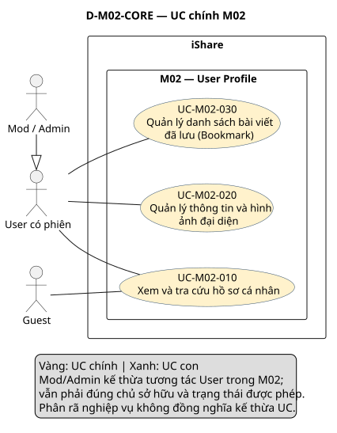
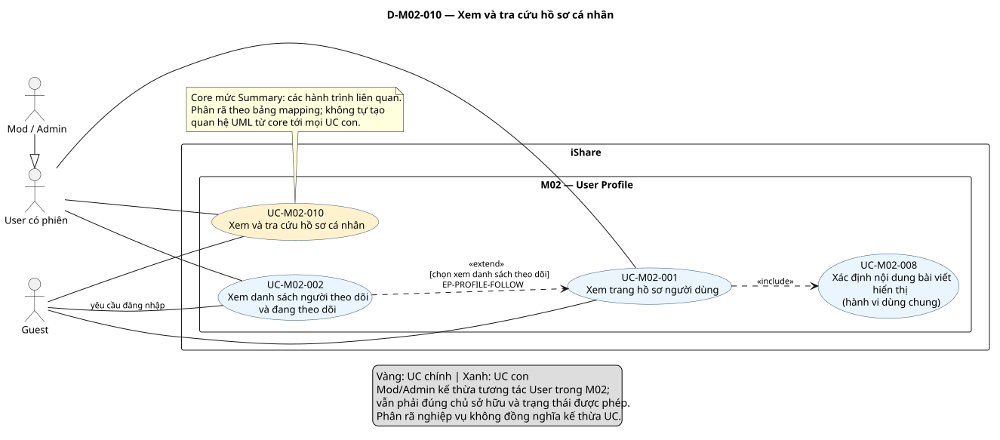
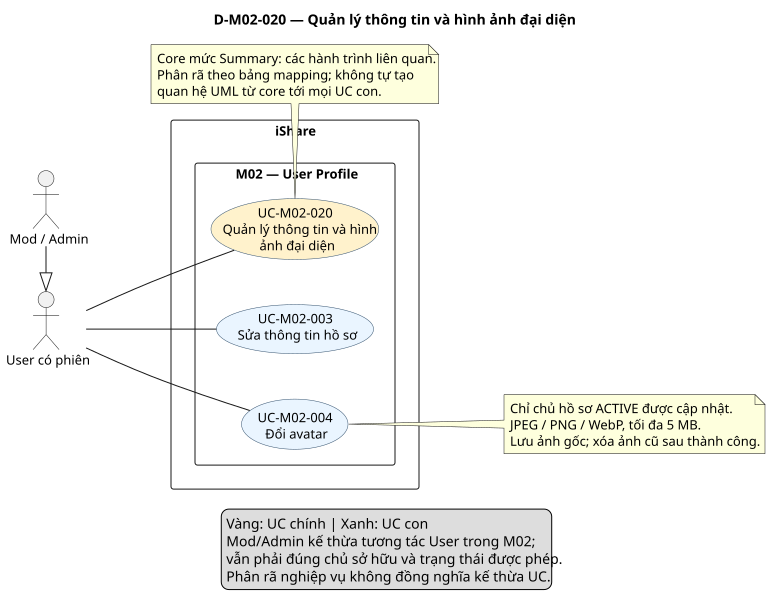
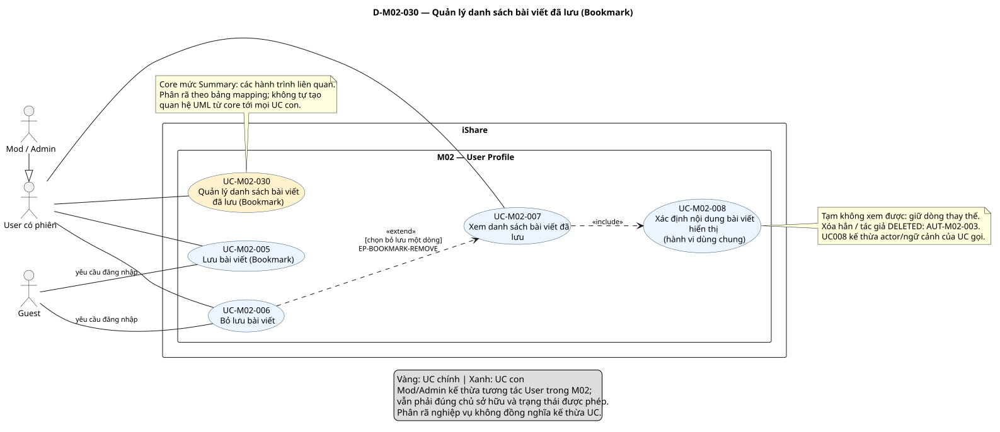

# Phân tích use case — M02 User Profile (US-M02)

[Vietnamese Doc]

Phân tích toàn bộ FR-M02 1.6 theo skill use-case-analysis 2.2: **3 UC chính, 8 UC con**, phân rã, đặc tả, quan hệ UML và truy vết. Mỗi UC chính có một sơ đồ chi tiết riêng; mỗi sơ đồ bàn giao chỉ một SVG. Trạng thái kết quả: **Chờ duyệt**.

## Metadata và tiến độ

<!-- uc:document -->
| key | value |
|---|---|
| document_id | US-M02 |
| skill_version | 2.2 |
| mode | module |
| modules | M02 |
| scope | ALL |
| status | Chờ duyệt |
| current_step | 7 |
| completed_steps | 1, 2, 3, 4, 5, 6, 7 |
| approved_steps | - |
| source_baseline | FR-M02 1.6; FR-M01 1.10; FR-M03 1.10; FR-M04 1.4; FR-M05 1.7; FR-M07 1.5; FR-M08 1.7; FR-M11 1.3; FR-M12 1.1; FR-M14 1.1; FR-M15 1.1; FR-M16 1.0 |
| author | Codex — hỗ trợ phân tích nghiệp vụ |
| date | 2026-10-30 |
| approval_evidence | Người dùng yêu cầu tiếp tục dùng skill và xây dựng đầu ra use case analysis cho M02; thực hiện liên tục các bước để hoàn thiện đầu ra theo ngữ cảnh đã thống nhất. Chưa có phê duyệt riêng từng bước hoặc kết quả cuối cho bản này. |
| semantic_review | pass |
| diagram_check | pass |

| Bước | Kết quả trong lần phân tích này | Xác nhận |
|---|---|---|
| 1 | FR-M02 1.6; boundary; actor; 116 mã hiện hành | Được yêu cầu triển khai; chưa duyệt riêng |
| 2 | 3 core, 8 sub, 9 mapping; giữ ID cũ theo mục tiêu | Được yêu cầu triển khai; chưa duyệt riêng |
| 3 | 8 hợp đồng chi tiết; 3 AUT và 3 RULE | Được yêu cầu triển khai; chưa duyệt riêng |
| 4 | 4 quan hệ UC–UC và 2 extension point | Được yêu cầu triển khai; chưa duyệt riêng |
| 5 | 7 nhóm + 72 FR chi tiết + 37 BR; đối chiếu giao tiếp | Được yêu cầu triển khai; chưa duyệt riêng |
| 6 | 4 view, mỗi view một SVG; cú pháp/render/kiểm tra hình đạt | Chưa phê duyệt nội dung |
| 7 | Kiểm tra cấu trúc, ngữ nghĩa và hình xuất | Chờ duyệt kết quả cuối |

Tiến độ/phê duyệt trong bản US-M02 cũ không được tự kế thừa thành phê duyệt cho bản phân tích này. Không thay đổi FR hay các US module khác.

## 1. Phạm vi, nguồn và actor

**Mục đích:** đặc tả nghiệp vụ hồ sơ và bookmark làm đầu vào thiết kế/kiểm thử. **Subject/boundary:** toàn iShare; M02 là chức năng nội bộ. M01/M03/M07/M11/M12/M16 và kho lưu ảnh nội bộ không được tự biến thành actor bên ngoài. FR-M02 không yêu cầu một dịch vụ ngoài trực tiếp tham gia UC nên không tự thêm actor nhà cung cấp ảnh.

**Trong phạm vi:** xem hồ sơ theo ngữ cảnh; xem danh sách theo dõi; sửa bio/Lớp/Khối và tên theo M01; đổi avatar; lưu/bỏ lưu/xem Bookmark; quy tắc hiển thị, dọn dữ liệu liên quan. Toàn bộ MS1/Must theo FR-M02 4.5.

**Ngoài phạm vi:** tạo tài khoản, quyết định trạng thái/quyền phiên M01; Follow/Unfollow M07; tạo/xóa/khôi phục bài M03; tính điểm/badge/danh hiệu M12; ra quyết định kiểm duyệt M08; trò chuyện M16; thuật toán Trending M05/M14. Không thêm lịch sử đổi tên, liên kết mạng xã hội, tùy chọn ẩn danh sách theo dõi, Mod/Admin sửa hồ sơ người khác hoặc nhắc cập nhật Lớp/Khối.

### Baseline

<!-- uc:sources -->
| path | version | role |
|---|---|---|
| docs/specs/fr/FR-M02.md | 1.6 | owner |
| docs/specs/fr/FR-M01.md | 1.10 | related |
| docs/specs/fr/FR-M03.md | 1.10 | related |
| docs/specs/fr/FR-M04.md | 1.4 | related |
| docs/specs/fr/FR-M05.md | 1.7 | related |
| docs/specs/fr/FR-M07.md | 1.5 | related |
| docs/specs/fr/FR-M08.md | 1.7 | related |
| docs/specs/fr/FR-M11.md | 1.3 | related |
| docs/specs/fr/FR-M12.md | 1.1 | related |
| docs/specs/fr/FR-M14.md | 1.1 | related |
| docs/specs/fr/FR-M15.md | 1.1 | related |
| docs/specs/fr/FR-M16.md | 1.0 | related |

FR-M02 đã chốt ngày 2026-10-24, mốc DEC-271/QA-477/ISS-415/OPEN-012. Đọc đầy đủ yêu cầu M02 và đối chiếu các giao tiếp liên module cùng mã được dẫn; không tuyên bố phân tích toàn bộ các module liên quan. [Skill 2.2](../../../.agent-instructions/skills/use-case-analysis/SKILL.md) là nguồn phương pháp, không bổ sung tính năng.

### Actor

<!-- uc:actors -->
| id | name | kind | parent | boundary_reason | sources |
|---|---|---|---|---|---|
| ACT-001 | Guest — người chưa có phiên | human | - | Người ngoài iShare xem hồ sơ chỉ đọc; khi thử mở danh sách theo dõi/lưu/bỏ lưu phải được yêu cầu đăng nhập. | FR-M02-01.16, FR-M02-02.05, FR-M02-05.02 |
| ACT-002 | User — người có phiên | human | - | Người ngoài iShare xem hồ sơ/mạng lưới và thao tác hồ sơ/bookmark của mình; quyền còn chịu cổng M01. | FR-M02-01.05, FR-M02-02.03, FR-M02-03.02, FR-M02-07.01 |
| ACT-003 | Mod / Admin | human | ACT-002 | Theo FR-M02 4.2, Mod/Admin thay thế được vai trò User trong các tương tác M02; không được sửa/gỡ hồ sơ người khác. Chỉ kế thừa tương tác trong phạm vi này, không suy quyền vượt điều kiện ACTIVE/sở hữu. | FR-M02-03.10, FR-M02-04.07, BR-M02-36 |

Giữ ID actor chung ACT-001/002/003. **Chủ hồ sơ/người xem** là ngữ cảnh sở hữu; **BANNED/DEACTIVATED/DELETED** là trạng thái tài khoản đích hoặc người thao tác, cần phân biệt. Người khác có thể xem hồ sơ BANNED nhưng chủ tài khoản BANNED vẫn bị giới hạn phiên theo FR-M01-05.06. Khi bảo trì, chỉ người thực sự có vai trò ADMIN được thao tác qua phiên theo M01, không phải toàn bộ nhóm ACT-003.

### Kiểm kê và phân bổ nhóm FR

| Nhóm | Nội dung | FR chi tiết | Phân bổ |
|---|---|---|---|
| FR-M02-01 | Xem trang hồ sơ | 27 | UC-M02-001, UC-M02-008, AUT-M02-002 |
| FR-M02-02 | Xem danh sách người theo dõi và đang theo dõi | 9 | UC-M02-002, RULE-M02-002 |
| FR-M02-03 | Sửa thông tin hồ sơ | 15 | UC-M02-003, RULE-M02-003 |
| FR-M02-04 | Đổi avatar | 7 | UC-M02-004, AUT-M02-001 |
| FR-M02-05 | Lưu bài viết (Bookmark) | 5 | UC-M02-005 |
| FR-M02-06 | Bỏ lưu bài viết | 2 | UC-M02-006 |
| FR-M02-07 | Xem danh sách bài đã lưu | 7 | UC-M02-007, UC-M02-008, UC-M02-006, AUT-M02-003 |

Mẫu số truy vết: **116 mã = 7 nhóm + 72 FR chi tiết + 37 BR**, không có mã hiện hành bị bỏ/hoãn khỏi phạm vi. Nội dung chuẩn tắc được phân bổ vào UC, bước, nhánh, AUT và RULE, không tạo một oval cho mỗi FR.

## 2. Danh mục UC chính, UC con và phân rã

<!-- uc:catalog -->
| id | name | tier | level | primary | supporting | owner | anchor | sources |
|---|---|---|---|---|---|---|---|---|
| UC-M02-010 | Xem và tra cứu hồ sơ cá nhân | core | Summary | ACT-001, ACT-002, ACT-003 | - | M02 | #uc-m02-010 | FR-M02-01, FR-M02-02, BR-M02-01, BR-M02-14, BR-M02-28 |
| UC-M02-020 | Quản lý thông tin và hình ảnh đại diện | core | Summary | ACT-002, ACT-003 | - | M02 | #uc-m02-020 | FR-M02-03, FR-M02-04, BR-M02-18, BR-M02-36 |
| UC-M02-030 | Quản lý danh sách bài viết đã lưu (Bookmark) | core | Summary | ACT-002, ACT-003 | - | M02 | #uc-m02-030 | FR-M02-05, FR-M02-06, FR-M02-07, BR-M02-21, BR-M02-23, BR-M02-30 |
| UC-M02-001 | Xem trang hồ sơ người dùng | sub | User goal | ACT-001, ACT-002, ACT-003 | - | M02 | #uc-m02-001 | FR-M02-01, BR-M02-01, BR-M02-02, BR-M02-03, BR-M02-15, BR-M02-16, BR-M02-26, BR-M02-34, BR-M02-37 |
| UC-M02-002 | Xem danh sách người theo dõi và đang theo dõi | sub | User goal | ACT-002, ACT-003 | - | M02 | #uc-m02-002 | FR-M02-02, BR-M02-14, BR-M02-27, BR-M02-31 |
| UC-M02-003 | Sửa thông tin hồ sơ | sub | User goal | ACT-002, ACT-003 | - | M02 | #uc-m02-003 | FR-M02-03, BR-M02-04, BR-M02-09, BR-M02-18, BR-M02-33, BR-M02-36, FR-M01-03.15, FR-M01-03.16 |
| UC-M02-004 | Đổi avatar | sub | User goal | ACT-002, ACT-003 | - | M02 | #uc-m02-004 | FR-M02-04, BR-M02-06, BR-M02-07, BR-M02-08, BR-M02-18, BR-M02-36 |
| UC-M02-005 | Lưu bài viết (Bookmark) | sub | User goal | ACT-002, ACT-003 | - | M02 | #uc-m02-005 | FR-M02-05, BR-M02-21, BR-M02-22, BR-M02-24, BR-M02-25 |
| UC-M02-006 | Bỏ lưu bài viết | sub | User goal | ACT-002, ACT-003 | - | M02 | #uc-m02-006 | FR-M02-06, FR-M02-05.02, FR-M02-07.05, BR-M02-24, BR-M02-25, BR-M02-29 |
| UC-M02-007 | Xem danh sách bài viết đã lưu | sub | User goal | ACT-002, ACT-003 | - | M02 | #uc-m02-007 | FR-M02-07, BR-M02-23, BR-M02-29, BR-M02-30, BR-M02-31 |
| UC-M02-008 | Xác định nội dung bài viết hiển thị | sub | Subfunction | ACT-001, ACT-002, ACT-003 | - | M02 | #uc-m02-008 | FR-M02-01.07, FR-M02-01.17, FR-M02-01.19, FR-M02-07.03, FR-M02-07.04, FR-M02-07.07, BR-M02-28, BR-M02-29, BR-M02-31 |

### Phân rã chính → con

<!-- uc:decomposition -->
| core | sub | rationale | sources |
|---|---|---|---|
| UC-M02-010 | UC-M02-001 | Xem thông tin hồ sơ và bài viết phù hợp với ngữ cảnh chủ hồ sơ/người xem. | FR-M02-01, BR-M02-01, BR-M02-02, BR-M02-03, BR-M02-15, BR-M02-16, BR-M02-26, BR-M02-34, BR-M02-37 |
| UC-M02-010 | UC-M02-002 | Xem chi tiết mạng lưới theo dõi người dùng, không gồm Topic hoặc bài viết. | FR-M02-02, BR-M02-14, BR-M02-27, BR-M02-31 |
| UC-M02-010 | UC-M02-008 | Dùng chung: xác định tập bài/nội dung hiển thị theo ngữ cảnh hồ sơ hoặc Bookmark; một hợp đồng và một ID. | FR-M02-01.07, FR-M02-01.17, FR-M02-01.19, FR-M02-07.03, FR-M02-07.04, FR-M02-07.07, BR-M02-28, BR-M02-29, BR-M02-31 |
| UC-M02-020 | UC-M02-003 | Cập nhật thông tin hồ sơ của mình, gồm bio, Lớp/Khối và tên theo quy tắc M01. | FR-M02-03, BR-M02-04, BR-M02-09, BR-M02-18, BR-M02-33, BR-M02-36, FR-M01-03.15, FR-M01-03.16 |
| UC-M02-020 | UC-M02-004 | Đặt ảnh mới làm avatar của chính mình, giữ ảnh gốc và xóa ảnh cũ sau thành công. | FR-M02-04, BR-M02-06, BR-M02-07, BR-M02-08, BR-M02-18, BR-M02-36 |
| UC-M02-030 | UC-M02-005 | Lưu một bài vào danh sách cá nhân để đọc lại. | FR-M02-05, BR-M02-21, BR-M02-22, BR-M02-24, BR-M02-25 |
| UC-M02-030 | UC-M02-006 | Loại một bài khỏi danh sách đang lưu của mình. | FR-M02-06, FR-M02-05.02, FR-M02-07.05, BR-M02-24, BR-M02-25, BR-M02-29 |
| UC-M02-030 | UC-M02-007 | Đọc lại danh sách bookmark riêng tư của mình với trạng thái khả dụng hiện tại. | FR-M02-07, BR-M02-23, BR-M02-29, BR-M02-30, BR-M02-31 |
| UC-M02-030 | UC-M02-008 | Dùng chung: xác định tập bài/nội dung hiển thị theo ngữ cảnh hồ sơ hoặc Bookmark; một hợp đồng và một ID. | FR-M02-01.07, FR-M02-01.17, FR-M02-01.19, FR-M02-07.03, FR-M02-07.04, FR-M02-07.07, BR-M02-28, BR-M02-29, BR-M02-31 |

UC008 có một định nghĩa, thuộc hai core010/030. `tier` độc lập với `level`: cả ba core ở Summary; bảy sub cũ ở User goal; sub008 ở Subfunction. Mapping là phân rã nghiệp vụ, không tự tạo generalization/include/extend.

<!-- uc:module-models -->
| module | path | baseline |
|---|---|---|


Mode module: không tổng hợp US-overview trong scope này. Ba core giữ nguyên ID/tên để dùng khi tổng hợp hệ thống sau này.

| Quyết định | Mô hình được chọn | Căn cứ/lý do |
|---|---|---|
| D-M02-01 | Giữ core010/020/030 và sub001–007 theo ý nghĩa cũ; bổ sung sub008 | Không tái đánh số. Nội dung/phê duyệt cũ phải đối chiếu lại, không coi là chuẩn vàng. |
| D-M02-02 | Một UC xem hồ sơ, các ngữ cảnh xử lý trong luồng/RULE001 | Cùng một URL, thay nội dung theo chủ/người xem; không cần nhân đôi UC001. |
| D-M02-03 | UC008 dùng chung cho UC001 và UC007 | Tập bài hiển thị phụ thuộc người xem, trạng thái bài, ẩn danh, nhóm Private và trường hợp Bookmark tạm không xem được. Tách hợp đồng này để kiểm soát hai nhánh sử dụng, không tách từng lần kiểm quyền. |
| D-M02-04 | UC002 extend UC001; UC006 extend UC007 tại điểm chèn cụ thể | Base hoàn chỉnh không cần phần mở rộng. Phần chèn có hợp đồng/đầu ra riêng và quay về ngữ cảnh base, không chỉ vẽ mũi tên từ link. |
| D-M02-05 | UC003/004 độc lập, không tự extend UC001/nhau | Chung trang chỉnh sửa không chứng minh chèn hành vi. Đổi avatar không bắt buộc khi lưu bio/tên và ngược lại. |
| D-M02-06 | Không có quan hệ UC generalization hay include đăng nhập | Các hành trình không chuyên biệt hóa một hợp đồng chung. Phiên là điều kiện; Guest thử thao tác được xử lý nhánh yêu cầu đăng nhập. |
| D-M02-07 | AUT001 giữ xóa avatar cũ; AUT002 giữ điểm tức thời; thêm AUT003 xóa Bookmark theo sự kiện | Không bỏ tác vụ tự động hoặc đặt timer/transport/transaction ngoài nguồn. |
| D-M02-08 | Sửa thông tin UC003 phải bao gồm username/display_name | FR-M02-03.01 và FR-M01-03.15/16 xác định nơi đổi tên; không bỏ sót vì luật tên thuộc M01. |
| D-M02-09 | Rà lại BR theo nội dung, không giữ ánh xạ số trong bản cũ | BR26 là Guest xem hồ sơ; BR27 là lọc quan hệ; BR28 là tập bài hiển thị; BR33 là đếm bio; BR34 là URL; BR35 là không nhắc Lớp/Khối. Truy vết cũ có mã không khớp ý nghĩa. |

## 3. Đặc tả

### 3.1 UC chính

<a id="uc-m02-010"></a>

### UC-M02-010 — Xem và tra cứu hồ sơ cá nhân

| Thuộc tính | Nội dung |
|---|---|
| Actor | ACT-001, ACT-002, ACT-003 |
| Giá trị/mục tiêu | Tra cứu thông tin, nội dung và mạng lưới người dùng theo đúng ngữ cảnh được phép. |
| Khởi phát | Mở hồ sơ hoặc chọn xem danh sách theo dõi. |
| Điều kiện/phạm vi | Hồ sơ có thể được yêu cầu bởi Guest hoặc người có phiên; xét trạng thái tài khoản ở UC con. |
| Kết quả | Thông tin được hiển thị đúng người xem, trạng thái, quyền nội dung; danh sách theo dõi chỉ mở sau đăng nhập. |
| Bảo đảm khi không đạt | Không cung cấp nội dung hồ sơ không tồn tại hoặc danh sách không được phép. |
| UC con | UC-M02-001, UC-M02-002, UC-M02-008 |
| Nguồn | FR-M02-01, FR-M02-02, BR-M02-01, BR-M02-14, BR-M02-28 |

**Quy trình tổng quát:**

1. UC-M02-001 phân giải /u/{username}, xác định chủ hồ sơ/người xem và hiển thị hồ sơ.
2. UC-M02-008 quyết định các bài được hiển thị trong tab Bài viết, theo nguồn M03/M11 và ngữ cảnh người xem.
3. Khi người xem muốn mở chi tiết số theo dõi, UC-M02-002 hiển thị danh sách tương ứng; không bao gồm hành động Follow/Unfollow của M07.

Không giả định tất cả các UC con thực hiện nối tiếp trong một lần; core Summary không phải một lần gọi tất cả UC con.

<a id="uc-m02-020"></a>

### UC-M02-020 — Quản lý thông tin và hình ảnh đại diện

| Thuộc tính | Nội dung |
|---|---|
| Actor | ACT-002, ACT-003 |
| Giá trị/mục tiêu | Chủ tài khoản tự cập nhật thông tin và hình ảnh hồ sơ của mình. |
| Khởi phát | Chủ hồ sơ chọn sửa thông tin hoặc tải avatar mới. |
| Điều kiện/phạm vi | Các hành trình yêu cầu phiên của chủ hồ sơ ACTIVE; kiểm tra và từ chối theo từng UC con. |
| Kết quả | Thông tin/ảnh hợp lệ được lưu; username và display_name áp dụng quy tắc M01. |
| Bảo đảm khi không đạt | Không sửa hồ sơ người khác, không đổi avatar/bio bằng quyền Mod/Admin. |
| UC con | UC-M02-003, UC-M02-004 |
| Nguồn | FR-M02-03, FR-M02-04, BR-M02-18, BR-M02-36 |

**Quy trình tổng quát:**

1. UC-M02-003 cho chủ hồ sơ sửa bio, Lớp/Khối và username/display_name theo quy tắc M01.
2. UC-M02-004 cho chủ hồ sơ đổi avatar; AUT-M02-001 xóa avatar cũ sau khi ảnh mới đặt thành công.
3. Hai hành trình có thể thực hiện độc lập; không yêu cầu đổi avatar mỗi lần lưu bio hoặc ngược lại.

Không giả định tất cả các UC con thực hiện nối tiếp trong một lần; core Summary không phải một lần gọi tất cả UC con.

<a id="uc-m02-030"></a>

### UC-M02-030 — Quản lý danh sách bài viết đã lưu (Bookmark)

| Thuộc tính | Nội dung |
|---|---|
| Actor | ACT-002, ACT-003 |
| Giá trị/mục tiêu | Lưu bài để đọc lại, quản lý danh sách riêng tư và bỏ lưu khi không cần. |
| Khởi phát | Chọn lưu/bỏ lưu bài hoặc mở tab Bookmark của mình. |
| Điều kiện/phạm vi | Yêu cầu đăng nhập; chỉ chủ danh sách được xem danh sách riêng tư. |
| Kết quả | Bookmark không trùng; danh sách phản ánh thời điểm lưu, quyền xem hiện tại và việc xóa hẳn. |
| Bảo đảm khi không đạt | Không hiển thị danh sách của người khác; bookmark không làm phát sinh quyền xem nội dung hay theo dõi thông báo. |
| UC con | UC-M02-005, UC-M02-006, UC-M02-007, UC-M02-008 |
| Nguồn | FR-M02-05, FR-M02-06, FR-M02-07, BR-M02-21, BR-M02-23, BR-M02-30 |

**Quy trình tổng quát:**

1. UC-M02-005 lưu bài chưa lưu; UC-M02-006 bỏ lưu bài đang lưu, kể cả bài Khóa toàn bộ.
2. UC-M02-007 mở danh sách cá nhân và dùng UC-M02-008 để hiển thị bài hoặc dòng thay thế khi không xem được.
3. AUT-M02-003 xóa bookmark khi bài xóa hẳn hoặc tác giả DELETED; tạm mất quyền xem không xóa bookmark.

Không giả định tất cả các UC con thực hiện nối tiếp trong một lần; core Summary không phải một lần gọi tất cả UC con.

### 3.2 UC con

<a id="uc-m02-001"></a>

### UC-M02-001 — Xem trang hồ sơ người dùng

**UC chính:** UC-M02-010.

<!-- uc:spec UC-M02-001 -->
| key | value |
|---|---|
| goal | Xem thông tin hồ sơ và bài viết phù hợp với ngữ cảnh chủ hồ sơ/người xem. |
| subject | iShare |
| level | User goal |
| primary | ACT-001, ACT-002, ACT-003 |
| supporting | - |
| trigger | Người xem mở /u/{username}. |
| preconditions | Không bắt buộc đăng nhập. Không giả định username tồn tại hay tài khoản đích ACTIVE: luồng phải xử lý các trường hợp này. |
| success | Hiển thị hồ sơ đúng trạng thái, các trường được phép và danh sách Bài viết; riêng chủ hồ sơ có các lối vào Bookmark/Đã xóa/sửa hồ sơ. |
| failure | Username không tồn tại hoặc hồ sơ DEACTIVATED/DELETED chỉ hiện người dùng không tồn tại; không để lộ thông tin riêng tư. |
| abstract | false |
| common_contract | Không áp dụng: không là UC tổng quát trong generalization. |

#### Luồng chính

<a id="uc-m02-001-main-1"></a>

| Bước | Tương tác actor–iShare | Tiếp tục | Nguồn |
|---|---|---|---|
| 1 | Người xem yêu cầu /u/{username}; iShare tra username hiện hành, so không phân biệt hoa/thường; không chuyển hướng username cũ sang mới. | 2 | FR-M02-01, BR-M02-01, BR-M02-02, BR-M02-03, BR-M02-15, BR-M02-16, BR-M02-26, BR-M02-34, BR-M02-37 |

<a id="uc-m02-001-main-2"></a>

| Bước | Tương tác actor–iShare | Tiếp tục | Nguồn |
|---|---|---|---|
| 2 | iShare kiểm tra tài khoản đích và xác định chủ hồ sơ hay người xem theo RULE-M02-001; nếu BANNED vẫn cho người khác xem với nhãn bị khóa. | 3 | FR-M02-01, BR-M02-01, BR-M02-02, BR-M02-03, BR-M02-15, BR-M02-16, BR-M02-26, BR-M02-34, BR-M02-37 |

<a id="uc-m02-001-main-3"></a>

| Bước | Tương tác actor–iShare | Tiếp tục | Nguồn |
|---|---|---|---|
| 3 | iShare hiển thị avatar tròn/mặc định, display_name, username, bio nếu có, Lớp/Khối nếu có, ngày tham gia, tổng điểm, badge đã đạt, danh hiệu tuần được phép và hai số theo dõi. | 4 | FR-M02-01, BR-M02-01, BR-M02-02, BR-M02-03, BR-M02-15, BR-M02-16, BR-M02-26, BR-M02-34, BR-M02-37 |

<a id="uc-m02-001-main-4"></a>

| Bước | Tương tác actor–iShare | Tiếp tục | Nguồn |
|---|---|---|---|
| 4 | iShare thực hiện UC-M02-008 với ngữ cảnh tab Bài viết và người xem để xác định nội dung danh sách. | 5 | FR-M02-01, BR-M02-01, BR-M02-02, BR-M02-03, BR-M02-15, BR-M02-16, BR-M02-26, BR-M02-34, BR-M02-37 |

<a id="uc-m02-001-main-5"></a>

| Bước | Tương tác actor–iShare | Tiếp tục | Nguồn |
|---|---|---|---|
| 5 | iShare hiển thị tab Bài viết mặc định và các lối vào theo ngữ cảnh. EP-PROFILE-FOLLOW: nếu người xem chọn một số theo dõi, chèn UC-M02-002 để xem chi tiết; nếu không chọn thì hồ sơ đã hoàn chỉnh. | END: Hiển thị hồ sơ đúng trạng thái, các trường được phép và danh sách Bài viết; riêng chủ hồ sơ có các lối vào Bookmark/Đã xóa/sửa hồ sơ. | FR-M02-01, BR-M02-01, BR-M02-02, BR-M02-03, BR-M02-15, BR-M02-16, BR-M02-26, BR-M02-34, BR-M02-37 |

#### Luồng thay thế và ngoại lệ

<a id="uc-m02-001-alt-1"></a>

| Nhánh | Bước rẽ | Điều kiện | Xử lý | Quay lại/kết thúc | Nguồn |
|---|---|---|---|---|---|
| A1 | 1 | Không có tài khoản mang username hiện hành được yêu cầu | Hiển thị người dùng không tồn tại. Username cũ không được giữ như alias; nếu đã được tài khoản khác sử dụng thì phân giải theo chủ mới. | END: không hiển thị hồ sơ không tồn tại | FR-M02-01.20, FR-M02-01.21, FR-M02-01.22 |

<a id="uc-m02-001-alt-2"></a>

| Nhánh | Bước rẽ | Điều kiện | Xử lý | Quay lại/kết thúc | Nguồn |
|---|---|---|---|---|---|
| A2 | 2 | Tài khoản đích DEACTIVATED hoặc DELETED | Thay nội dung bằng người dùng không tồn tại; không mở các danh sách của hồ sơ này. | END: hồ sơ không tồn tại | FR-M02-01.11, FR-M02-02.04 |

<a id="uc-m02-001-alt-3"></a>

| Nhánh | Bước rẽ | Điều kiện | Xử lý | Quay lại/kết thúc | Nguồn |
|---|---|---|---|---|---|
| A3 | 5 | Người xem là chủ hồ sơ | Hiện nút sửa và các tab Bài viết/Bookmark/Đã xóa. Mở Bookmark là UC-M02-007; mở Đã xóa hiển thị bài theo FR-M03-15.03. Khôi phục thuộc M03, không thực hiện tại UC này. | END: hồ sơ của mình; hành trình tiếp theo theo lựa chọn | FR-M02-01.05, FR-M02-01.08 |

<a id="uc-m02-001-alt-4"></a>

| Nhánh | Bước rẽ | Điều kiện | Xử lý | Quay lại/kết thúc | Nguồn |
|---|---|---|---|---|---|
| A4 | 5 | Người xem không phải chủ hồ sơ | Chỉ có tab Bài viết, không có nút sửa. Có phiên thì hiện nút Nhắn tin dẫn M16; Guest và chính chủ không thấy nút. | END: hồ sơ người khác đúng quyền | FR-M02-01.06, FR-M02-01.16, FR-M02-01.26, FR-M02-01.27 |

<a id="uc-m02-001-rules"></a>

**Ràng buộc:** FR-M02-01, BR-M02-01, BR-M02-02, BR-M02-03, BR-M02-15, BR-M02-16, BR-M02-26, BR-M02-34, BR-M02-37. Các BR tại mục 3.5 là một phần đặc tả; mọi giá trị/ngoại lệ dưới đây được áp dụng cùng hợp đồng và luồng phía trên.

**Nội dung hiển thị:** không hiện mức cảnh báo, lịch sử đổi username, liên kết mạng xã hội, số stars nhận/cho hoặc tiến độ badge chưa đạt. Badge đã đạt do M12 cung cấp; Ngôi sao tuần chỉ hiện khi đạt ở tuần vừa chốt, tới lần chốt sau, không kèm lịch sử/số lần. Điểm tức thời theo AUT002; không đồng nhất với thứ hạng tuần. Cờ Chat tắt không làm ẩn nút Nhắn tin đã đủ điều kiện; khi mở, M16 xử lý thông báo đang bận theo FR-M16-15.07 và FR-M02 5.11.

#### Điều kiện nghiệm thu bổ sung

Các điều kiện giữ nguyên yêu cầu chuẩn tắc từ FR, áp dụng cùng hợp đồng/luồng/nhánh của đặc tả này; không phải UC độc lập.

| Nguồn | Điều kiện bắt buộc |
|---|---|
| <a id="uc-m02-001-fr-m02-01-01"></a>FR-M02-01.01 | Khi người dùng mở địa chỉ /u/{username} của một tài khoản ACTIVE hoặc BANNED, hệ thống phải hiển thị trang hồ sơ của người dùng đó. |
| <a id="uc-m02-001-fr-m02-01-02"></a>FR-M02-01.02 | Hệ thống phải hiển thị trên trang hồ sơ avatar, display_name, username, bio, Lớp/Khối khi đã đặt, ngày tham gia, điểm, badge, số người theo dõi, số đang theo dõi và các tab nội dung. |
| <a id="uc-m02-001-fr-m02-01-03"></a>FR-M02-01.03 | Hệ thống phải hiển thị avatar dạng cắt tròn. |
| <a id="uc-m02-001-fr-m02-01-04"></a>FR-M02-01.04 | Nếu bio trống, hệ thống phải không hiển thị gì ở vị trí bio. |
| <a id="uc-m02-001-fr-m02-01-05"></a>FR-M02-01.05 | Khi chủ hồ sơ mở trang hồ sơ của mình, hệ thống phải hiển thị nút sửa hồ sơ và ba tab Bài viết, Bookmark, Đã xóa, mở sẵn tab Bài viết. |
| <a id="uc-m02-001-fr-m02-01-06"></a>FR-M02-01.06 | Khi người xem mở trang hồ sơ của người khác, hệ thống phải chỉ hiển thị tab Bài viết, không hiển thị nút sửa hồ sơ. |
| <a id="uc-m02-001-fr-m02-01-08"></a>FR-M02-01.08 | Khi chủ hồ sơ mở tab Đã xóa, hệ thống phải hiển thị các bài đã xóa của chủ hồ sơ theo FR-M03-15.03. |
| <a id="uc-m02-001-fr-m02-01-10"></a>FR-M02-01.10 | Hệ thống phải chỉ hiển thị badge người dùng đã đạt, không hiển thị tiến độ tới badge chưa đạt. |
| <a id="uc-m02-001-fr-m02-01-11"></a>FR-M02-01.11 | Nếu tài khoản của hồ sơ ở trạng thái DEACTIVATED hoặc DELETED, hệ thống phải hiển thị "người dùng không tồn tại" thay cho nội dung hồ sơ. |
| <a id="uc-m02-001-fr-m02-01-12"></a>FR-M02-01.12 | Nếu tài khoản của hồ sơ ở trạng thái BANNED, hệ thống phải hiển thị nhãn "Tài khoản đã bị khóa" trên trang hồ sơ. |
| <a id="uc-m02-001-fr-m02-01-13"></a>FR-M02-01.13 | Hệ thống phải không hiển thị mức cảnh báo của người dùng trên trang hồ sơ. |
| <a id="uc-m02-001-fr-m02-01-14"></a>FR-M02-01.14 | Hệ thống phải không hiển thị lịch sử đổi username trên trang hồ sơ. |
| <a id="uc-m02-001-fr-m02-01-15"></a>FR-M02-01.15 | Hệ thống phải không hiển thị liên kết mạng xã hội trên hồ sơ. |
| <a id="uc-m02-001-fr-m02-01-16"></a>FR-M02-01.16 | Hệ thống phải cho phép Guest xem trang hồ sơ ở ngữ cảnh người xem, chỉ đọc. |
| <a id="uc-m02-001-fr-m02-01-18"></a>FR-M02-01.18 | Nếu người dùng chưa đặt avatar, hệ thống phải hiển thị avatar mặc định. |
| <a id="uc-m02-001-fr-m02-01-20"></a>FR-M02-01.20 | Khi địa chỉ /u/{username} khác username của một tài khoản chỉ ở chữ hoa, chữ thường, hệ thống phải mở trang hồ sơ của tài khoản đó. |
| <a id="uc-m02-001-fr-m02-01-21"></a>FR-M02-01.21 | Nếu không có tài khoản nào mang username trong địa chỉ /u/{username}, hệ thống phải hiển thị "người dùng không tồn tại". |
| <a id="uc-m02-001-fr-m02-01-22"></a>FR-M02-01.22 | Khi người dùng đã đổi username, hệ thống phải không chuyển hướng địa chỉ theo username cũ sang địa chỉ theo username mới. |
| <a id="uc-m02-001-fr-m02-01-23"></a>FR-M02-01.23 | Hệ thống phải không hiển thị số stars nhận, số stars cho trên trang hồ sơ. |
| <a id="uc-m02-001-fr-m02-01-24"></a>FR-M02-01.24 | Nếu chủ hồ sơ đạt danh hiệu "Ngôi sao tuần" ở tuần vừa chốt, hệ thống phải hiển thị danh hiệu đó trên trang hồ sơ cạnh badge, từ lúc chốt tuần tới lần chốt tuần sau, không kèm số lần đạt hay danh sách tuần đạt (BR-M02-37). |
| <a id="uc-m02-001-fr-m02-01-25"></a>FR-M02-01.25 | Hệ thống phải không hiển thị trên hồ sơ các lần đạt "Ngôi sao tuần" của những tuần trước tuần vừa chốt (BR-M02-37). |
| <a id="uc-m02-001-fr-m02-01-26"></a>FR-M02-01.26 | Khi người dùng đã đăng nhập xem trang hồ sơ của một người dùng khác, hệ thống phải hiển thị nút "Nhắn tin" dẫn tới trò chuyện 1-1 với người đó (M16). |
| <a id="uc-m02-001-fr-m02-01-27"></a>FR-M02-01.27 | Hệ thống phải không hiển thị nút "Nhắn tin" với Guest và trên trang hồ sơ của chính người xem. |

<a id="uc-m02-002"></a>

### UC-M02-002 — Xem danh sách người theo dõi và đang theo dõi

**UC chính:** UC-M02-010.

<!-- uc:spec UC-M02-002 -->
| key | value |
|---|---|
| goal | Xem chi tiết mạng lưới theo dõi người dùng, không gồm Topic hoặc bài viết. |
| subject | iShare |
| level | User goal |
| primary | ACT-002, ACT-003 |
| supporting | - |
| trigger | Người xem chọn số người theo dõi hoặc đang theo dõi trên hồ sơ. |
| preconditions | Tài khoản của hồ sơ phải tồn tại; yêu cầu có thể được gửi bởi Guest để xử lý nhánh yêu cầu đăng nhập, không tự thực hiện đăng nhập trong UC. |
| success | Danh sách đúng hướng quan hệ, đúng lọc trạng thái và mới nhất trước; không có tùy chọn chủ hồ sơ ẩn danh sách. |
| failure | Guest được yêu cầu đăng nhập; không hiển thị danh sách của hồ sơ DEACTIVATED/DELETED. |
| abstract | false |
| common_contract | Không áp dụng: không là UC tổng quát trong generalization. |

#### Luồng chính

<a id="uc-m02-002-main-1"></a>

| Bước | Tương tác actor–iShare | Tiếp tục | Nguồn |
|---|---|---|---|
| 1 | Người xem chọn một trong hai số theo dõi; iShare kiểm tra người yêu cầu đã đăng nhập và trạng thái tài khoản đích. | 2 | FR-M02-02, BR-M02-14, BR-M02-27, BR-M02-31 |

<a id="uc-m02-002-main-2"></a>

| Bước | Tương tác actor–iShare | Tiếp tục | Nguồn |
|---|---|---|---|
| 2 | iShare đọc quan hệ người dùng và thời điểm từ M07: followers là những người theo dõi chủ hồ sơ; following là người chủ hồ sơ theo dõi. | 3 | FR-M02-02, BR-M02-14, BR-M02-27, BR-M02-31 |

<a id="uc-m02-002-main-3"></a>

| Bước | Tương tác actor–iShare | Tiếp tục | Nguồn |
|---|---|---|---|
| 3 | iShare áp dụng RULE-M02-002: chỉ người dùng; không hiện/đếm DEACTIVATED hoặc BANNED; tài khoản trở lại ACTIVE được hiện/đếm lại. | 4 | FR-M02-02, BR-M02-14, BR-M02-27, BR-M02-31 |

<a id="uc-m02-002-main-4"></a>

| Bước | Tương tác actor–iShare | Tiếp tục | Nguồn |
|---|---|---|---|
| 4 | iShare hiển thị danh sách theo thời điểm bắt đầu theo dõi, mới nhất trước. Nếu đang mở rộng UC-M02-001 thì trở về ngữ cảnh hồ sơ ở bước 5 sau khi xem. | END: Danh sách đúng hướng quan hệ, đúng lọc trạng thái và mới nhất trước; không có tùy chọn chủ hồ sơ ẩn danh sách. | FR-M02-02, BR-M02-14, BR-M02-27, BR-M02-31 |

#### Luồng thay thế và ngoại lệ

<a id="uc-m02-002-alt-1"></a>

| Nhánh | Bước rẽ | Điều kiện | Xử lý | Quay lại/kết thúc | Nguồn |
|---|---|---|---|---|---|
| A1 | 1 | Người yêu cầu là Guest | Yêu cầu đăng nhập để mở danh sách, vẫn được xem hai số trên hồ sơ; không suy ra include UC đăng nhập. | END: chưa mở danh sách | FR-M02-02.05, BR-M02-14 |

<a id="uc-m02-002-alt-2"></a>

| Nhánh | Bước rẽ | Điều kiện | Xử lý | Quay lại/kết thúc | Nguồn |
|---|---|---|---|---|---|
| A2 | 1 | Tài khoản đích DEACTIVATED hoặc DELETED | Không hiển thị danh sách. | END: không mở danh sách | FR-M02-02.04 |

<a id="uc-m02-002-alt-3"></a>

| Nhánh | Bước rẽ | Điều kiện | Xử lý | Quay lại/kết thúc | Nguồn |
|---|---|---|---|---|---|
| A3 | 3 | Tài khoản trong danh sách DEACTIVATED hoặc BANNED, sau đó ACTIVE | Ẩn/không đếm trong thời gian bị loại; hiển thị và đếm lại khi ACTIVE nếu quan hệ còn tồn tại. Việc xóa quan hệ khi DELETED thuộc M01. | 4 | FR-M02-02.07, FR-M02-02.08, FR-M01-12.08 |

<a id="uc-m02-002-rules"></a>

**Ràng buộc:** FR-M02-02, BR-M02-14, BR-M02-27, BR-M02-31. Các BR tại mục 3.5 là một phần đặc tả; mọi giá trị/ngoại lệ dưới đây được áp dụng cùng hợp đồng và luồng phía trên.

#### Điều kiện nghiệm thu bổ sung

Các điều kiện giữ nguyên yêu cầu chuẩn tắc từ FR, áp dụng cùng hợp đồng/luồng/nhánh của đặc tả này; không phải UC độc lập.

| Nguồn | Điều kiện bắt buộc |
|---|---|
| <a id="uc-m02-002-fr-m02-02-01"></a>FR-M02-02.01 | Khi người dùng đã đăng nhập chọn số người theo dõi trên trang hồ sơ, hệ thống phải hiển thị danh sách người dùng đang theo dõi chủ hồ sơ. |
| <a id="uc-m02-002-fr-m02-02-02"></a>FR-M02-02.02 | Khi người dùng đã đăng nhập chọn số đang theo dõi trên trang hồ sơ, hệ thống phải hiển thị danh sách người dùng chủ hồ sơ đang theo dõi. |
| <a id="uc-m02-002-fr-m02-02-03"></a>FR-M02-02.03 | Hệ thống phải cho mọi người dùng đã đăng nhập xem danh sách người theo dõi, đang theo dõi của mọi người dùng, không có tùy chọn ẩn danh sách. |
| <a id="uc-m02-002-fr-m02-02-04"></a>FR-M02-02.04 | Nếu tài khoản của hồ sơ ở trạng thái DEACTIVATED hoặc DELETED, hệ thống phải không hiển thị danh sách theo dõi của tài khoản đó. |
| <a id="uc-m02-002-fr-m02-02-05"></a>FR-M02-02.05 | Nếu Guest chọn mở danh sách người theo dõi hoặc đang theo dõi, hệ thống phải yêu cầu đăng nhập. |
| <a id="uc-m02-002-fr-m02-02-06"></a>FR-M02-02.06 | Hệ thống phải chỉ đưa người dùng vào danh sách đang theo dõi, không đưa Topic, bài viết chủ hồ sơ theo dõi. |
| <a id="uc-m02-002-fr-m02-02-09"></a>FR-M02-02.09 | Hệ thống phải sắp xếp danh sách người theo dõi, đang theo dõi theo thời điểm bắt đầu theo dõi, mới nhất trước. |

<a id="uc-m02-003"></a>

### UC-M02-003 — Sửa thông tin hồ sơ

**UC chính:** UC-M02-020.

<!-- uc:spec UC-M02-003 -->
| key | value |
|---|---|
| goal | Cập nhật thông tin hồ sơ của mình, gồm bio, Lớp/Khối và tên theo quy tắc M01. |
| subject | iShare |
| level | User goal |
| primary | ACT-002, ACT-003 |
| supporting | - |
| trigger | Chủ hồ sơ bấm nút sửa hồ sơ và gửi thay đổi. |
| preconditions | Có phiên của người thao tác; quyền sở hữu/ACTIVE được kiểm tra, không giả định yêu cầu người khác luôn hợp lệ. |
| success | Lưu thông tin hợp lệ, bio được chuẩn hóa đúng quy tắc; tên áp dụng M01, username cũ giải phóng khi đổi. |
| failure | Không sửa hồ sơ nếu khác chủ hoặc không ACTIVE; không lưu giá trị vi phạm ràng buộc. Không cam kết cơ chế rollback/lỗi kỹ thuật chưa có nguồn. |
| abstract | false |
| common_contract | Không áp dụng: không là UC tổng quát trong generalization. |

#### Luồng chính

<a id="uc-m02-003-main-1"></a>

| Bước | Tương tác actor–iShare | Tiếp tục | Nguồn |
|---|---|---|---|
| 1 | Chủ hồ sơ chọn sửa; iShare hiển thị trang gồm bio, Lớp/Khối, avatar, username và display_name. | 2 | FR-M02-03, BR-M02-04, BR-M02-09, BR-M02-18, BR-M02-33, BR-M02-36, FR-M01-03.15, FR-M01-03.16 |

<a id="uc-m02-003-main-2"></a>

| Bước | Tương tác actor–iShare | Tiếp tục | Nguồn |
|---|---|---|---|
| 2 | iShare kiểm tra đúng chủ hồ sơ và tài khoản ACTIVE. Mod/Admin thao tác hồ sơ của mình theo cùng điều kiện. | 3 | FR-M02-03, BR-M02-04, BR-M02-09, BR-M02-18, BR-M02-33, BR-M02-36, FR-M01-03.15, FR-M01-03.16 |

<a id="uc-m02-003-main-3"></a>

| Bước | Tương tác actor–iShare | Tiếp tục | Nguồn |
|---|---|---|---|
| 3 | Chủ hồ sơ sửa/bỏ trống bio, chọn 10/11/12 hoặc bỏ chọn Lớp/Khối; có thể đổi username và display_name. Khi nhập bio, iShare hiện số ký tự đã dùng. | 4 | FR-M02-03, BR-M02-04, BR-M02-09, BR-M02-18, BR-M02-33, BR-M02-36, FR-M01-03.15, FR-M01-03.16 |

<a id="uc-m02-003-main-4"></a>

| Bước | Tương tác actor–iShare | Tiếp tục | Nguồn |
|---|---|---|---|
| 4 | iShare trim bio trước đếm, toàn khoảng trắng thành trống; mỗi emoji/xuống dòng là một ký tự, tối đa 155. Kiểm tra Lớp/Khối và tên theo quy tắc M01 ghi ở mục quy tắc. | 5 | FR-M02-03, BR-M02-04, BR-M02-09, BR-M02-18, BR-M02-33, BR-M02-36, FR-M01-03.15, FR-M01-03.16 |

<a id="uc-m02-003-main-5"></a>

| Bước | Tương tác actor–iShare | Tiếp tục | Nguồn |
|---|---|---|---|
| 5 | iShare cập nhật giá trị hợp lệ; khi đổi username thì giải phóng tên cũ ngay, dùng tên mới cho URL; không tự tăng Lớp/Khối hoặc gửi nhắc cập nhật theo năm. | END: Lưu thông tin hợp lệ, bio được chuẩn hóa đúng quy tắc; tên áp dụng M01, username cũ giải phóng khi đổi. | FR-M02-03, BR-M02-04, BR-M02-09, BR-M02-18, BR-M02-33, BR-M02-36, FR-M01-03.15, FR-M01-03.16 |

#### Luồng thay thế và ngoại lệ

<a id="uc-m02-003-alt-1"></a>

| Nhánh | Bước rẽ | Điều kiện | Xử lý | Quay lại/kết thúc | Nguồn |
|---|---|---|---|---|---|
| A1 | 2 | Người thực hiện khác chủ hồ sơ, kể cả Mod/Admin | Từ chối sửa; không có chức năng gỡ bio người khác trong M02. | END: không sửa | FR-M02-03.10, BR-M02-36 |

<a id="uc-m02-003-alt-2"></a>

| Nhánh | Bước rẽ | Điều kiện | Xử lý | Quay lại/kết thúc | Nguồn |
|---|---|---|---|---|---|
| A2 | 2 | Tài khoản chủ hồ sơ không ACTIVE | Từ chối sửa thông tin. | END: không sửa | FR-M02-03.09, BR-M02-18 |

<a id="uc-m02-003-alt-3"></a>

| Nhánh | Bước rẽ | Điều kiện | Xử lý | Quay lại/kết thúc | Nguồn |
|---|---|---|---|---|---|
| A3 | 4 | Bio sau trim >155 ký tự hoặc Lớp/Khối khác 10/11/12 và không phải trống | Từ chối giá trị vi phạm; người dùng có thể sửa hoặc bỏ trống trường tùy chọn. | 3 | FR-M02-03.04, FR-M02-03.06, FR-M02-03.07 |

<a id="uc-m02-003-alt-4"></a>

| Nhánh | Bước rẽ | Điều kiện | Xử lý | Quay lại/kết thúc | Nguồn |
|---|---|---|---|---|---|
| A4 | 4 | Username/display_name sai quy tắc M01 | Từ chối giá trị sai; cho gửi lại giá trị hợp lệ trong cùng hành trình; không thêm hạn chế số lần đổi. | 3 | FR-M01-03.05, FR-M01-03.06, FR-M01-03.12, FR-M01-03.13, FR-M01-03.14, BR-M01-36 |

<a id="uc-m02-003-rules"></a>

**Ràng buộc:** FR-M02-03, BR-M02-04, BR-M02-09, BR-M02-18, BR-M02-33, BR-M02-36, FR-M01-03.15, FR-M01-03.16. Các BR tại mục 3.5 là một phần đặc tả; mọi giá trị/ngoại lệ dưới đây được áp dụng cùng hợp đồng và luồng phía trên.

**Quy tắc tên M01 áp dụng trong M02:** username bắt buộc 3–20 ký tự, chỉ a–z/A–Z/0–9/_, so trùng không phân biệt hoa/thường kể cả username DELETED, giữ chữ hoa/thường đã nhập khi hiển thị. display_name bắt buộc, trim đầu/cuối rồi dài 1–50, được trùng, chỉ chữ cái có dấu/chữ số/khoảng trắng và . , - _ ' ( ), không emoji/ký hiệu khác. Không giới hạn số lần đổi; giải phóng username cũ ngay khi đổi. Nguồn FR-M01-03.05, FR-M01-03.06, FR-M01-03.12, FR-M01-03.13, FR-M01-03.14, FR-M01-03.15, FR-M01-03.16, BR-M01-05, BR-M01-06, BR-M01-36. URL cũ không chuyển hướng; nếu người khác nhận username cũ thì URL ấy phân giải theo tài khoản mới.

#### Điều kiện nghiệm thu bổ sung

Các điều kiện giữ nguyên yêu cầu chuẩn tắc từ FR, áp dụng cùng hợp đồng/luồng/nhánh của đặc tả này; không phải UC độc lập.

| Nguồn | Điều kiện bắt buộc |
|---|---|
| <a id="uc-m02-003-fr-m02-03-01"></a>FR-M02-03.01 | Khi chủ hồ sơ bấm nút sửa hồ sơ, hệ thống phải hiển thị trang sửa hồ sơ gồm bio, Lớp/Khối, avatar, username và display_name. |
| <a id="uc-m02-003-fr-m02-03-02"></a>FR-M02-03.02 | Khi chủ hồ sơ lưu thay đổi hợp lệ, hệ thống phải cập nhật bio, Lớp/Khối trên hồ sơ theo giá trị mới. |
| <a id="uc-m02-003-fr-m02-03-03"></a>FR-M02-03.03 | Khi chủ hồ sơ nhập bio, hệ thống phải hiển thị số ký tự đã dùng. |
| <a id="uc-m02-003-fr-m02-03-04"></a>FR-M02-03.04 | Nếu bio dài hơn 155 ký tự, hệ thống phải từ chối lưu bio. |
| <a id="uc-m02-003-fr-m02-03-05"></a>FR-M02-03.05 | Hệ thống phải cho phép lưu hồ sơ với bio trống. |
| <a id="uc-m02-003-fr-m02-03-06"></a>FR-M02-03.06 | Nếu Lớp/Khối nằm ngoài ba giá trị 10, 11, 12, hệ thống phải từ chối lưu Lớp/Khối. |
| <a id="uc-m02-003-fr-m02-03-07"></a>FR-M02-03.07 | Hệ thống phải cho phép hồ sơ không có Lớp/Khối. |
| <a id="uc-m02-003-fr-m02-03-09"></a>FR-M02-03.09 | Nếu tài khoản của chủ hồ sơ không ở trạng thái ACTIVE, hệ thống phải từ chối sửa thông tin hồ sơ. |
| <a id="uc-m02-003-fr-m02-03-10"></a>FR-M02-03.10 | Nếu người thực hiện khác chủ hồ sơ, hệ thống phải từ chối sửa thông tin hồ sơ. |
| <a id="uc-m02-003-fr-m02-03-11"></a>FR-M02-03.11 | Khi chủ hồ sơ lưu bio, hệ thống phải cắt khoảng trắng ở đầu và cuối bio trước khi đếm ký tự. |
| <a id="uc-m02-003-fr-m02-03-12"></a>FR-M02-03.12 | Nếu bio chỉ gồm khoảng trắng, hệ thống phải lưu bio là trống. |
| <a id="uc-m02-003-fr-m02-03-13"></a>FR-M02-03.13 | Hệ thống phải tính mỗi emoji và mỗi lần xuống dòng trong bio là một ký tự. |
| <a id="uc-m02-003-fr-m02-03-14"></a>FR-M02-03.14 | Hệ thống phải cho phép chủ hồ sơ bỏ chọn Lớp/Khối đã đặt để hồ sơ không có Lớp/Khối. |

<a id="uc-m02-004"></a>

### UC-M02-004 — Đổi avatar

**UC chính:** UC-M02-020.

<!-- uc:spec UC-M02-004 -->
| key | value |
|---|---|
| goal | Đặt ảnh mới làm avatar của chính mình, giữ ảnh gốc và xóa ảnh cũ sau thành công. |
| subject | iShare |
| level | User goal |
| primary | ACT-002, ACT-003 |
| supporting | - |
| trigger | Chủ hồ sơ tải lên ảnh mới làm avatar. |
| preconditions | Có phiên người thao tác; kiểm tra sở hữu/ACTIVE trong luồng; không yêu cầu người dùng đổi bio/Lớp/Khối cùng lần. |
| success | Ảnh mới hợp lệ được đặt làm avatar, ảnh gốc được lưu, avatar cũ bị xóa theo AUT-M02-001. |
| failure | Không đặt ảnh vi phạm loại/kích thước; từ chối người không có quyền. Nguồn chưa quy định xử lý lỗi lưu trữ/transaction. |
| abstract | false |
| common_contract | Không áp dụng: không là UC tổng quát trong generalization. |

#### Luồng chính

<a id="uc-m02-004-main-1"></a>

| Bước | Tương tác actor–iShare | Tiếp tục | Nguồn |
|---|---|---|---|
| 1 | Chủ hồ sơ gửi ảnh mới làm avatar. | 2 | FR-M02-04, BR-M02-06, BR-M02-07, BR-M02-08, BR-M02-18, BR-M02-36 |

<a id="uc-m02-004-main-2"></a>

| Bước | Tương tác actor–iShare | Tiếp tục | Nguồn |
|---|---|---|---|
| 2 | iShare kiểm tra đúng chủ và ACTIVE; chỉ nhận JPEG/PNG/WebP không quá 5 MB, không nhận GIF hoặc loại khác. | 3 | FR-M02-04, BR-M02-06, BR-M02-07, BR-M02-08, BR-M02-18, BR-M02-36 |

<a id="uc-m02-004-main-3"></a>

| Bước | Tương tác actor–iShare | Tiếp tục | Nguồn |
|---|---|---|---|
| 3 | iShare lưu ảnh gốc và đặt avatar mới thành công. | 4 | FR-M02-04, BR-M02-06, BR-M02-07, BR-M02-08, BR-M02-18, BR-M02-36 |

<a id="uc-m02-004-main-4"></a>

| Bước | Tương tác actor–iShare | Tiếp tục | Nguồn |
|---|---|---|---|
| 4 | iShare thực hiện tác vụ AUT-M02-001 xóa avatar cũ; nơi hiển thị dùng avatar mới dạng cắt tròn. Cắt tròn là cách hiển thị, không yêu cầu người dùng cắt ảnh hay thay ảnh gốc. | END: Ảnh mới hợp lệ được đặt làm avatar, ảnh gốc được lưu, avatar cũ bị xóa theo AUT-M02-001. | FR-M02-04, BR-M02-06, BR-M02-07, BR-M02-08, BR-M02-18, BR-M02-36 |

#### Luồng thay thế và ngoại lệ

<a id="uc-m02-004-alt-1"></a>

| Nhánh | Bước rẽ | Điều kiện | Xử lý | Quay lại/kết thúc | Nguồn |
|---|---|---|---|---|---|
| A1 | 2 | Không ACTIVE hoặc người thao tác khác chủ, kể cả Mod/Admin | Từ chối đổi avatar. | END: không đổi | FR-M02-04.06, FR-M02-04.07 |

<a id="uc-m02-004-alt-2"></a>

| Nhánh | Bước rẽ | Điều kiện | Xử lý | Quay lại/kết thúc | Nguồn |
|---|---|---|---|---|---|
| A2 | 2 | Loại khác JPEG/PNG/WebP hoặc dung lượng >5 MB | Từ chối ảnh, không đặt ảnh đó làm avatar. | END: ảnh bị từ chối | FR-M02-04.03, FR-M02-04.04 |

<a id="uc-m02-004-rules"></a>

**Ràng buộc:** FR-M02-04, BR-M02-06, BR-M02-07, BR-M02-08, BR-M02-18, BR-M02-36. Các BR tại mục 3.5 là một phần đặc tả; mọi giá trị/ngoại lệ dưới đây được áp dụng cùng hợp đồng và luồng phía trên.

#### Điều kiện nghiệm thu bổ sung

Các điều kiện giữ nguyên yêu cầu chuẩn tắc từ FR, áp dụng cùng hợp đồng/luồng/nhánh của đặc tả này; không phải UC độc lập.

| Nguồn | Điều kiện bắt buộc |
|---|---|
| <a id="uc-m02-004-fr-m02-04-01"></a>FR-M02-04.01 | Khi chủ hồ sơ tải lên một ảnh JPEG, PNG hoặc WebP không quá 5 MB, hệ thống phải đặt ảnh đó làm avatar của chủ hồ sơ. |
| <a id="uc-m02-004-fr-m02-04-02"></a>FR-M02-04.02 | Hệ thống phải lưu ảnh gốc của avatar. |
| <a id="uc-m02-004-fr-m02-04-03"></a>FR-M02-04.03 | Nếu ảnh thuộc loại khác JPEG, PNG, WebP, kể cả ảnh GIF động, hệ thống phải từ chối ảnh. |
| <a id="uc-m02-004-fr-m02-04-04"></a>FR-M02-04.04 | Nếu ảnh lớn hơn 5 MB, hệ thống phải từ chối ảnh. |
| <a id="uc-m02-004-fr-m02-04-06"></a>FR-M02-04.06 | Nếu tài khoản của chủ hồ sơ không ở trạng thái ACTIVE, hệ thống phải từ chối đổi avatar. |
| <a id="uc-m02-004-fr-m02-04-07"></a>FR-M02-04.07 | Nếu người thực hiện khác chủ hồ sơ, hệ thống phải từ chối đổi avatar. |

<a id="uc-m02-005"></a>

### UC-M02-005 — Lưu bài viết (Bookmark)

**UC chính:** UC-M02-030.

<!-- uc:spec UC-M02-005 -->
| key | value |
|---|---|
| goal | Lưu một bài vào danh sách cá nhân để đọc lại. |
| subject | iShare |
| level | User goal |
| primary | ACT-002, ACT-003 |
| supporting | - |
| trigger | Người dùng chọn lưu bài. |
| preconditions | Bài trong ngữ cảnh truy cập của người dùng theo M03/M11; kiểm tra đăng nhập và đã lưu trong luồng. Khóa toàn bộ không ngăn lưu. |
| success | Có đúng một bookmark của người dùng cho bài, kèm thời điểm lưu; không đăng ký theo dõi hay thông báo bài. |
| failure | Guest được yêu cầu đăng nhập; không thêm bản ghi trùng cho bài đã lưu. |
| abstract | false |
| common_contract | Không áp dụng: không là UC tổng quát trong generalization. |

#### Luồng chính

<a id="uc-m02-005-main-1"></a>

| Bước | Tương tác actor–iShare | Tiếp tục | Nguồn |
|---|---|---|---|
| 1 | Người dùng chọn lưu bài; iShare kiểm tra có phiên và bài đã được người này lưu hay chưa. | 2 | FR-M02-05, BR-M02-21, BR-M02-22, BR-M02-24, BR-M02-25 |

<a id="uc-m02-005-main-2"></a>

| Bước | Tương tác actor–iShare | Tiếp tục | Nguồn |
|---|---|---|---|
| 2 | Nếu chưa lưu, iShare thêm bài vào danh sách của người dùng và ghi thời điểm lưu; vẫn cho phép khi bài Khóa toàn bộ. | 3 | FR-M02-05, BR-M02-21, BR-M02-22, BR-M02-24, BR-M02-25 |

<a id="uc-m02-005-main-3"></a>

| Bước | Tương tác actor–iShare | Tiếp tục | Nguồn |
|---|---|---|---|
| 3 | Hoàn tất lưu riêng tư. Việc lưu không bật nhận thông báo. Bookmark/thời điểm được cung cấp cho M05/M14 theo giao tiếp, không tạo UC tính Trending trong M02. | END: Có đúng một bookmark của người dùng cho bài, kèm thời điểm lưu; không đăng ký theo dõi hay thông báo bài. | FR-M02-05, BR-M02-21, BR-M02-22, BR-M02-24, BR-M02-25 |

#### Luồng thay thế và ngoại lệ

<a id="uc-m02-005-alt-1"></a>

| Nhánh | Bước rẽ | Điều kiện | Xử lý | Quay lại/kết thúc | Nguồn |
|---|---|---|---|---|---|
| A1 | 1 | Chưa đăng nhập | Yêu cầu đăng nhập, chưa thêm bookmark. | END: chưa lưu | FR-M02-05.02, BR-M02-24 |

<a id="uc-m02-005-alt-2"></a>

| Nhánh | Bước rẽ | Điều kiện | Xử lý | Quay lại/kết thúc | Nguồn |
|---|---|---|---|---|---|
| A2 | 1 | Bài đã nằm trong danh sách | Không thêm lần nữa; giữ một bookmark đang có, không suy ra làm mới thời điểm lưu. | END: không thêm trùng | FR-M02-05.03, BR-M02-22 |

<a id="uc-m02-005-rules"></a>

**Ràng buộc:** FR-M02-05, BR-M02-21, BR-M02-22, BR-M02-24, BR-M02-25. Các BR tại mục 3.5 là một phần đặc tả; mọi giá trị/ngoại lệ dưới đây được áp dụng cùng hợp đồng và luồng phía trên.

#### Điều kiện nghiệm thu bổ sung

Các điều kiện giữ nguyên yêu cầu chuẩn tắc từ FR, áp dụng cùng hợp đồng/luồng/nhánh của đặc tả này; không phải UC độc lập.

| Nguồn | Điều kiện bắt buộc |
|---|---|
| <a id="uc-m02-005-fr-m02-05-01"></a>FR-M02-05.01 | Khi người dùng đã đăng nhập chọn lưu một bài viết chưa lưu, hệ thống phải thêm bài đó vào danh sách bài đã lưu của người dùng. |
| <a id="uc-m02-005-fr-m02-05-02"></a>FR-M02-05.02 | Nếu người dùng chưa đăng nhập chọn lưu hoặc bỏ lưu bài viết, hệ thống phải yêu cầu đăng nhập. |
| <a id="uc-m02-005-fr-m02-05-03"></a>FR-M02-05.03 | Nếu bài viết đã có trong danh sách bài đã lưu, hệ thống phải không thêm bài đó lần nữa. |
| <a id="uc-m02-005-fr-m02-05-04"></a>FR-M02-05.04 | Trong khi bài viết ở mức Khóa toàn bộ, hệ thống phải tiếp tục cho phép lưu bài. |
| <a id="uc-m02-005-fr-m02-05-05"></a>FR-M02-05.05 | Hệ thống phải không gửi thông báo về một bài viết cho người dùng chỉ vì người dùng đã lưu bài đó. |

<a id="uc-m02-006"></a>

### UC-M02-006 — Bỏ lưu bài viết

**UC chính:** UC-M02-030.

<!-- uc:spec UC-M02-006 -->
| key | value |
|---|---|
| goal | Loại một bài khỏi danh sách đang lưu của mình. |
| subject | iShare |
| level | User goal |
| primary | ACT-002, ACT-003 |
| supporting | - |
| trigger | Chọn bỏ lưu bài đang lưu; hoặc chọn bỏ lưu dòng Nội dung không tồn tại trong UC-M02-007. |
| preconditions | Có bookmark của chính người yêu cầu; yêu cầu Guest được xử lý nhánh đăng nhập. Không bắt buộc nội dung bài đang xem được. |
| success | Bookmark của người yêu cầu với bài được xóa; bài không còn trong danh sách cá nhân; không xóa nội dung bài. |
| failure | Chưa đăng nhập thì chưa thực hiện bỏ lưu; FR không mô tả thao tác với một bookmark vốn không tồn tại. |
| abstract | false |
| common_contract | Không áp dụng: không là UC tổng quát trong generalization. |

#### Luồng chính

<a id="uc-m02-006-main-1"></a>

| Bước | Tương tác actor–iShare | Tiếp tục | Nguồn |
|---|---|---|---|
| 1 | Người dùng chọn bỏ lưu bài đang lưu hoặc dòng thay thế trong tab Bookmark. | 2 | FR-M02-06, FR-M02-05.02, FR-M02-07.05, BR-M02-24, BR-M02-25, BR-M02-29 |

<a id="uc-m02-006-main-2"></a>

| Bước | Tương tác actor–iShare | Tiếp tục | Nguồn |
|---|---|---|---|
| 2 | iShare kiểm tra phiên; xóa bookmark đó khỏi danh sách của người yêu cầu. Khóa toàn bộ hoặc nội dung tạm không xem được không chặn bỏ lưu. | 3 | FR-M02-06, FR-M02-05.02, FR-M02-07.05, BR-M02-24, BR-M02-25, BR-M02-29 |

<a id="uc-m02-006-main-3"></a>

| Bước | Tương tác actor–iShare | Tiếp tục | Nguồn |
|---|---|---|---|
| 3 | Nếu mở rộng UC-M02-007, quay về danh sách ở bước 4 sau khi bỏ dòng đã xóa; nếu thực hiện từ nơi khác thì kết thúc bỏ lưu. | END: Bookmark của người yêu cầu với bài được xóa; bài không còn trong danh sách cá nhân; không xóa nội dung bài. | FR-M02-06, FR-M02-05.02, FR-M02-07.05, BR-M02-24, BR-M02-25, BR-M02-29 |

#### Luồng thay thế và ngoại lệ

<a id="uc-m02-006-alt-1"></a>

| Nhánh | Bước rẽ | Điều kiện | Xử lý | Quay lại/kết thúc | Nguồn |
|---|---|---|---|---|---|
| A1 | 2 | Chưa đăng nhập | Yêu cầu đăng nhập trước khi bỏ lưu. | END: chưa bỏ lưu | FR-M02-05.02, BR-M02-24 |

<a id="uc-m02-006-alt-2"></a>

| Nhánh | Bước rẽ | Điều kiện | Xử lý | Quay lại/kết thúc | Nguồn |
|---|---|---|---|---|---|
| A2 | 1 | Bài tạm không xem được | Cho bỏ lưu qua dòng Nội dung không tồn tại, không yêu cầu mở được bài. | 2 | FR-M02-07.05, BR-M02-29 |

<a id="uc-m02-006-rules"></a>

**Ràng buộc:** FR-M02-06, FR-M02-05.02, FR-M02-07.05, BR-M02-24, BR-M02-25, BR-M02-29. Các BR tại mục 3.5 là một phần đặc tả; mọi giá trị/ngoại lệ dưới đây được áp dụng cùng hợp đồng và luồng phía trên.

#### Điều kiện nghiệm thu bổ sung

Các điều kiện giữ nguyên yêu cầu chuẩn tắc từ FR, áp dụng cùng hợp đồng/luồng/nhánh của đặc tả này; không phải UC độc lập.

| Nguồn | Điều kiện bắt buộc |
|---|---|
| <a id="uc-m02-006-fr-m02-06-01"></a>FR-M02-06.01 | Khi người dùng chọn bỏ lưu một bài viết đang lưu, hệ thống phải xóa bài đó khỏi danh sách bài đã lưu của người dùng. |
| <a id="uc-m02-006-fr-m02-06-02"></a>FR-M02-06.02 | Trong khi bài viết ở mức Khóa toàn bộ, hệ thống phải tiếp tục cho phép bỏ lưu bài. |
| <a id="uc-m02-006-fr-m02-07-05"></a>FR-M02-07.05 | Hệ thống phải cho phép chủ danh sách bỏ lưu dòng "Nội dung không tồn tại". |

<a id="uc-m02-007"></a>

### UC-M02-007 — Xem danh sách bài viết đã lưu

**UC chính:** UC-M02-030.

<!-- uc:spec UC-M02-007 -->
| key | value |
|---|---|
| goal | Đọc lại danh sách bookmark riêng tư của mình với trạng thái khả dụng hiện tại. |
| subject | iShare |
| level | User goal |
| primary | ACT-002, ACT-003 |
| supporting | - |
| trigger | Chủ hồ sơ mở tab Bookmark. |
| preconditions | Có tài khoản và ngữ cảnh yêu cầu danh sách; kiểm tra quyền chủ danh sách trong luồng, không cho xem bookmark người khác. |
| success | Hiển thị danh sách theo thời điểm lưu, mới nhất trước; bài chưa xem được có dòng thay thế đúng vị trí, không nêu lý do. |
| failure | Không cung cấp danh sách khi người yêu cầu không phải chủ; không xóa bookmark chỉ vì tạm không xem được. |
| abstract | false |
| common_contract | Không áp dụng: không là UC tổng quát trong generalization. |

#### Luồng chính

<a id="uc-m02-007-main-1"></a>

| Bước | Tương tác actor–iShare | Tiếp tục | Nguồn |
|---|---|---|---|
| 1 | Người yêu cầu mở tab Bookmark của hồ sơ. | 2 | FR-M02-07, BR-M02-23, BR-M02-29, BR-M02-30, BR-M02-31 |

<a id="uc-m02-007-main-2"></a>

| Bước | Tương tác actor–iShare | Tiếp tục | Nguồn |
|---|---|---|---|
| 2 | iShare xác định người yêu cầu là chủ danh sách đang đăng nhập; từ chối người khác. | 3 | FR-M02-07, BR-M02-23, BR-M02-29, BR-M02-30, BR-M02-31 |

<a id="uc-m02-007-main-3"></a>

| Bước | Tương tác actor–iShare | Tiếp tục | Nguồn |
|---|---|---|---|
| 3 | iShare thực hiện UC-M02-008 với ngữ cảnh Bookmark, chủ danh sách và các bookmark còn tồn tại để xác định bài/dòng thay thế. | 4 | FR-M02-07, BR-M02-23, BR-M02-29, BR-M02-30, BR-M02-31 |

<a id="uc-m02-007-main-4"></a>

| Bước | Tương tác actor–iShare | Tiếp tục | Nguồn |
|---|---|---|---|
| 4 | iShare hiển thị danh sách mới nhất trước theo thời điểm lưu. EP-BOOKMARK-REMOVE: nếu chủ danh sách chọn bỏ lưu một dòng, chèn UC-M02-006 rồi hiển thị lại danh sách. Không chọn bỏ lưu vẫn hoàn tất xem danh sách. | END: Hiển thị danh sách theo thời điểm lưu, mới nhất trước; bài chưa xem được có dòng thay thế đúng vị trí, không nêu lý do. | FR-M02-07, BR-M02-23, BR-M02-29, BR-M02-30, BR-M02-31 |

#### Luồng thay thế và ngoại lệ

<a id="uc-m02-007-alt-1"></a>

| Nhánh | Bước rẽ | Điều kiện | Xử lý | Quay lại/kết thúc | Nguồn |
|---|---|---|---|---|---|
| A1 | 2 | Người yêu cầu khác chủ danh sách hoặc không có phiên xác định chủ | Từ chối hiển thị danh sách riêng tư; không tự đăng nhập thay người dùng. | END: không hiển thị | FR-M02-07.02, BR-M02-23 |

<a id="uc-m02-007-alt-2"></a>

| Nhánh | Bước rẽ | Điều kiện | Xử lý | Quay lại/kết thúc | Nguồn |
|---|---|---|---|---|---|
| A2 | 3 | Một bài tạm không xem được | Giữ bookmark/thời điểm/vị trí; hiện Nội dung không tồn tại, không nêu lý do. Khi bài xem được trở lại thì hiện lại tại vị trí tương ứng. | 4 | FR-M02-07.03, FR-M02-07.04, BR-M02-29 |

<a id="uc-m02-007-alt-3"></a>

| Nhánh | Bước rẽ | Điều kiện | Xử lý | Quay lại/kết thúc | Nguồn |
|---|---|---|---|---|---|
| A3 | 3 | Bài bị xóa hẳn hoặc tác giả chuyển DELETED | AUT-M02-003 xóa bookmark theo sự kiện; danh sách không giữ dòng thay thế cho đối tượng đã bị xóa hẳn. | 4 | FR-M02-07.06, BR-M02-30 |

<a id="uc-m02-007-rules"></a>

**Ràng buộc:** FR-M02-07, BR-M02-23, BR-M02-29, BR-M02-30, BR-M02-31. Các BR tại mục 3.5 là một phần đặc tả; mọi giá trị/ngoại lệ dưới đây được áp dụng cùng hợp đồng và luồng phía trên.

#### Điều kiện nghiệm thu bổ sung

Các điều kiện giữ nguyên yêu cầu chuẩn tắc từ FR, áp dụng cùng hợp đồng/luồng/nhánh của đặc tả này; không phải UC độc lập.

| Nguồn | Điều kiện bắt buộc |
|---|---|
| <a id="uc-m02-007-fr-m02-07-01"></a>FR-M02-07.01 | Khi chủ hồ sơ mở tab Bookmark, hệ thống phải hiển thị các bài viết chủ hồ sơ đang lưu. |
| <a id="uc-m02-007-fr-m02-07-02"></a>FR-M02-07.02 | Nếu người yêu cầu xem khác chủ của danh sách bài đã lưu, hệ thống phải từ chối hiển thị danh sách đó. |

<a id="uc-m02-008"></a>

### UC-M02-008 — Xác định nội dung bài viết hiển thị

**UC chính:** UC-M02-010, UC-M02-030.

<!-- uc:spec UC-M02-008 -->
| key | value |
|---|---|
| goal | Trả về nội dung danh sách đúng ngữ cảnh/quyền cho tab Bài viết hoặc Bookmark mà không để lộ nội dung bị hạn chế. |
| subject | iShare |
| level | Subfunction |
| primary | ACT-001, ACT-002, ACT-003 |
| supporting | - |
| trigger | Được UC-M02-001 bước 4 hoặc UC-M02-007 bước 3 gọi trong khi dựng danh sách. |
| preconditions | Nhận ngữ cảnh tab, danh tính người xem, chủ hồ sơ/danh sách và tập bài/quan hệ bookmark; actor kế thừa UC gọi, không có nút riêng cho UC này. |
| success | Tab Bài viết chứa tập bài được phép; Bookmark giữ thứ tự/vị trí và thay nội dung không xem được bằng thông điệp không nêu lý do. |
| failure | Không trả nội dung không đủ quyền; không xóa bookmark vì mất quyền tạm thời và không tự cấp quyền thành viên nhóm. |
| abstract | false |
| common_contract | Không áp dụng: không là UC tổng quát trong generalization. |

#### Luồng chính

<a id="uc-m02-008-main-1"></a>

| Bước | Tương tác actor–iShare | Tiếp tục | Nguồn |
|---|---|---|---|
| 1 | iShare tiếp nhận ngữ cảnh Bài viết hoặc Bookmark cùng người xem; lấy trạng thái bài/quyền từ M03, thành viên/ẩn danh từ M11 và trạng thái tài khoản từ M01. | 2 | FR-M02-01.07, FR-M02-01.17, FR-M02-01.19, FR-M02-07.03, FR-M02-07.04, FR-M02-07.07, BR-M02-28, BR-M02-29, BR-M02-31 |

<a id="uc-m02-008-main-2"></a>

| Bước | Tương tác actor–iShare | Tiếp tục | Nguồn |
|---|---|---|---|
| 2 | Với tab Bài viết: người xem khác chủ chỉ thấy bài đã đăng, không bị ẩn, không đăng ẩn danh; bài Private chỉ khi là thành viên. Chủ hồ sơ thấy thêm nháp/chờ duyệt/bị từ chối/tự ẩn/bài ẩn danh của mình, bài ẩn danh có dấu; xếp theo thời điểm tạo, mới nhất trước. | 3 | FR-M02-01.07, FR-M02-01.17, FR-M02-01.19, FR-M02-07.03, FR-M02-07.04, FR-M02-07.07, BR-M02-28, BR-M02-29, BR-M02-31 |

<a id="uc-m02-008-main-3"></a>

| Bước | Tương tác actor–iShare | Tiếp tục | Nguồn |
|---|---|---|---|
| 3 | Với Bookmark: kiểm tra khả năng xem của từng bài còn được lưu; xem được thì trả bài, tạm không xem được thì trả dòng Nội dung không tồn tại tại vị trí tương ứng, không kèm lý do; xếp theo thời điểm lưu, mới nhất trước. | 4 | FR-M02-01.07, FR-M02-01.17, FR-M02-01.19, FR-M02-07.03, FR-M02-07.04, FR-M02-07.07, BR-M02-28, BR-M02-29, BR-M02-31 |

<a id="uc-m02-008-main-4"></a>

| Bước | Tương tác actor–iShare | Tiếp tục | Nguồn |
|---|---|---|---|
| 4 | Trả kết quả cho UC gọi: UC-M02-001 bước 5 hoặc UC-M02-007 bước 4. Khi quyền xem trở lại, kết quả Bookmark hiện bài ở vị trí cũ theo thời điểm lưu, không coi là lần lưu mới. | END: Tab Bài viết chứa tập bài được phép; Bookmark giữ thứ tự/vị trí và thay nội dung không xem được bằng thông điệp không nêu lý do. | FR-M02-01.07, FR-M02-01.17, FR-M02-01.19, FR-M02-07.03, FR-M02-07.04, FR-M02-07.07, BR-M02-28, BR-M02-29, BR-M02-31 |

#### Luồng thay thế và ngoại lệ

<a id="uc-m02-008-alt-1"></a>

| Nhánh | Bước rẽ | Điều kiện | Xử lý | Quay lại/kết thúc | Nguồn |
|---|---|---|---|---|---|
| A1 | 2 | Bài không đủ điều kiện của tab Bài viết theo ngữ cảnh | Không đưa bài đó vào tab Bài viết; không dùng placeholder của Bookmark cho tab này. | 4 | FR-M02-01.07, FR-M02-01.17 |

<a id="uc-m02-008-alt-2"></a>

| Nhánh | Bước rẽ | Điều kiện | Xử lý | Quay lại/kết thúc | Nguồn |
|---|---|---|---|---|---|
| A2 | 3 | Bài không xem được với người lưu | Giữ dòng thay thế và quyền bỏ lưu; không nêu lý do; không xóa bookmark chỉ vì tạm không xem được. | 4 | FR-M02-07.03, FR-M02-07.04 |

<a id="uc-m02-008-alt-3"></a>

| Nhánh | Bước rẽ | Điều kiện | Xử lý | Quay lại/kết thúc | Nguồn |
|---|---|---|---|---|---|
| A3 | 1 | Cờ Group tắt | Không tự loại bài nhóm khỏi tab Bài viết/Bookmark chỉ vì cờ tắt; các quy tắc chọn bài vẫn áp dụng. Khi mở bài, thông báo hệ thống đang bận do M11 xử lý. | 2 hoặc 3 theo ngữ cảnh | FR-M02-01.07, FR-M02-07.03 |

<a id="uc-m02-008-rules"></a>

**Ràng buộc:** FR-M02-01.07, FR-M02-01.17, FR-M02-01.19, FR-M02-07.03, FR-M02-07.04, FR-M02-07.07, BR-M02-28, BR-M02-29, BR-M02-31. Các BR tại mục 3.5 là một phần đặc tả; mọi giá trị/ngoại lệ dưới đây được áp dụng cùng hợp đồng và luồng phía trên.

**Hợp đồng dùng chung:** ngữ cảnh và người xem là đầu vào của cùng hành vi quyết định hiển thị. Tab Bài viết bỏ mục không đủ điều kiện; Bookmark giữ dòng thay thế cho mục tạm không xem được. Không suy từ quyền kiểm duyệt xem tác giả ẩn danh rằng bài ẩn danh được đưa vào tab Bài viết của người khác. Không xóa Bookmark tại UC này; AUT003 xử lý sự kiện xóa hẳn.

#### Điều kiện nghiệm thu bổ sung

Các điều kiện giữ nguyên yêu cầu chuẩn tắc từ FR, áp dụng cùng hợp đồng/luồng/nhánh của đặc tả này; không phải UC độc lập.

| Nguồn | Điều kiện bắt buộc |
|---|---|
| <a id="uc-m02-008-fr-m02-01-07"></a>FR-M02-01.07 | Khi người xem mở tab Bài viết, hệ thống phải chỉ hiển thị các bài đã đăng, không bị ẩn, không đăng ẩn danh của chủ hồ sơ, trong đó bài thuộc nhóm Private chỉ hiển thị khi người xem là thành viên nhóm đó. |
| <a id="uc-m02-008-fr-m02-01-17"></a>FR-M02-01.17 | Khi chủ hồ sơ mở tab Bài viết, hệ thống phải hiển thị thêm các bài nháp, chờ duyệt, bị từ chối, tự ẩn và bài đăng ẩn danh của chủ hồ sơ, bài ẩn danh kèm dấu "ẩn danh". |
| <a id="uc-m02-008-fr-m02-01-19"></a>FR-M02-01.19 | Hệ thống phải sắp xếp tab Bài viết theo thời điểm tạo bài, mới nhất trước. |
| <a id="uc-m02-008-fr-m02-07-03"></a>FR-M02-07.03 | Trong khi một bài đã lưu không xem được với chủ danh sách, hệ thống phải hiển thị dòng "Nội dung không tồn tại" ở vị trí của bài đó trong tab Bookmark, không nêu lý do. |
| <a id="uc-m02-008-fr-m02-07-04"></a>FR-M02-07.04 | Khi bài đó xem được trở lại, hệ thống phải hiển thị lại bài ở vị trí cũ trong tab Bookmark. |
| <a id="uc-m02-008-fr-m02-07-07"></a>FR-M02-07.07 | Hệ thống phải sắp xếp tab Bookmark theo thời điểm lưu, mới nhất trước. |

### 3.3 Tác vụ tự động

<a id="aut-m02-001"></a>

#### AUT-M02-001 — Xóa avatar cũ sau khi đặt ảnh mới

| Trigger | Điều kiện trước | Kết quả sau | Quy tắc dữ liệu/ranh giới | Nguồn |
|---|---|---|---|---|
| UC-M02-004 đặt avatar mới thành công. | Có avatar cũ do chủ hồ sơ đã thay; không xóa trước khi ảnh mới đặt thành công. | Ảnh avatar cũ được xóa khỏi nơi lưu; ảnh mới vẫn là avatar hiện hành và lưu bản gốc. | Không đồng nhất avatar mặc định dùng chung với ảnh tải lên cá nhân cần xóa. Không tự đặt lịch dọn, retry hoặc cơ chế transaction chưa có nguồn. | FR-M02-04.05, BR-M02-07 |

#### Điều kiện nghiệm thu bổ sung

Các điều kiện giữ nguyên yêu cầu chuẩn tắc từ FR, áp dụng cùng hợp đồng/luồng/nhánh của đặc tả này; không phải UC độc lập.

| Nguồn | Điều kiện bắt buộc |
|---|---|
| <a id="aut-m02-001-fr-m02-04-05"></a>FR-M02-04.05 | Khi avatar mới được đặt thành công, hệ thống phải xóa avatar cũ khỏi nơi lưu ảnh. |

<a id="aut-m02-002"></a>

#### AUT-M02-002 — Phản ánh tổng điểm tức thời trên hồ sơ

| Trigger | Điều kiện trước | Kết quả sau | Quy tắc dữ liệu/ranh giới | Nguồn |
|---|---|---|---|---|
| Tổng điểm của người dùng thay đổi ở M12. | Có giá trị tổng điểm hiện hành do M12 cung cấp. | Tổng điểm trên hồ sơ phản ánh ngay thay đổi, không chờ chu kỳ tính bảng xếp hạng. | M02 chỉ hiển thị, không tự tính/trao điểm hoặc thiết kế cơ chế đẩy/cập nhật nền. Danh hiệu Ngôi sao tuần theo tuần vừa chốt là thông tin khác với tổng điểm tức thời. | FR-M02-01.09, BR-M02-11, BR-M02-12 |

#### Điều kiện nghiệm thu bổ sung

Các điều kiện giữ nguyên yêu cầu chuẩn tắc từ FR, áp dụng cùng hợp đồng/luồng/nhánh của đặc tả này; không phải UC độc lập.

| Nguồn | Điều kiện bắt buộc |
|---|---|
| <a id="aut-m02-002-fr-m02-01-09"></a>FR-M02-01.09 | Hệ thống phải hiển thị tổng điểm của người dùng phản ánh ngay mỗi thay đổi điểm, không chờ chu kỳ tính bảng xếp hạng. |

<a id="aut-m02-003"></a>

#### AUT-M02-003 — Xóa bookmark khi nội dung không còn được giữ

| Trigger | Điều kiện trước | Kết quả sau | Quy tắc dữ liệu/ranh giới | Nguồn |
|---|---|---|---|---|
| Bài đã lưu bị xóa hẳn theo M03 hoặc tác giả bài chuyển DELETED theo M01. | Còn bookmark trỏ tới bài đó; phân biệt xóa hẳn với bài tạm bị ẩn, xóa còn hạn hoặc mất quyền xem. | Xóa các bookmark của bài đó; bài không còn trong danh sách đang lưu. | Mất quyền tạm thời giữ bookmark và hiển thị dòng thay thế; không tự gọi xóa bài. Khi chính chủ danh sách DELETED, M01 xóa mọi bookmark của tài khoản đó theo FR-M01-12.08. | FR-M02-07.06, BR-M02-30, FR-M01-12.08 |

#### Điều kiện nghiệm thu bổ sung

Các điều kiện giữ nguyên yêu cầu chuẩn tắc từ FR, áp dụng cùng hợp đồng/luồng/nhánh của đặc tả này; không phải UC độc lập.

| Nguồn | Điều kiện bắt buộc |
|---|---|
| <a id="aut-m02-003-fr-m02-07-06"></a>FR-M02-07.06 | Khi bài đã lưu bị xóa hẳn hoặc tác giả của bài chuyển sang DELETED, hệ thống phải xóa bookmark của bài đó. |

### 3.4 Quy tắc xuyên UC

<a id="rule-m02-001"></a>

#### RULE-M02-001 — Phân biệt chủ hồ sơ và người xem

Cùng một URL, người có phiên đang xem hồ sơ của chính mình là chủ hồ sơ: thấy sửa, Bài viết/Bookmark/Đã xóa, mặc định Bài viết. Mọi trường hợp khác là người xem: chỉ tab Bài viết, không nút sửa; Guest chỉ đọc. Nút Nhắn tin chỉ cho người có phiên xem người khác. Hồ sơ DEACTIVATED/DELETED không tồn tại với người xem; BANNED vẫn hiện cho người khác kèm nhãn. Không biến trạng thái tài khoản đích BANNED thành quyền cho chính người có tài khoản BANNED thao tác: phiên của họ vẫn bị cổng M01 hạn chế.

Nguồn: FR-M02-01.05, FR-M02-01.06, FR-M02-01.11, FR-M02-01.12, FR-M02-01.16, FR-M02-01.26, FR-M02-01.27, FR-M01-05.06, BR-M02-01, BR-M02-03, BR-M02-15, BR-M02-16.

<a id="rule-m02-002"></a>

#### RULE-M02-002 — Lọc và đếm mạng lưới theo dõi

Số và danh sách chỉ gồm quan hệ giữa người dùng; danh sách đang theo dõi không chứa Topic/bài. DEACTIVATED/BANNED không hiện và không được đếm trong danh sách của người khác; trở lại ACTIVE thì hiện và đếm lại nếu quan hệ còn tồn tại. Không xóa quan hệ chỉ vì tạm ẩn. Khi DELETED, M01 xóa quan hệ theo dõi hai chiều. Danh sách người dùng còn tồn tại không có tùy chọn ẩn; mở chi tiết cần đăng nhập, Guest vẫn thấy số. Sắp theo thời điểm bắt đầu theo dõi, mới nhất trước.

Nguồn: FR-M02-02, BR-M02-14, BR-M02-27, BR-M02-31, FR-M01-12.08.

#### Điều kiện nghiệm thu bổ sung

Các điều kiện giữ nguyên yêu cầu chuẩn tắc từ FR, áp dụng cùng hợp đồng/luồng/nhánh của đặc tả này; không phải UC độc lập.

| Nguồn | Điều kiện bắt buộc |
|---|---|
| <a id="rule-m02-002-fr-m02-02-07"></a>FR-M02-02.07 | Trong khi một tài khoản ở trạng thái DEACTIVATED hoặc BANNED, hệ thống phải không hiển thị và không đếm tài khoản đó trong danh sách người theo dõi, đang theo dõi của người khác. |
| <a id="rule-m02-002-fr-m02-02-08"></a>FR-M02-02.08 | Khi tài khoản đó trở lại trạng thái ACTIVE, hệ thống phải hiển thị và đếm lại tài khoản đó trong các danh sách theo dõi. |

<a id="rule-m02-003"></a>

#### RULE-M02-003 — Lớp/Khối và thông tin hồ sơ dùng chung

Lớp/Khối trên hồ sơ độc lập với Lớp/Khối trên bài; nhận 10/11/12 hoặc trống, bỏ chọn được. Giữ tới khi chủ hồ sơ tự đổi, không tự tăng theo năm học, không nhắc cập nhật theo năm ở MS1. Quy tắc bio/avatar được cung cấp cho bước 3 M01; không đưa UC đăng ký vào M02. M02 cung cấp Lớp/Khối cho M12/M15 và avatar/display_name cho các nơi hiển thị, không tự suy ra cá nhân hóa feed hay quyết định tính điểm.

Nguồn: FR-M02-03.08, FR-M02-03.14, FR-M02-03.15, BR-M02-09, BR-M02-10, BR-M02-35.

#### Điều kiện nghiệm thu bổ sung

Các điều kiện giữ nguyên yêu cầu chuẩn tắc từ FR, áp dụng cùng hợp đồng/luồng/nhánh của đặc tả này; không phải UC độc lập.

| Nguồn | Điều kiện bắt buộc |
|---|---|
| <a id="rule-m02-003-fr-m02-03-08"></a>FR-M02-03.08 | Hệ thống phải giữ nguyên Lớp/Khối trên hồ sơ cho tới khi chủ hồ sơ tự sửa, không tự tăng theo năm học. |
| <a id="rule-m02-003-fr-m02-03-15"></a>FR-M02-03.15 | Hệ thống phải không gửi thông báo nhắc cập nhật Lớp/Khối theo năm học. |

### 3.5 BR và vị trí áp dụng

Đối chiếu từng BR với nội dung baseline hiện hành. Các ràng buộc này bổ sung hợp đồng của UC/AUT/RULE tương ứng.

| BR | Nội dung chuẩn tắc | Đặc tả áp dụng |
|---|---|---|
| <a id="br-m02-01"></a>BR-M02-01 | Mỗi người dùng có một trang hồ sơ tại /u/{username}. Cùng một địa chỉ hiển thị theo hai ngữ cảnh: chủ hồ sơ khi người đang đăng nhập là chính người dùng đó, người xem trong mọi trường hợp còn lại. | [UC-M02-001](#uc-m02-001), [RULE-M02-001](#rule-m02-001) |
| <a id="br-m02-02"></a>BR-M02-02 | Trang hồ sơ hiện avatar, display_name, username, bio, Lớp/Khối (khi đã đặt), ngày tham gia, điểm, badge, số người theo dõi, số đang theo dõi và các tab nội dung; không hiện số stars nhận, stars cho. | [UC-M02-001](#uc-m02-001) |
| <a id="br-m02-03"></a>BR-M02-03 | Chủ hồ sơ thấy nút sửa hồ sơ và ba tab Bài viết, Bookmark, Đã xóa, mặc định mở tab Bài viết. Người xem không thấy nút sửa hồ sơ và chỉ thấy tab Bài viết. | [UC-M02-001](#uc-m02-001), [RULE-M02-001](#rule-m02-001) |
| <a id="br-m02-04"></a>BR-M02-04 | Bio không bắt buộc, dài tối đa 155 ký tự; khi nhập bio, hệ thống hiện số ký tự đã dùng. | [UC-M02-003](#uc-m02-003) |
| <a id="br-m02-05"></a>BR-M02-05 | Bio trống thì trang hồ sơ không hiện gì ở vị trí bio. | [UC-M02-001](#uc-m02-001) |
| <a id="br-m02-06"></a>BR-M02-06 | Avatar chỉ nhận ảnh JPEG, PNG hoặc WebP, dung lượng tối đa 5 MB; không nhận ảnh GIF động. | [UC-M02-004](#uc-m02-004) |
| <a id="br-m02-07"></a>BR-M02-07 | Khi chủ hồ sơ thay avatar mới thành công, avatar cũ bị xóa khỏi nơi lưu ảnh. | [AUT-M02-001](#aut-m02-001) |
| <a id="br-m02-08"></a>BR-M02-08 | Avatar hiển thị dạng cắt tròn; ảnh gốc được lưu nguyên. | [UC-M02-001](#uc-m02-001), [UC-M02-004](#uc-m02-004) |
| <a id="br-m02-09"></a>BR-M02-09 | Lớp/Khối trên hồ sơ không bắt buộc, nhận một trong ba giá trị 10, 11, 12, có thể bỏ chọn để về trống, và độc lập với Lớp/Khối trên bài viết. | [UC-M02-003](#uc-m02-003), [RULE-M02-003](#rule-m02-003) |
| <a id="br-m02-10"></a>BR-M02-10 | Lớp/Khối trên hồ sơ chỉ đổi khi người dùng tự sửa; hệ thống không tự tăng theo năm học. | [RULE-M02-003](#rule-m02-003) |
| <a id="br-m02-11"></a>BR-M02-11 | Điểm và badge trên hồ sơ chỉ để hiển thị; việc tính điểm, trao badge thuộc M12. | [UC-M02-001](#uc-m02-001), [AUT-M02-002](#aut-m02-002) |
| <a id="br-m02-12"></a>BR-M02-12 | Tổng điểm trên hồ sơ phản ánh ngay mỗi thay đổi điểm, không chờ chu kỳ tính bảng xếp hạng. | [AUT-M02-002](#aut-m02-002) |
| <a id="br-m02-13"></a>BR-M02-13 | Hồ sơ chỉ hiện badge người dùng đã đạt; không hiện tiến độ tới badge chưa đạt. | [UC-M02-001](#uc-m02-001) |
| <a id="br-m02-14"></a>BR-M02-14 | Danh sách người theo dõi và đang theo dõi của mọi người dùng xem được bởi mọi người dùng đã đăng nhập; người dùng không ẩn được danh sách của mình. Guest thấy hai con số nhưng phải đăng nhập mới mở được danh sách. | [UC-M02-002](#uc-m02-002), [RULE-M02-002](#rule-m02-002) |
| <a id="br-m02-15"></a>BR-M02-15 | Trang hồ sơ của tài khoản DEACTIVATED hoặc DELETED hiện "người dùng không tồn tại" thay cho nội dung hồ sơ. | [UC-M02-001](#uc-m02-001), [RULE-M02-001](#rule-m02-001) |
| <a id="br-m02-16"></a>BR-M02-16 | Trang hồ sơ của tài khoản BANNED vẫn hiện bình thường cho người khác, kèm nhãn "Tài khoản đã bị khóa". | [UC-M02-001](#uc-m02-001), [RULE-M02-001](#rule-m02-001) |
| <a id="br-m02-17"></a>BR-M02-17 | Trang hồ sơ không bao giờ hiện mức cảnh báo của người dùng. | [UC-M02-001](#uc-m02-001) |
| <a id="br-m02-18"></a>BR-M02-18 | Chỉ tài khoản ACTIVE được sửa thông tin hồ sơ và đổi avatar. | [UC-M02-003](#uc-m02-003), [UC-M02-004](#uc-m02-004) |
| <a id="br-m02-19"></a>BR-M02-19 | Trang hồ sơ không hiện lịch sử đổi username. | [UC-M02-001](#uc-m02-001) |
| <a id="br-m02-20"></a>BR-M02-20 | Hồ sơ không có liên kết mạng xã hội. | [UC-M02-001](#uc-m02-001) |
| <a id="br-m02-21"></a>BR-M02-21 | Bookmark chỉ dùng để lưu bài đọc lại; lưu bài không kèm nhận thông báo về bài đó. | [UC-M02-005](#uc-m02-005) |
| <a id="br-m02-22"></a>BR-M02-22 | Mỗi người dùng lưu một bài viết nhiều nhất một lần; bài đang lưu chỉ có thể bỏ lưu. | [UC-M02-005](#uc-m02-005), [UC-M02-006](#uc-m02-006) |
| <a id="br-m02-23"></a>BR-M02-23 | Danh sách bài đã lưu chỉ chủ tài khoản xem được. | [UC-M02-007](#uc-m02-007) |
| <a id="br-m02-24"></a>BR-M02-24 | Phải đăng nhập mới lưu hoặc bỏ lưu bài viết. | [UC-M02-005](#uc-m02-005), [UC-M02-006](#uc-m02-006) |
| <a id="br-m02-25"></a>BR-M02-25 | Bài ở mức Khóa toàn bộ vẫn lưu và bỏ lưu được. | [UC-M02-005](#uc-m02-005), [UC-M02-006](#uc-m02-006) |
| <a id="br-m02-26"></a>BR-M02-26 | Guest xem được trang hồ sơ ở ngữ cảnh người xem, chỉ đọc. | [UC-M02-001](#uc-m02-001) |
| <a id="br-m02-27"></a>BR-M02-27 | Danh sách đang theo dõi chỉ gồm người dùng. Tài khoản DEACTIVATED hoặc BANNED không hiện và không được đếm trong danh sách người theo dõi, đang theo dõi; tài khoản trở lại ACTIVE thì hiện và được đếm lại. | [UC-M02-002](#uc-m02-002), [RULE-M02-002](#rule-m02-002) |
| <a id="br-m02-28"></a>BR-M02-28 | Tab Bài viết: người xem chỉ thấy bài đã đăng, không bị ẩn, không đăng ẩn danh của chủ hồ sơ, bài nhóm Private chỉ khi người xem là thành viên nhóm đó; chủ hồ sơ thấy thêm bài nháp, chờ duyệt, bị từ chối, tự ẩn và bài ẩn danh của mình, bài ẩn danh kèm dấu "ẩn danh". | [UC-M02-008](#uc-m02-008) |
| <a id="br-m02-29"></a>BR-M02-29 | Trong khi một bài đã lưu không xem được với người lưu, tab Bookmark hiện dòng "Nội dung không tồn tại" ở vị trí của bài, không nêu lý do; người lưu bỏ lưu được dòng này. Bài xem được trở lại thì dòng đó hiện lại bài. | [UC-M02-008](#uc-m02-008), [UC-M02-007](#uc-m02-007), [UC-M02-006](#uc-m02-006) |
| <a id="br-m02-30"></a>BR-M02-30 | Khi bài đã lưu bị xóa hẳn hoặc tác giả của bài chuyển sang DELETED, bookmark của bài đó bị xóa. | [AUT-M02-003](#aut-m02-003) |
| <a id="br-m02-31"></a>BR-M02-31 | Mọi danh sách trên hồ sơ xếp mới nhất trước: tab Bài viết theo thời điểm tạo bài, tab Bookmark theo thời điểm lưu, danh sách theo dõi theo thời điểm bắt đầu theo dõi. | [UC-M02-008](#uc-m02-008), [UC-M02-002](#uc-m02-002) |
| <a id="br-m02-32"></a>BR-M02-32 | Người dùng chưa đặt avatar thì hiện avatar mặc định. | [UC-M02-001](#uc-m02-001) |
| <a id="br-m02-33"></a>BR-M02-33 | Độ dài bio được đếm sau khi cắt khoảng trắng đầu và cuối; mỗi emoji, mỗi lần xuống dòng là một ký tự; bio chỉ gồm khoảng trắng là bio trống. | [UC-M02-003](#uc-m02-003) |
| <a id="br-m02-34"></a>BR-M02-34 | Địa chỉ /u/{username} không phân biệt chữ hoa, chữ thường. Địa chỉ theo username cũ không chuyển hướng sang username mới; địa chỉ không ứng với tài khoản nào hiện "người dùng không tồn tại". | [UC-M02-001](#uc-m02-001), [UC-M02-003](#uc-m02-003) |
| <a id="br-m02-35"></a>BR-M02-35 | Không có thông báo nhắc cập nhật Lớp/Khối theo năm học ở MS1. | [RULE-M02-003](#rule-m02-003) |
| <a id="br-m02-36"></a>BR-M02-36 | Mod và Admin không gỡ, không sửa avatar hoặc bio của người khác; xử lý báo cáo người dùng giữ như M08 (cảnh cáo hoặc khóa). | [UC-M02-003](#uc-m02-003), [UC-M02-004](#uc-m02-004) |
| <a id="br-m02-37"></a>BR-M02-37 | Hồ sơ chỉ hiện danh hiệu "Ngôi sao tuần" khi chủ hồ sơ đạt ở tuần vừa chốt, trong tuần ngay sau đó; không có số lần đạt, không có lịch sử. Badge (huy hiệu theo mốc điểm) hiện vĩnh viễn. Danh hiệu do M12 trao. | [UC-M02-001](#uc-m02-001) |

## 4. Quan hệ UML

### Điểm mở rộng

<!-- uc:extension-points -->
| id | base | at | description |
|---|---|---|---|
| EP-PROFILE-FOLLOW | UC-M02-001 | #uc-m02-001-main-5 | Khi trang hồ sơ đã đủ thông tin, tại lựa chọn xem chi tiết một số theo dõi trong cùng ngữ cảnh tra cứu. |
| EP-BOOKMARK-REMOVE | UC-M02-007 | #uc-m02-007-main-4 | Trong khi xem danh sách Bookmark của mình, trước khi rời danh sách; có thể chọn bỏ lưu một dòng. |

### Quan hệ UC–UC

<!-- uc:relations -->
| type | source | target | at | condition | return_to | rationale | sources |
|---|---|---|---|---|---|---|---|
| include | UC-M02-001 | UC-M02-008 | #uc-m02-001-main-4 | - | #uc-m02-001-main-5 | Mỗi lần dựng tab Bài viết phải xác định tập nội dung được hiển thị theo người xem. Tách hành vi theo ngữ cảnh để tái sử dụng với Bookmark, không chỉ kiểm một quyền đơn lẻ. | FR-M02-01.07, FR-M02-01.17, BR-M02-28 |
| include | UC-M02-007 | UC-M02-008 | #uc-m02-007-main-3 | - | #uc-m02-007-main-4 | Xem Bookmark phải phân biệt bài xem được với dòng thay thế, giữ thứ tự và vị trí. UC008 có hợp đồng chung và nhánh theo ngữ cảnh. | FR-M02-07.03, FR-M02-07.04, FR-M02-07.07, BR-M02-29 |
| extend | UC-M02-002 | UC-M02-001 | EP-PROFILE-FOLLOW | Người xem chọn số người theo dõi hoặc đang theo dõi | #uc-m02-001-main-5 | Trang hồ sơ hoàn chỉnh chỉ với hai con số. Khi chọn xem chi tiết, chèn hành trình tra cứu mạng lưới có kiểm tra đăng nhập, lọc và thứ tự riêng; xong trở về ngữ cảnh hồ sơ. Không tạo quan hệ chỉ vì có link điều hướng. | FR-M02-01.02, FR-M02-02.01, FR-M02-02.02, FR-M02-02.05, BR-M02-14 |
| extend | UC-M02-006 | UC-M02-007 | EP-BOOKMARK-REMOVE | Chủ danh sách chọn bỏ lưu một bài hoặc dòng Nội dung không tồn tại | #uc-m02-007-main-4 | Danh sách được xem hoàn chỉnh mà không bỏ lưu. Bỏ lưu chèn thêm hành vi thay đổi bookmark trong khi xem, kể cả dòng thay thế; UC006 cũng dùng độc lập từ bài viết. | FR-M02-06.01, FR-M02-07.05, BR-M02-29 |

Include đi từ UC gọi sang UC008; extend đi từ UC002/006 về base001/007. Không có generalization UC trong M02. Actor ACT-003 chuyên biệt ACT-002 theo quyền tương tác M02, dùng tam giác rỗng và vẫn chịu ràng buộc sở hữu/ACTIVE. Nếu UC mở rộng bị từ chối (Guest mở danh sách), base hồ sơ vẫn có thể hoàn chỉnh; nhánh từ chối không làm Guest được quyền xem chi tiết.

### Association actor–UC

| Actor | UC | Vai trò | Điều kiện/quyền | Nguồn |
|---|---|---|---|---|
| ACT-001, ACT-002, ACT-003 | UC-M02-010 | Actor chính theo ngữ cảnh mục tiêu | Hồ sơ có thể được yêu cầu bởi Guest hoặc người có phiên; xét trạng thái tài khoản ở UC con. | FR-M02-01, FR-M02-02, BR-M02-01, BR-M02-14, BR-M02-28 |
| ACT-002, ACT-003 | UC-M02-020 | Actor chính theo ngữ cảnh mục tiêu | Các hành trình yêu cầu phiên của chủ hồ sơ ACTIVE; kiểm tra và từ chối theo từng UC con. | FR-M02-03, FR-M02-04, BR-M02-18, BR-M02-36 |
| ACT-002, ACT-003 | UC-M02-030 | Actor chính theo ngữ cảnh mục tiêu | Yêu cầu đăng nhập; chỉ chủ danh sách được xem danh sách riêng tư. | FR-M02-05, FR-M02-06, FR-M02-07, BR-M02-21, BR-M02-23, BR-M02-30 |
| ACT-001, ACT-002, ACT-003 | UC-M02-001 | Actor chính theo ngữ cảnh mục tiêu | Không bắt buộc đăng nhập. Không giả định username tồn tại hay tài khoản đích ACTIVE: luồng phải xử lý các trường hợp này. | FR-M02-01, BR-M02-01, BR-M02-02, BR-M02-03, BR-M02-15, BR-M02-16, BR-M02-26, BR-M02-34, BR-M02-37 |
| ACT-002, ACT-003 | UC-M02-002 | Actor chính theo ngữ cảnh mục tiêu | Tài khoản của hồ sơ phải tồn tại; yêu cầu có thể được gửi bởi Guest để xử lý nhánh yêu cầu đăng nhập, không tự thực hiện đăng nhập trong UC. | FR-M02-02, BR-M02-14, BR-M02-27, BR-M02-31 |
| ACT-002, ACT-003 | UC-M02-003 | Actor chính theo ngữ cảnh mục tiêu | Có phiên của người thao tác; quyền sở hữu/ACTIVE được kiểm tra, không giả định yêu cầu người khác luôn hợp lệ. | FR-M02-03, BR-M02-04, BR-M02-09, BR-M02-18, BR-M02-33, BR-M02-36, FR-M01-03.15, FR-M01-03.16 |
| ACT-002, ACT-003 | UC-M02-004 | Actor chính theo ngữ cảnh mục tiêu | Có phiên người thao tác; kiểm tra sở hữu/ACTIVE trong luồng; không yêu cầu người dùng đổi bio/Lớp/Khối cùng lần. | FR-M02-04, BR-M02-06, BR-M02-07, BR-M02-08, BR-M02-18, BR-M02-36 |
| ACT-002, ACT-003 | UC-M02-005 | Actor chính theo ngữ cảnh mục tiêu | Bài trong ngữ cảnh truy cập của người dùng theo M03/M11; kiểm tra đăng nhập và đã lưu trong luồng. Khóa toàn bộ không ngăn lưu. | FR-M02-05, BR-M02-21, BR-M02-22, BR-M02-24, BR-M02-25 |
| ACT-002, ACT-003 | UC-M02-006 | Actor chính theo ngữ cảnh mục tiêu | Có bookmark của chính người yêu cầu; yêu cầu Guest được xử lý nhánh đăng nhập. Không bắt buộc nội dung bài đang xem được. | FR-M02-06, FR-M02-05.02, FR-M02-07.05, BR-M02-24, BR-M02-25, BR-M02-29 |
| ACT-002, ACT-003 | UC-M02-007 | Actor chính theo ngữ cảnh mục tiêu | Có tài khoản và ngữ cảnh yêu cầu danh sách; kiểm tra quyền chủ danh sách trong luồng, không cho xem bookmark người khác. | FR-M02-07, BR-M02-23, BR-M02-29, BR-M02-30, BR-M02-31 |
| ACT-001, ACT-002, ACT-003 | UC-M02-008 | Kế thừa actor của UC gọi; không có thao tác UI riêng | Nhận ngữ cảnh tab, danh tính người xem, chủ hồ sơ/danh sách và tập bài/quan hệ bookmark; actor kế thừa UC gọi, không có nút riêng cho UC này. | FR-M02-01.07, FR-M02-01.17, FR-M02-01.19, FR-M02-07.03, FR-M02-07.04, FR-M02-07.07, BR-M02-28, BR-M02-29, BR-M02-31 |
| ACT-001 | UC-M02-002, UC-M02-005, UC-M02-006 | Gửi yêu cầu nhưng bị yêu cầu đăng nhập | Guest không nhận kết quả thành công của các thao tác này. | FR-M02-02.05, FR-M02-05.02 |

### Kết luận các cặp không có quan hệ UML

| UC chính | Cặp/nhóm đã xét | Kết luận và cách biểu diễn | Nguồn |
|---|---|---|---|
| UC-M02-010 | UC-M02-010 với UC-M02-001, UC-M02-002, UC-M02-008 | Core Summary mô tả năng lực tra cứu; không tự thực hiện tất cả hành trình. Giữ node core, nhóm và mapping; không vẽ include/extend/kế thừa chỉ vì là con. | FR-M02-01, FR-M02-02 |
| UC-M02-020 | UC-M02-020 với UC-M02-003, UC-M02-004 | Hai hành trình cập nhật độc lập; chỉ mapping, không phải các chuyên biệt của Summary. | FR-M02-03, FR-M02-04 |
| UC-M02-030 | UC-M02-030 với UC-M02-005, UC-M02-006, UC-M02-007, UC-M02-008 | Lưu, bỏ lưu và xem có trigger/kết quả riêng; core Summary không gọi tất cả. Chỉ vẽ cạnh con–con có điểm gọi trong bảng trên. | FR-M02-05, FR-M02-06, FR-M02-07 |
| UC-M02-010 | UC001 với UC003/UC004/UC007 | Hiện nút sửa/tab Bookmark là lối vào hành trình khác; chưa đủ căn cứ để extend. Không nối mọi chức năng từ trang hồ sơ. | FR-M02-01.05, FR-M02-03.01 |
| UC-M02-020 | UC003 với UC004 | Trang sửa có avatar nhưng không yêu cầu upload ảnh trong mỗi lần lưu thông tin; không include/extend chỉ vì chung trang. | FR-M02-03.01, FR-M02-04.01 |
| UC-M02-030 | UC005 với UC006/UC007 | Bỏ lưu không là extend lần lưu đã kết thúc; xem danh sách không bắt buộc tạo thêm bookmark. UC006 chỉ extend UC007 trong ngữ cảnh chèn đã đặc tả. | FR-M02-05.01, FR-M02-06.01, FR-M02-07.01 |
| Cả module | Mọi UC yêu cầu có phiên với đăng nhập M01 | Phiên là điều kiện truy cập; nhánh Guest yêu cầu đăng nhập không tự thành include một lần đăng nhập mới. | FR-M02-02.05, FR-M02-05.02 |
| Cả module | Các cặp còn lại trong cùng core | Không có bước gọi, điểm chèn hoặc hợp đồng chuyên biệt theo FR; giữ độc lập thay vì vẽ mũi tên cho đủ. | FR-M02-01, FR-M02-07 |

## 5. Truy vết

Một dòng cho mỗi mã hiện hành. FR chi tiết trỏ tới điều kiện nghiệm thu trong đặc tả; BR trỏ tới nội dung và vị trí áp dụng. Truy ngược từ đặc tả qua cột nguồn, từ sub về core qua decomposition, từ core tới sơ đồ tổng quan M02. Tổng quan hệ thống chưa được tổng hợp trong scope này.

<!-- uc:trace -->
| requirement | target | coverage | note |
|---|---|---|---|
| FR-M02-01 | #uc-m02-001, #uc-m02-008, #aut-m02-002 | Đủ | Đủ các FR chi tiết của nhóm được phân bổ bên dưới. |
| FR-M02-02 | #uc-m02-002, #rule-m02-002 | Đủ | Đủ các FR chi tiết của nhóm được phân bổ bên dưới. |
| FR-M02-03 | #uc-m02-003, #rule-m02-003 | Đủ | Đủ các FR chi tiết của nhóm được phân bổ bên dưới. |
| FR-M02-04 | #uc-m02-004, #aut-m02-001 | Đủ | Đủ các FR chi tiết của nhóm được phân bổ bên dưới. |
| FR-M02-05 | #uc-m02-005 | Đủ | Đủ các FR chi tiết của nhóm được phân bổ bên dưới. |
| FR-M02-06 | #uc-m02-006 | Đủ | Đủ các FR chi tiết của nhóm được phân bổ bên dưới. |
| FR-M02-07 | #uc-m02-007, #uc-m02-008, #uc-m02-006, #aut-m02-003 | Đủ | Đủ các FR chi tiết của nhóm được phân bổ bên dưới. |
| FR-M02-01.01 | #uc-m02-001-fr-m02-01-01 | Đủ | Điều kiện nghiệm thu của UC-M02-001; đọc cùng hợp đồng và nhánh. |
| FR-M02-01.02 | #uc-m02-001-fr-m02-01-02 | Đủ | Điều kiện nghiệm thu của UC-M02-001; đọc cùng hợp đồng và nhánh. |
| FR-M02-01.03 | #uc-m02-001-fr-m02-01-03 | Đủ | Điều kiện nghiệm thu của UC-M02-001; đọc cùng hợp đồng và nhánh. |
| FR-M02-01.04 | #uc-m02-001-fr-m02-01-04 | Đủ | Điều kiện nghiệm thu của UC-M02-001; đọc cùng hợp đồng và nhánh. |
| FR-M02-01.05 | #uc-m02-001-fr-m02-01-05 | Đủ | Điều kiện nghiệm thu của UC-M02-001; đọc cùng hợp đồng và nhánh. |
| FR-M02-01.06 | #uc-m02-001-fr-m02-01-06 | Đủ | Điều kiện nghiệm thu của UC-M02-001; đọc cùng hợp đồng và nhánh. |
| FR-M02-01.07 | #uc-m02-008-fr-m02-01-07 | Đủ | Điều kiện nghiệm thu của UC-M02-008; đọc cùng hợp đồng và nhánh. |
| FR-M02-01.08 | #uc-m02-001-fr-m02-01-08 | Đủ | Điều kiện nghiệm thu của UC-M02-001; đọc cùng hợp đồng và nhánh. |
| FR-M02-01.09 | #aut-m02-002-fr-m02-01-09 | Đủ | Điều kiện nghiệm thu của AUT-M02-002; đọc cùng hợp đồng và nhánh. |
| FR-M02-01.10 | #uc-m02-001-fr-m02-01-10 | Đủ | Điều kiện nghiệm thu của UC-M02-001; đọc cùng hợp đồng và nhánh. |
| FR-M02-01.11 | #uc-m02-001-fr-m02-01-11 | Đủ | Điều kiện nghiệm thu của UC-M02-001; đọc cùng hợp đồng và nhánh. |
| FR-M02-01.12 | #uc-m02-001-fr-m02-01-12 | Đủ | Điều kiện nghiệm thu của UC-M02-001; đọc cùng hợp đồng và nhánh. |
| FR-M02-01.13 | #uc-m02-001-fr-m02-01-13 | Đủ | Điều kiện nghiệm thu của UC-M02-001; đọc cùng hợp đồng và nhánh. |
| FR-M02-01.14 | #uc-m02-001-fr-m02-01-14 | Đủ | Điều kiện nghiệm thu của UC-M02-001; đọc cùng hợp đồng và nhánh. |
| FR-M02-01.15 | #uc-m02-001-fr-m02-01-15 | Đủ | Điều kiện nghiệm thu của UC-M02-001; đọc cùng hợp đồng và nhánh. |
| FR-M02-01.16 | #uc-m02-001-fr-m02-01-16 | Đủ | Điều kiện nghiệm thu của UC-M02-001; đọc cùng hợp đồng và nhánh. |
| FR-M02-01.17 | #uc-m02-008-fr-m02-01-17 | Đủ | Điều kiện nghiệm thu của UC-M02-008; đọc cùng hợp đồng và nhánh. |
| FR-M02-01.18 | #uc-m02-001-fr-m02-01-18 | Đủ | Điều kiện nghiệm thu của UC-M02-001; đọc cùng hợp đồng và nhánh. |
| FR-M02-01.19 | #uc-m02-008-fr-m02-01-19 | Đủ | Điều kiện nghiệm thu của UC-M02-008; đọc cùng hợp đồng và nhánh. |
| FR-M02-01.20 | #uc-m02-001-fr-m02-01-20 | Đủ | Điều kiện nghiệm thu của UC-M02-001; đọc cùng hợp đồng và nhánh. |
| FR-M02-01.21 | #uc-m02-001-fr-m02-01-21 | Đủ | Điều kiện nghiệm thu của UC-M02-001; đọc cùng hợp đồng và nhánh. |
| FR-M02-01.22 | #uc-m02-001-fr-m02-01-22 | Đủ | Điều kiện nghiệm thu của UC-M02-001; đọc cùng hợp đồng và nhánh. |
| FR-M02-01.23 | #uc-m02-001-fr-m02-01-23 | Đủ | Điều kiện nghiệm thu của UC-M02-001; đọc cùng hợp đồng và nhánh. |
| FR-M02-01.24 | #uc-m02-001-fr-m02-01-24 | Đủ | Điều kiện nghiệm thu của UC-M02-001; đọc cùng hợp đồng và nhánh. |
| FR-M02-01.25 | #uc-m02-001-fr-m02-01-25 | Đủ | Điều kiện nghiệm thu của UC-M02-001; đọc cùng hợp đồng và nhánh. |
| FR-M02-01.26 | #uc-m02-001-fr-m02-01-26 | Đủ | Điều kiện nghiệm thu của UC-M02-001; đọc cùng hợp đồng và nhánh. |
| FR-M02-01.27 | #uc-m02-001-fr-m02-01-27 | Đủ | Điều kiện nghiệm thu của UC-M02-001; đọc cùng hợp đồng và nhánh. |
| FR-M02-02.01 | #uc-m02-002-fr-m02-02-01 | Đủ | Điều kiện nghiệm thu của UC-M02-002; đọc cùng hợp đồng và nhánh. |
| FR-M02-02.02 | #uc-m02-002-fr-m02-02-02 | Đủ | Điều kiện nghiệm thu của UC-M02-002; đọc cùng hợp đồng và nhánh. |
| FR-M02-02.03 | #uc-m02-002-fr-m02-02-03 | Đủ | Điều kiện nghiệm thu của UC-M02-002; đọc cùng hợp đồng và nhánh. |
| FR-M02-02.04 | #uc-m02-002-fr-m02-02-04 | Đủ | Điều kiện nghiệm thu của UC-M02-002; đọc cùng hợp đồng và nhánh. |
| FR-M02-02.05 | #uc-m02-002-fr-m02-02-05 | Đủ | Điều kiện nghiệm thu của UC-M02-002; đọc cùng hợp đồng và nhánh. |
| FR-M02-02.06 | #uc-m02-002-fr-m02-02-06 | Đủ | Điều kiện nghiệm thu của UC-M02-002; đọc cùng hợp đồng và nhánh. |
| FR-M02-02.07 | #rule-m02-002-fr-m02-02-07 | Đủ | Điều kiện nghiệm thu của RULE-M02-002; đọc cùng hợp đồng và nhánh. |
| FR-M02-02.08 | #rule-m02-002-fr-m02-02-08 | Đủ | Điều kiện nghiệm thu của RULE-M02-002; đọc cùng hợp đồng và nhánh. |
| FR-M02-02.09 | #uc-m02-002-fr-m02-02-09 | Đủ | Điều kiện nghiệm thu của UC-M02-002; đọc cùng hợp đồng và nhánh. |
| FR-M02-03.01 | #uc-m02-003-fr-m02-03-01 | Đủ | Điều kiện nghiệm thu của UC-M02-003; đọc cùng hợp đồng và nhánh. |
| FR-M02-03.02 | #uc-m02-003-fr-m02-03-02 | Đủ | Điều kiện nghiệm thu của UC-M02-003; đọc cùng hợp đồng và nhánh. |
| FR-M02-03.03 | #uc-m02-003-fr-m02-03-03 | Đủ | Điều kiện nghiệm thu của UC-M02-003; đọc cùng hợp đồng và nhánh. |
| FR-M02-03.04 | #uc-m02-003-fr-m02-03-04 | Đủ | Điều kiện nghiệm thu của UC-M02-003; đọc cùng hợp đồng và nhánh. |
| FR-M02-03.05 | #uc-m02-003-fr-m02-03-05 | Đủ | Điều kiện nghiệm thu của UC-M02-003; đọc cùng hợp đồng và nhánh. |
| FR-M02-03.06 | #uc-m02-003-fr-m02-03-06 | Đủ | Điều kiện nghiệm thu của UC-M02-003; đọc cùng hợp đồng và nhánh. |
| FR-M02-03.07 | #uc-m02-003-fr-m02-03-07 | Đủ | Điều kiện nghiệm thu của UC-M02-003; đọc cùng hợp đồng và nhánh. |
| FR-M02-03.08 | #rule-m02-003-fr-m02-03-08 | Đủ | Điều kiện nghiệm thu của RULE-M02-003; đọc cùng hợp đồng và nhánh. |
| FR-M02-03.09 | #uc-m02-003-fr-m02-03-09 | Đủ | Điều kiện nghiệm thu của UC-M02-003; đọc cùng hợp đồng và nhánh. |
| FR-M02-03.10 | #uc-m02-003-fr-m02-03-10 | Đủ | Điều kiện nghiệm thu của UC-M02-003; đọc cùng hợp đồng và nhánh. |
| FR-M02-03.11 | #uc-m02-003-fr-m02-03-11 | Đủ | Điều kiện nghiệm thu của UC-M02-003; đọc cùng hợp đồng và nhánh. |
| FR-M02-03.12 | #uc-m02-003-fr-m02-03-12 | Đủ | Điều kiện nghiệm thu của UC-M02-003; đọc cùng hợp đồng và nhánh. |
| FR-M02-03.13 | #uc-m02-003-fr-m02-03-13 | Đủ | Điều kiện nghiệm thu của UC-M02-003; đọc cùng hợp đồng và nhánh. |
| FR-M02-03.14 | #uc-m02-003-fr-m02-03-14 | Đủ | Điều kiện nghiệm thu của UC-M02-003; đọc cùng hợp đồng và nhánh. |
| FR-M02-03.15 | #rule-m02-003-fr-m02-03-15 | Đủ | Điều kiện nghiệm thu của RULE-M02-003; đọc cùng hợp đồng và nhánh. |
| FR-M02-04.01 | #uc-m02-004-fr-m02-04-01 | Đủ | Điều kiện nghiệm thu của UC-M02-004; đọc cùng hợp đồng và nhánh. |
| FR-M02-04.02 | #uc-m02-004-fr-m02-04-02 | Đủ | Điều kiện nghiệm thu của UC-M02-004; đọc cùng hợp đồng và nhánh. |
| FR-M02-04.03 | #uc-m02-004-fr-m02-04-03 | Đủ | Điều kiện nghiệm thu của UC-M02-004; đọc cùng hợp đồng và nhánh. |
| FR-M02-04.04 | #uc-m02-004-fr-m02-04-04 | Đủ | Điều kiện nghiệm thu của UC-M02-004; đọc cùng hợp đồng và nhánh. |
| FR-M02-04.05 | #aut-m02-001-fr-m02-04-05 | Đủ | Điều kiện nghiệm thu của AUT-M02-001; đọc cùng hợp đồng và nhánh. |
| FR-M02-04.06 | #uc-m02-004-fr-m02-04-06 | Đủ | Điều kiện nghiệm thu của UC-M02-004; đọc cùng hợp đồng và nhánh. |
| FR-M02-04.07 | #uc-m02-004-fr-m02-04-07 | Đủ | Điều kiện nghiệm thu của UC-M02-004; đọc cùng hợp đồng và nhánh. |
| FR-M02-05.01 | #uc-m02-005-fr-m02-05-01 | Đủ | Điều kiện nghiệm thu của UC-M02-005; đọc cùng hợp đồng và nhánh. |
| FR-M02-05.02 | #uc-m02-005-fr-m02-05-02 | Đủ | Điều kiện nghiệm thu của UC-M02-005; đọc cùng hợp đồng và nhánh. |
| FR-M02-05.03 | #uc-m02-005-fr-m02-05-03 | Đủ | Điều kiện nghiệm thu của UC-M02-005; đọc cùng hợp đồng và nhánh. |
| FR-M02-05.04 | #uc-m02-005-fr-m02-05-04 | Đủ | Điều kiện nghiệm thu của UC-M02-005; đọc cùng hợp đồng và nhánh. |
| FR-M02-05.05 | #uc-m02-005-fr-m02-05-05 | Đủ | Điều kiện nghiệm thu của UC-M02-005; đọc cùng hợp đồng và nhánh. |
| FR-M02-06.01 | #uc-m02-006-fr-m02-06-01 | Đủ | Điều kiện nghiệm thu của UC-M02-006; đọc cùng hợp đồng và nhánh. |
| FR-M02-06.02 | #uc-m02-006-fr-m02-06-02 | Đủ | Điều kiện nghiệm thu của UC-M02-006; đọc cùng hợp đồng và nhánh. |
| FR-M02-07.01 | #uc-m02-007-fr-m02-07-01 | Đủ | Điều kiện nghiệm thu của UC-M02-007; đọc cùng hợp đồng và nhánh. |
| FR-M02-07.02 | #uc-m02-007-fr-m02-07-02 | Đủ | Điều kiện nghiệm thu của UC-M02-007; đọc cùng hợp đồng và nhánh. |
| FR-M02-07.03 | #uc-m02-008-fr-m02-07-03 | Đủ | Điều kiện nghiệm thu của UC-M02-008; đọc cùng hợp đồng và nhánh. |
| FR-M02-07.04 | #uc-m02-008-fr-m02-07-04 | Đủ | Điều kiện nghiệm thu của UC-M02-008; đọc cùng hợp đồng và nhánh. |
| FR-M02-07.05 | #uc-m02-006-fr-m02-07-05 | Đủ | Điều kiện nghiệm thu của UC-M02-006; đọc cùng hợp đồng và nhánh. |
| FR-M02-07.06 | #aut-m02-003-fr-m02-07-06 | Đủ | Điều kiện nghiệm thu của AUT-M02-003; đọc cùng hợp đồng và nhánh. |
| FR-M02-07.07 | #uc-m02-008-fr-m02-07-07 | Đủ | Điều kiện nghiệm thu của UC-M02-008; đọc cùng hợp đồng và nhánh. |
| BR-M02-01 | #br-m02-01, #uc-m02-001, #rule-m02-001 | Đủ | Ràng buộc tại các đặc tả được dẫn; đối chiếu nội dung, không chỉ mã. |
| BR-M02-02 | #br-m02-02, #uc-m02-001 | Đủ | Ràng buộc tại các đặc tả được dẫn; đối chiếu nội dung, không chỉ mã. |
| BR-M02-03 | #br-m02-03, #uc-m02-001, #rule-m02-001 | Đủ | Ràng buộc tại các đặc tả được dẫn; đối chiếu nội dung, không chỉ mã. |
| BR-M02-04 | #br-m02-04, #uc-m02-003 | Đủ | Ràng buộc tại các đặc tả được dẫn; đối chiếu nội dung, không chỉ mã. |
| BR-M02-05 | #br-m02-05, #uc-m02-001 | Đủ | Ràng buộc tại các đặc tả được dẫn; đối chiếu nội dung, không chỉ mã. |
| BR-M02-06 | #br-m02-06, #uc-m02-004 | Đủ | Ràng buộc tại các đặc tả được dẫn; đối chiếu nội dung, không chỉ mã. |
| BR-M02-07 | #br-m02-07, #aut-m02-001 | Đủ | Ràng buộc tại các đặc tả được dẫn; đối chiếu nội dung, không chỉ mã. |
| BR-M02-08 | #br-m02-08, #uc-m02-001, #uc-m02-004 | Đủ | Ràng buộc tại các đặc tả được dẫn; đối chiếu nội dung, không chỉ mã. |
| BR-M02-09 | #br-m02-09, #uc-m02-003, #rule-m02-003 | Đủ | Ràng buộc tại các đặc tả được dẫn; đối chiếu nội dung, không chỉ mã. |
| BR-M02-10 | #br-m02-10, #rule-m02-003 | Đủ | Ràng buộc tại các đặc tả được dẫn; đối chiếu nội dung, không chỉ mã. |
| BR-M02-11 | #br-m02-11, #uc-m02-001, #aut-m02-002 | Đủ | Ràng buộc tại các đặc tả được dẫn; đối chiếu nội dung, không chỉ mã. |
| BR-M02-12 | #br-m02-12, #aut-m02-002 | Đủ | Ràng buộc tại các đặc tả được dẫn; đối chiếu nội dung, không chỉ mã. |
| BR-M02-13 | #br-m02-13, #uc-m02-001 | Đủ | Ràng buộc tại các đặc tả được dẫn; đối chiếu nội dung, không chỉ mã. |
| BR-M02-14 | #br-m02-14, #uc-m02-002, #rule-m02-002 | Đủ | Ràng buộc tại các đặc tả được dẫn; đối chiếu nội dung, không chỉ mã. |
| BR-M02-15 | #br-m02-15, #uc-m02-001, #rule-m02-001 | Đủ | Ràng buộc tại các đặc tả được dẫn; đối chiếu nội dung, không chỉ mã. |
| BR-M02-16 | #br-m02-16, #uc-m02-001, #rule-m02-001 | Đủ | Ràng buộc tại các đặc tả được dẫn; đối chiếu nội dung, không chỉ mã. |
| BR-M02-17 | #br-m02-17, #uc-m02-001 | Đủ | Ràng buộc tại các đặc tả được dẫn; đối chiếu nội dung, không chỉ mã. |
| BR-M02-18 | #br-m02-18, #uc-m02-003, #uc-m02-004 | Đủ | Ràng buộc tại các đặc tả được dẫn; đối chiếu nội dung, không chỉ mã. |
| BR-M02-19 | #br-m02-19, #uc-m02-001 | Đủ | Ràng buộc tại các đặc tả được dẫn; đối chiếu nội dung, không chỉ mã. |
| BR-M02-20 | #br-m02-20, #uc-m02-001 | Đủ | Ràng buộc tại các đặc tả được dẫn; đối chiếu nội dung, không chỉ mã. |
| BR-M02-21 | #br-m02-21, #uc-m02-005 | Đủ | Ràng buộc tại các đặc tả được dẫn; đối chiếu nội dung, không chỉ mã. |
| BR-M02-22 | #br-m02-22, #uc-m02-005, #uc-m02-006 | Đủ | Ràng buộc tại các đặc tả được dẫn; đối chiếu nội dung, không chỉ mã. |
| BR-M02-23 | #br-m02-23, #uc-m02-007 | Đủ | Ràng buộc tại các đặc tả được dẫn; đối chiếu nội dung, không chỉ mã. |
| BR-M02-24 | #br-m02-24, #uc-m02-005, #uc-m02-006 | Đủ | Ràng buộc tại các đặc tả được dẫn; đối chiếu nội dung, không chỉ mã. |
| BR-M02-25 | #br-m02-25, #uc-m02-005, #uc-m02-006 | Đủ | Ràng buộc tại các đặc tả được dẫn; đối chiếu nội dung, không chỉ mã. |
| BR-M02-26 | #br-m02-26, #uc-m02-001 | Đủ | Ràng buộc tại các đặc tả được dẫn; đối chiếu nội dung, không chỉ mã. |
| BR-M02-27 | #br-m02-27, #uc-m02-002, #rule-m02-002 | Đủ | Ràng buộc tại các đặc tả được dẫn; đối chiếu nội dung, không chỉ mã. |
| BR-M02-28 | #br-m02-28, #uc-m02-008 | Đủ | Ràng buộc tại các đặc tả được dẫn; đối chiếu nội dung, không chỉ mã. |
| BR-M02-29 | #br-m02-29, #uc-m02-008, #uc-m02-007, #uc-m02-006 | Đủ | Ràng buộc tại các đặc tả được dẫn; đối chiếu nội dung, không chỉ mã. |
| BR-M02-30 | #br-m02-30, #aut-m02-003 | Đủ | Ràng buộc tại các đặc tả được dẫn; đối chiếu nội dung, không chỉ mã. |
| BR-M02-31 | #br-m02-31, #uc-m02-008, #uc-m02-002 | Đủ | Ràng buộc tại các đặc tả được dẫn; đối chiếu nội dung, không chỉ mã. |
| BR-M02-32 | #br-m02-32, #uc-m02-001 | Đủ | Ràng buộc tại các đặc tả được dẫn; đối chiếu nội dung, không chỉ mã. |
| BR-M02-33 | #br-m02-33, #uc-m02-003 | Đủ | Ràng buộc tại các đặc tả được dẫn; đối chiếu nội dung, không chỉ mã. |
| BR-M02-34 | #br-m02-34, #uc-m02-001, #uc-m02-003 | Đủ | Ràng buộc tại các đặc tả được dẫn; đối chiếu nội dung, không chỉ mã. |
| BR-M02-35 | #br-m02-35, #rule-m02-003 | Đủ | Ràng buộc tại các đặc tả được dẫn; đối chiếu nội dung, không chỉ mã. |
| BR-M02-36 | #br-m02-36, #uc-m02-003, #uc-m02-004 | Đủ | Ràng buộc tại các đặc tả được dẫn; đối chiếu nội dung, không chỉ mã. |
| BR-M02-37 | #br-m02-37, #uc-m02-001 | Đủ | Ràng buộc tại các đặc tả được dẫn; đối chiếu nội dung, không chỉ mã. |

### Giao tiếp liên module và tác động thay đổi

| Hướng | Module | Hợp đồng nghiệp vụ | Mã M02 |
|---|---|---|---|
| Cung cấp | M01 | Quy tắc bio, Lớp/Khối, avatar cho bước 3 đăng ký (FR-M01-03.03); trang sửa hồ sơ là nơi đổi username, display_name | FR-M02-03.01, FR-M02-03.04, FR-M02-03.06, FR-M02-04.03, FR-M02-04.04 |
| Dùng | M01 | username, display_name và quy tắc đổi tên (FR-M01-03.15, FR-M01-03.16); trạng thái tài khoản (hồ sơ, danh sách theo dõi, bookmark khi tác giả DELETED); khi DELETED xóa avatar, bio, Lớp/Khối, bookmark và mọi lượt theo dõi | FR-M02-01.01, FR-M02-01.11, FR-M02-02.07, FR-M02-03.09, FR-M02-07.06 |
| Cung cấp | M03 | Tab Đã xóa trên hồ sơ tác giả, nơi tác giả khôi phục bài (FR-M03-15.03, FR-M03-16) | FR-M02-01.05, FR-M02-01.08 |
| Dùng | M03 | Bài viết của chủ hồ sơ cho tab Bài viết; mức Khóa toàn bộ của bài (vẫn lưu, bỏ lưu được) | FR-M02-01.07, FR-M02-05.04, FR-M02-06.02 |
| Cung cấp | M05 | Bookmark kèm thời điểm lưu và việc bỏ lưu, dùng tính Trending Topic/Tag | FR-M02-05.01, FR-M02-06.01 |
| Cung cấp | M14 | Số bookmark của bài cho điểm Trending Post (trọng số 1; bookmark đã bỏ không tính) | FR-M02-05.01 |
| Dùng | M07 | Quan hệ theo dõi để hiện số và danh sách người theo dõi, đang theo dõi; hành động theo dõi và thông báo người theo dõi mới thuộc M07 | FR-M02-02.01, FR-M02-02.02 |
| Dùng | M12 | Tổng điểm, badge đã đạt; danh hiệu "Ngôi sao tuần" khi đạt ở tuần vừa chốt; nhãn "Tài khoản đã bị khóa" cho tài khoản BANNED | FR-M02-01.09, FR-M02-01.10, FR-M02-01.12, FR-M02-01.24 |
| Cung cấp | M12 | Lớp/Khối của người dùng, để lọc bảng xếp hạng (M12 lấy giá trị tại lúc chốt bảng) | FR-M02-03.02 |
| Dùng | M08 | Mức cảnh báo của người dùng, không được hiện trên hồ sơ | FR-M02-01.13 |
| Cung cấp | M03, M04, M16, M01 | Avatar, display_name hiện ở nơi hiển thị tác giả, người gửi tin nhắn và danh sách gợi ý nhắc tên; avatar mặc định khi chưa đặt | FR-M02-04.01, FR-M02-01.18 |
| Cung cấp | M16 | Nút "Nhắn tin" trên trang hồ sơ người khác, lối vào trò chuyện 1-1; nút vẫn hiện khi cờ Chat tắt, mở ra thì báo hệ thống đang bận (M16 sở hữu) | FR-M02-01.26, FR-M02-01.27 |
| Dùng | M03 | Trạng thái của bài (đã đăng, nháp, chờ duyệt, bị từ chối, tự ẩn, đã xóa, bị Mod ẩn) để chọn bài hiện ở tab Bài viết và dòng "Nội dung không tồn tại" ở tab Bookmark; thời điểm bài bị xóa hẳn | FR-M02-01.07, FR-M02-01.17, FR-M02-07.03, FR-M02-07.06 |
| Dùng | M11 | Bài đăng ẩn danh; thành viên nhóm Private, để chọn bài hiện ở tab Bài viết và bài đã lưu xem được; khi cờ Group tắt, bài nhóm vẫn hiện ở tab Bài viết và Bookmark, mở ra thì báo hệ thống đang bận (M11 sở hữu) | FR-M02-01.07, FR-M02-01.17, FR-M02-07.03 |
| Dùng | M08 | Việc xử lý báo cáo người dùng không gồm gỡ avatar, bio (cảnh cáo hoặc khóa như M08) | FR-M02-03.10, FR-M02-04.07 |
| Cung cấp | M15 | Lớp/Khối trên hồ sơ (10, 11, 12 hoặc không khai) cho phân bố theo Lớp/Khối ở thống kê người dùng | FR-M02-03.02, FR-M02-03.07 |

**Đối chiếu bên nhận/cung cấp:** M01 quy định tên và dữ liệu xóa khi DELETED; M03 cung cấp trạng thái/Khóa toàn bộ/Đã xóa; M07 quan hệ và thời điểm theo dõi; M11 thành viên Private/ẩn danh và xử lý Group tắt; M12 cung cấp tổng điểm/badge/danh hiệu tuần/nhãn BANNED; M16 giữ nút Nhắn tin khi Chat tắt. M05/M14 nhận bookmark để tính Trending, M15 nhận Lớp/Khối. Không tạo thêm UC ở các module đó trong tài liệu này.

| Thay đổi nguồn | Phần M02 chịu tác động |
|---|---|
| M01 đổi quy tắc tên, trạng thái, xóa dữ liệu hoặc quyền phiên | UC001/002/003/004/008, RULE001/002, AUT003; ràng buộc áp dụng cho mọi thao tác qua phiên. |
| M03/M11 đổi quyền xem, trạng thái bài/nhóm hoặc xóa hẳn | UC008, UC007, AUT003, tab Đã xóa và các điều kiện lưu/bỏ lưu bài. |
| M07 đổi quan hệ/thời điểm theo dõi | UC001/002, RULE002 và thứ tự/đếm mạng lưới. |
| M12 đổi giao tiếp điểm/badge/danh hiệu tuần | UC001, AUT002; không tự đổi cách tính điểm trong M02. |
| M16 thay quy tắc nút Nhắn tin/cờ Chat | Nhánh người xem của UC001; không đổi quyền hồ sơ hoặc thêm actor M16. |

### Điểm chưa chốt và giới hạn từ nguồn

| ID | Nội dung | Xử lý |
|---|---|---|
| NOTE-M02-01 | FR-M02 Phụ lục B.2 không có TBD nghiệp vụ còn mở. | Không tạo TBD mới hoặc lấy OPEN thuộc module khác làm tính năng M02. |
| NOTE-M02-02 | Hình thức avatar mặc định chưa chốt ở giai đoạn phân tích. | Giữ hành vi dùng avatar mặc định; ảnh chung/chữ cái đầu để thiết kế quyết định theo FR thuật ngữ/FR-M02-01.18. |
| NOTE-M02-03 | Cờ Chat/Group tắt có thể gây nhầm thành ẩn nút hoặc xóa nội dung khỏi danh sách. | Giữ theo FR-M02 5.11, FR-M16-15.07: nút/danh sách vẫn hiện theo quyền; lỗi đang bận khi mở do module sở hữu xử lý. |
| NOTE-M02-04 | FR không quy định retry/rollback ảnh, UX khi lỗi mạng hoặc xử lý bỏ lưu bookmark vốn không còn tồn tại. | Không tự cam kết cơ chế kỹ thuật. Thiết kế cần đối chiếu lại nếu phát sinh quyết định có tác động nghiệp vụ. |
| NOTE-M02-05 | Không có quyền Mod/Admin gỡ avatar/bio vi phạm trong MS1. | Đã chốt không làm theo FR-M02 B.3/DEC-177; không phải gap để tự bổ sung. |

## 6. Sơ đồ tổng quan và chi tiết

Mỗi view chỉ có **một SVG** trong bộ bàn giao. Actor nằm ngoài iShare; UC trong M02. Core màu vàng, sub màu xanh; mỗi detail giữ node core và toàn bộ sub theo mapping. Core Summary có thể không có cạnh UML trực tiếp tới sub; nhóm và mapping diễn đạt phân rã, các cạnh thật diễn đạt hành vi. UC008 giữ cùng ID ở hai view, không phải hai định nghĩa.

<!-- uc:diagrams -->
| id | view | focus | members | format | renderer | result | artifact |
|---|---|---|---|---|---|---|---|
| D-M02-CORE | core | - | UC-M02-010, UC-M02-020, UC-M02-030 | plantuml | PlantUML 1.2026.8 / Graphviz 2.44.1 | pass | docs/specs/us/diagrams/M02/D-M02-CORE.svg |
| D-M02-010 | detail | UC-M02-010 | UC-M02-010, UC-M02-001, UC-M02-002, UC-M02-008 | plantuml | PlantUML 1.2026.8 / Graphviz 2.44.1 | pass | docs/specs/us/diagrams/M02/D-M02-010.svg |
| D-M02-020 | detail | UC-M02-020 | UC-M02-020, UC-M02-003, UC-M02-004 | plantuml | PlantUML 1.2026.8 / Graphviz 2.44.1 | pass | docs/specs/us/diagrams/M02/D-M02-020.svg |
| D-M02-030 | detail | UC-M02-030 | UC-M02-030, UC-M02-005, UC-M02-006, UC-M02-007, UC-M02-008 | plantuml | PlantUML 1.2026.8 / Graphviz 2.44.1 | pass | docs/specs/us/diagrams/M02/D-M02-030.svg |

### D-M02-CORE — Tổng quan UC chính M02



[Xem SVG](diagrams/M02/D-M02-CORE.svg)

### D-M02-010 — Xem và tra cứu hồ sơ cá nhân



[Xem SVG](diagrams/M02/D-M02-010.svg)

### D-M02-020 — Quản lý thông tin và hình ảnh đại diện



[Xem SVG](diagrams/M02/D-M02-020.svg)

### D-M02-030 — Quản lý danh sách bài viết đã lưu (Bookmark)



[Xem SVG](diagrams/M02/D-M02-030.svg)

## 7. Kiểm tra và phê duyệt

**Kiểm tra ngày 2026-10-30:**

| Hạng mục | Phương pháp/bằng chứng | Kết quả |
|---|---|---|
| Baseline | FR-M02 1.6, 7 nhóm + 72 FR chi tiết + 37 BR; đối chiếu nội dung ở từng đích truy vết | 116/116 mã có vị trí đặc tả |
| Ngữ nghĩa mô hình | Rà actor/quyền; 3 core, 8 sub, 9 mapping; hợp đồng của 8 sub, 3 AUT/3 RULE; rà điểm gọi/EP/guard/return | 4 quan hệ có căn cứ; không suy quan hệ từ phân rã; không tự mở rộng scope |
| Cú pháp | PlantUML 1.2026.8, `-charset UTF-8 -checkonly` cho 4 file nguồn tạm | Exit 0 |
| Render | PlantUML 1.2026.8 / Graphviz 2.44.1, xuất SVG cục bộ trong workspace | 4 SVG tạo thành công, chỉ SVG được chuyển sang thư mục bàn giao |
| Kiểm tra hình | Mở ảnh kiểm tra tạm cho cả CORE/010/020/030; kiểm tiếng Việt, node core/sub, boundary, actor, tam giác actor và chiều cạnh UC | Đọc được, không cắt nhãn; actor ngoài iShare; include/extend đúng chiều |
| Model–hình và link | Đối chiếu node/quan hệ/extension point, artifact và các link của US | 4/4 view khớp; 4 cạnh UC đúng bảng; actor generalization đúng; 64 link nội bộ hợp lệ; chỉ 4 SVG bàn giao |
| Điều kiện nguồn | So 72 FR chi tiết + 37 BR với phần điều kiện chuẩn tắc và đích truy vết; 7 mã nhóm có đủ các mã con | 109 điều kiện còn nguyên nội dung; trace khớp đủ 116 mã hiện hành, không thêm/bỏ mã |
| Cấu trúc cuối | `python -X utf8 .agent-instructions/skills/use-case-analysis/tools/check_us.py docs/specs/us/US-M02.md --final` | Exit 0; errors=0; warnings=1 là nhắc review thủ công theo thiết kế của tool |

Lệnh render thực tế dùng JAR đã có trong workspace agent; ví dụ dưới thay đường dẫn cache bằng ký hiệu:

```text
java -jar <plantuml-1.2026.8.jar> -charset UTF-8 -checkonly "<workspace-M02>/*.puml"
java -jar <plantuml-1.2026.8.jar> -charset UTF-8 -tsvg "<workspace-M02>/*.puml"
```

Ảnh raster chỉ được tạo tạm cho công cụ kiểm tra hình; không nằm trong thư mục bàn giao. Mã nguồn/render trung gian không được liên kết trong tài liệu US. Renderer cục bộ không gửi dữ liệu dự án lên dịch vụ render bên ngoài. Giới hạn: checker không chứng minh đúng nghiệp vụ; review ngữ nghĩa ở đây do người thực hiện phân tích ghi nhận, chưa thay thẩm định/phê duyệt stakeholder. Thiết kế hình thức avatar mặc định và các xử lý lỗi kỹ thuật chưa được FR chốt vẫn theo mục giới hạn nguồn.

### Điều chỉnh so với bản US-M02 trước

| Phần | Điều chỉnh |
|---|---|
| UC/actor IDs | Giữ core010/020/030 và sub001–007; thêm UC008 dùng chung; giữ AUT001/002, thêm AUT003; giữ RULE001, thêm RULE002/003. ACT001/002/003 giữ ý nghĩa và điều kiện M02. |
| Mức mục tiêu/quan hệ | Mỗi core có view riêng với node core và các sub. Xác định các cạnh có điểm gọi/điểm mở rộng thay vì chỉ bảng rỗng hoặc phân rã chung. |
| Tên và sửa hồ sơ | UC003 bao gồm username/display_name và ràng buộc M01; không chỉ bio/Lớp. |
| Truy vết | Rà toàn bộ 116 mã; sửa các ánh xạ BR lệch nội dung, tách tác vụ xóa Bookmark và các quy tắc thật. |
| Bằng chứng/phê duyệt | Không kế thừa pass render hay approved_steps từ bản trước; chỉ ghi kết quả đã thực hiện trong lần này. |
| Định dạng | Chỉ SVG cho từng view; không xuất kèm PlantUML/PNG, không nhúng liên kết file trung gian. |

**Trạng thái: Chờ duyệt.** Đủ đầu ra phân tích không đồng nghĩa người dùng đã phê duyệt; chỉ chuyển Đã duyệt khi có xác nhận kết quả cuối. Chưa tổng hợp toàn hệ thống hoặc sửa tài liệu module khác.
