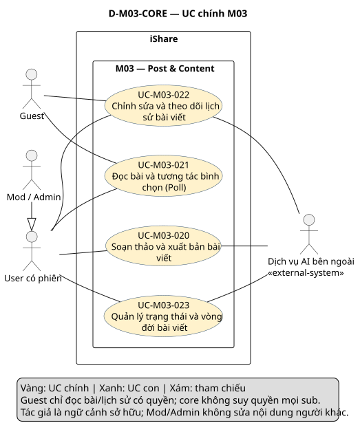
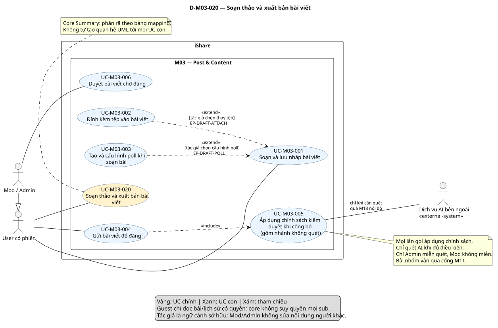
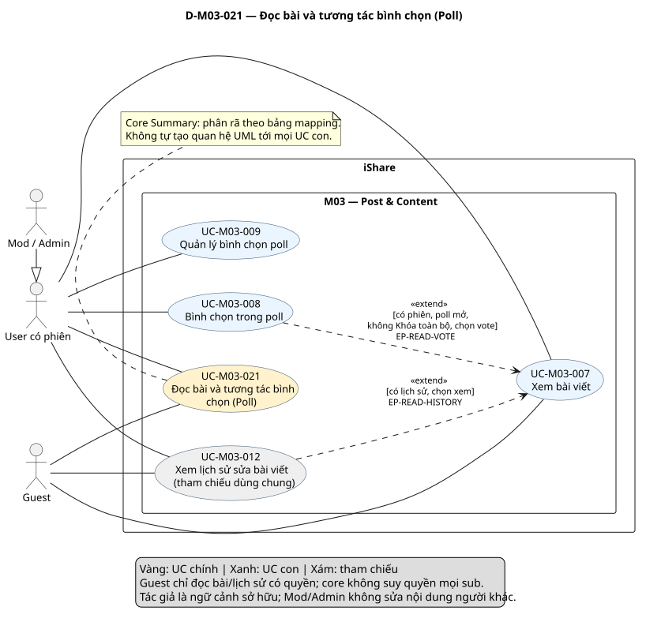
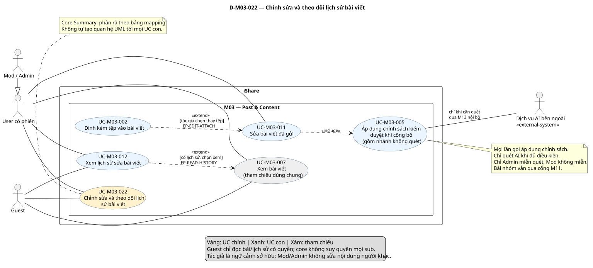
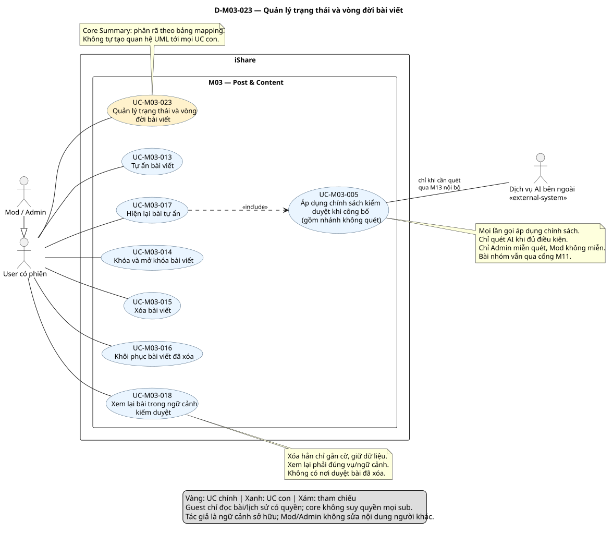

# Phân tích use case — M03 Post & Content (US-M03)

[Vietnamese Doc]

Phân tích toàn bộ FR-M03 1.10 theo skill use-case-analysis 2.2. Đầu ra: **4 UC chính, 17 UC con**, đặc tả, phân rã, quan hệ và truy vết; **5 sơ đồ, mỗi sơ đồ một SVG**. Trạng thái kết quả: **Chờ duyệt**.

## Metadata và tiến độ

<!-- uc:document -->
| key | value |
|---|---|
| document_id | US-M03 |
| skill_version | 2.2 |
| mode | module |
| modules | M03 |
| scope | ALL |
| status | Chờ duyệt |
| current_step | 7 |
| completed_steps | 1, 2, 3, 4, 5, 6, 7 |
| approved_steps | - |
| source_baseline | FR-M03 1.10; FR-M01 1.10; FR-M02 1.6; FR-M04 1.4; FR-M05 1.7; FR-M06 1.5; FR-M07 1.5; FR-M08 1.7; FR-M09 1.2; FR-M10 1.4; FR-M11 1.3; FR-M12 1.1; FR-M13 1.3; FR-M14 1.1; FR-M15 1.1 |
| author | Codex — hỗ trợ phân tích nghiệp vụ |
| date | 2026-10-30 |
| approval_evidence | Người dùng yêu cầu sử dụng skill để đọc FR-M03 và xây dựng đầu ra phân tích M03. Theo ngữ cảnh đã yêu cầu tiếp tục các bước, thực hiện liên tục để hoàn thiện đầu ra; chưa có phê duyệt riêng từng bước hoặc kết quả cuối của bản này. |
| semantic_review | pass |
| diagram_check | pass |

| Bước | Kết quả | Xác nhận |
|---|---|---|
| 1 | Baseline, boundary, actor và kiểm kê 219 mã | Được yêu cầu triển khai; chưa duyệt riêng |
| 2 | 4 core, 17 sub và 20 mapping | Được yêu cầu triển khai; chưa duyệt riêng |
| 3 | 17 hợp đồng chi tiết; 4 AUT và 5 RULE | Được yêu cầu triển khai; chưa duyệt riêng |
| 4 | 8 quan hệ UC và 5 extension point; rà quyền actor | Được yêu cầu triển khai; chưa duyệt riêng |
| 5 | 17 nhóm + 151 FR chi tiết + 51 BR; đối chiếu giao tiếp | Được yêu cầu triển khai; chưa duyệt riêng |
| 6 | Tổng quan và 4 sơ đồ chi tiết, chỉ SVG; cú pháp/render/kiểm tra hình đạt | Chưa duyệt nội dung |
| 7 | Kiểm ngữ nghĩa, cấu trúc, hình và link | Chờ duyệt kết quả cuối |

Không kế thừa approved_steps hoặc bằng chứng pass từ US-M03 cũ. Chỉ dùng bản trước để giữ ID/mục tiêu còn phù hợp, không sửa FR hay các US module khác.

## 1. Phạm vi, nguồn và actor

**Subject/boundary:** toàn iShare. M03 là chức năng nội bộ; các module M01–M15 không là actor ngoài boundary. Dịch vụ AI bên ngoài là actor hỗ trợ qua lớp nội bộ M13; không dùng chính iShare/Hệ thống/scheduler làm actor của nó.

**Mục đích:** cung cấp mô hình nghiệp vụ cho thiết kế và kiểm thử. **Trong phạm vi:** toàn bộ MS1/Must của M03: soạn/nháp/tệp/poll, gửi-quét-duyệt, đọc/vote/quản lý poll, sửa/lịch sử, tự ẩn/hiện, khóa, xóa mềm/khôi phục/cờ xóa hẳn và xem lại theo ngữ cảnh.

**Ngoài phạm vi:** bình luận M04; Topic/Tag M05; tìm kiếm M06; thông báo M07; báo cáo/cảnh cáo/ban/xử lý bài gắn cờ và Mod gỡ ở M08; khiếu nại M09; cờ AI M10; cổng nhóm/ẩn danh M11; upvote/điểm M12; vận hành lời gọi AI/tóm tắt/embedding M13; feed M14; thống kê M15; vòng đời tài khoản/mention M01. Không thêm Accepted Answer, ảnh bìa, ảnh inline, AI tự viết bài, mở lại poll hoặc đếm lượt xem/SSR-SEO trong MS1.

### Baseline và nguồn

<!-- uc:sources -->
| path | version | role |
|---|---|---|
| docs/specs/fr/FR-M03.md | 1.10 | owner |
| docs/specs/fr/FR-M01.md | 1.10 | related |
| docs/specs/fr/FR-M02.md | 1.6 | related |
| docs/specs/fr/FR-M04.md | 1.4 | related |
| docs/specs/fr/FR-M05.md | 1.7 | related |
| docs/specs/fr/FR-M06.md | 1.5 | related |
| docs/specs/fr/FR-M07.md | 1.5 | related |
| docs/specs/fr/FR-M08.md | 1.7 | related |
| docs/specs/fr/FR-M09.md | 1.2 | related |
| docs/specs/fr/FR-M10.md | 1.4 | related |
| docs/specs/fr/FR-M11.md | 1.3 | related |
| docs/specs/fr/FR-M12.md | 1.1 | related |
| docs/specs/fr/FR-M13.md | 1.3 | related |
| docs/specs/fr/FR-M14.md | 1.1 | related |
| docs/specs/fr/FR-M15.md | 1.1 | related |

FR-M03 đã chốt ngày 2026-10-24, mốc DEC-271/QA-477/ISS-415/OPEN-012. Đọc đầy đủ yêu cầu M03 và các giao tiếp/mã liên quan ở module cung cấp/nhận; không tuyên bố đặc tả các module đó. [Skill 2.2](../../../.agent-instructions/skills/use-case-analysis/SKILL.md) là nguồn phương pháp, không cung cấp tính năng.

### Actor và quyền

<!-- uc:actors -->
| id | name | kind | parent | boundary_reason | sources |
|---|---|---|---|---|---|
| ACT-001 | Guest — chưa có phiên | human | - | Người ngoài iShare đọc bài/lịch sử theo quyền. Thao tác khác bị từ chối. | FR-M03-07.01, FR-M03-07.06, FR-M03-12.03 |
| ACT-002 | User — có phiên | human | - | Người ngoài iShare soạn và quản lý bài của mình, đọc/vote theo quyền; chủ bài là ngữ cảnh, không actor riêng. | FR-M03-01.01, FR-M03-08.01, FR-M03-11.04, FR-M03-15.04 |
| ACT-003 | Mod / Admin | human | ACT-002 | Con người ngoài iShare; tương tác cá nhân kế thừa User, thêm duyệt/khóa/tra cứu vụ liên quan. Chỉ ADMIN miễn quét, không áp dụng cho toàn bộ nhóm ACT-003. | FR-M03-06.06, FR-M03-14.03, FR-M03-17.04, BR-M03-51 |
| ACT-006 | Dịch vụ AI bên ngoài | external-system | - | Nhà cung cấp ngoài iShare nhận nội dung và trả điểm khi có quét; gọi qua M13 nội bộ. Không quyết quyền Mod hay ban tài khoản. | FR-M13-01.01, FR-M13-02.01, FR-M13-02.04, FR-M03-05.01 |

ACT-001/002/003 giữ nghĩa vai trò đã có; ACT-006 bổ sung dịch vụ AI có căn cứ. Mod/Admin được gộp ở các tương tác cùng quyền, nhưng cổng phải xét **vai trò ADMIN thực tế** khi miễn quét hoặc bảo trì, không gán miễn quét cho Mod. Sở hữu bài, thành viên/Owner nhóm, mức cảnh cáo, BANNED và các trạng thái là điều kiện ngữ cảnh. Actor User có phiên không mặc nhiên được phép mọi thao tác: vẫn chịu M01 và quyền cụ thể.

### Kiểm kê nhóm chức năng

| Nhóm | Mục tiêu/hành vi | FR chi tiết | Phân bổ |
|---|---|---|---|
| FR-M03-01 | Soạn và lưu nháp bài viết | 17 | UC-M03-001 |
| FR-M03-02 | Đính kèm tệp vào bài viết | 11 | UC-M03-002 |
| FR-M03-03 | Tạo bình chọn trong bài viết | 11 | UC-M03-003 |
| FR-M03-04 | Gửi bài viết để đăng | 11 | UC-M03-004 |
| FR-M03-05 | Quét nội dung bài viết | 15 | AUT-M03-001 |
| FR-M03-06 | Duyệt bài viết chờ đăng | 7 | UC-M03-006 |
| FR-M03-07 | Xem bài viết | 11 | UC-M03-007, RULE-M03-002, UC-M03-018 |
| FR-M03-08 | Bình chọn trong poll | 13 | UC-M03-008, RULE-M03-003 |
| FR-M03-09 | Đổi hạn, kết thúc và thêm lựa chọn cho poll | 8 | UC-M03-009 |
| FR-M03-10 | Kết thúc poll khi hết hạn | 2 | AUT-M03-002, AUT-M03-004 |
| FR-M03-11 | Sửa bài viết đã gửi | 7 | UC-M03-011, RULE-M03-005 |
| FR-M03-12 | Xem lịch sử sửa bài viết | 4 | UC-M03-012 |
| FR-M03-13 | Tự ẩn và hiện lại bài viết | 6 | UC-M03-013, UC-M03-017 |
| FR-M03-14 | Khóa và mở khóa bài viết | 12 | UC-M03-014, RULE-M03-004 |
| FR-M03-15 | Xóa bài viết | 6 | UC-M03-015 |
| FR-M03-16 | Khôi phục bài viết đã xóa | 6 | UC-M03-016 |
| FR-M03-17 | Chuyển bài hết hạn khôi phục sang Đã xóa hẳn | 4 | AUT-M03-003, UC-M03-018 |

Mẫu số **219 mã = 17 nhóm + 151 FR chi tiết + 51 BR**. Không có mã hiện hành bị loại khỏi phạm vi. Các yêu cầu tự động được đặc tả AUT, không vì không có actor người dùng mà bỏ bao phủ.

## 2. UC chính, UC con và phân rã

<!-- uc:catalog -->
| id | name | tier | level | primary | supporting | owner | anchor | sources |
|---|---|---|---|---|---|---|---|---|
| UC-M03-020 | Soạn thảo và xuất bản bài viết | core | Summary | ACT-002, ACT-003 | ACT-006 | M03 | #uc-m03-020 | FR-M03-01, FR-M03-02, FR-M03-03, FR-M03-04, FR-M03-05, FR-M03-06 |
| UC-M03-021 | Đọc bài và tương tác bình chọn (Poll) | core | Summary | ACT-001, ACT-002, ACT-003 | - | M03 | #uc-m03-021 | FR-M03-07, FR-M03-08, FR-M03-09, FR-M03-10 |
| UC-M03-022 | Chỉnh sửa và theo dõi lịch sử bài viết | core | Summary | ACT-001, ACT-002, ACT-003 | ACT-006 | M03 | #uc-m03-022 | FR-M03-02.02, FR-M03-11, FR-M03-12, BR-M03-26, BR-M03-27 |
| UC-M03-023 | Quản lý trạng thái và vòng đời bài viết | core | Summary | ACT-002, ACT-003 | ACT-006 | M03 | #uc-m03-023 | FR-M03-13, FR-M03-14, FR-M03-15, FR-M03-16, FR-M03-17, FR-M03-07.08 |
| UC-M03-001 | Soạn và lưu nháp bài viết | sub | User goal | ACT-002, ACT-003 | - | M03 | #uc-m03-001 | FR-M03-01, BR-M03-01, BR-M03-02, BR-M03-03, BR-M03-05, BR-M03-41, BR-M03-42 |
| UC-M03-002 | Đính kèm tệp vào bài viết | sub | Subfunction | ACT-002, ACT-003 | - | M03 | #uc-m03-002 | FR-M03-02, BR-M03-04, BR-M03-07, BR-M03-08 |
| UC-M03-003 | Tạo và cấu hình poll khi soạn bài | sub | Subfunction | ACT-002, ACT-003 | - | M03 | #uc-m03-003 | FR-M03-03, BR-M03-09, BR-M03-10, BR-M03-11, BR-M03-12 |
| UC-M03-004 | Gửi bài viết để đăng | sub | User goal | ACT-002, ACT-003 | - | M03 | #uc-m03-004 | FR-M03-04, BR-M03-19, BR-M03-22, BR-M03-24, BR-M03-25, BR-M03-40, BR-M03-51 |
| UC-M03-005 | Áp dụng chính sách kiểm duyệt khi công bố | sub | Subfunction | ACT-002, ACT-003 | ACT-006 | M03 | #uc-m03-005 | FR-M03-04.01, FR-M03-04.03, FR-M03-04.05, FR-M03-04.11, FR-M03-05, BR-M03-26, BR-M03-51 |
| UC-M03-006 | Duyệt bài viết chờ đăng | sub | User goal | ACT-003 | - | M03 | #uc-m03-006 | FR-M03-06, BR-M03-23, BR-M03-25 |
| UC-M03-007 | Xem bài viết | sub | User goal | ACT-001, ACT-002, ACT-003 | - | M03 | #uc-m03-007 | FR-M03-07, BR-M03-18, BR-M03-39, BR-M03-49 |
| UC-M03-008 | Bình chọn trong poll | sub | User goal | ACT-002, ACT-003 | - | M03 | #uc-m03-008 | FR-M03-08, BR-M03-11, BR-M03-13, BR-M03-16, BR-M03-45 |
| UC-M03-009 | Quản lý bình chọn poll | sub | User goal | ACT-002, ACT-003 | - | M03 | #uc-m03-009 | FR-M03-09, BR-M03-14, BR-M03-44 |
| UC-M03-011 | Sửa bài viết đã gửi | sub | User goal | ACT-002, ACT-003 | - | M03 | #uc-m03-011 | FR-M03-11, BR-M03-26, BR-M03-27, BR-M03-28, BR-M03-47 |
| UC-M03-012 | Xem lịch sử sửa bài viết | sub | User goal | ACT-001, ACT-002, ACT-003 | - | M03 | #uc-m03-012 | FR-M03-12, BR-M03-27, BR-M03-28 |
| UC-M03-013 | Tự ẩn bài viết | sub | User goal | ACT-002, ACT-003 | - | M03 | #uc-m03-013 | FR-M03-13.01, FR-M03-13.03, FR-M03-13.04, BR-M03-29 |
| UC-M03-017 | Hiện lại bài tự ẩn | sub | User goal | ACT-002, ACT-003 | - | M03 | #uc-m03-017 | FR-M03-13.02, FR-M03-13.03, FR-M03-13.05, FR-M03-13.06, BR-M03-26, BR-M03-29, BR-M03-33 |
| UC-M03-014 | Khóa và mở khóa bài viết | sub | User goal | ACT-002, ACT-003 | - | M03 | #uc-m03-014 | FR-M03-14, BR-M03-30, BR-M03-31, BR-M03-32 |
| UC-M03-015 | Xóa bài viết | sub | User goal | ACT-002, ACT-003 | - | M03 | #uc-m03-015 | FR-M03-15, BR-M03-34, BR-M03-35 |
| UC-M03-016 | Khôi phục bài viết đã xóa | sub | User goal | ACT-002, ACT-003 | - | M03 | #uc-m03-016 | FR-M03-16, BR-M03-35, BR-M03-36, BR-M03-37 |
| UC-M03-018 | Xem lại bài trong ngữ cảnh kiểm duyệt | sub | User goal | ACT-002, ACT-003 | - | M03 | #uc-m03-018 | FR-M03-07.08, FR-M03-07.09, FR-M03-07.10, FR-M03-07.11, FR-M03-17.04, BR-M03-37, BR-M03-49 |

### Phân rã chính → con

<!-- uc:decomposition -->
| core | sub | rationale | sources |
|---|---|---|---|
| UC-M03-020 | UC-M03-001 | Giữ bài đang soạn dưới dạng nháp hợp lệ. | FR-M03-01, BR-M03-01, BR-M03-02, BR-M03-03, BR-M03-05, BR-M03-41, BR-M03-42 |
| UC-M03-020 | UC-M03-002 | Dùng chung thao tác đính kèm trong soạn/sửa, một ID và hợp đồng. | FR-M03-02, BR-M03-04, BR-M03-07, BR-M03-08 |
| UC-M03-020 | UC-M03-003 | Tạo poll tùy chọn của bài chưa gửi và cấu hình các lựa chọn/hạn kết thúc. | FR-M03-03, BR-M03-09, BR-M03-10, BR-M03-11, BR-M03-12 |
| UC-M03-020 | UC-M03-004 | Nộp bài nháp hoặc bài bị từ chối đã sửa để được công bố theo cổng phù hợp. | FR-M03-04, BR-M03-19, BR-M03-22, BR-M03-24, BR-M03-25, BR-M03-40, BR-M03-51 |
| UC-M03-020 | UC-M03-005 | Dùng chung chính sách kiểm duyệt cho gửi/sửa/hiện lại, gồm cả miễn/trì hoãn; không đồng nghĩa mọi lần gọi đều quét AI. | FR-M03-04.01, FR-M03-04.03, FR-M03-04.05, FR-M03-04.11, FR-M03-05, BR-M03-26, BR-M03-51 |
| UC-M03-020 | UC-M03-006 | Quyết định chấp nhận/từ chối bài thật sự vào hàng chờ duyệt của Mod hệ thống. | FR-M03-06, BR-M03-23, BR-M03-25 |
| UC-M03-021 | UC-M03-007 | Đọc nội dung bài trong ngữ cảnh thông thường, theo trạng thái và quyền người xem. | FR-M03-07, BR-M03-18, BR-M03-39, BR-M03-49 |
| UC-M03-021 | UC-M03-008 | Ghi, thay hoặc bỏ phiếu của mình khi poll mở và không bị khóa toàn bộ. | FR-M03-08, BR-M03-11, BR-M03-13, BR-M03-16, BR-M03-45 |
| UC-M03-021 | UC-M03-009 | Tác giả đổi hạn, kết thúc ngay hoặc thêm lựa chọn cho poll còn mở sau khi bài đã gửi. | FR-M03-09, BR-M03-14, BR-M03-44 |
| UC-M03-022 | UC-M03-011 | Sửa nội dung được phép của bài mình, lưu phiên bản trước và áp dụng quét lại đúng ngữ cảnh. | FR-M03-11, BR-M03-26, BR-M03-27, BR-M03-28, BR-M03-47 |
| UC-M03-022 | UC-M03-012 | Đọc các phiên bản trước của bài trong quyền xem được bài. | FR-M03-12, BR-M03-27, BR-M03-28 |
| UC-M03-022 | UC-M03-002 | Dùng chung thao tác đính kèm trong soạn/sửa, một ID và hợp đồng. | FR-M03-02, BR-M03-04, BR-M03-07, BR-M03-08 |
| UC-M03-022 | UC-M03-005 | Dùng chung chính sách kiểm duyệt cho gửi/sửa/hiện lại, gồm cả miễn/trì hoãn; không đồng nghĩa mọi lần gọi đều quét AI. | FR-M03-04.01, FR-M03-04.03, FR-M03-04.05, FR-M03-04.11, FR-M03-05, BR-M03-26, BR-M03-51 |
| UC-M03-023 | UC-M03-013 | Tạm ngừng hiển thị bài Đã đăng của mình với người khác. | FR-M03-13.01, FR-M03-13.03, FR-M03-13.04, BR-M03-29 |
| UC-M03-023 | UC-M03-017 | Đưa bài Tự ẩn của mình trở lại trạng thái đăng, với cổng quét lại khi đã sửa. | FR-M03-13.02, FR-M03-13.03, FR-M03-13.05, FR-M03-13.06, BR-M03-26, BR-M03-29, BR-M03-33 |
| UC-M03-023 | UC-M03-014 | Điều chỉnh mức khóa tương tác theo quyền tác giả/Mod và người đã khóa. | FR-M03-14, BR-M03-30, BR-M03-31, BR-M03-32 |
| UC-M03-023 | UC-M03-015 | Xóa mềm bài của mình, giữ cơ hội khôi phục có hạn. | FR-M03-15, BR-M03-34, BR-M03-35 |
| UC-M03-023 | UC-M03-016 | Khôi phục bài xóa mềm của mình trong thời hạn và quyền cho phép. | FR-M03-16, BR-M03-35, BR-M03-36, BR-M03-37 |
| UC-M03-023 | UC-M03-018 | Xem lại đúng bài liên quan vụ việc, kể cả xóa hẳn, trong phạm vi quyền hạn cho phép. | FR-M03-07.08, FR-M03-07.09, FR-M03-07.10, FR-M03-07.11, FR-M03-17.04, BR-M03-37, BR-M03-49 |
| UC-M03-023 | UC-M03-005 | Dùng chung chính sách kiểm duyệt cho gửi/sửa/hiện lại, gồm cả miễn/trì hoãn; không đồng nghĩa mọi lần gọi đều quét AI. | FR-M03-04.01, FR-M03-04.03, FR-M03-04.05, FR-M03-04.11, FR-M03-05, BR-M03-26, BR-M03-51 |

Cả bốn core ở Summary; sub có level User goal hoặc Subfunction theo tính chất hành vi. Core Summary mô tả năng lực bao quát, không là lần chạy mọi UC con. Mapping không tự tạo quan hệ kế thừa/include/extend. UC002/005 có nhiều core nhưng một định nghĩa.

<!-- uc:module-models -->
| module | path | baseline |
|---|---|---|


Mode module: US-overview không được tổng hợp trong scope này; các core giữ ID/tên làm đầu vào tổng quan hệ thống sau này.

| Quyết định | Biểu diễn | Căn cứ/lý do |
|---|---|---|
| D-M03-01 | Giữ core020–023 và các sub cũ theo mục tiêu; thêm UC005/017/018 | Không tái đánh số. UC013 giữ phần tự ẩn, phần hiện lại tách UC017; UC007 giữ đọc thông thường, phần xem lại đặc biệt tách UC018. |
| D-M03-02 | UC005 là chính sách kiểm duyệt dùng chung, AUT001 mới là lần quét tự động | Không include quét AI vô điều kiện vì Admin/cờ tắt/lưu Tự ẩn có nhánh không quét. Tách hợp đồng theo sự kiện tái dùng ở UC004/011/017. |
| D-M03-03 | Đính kèm/poll là UC bổ sung có EP trong soạn/sửa | Bài soạn hoàn chỉnh không cần cả hai; hợp đồng bổ sung có giới hạn/quyền riêng, UC002 tái dùng. |
| D-M03-04 | Không tạo UC duyệt nhóm, xử lý báo cáo hoặc khiếu nại M03 | Ranh giới M11/M08/M09; M03 nhận điều kiện/sự kiện và cung cấp nội dung đúng quyền. |
| D-M03-05 | UC006 không extend UC004 chỉ vì bài đôi khi vào hàng chờ | Duyệt thủ công có actor/trigger riêng sau xử lý tự động; thứ tự/trạng thái không tự thành extend. |
| D-M03-06 | Ba chiều trạng thái tách biệt; Đã xóa hẳn là cờ giữ dữ liệu | Không biến khóa thành ẩn bài hoặc xóa hẳn thành xóa vật lý. Xem lại cần ngữ cảnh kiểm soát. |
| D-M03-07 | UC009 giữ nhóm quản lý poll; đóng do thời gian là AUT002 | Cùng quyền tác giả quản lý cấu hình được phép sau gửi; vote là UC008 độc lập, không tạo oval cho từng lựa chọn. |
| D-M03-08 | Tách AUT004 sự kiện poll kết thúc khỏi AUT002 đến hạn | FR-M03-10.02 áp dụng cả đóng thủ công lẫn hết hạn, không bỏ sót đường UC009. |
| D-M03-09 | Không có generalization UC hoặc include đăng nhập | Hai tầng đầu ra không là kế thừa; phiên là điều kiện, Guest tương tác bị từ chối. |
| D-M03-10 | Rà lại từng mã BR theo nội dung, không kế thừa ánh xạ cũ | Các ngưỡng mới/quét lại, ngoại lệ Admin, xóa giữ dữ liệu, phạm vi quyền và cấu hình poll phải vào đúng đặc tả. |

## 3. Đặc tả

### 3.1 UC chính

<a id="uc-m03-020"></a>

### UC-M03-020 — Soạn thảo và xuất bản bài viết

| Thuộc tính | Nội dung |
|---|---|
| Actor chính | ACT-002, ACT-003 |
| Hỗ trợ | ACT-006 |
| Mục tiêu/giá trị | Tạo và đưa nội dung tới trạng thái đăng phù hợp chính sách kiểm duyệt. |
| Khởi phát | Soạn mới, gửi hoặc xử lý hàng chờ duyệt. |
| Điều kiện/phạm vi | Điều kiện theo từng UC con; quyền Admin và bài nhóm xử lý riêng. |
| Kết quả | Nháp hợp lệ hoặc bài được xử lý thành Đã đăng/Chờ duyệt/Bị từ chối đúng đường. |
| Khi không đạt | Không công khai nội dung chưa được phép; không bỏ qua cổng nhóm. |
| UC con | UC-M03-001, UC-M03-002, UC-M03-003, UC-M03-004, UC-M03-005, UC-M03-006 |
| Nguồn | FR-M03-01, FR-M03-02, FR-M03-03, FR-M03-04, FR-M03-05, FR-M03-06 |

**Quy trình tổng quát:**

1. UC001 soạn/lưu nháp; UC002 và UC003 bổ sung tệp/poll khi tác giả lựa chọn.
2. UC004 gửi bài và dùng UC005 quyết định chính sách kiểm duyệt; AUT001 quét khi cần.
3. UC006 cho Mod/Admin xử lý bài thực sự vào hàng chờ; không phải mọi bài gửi đều cần duyệt thủ công.

Không bắt buộc mọi UC con chạy nối tiếp hoặc có actor phụ gọi AI trong mọi nhánh.

<a id="uc-m03-021"></a>

### UC-M03-021 — Đọc bài và tương tác bình chọn (Poll)

| Thuộc tính | Nội dung |
|---|---|
| Actor chính | ACT-001, ACT-002, ACT-003 |
| Hỗ trợ | - |
| Mục tiêu/giá trị | Đọc nội dung được phép và tham gia/quản lý poll theo vai trò. |
| Khởi phát | Mở bài, bình chọn hoặc quản lý poll. |
| Điều kiện/phạm vi | Guest chỉ đọc; mọi thao tác khác yêu cầu phiên và quyền phù hợp. |
| Kết quả | Bài và kết quả poll hiển thị đúng; phiếu/cấu hình chỉ cập nhật khi được phép. |
| Khi không đạt | Không lộ nội dung hoặc cho bình chọn khi poll đóng/bài Khóa toàn bộ. |
| UC con | UC-M03-007, UC-M03-008, UC-M03-009 |
| Nguồn | FR-M03-07, FR-M03-08, FR-M03-09, FR-M03-10 |

**Quy trình tổng quát:**

1. UC007 kiểm tra khả năng xem và hiển thị bài; có thể xem lịch sử theo UC012.
2. UC008 ghi/đổi/bỏ phiếu; UC009 cho tác giả đổi hạn, kết thúc ngay hoặc thêm lựa chọn.
3. AUT002 đóng poll khi đến hạn; RULE003 quyết định cách hiện kết quả.

Không bắt buộc mọi UC con chạy nối tiếp hoặc có actor phụ gọi AI trong mọi nhánh.

<a id="uc-m03-022"></a>

### UC-M03-022 — Chỉnh sửa và theo dõi lịch sử bài viết

| Thuộc tính | Nội dung |
|---|---|
| Actor chính | ACT-001, ACT-002, ACT-003 |
| Hỗ trợ | ACT-006 |
| Mục tiêu/giá trị | Tác giả chỉnh sửa nội dung được phép và người xem tra lịch sử được công bố. |
| Khởi phát | Lưu bản sửa hoặc chọn xem lịch sử. |
| Điều kiện/phạm vi | Điều kiện sửa khác với điều kiện đọc; Guest chỉ xem lịch sử nếu xem được bài. |
| Kết quả | Bản sửa/lịch sử được ghi đúng; cổng quét lại đúng bối cảnh. |
| Khi không đạt | Không cho Mod sửa nội dung người khác hay cho lịch sử vượt quyền xem bài. |
| UC con | UC-M03-011, UC-M03-012, UC-M03-002, UC-M03-005 |
| Nguồn | FR-M03-02.02, FR-M03-11, FR-M03-12, BR-M03-26, BR-M03-27 |

**Quy trình tổng quát:**

1. UC011 cho tác giả sửa bài đã gửi, có thể dùng UC002 để thay tệp.
2. UC005 xác định có cần quét lại, trì hoãn hoặc miễn quét; AUT001 xử lý kết quả.
3. UC012 cho người xem được bài đọc lịch sử; không phải mỗi lần sửa đều có người xem lịch sử.

Không bắt buộc mọi UC con chạy nối tiếp hoặc có actor phụ gọi AI trong mọi nhánh.

<a id="uc-m03-023"></a>

### UC-M03-023 — Quản lý trạng thái và vòng đời bài viết

| Thuộc tính | Nội dung |
|---|---|
| Actor chính | ACT-002, ACT-003 |
| Hỗ trợ | ACT-006 |
| Mục tiêu/giá trị | Kiểm soát khả năng hiển thị, khóa tương tác, xóa và khôi phục đúng hạn. |
| Khởi phát | Tự ẩn/hiện lại, đổi mức khóa, xóa/khôi phục hoặc xem lại theo vụ việc. |
| Điều kiện/phạm vi | Phân biệt trạng thái đăng, kiểm duyệt và khóa; quyền sở hữu/quyền Mod không thay thế nhau. |
| Kết quả | Chuyển đúng trạng thái/mức khóa; dữ liệu giữ theo chính sách; quyền tra cứu bị giới hạn. |
| Khi không đạt | Không khôi phục quá hạn, không tự vượt Bị Mod ẩn, không tạo nơi duyệt bài đã xóa. |
| UC con | UC-M03-013, UC-M03-017, UC-M03-014, UC-M03-015, UC-M03-016, UC-M03-018, UC-M03-005 |
| Nguồn | FR-M03-13, FR-M03-14, FR-M03-15, FR-M03-16, FR-M03-17, FR-M03-07.08 |

**Quy trình tổng quát:**

1. UC013 tự ẩn; UC017 hiện lại và gọi UC005 khi áp dụng chính sách quét.
2. UC014 đặt/mở/hạ khóa theo người khóa; UC015/016 xóa mềm và khôi phục.
3. AUT003 gắn cờ Đã xóa hẳn sau 7 × 24 giờ, không xóa dữ liệu; UC018 chỉ xem lại theo ngữ cảnh kiểm duyệt cho phép.

Không bắt buộc mọi UC con chạy nối tiếp hoặc có actor phụ gọi AI trong mọi nhánh.

### 3.2 UC con

Các ID UC viết đầy đủ trong catalog/relations/decomposition là định danh chính; cách gọi ngắn UC001… trong diễn giải đều thuộc M03. Subfunction kế thừa actor và ngữ cảnh từ UC gọi, không tạo nút riêng chỉ để gọi chính sách/quét.

<a id="uc-m03-001"></a>

### UC-M03-001 — Soạn và lưu nháp bài viết

**UC chính:** UC-M03-020.

<!-- uc:spec UC-M03-001 -->
| key | value |
|---|---|
| goal | Giữ bài đang soạn dưới dạng nháp hợp lệ. |
| subject | iShare |
| level | User goal |
| primary | ACT-002, ACT-003 |
| supporting | - |
| trigger | Người có phiên tạo bài mới hoặc lưu bản nháp. |
| preconditions | Có phiên và tác giả; kiểm tra mức cảnh cáo trong luồng, không giả định mọi người có phiên đều được tạo nháp. |
| success | Lưu Nháp, tác giả/thời điểm tạo/cập nhật, kiểm duyệt Bình thường và Không khóa khi mới tạo. |
| failure | Nháp trống hoặc sai giới hạn bị từ chối; vượt độ dài vẫn giữ nội dung đang soạn. |
| abstract | false |
| common_contract | Không áp dụng: không có quan hệ UC generalization. |

#### Luồng chính

<a id="uc-m03-001-main-1"></a>

| Bước | Tương tác actor–iShare | Tiếp tục | Nguồn |
|---|---|---|---|
| 1 | Tác giả mở trình soạn một loại bài, nhập tiêu đề/nội dung giàu định dạng và LaTeX mã thô; có thể chọn Lớp/Khối 10/11/12 hoặc trống. | 2 | FR-M03-01, BR-M03-01, BR-M03-02, BR-M03-03, BR-M03-05, BR-M03-41, BR-M03-42 |

<a id="uc-m03-001-main-2"></a>

| Bước | Tương tác actor–iShare | Tiếp tục | Nguồn |
|---|---|---|---|
| 2 | Trong khi soạn, EP-DRAFT-ATTACH cho phép UC002 thêm/bỏ tệp; EP-DRAFT-POLL cho phép UC003 thêm/cấu hình poll; Topic/Tag theo M05, mention theo M01. | 3 | FR-M03-01, BR-M03-01, BR-M03-02, BR-M03-03, BR-M03-05, BR-M03-41, BR-M03-42 |

<a id="uc-m03-001-main-3"></a>

| Bước | Tương tác actor–iShare | Tiếp tục | Nguồn |
|---|---|---|---|
| 3 | iShare kiểm tra tác giả, hạn chế MEDIUM/HEAVY đối với lưu nháp mới, không trống cả bốn phần và giới hạn 150 ký tự/6.000 từ; cảnh báo ngay khi vượt. | 4 | FR-M03-01, BR-M03-01, BR-M03-02, BR-M03-03, BR-M03-05, BR-M03-41, BR-M03-42 |

<a id="uc-m03-001-main-4"></a>

| Bước | Tương tác actor–iShare | Tiếp tục | Nguồn |
|---|---|---|---|
| 4 | Lưu nháp và các mốc; tạo mới với kiểm duyệt Bình thường, Không khóa. Chưa gửi nên không chạy quét công bố. | END: Lưu Nháp, tác giả/thời điểm tạo/cập nhật, kiểm duyệt Bình thường và Không khóa khi mới tạo. | FR-M03-01, BR-M03-01, BR-M03-02, BR-M03-03, BR-M03-05, BR-M03-41, BR-M03-42 |

#### Luồng thay thế và ngoại lệ

<a id="uc-m03-001-alt-1"></a>

| Nhánh | Bước rẽ | Điều kiện | Xử lý | Quay lại/kết thúc | Nguồn |
|---|---|---|---|---|---|
| A1 | 3 | Nháp trống cả tiêu đề/nội dung/poll/tệp hoặc Lớp/Khối sai | Từ chối lưu nháp không hợp lệ. | END: chưa lưu | FR-M03-01.06, FR-M03-01.13 |

<a id="uc-m03-001-alt-2"></a>

| Nhánh | Bước rẽ | Điều kiện | Xử lý | Quay lại/kết thúc | Nguồn |
|---|---|---|---|---|---|
| A2 | 3 | Vượt 150 ký tự tiêu đề hoặc 6.000 từ nội dung | Cảnh báo kèm số hiện tại/giới hạn, từ chối lưu và giữ nguyên bản soạn. | 1 | FR-M03-01.14, FR-M03-01.15, FR-M03-01.16, FR-M03-01.17 |

<a id="uc-m03-001-alt-3"></a>

| Nhánh | Bước rẽ | Điều kiện | Xử lý | Quay lại/kết thúc | Nguồn |
|---|---|---|---|---|---|
| A3 | 3 | Tạo nháp mới khi MEDIUM/HEAVY | Từ chối; không suy rộng hạn chế này sang mọi sửa bài đã đăng. | END: chưa lưu | FR-M03-01.10, BR-M03-38 |

<a id="uc-m03-001-rules"></a>

**Ràng buộc:** FR-M03-01, BR-M03-01, BR-M03-02, BR-M03-03, BR-M03-05, BR-M03-41, BR-M03-42. Các BR tại mục 3.5 là phần bắt buộc của đặc tả; đọc cùng các RULE/AUT được dẫn. Không bổ sung lỗi kỹ thuật/retry ngoài nguồn.

#### Điều kiện nghiệm thu theo baseline

Các điều kiện chuẩn tắc sau áp dụng cùng hợp đồng, luồng và nhánh của đặc tả; không phải UC độc lập.

| Nguồn | Điều kiện bắt buộc |
|---|---|
| <a id="uc-m03-001-fr-m03-01-01"></a>FR-M03-01.01 | Hệ thống phải cho phép người dùng đã đăng nhập tạo bài viết mới và lưu bài chưa gửi ở trạng thái Nháp. |
| <a id="uc-m03-001-fr-m03-01-02"></a>FR-M03-01.02 | Hệ thống phải cung cấp trình soạn bài có các định dạng nêu ở BR-M03-03. |
| <a id="uc-m03-001-fr-m03-01-03"></a>FR-M03-01.03 | Hệ thống phải cho tác giả nhập công thức LaTeX dạng mã thô và hiển thị công thức đó trong bài. |
| <a id="uc-m03-001-fr-m03-01-04"></a>FR-M03-01.04 | Hệ thống phải giữ mọi ảnh của bài ở phần tệp đính kèm, không đặt ảnh trong nội dung bài. |
| <a id="uc-m03-001-fr-m03-01-05"></a>FR-M03-01.05 | Hệ thống phải cho tác giả chọn Lớp/Khối của bài là 10, 11, 12 hoặc để trống. |
| <a id="uc-m03-001-fr-m03-01-06"></a>FR-M03-01.06 | Nếu Lớp/Khối của bài là giá trị khác 10, 11 và 12, hệ thống phải từ chối lưu bài. |
| <a id="uc-m03-001-fr-m03-01-07"></a>FR-M03-01.07 | Hệ thống phải lưu Lớp/Khối của bài độc lập với Lớp/Khối trên hồ sơ của tác giả. |
| <a id="uc-m03-001-fr-m03-01-08"></a>FR-M03-01.08 | Hệ thống phải lưu tác giả, thời điểm tạo và thời điểm cập nhật của bài viết. |
| <a id="uc-m03-001-fr-m03-01-09"></a>FR-M03-01.09 | Hệ thống phải tạo bài viết mới với mức khóa Không khóa. |
| <a id="uc-m03-001-fr-m03-01-10"></a>FR-M03-01.10 | Nếu tác giả đang ở mức cảnh cáo MEDIUM hoặc HEAVY, hệ thống phải từ chối lưu bài nháp mới. |
| <a id="uc-m03-001-fr-m03-01-11"></a>FR-M03-01.11 | Hệ thống phải dùng một loại bài viết cho mọi dạng nội dung, không yêu cầu tác giả chọn loại bài. |
| <a id="uc-m03-001-fr-m03-01-12"></a>FR-M03-01.12 | Hệ thống phải tạo bài viết mới với trạng thái kiểm duyệt Bình thường. |
| <a id="uc-m03-001-fr-m03-01-13"></a>FR-M03-01.13 | Nếu tác giả lưu nháp khi bài không có tiêu đề, nội dung, poll và tệp đính kèm nào, hệ thống phải từ chối lưu. |
| <a id="uc-m03-001-fr-m03-01-14"></a>FR-M03-01.14 | Nếu tiêu đề dài hơn 150 ký tự, hệ thống phải từ chối lưu và gửi bài. |
| <a id="uc-m03-001-fr-m03-01-15"></a>FR-M03-01.15 | Nếu nội dung dài hơn 6.000 từ, hệ thống phải từ chối lưu và gửi bài. |
| <a id="uc-m03-001-fr-m03-01-16"></a>FR-M03-01.16 | Khi tiêu đề vượt 150 ký tự hoặc nội dung vượt 6.000 từ trong lúc tác giả soạn hoặc sửa bài, hệ thống phải hiển thị cảnh báo ngay, kèm số hiện tại so với giới hạn. |
| <a id="uc-m03-001-fr-m03-01-17"></a>FR-M03-01.17 | Nếu việc lưu hoặc gửi bị từ chối vì vượt giới hạn độ dài, hệ thống phải giữ nguyên nội dung tác giả đang soạn. |

<a id="uc-m03-002"></a>

### UC-M03-002 — Đính kèm tệp vào bài viết

**UC chính:** UC-M03-020, UC-M03-022.

<!-- uc:spec UC-M03-002 -->
| key | value |
|---|---|
| goal | Bổ sung hoặc bỏ tệp của bài trong ngữ cảnh soạn/sửa của tác giả. |
| subject | iShare |
| level | Subfunction |
| primary | ACT-002, ACT-003 |
| supporting | - |
| trigger | Tác giả chọn thêm/bỏ tệp tại EP-DRAFT-ATTACH hoặc EP-EDIT-ATTACH. |
| preconditions | Có phiên, đúng tác giả; bài được soạn/sửa theo UC gọi. |
| success | Tệp hợp lệ ở phần dưới bài, số ảnh/tài liệu đúng giới hạn riêng. |
| failure | Từ chối tệp hoặc thao tác không hợp lệ; không chuyển ảnh vào nội dung. |
| abstract | false |
| common_contract | Không áp dụng: không có quan hệ UC generalization. |

#### Luồng chính

<a id="uc-m03-002-main-1"></a>

| Bước | Tương tác actor–iShare | Tiếp tục | Nguồn |
|---|---|---|---|
| 1 | Tác giả chọn thêm hoặc bỏ tệp của bài mình. | 2 | FR-M03-02, BR-M03-04, BR-M03-07, BR-M03-08 |

<a id="uc-m03-002-main-2"></a>

| Bước | Tương tác actor–iShare | Tiếp tục | Nguồn |
|---|---|---|---|
| 2 | iShare xác nhận tác giả và kiểm tra ảnh JPEG/PNG/WebP ≤5 MB, tối đa 10 ảnh; tài liệu PDF/DOCX/XLSX/PPTX ≤20 MB, tối đa 3 tệp; hai hạn mức độc lập. | 3 | FR-M03-02, BR-M03-04, BR-M03-07, BR-M03-08 |

<a id="uc-m03-002-main-3"></a>

| Bước | Tương tác actor–iShare | Tiếp tục | Nguồn |
|---|---|---|---|
| 3 | Cập nhật phần tệp đính kèm dưới nội dung; trả lại bước soạn/sửa của UC gọi. | END: Tệp hợp lệ ở phần dưới bài, số ảnh/tài liệu đúng giới hạn riêng. | FR-M03-02, BR-M03-04, BR-M03-07, BR-M03-08 |

#### Luồng thay thế và ngoại lệ

<a id="uc-m03-002-alt-1"></a>

| Nhánh | Bước rẽ | Điều kiện | Xử lý | Quay lại/kết thúc | Nguồn |
|---|---|---|---|---|---|
| A1 | 2 | Sai loại, quá dung lượng hoặc quá số lượng | Từ chối tệp thêm; không coi ảnh/tài liệu dùng chung một hạn mức. | END: tệp bị từ chối | FR-M03-02.04, FR-M03-02.05, FR-M03-02.06, FR-M03-02.07, FR-M03-02.08, FR-M03-02.09, FR-M03-02.10 |

<a id="uc-m03-002-alt-2"></a>

| Nhánh | Bước rẽ | Điều kiện | Xử lý | Quay lại/kết thúc | Nguồn |
|---|---|---|---|---|---|
| A2 | 2 | Người thao tác khác tác giả | Từ chối thêm/bỏ tệp, kể cả Mod/Admin sửa bài người khác. | END: từ chối | FR-M03-02.11 |

<a id="uc-m03-002-rules"></a>

**Ràng buộc:** FR-M03-02, BR-M03-04, BR-M03-07, BR-M03-08. Các BR tại mục 3.5 là phần bắt buộc của đặc tả; đọc cùng các RULE/AUT được dẫn. Không bổ sung lỗi kỹ thuật/retry ngoài nguồn.

#### Điều kiện nghiệm thu theo baseline

Các điều kiện chuẩn tắc sau áp dụng cùng hợp đồng, luồng và nhánh của đặc tả; không phải UC độc lập.

| Nguồn | Điều kiện bắt buộc |
|---|---|
| <a id="uc-m03-002-fr-m03-02-01"></a>FR-M03-02.01 | Hệ thống phải cho phép tác giả thêm và bỏ tệp đính kèm khi soạn bài của mình. |
| <a id="uc-m03-002-fr-m03-02-02"></a>FR-M03-02.02 | Hệ thống phải cho phép tác giả thêm và bỏ tệp đính kèm khi sửa bài đã gửi của mình. |
| <a id="uc-m03-002-fr-m03-02-03"></a>FR-M03-02.03 | Hệ thống phải hiển thị các tệp đính kèm ở phần dưới nội dung bài. |
| <a id="uc-m03-002-fr-m03-02-04"></a>FR-M03-02.04 | Nếu ảnh đính kèm không có định dạng JPEG, PNG hoặc WebP, hệ thống phải từ chối ảnh đó. |
| <a id="uc-m03-002-fr-m03-02-05"></a>FR-M03-02.05 | Nếu ảnh đính kèm lớn hơn 5 MB, hệ thống phải từ chối ảnh đó. |
| <a id="uc-m03-002-fr-m03-02-06"></a>FR-M03-02.06 | Nếu bài đã có 10 ảnh đính kèm và tác giả thêm ảnh, hệ thống phải từ chối ảnh thêm. |
| <a id="uc-m03-002-fr-m03-02-07"></a>FR-M03-02.07 | Nếu tài liệu đính kèm không có định dạng PDF, DOCX, XLSX hoặc PPTX, hệ thống phải từ chối tài liệu đó. |
| <a id="uc-m03-002-fr-m03-02-08"></a>FR-M03-02.08 | Nếu tài liệu đính kèm lớn hơn 20 MB, hệ thống phải từ chối tài liệu đó. |
| <a id="uc-m03-002-fr-m03-02-09"></a>FR-M03-02.09 | Nếu bài đã có 3 tài liệu đính kèm và tác giả thêm tài liệu, hệ thống phải từ chối tài liệu thêm. |
| <a id="uc-m03-002-fr-m03-02-10"></a>FR-M03-02.10 | Hệ thống phải tính giới hạn số ảnh và giới hạn số tài liệu riêng với nhau. |
| <a id="uc-m03-002-fr-m03-02-11"></a>FR-M03-02.11 | Nếu người thêm hoặc bỏ tệp khác tác giả của bài, hệ thống phải từ chối. |

<a id="uc-m03-003"></a>

### UC-M03-003 — Tạo và cấu hình poll khi soạn bài

**UC chính:** UC-M03-020.

<!-- uc:spec UC-M03-003 -->
| key | value |
|---|---|
| goal | Tạo poll tùy chọn của bài chưa gửi và cấu hình các lựa chọn/hạn kết thúc. |
| subject | iShare |
| level | Subfunction |
| primary | ACT-002, ACT-003 |
| supporting | - |
| trigger | Tác giả chọn thêm hoặc sửa cấu hình poll tại EP-DRAFT-POLL. |
| preconditions | Có phiên, đúng tác giả, bài chưa gửi; phân biệt thêm poll với quản lý poll sau gửi. |
| success | Tối đa một poll, 2–10 lựa chọn, hạn không trước hiện tại; mặc định chọn nhiều và ẩn kết quả trước vote. |
| failure | Không thêm/sửa cấu hình bị khóa sau khi đã gửi; không chấp nhận poll thiếu hạn hoặc sai lựa chọn. |
| abstract | false |
| common_contract | Không áp dụng: không có quan hệ UC generalization. |

#### Luồng chính

<a id="uc-m03-003-main-1"></a>

| Bước | Tương tác actor–iShare | Tiếp tục | Nguồn |
|---|---|---|---|
| 1 | Tác giả thêm poll và đặt các lựa chọn; iShare đặt mặc định chọn nhiều, không hiện kết quả trước bình chọn. | 2 | FR-M03-03, BR-M03-09, BR-M03-10, BR-M03-11, BR-M03-12 |

<a id="uc-m03-003-main-2"></a>

| Bước | Tương tác actor–iShare | Tiếp tục | Nguồn |
|---|---|---|---|
| 2 | Tác giả cấu hình chọn một/nhiều, hiện kết quả trước vote, đặt hạn kết thúc; khi còn nháp có thể bỏ poll hoặc sửa cấu hình/lựa chọn/hạn. | 3 | FR-M03-03, BR-M03-09, BR-M03-10, BR-M03-11, BR-M03-12 |

<a id="uc-m03-003-main-3"></a>

| Bước | Tương tác actor–iShare | Tiếp tục | Nguồn |
|---|---|---|---|
| 3 | iShare kiểm tra đúng tác giả, chỉ một poll, 2–10 lựa chọn và hạn không trước hiện tại; lưu vào bài chưa gửi và quay về UC001 bước 2. | END: Tối đa một poll, 2–10 lựa chọn, hạn không trước hiện tại; mặc định chọn nhiều và ẩn kết quả trước vote. | FR-M03-03, BR-M03-09, BR-M03-10, BR-M03-11, BR-M03-12 |

#### Luồng thay thế và ngoại lệ

<a id="uc-m03-003-alt-1"></a>

| Nhánh | Bước rẽ | Điều kiện | Xử lý | Quay lại/kết thúc | Nguồn |
|---|---|---|---|---|---|
| A1 | 3 | Sai số lựa chọn, thêm poll thứ hai, thiếu hạn hoặc hạn trước hiện tại | Từ chối tạo/cấu hình sai. | END: chưa có poll mới hợp lệ | FR-M03-03.03, FR-M03-03.04, FR-M03-03.07, FR-M03-03.09 |

<a id="uc-m03-003-alt-2"></a>

| Nhánh | Bước rẽ | Điều kiện | Xử lý | Quay lại/kết thúc | Nguồn |
|---|---|---|---|---|---|
| A2 | 2 | Bài đã gửi | Từ chối thêm/bỏ poll, sửa/xóa lựa chọn cũ hoặc đổi cấu hình. Thêm lựa chọn/đổi hạn poll đang mở theo UC009. | END: cấu hình bị khóa | FR-M03-03.11, BR-M03-44 |

<a id="uc-m03-003-alt-3"></a>

| Nhánh | Bước rẽ | Điều kiện | Xử lý | Quay lại/kết thúc | Nguồn |
|---|---|---|---|---|---|
| A3 | 3 | Người thực hiện khác tác giả | Từ chối. | END: từ chối | FR-M03-03.08 |

<a id="uc-m03-003-rules"></a>

**Ràng buộc:** FR-M03-03, BR-M03-09, BR-M03-10, BR-M03-11, BR-M03-12. Các BR tại mục 3.5 là phần bắt buộc của đặc tả; đọc cùng các RULE/AUT được dẫn. Không bổ sung lỗi kỹ thuật/retry ngoài nguồn.

#### Điều kiện nghiệm thu theo baseline

Các điều kiện chuẩn tắc sau áp dụng cùng hợp đồng, luồng và nhánh của đặc tả; không phải UC độc lập.

| Nguồn | Điều kiện bắt buộc |
|---|---|
| <a id="uc-m03-003-fr-m03-03-01"></a>FR-M03-03.01 | Hệ thống phải cho phép tác giả thêm một poll vào bài khi bài chưa được gửi. |
| <a id="uc-m03-003-fr-m03-03-02"></a>FR-M03-03.02 | Hệ thống phải để tác giả đặt các lựa chọn của poll; người bình chọn chỉ chọn trong các lựa chọn có sẵn. |
| <a id="uc-m03-003-fr-m03-03-03"></a>FR-M03-03.03 | Nếu poll có ít hơn 2 hoặc nhiều hơn 10 lựa chọn, hệ thống phải từ chối tạo poll. |
| <a id="uc-m03-003-fr-m03-03-04"></a>FR-M03-03.04 | Nếu bài đã có poll và tác giả thêm poll khác, hệ thống phải từ chối poll thêm. |
| <a id="uc-m03-003-fr-m03-03-05"></a>FR-M03-03.05 | Hệ thống phải cho phép tác giả chọn poll chọn một hoặc chọn nhiều, và bật hoặc tắt tùy chọn hiện kết quả trước khi bình chọn. |
| <a id="uc-m03-003-fr-m03-03-06"></a>FR-M03-03.06 | Hệ thống phải đặt mặc định cho poll mới là chọn nhiều và tắt hiện kết quả trước khi bình chọn. |
| <a id="uc-m03-003-fr-m03-03-07"></a>FR-M03-03.07 | Nếu tác giả không đặt hạn kết thúc cho poll, hệ thống phải từ chối tạo poll. |
| <a id="uc-m03-003-fr-m03-03-08"></a>FR-M03-03.08 | Nếu người tạo poll khác tác giả của bài, hệ thống phải từ chối. |
| <a id="uc-m03-003-fr-m03-03-09"></a>FR-M03-03.09 | Nếu hạn kết thúc của poll trước thời điểm hiện tại, hệ thống phải từ chối. |
| <a id="uc-m03-003-fr-m03-03-10"></a>FR-M03-03.10 | Trong khi bài còn là bài nháp, hệ thống phải cho phép tác giả bỏ poll và đổi lựa chọn, cấu hình, hạn kết thúc của poll. |
| <a id="uc-m03-003-fr-m03-03-11"></a>FR-M03-03.11 | Nếu bài đã được gửi, hệ thống phải từ chối thêm poll, bỏ poll, sửa hoặc xóa lựa chọn đã có và đổi cấu hình của poll. |

<a id="uc-m03-004"></a>

### UC-M03-004 — Gửi bài viết để đăng

**UC chính:** UC-M03-020.

<!-- uc:spec UC-M03-004 -->
| key | value |
|---|---|
| goal | Nộp bài nháp hoặc bài bị từ chối đã sửa để được công bố theo cổng phù hợp. |
| subject | iShare |
| level | User goal |
| primary | ACT-002, ACT-003 |
| supporting | - |
| trigger | Tác giả gửi/gửi lại bài. |
| preconditions | Có phiên; kiểm tra sở hữu, trạng thái và mức cảnh cáo trong luồng. |
| success | Yêu cầu hợp lệ được xử lý thành Đã đăng, Chờ duyệt hoặc Bị từ chối theo cổng; tác giả nhận lý do/nhóm vi phạm khi có. |
| failure | Không gửi sai quyền/trạng thái, thiếu nội dung bắt buộc hoặc đang MEDIUM/HEAVY; không tự đăng khi quét bài mới lỗi. |
| abstract | false |
| common_contract | Không áp dụng: không có quan hệ UC generalization. |

#### Luồng chính

<a id="uc-m03-004-main-1"></a>

| Bước | Tương tác actor–iShare | Tiếp tục | Nguồn |
|---|---|---|---|
| 1 | Tác giả gửi bài Nháp hoặc gửi lại Bị từ chối đã sửa. | 2 | FR-M03-04, BR-M03-19, BR-M03-22, BR-M03-24, BR-M03-25, BR-M03-40, BR-M03-51 |

<a id="uc-m03-004-main-2"></a>

| Bước | Tương tác actor–iShare | Tiếp tục | Nguồn |
|---|---|---|---|
| 2 | iShare kiểm tra đúng tác giả, không MEDIUM/HEAVY; có tiêu đề, có nội dung hoặc poll, không vượt 150 ký tự/6.000 từ; tệp không thay cho nội dung/poll. Topic/Tag áp dụng M05. | 3 | FR-M03-04, BR-M03-19, BR-M03-22, BR-M03-24, BR-M03-25, BR-M03-40, BR-M03-51 |

<a id="uc-m03-004-main-3"></a>

| Bước | Tương tác actor–iShare | Tiếp tục | Nguồn |
|---|---|---|---|
| 3 | Thực hiện UC005 với sự kiện gửi/gửi lại, loại bài nhóm và vai trò tác giả. | 4 | FR-M03-04, BR-M03-19, BR-M03-22, BR-M03-24, BR-M03-25, BR-M03-40, BR-M03-51 |

<a id="uc-m03-004-main-4"></a>

| Bước | Tương tác actor–iShare | Tiếp tục | Nguồn |
|---|---|---|---|
| 4 | Trả trạng thái/kết quả của cổng cho tác giả. Bài vào Chờ duyệt chỉ hiển thị với tác giả và người duyệt hợp lệ; UC006 chỉ dùng khi thực sự vào hàng chờ. | END: Yêu cầu hợp lệ được xử lý thành Đã đăng, Chờ duyệt hoặc Bị từ chối theo cổng; tác giả nhận lý do/nhóm vi phạm khi có. | FR-M03-04, BR-M03-19, BR-M03-22, BR-M03-24, BR-M03-25, BR-M03-40, BR-M03-51 |

#### Luồng thay thế và ngoại lệ

<a id="uc-m03-004-alt-1"></a>

| Nhánh | Bước rẽ | Điều kiện | Xử lý | Quay lại/kết thúc | Nguồn |
|---|---|---|---|---|---|
| A1 | 2 | Không phải tác giả, trạng thái khác Nháp/Bị từ chối hoặc MEDIUM/HEAVY | Từ chối gửi. | END: chưa gửi | FR-M03-04.06, FR-M03-04.07, FR-M03-04.10 |

<a id="uc-m03-004-alt-2"></a>

| Nhánh | Bước rẽ | Điều kiện | Xử lý | Quay lại/kết thúc | Nguồn |
|---|---|---|---|---|---|
| A2 | 2 | Thiếu tiêu đề hoặc không nội dung và không poll, kể cả có tệp | Từ chối gửi. | END: chưa gửi | FR-M03-04.08, FR-M03-04.09 |

<a id="uc-m03-004-alt-3"></a>

| Nhánh | Bước rẽ | Điều kiện | Xử lý | Quay lại/kết thúc | Nguồn |
|---|---|---|---|---|---|
| A3 | 2 | Vượt độ dài | Từ chối, giữ nguyên nội dung đang soạn. | 1 | FR-M03-01.14, FR-M03-01.15, FR-M03-01.17 |

<a id="uc-m03-004-rules"></a>

**Ràng buộc:** FR-M03-04, BR-M03-19, BR-M03-22, BR-M03-24, BR-M03-25, BR-M03-40, BR-M03-51. Các BR tại mục 3.5 là phần bắt buộc của đặc tả; đọc cùng các RULE/AUT được dẫn. Không bổ sung lỗi kỹ thuật/retry ngoài nguồn.

#### Điều kiện nghiệm thu theo baseline

Các điều kiện chuẩn tắc sau áp dụng cùng hợp đồng, luồng và nhánh của đặc tả; không phải UC độc lập.

| Nguồn | Điều kiện bắt buộc |
|---|---|
| <a id="uc-m03-004-fr-m03-04-01"></a>FR-M03-04.01 | Khi tác giả khác Admin gửi bài nháp trong lúc công tắc AI tổng và công tắc Moderation đều bật, hệ thống phải chuyển bài sang Chờ duyệt và quét nội dung bài theo FR-M03-05. |
| <a id="uc-m03-004-fr-m03-04-02"></a>FR-M03-04.02 | Trong khi bài ở trạng thái Chờ duyệt, hệ thống phải ẩn bài với mọi người trừ tác giả và người duyệt bài theo FR-M03-06. |
| <a id="uc-m03-004-fr-m03-04-03"></a>FR-M03-04.03 | Ở nơi công tắc AI tổng hoặc công tắc Moderation đang tắt, khi tác giả gửi bài, hệ thống phải chuyển bài sang Đã đăng ngay mà không quét. |
| <a id="uc-m03-004-fr-m03-04-04"></a>FR-M03-04.04 | Khi tác giả gửi lại bài Bị từ chối sau khi sửa, hệ thống phải xử lý bài như bài nháp vừa được gửi theo FR-M03-04.01 và FR-M03-04.03. |
| <a id="uc-m03-004-fr-m03-04-05"></a>FR-M03-04.05 | Hệ thống phải áp dụng luồng gửi bài của FR-M03-04 cho bài không thuộc nhóm; bài thuộc nhóm theo luồng duyệt của M11, trong đó bài của Owner nhóm có điểm quét từ 0.5 đến nhỏ hơn 0.9 hoặc quét thất bại được đưa vào hàng chờ duyệt của Mod như bài không thuộc nhóm (BR-M03-25). |
| <a id="uc-m03-004-fr-m03-04-06"></a>FR-M03-04.06 | Nếu người gửi khác tác giả của bài, hệ thống phải từ chối. |
| <a id="uc-m03-004-fr-m03-04-07"></a>FR-M03-04.07 | Nếu bài không ở trạng thái Nháp hoặc Bị từ chối, hệ thống phải từ chối thao tác gửi bài. |
| <a id="uc-m03-004-fr-m03-04-08"></a>FR-M03-04.08 | Nếu bài được gửi không có tiêu đề, hệ thống phải từ chối gửi. |
| <a id="uc-m03-004-fr-m03-04-09"></a>FR-M03-04.09 | Nếu bài được gửi không có nội dung và cũng không có poll, hệ thống phải từ chối gửi, kể cả khi bài có tệp đính kèm. |
| <a id="uc-m03-004-fr-m03-04-10"></a>FR-M03-04.10 | Nếu tác giả đang ở mức cảnh cáo MEDIUM hoặc HEAVY, hệ thống phải từ chối gửi bài nháp và gửi lại bài Bị từ chối. |
| <a id="uc-m03-004-fr-m03-04-11"></a>FR-M03-04.11 | Khi tác giả là Admin gửi bài nháp hoặc gửi lại bài Bị từ chối không thuộc nhóm, hệ thống phải chuyển bài sang Đã đăng ngay mà không quét và không đưa vào hàng chờ duyệt (BR-M03-51). |

<a id="uc-m03-005"></a>

### UC-M03-005 — Áp dụng chính sách kiểm duyệt khi công bố

**UC chính:** UC-M03-020, UC-M03-022, UC-M03-023.

<!-- uc:spec UC-M03-005 -->
| key | value |
|---|---|
| goal | Chọn đúng nhánh công bố/quét/quét lại/miễn quét/trì hoãn theo sự kiện; tái sử dụng ở gửi, sửa và hiện lại. |
| subject | iShare |
| level | Subfunction |
| primary | ACT-002, ACT-003 |
| supporting | ACT-006 |
| trigger | Được UC004, UC011 hoặc UC017 gọi. |
| preconditions | Hành vi gọi đã hợp lệ; có sự kiện gửi/sửa/hiện lại, trạng thái bài, cờ AI/Moderation, vai trò và thông tin nhóm. |
| success | Chính sách áp dụng đúng; quét khi cần, không quét Admin/AI tắt, không quét tại lúc lưu Tự ẩn; kết quả quét xử lý bởi AUT001. |
| failure | Không đánh đồng quét mới với quét lại hoặc miễn quét với lỗi AI; không bỏ cổng nhóm. |
| abstract | false |
| common_contract | Không áp dụng: không có quan hệ UC generalization. |

#### Luồng chính

<a id="uc-m03-005-main-1"></a>

| Bước | Tương tác actor–iShare | Tiếp tục | Nguồn |
|---|---|---|---|
| 1 | iShare xác định sự kiện và trạng thái: gửi/gửi lại; sửa Đã đăng; lưu sửa Tự ẩn/Bị từ chối; hoặc hiện lại Tự ẩn đã sửa. | 2 | FR-M03-04.01, FR-M03-04.03, FR-M03-04.05, FR-M03-04.11, FR-M03-05, BR-M03-26, BR-M03-51 |

<a id="uc-m03-005-main-2"></a>

| Bước | Tương tác actor–iShare | Tiếp tục | Nguồn |
|---|---|---|---|
| 2 | Với lưu sửa Tự ẩn: không quét lúc lưu, để đến hiện lại; sửa Bị từ chối chưa công bố thì đợi gửi lại. Với Admin gửi/gửi lại bài ngoài nhóm: chuyển Đã đăng ngay, không quét và không vào hàng chờ. Admin sửa/hiện lại không bị quét lại; gửi bài nhóm vẫn chuyển cổng M11. Hiện lại bài chưa sửa lúc ẩn không kích hoạt quét lại chỉ vì hiện lại. | 3 | FR-M03-04.01, FR-M03-04.03, FR-M03-04.05, FR-M03-04.11, FR-M03-05, BR-M03-26, BR-M03-51 |

<a id="uc-m03-005-main-3"></a>

| Bước | Tương tác actor–iShare | Tiếp tục | Nguồn |
|---|---|---|---|
| 3 | Với gửi không thuộc nhóm của người khác Admin: nếu một trong hai cờ tắt thì Đã đăng; nếu cả hai bật thì Chờ duyệt và kích hoạt AUT001 quét mới. Bài nhóm dùng cổng M11; Owner có điểm trung bình/lỗi vào hàng chờ Mod hệ thống theo giao tiếp. | 4 | FR-M03-04.01, FR-M03-04.03, FR-M03-04.05, FR-M03-04.11, FR-M03-05, BR-M03-26, BR-M03-51 |

<a id="uc-m03-005-main-4"></a>

| Bước | Tương tác actor–iShare | Tiếp tục | Nguồn |
|---|---|---|---|
| 4 | Với sửa Đã đăng hoặc hiện lại Tự ẩn đã sửa của người khác Admin, cả hai cờ bật thì kích hoạt AUT001 quét lại; nội dung đã sửa vẫn hiển thị trong khi quét. Cờ tắt thì không quét; bật lại không quét bù bài thời gian tắt. | 5 | FR-M03-04.01, FR-M03-04.03, FR-M03-04.05, FR-M03-04.11, FR-M03-05, BR-M03-26, BR-M03-51 |

<a id="uc-m03-005-main-5"></a>

| Bước | Tương tác actor–iShare | Tiếp tục | Nguồn |
|---|---|---|---|
| 5 | Trả kết quả xử lý về UC gọi; trạng thái khi quét đang chạy không được ghi nhầm là đã qua quét. M13 điều phối dịch vụ AI bên ngoài, M08 sở hữu xử lý vụ sau gắn cờ. | END: Chính sách áp dụng đúng; quét khi cần, không quét Admin/AI tắt, không quét tại lúc lưu Tự ẩn; kết quả quét xử lý bởi AUT001. | FR-M03-04.01, FR-M03-04.03, FR-M03-04.05, FR-M03-04.11, FR-M03-05, BR-M03-26, BR-M03-51 |

#### Luồng thay thế và ngoại lệ

<a id="uc-m03-005-alt-1"></a>

| Nhánh | Bước rẽ | Điều kiện | Xử lý | Quay lại/kết thúc | Nguồn |
|---|---|---|---|---|---|
| A1 | 3 | Quét bài vừa gửi lỗi sau một lần thử lại | AUT001 giữ Chờ duyệt và chuyển đúng hàng chờ; không tự đăng. | END: chờ người duyệt | FR-M03-05.04, BR-M03-21, BR-M03-25 |

<a id="uc-m03-005-alt-2"></a>

| Nhánh | Bước rẽ | Điều kiện | Xử lý | Quay lại/kết thúc | Nguồn |
|---|---|---|---|---|---|
| A2 | 4 | Quét lại bài đang hiển thị lỗi | AUT001 giữ nguyên trạng thái và tiếp tục hiển thị, không dùng fallback Chờ duyệt của bài mới. | END: giữ nguyên | FR-M03-05.11, BR-M03-26 |

<a id="uc-m03-005-rules"></a>

**Ràng buộc:** FR-M03-04.01, FR-M03-04.03, FR-M03-04.05, FR-M03-04.11, FR-M03-05, BR-M03-26, BR-M03-51. Các BR tại mục 3.5 là phần bắt buộc của đặc tả; đọc cùng các RULE/AUT được dẫn. Không bổ sung lỗi kỹ thuật/retry ngoài nguồn.

**Hợp đồng dùng chung:** đầu vào là sự kiện gửi/sửa/hiện lại và trạng thái/vai trò/cờ/nhóm; đầu ra là quyết định quét mới, quét lại, trì hoãn, miễn quét hoặc chuyển cổng nhóm, cùng trạng thái tương ứng. Include UC005 luôn áp dụng quyết định; việc gọi AI chỉ nằm trong nhánh đủ điều kiện. Kết quả quét có thể đến sau khi UC gọi đã trả trạng thái, không cam kết giao thức hay xử lý đồng bộ. M13 là module nội bộ điều phối ACT-006. Ngoại lệ nhóm: Admin không phải Owner không quét nhưng vẫn theo duyệt trước nhóm; Owner có điểm [0.5,0.9) hoặc lỗi quét vào hàng chờ Mod hệ thống; chi tiết còn lại M11 sở hữu (FR-M11-12.06, FR-M11-12.18, FR-M11-12.19).

<a id="uc-m03-006"></a>

### UC-M03-006 — Duyệt bài viết chờ đăng

**UC chính:** UC-M03-020.

<!-- uc:spec UC-M03-006 -->
| key | value |
|---|---|
| goal | Quyết định chấp nhận/từ chối bài thật sự vào hàng chờ duyệt của Mod hệ thống. |
| subject | iShare |
| level | User goal |
| primary | ACT-003 |
| supporting | - |
| trigger | Mod/Admin chọn xử lý bài trong hàng chờ. |
| preconditions | Có phiên Mod/Admin; kiểm tra bài còn Chờ duyệt trong luồng; không phải tất cả bài Chờ duyệt đang quét đều trong hàng chờ. |
| success | Chấp nhận → Đã đăng; từ chối → Bị từ chối và lưu lý do bắt buộc, hiển thị cho tác giả. |
| failure | Từ chối người không quyền, bài đã đổi trạng thái hoặc từ chối không lý do. |
| abstract | false |
| common_contract | Không áp dụng: không có quan hệ UC generalization. |

#### Luồng chính

<a id="uc-m03-006-main-1"></a>

| Bước | Tương tác actor–iShare | Tiếp tục | Nguồn |
|---|---|---|---|
| 1 | iShare hiển thị cho Mod/Admin các bài Chờ duyệt đang nằm trong hàng chờ hệ thống. | 2 | FR-M03-06, BR-M03-23, BR-M03-25 |

<a id="uc-m03-006-main-2"></a>

| Bước | Tương tác actor–iShare | Tiếp tục | Nguồn |
|---|---|---|---|
| 2 | Người duyệt chọn chấp nhận hoặc từ chối; iShare kiểm tra vai trò và bài vẫn Chờ duyệt. | 3 | FR-M03-06, BR-M03-23, BR-M03-25 |

<a id="uc-m03-006-main-3"></a>

| Bước | Tương tác actor–iShare | Tiếp tục | Nguồn |
|---|---|---|---|
| 3 | Chấp nhận thì Đã đăng. Từ chối thì yêu cầu lý do, lưu lý do và Bị từ chối; cung cấp kết quả cho tác giả và sự kiện M07. | END: Chấp nhận → Đã đăng; từ chối → Bị từ chối và lưu lý do bắt buộc, hiển thị cho tác giả. | FR-M03-06, BR-M03-23, BR-M03-25 |

#### Luồng thay thế và ngoại lệ

<a id="uc-m03-006-alt-1"></a>

| Nhánh | Bước rẽ | Điều kiện | Xử lý | Quay lại/kết thúc | Nguồn |
|---|---|---|---|---|---|
| A1 | 2 | Người duyệt không phải Mod/Admin hoặc bài không còn Chờ duyệt | Từ chối thao tác. | END: không duyệt | FR-M03-06.06, FR-M03-06.07 |

<a id="uc-m03-006-alt-2"></a>

| Nhánh | Bước rẽ | Điều kiện | Xử lý | Quay lại/kết thúc | Nguồn |
|---|---|---|---|---|---|
| A2 | 3 | Từ chối mà chưa nhập lý do | Từ chối quyết định, cần nhập lý do. | 3 | FR-M03-06.04 |

<a id="uc-m03-006-rules"></a>

**Ràng buộc:** FR-M03-06, BR-M03-23, BR-M03-25. Các BR tại mục 3.5 là phần bắt buộc của đặc tả; đọc cùng các RULE/AUT được dẫn. Không bổ sung lỗi kỹ thuật/retry ngoài nguồn.

#### Điều kiện nghiệm thu theo baseline

Các điều kiện chuẩn tắc sau áp dụng cùng hợp đồng, luồng và nhánh của đặc tả; không phải UC độc lập.

| Nguồn | Điều kiện bắt buộc |
|---|---|
| <a id="uc-m03-006-fr-m03-06-01"></a>FR-M03-06.01 | Hệ thống phải hiển thị cho Mod và Admin các bài Chờ duyệt đang nằm trong hàng chờ duyệt. |
| <a id="uc-m03-006-fr-m03-06-02"></a>FR-M03-06.02 | Khi Mod hoặc Admin chấp nhận một bài Chờ duyệt, hệ thống phải chuyển bài sang Đã đăng. |
| <a id="uc-m03-006-fr-m03-06-03"></a>FR-M03-06.03 | Khi Mod hoặc Admin từ chối một bài Chờ duyệt, hệ thống phải chuyển bài sang Bị từ chối và lưu lý do từ chối. |
| <a id="uc-m03-006-fr-m03-06-04"></a>FR-M03-06.04 | Nếu Mod hoặc Admin từ chối bài mà không nhập lý do, hệ thống phải từ chối thao tác. |
| <a id="uc-m03-006-fr-m03-06-05"></a>FR-M03-06.05 | Hệ thống phải hiển thị lý do từ chối cho tác giả của bài Bị từ chối. |
| <a id="uc-m03-006-fr-m03-06-06"></a>FR-M03-06.06 | Nếu người duyệt khác Mod và Admin, hệ thống phải từ chối. |
| <a id="uc-m03-006-fr-m03-06-07"></a>FR-M03-06.07 | Nếu bài không còn ở trạng thái Chờ duyệt khi Mod hoặc Admin duyệt, hệ thống phải từ chối thao tác duyệt. |

<a id="uc-m03-007"></a>

### UC-M03-007 — Xem bài viết

**UC chính:** UC-M03-021.

<!-- uc:spec UC-M03-007 -->
| key | value |
|---|---|
| goal | Đọc nội dung bài trong ngữ cảnh thông thường, theo trạng thái và quyền người xem. |
| subject | iShare |
| level | User goal |
| primary | ACT-001, ACT-002, ACT-003 |
| supporting | - |
| trigger | Người xem mở đường dẫn bài. |
| preconditions | Không yêu cầu phiên để đọc công khai; không giả định mọi bài tồn tại/hiển thị. |
| success | Bài được phép xem hiện tiêu đề/nội dung/tác giả/Lớp/Khối/tệp/poll và kết quả poll đúng điều kiện. |
| failure | Không lộ nháp/bài từ chối người khác; URL Đã xóa hẳn báo không tồn tại. |
| abstract | false |
| common_contract | Không áp dụng: không có quan hệ UC generalization. |

#### Luồng chính

<a id="uc-m03-007-main-1"></a>

| Bước | Tương tác actor–iShare | Tiếp tục | Nguồn |
|---|---|---|---|
| 1 | Người xem mở bài; iShare xác định danh tính, tác giả, trạng thái đăng/kiểm duyệt, nhóm và giới hạn liên module theo RULE001. | 2 | FR-M03-07, BR-M03-18, BR-M03-39, BR-M03-49 |

<a id="uc-m03-007-main-2"></a>

| Bước | Tương tác actor–iShare | Tiếp tục | Nguồn |
|---|---|---|---|
| 2 | Nếu đủ quyền, iShare hiển thị tiêu đề, nội dung, tác giả hoặc danh tính theo M11, Lớp/Khối nếu có, tệp và poll; mức khóa không tự làm ẩn bài. | 3 | FR-M03-07, BR-M03-18, BR-M03-39, BR-M03-49 |

<a id="uc-m03-007-main-3"></a>

| Bước | Tương tác actor–iShare | Tiếp tục | Nguồn |
|---|---|---|---|
| 3 | Áp dụng RULE003 để hiển thị kết quả poll. EP-READ-VOTE: người có phiên chọn/đổi/bỏ phiếu ở poll được phép thì chèn UC008. | 4 | FR-M03-07, BR-M03-18, BR-M03-39, BR-M03-49 |

<a id="uc-m03-007-main-4"></a>

| Bước | Tương tác actor–iShare | Tiếp tục | Nguồn |
|---|---|---|---|
| 4 | Nếu có lịch sử, hiện nhãn (đã chỉnh sửa) và Xem lịch sử. EP-READ-HISTORY: khi người xem chọn, chèn UC012; không chọn vẫn hoàn tất đọc. | END: Bài được phép xem hiện tiêu đề/nội dung/tác giả/Lớp/Khối/tệp/poll và kết quả poll đúng điều kiện. | FR-M03-07, BR-M03-18, BR-M03-39, BR-M03-49 |

#### Luồng thay thế và ngoại lệ

<a id="uc-m03-007-alt-1"></a>

| Nhánh | Bước rẽ | Điều kiện | Xử lý | Quay lại/kết thúc | Nguồn |
|---|---|---|---|---|---|
| A1 | 1 | Người khác tác giả không đủ điều kiện công khai/Private hoặc bài bị module khác ẩn | Không hiển thị, trừ các đường kiểm duyệt có căn cứ; xem lại đặc biệt thuộc UC018. | END: không có quyền đọc | FR-M03-07.01, FR-M03-07.02 |

<a id="uc-m03-007-alt-2"></a>

| Nhánh | Bước rẽ | Điều kiện | Xử lý | Quay lại/kết thúc | Nguồn |
|---|---|---|---|---|---|
| A2 | 1 | Bài Đã xóa hẳn mở qua URL bài thông thường | Báo bài không tồn tại, kể cả chính tác giả. Không thay thế đường xem lại có ngữ cảnh UC018. | END: bài không tồn tại | FR-M03-07.05 |

<a id="uc-m03-007-alt-3"></a>

| Nhánh | Bước rẽ | Điều kiện | Xử lý | Quay lại/kết thúc | Nguồn |
|---|---|---|---|---|---|
| A3 | 1 | Mod/Admin muốn xem Nháp/Bị từ chối người khác hoặc Tự ẩn ngoài vụ liên quan | Từ chối; quyền Mod không là quyền duyệt mọi bài riêng tư. | END: từ chối | FR-M03-07.07 |

<a id="uc-m03-007-alt-4"></a>

| Nhánh | Bước rẽ | Điều kiện | Xử lý | Quay lại/kết thúc | Nguồn |
|---|---|---|---|---|---|
| A4 | 1 | Tác giả xem bài của mình chưa xóa hẳn | Cho xem ở các trạng thái theo FR; các thao tác tiếp theo vẫn chịu quyền/trạng thái riêng. | 2 | FR-M03-07.03 |

<a id="uc-m03-007-rules"></a>

**Ràng buộc:** FR-M03-07, BR-M03-18, BR-M03-39, BR-M03-49. Các BR tại mục 3.5 là phần bắt buộc của đặc tả; đọc cùng các RULE/AUT được dẫn. Không bổ sung lỗi kỹ thuật/retry ngoài nguồn.

**Điều kiện hiển thị không chỉ trạng thái đăng:** cả kiểm duyệt/nhóm/trạng thái tác giả và ngữ cảnh đều áp dụng. Mod/Admin không là thành viên Private không tự mở bài bằng đường thông thường; quyền đọc từ vụ liên quan phải theo M11/M08/M09 và UC018. Guest có thể thấy kết quả poll khi chính sách hiện cho phép, nhưng không được ghi phiếu.

#### Điều kiện nghiệm thu theo baseline

Các điều kiện chuẩn tắc sau áp dụng cùng hợp đồng, luồng và nhánh của đặc tả; không phải UC độc lập.

| Nguồn | Điều kiện bắt buộc |
|---|---|
| <a id="uc-m03-007-fr-m03-07-01"></a>FR-M03-07.01 | Hệ thống phải hiển thị bài cho mọi người, kể cả Guest, khi bài có trạng thái đăng Đã đăng và trạng thái kiểm duyệt Bình thường, bất kể mức khóa, trừ bài trong nhóm Private chỉ hiển thị cho thành viên nhóm (M11) và bài bị module khác ẩn: bài của tài khoản DEACTIVATED, DELETED (FR-M01-13.01), bài trong nhóm Bị ẩn (M08, M11), bài bị gỡ khỏi nhóm (M11). |
| <a id="uc-m03-007-fr-m03-07-02"></a>FR-M03-07.02 | Nếu bài không ở trạng thái hiển thị công khai, hệ thống phải không hiển thị bài cho người khác tác giả, trừ bài Chờ duyệt trong hàng chờ ở FR-M03-06.01, bài Bị gắn cờ, Bị Mod ẩn mà Mod, Admin xem khi xử lý ở M08, M09, và bài Tự ẩn, Đã xóa, Đã xóa hẳn mà Mod, Admin xem trong báo cáo, lịch sử báo cáo, khiếu nại (FR-M03-07.11, FR-M03-17.04). |
| <a id="uc-m03-007-fr-m03-07-03"></a>FR-M03-07.03 | Hệ thống phải cho tác giả xem bài của mình ở mọi trạng thái đăng, cho tới khi bài bị xóa hẳn. |
| <a id="uc-m03-007-fr-m03-07-04"></a>FR-M03-07.04 | Hệ thống phải hiển thị trên bài: tiêu đề, nội dung, tác giả, Lớp/Khối (nếu có), tệp đính kèm và poll (nếu có). |
| <a id="uc-m03-007-fr-m03-07-05"></a>FR-M03-07.05 | Nếu người dùng mở một bài Đã xóa hẳn qua đường dẫn của bài, hệ thống phải báo bài không tồn tại. |
| <a id="uc-m03-007-fr-m03-07-07"></a>FR-M03-07.07 | Nếu Mod hoặc Admin mở bài Nháp hoặc Bị từ chối của người khác, hoặc mở bài Tự ẩn của người khác ngoài báo cáo, lịch sử báo cáo, khiếu nại liên quan tới bài đó, hệ thống phải từ chối. |

<a id="uc-m03-008"></a>

### UC-M03-008 — Bình chọn trong poll

**UC chính:** UC-M03-021.

<!-- uc:spec UC-M03-008 -->
| key | value |
|---|---|
| goal | Ghi, thay hoặc bỏ phiếu của mình khi poll mở và không bị khóa toàn bộ. |
| subject | iShare |
| level | User goal |
| primary | ACT-002, ACT-003 |
| supporting | - |
| trigger | Người dùng chọn/đổi/bỏ lựa chọn trong poll của bài được xem. |
| preconditions | Có quyền xem bài; kiểm tra phiên, poll đang mở và mức khóa trong luồng; tác giả được tự vote. |
| success | Ghi một phiếu đúng chế độ hoặc thay/xóa phiếu hiện tại; kết quả theo RULE003. |
| failure | Không nhận phiếu/đổi/bỏ khi poll đóng, chưa có phiên hoặc bài Khóa toàn bộ. |
| abstract | false |
| common_contract | Không áp dụng: không có quan hệ UC generalization. |

#### Luồng chính

<a id="uc-m03-008-main-1"></a>

| Bước | Tương tác actor–iShare | Tiếp tục | Nguồn |
|---|---|---|---|
| 1 | Người dùng chọn một/tập lựa chọn sẵn có; iShare kiểm tra có phiên, poll đang mở và không Khóa toàn bộ. | 2 | FR-M03-08, BR-M03-11, BR-M03-13, BR-M03-16, BR-M03-45 |

<a id="uc-m03-008-main-2"></a>

| Bước | Tương tác actor–iShare | Tiếp tục | Nguồn |
|---|---|---|---|
| 2 | Chọn một phải đúng 1; chọn nhiều từ 1 đến tất cả lựa chọn. Người đã vote chọn lại thì thay phiếu cũ; bỏ chọn thì xóa phiếu. | 3 | FR-M03-08, BR-M03-11, BR-M03-13, BR-M03-16, BR-M03-45 |

<a id="uc-m03-008-main-3"></a>

| Bước | Tương tác actor–iShare | Tiếp tục | Nguồn |
|---|---|---|---|
| 3 | Cập nhật kết quả theo RULE003 và trở về UC007 bước 3 nếu được chèn trong lúc đọc. | END: Ghi một phiếu đúng chế độ hoặc thay/xóa phiếu hiện tại; kết quả theo RULE003. | FR-M03-08, BR-M03-11, BR-M03-13, BR-M03-16, BR-M03-45 |

#### Luồng thay thế và ngoại lệ

<a id="uc-m03-008-alt-1"></a>

| Nhánh | Bước rẽ | Điều kiện | Xử lý | Quay lại/kết thúc | Nguồn |
|---|---|---|---|---|---|
| A1 | 1 | Guest thực hiện tương tác | Từ chối thao tác; không có include đăng nhập lại cho mọi lần vote. | END: chưa ghi phiếu | FR-M03-07.06 |

<a id="uc-m03-008-alt-2"></a>

| Nhánh | Bước rẽ | Điều kiện | Xử lý | Quay lại/kết thúc | Nguồn |
|---|---|---|---|---|---|
| A2 | 1 | Poll đóng hoặc bài Khóa toàn bộ | Từ chối vote mới/đổi/bỏ phiếu, dù tác giả là người vote. | END: không đổi phiếu | FR-M03-08.06, FR-M03-08.13 |

<a id="uc-m03-008-alt-3"></a>

| Nhánh | Bước rẽ | Điều kiện | Xử lý | Quay lại/kết thúc | Nguồn |
|---|---|---|---|---|---|
| A3 | 2 | Lựa chọn không đúng chế độ một/nhiều | Không nhận phiếu không đúng ràng buộc. | 1 | FR-M03-08.02, FR-M03-08.03 |

<a id="uc-m03-008-rules"></a>

**Ràng buộc:** FR-M03-08, BR-M03-11, BR-M03-13, BR-M03-16, BR-M03-45. Các BR tại mục 3.5 là phần bắt buộc của đặc tả; đọc cùng các RULE/AUT được dẫn. Không bổ sung lỗi kỹ thuật/retry ngoài nguồn.

#### Điều kiện nghiệm thu theo baseline

Các điều kiện chuẩn tắc sau áp dụng cùng hợp đồng, luồng và nhánh của đặc tả; không phải UC độc lập.

| Nguồn | Điều kiện bắt buộc |
|---|---|
| <a id="uc-m03-008-fr-m03-08-01"></a>FR-M03-08.01 | Khi người dùng đã đăng nhập chọn lựa chọn trong một poll đang mở, hệ thống phải ghi phiếu của người đó. |
| <a id="uc-m03-008-fr-m03-08-02"></a>FR-M03-08.02 | Ở nơi poll không cho chọn nhiều, hệ thống phải nhận đúng một lựa chọn trong mỗi phiếu. |
| <a id="uc-m03-008-fr-m03-08-03"></a>FR-M03-08.03 | Ở nơi poll cho chọn nhiều, hệ thống phải cho người bình chọn chọn từ 1 tới tất cả lựa chọn. |
| <a id="uc-m03-008-fr-m03-08-04"></a>FR-M03-08.04 | Khi người đã bình chọn chọn lại trong lúc poll còn mở, hệ thống phải thay phiếu cũ bằng phiếu mới. |
| <a id="uc-m03-008-fr-m03-08-05"></a>FR-M03-08.05 | Khi người đã bình chọn bỏ chọn trong lúc poll còn mở, hệ thống phải xóa phiếu của người đó. |
| <a id="uc-m03-008-fr-m03-08-06"></a>FR-M03-08.06 | Nếu poll đã đóng, hệ thống phải từ chối phiếu mới, việc đổi phiếu và bỏ chọn. |
| <a id="uc-m03-008-fr-m03-08-11"></a>FR-M03-08.11 | Hệ thống phải cho phép tác giả bình chọn trong poll của chính bài mình. |
| <a id="uc-m03-008-fr-m03-08-13"></a>FR-M03-08.13 | Trong khi bài ở mức Khóa toàn bộ, hệ thống phải từ chối bình chọn, đổi phiếu và bỏ chọn trong poll của bài. |

<a id="uc-m03-009"></a>

### UC-M03-009 — Quản lý bình chọn poll

**UC chính:** UC-M03-021.

<!-- uc:spec UC-M03-009 -->
| key | value |
|---|---|
| goal | Tác giả đổi hạn, kết thúc ngay hoặc thêm lựa chọn cho poll còn mở sau khi bài đã gửi. |
| subject | iShare |
| level | User goal |
| primary | ACT-002, ACT-003 |
| supporting | - |
| trigger | Tác giả chọn một thao tác quản lý poll. |
| preconditions | Có phiên, đúng tác giả; poll còn mở được kiểm tra trong luồng; cấu hình/lựa chọn cũ sau gửi không được sửa. |
| success | Hạn mới hợp lệ hoặc poll đóng ngay hoặc lựa chọn mới được thêm mà tổng ≤10. |
| failure | Không mở lại poll đóng; không cho người khác hay sửa/xóa lựa chọn cũ. |
| abstract | false |
| common_contract | Không áp dụng: không có quan hệ UC generalization. |

#### Luồng chính

<a id="uc-m03-009-main-1"></a>

| Bước | Tương tác actor–iShare | Tiếp tục | Nguồn |
|---|---|---|---|
| 1 | Tác giả chọn đổi hạn, kết thúc ngay hoặc thêm lựa chọn. | 2 | FR-M03-09, BR-M03-14, BR-M03-44 |

<a id="uc-m03-009-main-2"></a>

| Bước | Tương tác actor–iShare | Tiếp tục | Nguồn |
|---|---|---|---|
| 2 | iShare kiểm tra đúng tác giả và poll còn mở. Đổi hạn không trước hiện tại; thêm lựa chọn không vượt tổng 10. | 3 | FR-M03-09, BR-M03-14, BR-M03-44 |

<a id="uc-m03-009-main-3"></a>

| Bước | Tương tác actor–iShare | Tiếp tục | Nguồn |
|---|---|---|---|
| 3 | Lưu hạn mới hoặc lựa chọn mới. Nếu kết thúc ngay, đặt hạn bằng hiện tại và chuyển Đã đóng; AUT004 gửi sự kiện đóng poll cho M07. | END: Hạn mới hợp lệ hoặc poll đóng ngay hoặc lựa chọn mới được thêm mà tổng ≤10. | FR-M03-09, BR-M03-14, BR-M03-44 |

#### Luồng thay thế và ngoại lệ

<a id="uc-m03-009-alt-1"></a>

| Nhánh | Bước rẽ | Điều kiện | Xử lý | Quay lại/kết thúc | Nguồn |
|---|---|---|---|---|---|
| A1 | 2 | Poll đã đóng | Từ chối đổi hạn, mở lại hoặc thêm lựa chọn. | END: poll vẫn đóng | FR-M03-09.03, FR-M03-09.08 |

<a id="uc-m03-009-alt-2"></a>

| Nhánh | Bước rẽ | Điều kiện | Xử lý | Quay lại/kết thúc | Nguồn |
|---|---|---|---|---|---|
| A2 | 2 | Không phải tác giả, hạn trước hiện tại hoặc vượt 10 lựa chọn | Từ chối thao tác tương ứng. | END: không cập nhật | FR-M03-09.04, FR-M03-09.05, FR-M03-09.07 |

<a id="uc-m03-009-alt-3"></a>

| Nhánh | Bước rẽ | Điều kiện | Xử lý | Quay lại/kết thúc | Nguồn |
|---|---|---|---|---|---|
| A3 | 1 | Muốn sửa/xóa lựa chọn cũ, đổi cấu hình hoặc thêm/bỏ poll sau gửi | Từ chối; UC009 không miễn quy tắc khóa cấu hình. | END: không cập nhật | FR-M03-03.11, BR-M03-44 |

<a id="uc-m03-009-rules"></a>

**Ràng buộc:** FR-M03-09, BR-M03-14, BR-M03-44. Các BR tại mục 3.5 là phần bắt buộc của đặc tả; đọc cùng các RULE/AUT được dẫn. Không bổ sung lỗi kỹ thuật/retry ngoài nguồn.

#### Điều kiện nghiệm thu theo baseline

Các điều kiện chuẩn tắc sau áp dụng cùng hợp đồng, luồng và nhánh của đặc tả; không phải UC độc lập.

| Nguồn | Điều kiện bắt buộc |
|---|---|
| <a id="uc-m03-009-fr-m03-09-01"></a>FR-M03-09.01 | Khi tác giả đổi hạn kết thúc của poll đang mở sang thời điểm không trước thời điểm hiện tại, hệ thống phải lưu hạn kết thúc mới. |
| <a id="uc-m03-009-fr-m03-09-02"></a>FR-M03-09.02 | Khi tác giả chọn kết thúc ngay một poll đang mở, hệ thống phải đặt hạn kết thúc bằng thời điểm hiện tại và chuyển poll sang Đã đóng. |
| <a id="uc-m03-009-fr-m03-09-03"></a>FR-M03-09.03 | Nếu poll đã đóng, hệ thống phải từ chối mọi thao tác mở lại poll, kể cả dời hạn kết thúc. |
| <a id="uc-m03-009-fr-m03-09-04"></a>FR-M03-09.04 | Nếu người đổi hạn, kết thúc poll hoặc thêm lựa chọn khác tác giả của bài, hệ thống phải từ chối. |
| <a id="uc-m03-009-fr-m03-09-05"></a>FR-M03-09.05 | Nếu hạn kết thúc mới trước thời điểm hiện tại, hệ thống phải từ chối. |
| <a id="uc-m03-009-fr-m03-09-06"></a>FR-M03-09.06 | Khi tác giả thêm lựa chọn vào poll đang mở của bài đã gửi, hệ thống phải lưu lựa chọn mới. |
| <a id="uc-m03-009-fr-m03-09-07"></a>FR-M03-09.07 | Nếu việc thêm lựa chọn làm poll có hơn 10 lựa chọn, hệ thống phải từ chối. |
| <a id="uc-m03-009-fr-m03-09-08"></a>FR-M03-09.08 | Nếu poll đã đóng, hệ thống phải từ chối thêm lựa chọn. |

<a id="uc-m03-011"></a>

### UC-M03-011 — Sửa bài viết đã gửi

**UC chính:** UC-M03-022.

<!-- uc:spec UC-M03-011 -->
| key | value |
|---|---|
| goal | Sửa nội dung được phép của bài mình, lưu phiên bản trước và áp dụng quét lại đúng ngữ cảnh. |
| subject | iShare |
| level | User goal |
| primary | ACT-002, ACT-003 |
| supporting | - |
| trigger | Tác giả chọn sửa/lưu bài đã gửi. |
| preconditions | Có phiên; kiểm tra chủ và trạng thái trong luồng. Nháp theo UC001; mức khóa không cấm tác giả sửa. |
| success | Lưu bản sửa hợp lệ, phiên bản trước/người sửa/thời điểm; hiển thị nhãn lịch sử; chính sách kiểm duyệt được áp dụng. |
| failure | Không sửa người khác, Chờ duyệt/Đã xóa/Bị Mod ẩn; vượt giới hạn thì giữ bản đang soạn. |
| abstract | false |
| common_contract | Không áp dụng: không có quan hệ UC generalization. |

#### Luồng chính

<a id="uc-m03-011-main-1"></a>

| Bước | Tương tác actor–iShare | Tiếp tục | Nguồn |
|---|---|---|---|
| 1 | Tác giả yêu cầu sửa; iShare kiểm tra đúng chủ, trạng thái Bị từ chối/Đã đăng/Tự ẩn và không Bị Mod ẩn. | 2 | FR-M03-11, BR-M03-26, BR-M03-27, BR-M03-28, BR-M03-47 |

<a id="uc-m03-011-main-2"></a>

| Bước | Tương tác actor–iShare | Tiếp tục | Nguồn |
|---|---|---|---|
| 2 | Tác giả sửa tiêu đề/nội dung/Lớp/Khối; EP-EDIT-ATTACH cho phép UC002 thay tệp. Cảnh báo ngay khi vượt giới hạn. | 3 | FR-M03-11, BR-M03-26, BR-M03-27, BR-M03-28, BR-M03-47 |

<a id="uc-m03-011-main-3"></a>

| Bước | Tương tác actor–iShare | Tiếp tục | Nguồn |
|---|---|---|---|
| 3 | Khi lưu hợp lệ, ghi nội dung trước lần sửa, người sửa và thời điểm vào lịch sử; lưu nội dung mới và nhãn (đã chỉnh sửa). | 4 | FR-M03-11, BR-M03-26, BR-M03-27, BR-M03-28, BR-M03-47 |

<a id="uc-m03-011-main-4"></a>

| Bước | Tương tác actor–iShare | Tiếp tục | Nguồn |
|---|---|---|---|
| 4 | Thực hiện UC005 với sự kiện sửa và trạng thái trước khi lưu để quyết định quét lại/miễn/trì hoãn; sửa Tự ẩn không làm bài tự hiện. | 5 | FR-M03-11, BR-M03-26, BR-M03-27, BR-M03-28, BR-M03-47 |

<a id="uc-m03-011-main-5"></a>

| Bước | Tương tác actor–iShare | Tiếp tục | Nguồn |
|---|---|---|---|
| 5 | Hoàn tất lưu; Bị từ chối có thể gửi lại bằng UC004 như hành trình riêng. Việc đổi Topic/Tag người khác do M05 không ghi lịch sử và không báo tác giả. | END: Lưu bản sửa hợp lệ, phiên bản trước/người sửa/thời điểm; hiển thị nhãn lịch sử; chính sách kiểm duyệt được áp dụng. | FR-M03-11, BR-M03-26, BR-M03-27, BR-M03-28, BR-M03-47 |

#### Luồng thay thế và ngoại lệ

<a id="uc-m03-011-alt-1"></a>

| Nhánh | Bước rẽ | Điều kiện | Xử lý | Quay lại/kết thúc | Nguồn |
|---|---|---|---|---|---|
| A1 | 1 | Không phải chủ hoặc Chờ duyệt/Đã xóa/Bị Mod ẩn | Từ chối sửa. | END: không sửa | FR-M03-11.04, FR-M03-11.07 |

<a id="uc-m03-011-alt-2"></a>

| Nhánh | Bước rẽ | Điều kiện | Xử lý | Quay lại/kết thúc | Nguồn |
|---|---|---|---|---|---|
| A2 | 3 | Vượt giới hạn | Từ chối lưu, giữ bản đang soạn và cảnh báo hiện tại/giới hạn. | 2 | BR-M03-43 |

<a id="uc-m03-011-alt-3"></a>

| Nhánh | Bước rẽ | Điều kiện | Xử lý | Quay lại/kết thúc | Nguồn |
|---|---|---|---|---|---|
| A3 | 1 | Bài Nháp | Dùng UC001; không tự tạo lịch sử bài đã gửi cho thao tác lưu nháp. | END: chuyển hành trình nháp | FR-M03-11.01 |

<a id="uc-m03-011-rules"></a>

**Ràng buộc:** FR-M03-11, BR-M03-26, BR-M03-27, BR-M03-28, BR-M03-47. Các BR tại mục 3.5 là phần bắt buộc của đặc tả; đọc cùng các RULE/AUT được dẫn. Không bổ sung lỗi kỹ thuật/retry ngoài nguồn.

**Phân biệt sửa với gửi lại:** lưu sửa Bị từ chối không tự chuyển Đã đăng, gửi lại là UC004. Sửa Tự ẩn vẫn ẩn và chưa quét tại lúc lưu; hiện lại là UC017. MEDIUM/HEAVY không chặn sửa bài đã đăng theo BR-M03-38; BANNED vẫn bị cổng tài khoản M01 chặn, không đồng nhất với mức cảnh cáo.

#### Điều kiện nghiệm thu theo baseline

Các điều kiện chuẩn tắc sau áp dụng cùng hợp đồng, luồng và nhánh của đặc tả; không phải UC độc lập.

| Nguồn | Điều kiện bắt buộc |
|---|---|
| <a id="uc-m03-011-fr-m03-11-01"></a>FR-M03-11.01 | Hệ thống phải cho phép tác giả sửa tiêu đề, nội dung, Lớp/Khối và tệp đính kèm của bài mình ở trạng thái Bị từ chối, Đã đăng hoặc Tự ẩn, kể cả khi bài đang bị khóa; bài nháp được sửa theo FR-M03-01. |
| <a id="uc-m03-011-fr-m03-11-02"></a>FR-M03-11.02 | Khi tác giả lưu bản sửa của bài đã gửi, hệ thống phải ghi vào lịch sử sửa một phiên bản gồm nội dung trước lần sửa, người sửa và thời điểm sửa. |
| <a id="uc-m03-011-fr-m03-11-03"></a>FR-M03-11.03 | Khi tác giả lưu bản sửa của bài Đã đăng, hệ thống phải quét lại bài theo FR-M03-05.05. |
| <a id="uc-m03-011-fr-m03-11-04"></a>FR-M03-11.04 | Nếu người sửa khác tác giả của bài, hệ thống phải từ chối sửa tiêu đề, nội dung, Lớp/Khối và tệp đính kèm. |
| <a id="uc-m03-011-fr-m03-11-07"></a>FR-M03-11.07 | Nếu bài ở trạng thái Chờ duyệt hoặc Đã xóa, hoặc có trạng thái kiểm duyệt Bị Mod ẩn, hệ thống phải từ chối sửa bài. |

<a id="uc-m03-012"></a>

### UC-M03-012 — Xem lịch sử sửa bài viết

**UC chính:** UC-M03-022.

<!-- uc:spec UC-M03-012 -->
| key | value |
|---|---|
| goal | Đọc các phiên bản trước của bài trong quyền xem được bài. |
| subject | iShare |
| level | User goal |
| primary | ACT-001, ACT-002, ACT-003 |
| supporting | - |
| trigger | Người xem chọn Xem lịch sử ở EP-READ-HISTORY. |
| preconditions | Bài có phiên bản lịch sử; quyền xem được kiểm tra lại, không chỉ dựa vào việc đã mở URL trước đó. |
| success | Các phiên bản hiện cùng người sửa/thời điểm; Guest được xem nếu được xem bài. |
| failure | Không cung cấp lịch sử cho người không có quyền xem bài. |
| abstract | false |
| common_contract | Không áp dụng: không có quan hệ UC generalization. |

#### Luồng chính

<a id="uc-m03-012-main-1"></a>

| Bước | Tương tác actor–iShare | Tiếp tục | Nguồn |
|---|---|---|---|
| 1 | Người xem chọn Xem lịch sử ở bài có nhãn (đã chỉnh sửa). | 2 | FR-M03-12, BR-M03-27, BR-M03-28 |

<a id="uc-m03-012-main-2"></a>

| Bước | Tương tác actor–iShare | Tiếp tục | Nguồn |
|---|---|---|---|
| 2 | iShare kiểm tra người này xem được bài theo RULE001; không mở rộng quyền từ bài công khai sang các dữ liệu kiểm duyệt bí mật. | 3 | FR-M03-12, BR-M03-27, BR-M03-28 |

<a id="uc-m03-012-main-3"></a>

| Bước | Tương tác actor–iShare | Tiếp tục | Nguồn |
|---|---|---|---|
| 3 | Hiển thị các phiên bản kèm người sửa/thời điểm, rồi trở về UC007 bước 4. | END: Các phiên bản hiện cùng người sửa/thời điểm; Guest được xem nếu được xem bài. | FR-M03-12, BR-M03-27, BR-M03-28 |

#### Luồng thay thế và ngoại lệ

<a id="uc-m03-012-alt-1"></a>

| Nhánh | Bước rẽ | Điều kiện | Xử lý | Quay lại/kết thúc | Nguồn |
|---|---|---|---|---|---|
| A1 | 2 | Người xem không xem được bài | Không hiển thị lịch sử. | END: từ chối lịch sử | FR-M03-12.04 |

<a id="uc-m03-012-rules"></a>

**Ràng buộc:** FR-M03-12, BR-M03-27, BR-M03-28. Các BR tại mục 3.5 là phần bắt buộc của đặc tả; đọc cùng các RULE/AUT được dẫn. Không bổ sung lỗi kỹ thuật/retry ngoài nguồn.

#### Điều kiện nghiệm thu theo baseline

Các điều kiện chuẩn tắc sau áp dụng cùng hợp đồng, luồng và nhánh của đặc tả; không phải UC độc lập.

| Nguồn | Điều kiện bắt buộc |
|---|---|
| <a id="uc-m03-012-fr-m03-12-01"></a>FR-M03-12.01 | Khi bài có ít nhất một phiên bản trong lịch sử sửa, hệ thống phải hiển thị nhãn "(đã chỉnh sửa)" và nút "Xem lịch sử" trên bài. |
| <a id="uc-m03-012-fr-m03-12-02"></a>FR-M03-12.02 | Khi người xem chọn "Xem lịch sử", hệ thống phải hiển thị các phiên bản của bài kèm người sửa và thời điểm sửa. |
| <a id="uc-m03-012-fr-m03-12-03"></a>FR-M03-12.03 | Hệ thống phải cho mọi người xem được bài, kể cả Guest, xem lịch sử sửa của bài đó. |
| <a id="uc-m03-012-fr-m03-12-04"></a>FR-M03-12.04 | Nếu người xem không xem được bài theo FR-M03-07.02, hệ thống phải không hiển thị lịch sử sửa của bài. |

<a id="uc-m03-013"></a>

### UC-M03-013 — Tự ẩn bài viết

**UC chính:** UC-M03-023.

<!-- uc:spec UC-M03-013 -->
| key | value |
|---|---|
| goal | Tạm ngừng hiển thị bài Đã đăng của mình với người khác. |
| subject | iShare |
| level | User goal |
| primary | ACT-002, ACT-003 |
| supporting | - |
| trigger | Tác giả chọn tự ẩn. |
| preconditions | Có phiên; kiểm tra chủ và Đã đăng trong luồng. |
| success | Trạng thái đăng Tự ẩn; trạng thái kiểm duyệt/mức khóa không tự bị xóa. |
| failure | Không tự ẩn bài người khác hoặc sai trạng thái; không coi đây là lệnh gỡ của Mod. |
| abstract | false |
| common_contract | Không áp dụng: không có quan hệ UC generalization. |

#### Luồng chính

<a id="uc-m03-013-main-1"></a>

| Bước | Tương tác actor–iShare | Tiếp tục | Nguồn |
|---|---|---|---|
| 1 | Tác giả chọn ẩn bài của mình. | 2 | FR-M03-13.01, FR-M03-13.03, FR-M03-13.04, BR-M03-29 |

<a id="uc-m03-013-main-2"></a>

| Bước | Tương tác actor–iShare | Tiếp tục | Nguồn |
|---|---|---|---|
| 2 | iShare kiểm tra đúng chủ và Đã đăng, chuyển trạng thái đăng Tự ẩn. | 3 | FR-M03-13.01, FR-M03-13.03, FR-M03-13.04, BR-M03-29 |

<a id="uc-m03-013-main-3"></a>

| Bước | Tương tác actor–iShare | Tiếp tục | Nguồn |
|---|---|---|---|
| 3 | Bài không còn công khai; tác giả có thể sửa theo UC011 và hiện lại theo UC017 khi đủ điều kiện. | END: Trạng thái đăng Tự ẩn; trạng thái kiểm duyệt/mức khóa không tự bị xóa. | FR-M03-13.01, FR-M03-13.03, FR-M03-13.04, BR-M03-29 |

#### Luồng thay thế và ngoại lệ

<a id="uc-m03-013-alt-1"></a>

| Nhánh | Bước rẽ | Điều kiện | Xử lý | Quay lại/kết thúc | Nguồn |
|---|---|---|---|---|---|
| A1 | 2 | Không phải tác giả hoặc bài không Đã đăng | Từ chối tự ẩn. | END: không chuyển | FR-M03-13.03, FR-M03-13.04 |

<a id="uc-m03-013-rules"></a>

**Ràng buộc:** FR-M03-13.01, FR-M03-13.03, FR-M03-13.04, BR-M03-29. Các BR tại mục 3.5 là phần bắt buộc của đặc tả; đọc cùng các RULE/AUT được dẫn. Không bổ sung lỗi kỹ thuật/retry ngoài nguồn.

#### Điều kiện nghiệm thu theo baseline

Các điều kiện chuẩn tắc sau áp dụng cùng hợp đồng, luồng và nhánh của đặc tả; không phải UC độc lập.

| Nguồn | Điều kiện bắt buộc |
|---|---|
| <a id="uc-m03-013-fr-m03-13-01"></a>FR-M03-13.01 | Khi tác giả ẩn bài Đã đăng của mình, hệ thống phải chuyển bài sang Tự ẩn. |
| <a id="uc-m03-013-fr-m03-13-04"></a>FR-M03-13.04 | Nếu bài không ở trạng thái Đã đăng, hệ thống phải từ chối thao tác tự ẩn. |

<a id="uc-m03-017"></a>

### UC-M03-017 — Hiện lại bài tự ẩn

**UC chính:** UC-M03-023.

<!-- uc:spec UC-M03-017 -->
| key | value |
|---|---|
| goal | Đưa bài Tự ẩn của mình trở lại trạng thái đăng, với cổng quét lại khi đã sửa. |
| subject | iShare |
| level | User goal |
| primary | ACT-002, ACT-003 |
| supporting | - |
| trigger | Tác giả yêu cầu hiện lại bài Tự ẩn. |
| preconditions | Có phiên; kiểm tra chủ, Tự ẩn và kiểm duyệt trong luồng. |
| success | Đã đăng; nếu đã sửa lúc ẩn thì kiểm duyệt đúng chính sách; không đảm bảo công khai nếu còn ràng buộc khác. |
| failure | Không tự vượt Bị Mod ẩn, không hiện bài người khác/sai trạng thái. |
| abstract | false |
| common_contract | Không áp dụng: không có quan hệ UC generalization. |

#### Luồng chính

<a id="uc-m03-017-main-1"></a>

| Bước | Tương tác actor–iShare | Tiếp tục | Nguồn |
|---|---|---|---|
| 1 | iShare nhận yêu cầu và kiểm tra đúng tác giả, bài Tự ẩn, không Bị Mod ẩn. | 2 | FR-M03-13.02, FR-M03-13.03, FR-M03-13.05, FR-M03-13.06, BR-M03-26, BR-M03-29, BR-M03-33 |

<a id="uc-m03-017-main-2"></a>

| Bước | Tương tác actor–iShare | Tiếp tục | Nguồn |
|---|---|---|---|
| 2 | Chuyển trạng thái đăng về Đã đăng và thực hiện UC005 với sự kiện hiện lại, ghi nhận bài có sửa trong lúc ẩn hay không. | 3 | FR-M03-13.02, FR-M03-13.03, FR-M03-13.05, FR-M03-13.06, BR-M03-26, BR-M03-29, BR-M03-33 |

<a id="uc-m03-017-main-3"></a>

| Bước | Tương tác actor–iShare | Tiếp tục | Nguồn |
|---|---|---|---|
| 3 | Kết thúc hiện lại theo điều kiện hiển thị RULE001; nếu quét lại thì nội dung hiện trong khi chờ, AUT001 có thể gắn cờ sau đó. | END: Đã đăng; nếu đã sửa lúc ẩn thì kiểm duyệt đúng chính sách; không đảm bảo công khai nếu còn ràng buộc khác. | FR-M03-13.02, FR-M03-13.03, FR-M03-13.05, FR-M03-13.06, BR-M03-26, BR-M03-29, BR-M03-33 |

#### Luồng thay thế và ngoại lệ

<a id="uc-m03-017-alt-1"></a>

| Nhánh | Bước rẽ | Điều kiện | Xử lý | Quay lại/kết thúc | Nguồn |
|---|---|---|---|---|---|
| A1 | 1 | Không phải tác giả, không Tự ẩn hoặc Bị Mod ẩn | Từ chối; Bị Mod ẩn phải theo khiếu nại M09, không dùng hiện lại để mở công khai. | END: không hiện lại | FR-M03-13.02, FR-M03-13.03, FR-M03-13.05 |

<a id="uc-m03-017-rules"></a>

**Ràng buộc:** FR-M03-13.02, FR-M03-13.03, FR-M03-13.05, FR-M03-13.06, BR-M03-26, BR-M03-29, BR-M03-33. Các BR tại mục 3.5 là phần bắt buộc của đặc tả; đọc cùng các RULE/AUT được dẫn. Không bổ sung lỗi kỹ thuật/retry ngoài nguồn.

#### Điều kiện nghiệm thu theo baseline

Các điều kiện chuẩn tắc sau áp dụng cùng hợp đồng, luồng và nhánh của đặc tả; không phải UC độc lập.

| Nguồn | Điều kiện bắt buộc |
|---|---|
| <a id="uc-m03-017-fr-m03-13-02"></a>FR-M03-13.02 | Khi tác giả hiện lại bài Tự ẩn của mình, hệ thống phải chuyển bài về Đã đăng. |
| <a id="uc-m03-017-fr-m03-13-03"></a>FR-M03-13.03 | Nếu người ẩn hoặc hiện lại bài khác tác giả, hệ thống phải từ chối. |
| <a id="uc-m03-017-fr-m03-13-05"></a>FR-M03-13.05 | Nếu bài có trạng thái kiểm duyệt Bị Mod ẩn, hệ thống phải không cho tác giả tự đưa bài về hiển thị công khai. |
| <a id="uc-m03-017-fr-m03-13-06"></a>FR-M03-13.06 | Khi tác giả hiện lại bài Tự ẩn có bản sửa được lưu trong lúc ẩn, hệ thống phải quét lại bài theo FR-M03-05.05. |

<a id="uc-m03-014"></a>

### UC-M03-014 — Khóa và mở khóa bài viết

**UC chính:** UC-M03-023.

<!-- uc:spec UC-M03-014 -->
| key | value |
|---|---|
| goal | Điều chỉnh mức khóa tương tác theo quyền tác giả/Mod và người đã khóa. |
| subject | iShare |
| level | User goal |
| primary | ACT-002, ACT-003 |
| supporting | - |
| trigger | Người đủ quyền chọn khóa, mở khóa hoặc hạ mức khóa. |
| preconditions | Có phiên; kiểm tra vai trò, chủ và người khóa trong luồng. |
| success | Ghi mức khóa/người khóa đúng; các tương tác bị chặn/giữ theo RULE004. |
| failure | Tác giả không vượt khóa của Mod; người thường không đặt Khóa toàn bộ. |
| abstract | false |
| common_contract | Không áp dụng: không có quan hệ UC generalization. |

#### Luồng chính

<a id="uc-m03-014-main-1"></a>

| Bước | Tương tác actor–iShare | Tiếp tục | Nguồn |
|---|---|---|---|
| 1 | Người thao tác chọn Khóa bình luận, Khóa toàn bộ, mở khóa hoặc hạ mức. | 2 | FR-M03-14, BR-M03-30, BR-M03-31, BR-M03-32 |

<a id="uc-m03-014-main-2"></a>

| Bước | Tương tác actor–iShare | Tiếp tục | Nguồn |
|---|---|---|---|
| 2 | iShare kiểm quyền: tác giả chỉ khóa bình luận bài mình/mở khóa do mình đặt; Mod/Admin có thể khóa/mở/hạ mức, Khóa toàn bộ chỉ Mod/Admin. | 3 | FR-M03-14, BR-M03-30, BR-M03-31, BR-M03-32 |

<a id="uc-m03-014-main-3"></a>

| Bước | Tương tác actor–iShare | Tiếp tục | Nguồn |
|---|---|---|---|
| 3 | Cập nhật mức và người khóa (Mod/Admin ghi loại người khóa là Mod); áp dụng RULE004. Nội dung bài vẫn được đọc nếu đủ điều kiện, bình luận cũ vẫn hiện. | END: Ghi mức khóa/người khóa đúng; các tương tác bị chặn/giữ theo RULE004. | FR-M03-14, BR-M03-30, BR-M03-31, BR-M03-32 |

#### Luồng thay thế và ngoại lệ

<a id="uc-m03-014-alt-1"></a>

| Nhánh | Bước rẽ | Điều kiện | Xử lý | Quay lại/kết thúc | Nguồn |
|---|---|---|---|---|---|
| A1 | 2 | Người khóa là Mod mà tác giả muốn mở/hạ/đổi mức | Từ chối. | END: giữ khóa | FR-M03-14.09 |

<a id="uc-m03-014-alt-2"></a>

| Nhánh | Bước rẽ | Điều kiện | Xử lý | Quay lại/kết thúc | Nguồn |
|---|---|---|---|---|---|
| A2 | 2 | Người không phải Mod/Admin đặt Khóa toàn bộ hoặc không phải chủ/Mod/Admin thao tác khóa bình luận | Từ chối. | END: giữ khóa | FR-M03-14.10, FR-M03-14.11 |

<a id="uc-m03-014-rules"></a>

**Ràng buộc:** FR-M03-14, BR-M03-30, BR-M03-31, BR-M03-32. Các BR tại mục 3.5 là phần bắt buộc của đặc tả; đọc cùng các RULE/AUT được dẫn. Không bổ sung lỗi kỹ thuật/retry ngoài nguồn.

#### Điều kiện nghiệm thu theo baseline

Các điều kiện chuẩn tắc sau áp dụng cùng hợp đồng, luồng và nhánh của đặc tả; không phải UC độc lập.

| Nguồn | Điều kiện bắt buộc |
|---|---|
| <a id="uc-m03-014-fr-m03-14-01"></a>FR-M03-14.01 | Khi tác giả khóa bình luận bài của mình, hệ thống phải đặt mức Khóa bình luận và ghi người khóa là tác giả. |
| <a id="uc-m03-014-fr-m03-14-02"></a>FR-M03-14.02 | Khi Mod hoặc Admin khóa bình luận một bài, hệ thống phải đặt mức Khóa bình luận và ghi người khóa là Mod. |
| <a id="uc-m03-014-fr-m03-14-03"></a>FR-M03-14.03 | Khi Mod hoặc Admin khóa toàn bộ một bài, hệ thống phải đặt mức Khóa toàn bộ và ghi người khóa là Mod. |
| <a id="uc-m03-014-fr-m03-14-07"></a>FR-M03-14.07 | Khi tác giả mở khóa bình luận do chính tác giả khóa, hệ thống phải đặt mức Không khóa. |
| <a id="uc-m03-014-fr-m03-14-08"></a>FR-M03-14.08 | Khi Mod hoặc Admin mở khóa hoặc hạ mức khóa của một bài, hệ thống phải đặt mức khóa mới. |
| <a id="uc-m03-014-fr-m03-14-09"></a>FR-M03-14.09 | Nếu người khóa là Mod và tác giả mở khóa hoặc đổi mức khóa, hệ thống phải từ chối. |
| <a id="uc-m03-014-fr-m03-14-10"></a>FR-M03-14.10 | Nếu người khác Mod và Admin đặt mức Khóa toàn bộ, hệ thống phải từ chối. |
| <a id="uc-m03-014-fr-m03-14-11"></a>FR-M03-14.11 | Nếu người khác tác giả, Mod và Admin khóa hoặc mở khóa bình luận của bài, hệ thống phải từ chối. |

<a id="uc-m03-015"></a>

### UC-M03-015 — Xóa bài viết

**UC chính:** UC-M03-023.

<!-- uc:spec UC-M03-015 -->
| key | value |
|---|---|
| goal | Xóa mềm bài của mình, giữ cơ hội khôi phục có hạn. |
| subject | iShare |
| level | User goal |
| primary | ACT-002, ACT-003 |
| supporting | - |
| trigger | Tác giả chọn xóa bài. |
| preconditions | Có phiên; kiểm tra chủ và chưa Đã xóa trong luồng. |
| success | Đã xóa, lưu mốc xóa và trạng thái trước; không công khai, hiện ở tab Đã xóa của tác giả trong hạn. |
| failure | Không xóa mềm người khác hoặc lặp xóa Đã xóa; không tự xóa dữ liệu vật lý. |
| abstract | false |
| common_contract | Không áp dụng: không có quan hệ UC generalization. |

#### Luồng chính

<a id="uc-m03-015-main-1"></a>

| Bước | Tương tác actor–iShare | Tiếp tục | Nguồn |
|---|---|---|---|
| 1 | Tác giả yêu cầu xóa bài của mình. | 2 | FR-M03-15, BR-M03-34, BR-M03-35 |

<a id="uc-m03-015-main-2"></a>

| Bước | Tương tác actor–iShare | Tiếp tục | Nguồn |
|---|---|---|---|
| 2 | iShare kiểm tra đúng chủ và bài chưa Đã xóa; ghi thời điểm/trạng thái trước rồi chuyển Đã xóa. | 3 | FR-M03-15, BR-M03-34, BR-M03-35 |

<a id="uc-m03-015-main-3"></a>

| Bước | Tương tác actor–iShare | Tiếp tục | Nguồn |
|---|---|---|---|
| 3 | Gỡ khỏi nơi công khai, hiện trong tab Đã xóa trên M02; nếu trước đó Chờ duyệt thì lấy khỏi hàng chờ Mod. Bắt đầu hạn 7 × 24 giờ cho UC016/AUT003. | END: Đã xóa, lưu mốc xóa và trạng thái trước; không công khai, hiện ở tab Đã xóa của tác giả trong hạn. | FR-M03-15, BR-M03-34, BR-M03-35 |

#### Luồng thay thế và ngoại lệ

<a id="uc-m03-015-alt-1"></a>

| Nhánh | Bước rẽ | Điều kiện | Xử lý | Quay lại/kết thúc | Nguồn |
|---|---|---|---|---|---|
| A1 | 2 | Không phải tác giả hoặc bài đã Đã xóa | Từ chối xóa mềm. Mod xử lý bài người khác ở M08, không giả làm tác giả trong UC này. | END: không xóa | FR-M03-15.04, FR-M03-15.05 |

<a id="uc-m03-015-rules"></a>

**Ràng buộc:** FR-M03-15, BR-M03-34, BR-M03-35. Các BR tại mục 3.5 là phần bắt buộc của đặc tả; đọc cùng các RULE/AUT được dẫn. Không bổ sung lỗi kỹ thuật/retry ngoài nguồn.

#### Điều kiện nghiệm thu theo baseline

Các điều kiện chuẩn tắc sau áp dụng cùng hợp đồng, luồng và nhánh của đặc tả; không phải UC độc lập.

| Nguồn | Điều kiện bắt buộc |
|---|---|
| <a id="uc-m03-015-fr-m03-15-01"></a>FR-M03-15.01 | Khi tác giả xóa bài của mình ở bất kỳ trạng thái nào trừ Đã xóa, hệ thống phải chuyển bài sang Đã xóa, ghi thời điểm xóa và trạng thái trước khi xóa. |
| <a id="uc-m03-015-fr-m03-15-02"></a>FR-M03-15.02 | Trong khi bài ở trạng thái Đã xóa, hệ thống phải không hiển thị bài ở feed và mọi nơi công khai. |
| <a id="uc-m03-015-fr-m03-15-03"></a>FR-M03-15.03 | Trong khi bài ở trạng thái Đã xóa, hệ thống phải hiển thị bài trong tab "Đã xóa" trên hồ sơ của tác giả. |
| <a id="uc-m03-015-fr-m03-15-04"></a>FR-M03-15.04 | Nếu người xóa bài khác tác giả, hệ thống phải từ chối thao tác xóa mềm. |
| <a id="uc-m03-015-fr-m03-15-05"></a>FR-M03-15.05 | Nếu bài đã ở trạng thái Đã xóa, hệ thống phải từ chối xóa lại. |
| <a id="uc-m03-015-fr-m03-15-06"></a>FR-M03-15.06 | Khi tác giả xóa một bài Chờ duyệt, hệ thống phải đưa bài ra khỏi hàng chờ duyệt của Mod. |

<a id="uc-m03-016"></a>

### UC-M03-016 — Khôi phục bài viết đã xóa

**UC chính:** UC-M03-023.

<!-- uc:spec UC-M03-016 -->
| key | value |
|---|---|
| goal | Khôi phục bài xóa mềm của mình trong thời hạn và quyền cho phép. |
| subject | iShare |
| level | User goal |
| primary | ACT-002, ACT-003 |
| supporting | - |
| trigger | Tác giả chọn khôi phục từ tab Đã xóa. |
| preconditions | Có phiên; kiểm tra chủ, trạng thái Đã xóa, thời hạn và kiểm duyệt trong luồng. |
| success | Trở về trạng thái trước xóa, riêng Chờ duyệt trở về Nháp; không tự gửi/quét lại hoặc bỏ khóa. |
| failure | Từ chối sau hạn hoặc Bị Mod ẩn; Đã xóa hẳn không được khôi phục. |
| abstract | false |
| common_contract | Không áp dụng: không có quan hệ UC generalization. |

#### Luồng chính

<a id="uc-m03-016-main-1"></a>

| Bước | Tương tác actor–iShare | Tiếp tục | Nguồn |
|---|---|---|---|
| 1 | Tác giả chọn bài Đã xóa để khôi phục. | 2 | FR-M03-16, BR-M03-35, BR-M03-36, BR-M03-37 |

<a id="uc-m03-016-main-2"></a>

| Bước | Tương tác actor–iShare | Tiếp tục | Nguồn |
|---|---|---|---|
| 2 | iShare xác minh chủ, chưa hết 7 × 24 giờ từ mốc xóa và không Bị Mod ẩn. | 3 | FR-M03-16, BR-M03-35, BR-M03-36, BR-M03-37 |

<a id="uc-m03-016-main-3"></a>

| Bước | Tương tác actor–iShare | Tiếp tục | Nguồn |
|---|---|---|---|
| 3 | Khôi phục trạng thái trước xóa; nếu trước đó Chờ duyệt thì Nháp để tác giả gửi lại khi muốn. Khả năng hiển thị tiếp tục theo RULE001. | END: Trở về trạng thái trước xóa, riêng Chờ duyệt trở về Nháp; không tự gửi/quét lại hoặc bỏ khóa. | FR-M03-16, BR-M03-35, BR-M03-36, BR-M03-37 |

#### Luồng thay thế và ngoại lệ

<a id="uc-m03-016-alt-1"></a>

| Nhánh | Bước rẽ | Điều kiện | Xử lý | Quay lại/kết thúc | Nguồn |
|---|---|---|---|---|---|
| A1 | 2 | Không phải tác giả, quá hạn hoặc Bị Mod ẩn | Từ chối khôi phục; không làm mất cờ xóa hẳn hay tự gỡ kiểm duyệt. | END: không khôi phục | FR-M03-16.03, FR-M03-16.04, FR-M03-16.05 |

<a id="uc-m03-016-rules"></a>

**Ràng buộc:** FR-M03-16, BR-M03-35, BR-M03-36, BR-M03-37. Các BR tại mục 3.5 là phần bắt buộc của đặc tả; đọc cùng các RULE/AUT được dẫn. Không bổ sung lỗi kỹ thuật/retry ngoài nguồn.

#### Điều kiện nghiệm thu theo baseline

Các điều kiện chuẩn tắc sau áp dụng cùng hợp đồng, luồng và nhánh của đặc tả; không phải UC độc lập.

| Nguồn | Điều kiện bắt buộc |
|---|---|
| <a id="uc-m03-016-fr-m03-16-01"></a>FR-M03-16.01 | Khi tác giả khôi phục bài Đã xóa của mình trong thời hạn khôi phục, hệ thống phải đưa bài về trạng thái trước khi xóa. |
| <a id="uc-m03-016-fr-m03-16-02"></a>FR-M03-16.02 | Hệ thống phải tính thời hạn khôi phục là 7 × 24 giờ kể từ thời điểm tác giả xóa bài. |
| <a id="uc-m03-016-fr-m03-16-03"></a>FR-M03-16.03 | Nếu thời hạn khôi phục đã hết, hệ thống phải từ chối khôi phục. |
| <a id="uc-m03-016-fr-m03-16-04"></a>FR-M03-16.04 | Nếu bài có trạng thái kiểm duyệt Bị Mod ẩn, hệ thống phải từ chối khôi phục. |
| <a id="uc-m03-016-fr-m03-16-05"></a>FR-M03-16.05 | Nếu người khôi phục khác tác giả, hệ thống phải từ chối. |
| <a id="uc-m03-016-fr-m03-16-06"></a>FR-M03-16.06 | Khi tác giả khôi phục một bài vốn ở trạng thái Chờ duyệt trước khi xóa, hệ thống phải đưa bài về Nháp. |

<a id="uc-m03-018"></a>

### UC-M03-018 — Xem lại bài trong ngữ cảnh kiểm duyệt

**UC chính:** UC-M03-023.

<!-- uc:spec UC-M03-018 -->
| key | value |
|---|---|
| goal | Xem lại đúng bài liên quan vụ việc, kể cả xóa hẳn, trong phạm vi quyền hạn cho phép. |
| subject | iShare |
| level | User goal |
| primary | ACT-002, ACT-003 |
| supporting | - |
| trigger | Tác giả mở thông báo kết quả xử lý/khiếu nại của mình; hoặc Mod/Admin mở báo cáo/lịch sử/khiếu nại liên quan chính bài. |
| preconditions | Có phiên và ngữ cảnh vụ việc hợp lệ; kiểm tra quyền đối với người mở/bài, không chỉ dựa vào biết ID bài. |
| success | Tác giả thấy bài mình chỉ đọc kể cả xóa hẳn, không thấy người báo cáo; Mod/Admin xem đúng bài trong vụ liên quan. |
| failure | Không cho tác giả xem bài xóa hẳn người khác; không có nơi browse/tìm kiếm các bài riêng tư/đã xóa. |
| abstract | false |
| common_contract | Không áp dụng: không có quan hệ UC generalization. |

#### Luồng chính

<a id="uc-m03-018-main-1"></a>

| Bước | Tương tác actor–iShare | Tiếp tục | Nguồn |
|---|---|---|---|
| 1 | Người mở vào từ thông báo kết quả xử lý, báo cáo/lịch sử báo cáo hoặc khiếu nại; iShare xác định bài và ngữ cảnh liên quan. | 2 | FR-M03-07.08, FR-M03-07.09, FR-M03-07.10, FR-M03-07.11, FR-M03-17.04, BR-M03-37, BR-M03-49 |

<a id="uc-m03-018-main-2"></a>

| Bước | Tương tác actor–iShare | Tiếp tục | Nguồn |
|---|---|---|---|
| 2 | Với tác giả: xác minh là bài của chính họ, đường thông báo kết quả xử lý hoặc khiếu nại của mình; cho xem chỉ đọc kể cả Đã xóa hẳn. | 3 | FR-M03-07.08, FR-M03-07.09, FR-M03-07.10, FR-M03-07.11, FR-M03-17.04, BR-M03-37, BR-M03-49 |

<a id="uc-m03-018-main-3"></a>

| Bước | Tương tác actor–iShare | Tiếp tục | Nguồn |
|---|---|---|---|
| 3 | Với Mod/Admin: chỉ cho xem Tự ẩn/Đã xóa/Đã xóa hẳn trong báo cáo/lịch sử/khiếu nại liên quan đúng bài; Bị gắn cờ/Bị Mod ẩn theo quyền M08/M09; không mở quyền xem Nháp/Bị từ chối người khác. | 4 | FR-M03-07.08, FR-M03-07.09, FR-M03-07.10, FR-M03-07.11, FR-M03-17.04, BR-M03-37, BR-M03-49 |

<a id="uc-m03-018-main-4"></a>

| Bước | Tương tác actor–iShare | Tiếp tục | Nguồn |
|---|---|---|---|
| 4 | Hiển thị nội dung được phép; với tác giả tuyệt đối không hiển thị danh tính/lý do/mô tả/bằng chứng người báo cáo. Không cung cấp chức năng sửa/khôi phục từ đường xem lại. | END: Tác giả thấy bài mình chỉ đọc kể cả xóa hẳn, không thấy người báo cáo; Mod/Admin xem đúng bài trong vụ liên quan. | FR-M03-07.08, FR-M03-07.09, FR-M03-07.10, FR-M03-07.11, FR-M03-17.04, BR-M03-37, BR-M03-49 |

#### Luồng thay thế và ngoại lệ

<a id="uc-m03-018-alt-1"></a>

| Nhánh | Bước rẽ | Điều kiện | Xử lý | Quay lại/kết thúc | Nguồn |
|---|---|---|---|---|---|
| A1 | 2 | Người mở khác tác giả trên đường xem lại dành cho tác giả | Từ chối, kể cả biết đường dẫn/ID bài. | END: từ chối | FR-M03-07.10 |

<a id="uc-m03-018-alt-2"></a>

| Nhánh | Bước rẽ | Điều kiện | Xử lý | Quay lại/kết thúc | Nguồn |
|---|---|---|---|---|---|
| A2 | 3 | Mod/Admin mở Tự ẩn/Đã xóa/xóa hẳn ngoài vụ liên quan | Từ chối; không có danh mục tìm/browse bài đã xóa. | END: từ chối | FR-M03-07.11, FR-M03-17.04 |

<a id="uc-m03-018-rules"></a>

**Ràng buộc:** FR-M03-07.08, FR-M03-07.09, FR-M03-07.10, FR-M03-07.11, FR-M03-17.04, BR-M03-37, BR-M03-49. Các BR tại mục 3.5 là phần bắt buộc của đặc tả; đọc cùng các RULE/AUT được dẫn. Không bổ sung lỗi kỹ thuật/retry ngoài nguồn.

**Kiểm soát đường vào:** quyền được xác minh từ người mở, đúng bài và vụ liên quan, không suy từ việc biết URL hoặc mang vai trò Mod. Tác giả không thấy danh tính/lý do/mô tả/bằng chứng người báo cáo; không có danh mục duyệt bài đã xóa. Quyền xem lại không phục hồi quyền sửa/hiện lại/khôi phục.

#### Điều kiện nghiệm thu theo baseline

Các điều kiện chuẩn tắc sau áp dụng cùng hợp đồng, luồng và nhánh của đặc tả; không phải UC độc lập.

| Nguồn | Điều kiện bắt buộc |
|---|---|
| <a id="uc-m03-018-fr-m03-07-08"></a>FR-M03-07.08 | Khi tác giả mở thông báo kết quả xử lý báo cáo về bài của mình hoặc mở khiếu nại của mình liên quan tới bài, hệ thống phải hiển thị bài ở chế độ chỉ đọc, kể cả khi bài Đã xóa hẳn. |
| <a id="uc-m03-018-fr-m03-07-09"></a>FR-M03-07.09 | Hệ thống phải không hiển thị cho tác giả danh tính, lý do đã chọn, mô tả hay bằng chứng của người báo cáo khi tác giả xem lại bài. |
| <a id="uc-m03-018-fr-m03-07-10"></a>FR-M03-07.10 | Nếu người mở khác tác giả bài, hệ thống phải từ chối hiển thị bài Đã xóa hẳn qua đường xem lại này. |
| <a id="uc-m03-018-fr-m03-07-11"></a>FR-M03-07.11 | Hệ thống phải cho Mod, Admin xem bài Tự ẩn của người khác chỉ trong báo cáo, lịch sử báo cáo hoặc khiếu nại liên quan tới chính bài đó. |
| <a id="uc-m03-018-fr-m03-17-04"></a>FR-M03-17.04 | Hệ thống phải cho Mod, Admin xem bài Đã xóa, kể cả bài Đã xóa hẳn, chỉ trong báo cáo, lịch sử báo cáo hoặc khiếu nại liên quan tới chính bài đó, không có chỗ duyệt hay tìm kiếm bài đã xóa. |

### 3.3 Tác vụ tự động

<a id="aut-m03-001"></a>

#### AUT-M03-001 — Quét nội dung mới gửi và quét lại

| Trigger | Điều kiện trước | Kết quả sau | Quy tắc dữ liệu/ranh giới | Nguồn |
|---|---|---|---|---|
| UC005 xác định cần quét mới khi gửi, hoặc quét lại sau sửa Đã đăng/hiện lại Tự ẩn đã sửa. | Tác giả không Admin; AI tổng và Moderation đều bật. Không quét khi lưu sửa Tự ẩn; bài nhóm theo cổng M11. | Quét mới: <0.5 Đã đăng; [0.5,0.9) Chờ duyệt vào hàng chờ; ≥0.9 Bị từ chối hiển thị nhóm vi phạm. Lỗi sau một retry giữ Chờ duyệt/hàng chờ đúng owner. Quét lại: <0.5 giữ nguyên; ≥0.5 kể cả ≥0.9 chuyển kiểm duyệt Bị gắn cờ và ẩn với người khác, đưa Mod xét; lỗi giữ nguyên và tiếp tục hiển thị. | Trong khi quét lại giữ nội dung mới đang hiển thị; khác quét mới phải ẩn chờ. M13 gửi tiêu đề, chữ, poll và ảnh, không gửi tài liệu; 5 giây mỗi lần, lỗi đợi 2 giây rồi thử lại đúng một lần theo FR-M13-01.04/05. Không quét bù bài lúc tắt; Admin miễn quét nhưng gửi bài nhóm vẫn qua duyệt M11. Các ngưỡng là baseline tạm, không suy công cụ Admin chỉnh ngưỡng. | FR-M03-05, BR-M03-19, BR-M03-20, BR-M03-21, BR-M03-22, BR-M03-25, BR-M03-26, BR-M03-46, BR-M03-51, FR-M13-01.04, FR-M13-01.05, FR-M13-02.01, FR-M13-02.02 |

#### Điều kiện nghiệm thu theo baseline

Các điều kiện chuẩn tắc sau áp dụng cùng hợp đồng, luồng và nhánh của đặc tả; không phải UC độc lập.

| Nguồn | Điều kiện bắt buộc |
|---|---|
| <a id="aut-m03-001-fr-m03-05-01"></a>FR-M03-05.01 | Khi quét xong bài vừa gửi với điểm quét nhỏ hơn 0.5, hệ thống phải chuyển bài sang Đã đăng. |
| <a id="aut-m03-001-fr-m03-05-02"></a>FR-M03-05.02 | Khi quét xong bài vừa gửi với điểm quét từ 0.5 đến nhỏ hơn 0.9, hệ thống phải giữ bài ở Chờ duyệt và đưa bài vào hàng chờ duyệt của Mod. |
| <a id="aut-m03-001-fr-m03-05-03"></a>FR-M03-05.03 | Khi quét xong bài vừa gửi với điểm quét từ 0.9 trở lên, hệ thống phải chuyển bài sang Bị từ chối mà không qua Mod. |
| <a id="aut-m03-001-fr-m03-05-04"></a>FR-M03-05.04 | Nếu bước quét bài vừa gửi thất bại sau một lần thử lại, hệ thống phải giữ bài ở Chờ duyệt và đưa bài vào hàng chờ duyệt của Mod. |
| <a id="aut-m03-001-fr-m03-05-05"></a>FR-M03-05.05 | Khi tác giả khác Admin lưu bản sửa của bài Đã đăng, hoặc hiện lại bài Tự ẩn có bản sửa được lưu trong lúc ẩn, trong lúc công tắc AI tổng và công tắc Moderation đều bật, hệ thống phải quét lại nội dung bài. |
| <a id="aut-m03-001-fr-m03-05-06"></a>FR-M03-05.06 | Trong khi quét lại bài theo FR-M03-05.05, hệ thống phải giữ bài ở trạng thái đang hiển thị, với nội dung đã sửa, cho tới khi có kết quả quét. |
| <a id="aut-m03-001-fr-m03-05-07"></a>FR-M03-05.07 | Khi quét lại bài vừa sửa cho điểm quét từ 0.5 trở lên, hệ thống phải chuyển trạng thái kiểm duyệt của bài sang Bị gắn cờ, ẩn bài với người khác tác giả và đưa bài cho Mod xét. |
| <a id="aut-m03-001-fr-m03-05-08"></a>FR-M03-05.08 | Ở nơi công tắc AI tổng hoặc công tắc Moderation đang tắt, hệ thống phải không quét bài khi gửi và khi sửa. |
| <a id="aut-m03-001-fr-m03-05-09"></a>FR-M03-05.09 | Khi công tắc AI tổng hoặc công tắc Moderation được bật lại, hệ thống phải không quét lại các bài đã đăng trong thời gian tắt. |
| <a id="aut-m03-001-fr-m03-05-10"></a>FR-M03-05.10 | Khi quét lại bài vừa sửa cho điểm quét nhỏ hơn 0.5, hệ thống phải giữ nguyên trạng thái của bài. |
| <a id="aut-m03-001-fr-m03-05-11"></a>FR-M03-05.11 | Nếu bước quét lại bài vừa sửa thất bại, hệ thống phải giữ nguyên trạng thái và tiếp tục hiển thị bài. |
| <a id="aut-m03-001-fr-m03-05-12"></a>FR-M03-05.12 | Khi bài vừa gửi bị tự từ chối theo FR-M03-05.03, hệ thống phải hiển thị cho tác giả nhóm vi phạm mà AI phát hiện. |
| <a id="aut-m03-001-fr-m03-05-13"></a>FR-M03-05.13 | Hệ thống phải cho phép tác giả sửa và gửi lại bài bị AI tự từ chối không giới hạn số lần, mỗi lần đều được quét lại. |
| <a id="aut-m03-001-fr-m03-05-14"></a>FR-M03-05.14 | Khi tác giả lưu bản sửa của bài Tự ẩn, hệ thống phải không quét bài tại lúc lưu; việc quét diễn ra khi tác giả hiện lại bài (FR-M03-05.05). |
| <a id="aut-m03-001-fr-m03-05-15"></a>FR-M03-05.15 | Nếu tác giả bài là Admin, hệ thống phải không quét lại bài khi Admin lưu bản sửa của bài Đã đăng hoặc hiện lại bài Tự ẩn đã sửa (BR-M03-51). |

<a id="aut-m03-002"></a>

#### AUT-M03-002 — Đóng poll khi đến hạn

| Trigger | Điều kiện trước | Kết quả sau | Quy tắc dữ liệu/ranh giới | Nguồn |
|---|---|---|---|---|
| Đến hạn kết thúc của poll. | Poll đang mở. | Chuyển Đã đóng; không nhận vote/đổi/bỏ phiếu, kết quả hiện cho mọi người xem được bài. | Không mở lại poll đã đóng; tác giả đóng sớm là hành động UC009 khác trigger hết hạn. Khi đã đóng thì phát sinh AUT004. | FR-M03-10.01, BR-M03-13, BR-M03-14 |

#### Điều kiện nghiệm thu theo baseline

Các điều kiện chuẩn tắc sau áp dụng cùng hợp đồng, luồng và nhánh của đặc tả; không phải UC độc lập.

| Nguồn | Điều kiện bắt buộc |
|---|---|
| <a id="aut-m03-002-fr-m03-10-01"></a>FR-M03-10.01 | Khi đến hạn kết thúc của một poll đang mở, hệ thống phải chuyển poll sang Đã đóng. |

<a id="aut-m03-003"></a>

#### AUT-M03-003 — Gắn cờ Đã xóa hẳn khi hết hạn khôi phục

| Trigger | Điều kiện trước | Kết quả sau | Quy tắc dữ liệu/ranh giới | Nguồn |
|---|---|---|---|---|
| Đủ 7 × 24 giờ kể từ xóa mềm mà chưa khôi phục. | Bài Đã xóa, còn mốc xóa và đã hết hạn. | Gắn cờ Đã xóa hẳn, không còn nơi công khai hoặc tab Đã xóa, URL bài báo không tồn tại, không khôi phục được. Chỉ còn đường xem lại được kiểm soát UC018. | Giữ nguyên nội dung/tệp/poll/phiếu/lịch sử/liên kết Topic-Tag/bình luận; không xóa dữ liệu vật lý. Cung cấp mốc cho M02 bỏ Bookmark và M12 trừ điểm theo hợp đồng của họ. | FR-M03-17.01, FR-M03-17.02, FR-M03-17.03, BR-M03-37 |

#### Điều kiện nghiệm thu theo baseline

Các điều kiện chuẩn tắc sau áp dụng cùng hợp đồng, luồng và nhánh của đặc tả; không phải UC độc lập.

| Nguồn | Điều kiện bắt buộc |
|---|---|
| <a id="aut-m03-003-fr-m03-17-01"></a>FR-M03-17.01 | Khi bài Đã xóa hết thời hạn khôi phục, hệ thống phải gắn cờ Đã xóa hẳn cho bài. |
| <a id="aut-m03-003-fr-m03-17-02"></a>FR-M03-17.02 | Khi gắn cờ Đã xóa hẳn, hệ thống phải giữ nguyên nội dung bài, tệp đính kèm, poll, phiếu bình chọn, lịch sử sửa, liên kết với Topic, Tag và bình luận của bài. |
| <a id="aut-m03-003-fr-m03-17-03"></a>FR-M03-17.03 | Trong khi bài ở trạng thái Đã xóa hẳn, hệ thống phải không hiển thị bài cho người dùng ở bất kỳ đâu, kể cả tab "Đã xóa" của tác giả, trừ đường xem lại ở FR-M03-07.08. |

<a id="aut-m03-004"></a>

#### AUT-M03-004 — Phát sự kiện poll kết thúc

| Trigger | Điều kiện trước | Kết quả sau | Quy tắc dữ liệu/ranh giới | Nguồn |
|---|---|---|---|---|
| Poll chuyển từ Đang mở sang Đã đóng, do hết hạn AUT002 hoặc tác giả kết thúc ngay UC009. | Có chuyển trạng thái đóng của poll. | Gửi sự kiện poll kết thúc cho M07; thông báo/kênh/người nhận thuộc M07. | Không tạo UC người dùng gửi thông báo, không gắn sự kiện chỉ với đóng do thời gian và bỏ sót đóng thủ công. | FR-M03-10.02, FR-M03-09.02, BR-M03-13 |

#### Điều kiện nghiệm thu theo baseline

Các điều kiện chuẩn tắc sau áp dụng cùng hợp đồng, luồng và nhánh của đặc tả; không phải UC độc lập.

| Nguồn | Điều kiện bắt buộc |
|---|---|
| <a id="aut-m03-004-fr-m03-10-02"></a>FR-M03-10.02 | Khi một poll chuyển sang Đã đóng, hệ thống phải gửi sự kiện poll kết thúc cho M07. |

### 3.4 Quy tắc xuyên UC

<a id="rule-m03-001"></a>

#### RULE-M03-001 — Ba chiều trạng thái và quyền xem bài

Trạng thái đăng (Nháp/Chờ duyệt/Đã đăng/Tự ẩn/Bị từ chối/Đã xóa), kiểm duyệt (Bình thường/Bị gắn cờ/Bị Mod ẩn), mức khóa và người khóa độc lập. Công khai cần Đã đăng + Bình thường; khóa không làm mất quyền đọc. Còn phải xét Private/thành viên, nhóm bị ẩn/bị gỡ bài, trạng thái tác giả M01. Chủ xem được bài mình chưa xóa hẳn; ngoại lệ người khác theo hàng chờ hoặc vụ M08/M09. Mod/Admin không tự xem mọi Nháp/Bị từ chối người khác; Tự ẩn/Đã xóa/xóa hẳn cần ngữ cảnh liên quan. URL xóa hẳn luôn báo không tồn tại; UC018 là đường riêng có kiểm soát.

Nguồn: FR-M03-07, BR-M03-17, BR-M03-18, BR-M03-39, BR-M03-49.

<a id="rule-m03-002"></a>

#### RULE-M03-002 — Quyền thao tác, giới hạn và hạn chế tác giả

Guest chỉ xem bài và lịch sử có quyền, các thao tác khác bị từ chối. Tác giả là quan hệ sở hữu, không tạo actor mới hay quyền sửa người khác cho Mod. MEDIUM/HEAVY chặn lưu nháp mới/gửi nháp/gửi lại, vẫn cho sửa bài đã đăng/khôi phục/vote theo quyền; không suy cấm toàn bộ thao tác. BANNED và phiên/bảo trì/chính sách vẫn theo M01. Nội dung một từ là cụm chữ ngăn cách khoảng trắng, đếm phần chữ người đọc thấy; cảnh báo ngay và giữ bản soạn khi từ chối độ dài. Không bổ sung auto-save/kiểm virus/accepted answer/cover/AI tự viết bài.

Nguồn: FR-M03-07.06, BR-M03-38, BR-M03-42, BR-M03-43, BR-M03-50.

#### Điều kiện nghiệm thu theo baseline

Các điều kiện chuẩn tắc sau áp dụng cùng hợp đồng, luồng và nhánh của đặc tả; không phải UC độc lập.

| Nguồn | Điều kiện bắt buộc |
|---|---|
| <a id="rule-m03-002-fr-m03-07-06"></a>FR-M03-07.06 | Nếu người chưa đăng nhập thực hiện thao tác khác ngoài xem bài viết và xem lịch sử sửa, hệ thống phải từ chối. |

<a id="rule-m03-003"></a>

#### RULE-M03-003 — Kết quả poll và cách tính phần trăm

Poll mở: người chưa vote chỉ thấy kết quả nếu cờ hiện trước vote bật; người đã vote thấy kết quả. Poll đóng: mọi người xem được bài thấy kết quả, bất kể cờ. Phần trăm mỗi lựa chọn = lượt chọn lựa chọn đó / tổng lượt chọn mọi lựa chọn, làm tròn số nguyên (không dùng số người vote làm mẫu số); tổng có thể 99%/101%. Quyền xem bài vẫn là điều kiện, không lộ poll bài không xem được.

Nguồn: FR-M03-08.07, FR-M03-08.08, FR-M03-08.09, FR-M03-08.10, FR-M03-08.12, BR-M03-15.

#### Điều kiện nghiệm thu theo baseline

Các điều kiện chuẩn tắc sau áp dụng cùng hợp đồng, luồng và nhánh của đặc tả; không phải UC độc lập.

| Nguồn | Điều kiện bắt buộc |
|---|---|
| <a id="rule-m03-003-fr-m03-08-07"></a>FR-M03-08.07 | Trong khi poll còn mở và tùy chọn hiện kết quả trước khi bình chọn đang tắt, hệ thống phải không hiển thị kết quả cho người chưa bình chọn. |
| <a id="rule-m03-003-fr-m03-08-08"></a>FR-M03-08.08 | Ở nơi tùy chọn hiện kết quả trước khi bình chọn đang bật, hệ thống phải hiển thị kết quả cho mọi người xem bài trong lúc poll còn mở. |
| <a id="rule-m03-003-fr-m03-08-09"></a>FR-M03-08.09 | Trong khi poll còn mở, hệ thống phải hiển thị kết quả cho người đã bình chọn. |
| <a id="rule-m03-003-fr-m03-08-10"></a>FR-M03-08.10 | Khi poll đã đóng, hệ thống phải hiển thị kết quả theo phần trăm cho mọi người xem bài, bất kể tùy chọn hiện kết quả trước khi bình chọn. |
| <a id="rule-m03-003-fr-m03-08-12"></a>FR-M03-08.12 | Hệ thống phải tính phần trăm của mỗi lựa chọn bằng số lượt chọn lựa chọn đó chia cho tổng lượt chọn của poll, làm tròn tới số nguyên. |

<a id="rule-m03-004"></a>

#### RULE-M03-004 — Tác động của mức khóa tới tương tác

Khóa bình luận/Khóa toàn bộ chặn bình luận mới nhưng giữ bình luận cũ. Khóa toàn bộ còn chặn vote/đổi/bỏ phiếu và mọi upvote mới/rút upvote của bài lẫn bình luận, nhưng vẫn bookmark và báo cáo. M04/M12/M02/M08 thực thi tương tác của mình theo mức khóa M03. Khóa không cấm tác giả sửa bài được phép và không tự ẩn bài; tác giả không vượt khóa do Mod đặt.

Nguồn: FR-M03-14.04, FR-M03-14.05, FR-M03-14.06, FR-M03-14.12, FR-M03-08.13, BR-M03-30, BR-M03-31, BR-M03-32, BR-M03-47.

#### Điều kiện nghiệm thu theo baseline

Các điều kiện chuẩn tắc sau áp dụng cùng hợp đồng, luồng và nhánh của đặc tả; không phải UC độc lập.

| Nguồn | Điều kiện bắt buộc |
|---|---|
| <a id="rule-m03-004-fr-m03-14-04"></a>FR-M03-14.04 | Trong khi bài ở mức Khóa bình luận hoặc Khóa toàn bộ, hệ thống phải từ chối bình luận mới trên bài. |
| <a id="rule-m03-004-fr-m03-14-05"></a>FR-M03-14.05 | Trong khi bài ở mức Khóa bình luận hoặc Khóa toàn bộ, hệ thống phải tiếp tục hiển thị các bình luận đã có. |
| <a id="rule-m03-004-fr-m03-14-06"></a>FR-M03-14.06 | Trong khi bài ở mức Khóa toàn bộ, hệ thống phải từ chối upvote mới và rút lại upvote trên bài và trên mọi bình luận của bài (M12). |
| <a id="rule-m03-004-fr-m03-14-12"></a>FR-M03-14.12 | Trong khi bài ở mức Khóa toàn bộ, hệ thống phải tiếp tục cho phép bookmark và báo cáo bài. |

<a id="rule-m03-005"></a>

#### RULE-M03-005 — Giao tiếp phiên bản, công bố và quyết định liên module

Lịch sử tác giả lưu nội dung trước sửa/người sửa/thời điểm; Mod/Admin đổi Topic/Tag người khác ở M05 không ghi lịch sử, không bật nhãn sửa vì thay đổi đó và không báo tác giả. Cung cấp sự kiện đăng/từ chối cho M07 và mốc công khai/ẩn danh/lần đầu theo hợp đồng: không tự gửi lại thông báo bài mới vì sửa/khôi phục. M13 tạo embedding khi Đã đăng theo mọi đường và tạo lại khi tiêu đề/chữ đổi; không tạo UC embedding M03. Khi khiếu nại AI tự từ chối được chấp nhận: bài ngoài nhóm Đã đăng không quét lại, bài nhóm tiếp cổng M11; nếu đã gửi lại trước kết luận thì không đổi trạng thái theo M09. Ngưỡng/cảnh cáo/ban thuộc M08; AI không tự ban.

Nguồn: FR-M03-11.05, FR-M03-11.06, BR-M03-28, BR-M03-46, FR-M07-02.21, FR-M07-02.22, FR-M07-02.23, FR-M09-08.12.

#### Điều kiện nghiệm thu theo baseline

Các điều kiện chuẩn tắc sau áp dụng cùng hợp đồng, luồng và nhánh của đặc tả; không phải UC độc lập.

| Nguồn | Điều kiện bắt buộc |
|---|---|
| <a id="rule-m03-005-fr-m03-11-05"></a>FR-M03-11.05 | Khi Mod hoặc Admin đổi Topic, Tag trên bài của người khác, hệ thống phải không ghi việc đổi này vào lịch sử sửa. |
| <a id="rule-m03-005-fr-m03-11-06"></a>FR-M03-11.06 | Khi Mod hoặc Admin đổi Topic, Tag trên bài của người khác, hệ thống phải không báo cho tác giả. |

### 3.5 BR và vị trí áp dụng

Nội dung chuẩn tắc theo baseline được giữ dưới đây; cột áp dụng gắn BR vào hợp đồng thực hiện. Không coi mã BR tồn tại là bằng chứng ngữ nghĩa nếu chưa đối chiếu nội dung.

| BR | Nội dung chuẩn tắc | Đặc tả áp dụng |
|---|---|---|
| <a id="br-m03-01"></a>BR-M03-01 | Hệ thống chỉ có một loại bài viết; mọi dạng nội dung dùng chung loại bài này, không có trường loại bài. | [UC-M03-001](#uc-m03-001) |
| <a id="br-m03-02"></a>BR-M03-02 | Bài viết gồm tiêu đề và nội dung giàu định dạng; Lớp/Khối, poll và tệp đính kèm là phần tùy chọn. Topic và Tag của bài theo quy tắc của M05. | [UC-M03-001](#uc-m03-001), [UC-M03-002](#uc-m03-002), [UC-M03-003](#uc-m03-003), [UC-M03-004](#uc-m03-004) |
| <a id="br-m03-03"></a>BR-M03-03 | Trình soạn bài hỗ trợ: đậm, nghiêng, gạch chân, gạch ngang, tô sáng; tiêu đề mục H1–H3; danh sách chấm, danh sách số, danh sách việc cần làm; code trong dòng và khối code có tô màu cú pháp; công thức LaTeX; bảng; trích dẫn; đường kẻ ngang; liên kết có nhãn tùy chỉnh. | [UC-M03-001](#uc-m03-001) |
| <a id="br-m03-04"></a>BR-M03-04 | Không chèn ảnh vào trong nội dung bài; mọi ảnh và tài liệu là tệp đính kèm hiện ở phần dưới nội dung. | [UC-M03-001](#uc-m03-001), [UC-M03-002](#uc-m03-002) |
| <a id="br-m03-05"></a>BR-M03-05 | Công thức LaTeX được nhập dạng mã thô; không có trình soạn công thức trực quan. | [UC-M03-001](#uc-m03-001) |
| <a id="br-m03-06"></a>BR-M03-06 | Lớp/Khối trên bài là tùy chọn, nhận một trong ba giá trị 10, 11, 12, do tác giả chọn; không phụ thuộc Lớp/Khối trên hồ sơ tác giả. | [UC-M03-001](#uc-m03-001), [UC-M03-011](#uc-m03-011) |
| <a id="br-m03-07"></a>BR-M03-07 | Ảnh đính kèm có định dạng JPEG, PNG hoặc WebP, mỗi ảnh tối đa 5 MB, mỗi bài tối đa 10 ảnh. | [UC-M03-002](#uc-m03-002) |
| <a id="br-m03-08"></a>BR-M03-08 | Tài liệu đính kèm có định dạng PDF, DOCX, XLSX hoặc PPTX, mỗi tệp tối đa 20 MB, mỗi bài tối đa 3 tài liệu; giới hạn ảnh và giới hạn tài liệu tính riêng. Tài liệu không được quét mã độc ở MS1. | [UC-M03-002](#uc-m03-002), [AUT-M03-001](#aut-m03-001) |
| <a id="br-m03-09"></a>BR-M03-09 | Mỗi bài có tối đa 1 poll; mỗi poll có từ 2 đến 10 lựa chọn. | [UC-M03-003](#uc-m03-003) |
| <a id="br-m03-10"></a>BR-M03-10 | Poll là poll đóng: chỉ tác giả đặt các lựa chọn; người bình chọn chỉ chọn trong các lựa chọn có sẵn. | [UC-M03-003](#uc-m03-003), [UC-M03-008](#uc-m03-008) |
| <a id="br-m03-11"></a>BR-M03-11 | Poll có hai tùy chọn: chọn một hoặc chọn nhiều (mặc định chọn nhiều), và hiện kết quả trước khi bình chọn (mặc định tắt). Khi chọn nhiều, mỗi người chọn từ 1 đến tất cả lựa chọn; khi chọn một, mỗi người chọn đúng 1 lựa chọn. Cấu hình đổi được khi bài còn là nháp và bị khóa khi bài đã gửi. | [UC-M03-003](#uc-m03-003), [UC-M03-008](#uc-m03-008) |
| <a id="br-m03-12"></a>BR-M03-12 | Poll bắt buộc có hạn kết thúc, và hạn kết thúc không được trước thời điểm hiện tại khi đặt hoặc đổi. | [UC-M03-003](#uc-m03-003), [UC-M03-009](#uc-m03-009) |
| <a id="br-m03-13"></a>BR-M03-13 | Poll đóng khi đến hạn kết thúc hoặc khi tác giả kết thúc ngay; poll đã đóng không nhận phiếu mới, không cho đổi phiếu hay bỏ chọn. | [UC-M03-008](#uc-m03-008), [AUT-M03-002](#aut-m03-002), [AUT-M03-004](#aut-m03-004) |
| <a id="br-m03-14"></a>BR-M03-14 | Trong lúc poll còn mở, tác giả đổi được hạn kết thúc sớm hơn hoặc muộn hơn, miễn không trước thời điểm hiện tại; "kết thúc ngay" là đặt hạn bằng thời điểm hiện tại. Poll đã đóng không mở lại được và không đổi hạn được. | [UC-M03-009](#uc-m03-009), [AUT-M03-002](#aut-m03-002) |
| <a id="br-m03-15"></a>BR-M03-15 | Khi poll còn mở, kết quả hiện cho người chưa bình chọn chỉ khi tùy chọn hiện kết quả trước khi bình chọn bật; người đã bình chọn thấy kết quả. Khi poll đã đóng, mọi người xem bài thấy kết quả. Phần trăm của một lựa chọn = số lượt chọn lựa chọn đó ÷ tổng lượt chọn của poll, làm tròn tới số nguyên; tổng hiển thị có thể là 99% hoặc 101%. | [RULE-M03-003](#rule-m03-003) |
| <a id="br-m03-16"></a>BR-M03-16 | Trong lúc poll còn mở, người đã bình chọn luôn được đổi phiếu và bỏ chọn; khi poll đã đóng thì không. | [UC-M03-008](#uc-m03-008) |
| <a id="br-m03-17"></a>BR-M03-17 | Trạng thái của bài viết gồm ba phần độc lập: trạng thái đăng, trạng thái kiểm duyệt và mức khóa (kèm người khóa). | [RULE-M03-001](#rule-m03-001) |
| <a id="br-m03-18"></a>BR-M03-18 | Bài hiển thị công khai khi và chỉ khi trạng thái đăng là Đã đăng và trạng thái kiểm duyệt là Bình thường. Mức khóa không ảnh hưởng việc hiển thị. Bài trong nhóm Private chỉ hiện cho thành viên nhóm (M11). | [UC-M03-007](#uc-m03-007), [RULE-M03-001](#rule-m03-001) |
| <a id="br-m03-19"></a>BR-M03-19 | Khi tác giả khác Admin gửi bài không thuộc nhóm trong lúc công tắc AI tổng và công tắc Moderation đều bật, bài chuyển sang Chờ duyệt, không hiện với người khác, và được quét nội dung. | [UC-M03-004](#uc-m03-004), [UC-M03-005](#uc-m03-005), [AUT-M03-001](#aut-m03-001) |
| <a id="br-m03-20"></a>BR-M03-20 | Kết quả quét bài vừa gửi: điểm quét dưới 0.5 → Đã đăng; từ 0.5 đến dưới 0.9 → giữ Chờ duyệt và chờ Mod duyệt; từ 0.9 trở lên → AI tự từ chối, không qua Mod. Hai ngưỡng 0.9 và 0.5 là giá trị tạm, có thể chỉnh sau. | [AUT-M03-001](#aut-m03-001) |
| <a id="br-m03-21"></a>BR-M03-21 | Nếu AI đang bật mà bước quét thất bại sau một lần thử lại, bài giữ Chờ duyệt và chờ Mod duyệt; hệ thống không tự đăng bài. | [AUT-M03-001](#aut-m03-001) |
| <a id="br-m03-22"></a>BR-M03-22 | Khi công tắc AI tổng hoặc công tắc Moderation đang tắt, bài gửi được đăng ngay, không quét; người dùng dựa vào báo cáo để xử lý vi phạm. Khi bật lại, hệ thống không quét lại các bài đã đăng trong lúc tắt. | [UC-M03-005](#uc-m03-005), [AUT-M03-001](#aut-m03-001) |
| <a id="br-m03-23"></a>BR-M03-23 | Khi Mod hoặc Admin duyệt một bài Chờ duyệt: chấp nhận → Đã đăng; từ chối → Bị từ chối, kèm lý do bắt buộc. | [UC-M03-006](#uc-m03-006) |
| <a id="br-m03-24"></a>BR-M03-24 | Bài Bị từ chối được tác giả sửa và gửi lại; khi gửi lại, bài đi lại luồng như bài mới gửi (BR-M03-19 đến BR-M03-22). | [UC-M03-004](#uc-m03-004), [UC-M03-011](#uc-m03-011) |
| <a id="br-m03-25"></a>BR-M03-25 | Luồng gửi, quét và duyệt của BR-M03-19 đến BR-M03-24 áp dụng cho bài không thuộc nhóm; bài thuộc nhóm theo cổng duyệt của M11. Ngoại lệ: bài của Owner nhóm trong nhóm của mình có điểm quét từ 0.5 đến nhỏ hơn 0.9, hoặc quét thất bại, vào hàng chờ duyệt của Mod như bài không thuộc nhóm (M11). | [UC-M03-004](#uc-m03-004), [UC-M03-005](#uc-m03-005), [UC-M03-006](#uc-m03-006), [AUT-M03-001](#aut-m03-001) |
| <a id="br-m03-26"></a>BR-M03-26 | Khi tác giả sửa bài Đã đăng, hoặc hiện lại bài Tự ẩn có bản sửa được lưu trong lúc ẩn, trong lúc công tắc AI tổng và công tắc Moderation đều bật, bài được quét lại; bài vẫn ở trạng thái hiển thị (với nội dung đã sửa) trong lúc quét. Điểm quét dưới 0.5: giữ nguyên. Điểm từ 0.5 trở lên, kể cả từ 0.9: bài sang Bị gắn cờ, bị ẩn, chờ Mod xét. Quét lỗi: giữ nguyên, bài vẫn hiển thị. Sửa bài Tự ẩn không quét lúc lưu. Việc tự từ chối ở điểm từ 0.9 chỉ áp dụng cho bài vừa gửi. | [UC-M03-005](#uc-m03-005), [UC-M03-011](#uc-m03-011), [UC-M03-017](#uc-m03-017), [AUT-M03-001](#aut-m03-001) |
| <a id="br-m03-27"></a>BR-M03-27 | Mỗi lần tác giả lưu bản sửa của bài đã gửi, hệ thống ghi một phiên bản vào lịch sử sửa (nội dung trước lần sửa, người sửa, thời điểm sửa). Bài có ít nhất một lần sửa hiện nhãn "(đã chỉnh sửa)" và nút "Xem lịch sử"; ai xem được bài thì xem được lịch sử sửa. | [UC-M03-011](#uc-m03-011), [UC-M03-012](#uc-m03-012) |
| <a id="br-m03-28"></a>BR-M03-28 | Việc Mod hoặc Admin đổi Topic, Tag trên bài của người khác không ghi vào lịch sử sửa, không làm hiện nhãn "(đã chỉnh sửa)" và không báo cho tác giả. | [RULE-M03-005](#rule-m03-005) |
| <a id="br-m03-29"></a>BR-M03-29 | Tác giả tự ẩn bài Đã đăng của mình (sang Tự ẩn) và hiện lại bài đã tự ẩn (về Đã đăng) bất kỳ lúc nào; bài được sửa trong lúc ẩn thì quét lại khi hiện lại (BR-M03-26). | [UC-M03-013](#uc-m03-013), [UC-M03-017](#uc-m03-017) |
| <a id="br-m03-30"></a>BR-M03-30 | Khóa bình luận chặn bình luận mới trên bài; các bình luận đã có vẫn hiển thị. Tác giả (với bài của mình), Mod và Admin đặt được mức này. | [UC-M03-014](#uc-m03-014), [RULE-M03-004](#rule-m03-004) |
| <a id="br-m03-31"></a>BR-M03-31 | Chỉ Mod và Admin đặt được Khóa toàn bộ; mức này chặn bình luận mới, mọi thao tác upvote (upvote mới, rút lại upvote, trên bài và trên bình luận của bài) và bình chọn poll (kể cả đổi phiếu, bỏ chọn); bookmark và báo cáo vẫn dùng được. | [UC-M03-014](#uc-m03-014), [RULE-M03-004](#rule-m03-004), [UC-M03-008](#uc-m03-008) |
| <a id="br-m03-32"></a>BR-M03-32 | Hệ thống ghi người khóa. Khi người khóa là Mod hoặc Admin, tác giả không mở khóa hay đổi mức khóa được. Khi tác giả khóa bình luận, tác giả và Mod, Admin đều mở được. | [UC-M03-014](#uc-m03-014) |
| <a id="br-m03-33"></a>BR-M03-33 | Bài có trạng thái kiểm duyệt Bị Mod ẩn thì tác giả không tự hiện lại được; tác giả phải khiếu nại (M09). | [UC-M03-017](#uc-m03-017), [UC-M03-016](#uc-m03-016) |
| <a id="br-m03-34"></a>BR-M03-34 | Khi tác giả xóa bài ở bất kỳ trạng thái nào trừ Đã xóa, bài chuyển sang Đã xóa; hệ thống ghi thời điểm xóa và trạng thái trước khi xóa; bài không còn hiện ở feed và mọi nơi công khai, và hiện trong tab "Đã xóa" trên hồ sơ tác giả. | [UC-M03-015](#uc-m03-015) |
| <a id="br-m03-35"></a>BR-M03-35 | Tác giả khôi phục được bài Đã xóa trong thời hạn khôi phục là 7 × 24 giờ kể từ lúc xóa. Bài khôi phục về trạng thái trước khi xóa; riêng bài trước đó ở Chờ duyệt thì về Nháp. | [UC-M03-016](#uc-m03-016) |
| <a id="br-m03-36"></a>BR-M03-36 | Bài có trạng thái kiểm duyệt Bị Mod ẩn ("Mod gỡ bài") thì tác giả không khôi phục được sau khi xóa. | [UC-M03-016](#uc-m03-016) |
| <a id="br-m03-37"></a>BR-M03-37 | Khi bài Đã xóa hết thời hạn khôi phục, hệ thống gắn cờ Đã xóa hẳn; mọi dữ liệu của bài được giữ (chỉ là cờ, không xóa dữ liệu). Với người dùng bài không còn và không khôi phục được. Mod, Admin xem bài qua báo cáo, lịch sử báo cáo, khiếu nại; tác giả xem lại chỉ đọc từ thông báo xử lý hoặc khiếu nại, không thấy thông tin người báo cáo. | [AUT-M03-003](#aut-m03-003), [UC-M03-018](#uc-m03-018) |
| <a id="br-m03-38"></a>BR-M03-38 | Tác giả đang ở mức cảnh cáo MEDIUM hoặc HEAVY không được lưu bài nháp mới, gửi bài nháp và gửi lại bài Bị từ chối; vẫn được sửa bài đã đăng, khôi phục bài đã xóa và bình chọn poll. | [RULE-M03-002](#rule-m03-002), [UC-M03-001](#uc-m03-001), [UC-M03-004](#uc-m03-004), [UC-M03-011](#uc-m03-011), [UC-M03-016](#uc-m03-016), [UC-M03-008](#uc-m03-008) |
| <a id="br-m03-39"></a>BR-M03-39 | Guest xem được bài hiển thị công khai, kể cả bài trong nhóm Public. | [UC-M03-007](#uc-m03-007) |
| <a id="br-m03-40"></a>BR-M03-40 | Khi gửi, bài phải có tiêu đề, và phải có nội dung hoặc poll; poll thay được cho nội dung, tệp đính kèm thì không. | [UC-M03-004](#uc-m03-004) |
| <a id="br-m03-41"></a>BR-M03-41 | Bài nháp phải có ít nhất một trong bốn phần: tiêu đề, nội dung, poll, tệp đính kèm. | [UC-M03-001](#uc-m03-001) |
| <a id="br-m03-42"></a>BR-M03-42 | Tiêu đề tối đa 150 ký tự; nội dung tối đa 6.000 từ, một từ là một cụm chữ ngăn cách bởi khoảng trắng, đếm trên phần chữ người đọc thấy. Giới hạn áp dụng khi lưu nháp và khi gửi. | [UC-M03-001](#uc-m03-001), [UC-M03-004](#uc-m03-004) |
| <a id="br-m03-43"></a>BR-M03-43 | Khi tiêu đề hoặc nội dung vượt giới hạn trong lúc soạn hoặc sửa, hệ thống cảnh báo ngay kèm số hiện tại so với giới hạn; lưu hoặc gửi khi đang vượt thì bị từ chối và nội dung được giữ nguyên. | [UC-M03-001](#uc-m03-001), [UC-M03-004](#uc-m03-004), [UC-M03-011](#uc-m03-011) |
| <a id="br-m03-44"></a>BR-M03-44 | Poll chỉ được thêm hoặc bỏ khi bài chưa gửi. Sau khi gửi, tác giả chỉ được thêm lựa chọn (tổng vẫn tối đa 10) và đổi hạn trong lúc poll còn mở; không sửa hay xóa lựa chọn đã có. Chỉ tác giả thêm được lựa chọn. | [UC-M03-003](#uc-m03-003), [UC-M03-009](#uc-m03-009) |
| <a id="br-m03-45"></a>BR-M03-45 | Tác giả được bình chọn trong poll của chính bài mình. | [UC-M03-008](#uc-m03-008) |
| <a id="br-m03-46"></a>BR-M03-46 | Bài vừa gửi bị AI tự từ chối thì tác giả thấy nhóm vi phạm AI phát hiện; tác giả sửa và gửi lại không giới hạn số lần, mỗi lần đều được quét lại; phản đối thì khiếu nại qua M09. Khiếu nại được chấp nhận thì bài không thuộc nhóm chuyển Đã đăng ngay, bài nhóm đi tiếp qua cổng duyệt của nhóm (M11), cả hai không quét lại; nếu tác giả đã sửa và gửi lại bài trước khi có kết luận thì trạng thái bài không đổi (M09). | [UC-M03-004](#uc-m03-004), [AUT-M03-001](#aut-m03-001), [RULE-M03-005](#rule-m03-005) |
| <a id="br-m03-47"></a>BR-M03-47 | Tác giả sửa được bài ở trạng thái Nháp, Bị từ chối, Đã đăng, Tự ẩn, kể cả khi bài đang bị khóa; không sửa được bài Chờ duyệt, Đã xóa hoặc Bị Mod ẩn. | [UC-M03-011](#uc-m03-011), [RULE-M03-004](#rule-m03-004) |
| <a id="br-m03-48"></a>BR-M03-48 | Bài viết mới có trạng thái kiểm duyệt Bình thường. "Mod gỡ bài" chính là trạng thái kiểm duyệt Bị Mod ẩn. | [UC-M03-001](#uc-m03-001), [RULE-M03-001](#rule-m03-001) |
| <a id="br-m03-49"></a>BR-M03-49 | Mod và Admin không xem bài Nháp, Bị từ chối của người khác; Mod, Admin xem bài Chờ duyệt qua hàng chờ duyệt, bài Bị gắn cờ, Bị Mod ẩn qua M08, M09, và bài Tự ẩn, Đã xóa, Đã xóa hẳn chỉ trong báo cáo, lịch sử báo cáo, khiếu nại liên quan tới bài đó. | [UC-M03-007](#uc-m03-007), [UC-M03-018](#uc-m03-018), [UC-M03-006](#uc-m03-006) |
| <a id="br-m03-50"></a>BR-M03-50 | MS1 không có Accepted Answer và bài viết không có ảnh bìa; ảnh dùng qua phần đính kèm. | [UC-M03-001](#uc-m03-001) |
| <a id="br-m03-51"></a>BR-M03-51 | Bài của Admin không bị hệ thống quét hay duyệt: gửi (hoặc gửi lại) là Đã đăng ngay, sửa hay hiện lại sau khi sửa không bị quét lại, kể cả khi công tắc AI tổng và Moderation đang bật. Bài của Admin trong nhóm vẫn qua bước duyệt của nhóm (M11). | [UC-M03-005](#uc-m03-005), [AUT-M03-001](#aut-m03-001) |

## 4. Quan hệ

### Extension points

<!-- uc:extension-points -->
| id | base | at | description |
|---|---|---|---|
| EP-DRAFT-ATTACH | UC-M03-001 | #uc-m03-001-main-2 | Trong khi soạn nháp, khi tác giả chọn thêm/bỏ tệp. |
| EP-DRAFT-POLL | UC-M03-001 | #uc-m03-001-main-2 | Trong khi bài chưa gửi, khi tác giả chọn thêm/cấu hình poll. |
| EP-EDIT-ATTACH | UC-M03-011 | #uc-m03-011-main-2 | Trong lần sửa bài đã gửi được phép, khi tác giả chọn thay tệp. |
| EP-READ-VOTE | UC-M03-007 | #uc-m03-007-main-3 | Trong ngữ cảnh đọc bài có poll, chèn hành vi ghi/đổi/bỏ phiếu. |
| EP-READ-HISTORY | UC-M03-007 | #uc-m03-007-main-4 | Sau hiển thị nhãn lịch sử, người xem chọn xem phiên bản trước. |

### Quan hệ UC–UC

<!-- uc:relations -->
| type | source | target | at | condition | return_to | rationale | sources |
|---|---|---|---|---|---|---|---|
| extend | UC-M03-002 | UC-M03-001 | EP-DRAFT-ATTACH | Tác giả chọn thêm/bỏ tệp khi soạn | #uc-m03-001-main-2 | Bài nháp có thể hoàn chỉnh không tệp; hành vi đính kèm có hợp đồng riêng và tái sử dụng lúc sửa. | FR-M03-02.01, BR-M03-02 |
| extend | UC-M03-003 | UC-M03-001 | EP-DRAFT-POLL | Tác giả chọn thêm/cấu hình poll khi chưa gửi | #uc-m03-001-main-2 | Poll tùy chọn, base soạn bài có ý nghĩa khi không poll; phần bổ sung có ràng buộc và kết quả riêng. | FR-M03-03.01, FR-M03-03.10, BR-M03-02 |
| extend | UC-M03-002 | UC-M03-011 | EP-EDIT-ATTACH | Tác giả chọn thêm/bỏ tệp trong lần sửa được phép | #uc-m03-011-main-2 | Dùng lại một UC đính kèm; sửa văn bản không bắt buộc đổi tệp. | FR-M03-02.02, FR-M03-11.01 |
| include | UC-M03-004 | UC-M03-005 | #uc-m03-004-main-3 | - | #uc-m03-004-main-4 | Mọi yêu cầu gửi hợp lệ phải áp dụng chính sách; UC005 bao gồm cả miễn quét/cổng nhóm, không bắt mọi tác giả phải gọi AI. | FR-M03-04, BR-M03-25, BR-M03-51 |
| include | UC-M03-011 | UC-M03-005 | #uc-m03-011-main-4 | - | #uc-m03-011-main-5 | Sau lưu sửa luôn xác định nhánh theo trạng thái/vai trò/cờ. Có thể trì hoãn hoặc miễn quét, không có include quét AI vô điều kiện. | FR-M03-05.05, FR-M03-05.14, FR-M03-05.15, BR-M03-26 |
| include | UC-M03-017 | UC-M03-005 | #uc-m03-017-main-2 | - | #uc-m03-017-main-3 | Khi hiện lại luôn áp chính sách xác định có bản sửa lúc ẩn hay không, vai trò/cờ; chỉ quét lại khi đủ điều kiện. | FR-M03-13.06, FR-M03-05.05, FR-M03-05.15 |
| extend | UC-M03-008 | UC-M03-007 | EP-READ-VOTE | Người có phiên chọn/đổi/bỏ phiếu trong poll mở, bài không Khóa toàn bộ | #uc-m03-007-main-3 | Đọc bài đầy đủ không cần bình chọn; hành vi chèn làm thay đổi phiếu và trở về ngữ cảnh đọc. | FR-M03-08.01, FR-M03-08.04, FR-M03-08.05, FR-M03-08.13 |
| extend | UC-M03-012 | UC-M03-007 | EP-READ-HISTORY | Bài có lịch sử và người xem chọn Xem lịch sử | #uc-m03-007-main-4 | Bổ sung các phiên bản trước vào hành trình đọc, không phải chỉ tồn tại một link; recheck quyền và quay về bài. | FR-M03-12.01, FR-M03-12.02, FR-M03-12.03 |

Include từ UC gọi đến UC005; extend từ UC002/003/008/012 sang base001/011/007. Mỗi extend có guard, điểm chèn và nơi quay lại cụ thể. Không có generalization UC; actor ACT-003 kế thừa tương tác ACT-002 trong phạm vi M03, nhưng ngoại lệ ADMIN vẫn cần kiểm tra vai trò thực tế.

### Association actor–UC

| Actor | UC | Vai trò tương tác | Điều kiện/ngữ cảnh | Nguồn |
|---|---|---|---|---|
| ACT-002, ACT-003 | UC-M03-020 | Actor chính theo mục tiêu/quyền | Điều kiện theo từng UC con; quyền Admin và bài nhóm xử lý riêng. | FR-M03-01, FR-M03-02, FR-M03-03, FR-M03-04, FR-M03-05, FR-M03-06 |
| ACT-001, ACT-002, ACT-003 | UC-M03-021 | Actor chính theo mục tiêu/quyền | Guest chỉ đọc; mọi thao tác khác yêu cầu phiên và quyền phù hợp. | FR-M03-07, FR-M03-08, FR-M03-09, FR-M03-10 |
| ACT-001, ACT-002, ACT-003 | UC-M03-022 | Actor chính theo mục tiêu/quyền | Điều kiện sửa khác với điều kiện đọc; Guest chỉ xem lịch sử nếu xem được bài. | FR-M03-02.02, FR-M03-11, FR-M03-12, BR-M03-26, BR-M03-27 |
| ACT-002, ACT-003 | UC-M03-023 | Actor chính theo mục tiêu/quyền | Phân biệt trạng thái đăng, kiểm duyệt và khóa; quyền sở hữu/quyền Mod không thay thế nhau. | FR-M03-13, FR-M03-14, FR-M03-15, FR-M03-16, FR-M03-17, FR-M03-07.08 |
| ACT-002, ACT-003 | UC-M03-001 | Actor chính theo mục tiêu/quyền | Có phiên và tác giả; kiểm tra mức cảnh cáo trong luồng, không giả định mọi người có phiên đều được tạo nháp. | FR-M03-01, BR-M03-01, BR-M03-02, BR-M03-03, BR-M03-05, BR-M03-41, BR-M03-42 |
| ACT-002, ACT-003 | UC-M03-002 | Actor kế thừa ngữ cảnh UC gọi | Có phiên, đúng tác giả; bài được soạn/sửa theo UC gọi. | FR-M03-02, BR-M03-04, BR-M03-07, BR-M03-08 |
| ACT-002, ACT-003 | UC-M03-003 | Actor kế thừa ngữ cảnh UC gọi | Có phiên, đúng tác giả, bài chưa gửi; phân biệt thêm poll với quản lý poll sau gửi. | FR-M03-03, BR-M03-09, BR-M03-10, BR-M03-11, BR-M03-12 |
| ACT-002, ACT-003 | UC-M03-004 | Actor chính theo mục tiêu/quyền | Có phiên; kiểm tra sở hữu, trạng thái và mức cảnh cáo trong luồng. | FR-M03-04, BR-M03-19, BR-M03-22, BR-M03-24, BR-M03-25, BR-M03-40, BR-M03-51 |
| ACT-002, ACT-003 | UC-M03-005 | Actor kế thừa ngữ cảnh UC gọi | Hành vi gọi đã hợp lệ; có sự kiện gửi/sửa/hiện lại, trạng thái bài, cờ AI/Moderation, vai trò và thông tin nhóm. | FR-M03-04.01, FR-M03-04.03, FR-M03-04.05, FR-M03-04.11, FR-M03-05, BR-M03-26, BR-M03-51 |
| ACT-003 | UC-M03-006 | Actor chính theo mục tiêu/quyền | Có phiên Mod/Admin; kiểm tra bài còn Chờ duyệt trong luồng; không phải tất cả bài Chờ duyệt đang quét đều trong hàng chờ. | FR-M03-06, BR-M03-23, BR-M03-25 |
| ACT-001, ACT-002, ACT-003 | UC-M03-007 | Actor chính theo mục tiêu/quyền | Không yêu cầu phiên để đọc công khai; không giả định mọi bài tồn tại/hiển thị. | FR-M03-07, BR-M03-18, BR-M03-39, BR-M03-49 |
| ACT-002, ACT-003 | UC-M03-008 | Actor chính theo mục tiêu/quyền | Có quyền xem bài; kiểm tra phiên, poll đang mở và mức khóa trong luồng; tác giả được tự vote. | FR-M03-08, BR-M03-11, BR-M03-13, BR-M03-16, BR-M03-45 |
| ACT-002, ACT-003 | UC-M03-009 | Actor chính theo mục tiêu/quyền | Có phiên, đúng tác giả; poll còn mở được kiểm tra trong luồng; cấu hình/lựa chọn cũ sau gửi không được sửa. | FR-M03-09, BR-M03-14, BR-M03-44 |
| ACT-002, ACT-003 | UC-M03-011 | Actor chính theo mục tiêu/quyền | Có phiên; kiểm tra chủ và trạng thái trong luồng. Nháp theo UC001; mức khóa không cấm tác giả sửa. | FR-M03-11, BR-M03-26, BR-M03-27, BR-M03-28, BR-M03-47 |
| ACT-001, ACT-002, ACT-003 | UC-M03-012 | Actor chính theo mục tiêu/quyền | Bài có phiên bản lịch sử; quyền xem được kiểm tra lại, không chỉ dựa vào việc đã mở URL trước đó. | FR-M03-12, BR-M03-27, BR-M03-28 |
| ACT-002, ACT-003 | UC-M03-013 | Actor chính theo mục tiêu/quyền | Có phiên; kiểm tra chủ và Đã đăng trong luồng. | FR-M03-13.01, FR-M03-13.03, FR-M03-13.04, BR-M03-29 |
| ACT-002, ACT-003 | UC-M03-017 | Actor chính theo mục tiêu/quyền | Có phiên; kiểm tra chủ, Tự ẩn và kiểm duyệt trong luồng. | FR-M03-13.02, FR-M03-13.03, FR-M03-13.05, FR-M03-13.06, BR-M03-26, BR-M03-29, BR-M03-33 |
| ACT-002, ACT-003 | UC-M03-014 | Actor chính theo mục tiêu/quyền | Có phiên; kiểm tra vai trò, chủ và người khóa trong luồng. | FR-M03-14, BR-M03-30, BR-M03-31, BR-M03-32 |
| ACT-002, ACT-003 | UC-M03-015 | Actor chính theo mục tiêu/quyền | Có phiên; kiểm tra chủ và chưa Đã xóa trong luồng. | FR-M03-15, BR-M03-34, BR-M03-35 |
| ACT-002, ACT-003 | UC-M03-016 | Actor chính theo mục tiêu/quyền | Có phiên; kiểm tra chủ, trạng thái Đã xóa, thời hạn và kiểm duyệt trong luồng. | FR-M03-16, BR-M03-35, BR-M03-36, BR-M03-37 |
| ACT-002, ACT-003 | UC-M03-018 | Actor chính theo mục tiêu/quyền | Có phiên và ngữ cảnh vụ việc hợp lệ; kiểm tra quyền đối với người mở/bài, không chỉ dựa vào biết ID bài. | FR-M03-07.08, FR-M03-07.09, FR-M03-07.10, FR-M03-07.11, FR-M03-17.04, BR-M03-37, BR-M03-49 |
| ACT-006 | UC-M03-005 | Hỗ trợ điểm quét qua M13 nội bộ | Chỉ khi nhánh chính sách thực sự gọi AI; không nhận tài liệu đính kèm. | FR-M13-01.01, FR-M13-02.01, FR-M13-02.02 |
| ACT-001 | Các UC tương tác khác UC007/012 | Yêu cầu bị từ chối | Guest không có quyền ghi/tương tác chỉ vì đọc được bài. | FR-M03-07.06 |

### Các cặp không có quan hệ UML

| Core | Cặp/nhóm xét | Kết luận và cách thể hiện | Nguồn |
|---|---|---|---|
| UC-M03-020 | UC-M03-020 với UC-M03-001, UC-M03-002, UC-M03-003, UC-M03-004, UC-M03-005, UC-M03-006 | Summary gom năng lực; không tự include tất cả con hoặc kế thừa. Giữ mapping/nhóm; chỉ cạnh con–con có bước gọi. | FR-M03-01, FR-M03-04, FR-M03-06 |
| UC-M03-021 | UC-M03-021 với UC-M03-007, UC-M03-008, UC-M03-009 | Đọc/vote/quản lý poll có quyền khác; Guest gắn core không được suy quyền vote. Không tự nối core với mọi con. | FR-M03-07, FR-M03-08, FR-M03-09 |
| UC-M03-022 | UC-M03-022 với UC-M03-011, UC-M03-012, UC-M03-002, UC-M03-005 | Sửa và xem lịch sử không phải các biến thể kế thừa hoặc đều bắt buộc trong một lần chạy. | FR-M03-11, FR-M03-12 |
| UC-M03-023 | UC-M03-023 với UC-M03-013, UC-M03-017, UC-M03-014, UC-M03-015, UC-M03-016, UC-M03-018, UC-M03-005 | Summary vòng đời không gọi đồng loạt ẩn/hiện/khóa/xóa/khôi phục. Không tạo vòng include chỉ vì trạng thái nối nhau. | FR-M03-13, FR-M03-14, FR-M03-15, FR-M03-16 |
| UC-M03-020 | UC004 với UC006 | Duyệt có trigger/actor riêng, chỉ sau khi vào hàng chờ. Thứ tự không tự tạo include/extend. | FR-M03-05.02, FR-M03-06.01 |
| UC-M03-022 | UC011 với UC012 | Ghi lịch sử là bước bắt buộc của sửa; xem lịch sử là mục tiêu người đọc, không phải cùng hành vi. UC012 mở rộng đọc UC007. | FR-M03-11.02, FR-M03-12.02 |
| UC-M03-023 | UC013 với UC017; UC015 với UC016 | Ẩn/hiện, xóa/khôi phục có trigger và kết quả riêng; không kéo dài một lần thực hiện để giả lập extend. | FR-M03-13.01, FR-M03-13.02, FR-M03-15.01, FR-M03-16.01 |
| UC-M03-021 | UC009 với UC008/UC003 | Tạo cấu hình ban đầu, vote và quản lý sau gửi khác quyền/trạng thái; không dùng kế thừa CRUD hoặc coi vote bắt buộc khi cấu hình. | FR-M03-03, FR-M03-08, FR-M03-09 |
| M03 | Đăng nhập M01 với các UC cần phiên | Phiên/quyền là điều kiện; không bắt đăng nhập lại qua include. | FR-M03-07.06 |
| M03 | Các cặp còn lại trong cùng core | Không có bước gọi/điểm chèn/hợp đồng chuyên biệt chứng minh quan hệ; giữ độc lập. AUT không biến thành actor hay oval thao tác người dùng. | BR-M03-17, BR-M03-51 |

## 5. Truy vết

Một dòng cho từng mã còn hiệu lực. FR chi tiết dẫn tới điều kiện nghiệm thu thuộc đặc tả; BR dẫn tới nội dung và các hợp đồng áp dụng. Truy ngược: đặc tả có nguồn, sub có core trong decomposition, core có trong tổng quan M03. Mỗi dòng nhóm trỏ tới đầy đủ các đặc tả chứa FR con; chưa tổng hợp toàn hệ thống trong scope này.

<!-- uc:trace -->
| requirement | target | coverage | note |
|---|---|---|---|
| FR-M03-01 | #uc-m03-001 | Đủ | Các mã chi tiết của nhóm đều được phân bổ. |
| FR-M03-02 | #uc-m03-002 | Đủ | Các mã chi tiết của nhóm đều được phân bổ. |
| FR-M03-03 | #uc-m03-003 | Đủ | Các mã chi tiết của nhóm đều được phân bổ. |
| FR-M03-04 | #uc-m03-004 | Đủ | Các mã chi tiết của nhóm đều được phân bổ. |
| FR-M03-05 | #aut-m03-001 | Đủ | Các mã chi tiết của nhóm đều được phân bổ. |
| FR-M03-06 | #uc-m03-006 | Đủ | Các mã chi tiết của nhóm đều được phân bổ. |
| FR-M03-07 | #uc-m03-007, #rule-m03-002, #uc-m03-018 | Đủ | Các mã chi tiết của nhóm đều được phân bổ. |
| FR-M03-08 | #uc-m03-008, #rule-m03-003 | Đủ | Các mã chi tiết của nhóm đều được phân bổ. |
| FR-M03-09 | #uc-m03-009 | Đủ | Các mã chi tiết của nhóm đều được phân bổ. |
| FR-M03-10 | #aut-m03-002, #aut-m03-004 | Đủ | Các mã chi tiết của nhóm đều được phân bổ. |
| FR-M03-11 | #uc-m03-011, #rule-m03-005 | Đủ | Các mã chi tiết của nhóm đều được phân bổ. |
| FR-M03-12 | #uc-m03-012 | Đủ | Các mã chi tiết của nhóm đều được phân bổ. |
| FR-M03-13 | #uc-m03-013, #uc-m03-017 | Đủ | Các mã chi tiết của nhóm đều được phân bổ. |
| FR-M03-14 | #uc-m03-014, #rule-m03-004 | Đủ | Các mã chi tiết của nhóm đều được phân bổ. |
| FR-M03-15 | #uc-m03-015 | Đủ | Các mã chi tiết của nhóm đều được phân bổ. |
| FR-M03-16 | #uc-m03-016 | Đủ | Các mã chi tiết của nhóm đều được phân bổ. |
| FR-M03-17 | #aut-m03-003, #uc-m03-018 | Đủ | Các mã chi tiết của nhóm đều được phân bổ. |
| FR-M03-01.01 | #uc-m03-001-fr-m03-01-01 | Đủ | Điều kiện của UC-M03-001; đọc cùng hợp đồng/luồng/nhánh. |
| FR-M03-01.02 | #uc-m03-001-fr-m03-01-02 | Đủ | Điều kiện của UC-M03-001; đọc cùng hợp đồng/luồng/nhánh. |
| FR-M03-01.03 | #uc-m03-001-fr-m03-01-03 | Đủ | Điều kiện của UC-M03-001; đọc cùng hợp đồng/luồng/nhánh. |
| FR-M03-01.04 | #uc-m03-001-fr-m03-01-04 | Đủ | Điều kiện của UC-M03-001; đọc cùng hợp đồng/luồng/nhánh. |
| FR-M03-01.05 | #uc-m03-001-fr-m03-01-05 | Đủ | Điều kiện của UC-M03-001; đọc cùng hợp đồng/luồng/nhánh. |
| FR-M03-01.06 | #uc-m03-001-fr-m03-01-06 | Đủ | Điều kiện của UC-M03-001; đọc cùng hợp đồng/luồng/nhánh. |
| FR-M03-01.07 | #uc-m03-001-fr-m03-01-07 | Đủ | Điều kiện của UC-M03-001; đọc cùng hợp đồng/luồng/nhánh. |
| FR-M03-01.08 | #uc-m03-001-fr-m03-01-08 | Đủ | Điều kiện của UC-M03-001; đọc cùng hợp đồng/luồng/nhánh. |
| FR-M03-01.09 | #uc-m03-001-fr-m03-01-09 | Đủ | Điều kiện của UC-M03-001; đọc cùng hợp đồng/luồng/nhánh. |
| FR-M03-01.10 | #uc-m03-001-fr-m03-01-10 | Đủ | Điều kiện của UC-M03-001; đọc cùng hợp đồng/luồng/nhánh. |
| FR-M03-01.11 | #uc-m03-001-fr-m03-01-11 | Đủ | Điều kiện của UC-M03-001; đọc cùng hợp đồng/luồng/nhánh. |
| FR-M03-01.12 | #uc-m03-001-fr-m03-01-12 | Đủ | Điều kiện của UC-M03-001; đọc cùng hợp đồng/luồng/nhánh. |
| FR-M03-01.13 | #uc-m03-001-fr-m03-01-13 | Đủ | Điều kiện của UC-M03-001; đọc cùng hợp đồng/luồng/nhánh. |
| FR-M03-01.14 | #uc-m03-001-fr-m03-01-14 | Đủ | Điều kiện của UC-M03-001; đọc cùng hợp đồng/luồng/nhánh. |
| FR-M03-01.15 | #uc-m03-001-fr-m03-01-15 | Đủ | Điều kiện của UC-M03-001; đọc cùng hợp đồng/luồng/nhánh. |
| FR-M03-01.16 | #uc-m03-001-fr-m03-01-16 | Đủ | Điều kiện của UC-M03-001; đọc cùng hợp đồng/luồng/nhánh. |
| FR-M03-01.17 | #uc-m03-001-fr-m03-01-17 | Đủ | Điều kiện của UC-M03-001; đọc cùng hợp đồng/luồng/nhánh. |
| FR-M03-02.01 | #uc-m03-002-fr-m03-02-01 | Đủ | Điều kiện của UC-M03-002; đọc cùng hợp đồng/luồng/nhánh. |
| FR-M03-02.02 | #uc-m03-002-fr-m03-02-02 | Đủ | Điều kiện của UC-M03-002; đọc cùng hợp đồng/luồng/nhánh. |
| FR-M03-02.03 | #uc-m03-002-fr-m03-02-03 | Đủ | Điều kiện của UC-M03-002; đọc cùng hợp đồng/luồng/nhánh. |
| FR-M03-02.04 | #uc-m03-002-fr-m03-02-04 | Đủ | Điều kiện của UC-M03-002; đọc cùng hợp đồng/luồng/nhánh. |
| FR-M03-02.05 | #uc-m03-002-fr-m03-02-05 | Đủ | Điều kiện của UC-M03-002; đọc cùng hợp đồng/luồng/nhánh. |
| FR-M03-02.06 | #uc-m03-002-fr-m03-02-06 | Đủ | Điều kiện của UC-M03-002; đọc cùng hợp đồng/luồng/nhánh. |
| FR-M03-02.07 | #uc-m03-002-fr-m03-02-07 | Đủ | Điều kiện của UC-M03-002; đọc cùng hợp đồng/luồng/nhánh. |
| FR-M03-02.08 | #uc-m03-002-fr-m03-02-08 | Đủ | Điều kiện của UC-M03-002; đọc cùng hợp đồng/luồng/nhánh. |
| FR-M03-02.09 | #uc-m03-002-fr-m03-02-09 | Đủ | Điều kiện của UC-M03-002; đọc cùng hợp đồng/luồng/nhánh. |
| FR-M03-02.10 | #uc-m03-002-fr-m03-02-10 | Đủ | Điều kiện của UC-M03-002; đọc cùng hợp đồng/luồng/nhánh. |
| FR-M03-02.11 | #uc-m03-002-fr-m03-02-11 | Đủ | Điều kiện của UC-M03-002; đọc cùng hợp đồng/luồng/nhánh. |
| FR-M03-03.01 | #uc-m03-003-fr-m03-03-01 | Đủ | Điều kiện của UC-M03-003; đọc cùng hợp đồng/luồng/nhánh. |
| FR-M03-03.02 | #uc-m03-003-fr-m03-03-02 | Đủ | Điều kiện của UC-M03-003; đọc cùng hợp đồng/luồng/nhánh. |
| FR-M03-03.03 | #uc-m03-003-fr-m03-03-03 | Đủ | Điều kiện của UC-M03-003; đọc cùng hợp đồng/luồng/nhánh. |
| FR-M03-03.04 | #uc-m03-003-fr-m03-03-04 | Đủ | Điều kiện của UC-M03-003; đọc cùng hợp đồng/luồng/nhánh. |
| FR-M03-03.05 | #uc-m03-003-fr-m03-03-05 | Đủ | Điều kiện của UC-M03-003; đọc cùng hợp đồng/luồng/nhánh. |
| FR-M03-03.06 | #uc-m03-003-fr-m03-03-06 | Đủ | Điều kiện của UC-M03-003; đọc cùng hợp đồng/luồng/nhánh. |
| FR-M03-03.07 | #uc-m03-003-fr-m03-03-07 | Đủ | Điều kiện của UC-M03-003; đọc cùng hợp đồng/luồng/nhánh. |
| FR-M03-03.08 | #uc-m03-003-fr-m03-03-08 | Đủ | Điều kiện của UC-M03-003; đọc cùng hợp đồng/luồng/nhánh. |
| FR-M03-03.09 | #uc-m03-003-fr-m03-03-09 | Đủ | Điều kiện của UC-M03-003; đọc cùng hợp đồng/luồng/nhánh. |
| FR-M03-03.10 | #uc-m03-003-fr-m03-03-10 | Đủ | Điều kiện của UC-M03-003; đọc cùng hợp đồng/luồng/nhánh. |
| FR-M03-03.11 | #uc-m03-003-fr-m03-03-11 | Đủ | Điều kiện của UC-M03-003; đọc cùng hợp đồng/luồng/nhánh. |
| FR-M03-04.01 | #uc-m03-004-fr-m03-04-01 | Đủ | Điều kiện của UC-M03-004; đọc cùng hợp đồng/luồng/nhánh. |
| FR-M03-04.02 | #uc-m03-004-fr-m03-04-02 | Đủ | Điều kiện của UC-M03-004; đọc cùng hợp đồng/luồng/nhánh. |
| FR-M03-04.03 | #uc-m03-004-fr-m03-04-03 | Đủ | Điều kiện của UC-M03-004; đọc cùng hợp đồng/luồng/nhánh. |
| FR-M03-04.04 | #uc-m03-004-fr-m03-04-04 | Đủ | Điều kiện của UC-M03-004; đọc cùng hợp đồng/luồng/nhánh. |
| FR-M03-04.05 | #uc-m03-004-fr-m03-04-05 | Đủ | Điều kiện của UC-M03-004; đọc cùng hợp đồng/luồng/nhánh. |
| FR-M03-04.06 | #uc-m03-004-fr-m03-04-06 | Đủ | Điều kiện của UC-M03-004; đọc cùng hợp đồng/luồng/nhánh. |
| FR-M03-04.07 | #uc-m03-004-fr-m03-04-07 | Đủ | Điều kiện của UC-M03-004; đọc cùng hợp đồng/luồng/nhánh. |
| FR-M03-04.08 | #uc-m03-004-fr-m03-04-08 | Đủ | Điều kiện của UC-M03-004; đọc cùng hợp đồng/luồng/nhánh. |
| FR-M03-04.09 | #uc-m03-004-fr-m03-04-09 | Đủ | Điều kiện của UC-M03-004; đọc cùng hợp đồng/luồng/nhánh. |
| FR-M03-04.10 | #uc-m03-004-fr-m03-04-10 | Đủ | Điều kiện của UC-M03-004; đọc cùng hợp đồng/luồng/nhánh. |
| FR-M03-04.11 | #uc-m03-004-fr-m03-04-11 | Đủ | Điều kiện của UC-M03-004; đọc cùng hợp đồng/luồng/nhánh. |
| FR-M03-05.01 | #aut-m03-001-fr-m03-05-01 | Đủ | Điều kiện của AUT-M03-001; đọc cùng hợp đồng/luồng/nhánh. |
| FR-M03-05.02 | #aut-m03-001-fr-m03-05-02 | Đủ | Điều kiện của AUT-M03-001; đọc cùng hợp đồng/luồng/nhánh. |
| FR-M03-05.03 | #aut-m03-001-fr-m03-05-03 | Đủ | Điều kiện của AUT-M03-001; đọc cùng hợp đồng/luồng/nhánh. |
| FR-M03-05.04 | #aut-m03-001-fr-m03-05-04 | Đủ | Điều kiện của AUT-M03-001; đọc cùng hợp đồng/luồng/nhánh. |
| FR-M03-05.05 | #aut-m03-001-fr-m03-05-05 | Đủ | Điều kiện của AUT-M03-001; đọc cùng hợp đồng/luồng/nhánh. |
| FR-M03-05.06 | #aut-m03-001-fr-m03-05-06 | Đủ | Điều kiện của AUT-M03-001; đọc cùng hợp đồng/luồng/nhánh. |
| FR-M03-05.07 | #aut-m03-001-fr-m03-05-07 | Đủ | Điều kiện của AUT-M03-001; đọc cùng hợp đồng/luồng/nhánh. |
| FR-M03-05.08 | #aut-m03-001-fr-m03-05-08 | Đủ | Điều kiện của AUT-M03-001; đọc cùng hợp đồng/luồng/nhánh. |
| FR-M03-05.09 | #aut-m03-001-fr-m03-05-09 | Đủ | Điều kiện của AUT-M03-001; đọc cùng hợp đồng/luồng/nhánh. |
| FR-M03-05.10 | #aut-m03-001-fr-m03-05-10 | Đủ | Điều kiện của AUT-M03-001; đọc cùng hợp đồng/luồng/nhánh. |
| FR-M03-05.11 | #aut-m03-001-fr-m03-05-11 | Đủ | Điều kiện của AUT-M03-001; đọc cùng hợp đồng/luồng/nhánh. |
| FR-M03-05.12 | #aut-m03-001-fr-m03-05-12 | Đủ | Điều kiện của AUT-M03-001; đọc cùng hợp đồng/luồng/nhánh. |
| FR-M03-05.13 | #aut-m03-001-fr-m03-05-13 | Đủ | Điều kiện của AUT-M03-001; đọc cùng hợp đồng/luồng/nhánh. |
| FR-M03-05.14 | #aut-m03-001-fr-m03-05-14 | Đủ | Điều kiện của AUT-M03-001; đọc cùng hợp đồng/luồng/nhánh. |
| FR-M03-05.15 | #aut-m03-001-fr-m03-05-15 | Đủ | Điều kiện của AUT-M03-001; đọc cùng hợp đồng/luồng/nhánh. |
| FR-M03-06.01 | #uc-m03-006-fr-m03-06-01 | Đủ | Điều kiện của UC-M03-006; đọc cùng hợp đồng/luồng/nhánh. |
| FR-M03-06.02 | #uc-m03-006-fr-m03-06-02 | Đủ | Điều kiện của UC-M03-006; đọc cùng hợp đồng/luồng/nhánh. |
| FR-M03-06.03 | #uc-m03-006-fr-m03-06-03 | Đủ | Điều kiện của UC-M03-006; đọc cùng hợp đồng/luồng/nhánh. |
| FR-M03-06.04 | #uc-m03-006-fr-m03-06-04 | Đủ | Điều kiện của UC-M03-006; đọc cùng hợp đồng/luồng/nhánh. |
| FR-M03-06.05 | #uc-m03-006-fr-m03-06-05 | Đủ | Điều kiện của UC-M03-006; đọc cùng hợp đồng/luồng/nhánh. |
| FR-M03-06.06 | #uc-m03-006-fr-m03-06-06 | Đủ | Điều kiện của UC-M03-006; đọc cùng hợp đồng/luồng/nhánh. |
| FR-M03-06.07 | #uc-m03-006-fr-m03-06-07 | Đủ | Điều kiện của UC-M03-006; đọc cùng hợp đồng/luồng/nhánh. |
| FR-M03-07.01 | #uc-m03-007-fr-m03-07-01 | Đủ | Điều kiện của UC-M03-007; đọc cùng hợp đồng/luồng/nhánh. |
| FR-M03-07.02 | #uc-m03-007-fr-m03-07-02 | Đủ | Điều kiện của UC-M03-007; đọc cùng hợp đồng/luồng/nhánh. |
| FR-M03-07.03 | #uc-m03-007-fr-m03-07-03 | Đủ | Điều kiện của UC-M03-007; đọc cùng hợp đồng/luồng/nhánh. |
| FR-M03-07.04 | #uc-m03-007-fr-m03-07-04 | Đủ | Điều kiện của UC-M03-007; đọc cùng hợp đồng/luồng/nhánh. |
| FR-M03-07.05 | #uc-m03-007-fr-m03-07-05 | Đủ | Điều kiện của UC-M03-007; đọc cùng hợp đồng/luồng/nhánh. |
| FR-M03-07.06 | #rule-m03-002-fr-m03-07-06 | Đủ | Điều kiện của RULE-M03-002; đọc cùng hợp đồng/luồng/nhánh. |
| FR-M03-07.07 | #uc-m03-007-fr-m03-07-07 | Đủ | Điều kiện của UC-M03-007; đọc cùng hợp đồng/luồng/nhánh. |
| FR-M03-07.08 | #uc-m03-018-fr-m03-07-08 | Đủ | Điều kiện của UC-M03-018; đọc cùng hợp đồng/luồng/nhánh. |
| FR-M03-07.09 | #uc-m03-018-fr-m03-07-09 | Đủ | Điều kiện của UC-M03-018; đọc cùng hợp đồng/luồng/nhánh. |
| FR-M03-07.10 | #uc-m03-018-fr-m03-07-10 | Đủ | Điều kiện của UC-M03-018; đọc cùng hợp đồng/luồng/nhánh. |
| FR-M03-07.11 | #uc-m03-018-fr-m03-07-11 | Đủ | Điều kiện của UC-M03-018; đọc cùng hợp đồng/luồng/nhánh. |
| FR-M03-08.01 | #uc-m03-008-fr-m03-08-01 | Đủ | Điều kiện của UC-M03-008; đọc cùng hợp đồng/luồng/nhánh. |
| FR-M03-08.02 | #uc-m03-008-fr-m03-08-02 | Đủ | Điều kiện của UC-M03-008; đọc cùng hợp đồng/luồng/nhánh. |
| FR-M03-08.03 | #uc-m03-008-fr-m03-08-03 | Đủ | Điều kiện của UC-M03-008; đọc cùng hợp đồng/luồng/nhánh. |
| FR-M03-08.04 | #uc-m03-008-fr-m03-08-04 | Đủ | Điều kiện của UC-M03-008; đọc cùng hợp đồng/luồng/nhánh. |
| FR-M03-08.05 | #uc-m03-008-fr-m03-08-05 | Đủ | Điều kiện của UC-M03-008; đọc cùng hợp đồng/luồng/nhánh. |
| FR-M03-08.06 | #uc-m03-008-fr-m03-08-06 | Đủ | Điều kiện của UC-M03-008; đọc cùng hợp đồng/luồng/nhánh. |
| FR-M03-08.07 | #rule-m03-003-fr-m03-08-07 | Đủ | Điều kiện của RULE-M03-003; đọc cùng hợp đồng/luồng/nhánh. |
| FR-M03-08.08 | #rule-m03-003-fr-m03-08-08 | Đủ | Điều kiện của RULE-M03-003; đọc cùng hợp đồng/luồng/nhánh. |
| FR-M03-08.09 | #rule-m03-003-fr-m03-08-09 | Đủ | Điều kiện của RULE-M03-003; đọc cùng hợp đồng/luồng/nhánh. |
| FR-M03-08.10 | #rule-m03-003-fr-m03-08-10 | Đủ | Điều kiện của RULE-M03-003; đọc cùng hợp đồng/luồng/nhánh. |
| FR-M03-08.11 | #uc-m03-008-fr-m03-08-11 | Đủ | Điều kiện của UC-M03-008; đọc cùng hợp đồng/luồng/nhánh. |
| FR-M03-08.12 | #rule-m03-003-fr-m03-08-12 | Đủ | Điều kiện của RULE-M03-003; đọc cùng hợp đồng/luồng/nhánh. |
| FR-M03-08.13 | #uc-m03-008-fr-m03-08-13 | Đủ | Điều kiện của UC-M03-008; đọc cùng hợp đồng/luồng/nhánh. |
| FR-M03-09.01 | #uc-m03-009-fr-m03-09-01 | Đủ | Điều kiện của UC-M03-009; đọc cùng hợp đồng/luồng/nhánh. |
| FR-M03-09.02 | #uc-m03-009-fr-m03-09-02 | Đủ | Điều kiện của UC-M03-009; đọc cùng hợp đồng/luồng/nhánh. |
| FR-M03-09.03 | #uc-m03-009-fr-m03-09-03 | Đủ | Điều kiện của UC-M03-009; đọc cùng hợp đồng/luồng/nhánh. |
| FR-M03-09.04 | #uc-m03-009-fr-m03-09-04 | Đủ | Điều kiện của UC-M03-009; đọc cùng hợp đồng/luồng/nhánh. |
| FR-M03-09.05 | #uc-m03-009-fr-m03-09-05 | Đủ | Điều kiện của UC-M03-009; đọc cùng hợp đồng/luồng/nhánh. |
| FR-M03-09.06 | #uc-m03-009-fr-m03-09-06 | Đủ | Điều kiện của UC-M03-009; đọc cùng hợp đồng/luồng/nhánh. |
| FR-M03-09.07 | #uc-m03-009-fr-m03-09-07 | Đủ | Điều kiện của UC-M03-009; đọc cùng hợp đồng/luồng/nhánh. |
| FR-M03-09.08 | #uc-m03-009-fr-m03-09-08 | Đủ | Điều kiện của UC-M03-009; đọc cùng hợp đồng/luồng/nhánh. |
| FR-M03-10.01 | #aut-m03-002-fr-m03-10-01 | Đủ | Điều kiện của AUT-M03-002; đọc cùng hợp đồng/luồng/nhánh. |
| FR-M03-10.02 | #aut-m03-004-fr-m03-10-02 | Đủ | Điều kiện của AUT-M03-004; đọc cùng hợp đồng/luồng/nhánh. |
| FR-M03-11.01 | #uc-m03-011-fr-m03-11-01 | Đủ | Điều kiện của UC-M03-011; đọc cùng hợp đồng/luồng/nhánh. |
| FR-M03-11.02 | #uc-m03-011-fr-m03-11-02 | Đủ | Điều kiện của UC-M03-011; đọc cùng hợp đồng/luồng/nhánh. |
| FR-M03-11.03 | #uc-m03-011-fr-m03-11-03 | Đủ | Điều kiện của UC-M03-011; đọc cùng hợp đồng/luồng/nhánh. |
| FR-M03-11.04 | #uc-m03-011-fr-m03-11-04 | Đủ | Điều kiện của UC-M03-011; đọc cùng hợp đồng/luồng/nhánh. |
| FR-M03-11.05 | #rule-m03-005-fr-m03-11-05 | Đủ | Điều kiện của RULE-M03-005; đọc cùng hợp đồng/luồng/nhánh. |
| FR-M03-11.06 | #rule-m03-005-fr-m03-11-06 | Đủ | Điều kiện của RULE-M03-005; đọc cùng hợp đồng/luồng/nhánh. |
| FR-M03-11.07 | #uc-m03-011-fr-m03-11-07 | Đủ | Điều kiện của UC-M03-011; đọc cùng hợp đồng/luồng/nhánh. |
| FR-M03-12.01 | #uc-m03-012-fr-m03-12-01 | Đủ | Điều kiện của UC-M03-012; đọc cùng hợp đồng/luồng/nhánh. |
| FR-M03-12.02 | #uc-m03-012-fr-m03-12-02 | Đủ | Điều kiện của UC-M03-012; đọc cùng hợp đồng/luồng/nhánh. |
| FR-M03-12.03 | #uc-m03-012-fr-m03-12-03 | Đủ | Điều kiện của UC-M03-012; đọc cùng hợp đồng/luồng/nhánh. |
| FR-M03-12.04 | #uc-m03-012-fr-m03-12-04 | Đủ | Điều kiện của UC-M03-012; đọc cùng hợp đồng/luồng/nhánh. |
| FR-M03-13.01 | #uc-m03-013-fr-m03-13-01 | Đủ | Điều kiện của UC-M03-013; đọc cùng hợp đồng/luồng/nhánh. |
| FR-M03-13.02 | #uc-m03-017-fr-m03-13-02 | Đủ | Điều kiện của UC-M03-017; đọc cùng hợp đồng/luồng/nhánh. |
| FR-M03-13.03 | #uc-m03-017-fr-m03-13-03 | Đủ | Điều kiện của UC-M03-017; đọc cùng hợp đồng/luồng/nhánh. |
| FR-M03-13.04 | #uc-m03-013-fr-m03-13-04 | Đủ | Điều kiện của UC-M03-013; đọc cùng hợp đồng/luồng/nhánh. |
| FR-M03-13.05 | #uc-m03-017-fr-m03-13-05 | Đủ | Điều kiện của UC-M03-017; đọc cùng hợp đồng/luồng/nhánh. |
| FR-M03-13.06 | #uc-m03-017-fr-m03-13-06 | Đủ | Điều kiện của UC-M03-017; đọc cùng hợp đồng/luồng/nhánh. |
| FR-M03-14.01 | #uc-m03-014-fr-m03-14-01 | Đủ | Điều kiện của UC-M03-014; đọc cùng hợp đồng/luồng/nhánh. |
| FR-M03-14.02 | #uc-m03-014-fr-m03-14-02 | Đủ | Điều kiện của UC-M03-014; đọc cùng hợp đồng/luồng/nhánh. |
| FR-M03-14.03 | #uc-m03-014-fr-m03-14-03 | Đủ | Điều kiện của UC-M03-014; đọc cùng hợp đồng/luồng/nhánh. |
| FR-M03-14.04 | #rule-m03-004-fr-m03-14-04 | Đủ | Điều kiện của RULE-M03-004; đọc cùng hợp đồng/luồng/nhánh. |
| FR-M03-14.05 | #rule-m03-004-fr-m03-14-05 | Đủ | Điều kiện của RULE-M03-004; đọc cùng hợp đồng/luồng/nhánh. |
| FR-M03-14.06 | #rule-m03-004-fr-m03-14-06 | Đủ | Điều kiện của RULE-M03-004; đọc cùng hợp đồng/luồng/nhánh. |
| FR-M03-14.07 | #uc-m03-014-fr-m03-14-07 | Đủ | Điều kiện của UC-M03-014; đọc cùng hợp đồng/luồng/nhánh. |
| FR-M03-14.08 | #uc-m03-014-fr-m03-14-08 | Đủ | Điều kiện của UC-M03-014; đọc cùng hợp đồng/luồng/nhánh. |
| FR-M03-14.09 | #uc-m03-014-fr-m03-14-09 | Đủ | Điều kiện của UC-M03-014; đọc cùng hợp đồng/luồng/nhánh. |
| FR-M03-14.10 | #uc-m03-014-fr-m03-14-10 | Đủ | Điều kiện của UC-M03-014; đọc cùng hợp đồng/luồng/nhánh. |
| FR-M03-14.11 | #uc-m03-014-fr-m03-14-11 | Đủ | Điều kiện của UC-M03-014; đọc cùng hợp đồng/luồng/nhánh. |
| FR-M03-14.12 | #rule-m03-004-fr-m03-14-12 | Đủ | Điều kiện của RULE-M03-004; đọc cùng hợp đồng/luồng/nhánh. |
| FR-M03-15.01 | #uc-m03-015-fr-m03-15-01 | Đủ | Điều kiện của UC-M03-015; đọc cùng hợp đồng/luồng/nhánh. |
| FR-M03-15.02 | #uc-m03-015-fr-m03-15-02 | Đủ | Điều kiện của UC-M03-015; đọc cùng hợp đồng/luồng/nhánh. |
| FR-M03-15.03 | #uc-m03-015-fr-m03-15-03 | Đủ | Điều kiện của UC-M03-015; đọc cùng hợp đồng/luồng/nhánh. |
| FR-M03-15.04 | #uc-m03-015-fr-m03-15-04 | Đủ | Điều kiện của UC-M03-015; đọc cùng hợp đồng/luồng/nhánh. |
| FR-M03-15.05 | #uc-m03-015-fr-m03-15-05 | Đủ | Điều kiện của UC-M03-015; đọc cùng hợp đồng/luồng/nhánh. |
| FR-M03-15.06 | #uc-m03-015-fr-m03-15-06 | Đủ | Điều kiện của UC-M03-015; đọc cùng hợp đồng/luồng/nhánh. |
| FR-M03-16.01 | #uc-m03-016-fr-m03-16-01 | Đủ | Điều kiện của UC-M03-016; đọc cùng hợp đồng/luồng/nhánh. |
| FR-M03-16.02 | #uc-m03-016-fr-m03-16-02 | Đủ | Điều kiện của UC-M03-016; đọc cùng hợp đồng/luồng/nhánh. |
| FR-M03-16.03 | #uc-m03-016-fr-m03-16-03 | Đủ | Điều kiện của UC-M03-016; đọc cùng hợp đồng/luồng/nhánh. |
| FR-M03-16.04 | #uc-m03-016-fr-m03-16-04 | Đủ | Điều kiện của UC-M03-016; đọc cùng hợp đồng/luồng/nhánh. |
| FR-M03-16.05 | #uc-m03-016-fr-m03-16-05 | Đủ | Điều kiện của UC-M03-016; đọc cùng hợp đồng/luồng/nhánh. |
| FR-M03-16.06 | #uc-m03-016-fr-m03-16-06 | Đủ | Điều kiện của UC-M03-016; đọc cùng hợp đồng/luồng/nhánh. |
| FR-M03-17.01 | #aut-m03-003-fr-m03-17-01 | Đủ | Điều kiện của AUT-M03-003; đọc cùng hợp đồng/luồng/nhánh. |
| FR-M03-17.02 | #aut-m03-003-fr-m03-17-02 | Đủ | Điều kiện của AUT-M03-003; đọc cùng hợp đồng/luồng/nhánh. |
| FR-M03-17.03 | #aut-m03-003-fr-m03-17-03 | Đủ | Điều kiện của AUT-M03-003; đọc cùng hợp đồng/luồng/nhánh. |
| FR-M03-17.04 | #uc-m03-018-fr-m03-17-04 | Đủ | Điều kiện của UC-M03-018; đọc cùng hợp đồng/luồng/nhánh. |
| BR-M03-01 | #br-m03-01, #uc-m03-001 | Đủ | Ràng buộc chuẩn tắc tại các hợp đồng được dẫn. |
| BR-M03-02 | #br-m03-02, #uc-m03-001, #uc-m03-002, #uc-m03-003, #uc-m03-004 | Đủ | Ràng buộc chuẩn tắc tại các hợp đồng được dẫn. |
| BR-M03-03 | #br-m03-03, #uc-m03-001 | Đủ | Ràng buộc chuẩn tắc tại các hợp đồng được dẫn. |
| BR-M03-04 | #br-m03-04, #uc-m03-001, #uc-m03-002 | Đủ | Ràng buộc chuẩn tắc tại các hợp đồng được dẫn. |
| BR-M03-05 | #br-m03-05, #uc-m03-001 | Đủ | Ràng buộc chuẩn tắc tại các hợp đồng được dẫn. |
| BR-M03-06 | #br-m03-06, #uc-m03-001, #uc-m03-011 | Đủ | Ràng buộc chuẩn tắc tại các hợp đồng được dẫn. |
| BR-M03-07 | #br-m03-07, #uc-m03-002 | Đủ | Ràng buộc chuẩn tắc tại các hợp đồng được dẫn. |
| BR-M03-08 | #br-m03-08, #uc-m03-002, #aut-m03-001 | Đủ | Ràng buộc chuẩn tắc tại các hợp đồng được dẫn. |
| BR-M03-09 | #br-m03-09, #uc-m03-003 | Đủ | Ràng buộc chuẩn tắc tại các hợp đồng được dẫn. |
| BR-M03-10 | #br-m03-10, #uc-m03-003, #uc-m03-008 | Đủ | Ràng buộc chuẩn tắc tại các hợp đồng được dẫn. |
| BR-M03-11 | #br-m03-11, #uc-m03-003, #uc-m03-008 | Đủ | Ràng buộc chuẩn tắc tại các hợp đồng được dẫn. |
| BR-M03-12 | #br-m03-12, #uc-m03-003, #uc-m03-009 | Đủ | Ràng buộc chuẩn tắc tại các hợp đồng được dẫn. |
| BR-M03-13 | #br-m03-13, #uc-m03-008, #aut-m03-002, #aut-m03-004 | Đủ | Ràng buộc chuẩn tắc tại các hợp đồng được dẫn. |
| BR-M03-14 | #br-m03-14, #uc-m03-009, #aut-m03-002 | Đủ | Ràng buộc chuẩn tắc tại các hợp đồng được dẫn. |
| BR-M03-15 | #br-m03-15, #rule-m03-003 | Đủ | Ràng buộc chuẩn tắc tại các hợp đồng được dẫn. |
| BR-M03-16 | #br-m03-16, #uc-m03-008 | Đủ | Ràng buộc chuẩn tắc tại các hợp đồng được dẫn. |
| BR-M03-17 | #br-m03-17, #rule-m03-001 | Đủ | Ràng buộc chuẩn tắc tại các hợp đồng được dẫn. |
| BR-M03-18 | #br-m03-18, #uc-m03-007, #rule-m03-001 | Đủ | Ràng buộc chuẩn tắc tại các hợp đồng được dẫn. |
| BR-M03-19 | #br-m03-19, #uc-m03-004, #uc-m03-005, #aut-m03-001 | Đủ | Ràng buộc chuẩn tắc tại các hợp đồng được dẫn. |
| BR-M03-20 | #br-m03-20, #aut-m03-001 | Đủ | Ràng buộc chuẩn tắc tại các hợp đồng được dẫn. |
| BR-M03-21 | #br-m03-21, #aut-m03-001 | Đủ | Ràng buộc chuẩn tắc tại các hợp đồng được dẫn. |
| BR-M03-22 | #br-m03-22, #uc-m03-005, #aut-m03-001 | Đủ | Ràng buộc chuẩn tắc tại các hợp đồng được dẫn. |
| BR-M03-23 | #br-m03-23, #uc-m03-006 | Đủ | Ràng buộc chuẩn tắc tại các hợp đồng được dẫn. |
| BR-M03-24 | #br-m03-24, #uc-m03-004, #uc-m03-011 | Đủ | Ràng buộc chuẩn tắc tại các hợp đồng được dẫn. |
| BR-M03-25 | #br-m03-25, #uc-m03-004, #uc-m03-005, #uc-m03-006, #aut-m03-001 | Đủ | Ràng buộc chuẩn tắc tại các hợp đồng được dẫn. |
| BR-M03-26 | #br-m03-26, #uc-m03-005, #uc-m03-011, #uc-m03-017, #aut-m03-001 | Đủ | Ràng buộc chuẩn tắc tại các hợp đồng được dẫn. |
| BR-M03-27 | #br-m03-27, #uc-m03-011, #uc-m03-012 | Đủ | Ràng buộc chuẩn tắc tại các hợp đồng được dẫn. |
| BR-M03-28 | #br-m03-28, #rule-m03-005 | Đủ | Ràng buộc chuẩn tắc tại các hợp đồng được dẫn. |
| BR-M03-29 | #br-m03-29, #uc-m03-013, #uc-m03-017 | Đủ | Ràng buộc chuẩn tắc tại các hợp đồng được dẫn. |
| BR-M03-30 | #br-m03-30, #uc-m03-014, #rule-m03-004 | Đủ | Ràng buộc chuẩn tắc tại các hợp đồng được dẫn. |
| BR-M03-31 | #br-m03-31, #uc-m03-014, #rule-m03-004, #uc-m03-008 | Đủ | Ràng buộc chuẩn tắc tại các hợp đồng được dẫn. |
| BR-M03-32 | #br-m03-32, #uc-m03-014 | Đủ | Ràng buộc chuẩn tắc tại các hợp đồng được dẫn. |
| BR-M03-33 | #br-m03-33, #uc-m03-017, #uc-m03-016 | Đủ | Ràng buộc chuẩn tắc tại các hợp đồng được dẫn. |
| BR-M03-34 | #br-m03-34, #uc-m03-015 | Đủ | Ràng buộc chuẩn tắc tại các hợp đồng được dẫn. |
| BR-M03-35 | #br-m03-35, #uc-m03-016 | Đủ | Ràng buộc chuẩn tắc tại các hợp đồng được dẫn. |
| BR-M03-36 | #br-m03-36, #uc-m03-016 | Đủ | Ràng buộc chuẩn tắc tại các hợp đồng được dẫn. |
| BR-M03-37 | #br-m03-37, #aut-m03-003, #uc-m03-018 | Đủ | Ràng buộc chuẩn tắc tại các hợp đồng được dẫn. |
| BR-M03-38 | #br-m03-38, #rule-m03-002, #uc-m03-001, #uc-m03-004, #uc-m03-011, #uc-m03-016, #uc-m03-008 | Đủ | Ràng buộc chuẩn tắc tại các hợp đồng được dẫn. |
| BR-M03-39 | #br-m03-39, #uc-m03-007 | Đủ | Ràng buộc chuẩn tắc tại các hợp đồng được dẫn. |
| BR-M03-40 | #br-m03-40, #uc-m03-004 | Đủ | Ràng buộc chuẩn tắc tại các hợp đồng được dẫn. |
| BR-M03-41 | #br-m03-41, #uc-m03-001 | Đủ | Ràng buộc chuẩn tắc tại các hợp đồng được dẫn. |
| BR-M03-42 | #br-m03-42, #uc-m03-001, #uc-m03-004 | Đủ | Ràng buộc chuẩn tắc tại các hợp đồng được dẫn. |
| BR-M03-43 | #br-m03-43, #uc-m03-001, #uc-m03-004, #uc-m03-011 | Đủ | Ràng buộc chuẩn tắc tại các hợp đồng được dẫn. |
| BR-M03-44 | #br-m03-44, #uc-m03-003, #uc-m03-009 | Đủ | Ràng buộc chuẩn tắc tại các hợp đồng được dẫn. |
| BR-M03-45 | #br-m03-45, #uc-m03-008 | Đủ | Ràng buộc chuẩn tắc tại các hợp đồng được dẫn. |
| BR-M03-46 | #br-m03-46, #uc-m03-004, #aut-m03-001, #rule-m03-005 | Đủ | Ràng buộc chuẩn tắc tại các hợp đồng được dẫn. |
| BR-M03-47 | #br-m03-47, #uc-m03-011, #rule-m03-004 | Đủ | Ràng buộc chuẩn tắc tại các hợp đồng được dẫn. |
| BR-M03-48 | #br-m03-48, #uc-m03-001, #rule-m03-001 | Đủ | Ràng buộc chuẩn tắc tại các hợp đồng được dẫn. |
| BR-M03-49 | #br-m03-49, #uc-m03-007, #uc-m03-018, #uc-m03-006 | Đủ | Ràng buộc chuẩn tắc tại các hợp đồng được dẫn. |
| BR-M03-50 | #br-m03-50, #uc-m03-001 | Đủ | Ràng buộc chuẩn tắc tại các hợp đồng được dẫn. |
| BR-M03-51 | #br-m03-51, #uc-m03-005, #aut-m03-001 | Đủ | Ràng buộc chuẩn tắc tại các hợp đồng được dẫn. |

Không bỏ/hoãn mã FR/BR hiện hành. TBD/ghi chú thiếu chi tiết ở mục dưới không được tự biến thành tính năng.

### Giao tiếp liên module

| Hướng | Module | Hợp đồng nghiệp vụ | Mã M03 |
|---|---|---|---|
| Cung cấp | M04 | Bài viết là nơi chứa bình luận; mức khóa của bài chặn bình luận mới | FR-M03-14.04, FR-M03-14.05 |
| Cung cấp | M01 | Lưu, sửa nội dung bài chứa lượt nhắc tên (lượt nhắc đi theo bài, giữ cùng bài khi Đã xóa hẳn); thời điểm bài trở thành công khai (sau bước quét) để gửi thông báo nhắc tên | FR-M03-01.01, FR-M03-11.01, FR-M03-17.02, FR-M03-05.01 |
| Cung cấp | M05 | Thao tác soạn, gửi, sửa bài và trạng thái nháp, đã gửi, là nơi áp quy tắc Topic, Tag và gợi ý Topic; khi bài chuyển Đã xóa hẳn, liên kết bài–Topic, bài–Tag được giữ cùng bài (bài không còn hiển thị) | FR-M03-01.01, FR-M03-04.01, FR-M03-11.01, FR-M03-17.02 |
| Cung cấp | M06, M14 | Bài viết đang hiển thị công khai và nội dung chữ của bài | FR-M03-07.01 |
| Cung cấp | M14 | Thời điểm đăng của bài (lúc chuyển sang Đã đăng), để xếp bài ở Newest, Following, Group và tính tuổi bài của Trending Post | FR-M03-04.03, FR-M03-05.01, FR-M03-06.02 |
| Cung cấp | M07 | Sự kiện bài được đăng, bài bị từ chối, poll kết thúc, kể cả bài nhóm được đăng hoặc bị từ chối qua cổng duyệt của nhóm (M11). Sự kiện bài được đăng kèm tác giả, bài có đăng ẩn danh không và có phải lần đầu hiển thị công khai không, để M07 báo bài mới cho người theo dõi tác giả (DEC-215) | FR-M03-05.01, FR-M03-05.03, FR-M03-06.02, FR-M03-06.03, FR-M03-10.02 |
| Cung cấp | M08 | Bài vào hàng chờ duyệt sau bước quét; bài đã sửa (hoặc tự ẩn đã sửa rồi hiện lại) bị bước quét lại gắn cờ; bài Tự ẩn xem được trong báo cáo | FR-M03-05.02, FR-M03-05.04, FR-M03-05.07 |
| Cung cấp | M12 | Thời điểm bài do tác giả xóa chuyển sang Đã xóa hẳn (mốc trừ điểm) | FR-M03-17.01 |
| Cung cấp | M02 | Thời điểm bài chuyển sang Đã xóa hẳn (mốc bỏ bookmark, DEC-174) | FR-M03-17.01 |
| Cung cấp | M08, M09 | Bài Đã xóa hẳn giữ nguyên dữ liệu để Mod, Admin xem trong báo cáo, lịch sử báo cáo, khiếu nại; tác giả xem lại từ thông báo xử lý, khiếu nại | FR-M03-17.02, FR-M03-17.04, FR-M03-07.08 |
| Cung cấp | M15 | Trạng thái đăng, trạng thái kiểm duyệt, thời điểm tạo và thời điểm đăng (lúc chuyển sang Đã đăng) của bài để thống kê nội dung | FR-M03-01.01, FR-M03-04.03, FR-M03-05.01, FR-M03-06.02 |
| Dùng | M02 | Tab "Đã xóa" trên hồ sơ tác giả | FR-M03-15.03 |
| Dùng | M05 | Quy tắc Topic, Tag khi gửi và sửa bài; Mod, Admin đổi Topic, Tag trên bài người khác | FR-M03-11.05, FR-M03-11.06 |
| Dùng | M08 | Điểm quét; hàng chờ duyệt của Mod; gắn cờ, ẩn, gỡ bài; hạn chế tạo bài theo mức cảnh cáo | FR-M03-01.10, FR-M03-05.01, FR-M03-06.01 |
| Dùng | M09 | Khiếu nại bài bị Mod ẩn ("gỡ") hoặc bị AI tự từ chối; bài trở lại hiển thị khi khiếu nại thành công; bài bị AI tự từ chối được chấp nhận khiếu nại thì Đã đăng ngay, không quét lại; bài nhóm thì đi tiếp qua cổng duyệt của nhóm (M11) | FR-M03-13.05, BR-M03-46 |
| Dùng | M10 | Công tắc AI tổng và công tắc Moderation | FR-M03-04.03, FR-M03-05.08 |
| Dùng | M11 | Luồng duyệt bài trong nhóm (kể cả bài nhóm quét thất bại chờ nhóm duyệt); đăng ẩn danh; bài trong nhóm Private; bài bị Owner, Group Mod gỡ khỏi nhóm (xóa mềm bằng dấu "bị gỡ khỏi nhóm", bài giữ trạng thái đăng; M11 làm) | FR-M03-04.05 |
| Cung cấp | M11 | Soạn bài, trạng thái đăng, sửa, xóa của tác giả cho bài nhóm; hàng chờ duyệt của Mod cho bài của Owner nhóm có điểm quét từ 0.5 đến nhỏ hơn 0.9 hoặc quét thất bại | FR-M03-04.05, FR-M03-05.02, FR-M03-05.04 |
| Dùng | M12 | Trừ điểm khi tác giả xóa bài hoặc bài bị Mod gỡ; thao tác upvote, rút upvote (bị chặn khi bài ở mức Khóa toàn bộ, DEC-246) | FR-M03-14.06 |
| Dùng | M13 | Gọi AI kiểm duyệt (thời gian chờ, một lần thử lại), tóm tắt bài (chỉ người đã đăng nhập), embedding | FR-M03-05.04 |
| Cung cấp | M13 | Thời điểm bài chuyển sang Đã đăng theo mọi đường (quét sạch, Mod chấp nhận, AI tắt, bài của Admin, cổng duyệt của nhóm ở M11) để tạo embedding; thay đổi tiêu đề, nội dung chữ để tạo lại embedding | FR-M03-04.03, FR-M03-04.11, FR-M03-05.01, FR-M03-06.02, FR-M03-11.01 |

**Đối chiếu bên cung cấp/nhận:** M11-12.06/18/19 phân biệt Admin/Owner và hàng chờ; M13-01 và M13-02 xác định gọi nhà cung cấp, timeout/retry/phạm vi dữ liệu; M09-08.12 cho chấp thuận khiếu nại AI tự từ chối không quét lại; M07-02.21/22/23 kiểm soát thông báo bài mới; M02-07.06 bỏ Bookmark khi xóa hẳn; M01-13.01 áp ẩn bài theo trạng thái tác giả. Không cấp quyền rộng cho Mod từ một giao tiếp hẹp.

| Thay đổi baseline | Phần phải đối chiếu lại |
|---|---|
| M01/M11 đổi quyền hiển thị, trạng thái tác giả, Private/ẩn danh/cổng nhóm | UC004/005/007/018 và RULE001, sự kiện công khai. |
| M08/M10/M13 đổi điểm quét, cờ, retry hoặc đầu vào AI | UC005, AUT001, UC004/011/017, quyền duyệt và thông báo sau kết quả. |
| M09 đổi kết quả khiếu nại/ngữ cảnh xem lại | UC018, RULE001/005 và chuyển trạng thái kiểm duyệt/đăng; không tự thay bằng lệnh hiện lại. |
| M03 đổi hạn xóa hoặc cách giữ dữ liệu | UC015/016, AUT003, UC018 và giao tiếp M02/M12/M15. |
| M07/M13 đổi hợp đồng sự kiện công khai/đóng poll | RULE005, AUT004, các đường chuyển Đã đăng và cập nhật nội dung. |

### Điểm cần theo dõi và phần hoãn từ nguồn

| ID | Nội dung | Cách xử lý |
|---|---|---|
| TBD-M03-01 | Đếm lượt xem chưa làm ở MS1 (OPEN-005/DEC-145). | Giữ hoãn có chủ đích; đọc bài không tự tạo AUT đếm lượt xem. |
| TBD-M03-02 | SSR/SEO và xem trước link chưa tối ưu ở MS1 (OPEN-006). | Không bổ sung yêu cầu triển khai SEO vào UC đọc bài. |
| NOTE-M03-01 | Ngưỡng 0.5/0.9 là giá trị tạm của baseline. | Giữ chính xác các khoảng, nhất là quét lại ≥0.9 vẫn Bị gắn cờ; không tự tạo UI chỉnh ngưỡng. |
| NOTE-M03-02 | Cách hiển thị phần trăm khi poll chưa có lượt chọn chưa được quy định riêng. | Giữ công thức BR-M03-15, không tự tính 0/0 hoặc khẳng định một giá trị phần trăm mới. Chi tiết hiển thị cần chốt khi thiết kế/đối chiếu yêu cầu. |
| NOTE-M03-03 | Xem lại xóa hẳn không phải khôi phục hoặc browse bài bị xóa. | Giữ ngữ cảnh hẹp UC018 và dữ liệu người báo cáo được bảo vệ. |
| NOTE-M03-04 | Đã xóa hẳn không phải lệnh xóa tệp/nội dung vật lý. | Giữ toàn bộ dữ liệu theo FR-M03-17.02; M02 bỏ Bookmark và M12 trừ điểm là hậu quả riêng. |
| NOTE-M03-05 | FR chưa quy định mọi lỗi kho tệp/lưu phiên bản và cơ chế transaction. | Không tự cam kết rollback/retry ngoài yêu cầu M13 đã có; không coi thiếu chi tiết kỹ thuật là quyền thay nghiệp vụ. |

## 6. Sơ đồ tổng quan và chi tiết

Mỗi sơ đồ chỉ bàn giao một SVG. Actor ngoài iShare, UC trong M03; core vàng, sub xanh, tham chiếu ngoài nhóm xám. Mỗi detail giữ node core và toàn bộ sub mapping; chỉ vẽ các quan hệ có hai endpoint hiển thị. View022 bổ sung UC007 để thấy UC012 extend đúng base; view021 bổ sung UC012. Các cạnh dùng chung trong ngữ cảnh soạn/sửa được thấy ở view tương ứng, không nhân bản ID. Core Summary không tự có mũi tên tới mọi con.

<!-- uc:diagrams -->
| id | view | focus | members | format | renderer | result | artifact |
|---|---|---|---|---|---|---|---|
| D-M03-CORE | core | - | UC-M03-020, UC-M03-021, UC-M03-022, UC-M03-023 | plantuml | PlantUML 1.2026.8 / Graphviz 2.44.1 | pass | docs/specs/us/diagrams/M03/D-M03-CORE.svg |
| D-M03-020 | detail | UC-M03-020 | UC-M03-020, UC-M03-001, UC-M03-002, UC-M03-003, UC-M03-004, UC-M03-005, UC-M03-006 | plantuml | PlantUML 1.2026.8 / Graphviz 2.44.1 | pass | docs/specs/us/diagrams/M03/D-M03-020.svg |
| D-M03-021 | detail | UC-M03-021 | UC-M03-021, UC-M03-007, UC-M03-008, UC-M03-009, UC-M03-012 | plantuml | PlantUML 1.2026.8 / Graphviz 2.44.1 | pass | docs/specs/us/diagrams/M03/D-M03-021.svg |
| D-M03-022 | detail | UC-M03-022 | UC-M03-022, UC-M03-011, UC-M03-012, UC-M03-002, UC-M03-005, UC-M03-007 | plantuml | PlantUML 1.2026.8 / Graphviz 2.44.1 | pass | docs/specs/us/diagrams/M03/D-M03-022.svg |
| D-M03-023 | detail | UC-M03-023 | UC-M03-023, UC-M03-013, UC-M03-017, UC-M03-014, UC-M03-015, UC-M03-016, UC-M03-018, UC-M03-005 | plantuml | PlantUML 1.2026.8 / Graphviz 2.44.1 | pass | docs/specs/us/diagrams/M03/D-M03-023.svg |

### D-M03-CORE — Tổng quan UC chính M03



[Xem SVG](diagrams/M03/D-M03-CORE.svg)

### D-M03-020 — Soạn thảo và xuất bản bài viết



[Xem SVG](diagrams/M03/D-M03-020.svg)

### D-M03-021 — Đọc bài và tương tác bình chọn (Poll)



[Xem SVG](diagrams/M03/D-M03-021.svg)

### D-M03-022 — Chỉnh sửa và theo dõi lịch sử bài viết



[Xem SVG](diagrams/M03/D-M03-022.svg)

### D-M03-023 — Quản lý trạng thái và vòng đời bài viết



[Xem SVG](diagrams/M03/D-M03-023.svg)

## 7. Kiểm tra và phê duyệt

**Kết quả kiểm tra ngày 2026-10-30:**

| Hạng mục | Phương pháp/bằng chứng | Kết quả |
|---|---|---|
| Baseline và nội dung | Rà 17 nhóm, 151 FR chi tiết và 51 BR; đối chiếu từng điều kiện chuẩn tắc và hợp đồng áp dụng | Trace đủ 219/219 mã; 202 điều kiện chi tiết/BR giữ đúng nội dung nguồn |
| Ngữ nghĩa mô hình | 4 core/17 sub/20 mapping; 17 hợp đồng chi tiết; 4 AUT/5 RULE; rà trạng thái, quyền và điều kiện cổng | 8 quan hệ có điểm gọi/guard/EP/return; không include quét AI vô điều kiện hoặc coi xóa hẳn là xóa dữ liệu |
| Parser | PlantUML 1.2026.8, `-charset UTF-8 -checkonly` cho 5 nguồn tạm | Exit 0 |
| Render | PlantUML 1.2026.8 / Graphviz 2.44.1; xuất SVG cục bộ | 5 SVG thành công; thư mục bàn giao chỉ chứa 5 SVG |
| Kiểm hình | Mở ảnh kiểm tra tạm của CORE/020/021/022/023; rà tiếng Việt, boundary, oval, actor, tam giác actor và chiều cạnh | Đọc được, không cắt nhãn; actor ngoài iShare; include/extend đúng chiều |
| Model–hình | So tập node và mọi cạnh có hai endpoint trong view với catalog/relations; rà extension point, nhãn SVG và actor hierarchy | 5/5 view khớp; 9 lần xuất hiện cạnh tương ứng 8 quan hệ, UC012→UC007 xuất hiện ở hai view; 0 lỗi |
| Liên kết | Rà anchor/file tương đối trong tài liệu và SVG đầu ra | 108 liên kết nội bộ hợp lệ; không trỏ file nguồn/raster tạm |
| Cấu trúc cuối | `python -X utf8 .agent-instructions/skills/use-case-analysis/tools/check_us.py docs/specs/us/US-M03.md --final` | Exit 0; errors=0; warnings=1 là nhắc review thủ công theo thiết kế của tool |

Lệnh thực tế dùng JAR sẵn có trong cache agent; ký hiệu dưới thay đường dẫn cache cụ thể:

```text
java -jar <plantuml-1.2026.8.jar> -charset UTF-8 -checkonly "<workspace-M03>/*.puml"
java -jar <plantuml-1.2026.8.jar> -charset UTF-8 -tsvg "<workspace-M03>/*.puml"
```

Mã nguồn và ảnh raster chỉ phục vụ kiểm tra tại workspace agent; không nằm trong bộ bàn giao. Render cục bộ không gửi mô hình lên máy chủ bên ngoài. Giới hạn: checker không chứng minh ngữ nghĩa; review này do người thực hiện phân tích ghi nhận, chưa thay thẩm định/phê duyệt stakeholder. Các phần hoãn và chi tiết chưa quy định ở mục 5 vẫn được ghi nhận, không tự bổ sung quyết định sản phẩm.

### Điều chỉnh ID và phạm vi so với bản cũ

| ID/phần | Giữ hoặc thay đổi có chủ đích |
|---|---|
| Core020/021/022/023 | Giữ ID/tên/mục tiêu bao quát, sửa actor theo quyền và bổ sung view chi tiết đầy đủ node core/sub. |
| Sub001/002/003/004/006/007/008/009/011/012/014/015/016 | Giữ ID theo ý nghĩa, đặc tả lại với baseline hiện hành và truy vết đúng nội dung. |
| Sub013 | Giữ mục tiêu tự ẩn, tách phần hiện lại thành UC017 để thấy rõ trigger/cổng quét khi đã sửa. |
| UC005 mới | Chính sách kiểm duyệt dùng chung, không thay thế AUT001 quét và không tạo vai trò hệ thống tự tương tác với chính mình. |
| UC018 mới | Tách đường xem lại có ngữ cảnh khỏi UC007 đọc thông thường, bảo vệ quyền với bài riêng tư/xóa hẳn. |
| AUT001/002/003 | Giữ ID quét, đóng poll theo hạn, gắn cờ xóa hẳn; thêm AUT004 phát sự kiện đóng theo cả hai đường. |
| Tiến độ/phê duyệt | Không kế thừa approved_steps/pass render của bản trước; chỉ ghi kết quả thật trong lần phân tích này. |
| Định dạng | Chỉ SVG trong thư mục bàn giao; file nguồn/raster phục vụ kiểm tra ở workspace tạm, không có link tải file trung gian. |

**Chờ duyệt.** Phân tích/kiểm tra không thay xác nhận người dùng. Chỉ chuyển Đã duyệt sau khi có phê duyệt kết quả cuối; thay đổi FR cần rà lại mapping, luồng, quan hệ và view bị ảnh hưởng.
