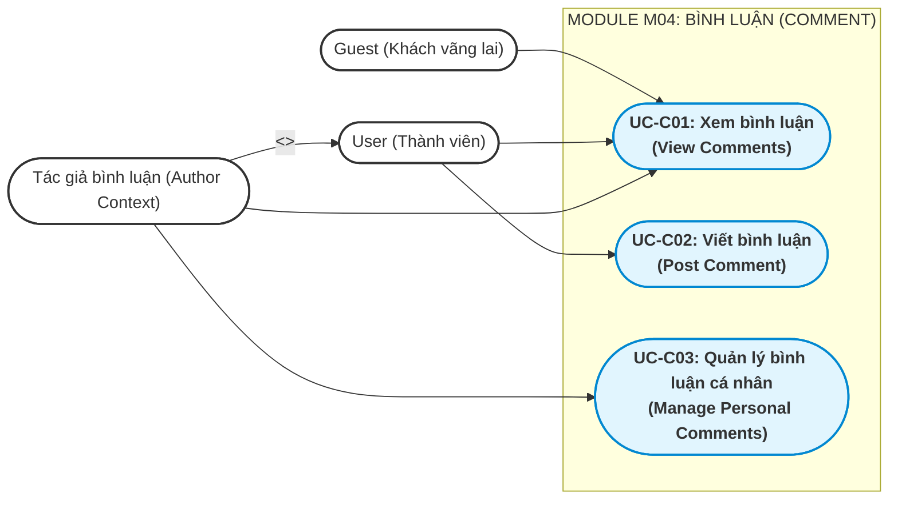
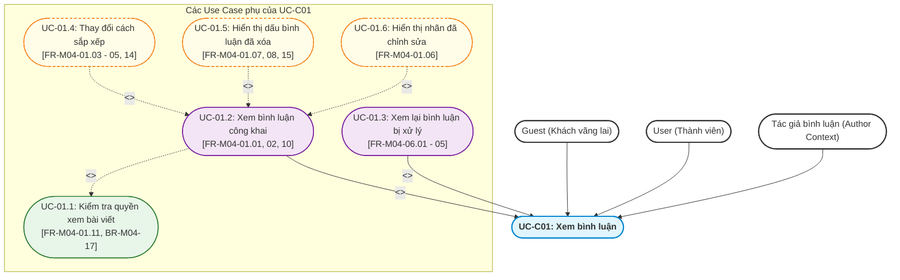
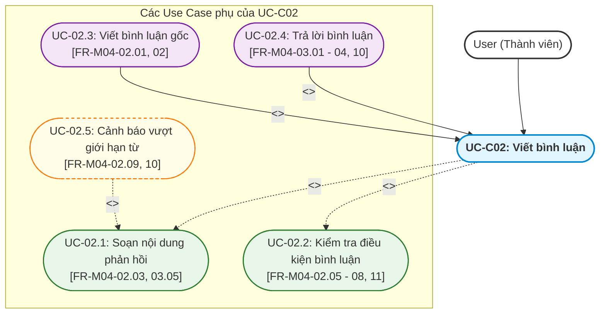
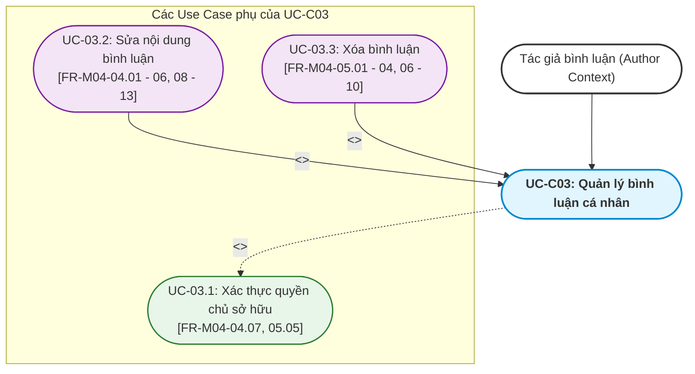

# Tài liệu Đặc tả Use Case — M04: Comment (US-M04)

| Thuộc tính | Nội dung |
|---|---|
| **Mã tài liệu** | `US-M04` |
| **Dự án** | iShare — Nền tảng chia sẻ tri thức và hỏi đáp học sinh THPT |
| **Module** | M04 — Comment (Bình luận) |
| **Tài liệu căn cứ (Nguồn)** | [`FR-M04.md`](file:///g:/documents/season9/iShare/docs/specs/fr/FR-M04.md) (Phiên bản 1.4 — Ngày 2026-10-24) |
| **Mốc register căn cứ** | DEC-271, QA-477, ISS-415, OPEN-012 |
| **Người thực hiện** | Antigravity Engine (Tổng hợp & Phân rã theo chuẩn BA iShare) |
| **Ngày lập** | 2026-10-28 |
| **Trạng thái** | Hoàn thành |

---

## 1. Bảng Tổng hợp các Chức năng con trong Module 4

Căn cứ theo mục 4.4 và mục 5 trong tài liệu [`FR-M04.md`](file:///g:/documents/season9/iShare/docs/specs/fr/FR-M04.md), Module 4 bao gồm 6 chức năng con với mô tả ngắn gọn phạm vi và nghiệp vụ như sau:

| STT | Mã chức năng | Tên chức năng con | Mô tả ngắn gọn phạm vi & nghiệp vụ |
|:---:|:---:|---|---|
| 1 | **FR-M04-01** | Xem bình luận của bài viết | Cho phép mọi người dùng (kể cả Guest) xem danh sách các luồng bình luận 2 cấp của bài viết đang hiển thị công khai; hỗ trợ 3 tùy chọn sắp xếp bình luận gốc: Top (mặc định theo số upvote), Mới nhất, Cũ nhất (các câu trả lời trong luồng luôn xếp theo thời gian từ cũ đến mới); hiển thị nhãn "(đã chỉnh sửa)", dòng trích dẫn khi trả lời, và thay thế bằng dấu "[Bình luận đã bị xóa]" khi bình luận gốc bị ẩn/xóa nhưng vẫn còn câu trả lời hiển thị. |
| 2 | **FR-M04-02** | Viết bình luận vào bài viết | Cho phép người dùng đã đăng nhập (không ở mức cảnh cáo `HEAVY`) viết bình luận gốc trực tiếp dưới bài viết bằng trình soạn thảo tối giản (hỗ trợ in đậm, in nghiêng, code trong dòng, công thức LaTeX, liên kết, nhắc tên, trích dẫn; tối đa 1.000 từ, không được để trống, không có đính kèm tệp); bình luận hiển thị công khai ngay sau khi gửi (không quét chặn trước); từ chối nếu bài viết bị khóa bình luận hoặc khóa toàn bộ. |
| 3 | **FR-M04-03** | Trả lời bình luận | Cho phép người dùng đã đăng nhập (không ở mức cảnh cáo `HEAVY`) gửi phản hồi cho một bình luận gốc hoặc một câu trả lời đang hiển thị; hệ thống duy trì cấu trúc luồng 2 cấp cố định (đưa vào chung luồng của bình luận gốc), tự động hiển thị dòng trích dẫn người được trả lời phía trên nội dung và áp dụng cùng các giới hạn định dạng/độ dài; từ chối nếu bình luận được trả lời đã bị ẩn hoặc xóa. |
| 4 | **FR-M04-04** | Sửa bình luận | Cho phép chính tác giả chỉnh sửa nội dung bình luận của mình không giới hạn thời gian và số lần (tối đa 1.000 từ; giữ nguyên thời điểm đăng và vị trí trong luồng; hiển thị nhãn "(đã chỉnh sửa)" nhưng không lưu lịch sử sửa đổi); từ chối thao tác sửa khi bình luận đã bị xóa, đang bị ẩn, hoặc khi bài viết bị khóa bình luận/toàn bộ. |
| 5 | **FR-M04-05** | Xóa bình luận | Cho phép chính tác giả thực hiện xóa mềm vĩnh viễn bình luận của mình (không hỗ trợ khôi phục; hệ thống chỉ gắn cờ đã xóa và bảo toàn dữ liệu phục vụ kiểm duyệt); nếu bình luận gốc còn câu trả lời thì hiển thị thay thế bằng dấu "[Bình luận đã bị xóa]", nếu không còn trả lời thì rút khỏi luồng; cho phép xóa ngay cả khi bài viết bị khóa hoặc tác giả đang ở mức cảnh cáo `HEAVY` (từ chối nếu bình luận đang bị ẩn). |
| 6 | **FR-M04-06** | Xem lại bình luận đã bị xử lý của mình | Cho phép tác giả mở xem lại nội dung bình luận của chính mình ở chế độ chỉ đọc khi truy cập từ thông báo "Bình luận của bạn đã bị ẩn", thông báo kết quả xử lý báo cáo, hoặc từ đơn khiếu nại (kể cả khi bình luận đang bị ẩn hoặc đã bị xóa); hệ thống ẩn hoàn toàn danh tính, lý do và bằng chứng của người báo cáo. |

---

## 2. Phân rã thành các Use Case Chính & Quy trình Nghiệp vụ Hoàn chỉnh

### 2.1 Tiêu chí phân rã Use Case Chính
- **Đủ lớn & Độc lập:** Đại diện cho một mục tiêu nghiệp vụ trọn vẹn của người dùng (User Goal) hoặc của hệ thống.
- **Có tương tác giao diện trực tiếp:** Bắt đầu bằng một hành động chủ động của Actor trên giao diện (UI) và kết thúc khi đạt được kết quả mong đợi.
- **Bao hàm các chức năng con:** Chứa đựng các bước thực hiện mang tính nghiệp vụ bắt buộc hoặc tùy chọn mở rộng.
- **Quy tắc đặt tên (Chuẩn BA chuyên nghiệp):** Cấu trúc `[1 Động từ duy nhất] + [Cụm danh từ]`. Tuyệt đối không dùng nhiều động từ nối nhau bằng từ liên kết ("và", "&", "/", "hoặc"). Văn phong mang tính con người, tường minh và chuẩn nghiệp vụ.

Từ 6 chức năng con, Module 4 được phân rã thành **3 Use Case Chính** sau:
1. **UC-C01: Xem bình luận (View Comments)**
2. **UC-C02: Viết bình luận (Post Comment)**
3. **UC-C03: Quản lý bình luận cá nhân (Manage Personal Comments)**

---

### 2.2 Sơ đồ Use Case Tổng quan của Module 4 (Macro Use Case Diagram)

---

### 2.3 Mô tả Quy trình Nghiệp vụ Hoàn chỉnh của từng Use Case Chính

#### 1. UC-C01: Xem bình luận (View Comments)
- **Actor chính:** `Guest`, `User`, `Tác giả bình luận`.
- **Mục tiêu:** Người xem tiếp cận và theo dõi các thảo luận đa chiều dưới bài viết theo cách sắp xếp mong muốn, hoặc tác giả xem lại bình luận của mình khi có thông báo xử lý.
- **Quy trình nghiệp vụ hoàn chỉnh (Kiểu B: Phân nhánh song song theo ngữ cảnh):**
  - *Nhánh 1 — Xem danh sách bình luận công khai:* Guest hoặc User mở bài viết đang hiển thị công khai $\to$ Hệ thống tải danh sách bình luận gốc được sắp xếp mặc định theo `Top` (số upvote cao nhất lên đầu, cùng upvote thì đăng trước xếp trước) cùng các câu trả lời theo luồng (xếp từ cũ đến mới); người xem có thể chuyển sang sắp xếp `Mới nhất` hoặc `Cũ nhất` $\to$ Hệ thống tự động hiển thị dòng trích dẫn trên các câu trả lời, gắn nhãn "(đã chỉnh sửa)" nếu có, hoặc hiện dấu `[Bình luận đã bị xóa]` nếu bình luận gốc bị ẩn/xóa nhưng còn câu trả lời hiển thị.
  - *Nhánh 2 — Xem lại bình luận bị xử lý của tác giả:* Tác giả bình luận nhận thông báo "Bình luận của bạn đã bị ẩn" hoặc thông báo kết quả xử lý báo cáo / mở đơn khiếu nại $\to$ Nhấp mở liên kết $\to$ Hệ thống xác thực chính chủ và hiển thị nội dung bình luận ở chế độ chỉ đọc (kèm nhãn cho biết trạng thái bị ẩn nếu có; ẩn tuyệt đối thông tin danh tính, lý do và bằng chứng của người báo cáo).

#### 2. UC-C02: Viết bình luận (Post Comment)
- **Actor chính:** `User`.
- **Mục tiêu:** Người dùng gửi phản hồi thảo luận vào bài viết thành công dưới dạng bình luận gốc hoặc câu trả lời trong luồng 2 cấp.
- **Quy trình nghiệp vụ hoàn chỉnh (Kiểu B: Phân nhánh theo loại bình luận):**
  - *Nhánh 1 — Viết bình luận gốc:* User mở ô soạn bình luận dưới bài viết $\to$ Nhập nội dung (hỗ trợ in đậm, in nghiêng, code, công thức LaTeX, liên kết, nhắc tên, trích dẫn; tối đa 1.000 từ) $\to$ Bấm "Gửi bình luận" $\to$ Hệ thống kiểm tra điều kiện (bài không bị Khóa bình luận / Khóa toàn bộ, người gửi không ở mức cảnh cáo `HEAVY`, nội dung không trống) $\to$ Lưu bình luận, hiển thị ngay lập tức trong luồng ở trạng thái `Bình thường` (không quét chặn trước) và cập nhật số lượng bình luận của bài.
  - *Nhánh 2 — Trả lời bình luận:* User bấm nút "Trả lời" trên một bình luận gốc hoặc một câu trả lời đang hiển thị $\to$ Hệ thống mở khung soạn thảo kèm dòng trích dẫn tự động $\to$ User nhập nội dung $\to$ Bấm "Gửi" $\to$ Hệ thống kiểm tra điều kiện (bình luận được trả lời chưa bị ẩn hoặc xóa; bài không bị khóa; tài khoản không ở mức `HEAVY`) $\to$ Lưu vào chung luồng 2 cấp của bình luận gốc (không tạo cấp 3), hiển thị ngay lập tức với trạng thái `Bình thường`.

#### 3. UC-C03: Quản lý bình luận cá nhân (Manage Personal Comments)
- **Actor chính:** `Tác giả bình luận` (Contextual Role của User đối với bình luận do chính mình viết).
- **Mục tiêu:** Tác giả chủ động điều chỉnh nội dung hoặc gỡ bỏ vĩnh viễn phản hồi do chính mình đã đăng tải.
- **Quy trình nghiệp vụ hoàn chỉnh (Kiểu B: Phân nhánh Sửa & Xóa):**
  - *Nhánh 1 — Chỉnh sửa nội dung bình luận:* Tác giả chọn "Chỉnh sửa" trên bình luận của mình $\to$ Hệ thống kiểm tra điều kiện (bình luận chưa bị xóa, không ở trạng thái `Bị ẩn`, bài viết không bị Khóa bình luận / Khóa toàn bộ) $\to$ Mở trình soạn thảo với nội dung hiện tại $\to$ Tác giả cập nhật nội dung $\to$ Bấm "Lưu" $\to$ Hệ thống cập nhật nội dung mới, ghi lại mốc thời gian sửa gần nhất, giữ nguyên mốc thời gian đăng và hiển thị nhãn "(đã chỉnh sửa)" (không lưu lại lịch sử sửa đổi).
  - *Nhánh 2 — Xóa bình luận:* Tác giả chọn "Xóa" trên bình luận của mình $\to$ Hệ thống kiểm tra điều kiện (bình luận chưa bị xóa, không ở trạng thái `Bị ẩn`; cho phép xóa kể cả khi bài viết bị khóa hoặc tác giả ở mức `HEAVY`) $\to$ Hệ thống xác nhận và gắn cờ đã xóa:
    + Nếu là bình luận gốc và còn ít nhất một trả lời hiển thị bình thường: Thay thế nội dung bằng dấu `[Bình luận đã bị xóa]` và giữ nguyên luồng trả lời.
    + Nếu là bình luận gốc không còn câu trả lời nào (hoặc là một câu trả lời): Rút bỏ bình luận khỏi luồng hiển thị (các câu trả lời trỏ tới nó sẽ tự động hiển thị dòng trích dẫn dạng "trả lời [bình luận đã bị xóa]").

---

## 3. Xác định Use Case con Chi tiết và Mối quan hệ với Use Case Chính

### 3.1 Phân rã UC-C01: Xem bình luận

#### Bảng chi tiết quan hệ, điều kiện & lý do nghiệp vụ (UC-C01):
| Mã Use Case con | Tên Use Case con | Căn cứ FR/BR | Quan hệ | Điều kiện kích hoạt & Lý do nghiệp vụ |
|---|---|:---:|:---:|---|
| **UC-01.1** | Kiểm tra quyền xem bài viết | FR-M04-01.11 BR-M04-17 | `<<include>>` *(trong Xem công khai)* | **Bắt buộc trong luồng xem công khai:** Bình luận công khai chỉ được xem cùng bài viết chứa nó. Nếu người xem không có quyền xem bài viết (bài bị ẩn/xóa/chưa công khai), hệ thống từ chối hiển thị bình luận trong bài viết. Riêng nhánh Xem lại bình luận bị xử lý (UC-01.3) của tác giả cho phép mở xem lại độc lập ngay cả khi bài viết đã bị ẩn hoặc xóa. |
| **UC-01.2** | Xem bình luận công khai | FR-M04-01.01, 02, 10 BR-M04-18 | Generalization | **Kế thừa (Chuyên biệt hóa):** Cho phép mọi người (kể cả Guest) xem danh sách các luồng bình luận 2 cấp của bài viết đang hiển thị bình thường kèm tổng số bình luận hợp lệ của bài. |
| **UC-01.3** | Xem lại bình luận bị xử lý | FR-M04-06.01 - 05 BR-M04-22 | Generalization | **Kế thừa (Chuyên biệt hóa):** Cho phép chính tác giả mở xem lại nội dung bình luận của mình ở chế độ chỉ đọc từ thông báo "Bình luận của bạn đã bị ẩn", thông báo xử lý báo cáo, hoặc từ khiếu nại (bảo mật tuyệt đối thông tin người báo cáo). |
| **UC-01.4** | Thay đổi cách sắp xếp | FR-M04-01.03 - 05, 14 BR-M04-05, 06 | `<<extend>>` *(trong Xem công khai)* | **Nhánh tùy chọn:** Người xem chuyển đổi giữa 3 tùy chọn sắp xếp bình luận gốc: Top (mặc định theo số upvote giảm dần, cùng upvote thì đăng trước đứng trước), Mới nhất, hoặc Cũ nhất (các câu trả lời trong luồng luôn xếp cũ đến mới). |
| **UC-01.5** | Hiển thị dấu bình luận đã xóa | FR-M04-01.07, 08, 15 BR-M04-08, 13 | `<<extend>>` *(trong Xem công khai)* | **Rẽ nhánh hiển thị:** Tự động hiển thị dấu thay thế `[Bình luận đã bị xóa]` ở vị trí bình luận gốc khi bình luận đó đã bị xóa hoặc đang bị ẩn nhưng vẫn còn ít nhất một trả lời đang hiển thị; tự động mất dấu khi luồng không còn trả lời nào. |
| **UC-01.6** | Hiển thị nhãn đã chỉnh sửa | FR-M04-01.06 BR-M04-07 | `<<extend>>` *(trong Xem công khai)* | **Mở rộng hiển thị:** Tự động gắn nhãn "(đã chỉnh sửa)" bên cạnh bình luận nếu bình luận đó đã được tác giả lưu bản sửa ít nhất một lần. |

---

### 3.2 Phân rã UC-C02: Viết bình luận

#### Bảng chi tiết quan hệ, điều kiện & lý do nghiệp vụ (UC-C02):
| Mã Use Case con | Tên Use Case con | Căn cứ FR/BR | Quan hệ | Điều kiện kích hoạt & Lý do nghiệp vụ |
|---|---|:---:|:---:|---|
| **UC-02.1** | Soạn nội dung phản hồi | FR-M04-02.03, 03.05 BR-M04-01, 02 | `<<include>>` | **Bắt buộc:** Khởi tạo khung soạn thảo tối giản chỉ gồm các định dạng cho phép (in đậm, in nghiêng, code trong dòng, công thức LaTeX, liên kết, nhắc tên, trích dẫn; tuyệt đối không hỗ trợ đính kèm tệp). |
| **UC-02.2** | Kiểm tra điều kiện bình luận | FR-M04-02.05 - 08, 11 FR-M04-03.06 - 09 BR-M04-14, 15, 16 | `<<include>>` | **Bắt buộc:** Hệ thống kiểm tra người dùng đã đăng nhập, bài viết đang hiển thị và không bị khóa (`Khóa bình luận` hoặc `Khóa toàn bộ`), người gửi không ở mức cảnh cáo `HEAVY`, và nội dung không trống / không chỉ chứa khoảng trắng. |
| **UC-02.3** | Viết bình luận gốc | FR-M04-02.01, 02 | Generalization | **Kế thừa (Chuyên biệt hóa):** Gửi bình luận gắn trực tiếp dưới bài viết để mở đầu một luồng thảo luận mới; hiển thị công khai ngay ở trạng thái kiểm duyệt `Bình thường` mà không qua bước quét AI chặn trước. |
| **UC-02.4** | Trả lời bình luận | FR-M04-03.01 - 04, 10, 11 BR-M04-03, 04 | Generalization | **Kế thừa (Chuyên biệt hóa):** Người dùng bấm "Trả lời" trên một bình luận gốc hoặc một câu trả lời; hệ thống ghi nhận đối tượng được trả lời để hiển thị dòng trích dẫn tự động và lưu vào chung luồng 2 cấp của bình luận gốc (từ chối nếu bình luận được trả lời đã bị ẩn hoặc xóa). |
| **UC-02.5** | Cảnh báo vượt giới hạn từ | FR-M04-02.09, 10 FR-M04-03.12 BR-M04-19 | `<<extend>>` *(trong Soạn nội dung phản hồi)* | **Ngoại lệ giao diện:** Hiển thị cảnh báo trực tiếp ngay trên khung soạn thảo khi nội dung vượt quá 1.000 từ kèm số từ hiện tại; từ chối thao tác gửi và bảo toàn nội dung đang soạn để người dùng cắt tỉa. |

---

### 3.3 Phân rã UC-C03: Quản lý bình luận cá nhân

#### Bảng chi tiết quan hệ, điều kiện & lý do nghiệp vụ (UC-C03):
| Mã Use Case con | Tên Use Case con | Căn cứ FR/BR | Quan hệ | Điều kiện kích hoạt & Lý do nghiệp vụ |
|---|---|:---:|:---:|---|
| **UC-03.1** | Xác thực quyền chủ sở hữu | FR-M04-04.07, 05.05 | `<<include>>` | **Bắt buộc:** Kiểm tra người thực hiện thao tác sửa hoặc xóa phải là chính tác giả sở hữu bình luận; từ chối mọi yêu cầu chỉnh sửa/xóa từ tài khoản khác. |
| **UC-03.2** | Sửa nội dung bình luận | FR-M04-04.01 - 06, 08 - 13 BR-M04-07, 20 | Generalization | **Kế thừa (Chuyên biệt hóa):** Cho phép tác giả cập nhật nội dung bình luận không giới hạn thời gian/số lần (tối đa 1.000 từ); ghi nhận thời điểm sửa gần nhất, giữ nguyên thời điểm đăng và vị trí trong luồng, hiển thị nhãn "(đã chỉnh sửa)" (không lưu lịch sử sửa đổi; từ chối khi bình luận bị ẩn/xóa hoặc khi bài viết bị khóa). |
| **UC-03.3** | Xóa bình luận | FR-M04-05.01 - 04, 06 - 10 BR-M04-08, 20 | Generalization | **Kế thừa (Chuyên biệt hóa):** Cho phép tác giả xóa mềm vĩnh viễn bình luận (không hỗ trợ khôi phục; hệ thống chỉ gắn cờ đã xóa và lưu giữ dữ liệu phục vụ kiểm duyệt); nếu bình luận gốc còn câu trả lời thì hiển thị thay thế bằng dấu `[Bình luận đã bị xóa]`, nếu không còn thì rút khỏi luồng (cho phép xóa ngay cả khi bài bị khóa hoặc tác giả ở mức `HEAVY`; từ chối nếu bình luận đang bị ẩn). |

---

## 4. Bảng Tổng kết Ánh xạ Toàn bộ Chức năng & Sơ đồ Use Case Chi tiết

### 4.1 Bảng Ma trận Ánh xạ Toàn bộ 6 Chức năng Con vào Hệ thống Use Case

| Mã FR | Tên chức năng con trong `FR-M04.md` | Thuộc Use Case Chính | Thuộc Use Case Phụ cụ thể | Vai trò quan hệ trong UC Chính |
|:---:|---|:---:|---|:---:|
| **FR-M04-01** | Xem bình luận của bài viết | **UC-C01** | UC-01.1: Kiểm tra quyền xem bài viết UC-01.2: Xem bình luận công khai UC-01.4: Thay đổi cách sắp xếp UC-01.5: Hiển thị dấu bình luận đã xóa UC-01.6: Hiển thị nhãn đã chỉnh sửa | `<<include>>` (Bắt buộc trong Xem công khai) Generalization (Kế thừa) `<<extend>>` (Tùy chọn sắp xếp) `<<extend>>` (Rẽ nhánh hiển thị) `<<extend>>` (Mở rộng hiển thị) |
| **FR-M04-02** | Viết bình luận vào bài viết | **UC-C02** | UC-02.1: Soạn nội dung phản hồi UC-02.2: Kiểm tra điều kiện bình luận UC-02.3: Viết bình luận gốc UC-02.5: Cảnh báo vượt giới hạn từ | `<<include>>` (Bắt buộc) `<<include>>` (Bắt buộc) Generalization (Kế thừa) `<<extend>>` (Ngoại lệ trong Soạn nội dung) |
| **FR-M04-03** | Trả lời bình luận | **UC-C02** | UC-02.1: Soạn nội dung phản hồi UC-02.2: Kiểm tra điều kiện bình luận UC-02.4: Trả lời bình luận UC-02.5: Cảnh báo vượt giới hạn từ | `<<include>>` (Bắt buộc) `<<include>>` (Bắt buộc) Generalization (Kế thừa) `<<extend>>` (Ngoại lệ trong Soạn nội dung) |
| **FR-M04-04** | Sửa bình luận | **UC-C03** | UC-03.1: Xác thực quyền chủ sở hữu UC-03.2: Sửa nội dung bình luận | `<<include>>` (Bắt buộc) Generalization (Kế thừa) |
| **FR-M04-05** | Xóa bình luận | **UC-C03** | UC-03.1: Xác thực quyền chủ sở hữu UC-03.3: Xóa bình luận | `<<include>>` (Bắt buộc) Generalization (Kế thừa) |
| **FR-M04-06** | Xem lại bình luận đã bị xử lý của mình | **UC-C01** | UC-01.3: Xem lại bình luận bị xử lý | Generalization (Kế thừa) |

---

### 4.2 Sơ đồ Use Case Chi tiết Toàn bộ Module 4 (Comprehensive Detailed Use Case Diagram)

```mermaid
flowchart TB
    %% ========================================================
    %% ACTORS & GENERALIZATION
    %% ========================================================
    Guest(["Guest (Khách vãng lai)"])
    User(["User (Thành viên)"])
    Author(["Tác giả bình luận (Author Context)"])

    Author -->|"<<generalization>>"| User

    %% ========================================================
    %% SUBGRAPH 1: XEM BÌNH LUẬN
    %% ========================================================
    subgraph UCC01 ["UC-C01: Xem bình luận"]
        direction TB
        UC_C01(["UC-C01: Xem bình luận"])

        INC_C01_CHK(["UC-01.1: Kiểm tra quyền xem bài viết<br/>[FR-M04-01.11, BR-M04-17]"])

        GEN_C01_PUB(["UC-01.2: Xem bình luận công khai<br/>[FR-M04-01.01, 02, 10]"])
        GEN_C01_REV(["UC-01.3: Xem lại bình luận bị xử lý<br/>[FR-M04-06.01 - 05]"])

        EXT_C01_SRT(["UC-01.4: Thay đổi cách sắp xếp<br/>[FR-M04-01.03 - 05, 14]"])
        EXT_C01_DEL(["UC-01.5: Hiển thị dấu bình luận đã xóa<br/>[FR-M04-01.07, 08, 15]"])
        EXT_C01_EDT(["UC-01.6: Hiển thị nhãn đã chỉnh sửa<br/>[FR-M04-01.06]"])

        GEN_C01_PUB -->|"<<generalization>>"| UC_C01
        GEN_C01_REV -->|"<<generalization>>"| UC_C01

        GEN_C01_PUB -.->|"<<include>>"| INC_C01_CHK

        EXT_C01_SRT -.->|"<<extend>>"| GEN_C01_PUB
        EXT_C01_DEL -.->|"<<extend>>"| GEN_C01_PUB
        EXT_C01_EDT -.->|"<<extend>>"| GEN_C01_PUB
    end

    %% ========================================================
    %% SUBGRAPH 2: VIẾT BÌNH LUẬN
    %% ========================================================
    subgraph UCC02 ["UC-C02: Viết bình luận"]
        direction TB
        UC_C02(["UC-C02: Viết bình luận"])

        INC_C02_EDT(["UC-02.1: Soạn nội dung phản hồi<br/>[FR-M04-02.03, 03.05]"])
        INC_C02_CHK(["UC-02.2: Kiểm tra điều kiện bình luận<br/>[FR-M04-02.05 - 08, 11]"])

        GEN_C02_ROT(["UC-02.3: Viết bình luận gốc<br/>[FR-M04-02.01, 02]"])
        GEN_C02_REP(["UC-02.4: Trả lời bình luận<br/>[FR-M04-03.01 - 04, 10]"])

        EXT_C02_WRN(["UC-02.5: Cảnh báo vượt giới hạn từ<br/>[FR-M04-02.09, 10]"])

        UC_C02 -.->|"<<include>>"| INC_C02_EDT
        UC_C02 -.->|"<<include>>"| INC_C02_CHK

        GEN_C02_ROT -->|"<<generalization>>"| UC_C02
        GEN_C02_REP -->|"<<generalization>>"| UC_C02

        EXT_C02_WRN -.->|"<<extend>>"| INC_C02_EDT
    end

    %% ========================================================
    %% SUBGRAPH 3: QUẢN LÝ BÌNH LUẬN CÁ NHÂN
    %% ========================================================
    subgraph UCC03 ["UC-C03: Quản lý bình luận cá nhân"]
        direction TB
        UC_C03(["UC-C03: Quản lý bình luận cá nhân"])

        INC_C03_OWN(["UC-03.1: Xác thực quyền chủ sở hữu<br/>[FR-M04-04.07, 05.05]"])

        GEN_C03_EDT(["UC-03.2: Sửa nội dung bình luận<br/>[FR-M04-04.01 - 06, 08 - 13]"])
        GEN_C03_DEL(["UC-03.3: Xóa bình luận<br/>[FR-M04-05.01 - 04, 06 - 10]"])

        UC_C03 -.->|"<<include>>"| INC_C03_OWN

        GEN_C03_EDT -->|"<<generalization>>"| UC_C03
        GEN_C03_DEL -->|"<<generalization>>"| UC_C03
    end

    %% ========================================================
    %% LIÊN KẾT ACTOR ĐẾN CÁC USE CASE CHÍNH
    %% ========================================================
    Guest --> UC_C01

    User --> UC_C01
    User --> UC_C02

    Author --> UC_C01
    Author --> UC_C03

    %% ========================================================
    %% CLASS DEFINITIONS & STYLING
    %% ========================================================
    classDef actorStyle fill:#ffffff,stroke:#333333,stroke-width:2px;
    classDef coreUC fill:#e1f5fe,stroke:#0288d1,stroke-width:2px,font-weight:bold;
    classDef incStyle fill:#e8f5e9,stroke:#2e7d32,stroke-width:1.5px;
    classDef extStyle fill:#fffde7,stroke:#f57f17,stroke-width:1.5px,stroke-dasharray: 4 4;
    classDef genStyle fill:#f3e5f5,stroke:#7b1fa2,stroke-width:1.5px;

    class Guest,User,Author actorStyle;
    class UC_C01,UC_C02,UC_C03 coreUC;

    class INC_C01_CHK,INC_C02_EDT,INC_C02_CHK,INC_C03_OWN incStyle;
    class GEN_C01_PUB,GEN_C01_REV,GEN_C02_ROT,GEN_C02_REP,GEN_C03_EDT,GEN_C03_DEL genStyle;
    class EXT_C01_SRT,EXT_C01_DEL,EXT_C01_EDT,EXT_C02_WRN extStyle;
```

