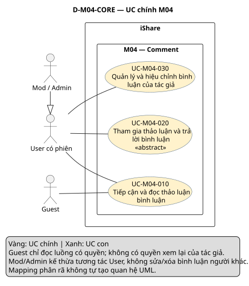
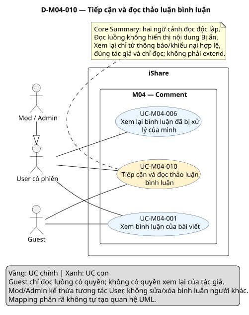
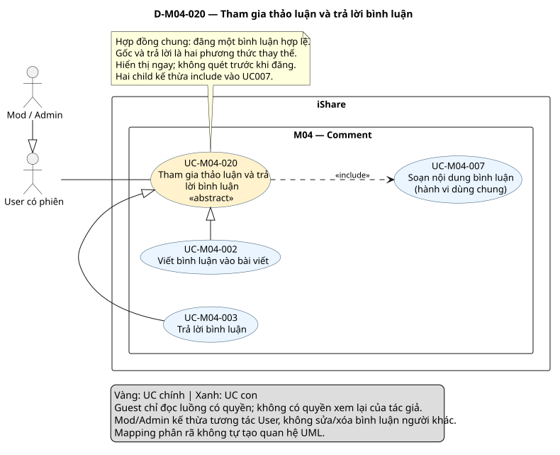
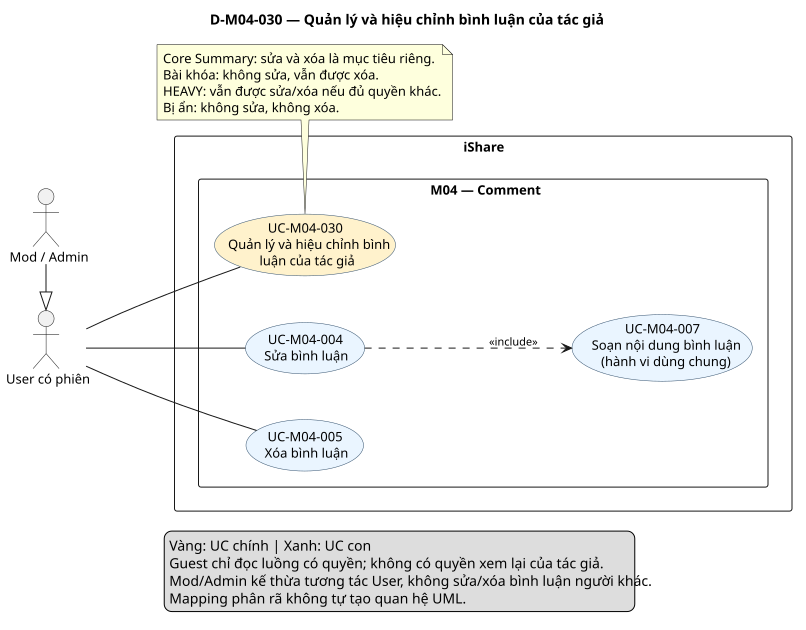

# Phân tích use case — M04 Comment (US-M04)

[Vietnamese Doc]

Phân tích toàn bộ FR-M04 1.4 theo skill use-case-analysis 2.2: **3 UC chính, 7 UC con**, phân rã, đặc tả, quan hệ UML, truy vết và **4 sơ đồ, mỗi sơ đồ một SVG**. Trạng thái kết quả: **Chờ duyệt**.

## Metadata và tiến độ

<!-- uc:document -->
| key | value |
|---|---|
| document_id | US-M04 |
| skill_version | 2.2 |
| mode | module |
| modules | M04 |
| scope | ALL |
| status | Chờ duyệt |
| current_step | 7 |
| completed_steps | 1, 2, 3, 4, 5, 6, 7 |
| approved_steps | - |
| source_baseline | FR-M04 1.4; FR-M01 1.10; FR-M02 1.6; FR-M03 1.10; FR-M05 1.7; FR-M06 1.5; FR-M07 1.5; FR-M08 1.7; FR-M09 1.2; FR-M10 1.4; FR-M11 1.3; FR-M12 1.1; FR-M13 1.3; FR-M14 1.1; FR-M15 1.1 |
| author | Codex — hỗ trợ phân tích nghiệp vụ |
| date | 2026-10-30 |
| approval_evidence | Người dùng yêu cầu xây dựng đầu ra M04 và nêu rõ “tự thực hiện các cái cần thiết không cần hỏi sự đồng ý của tôi”: được phép thực hiện liên tục các bước, không dừng cổng. Đây không phải phê duyệt nội dung cuối hoặc các approved_steps lịch sử. |
| semantic_review | pass |
| diagram_check | pass |

| Bước | Kết quả | Xác nhận |
|---|---|---|
| 1 | FR-M04 1.4; boundary; 3 actor; 99 mã | Người dùng cho phép thực hiện liên tục |
| 2 | 3 core, 7 sub; 8 mapping; giữ ID theo mục tiêu | Được phép triển khai; chưa duyệt nội dung riêng |
| 3 | 8 hợp đồng chi tiết, 2 brief Summary; 1 AUT và 4 RULE | Được phép triển khai; chưa duyệt nội dung riêng |
| 4 | 4 quan hệ UC, hợp đồng chung và association actor | Được phép triển khai; chưa duyệt nội dung riêng |
| 5 | 6 nhóm + 70 FR chi tiết + 23 BR; đối chiếu giao tiếp | Được phép triển khai; chưa duyệt nội dung riêng |
| 6 | Tổng quan và 3 sơ đồ chi tiết, chỉ SVG; cú pháp/render/kiểm tra hình đạt | Chưa duyệt nội dung |
| 7 | Review ngữ nghĩa, cấu trúc, hình và link | Chờ duyệt kết quả cuối |

Không kế thừa phê duyệt/pass render của US-M04 cũ; sửa tên module theo FR hiện hành: **Comment**, không phải Interaction & Feed. Giữ ID còn đúng mục tiêu; không thay đổi FR hoặc US module khác.

## 1. Tổng hợp nghiệp vụ, phạm vi và nguồn

M04 cho người dùng đọc thảo luận hai cấp dưới bài và đăng bình luận gốc hoặc trả lời. Trả lời một trả lời vẫn ở cấp hai và giữ đích cụ thể để dựng trích dẫn. Bình luận hiển thị ngay, không qua cổng quét trước như bài viết. Tác giả được sửa/xóa theo các điều kiện riêng; xóa chỉ gắn cờ giữ dữ liệu. Nội dung Bị ẩn không hiện trong luồng cho bất kỳ ai, kể cả tác giả. Đường xem lại chỉ đọc từ thông báo hoặc khiếu nại liên quan được tách khỏi luồng bình thường.

**Subject/boundary:** toàn iShare. M04 là chức năng nội bộ; M01/M03/M07/M08/M09/M11/M12/M13 không tự trở thành actor ngoài iShare. M04 không gọi AI trực tiếp theo FR 5.11, nên không thêm actor AI hoặc UC quét AI vào module này.

**Trong phạm vi:** toàn bộ MS1/Must của M04: đọc/sắp xếp/đếm; soạn/gửi gốc/trả lời; sửa/xóa; dấu thay thế/trích dẫn; xem lại của tác giả và điều kiện quyền liên module.

**Ngoài phạm vi:** feed/tìm kiếm, upvote/điểm M12, báo cáo/ẩn/quét sau đăng M08/M13, thao tác khiếu nại cảnh cáo/ban M09, cờ AI M10, quyền/gỡ bình luận khỏi nhóm M11, vòng đời bài M03, mention/danh tính M01/M02 và thông báo M07. Không thêm lịch sử sửa, khôi phục/xóa hẳn bình luận, khiếu nại riêng cho bình luận, Accepted Answer, Topic/Tag bình luận, đính kèm hoặc phản ứng ngoài upvote.

### Baseline

<!-- uc:sources -->
| path | version | role |
|---|---|---|
| docs/specs/fr/FR-M04.md | 1.4 | owner |
| docs/specs/fr/FR-M01.md | 1.10 | related |
| docs/specs/fr/FR-M02.md | 1.6 | related |
| docs/specs/fr/FR-M03.md | 1.10 | related |
| docs/specs/fr/FR-M05.md | 1.7 | related |
| docs/specs/fr/FR-M06.md | 1.5 | related |
| docs/specs/fr/FR-M07.md | 1.5 | related |
| docs/specs/fr/FR-M08.md | 1.7 | related |
| docs/specs/fr/FR-M09.md | 1.2 | related |
| docs/specs/fr/FR-M10.md | 1.4 | related |
| docs/specs/fr/FR-M11.md | 1.3 | related |
| docs/specs/fr/FR-M12.md | 1.1 | related |
| docs/specs/fr/FR-M13.md | 1.3 | related |
| docs/specs/fr/FR-M14.md | 1.1 | related |
| docs/specs/fr/FR-M15.md | 1.1 | related |

FR-M04 đã chốt ngày 2026-10-24, mốc DEC-271/QA-477/ISS-415/OPEN-012. Đọc đầy đủ yêu cầu M04 và đối chiếu metadata/giao tiếp/các mã liên quan của bên cung cấp, bên nhận; không tuyên bố đặc tả các module đó. [Skill 2.2](../../../.agent-instructions/skills/use-case-analysis/SKILL.md) cung cấp phương pháp, không cung cấp thêm tính năng.

### Actor và quyền

<!-- uc:actors -->
| id | name | kind | parent | boundary_reason | sources |
|---|---|---|---|---|---|
| ACT-001 | Guest — chưa có phiên | human | - | Người ngoài iShare đọc bình luận theo quyền xem bài; không viết/trả lời/sửa/xóa hoặc xem lại qua đường dành cho tác giả. | FR-M04-01.02, BR-M04-16 |
| ACT-002 | User — có phiên | human | - | Người ngoài iShare tham gia thảo luận và thao tác bình luận của mình theo quyền. Tác giả là ngữ cảnh sở hữu, không actor riêng. | FR-M04-02.01, FR-M04-04.07, FR-M04-05.05, FR-M04-06.05 |
| ACT-003 | Mod / Admin | human | ACT-002 | Theo FR-M04 4.2 có quyền tương tác cá nhân như User; vẫn chỉ sửa/xóa/xem lại bình luận của mình trong M04. Ẩn và xem vụ người khác thuộc M08/M09, không kế thừa quyền xóa người khác. | FR-M04-04.07, FR-M04-05.05, BR-M04-23 |

Giữ ACT-001/002/003 đã có. BANNED, HEAVY, chủ bình luận, thành viên/Owner/Group Mod và mức khóa là điều kiện/ngữ cảnh. Mod/Admin có thể là tác giả bình luận của mình, nhưng vai trò không cho phép sửa/xóa người khác. Ngoại lệ Admin không bị quét/báo cáo thuộc M08, không tự áp dụng cho Mod và không làm mất ràng buộc bài khóa của M04.

### Kiểm kê nhóm FR

| Nhóm | Mục tiêu/hành vi | FR chi tiết | Phân bổ |
|---|---|---|---|
| FR-M04-01 | Xem bình luận của bài viết | 17 | UC-M04-001, AUT-M04-001, RULE-M04-001, RULE-M04-002 |
| FR-M04-02 | Viết bình luận vào bài viết | 11 | UC-M04-002, UC-M04-007, UC-M04-020 |
| FR-M04-03 | Trả lời bình luận | 13 | UC-M04-003, UC-M04-007, UC-M04-020 |
| FR-M04-04 | Sửa bình luận | 13 | UC-M04-004, UC-M04-007 |
| FR-M04-05 | Xóa bình luận | 11 | UC-M04-005, RULE-M04-004 |
| FR-M04-06 | Xem lại bình luận đã bị xử lý của mình | 5 | UC-M04-006 |

Mẫu số **99 mã = 6 nhóm + 70 FR chi tiết + 23 BR**. Không bỏ mã hiện hành khỏi phạm vi; một FR có thể được biểu diễn bằng hợp đồng chung, bước, nhánh, RULE hoặc AUT.

## 2. Danh mục hai tầng và phân rã

<!-- uc:catalog -->
| id | name | tier | level | primary | supporting | owner | anchor | sources |
|---|---|---|---|---|---|---|---|---|
| UC-M04-010 | Tiếp cận và đọc thảo luận bình luận | core | Summary | ACT-001, ACT-002, ACT-003 | - | M04 | #uc-m04-010 | FR-M04-01, FR-M04-06, BR-M04-17, BR-M04-22 |
| UC-M04-020 | Tham gia thảo luận và trả lời bình luận | core | User goal | ACT-002, ACT-003 | - | M04 | #uc-m04-020 | FR-M04-02, FR-M04-03, BR-M04-03, BR-M04-12, BR-M04-14, BR-M04-15, BR-M04-16, BR-M04-19 |
| UC-M04-030 | Quản lý và hiệu chỉnh bình luận của tác giả | core | Summary | ACT-002, ACT-003 | - | M04 | #uc-m04-030 | FR-M04-04, FR-M04-05, BR-M04-07, BR-M04-08, BR-M04-20, BR-M04-21 |
| UC-M04-001 | Xem bình luận của bài viết | sub | User goal | ACT-001, ACT-002, ACT-003 | - | M04 | #uc-m04-001 | FR-M04-01, BR-M04-03, BR-M04-04, BR-M04-05, BR-M04-06, BR-M04-07, BR-M04-13, BR-M04-17, BR-M04-18 |
| UC-M04-002 | Viết bình luận vào bài viết | sub | User goal | ACT-002, ACT-003 | - | M04 | #uc-m04-002 | FR-M04-02, BR-M04-12, BR-M04-14, BR-M04-15, BR-M04-19 |
| UC-M04-003 | Trả lời bình luận | sub | User goal | ACT-002, ACT-003 | - | M04 | #uc-m04-003 | FR-M04-03, BR-M04-03, BR-M04-04, BR-M04-14, BR-M04-15, BR-M04-19 |
| UC-M04-004 | Sửa bình luận | sub | User goal | ACT-002, ACT-003 | - | M04 | #uc-m04-004 | FR-M04-04, BR-M04-07, BR-M04-19, BR-M04-20, FR-M08-08.03 |
| UC-M04-005 | Xóa bình luận | sub | User goal | ACT-002, ACT-003 | - | M04 | #uc-m04-005 | FR-M04-05, BR-M04-08, BR-M04-20, BR-M04-21, BR-M04-23 |
| UC-M04-006 | Xem lại bình luận đã bị xử lý của mình | sub | User goal | ACT-002, ACT-003 | - | M04 | #uc-m04-006 | FR-M04-06, BR-M04-22, BR-M04-23, FR-M09-08.15 |
| UC-M04-007 | Soạn nội dung bình luận | sub | Subfunction | ACT-002, ACT-003 | - | M04 | #uc-m04-007 | FR-M04-02.03, FR-M04-02.04, FR-M04-02.09, FR-M04-02.10, FR-M04-02.11, FR-M04-03.05, FR-M04-03.12, FR-M04-03.13, FR-M04-04.06, FR-M04-04.12, FR-M04-04.13, BR-M04-01, BR-M04-02, BR-M04-19 |

### Phân rã UC chính → UC con

<!-- uc:decomposition -->
| core | sub | rationale | sources |
|---|---|---|---|
| UC-M04-010 | UC-M04-001 | Đọc luồng bình luận theo quyền xem bài, thứ tự và trạng thái hiện hành. | FR-M04-01, BR-M04-03, BR-M04-04, BR-M04-05, BR-M04-06, BR-M04-07, BR-M04-13, BR-M04-17, BR-M04-18 |
| UC-M04-010 | UC-M04-006 | Xem nội dung bình luận mình bị ẩn/đã bị xử lý theo đường hợp lệ mà không mở quyền sửa hay lộ người báo cáo. | FR-M04-06, BR-M04-22, BR-M04-23, FR-M09-08.15 |
| UC-M04-020 | UC-M04-002 | Đăng một bình luận gốc trực tiếp dưới bài theo hợp đồng chung UC020. | FR-M04-02, BR-M04-12, BR-M04-14, BR-M04-15, BR-M04-19 |
| UC-M04-020 | UC-M04-003 | Đăng trả lời đúng đích và cùng luồng gốc, kèm trích dẫn hiển thị của đích. | FR-M04-03, BR-M04-03, BR-M04-04, BR-M04-14, BR-M04-15, BR-M04-19 |
| UC-M04-020 | UC-M04-007 | Dùng chung soạn/định dạng/giới hạn/cảnh báo và cách giữ bản nhập cho tạo gốc, trả lời, sửa; một ID, không tự lưu bình luận. | FR-M04-02.03, FR-M04-02.04, FR-M04-02.09, FR-M04-02.10, FR-M04-02.11, FR-M04-03.05, FR-M04-03.12, FR-M04-03.13, FR-M04-04.06, FR-M04-04.12, FR-M04-04.13, BR-M04-01, BR-M04-02, BR-M04-19 |
| UC-M04-030 | UC-M04-004 | Thay nội dung bình luận của mình, chỉ giữ thời điểm sửa gần nhất và nhãn đã sửa. | FR-M04-04, BR-M04-07, BR-M04-19, BR-M04-20, FR-M08-08.03 |
| UC-M04-030 | UC-M04-005 | Gỡ bình luận của mình khỏi luồng người dùng bằng cờ xóa, giữ dữ liệu và ngữ cảnh trả lời. | FR-M04-05, BR-M04-08, BR-M04-20, BR-M04-21, BR-M04-23 |
| UC-M04-030 | UC-M04-007 | Dùng chung soạn/định dạng/giới hạn/cảnh báo và cách giữ bản nhập cho tạo gốc, trả lời, sửa; một ID, không tự lưu bình luận. | FR-M04-02.03, FR-M04-02.04, FR-M04-02.09, FR-M04-02.10, FR-M04-02.11, FR-M04-03.05, FR-M04-03.12, FR-M04-03.13, FR-M04-04.06, FR-M04-04.12, FR-M04-04.13, BR-M04-01, BR-M04-02, BR-M04-19 |

`tier` độc lập với `level`. Core010/030 ở Summary; core020 là User goal trừu tượng cho **một lần đăng bình luận**, được chuyên biệt thành gốc/trả lời theo cùng hợp đồng. UC007 là Subfunction dùng chung ở core020/030. Phân rã không tự tạo UML; quan hệ core020 với con được chứng minh bằng hợp đồng và luồng, không chỉ vì là core/sub.

<!-- uc:module-models -->
| module | path | baseline |
|---|---|---|


Mode module: không tổng hợp US-overview trong scope này; các core giữ ID/tên để làm đầu vào tổng quan hệ thống sau này.

| Quyết định | Biểu diễn | Lý do/căn cứ |
|---|---|---|
| D-M04-01 | Giữ core010/020/030 và sub001–006; thêm sub007 | Không đổi ID chỉ vì sửa level hoặc view; đặc tả lại nội dung và truy vết cũ theo nguồn hiện hành. |
| D-M04-02 | Core020 User goal abstract; UC002/003 generalization tới core020 | Hai phương thức đăng một bình luận, chung soạn/kiểm tra/lưu-hiển thị; khác quan hệ gốc hay đích trả lời. Không phải kế thừa nhóm CRUD. |
| D-M04-03 | UC007 dùng chung qua include | Trình soạn, giới hạn/cảnh báo, cách tính phần trích dẫn hệ thống và giữ bản nhập dùng chung cho đăng/sửa, có hợp đồng riêng. |
| D-M04-04 | Ghi phần tạo/trả lời/sửa/xóa trong luồng, không tự extend UC001 | Cùng xuất hiện trong trang thảo luận chưa đủ chứng minh chèn hành vi đọc. Trigger và hợp đồng riêng đã có; không thêm cạnh vì link/nút. |
| D-M04-05 | UC006 độc lập với đọc luồng; không extend UC001 | Đường vào từ thông báo/khiếu nại liên quan và kiểm tra đúng tác giả, không phải cách hiện nội dung Bị ẩn ngay trong luồng. |
| D-M04-06 | Tách cờ xóa, kiểm duyệt Bị ẩn và dấu hiển thị | Dấu [Bình luận đã bị xóa] không là trạng thái; bỏ dấu không xóa dữ liệu, ẩn không phải tác giả xóa. |
| D-M04-07 | Ma trận khóa/HEAVY/Bị ẩn riêng cho tạo/sửa/xóa | Không áp quy tắc sửa bài M03 sang sửa bình luận; không chặn sửa/xóa chỉ vì HEAVY. |
| D-M04-08 | AUT001 cho dấu và số đếm; RULE cho dữ liệu/danh tính/trích dẫn | Không bỏ hành vi khi trả lời cuối cùng không còn hiển thị; không tự chọn push/cron hoặc xóa cascade. |
| D-M04-09 | Không tạo UC upvote, báo cáo, AI hoặc khiếu nại bình luận M04 | Owner nghiệp vụ M12/M08/M09; M04 chỉ cung cấp/tuân điều kiện và dữ liệu. |

## 3. Đặc tả

### 3.1 UC chính

<a id="uc-m04-010"></a>

### UC-M04-010 — Tiếp cận và đọc thảo luận bình luận

| Thuộc tính | Nội dung |
|---|---|
| Actor chính | ACT-001, ACT-002, ACT-003 |
| Giá trị | Đọc thảo luận được phép và để chủ bình luận xem lại nội dung của mình theo đúng đường truy cập. |
| Khởi phát | Mở bình luận của bài hoặc thông báo/khiếu nại liên quan. |
| Điều kiện/phạm vi | Quyền đọc luồng và quyền xem lại là hai ngữ cảnh khác nhau; Guest chỉ đọc công khai. |
| Kết quả | Luồng hiển thị đúng trạng thái/cấu trúc; đường xem lại chỉ đọc, bảo vệ người báo cáo. |
| Khi không đạt | Không lộ nội dung Bị ẩn trong luồng hoặc dùng xem lại để truy cập bình luận người khác. |
| UC con | UC-M04-001, UC-M04-006 |
| Nguồn | FR-M04-01, FR-M04-06, BR-M04-17, BR-M04-22 |

**Quy trình tổng quát:**

1. UC001 đọc luồng hai cấp theo khả năng xem bài; RULE001/AUT001 điều chỉnh trích dẫn, dấu thay thế và số đếm.
2. UC006 cho chính tác giả xem lại từ thông báo xử lý hoặc khiếu nại của mình; không tạo chức năng khiếu nại bình luận.
3. Hai hành trình không bắt buộc gọi nhau; quyền Mod/Admin trong vụ M08/M09 nằm ngoài UC đọc luồng.

Summary không là một lần gọi tất cả UC con.

<a id="uc-m04-020"></a>

### UC-M04-020 — Tham gia thảo luận và trả lời bình luận

<!-- uc:spec UC-M04-020 -->
| key | value |
|---|---|
| goal | Đăng một bình luận hợp lệ vào bài dưới dạng bình luận gốc hoặc trả lời trong luồng hai cấp. |
| subject | iShare |
| level | User goal |
| primary | ACT-002, ACT-003 |
| supporting | - |
| trigger | Người có phiên chọn viết bình luận gốc hoặc trả lời một bình luận đang hiển thị bình thường. |
| preconditions | Hành trình do UC002 hoặc UC003 chuyên biệt hóa ngữ cảnh đích; kiểm tra phiên/quyền bài/khóa/HEAVY trong luồng. |
| success | Một bình luận Bình thường được lưu với tác giả và thời điểm gửi, hiển thị ngay; gốc gắn bài, trả lời gắn luồng gốc và bình luận được trả lời. |
| failure | Không lưu khi sai quyền, bài không tồn tại/không hiển thị, bị khóa, HEAVY hoặc nội dung không hợp lệ; không chờ AI quét trước. |
| abstract | true |
| common_contract | Hợp đồng chung: từ người có phiên và một ngữ cảnh đích được phép, soạn nội dung tối giản, kiểm tra bài/khóa/cảnh cáo, lưu đúng một bình luận Bình thường và hiển thị ngay. UC002 chuyên biệt bình luận gốc gắn bài; UC003 chuyên biệt trả lời có đích, cùng luồng gốc, không cấp thứ ba. Hai phương thức thay thế nhau trong một lần đăng, cùng kế thừa bước 2–4 và include UC007. |

<a id="uc-m04-020-contract"></a>

**Hợp đồng chung:** Hợp đồng chung: từ người có phiên và một ngữ cảnh đích được phép, soạn nội dung tối giản, kiểm tra bài/khóa/cảnh cáo, lưu đúng một bình luận Bình thường và hiển thị ngay. UC002 chuyên biệt bình luận gốc gắn bài; UC003 chuyên biệt trả lời có đích, cùng luồng gốc, không cấp thứ ba. Hai phương thức thay thế nhau trong một lần đăng, cùng kế thừa bước 2–4 và include UC007.

#### Luồng chính

<a id="uc-m04-020-main-1"></a>

| Bước | Tương tác actor–iShare | Tiếp tục | Nguồn |
|---|---|---|---|
| 1 | Nhận ngữ cảnh do phương thức cụ thể cung cấp: UC002 là bình luận gốc gắn bài; UC003 là trả lời có đích và luồng gốc. Kiểm tra có phiên để thực hiện tương tác. | 2 | FR-M04-02, FR-M04-03, BR-M04-03, BR-M04-12, BR-M04-14, BR-M04-15, BR-M04-16, BR-M04-19 |

<a id="uc-m04-020-main-2"></a>

| Bước | Tương tác actor–iShare | Tiếp tục | Nguồn |
|---|---|---|---|
| 2 | Thực hiện UC007 soạn nội dung theo đúng ngữ cảnh; với trả lời, dòng trích dẫn do hệ thống dựng không thuộc nội dung nhập. | 3 | FR-M04-02, FR-M04-03, BR-M04-03, BR-M04-12, BR-M04-14, BR-M04-15, BR-M04-16, BR-M04-19 |

<a id="uc-m04-020-main-3"></a>

| Bước | Tương tác actor–iShare | Tiếp tục | Nguồn |
|---|---|---|---|
| 3 | Khi gửi, kiểm tra còn phiên, bài tồn tại/hiển thị với người gửi, quyền nhóm, bài không Khóa bình luận/Khóa toàn bộ và người gửi không HEAVY; đích trả lời phải còn hợp lệ theo UC003. | 4 | FR-M04-02, FR-M04-03, BR-M04-03, BR-M04-12, BR-M04-14, BR-M04-15, BR-M04-16, BR-M04-19 |

<a id="uc-m04-020-main-4"></a>

| Bước | Tương tác actor–iShare | Tiếp tục | Nguồn |
|---|---|---|---|
| 4 | Lưu một bình luận đúng phương thức với tác giả/thời điểm gửi, trạng thái Bình thường và hiển thị ngay. Cung cấp sự kiện bình luận gốc/trả lời cho M07 và dữ liệu cho M08 sau đăng; không gọi quét trước khi hiển thị. | END: Một bình luận Bình thường được lưu với tác giả và thời điểm gửi, hiển thị ngay; gốc gắn bài, trả lời gắn luồng gốc và bình luận được trả lời. | FR-M04-02, FR-M04-03, BR-M04-03, BR-M04-12, BR-M04-14, BR-M04-15, BR-M04-16, BR-M04-19 |

#### Luồng thay thế và ngoại lệ

<a id="uc-m04-020-alt-1"></a>

| Nhánh | Bước rẽ | Điều kiện | Xử lý | Quay lại/kết thúc | Nguồn |
|---|---|---|---|---|---|
| A1 | 1 | Chưa đăng nhập | Từ chối tương tác, không gọi đăng nhập như một bước include bắt buộc. | END: chưa đăng bình luận | FR-M04-02.05, FR-M04-03.06 |

<a id="uc-m04-020-alt-2"></a>

| Nhánh | Bước rẽ | Điều kiện | Xử lý | Quay lại/kết thúc | Nguồn |
|---|---|---|---|---|---|
| A2 | 3 | Bài không tồn tại/không hiển thị hoặc quyền nhóm không cho phép | Từ chối gửi; quyền đọc khác với quyền bình luận nhóm. | END: chưa đăng bình luận | FR-M04-02.08, FR-M04-03.09, FR-M11-03.07 |

<a id="uc-m04-020-alt-3"></a>

| Nhánh | Bước rẽ | Điều kiện | Xử lý | Quay lại/kết thúc | Nguồn |
|---|---|---|---|---|---|
| A3 | 3 | Bài Khóa bình luận/Khóa toàn bộ hoặc người gửi HEAVY | Từ chối bình luận gốc/trả lời mới; LIGHT/MEDIUM không bị chặn bởi quy tắc HEAVY. | END: chưa đăng bình luận | FR-M04-02.06, FR-M04-02.07, FR-M04-03.07, FR-M04-03.08, BR-M04-15 |

<a id="uc-m04-020-alt-4"></a>

| Nhánh | Bước rẽ | Điều kiện | Xử lý | Quay lại/kết thúc | Nguồn |
|---|---|---|---|---|---|
| A4 | 2 | Nội dung rỗng/chỉ khoảng trắng hoặc >1.000 từ | Xử lý theo UC007; từ chối gửi, vượt giới hạn giữ nguyên bản soạn. | 2 | BR-M04-19 |

<a id="uc-m04-020-rules"></a>

**Ràng buộc:** FR-M04-02, FR-M04-03, BR-M04-03, BR-M04-12, BR-M04-14, BR-M04-15, BR-M04-16, BR-M04-19. Đọc cùng BR tại mục 3.5 và các RULE/AUT được dẫn. Không thêm lịch sử sửa, quét trước công bố hoặc thao tác ngoài nguồn.

**Tính thay thế của hai phương thức:** mỗi lần thực hiện chọn một phương thức, không phải tạo gốc rồi bắt buộc tạo trả lời. Kết quả chung là một bình luận hợp lệ Bình thường ngay lúc gửi; UC002 gắn bài trực tiếp, UC003 gắn luồng gốc và đích. Quyền và include UC007 được kế thừa; không vẽ lặp include từ từng child. Khi sửa bình luận đã có, dùng UC004 chứ không tái thực hiện mục tiêu đăng mới.

#### Điều kiện nghiệm thu theo baseline

Nội dung chuẩn tắc sau áp dụng cùng hợp đồng, luồng và nhánh của đặc tả; không phải các UC độc lập.

| Nguồn | Điều kiện bắt buộc |
|---|---|
| <a id="uc-m04-020-fr-m04-02-05"></a>FR-M04-02.05 | Nếu người gửi chưa đăng nhập, hệ thống phải từ chối bình luận. |
| <a id="uc-m04-020-fr-m04-02-06"></a>FR-M04-02.06 | Nếu bài đang ở mức Khóa bình luận hoặc Khóa toàn bộ, hệ thống phải từ chối bình luận gốc mới trên bài. |
| <a id="uc-m04-020-fr-m04-02-07"></a>FR-M04-02.07 | Nếu người gửi đang ở mức cảnh cáo HEAVY, hệ thống phải từ chối bình luận gốc mới. |
| <a id="uc-m04-020-fr-m04-02-08"></a>FR-M04-02.08 | Nếu bài không tồn tại hoặc không hiển thị với người gửi, hệ thống phải từ chối bình luận. |
| <a id="uc-m04-020-fr-m04-03-06"></a>FR-M04-03.06 | Nếu người gửi chưa đăng nhập, hệ thống phải từ chối trả lời. |
| <a id="uc-m04-020-fr-m04-03-07"></a>FR-M04-03.07 | Nếu bài đang ở mức Khóa bình luận hoặc Khóa toàn bộ, hệ thống phải từ chối trả lời mới trên bài. |
| <a id="uc-m04-020-fr-m04-03-08"></a>FR-M04-03.08 | Nếu người gửi đang ở mức cảnh cáo HEAVY, hệ thống phải từ chối trả lời mới. |
| <a id="uc-m04-020-fr-m04-03-09"></a>FR-M04-03.09 | Nếu bài không tồn tại hoặc không hiển thị với người gửi, hệ thống phải từ chối trả lời. |

<a id="uc-m04-030"></a>

### UC-M04-030 — Quản lý và hiệu chỉnh bình luận của tác giả

| Thuộc tính | Nội dung |
|---|---|
| Actor chính | ACT-002, ACT-003 |
| Giá trị | Sửa hoặc xóa phát ngôn của chính mình theo các điều kiện khác nhau. |
| Khởi phát | Tác giả chọn sửa hoặc xóa bình luận. |
| Điều kiện/phạm vi | Có phiên và quan hệ sở hữu; kiểm tra Bị ẩn/đã xóa/quyền nhóm; khóa và HEAVY không áp dụng giống nhau cho hai thao tác. |
| Kết quả | Sửa lưu nội dung mới/nhãn sửa; xóa gắn cờ giữ dữ liệu, không khôi phục. |
| Khi không đạt | Không sửa/xóa người khác, không xử lý bình luận đang Bị ẩn theo quyền tác giả. |
| UC con | UC-M04-004, UC-M04-005, UC-M04-007 |
| Nguồn | FR-M04-04, FR-M04-05, BR-M04-07, BR-M04-08, BR-M04-20, BR-M04-21 |

**Quy trình tổng quát:**

1. UC004 sửa nội dung, dùng chung UC007; không có lịch sử bản cũ, chỉ thời điểm sửa gần nhất.
2. UC005 xóa của mình; bài khóa vẫn xóa được, nhưng Bị ẩn không xóa được. AUT001 cập nhật dấu và số đếm.
3. Không coi sửa/xóa là biến thể kế thừa một CRUD hay kéo thành một lần thực hiện.

Summary không là một lần gọi tất cả UC con.

### 3.2 UC con

ID trong catalog/relations là định danh đầy đủ; cách gọi ngắn UC001/020… trong diễn giải đều thuộc M04. Subfunction kế thừa actor/ngữ cảnh từ UC gọi, không thêm một thao tác UI riêng.

<a id="uc-m04-001"></a>

### UC-M04-001 — Xem bình luận của bài viết

**UC chính:** UC-M04-010.

<!-- uc:spec UC-M04-001 -->
| key | value |
|---|---|
| goal | Đọc luồng bình luận theo quyền xem bài, thứ tự và trạng thái hiện hành. |
| subject | iShare |
| level | User goal |
| primary | ACT-001, ACT-002, ACT-003 |
| supporting | - |
| trigger | Người xem mở bình luận của bài hoặc đổi cách sắp xếp. |
| preconditions | Không yêu cầu đăng nhập để đọc bài công khai; khả năng xem bài được kiểm tra, không giả định mọi yêu cầu đều được phép. |
| success | Hiển thị các bình luận có thể đọc, dấu thay thế, trích dẫn và số đếm đúng; gốc theo cách chọn, trả lời cũ đến mới. |
| failure | Không lộ bình luận nếu không xem được bài hoặc nội dung Bị ẩn kể cả với tác giả. |
| abstract | false |
| common_contract | Không áp dụng vai trò UC tổng quát; phần kế thừa nếu có được nêu trong luồng. |

#### Luồng chính

<a id="uc-m04-001-main-1"></a>

| Bước | Tương tác actor–iShare | Tiếp tục | Nguồn |
|---|---|---|---|
| 1 | Người xem mở bình luận của bài; iShare kiểm tra khả năng xem bài theo M03/M11/M01. | 2 | FR-M04-01, BR-M04-03, BR-M04-04, BR-M04-05, BR-M04-06, BR-M04-07, BR-M04-13, BR-M04-17, BR-M04-18 |

<a id="uc-m04-001-main-2"></a>

| Bước | Tương tác actor–iShare | Tiếp tục | Nguồn |
|---|---|---|---|
| 2 | iShare dựng bình luận gốc và các trả lời cùng luồng theo RULE001, không tạo tầng thứ ba; trích dẫn dùng tên/nội dung hiện tại của đích, tối đa một dòng và không sao chép chuỗi trích dẫn lồng nhau. | 3 | FR-M04-01, BR-M04-03, BR-M04-04, BR-M04-05, BR-M04-06, BR-M04-07, BR-M04-13, BR-M04-17, BR-M04-18 |

<a id="uc-m04-001-main-3"></a>

| Bước | Tương tác actor–iShare | Tiếp tục | Nguồn |
|---|---|---|---|
| 3 | Mặc định xếp gốc Top: upvote giảm dần, bằng nhau bài đăng trước đứng trước; người xem chọn Mới nhất/Cũ nhất thì đổi thứ tự gốc. Trả lời luôn theo thời điểm đăng từ cũ đến mới. | 4 | FR-M04-01, BR-M04-03, BR-M04-04, BR-M04-05, BR-M04-06, BR-M04-07, BR-M04-13, BR-M04-17, BR-M04-18 |

<a id="uc-m04-001-main-4"></a>

| Bước | Tương tác actor–iShare | Tiếp tục | Nguồn |
|---|---|---|---|
| 4 | Hiển thị nhãn (đã chỉnh sửa) nếu đã sửa; dấu thay thế và số bình luận theo AUT001; bình luận đã có vẫn hiển thị khi bài khóa. Hoàn tất đọc, các thao tác viết/sửa/xóa là hành trình riêng. | END: Hiển thị các bình luận có thể đọc, dấu thay thế, trích dẫn và số đếm đúng; gốc theo cách chọn, trả lời cũ đến mới. | FR-M04-01, BR-M04-03, BR-M04-04, BR-M04-05, BR-M04-06, BR-M04-07, BR-M04-13, BR-M04-17, BR-M04-18 |

#### Luồng thay thế và ngoại lệ

<a id="uc-m04-001-alt-1"></a>

| Nhánh | Bước rẽ | Điều kiện | Xử lý | Quay lại/kết thúc | Nguồn |
|---|---|---|---|---|---|
| A1 | 1 | Không xem được bài | Không hiển thị bình luận; khi bài hiển thị lại, dựng lại các bình luận chưa xóa theo trạng thái kiểm duyệt, không tự gỡ Bị ẩn. | END: chưa hiển thị | FR-M04-01.11, FR-M04-01.12 |

<a id="uc-m04-001-alt-2"></a>

| Nhánh | Bước rẽ | Điều kiện | Xử lý | Quay lại/kết thúc | Nguồn |
|---|---|---|---|---|---|
| A2 | 2 | Bình luận Bị ẩn hoặc đã xóa | Không hiển thị nội dung trong luồng; gốc còn trả lời bình thường thì giữ dấu thay thế, trả lời bị loại khỏi luồng; trích dẫn trỏ tới đích này dùng câu thay thế. | 3 | FR-M04-01.07, FR-M04-01.08, FR-M04-01.09 |

<a id="uc-m04-001-alt-3"></a>

| Nhánh | Bước rẽ | Điều kiện | Xử lý | Quay lại/kết thúc | Nguồn |
|---|---|---|---|---|---|
| A3 | 3 | Người xem chọn Top/Mới nhất/Cũ nhất | Sắp lại gốc đúng tiêu chí, không đổi quy tắc thứ tự trả lời. | 4 | FR-M04-01.04, FR-M04-01.05, FR-M04-01.14 |

<a id="uc-m04-001-rules"></a>

**Ràng buộc:** FR-M04-01, BR-M04-03, BR-M04-04, BR-M04-05, BR-M04-06, BR-M04-07, BR-M04-13, BR-M04-17, BR-M04-18. Đọc cùng BR tại mục 3.5 và các RULE/AUT được dẫn. Không thêm lịch sử sửa, quét trước công bố hoặc thao tác ngoài nguồn.

#### Điều kiện nghiệm thu theo baseline

Nội dung chuẩn tắc sau áp dụng cùng hợp đồng, luồng và nhánh của đặc tả; không phải các UC độc lập.

| Nguồn | Điều kiện bắt buộc |
|---|---|
| <a id="uc-m04-001-fr-m04-01-01"></a>FR-M04-01.01 | Khi người xem mở một bài đang hiển thị công khai, hệ thống phải hiển thị các bình luận gốc của bài, mỗi bình luận gốc kèm các trả lời thuộc luồng của nó. |
| <a id="uc-m04-001-fr-m04-01-02"></a>FR-M04-01.02 | Hệ thống phải cho Guest xem bình luận của bài đang hiển thị công khai mà không cần đăng nhập. |
| <a id="uc-m04-001-fr-m04-01-03"></a>FR-M04-01.03 | Khi người xem mở bình luận của bài, hệ thống phải sắp xếp bình luận gốc theo cách Top. |
| <a id="uc-m04-001-fr-m04-01-04"></a>FR-M04-01.04 | Khi người xem chọn cách sắp xếp Top, Mới nhất hoặc Cũ nhất, hệ thống phải sắp xếp lại bình luận gốc theo cách đó (BR-M04-05). |
| <a id="uc-m04-001-fr-m04-01-05"></a>FR-M04-01.05 | Hệ thống phải xếp trả lời trong mỗi luồng theo thời điểm đăng từ cũ đến mới với cả ba cách sắp xếp (BR-M04-06). |
| <a id="uc-m04-001-fr-m04-01-06"></a>FR-M04-01.06 | Hệ thống phải hiển thị nhãn "(đã chỉnh sửa)" trên bình luận đã được tác giả sửa ít nhất một lần. |
| <a id="uc-m04-001-fr-m04-01-14"></a>FR-M04-01.14 | Khi sắp xếp theo cách Top, hệ thống phải xếp các bình luận gốc cùng số upvote theo thời điểm đăng, bình luận đăng trước đứng trước. |

<a id="uc-m04-002"></a>

### UC-M04-002 — Viết bình luận vào bài viết

**UC chính:** UC-M04-020.

<!-- uc:spec UC-M04-002 -->
| key | value |
|---|---|
| goal | Đăng một bình luận gốc trực tiếp dưới bài theo hợp đồng chung UC020. |
| subject | iShare |
| level | User goal |
| primary | ACT-002, ACT-003 |
| supporting | - |
| trigger | Người có phiên gửi bình luận gốc cho bài. |
| preconditions | Ngữ cảnh bình luận gốc; quyền chung được kiểm tra trong hợp đồng UC020, không mặc định bài còn mở tương tác. |
| success | Bình luận gốc gắn trực tiếp bài, lưu tác giả/thời điểm gửi, Bình thường và hiển thị ngay. |
| failure | Không lưu nếu hợp đồng chung từ chối; không tạo trả lời hay dòng trích dẫn hệ thống cho bình luận gốc. |
| abstract | false |
| common_contract | Không áp dụng vai trò UC tổng quát; phần kế thừa nếu có được nêu trong luồng. |

#### Luồng chính

<a id="uc-m04-002-main-1"></a>

| Bước | Tương tác actor–iShare | Tiếp tục | Nguồn |
|---|---|---|---|
| 1 | Xác định phương thức bình luận gốc và bài đích, không có bình luận được trả lời. Kiểm tra phiên theo phần chung UC020 bước 1 vẫn có hiệu lực. | 2 | FR-M04-02, BR-M04-12, BR-M04-14, BR-M04-15, BR-M04-19 |

<a id="uc-m04-002-main-2"></a>

| Bước | Tương tác actor–iShare | Tiếp tục | Nguồn |
|---|---|---|---|
| 2 | Thực hiện phần chung được kế thừa của UC020 bước 2–3: UC007 soạn nội dung, kiểm tra điều kiện gửi. | 3 | FR-M04-02, BR-M04-12, BR-M04-14, BR-M04-15, BR-M04-19 |

<a id="uc-m04-002-main-3"></a>

| Bước | Tương tác actor–iShare | Tiếp tục | Nguồn |
|---|---|---|---|
| 3 | Thực hiện UC020 bước 4 với quan hệ gốc gắn trực tiếp bài; hiển thị ngay, không quét trước. | END: Bình luận gốc gắn trực tiếp bài, lưu tác giả/thời điểm gửi, Bình thường và hiển thị ngay. | FR-M04-02, BR-M04-12, BR-M04-14, BR-M04-15, BR-M04-19 |

#### Luồng thay thế và ngoại lệ

<a id="uc-m04-002-alt-1"></a>

| Nhánh | Bước rẽ | Điều kiện | Xử lý | Quay lại/kết thúc | Nguồn |
|---|---|---|---|---|---|
| A1 | 2 | Nội dung/quyền/bài/khóa/cảnh cáo không hợp lệ | Theo nhánh chung UC020 và UC007; không thêm ngoại lệ đặc quyền Mod/Admin cho bài khóa. | END: chưa đăng gốc | FR-M04-02.05, FR-M04-02.06, FR-M04-02.07, FR-M04-02.08, FR-M04-02.10, FR-M04-02.11 |

<a id="uc-m04-002-rules"></a>

**Ràng buộc:** FR-M04-02, BR-M04-12, BR-M04-14, BR-M04-15, BR-M04-19. Đọc cùng BR tại mục 3.5 và các RULE/AUT được dẫn. Không thêm lịch sử sửa, quét trước công bố hoặc thao tác ngoài nguồn.

#### Điều kiện nghiệm thu theo baseline

Nội dung chuẩn tắc sau áp dụng cùng hợp đồng, luồng và nhánh của đặc tả; không phải các UC độc lập.

| Nguồn | Điều kiện bắt buộc |
|---|---|
| <a id="uc-m04-002-fr-m04-02-01"></a>FR-M04-02.01 | Khi người dùng đã đăng nhập gửi bình luận gốc trên một bài đang hiển thị với họ, hệ thống phải lưu bình luận vào bài với tác giả là người gửi và thời điểm đăng là lúc gửi. |
| <a id="uc-m04-002-fr-m04-02-02"></a>FR-M04-02.02 | Khi bình luận gốc được gửi, hệ thống phải hiển thị bình luận ngay ở trạng thái kiểm duyệt Bình thường, không quét trước khi hiển thị. |

<a id="uc-m04-003"></a>

### UC-M04-003 — Trả lời bình luận

**UC chính:** UC-M04-020.

<!-- uc:spec UC-M04-003 -->
| key | value |
|---|---|
| goal | Đăng trả lời đúng đích và cùng luồng gốc, kèm trích dẫn hiển thị của đích. |
| subject | iShare |
| level | User goal |
| primary | ACT-002, ACT-003 |
| supporting | - |
| trigger | Người dùng bấm Trả lời trên bình luận gốc hoặc trả lời đang hiển thị bình thường. |
| preconditions | Có ngữ cảnh đích; xác minh đích chưa xóa/không Bị ẩn và các điều kiện chung UC020. |
| success | Trả lời mới cùng cấp với các trả lời khác của luồng gốc, lưu đích cụ thể và Bình thường, hiển thị ngay. |
| failure | Không tạo cấp ba; không trả lời trực tiếp dấu gốc đã xóa/Bị ẩn hoặc đích không hợp lệ. |
| abstract | false |
| common_contract | Không áp dụng vai trò UC tổng quát; phần kế thừa nếu có được nêu trong luồng. |

#### Luồng chính

<a id="uc-m04-003-main-1"></a>

| Bước | Tương tác actor–iShare | Tiếp tục | Nguồn |
|---|---|---|---|
| 1 | Khi chọn Trả lời, iShare ghi nhận bình luận đích đang hiển thị bình thường. Nếu đích là gốc thì dùng luồng gốc đó; nếu là trả lời thì dùng luồng gốc chứa nó và giữ tham chiếu đích là trả lời đó. Kiểm tra phiên theo UC020 bước 1 vẫn có hiệu lực. | 2 | FR-M04-03, BR-M04-03, BR-M04-04, BR-M04-14, BR-M04-15, BR-M04-19 |

<a id="uc-m04-003-main-2"></a>

| Bước | Tương tác actor–iShare | Tiếp tục | Nguồn |
|---|---|---|---|
| 2 | Thực hiện hợp đồng chung UC020 bước 2–3; UC007 soạn nội dung, dòng trích dẫn hệ thống không tính vào nội dung/độ dài. Khi gửi kiểm tra lại đích chưa xóa/không Bị ẩn. | 3 | FR-M04-03, BR-M04-03, BR-M04-04, BR-M04-14, BR-M04-15, BR-M04-19 |

<a id="uc-m04-003-main-3"></a>

| Bước | Tương tác actor–iShare | Tiếp tục | Nguồn |
|---|---|---|---|
| 3 | Thực hiện UC020 bước 4: lưu trả lời cùng luồng/cấp, hiển thị ngay Bình thường. Dòng trích dẫn phía trên được dựng theo RULE001 từ nội dung hiện tại của đích. | END: Trả lời mới cùng cấp với các trả lời khác của luồng gốc, lưu đích cụ thể và Bình thường, hiển thị ngay. | FR-M04-03, BR-M04-03, BR-M04-04, BR-M04-14, BR-M04-15, BR-M04-19 |

#### Luồng thay thế và ngoại lệ

<a id="uc-m04-003-alt-1"></a>

| Nhánh | Bước rẽ | Điều kiện | Xử lý | Quay lại/kết thúc | Nguồn |
|---|---|---|---|---|---|
| A1 | 1 hoặc 2 | Đích đã xóa/Bị ẩn, kể cả gốc đang là dấu thay thế | Từ chối trả lời đích đó. | END: chưa trả lời | FR-M04-03.10 |

<a id="uc-m04-003-alt-2"></a>

| Nhánh | Bước rẽ | Điều kiện | Xử lý | Quay lại/kết thúc | Nguồn |
|---|---|---|---|---|---|
| A2 | 1 | Gốc là dấu thay thế nhưng đích chọn là một trả lời đang bình thường | Vẫn cho trả lời đích còn hiển thị và giữ cùng luồng gốc; không yêu cầu gốc phải hiện nội dung. | 2 | FR-M04-03.11 |

<a id="uc-m04-003-alt-3"></a>

| Nhánh | Bước rẽ | Điều kiện | Xử lý | Quay lại/kết thúc | Nguồn |
|---|---|---|---|---|---|
| A3 | 2 | Chưa đăng nhập, bài khóa/không còn hiển thị, HEAVY hoặc nội dung không hợp lệ | Áp dụng nhánh chung UC020/UC007; không coi trả lời là cách vượt chặn bình luận mới. | END: chưa trả lời | FR-M04-03.06, FR-M04-03.07, FR-M04-03.08, FR-M04-03.09, FR-M04-03.12 |

<a id="uc-m04-003-rules"></a>

**Ràng buộc:** FR-M04-03, BR-M04-03, BR-M04-04, BR-M04-14, BR-M04-15, BR-M04-19. Đọc cùng BR tại mục 3.5 và các RULE/AUT được dẫn. Không thêm lịch sử sửa, quét trước công bố hoặc thao tác ngoài nguồn.

**Trường hợp dễ nhầm:** gốc đang là dấu thay thế không cấm trả lời một trả lời khác còn bình thường. Điều kiện chặn áp dụng lên **đích được chọn**, không buộc gốc phải còn nội dung. Trả lời tới trả lời không tạo tầng ba. Dòng trích dẫn lấy nội dung hiện tại, không phải lưu thêm một phần thân trả lời sao chép nội dung cũ.

#### Điều kiện nghiệm thu theo baseline

Nội dung chuẩn tắc sau áp dụng cùng hợp đồng, luồng và nhánh của đặc tả; không phải các UC độc lập.

| Nguồn | Điều kiện bắt buộc |
|---|---|
| <a id="uc-m04-003-fr-m04-03-01"></a>FR-M04-03.01 | Khi người dùng bấm "Trả lời" trên một bình luận gốc hoặc một trả lời đang hiển thị bình thường, hệ thống phải mở trình soạn trả lời và ghi nhận bình luận đó là bình luận được trả lời. |
| <a id="uc-m04-003-fr-m04-03-02"></a>FR-M04-03.02 | Khi người dùng gửi trả lời cho một bình luận gốc, hệ thống phải lưu trả lời vào luồng của bình luận gốc đó, với bình luận được trả lời là bình luận gốc. |
| <a id="uc-m04-003-fr-m04-03-03"></a>FR-M04-03.03 | Khi người dùng gửi trả lời cho một trả lời, hệ thống phải lưu trả lời mới vào luồng của bình luận gốc chứa trả lời đó, cùng cấp với các trả lời khác, với bình luận được trả lời là trả lời đó. |
| <a id="uc-m04-003-fr-m04-03-04"></a>FR-M04-03.04 | Khi trả lời được gửi, hệ thống phải hiển thị trả lời ngay ở trạng thái kiểm duyệt Bình thường, không quét trước khi hiển thị. |
| <a id="uc-m04-003-fr-m04-03-10"></a>FR-M04-03.10 | Nếu bình luận được trả lời đã xóa hoặc đang bị ẩn, kể cả bình luận gốc đang hiện dấu "[Bình luận đã bị xóa]", hệ thống phải từ chối trả lời. |
| <a id="uc-m04-003-fr-m04-03-11"></a>FR-M04-03.11 | Trong khi bình luận gốc của một luồng đang hiện dấu "[Bình luận đã bị xóa]", hệ thống phải cho người dùng trả lời các trả lời đang hiển thị bình thường của luồng. |

<a id="uc-m04-004"></a>

### UC-M04-004 — Sửa bình luận

**UC chính:** UC-M04-030.

<!-- uc:spec UC-M04-004 -->
| key | value |
|---|---|
| goal | Thay nội dung bình luận của mình, chỉ giữ thời điểm sửa gần nhất và nhãn đã sửa. |
| subject | iShare |
| level | User goal |
| primary | ACT-002, ACT-003 |
| supporting | - |
| trigger | Tác giả mở và lưu bản sửa. |
| preconditions | Có phiên; kiểm tra đúng chủ, quyền nhóm, chưa xóa/không Bị ẩn và bài không khóa trong luồng. |
| success | Nội dung mới hợp lệ, mốc sửa gần nhất, nhãn (đã chỉnh sửa); giữ mốc đăng/vị trí/trạng thái kiểm duyệt. |
| failure | Không sửa sai quyền, bình luận đã xóa/Bị ẩn hoặc bài khóa; nội dung sai bị từ chối và giữ trong trình soạn. |
| abstract | false |
| common_contract | Không áp dụng vai trò UC tổng quát; phần kế thừa nếu có được nêu trong luồng. |

#### Luồng chính

<a id="uc-m04-004-main-1"></a>

| Bước | Tương tác actor–iShare | Tiếp tục | Nguồn |
|---|---|---|---|
| 1 | Tác giả yêu cầu sửa; iShare kiểm tra đúng chủ và quyền bài/nhóm, bình luận chưa xóa/không Bị ẩn, bài không Khóa bình luận/Khóa toàn bộ. | 2 | FR-M04-04, BR-M04-07, BR-M04-19, BR-M04-20, FR-M08-08.03 |

<a id="uc-m04-004-main-2"></a>

| Bước | Tương tác actor–iShare | Tiếp tục | Nguồn |
|---|---|---|---|
| 2 | Thực hiện UC007 trong ngữ cảnh sửa để nhập nội dung bằng trình soạn chung, kiểm giới hạn/không trống; không có tệp đính kèm. | 3 | FR-M04-04, BR-M04-07, BR-M04-19, BR-M04-20, FR-M08-08.03 |

<a id="uc-m04-004-main-3"></a>

| Bước | Tương tác actor–iShare | Tiếp tục | Nguồn |
|---|---|---|---|
| 3 | Khi lưu hợp lệ, thay nội dung, ghi mốc sửa lúc lưu thay mốc sửa trước. Giữ thời điểm đăng, vị trí luồng và trạng thái kiểm duyệt; hiện nhãn đã chỉnh sửa. | 4 | FR-M04-04, BR-M04-07, BR-M04-19, BR-M04-20, FR-M08-08.03 |

<a id="uc-m04-004-main-4"></a>

| Bước | Tương tác actor–iShare | Tiếp tục | Nguồn |
|---|---|---|---|
| 4 | Không lưu nội dung trước sửa/không có xem lịch sử. Sửa không tự gọi quét AI; M08 chỉ quét theo lần kích hoạt luồng kế tiếp. Các trích dẫn tham chiếu dùng nội dung hiện tại theo RULE001. | END: Nội dung mới hợp lệ, mốc sửa gần nhất, nhãn (đã chỉnh sửa); giữ mốc đăng/vị trí/trạng thái kiểm duyệt. | FR-M04-04, BR-M04-07, BR-M04-19, BR-M04-20, FR-M08-08.03 |

#### Luồng thay thế và ngoại lệ

<a id="uc-m04-004-alt-1"></a>

| Nhánh | Bước rẽ | Điều kiện | Xử lý | Quay lại/kết thúc | Nguồn |
|---|---|---|---|---|---|
| A1 | 1 | Khác tác giả, kể cả Mod/Admin, hoặc không còn quyền nhóm | Từ chối sửa; rời/kick khỏi Private không được sửa bình luận mình trong nhóm đó. | END: không sửa | FR-M04-04.07, FR-M11-10.09 |

<a id="uc-m04-004-alt-2"></a>

| Nhánh | Bước rẽ | Điều kiện | Xử lý | Quay lại/kết thúc | Nguồn |
|---|---|---|---|---|---|
| A2 | 1 | Đã xóa, Bị ẩn hoặc bài ở một trong hai mức khóa | Từ chối sửa; không suy quy tắc sửa bài viết M03 sang bình luận M04. | END: không sửa | FR-M04-04.08, FR-M04-04.09, FR-M04-04.10 |

<a id="uc-m04-004-alt-3"></a>

| Nhánh | Bước rẽ | Điều kiện | Xử lý | Quay lại/kết thúc | Nguồn |
|---|---|---|---|---|---|
| A3 | 1 | Tác giả HEAVY nhưng các điều kiện sửa khác hợp lệ | Vẫn cho sửa bình luận đã có; HEAVY chỉ chặn tạo mới. | 2 | FR-M04-04.11 |

<a id="uc-m04-004-alt-4"></a>

| Nhánh | Bước rẽ | Điều kiện | Xử lý | Quay lại/kết thúc | Nguồn |
|---|---|---|---|---|---|
| A4 | 2 | Nội dung >1.000 từ, trống hoặc chỉ khoảng trắng | Từ chối lưu và giữ nội dung đang sửa; cảnh báo theo UC007. | 2 | FR-M04-04.12, FR-M04-04.13 |

<a id="uc-m04-004-rules"></a>

**Ràng buộc:** FR-M04-04, BR-M04-07, BR-M04-19, BR-M04-20, FR-M08-08.03. Đọc cùng BR tại mục 3.5 và các RULE/AUT được dẫn. Không thêm lịch sử sửa, quét trước công bố hoặc thao tác ngoài nguồn.

#### Điều kiện nghiệm thu theo baseline

Nội dung chuẩn tắc sau áp dụng cùng hợp đồng, luồng và nhánh của đặc tả; không phải các UC độc lập.

| Nguồn | Điều kiện bắt buộc |
|---|---|
| <a id="uc-m04-004-fr-m04-04-01"></a>FR-M04-04.01 | Khi tác giả lưu nội dung sửa của bình luận của mình, hệ thống phải thay nội dung bình luận bằng nội dung mới. |
| <a id="uc-m04-004-fr-m04-04-02"></a>FR-M04-04.02 | Khi tác giả lưu nội dung sửa, hệ thống phải ghi thời điểm sửa là lúc lưu, thay cho thời điểm sửa trước đó. |
| <a id="uc-m04-004-fr-m04-04-03"></a>FR-M04-04.03 | Khi tác giả lưu nội dung sửa, hệ thống phải giữ nguyên thời điểm đăng, vị trí trong luồng và trạng thái kiểm duyệt của bình luận. |
| <a id="uc-m04-004-fr-m04-04-04"></a>FR-M04-04.04 | Hệ thống phải không lưu nội dung trước khi sửa của bình luận và không cung cấp chức năng xem lịch sử sửa bình luận. |
| <a id="uc-m04-004-fr-m04-04-05"></a>FR-M04-04.05 | Hệ thống phải cho tác giả sửa bình luận của mình không giới hạn thời gian kể từ thời điểm đăng và không giới hạn số lần. |
| <a id="uc-m04-004-fr-m04-04-07"></a>FR-M04-04.07 | Nếu người sửa khác tác giả bình luận, hệ thống phải từ chối thao tác sửa. |
| <a id="uc-m04-004-fr-m04-04-08"></a>FR-M04-04.08 | Nếu bình luận đã xóa, hệ thống phải từ chối thao tác sửa. |
| <a id="uc-m04-004-fr-m04-04-09"></a>FR-M04-04.09 | Nếu bài chứa bình luận đang ở mức Khóa bình luận hoặc Khóa toàn bộ, hệ thống phải từ chối thao tác sửa. |
| <a id="uc-m04-004-fr-m04-04-10"></a>FR-M04-04.10 | Nếu bình luận đang ở trạng thái Bị ẩn, hệ thống phải từ chối thao tác sửa. |
| <a id="uc-m04-004-fr-m04-04-11"></a>FR-M04-04.11 | Trong khi tác giả ở mức cảnh cáo HEAVY, hệ thống phải cho tác giả sửa bình luận đã có của mình. |

<a id="uc-m04-005"></a>

### UC-M04-005 — Xóa bình luận

**UC chính:** UC-M04-030.

<!-- uc:spec UC-M04-005 -->
| key | value |
|---|---|
| goal | Gỡ bình luận của mình khỏi luồng người dùng bằng cờ xóa, giữ dữ liệu và ngữ cảnh trả lời. |
| subject | iShare |
| level | User goal |
| primary | ACT-002, ACT-003 |
| supporting | - |
| trigger | Tác giả chọn xóa bình luận gốc hoặc trả lời của mình. |
| preconditions | Có phiên; kiểm tra chủ, quyền nhóm, chưa xóa/không Bị ẩn; bài khóa và HEAVY không tự ngăn xóa. |
| success | Gắn cờ đã xóa và giữ nội dung; gốc có trả lời bình thường giữ dấu, gốc không còn trả lời bình thường/trả lời xóa thì bỏ khỏi luồng; không khôi phục. |
| failure | Không cho xóa người khác, xóa lại hoặc xóa bình luận Bị ẩn; không xóa vật lý/cascade các trả lời. |
| abstract | false |
| common_contract | Không áp dụng vai trò UC tổng quát; phần kế thừa nếu có được nêu trong luồng. |

#### Luồng chính

<a id="uc-m04-005-main-1"></a>

| Bước | Tương tác actor–iShare | Tiếp tục | Nguồn |
|---|---|---|---|
| 1 | Tác giả chọn xóa; iShare kiểm tra đúng chủ/quyền nhóm, chưa xóa và không Bị ẩn. | 2 | FR-M04-05, BR-M04-08, BR-M04-20, BR-M04-21, BR-M04-23 |

<a id="uc-m04-005-main-2"></a>

| Bước | Tương tác actor–iShare | Tiếp tục | Nguồn |
|---|---|---|---|
| 2 | Gắn cờ đã xóa và giữ nội dung. Bình luận gốc có ít nhất một trả lời bình thường thì giữ dấu [Bình luận đã bị xóa] và trả lời; gốc không còn trả lời bình thường hoặc trả lời bị xóa thì bỏ mục đó khỏi luồng. | 3 | FR-M04-05, BR-M04-08, BR-M04-20, BR-M04-21, BR-M04-23 |

<a id="uc-m04-005-main-3"></a>

| Bước | Tương tác actor–iShare | Tiếp tục | Nguồn |
|---|---|---|---|
| 3 | AUT001 cập nhật dấu/số đếm; các trích dẫn trỏ tới đích đã xóa dùng câu thay thế theo RULE001. Cung cấp thời điểm xóa cho M12; không xóa các trả lời khác, không có khôi phục. | END: Gắn cờ đã xóa và giữ nội dung; gốc có trả lời bình thường giữ dấu, gốc không còn trả lời bình thường/trả lời xóa thì bỏ khỏi luồng; không khôi phục. | FR-M04-05, BR-M04-08, BR-M04-20, BR-M04-21, BR-M04-23 |

#### Luồng thay thế và ngoại lệ

<a id="uc-m04-005-alt-1"></a>

| Nhánh | Bước rẽ | Điều kiện | Xử lý | Quay lại/kết thúc | Nguồn |
|---|---|---|---|---|---|
| A1 | 1 | Khác tác giả, không đủ quyền nhóm, đã xóa hoặc Bị ẩn | Từ chối thao tác xóa của tác giả; Mod/Admin không dùng UC này để xóa người khác. | END: không xóa | FR-M04-05.05, FR-M04-05.06, FR-M04-05.10, FR-M11-10.09 |

<a id="uc-m04-005-alt-2"></a>

| Nhánh | Bước rẽ | Điều kiện | Xử lý | Quay lại/kết thúc | Nguồn |
|---|---|---|---|---|---|
| A2 | 1 | Bài khóa hoặc tác giả HEAVY nhưng các điều kiện xóa khác hợp lệ | Vẫn được xóa bình luận của mình; không biến xóa thành tạo bình luận mới. | 2 | FR-M04-05.08, FR-M04-05.09 |

<a id="uc-m04-005-rules"></a>

**Ràng buộc:** FR-M04-05, BR-M04-08, BR-M04-20, BR-M04-21, BR-M04-23. Đọc cùng BR tại mục 3.5 và các RULE/AUT được dẫn. Không thêm lịch sử sửa, quét trước công bố hoặc thao tác ngoài nguồn.

#### Điều kiện nghiệm thu theo baseline

Nội dung chuẩn tắc sau áp dụng cùng hợp đồng, luồng và nhánh của đặc tả; không phải các UC độc lập.

| Nguồn | Điều kiện bắt buộc |
|---|---|
| <a id="uc-m04-005-fr-m04-05-01"></a>FR-M04-05.01 | Khi tác giả xóa bình luận gốc của mình còn ít nhất một trả lời đang hiển thị bình thường, hệ thống phải gắn cờ đã xóa và hiển thị dấu "[Bình luận đã bị xóa]" ở vị trí bình luận, giữ nguyên các trả lời. |
| <a id="uc-m04-005-fr-m04-05-02"></a>FR-M04-05.02 | Khi tác giả xóa bình luận gốc của mình không còn trả lời nào hiển thị bình thường, hệ thống phải gắn cờ đã xóa và bỏ bình luận khỏi luồng. |
| <a id="uc-m04-005-fr-m04-05-03"></a>FR-M04-05.03 | Khi tác giả xóa một trả lời của mình, hệ thống phải gắn cờ đã xóa và bỏ trả lời khỏi luồng. |
| <a id="uc-m04-005-fr-m04-05-04"></a>FR-M04-05.04 | Hệ thống phải không cung cấp khôi phục bình luận đã xóa. |
| <a id="uc-m04-005-fr-m04-05-05"></a>FR-M04-05.05 | Nếu người xóa khác tác giả bình luận, hệ thống phải từ chối thao tác xóa của tác giả. |
| <a id="uc-m04-005-fr-m04-05-06"></a>FR-M04-05.06 | Nếu bình luận đã xóa, hệ thống phải từ chối xóa lại. |
| <a id="uc-m04-005-fr-m04-05-07"></a>FR-M04-05.07 | Hệ thống phải giữ nội dung của bình luận đã xóa và không xóa hẳn bình luận. |
| <a id="uc-m04-005-fr-m04-05-08"></a>FR-M04-05.08 | Trong khi bài chứa bình luận ở mức Khóa bình luận hoặc Khóa toàn bộ, hệ thống phải cho tác giả xóa bình luận của mình trên bài. |
| <a id="uc-m04-005-fr-m04-05-09"></a>FR-M04-05.09 | Trong khi tác giả ở mức cảnh cáo HEAVY, hệ thống phải cho tác giả xóa bình luận đã có của mình. |
| <a id="uc-m04-005-fr-m04-05-10"></a>FR-M04-05.10 | Nếu bình luận đang ở trạng thái Bị ẩn, hệ thống phải từ chối thao tác xóa của tác giả. |

<a id="uc-m04-006"></a>

### UC-M04-006 — Xem lại bình luận đã bị xử lý của mình

**UC chính:** UC-M04-010.

<!-- uc:spec UC-M04-006 -->
| key | value |
|---|---|
| goal | Xem nội dung bình luận mình bị ẩn/đã bị xử lý theo đường hợp lệ mà không mở quyền sửa hay lộ người báo cáo. |
| subject | iShare |
| level | User goal |
| primary | ACT-002, ACT-003 |
| supporting | - |
| trigger | Tác giả mở thông báo Bình luận của bạn đã bị ẩn, thông báo kết quả xử lý báo cáo hoặc khiếu nại của mình liên quan. |
| preconditions | Có phiên và ngữ cảnh thông báo/khiếu nại hợp lệ; kiểm tra người mở đúng tác giả và đúng bình luận. |
| success | Hiển thị chỉ đọc, có nhãn đang bị ẩn nếu phù hợp, kể cả bình luận đã bị tác giả xóa trong đường kết quả xử lý; giữ bí mật dữ liệu người báo cáo. |
| failure | Từ chối người khác; không mở bình luận Bị ẩn trong luồng, không tạo khiếu nại riêng cho bình luận. |
| abstract | false |
| common_contract | Không áp dụng vai trò UC tổng quát; phần kế thừa nếu có được nêu trong luồng. |

#### Luồng chính

<a id="uc-m04-006-main-1"></a>

| Bước | Tương tác actor–iShare | Tiếp tục | Nguồn |
|---|---|---|---|
| 1 | Người dùng mở một trong ba đường: thông báo đã bị ẩn; kết quả xử lý báo cáo bình luận mình; khiếu nại cảnh cáo/ban của mình liên quan bình luận. | 2 | FR-M04-06, BR-M04-22, BR-M04-23, FR-M09-08.15 |

<a id="uc-m04-006-main-2"></a>

| Bước | Tương tác actor–iShare | Tiếp tục | Nguồn |
|---|---|---|---|
| 2 | iShare xác minh đúng tác giả, bình luận và ngữ cảnh liên quan; không chỉ dựa vào biết ID bình luận hay giữ vai trò Mod/Admin. | 3 | FR-M04-06, BR-M04-22, BR-M04-23, FR-M09-08.15 |

<a id="uc-m04-006-main-3"></a>

| Bước | Tương tác actor–iShare | Tiếp tục | Nguồn |
|---|---|---|---|
| 3 | Hiển thị nội dung chỉ đọc; thông báo đã bị ẩn có nhãn trạng thái. Với kết quả xử lý, cho xem kể cả Bị ẩn hoặc đã bị tác giả xóa. | 4 | FR-M04-06, BR-M04-22, BR-M04-23, FR-M09-08.15 |

<a id="uc-m04-006-main-4"></a>

| Bước | Tương tác actor–iShare | Tiếp tục | Nguồn |
|---|---|---|---|
| 4 | Không hiển thị danh tính, lý do đã chọn, mô tả, bằng chứng người báo cáo. Không có sửa/xóa/khôi phục/khiếu nại bình luận từ chế độ xem lại; lật cảnh cáo/ban liên quan không tự hiện lại bình luận. | END: Hiển thị chỉ đọc, có nhãn đang bị ẩn nếu phù hợp, kể cả bình luận đã bị tác giả xóa trong đường kết quả xử lý; giữ bí mật dữ liệu người báo cáo. | FR-M04-06, BR-M04-22, BR-M04-23, FR-M09-08.15 |

#### Luồng thay thế và ngoại lệ

<a id="uc-m04-006-alt-1"></a>

| Nhánh | Bước rẽ | Điều kiện | Xử lý | Quay lại/kết thúc | Nguồn |
|---|---|---|---|---|---|
| A1 | 2 | Người mở khác tác giả hoặc ngữ cảnh không hợp lệ | Từ chối hiển thị qua đường xem lại dành cho tác giả. Quyền Mod/Admin xem vụ liên quan do M08/M09 cấp riêng. | END: từ chối | FR-M04-06.05, BR-M04-21, BR-M04-22 |

<a id="uc-m04-006-rules"></a>

**Ràng buộc:** FR-M04-06, BR-M04-22, BR-M04-23, FR-M09-08.15. Đọc cùng BR tại mục 3.5 và các RULE/AUT được dẫn. Không thêm lịch sử sửa, quét trước công bố hoặc thao tác ngoài nguồn.

**Giới hạn quyền xem lại:** phiên hợp lệ chưa đủ; phải đúng tác giả, đúng bình luận và đúng thông báo/khiếu nại liên quan. Không có khiếu nại riêng cho bình luận, không có xem lại bằng URL tùy ý. Mod/Admin xem bình luận người khác trong vụ liên quan là chức năng M08/M09, không nhập vào quyền primary của UC006.

#### Điều kiện nghiệm thu theo baseline

Nội dung chuẩn tắc sau áp dụng cùng hợp đồng, luồng và nhánh của đặc tả; không phải các UC độc lập.

| Nguồn | Điều kiện bắt buộc |
|---|---|
| <a id="uc-m04-006-fr-m04-06-01"></a>FR-M04-06.01 | Khi tác giả mở thông báo "Bình luận của bạn đã bị ẩn", hệ thống phải hiển thị nội dung bình luận đó ở chế độ chỉ đọc kèm nhãn cho biết bình luận đang bị ẩn. |
| <a id="uc-m04-006-fr-m04-06-02"></a>FR-M04-06.02 | Khi tác giả mở thông báo kết quả xử lý báo cáo về bình luận của mình, hệ thống phải hiển thị nội dung bình luận đó ở chế độ chỉ đọc, kể cả khi bình luận đang bị ẩn hoặc đã bị tác giả xóa. |
| <a id="uc-m04-006-fr-m04-06-03"></a>FR-M04-06.03 | Khi tác giả mở khiếu nại của mình liên quan tới một bình luận của mình, hệ thống phải hiển thị nội dung bình luận đó ở chế độ chỉ đọc. |
| <a id="uc-m04-006-fr-m04-06-04"></a>FR-M04-06.04 | Hệ thống phải không hiển thị cho tác giả danh tính, lý do đã chọn, mô tả hay bằng chứng của người báo cáo. |
| <a id="uc-m04-006-fr-m04-06-05"></a>FR-M04-06.05 | Nếu người mở khác tác giả bình luận, hệ thống phải từ chối hiển thị nội dung bình luận bị ẩn hoặc đã xóa qua các đường xem lại này. |

<a id="uc-m04-007"></a>

### UC-M04-007 — Soạn nội dung bình luận

**UC chính:** UC-M04-020, UC-M04-030.

<!-- uc:spec UC-M04-007 -->
| key | value |
|---|---|
| goal | Nhập và kiểm tra nội dung chung cho bình luận gốc, trả lời và bản sửa. |
| subject | iShare |
| level | Subfunction |
| primary | ACT-002, ACT-003 |
| supporting | - |
| trigger | Được hợp đồng UC020 hoặc UC004 gọi trong ngữ cảnh soạn tương ứng. |
| preconditions | Có ngữ cảnh đã xác định và phiên người thao tác; không phải nút/UC độc lập ngoài trình soạn. |
| success | Nội dung không trống, tối đa 1.000 từ, đúng bộ định dạng; trả nội dung cho UC gọi mà chưa tự lưu bình luận. |
| failure | Từ chối gửi/lưu khi rỗng/chỉ khoảng trắng hoặc quá độ dài; quá độ dài giữ nguyên bản đang soạn. |
| abstract | false |
| common_contract | Không áp dụng vai trò UC tổng quát; phần kế thừa nếu có được nêu trong luồng. |

#### Luồng chính

<a id="uc-m04-007-main-1"></a>

| Bước | Tương tác actor–iShare | Tiếp tục | Nguồn |
|---|---|---|---|
| 1 | iShare mở nội dung trong trình soạn chỉ có đậm, nghiêng, code inline, LaTeX, liên kết, nhắc tên và trích dẫn; không tiêu đề mục/bảng/checklist/tệp đính kèm. | 2 | FR-M04-02.03, FR-M04-02.04, FR-M04-02.09, FR-M04-02.10, FR-M04-02.11, FR-M04-03.05, FR-M04-03.12, FR-M04-03.13, FR-M04-04.06, FR-M04-04.12, FR-M04-04.13, BR-M04-01, BR-M04-02, BR-M04-19 |

<a id="uc-m04-007-main-2"></a>

| Bước | Tương tác actor–iShare | Tiếp tục | Nguồn |
|---|---|---|---|
| 2 | Người thao tác soạn/sửa nội dung; khi vượt 1.000 từ, iShare cảnh báo ngay kèm số hiện tại/giới hạn. | 3 | FR-M04-02.03, FR-M04-02.04, FR-M04-02.09, FR-M04-02.10, FR-M04-02.11, FR-M04-03.05, FR-M04-03.12, FR-M04-03.13, FR-M04-04.06, FR-M04-04.12, FR-M04-04.13, BR-M04-01, BR-M04-02, BR-M04-19 |

<a id="uc-m04-007-main-3"></a>

| Bước | Tương tác actor–iShare | Tiếp tục | Nguồn |
|---|---|---|---|
| 3 | Khi yêu cầu gửi/lưu, kiểm tra nội dung không trống/chỉ khoảng trắng và ≤1.000 từ. Với trả lời, loại dòng trích dẫn hệ thống khỏi nội dung/độ dài; khối trích dẫn tự gõ vẫn tính. | 4 | FR-M04-02.03, FR-M04-02.04, FR-M04-02.09, FR-M04-02.10, FR-M04-02.11, FR-M04-03.05, FR-M04-03.12, FR-M04-03.13, FR-M04-04.06, FR-M04-04.12, FR-M04-04.13, BR-M04-01, BR-M04-02, BR-M04-19 |

<a id="uc-m04-007-main-4"></a>

| Bước | Tương tác actor–iShare | Tiếp tục | Nguồn |
|---|---|---|---|
| 4 | Trả nội dung hợp lệ về UC020 bước 3 hoặc UC004 bước 3. Việc lưu, gắn luồng, ghi mốc và quyền thao tác thuộc UC gọi; không tự đưa vào lịch sử hay chờ quét AI. | END: Nội dung không trống, tối đa 1.000 từ, đúng bộ định dạng; trả nội dung cho UC gọi mà chưa tự lưu bình luận. | FR-M04-02.03, FR-M04-02.04, FR-M04-02.09, FR-M04-02.10, FR-M04-02.11, FR-M04-03.05, FR-M04-03.12, FR-M04-03.13, FR-M04-04.06, FR-M04-04.12, FR-M04-04.13, BR-M04-01, BR-M04-02, BR-M04-19 |

#### Luồng thay thế và ngoại lệ

<a id="uc-m04-007-alt-1"></a>

| Nhánh | Bước rẽ | Điều kiện | Xử lý | Quay lại/kết thúc | Nguồn |
|---|---|---|---|---|---|
| A1 | 3 | Nội dung trống hoặc chỉ khoảng trắng | Từ chối gửi/lưu nội dung đó. | 2 | FR-M04-02.11, FR-M04-03.12, FR-M04-04.13 |

<a id="uc-m04-007-alt-2"></a>

| Nhánh | Bước rẽ | Điều kiện | Xử lý | Quay lại/kết thúc | Nguồn |
|---|---|---|---|---|---|
| A2 | 3 | Nội dung >1.000 từ | Từ chối gửi/lưu, giữ nguyên nội dung trong trình soạn và cảnh báo hiện tại/giới hạn. | 2 | FR-M04-02.09, FR-M04-02.10, FR-M04-03.12, FR-M04-04.12, FR-M04-04.13 |

<a id="uc-m04-007-rules"></a>

**Ràng buộc:** FR-M04-02.03, FR-M04-02.04, FR-M04-02.09, FR-M04-02.10, FR-M04-02.11, FR-M04-03.05, FR-M04-03.12, FR-M04-03.13, FR-M04-04.06, FR-M04-04.12, FR-M04-04.13, BR-M04-01, BR-M04-02, BR-M04-19. Đọc cùng BR tại mục 3.5 và các RULE/AUT được dẫn. Không thêm lịch sử sửa, quét trước công bố hoặc thao tác ngoài nguồn.

**Hợp đồng tái sử dụng:** đầu vào là ngữ cảnh gốc/trả lời/sửa, nội dung đang nhập và phần trích dẫn hệ thống chỉ để hiển thị nếu có; đầu ra là nội dung hợp lệ hoặc kết quả từ chối giữ bản nhập. UC007 không quyết định trạng thái lưu, quyền xóa, quan hệ luồng hoặc lịch sử. Nhắc tên theo M01; không tạo lại thuật toán gợi ý/UC nhắc tên tại M04.

#### Điều kiện nghiệm thu theo baseline

Nội dung chuẩn tắc sau áp dụng cùng hợp đồng, luồng và nhánh của đặc tả; không phải các UC độc lập.

| Nguồn | Điều kiện bắt buộc |
|---|---|
| <a id="uc-m04-007-fr-m04-02-03"></a>FR-M04-02.03 | Hệ thống phải cung cấp trong trình soạn bình luận đúng các định dạng: in đậm, in nghiêng, code trong dòng, công thức LaTeX, liên kết, nhắc tên, trích dẫn. |
| <a id="uc-m04-007-fr-m04-02-04"></a>FR-M04-02.04 | Hệ thống phải không cung cấp đính kèm tệp trong trình soạn bình luận. |
| <a id="uc-m04-007-fr-m04-02-09"></a>FR-M04-02.09 | Khi nội dung đang soạn vượt 1.000 từ, hệ thống phải hiển thị cảnh báo ngay, kèm số từ hiện tại so với giới hạn. |
| <a id="uc-m04-007-fr-m04-02-10"></a>FR-M04-02.10 | Nếu nội dung dài hơn 1.000 từ, hệ thống phải từ chối gửi bình luận và giữ nguyên nội dung trong trình soạn. |
| <a id="uc-m04-007-fr-m04-02-11"></a>FR-M04-02.11 | Nếu nội dung trống hoặc chỉ có khoảng trắng, hệ thống phải từ chối gửi bình luận. |
| <a id="uc-m04-007-fr-m04-03-05"></a>FR-M04-03.05 | Hệ thống phải cung cấp trong trình soạn trả lời cùng các định dạng của trình soạn bình luận ở BR-M04-01, không có đính kèm tệp. |
| <a id="uc-m04-007-fr-m04-03-12"></a>FR-M04-03.12 | Hệ thống phải áp cho nội dung trả lời cùng giới hạn, cảnh báo và từ chối về độ dài, nội dung trống như bình luận gốc (BR-M04-19). |
| <a id="uc-m04-007-fr-m04-03-13"></a>FR-M04-03.13 | Hệ thống phải không tính dòng trích dẫn của bình luận được trả lời vào nội dung và độ dài của trả lời. |
| <a id="uc-m04-007-fr-m04-04-06"></a>FR-M04-04.06 | Khi tác giả sửa bình luận, hệ thống phải dùng trình soạn có cùng các định dạng ở BR-M04-01, không có đính kèm tệp. |
| <a id="uc-m04-007-fr-m04-04-12"></a>FR-M04-04.12 | Khi nội dung đang sửa vượt 1.000 từ, hệ thống phải hiển thị cảnh báo ngay, kèm số từ hiện tại so với giới hạn. |
| <a id="uc-m04-007-fr-m04-04-13"></a>FR-M04-04.13 | Nếu nội dung sửa dài hơn 1.000 từ, trống hoặc chỉ có khoảng trắng, hệ thống phải từ chối lưu bản sửa và giữ nguyên nội dung trong trình soạn. |

### 3.3 Hành vi tự động

<a id="aut-m04-001"></a>

#### AUT-M04-001 — Điều chỉnh dấu luồng và số bình luận theo trạng thái

| Trigger | Điều kiện trước | Kết quả sau | Quy tắc dữ liệu/giới hạn | Nguồn |
|---|---|---|---|---|
| Tạo/xóa bình luận, thay đổi trạng thái kiểm duyệt hoặc thay đổi các trả lời hiển thị bình thường; khi dựng lại luồng theo trạng thái mới. | Có dữ liệu bình luận gốc/trả lời hiện hành; quyền xem bài vẫn áp dụng. | Gốc đã xóa/Bị ẩn còn ≥1 trả lời bình thường thì hiện dấu [Bình luận đã bị xóa]; nếu không còn trả lời bình thường thì bỏ dấu khỏi luồng. Trả lời xóa/Bị ẩn không hiện. Số bình luận = gốc + trả lời đang hiển thị bình thường (chưa bị xóa, không Bị ẩn), không tính dấu hoặc Bị ẩn, như nhau với mọi người xem. | Bỏ dấu không là xóa dữ liệu; không cascade xóa trả lời hoặc dựng cấp ba. Trạng thái tài khoản làm đổi tên/avatar theo M01 không tự xóa bình luận. Không chỉ định cron, WebSocket, push realtime hay cơ chế lưu số đếm. | FR-M04-01.07, FR-M04-01.10, FR-M04-01.15, BR-M04-08, BR-M04-13, BR-M04-18 |

#### Điều kiện nghiệm thu theo baseline

Nội dung chuẩn tắc sau áp dụng cùng hợp đồng, luồng và nhánh của đặc tả; không phải các UC độc lập.

| Nguồn | Điều kiện bắt buộc |
|---|---|
| <a id="aut-m04-001-fr-m04-01-07"></a>FR-M04-01.07 | Hệ thống phải hiển thị dấu "[Bình luận đã bị xóa]" ở vị trí của bình luận gốc đã xóa hoặc đang bị ẩn khi bình luận đó còn ít nhất một trả lời đang hiển thị bình thường. |
| <a id="aut-m04-001-fr-m04-01-10"></a>FR-M04-01.10 | Hệ thống phải hiển thị trên bài viết số bình luận của bài tính theo BR-M04-18, như nhau với mọi người xem. |
| <a id="aut-m04-001-fr-m04-01-15"></a>FR-M04-01.15 | Khi một bình luận gốc đang hiện dấu "[Bình luận đã bị xóa]" không còn trả lời nào hiển thị bình thường, hệ thống phải bỏ dấu đó khỏi luồng. |

### 3.4 Quy tắc xuyên UC

<a id="rule-m04-001"></a>

#### RULE-M04-001 — Nội dung luồng, trích dẫn và danh tính

Luồng chỉ hai cấp. Mỗi trả lời lưu đích cụ thể nhưng hiển thị cùng cấp dưới gốc. Dòng trích dẫn phía trên dùng tên tác giả và phần đầu vừa một dòng của nội dung hiện tại của đích; không chứa các dòng trích dẫn hiển thị do hệ thống của đích. Đích đã xóa/Bị ẩn thì thay bằng trả lời [bình luận đã bị xóa]. Không ai thấy nội dung Bị ẩn trong luồng, kể cả tác giả hoặc Mod/Admin. Cách xem lại đặc biệt thuộc UC006 hoặc vụ M08/M09. Tên/avatar theo M01/M02: vô hiệu hóa dùng tên thay thế, xóa tài khoản dùng [Người dùng đã xóa], không nhầm với cờ xóa bình luận.

Nguồn: FR-M04-01.08, FR-M04-01.09, FR-M04-01.16, FR-M04-01.17, BR-M04-03, BR-M04-04, BR-M04-13, FR-M01-13.03, FR-M01-13.04.

#### Điều kiện nghiệm thu theo baseline

Nội dung chuẩn tắc sau áp dụng cùng hợp đồng, luồng và nhánh của đặc tả; không phải các UC độc lập.

| Nguồn | Điều kiện bắt buộc |
|---|---|
| <a id="rule-m04-001-fr-m04-01-08"></a>FR-M04-01.08 | Nếu bình luận được trả lời của một trả lời đã xóa hoặc đang bị ẩn, hệ thống phải hiển thị "trả lời [bình luận đã bị xóa]" ở chỗ dòng trích dẫn của trả lời đó. |
| <a id="rule-m04-001-fr-m04-01-09"></a>FR-M04-01.09 | Trong khi bình luận ở trạng thái Bị ẩn, hệ thống phải không hiển thị nội dung bình luận đó trong luồng cho bất kỳ ai, kể cả tác giả bình luận. |
| <a id="rule-m04-001-fr-m04-01-16"></a>FR-M04-01.16 | Hệ thống phải hiển thị phía trên mỗi trả lời một dòng trích dẫn gồm tên tác giả và nội dung hiện tại của bình luận được trả lời. |
| <a id="rule-m04-001-fr-m04-01-17"></a>FR-M04-01.17 | Nếu nội dung bình luận được trả lời dài hơn một dòng, hệ thống phải chỉ hiển thị phần đầu vừa một dòng trong dòng trích dẫn. |

<a id="rule-m04-002"></a>

#### RULE-M04-002 — Điều kiện quyền xem và thao tác

Không xem được bài thì không đọc được bình luận trong luồng; bài hiển thị lại không tự gỡ trạng thái Bị ẩn của bình luận. Cả hai mức khóa chặn tạo gốc/trả lời và sửa nhưng cho tác giả xóa, bình luận cũ vẫn hiện. HEAVY chặn tạo mới, không chặn sửa/xóa đã có; LIGHT/MEDIUM vẫn được tạo nếu điều kiện khác đạt. Bị ẩn thì tác giả không sửa/xóa. BANNED/phiên/bảo trì theo M01, không đồng nhất với HEAVY. Quyền nhóm theo M11: Public cho người ngoài có phiên bình luận, Private không cho người ngoài, nhóm Bị khóa chặn bình luận. Rời/kick khỏi Private không sửa/xóa bình luận mình ở đó; Public vẫn theo điều kiện thông thường.

Nguồn: FR-M04-01.11, FR-M04-01.12, FR-M04-01.13, BR-M04-14, BR-M04-15, BR-M04-16, BR-M04-17, BR-M04-20, FR-M11-03.07, FR-M11-03.13, FR-M11-10.08, FR-M11-10.09, FR-M11-16.04.

#### Điều kiện nghiệm thu theo baseline

Nội dung chuẩn tắc sau áp dụng cùng hợp đồng, luồng và nhánh của đặc tả; không phải các UC độc lập.

| Nguồn | Điều kiện bắt buộc |
|---|---|
| <a id="rule-m04-002-fr-m04-01-11"></a>FR-M04-01.11 | Nếu người xem không xem được bài viết, hệ thống phải không hiển thị bình luận của bài cho người đó. |
| <a id="rule-m04-002-fr-m04-01-12"></a>FR-M04-01.12 | Khi một bài không hiển thị trở lại hiển thị, hệ thống phải hiển thị lại các bình luận chưa bị xóa của bài như trước. |
| <a id="rule-m04-002-fr-m04-01-13"></a>FR-M04-01.13 | Trong khi bài ở mức Khóa bình luận hoặc Khóa toàn bộ, hệ thống phải tiếp tục hiển thị các bình luận đã có của bài. |

<a id="rule-m04-003"></a>

#### RULE-M04-003 — Ranh giới AI, phản ứng và sự kiện

Bình luận/trả lời hiển thị ngay Bình thường, không quét trước. M04 không gọi AI trực tiếp; M08/M13 quét sau đăng theo kích hoạt tốc độ luồng, sửa đơn thuần không tự quét ngay. Cờ AI/tắt/lỗi không đổi bước công bố M04. Bình luận của Admin không bị quét/báo cáo theo M08, không suy miễn cho Mod. Chỉ upvote, không downvote/phản ứng khác; thao tác và điểm thuộc M12, Khóa toàn bộ còn chặn upvote/rút upvote. Không Topic/Tag riêng, Accepted Answer, tệp đính kèm hay lịch sử sửa. Sự kiện gốc mới/trả lời và mốc hiển thị cho M07/M01; thông báo không trở thành UC gửi riêng của M04.

Nguồn: BR-M04-02, BR-M04-09, BR-M04-10, BR-M04-11, BR-M04-12, FR-M08-08.02, FR-M08-08.03, FR-M03-14.06.

<a id="rule-m04-004"></a>

#### RULE-M04-004 — Giữ dữ liệu và phạm vi xử lý kiểm duyệt

Bình luận xóa chỉ gắn cờ và giữ nội dung vĩnh viễn, không khôi phục/xóa hẳn; bài bị xóa kể cả hết hạn vẫn giữ bình luận cùng bài. Mod/Admin không sửa/xóa bình luận người khác; ẩn theo M08 là hành vi khác, không nằm UC005. Nội dung đã xóa chỉ tra trong vụ báo cáo/lịch sử/khiếu nại liên quan, không có nơi duyệt/tìm kiếm bình luận đã xóa. Xem lại của tác giả theo UC006, không hiện dữ liệu người báo cáo. Khiếu nại cảnh cáo/ban liên quan có thể tồn tại nhưng bình luận không có khiếu nại riêng; lật cảnh cáo/ban không tự gỡ Bị ẩn (DEC-201). Gỡ bình luận khỏi nhóm theo M11 có quyền/hiệu ứng riêng, không gán thành quyền xóa của Mod hoặc xóa vật lý.

Nguồn: FR-M04-05.07, FR-M04-05.11, BR-M04-21, BR-M04-22, BR-M04-23, FR-M09-08.15, FR-M11-14.01, FR-M11-14.07.

#### Điều kiện nghiệm thu theo baseline

Nội dung chuẩn tắc sau áp dụng cùng hợp đồng, luồng và nhánh của đặc tả; không phải các UC độc lập.

| Nguồn | Điều kiện bắt buộc |
|---|---|
| <a id="rule-m04-004-fr-m04-05-11"></a>FR-M04-05.11 | Khi bài chứa bình luận bị xóa, kể cả khi hết thời hạn khôi phục của bài, hệ thống phải giữ các bình luận của bài cùng bài và không xóa riêng bình luận. |

### Ma trận các điều kiện dễ nhầm

Các ô dưới là tác động của riêng điều kiện ở hàng đó; vẫn phải thỏa sở hữu, quyền nhóm, phiên và mọi điều kiện khác. Không dùng một ô Được để bỏ qua các điều kiện còn lại.

| Điều kiện | Tạo gốc/trả lời | Sửa của mình | Xóa của mình | Đọc trong luồng | Căn cứ |
|---|---|---|---|---|---|
| Bài Khóa bình luận hoặc Khóa toàn bộ | Từ chối | Từ chối | Được nếu điều kiện khác đạt | Bình luận đã có vẫn hiện theo quyền | BR-M04-14, BR-M04-20 |
| Tác giả HEAVY | Từ chối | Được nếu điều kiện khác đạt | Được nếu điều kiện khác đạt | Theo quyền xem bài | BR-M04-15, BR-M04-20 |
| Bình luận đang Bị ẩn | Không trả lời trực tiếp đích này | Từ chối | Từ chối | Không ai thấy nội dung; có thể giữ dấu gốc | FR-M04-03.10, BR-M04-13, BR-M04-20 |
| Gốc đã xóa/Bị ẩn nhưng một trả lời còn bình thường | Được trả lời đích là trả lời còn bình thường | Theo điều kiện riêng của bình luận muốn sửa | Theo điều kiện riêng của bình luận muốn xóa | Giữ dấu gốc khi còn trả lời bình thường | FR-M04-03.11, FR-M04-01.07 |
| Rời/kick khỏi nhóm Private | Không đủ quyền bình luận nhóm | Từ chối | Từ chối | Theo quyền M11 | FR-M11-03.07, FR-M11-10.09 |
| Đã xóa bình luận | Không trả lời trực tiếp đích này | Từ chối | Không xóa lại | Nội dung không hiện; không khôi phục | FR-M04-03.10, FR-M04-04.08, FR-M04-05.06 |

### 3.5 BR và vị trí áp dụng

Các BR giữ nguyên nội dung baseline, là ràng buộc của các hợp đồng được dẫn.

| BR | Nội dung chuẩn tắc | Đặc tả áp dụng |
|---|---|---|
| <a id="br-m04-01"></a>BR-M04-01 | Trình soạn bình luận chỉ có các định dạng: in đậm, in nghiêng, code trong dòng, công thức LaTeX, liên kết, nhắc tên, trích dẫn. Không có tiêu đề mục, bảng, danh sách việc cần làm. | [UC-M04-007](#uc-m04-007) |
| <a id="br-m04-02"></a>BR-M04-02 | Bình luận không có tệp đính kèm; muốn chia sẻ tệp thì đăng bài viết. | [UC-M04-007](#uc-m04-007), [RULE-M04-003](#rule-m04-003) |
| <a id="br-m04-03"></a>BR-M04-03 | Luồng bình luận có hai cấp: bình luận gốc gắn trực tiếp vào bài; trả lời thuộc một bình luận gốc. Trả lời viết trên một trả lời được đưa vào luồng của bình luận gốc chứa trả lời đó, cùng cấp với các trả lời khác, không tạo cấp thứ ba. | [UC-M04-020](#uc-m04-020), [UC-M04-003](#uc-m04-003), [UC-M04-001](#uc-m04-001) |
| <a id="br-m04-04"></a>BR-M04-04 | Trích dẫn khi trả lời chỉ để hiển thị: phía trên mỗi trả lời, hệ thống hiển thị một dòng gồm tên tác giả và phần đầu nội dung hiện tại của bình luận được trả lời (không gồm các dòng trích dẫn mà bình luận đó hiển thị). Dòng trích dẫn không thuộc nội dung trả lời. Bình luận được trả lời đã xóa hoặc đang bị ẩn thì thay bằng "trả lời [bình luận đã bị xóa]". | [RULE-M04-001](#rule-m04-001), [UC-M04-003](#uc-m04-003), [UC-M04-007](#uc-m04-007) |
| <a id="br-m04-05"></a>BR-M04-05 | Bình luận gốc của một bài được sắp xếp theo một trong ba cách do người xem chọn: Top (mặc định) — số upvote giảm dần, cùng số upvote thì bình luận đăng trước đứng trước; Mới nhất — thời điểm đăng giảm dần; Cũ nhất — thời điểm đăng tăng dần. | [UC-M04-001](#uc-m04-001) |
| <a id="br-m04-06"></a>BR-M04-06 | Trả lời trong một luồng luôn xếp theo thời điểm đăng từ cũ đến mới, với cả ba cách sắp xếp bình luận gốc. | [UC-M04-001](#uc-m04-001) |
| <a id="br-m04-07"></a>BR-M04-07 | Tác giả sửa bình luận của mình không giới hạn thời gian và số lần. Bình luận đã được sửa ít nhất một lần hiện nhãn "(đã chỉnh sửa)". Hệ thống chỉ ghi thời điểm sửa gần nhất; không lưu nội dung trước khi sửa và không có chức năng xem lịch sử sửa. | [UC-M04-004](#uc-m04-004), [UC-M04-001](#uc-m04-001) |
| <a id="br-m04-08"></a>BR-M04-08 | Tác giả xóa bình luận: với người dùng là vĩnh viễn, không khôi phục; hệ thống gắn cờ đã xóa và giữ nội dung. Hiển thị trong luồng: (a) bình luận gốc còn ít nhất một trả lời hiển thị bình thường → dấu "[Bình luận đã bị xóa]", các trả lời giữ nguyên; (b) bình luận gốc không còn trả lời hiển thị bình thường → bỏ khỏi luồng; (c) trả lời → bỏ khỏi luồng, các trả lời có bình luận được trả lời là nó hiện "trả lời [bình luận đã bị xóa]". Dấu của bình luận gốc mất khỏi luồng khi luồng không còn trả lời hiển thị bình thường. | [UC-M04-005](#uc-m04-005), [AUT-M04-001](#aut-m04-001) |
| <a id="br-m04-09"></a>BR-M04-09 | Phản ứng duy nhất trên bình luận là upvote; không có downvote hay phản ứng khác. Nội dung không phù hợp được xử lý bằng báo cáo (M08). | [RULE-M04-003](#rule-m04-003) |
| <a id="br-m04-10"></a>BR-M04-10 | Bình luận không có Topic hay Tag riêng; bình luận thuộc ngữ cảnh Topic, Tag của bài chứa nó. | [RULE-M04-003](#rule-m04-003) |
| <a id="br-m04-11"></a>BR-M04-11 | MS1 không có Accepted Answer: không có thao tác đánh dấu một bình luận là câu trả lời tốt nhất. | [RULE-M04-003](#rule-m04-003) |
| <a id="br-m04-12"></a>BR-M04-12 | Bình luận hiển thị ngay khi được gửi, không qua bước quét trước khi đăng. Việc quét bình luận sau khi đăng thuộc M08; bình luận của Admin không bị quét và không báo cáo được (M08). | [UC-M04-020](#uc-m04-020), [RULE-M04-003](#rule-m04-003) |
| <a id="br-m04-13"></a>BR-M04-13 | Bình luận đang Bị ẩn không hiển thị nội dung trong luồng cho ai, kể cả tác giả. Bình luận gốc Bị ẩn còn ít nhất một trả lời hiển thị bình thường hiện dấu "[Bình luận đã bị xóa]" như bình luận đã xóa; trả lời Bị ẩn không hiện, các trả lời có bình luận được trả lời là nó hiện "trả lời [bình luận đã bị xóa]". | [RULE-M04-001](#rule-m04-001), [AUT-M04-001](#aut-m04-001) |
| <a id="br-m04-14"></a>BR-M04-14 | Trong khi bài ở mức Khóa bình luận hoặc Khóa toàn bộ, không ai tạo được bình luận gốc hay trả lời mới trên bài; bình luận đã có vẫn hiển thị. | [UC-M04-020](#uc-m04-020), [RULE-M04-002](#rule-m04-002) |
| <a id="br-m04-15"></a>BR-M04-15 | Người đang ở mức cảnh cáo HEAVY không tạo được bình luận gốc hay trả lời; mức LIGHT và MEDIUM vẫn bình luận được. | [UC-M04-020](#uc-m04-020), [RULE-M04-002](#rule-m04-002) |
| <a id="br-m04-16"></a>BR-M04-16 | Guest chỉ xem bình luận; viết, trả lời, sửa, xóa bình luận đều cần đăng nhập. | [UC-M04-020](#uc-m04-020), [UC-M04-004](#uc-m04-004), [UC-M04-005](#uc-m04-005), [RULE-M04-002](#rule-m04-002) |
| <a id="br-m04-17"></a>BR-M04-17 | Bình luận chỉ được xem cùng bài chứa nó: người xem không xem được bài thì cũng không xem được bình luận của bài; khi bài hiển thị lại, các bình luận chưa bị xóa hiển thị lại như trước. | [UC-M04-001](#uc-m04-001), [RULE-M04-002](#rule-m04-002) |
| <a id="br-m04-18"></a>BR-M04-18 | Số bình luận của bài = số bình luận gốc + số trả lời đang hiển thị bình thường. Không tính dấu "[Bình luận đã bị xóa]" và bình luận bị ẩn. Mọi người xem thấy cùng một số. | [AUT-M04-001](#aut-m04-001) |
| <a id="br-m04-19"></a>BR-M04-19 | Nội dung bình luận gốc và trả lời tối đa 1.000 từ và không được trống hoặc chỉ có khoảng trắng; áp khi gửi và khi lưu bản sửa. Vượt giới hạn trong lúc soạn thì cảnh báo ngay, kèm số từ hiện tại so với giới hạn; gửi hoặc lưu khi đang vượt thì bị từ chối, nội dung trong trình soạn được giữ. Dòng trích dẫn khi trả lời không tính; khối trích dẫn tác giả tự gõ có tính. | [UC-M04-007](#uc-m04-007) |
| <a id="br-m04-20"></a>BR-M04-20 | Tác giả sửa, xóa bình luận của mình theo điều kiện: bài đang Khóa bình luận hoặc Khóa toàn bộ → không sửa, được xóa; tác giả ở mức cảnh cáo HEAVY → được sửa và xóa (chỉ chặn tạo bình luận mới); bình luận đang Bị ẩn → không sửa, không xóa. | [UC-M04-004](#uc-m04-004), [UC-M04-005](#uc-m04-005), [RULE-M04-002](#rule-m04-002) |
| <a id="br-m04-21"></a>BR-M04-21 | Bình luận không bao giờ bị xóa hẳn. Khi bài bị xóa, kể cả khi hết thời hạn khôi phục của bài, bình luận của bài được giữ cùng bài. Mod, Admin chỉ xem nội dung bình luận đã xóa trong ngữ cảnh kiểm duyệt của chính bình luận đó: báo cáo đang mở, lịch sử báo cáo của bình luận, khiếu nại (M08, M09); không có chỗ duyệt hay tìm kiếm bình luận đã xóa. | [UC-M04-005](#uc-m04-005), [RULE-M04-004](#rule-m04-004) |
| <a id="br-m04-22"></a>BR-M04-22 | Tác giả bình luận chỉ xem lại bình luận của mình đang bị ẩn hoặc đã bị xử lý sau báo cáo khi mở từ thông báo xử lý hoặc từ khiếu nại của mình, ở chế độ chỉ đọc; không thấy danh tính, lý do đã chọn, mô tả hay bằng chứng của người báo cáo. | [UC-M04-006](#uc-m04-006) |
| <a id="br-m04-23"></a>BR-M04-23 | Với bình luận của người khác, Mod, Admin chỉ có thao tác Ẩn (chuyển sang Bị ẩn, M08); không có thao tác xóa. Bình luận không có khiếu nại riêng (M09). | [RULE-M04-004](#rule-m04-004), [UC-M04-005](#uc-m04-005), [UC-M04-006](#uc-m04-006) |

## 4. Quan hệ

### Extension points

<!-- uc:extension-points -->
| id | base | at | description |
|---|---|---|---|


Không dùng extend trong mô hình M04 này: chưa có hành vi chèn cần tách được chứng minh chỉ từ việc hiện nút/đường vào. Có thể giữ bảng extension point rỗng, không buộc đủ ba loại quan hệ.

### Quan hệ UC–UC

<!-- uc:relations -->
| type | source | target | at | condition | return_to | rationale | sources |
|---|---|---|---|---|---|---|---|
| generalization | UC-M04-002 | UC-M04-020 | #uc-m04-020-contract | - | - | Cùng hợp đồng đăng một bình luận hợp lệ, kế thừa soạn/kiểm tra/lưu Bình thường. UC002 chuyên biệt quan hệ gốc gắn trực tiếp bài, không đích trả lời. | FR-M04-02.01, FR-M04-02.02, BR-M04-03, BR-M04-12 |
| generalization | UC-M04-003 | UC-M04-020 | #uc-m04-020-contract | - | - | Cùng hợp đồng và kết quả một bình luận; UC003 chuyên biệt đích trả lời/luồng gốc/trích dẫn, không phát sinh cấp ba. Không phải kế thừa chỉ vì thuộc cùng core. | FR-M04-03.02, FR-M04-03.03, FR-M04-03.04, BR-M04-03 |
| include | UC-M04-020 | UC-M04-007 | #uc-m04-020-main-2 | - | #uc-m04-020-main-3 | Cả đăng gốc và trả lời đều thực hiện phần soạn/giới hạn nội dung chung; quan hệ được hai phương thức kế thừa, không lặp cạnh. | FR-M04-02.03, FR-M04-03.05, FR-M04-03.12, BR-M04-19 |
| include | UC-M04-004 | UC-M04-007 | #uc-m04-004-main-2 | - | #uc-m04-004-main-3 | Sửa tái sử dụng trình soạn, giới hạn/cảnh báo và cách giữ bản soạn; không kế thừa hành vi tạo mới hay ghi lịch sử. | FR-M04-04.06, FR-M04-04.12, FR-M04-04.13, BR-M04-19 |

UC002/003 generalization tới core020 bằng tam giác rỗng. Core020 include UC007; quan hệ này được child kế thừa. Sub004 include sub007 để tái dùng nội dung khi sửa. Đây là cả quan hệ **chính–con** và **con–con** có căn cứ từ hợp đồng; mapping khác không tự tạo mũi tên.

### Association actor–UC

| Actor | UC | Vai trò | Điều kiện/ngữ cảnh | Nguồn |
|---|---|---|---|---|
| ACT-001, ACT-002, ACT-003 | UC-M04-010 | Chủ thể mục tiêu theo ngữ cảnh | Quyền đọc luồng và quyền xem lại là hai ngữ cảnh khác nhau; Guest chỉ đọc công khai. | FR-M04-01, FR-M04-06, BR-M04-17, BR-M04-22 |
| ACT-002, ACT-003 | UC-M04-020 | Chủ thể mục tiêu theo ngữ cảnh | Hành trình do UC002 hoặc UC003 chuyên biệt hóa ngữ cảnh đích; kiểm tra phiên/quyền bài/khóa/HEAVY trong luồng. | FR-M04-02, FR-M04-03, BR-M04-03, BR-M04-12, BR-M04-14, BR-M04-15, BR-M04-16, BR-M04-19 |
| ACT-002, ACT-003 | UC-M04-030 | Chủ thể mục tiêu theo ngữ cảnh | Có phiên và quan hệ sở hữu; kiểm tra Bị ẩn/đã xóa/quyền nhóm; khóa và HEAVY không áp dụng giống nhau cho hai thao tác. | FR-M04-04, FR-M04-05, BR-M04-07, BR-M04-08, BR-M04-20, BR-M04-21 |
| ACT-001, ACT-002, ACT-003 | UC-M04-001 | Chủ thể mục tiêu theo ngữ cảnh | Không yêu cầu đăng nhập để đọc bài công khai; khả năng xem bài được kiểm tra, không giả định mọi yêu cầu đều được phép. | FR-M04-01, BR-M04-03, BR-M04-04, BR-M04-05, BR-M04-06, BR-M04-07, BR-M04-13, BR-M04-17, BR-M04-18 |
| ACT-002, ACT-003 | UC-M04-002 | Chủ thể mục tiêu theo ngữ cảnh | Ngữ cảnh bình luận gốc; quyền chung được kiểm tra trong hợp đồng UC020, không mặc định bài còn mở tương tác. | FR-M04-02, BR-M04-12, BR-M04-14, BR-M04-15, BR-M04-19 |
| ACT-002, ACT-003 | UC-M04-003 | Chủ thể mục tiêu theo ngữ cảnh | Có ngữ cảnh đích; xác minh đích chưa xóa/không Bị ẩn và các điều kiện chung UC020. | FR-M04-03, BR-M04-03, BR-M04-04, BR-M04-14, BR-M04-15, BR-M04-19 |
| ACT-002, ACT-003 | UC-M04-004 | Chủ thể mục tiêu theo ngữ cảnh | Có phiên; kiểm tra đúng chủ, quyền nhóm, chưa xóa/không Bị ẩn và bài không khóa trong luồng. | FR-M04-04, BR-M04-07, BR-M04-19, BR-M04-20, FR-M08-08.03 |
| ACT-002, ACT-003 | UC-M04-005 | Chủ thể mục tiêu theo ngữ cảnh | Có phiên; kiểm tra chủ, quyền nhóm, chưa xóa/không Bị ẩn; bài khóa và HEAVY không tự ngăn xóa. | FR-M04-05, BR-M04-08, BR-M04-20, BR-M04-21, BR-M04-23 |
| ACT-002, ACT-003 | UC-M04-006 | Chủ thể mục tiêu theo ngữ cảnh | Có phiên và ngữ cảnh thông báo/khiếu nại hợp lệ; kiểm tra người mở đúng tác giả và đúng bình luận. | FR-M04-06, BR-M04-22, BR-M04-23, FR-M09-08.15 |
| ACT-002, ACT-003 | UC-M04-007 | Kế thừa ngữ cảnh UC gọi | Có ngữ cảnh đã xác định và phiên người thao tác; không phải nút/UC độc lập ngoài trình soạn. | FR-M04-02.03, FR-M04-02.04, FR-M04-02.09, FR-M04-02.10, FR-M04-02.11, FR-M04-03.05, FR-M04-03.12, FR-M04-03.13, FR-M04-04.06, FR-M04-04.12, FR-M04-04.13, BR-M04-01, BR-M04-02, BR-M04-19 |
| ACT-001 | UC-M04-002, UC-M04-003, UC-M04-004, UC-M04-005 | Yêu cầu bị từ chối | Guest không được quyền ghi/tương tác chỉ vì đọc được bài. | BR-M04-16 |

ACT-003 chuyên biệt ACT-002 trong tương tác M04; vẫn chịu sở hữu/khóa/HEAVY/quyền nhóm. Không suy quyền Mod xem Bị ẩn ngay trong luồng. Không có actor scheduler hay AI ở mô hình này.

### Các cặp không có quan hệ UML

| Core | Cặp/nhóm xét | Kết luận và cách thể hiện | Nguồn |
|---|---|---|---|
| UC-M04-010 | UC-M04-010 với UC-M04-001, UC-M04-006 | Summary gom hai hành trình đọc khác ngữ cảnh; giữ node/mapping, không include hoặc generalization vì cùng nhóm. | FR-M04-01, FR-M04-06 |
| UC-M04-030 | UC-M04-030 với UC-M04-004, UC-M04-005, UC-M04-007 | Summary quản lý không chạy đồng thời sửa/xóa; chỉ UC004 thực hiện include UC007. | FR-M04-04, FR-M04-05 |
| UC-M04-020 | UC002 với UC003 | Hai phương thức chuyên biệt của một hợp đồng, không include nhau; trả lời không mở rộng lần tạo gốc đã kết thúc. | BR-M04-03, FR-M04-03.03 |
| UC-M04-010 | UC006 với UC001 | Xem lại từ thông báo/khiếu nại có trigger/quyền khác, không phải extend đọc luồng để hiện Bị ẩn. | FR-M04-01.09, FR-M04-06.01, FR-M04-06.05 |
| M04 | UC002/003/004/005 với UC001 | Điểm vào trên trang không tự chứng minh chèn hành vi vào đọc; giữ các mục tiêu riêng và quan hệ đã có căn cứ ở bảng trên. | FR-M04-01, FR-M04-02, FR-M04-03, FR-M04-04, FR-M04-05 |
| UC-M04-030 | UC004 với UC005 | Sửa và xóa có trigger/kết quả/điều kiện khác, không include/extend hoặc kế thừa chỉ để gom CRUD. | BR-M04-20 |
| M04 | Mọi UC cần phiên với đăng nhập M01 | Phiên là điều kiện, Guest bị từ chối; không bắt đăng nhập lại qua include. | BR-M04-16 |
| M04 | Các cặp còn lại trong cùng core | Không có điểm gọi/chèn/hợp đồng chuyên biệt khác theo FR; giữ độc lập thay vì nối cho đủ hình. | BR-M04-21, BR-M04-22, BR-M04-23 |

## 5. Truy vết

Mỗi mã hiện hành có một dòng. FR chi tiết trỏ điều kiện nghiệm thu trong UC/AUT/RULE; BR trỏ nội dung chuẩn tắc và các hợp đồng áp dụng. Từ sub truy về core bằng decomposition, từ core về sơ đồ tổng quan M04. Nguồn của đặc tả/quan hệ cho phép truy ngược. Chưa tổng hợp toàn hệ thống trong phạm vi này.

<!-- uc:trace -->
| requirement | target | coverage | note |
|---|---|---|---|
| FR-M04-01 | #uc-m04-001, #aut-m04-001, #rule-m04-001, #rule-m04-002 | Đủ | Đủ các FR chi tiết của nhóm được phân bổ bên dưới. |
| FR-M04-02 | #uc-m04-002, #uc-m04-007, #uc-m04-020 | Đủ | Đủ các FR chi tiết của nhóm được phân bổ bên dưới. |
| FR-M04-03 | #uc-m04-003, #uc-m04-007, #uc-m04-020 | Đủ | Đủ các FR chi tiết của nhóm được phân bổ bên dưới. |
| FR-M04-04 | #uc-m04-004, #uc-m04-007 | Đủ | Đủ các FR chi tiết của nhóm được phân bổ bên dưới. |
| FR-M04-05 | #uc-m04-005, #rule-m04-004 | Đủ | Đủ các FR chi tiết của nhóm được phân bổ bên dưới. |
| FR-M04-06 | #uc-m04-006 | Đủ | Đủ các FR chi tiết của nhóm được phân bổ bên dưới. |
| FR-M04-01.01 | #uc-m04-001-fr-m04-01-01 | Đủ | Điều kiện của UC-M04-001; đọc cùng hợp đồng và nhánh, kể cả phần child kế thừa. |
| FR-M04-01.02 | #uc-m04-001-fr-m04-01-02 | Đủ | Điều kiện của UC-M04-001; đọc cùng hợp đồng và nhánh, kể cả phần child kế thừa. |
| FR-M04-01.03 | #uc-m04-001-fr-m04-01-03 | Đủ | Điều kiện của UC-M04-001; đọc cùng hợp đồng và nhánh, kể cả phần child kế thừa. |
| FR-M04-01.04 | #uc-m04-001-fr-m04-01-04 | Đủ | Điều kiện của UC-M04-001; đọc cùng hợp đồng và nhánh, kể cả phần child kế thừa. |
| FR-M04-01.05 | #uc-m04-001-fr-m04-01-05 | Đủ | Điều kiện của UC-M04-001; đọc cùng hợp đồng và nhánh, kể cả phần child kế thừa. |
| FR-M04-01.06 | #uc-m04-001-fr-m04-01-06 | Đủ | Điều kiện của UC-M04-001; đọc cùng hợp đồng và nhánh, kể cả phần child kế thừa. |
| FR-M04-01.07 | #aut-m04-001-fr-m04-01-07 | Đủ | Điều kiện của AUT-M04-001; đọc cùng hợp đồng và nhánh, kể cả phần child kế thừa. |
| FR-M04-01.08 | #rule-m04-001-fr-m04-01-08 | Đủ | Điều kiện của RULE-M04-001; đọc cùng hợp đồng và nhánh, kể cả phần child kế thừa. |
| FR-M04-01.09 | #rule-m04-001-fr-m04-01-09 | Đủ | Điều kiện của RULE-M04-001; đọc cùng hợp đồng và nhánh, kể cả phần child kế thừa. |
| FR-M04-01.10 | #aut-m04-001-fr-m04-01-10 | Đủ | Điều kiện của AUT-M04-001; đọc cùng hợp đồng và nhánh, kể cả phần child kế thừa. |
| FR-M04-01.11 | #rule-m04-002-fr-m04-01-11 | Đủ | Điều kiện của RULE-M04-002; đọc cùng hợp đồng và nhánh, kể cả phần child kế thừa. |
| FR-M04-01.12 | #rule-m04-002-fr-m04-01-12 | Đủ | Điều kiện của RULE-M04-002; đọc cùng hợp đồng và nhánh, kể cả phần child kế thừa. |
| FR-M04-01.13 | #rule-m04-002-fr-m04-01-13 | Đủ | Điều kiện của RULE-M04-002; đọc cùng hợp đồng và nhánh, kể cả phần child kế thừa. |
| FR-M04-01.14 | #uc-m04-001-fr-m04-01-14 | Đủ | Điều kiện của UC-M04-001; đọc cùng hợp đồng và nhánh, kể cả phần child kế thừa. |
| FR-M04-01.15 | #aut-m04-001-fr-m04-01-15 | Đủ | Điều kiện của AUT-M04-001; đọc cùng hợp đồng và nhánh, kể cả phần child kế thừa. |
| FR-M04-01.16 | #rule-m04-001-fr-m04-01-16 | Đủ | Điều kiện của RULE-M04-001; đọc cùng hợp đồng và nhánh, kể cả phần child kế thừa. |
| FR-M04-01.17 | #rule-m04-001-fr-m04-01-17 | Đủ | Điều kiện của RULE-M04-001; đọc cùng hợp đồng và nhánh, kể cả phần child kế thừa. |
| FR-M04-02.01 | #uc-m04-002-fr-m04-02-01 | Đủ | Điều kiện của UC-M04-002; đọc cùng hợp đồng và nhánh, kể cả phần child kế thừa. |
| FR-M04-02.02 | #uc-m04-002-fr-m04-02-02 | Đủ | Điều kiện của UC-M04-002; đọc cùng hợp đồng và nhánh, kể cả phần child kế thừa. |
| FR-M04-02.03 | #uc-m04-007-fr-m04-02-03 | Đủ | Điều kiện của UC-M04-007; đọc cùng hợp đồng và nhánh, kể cả phần child kế thừa. |
| FR-M04-02.04 | #uc-m04-007-fr-m04-02-04 | Đủ | Điều kiện của UC-M04-007; đọc cùng hợp đồng và nhánh, kể cả phần child kế thừa. |
| FR-M04-02.05 | #uc-m04-020-fr-m04-02-05 | Đủ | Điều kiện của UC-M04-020; đọc cùng hợp đồng và nhánh, kể cả phần child kế thừa. |
| FR-M04-02.06 | #uc-m04-020-fr-m04-02-06 | Đủ | Điều kiện của UC-M04-020; đọc cùng hợp đồng và nhánh, kể cả phần child kế thừa. |
| FR-M04-02.07 | #uc-m04-020-fr-m04-02-07 | Đủ | Điều kiện của UC-M04-020; đọc cùng hợp đồng và nhánh, kể cả phần child kế thừa. |
| FR-M04-02.08 | #uc-m04-020-fr-m04-02-08 | Đủ | Điều kiện của UC-M04-020; đọc cùng hợp đồng và nhánh, kể cả phần child kế thừa. |
| FR-M04-02.09 | #uc-m04-007-fr-m04-02-09 | Đủ | Điều kiện của UC-M04-007; đọc cùng hợp đồng và nhánh, kể cả phần child kế thừa. |
| FR-M04-02.10 | #uc-m04-007-fr-m04-02-10 | Đủ | Điều kiện của UC-M04-007; đọc cùng hợp đồng và nhánh, kể cả phần child kế thừa. |
| FR-M04-02.11 | #uc-m04-007-fr-m04-02-11 | Đủ | Điều kiện của UC-M04-007; đọc cùng hợp đồng và nhánh, kể cả phần child kế thừa. |
| FR-M04-03.01 | #uc-m04-003-fr-m04-03-01 | Đủ | Điều kiện của UC-M04-003; đọc cùng hợp đồng và nhánh, kể cả phần child kế thừa. |
| FR-M04-03.02 | #uc-m04-003-fr-m04-03-02 | Đủ | Điều kiện của UC-M04-003; đọc cùng hợp đồng và nhánh, kể cả phần child kế thừa. |
| FR-M04-03.03 | #uc-m04-003-fr-m04-03-03 | Đủ | Điều kiện của UC-M04-003; đọc cùng hợp đồng và nhánh, kể cả phần child kế thừa. |
| FR-M04-03.04 | #uc-m04-003-fr-m04-03-04 | Đủ | Điều kiện của UC-M04-003; đọc cùng hợp đồng và nhánh, kể cả phần child kế thừa. |
| FR-M04-03.05 | #uc-m04-007-fr-m04-03-05 | Đủ | Điều kiện của UC-M04-007; đọc cùng hợp đồng và nhánh, kể cả phần child kế thừa. |
| FR-M04-03.06 | #uc-m04-020-fr-m04-03-06 | Đủ | Điều kiện của UC-M04-020; đọc cùng hợp đồng và nhánh, kể cả phần child kế thừa. |
| FR-M04-03.07 | #uc-m04-020-fr-m04-03-07 | Đủ | Điều kiện của UC-M04-020; đọc cùng hợp đồng và nhánh, kể cả phần child kế thừa. |
| FR-M04-03.08 | #uc-m04-020-fr-m04-03-08 | Đủ | Điều kiện của UC-M04-020; đọc cùng hợp đồng và nhánh, kể cả phần child kế thừa. |
| FR-M04-03.09 | #uc-m04-020-fr-m04-03-09 | Đủ | Điều kiện của UC-M04-020; đọc cùng hợp đồng và nhánh, kể cả phần child kế thừa. |
| FR-M04-03.10 | #uc-m04-003-fr-m04-03-10 | Đủ | Điều kiện của UC-M04-003; đọc cùng hợp đồng và nhánh, kể cả phần child kế thừa. |
| FR-M04-03.11 | #uc-m04-003-fr-m04-03-11 | Đủ | Điều kiện của UC-M04-003; đọc cùng hợp đồng và nhánh, kể cả phần child kế thừa. |
| FR-M04-03.12 | #uc-m04-007-fr-m04-03-12 | Đủ | Điều kiện của UC-M04-007; đọc cùng hợp đồng và nhánh, kể cả phần child kế thừa. |
| FR-M04-03.13 | #uc-m04-007-fr-m04-03-13 | Đủ | Điều kiện của UC-M04-007; đọc cùng hợp đồng và nhánh, kể cả phần child kế thừa. |
| FR-M04-04.01 | #uc-m04-004-fr-m04-04-01 | Đủ | Điều kiện của UC-M04-004; đọc cùng hợp đồng và nhánh, kể cả phần child kế thừa. |
| FR-M04-04.02 | #uc-m04-004-fr-m04-04-02 | Đủ | Điều kiện của UC-M04-004; đọc cùng hợp đồng và nhánh, kể cả phần child kế thừa. |
| FR-M04-04.03 | #uc-m04-004-fr-m04-04-03 | Đủ | Điều kiện của UC-M04-004; đọc cùng hợp đồng và nhánh, kể cả phần child kế thừa. |
| FR-M04-04.04 | #uc-m04-004-fr-m04-04-04 | Đủ | Điều kiện của UC-M04-004; đọc cùng hợp đồng và nhánh, kể cả phần child kế thừa. |
| FR-M04-04.05 | #uc-m04-004-fr-m04-04-05 | Đủ | Điều kiện của UC-M04-004; đọc cùng hợp đồng và nhánh, kể cả phần child kế thừa. |
| FR-M04-04.06 | #uc-m04-007-fr-m04-04-06 | Đủ | Điều kiện của UC-M04-007; đọc cùng hợp đồng và nhánh, kể cả phần child kế thừa. |
| FR-M04-04.07 | #uc-m04-004-fr-m04-04-07 | Đủ | Điều kiện của UC-M04-004; đọc cùng hợp đồng và nhánh, kể cả phần child kế thừa. |
| FR-M04-04.08 | #uc-m04-004-fr-m04-04-08 | Đủ | Điều kiện của UC-M04-004; đọc cùng hợp đồng và nhánh, kể cả phần child kế thừa. |
| FR-M04-04.09 | #uc-m04-004-fr-m04-04-09 | Đủ | Điều kiện của UC-M04-004; đọc cùng hợp đồng và nhánh, kể cả phần child kế thừa. |
| FR-M04-04.10 | #uc-m04-004-fr-m04-04-10 | Đủ | Điều kiện của UC-M04-004; đọc cùng hợp đồng và nhánh, kể cả phần child kế thừa. |
| FR-M04-04.11 | #uc-m04-004-fr-m04-04-11 | Đủ | Điều kiện của UC-M04-004; đọc cùng hợp đồng và nhánh, kể cả phần child kế thừa. |
| FR-M04-04.12 | #uc-m04-007-fr-m04-04-12 | Đủ | Điều kiện của UC-M04-007; đọc cùng hợp đồng và nhánh, kể cả phần child kế thừa. |
| FR-M04-04.13 | #uc-m04-007-fr-m04-04-13 | Đủ | Điều kiện của UC-M04-007; đọc cùng hợp đồng và nhánh, kể cả phần child kế thừa. |
| FR-M04-05.01 | #uc-m04-005-fr-m04-05-01 | Đủ | Điều kiện của UC-M04-005; đọc cùng hợp đồng và nhánh, kể cả phần child kế thừa. |
| FR-M04-05.02 | #uc-m04-005-fr-m04-05-02 | Đủ | Điều kiện của UC-M04-005; đọc cùng hợp đồng và nhánh, kể cả phần child kế thừa. |
| FR-M04-05.03 | #uc-m04-005-fr-m04-05-03 | Đủ | Điều kiện của UC-M04-005; đọc cùng hợp đồng và nhánh, kể cả phần child kế thừa. |
| FR-M04-05.04 | #uc-m04-005-fr-m04-05-04 | Đủ | Điều kiện của UC-M04-005; đọc cùng hợp đồng và nhánh, kể cả phần child kế thừa. |
| FR-M04-05.05 | #uc-m04-005-fr-m04-05-05 | Đủ | Điều kiện của UC-M04-005; đọc cùng hợp đồng và nhánh, kể cả phần child kế thừa. |
| FR-M04-05.06 | #uc-m04-005-fr-m04-05-06 | Đủ | Điều kiện của UC-M04-005; đọc cùng hợp đồng và nhánh, kể cả phần child kế thừa. |
| FR-M04-05.07 | #uc-m04-005-fr-m04-05-07 | Đủ | Điều kiện của UC-M04-005; đọc cùng hợp đồng và nhánh, kể cả phần child kế thừa. |
| FR-M04-05.08 | #uc-m04-005-fr-m04-05-08 | Đủ | Điều kiện của UC-M04-005; đọc cùng hợp đồng và nhánh, kể cả phần child kế thừa. |
| FR-M04-05.09 | #uc-m04-005-fr-m04-05-09 | Đủ | Điều kiện của UC-M04-005; đọc cùng hợp đồng và nhánh, kể cả phần child kế thừa. |
| FR-M04-05.10 | #uc-m04-005-fr-m04-05-10 | Đủ | Điều kiện của UC-M04-005; đọc cùng hợp đồng và nhánh, kể cả phần child kế thừa. |
| FR-M04-05.11 | #rule-m04-004-fr-m04-05-11 | Đủ | Điều kiện của RULE-M04-004; đọc cùng hợp đồng và nhánh, kể cả phần child kế thừa. |
| FR-M04-06.01 | #uc-m04-006-fr-m04-06-01 | Đủ | Điều kiện của UC-M04-006; đọc cùng hợp đồng và nhánh, kể cả phần child kế thừa. |
| FR-M04-06.02 | #uc-m04-006-fr-m04-06-02 | Đủ | Điều kiện của UC-M04-006; đọc cùng hợp đồng và nhánh, kể cả phần child kế thừa. |
| FR-M04-06.03 | #uc-m04-006-fr-m04-06-03 | Đủ | Điều kiện của UC-M04-006; đọc cùng hợp đồng và nhánh, kể cả phần child kế thừa. |
| FR-M04-06.04 | #uc-m04-006-fr-m04-06-04 | Đủ | Điều kiện của UC-M04-006; đọc cùng hợp đồng và nhánh, kể cả phần child kế thừa. |
| FR-M04-06.05 | #uc-m04-006-fr-m04-06-05 | Đủ | Điều kiện của UC-M04-006; đọc cùng hợp đồng và nhánh, kể cả phần child kế thừa. |
| BR-M04-01 | #br-m04-01, #uc-m04-007 | Đủ | Ràng buộc chuẩn tắc ở các hợp đồng áp dụng. |
| BR-M04-02 | #br-m04-02, #uc-m04-007, #rule-m04-003 | Đủ | Ràng buộc chuẩn tắc ở các hợp đồng áp dụng. |
| BR-M04-03 | #br-m04-03, #uc-m04-020, #uc-m04-003, #uc-m04-001 | Đủ | Ràng buộc chuẩn tắc ở các hợp đồng áp dụng. |
| BR-M04-04 | #br-m04-04, #rule-m04-001, #uc-m04-003, #uc-m04-007 | Đủ | Ràng buộc chuẩn tắc ở các hợp đồng áp dụng. |
| BR-M04-05 | #br-m04-05, #uc-m04-001 | Đủ | Ràng buộc chuẩn tắc ở các hợp đồng áp dụng. |
| BR-M04-06 | #br-m04-06, #uc-m04-001 | Đủ | Ràng buộc chuẩn tắc ở các hợp đồng áp dụng. |
| BR-M04-07 | #br-m04-07, #uc-m04-004, #uc-m04-001 | Đủ | Ràng buộc chuẩn tắc ở các hợp đồng áp dụng. |
| BR-M04-08 | #br-m04-08, #uc-m04-005, #aut-m04-001 | Đủ | Ràng buộc chuẩn tắc ở các hợp đồng áp dụng. |
| BR-M04-09 | #br-m04-09, #rule-m04-003 | Đủ | Ràng buộc chuẩn tắc ở các hợp đồng áp dụng. |
| BR-M04-10 | #br-m04-10, #rule-m04-003 | Đủ | Ràng buộc chuẩn tắc ở các hợp đồng áp dụng. |
| BR-M04-11 | #br-m04-11, #rule-m04-003 | Đủ | Ràng buộc chuẩn tắc ở các hợp đồng áp dụng. |
| BR-M04-12 | #br-m04-12, #uc-m04-020, #rule-m04-003 | Đủ | Ràng buộc chuẩn tắc ở các hợp đồng áp dụng. |
| BR-M04-13 | #br-m04-13, #rule-m04-001, #aut-m04-001 | Đủ | Ràng buộc chuẩn tắc ở các hợp đồng áp dụng. |
| BR-M04-14 | #br-m04-14, #uc-m04-020, #rule-m04-002 | Đủ | Ràng buộc chuẩn tắc ở các hợp đồng áp dụng. |
| BR-M04-15 | #br-m04-15, #uc-m04-020, #rule-m04-002 | Đủ | Ràng buộc chuẩn tắc ở các hợp đồng áp dụng. |
| BR-M04-16 | #br-m04-16, #uc-m04-020, #uc-m04-004, #uc-m04-005, #rule-m04-002 | Đủ | Ràng buộc chuẩn tắc ở các hợp đồng áp dụng. |
| BR-M04-17 | #br-m04-17, #uc-m04-001, #rule-m04-002 | Đủ | Ràng buộc chuẩn tắc ở các hợp đồng áp dụng. |
| BR-M04-18 | #br-m04-18, #aut-m04-001 | Đủ | Ràng buộc chuẩn tắc ở các hợp đồng áp dụng. |
| BR-M04-19 | #br-m04-19, #uc-m04-007 | Đủ | Ràng buộc chuẩn tắc ở các hợp đồng áp dụng. |
| BR-M04-20 | #br-m04-20, #uc-m04-004, #uc-m04-005, #rule-m04-002 | Đủ | Ràng buộc chuẩn tắc ở các hợp đồng áp dụng. |
| BR-M04-21 | #br-m04-21, #uc-m04-005, #rule-m04-004 | Đủ | Ràng buộc chuẩn tắc ở các hợp đồng áp dụng. |
| BR-M04-22 | #br-m04-22, #uc-m04-006 | Đủ | Ràng buộc chuẩn tắc ở các hợp đồng áp dụng. |
| BR-M04-23 | #br-m04-23, #rule-m04-004, #uc-m04-005, #uc-m04-006 | Đủ | Ràng buộc chuẩn tắc ở các hợp đồng áp dụng. |

Không bỏ/hoãn mã FR/BR hiện hành. TBD đã đóng được ghi nhận đúng trạng thái, không tự mở lại thành tính năng.

### Giao tiếp liên module

| Hướng | Module | Hợp đồng nghiệp vụ | Mã M04 |
|---|---|---|---|
| Cung cấp | M01 | Lưu, sửa, xóa bình luận chứa lượt nhắc tên (lượt nhắc đi theo bình luận); bình luận hiển thị công khai ngay khi gửi, là mốc gửi thông báo nhắc tên | FR-M04-02.01, FR-M04-02.02, FR-M04-03.04, FR-M04-04.01, FR-M04-05.02, FR-M04-05.03 |
| Cung cấp | M07 | Sự kiện có bình luận gốc mới trên bài, có trả lời vào một bình luận; nơi mở bình luận bị ẩn từ thông báo "Bình luận của bạn đã bị ẩn" và thông báo xử lý | FR-M04-02.01, FR-M04-03.02, FR-M04-03.03, FR-M04-06.01, FR-M04-06.02 |
| Cung cấp | M08 | Bình luận và luồng bình luận để báo cáo và quét AI sau khi đăng (bình luận của Admin không bị quét, không báo cáo được, DEC-195); trạng thái kiểm duyệt Bình thường, Bị ẩn; nội dung bình luận đã xóa được giữ để Mod, Admin xem trong báo cáo, lịch sử báo cáo | FR-M04-02.02, FR-M04-03.04, FR-M04-01.09, FR-M04-05.07 |
| Cung cấp | M09 | Nơi chủ bình luận xem lại bình luận từ khiếu nại cảnh cáo, ban liên quan; nội dung bình luận đã xóa được giữ để xét khiếu nại | FR-M04-06.03, FR-M04-05.07 |
| Cung cấp | M12 | Bình luận là đối tượng của upvote bình luận; thời điểm tác giả xóa bình luận (mốc trừ điểm) | FR-M04-05.01, FR-M04-05.02, FR-M04-05.03 |
| Cung cấp | M05, M06, M14 | Bình luận (gồm trả lời) với thời điểm đăng và việc bị xóa, dùng cho Trending và xếp hạng; bình luận không được tìm kiếm | FR-M04-02.01, FR-M04-03.02, FR-M04-05.02 |
| Cung cấp | M15 | Bình luận mới theo thời gian để thống kê | FR-M04-02.01 |
| Dùng | M01 | Cách hiển thị tác giả bình luận theo trạng thái tài khoản (vô hiệu hóa, đã xóa); danh sách gợi ý và thông báo nhắc tên | — |
| Dùng | M02 | Avatar, tên hiển thị của tác giả bình luận | — |
| Dùng | M03 | Bài đang hiển thị với người xem; mức khóa của bài (Khóa toàn bộ chặn cả upvote bình luận, M12); bài bị xóa (bình luận giữ cùng bài) | FR-M04-01.11, FR-M04-01.13, FR-M04-02.06, FR-M04-03.07, FR-M04-04.09, FR-M04-05.08, FR-M04-05.11 |
| Dùng | M07 | Gửi thông báo bình luận mới, trả lời, nhắc tên, upvote bình luận, "Bình luận của bạn đã bị ẩn" (chỉ trong ứng dụng); tắt thông báo theo bài | FR-M04-06.01 |
| Dùng | M08 | Quét AI theo tốc độ trả lời và ẩn bình luận; báo cáo bình luận; Mod, Admin ẩn bình luận; thông báo kết quả xử lý; mức cảnh cáo HEAVY | FR-M04-01.09, FR-M04-02.07, FR-M04-03.08, FR-M04-06.02 |
| Dùng | M09 | Khiếu nại cảnh cáo, ban; bình luận không có khiếu nại riêng | FR-M04-06.03 |
| Dùng | M10 | Công tắc AI tổng và công tắc Moderation (gồm quét bình luận) | — |
| Dùng | M11 | Quyền bình luận trong nhóm: thành viên bình luận bài nhóm; người ngoài nhóm đã đăng nhập bình luận bài nhóm Public như bài thường; nhóm Private, kể cả nhóm vừa chuyển Private, chặn bình luận của người ngoài; nhóm Bị khóa chặn bình luận; Owner, Group Mod gỡ bình luận khỏi nhóm (xóa mềm, không trừ điểm, không khiếu nại); người đã rời nhóm Private không sửa, xóa được bình luận của mình trong nhóm | — |
| Dùng | M12 | Số upvote của bình luận (sắp xếp Top); thao tác upvote; nhãn "Tài khoản đã bị khóa" cạnh tên tác giả | FR-M04-01.03, FR-M04-01.04, FR-M04-01.14 |
| Dùng | M13 | Ngưỡng điểm quét, xử lý khi AI lỗi | — |

**Đối chiếu bên cung cấp/nhận:** M01-13.03/04 giữ nội dung bình luận khi tác giả vô hiệu hóa/xóa tài khoản nhưng thay danh tính; M03-14 điều khiển khóa và M03-17.02 giữ bình luận cùng bài; M08-08.02/03 không quét trước đăng, sửa chờ kích hoạt luồng; M09-08.15 giữ Bị ẩn khi lật cảnh cáo/ban; M11-03.07/13, M11-10.08/09, M11-14 và M11-16.04 áp quyền nhóm; M12 sở hữu upvote và mốc trừ điểm khi tác giả xóa. M04 không thay cách tính điểm/quét/xử lý khiếu nại ở module khác.

| Thay đổi nguồn | Phần M04 chịu tác động |
|---|---|
| M01/M03/M11 đổi quyền hiển thị/phiên/khóa/nhóm | UC001/020/004/005, RULE001/002/004 và các trường hợp vẫn giữ bình luận nhưng không xem được. |
| M08/M09 đổi kiểm duyệt, trạng thái Bị ẩn hoặc ngữ cảnh xem lại | UC006, RULE001/003/004, AUT001 và ma trận thao tác; không tự thêm khiếu nại bình luận. |
| M07 đổi hợp đồng thông báo hoặc link xử lý | UC006, mốc sự kiện gốc/trả lời của UC020; không làm bước gửi bình luận chờ AI. |
| M12 đổi upvote/số điểm | Thứ tự Top của UC001 và dữ liệu xóa gửi M12; không đổi quyền nội dung. |
| M04 đổi giới hạn/định dạng hoặc trích dẫn | UC007, hợp đồng UC020, UC004, RULE001 và tất cả điều kiện nghiệm thu liên quan. |

### Điểm nguồn đã chốt và phần để thiết kế

| ID | Nội dung | Cách xử lý |
|---|---|---|
| TBD-M04-01 | Đã đóng ở FR 1.3 bởi DEC-201: lật cảnh cáo/ban không làm bình luận Bị ẩn hiện lại. | Giữ kết luận hiện hành theo FR-M09-08.15; không ghi đây là TBD còn mở. |
| NOTE-M04-01 | Câu chữ nhãn bình luận đang bị ẩn ở đường xem lại chưa chốt HMI. | Giữ yêu cầu nhãn và chế độ chỉ đọc; câu chữ/thiết kế chốt sau theo FR 5.12. |
| NOTE-M04-02 | Dấu gốc và dòng trích dẫn dùng câu thay thế khác nhau. | Giữ nguyên [Bình luận đã bị xóa] cho vị trí gốc; trả lời [bình luận đã bị xóa] cho dòng trích dẫn, không thay hai câu thành một. |
| NOTE-M04-03 | Cách bố trí/cắt dòng trích dẫn và lỗi kỹ thuật lưu/gửi chưa được FR mô tả đầy đủ. | Giữ ràng buộc tối đa một dòng, nội dung hiện tại, không tính vào thân trả lời; không tự đặt số ký tự/rollback/retry/giới hạn thời gian sửa. |
| NOTE-M04-04 | Thông báo không tạo khiếu nại bình luận riêng; xem lại không gỡ Bị ẩn. | Giữ đường xem lại gắn tác giả/ngữ cảnh và bảo vệ dữ liệu người báo cáo. |
| NOTE-M04-05 | M04 Comment khác Feed và khác cổng công bố bài viết M03. | Không tạo feed, lịch sử sửa hoặc quét trước khi đăng bình luận chỉ vì các module trước có chức năng tương tự. |

## 6. Sơ đồ tổng quan và chi tiết

Mỗi sơ đồ bàn giao một SVG. Actor ngoài iShare, UC trong M04; core vàng, sub xanh. Core020 được đánh dấu abstract và có hợp đồng chung; core010/030 là Summary, không tự nối mọi sub bằng mũi tên. View020 thể hiện quan hệ chính–con qua generalization/include; view030 có quan hệ con–con UC004 include UC007. UC007 giữ một ID ở hai view, không nhân bản định nghĩa.

<!-- uc:diagrams -->
| id | view | focus | members | format | renderer | result | artifact |
|---|---|---|---|---|---|---|---|
| D-M04-CORE | core | - | UC-M04-010, UC-M04-020, UC-M04-030 | plantuml | PlantUML 1.2026.8 / Graphviz 2.44.1 | pass | docs/specs/us/diagrams/M04/D-M04-CORE.svg |
| D-M04-010 | detail | UC-M04-010 | UC-M04-010, UC-M04-001, UC-M04-006 | plantuml | PlantUML 1.2026.8 / Graphviz 2.44.1 | pass | docs/specs/us/diagrams/M04/D-M04-010.svg |
| D-M04-020 | detail | UC-M04-020 | UC-M04-020, UC-M04-002, UC-M04-003, UC-M04-007 | plantuml | PlantUML 1.2026.8 / Graphviz 2.44.1 | pass | docs/specs/us/diagrams/M04/D-M04-020.svg |
| D-M04-030 | detail | UC-M04-030 | UC-M04-030, UC-M04-004, UC-M04-005, UC-M04-007 | plantuml | PlantUML 1.2026.8 / Graphviz 2.44.1 | pass | docs/specs/us/diagrams/M04/D-M04-030.svg |

### D-M04-CORE — Tổng quan UC chính M04



[Xem SVG](diagrams/M04/D-M04-CORE.svg)

### D-M04-010 — Tiếp cận và đọc thảo luận bình luận



[Xem SVG](diagrams/M04/D-M04-010.svg)

### D-M04-020 — Tham gia thảo luận và trả lời bình luận



[Xem SVG](diagrams/M04/D-M04-020.svg)

### D-M04-030 — Quản lý và hiệu chỉnh bình luận của tác giả



[Xem SVG](diagrams/M04/D-M04-030.svg)

## 7. Kiểm tra và phê duyệt

**Kiểm tra ngày 2026-10-30:**

| Hạng mục | Phương pháp/bằng chứng | Kết quả |
|---|---|---|
| Baseline và nội dung | 6 nhóm, 70 FR chi tiết và 23 BR; đối chiếu các điều kiện chuẩn tắc và hợp đồng áp dụng | Trace đủ 99/99 mã; 93 điều kiện chi tiết/BR giữ đúng nội dung nguồn |
| Ngữ nghĩa | Rà 3 core/7 sub/8 mapping, 8 hợp đồng chi tiết, 1 AUT/4 RULE; kiểm hợp đồng chung/khả năng thay thế và điều kiện sửa-xóa | 4 quan hệ có căn cứ; không ép extend hoặc suy quan hệ từ phân rã |
| Parser | PlantUML 1.2026.8, `-charset UTF-8 -checkonly` cho 4 nguồn tạm | Exit 0 |
| Render | PlantUML 1.2026.8 / Graphviz 2.44.1, xuất SVG cục bộ | 4 SVG tạo thành công; chỉ 4 SVG được chuyển sang thư mục bàn giao |
| Kiểm tra hình | Mở ảnh kiểm tra tạm CORE/010/020/030; rà tiếng Việt, node, boundary, actor, đầu mũi tên và nhãn | Đọc được; actor ngoài iShare; generalization tam giác rỗng, include nét đứt đúng chiều; core020 có đánh dấu abstract |
| Model–hình | So tập node và các cạnh có hai endpoint trong view với catalog/relations, kiểm nhãn UC trong SVG và actor hierarchy | 4/4 view khớp; 2 generalization UC + 2 include; 0 lỗi |
| Liên kết và định dạng | Rà anchor/file và thư mục đầu ra | 52 liên kết nội bộ hợp lệ; không bàn giao nguồn PlantUML hoặc PNG |
| Cấu trúc cuối | `python -X utf8 .agent-instructions/skills/use-case-analysis/tools/check_us.py docs/specs/us/US-M04.md --final` | Exit 0; errors=0; warnings=1 là nhắc review thủ công theo thiết kế của tool |

Lệnh thực tế dùng JAR đã có trong cache agent; ký hiệu dưới thay đường dẫn cache cụ thể:

```text
java -jar <plantuml-1.2026.8.jar> -charset UTF-8 -checkonly "<workspace-M04>/*.puml"
java -jar <plantuml-1.2026.8.jar> -charset UTF-8 -tsvg "<workspace-M04>/*.puml"
```

Nguồn và ảnh raster chỉ phục vụ công cụ kiểm tra trong workspace tạm; không nằm trong thư mục bàn giao và không có link tải chúng trong US. Render cục bộ không gửi mô hình lên máy chủ bên ngoài. Giới hạn: checker không chứng minh ngữ nghĩa; review do người thực hiện phân tích ghi nhận, chưa thay phê duyệt nội dung cuối của stakeholder. Các chi tiết HMI/lỗi kỹ thuật chưa chốt vẫn giữ đúng giới hạn ở mục 5.

### Điều chỉnh so với bản US-M04 trước

| Phần/ID | Điều chỉnh có chủ đích |
|---|---|
| Tên module | Theo FR-M04 là Comment; bỏ tên Interaction & Feed gây sai phạm vi. |
| Core010/020/030 | Giữ ID/tên và mục tiêu; core020 đổi Summary → User goal abstract sau khi xác lập hợp đồng đăng một bình luận; không phải đổi level để ép mũi tên. |
| Sub001–006 | Giữ ID/mục tiêu; sửa hợp đồng/nhánh/actor/truy vết theo nguồn hiện hành và phân biệt quyền bài/nhóm. |
| Sub007 mới | Dùng chung soạn nội dung cho gốc/trả lời/sửa, không tạo oval theo từng nút hoặc định dạng. |
| Quy tắc và AUT | Bổ sung 4 RULE và AUT001 để không bỏ dấu thay thế, trích dẫn, số đếm và các sự kiện trạng thái. |
| Quan hệ | Có hợp đồng gen rõ ở core020, include thật vào UC007; không dùng extend chỉ vì chung trang hoặc cổng từ thông báo. |
| Bằng chứng/phê duyệt | Không kế thừa approved_steps/pass cũ; thực hiện liên tục theo yêu cầu mới và ghi kết quả kiểm tra thực tế. |
| Đầu ra sơ đồ | Chỉ SVG; nguồn và ảnh kiểm tra tạm nằm workspace agent, không liên kết hoặc bàn giao thêm. |

**Chờ duyệt.** Quyền tự thực hiện công việc không đồng nghĩa phê duyệt nội dung cuối. Chỉ chuyển Đã duyệt khi có xác nhận chấp nhận kết quả; FR đổi cần rà baseline, luồng, truy vết, quan hệ và view chịu tác động.
