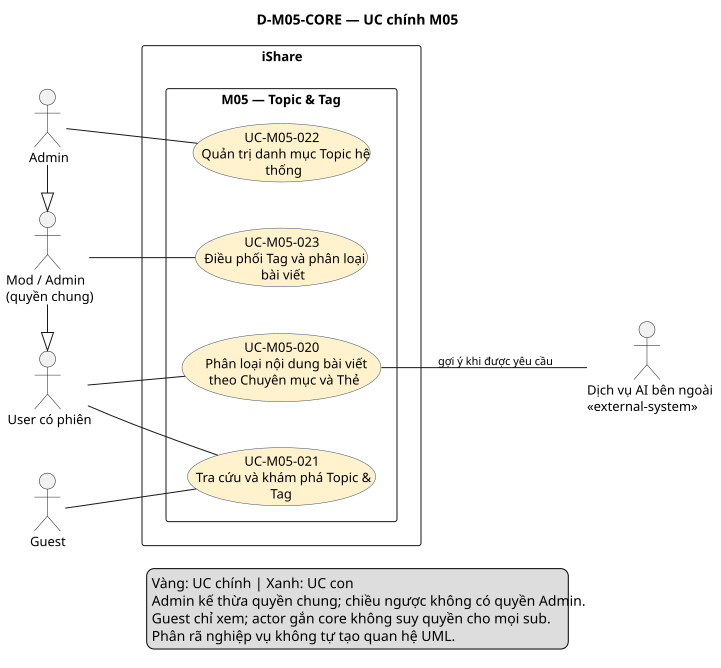
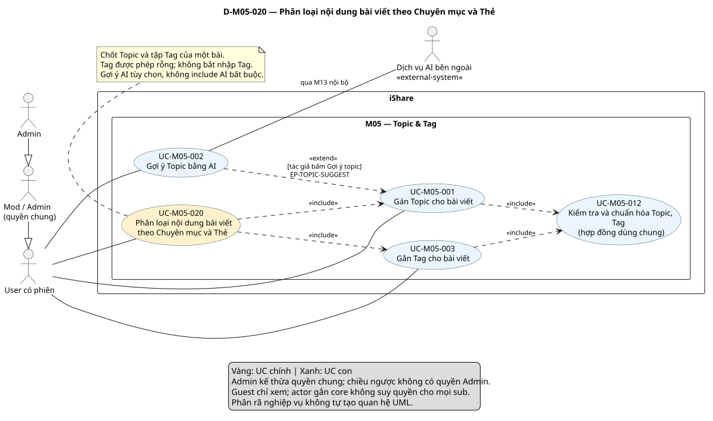
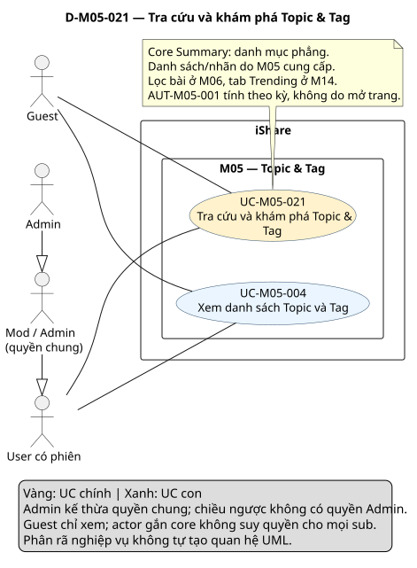
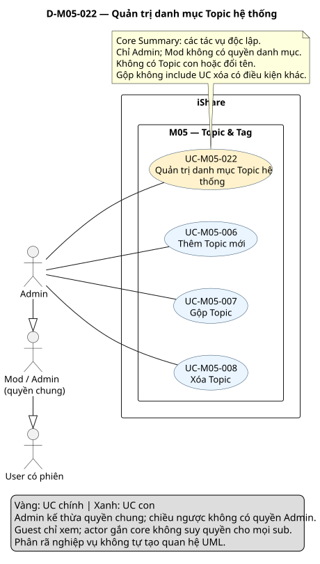
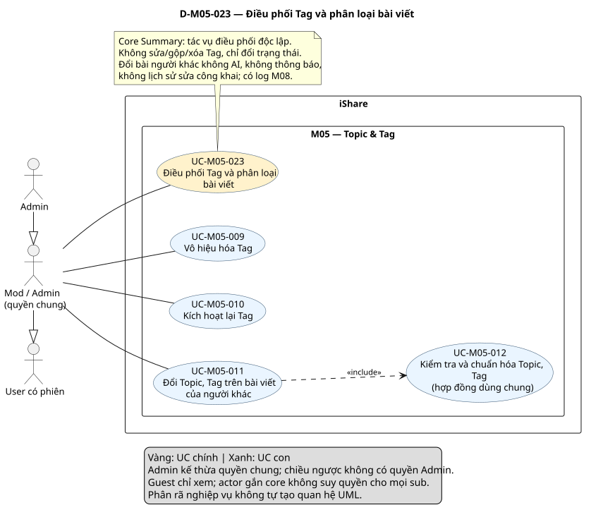

# Phân tích use case — M05 Topic & Tag (US-M05)

[Vietnamese Doc]

Phân tích toàn bộ FR-M05 1.7 theo skill use-case-analysis 2.2. Đầu ra gồm **4 UC chính, 11 UC con**, đặc tả, phân rã, quan hệ và truy vết; **5 sơ đồ, mỗi sơ đồ một SVG**. Trạng thái: **Chờ duyệt**.

## Metadata và tiến độ

<!-- uc:document -->
| key | value |
|---|---|
| document_id | US-M05 |
| skill_version | 2.2 |
| mode | module |
| modules | M05 |
| scope | ALL |
| status | Chờ duyệt |
| current_step | 7 |
| completed_steps | 1, 2, 3, 4, 5, 6, 7 |
| approved_steps | - |
| source_baseline | FR-M05 1.7; FR-M01 1.10; FR-M02 1.6; FR-M03 1.10; FR-M04 1.4; FR-M06 1.5; FR-M07 1.5; FR-M08 1.7; FR-M10 1.4; FR-M11 1.3; FR-M12 1.1; FR-M13 1.3; FR-M14 1.1; FR-M15 1.1 |
| author | Codex — hỗ trợ phân tích nghiệp vụ |
| date | 2026-10-30 |
| approval_evidence | Người dùng yêu cầu xây dựng phân tích M05 theo skill. Quyền tự thực hiện các việc cần thiết, không hỏi đồng ý đã được cấp ở lượt trước và tiếp tục áp dụng; hoàn thiện liên tục các bước. Chưa có phê duyệt kết quả cuối hay approved_steps cho bản này. |
| semantic_review | pass |
| diagram_check | pass |

| Bước | Kết quả | Xác nhận |
|---|---|---|
| 1 | FR-M05 1.7; boundary; actor; 148 mã | Được phép triển khai liên tục; chưa duyệt nội dung |
| 2 | 4 core, 11 sub, 12 mapping; giữ ID theo mục tiêu | Được phép triển khai; chưa duyệt riêng |
| 3 | 12 hợp đồng chi tiết, 3 brief Summary; 4 AUT và 4 RULE | Được phép triển khai; chưa duyệt riêng |
| 4 | 6 quan hệ UC, 1 extension point và actor hierarchy theo quyền | Được phép triển khai; chưa duyệt riêng |
| 5 | 11 nhóm + 106 FR chi tiết + 31 BR, giao tiếp liên module | Được phép triển khai; chưa duyệt riêng |
| 6 | Tổng quan và 4 sơ đồ chi tiết, chỉ SVG; parser/render/kiểm tra hình đạt | Chưa duyệt nội dung |
| 7 | Review ngữ nghĩa, cấu trúc, hình và link | Chờ duyệt kết quả cuối |

Không kế thừa approved_steps/pass render của US-M05 cũ. Tên module hiện hành là **Topic & Tag**, không phải Group & Community; Topic cấu trúc phẳng, không phải cây phân cấp. Không thay đổi FR hoặc US module khác.

## 1. Tổng hợp nghiệp vụ, phạm vi và nguồn

M05 phân loại bài theo hai trục: Topic lấy từ danh mục phẳng do Admin quản trị; Tag là từ khóa tự do được chuẩn hóa. Bài khi gửi/lưu sửa có 1–3 Topic, nháp có thể 0–3; Tag không bắt buộc, tối đa 5. AI chỉ gợi ý Topic theo yêu cầu tác giả, quyền chọn cuối thuộc tác giả. Mod/Admin điều phối Tag và phân loại bài người khác; Admin có quyền danh mục riêng. Trending được tính tự động cho Topic/Tag từ tương tác đủ điều kiện trong cửa sổ 7 ngày để M14 hiển thị.

**Subject/boundary:** toàn iShare; M05 và các module khác là phần nội bộ, không là actor ngoài iShare. Dịch vụ AI bên ngoài là actor hỗ trợ qua M13. Không dùng iShare/Hệ thống/scheduler làm actor của chính subject.

**Trong phạm vi:** toàn bộ MS1/Must M05: quy tắc gán/sửa Topic/Tag, danh mục, AI gợi ý, phản hồi/lỗi thời, quản trị Topic, điều phối Tag, đổi phân loại người khác, Trending và nhật ký.

**Ngoài phạm vi:** trình soạn/cổng công bố bài M03; tìm kiếm/lọc bài/autocomplete M06; thao tác Follow M07; cờ AI và log Admin M10; xử lý lời gọi/log thô/đánh giá AI M13; tab Trending/Feed M14; thống kê M15; chính sách/danh tính/vòng đời M01. Không thêm AI Tag, duyệt gợi ý bằng Mod, Topic con/đổi tên Topic, sửa/gộp/xóa Tag, Topic/Tag cho comment, thông báo khi Mod đổi phân loại, lịch sử sửa công khai cho thao tác đó, lượt xem trong Trending hoặc trang liệt kê bài riêng M05.

### Baseline

<!-- uc:sources -->
| path | version | role |
|---|---|---|
| docs/specs/fr/FR-M05.md | 1.7 | owner |
| docs/specs/fr/FR-M01.md | 1.10 | related |
| docs/specs/fr/FR-M02.md | 1.6 | related |
| docs/specs/fr/FR-M03.md | 1.10 | related |
| docs/specs/fr/FR-M04.md | 1.4 | related |
| docs/specs/fr/FR-M06.md | 1.5 | related |
| docs/specs/fr/FR-M07.md | 1.5 | related |
| docs/specs/fr/FR-M08.md | 1.7 | related |
| docs/specs/fr/FR-M10.md | 1.4 | related |
| docs/specs/fr/FR-M11.md | 1.3 | related |
| docs/specs/fr/FR-M12.md | 1.1 | related |
| docs/specs/fr/FR-M13.md | 1.3 | related |
| docs/specs/fr/FR-M14.md | 1.1 | related |
| docs/specs/fr/FR-M15.md | 1.1 | related |

FR-M05 đã chốt ngày 2026-10-24, mốc DEC-271/QA-477/ISS-415/OPEN-012. Đọc đầy đủ yêu cầu M05 và đối chiếu metadata/giao tiếp/các mã liên quan bên cung cấp/nhận; không tuyên bố đặc tả mọi module liên quan. [Skill 2.2](../../../.agent-instructions/skills/use-case-analysis/SKILL.md) cung cấp phương pháp, không cung cấp tính năng mới.

### Actor và quyền

<!-- uc:actors -->
| id | name | kind | parent | boundary_reason | sources |
|---|---|---|---|---|---|
| ACT-001 | Guest — chưa có phiên | human | - | Người ngoài iShare xem danh mục/nhãn phân loại công khai, không gán/đổi hay dùng AI. | FR-M05-04.01, FR-M05-04.02, FR-M05-01.08, FR-M05-02.18 |
| ACT-002 | User — có phiên | human | - | Người ngoài iShare phân loại bài của mình theo quyền M03/M01; tác giả là ngữ cảnh sở hữu. | FR-M05-01.02, FR-M05-02.01, FR-M05-03.01 |
| ACT-003 | Mod / Admin — quyền điều phối chung | human | ACT-002 | Vai trò con người với quyền chung: đổi phân loại bài người khác, vô hiệu/kích hoạt Tag. Không gán quyền quản trị danh mục Topic cho toàn bộ actor này. | FR-M05-09.04, FR-M05-10.04, FR-M05-11.04 |
| ACT-006 | Dịch vụ AI bên ngoài | external-system | - | Hỗ trợ gợi ý Topic khi có lời gọi qua M13 nội bộ; không tự gán kết quả cuối, không AI Tag. | FR-M13-01.01, FR-M13-05.01, FR-M05-02.01 |
| ACT-007 | Admin — quản trị danh mục Topic | human | ACT-003 | Chuyên biệt vai trò điều phối: có mọi quyền Mod theo FR 4.2 và thêm quyền danh mục Topic chỉ Admin. Tách actor để sơ đồ không cấp các quyền này cho Mod. | FR-M05-06.03, FR-M05-07.03, FR-M05-08.03 |

Giữ ACT-001/002/003/006 theo ý nghĩa đã có; thêm ACT-007 chỉ rõ Admin, kế thừa quyền điều phối chung ACT-003 rồi tới User. Admin có quyền tác giả khi thao tác bài mình, nhưng không tự có AI gợi ý trên bài người khác. Actor không đồng nghĩa quyền với mọi UC trong một core: Guest gắn core khám phá không được gán Topic, Mod không được quản trị danh mục. Mọi thao tác qua phiên vẫn theo M01; quyền sửa bài theo M03 không bị chức năng phân loại vượt qua.

### Kiểm kê nhóm FR

| Nhóm | Mục tiêu/hành vi | FR chi tiết | Phân bổ |
|---|---|---|---|
| FR-M05-01 | Gán Topic cho bài viết | 10 | UC-M05-001, UC-M05-012 |
| FR-M05-02 | Gợi ý Topic bằng AI | 22 | UC-M05-002, AUT-M05-004, AUT-M05-002 |
| FR-M05-03 | Gắn Tag cho bài viết | 14 | UC-M05-003, UC-M05-012, RULE-M05-001 |
| FR-M05-04 | Xem danh sách Topic và Tag | 6 | UC-M05-004, RULE-M05-001 |
| FR-M05-05 | Tính Trending Topic và Trending Tag | 14 | AUT-M05-001 |
| FR-M05-06 | Thêm Topic | 8 | UC-M05-006 |
| FR-M05-07 | Gộp Topic | 6 | UC-M05-007 |
| FR-M05-08 | Xóa Topic | 6 | UC-M05-008 |
| FR-M05-09 | Vô hiệu hóa Tag | 7 | UC-M05-009, AUT-M05-003 |
| FR-M05-10 | Kích hoạt lại Tag | 6 | UC-M05-010, AUT-M05-003 |
| FR-M05-11 | Đổi Topic, Tag trên bài viết của người khác | 7 | UC-M05-011, UC-M05-012, AUT-M05-003 |

Mẫu số truy vết **148 mã = 11 nhóm + 106 FR chi tiết + 31 BR**. Không bỏ mã hiện hành khỏi phạm vi; yêu cầu tự động được đặc tả AUT thay vì biến thành thao tác người dùng.

## 2. Danh mục hai tầng và phân rã

<!-- uc:catalog -->
| id | name | tier | level | primary | supporting | owner | anchor | sources |
|---|---|---|---|---|---|---|---|---|
| UC-M05-020 | Phân loại nội dung bài viết theo Chuyên mục và Thẻ | core | User goal | ACT-002, ACT-003, ACT-007 | ACT-006 | M05 | #uc-m05-020 | FR-M05-01, FR-M05-02, FR-M05-03, BR-M05-03, BR-M05-04, BR-M05-22 |
| UC-M05-021 | Tra cứu và khám phá Topic & Tag | core | Summary | ACT-001, ACT-002, ACT-003, ACT-007 | - | M05 | #uc-m05-021 | FR-M05-04, FR-M05-05, BR-M05-01, BR-M05-29, BR-M05-30, BR-M05-31 |
| UC-M05-022 | Quản trị danh mục Topic hệ thống | core | Summary | ACT-007 | - | M05 | #uc-m05-022 | FR-M05-06, FR-M05-07, FR-M05-08, BR-M05-05, BR-M05-08, BR-M05-09 |
| UC-M05-023 | Điều phối Tag và phân loại bài viết | core | Summary | ACT-003, ACT-007 | - | M05 | #uc-m05-023 | FR-M05-09, FR-M05-10, FR-M05-11, BR-M05-04, BR-M05-25, BR-M05-26, BR-M05-27 |
| UC-M05-001 | Gán Topic cho bài viết | sub | User goal | ACT-002, ACT-003, ACT-007 | - | M05 | #uc-m05-001 | FR-M05-01, BR-M05-03, BR-M05-04 |
| UC-M05-002 | Gợi ý Topic bằng AI | sub | User goal | ACT-002, ACT-003, ACT-007 | ACT-006 | M05 | #uc-m05-002 | FR-M05-02, BR-M05-10, BR-M05-11, BR-M05-12, BR-M05-13, BR-M05-14, BR-M05-17, BR-M05-18, BR-M05-19 |
| UC-M05-003 | Gắn Tag cho bài viết | sub | User goal | ACT-002, ACT-003, ACT-007 | - | M05 | #uc-m05-003 | FR-M05-03, BR-M05-20, BR-M05-21, BR-M05-22, BR-M05-23, BR-M05-24, BR-M05-26 |
| UC-M05-004 | Xem danh sách Topic và Tag | sub | User goal | ACT-001, ACT-002, ACT-003, ACT-007 | - | M05 | #uc-m05-004 | FR-M05-04, BR-M05-01, BR-M05-02, BR-M05-26 |
| UC-M05-006 | Thêm Topic mới | sub | User goal | ACT-007 | - | M05 | #uc-m05-006 | FR-M05-06, BR-M05-01, BR-M05-05, BR-M05-06, BR-M05-07 |
| UC-M05-007 | Gộp Topic | sub | User goal | ACT-007 | - | M05 | #uc-m05-007 | FR-M05-07, BR-M05-09 |
| UC-M05-008 | Xóa Topic | sub | User goal | ACT-007 | - | M05 | #uc-m05-008 | FR-M05-08, BR-M05-08 |
| UC-M05-009 | Vô hiệu hóa Tag | sub | User goal | ACT-003, ACT-007 | - | M05 | #uc-m05-009 | FR-M05-09, BR-M05-25, BR-M05-26 |
| UC-M05-010 | Kích hoạt lại Tag | sub | User goal | ACT-003, ACT-007 | - | M05 | #uc-m05-010 | FR-M05-10, BR-M05-25, BR-M05-27 |
| UC-M05-011 | Đổi Topic, Tag trên bài viết của người khác | sub | User goal | ACT-003, ACT-007 | - | M05 | #uc-m05-011 | FR-M05-11, FR-M05-02.21, BR-M05-04, BR-M05-20, BR-M05-24 |
| UC-M05-012 | Kiểm tra và chuẩn hóa Topic, Tag | sub | Subfunction | ACT-002, ACT-003, ACT-007 | - | M05 | #uc-m05-012 | FR-M05-01, FR-M05-03, FR-M05-11.01, FR-M05-11.02, FR-M05-11.03, BR-M05-03, BR-M05-04, BR-M05-20, BR-M05-22, BR-M05-23, BR-M05-24 |

### Phân rã UC chính → UC con

<!-- uc:decomposition -->
| core | sub | rationale | sources |
|---|---|---|---|
| UC-M05-020 | UC-M05-001 | Chọn/chốt Topic trong danh mục cho bài của mình, đúng số lượng theo trạng thái. | FR-M05-01, BR-M05-03, BR-M05-04 |
| UC-M05-020 | UC-M05-002 | Nhận gợi ý Topic khả dụng cho bài mình rồi tự quyết lựa chọn cuối. | FR-M05-02, BR-M05-10, BR-M05-11, BR-M05-12, BR-M05-13, BR-M05-14, BR-M05-17, BR-M05-18, BR-M05-19 |
| UC-M05-020 | UC-M05-003 | Gắn từ khóa tự do hợp lệ cho bài mình, dùng tên chuẩn hóa và không tạo trùng. | FR-M05-03, BR-M05-20, BR-M05-21, BR-M05-22, BR-M05-23, BR-M05-24, BR-M05-26 |
| UC-M05-020 | UC-M05-012 | Hợp đồng phân loại chung cho tác giả và Mod/Admin, nhiều ngữ cảnh nhưng một ID. | FR-M05-01, FR-M05-03, FR-M05-11.01, FR-M05-11.02, FR-M05-11.03, BR-M05-03, BR-M05-04, BR-M05-20, BR-M05-22, BR-M05-23, BR-M05-24 |
| UC-M05-021 | UC-M05-004 | Đọc danh mục Topic và Tag đang hoạt động, nhãn phân loại trên bài. | FR-M05-04, BR-M05-01, BR-M05-02, BR-M05-26 |
| UC-M05-022 | UC-M05-006 | Bổ sung một Topic ngang cấp, không trùng tên, để tác giả/AI có thể chọn. | FR-M05-06, BR-M05-01, BR-M05-05, BR-M05-06, BR-M05-07 |
| UC-M05-022 | UC-M05-007 | Hợp nhất nguồn vào đích, giữ một liên kết/quan hệ theo dõi và bỏ nguồn khỏi danh mục. | FR-M05-07, BR-M05-09 |
| UC-M05-022 | UC-M05-008 | Bỏ Topic không còn bài ngoài nháp cùng các liên kết nháp/lượt theo dõi theo quy tắc. | FR-M05-08, BR-M05-08 |
| UC-M05-023 | UC-M05-009 | Ẩn một Tag trong khủng hoảng, giữ Tag và các liên kết cũ để có thể kích hoạt lại. | FR-M05-09, BR-M05-25, BR-M05-26 |
| UC-M05-023 | UC-M05-010 | Khôi phục khả năng dùng/hiển thị Tag và các liên kết cũ, không biến chữ nhập trước đó thành Tag. | FR-M05-10, BR-M05-25, BR-M05-27 |
| UC-M05-023 | UC-M05-011 | Điều chỉnh phân loại bài người khác theo quyền Mod/Admin, cùng ràng buộc Topic/Tag. | FR-M05-11, FR-M05-02.21, BR-M05-04, BR-M05-20, BR-M05-24 |
| UC-M05-023 | UC-M05-012 | Hợp đồng phân loại chung cho tác giả và Mod/Admin, nhiều ngữ cảnh nhưng một ID. | FR-M05-01, FR-M05-03, FR-M05-11.01, FR-M05-11.02, FR-M05-11.03, BR-M05-03, BR-M05-04, BR-M05-20, BR-M05-22, BR-M05-23, BR-M05-24 |

Core020 ở User goal: chốt một tập phân loại bài gồm phần Topic và phần Tag (Tag có thể rỗng), không phải xuất bản toàn bài. Core021/022/023 ở Summary; không có nghĩa gọi mọi con một lần. UC012 là Subfunction dùng chung; tier độc lập với level. Mapping không tự thành include/extend/generalization.

<!-- uc:module-models -->
| module | path | baseline |
|---|---|---|


Mode module: không tạo US-overview trong scope này; core là đầu vào tổng hợp hệ thống sau này, không tự đưa sub lên tổng quan hệ thống.

| Quyết định | Biểu diễn | Căn cứ/lý do |
|---|---|---|
| D-M05-01 | Giữ core020–023 và sub001/002/003/004/006/007/008/009/010/011; thêm UC012 | Không tái đánh số. Sửa tên module và bỏ từ cây ở core021; mở tên core023 cho cả phân loại Topic trên bài. |
| D-M05-02 | Core020 User goal gồm chốt Topic và tập Tag, có thể 0 Tag | Có kết quả một tập phân loại hợp lệ; không buộc nhập Tag, không chiếm cổng gửi bài M03. |
| D-M05-03 | UC002 extend UC001 tại điểm lựa chọn | AI tùy chọn theo nút; chọn thủ công đủ hoàn chỉnh, lỗi/lỗi thời không chặn bài. Không include AI vào mọi lần gán Topic. |
| D-M05-04 | UC012 dùng chung qua include từ UC001/003/011 | Quyền tác giả và Mod khác nhau nhưng danh mục/số lượng/chuẩn hóa/trùng/trạng thái Tag phải nhất quán; không tách từng kiểm tra đơn lẻ thành oval. |
| D-M05-05 | Tách actor Admin ACT007 khỏi quyền chung Mod/Admin | Thêm/gộp/xóa Topic chỉ Admin; kiểm duyệt Tag và sửa phân loại người khác không cấp ngược quyền danh mục. |
| D-M05-06 | AUT001 Trending; AUT002 phản hồi; AUT003 nhật ký; AUT004 lỗi thời | Tất cả có trigger/điều kiện/kết quả; không bỏ qua phần tự động hoặc đặt actor scheduler. |
| D-M05-07 | Giữ quản trị Topic và bật/tắt Tag thành các hành trình độc lập | Không dùng kế thừa CRUD hoặc extend thao tác đã kết thúc; không cần đủ ba loại quan hệ UML. |
| D-M05-08 | UC004 chỉ danh sách/nhãn; dữ liệu Trending do AUT001, UI do M14 | Không thêm UC xem trang bài Topic/Tag riêng M05; M06 sở hữu lọc bài với truy vấn rỗng. |
| D-M05-09 | Rà nguồn từng BR, không giữ ánh xạ theo số ở bản cũ | BR19 là lỗi gợi ý AI, BR20–24 mới là quy tắc tên Tag; Trending phải dùng đúng trọng số/điều kiện và hạn cập nhật. |

## 3. Đặc tả

### 3.1 UC chính

<a id="uc-m05-020"></a>

### UC-M05-020 — Phân loại nội dung bài viết theo Chuyên mục và Thẻ

<!-- uc:spec UC-M05-020 -->
| key | value |
|---|---|
| goal | Chốt tập Topic và Tag hợp lệ cho bài viết của mình trong ngữ cảnh lưu nháp, gửi hoặc lưu bản sửa. |
| subject | iShare |
| level | User goal |
| primary | ACT-002, ACT-003, ACT-007 |
| supporting | ACT-006 |
| trigger | Tác giả phân loại bài khi soạn/gửi/sửa trong M03. |
| preconditions | Có ngữ cảnh bài của tác giả và quyền thao tác từ M03/M01; quy tắc phân loại được kiểm tra trong luồng. |
| success | Bài nháp có 0–3 Topic, bài gửi/đã gửi có 1–3; Tag 0–5 hợp lệ, không trùng, không gắn Tag bị vô hiệu hóa như liên kết mới. |
| failure | Từ chối tập phân loại vi phạm; không lấy gợi ý AI làm quyết định bắt buộc; không thay cổng gửi bài M03. |
| abstract | false |
| common_contract | Không áp dụng: không có quan hệ UC generalization. |

#### Luồng chính

<a id="uc-m05-020-main-1"></a>

| Bước | Tương tác actor–iShare | Tiếp tục | Nguồn |
|---|---|---|---|
| 1 | Xác định tác giả, bài và ngữ cảnh lưu nháp/gửi/lưu sửa; quyền thao tác bài vẫn thuộc M03/M01. | 2 | FR-M05-01, FR-M05-02, FR-M05-03, BR-M05-03, BR-M05-04, BR-M05-22 |

<a id="uc-m05-020-main-2"></a>

| Bước | Tương tác actor–iShare | Tiếp tục | Nguồn |
|---|---|---|---|
| 2 | Thực hiện UC001 chốt Topic từ danh mục; có thể yêu cầu UC002 trong luồng chọn Topic nhưng chọn thủ công vẫn hoàn chỉnh. | 3 | FR-M05-01, FR-M05-02, FR-M05-03, BR-M05-03, BR-M05-04, BR-M05-22 |

<a id="uc-m05-020-main-3"></a>

| Bước | Tương tác actor–iShare | Tiếp tục | Nguồn |
|---|---|---|---|
| 3 | Thực hiện UC003 xử lý tập Tag hiện có/nhập mới, kể cả tập rỗng; không bắt tác giả nhập Tag. Thứ tự nhập hai loại trên UI không bị ràng buộc bởi thứ tự bước kiểm tra này. | 4 | FR-M05-01, FR-M05-02, FR-M05-03, BR-M05-03, BR-M05-04, BR-M05-22 |

<a id="uc-m05-020-main-4"></a>

| Bước | Tương tác actor–iShare | Tiếp tục | Nguồn |
|---|---|---|---|
| 4 | Chốt phân loại hợp lệ theo sự kiện M03; AUT002 ghi phản hồi gợi ý khi đủ điều kiện. Phần công bố/quét/duyệt nội dung M03/M11 tiếp tục độc lập. | END: Bài nháp có 0–3 Topic, bài gửi/đã gửi có 1–3; Tag 0–5 hợp lệ, không trùng, không gắn Tag bị vô hiệu hóa như liên kết mới. | FR-M05-01, FR-M05-02, FR-M05-03, BR-M05-03, BR-M05-04, BR-M05-22 |

#### Luồng thay thế và ngoại lệ

<a id="uc-m05-020-alt-1"></a>

| Nhánh | Bước rẽ | Điều kiện | Xử lý | Quay lại/kết thúc | Nguồn |
|---|---|---|---|---|---|
| A1 | 2 | Không có Topic khi gửi/lưu sửa bài đã gửi, >3 Topic hoặc Topic không còn danh mục | Từ chối tập Topic sai; nháp vẫn được 0 Topic. | END: chưa chốt phân loại | FR-M05-01.03, FR-M05-01.04, FR-M05-01.07, FR-M05-01.09, FR-M05-01.10 |

<a id="uc-m05-020-alt-2"></a>

| Nhánh | Bước rẽ | Điều kiện | Xử lý | Quay lại/kết thúc | Nguồn |
|---|---|---|---|---|---|
| A2 | 3 | Tag vượt số/độ dài hoặc tên không hợp lệ | Từ chối Tag vi phạm theo UC003/012; không tự sửa ký tự hoặc bỏ dấu. | END: chưa chốt tập Tag hợp lệ | FR-M05-03.04, FR-M05-03.05, FR-M05-03.06, FR-M05-03.07 |

<a id="uc-m05-020-rules"></a>

**Ràng buộc:** FR-M05-01, FR-M05-02, FR-M05-03, BR-M05-03, BR-M05-04, BR-M05-22. Các BR ở mục 3.5 là phần hợp đồng; đọc cùng RULE/AUT được dẫn. Không tự thêm log/lịch sử/thông báo hoặc cơ chế kỹ thuật chưa có nguồn.

**Ranh giới:** include UC003 là xử lý tập Tag 0–5, không bắt mọi tác giả nhập Tag. Hai phần Topic/Tag có thể được chuẩn bị độc lập; luồng này mô tả khi chốt quy tắc, không áp đặt thứ tự UI, giao dịch nguyên tử hoặc cam kết rollback. M03 vẫn kiểm các điều kiện gửi/lưu nội dung khác.

<a id="uc-m05-021"></a>

### UC-M05-021 — Tra cứu và khám phá Topic & Tag

| Thuộc tính | Nội dung |
|---|---|
| Actor chính | ACT-001, ACT-002, ACT-003, ACT-007 |
| Hỗ trợ | - |
| Mục tiêu/giá trị | Đọc danh mục Topic/Tag khả dụng và dùng dữ liệu phân loại để khám phá nội dung theo đúng module sở hữu. |
| Khởi phát | Mở danh sách hoặc đọc phân loại trên bài; M14 nhận dữ liệu Trending. |
| Điều kiện/phạm vi | Danh mục Topic phẳng; Guest được xem; không tự tạo trang bài riêng trong M05. |
| Kết quả | Danh sách/nhãn đúng trạng thái; dữ liệu Trending theo AUT001 cung cấp cho M14. |
| Khi không đạt | Không lộ Tag bị vô hiệu hóa hoặc đổi module này thành Feed/Search. |
| UC con | UC-M05-004 |
| Nguồn | FR-M05-04, FR-M05-05, BR-M05-01, BR-M05-29, BR-M05-30, BR-M05-31 |

**Quy trình tổng quát:**

1. UC004 cung cấp danh sách Topic và Tag hoạt động, nhãn trên bài.
2. Khi muốn xem bài theo Topic/Tag, dùng trang tìm bài M06 với bộ lọc và truy vấn rỗng; không có UC trang bài riêng M05.
3. AUT001 tính Trending định kỳ, M14 sở hữu tab và cách xem Trending; mở danh sách không tự kích hoạt tính lại.

Summary không là lần gọi mọi UC con.

<a id="uc-m05-022"></a>

### UC-M05-022 — Quản trị danh mục Topic hệ thống

| Thuộc tính | Nội dung |
|---|---|
| Actor chính | ACT-007 |
| Hỗ trợ | - |
| Mục tiêu/giá trị | Admin duy trì danh mục Topic phẳng qua thêm, gộp hoặc xóa đúng điều kiện. |
| Khởi phát | Admin thực hiện tác vụ danh mục. |
| Điều kiện/phạm vi | Chỉ Admin; Mod không kế thừa các quyền này; danh mục không có Topic con hoặc đổi tên. |
| Kết quả | Danh mục và liên kết bài/lượt theo dõi được cập nhật đúng tác vụ. |
| Khi không đạt | Không gộp cùng một Topic, thêm trùng hoặc xóa Topic còn bài ngoài nháp. |
| UC con | UC-M05-006, UC-M05-007, UC-M05-008 |
| Nguồn | FR-M05-06, FR-M05-07, FR-M05-08, BR-M05-05, BR-M05-08, BR-M05-09 |

**Quy trình tổng quát:**

1. UC006 thêm Topic ngang cấp, chưa trùng; không tự gán cho bài đã có.
2. UC007 chuyển nguồn sang đích, loại trùng và di chuyển lượt theo dõi.
3. UC008 xóa Topic chỉ còn nháp/không bài; bỏ liên kết nháp và lượt theo dõi. Log thao tác Admin qua M10 theo hợp đồng.

Summary không là lần gọi mọi UC con.

<a id="uc-m05-023"></a>

### UC-M05-023 — Điều phối Tag và phân loại bài viết

| Thuộc tính | Nội dung |
|---|---|
| Actor chính | ACT-003, ACT-007 |
| Hỗ trợ | - |
| Mục tiêu/giá trị | Can thiệp trạng thái Tag trong khủng hoảng và điều chỉnh phân loại bài người khác theo quyền. |
| Khởi phát | Vô hiệu/kích hoạt lại Tag hoặc sửa Topic/Tag bài người khác. |
| Điều kiện/phạm vi | Vai trò Mod/Admin; tác vụ danh mục Topic vẫn chỉ Admin ở core022. |
| Kết quả | Tag và phân loại cập nhật đúng, có log kiểm duyệt, không đổi dữ liệu/nghiệp vụ ngoài phạm vi. |
| Khi không đạt | Không sửa/gộp/xóa Tag hoặc dùng AI cho phân loại bài người khác. |
| UC con | UC-M05-009, UC-M05-010, UC-M05-011, UC-M05-012 |
| Nguồn | FR-M05-09, FR-M05-10, FR-M05-11, BR-M05-04, BR-M05-25, BR-M05-26, BR-M05-27 |

**Quy trình tổng quát:**

1. UC009 vô hiệu Tag, UC010 kích hoạt lại; giữ liên kết bài cũ và quy tắc hiển thị.
2. UC011 thay Topic/Tag bài người khác, dùng lại UC012 để áp ràng buộc chung.
3. AUT003 ghi nhật ký; không báo tác giả hay ghi lịch sử sửa công khai cho việc Mod/Admin đổi phân loại.

Summary không là lần gọi mọi UC con.

### 3.2 UC con

Các cách gọi ngắn UC001/020… trong diễn giải đều thuộc M05; catalog/relations dùng ID đầy đủ. Subfunction kế thừa actor/ngữ cảnh UC gọi, không tạo một nút UI riêng chỉ để chuẩn hóa dữ liệu.

<a id="uc-m05-001"></a>

### UC-M05-001 — Gán Topic cho bài viết

**UC chính:** UC-M05-020.

<!-- uc:spec UC-M05-001 -->
| key | value |
|---|---|
| goal | Chọn/chốt Topic trong danh mục cho bài của mình, đúng số lượng theo trạng thái. |
| subject | iShare |
| level | User goal |
| primary | ACT-002, ACT-003, ACT-007 |
| supporting | - |
| trigger | Tác giả chọn Topic khi soạn, gửi hoặc sửa bài đã gửi. |
| preconditions | Có ngữ cảnh bài của mình; kiểm tra phiên/quyền và danh mục hiện tại. Không yêu cầu đã dùng AI. |
| success | Nháp 0–3 Topic; gửi/lưu sửa đã gửi 1–3 khác nhau, thuộc danh mục hiện tại. |
| failure | Không gán/đổi khi chưa đăng nhập, Topic đã xóa hoặc số lượng không hợp lệ. |
| abstract | false |
| common_contract | Không áp dụng: không có quan hệ UC generalization. |

#### Luồng chính

<a id="uc-m05-001-main-1"></a>

| Bước | Tương tác actor–iShare | Tiếp tục | Nguồn |
|---|---|---|---|
| 1 | Tác giả xem danh mục và chọn Topic thủ công. EP-TOPIC-SUGGEST: nếu tác giả chọn Gợi ý topic, chèn UC002 rồi tiếp tục quyết định Topic cuối. | 2 | FR-M05-01, BR-M05-03, BR-M05-04 |

<a id="uc-m05-001-main-2"></a>

| Bước | Tương tác actor–iShare | Tiếp tục | Nguồn |
|---|---|---|---|
| 2 | Tác giả thêm/bỏ Topic; lựa chọn cuối thuộc tác giả, gợi ý lỗi thời không chặn gửi. | 3 | FR-M05-01, BR-M05-03, BR-M05-04 |

<a id="uc-m05-001-main-3"></a>

| Bước | Tương tác actor–iShare | Tiếp tục | Nguồn |
|---|---|---|---|
| 3 | Thực hiện UC012 với ngữ cảnh Topic, trạng thái bài và tập được chọn để kiểm danh mục/số lượng/loại trùng. | 4 | FR-M05-01, BR-M05-03, BR-M05-04 |

<a id="uc-m05-001-main-4"></a>

| Bước | Tương tác actor–iShare | Tiếp tục | Nguồn |
|---|---|---|---|
| 4 | Lưu Topic hợp lệ khi lưu nháp/gửi/lưu sửa; trả về core020 bước 3 nếu đang phân loại trọn bài. AUT002 chỉ ghi phản hồi khi sự kiện gửi/lưu sửa đủ điều kiện. | END: Nháp 0–3 Topic; gửi/lưu sửa đã gửi 1–3 khác nhau, thuộc danh mục hiện tại. | FR-M05-01, BR-M05-03, BR-M05-04 |

#### Luồng thay thế và ngoại lệ

<a id="uc-m05-001-alt-1"></a>

| Nhánh | Bước rẽ | Điều kiện | Xử lý | Quay lại/kết thúc | Nguồn |
|---|---|---|---|---|---|
| A1 | 1 | Chưa đăng nhập hoặc không có quyền bài | Từ chối; quyền đổi bài người khác của Mod/Admin dùng UC011, không giả làm tác giả. | END: chưa gán | FR-M05-01.08, FR-M05-11.04 |

<a id="uc-m05-001-alt-2"></a>

| Nhánh | Bước rẽ | Điều kiện | Xử lý | Quay lại/kết thúc | Nguồn |
|---|---|---|---|---|---|
| A2 | 3 | Chọn Topic thứ tư hoặc lặp lại Topic | Từ chối Topic thứ tư; Topic lặp chỉ giữ một lần. | 2 | FR-M05-01.04, FR-M05-01.05 |

<a id="uc-m05-001-alt-3"></a>

| Nhánh | Bước rẽ | Điều kiện | Xử lý | Quay lại/kết thúc | Nguồn |
|---|---|---|---|---|---|
| A3 | 3 | Gửi/lưu sửa thiếu Topic hoặc Topic đã xóa trước khi gửi | Từ chối phần Topic không hợp lệ; không tự thay bằng Khác. Lưu nháp được 0–3. | 2 | FR-M05-01.03, FR-M05-01.07, FR-M05-01.09, FR-M05-01.10 |

<a id="uc-m05-001-rules"></a>

**Ràng buộc:** FR-M05-01, BR-M05-03, BR-M05-04. Các BR ở mục 3.5 là phần hợp đồng; đọc cùng RULE/AUT được dẫn. Không tự thêm log/lịch sử/thông báo hoặc cơ chế kỹ thuật chưa có nguồn.

#### Điều kiện nghiệm thu theo baseline

Nội dung chuẩn tắc dưới đây áp dụng cùng hợp đồng, luồng và nhánh của đặc tả này; không tạo các UC riêng theo từng dòng.

| Nguồn | Điều kiện bắt buộc |
|---|---|
| <a id="uc-m05-001-fr-m05-01-01"></a>FR-M05-01.01 | Khi tác giả chọn Topic cho bài viết, hệ thống phải chỉ cho chọn trong các Topic thuộc danh mục Topic. |
| <a id="uc-m05-001-fr-m05-01-02"></a>FR-M05-01.02 | Khi tác giả gửi bài viết có từ 1 đến 3 Topic khác nhau, hệ thống phải lưu các Topic đó cho bài viết. |
| <a id="uc-m05-001-fr-m05-01-06"></a>FR-M05-01.06 | Khi tác giả sửa bài viết đã gửi, hệ thống phải cho phép tác giả thêm hoặc bỏ Topic của bài viết đó. |
| <a id="uc-m05-001-fr-m05-01-08"></a>FR-M05-01.08 | Nếu người chưa đăng nhập gán hoặc đổi Topic cho bài viết, hệ thống phải từ chối. |

<a id="uc-m05-002"></a>

### UC-M05-002 — Gợi ý Topic bằng AI

**UC chính:** UC-M05-020.

<!-- uc:spec UC-M05-002 -->
| key | value |
|---|---|
| goal | Nhận gợi ý Topic khả dụng cho bài mình rồi tự quyết lựa chọn cuối. |
| subject | iShare |
| level | User goal |
| primary | ACT-002, ACT-003, ACT-007 |
| supporting | ACT-006 |
| trigger | Tác giả bấm Gợi ý topic tại EP-TOPIC-SUGGEST, khi soạn hoặc sửa bài đã gửi. |
| preconditions | Có ngữ cảnh bài của mình; phiên, hai cờ AI, độ dài và cửa sổ tần suất được kiểm tra, không giả định luôn đạt. |
| success | Tối đa 3 Topic hợp lệ đã chọn sẵn; tác giả bỏ/chọn thêm trong hạn mức. Lần thất bại không tự chọn Topic. |
| failure | Không gọi tự động hoặc dùng gợi ý cho bài người khác; lỗi không chặn chọn thủ công/gửi khi đủ quy tắc. |
| abstract | false |
| common_contract | Không áp dụng: không có quan hệ UC generalization. |

#### Luồng chính

<a id="uc-m05-002-main-1"></a>

| Bước | Tương tác actor–iShare | Tiếp tục | Nguồn |
|---|---|---|---|
| 1 | Tác giả bấm Gợi ý topic; không tự gợi ý trước khi có yêu cầu, cũng dùng được khi tác giả sửa bài đã gửi. | 2 | FR-M05-02, BR-M05-10, BR-M05-11, BR-M05-12, BR-M05-13, BR-M05-14, BR-M05-17, BR-M05-18, BR-M05-19 |

<a id="uc-m05-002-main-2"></a>

| Bước | Tương tác actor–iShare | Tiếp tục | Nguồn |
|---|---|---|---|
| 2 | Kiểm tra đăng nhập/đúng tác giả, cả cờ AI tổng và Topic suggestion bật, tiêu đề + nội dung chữ ≥20 từ, không vượt 10 yêu cầu trong 60 giây gần nhất. | 3 | FR-M05-02, BR-M05-10, BR-M05-11, BR-M05-12, BR-M05-13, BR-M05-14, BR-M05-17, BR-M05-18, BR-M05-19 |

<a id="uc-m05-002-main-3"></a>

| Bước | Tương tác actor–iShare | Tiếp tục | Nguồn |
|---|---|---|---|
| 3 | Chuyển tiêu đề và nội dung chữ, không tệp đính kèm, qua M13 tới dịch vụ AI bên ngoài. M13 sở hữu timeout 10 giây/lần và một retry sau 2 giây theo hợp đồng. | 4 | FR-M05-02, BR-M05-10, BR-M05-11, BR-M05-12, BR-M05-13, BR-M05-14, BR-M05-17, BR-M05-18, BR-M05-19 |

<a id="uc-m05-002-main-4"></a>

| Bước | Tương tác actor–iShare | Tiếp tục | Nguồn |
|---|---|---|---|
| 4 | Đối chiếu danh mục hiện tại: bỏ Topic không hợp lệ, hiển thị tối đa 3 Topic hợp lệ ở trạng thái đã chọn sẵn. Tác giả tự bỏ/chọn thêm trong hạn mức; quay về UC001 bước 2. | END: gợi ý đã hiển thị, quay về UC-M05-001 bước 2 | FR-M05-02, BR-M05-10, BR-M05-11, BR-M05-12, BR-M05-13, BR-M05-14, BR-M05-17, BR-M05-18, BR-M05-19 |


#### Luồng thay thế và ngoại lệ

<a id="uc-m05-002-alt-1"></a>

| Nhánh | Bước rẽ | Điều kiện | Xử lý | Quay lại/kết thúc | Nguồn |
|---|---|---|---|---|---|
| A1 | 2 | Chưa đăng nhập hoặc Mod/Admin đổi Topic bài người khác | Từ chối/không cung cấp gợi ý trong ngữ cảnh đó. | END: không lấy gợi ý | FR-M05-02.18, FR-M05-02.21 |

<a id="uc-m05-002-alt-2"></a>

| Nhánh | Bước rẽ | Điều kiện | Xử lý | Quay lại/kết thúc | Nguồn |
|---|---|---|---|---|---|
| A2 | 2 | Một trong hai cờ AI tắt | Không cung cấp gợi ý; tác giả chọn từ danh mục thủ công. | END: chọn thủ công | FR-M05-02.16, FR-M05-02.17 |

<a id="uc-m05-002-alt-3"></a>

| Nhánh | Bước rẽ | Điều kiện | Xử lý | Quay lại/kết thúc | Nguồn |
|---|---|---|---|---|---|
| A3 | 2 | Tổng tiêu đề/chữ <20 từ hoặc yêu cầu thứ 11 trong 60 giây gần nhất | Báo quá ngắn hoặc từ chối vượt tần suất; không gửi lời gọi chưa đủ điều kiện tới AI. | END: chưa gọi AI | FR-M05-02.05, FR-M05-02.15 |

<a id="uc-m05-002-alt-4"></a>

| Nhánh | Bước rẽ | Điều kiện | Xử lý | Quay lại/kết thúc | Nguồn |
|---|---|---|---|---|---|
| A4 | 4 | AI lỗi/timeout sau retry hoặc không còn Topic hợp lệ | Hiện thông báo không chặn: Không thể gợi ý chủ đề lúc này, vui lòng chọn thủ công; không tự chọn Topic. | END: gợi ý thất bại, vẫn chọn thủ công | FR-M05-02.06, FR-M05-02.07, FR-M05-02.08 |

<a id="uc-m05-002-alt-5"></a>

| Nhánh | Bước rẽ | Điều kiện | Xử lý | Quay lại/kết thúc | Nguồn |
|---|---|---|---|---|---|
| A5 | 4 | Chỉ một phần kết quả ngoài danh mục | Bỏ phần ngoài danh mục, giữ các Topic hợp lệ; không coi cả lần là thất bại nếu còn hợp lệ. | 4 | FR-M05-02.19 |

<a id="uc-m05-002-rules"></a>

**Ràng buộc:** FR-M05-02, BR-M05-10, BR-M05-11, BR-M05-12, BR-M05-13, BR-M05-14, BR-M05-17, BR-M05-18, BR-M05-19. Các BR ở mục 3.5 là phần hợp đồng; đọc cùng RULE/AUT được dẫn. Không tự thêm log/lịch sử/thông báo hoặc cơ chế kỹ thuật chưa có nguồn.

**Quyền lựa chọn và vòng đời:** AI không duyệt hay quyết định danh mục mới. Tối đa 3 gợi ý hợp lệ được chọn sẵn, người dùng có thể bỏ/chọn thêm trong giới hạn; không tự chạy lại khi chữ đổi. Tập được chọn cuối được chốt ở UC001, phản hồi chỉ ở sự kiện gửi/lưu sửa. Kết quả thô/log lời gọi và đo tỷ lệ giữ gợi ý thuộc M13. Không AI Tag. Đơn vị từ theo FR: cụm cách khoảng trắng, ví dụ Định lý Bayes là gì là 5 từ.

#### Điều kiện nghiệm thu theo baseline

Nội dung chuẩn tắc dưới đây áp dụng cùng hợp đồng, luồng và nhánh của đặc tả này; không tạo các UC riêng theo từng dòng.

| Nguồn | Điều kiện bắt buộc |
|---|---|
| <a id="uc-m05-002-fr-m05-02-01"></a>FR-M05-02.01 | Khi tác giả bấm nút "Gợi ý topic", hệ thống phải gửi tiêu đề và nội dung chữ của bài viết đang soạn, không gồm tệp đính kèm, để AI gợi ý Topic. |
| <a id="uc-m05-002-fr-m05-02-02"></a>FR-M05-02.02 | Hệ thống phải không tự gợi ý Topic khi tác giả chưa bấm nút "Gợi ý topic". |
| <a id="uc-m05-002-fr-m05-02-03"></a>FR-M05-02.03 | Khi AI trả về Topic hợp lệ, hệ thống phải hiển thị tối đa 3 Topic được gợi ý ở trạng thái đã chọn sẵn. |
| <a id="uc-m05-002-fr-m05-02-04"></a>FR-M05-02.04 | Khi tác giả bỏ chọn hoặc chọn thêm Topic sau khi có gợi ý, hệ thống phải áp dụng lựa chọn của tác giả trong giới hạn của FR-M05-01. |
| <a id="uc-m05-002-fr-m05-02-05"></a>FR-M05-02.05 | Nếu tiêu đề cộng nội dung chữ của bài viết có ít hơn 20 từ, hệ thống phải không gợi ý và báo nội dung quá ngắn. |
| <a id="uc-m05-002-fr-m05-02-06"></a>FR-M05-02.06 | Nếu mọi Topic AI trả về đều không thuộc danh mục Topic hiện tại, hệ thống phải coi lần gợi ý đó là thất bại. |
| <a id="uc-m05-002-fr-m05-02-07"></a>FR-M05-02.07 | Nếu lần gợi ý thất bại khi AI đang bật, hệ thống phải hiển thị thông báo không chặn "Không thể gợi ý chủ đề lúc này, vui lòng chọn thủ công". |
| <a id="uc-m05-002-fr-m05-02-08"></a>FR-M05-02.08 | Nếu lần gợi ý thất bại, hệ thống phải không tự chọn Topic nào cho bài viết. |
| <a id="uc-m05-002-fr-m05-02-15"></a>FR-M05-02.15 | Nếu một người dùng yêu cầu gợi ý Topic lần thứ 11 trong vòng 60 giây gần nhất, hệ thống phải từ chối yêu cầu đó. |
| <a id="uc-m05-002-fr-m05-02-16"></a>FR-M05-02.16 | Trong khi công tắc AI tổng hoặc công tắc gợi ý Topic đang tắt, hệ thống phải không cung cấp gợi ý Topic. |
| <a id="uc-m05-002-fr-m05-02-17"></a>FR-M05-02.17 | Trong khi công tắc AI tổng hoặc công tắc gợi ý Topic đang tắt, hệ thống phải cho tác giả chọn Topic thủ công từ danh mục Topic. |
| <a id="uc-m05-002-fr-m05-02-18"></a>FR-M05-02.18 | Nếu người chưa đăng nhập yêu cầu gợi ý Topic, hệ thống phải từ chối. |
| <a id="uc-m05-002-fr-m05-02-19"></a>FR-M05-02.19 | Nếu một phần Topic AI trả về không thuộc danh mục Topic hiện tại, hệ thống phải bỏ các Topic đó và chỉ hiển thị các Topic hợp lệ. |
| <a id="uc-m05-002-fr-m05-02-20"></a>FR-M05-02.20 | Khi tác giả sửa bài viết đã gửi, hệ thống phải cho tác giả dùng gợi ý Topic theo cùng các quy tắc như khi soạn bài. |
| <a id="uc-m05-002-fr-m05-02-21"></a>FR-M05-02.21 | Khi Mod hoặc Admin đổi Topic trên bài viết của người khác, hệ thống phải không cung cấp gợi ý Topic. |

<a id="uc-m05-003"></a>

### UC-M05-003 — Gắn Tag cho bài viết

**UC chính:** UC-M05-020.

<!-- uc:spec UC-M05-003 -->
| key | value |
|---|---|
| goal | Gắn từ khóa tự do hợp lệ cho bài mình, dùng tên chuẩn hóa và không tạo trùng. |
| subject | iShare |
| level | User goal |
| primary | ACT-002, ACT-003, ACT-007 |
| supporting | - |
| trigger | Tác giả nhập/gắn/bỏ Tag khi soạn, gửi hoặc sửa bài. |
| preconditions | Có phiên và quyền bài của mình; không bắt buộc có Tag. |
| success | 0–5 Tag hợp lệ; dùng lại Tag đã có hoặc tạo Tag chưa tồn tại ở trạng thái hoạt động, không cần duyệt. |
| failure | Không thêm quá hạn mức/sai tên; Tag bị vô hiệu hóa nhập lại thành văn bản, không liên kết mới. |
| abstract | false |
| common_contract | Không áp dụng: không có quan hệ UC generalization. |

#### Luồng chính

<a id="uc-m05-003-main-1"></a>

| Bước | Tương tác actor–iShare | Tiếp tục | Nguồn |
|---|---|---|---|
| 1 | Tác giả nhập/thêm/bỏ Tag, hoặc giữ tập rỗng; Tag không được AI gợi ý hay gắn tự động. | 2 | FR-M05-03, BR-M05-20, BR-M05-21, BR-M05-22, BR-M05-23, BR-M05-24, BR-M05-26 |

<a id="uc-m05-003-main-2"></a>

| Bước | Tương tác actor–iShare | Tiếp tục | Nguồn |
|---|---|---|---|
| 2 | Thực hiện UC012 với ngữ cảnh Tag để chuẩn hóa chữ thường, kiểm tên/độ dài/số lượng, loại trùng và trạng thái hoạt động. | 3 | FR-M05-03, BR-M05-20, BR-M05-21, BR-M05-22, BR-M05-23, BR-M05-24, BR-M05-26 |

<a id="uc-m05-003-main-3"></a>

| Bước | Tương tác actor–iShare | Tiếp tục | Nguồn |
|---|---|---|---|
| 3 | Với tên chưa tồn tại và hợp lệ, tạo Tag hoạt động không cần duyệt; tên đã tồn tại dùng lại. Phần nhập trùng Tag đang vô hiệu hóa hiển thị như chữ, không gắn liên kết mới. | 4 | FR-M05-03, BR-M05-20, BR-M05-21, BR-M05-22, BR-M05-23, BR-M05-24, BR-M05-26 |

<a id="uc-m05-003-main-4"></a>

| Bước | Tương tác actor–iShare | Tiếp tục | Nguồn |
|---|---|---|---|
| 4 | Lưu tập Tag hợp lệ theo sự kiện gửi/lưu sửa; hiển thị chữ thường kèm #. Nếu đang phân loại trọn bài thì trả về core020 bước 4. | END: 0–5 Tag hợp lệ; dùng lại Tag đã có hoặc tạo Tag chưa tồn tại ở trạng thái hoạt động, không cần duyệt. | FR-M05-03, BR-M05-20, BR-M05-21, BR-M05-22, BR-M05-23, BR-M05-24, BR-M05-26 |

#### Luồng thay thế và ngoại lệ

<a id="uc-m05-003-alt-1"></a>

| Nhánh | Bước rẽ | Điều kiện | Xử lý | Quay lại/kết thúc | Nguồn |
|---|---|---|---|---|---|
| A1 | 1 | Chưa đăng nhập hoặc không quyền bài | Từ chối gắn/đổi; không cho gắn vào comment. | END: không gắn Tag | FR-M05-03.12, FR-M05-03.13 |

<a id="uc-m05-003-alt-2"></a>

| Nhánh | Bước rẽ | Điều kiện | Xử lý | Quay lại/kết thúc | Nguồn |
|---|---|---|---|---|---|
| A2 | 2 | Tag thứ sáu, tên >30 ký tự, ký tự ngoài chữ/số/_ hoặc không có chữ cái | Từ chối Tag vi phạm; chỉ đổi hoa thành thường, không tự bỏ dấu hay thay ký tự. | 1 | FR-M05-03.04, FR-M05-03.05, FR-M05-03.06, FR-M05-03.07 |

<a id="uc-m05-003-alt-3"></a>

| Nhánh | Bước rẽ | Điều kiện | Xử lý | Quay lại/kết thúc | Nguồn |
|---|---|---|---|---|---|
| A3 | 2 | Tag lặp hoặc tên đã tồn tại sau chuẩn hóa | Chỉ giữ một liên kết và dùng một Tag hiện có. | 3 | FR-M05-03.03, FR-M05-03.08 |

<a id="uc-m05-003-alt-4"></a>

| Nhánh | Bước rẽ | Điều kiện | Xử lý | Quay lại/kết thúc | Nguồn |
|---|---|---|---|---|---|
| A4 | 2 | Tag đang vô hiệu hóa | Giữ phần nhập như văn bản, không tái tạo một Tag hoạt động cùng tên. | 3 | FR-M05-03.09 |

<a id="uc-m05-003-rules"></a>

**Ràng buộc:** FR-M05-03, BR-M05-20, BR-M05-21, BR-M05-22, BR-M05-23, BR-M05-24, BR-M05-26. Các BR ở mục 3.5 là phần hợp đồng; đọc cùng RULE/AUT được dẫn. Không tự thêm log/lịch sử/thông báo hoặc cơ chế kỹ thuật chưa có nguồn.

#### Điều kiện nghiệm thu theo baseline

Nội dung chuẩn tắc dưới đây áp dụng cùng hợp đồng, luồng và nhánh của đặc tả này; không tạo các UC riêng theo từng dòng.

| Nguồn | Điều kiện bắt buộc |
|---|---|
| <a id="uc-m05-003-fr-m05-03-01"></a>FR-M05-03.01 | Khi tác giả gửi bài viết có từ 0 đến 5 Tag hợp lệ, hệ thống phải lưu các Tag đó cho bài viết. |
| <a id="uc-m05-003-fr-m05-03-02"></a>FR-M05-03.02 | Khi tác giả gắn một Tag chưa tồn tại, hệ thống phải tạo Tag đó ở trạng thái hoạt động mà không cần ai duyệt. |
| <a id="uc-m05-003-fr-m05-03-09"></a>FR-M05-03.09 | Nếu tác giả nhập tên của một Tag đang bị vô hiệu hóa, hệ thống phải hiển thị phần nhập đó như văn bản, không gắn Tag đó cho bài viết. |
| <a id="uc-m05-003-fr-m05-03-10"></a>FR-M05-03.10 | Khi tác giả sửa bài viết đã gửi, hệ thống phải cho phép tác giả thêm hoặc bỏ Tag của bài viết đó trong giới hạn 5 Tag. |
| <a id="uc-m05-003-fr-m05-03-11"></a>FR-M05-03.11 | Hệ thống phải không dùng AI để gợi ý hay gắn Tag. |
| <a id="uc-m05-003-fr-m05-03-12"></a>FR-M05-03.12 | Nếu người chưa đăng nhập gắn hoặc đổi Tag cho bài viết, hệ thống phải từ chối. |

<a id="uc-m05-004"></a>

### UC-M05-004 — Xem danh sách Topic và Tag

**UC chính:** UC-M05-021.

<!-- uc:spec UC-M05-004 -->
| key | value |
|---|---|
| goal | Đọc danh mục Topic và Tag đang hoạt động, nhãn phân loại trên bài. |
| subject | iShare |
| level | User goal |
| primary | ACT-001, ACT-002, ACT-003, ACT-007 |
| supporting | - |
| trigger | Người xem mở danh sách Topic/Tag hoặc xem nhãn trên bài. |
| preconditions | Không cần đăng nhập để xem danh sách; đọc nhãn bài vẫn theo quyền đọc bài M03/M11. |
| success | Topic hiện toàn bộ danh mục phẳng, Tag chỉ hoạt động; bài chỉ hiện Tag hoạt động còn liên kết. |
| failure | Không hiển thị Tag bị vô hiệu hóa hoặc phát minh trang bài riêng M05. |
| abstract | false |
| common_contract | Không áp dụng: không có quan hệ UC generalization. |

#### Luồng chính

<a id="uc-m05-004-main-1"></a>

| Bước | Tương tác actor–iShare | Tiếp tục | Nguồn |
|---|---|---|---|
| 1 | Người xem, kể cả Guest, mở danh sách Topic hoặc Tag. | 2 | FR-M05-04, BR-M05-01, BR-M05-02, BR-M05-26 |

<a id="uc-m05-004-main-2"></a>

| Bước | Tương tác actor–iShare | Tiếp tục | Nguồn |
|---|---|---|---|
| 2 | iShare trả mọi Topic trong danh mục phẳng có 11 Topic ban đầu và các Topic được thêm, hoặc các Tag hoạt động; không trả Tag vô hiệu hóa. | 3 | FR-M05-04, BR-M05-01, BR-M05-02, BR-M05-26 |

<a id="uc-m05-004-main-3"></a>

| Bước | Tương tác actor–iShare | Tiếp tục | Nguồn |
|---|---|---|---|
| 3 | Khi đọc bài được phép, hiển thị Topic và Tag hoạt động của bài; Tag vô hiệu hóa không hiện nhưng liên kết vẫn giữ. | 4 | FR-M05-04, BR-M05-01, BR-M05-02, BR-M05-26 |

<a id="uc-m05-004-main-4"></a>

| Bước | Tương tác actor–iShare | Tiếp tục | Nguồn |
|---|---|---|---|
| 4 | Muốn xem bài theo Topic/Tag thì dùng M06 với bộ lọc và truy vấn rỗng, không có trang bài riêng M05. Trending được M14 hiển thị từ AUT001, không tính lại chỉ vì mở danh mục. | END: Topic hiện toàn bộ danh mục phẳng, Tag chỉ hoạt động; bài chỉ hiện Tag hoạt động còn liên kết. | FR-M05-04, BR-M05-01, BR-M05-02, BR-M05-26 |

#### Luồng thay thế và ngoại lệ

<a id="uc-m05-004-alt-1"></a>

| Nhánh | Bước rẽ | Điều kiện | Xử lý | Quay lại/kết thúc | Nguồn |
|---|---|---|---|---|---|
| A1 | 2 hoặc 3 | Tag đang vô hiệu hóa | Không hiển thị tại danh sách/nhãn bài; không xóa liên kết cũ. | END: danh sách/nhãn đúng trạng thái | FR-M05-04.03, FR-M05-04.05 |

<a id="uc-m05-004-rules"></a>

**Ràng buộc:** FR-M05-04, BR-M05-01, BR-M05-02, BR-M05-26. Các BR ở mục 3.5 là phần hợp đồng; đọc cùng RULE/AUT được dẫn. Không tự thêm log/lịch sử/thông báo hoặc cơ chế kỹ thuật chưa có nguồn.

#### Điều kiện nghiệm thu theo baseline

Nội dung chuẩn tắc dưới đây áp dụng cùng hợp đồng, luồng và nhánh của đặc tả này; không tạo các UC riêng theo từng dòng.

| Nguồn | Điều kiện bắt buộc |
|---|---|
| <a id="uc-m05-004-fr-m05-04-01"></a>FR-M05-04.01 | Khi một người, kể cả Guest, mở danh sách Topic, hệ thống phải hiển thị mọi Topic trong danh mục Topic. |
| <a id="uc-m05-004-fr-m05-04-02"></a>FR-M05-04.02 | Khi một người, kể cả Guest, mở danh sách Tag, hệ thống phải hiển thị các Tag đang hoạt động. |
| <a id="uc-m05-004-fr-m05-04-03"></a>FR-M05-04.03 | Hệ thống phải không hiển thị Tag bị vô hiệu hóa trong danh sách Tag. |
| <a id="uc-m05-004-fr-m05-04-04"></a>FR-M05-04.04 | Khi một người xem một bài viết, hệ thống phải hiển thị các Topic và các Tag đang hoạt động của bài viết đó. |
| <a id="uc-m05-004-fr-m05-04-05"></a>FR-M05-04.05 | Nếu một Tag của bài viết đang bị vô hiệu hóa, hệ thống phải không hiển thị Tag đó trên bài viết. |

<a id="uc-m05-006"></a>

### UC-M05-006 — Thêm Topic mới

**UC chính:** UC-M05-022.

<!-- uc:spec UC-M05-006 -->
| key | value |
|---|---|
| goal | Bổ sung một Topic ngang cấp, không trùng tên, để tác giả/AI có thể chọn. |
| subject | iShare |
| level | User goal |
| primary | ACT-007 |
| supporting | - |
| trigger | Admin gửi tên Topic mới. |
| preconditions | Có phiên; vai trò Admin được kiểm tra trong luồng; không dùng quyền Mod thay quyền Admin. |
| success | Topic thêm vào danh mục phẳng, chọn được khi gán/gợi ý; không tự gán vào bài cũ. |
| failure | Từ chối người không Admin hoặc tên trùng theo quy tắc so sánh. |
| abstract | false |
| common_contract | Không áp dụng: không có quan hệ UC generalization. |

#### Luồng chính

<a id="uc-m05-006-main-1"></a>

| Bước | Tương tác actor–iShare | Tiếp tục | Nguồn |
|---|---|---|---|
| 1 | Admin nhập tên Topic; kiểm tra vai trò Admin thực tế. | 2 | FR-M05-06, BR-M05-01, BR-M05-05, BR-M05-06, BR-M05-07 |

<a id="uc-m05-006-main-2"></a>

| Bước | Tương tác actor–iShare | Tiếp tục | Nguồn |
|---|---|---|---|
| 2 | So trùng không phân biệt hoa/thường, bỏ khoảng trắng thừa đầu/cuối/giữa, nhưng giữ dấu để phân biệt. | 3 | FR-M05-06, BR-M05-01, BR-M05-05, BR-M05-06, BR-M05-07 |

<a id="uc-m05-006-main-3"></a>

| Bước | Tương tác actor–iShare | Tiếp tục | Nguồn |
|---|---|---|---|
| 3 | Nếu không trùng, thêm Topic ngang cấp; không giới hạn tổng Topic. Cho chọn khi gán và gợi ý, không tự gán bài cũ; thao tác Admin vào log M10 theo giao tiếp. | END: Topic thêm vào danh mục phẳng, chọn được khi gán/gợi ý; không tự gán vào bài cũ. | FR-M05-06, BR-M05-01, BR-M05-05, BR-M05-06, BR-M05-07 |

#### Luồng thay thế và ngoại lệ

<a id="uc-m05-006-alt-1"></a>

| Nhánh | Bước rẽ | Điều kiện | Xử lý | Quay lại/kết thúc | Nguồn |
|---|---|---|---|---|---|
| A1 | 1 | Người thực hiện không Admin | Từ chối, kể cả Mod có quyền quản lý Tag. | END: không thêm | FR-M05-06.03 |

<a id="uc-m05-006-alt-2"></a>

| Nhánh | Bước rẽ | Điều kiện | Xử lý | Quay lại/kết thúc | Nguồn |
|---|---|---|---|---|---|
| A2 | 2 | Tên trùng Topic hiện có theo quy tắc so sánh | Từ chối thêm; không tự gộp hoặc đổi tên Topic hiện có. | END: không thêm | FR-M05-06.02, FR-M05-06.08 |

<a id="uc-m05-006-rules"></a>

**Ràng buộc:** FR-M05-06, BR-M05-01, BR-M05-05, BR-M05-06, BR-M05-07. Các BR ở mục 3.5 là phần hợp đồng; đọc cùng RULE/AUT được dẫn. Không tự thêm log/lịch sử/thông báo hoặc cơ chế kỹ thuật chưa có nguồn.

#### Điều kiện nghiệm thu theo baseline

Nội dung chuẩn tắc dưới đây áp dụng cùng hợp đồng, luồng và nhánh của đặc tả này; không tạo các UC riêng theo từng dòng.

| Nguồn | Điều kiện bắt buộc |
|---|---|
| <a id="uc-m05-006-fr-m05-06-01"></a>FR-M05-06.01 | Khi Admin thêm một Topic có tên chưa trùng với Topic nào trong danh mục, hệ thống phải thêm Topic đó vào danh mục Topic. |
| <a id="uc-m05-006-fr-m05-06-02"></a>FR-M05-06.02 | Nếu tên Topic mới trùng tên một Topic đã có trong danh mục, hệ thống phải từ chối thêm Topic đó. |
| <a id="uc-m05-006-fr-m05-06-03"></a>FR-M05-06.03 | Nếu người thêm Topic không là Admin, hệ thống phải từ chối. |
| <a id="uc-m05-006-fr-m05-06-04"></a>FR-M05-06.04 | Khi một Topic mới được thêm, hệ thống phải cho phép chọn Topic đó khi gán Topic và khi AI gợi ý Topic. |
| <a id="uc-m05-006-fr-m05-06-05"></a>FR-M05-06.05 | Khi một Topic mới được thêm, hệ thống phải không tự gán Topic đó cho bài viết đã có. |
| <a id="uc-m05-006-fr-m05-06-06"></a>FR-M05-06.06 | Hệ thống phải không giới hạn số lượng Topic trong danh mục Topic. |
| <a id="uc-m05-006-fr-m05-06-07"></a>FR-M05-06.07 | Khi Admin thêm một Topic, hệ thống phải đặt Topic đó ngang cấp với mọi Topic khác trong danh mục, không làm Topic con của Topic nào. |
| <a id="uc-m05-006-fr-m05-06-08"></a>FR-M05-06.08 | Khi so trùng tên Topic, hệ thống phải không phân biệt chữ hoa, chữ thường và bỏ qua khoảng trắng thừa ở đầu, cuối và giữa tên, nhưng phân biệt dấu. |

<a id="uc-m05-007"></a>

### UC-M05-007 — Gộp Topic

**UC chính:** UC-M05-022.

<!-- uc:spec UC-M05-007 -->
| key | value |
|---|---|
| goal | Hợp nhất nguồn vào đích, giữ một liên kết/quan hệ theo dõi và bỏ nguồn khỏi danh mục. |
| subject | iShare |
| level | User goal |
| primary | ACT-007 |
| supporting | - |
| trigger | Admin chọn Topic nguồn và đích để gộp. |
| preconditions | Có phiên; kiểm tra vai trò và nguồn/đích khác nhau trong luồng. |
| success | Mọi bài dùng nguồn chuyển sang đích, không trùng; người theo dõi nguồn sang đích nếu chưa theo; nguồn bị xóa khỏi danh mục. |
| failure | Không cho người không Admin hoặc nguồn=đích thực hiện gộp. |
| abstract | false |
| common_contract | Không áp dụng: không có quan hệ UC generalization. |

#### Luồng chính

<a id="uc-m05-007-main-1"></a>

| Bước | Tương tác actor–iShare | Tiếp tục | Nguồn |
|---|---|---|---|
| 1 | Admin chọn nguồn và đích; iShare kiểm tra Admin và hai Topic khác nhau. | 2 | FR-M05-07, BR-M05-09 |

<a id="uc-m05-007-main-2"></a>

| Bước | Tương tác actor–iShare | Tiếp tục | Nguồn |
|---|---|---|---|
| 2 | Chuyển mọi bài có nguồn sang đích thay nguồn; nếu đã có đích chỉ giữ một lần. | 3 | FR-M05-07, BR-M05-09 |

<a id="uc-m05-007-main-3"></a>

| Bước | Tương tác actor–iShare | Tiếp tục | Nguồn |
|---|---|---|---|
| 3 | Xóa nguồn khỏi danh mục; chuyển người theo dõi nguồn sang đích, không tạo theo dõi trùng. Nhật ký Admin thuộc M10. | END: Mọi bài dùng nguồn chuyển sang đích, không trùng; người theo dõi nguồn sang đích nếu chưa theo; nguồn bị xóa khỏi danh mục. | FR-M05-07, BR-M05-09 |

#### Luồng thay thế và ngoại lệ

<a id="uc-m05-007-alt-1"></a>

| Nhánh | Bước rẽ | Điều kiện | Xử lý | Quay lại/kết thúc | Nguồn |
|---|---|---|---|---|---|
| A1 | 1 | Không Admin hoặc cùng Topic làm cả nguồn/đích | Từ chối gộp. | END: không gộp | FR-M05-07.03, FR-M05-07.04 |

<a id="uc-m05-007-rules"></a>

**Ràng buộc:** FR-M05-07, BR-M05-09. Các BR ở mục 3.5 là phần hợp đồng; đọc cùng RULE/AUT được dẫn. Không tự thêm log/lịch sử/thông báo hoặc cơ chế kỹ thuật chưa có nguồn.

#### Điều kiện nghiệm thu theo baseline

Nội dung chuẩn tắc dưới đây áp dụng cùng hợp đồng, luồng và nhánh của đặc tả này; không tạo các UC riêng theo từng dòng.

| Nguồn | Điều kiện bắt buộc |
|---|---|
| <a id="uc-m05-007-fr-m05-07-01"></a>FR-M05-07.01 | Khi Admin gộp Topic nguồn vào Topic đích, hệ thống phải chuyển mọi bài viết đang có Topic nguồn sang có Topic đích thay cho Topic nguồn. |
| <a id="uc-m05-007-fr-m05-07-02"></a>FR-M05-07.02 | Nếu một bài viết đã có cả Topic nguồn và Topic đích, hệ thống phải giữ Topic đích một lần cho bài viết đó sau khi gộp. |
| <a id="uc-m05-007-fr-m05-07-03"></a>FR-M05-07.03 | Nếu người gộp Topic không là Admin, hệ thống phải từ chối. |
| <a id="uc-m05-007-fr-m05-07-04"></a>FR-M05-07.04 | Nếu Topic nguồn và Topic đích là cùng một Topic, hệ thống phải từ chối gộp. |
| <a id="uc-m05-007-fr-m05-07-05"></a>FR-M05-07.05 | Khi gộp xong, hệ thống phải xóa Topic nguồn khỏi danh mục Topic. |
| <a id="uc-m05-007-fr-m05-07-06"></a>FR-M05-07.06 | Khi gộp xong, hệ thống phải chuyển người đang theo dõi Topic nguồn sang theo dõi Topic đích, trừ người đã theo dõi Topic đích. |

<a id="uc-m05-008"></a>

### UC-M05-008 — Xóa Topic

**UC chính:** UC-M05-022.

<!-- uc:spec UC-M05-008 -->
| key | value |
|---|---|
| goal | Bỏ Topic không còn bài ngoài nháp cùng các liên kết nháp/lượt theo dõi theo quy tắc. |
| subject | iShare |
| level | User goal |
| primary | ACT-007 |
| supporting | - |
| trigger | Admin yêu cầu xóa một Topic. |
| preconditions | Có phiên; kiểm tra Admin và mọi bài còn gắn Topic trong luồng, không giả định đã rỗng. |
| success | Topic không còn danh mục/được chọn/gợi ý; bỏ khỏi nháp và bỏ lượt theo dõi. |
| failure | Từ chối nếu còn bài ngoài nháp, kể cả bài đã xóa còn hạn khôi phục. |
| abstract | false |
| common_contract | Không áp dụng: không có quan hệ UC generalization. |

#### Luồng chính

<a id="uc-m05-008-main-1"></a>

| Bước | Tương tác actor–iShare | Tiếp tục | Nguồn |
|---|---|---|---|
| 1 | Admin chọn Topic cần xóa; iShare xác minh quyền Admin. | 2 | FR-M05-08, BR-M05-08 |

<a id="uc-m05-008-main-2"></a>

| Bước | Tương tác actor–iShare | Tiếp tục | Nguồn |
|---|---|---|---|
| 2 | Kiểm tra không có bài ngoài nháp; bài chờ duyệt/đã đăng/tự ẩn/bị từ chối/đã xóa còn hạn đều không được coi là rỗng. | 3 | FR-M05-08, BR-M05-08 |

<a id="uc-m05-008-main-3"></a>

| Bước | Tương tác actor–iShare | Tiếp tục | Nguồn |
|---|---|---|---|
| 3 | Khi đủ điều kiện, xóa Topic khỏi danh mục, bỏ khỏi các bài nháp đang có và mọi lượt theo dõi; không cho chọn/gợi ý Topic đó. Nhật ký Admin qua M10. | END: Topic không còn danh mục/được chọn/gợi ý; bỏ khỏi nháp và bỏ lượt theo dõi. | FR-M05-08, BR-M05-08 |

#### Luồng thay thế và ngoại lệ

<a id="uc-m05-008-alt-1"></a>

| Nhánh | Bước rẽ | Điều kiện | Xử lý | Quay lại/kết thúc | Nguồn |
|---|---|---|---|---|---|
| A1 | 1 | Người thực hiện không Admin | Từ chối xóa. | END: không xóa | FR-M05-08.03 |

<a id="uc-m05-008-alt-2"></a>

| Nhánh | Bước rẽ | Điều kiện | Xử lý | Quay lại/kết thúc | Nguồn |
|---|---|---|---|---|---|
| A2 | 2 | Có ít nhất một bài ngoài nháp, kể cả đã xóa còn hạn | Từ chối; không tự đổi sang gộp hoặc xóa bài để đủ điều kiện. | END: không xóa | FR-M05-08.02, BR-M05-08 |

<a id="uc-m05-008-rules"></a>

**Ràng buộc:** FR-M05-08, BR-M05-08. Các BR ở mục 3.5 là phần hợp đồng; đọc cùng RULE/AUT được dẫn. Không tự thêm log/lịch sử/thông báo hoặc cơ chế kỹ thuật chưa có nguồn.

**Đối chiếu vòng đời bài:** không coi bài chưa hiển thị là không có bài; Chờ duyệt/Bị từ chối/Tự ẩn/Đã xóa còn hạn đều ngăn xóa Topic. M03 giữ liên kết Topic/Tag cùng bài khi gắn cờ xóa hẳn; không tự xóa các liên kết đó để thỏa điều kiện xóa Topic. Không tạo đường xóa Topic có bài ngoài nháp.

#### Điều kiện nghiệm thu theo baseline

Nội dung chuẩn tắc dưới đây áp dụng cùng hợp đồng, luồng và nhánh của đặc tả này; không tạo các UC riêng theo từng dòng.

| Nguồn | Điều kiện bắt buộc |
|---|---|
| <a id="uc-m05-008-fr-m05-08-01"></a>FR-M05-08.01 | Khi Admin xóa một Topic không có bài viết nào ngoài bài nháp, hệ thống phải xóa Topic đó khỏi danh mục Topic. |
| <a id="uc-m05-008-fr-m05-08-02"></a>FR-M05-08.02 | Nếu Topic có ít nhất một bài viết ngoài bài nháp, kể cả bài đã xóa còn trong thời gian khôi phục, hệ thống phải từ chối xóa Topic đó. |
| <a id="uc-m05-008-fr-m05-08-03"></a>FR-M05-08.03 | Nếu người xóa Topic không là Admin, hệ thống phải từ chối. |
| <a id="uc-m05-008-fr-m05-08-04"></a>FR-M05-08.04 | Khi một Topic bị xóa, hệ thống phải không cho chọn Topic đó khi gán Topic và khi AI gợi ý Topic. |
| <a id="uc-m05-008-fr-m05-08-05"></a>FR-M05-08.05 | Khi một Topic bị xóa, hệ thống phải bỏ Topic đó khỏi các bài nháp đang có nó. |
| <a id="uc-m05-008-fr-m05-08-06"></a>FR-M05-08.06 | Khi một Topic bị xóa, hệ thống phải bỏ mọi lượt theo dõi Topic đó. |

<a id="uc-m05-009"></a>

### UC-M05-009 — Vô hiệu hóa Tag

**UC chính:** UC-M05-023.

<!-- uc:spec UC-M05-009 -->
| key | value |
|---|---|
| goal | Ẩn một Tag trong khủng hoảng, giữ Tag và các liên kết cũ để có thể kích hoạt lại. |
| subject | iShare |
| level | User goal |
| primary | ACT-003, ACT-007 |
| supporting | - |
| trigger | Mod/Admin yêu cầu vô hiệu một Tag. |
| preconditions | Có phiên và vai trò; kiểm tra trạng thái hiện tại, không có quyền sửa/gộp/xóa Tag. |
| success | Tag vô hiệu hóa; không hiện gợi ý/danh sách/Trending/nhãn bài; liên kết bài cũ giữ, nhập lại chỉ là văn bản; có log kiểm duyệt. |
| failure | Từ chối người không quyền; yêu cầu lặp với Tag đã vô hiệu không làm đổi trạng thái. |
| abstract | false |
| common_contract | Không áp dụng: không có quan hệ UC generalization. |

#### Luồng chính

<a id="uc-m05-009-main-1"></a>

| Bước | Tương tác actor–iShare | Tiếp tục | Nguồn |
|---|---|---|---|
| 1 | Mod/Admin chọn Tag trong ngữ cảnh xử lý khủng hoảng; iShare kiểm tra vai trò và trạng thái. | 2 | FR-M05-09, BR-M05-25, BR-M05-26 |

<a id="uc-m05-009-main-2"></a>

| Bước | Tương tác actor–iShare | Tiếp tục | Nguồn |
|---|---|---|---|
| 2 | Chuyển Tag hoạt động sang bị vô hiệu hóa; áp RULE002 giữ liên kết cũ và chặn hiển thị/gắn mới. | 3 | FR-M05-09, BR-M05-25, BR-M05-26 |

<a id="uc-m05-009-main-3"></a>

| Bước | Tương tác actor–iShare | Tiếp tục | Nguồn |
|---|---|---|---|
| 3 | AUT003 ghi thao tác, Tag, người thực hiện, lý do nếu có và thời điểm vào nhật ký M08. | END: Tag vô hiệu hóa; không hiện gợi ý/danh sách/Trending/nhãn bài; liên kết bài cũ giữ, nhập lại chỉ là văn bản; có log kiểm duyệt. | FR-M05-09, BR-M05-25, BR-M05-26 |

#### Luồng thay thế và ngoại lệ

<a id="uc-m05-009-alt-1"></a>

| Nhánh | Bước rẽ | Điều kiện | Xử lý | Quay lại/kết thúc | Nguồn |
|---|---|---|---|---|---|
| A1 | 1 | Không phải Mod/Admin | Từ chối. | END: không vô hiệu hóa | FR-M05-09.04 |

<a id="uc-m05-009-alt-2"></a>

| Nhánh | Bước rẽ | Điều kiện | Xử lý | Quay lại/kết thúc | Nguồn |
|---|---|---|---|---|---|
| A2 | 1 | Tag đã vô hiệu hóa | Giữ nguyên trạng thái; không xóa Tag hay liên kết. | END: trạng thái không đổi | FR-M05-09.05 |

<a id="uc-m05-009-rules"></a>

**Ràng buộc:** FR-M05-09, BR-M05-25, BR-M05-26. Các BR ở mục 3.5 là phần hợp đồng; đọc cùng RULE/AUT được dẫn. Không tự thêm log/lịch sử/thông báo hoặc cơ chế kỹ thuật chưa có nguồn.

#### Điều kiện nghiệm thu theo baseline

Nội dung chuẩn tắc dưới đây áp dụng cùng hợp đồng, luồng và nhánh của đặc tả này; không tạo các UC riêng theo từng dòng.

| Nguồn | Điều kiện bắt buộc |
|---|---|
| <a id="uc-m05-009-fr-m05-09-01"></a>FR-M05-09.01 | Khi Mod hoặc Admin vô hiệu hóa một Tag đang hoạt động, hệ thống phải chuyển Tag đó sang trạng thái bị vô hiệu hóa. |
| <a id="uc-m05-009-fr-m05-09-02"></a>FR-M05-09.02 | Trong khi một Tag bị vô hiệu hóa, hệ thống phải không hiển thị Tag đó trong gợi ý tự động khi nhập. |
| <a id="uc-m05-009-fr-m05-09-03"></a>FR-M05-09.03 | Trong khi một Tag bị vô hiệu hóa, hệ thống phải giữ liên kết giữa Tag đó và các bài viết đã gắn nó. |
| <a id="uc-m05-009-fr-m05-09-04"></a>FR-M05-09.04 | Nếu người vô hiệu hóa Tag không là Mod hoặc Admin, hệ thống phải từ chối. |
| <a id="uc-m05-009-fr-m05-09-05"></a>FR-M05-09.05 | Nếu Tag đã ở trạng thái bị vô hiệu hóa, hệ thống phải giữ nguyên trạng thái đó khi có yêu cầu vô hiệu hóa lần nữa. |
| <a id="uc-m05-009-fr-m05-09-06"></a>FR-M05-09.06 | Hệ thống phải không cho Mod hoặc Admin sửa tên, gộp hay xóa Tag. |

<a id="uc-m05-010"></a>

### UC-M05-010 — Kích hoạt lại Tag

**UC chính:** UC-M05-023.

<!-- uc:spec UC-M05-010 -->
| key | value |
|---|---|
| goal | Khôi phục khả năng dùng/hiển thị Tag và các liên kết cũ, không biến chữ nhập trước đó thành Tag. |
| subject | iShare |
| level | User goal |
| primary | ACT-003, ACT-007 |
| supporting | - |
| trigger | Mod/Admin yêu cầu kích hoạt Tag vô hiệu hóa. |
| preconditions | Có phiên và vai trò; kiểm trạng thái trong luồng. |
| success | Tag hoạt động; xuất hiện lại ở các nơi theo quy tắc, bài cũ còn liên kết hiện lại; có log kiểm duyệt. |
| failure | Không cho người không quyền; Tag đã hoạt động giữ nguyên; không tự gắn lại phần chữ. |
| abstract | false |
| common_contract | Không áp dụng: không có quan hệ UC generalization. |

#### Luồng chính

<a id="uc-m05-010-main-1"></a>

| Bước | Tương tác actor–iShare | Tiếp tục | Nguồn |
|---|---|---|---|
| 1 | Mod/Admin chọn Tag; iShare kiểm quyền và trạng thái hiện tại. | 2 | FR-M05-10, BR-M05-25, BR-M05-27 |

<a id="uc-m05-010-main-2"></a>

| Bước | Tương tác actor–iShare | Tiếp tục | Nguồn |
|---|---|---|---|
| 2 | Chuyển vô hiệu hóa sang hoạt động. Gợi ý tự động/danh sách/nhãn bài có thể dùng lại; Trending tuân điều kiện điểm dương/kỳ tính của AUT001, không mặc định mọi Tag đều có hạng. | 3 | FR-M05-10, BR-M05-25, BR-M05-27 |

<a id="uc-m05-010-main-3"></a>

| Bước | Tương tác actor–iShare | Tiếp tục | Nguồn |
|---|---|---|---|
| 3 | Không chuyển phần chữ đã nhập trong thời gian vô hiệu thành Tag; chỉ các liên kết còn giữ mới hiển thị lại. AUT003 ghi log thao tác M08. | END: Tag hoạt động; xuất hiện lại ở các nơi theo quy tắc, bài cũ còn liên kết hiện lại; có log kiểm duyệt. | FR-M05-10, BR-M05-25, BR-M05-27 |

#### Luồng thay thế và ngoại lệ

<a id="uc-m05-010-alt-1"></a>

| Nhánh | Bước rẽ | Điều kiện | Xử lý | Quay lại/kết thúc | Nguồn |
|---|---|---|---|---|---|
| A1 | 1 | Không Mod/Admin | Từ chối. | END: không kích hoạt | FR-M05-10.04 |

<a id="uc-m05-010-alt-2"></a>

| Nhánh | Bước rẽ | Điều kiện | Xử lý | Quay lại/kết thúc | Nguồn |
|---|---|---|---|---|---|
| A2 | 1 | Tag đang hoạt động | Giữ trạng thái, không thêm liên kết bài mới. | END: trạng thái không đổi | FR-M05-10.05 |

<a id="uc-m05-010-rules"></a>

**Ràng buộc:** FR-M05-10, BR-M05-25, BR-M05-27. Các BR ở mục 3.5 là phần hợp đồng; đọc cùng RULE/AUT được dẫn. Không tự thêm log/lịch sử/thông báo hoặc cơ chế kỹ thuật chưa có nguồn.

#### Điều kiện nghiệm thu theo baseline

Nội dung chuẩn tắc dưới đây áp dụng cùng hợp đồng, luồng và nhánh của đặc tả này; không tạo các UC riêng theo từng dòng.

| Nguồn | Điều kiện bắt buộc |
|---|---|
| <a id="uc-m05-010-fr-m05-10-01"></a>FR-M05-10.01 | Khi Mod hoặc Admin kích hoạt lại một Tag bị vô hiệu hóa, hệ thống phải chuyển Tag đó sang trạng thái hoạt động. |
| <a id="uc-m05-010-fr-m05-10-02"></a>FR-M05-10.02 | Khi một Tag được kích hoạt lại, hệ thống phải hiển thị lại Tag đó trong gợi ý tự động, Trending Tag, danh sách Tag và trên các bài viết còn liên kết với nó. |
| <a id="uc-m05-010-fr-m05-10-03"></a>FR-M05-10.03 | Khi một Tag được kích hoạt lại, hệ thống phải không tự chuyển phần chữ đã nhập trong thời gian Tag bị vô hiệu hóa thành Tag. |
| <a id="uc-m05-010-fr-m05-10-04"></a>FR-M05-10.04 | Nếu người kích hoạt lại Tag không là Mod hoặc Admin, hệ thống phải từ chối. |
| <a id="uc-m05-010-fr-m05-10-05"></a>FR-M05-10.05 | Nếu Tag đang hoạt động, hệ thống phải giữ nguyên trạng thái đó khi có yêu cầu kích hoạt lại. |

<a id="uc-m05-011"></a>

### UC-M05-011 — Đổi Topic, Tag trên bài viết của người khác

**UC chính:** UC-M05-023.

<!-- uc:spec UC-M05-011 -->
| key | value |
|---|---|
| goal | Điều chỉnh phân loại bài người khác theo quyền Mod/Admin, cùng ràng buộc Topic/Tag. |
| subject | iShare |
| level | User goal |
| primary | ACT-003, ACT-007 |
| supporting | - |
| trigger | Mod/Admin lưu thay đổi Topic hoặc Tag trên bài người khác. |
| preconditions | Có phiên, đúng vai trò; không cung cấp AI gợi ý cho ngữ cảnh này. |
| success | Topic 1–3 trong danh mục, Tag tối đa 5 hợp lệ; log kiểm duyệt, không báo tác giả/không lịch sử công khai. |
| failure | Không cho người không tác giả/Mod/Admin; không bỏ toàn bộ Topic hoặc vượt hạn mức. |
| abstract | false |
| common_contract | Không áp dụng: không có quan hệ UC generalization. |

#### Luồng chính

<a id="uc-m05-011-main-1"></a>

| Bước | Tương tác actor–iShare | Tiếp tục | Nguồn |
|---|---|---|---|
| 1 | Mod/Admin chọn Topic/Tag trên bài người khác; iShare kiểm quyền, không cung cấp gợi ý AI. | 2 | FR-M05-11, FR-M05-02.21, BR-M05-04, BR-M05-20, BR-M05-24 |

<a id="uc-m05-011-main-2"></a>

| Bước | Tương tác actor–iShare | Tiếp tục | Nguồn |
|---|---|---|---|
| 2 | Thực hiện UC012 với các phần đang đổi và ngữ cảnh bài đã gửi, áp số lượng/danh mục/chuẩn hóa/trạng thái Tag như các quy tắc chung. | 3 | FR-M05-11, FR-M05-02.21, BR-M05-04, BR-M05-20, BR-M05-24 |

<a id="uc-m05-011-main-3"></a>

| Bước | Tương tác actor–iShare | Tiếp tục | Nguồn |
|---|---|---|---|
| 3 | Lưu thay đổi hợp lệ, tạo/dùng lại Tag theo quy tắc nếu cần; không báo tác giả và không ghi vào lịch sử sửa bài. | 4 | FR-M05-11, FR-M05-02.21, BR-M05-04, BR-M05-20, BR-M05-24 |

<a id="uc-m05-011-main-4"></a>

| Bước | Tương tác actor–iShare | Tiếp tục | Nguồn |
|---|---|---|---|
| 4 | AUT003 ghi người thực hiện, loại thao tác, bài, lý do nếu có và thời điểm vào nhật ký kiểm duyệt. | END: Topic 1–3 trong danh mục, Tag tối đa 5 hợp lệ; log kiểm duyệt, không báo tác giả/không lịch sử công khai. | FR-M05-11, FR-M05-02.21, BR-M05-04, BR-M05-20, BR-M05-24 |

#### Luồng thay thế và ngoại lệ

<a id="uc-m05-011-alt-1"></a>

| Nhánh | Bước rẽ | Điều kiện | Xử lý | Quay lại/kết thúc | Nguồn |
|---|---|---|---|---|---|
| A1 | 1 | Người sửa không là tác giả/Mod/Admin | Từ chối. Tác giả chỉnh bài mình qua UC001/003, không được dùng vai trò User sửa bài người khác. | END: không thay đổi | FR-M05-11.04 |

<a id="uc-m05-011-alt-2"></a>

| Nhánh | Bước rẽ | Điều kiện | Xử lý | Quay lại/kết thúc | Nguồn |
|---|---|---|---|---|---|
| A2 | 2 | Không còn Topic, >3 Topic hoặc >5 Tag, tên/danh mục/trạng thái sai | Từ chối phần phân loại không hợp lệ; không tự chọn Topic thay thế. | END: không lưu tập sai | FR-M05-11.03, BR-M05-04 |

<a id="uc-m05-011-rules"></a>

**Ràng buộc:** FR-M05-11, FR-M05-02.21, BR-M05-04, BR-M05-20, BR-M05-24. Các BR ở mục 3.5 là phần hợp đồng; đọc cùng RULE/AUT được dẫn. Không tự thêm log/lịch sử/thông báo hoặc cơ chế kỹ thuật chưa có nguồn.

#### Điều kiện nghiệm thu theo baseline

Nội dung chuẩn tắc dưới đây áp dụng cùng hợp đồng, luồng và nhánh của đặc tả này; không tạo các UC riêng theo từng dòng.

| Nguồn | Điều kiện bắt buộc |
|---|---|
| <a id="uc-m05-011-fr-m05-11-01"></a>FR-M05-11.01 | Khi Mod hoặc Admin đổi Topic của bài viết của người khác thành từ 1 đến 3 Topic thuộc danh mục, hệ thống phải lưu các Topic đó cho bài viết. |
| <a id="uc-m05-011-fr-m05-11-02"></a>FR-M05-11.02 | Khi Mod hoặc Admin đổi Tag của bài viết của người khác thành tối đa 5 Tag hợp lệ, hệ thống phải lưu các Tag đó cho bài viết. |
| <a id="uc-m05-011-fr-m05-11-04"></a>FR-M05-11.04 | Nếu người đổi Topic hoặc Tag của một bài viết không là tác giả, Mod hoặc Admin, hệ thống phải từ chối. |
| <a id="uc-m05-011-fr-m05-11-05"></a>FR-M05-11.05 | Khi Mod hoặc Admin đổi Topic hoặc Tag trên bài viết của người khác, hệ thống phải không gửi thông báo cho tác giả. |
| <a id="uc-m05-011-fr-m05-11-06"></a>FR-M05-11.06 | Khi Mod hoặc Admin đổi Topic hoặc Tag trên bài viết của người khác, hệ thống phải không ghi thay đổi đó vào lịch sử sửa bài viết. |

<a id="uc-m05-012"></a>

### UC-M05-012 — Kiểm tra và chuẩn hóa Topic, Tag

**UC chính:** UC-M05-020, UC-M05-023.

<!-- uc:spec UC-M05-012 -->
| key | value |
|---|---|
| goal | Áp một hợp đồng phân loại dùng chung cho tác giả và Mod/Admin để không lệch danh mục/số lượng/chuẩn hóa/trạng thái. |
| subject | iShare |
| level | Subfunction |
| primary | ACT-002, ACT-003, ACT-007 |
| supporting | - |
| trigger | UC001, UC003 hoặc UC011 gọi với tập phân loại và ngữ cảnh bài. |
| preconditions | Có ngữ cảnh Topic/Tag hoặc cả hai, nháp/đã gửi; quyền do UC gọi kiểm tra, helper không cấp thêm quyền. |
| success | Trả tập không trùng và hợp lệ theo từng phần, tên Tag chuẩn hóa, phân biệt dùng lại/tạo mới/phần chữ không liên kết. |
| failure | Không trả tập hợp lệ giả khi vi phạm, không tự sửa nội dung tên hoặc gán Topic Khác. |
| abstract | false |
| common_contract | Không áp dụng: không có quan hệ UC generalization. |

#### Luồng chính

<a id="uc-m05-012-main-1"></a>

| Bước | Tương tác actor–iShare | Tiếp tục | Nguồn |
|---|---|---|---|
| 1 | Nhận các phần cần xử lý và trạng thái bài; chỉ áp quy tắc Topic cho phần Topic và Tag cho phần Tag. | 2 | FR-M05-01, FR-M05-03, FR-M05-11.01, FR-M05-11.02, FR-M05-11.03, BR-M05-03, BR-M05-04, BR-M05-20, BR-M05-22, BR-M05-23, BR-M05-24 |

<a id="uc-m05-012-main-2"></a>

| Bước | Tương tác actor–iShare | Tiếp tục | Nguồn |
|---|---|---|---|
| 2 | Topic: loại chọn trùng, kiểm thuộc danh mục hiện tại; 0–3 cho nháp, 1–3 khi gửi/lưu sửa đã gửi; từ chối Topic thứ tư hoặc Topic bị xóa. | 3 | FR-M05-01, FR-M05-03, FR-M05-11.01, FR-M05-11.02, FR-M05-11.03, BR-M05-03, BR-M05-04, BR-M05-20, BR-M05-22, BR-M05-23, BR-M05-24 |

<a id="uc-m05-012-main-3"></a>

| Bước | Tương tác actor–iShare | Tiếp tục | Nguồn |
|---|---|---|---|
| 3 | Tag: đổi chữ hoa thành thường, giữ dấu; mỗi tên tối đa 30 ký tự không tính #, chỉ chữ/số/_, ít nhất một chữ; tối đa 5 Tag khác nhau, dùng cùng tên chuẩn hóa là một Tag. | 4 | FR-M05-01, FR-M05-03, FR-M05-11.01, FR-M05-11.02, FR-M05-11.03, BR-M05-03, BR-M05-04, BR-M05-20, BR-M05-22, BR-M05-23, BR-M05-24 |

<a id="uc-m05-012-main-4"></a>

| Bước | Tương tác actor–iShare | Tiếp tục | Nguồn |
|---|---|---|---|
| 4 | Đối chiếu trạng thái Tag: vô hiệu hóa trả phần chữ không gắn, giữ liên kết cũ theo lifecycle; tên hợp lệ chưa tồn tại trả kết quả cần tạo Tag hoạt động, đã có thì dùng lại. UC gọi lưu liên kết/tạo mới khi thực hiện hành vi gắn. | 5 | FR-M05-01, FR-M05-03, FR-M05-11.01, FR-M05-11.02, FR-M05-11.03, BR-M05-03, BR-M05-04, BR-M05-20, BR-M05-22, BR-M05-23, BR-M05-24 |

<a id="uc-m05-012-main-5"></a>

| Bước | Tương tác actor–iShare | Tiếp tục | Nguồn |
|---|---|---|---|
| 5 | Trả về UC001 bước 4, UC003 bước 3 hoặc UC011 bước 3. Không tự commit toàn bài hay áp cơ chế rollback/transaction chưa có nguồn. | END: Trả tập không trùng và hợp lệ theo từng phần, tên Tag chuẩn hóa, phân biệt dùng lại/tạo mới/phần chữ không liên kết. | FR-M05-01, FR-M05-03, FR-M05-11.01, FR-M05-11.02, FR-M05-11.03, BR-M05-03, BR-M05-04, BR-M05-20, BR-M05-22, BR-M05-23, BR-M05-24 |

#### Luồng thay thế và ngoại lệ

<a id="uc-m05-012-alt-1"></a>

| Nhánh | Bước rẽ | Điều kiện | Xử lý | Quay lại/kết thúc | Nguồn |
|---|---|---|---|---|---|
| A1 | 2 | Topic không danh mục hoặc sai hạn mức theo trạng thái | Trả từ chối phần Topic, không thay bằng một Topic tự chọn. | END: tập Topic sai | FR-M05-01.03, FR-M05-01.04, FR-M05-01.07, FR-M05-01.09 |

<a id="uc-m05-012-alt-2"></a>

| Nhánh | Bước rẽ | Điều kiện | Xử lý | Quay lại/kết thúc | Nguồn |
|---|---|---|---|---|---|
| A2 | 3 | Tag sai ký tự, dài quá hạn, không có chữ hoặc Tag thứ sáu | Trả từ chối Tag vi phạm. | END: tập Tag sai | FR-M05-03.04, FR-M05-03.05, FR-M05-03.06, FR-M05-03.07 |

<a id="uc-m05-012-alt-3"></a>

| Nhánh | Bước rẽ | Điều kiện | Xử lý | Quay lại/kết thúc | Nguồn |
|---|---|---|---|---|---|
| A3 | 4 | Tên chuẩn hóa trùng Tag vô hiệu hóa | Không tạo Tag hoạt động trùng tên để vượt vô hiệu hóa; phần nhập là chữ. | 5 | FR-M05-03.09, BR-M05-26 |

<a id="uc-m05-012-rules"></a>

**Ràng buộc:** FR-M05-01, FR-M05-03, FR-M05-11.01, FR-M05-11.02, FR-M05-11.03, BR-M05-03, BR-M05-04, BR-M05-20, BR-M05-22, BR-M05-23, BR-M05-24. Các BR ở mục 3.5 là phần hợp đồng; đọc cùng RULE/AUT được dẫn. Không tự thêm log/lịch sử/thông báo hoặc cơ chế kỹ thuật chưa có nguồn.

**Hợp đồng dùng chung:** đầu vào gồm ngữ cảnh phần đang xử lý, trạng thái bài và các liên kết/tên hiện hành; đầu ra là tập đã chuẩn hóa/loại trùng hoặc lỗi phần vi phạm. Topic dùng danh mục hiện tại, Tag giữ dấu và tối đa 30 ký tự không tính #. Không tự xóa liên kết Tag cũ chỉ vì Tag bị ẩn; việc ẩn hiển thị khác với thao tác bỏ liên kết tường minh của người có quyền.

#### Điều kiện nghiệm thu theo baseline

Nội dung chuẩn tắc dưới đây áp dụng cùng hợp đồng, luồng và nhánh của đặc tả này; không tạo các UC riêng theo từng dòng.

| Nguồn | Điều kiện bắt buộc |
|---|---|
| <a id="uc-m05-012-fr-m05-01-03"></a>FR-M05-01.03 | Nếu tác giả gửi bài viết không có Topic nào, hệ thống phải từ chối gửi bài viết đó. |
| <a id="uc-m05-012-fr-m05-01-04"></a>FR-M05-01.04 | Nếu tác giả chọn Topic thứ tư cho một bài viết, hệ thống phải từ chối Topic thứ tư đó. |
| <a id="uc-m05-012-fr-m05-01-05"></a>FR-M05-01.05 | Nếu tác giả chọn lại một Topic bài viết đã có, hệ thống phải giữ Topic đó một lần cho bài viết. |
| <a id="uc-m05-012-fr-m05-01-07"></a>FR-M05-01.07 | Nếu sau khi sửa, bài viết không còn Topic nào hoặc có hơn 3 Topic, hệ thống phải từ chối lưu thay đổi đó. |
| <a id="uc-m05-012-fr-m05-01-09"></a>FR-M05-01.09 | Nếu Topic tác giả đã chọn bị xóa khỏi danh mục trước khi bài viết được gửi, hệ thống phải từ chối Topic đó. |
| <a id="uc-m05-012-fr-m05-01-10"></a>FR-M05-01.10 | Khi tác giả lưu bài nháp, hệ thống phải cho phép bài nháp có từ 0 đến 3 Topic. |
| <a id="uc-m05-012-fr-m05-03-03"></a>FR-M05-03.03 | Khi tác giả gắn một Tag có cùng tên chuẩn hóa với một Tag đã có, hệ thống phải dùng Tag đã có. |
| <a id="uc-m05-012-fr-m05-03-04"></a>FR-M05-03.04 | Nếu tác giả gắn Tag thứ sáu cho một bài viết, hệ thống phải từ chối Tag thứ sáu đó. |
| <a id="uc-m05-012-fr-m05-03-05"></a>FR-M05-03.05 | Nếu tên Tag, không tính dấu "#", dài hơn 30 ký tự, hệ thống phải từ chối Tag đó. |
| <a id="uc-m05-012-fr-m05-03-06"></a>FR-M05-03.06 | Nếu tên Tag chứa ký tự ngoài chữ cái, chữ số và dấu gạch dưới, hệ thống phải từ chối Tag đó. |
| <a id="uc-m05-012-fr-m05-03-07"></a>FR-M05-03.07 | Nếu tên Tag không có chữ cái nào, hệ thống phải từ chối Tag đó. |
| <a id="uc-m05-012-fr-m05-03-08"></a>FR-M05-03.08 | Nếu tác giả gắn cùng một Tag hai lần cho một bài viết, hệ thống phải giữ Tag đó một lần cho bài viết. |
| <a id="uc-m05-012-fr-m05-03-14"></a>FR-M05-03.14 | Hệ thống phải hiển thị mọi Tag bằng tên chuẩn hóa chữ thường, có dấu "#" phía trước. |
| <a id="uc-m05-012-fr-m05-11-03"></a>FR-M05-11.03 | Nếu thay đổi làm bài viết không còn Topic nào, có hơn 3 Topic hoặc có hơn 5 Tag, hệ thống phải từ chối thay đổi đó. |

### 3.3 Tác vụ tự động

<a id="aut-m05-001"></a>

#### AUT-M05-001 — Tính và cung cấp Trending Topic/Tag

| Trigger | Điều kiện trước | Kết quả sau | Dữ liệu/giới hạn | Nguồn |
|---|---|---|---|---|
| Đến kỳ tính lại với chu kỳ do đội phát triển chọn trong 15–30 phút. | Có tương tác/mốc thời gian và trạng thái bài, tài khoản, nhóm, Tag hiện hành. | Tính điểm trong 7 × 24 giờ ngược từ lúc tính trên bài đang hiển thị feed chính. Mỗi bài đăng trong cửa sổ +1, mỗi upvote bài +2, comment/reply +1, bookmark +1. Bài cũ vẫn nhận điểm cho tương tác mới. Cho đủ điểm vào từng Topic/Tag của bài, không chia điểm; không tính Tag vô hiệu, tương tác đã rút, upvote comment hay lượt xem. | Chỉ bài đã đăng, không ẩn do kiểm duyệt/tác giả/nhóm, Public có tính, Private không tính. Upvote của tài khoản đã xóa còn được giữ vẫn tính, bookmark đã xóa không tính. Chỉ xuất mục điểm >0, thứ tự điểm giảm dần → số bài đăng trong cửa sổ giảm dần → tên A–Z, mỗi mục một hạng. Cung cấp lần tính gần nhất cho M14; tương tác đủ điều kiện vào điểm chậm nhất 30 phút sau xảy ra. Không chọn cron cụ thể hoặc tính lại theo mọi lần mở trang. | FR-M05-05, BR-M05-29, BR-M05-30, BR-M05-31 |

#### Điều kiện nghiệm thu theo baseline

Nội dung chuẩn tắc dưới đây áp dụng cùng hợp đồng, luồng và nhánh của đặc tả này; không tạo các UC riêng theo từng dòng.

| Nguồn | Điều kiện bắt buộc |
|---|---|
| <a id="aut-m05-001-fr-m05-05-01"></a>FR-M05-05.01 | Khi đến chu kỳ tính lại, hệ thống phải tính điểm Trending của mỗi Topic và mỗi Tag đang hoạt động theo BR-M05-29. |
| <a id="aut-m05-001-fr-m05-05-02"></a>FR-M05-05.02 | Hệ thống phải đưa mọi tương tác vào điểm Trending chậm nhất 30 phút sau khi tương tác xảy ra. |
| <a id="aut-m05-001-fr-m05-05-03"></a>FR-M05-05.03 | Hệ thống phải chỉ tính các tương tác xảy ra trong cửa sổ 7 ngày tính ngược từ thời điểm tính. |
| <a id="aut-m05-001-fr-m05-05-04"></a>FR-M05-05.04 | Hệ thống phải tính tương tác trên một bài viết bất kể bài viết đó được đăng lúc nào. |
| <a id="aut-m05-001-fr-m05-05-05"></a>FR-M05-05.05 | Nếu một tương tác đã bị rút lại trước thời điểm tính, hệ thống phải không tính tương tác đó. |
| <a id="aut-m05-001-fr-m05-05-06"></a>FR-M05-05.06 | Khi một bài viết có nhiều Topic hoặc Tag, hệ thống phải cộng điểm tương tác của bài viết đó cho từng Topic và từng Tag của bài. |
| <a id="aut-m05-001-fr-m05-05-07"></a>FR-M05-05.07 | Hệ thống phải không tính điểm Trending cho Tag bị vô hiệu hóa. |
| <a id="aut-m05-001-fr-m05-05-08"></a>FR-M05-05.08 | Hệ thống phải không tính lượt xem bài viết vào điểm Trending. |
| <a id="aut-m05-001-fr-m05-05-09"></a>FR-M05-05.09 | Hệ thống phải xếp danh sách Trending Topic và Trending Tag theo điểm Trending giảm dần, rồi theo số bài mới giảm dần, rồi theo tên từ A đến Z. |
| <a id="aut-m05-001-fr-m05-05-10"></a>FR-M05-05.10 | Trong khi chưa đến lần tính kế tiếp, hệ thống phải cung cấp kết quả của lần tính gần nhất. |
| <a id="aut-m05-001-fr-m05-05-11"></a>FR-M05-05.11 | Hệ thống phải chỉ tính tương tác trên các bài viết đang hiển thị trên feed chính: đã đăng, không bị ẩn bởi kiểm duyệt, không bị ẩn vì tác giả vô hiệu hóa hoặc xóa tài khoản, gồm bài của nhóm Public và không gồm bài của nhóm Private. |
| <a id="aut-m05-001-fr-m05-05-12"></a>FR-M05-05.12 | Hệ thống phải không tính upvote cho comment vào điểm Trending. |
| <a id="aut-m05-001-fr-m05-05-13"></a>FR-M05-05.13 | Khi tính comment vào điểm Trending, hệ thống phải tính cả reply của comment. |
| <a id="aut-m05-001-fr-m05-05-14"></a>FR-M05-05.14 | Hệ thống phải chỉ đưa vào danh sách Trending các Topic và Tag có điểm Trending lớn hơn 0. |

<a id="aut-m05-002"></a>

#### AUT-M05-002 — Ghi và bảo toàn phản hồi gợi ý

| Trigger | Điều kiện trước | Kết quả sau | Dữ liệu/giới hạn | Nguồn |
|---|---|---|---|---|
| Tác giả gửi bài/lưu bản sửa; hoặc tài khoản chuyển DELETED đối với phản hồi đã lưu. | Khi gửi/lưu sửa: có lần gợi ý gần nhất và lần đó chưa lỗi thời; không ghi chỉ vì bấm gợi ý hay lưu nháp. | Ghi Topic đã gợi ý và tập tác giả chọn cuối để M13 đánh giá. Không ghi nếu không dùng gợi ý hoặc gần nhất đã lỗi thời. Khi tài khoản DELETED, giữ phản hồi nhưng không gắn danh tính tác giả. | Phân biệt phản hồi với kết quả thô/log lời gọi M13. Không tự đặt thời hạn lưu Lượt gợi ý hoặc ghi phản hồi khi người khác Mod/Admin sửa phân loại không có gợi ý. | FR-M05-02.12, FR-M05-02.13, FR-M05-02.14, FR-M05-02.22, BR-M05-16 |

#### Điều kiện nghiệm thu theo baseline

Nội dung chuẩn tắc dưới đây áp dụng cùng hợp đồng, luồng và nhánh của đặc tả này; không tạo các UC riêng theo từng dòng.

| Nguồn | Điều kiện bắt buộc |
|---|---|
| <a id="aut-m05-002-fr-m05-02-12"></a>FR-M05-02.12 | Khi tác giả gửi bài viết hoặc lưu bản sửa mà gợi ý gần nhất chưa lỗi thời, hệ thống phải ghi phản hồi gợi ý gồm các Topic đã gợi ý và các Topic tác giả chọn cuối cùng. |
| <a id="aut-m05-002-fr-m05-02-13"></a>FR-M05-02.13 | Nếu gợi ý gần nhất đã lỗi thời khi tác giả gửi bài viết hoặc lưu bản sửa, hệ thống phải không ghi phản hồi gợi ý. |
| <a id="aut-m05-002-fr-m05-02-14"></a>FR-M05-02.14 | Nếu tác giả gửi bài viết mà không dùng gợi ý Topic, hệ thống phải không ghi phản hồi gợi ý. |
| <a id="aut-m05-002-fr-m05-02-22"></a>FR-M05-02.22 | Khi tài khoản tác giả chuyển sang DELETED, hệ thống phải giữ các phản hồi gợi ý của tài khoản đó để đánh giá AI, không gắn với danh tính tác giả. |

<a id="aut-m05-003"></a>

#### AUT-M05-003 — Ghi nhật ký kiểm duyệt phân loại

| Trigger | Điều kiện trước | Kết quả sau | Dữ liệu/giới hạn | Nguồn |
|---|---|---|---|---|
| Mod/Admin thực hiện vô hiệu/kích hoạt lại Tag hoặc lưu đổi Topic/Tag trên bài người khác. | Thao tác được kiểm quyền và thực hiện theo UC009/010/011. | Ghi người thực hiện, loại thao tác, đối tượng Tag hoặc bài viết, lý do nếu có và thời điểm vào nhật ký kiểm duyệt M08. | Lý do không bắt buộc nếu nguồn chỉ nói nếu có. Không thay log kiểm duyệt bằng lịch sử sửa bài công khai; không báo tác giả khi đổi phân loại. Log Admin thêm/gộp/xóa Topic thuộc M10 theo hợp đồng riêng. | FR-M05-09.07, FR-M05-10.06, FR-M05-11.07, FR-M05-11.05, FR-M05-11.06 |

#### Điều kiện nghiệm thu theo baseline

Nội dung chuẩn tắc dưới đây áp dụng cùng hợp đồng, luồng và nhánh của đặc tả này; không tạo các UC riêng theo từng dòng.

| Nguồn | Điều kiện bắt buộc |
|---|---|
| <a id="aut-m05-003-fr-m05-09-07"></a>FR-M05-09.07 | Khi Mod hoặc Admin vô hiệu hóa một Tag, hệ thống phải ghi thao tác đó vào nhật ký kiểm duyệt gồm người thực hiện, loại thao tác, Tag, lý do nếu có và thời điểm. |
| <a id="aut-m05-003-fr-m05-10-06"></a>FR-M05-10.06 | Khi Mod hoặc Admin kích hoạt lại một Tag, hệ thống phải ghi thao tác đó vào nhật ký kiểm duyệt gồm người thực hiện, loại thao tác, Tag, lý do nếu có và thời điểm. |
| <a id="aut-m05-003-fr-m05-11-07"></a>FR-M05-11.07 | Khi Mod hoặc Admin đổi Topic hoặc Tag trên bài viết của người khác, hệ thống phải ghi thao tác đó vào nhật ký kiểm duyệt gồm người thực hiện, loại thao tác, bài viết, lý do nếu có và thời điểm. |

<a id="aut-m05-004"></a>

#### AUT-M05-004 — Đánh dấu gợi ý Topic lỗi thời

| Trigger | Điều kiện trước | Kết quả sau | Dữ liệu/giới hạn | Nguồn |
|---|---|---|---|---|
| Tiêu đề hoặc nội dung chữ đổi sau lần gợi ý gần nhất. | Có gợi ý trước đó; thay đổi tệp không tự đồng nhất với thay đổi tiêu đề/chữ. | Đánh dấu gợi ý lỗi thời, hiện cảnh báo nhẹ và nút gợi ý lại; không chặn gửi bài đã đủ quy tắc phân loại. | Không tự chạy lại AI, không tự xóa/chọn Topic hoặc buộc tác giả bấm lại. Gợi ý lại là yêu cầu UC002 mới, vẫn chịu cờ/ngưỡng/tần suất. AUT002 không ghi phản hồi cho lần lỗi thời. | FR-M05-02.09, FR-M05-02.10, FR-M05-02.11, BR-M05-15 |

#### Điều kiện nghiệm thu theo baseline

Nội dung chuẩn tắc dưới đây áp dụng cùng hợp đồng, luồng và nhánh của đặc tả này; không tạo các UC riêng theo từng dòng.

| Nguồn | Điều kiện bắt buộc |
|---|---|
| <a id="aut-m05-004-fr-m05-02-09"></a>FR-M05-02.09 | Khi tiêu đề hoặc nội dung chữ thay đổi sau lần gợi ý, hệ thống phải đánh dấu gợi ý đó là lỗi thời. |
| <a id="aut-m05-004-fr-m05-02-10"></a>FR-M05-02.10 | Trong khi gợi ý gần nhất đang lỗi thời, hệ thống phải hiển thị cảnh báo nhẹ kèm nút gợi ý lại. |
| <a id="aut-m05-004-fr-m05-02-11"></a>FR-M05-02.11 | Trong khi gợi ý gần nhất đang lỗi thời, hệ thống phải vẫn cho phép tác giả gửi bài viết. |

### 3.4 Quy tắc xuyên UC

<a id="rule-m05-001"></a>

#### RULE-M05-001 — Danh mục phẳng và danh tính Topic/Tag

11 Topic ban đầu: Toán học; Ngữ văn; Ngoại ngữ; Khoa học tự nhiên (Lý/Hóa/Sinh); Khoa học xã hội (Sử/Địa/KT&PL); Tin học; Kỹ năng mềm; Hướng nghiệp; Nghệ thuật & Sáng tạo; Góc Chill; Khác. Danh mục phẳng, không Topic con, không giới hạn số lượng, không hỗ trợ đổi tên. So trùng Topic bỏ khác biệt hoa/thường và khoảng trắng thừa đầu/cuối/giữa nhưng giữ dấu; khác chuẩn hóa Tag chỉ đổi hoa thành thường và giữ dấu. Tag lưu tên/thời điểm tạo/trạng thái, không lưu người tạo theo dữ liệu nghiệp vụ FR 5.13. Không Topic/Tag riêng cho comment.

Nguồn: FR-M05-04.06, FR-M05-06.06, FR-M05-06.07, FR-M05-06.08, FR-M05-03.13, BR-M05-01, BR-M05-02, BR-M05-24, BR-M05-28.

#### Điều kiện nghiệm thu theo baseline

Nội dung chuẩn tắc dưới đây áp dụng cùng hợp đồng, luồng và nhánh của đặc tả này; không tạo các UC riêng theo từng dòng.

| Nguồn | Điều kiện bắt buộc |
|---|---|
| <a id="rule-m05-001-fr-m05-03-13"></a>FR-M05-03.13 | Hệ thống phải không cho gắn Topic hay Tag cho comment. |
| <a id="rule-m05-001-fr-m05-04-06"></a>FR-M05-04.06 | Hệ thống phải có sẵn trong danh mục Topic 11 Topic ban đầu theo BR-M05-02. |

<a id="rule-m05-002"></a>

#### RULE-M05-002 — Tag vô hiệu hóa và khả năng hiển thị

Vô hiệu không xóa Tag/liên kết cũ. Tag không hiện autocomplete, kết quả tìm Tag M06, danh sách, Trending hoặc nhãn bài; nhập cùng tên chỉ thành văn bản, không tái tạo Tag hoạt động để vượt chặn. Kích hoạt lại cho hiển thị các liên kết vẫn còn và khả năng chọn/tìm lại; phần chữ nhập lúc vô hiệu không tự thành Tag. Việc có hạng Trending vẫn chịu điểm >0 và kỳ tính AUT001, không bảo đảm mọi Tag hoạt động đều có hạng. Không có sửa/gộp/xóa Tag thường lệ, kể cả Admin.

Nguồn: FR-M05-03.09, FR-M05-04.03, FR-M05-04.05, FR-M05-09, FR-M05-10, BR-M05-25, BR-M05-26, BR-M05-27, FR-M05-05.14.

<a id="rule-m05-003"></a>

#### RULE-M05-003 — Owner quyền và tác động liên module

M05 quy định phân loại, M03/M01 giữ điều kiện quyền/trạng thái thao tác bài. Mod/Admin đổi bài người khác không dùng AI, không báo tác giả, không lịch sử sửa công khai, nhưng có log kiểm duyệt. Admin mới quản trị danh mục Topic. Gộp/xóa Topic đồng bộ lượt theo dõi qua M07; không biến theo dõi Topic thành thông báo bài mới, FR-M07-02.24 quy định không tạo thông báo Topic có bài mới. M06 sở hữu xem bài theo bộ lọc, M14 sở hữu tab Trending. Liên kết Topic/Tag đi theo bài khi xóa và được giữ theo M03; không tự dọn liên kết bài xóa hẳn để hợp thức hóa xóa Topic. M01 giữ phản hồi gợi ý không danh tính, giữ upvote đã cho và xóa bookmark khi tài khoản DELETED.

Nguồn: FR-M05-02.21, FR-M05-07.06, FR-M05-08.06, FR-M05-11, FR-M07-02.24, FR-M03-17.02, FR-M01-12.08, FR-M01-12.09, FR-M01-12.11.

<a id="rule-m05-004"></a>

#### RULE-M05-004 — Đầu vào và quyền quyết định của gợi ý AI

AI chỉ gợi ý Topic khi tác giả bấm nút cho bài mình, không AI Tag/không Mod duyệt kết quả. Dùng tiêu đề + nội dung chữ, không tệp; từ là cụm cách khoảng trắng, mỗi âm tiết Việt cũng là một từ. Đủ 20 từ và không quá 10 yêu cầu trong 60 giây gần nhất; không dùng phút đồng hồ thay cửa sổ trượt. M13 điều phối dịch vụ ngoài, mỗi lần gợi ý timeout 10 giây và retry đúng một lần sau 2 giây. M05 đối chiếu danh mục hiện tại, giữ phần hợp lệ; tất cả sai danh mục mới coi thất bại. Tác giả quyết Topic cuối và vẫn gửi khi gợi ý lỗi thời nếu phân loại đúng.

Nguồn: FR-M05-02, BR-M05-10, BR-M05-11, BR-M05-12, BR-M05-13, BR-M05-14, BR-M05-17, BR-M05-18, BR-M05-19, FR-M13-01.04, FR-M13-01.05, FR-M13-05.01, FR-M13-05.02.

### Đối chiếu công thức Trending

| Yếu tố | Điểm/quy tắc |
|---|---|
| Bài được đăng trong cửa sổ 7 × 24 giờ | 1 điểm cho mỗi Topic/Tag của bài |
| Upvote cho bài trong cửa sổ | 2 điểm; không tính upvote comment |
| Comment, kể cả reply trong cửa sổ | 1 điểm mỗi tương tác đủ điều kiện |
| Bookmark trong cửa sổ | 1 điểm; bookmark đã bỏ/xóa không tính |
| Bài đăng trước cửa sổ | Không có điểm bài mới nhưng tương tác mới trên bài vẫn được tính |
| Một bài nhiều Topic/Tag | Góp đầy đủ điểm cho từng mục, không chia điểm theo số mục |
| Tập bài | Đang hiện feed chính; Public có tính, Private/ẩn/không hiện không tính |
| Cửa sổ/cập nhật | Cửa sổ trượt từ lúc tính, không tuần lịch; chu kỳ 15–30 phút, hạn đưa tương tác vào điểm ≤30 phút |
| Xếp hạng | Chỉ điểm >0; điểm giảm → số bài mới giảm → tên A–Z, mỗi mục một hạng |
| Không tính | Lượt xem, tương tác đã rút, Tag vô hiệu; không xóa upvote còn giữ chỉ vì người cho DELETED |

Nguồn: FR-M05-05.01, FR-M05-05.03, FR-M05-05.04, FR-M05-05.05, FR-M05-05.06, FR-M05-05.11, FR-M05-05.12, FR-M05-05.13, FR-M05-05.14, BR-M05-29, BR-M05-30, BR-M05-31. Bảng mô tả quy tắc nghiệm thu, không tự chọn scheduler hoặc kỹ thuật lưu điểm.

### 3.5 BR và vị trí áp dụng

Nội dung chuẩn tắc được giữ theo baseline; cột áp dụng gắn BR với hợp đồng thực hiện.

| BR | Nội dung chuẩn tắc | Đặc tả áp dụng |
|---|---|---|
| <a id="br-m05-01"></a>BR-M05-01 | Danh mục Topic có cấu trúc phẳng: không Topic nào là Topic con của Topic khác. | [RULE-M05-001](#rule-m05-001), [UC-M05-004](#uc-m05-004), [UC-M05-006](#uc-m05-006) |
| <a id="br-m05-02"></a>BR-M05-02 | Danh mục Topic ban đầu gồm 11 Topic: Toán học, Ngữ văn, Ngoại ngữ, Khoa học tự nhiên (Lý/Hóa/Sinh), Khoa học xã hội (Sử/Địa/KT&PL), Tin học, Kỹ năng mềm, Hướng nghiệp, Nghệ thuật & Sáng tạo, Góc Chill, Khác. | [RULE-M05-001](#rule-m05-001) |
| <a id="br-m05-03"></a>BR-M05-03 | Mỗi bài viết khi gửi có ít nhất 1 và tối đa 3 Topic, các Topic khác nhau và đều thuộc danh mục Topic. Bài nháp được có từ 0 đến 3 Topic. | [UC-M05-001](#uc-m05-001), [UC-M05-012](#uc-m05-012) |
| <a id="br-m05-04"></a>BR-M05-04 | Khi sửa bài viết đã gửi, bài viết vẫn phải có 1–3 Topic và tối đa 5 Tag, dù người sửa là tác giả, Mod hay Admin. | [UC-M05-001](#uc-m05-001), [UC-M05-003](#uc-m05-003), [UC-M05-011](#uc-m05-011), [UC-M05-012](#uc-m05-012) |
| <a id="br-m05-05"></a>BR-M05-05 | Tên Topic không được trùng tên một Topic khác trong danh mục. Khi so trùng: không phân biệt chữ hoa, chữ thường; bỏ khoảng trắng thừa ở đầu, cuối và giữa; dấu được giữ. | [UC-M05-006](#uc-m05-006) |
| <a id="br-m05-06"></a>BR-M05-06 | Danh mục Topic không giới hạn số lượng Topic. | [UC-M05-006](#uc-m05-006) |
| <a id="br-m05-07"></a>BR-M05-07 | Topic mới được thêm vào danh mục không tự được gán cho bài viết đã có. | [UC-M05-006](#uc-m05-006) |
| <a id="br-m05-08"></a>BR-M05-08 | Chỉ xóa được Topic không có bài viết nào ngoài bài nháp. Bài chờ duyệt, đã đăng, tự ẩn, bị từ chối và bài đã xóa còn trong 7 ngày khôi phục đều được đếm. Khi Topic bị xóa, các bài nháp có Topic đó mất Topic này, và mọi lượt theo dõi Topic đó bị bỏ. | [UC-M05-008](#uc-m05-008) |
| <a id="br-m05-09"></a>BR-M05-09 | Khi Admin gộp Topic nguồn vào Topic đích, mọi bài viết đang có Topic nguồn chuyển sang có Topic đích thay cho Topic nguồn; một bài viết không có cùng một Topic hai lần. Sau đó Topic nguồn bị xóa khỏi danh mục, và người đang theo dõi Topic nguồn chuyển sang theo dõi Topic đích. | [UC-M05-007](#uc-m05-007) |
| <a id="br-m05-10"></a>BR-M05-10 | Gợi ý Topic chỉ chạy khi tác giả bấm nút "Gợi ý topic", không tự chạy; dùng được khi soạn bài và khi tác giả sửa bài đã gửi. Tác giả chọn Topic thủ công từ đầu thì không qua gợi ý. Mod, Admin đổi Topic trên bài của người khác không dùng gợi ý. | [UC-M05-002](#uc-m05-002) |
| <a id="br-m05-11"></a>BR-M05-11 | Gợi ý Topic chỉ dựa trên tiêu đề và nội dung chữ của bài viết; tệp đính kèm không được xét. | [UC-M05-002](#uc-m05-002), [RULE-M05-004](#rule-m05-004) |
| <a id="br-m05-12"></a>BR-M05-12 | Nếu tiêu đề cộng nội dung chữ có ít hơn 20 từ, hệ thống không gợi ý và báo nội dung quá ngắn. | [UC-M05-002](#uc-m05-002) |
| <a id="br-m05-13"></a>BR-M05-13 | Mỗi lần gợi ý trả về tối đa 3 Topic, các Topic này được chọn sẵn; tác giả bỏ chọn hoặc chọn thêm tự do trong giới hạn BR-M05-03. | [UC-M05-002](#uc-m05-002), [UC-M05-001](#uc-m05-001) |
| <a id="br-m05-14"></a>BR-M05-14 | Topic được gợi ý phải thuộc danh mục Topic hiện tại. Topic ngoài danh mục bị bỏ, các Topic hợp lệ được giữ; chỉ khi không còn Topic hợp lệ nào thì lần gợi ý được coi là thất bại. | [UC-M05-002](#uc-m05-002) |
| <a id="br-m05-15"></a>BR-M05-15 | Nếu tiêu đề hoặc nội dung chữ thay đổi sau khi gợi ý, gợi ý trở thành lỗi thời: hệ thống hiện cảnh báo nhẹ và nút gợi ý lại, không chặn việc gửi bài. | [AUT-M05-004](#aut-m05-004) |
| <a id="br-m05-16"></a>BR-M05-16 | Phản hồi gợi ý chỉ được ghi khi gửi bài viết hoặc lưu bản sửa mà gợi ý gần nhất chưa lỗi thời. Gợi ý lỗi thời, hoặc tác giả không dùng gợi ý, thì không ghi phản hồi. | [AUT-M05-002](#aut-m05-002) |
| <a id="br-m05-17"></a>BR-M05-17 | Mỗi người dùng được yêu cầu gợi ý Topic tối đa 10 lần trong 60 giây gần nhất. | [UC-M05-002](#uc-m05-002) |
| <a id="br-m05-18"></a>BR-M05-18 | Khi công tắc AI tổng hoặc công tắc gợi ý Topic đang tắt, hệ thống không gợi ý Topic; tác giả tự chọn Topic từ danh mục. | [UC-M05-002](#uc-m05-002) |
| <a id="br-m05-19"></a>BR-M05-19 | Khi AI đang bật mà gợi ý thất bại (quá thời gian chờ sau lần thử lại, lỗi, hoặc theo BR-M05-14), hệ thống báo lỗi không chặn "Không thể gợi ý chủ đề lúc này, vui lòng chọn thủ công" và không tự chọn Topic nào. | [UC-M05-002](#uc-m05-002) |
| <a id="br-m05-20"></a>BR-M05-20 | Tag là từ khóa tự do, không có danh sách cố định. Tên Tag chỉ gồm chữ cái (kể cả chữ tiếng Việt có dấu), chữ số và dấu gạch dưới "_", và có ít nhất một chữ cái. | [UC-M05-003](#uc-m05-003), [UC-M05-012](#uc-m05-012) |
| <a id="br-m05-21"></a>BR-M05-21 | Tag chưa tồn tại được tự tạo khi tác giả gắn nó cho bài viết, không cần ai duyệt. | [UC-M05-003](#uc-m05-003) |
| <a id="br-m05-22"></a>BR-M05-22 | Mỗi bài viết có tối đa 5 Tag; bài viết không bắt buộc có Tag. | [UC-M05-003](#uc-m05-003), [UC-M05-012](#uc-m05-012) |
| <a id="br-m05-23"></a>BR-M05-23 | Tên mỗi Tag dài tối đa 30 ký tự, không tính dấu "#" phía trước. | [UC-M05-012](#uc-m05-012) |
| <a id="br-m05-24"></a>BR-M05-24 | Hai Tag có cùng tên chuẩn hóa là một Tag; việc chuẩn hóa chỉ đổi chữ hoa thành chữ thường, không bỏ dấu. Mọi nơi hiển thị Tag bằng tên chuẩn hóa. | [UC-M05-012](#uc-m05-012), [RULE-M05-001](#rule-m05-001) |
| <a id="br-m05-25"></a>BR-M05-25 | Mod và Admin không sửa, gộp hay xóa Tag; với Tag, Mod và Admin chỉ vô hiệu hóa (trong tình huống khủng hoảng) và kích hoạt lại. | [UC-M05-009](#uc-m05-009), [UC-M05-010](#uc-m05-010), [RULE-M05-002](#rule-m05-002) |
| <a id="br-m05-26"></a>BR-M05-26 | Tag bị vô hiệu hóa không hiện trong gợi ý tự động khi nhập, Trending Tag và danh sách Tag; bài viết cũ giữ liên kết với Tag nhưng Tag không hiển thị trên bài; nếu người dùng nhập lại tên Tag đó, phần nhập được hiển thị như văn bản, không thành Tag. | [UC-M05-003](#uc-m05-003), [UC-M05-009](#uc-m05-009), [RULE-M05-002](#rule-m05-002) |
| <a id="br-m05-27"></a>BR-M05-27 | Khi Tag được kích hoạt lại, Tag hiện lại trong gợi ý tự động, Trending Tag, danh sách Tag và trên các bài viết còn liên kết với nó; phần chữ đã nhập trong thời gian Tag bị vô hiệu hóa không tự thành Tag. | [UC-M05-010](#uc-m05-010), [RULE-M05-002](#rule-m05-002) |
| <a id="br-m05-28"></a>BR-M05-28 | Comment không có Topic hay Tag riêng; comment thuộc ngữ cảnh Topic, Tag của bài viết. | [RULE-M05-001](#rule-m05-001) |
| <a id="br-m05-29"></a>BR-M05-29 | Điểm Trending của một Topic hoặc Tag = tổng điểm các tương tác xảy ra trong cửa sổ 7 ngày trên các bài viết có Topic hoặc Tag đó, bất kể bài viết được đăng lúc nào: bài viết được đăng = 1, mỗi upvote cho bài = 2, mỗi comment (kể cả reply) = 1, mỗi bookmark = 1. Chỉ tính bài đang hiển thị trên feed chính. Tương tác đã bị rút lại, upvote cho comment và lượt xem không được tính. Bài viết có nhiều Topic hoặc Tag góp điểm cho tất cả. Tag bị vô hiệu hóa không có điểm Trending. Tương tác của tài khoản đã xóa (M01): upvote vẫn được tính, bookmark đã bị xóa nên không còn được tính. | [AUT-M05-001](#aut-m05-001) |
| <a id="br-m05-30"></a>BR-M05-30 | Điểm Trending được tính lại định kỳ với chu kỳ từ 15 đến 30 phút; mọi tương tác có mặt trong điểm chậm nhất 30 phút sau khi xảy ra; người xem thấy kết quả của lần tính gần nhất. | [AUT-M05-001](#aut-m05-001) |
| <a id="br-m05-31"></a>BR-M05-31 | Danh sách Trending Topic và Trending Tag chỉ gồm mục có điểm lớn hơn 0, xếp theo điểm giảm dần; bằng điểm thì mục có nhiều bài mới hơn xếp trước; vẫn bằng thì xếp theo tên từ A đến Z. Mỗi mục một hạng riêng. | [AUT-M05-001](#aut-m05-001) |

## 4. Quan hệ

### Extension points

<!-- uc:extension-points -->
| id | base | at | description |
|---|---|---|---|
| EP-TOPIC-SUGGEST | UC-M05-001 | #uc-m05-001-main-1 | Trong khi tác giả lựa chọn Topic cho bài mình; chỉ khi bấm Gợi ý topic, không phải bước bắt buộc. |

### Quan hệ UC–UC

<!-- uc:relations -->
| type | source | target | at | condition | return_to | rationale | sources |
|---|---|---|---|---|---|---|---|
| include | UC-M05-020 | UC-M05-001 | #uc-m05-020-main-2 | - | #uc-m05-020-main-3 | Phân loại trọn bài phải chốt phần Topic đúng ngữ cảnh; nháp có thể 0, gửi/sửa đã gửi phải 1–3. | FR-M05-01.02, FR-M05-01.07, FR-M05-01.10 |
| include | UC-M05-020 | UC-M05-003 | #uc-m05-020-main-3 | - | #uc-m05-020-main-4 | Phần Tag được xử lý kể cả tập rỗng 0 Tag; include không bắt người dùng nhập Tag hay thay thứ tự UI. | FR-M05-03.01, BR-M05-22 |
| include | UC-M05-001 | UC-M05-012 | #uc-m05-001-main-3 | - | #uc-m05-001-main-4 | Áp phần Topic của cùng hợp đồng dữ liệu dùng chung với đổi phân loại bài người khác. | FR-M05-01, FR-M05-11.01 |
| include | UC-M05-003 | UC-M05-012 | #uc-m05-003-main-2 | - | #uc-m05-003-main-3 | Áp phần Tag gồm số lượng/tên/chuẩn hóa/trùng/trạng thái, tái dùng với ngữ cảnh Mod/Admin. | FR-M05-03, FR-M05-11.02 |
| include | UC-M05-011 | UC-M05-012 | #uc-m05-011-main-2 | - | #uc-m05-011-main-3 | Quyền can thiệp khác tác giả nhưng ràng buộc dữ liệu chung vẫn phải áp, không nhân bản thuật toán. | FR-M05-11.01, FR-M05-11.02, FR-M05-11.03, BR-M05-04 |
| extend | UC-M05-002 | UC-M05-001 | EP-TOPIC-SUGGEST | Tác giả bấm Gợi ý topic cho bài của mình | #uc-m05-001-main-2 | Chọn Topic thủ công đủ hoàn chỉnh; gợi ý là hành vi bổ sung theo yêu cầu, có kiểm điều kiện/kết quả/quay lại để tác giả quyết định. | FR-M05-02.01, FR-M05-02.02, FR-M05-02.04, BR-M05-10 |

Include đi từ core020 tới UC001/003, từ UC001/003/011 tới UC012. Extend đi từ UC002 tới base001 với guard bấm nút và điểm quay lại để tác giả chọn cuối. Không có generalization UC. Actor Admin ACT007 kế thừa ACT003, ACT003 kế thừa User ACT002; chiều ngược không có quyền Admin.

### Association actor–UC

| Actor | UC | Vai trò tương tác | Điều kiện/ngữ cảnh | Nguồn |
|---|---|---|---|---|
| ACT-002, ACT-003, ACT-007 | UC-M05-020 | Chủ thể mục tiêu theo quyền | Có ngữ cảnh bài của tác giả và quyền thao tác từ M03/M01; quy tắc phân loại được kiểm tra trong luồng. | FR-M05-01, FR-M05-02, FR-M05-03, BR-M05-03, BR-M05-04, BR-M05-22 |
| ACT-001, ACT-002, ACT-003, ACT-007 | UC-M05-021 | Chủ thể mục tiêu theo quyền | Danh mục Topic phẳng; Guest được xem; không tự tạo trang bài riêng trong M05. | FR-M05-04, FR-M05-05, BR-M05-01, BR-M05-29, BR-M05-30, BR-M05-31 |
| ACT-007 | UC-M05-022 | Chủ thể mục tiêu theo quyền | Chỉ Admin; Mod không kế thừa các quyền này; danh mục không có Topic con hoặc đổi tên. | FR-M05-06, FR-M05-07, FR-M05-08, BR-M05-05, BR-M05-08, BR-M05-09 |
| ACT-003, ACT-007 | UC-M05-023 | Chủ thể mục tiêu theo quyền | Vai trò Mod/Admin; tác vụ danh mục Topic vẫn chỉ Admin ở core022. | FR-M05-09, FR-M05-10, FR-M05-11, BR-M05-04, BR-M05-25, BR-M05-26, BR-M05-27 |
| ACT-002, ACT-003, ACT-007 | UC-M05-001 | Chủ thể mục tiêu theo quyền | Có ngữ cảnh bài của mình; kiểm tra phiên/quyền và danh mục hiện tại. Không yêu cầu đã dùng AI. | FR-M05-01, BR-M05-03, BR-M05-04 |
| ACT-002, ACT-003, ACT-007 | UC-M05-002 | Chủ thể mục tiêu theo quyền | Có ngữ cảnh bài của mình; phiên, hai cờ AI, độ dài và cửa sổ tần suất được kiểm tra, không giả định luôn đạt. | FR-M05-02, BR-M05-10, BR-M05-11, BR-M05-12, BR-M05-13, BR-M05-14, BR-M05-17, BR-M05-18, BR-M05-19 |
| ACT-002, ACT-003, ACT-007 | UC-M05-003 | Chủ thể mục tiêu theo quyền | Có phiên và quyền bài của mình; không bắt buộc có Tag. | FR-M05-03, BR-M05-20, BR-M05-21, BR-M05-22, BR-M05-23, BR-M05-24, BR-M05-26 |
| ACT-001, ACT-002, ACT-003, ACT-007 | UC-M05-004 | Chủ thể mục tiêu theo quyền | Không cần đăng nhập để xem danh sách; đọc nhãn bài vẫn theo quyền đọc bài M03/M11. | FR-M05-04, BR-M05-01, BR-M05-02, BR-M05-26 |
| ACT-007 | UC-M05-006 | Chủ thể mục tiêu theo quyền | Có phiên; vai trò Admin được kiểm tra trong luồng; không dùng quyền Mod thay quyền Admin. | FR-M05-06, BR-M05-01, BR-M05-05, BR-M05-06, BR-M05-07 |
| ACT-007 | UC-M05-007 | Chủ thể mục tiêu theo quyền | Có phiên; kiểm tra vai trò và nguồn/đích khác nhau trong luồng. | FR-M05-07, BR-M05-09 |
| ACT-007 | UC-M05-008 | Chủ thể mục tiêu theo quyền | Có phiên; kiểm tra Admin và mọi bài còn gắn Topic trong luồng, không giả định đã rỗng. | FR-M05-08, BR-M05-08 |
| ACT-003, ACT-007 | UC-M05-009 | Chủ thể mục tiêu theo quyền | Có phiên và vai trò; kiểm tra trạng thái hiện tại, không có quyền sửa/gộp/xóa Tag. | FR-M05-09, BR-M05-25, BR-M05-26 |
| ACT-003, ACT-007 | UC-M05-010 | Chủ thể mục tiêu theo quyền | Có phiên và vai trò; kiểm trạng thái trong luồng. | FR-M05-10, BR-M05-25, BR-M05-27 |
| ACT-003, ACT-007 | UC-M05-011 | Chủ thể mục tiêu theo quyền | Có phiên, đúng vai trò; không cung cấp AI gợi ý cho ngữ cảnh này. | FR-M05-11, FR-M05-02.21, BR-M05-04, BR-M05-20, BR-M05-24 |
| ACT-002, ACT-003, ACT-007 | UC-M05-012 | Kế thừa ngữ cảnh UC gọi | Có ngữ cảnh Topic/Tag hoặc cả hai, nháp/đã gửi; quyền do UC gọi kiểm tra, helper không cấp thêm quyền. | FR-M05-01, FR-M05-03, FR-M05-11.01, FR-M05-11.02, FR-M05-11.03, BR-M05-03, BR-M05-04, BR-M05-20, BR-M05-22, BR-M05-23, BR-M05-24 |
| ACT-006 | UC-M05-002 | Hỗ trợ gợi ý qua M13 | Chỉ khi tác giả yêu cầu và đủ cờ/độ dài/tần suất; không tệp đính kèm. | FR-M05-02.01, FR-M13-05.01 |

### Các cặp không có quan hệ UML

| Core | Cặp/nhóm xét | Kết luận/cách thể hiện | Nguồn |
|---|---|---|---|
| UC-M05-020 | Core020 với UC002/UC012 | Core không gọi AI vô điều kiện; UC002 extend UC001, UC012 được các mục tiêu con include. Không thêm cạnh trực tiếp vì cùng mapping. | FR-M05-02.02, BR-M05-10 |
| UC-M05-021 | UC-M05-021 với UC-M05-004 | Summary khám phá có danh sách và giao tiếp dữ liệu; không suy kế thừa/call chỉ vì nhóm một con. Trending tính định kỳ, không include AUT từ lần mở danh sách. | FR-M05-04, FR-M05-05.10 |
| UC-M05-022 | UC-M05-022 với UC-M05-006, UC-M05-007, UC-M05-008 | Thêm/gộp/xóa có trigger và điều kiện riêng. Không gen CRUD hoặc include gộp→xóa chỉ vì sau gộp bỏ nguồn (điều kiện xóa độc lập khác). | FR-M05-06, FR-M05-07.05, FR-M05-08.02 |
| UC-M05-023 | UC-M05-023 với UC-M05-009, UC-M05-010, UC-M05-011, UC-M05-012 | Core Summary không chạy tất cả điều phối cùng lúc; chỉ UC011 include UC012 khi thực sự kiểm phân loại. | FR-M05-09, FR-M05-10, FR-M05-11 |
| UC-M05-023 | UC009 với UC010 | Bật/tắt ở thời điểm khác nhau, không là extend lần thao tác trước đã kết thúc. | FR-M05-09.01, FR-M05-10.01 |
| UC-M05-023 | UC011 với UC002 | Không có include/extend AI trên bài người khác; nguồn cấm cung cấp gợi ý trong ngữ cảnh này. | FR-M05-02.21 |
| M05 | UC004 với thao tác quản trị/chọn nhãn | Một trang hoặc link không tạo quan hệ UC–UC; không bắt mọi tác vụ phải xem lại danh sách qua include. | FR-M05-04, FR-M05-06 |
| M05 | Đăng nhập M01 với UC cần phiên | Phiên là điều kiện; từ chối Guest không tự thành include đăng nhập mới. | FR-M05-01.08, FR-M05-02.18, FR-M05-03.12 |
| M05 | Các cặp còn lại trong cùng core | Không có điểm gọi/chèn/hợp đồng chuyên biệt chứng minh quan hệ; giữ mapping và luồng, không vẽ cạnh cho đủ. | BR-M05-08, BR-M05-10, BR-M05-25 |

## 5. Truy vết

Một dòng cho từng mã hiện hành. FR chi tiết trỏ điều kiện nghiệm thu trong UC/AUT/RULE; BR trỏ nội dung và hợp đồng áp dụng. Truy ngược từ đặc tả qua cột nguồn; từ sub qua decomposition tới core rồi tổng quan M05. Chưa tổng hợp toàn hệ thống trong scope này.

<!-- uc:trace -->
| requirement | target | coverage | note |
|---|---|---|---|
| FR-M05-01 | #uc-m05-001, #uc-m05-012 | Đủ | Đủ các FR con hiện hành được phân bổ. |
| FR-M05-02 | #uc-m05-002, #aut-m05-004, #aut-m05-002 | Đủ | Đủ các FR con hiện hành được phân bổ. |
| FR-M05-03 | #uc-m05-003, #uc-m05-012, #rule-m05-001 | Đủ | Đủ các FR con hiện hành được phân bổ. |
| FR-M05-04 | #uc-m05-004, #rule-m05-001 | Đủ | Đủ các FR con hiện hành được phân bổ. |
| FR-M05-05 | #aut-m05-001 | Đủ | Đủ các FR con hiện hành được phân bổ. |
| FR-M05-06 | #uc-m05-006 | Đủ | Đủ các FR con hiện hành được phân bổ. |
| FR-M05-07 | #uc-m05-007 | Đủ | Đủ các FR con hiện hành được phân bổ. |
| FR-M05-08 | #uc-m05-008 | Đủ | Đủ các FR con hiện hành được phân bổ. |
| FR-M05-09 | #uc-m05-009, #aut-m05-003 | Đủ | Đủ các FR con hiện hành được phân bổ. |
| FR-M05-10 | #uc-m05-010, #aut-m05-003 | Đủ | Đủ các FR con hiện hành được phân bổ. |
| FR-M05-11 | #uc-m05-011, #uc-m05-012, #aut-m05-003 | Đủ | Đủ các FR con hiện hành được phân bổ. |
| FR-M05-01.01 | #uc-m05-001-fr-m05-01-01 | Đủ | Điều kiện của UC-M05-001; đọc cùng hợp đồng/nhánh. |
| FR-M05-01.02 | #uc-m05-001-fr-m05-01-02 | Đủ | Điều kiện của UC-M05-001; đọc cùng hợp đồng/nhánh. |
| FR-M05-01.03 | #uc-m05-012-fr-m05-01-03 | Đủ | Điều kiện của UC-M05-012; đọc cùng hợp đồng/nhánh. |
| FR-M05-01.04 | #uc-m05-012-fr-m05-01-04 | Đủ | Điều kiện của UC-M05-012; đọc cùng hợp đồng/nhánh. |
| FR-M05-01.05 | #uc-m05-012-fr-m05-01-05 | Đủ | Điều kiện của UC-M05-012; đọc cùng hợp đồng/nhánh. |
| FR-M05-01.06 | #uc-m05-001-fr-m05-01-06 | Đủ | Điều kiện của UC-M05-001; đọc cùng hợp đồng/nhánh. |
| FR-M05-01.07 | #uc-m05-012-fr-m05-01-07 | Đủ | Điều kiện của UC-M05-012; đọc cùng hợp đồng/nhánh. |
| FR-M05-01.08 | #uc-m05-001-fr-m05-01-08 | Đủ | Điều kiện của UC-M05-001; đọc cùng hợp đồng/nhánh. |
| FR-M05-01.09 | #uc-m05-012-fr-m05-01-09 | Đủ | Điều kiện của UC-M05-012; đọc cùng hợp đồng/nhánh. |
| FR-M05-01.10 | #uc-m05-012-fr-m05-01-10 | Đủ | Điều kiện của UC-M05-012; đọc cùng hợp đồng/nhánh. |
| FR-M05-02.01 | #uc-m05-002-fr-m05-02-01 | Đủ | Điều kiện của UC-M05-002; đọc cùng hợp đồng/nhánh. |
| FR-M05-02.02 | #uc-m05-002-fr-m05-02-02 | Đủ | Điều kiện của UC-M05-002; đọc cùng hợp đồng/nhánh. |
| FR-M05-02.03 | #uc-m05-002-fr-m05-02-03 | Đủ | Điều kiện của UC-M05-002; đọc cùng hợp đồng/nhánh. |
| FR-M05-02.04 | #uc-m05-002-fr-m05-02-04 | Đủ | Điều kiện của UC-M05-002; đọc cùng hợp đồng/nhánh. |
| FR-M05-02.05 | #uc-m05-002-fr-m05-02-05 | Đủ | Điều kiện của UC-M05-002; đọc cùng hợp đồng/nhánh. |
| FR-M05-02.06 | #uc-m05-002-fr-m05-02-06 | Đủ | Điều kiện của UC-M05-002; đọc cùng hợp đồng/nhánh. |
| FR-M05-02.07 | #uc-m05-002-fr-m05-02-07 | Đủ | Điều kiện của UC-M05-002; đọc cùng hợp đồng/nhánh. |
| FR-M05-02.08 | #uc-m05-002-fr-m05-02-08 | Đủ | Điều kiện của UC-M05-002; đọc cùng hợp đồng/nhánh. |
| FR-M05-02.09 | #aut-m05-004-fr-m05-02-09 | Đủ | Điều kiện của AUT-M05-004; đọc cùng hợp đồng/nhánh. |
| FR-M05-02.10 | #aut-m05-004-fr-m05-02-10 | Đủ | Điều kiện của AUT-M05-004; đọc cùng hợp đồng/nhánh. |
| FR-M05-02.11 | #aut-m05-004-fr-m05-02-11 | Đủ | Điều kiện của AUT-M05-004; đọc cùng hợp đồng/nhánh. |
| FR-M05-02.12 | #aut-m05-002-fr-m05-02-12 | Đủ | Điều kiện của AUT-M05-002; đọc cùng hợp đồng/nhánh. |
| FR-M05-02.13 | #aut-m05-002-fr-m05-02-13 | Đủ | Điều kiện của AUT-M05-002; đọc cùng hợp đồng/nhánh. |
| FR-M05-02.14 | #aut-m05-002-fr-m05-02-14 | Đủ | Điều kiện của AUT-M05-002; đọc cùng hợp đồng/nhánh. |
| FR-M05-02.15 | #uc-m05-002-fr-m05-02-15 | Đủ | Điều kiện của UC-M05-002; đọc cùng hợp đồng/nhánh. |
| FR-M05-02.16 | #uc-m05-002-fr-m05-02-16 | Đủ | Điều kiện của UC-M05-002; đọc cùng hợp đồng/nhánh. |
| FR-M05-02.17 | #uc-m05-002-fr-m05-02-17 | Đủ | Điều kiện của UC-M05-002; đọc cùng hợp đồng/nhánh. |
| FR-M05-02.18 | #uc-m05-002-fr-m05-02-18 | Đủ | Điều kiện của UC-M05-002; đọc cùng hợp đồng/nhánh. |
| FR-M05-02.19 | #uc-m05-002-fr-m05-02-19 | Đủ | Điều kiện của UC-M05-002; đọc cùng hợp đồng/nhánh. |
| FR-M05-02.20 | #uc-m05-002-fr-m05-02-20 | Đủ | Điều kiện của UC-M05-002; đọc cùng hợp đồng/nhánh. |
| FR-M05-02.21 | #uc-m05-002-fr-m05-02-21 | Đủ | Điều kiện của UC-M05-002; đọc cùng hợp đồng/nhánh. |
| FR-M05-02.22 | #aut-m05-002-fr-m05-02-22 | Đủ | Điều kiện của AUT-M05-002; đọc cùng hợp đồng/nhánh. |
| FR-M05-03.01 | #uc-m05-003-fr-m05-03-01 | Đủ | Điều kiện của UC-M05-003; đọc cùng hợp đồng/nhánh. |
| FR-M05-03.02 | #uc-m05-003-fr-m05-03-02 | Đủ | Điều kiện của UC-M05-003; đọc cùng hợp đồng/nhánh. |
| FR-M05-03.03 | #uc-m05-012-fr-m05-03-03 | Đủ | Điều kiện của UC-M05-012; đọc cùng hợp đồng/nhánh. |
| FR-M05-03.04 | #uc-m05-012-fr-m05-03-04 | Đủ | Điều kiện của UC-M05-012; đọc cùng hợp đồng/nhánh. |
| FR-M05-03.05 | #uc-m05-012-fr-m05-03-05 | Đủ | Điều kiện của UC-M05-012; đọc cùng hợp đồng/nhánh. |
| FR-M05-03.06 | #uc-m05-012-fr-m05-03-06 | Đủ | Điều kiện của UC-M05-012; đọc cùng hợp đồng/nhánh. |
| FR-M05-03.07 | #uc-m05-012-fr-m05-03-07 | Đủ | Điều kiện của UC-M05-012; đọc cùng hợp đồng/nhánh. |
| FR-M05-03.08 | #uc-m05-012-fr-m05-03-08 | Đủ | Điều kiện của UC-M05-012; đọc cùng hợp đồng/nhánh. |
| FR-M05-03.09 | #uc-m05-003-fr-m05-03-09 | Đủ | Điều kiện của UC-M05-003; đọc cùng hợp đồng/nhánh. |
| FR-M05-03.10 | #uc-m05-003-fr-m05-03-10 | Đủ | Điều kiện của UC-M05-003; đọc cùng hợp đồng/nhánh. |
| FR-M05-03.11 | #uc-m05-003-fr-m05-03-11 | Đủ | Điều kiện của UC-M05-003; đọc cùng hợp đồng/nhánh. |
| FR-M05-03.12 | #uc-m05-003-fr-m05-03-12 | Đủ | Điều kiện của UC-M05-003; đọc cùng hợp đồng/nhánh. |
| FR-M05-03.13 | #rule-m05-001-fr-m05-03-13 | Đủ | Điều kiện của RULE-M05-001; đọc cùng hợp đồng/nhánh. |
| FR-M05-03.14 | #uc-m05-012-fr-m05-03-14 | Đủ | Điều kiện của UC-M05-012; đọc cùng hợp đồng/nhánh. |
| FR-M05-04.01 | #uc-m05-004-fr-m05-04-01 | Đủ | Điều kiện của UC-M05-004; đọc cùng hợp đồng/nhánh. |
| FR-M05-04.02 | #uc-m05-004-fr-m05-04-02 | Đủ | Điều kiện của UC-M05-004; đọc cùng hợp đồng/nhánh. |
| FR-M05-04.03 | #uc-m05-004-fr-m05-04-03 | Đủ | Điều kiện của UC-M05-004; đọc cùng hợp đồng/nhánh. |
| FR-M05-04.04 | #uc-m05-004-fr-m05-04-04 | Đủ | Điều kiện của UC-M05-004; đọc cùng hợp đồng/nhánh. |
| FR-M05-04.05 | #uc-m05-004-fr-m05-04-05 | Đủ | Điều kiện của UC-M05-004; đọc cùng hợp đồng/nhánh. |
| FR-M05-04.06 | #rule-m05-001-fr-m05-04-06 | Đủ | Điều kiện của RULE-M05-001; đọc cùng hợp đồng/nhánh. |
| FR-M05-05.01 | #aut-m05-001-fr-m05-05-01 | Đủ | Điều kiện của AUT-M05-001; đọc cùng hợp đồng/nhánh. |
| FR-M05-05.02 | #aut-m05-001-fr-m05-05-02 | Đủ | Điều kiện của AUT-M05-001; đọc cùng hợp đồng/nhánh. |
| FR-M05-05.03 | #aut-m05-001-fr-m05-05-03 | Đủ | Điều kiện của AUT-M05-001; đọc cùng hợp đồng/nhánh. |
| FR-M05-05.04 | #aut-m05-001-fr-m05-05-04 | Đủ | Điều kiện của AUT-M05-001; đọc cùng hợp đồng/nhánh. |
| FR-M05-05.05 | #aut-m05-001-fr-m05-05-05 | Đủ | Điều kiện của AUT-M05-001; đọc cùng hợp đồng/nhánh. |
| FR-M05-05.06 | #aut-m05-001-fr-m05-05-06 | Đủ | Điều kiện của AUT-M05-001; đọc cùng hợp đồng/nhánh. |
| FR-M05-05.07 | #aut-m05-001-fr-m05-05-07 | Đủ | Điều kiện của AUT-M05-001; đọc cùng hợp đồng/nhánh. |
| FR-M05-05.08 | #aut-m05-001-fr-m05-05-08 | Đủ | Điều kiện của AUT-M05-001; đọc cùng hợp đồng/nhánh. |
| FR-M05-05.09 | #aut-m05-001-fr-m05-05-09 | Đủ | Điều kiện của AUT-M05-001; đọc cùng hợp đồng/nhánh. |
| FR-M05-05.10 | #aut-m05-001-fr-m05-05-10 | Đủ | Điều kiện của AUT-M05-001; đọc cùng hợp đồng/nhánh. |
| FR-M05-05.11 | #aut-m05-001-fr-m05-05-11 | Đủ | Điều kiện của AUT-M05-001; đọc cùng hợp đồng/nhánh. |
| FR-M05-05.12 | #aut-m05-001-fr-m05-05-12 | Đủ | Điều kiện của AUT-M05-001; đọc cùng hợp đồng/nhánh. |
| FR-M05-05.13 | #aut-m05-001-fr-m05-05-13 | Đủ | Điều kiện của AUT-M05-001; đọc cùng hợp đồng/nhánh. |
| FR-M05-05.14 | #aut-m05-001-fr-m05-05-14 | Đủ | Điều kiện của AUT-M05-001; đọc cùng hợp đồng/nhánh. |
| FR-M05-06.01 | #uc-m05-006-fr-m05-06-01 | Đủ | Điều kiện của UC-M05-006; đọc cùng hợp đồng/nhánh. |
| FR-M05-06.02 | #uc-m05-006-fr-m05-06-02 | Đủ | Điều kiện của UC-M05-006; đọc cùng hợp đồng/nhánh. |
| FR-M05-06.03 | #uc-m05-006-fr-m05-06-03 | Đủ | Điều kiện của UC-M05-006; đọc cùng hợp đồng/nhánh. |
| FR-M05-06.04 | #uc-m05-006-fr-m05-06-04 | Đủ | Điều kiện của UC-M05-006; đọc cùng hợp đồng/nhánh. |
| FR-M05-06.05 | #uc-m05-006-fr-m05-06-05 | Đủ | Điều kiện của UC-M05-006; đọc cùng hợp đồng/nhánh. |
| FR-M05-06.06 | #uc-m05-006-fr-m05-06-06 | Đủ | Điều kiện của UC-M05-006; đọc cùng hợp đồng/nhánh. |
| FR-M05-06.07 | #uc-m05-006-fr-m05-06-07 | Đủ | Điều kiện của UC-M05-006; đọc cùng hợp đồng/nhánh. |
| FR-M05-06.08 | #uc-m05-006-fr-m05-06-08 | Đủ | Điều kiện của UC-M05-006; đọc cùng hợp đồng/nhánh. |
| FR-M05-07.01 | #uc-m05-007-fr-m05-07-01 | Đủ | Điều kiện của UC-M05-007; đọc cùng hợp đồng/nhánh. |
| FR-M05-07.02 | #uc-m05-007-fr-m05-07-02 | Đủ | Điều kiện của UC-M05-007; đọc cùng hợp đồng/nhánh. |
| FR-M05-07.03 | #uc-m05-007-fr-m05-07-03 | Đủ | Điều kiện của UC-M05-007; đọc cùng hợp đồng/nhánh. |
| FR-M05-07.04 | #uc-m05-007-fr-m05-07-04 | Đủ | Điều kiện của UC-M05-007; đọc cùng hợp đồng/nhánh. |
| FR-M05-07.05 | #uc-m05-007-fr-m05-07-05 | Đủ | Điều kiện của UC-M05-007; đọc cùng hợp đồng/nhánh. |
| FR-M05-07.06 | #uc-m05-007-fr-m05-07-06 | Đủ | Điều kiện của UC-M05-007; đọc cùng hợp đồng/nhánh. |
| FR-M05-08.01 | #uc-m05-008-fr-m05-08-01 | Đủ | Điều kiện của UC-M05-008; đọc cùng hợp đồng/nhánh. |
| FR-M05-08.02 | #uc-m05-008-fr-m05-08-02 | Đủ | Điều kiện của UC-M05-008; đọc cùng hợp đồng/nhánh. |
| FR-M05-08.03 | #uc-m05-008-fr-m05-08-03 | Đủ | Điều kiện của UC-M05-008; đọc cùng hợp đồng/nhánh. |
| FR-M05-08.04 | #uc-m05-008-fr-m05-08-04 | Đủ | Điều kiện của UC-M05-008; đọc cùng hợp đồng/nhánh. |
| FR-M05-08.05 | #uc-m05-008-fr-m05-08-05 | Đủ | Điều kiện của UC-M05-008; đọc cùng hợp đồng/nhánh. |
| FR-M05-08.06 | #uc-m05-008-fr-m05-08-06 | Đủ | Điều kiện của UC-M05-008; đọc cùng hợp đồng/nhánh. |
| FR-M05-09.01 | #uc-m05-009-fr-m05-09-01 | Đủ | Điều kiện của UC-M05-009; đọc cùng hợp đồng/nhánh. |
| FR-M05-09.02 | #uc-m05-009-fr-m05-09-02 | Đủ | Điều kiện của UC-M05-009; đọc cùng hợp đồng/nhánh. |
| FR-M05-09.03 | #uc-m05-009-fr-m05-09-03 | Đủ | Điều kiện của UC-M05-009; đọc cùng hợp đồng/nhánh. |
| FR-M05-09.04 | #uc-m05-009-fr-m05-09-04 | Đủ | Điều kiện của UC-M05-009; đọc cùng hợp đồng/nhánh. |
| FR-M05-09.05 | #uc-m05-009-fr-m05-09-05 | Đủ | Điều kiện của UC-M05-009; đọc cùng hợp đồng/nhánh. |
| FR-M05-09.06 | #uc-m05-009-fr-m05-09-06 | Đủ | Điều kiện của UC-M05-009; đọc cùng hợp đồng/nhánh. |
| FR-M05-09.07 | #aut-m05-003-fr-m05-09-07 | Đủ | Điều kiện của AUT-M05-003; đọc cùng hợp đồng/nhánh. |
| FR-M05-10.01 | #uc-m05-010-fr-m05-10-01 | Đủ | Điều kiện của UC-M05-010; đọc cùng hợp đồng/nhánh. |
| FR-M05-10.02 | #uc-m05-010-fr-m05-10-02 | Đủ | Điều kiện của UC-M05-010; đọc cùng hợp đồng/nhánh. |
| FR-M05-10.03 | #uc-m05-010-fr-m05-10-03 | Đủ | Điều kiện của UC-M05-010; đọc cùng hợp đồng/nhánh. |
| FR-M05-10.04 | #uc-m05-010-fr-m05-10-04 | Đủ | Điều kiện của UC-M05-010; đọc cùng hợp đồng/nhánh. |
| FR-M05-10.05 | #uc-m05-010-fr-m05-10-05 | Đủ | Điều kiện của UC-M05-010; đọc cùng hợp đồng/nhánh. |
| FR-M05-10.06 | #aut-m05-003-fr-m05-10-06 | Đủ | Điều kiện của AUT-M05-003; đọc cùng hợp đồng/nhánh. |
| FR-M05-11.01 | #uc-m05-011-fr-m05-11-01 | Đủ | Điều kiện của UC-M05-011; đọc cùng hợp đồng/nhánh. |
| FR-M05-11.02 | #uc-m05-011-fr-m05-11-02 | Đủ | Điều kiện của UC-M05-011; đọc cùng hợp đồng/nhánh. |
| FR-M05-11.03 | #uc-m05-012-fr-m05-11-03 | Đủ | Điều kiện của UC-M05-012; đọc cùng hợp đồng/nhánh. |
| FR-M05-11.04 | #uc-m05-011-fr-m05-11-04 | Đủ | Điều kiện của UC-M05-011; đọc cùng hợp đồng/nhánh. |
| FR-M05-11.05 | #uc-m05-011-fr-m05-11-05 | Đủ | Điều kiện của UC-M05-011; đọc cùng hợp đồng/nhánh. |
| FR-M05-11.06 | #uc-m05-011-fr-m05-11-06 | Đủ | Điều kiện của UC-M05-011; đọc cùng hợp đồng/nhánh. |
| FR-M05-11.07 | #aut-m05-003-fr-m05-11-07 | Đủ | Điều kiện của AUT-M05-003; đọc cùng hợp đồng/nhánh. |
| BR-M05-01 | #br-m05-01, #rule-m05-001, #uc-m05-004, #uc-m05-006 | Đủ | Ràng buộc chuẩn tắc tại các hợp đồng áp dụng. |
| BR-M05-02 | #br-m05-02, #rule-m05-001 | Đủ | Ràng buộc chuẩn tắc tại các hợp đồng áp dụng. |
| BR-M05-03 | #br-m05-03, #uc-m05-001, #uc-m05-012 | Đủ | Ràng buộc chuẩn tắc tại các hợp đồng áp dụng. |
| BR-M05-04 | #br-m05-04, #uc-m05-001, #uc-m05-003, #uc-m05-011, #uc-m05-012 | Đủ | Ràng buộc chuẩn tắc tại các hợp đồng áp dụng. |
| BR-M05-05 | #br-m05-05, #uc-m05-006 | Đủ | Ràng buộc chuẩn tắc tại các hợp đồng áp dụng. |
| BR-M05-06 | #br-m05-06, #uc-m05-006 | Đủ | Ràng buộc chuẩn tắc tại các hợp đồng áp dụng. |
| BR-M05-07 | #br-m05-07, #uc-m05-006 | Đủ | Ràng buộc chuẩn tắc tại các hợp đồng áp dụng. |
| BR-M05-08 | #br-m05-08, #uc-m05-008 | Đủ | Ràng buộc chuẩn tắc tại các hợp đồng áp dụng. |
| BR-M05-09 | #br-m05-09, #uc-m05-007 | Đủ | Ràng buộc chuẩn tắc tại các hợp đồng áp dụng. |
| BR-M05-10 | #br-m05-10, #uc-m05-002 | Đủ | Ràng buộc chuẩn tắc tại các hợp đồng áp dụng. |
| BR-M05-11 | #br-m05-11, #uc-m05-002, #rule-m05-004 | Đủ | Ràng buộc chuẩn tắc tại các hợp đồng áp dụng. |
| BR-M05-12 | #br-m05-12, #uc-m05-002 | Đủ | Ràng buộc chuẩn tắc tại các hợp đồng áp dụng. |
| BR-M05-13 | #br-m05-13, #uc-m05-002, #uc-m05-001 | Đủ | Ràng buộc chuẩn tắc tại các hợp đồng áp dụng. |
| BR-M05-14 | #br-m05-14, #uc-m05-002 | Đủ | Ràng buộc chuẩn tắc tại các hợp đồng áp dụng. |
| BR-M05-15 | #br-m05-15, #aut-m05-004 | Đủ | Ràng buộc chuẩn tắc tại các hợp đồng áp dụng. |
| BR-M05-16 | #br-m05-16, #aut-m05-002 | Đủ | Ràng buộc chuẩn tắc tại các hợp đồng áp dụng. |
| BR-M05-17 | #br-m05-17, #uc-m05-002 | Đủ | Ràng buộc chuẩn tắc tại các hợp đồng áp dụng. |
| BR-M05-18 | #br-m05-18, #uc-m05-002 | Đủ | Ràng buộc chuẩn tắc tại các hợp đồng áp dụng. |
| BR-M05-19 | #br-m05-19, #uc-m05-002 | Đủ | Ràng buộc chuẩn tắc tại các hợp đồng áp dụng. |
| BR-M05-20 | #br-m05-20, #uc-m05-003, #uc-m05-012 | Đủ | Ràng buộc chuẩn tắc tại các hợp đồng áp dụng. |
| BR-M05-21 | #br-m05-21, #uc-m05-003 | Đủ | Ràng buộc chuẩn tắc tại các hợp đồng áp dụng. |
| BR-M05-22 | #br-m05-22, #uc-m05-003, #uc-m05-012 | Đủ | Ràng buộc chuẩn tắc tại các hợp đồng áp dụng. |
| BR-M05-23 | #br-m05-23, #uc-m05-012 | Đủ | Ràng buộc chuẩn tắc tại các hợp đồng áp dụng. |
| BR-M05-24 | #br-m05-24, #uc-m05-012, #rule-m05-001 | Đủ | Ràng buộc chuẩn tắc tại các hợp đồng áp dụng. |
| BR-M05-25 | #br-m05-25, #uc-m05-009, #uc-m05-010, #rule-m05-002 | Đủ | Ràng buộc chuẩn tắc tại các hợp đồng áp dụng. |
| BR-M05-26 | #br-m05-26, #uc-m05-003, #uc-m05-009, #rule-m05-002 | Đủ | Ràng buộc chuẩn tắc tại các hợp đồng áp dụng. |
| BR-M05-27 | #br-m05-27, #uc-m05-010, #rule-m05-002 | Đủ | Ràng buộc chuẩn tắc tại các hợp đồng áp dụng. |
| BR-M05-28 | #br-m05-28, #rule-m05-001 | Đủ | Ràng buộc chuẩn tắc tại các hợp đồng áp dụng. |
| BR-M05-29 | #br-m05-29, #aut-m05-001 | Đủ | Ràng buộc chuẩn tắc tại các hợp đồng áp dụng. |
| BR-M05-30 | #br-m05-30, #aut-m05-001 | Đủ | Ràng buộc chuẩn tắc tại các hợp đồng áp dụng. |
| BR-M05-31 | #br-m05-31, #aut-m05-001 | Đủ | Ràng buộc chuẩn tắc tại các hợp đồng áp dụng. |

Không có mã FR/BR hiện hành bị bỏ/hoãn khỏi phạm vi. Các TBD nguồn được giữ riêng, không tự bù thành tính năng.

### Giao tiếp liên module

| Hướng | Module | Hợp đồng nghiệp vụ | Mã M05 |
|---|---|---|---|
| Cung cấp | M03 | Quy tắc chọn Topic (1–3, thuộc danh mục) và gắn Tag (tối đa 5, ký tự hợp lệ) khi tác giả soạn, gửi và sửa bài viết; nút "Gợi ý topic" trong trình soạn bài | FR-M05-01.02, FR-M05-03.01, FR-M05-02.01 |
| Dùng | M03 | Thao tác gửi bài, sửa bài, trạng thái nháp, hiển thị bài viết; khi bài viết bị xóa thì liên kết bài viết–Topic, bài viết–Tag đi theo bài | — |
| Cung cấp | M06 | Danh sách Topic và Tag đang hoạt động để tìm kiếm, gợi ý tự động khi nhập và lọc bài viết; Tag bị vô hiệu hóa không có trong gợi ý tự động và kết quả tìm Tag | FR-M05-04.02, FR-M05-09.02 |
| Dùng | M06 | Trang tìm bài với bộ lọc Topic hay Tag và truy vấn rỗng, để xem các bài của một Topic hay Tag (mọi bài khớp, mặc định Mới nhất, không giới hạn số kết quả); M05 không có trang liệt kê bài riêng | FR-M05-04 |
| Cung cấp | M07 | Danh mục Topic để người dùng theo dõi Topic; khi gộp Topic, người theo dõi Topic nguồn chuyển sang Topic đích; khi xóa Topic, lượt theo dõi bị bỏ | FR-M05-04.01, FR-M05-07.06, FR-M05-08.06 |
| Dùng | M10 | Công tắc AI tổng và công tắc gợi ý Topic; nhật ký thao tác của Admin ghi việc thêm, gộp, xóa Topic | FR-M05-02.16 |
| Dùng | M13 | Thực hiện gợi ý Topic (thời gian chờ, thử lại một lần), ghi kết quả thô của AI; dùng phản hồi gợi ý để đánh giá chất lượng AI | FR-M05-02.01, FR-M05-02.12 |
| Cung cấp | M13 | Yêu cầu gợi ý Topic hợp lệ (đã qua giới hạn 10 lần / 60 giây và ngưỡng 20 từ); phản hồi gợi ý Topic để đánh giá chất lượng | FR-M05-02.01, FR-M05-02.05, FR-M05-02.15, FR-M05-02.12 |
| Dùng | M03, M04, M12, M02 | Các tương tác dùng cho Trending: upvote bài viết, comment, bookmark, kèm thời điểm và việc rút lại | FR-M05-05.01 |
| Cung cấp | M14 | Danh sách Trending Topic và Trending Tag kèm điểm, theo thứ tự của BR-M05-31, cho tab Trending (kể cả Guest) | FR-M05-05.09, FR-M05-05.14 |
| Dùng | M08 | Nhật ký kiểm duyệt: ghi việc vô hiệu hóa, kích hoạt lại Tag và việc đổi Topic, Tag trên bài người khác | FR-M05-09.07, FR-M05-10.06, FR-M05-11.07 |
| Dùng | M01 | Trang Privacy Policy/ToS (thuộc M01) nêu việc tiêu đề và nội dung bài đang soạn, kể cả chưa đăng, được xử lý bởi nhà cung cấp dịch vụ AI khi bấm "Gợi ý topic" (FR-M01-15.04) | FR-M05-02.01 |
| Dùng | M11 | Bài thuộc nhóm Public, Private và việc bài bị gỡ khỏi nhóm, để chỉ tính bài đang hiển thị trên feed chính (bài nhóm Public tính, bài nhóm Private và bài bị gỡ khỏi nhóm không tính) | FR-M05-05.11 |
| Dùng | M01 | Trạng thái tài khoản tác giả: bài của tài khoản vô hiệu hóa hoặc đã xóa bị ẩn nên không tính Trending; dữ liệu của tài khoản đã xóa: upvote giữ, bookmark và lượt theo dõi Topic bị xóa, phản hồi gợi ý giữ | FR-M05-05.11, FR-M05-02.22 |
| Cung cấp | M15 | Liên kết bài viết–Topic để thống kê phân bố bài viết theo Topic | FR-M05-01.02 |

**Đối chiếu hai phía:** M13-05.01/02/03 chỉ gọi và trả kết quả, M05 lọc danh mục; M03-11.05/06 không lưu lịch sử/báo tác giả khi Mod đổi Topic/Tag; M03-17.02 giữ liên kết cùng bài khi xóa hẳn. M07-02.24 không thông báo bài mới trong Topic dù phần mô tả liên quan cũ có nhắc thông báo; áp yêu cầu chi tiết hiện hành. M01-12.08/09/11 xóa bookmark/follow nhưng giữ upvote và phản hồi không danh tính. M06 cung cấp trang lọc, M14 tiêu thụ Trending, M15 dùng phân bố Topic.

| Thay đổi nguồn | Phần cần rà lại |
|---|---|
| Danh mục/Topic bị xóa hoặc gộp | UC001/002/006/007/008/012, phản hồi và liên kết bài/follow; không dùng danh mục cũ như còn hiệu lực. |
| Cờ/rate/timeout/giao tiếp AI | UC002, RULE004, AUT002/004 và điểm chèn UC001; không sửa UI Admin hoặc log thô M13 trong M05. |
| Quyền/trạng thái bài/tài khoản/nhóm | Core020, UC001/003/011, RULE003 và AUT001; quyền điều chỉnh phân loại không vượt M03/M01. |
| Tag vô hiệu/kích hoạt lại | UC003/004/009/010/012, RULE002, AUT001 và dữ liệu tìm kiếm M06. |
| Công thức/sự kiện tương tác | AUT001 và giao tiếp M02/M03/M04/M12/M14; không tự thay trọng số bằng Trending Post. |
| Log hoặc quản trị vai trò | Actor ACT003/007, UC006–011, AUT003; chỉ Admin quản trị Topic. |

### Điểm nguồn còn hoãn và điểm review

| ID | Nội dung | Xử lý |
|---|---|---|
| TBD-M05-01 | SSR/SEO và preview link cho trang công khai còn hoãn theo OPEN-006. | Không thêm vào chức năng danh sách hoặc Trending MS1. |
| TBD-M05-02 | Lượt xem chưa là tương tác Trending ở MS1, OPEN-005/DEC-145. | Giữ không tính lượt xem; không tự triển khai bộ đếm view. |
| NOTE-M05-01 | AI chọn sẵn tối đa 3 Topic; nguồn chưa quy định chi tiết UI hòa giải với Topic đã chọn trước một lần gợi ý mới. | Không khẳng định tự thay thế/hợp nhất tập cũ ngoài nguồn; tập cuối luôn qua ràng buộc 1–3/0–3. Chi tiết tương tác cần chốt khi thiết kế/đối chiếu FR nếu ảnh hưởng lựa chọn. |
| NOTE-M05-02 | Tag kích hoạt lại được hiển thị lại, nhưng Trending còn yêu cầu điểm >0 và dùng kỳ tính gần nhất. | Không tạo hạng điểm 0 chỉ vì kích hoạt; không tự thêm trigger tính realtime thay chu kỳ 15–30 phút. |
| NOTE-M05-03 | Điều kiện xóa Topic khác thao tác bỏ nguồn sau gộp. | UC008 không được xóa Topic còn bài ngoài nháp; UC007 có bước di chuyển toàn bộ liên kết trước khi bỏ nguồn, không include UC008 với tiền điều kiện khác. |
| NOTE-M05-04 | Phần mô tả liên quan nhắc thông báo Topic có bài mới trong tài liệu cũ không thay yêu cầu M07 hiện hành. | Không thêm thông báo đó; FR-M07-02.24 quy định không tạo, quan hệ theo dõi vẫn được chuyển/bỏ khi gộp/xóa. |
| NOTE-M05-05 | Không có quy tắc mới cho lỗi lưu trữ/transaction/log yêu cầu lặp giữ nguyên trạng thái. | Chỉ đặc tả hành vi và log đã có nguồn, không cam kết retry/rollback hoặc audit các lần thử chưa được quy định. |

## 6. Sơ đồ tổng quan và chi tiết

Mỗi sơ đồ chỉ bàn giao một SVG. Actor ngoài iShare, UC trong M05; core vàng, sub xanh. Core020 có các cạnh chính–con qua include, UC002 extend UC001 và UC001/003/011 include UC012 là cạnh con–con. Mỗi detail có node core và toàn bộ sub theo mapping. Core021/022/023 Summary không tự nối mọi con bằng mũi tên. ACT007 tách rõ quyền Admin; dịch vụ AI chỉ hỗ trợ khi có lời gọi đủ điều kiện.

<!-- uc:diagrams -->
| id | view | focus | members | format | renderer | result | artifact |
|---|---|---|---|---|---|---|---|
| D-M05-CORE | core | - | UC-M05-020, UC-M05-021, UC-M05-022, UC-M05-023 | plantuml | PlantUML 1.2026.8 / Graphviz 2.44.1 | pass | docs/specs/us/diagrams/M05/D-M05-CORE.svg |
| D-M05-020 | detail | UC-M05-020 | UC-M05-020, UC-M05-001, UC-M05-002, UC-M05-003, UC-M05-012 | plantuml | PlantUML 1.2026.8 / Graphviz 2.44.1 | pass | docs/specs/us/diagrams/M05/D-M05-020.svg |
| D-M05-021 | detail | UC-M05-021 | UC-M05-021, UC-M05-004 | plantuml | PlantUML 1.2026.8 / Graphviz 2.44.1 | pass | docs/specs/us/diagrams/M05/D-M05-021.svg |
| D-M05-022 | detail | UC-M05-022 | UC-M05-022, UC-M05-006, UC-M05-007, UC-M05-008 | plantuml | PlantUML 1.2026.8 / Graphviz 2.44.1 | pass | docs/specs/us/diagrams/M05/D-M05-022.svg |
| D-M05-023 | detail | UC-M05-023 | UC-M05-023, UC-M05-009, UC-M05-010, UC-M05-011, UC-M05-012 | plantuml | PlantUML 1.2026.8 / Graphviz 2.44.1 | pass | docs/specs/us/diagrams/M05/D-M05-023.svg |

### D-M05-CORE — Tổng quan UC chính M05



[Xem SVG](diagrams/M05/D-M05-CORE.svg)

### D-M05-020 — Phân loại nội dung bài viết theo Chuyên mục và Thẻ



[Xem SVG](diagrams/M05/D-M05-020.svg)

### D-M05-021 — Tra cứu và khám phá Topic & Tag



[Xem SVG](diagrams/M05/D-M05-021.svg)

### D-M05-022 — Quản trị danh mục Topic hệ thống



[Xem SVG](diagrams/M05/D-M05-022.svg)

### D-M05-023 — Điều phối Tag và phân loại bài viết



[Xem SVG](diagrams/M05/D-M05-023.svg)

## 7. Kiểm tra và phê duyệt

**Kiểm tra ngày 2026-10-30:**

| Hạng mục | Phương pháp/bằng chứng | Kết quả |
|---|---|---|
| Baseline và nội dung | 11 nhóm + 106 FR chi tiết + 31 BR; đối chiếu nội dung chuẩn tắc và các hợp đồng áp dụng | Trace đủ 148/148 mã; 137 điều kiện chi tiết/BR giữ đúng nguồn |
| Ngữ nghĩa | 4 core/11 sub/12 mapping; 12 hợp đồng chi tiết, 4 AUT/4 RULE; rà actor/quyền/điểm gọi/EP/guard/return | 6 quan hệ UC có căn cứ; 5 include và 1 extend, không include AI vô điều kiện |
| Parser | PlantUML 1.2026.8, `-charset UTF-8 -checkonly` cho 5 nguồn tạm | Exit 0 |
| Render | PlantUML 1.2026.8 / Graphviz 2.44.1, xuất SVG cục bộ | 5 SVG tạo thành công; thư mục bàn giao chỉ chứa 5 SVG |
| Kiểm hình | Mở ảnh kiểm tra tạm CORE/020/021/022/023; rà tiếng Việt, boundary, actor, oval, nhãn và mũi tên | Đọc được; actor ngoài iShare; include/extend đúng chiều; actor Admin kế thừa quyền chung theo chiều đúng |
| Model–hình/quyền | So tập node và cạnh có hai endpoint, extension point, nhãn SVG, actor hierarchy và association của tác vụ Admin | 5/5 view khớp; 6 cạnh UC; UC006/007/008 chỉ nối Admin, không nối User/Mod chung; 0 lỗi |
| Link và định dạng | Kiểm anchor/file tương đối và tập artifact trong thư mục M05 | 58 liên kết nội bộ hợp lệ; chỉ SVG bàn giao, không link nguồn/raster tạm |
| Cấu trúc cuối | `python -X utf8 .agent-instructions/skills/use-case-analysis/tools/check_us.py docs/specs/us/US-M05.md --final` | Exit 0; errors=0; warnings=1 là nhắc review thủ công theo thiết kế của tool |

Lệnh thực tế dùng JAR sẵn trong cache agent; ký hiệu dưới thay đường dẫn cache cụ thể:

```text
java -jar <plantuml-1.2026.8.jar> -charset UTF-8 -checkonly "<workspace-M05>/*.puml"
java -jar <plantuml-1.2026.8.jar> -charset UTF-8 -tsvg "<workspace-M05>/*.puml"
```

Nguồn và ảnh raster chỉ phục vụ kiểm tra trong workspace tạm, không bàn giao thêm hoặc liên kết tải trong US. Render cục bộ không gửi mô hình lên máy chủ bên ngoài. Giới hạn: checker không chứng minh ngữ nghĩa; review do người thực hiện phân tích ghi nhận, chưa thay phê duyệt stakeholder. Các phần hoãn và chi tiết tương tác chưa chốt ở mục 5 được giữ nguyên giới hạn, không tự tạo quyết định sản phẩm.

### Điều chỉnh so với US-M05 trước

| Phần | Điều chỉnh có chủ đích |
|---|---|
| Tên và phạm vi | M05 Topic & Tag, không Group & Community; danh mục phẳng, không cây Topic; UI lọc/Trending thuộc M06/M14. |
| ID core/sub cũ | Giữ core020–023 và sub001/002/003/004/006/007/008/009/010/011. Core021 bỏ từ cây, core023 bao gồm điều chỉnh phân loại bài; core020 User goal có hợp đồng chốt tập phân loại. |
| UC012 mới | Tái sử dụng hợp đồng Topic/Tag giữa tác giả và Mod/Admin; không chuyển quyền người khác thành quyền tác giả. |
| Actor | Giữ ACT001/002/003/006, thêm ACT007 Admin để không vẽ quyền danh mục cho Mod. |
| AUT/RULE | Giữ AUT001 Trending, bổ sung AUT002/003/004 và 4 RULE cho phản hồi, log, lỗi thời và ranh giới. |
| Truy vết và quan hệ | Rà toàn bộ 148 mã theo nội dung; 6 cạnh có bước gọi/EP/guard/return; không gen CRUD hoặc include AI vô điều kiện. |
| Bằng chứng/phê duyệt | Không kế thừa approved_steps/pass cũ; chỉ ghi các kiểm tra đã thực hiện trong lần này. |
| Sơ đồ | 5 SVG bàn giao; nguồn/raster tạm ở workspace, không có link tải file trung gian. |

**Chờ duyệt.** Hoàn tất phân tích/kiểm tra và quyền tự thực hiện không thay phê duyệt nội dung cuối. Chỉ chuyển Đã duyệt khi có xác nhận chấp nhận kết quả. FR đổi cần rà lại baseline, đặc tả, truy vết, quan hệ và view chịu tác động.
