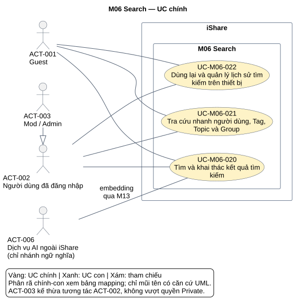
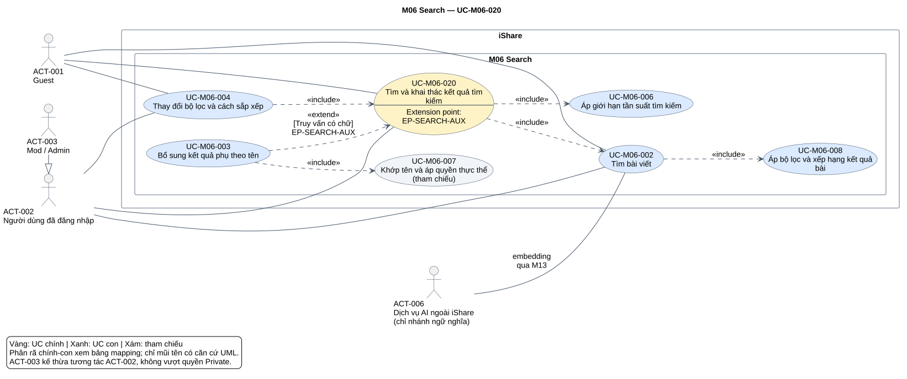
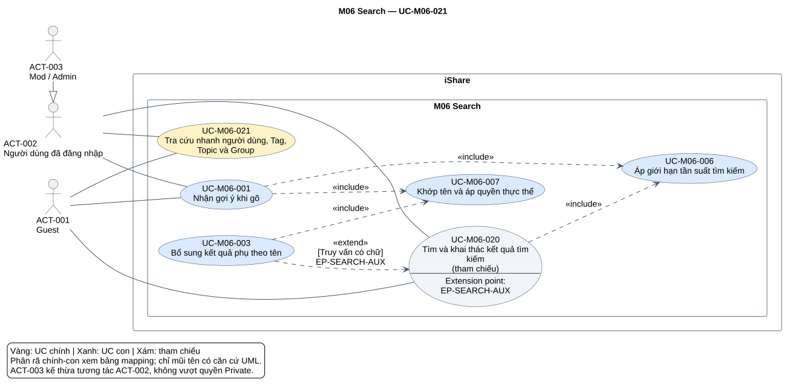
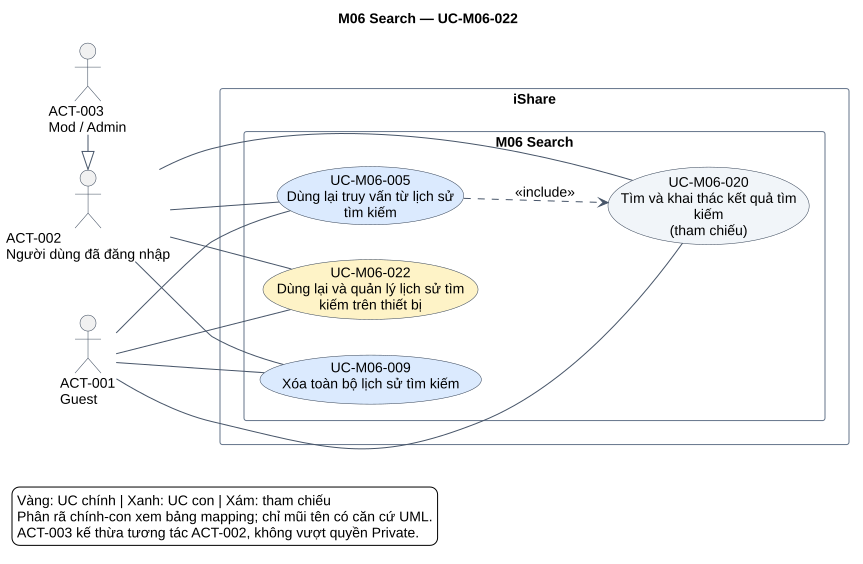

# Phân tích use case — M06 Search

[Vietnamese Doc] — Phân tích bằng tiếng Việt theo skill use-case-analysis v2.2; giữ thuật ngữ nghiệp vụ cần thiết.

## Metadata và tiến độ

<!-- uc:document -->
| key | value |
|---|---|
| document_id | US-M06 |
| skill_version | 2.2 |
| mode | module |
| modules | M06 |
| scope | ALL |
| status | Chờ duyệt |
| current_step | 7 |
| completed_steps | 1, 2, 3, 4, 5, 6, 7 |
| approved_steps | - |
| source_baseline | FR-M06 v1.5; FR-M01 v1.10; FR-M03 v1.10; FR-M04 v1.4; FR-M05 v1.7; FR-M07 v1.5; FR-M08 v1.7; FR-M10 v1.4; FR-M11 v1.3; FR-M12 v1.1; FR-M13 v1.3; FR-M14 v1.1 |
| author | Codex |
| date | 2026-10-30 |
| approval_evidence | Người dùng đã chỉ định tự thực hiện các bước cần thiết, không hỏi đồng ý ở lượt M04; tiếp tục áp dụng cho chuỗi phân tích module. Đây là quyền thực hiện liên tục, không phải phê duyệt US-M06 hoặc từng bước; chưa có xác nhận kết quả cuối. |
| semantic_review | pass |
| diagram_check | pass |

| Bước | Phần hoàn tất | Xác nhận | Baseline | Cần làm lại |
|---|---|---|---|---|
| 1 | 5 nhóm, 85 FR chi tiết, 25 BR; boundary/actor/giao tiếp | Được phép làm liên tục; chưa duyệt | FR-M06 v1.5 | Khi nguồn đổi |
| 2 | 3 UC chính, 9 UC con | Chưa duyệt | FR-M06 v1.5 | Theo tác động nguồn |
| 3 | Quy trình core; 10 hợp đồng chi tiết; 2 AUT, 3 RULE | Chưa duyệt | FR-M06 v1.5 | Theo tác động nguồn |
| 4 | 11 ánh xạ chính–con, 9 quan hệ UML, 1 extension point | Chưa duyệt | FR-M06 v1.5 | Theo tác động nguồn |
| 5 | 115 dòng truy vết, giao tiếp và điểm cần làm rõ | Chưa duyệt | FR-M06 v1.5; FR-M01 v1.10; FR-M03 v1.10; FR-M04 v1.4; FR-M05 v1.7; FR-M07 v1.5; FR-M08 v1.7; FR-M10 v1.4; FR-M11 v1.3; FR-M12 v1.1; FR-M13 v1.3; FR-M14 v1.1 | Theo tác động nguồn |
| 6 | 4 SVG đã render/kiểm hình; đủ node và 12 lần xuất hiện cạnh theo 9 relation | Chưa duyệt | Mô hình tại tài liệu này | Khi mô hình/nguồn đổi |
| 7 | Đã rà cấu trúc/ngữ nghĩa, truy vết, liên kết và hình; hồ sơ Chờ duyệt | Chưa duyệt | Skill v2.2 | Khi nhận phản hồi hoặc baseline đổi |

## 1. Phạm vi và tổng hợp yêu cầu

**Mục đích:** làm cơ sở review nghiệp vụ, tổng hợp UC chính toàn hệ thống và chuẩn bị thiết kế/kiểm thử Search. Mục 2 trình bày hai tầng; mục 3 là luồng và quy tắc; mục 4 là quan hệ; mục 5 truy vết nguồn; mục 6 xem hình.

**Subject:** toàn hệ thống iShare. M06 sở hữu tìm kiếm; các module liên quan là thành phần nội bộ, không phải actor ngoài hệ thống. Dịch vụ AI ngoài iShare hỗ trợ có điều kiện qua M13. Trình duyệt là nơi lưu lịch sử, không tự trở thành actor.

**Trong phạm vi:** gợi ý; tìm bài; kết quả phụ theo tên; bộ lọc/sắp xếp; tải dần; lịch sử cục bộ; giới hạn tần suất; quyền và chọn cách tìm. **Ngoài phạm vi:** tìm bình luận, thiết kế API/index/cursor/CSDL, cấu hình AI ở Admin Panel, quản trị nội dung/nhóm và hành vi của màn hình đích khi mở thực thể. Lượt này chỉ phân tích M06.

**Baseline owner:** FR-M06 v1.5 đã chốt; các mốc nguồn DEC-213, QA-403, ISS-343, OPEN-012. Phụ lục lịch sử/câu hỏi không ghi đè FR/BR hiện hành. 115 mã = 5 nhóm + 85 FR chi tiết + 25 BR.

<!-- uc:sources -->
| path | version | role |
|---|---|---|
| docs/specs/fr/FR-M06.md | 1.5 | owner |
| docs/specs/fr/FR-M01.md | 1.10 | related |
| docs/specs/fr/FR-M03.md | 1.10 | related |
| docs/specs/fr/FR-M04.md | 1.4 | related |
| docs/specs/fr/FR-M05.md | 1.7 | related |
| docs/specs/fr/FR-M07.md | 1.5 | related |
| docs/specs/fr/FR-M08.md | 1.7 | related |
| docs/specs/fr/FR-M10.md | 1.4 | related |
| docs/specs/fr/FR-M11.md | 1.3 | related |
| docs/specs/fr/FR-M12.md | 1.1 | related |
| docs/specs/fr/FR-M13.md | 1.3 | related |
| docs/specs/fr/FR-M14.md | 1.1 | related |

Nguồn phương pháp: [skill](../../../.agent-instructions/skills/use-case-analysis/SKILL.md), [quy tắc mô hình](../../../.agent-instructions/skills/use-case-analysis/references/modeling-rules.md), [quy tắc sơ đồ](../../../.agent-instructions/skills/use-case-analysis/references/diagram-rules.md). Chỉ dùng để quyết định cách biểu diễn, không suy thêm tính năng.

| Nhóm FR | Tổng hợp hành vi | Biểu diễn | Owner | Căn cứ |
|---|---|---|---|---|
| FR-M06-01 | Dừng gõ 300 ms từ 1 ký tự; tối đa 3 mỗi loại người dùng/Tag/Topic/Group; không tiêu đề bài/AI; đúng quyền và tần suất | [UC-M06-001](#uc-m06-001), [UC-M06-006](#uc-m06-006), [UC-M06-007](#uc-m06-007) | M06 | FR-M06-01.01, FR-M06-01.03, FR-M06-01.08, FR-M06-01.09, FR-M06-01.10 |
| FR-M06-02 | Gửi mới tìm bài; Guest full-text, tài khoản ngữ nghĩa theo cờ; fallback riêng truy vấn; trang chung/quyền/điểm; 15/lần, trần 120 khi có chữ | [UC-M06-020](#uc-m06-020), [UC-M06-002](#uc-m06-002), [UC-M06-006](#uc-m06-006), [UC-M06-008](#uc-m06-008), RULE-M06-003 | M06 | FR-M06-02.01, FR-M06-02.05, FR-M06-02.16, FR-M06-02.17, FR-M06-02.19, FR-M06-02.23 |
| FR-M06-03 | Tên phụ khi gửi có chữ; tối đa 3 mỗi loại; đúng điều kiện tài khoản/nhóm/Tag; Group chỉ tên | [UC-M06-003](#uc-m06-003), [UC-M06-007](#uc-m06-007) | M06 | FR-M06-03.01, FR-M06-03.02, FR-M06-03.07, FR-M06-03.08, FR-M06-03.10 |
| FR-M06-04 | Topic/Tag/thời gian/Following AND; ba cách xếp; rỗng có lọc mọi bài/không AI/không trần 120; mỗi đổi điều kiện một lượt gửi | [UC-M06-004](#uc-m06-004), [UC-M06-008](#uc-m06-008), [UC-M06-006](#uc-m06-006) | M06 | FR-M06-04.08, FR-M06-04.11, FR-M06-04.17, FR-M06-04.18, FR-M06-04.19, FR-M06-04.20 |
| FR-M06-05 | 10 chuỗi trình duyệt; gần nhất trước; trùng lên đầu; chọn gửi ngay; xóa toàn bộ; logout xóa | [UC-M06-005](#uc-m06-005), [UC-M06-009](#uc-m06-009), AUT-M06-001/002 | M06 | FR-M06-05.01, FR-M06-05.02, FR-M06-05.03, FR-M06-05.07, FR-M06-05.08, FR-M06-05.09, FR-M06-05.10 |

### Actor và quyền

<!-- uc:actors -->
| id | name | kind | parent | boundary_reason | sources |
|---|---|---|---|---|---|
| ACT-001 | Guest | human | - | Người chưa đăng nhập bên ngoài iShare; dùng full-text, gợi ý và lịch sử trình duyệt. | FR-M06-01.06, FR-M06-02.23, FR-M06-04.13, BR-M06-20 |
| ACT-002 | Người dùng đã đăng nhập | human | - | Vai trò người tìm; có Following/ngữ nghĩa khi đủ điều kiện, không mặc định thấy mọi bài. | FR-M06-02.03, FR-M06-04.04, BR-M06-11 |
| ACT-003 | Mod/Admin | human | ACT-002 | Kế thừa hành vi tài khoản, không có quyền tìm vượt Private; M06 không tách quyền Mod/Admin. | BR-M06-25, FR-M06-03.08, FR-M06-02.08 |
| ACT-006 | Dịch vụ AI ngoài iShare | external-system | - | Nhận yêu cầu embedding qua M13 trong nhánh ngữ nghĩa; M13 là module nội bộ. | FR-M06-02.03, FR-M06-02.05, FR-M13-01.01, FR-M13-04.01 |

ACT-003 → ACT-002 là kế thừa actor (tam giác rỗng), không cấp quyền đọc nhóm Private. Subfunction nhận ngữ cảnh actor từ UC gọi; không có thao tác khởi chạy riêng bộ giới hạn/chấm điểm. ACT-006 không tham gia tìm tên/lịch sử.

## 2. UC chính và UC con

### 2.1 Danh mục hai tầng

<!-- uc:catalog -->
| id | name | tier | level | primary | supporting | owner | anchor | sources |
|---|---|---|---|---|---|---|---|---|
| UC-M06-020 | Tìm và khai thác kết quả tìm kiếm | core | User goal | ACT-001, ACT-002, ACT-003 | ACT-006 | M06 | #uc-m06-020 | FR-M06-02, FR-M06-03, FR-M06-04, BR-M06-16, BR-M06-17, BR-M06-19, BR-M06-21 |
| UC-M06-021 | Tra cứu nhanh người dùng, Tag, Topic và Group | core | Summary | ACT-001, ACT-002, ACT-003 | - | M06 | #uc-m06-021 | FR-M06-01, FR-M06-03, BR-M06-02, BR-M06-04, BR-M06-09, BR-M06-22 |
| UC-M06-022 | Dùng lại và quản lý lịch sử tìm kiếm trên thiết bị | core | Summary | ACT-001, ACT-002, ACT-003 | - | M06 | #uc-m06-022 | FR-M06-05, BR-M06-20 |
| UC-M06-001 | Nhận gợi ý khi gõ | sub | User goal | ACT-001, ACT-002, ACT-003 | - | M06 | #uc-m06-001 | FR-M06-01, BR-M06-02, BR-M06-03, BR-M06-04, BR-M06-09, BR-M06-21, BR-M06-22 |
| UC-M06-002 | Tìm bài viết | sub | User goal | ACT-001, ACT-002, ACT-003 | ACT-006 | M06 | #uc-m06-002 | FR-M06-02, FR-M06-04.17, FR-M06-04.18, FR-M06-04.19, BR-M06-05, BR-M06-06, BR-M06-07, BR-M06-08, BR-M06-23 |
| UC-M06-003 | Bổ sung kết quả phụ theo tên | sub | Subfunction | ACT-001, ACT-002, ACT-003 | - | M06 | #uc-m06-003 | FR-M06-03, FR-M06-04.12, BR-M06-09, BR-M06-10, BR-M06-17, BR-M06-22, BR-M06-24, BR-M06-25 |
| UC-M06-004 | Thay đổi bộ lọc và cách sắp xếp | sub | User goal | ACT-001, ACT-002, ACT-003 | - | M06 | #uc-m06-004 | FR-M06-04, BR-M06-15, BR-M06-16, BR-M06-21, BR-M06-23 |
| UC-M06-005 | Dùng lại truy vấn từ lịch sử tìm kiếm | sub | User goal | ACT-001, ACT-002, ACT-003 | - | M06 | #uc-m06-005 | FR-M06-05.04, FR-M06-05.08, FR-M06-05.09, BR-M06-20, BR-M06-21 |
| UC-M06-006 | Áp giới hạn tần suất tìm kiếm | sub | Subfunction | ACT-001, ACT-002, ACT-003 | - | M06 | #uc-m06-006 | FR-M06-01.07, FR-M06-02.20, FR-M06-02.21, FR-M06-02.30, FR-M06-04.20, BR-M06-21 |
| UC-M06-007 | Khớp tên và áp quyền thực thể | sub | Subfunction | ACT-001, ACT-002, ACT-003 | - | M06 | #uc-m06-007 | FR-M06-01.04, FR-M06-01.05, FR-M06-01.10, FR-M06-01.11, FR-M06-01.12, FR-M06-01.13, FR-M06-03.03, FR-M06-03.04, FR-M06-03.06, FR-M06-03.07, FR-M06-03.08, FR-M06-03.09, FR-M06-03.10, BR-M06-09, BR-M06-10, BR-M06-24, BR-M06-25 |
| UC-M06-008 | Áp bộ lọc và xếp hạng kết quả bài | sub | Subfunction | ACT-001, ACT-002, ACT-003 | - | M06 | #uc-m06-008 | FR-M06-02.07, FR-M06-02.08, FR-M06-02.09, FR-M06-02.10, FR-M06-02.11, FR-M06-02.12, FR-M06-02.13, FR-M06-02.27, FR-M06-02.28, FR-M06-02.29, FR-M06-04, BR-M06-11, BR-M06-12, BR-M06-13, BR-M06-14, BR-M06-15, BR-M06-16 |
| UC-M06-009 | Xóa toàn bộ lịch sử tìm kiếm | sub | User goal | ACT-001, ACT-002, ACT-003 | - | M06 | #uc-m06-009 | FR-M06-05.05, FR-M06-05.09, BR-M06-20 |

`tier` độc lập với `level`. Khi tổng hợp hệ thống chỉ lấy ba UC core nguyên ID/tên/owner. UC dùng chung có một ID dù xuất hiện ở nhiều view.

### 2.2 Phân rã chính → con

<!-- uc:decomposition -->
| core | sub | rationale | sources |
|---|---|---|---|
| UC-M06-020 | UC-M06-002 | Tạo kết quả bài chính | FR-M06-02, FR-M06-04.17, FR-M06-04.18, FR-M06-04.19, BR-M06-05, BR-M06-06, BR-M06-07, BR-M06-08, BR-M06-23 |
| UC-M06-020 | UC-M06-003 | Bổ sung tên thực thể khi gửi có chữ | FR-M06-03, FR-M06-04.12, BR-M06-09, BR-M06-10, BR-M06-17, BR-M06-22, BR-M06-24, BR-M06-25 |
| UC-M06-020 | UC-M06-004 | Đổi điều kiện để tìm lại | FR-M06-04, BR-M06-15, BR-M06-16, BR-M06-21, BR-M06-23 |
| UC-M06-020 | UC-M06-006 | Kiểm ngân sách loại lượt tương ứng | FR-M06-01.07, FR-M06-02.20, FR-M06-02.21, FR-M06-02.30, FR-M06-04.20, BR-M06-21 |
| UC-M06-020 | UC-M06-008 | Áp quyền/bộ lọc/thứ tự cho bài | FR-M06-02.07, FR-M06-02.08, FR-M06-02.09, FR-M06-02.10, FR-M06-02.11, FR-M06-02.12, FR-M06-02.13, FR-M06-02.27, FR-M06-02.28, FR-M06-02.29, FR-M06-04, BR-M06-11, BR-M06-12, BR-M06-13, BR-M06-14, BR-M06-15, BR-M06-16 |
| UC-M06-021 | UC-M06-001 | Đưa gợi ý tên trước khi gửi | FR-M06-01, BR-M06-02, BR-M06-03, BR-M06-04, BR-M06-09, BR-M06-21, BR-M06-22 |
| UC-M06-021 | UC-M06-003 | Bổ sung tên thực thể khi gửi có chữ | FR-M06-03, FR-M06-04.12, BR-M06-09, BR-M06-10, BR-M06-17, BR-M06-22, BR-M06-24, BR-M06-25 |
| UC-M06-021 | UC-M06-006 | Kiểm ngân sách loại lượt tương ứng | FR-M06-01.07, FR-M06-02.20, FR-M06-02.21, FR-M06-02.30, FR-M06-04.20, BR-M06-21 |
| UC-M06-021 | UC-M06-007 | Dùng chung khớp tên/quyền thực thể | FR-M06-01.04, FR-M06-01.05, FR-M06-01.10, FR-M06-01.11, FR-M06-01.12, FR-M06-01.13, FR-M06-03.03, FR-M06-03.04, FR-M06-03.06, FR-M06-03.07, FR-M06-03.08, FR-M06-03.09, FR-M06-03.10, BR-M06-09, BR-M06-10, BR-M06-24, BR-M06-25 |
| UC-M06-022 | UC-M06-005 | Chọn chuỗi cũ để tìm ngay | FR-M06-05.04, FR-M06-05.08, FR-M06-05.09, BR-M06-20, BR-M06-21 |
| UC-M06-022 | UC-M06-009 | Xóa toàn bộ lịch sử trình duyệt | FR-M06-05.05, FR-M06-05.09, BR-M06-20 |

Phân rã không tự tạo mũi tên UML. UC003/006 dùng chung giữa core020 và core021. UC007 là tham chiếu thêm ở hình core020; core020 là tham chiếu ở hình core021/core022, giữ đúng endpoint quan hệ mà không nhân bản UC.

### 2.3 Tổng hợp hệ thống

<!-- uc:module-models -->
| module | path | baseline |
|---|---|---|

Đây là tài liệu module; chưa tổng hợp/cập nhật US-overview trong lượt này.

| Quyết định | Hành vi nguồn | Biểu diễn | Lý do | Phương án cân nhắc |
|---|---|---|---|---|
| D-M06-01 | Tìm bài, tên phụ, trang chung | [UC-M06-020](#uc-m06-020) User goal | Một lượt gửi, một đầu ra trang, tái dùng được | Không đếm hai lượt cho hai khối |
| D-M06-02 | Semantic/full-text/fallback | [UC-M06-002](#uc-m06-002) với các nhánh | Các cách đạt cùng mục tiêu | Không tạo UML quan hệ chỉ từ if/else |
| D-M06-03 | Gợi ý và kết quả phụ cùng thuật toán | [UC-M06-007](#uc-m06-007) dùng chung | Gắn kết hành vi tên/quyền | Không sao chép UC |
| D-M06-04 | Tần suất và xếp hạng | [UC-M06-006](#uc-m06-006), [UC-M06-008](#uc-m06-008) Subfunction | Hợp đồng dùng lại, có quan hệ con–con | Không tạo oval từng phép tính |
| D-M06-05 | Lịch sử cục bộ | [UC-M06-005](#uc-m06-005), [UC-M06-009](#uc-m06-009), AUT001/002 | Tách mục tiêu chủ động và tự động theo sự kiện | Không tạo actor kho lịch sử/bộ hẹn giờ |
| D-M06-06 | Hai tầng đầu ra | 3 core, 9 sub; mỗi core một detail | Core có node, đủ sub/cạnh có nguồn | Không thêm cạnh chỉ để nối oval |

## 3. Đặc tả nghiệp vụ

### 3.1 UC chính

### UC-M06-020 — Tìm và khai thác kết quả tìm kiếm

**Actor chính:** ACT-001, ACT-002, ACT-003. **Hỗ trợ:** ACT-006. **Mức:** User goal. **Giá trị:** Nhận một trang kết quả chung đúng truy vấn/bộ lọc/quyền và khai thác dần các kết quả bài. **Kết quả:** Bài là kết quả chính, tên thực thể là phụ khi truy vấn có chữ; quyền/thuật toán/thứ tự/tải dần được áp đúng.

**UC con:** [UC-M06-002](#uc-m06-002) — Tạo kết quả bài chính; [UC-M06-003](#uc-m06-003) — Bổ sung tên thực thể khi gửi có chữ; [UC-M06-004](#uc-m06-004) — Đổi điều kiện để tìm lại; [UC-M06-006](#uc-m06-006) — Kiểm ngân sách loại lượt tương ứng; [UC-M06-008](#uc-m06-008) — Áp quyền/bộ lọc/thứ tự cho bài. Đây là ánh xạ nghiệp vụ; các sub không nhất thiết cùng chạy trong một lần.

<!-- uc:spec UC-M06-020 -->
| key | value |
|---|---|
| goal | Nhận một trang kết quả chung đúng truy vấn/bộ lọc/quyền và khai thác dần các kết quả bài. |
| subject | iShare |
| level | User goal |
| primary | ACT-001, ACT-002, ACT-003 |
| supporting | ACT-006 |
| trigger | Gửi truy vấn; đổi bộ lọc/sắp xếp; mở bài theo Topic/Tag; hoặc chọn truy vấn lịch sử. |
| preconditions | Không bắt buộc đăng nhập để tìm công khai; xác định người tìm và loại sự kiện để kiểm lượt gửi một lần. Không coi AI là tiền điều kiện. |
| success | Bài là kết quả chính, tên thực thể là phụ khi truy vấn có chữ; quyền/thuật toán/thứ tự/tải dần được áp đúng. |
| failure | Vượt tần suất chỉ từ chối lượt đó; rỗng không bộ lọc không tìm; không lộ nội dung hoặc buộc dùng AI. |
| abstract | false |
| common_contract | Không áp dụng generalization UC; mỗi ca có hợp đồng riêng. Phân rã không phải kế thừa. |

#### Luồng chính

| Bước | Ai | Hành động/phản hồi | Tiếp tục | Nguồn |
|---|---|---|---|---|
| 1 | Người tìm / iShare | Tiếp nhận chuỗi truy vấn, bộ lọc, sắp xếp và ngữ cảnh Guest/tài khoản. Lịch sử trình duyệt xử lý theo [AUT-M06-001](#aut-m06-001) khi sự kiện gửi có chữ đủ điều kiện; không lưu trên hệ thống. | 2 | FR-M06-02, FR-M06-03, FR-M06-04, BR-M06-16, BR-M06-17, BR-M06-19, BR-M06-21 |

| Bước | Ai | Hành động/phản hồi | Tiếp tục | Nguồn |
|---|---|---|---|---|
| 2 | iShare | Thực hiện [UC-M06-006](#uc-m06-006) với loại lượt gửi đúng một lần cho toàn yêu cầu, trước khi thực hiện các thành phần tìm; các UC con nhận cùng ngữ cảnh đã kiểm, không tính thêm lượt. | 3 | FR-M06-02, FR-M06-03, FR-M06-04, BR-M06-16, BR-M06-17, BR-M06-19, BR-M06-21 |

| Bước | Ai | Hành động/phản hồi | Tiếp tục | Nguồn |
|---|---|---|---|---|
| 3 | iShare | Nếu đủ điều kiện tìm, thực hiện [UC-M06-002](#uc-m06-002) để lấy kết quả bài. EP-SEARCH-AUX: với truy vấn có chữ, [UC-M06-003](#uc-m06-003) bổ sung tên người dùng/Tag/Topic/Group trên cùng trang; đây là hành vi bắt buộc khi guard có chữ đúng, không phải do người dùng tùy ý bật. | 4 | FR-M06-02, FR-M06-03, FR-M06-04, BR-M06-16, BR-M06-17, BR-M06-19, BR-M06-21 |

| Bước | Ai | Hành động/phản hồi | Tiếp tục | Nguồn |
|---|---|---|---|---|
| 4 | iShare | Hiển thị trang cuộn chung không tab, bài là chính; tải lô đầu tối đa 15 bài. Khi cuộn cuối, lấy tiếp tối đa 15 theo [RULE-M06-003](#rule-m06-003), không tính cuộn tải thêm thành lượt gửi mới; không chỉ định giao thức tải dữ liệu ở tài liệu UC. | 5 | FR-M06-02, FR-M06-03, FR-M06-04, BR-M06-16, BR-M06-17, BR-M06-19, BR-M06-21 |

| Bước | Ai | Hành động/phản hồi | Tiếp tục | Nguồn |
|---|---|---|---|---|
| 5 | iShare | Kết thúc lượt với kết quả/không có kết quả; đổi điều kiện theo [UC-M06-004](#uc-m06-004) là lượt mới, chọn lịch sử theo [UC-M06-005](#uc-m06-005) cũng là lượt mới. Không thay đổi công tắc AI vì một lỗi truy vấn. | END: Bài là kết quả chính, tên thực thể là phụ khi truy vấn có chữ; quyền/thuật toán/thứ tự/tải dần được áp đúng. | FR-M06-02, FR-M06-03, FR-M06-04, BR-M06-16, BR-M06-17, BR-M06-19, BR-M06-21 |

#### Luồng thay thế và ngoại lệ

| ID | Bước rẽ | Điều kiện | Xử lý | Quay lại/kết thúc | Nguồn |
|---|---|---|---|---|---|
| A1 | 2 | Vượt giới hạn lượt gửi | Thông báo quá nhiều yêu cầu; từ chối riêng lượt đó, không captcha/khóa dài hạn. | END: lượt bị từ chối | FR-M06-02.20, FR-M06-02.21 |

| ID | Bước rẽ | Điều kiện | Xử lý | Quay lại/kết thúc | Nguồn |
|---|---|---|---|---|---|
| A2 | 3 | Truy vấn rỗng và không bộ lọc | Không tìm; không gọi AI hay tự liệt kê toàn bộ bài. | END: không tìm | FR-M06-02.31 |

| ID | Bước rẽ | Điều kiện | Xử lý | Quay lại/kết thúc | Nguồn |
|---|---|---|---|---|---|
| A3 | 3 | Truy vấn rỗng có bộ lọc | [UC-M06-002](#uc-m06-002)/008 liệt kê mọi bài khớp theo quyền, không giới hạn 120, mặc định Mới nhất và không AI; không khởi chạy tìm tên phụ chỉ vì truy vấn rỗng. | 4 | FR-M06-04.17, FR-M06-04.18, FR-M06-04.19, FR-M06-03.01 |

| ID | Bước rẽ | Điều kiện | Xử lý | Quay lại/kết thúc | Nguồn |
|---|---|---|---|---|---|
| A4 | 4 | Đã tải 120 bài của truy vấn có chữ và cuộn tiếp | Dừng tải, hiện Thu hẹp tìm kiếm để có kết quả chính xác hơn. Không hiện thông báo chỉ vì vừa có 120 nếu chưa cuộn tiếp. | END: đạt trần truy vấn có chữ | FR-M06-02.19, BR-M06-19 |

#### Quy tắc và giới hạn

Căn cứ: FR-M06-02, FR-M06-03, FR-M06-04, BR-M06-16, BR-M06-17, BR-M06-19, BR-M06-21. Áp dụng RULE/AUT mục 3.3 theo điều kiện. Mục 7 ghi chi tiết chưa chốt; không tự bổ sung yêu cầu.

#### Tiêu chí nguồn áp dụng trực tiếp

Các nội dung baseline dưới đây là điều kiện chấp nhận của luồng/quy tắc, không chỉ là danh sách mã tham khảo.

| Mã nguồn | Tiêu chí phải bảo đảm |
|---|---|
| FR-M06-02.31 | Nếu người dùng gửi truy vấn rỗng mà không có bộ lọc nào, hệ thống phải không tìm. |
| BR-M06-01 | Đối tượng tìm được gồm bài viết, người dùng, Tag, Topic, Group. Bình luận không tìm được. |

### UC-M06-021 — Tra cứu nhanh người dùng, Tag, Topic và Group

**Actor chính:** ACT-001, ACT-002, ACT-003. **Hỗ trợ:** -. **Mức:** Summary. **Giá trị:** Tìm các thực thể theo tên trước hoặc sau khi gửi, với cách khớp và quyền nhất quán. **Kết quả:** Tối đa 3 mục mỗi loại, đúng tên/trạng thái/thành viên, không lộ Private hoặc tài khoản không tìm được.

**UC con:** [UC-M06-001](#uc-m06-001) — Đưa gợi ý tên trước khi gửi; [UC-M06-003](#uc-m06-003) — Bổ sung tên thực thể khi gửi có chữ; [UC-M06-006](#uc-m06-006) — Kiểm ngân sách loại lượt tương ứng; [UC-M06-007](#uc-m06-007) — Dùng chung khớp tên/quyền thực thể. Đây là ánh xạ nghiệp vụ; các sub không nhất thiết cùng chạy trong một lần.

**Trigger:** Ngừng gõ 300 mili giây hoặc gửi truy vấn có chữ. **Điều kiện:** Gợi ý/tìm tên không phụ thuộc AI; Guest được dùng theo quyền và hạn mức.

| Bước tổng quát | Quy trình | Nguồn |
|---|---|---|
| 1 | [UC-M06-001](#uc-m06-001) nhận gợi ý khi đang gõ, kiểm lượt gợi ý qua [UC-M06-006](#uc-m06-006) và dùng [UC-M06-007](#uc-m06-007) khớp tên/quyền. | FR-M06-01, FR-M06-03, BR-M06-02, BR-M06-04, BR-M06-09, BR-M06-22 |
| 2 | Khi gửi có chữ, [UC-M06-003](#uc-m06-003) dùng cùng [UC-M06-007](#uc-m06-007) để bổ sung kết quả phụ trên trang chung, dùng lượt gửi đã kiểm ở [UC-M06-020](#uc-m06-020). | FR-M06-01, FR-M06-03, BR-M06-02, BR-M06-04, BR-M06-09, BR-M06-22 |
| 3 | Không tìm bài hoặc gọi AI chỉ vì đang gõ; chọn một mục gợi ý không tự thêm lịch sử. | FR-M06-01, FR-M06-03, BR-M06-02, BR-M06-04, BR-M06-09, BR-M06-22 |

**Ngoại lệ/kết thúc:** Không gợi ý bài viết, không dùng quyền Mod/Admin để mở rộng kết quả.

### UC-M06-022 — Dùng lại và quản lý lịch sử tìm kiếm trên thiết bị

**Actor chính:** ACT-001, ACT-002, ACT-003. **Hỗ trợ:** -. **Mức:** Summary. **Giá trị:** Xem/dùng lại truy vấn gần đây hoặc xóa lịch sử trên đúng trình duyệt đang dùng. **Kết quả:** Lịch sử tối đa 10 chuỗi không trùng, chọn mục gửi ngay; chỉ xóa toàn bộ, đăng xuất xóa tại trình duyệt.

**UC con:** [UC-M06-005](#uc-m06-005) — Chọn chuỗi cũ để tìm ngay; [UC-M06-009](#uc-m06-009) — Xóa toàn bộ lịch sử trình duyệt. Đây là ánh xạ nghiệp vụ; các sub không nhất thiết cùng chạy trong một lần.

**Trigger:** Đặt con trỏ vào ô tìm, chọn truy vấn cũ, xóa lịch sử hoặc đăng xuất. **Điều kiện:** Lịch sử không gắn tài khoản, không lưu máy chủ; Guest cũng được dùng.

| Bước tổng quát | Quy trình | Nguồn |
|---|---|---|
| 1 | [UC-M06-005](#uc-m06-005) hiển thị lịch sử khi focus và gửi ngay mục được chọn qua [UC-M06-020](#uc-m06-020); lượt đó được tính một lần. | FR-M06-05, BR-M06-20 |
| 2 | [UC-M06-009](#uc-m06-009) xóa toàn bộ theo thao tác người dùng; [AUT-M06-002](#aut-m06-002) xóa khi đăng xuất. | FR-M06-05, BR-M06-20 |
| 3 | [AUT-M06-001](#aut-m06-001) cập nhật lịch sử từ gửi chuỗi có chữ; mới nhất trước, trùng đưa lên đầu. | FR-M06-05, BR-M06-20 |

**Ngoại lệ/kết thúc:** Không đồng bộ sang thiết bị khác hoặc cấp chức năng xóa từng truy vấn.

### 3.2 UC con

### UC-M06-001 — Nhận gợi ý khi gõ

**UC chính liên quan:** [UC-M06-021](#uc-m06-021).

<!-- uc:spec UC-M06-001 -->
| key | value |
|---|---|
| goal | Nhìn thấy tên thực thể khớp khi chưa gửi truy vấn, không chạy tìm bài. |
| subject | iShare |
| level | User goal |
| primary | ACT-001, ACT-002, ACT-003 |
| supporting | - |
| trigger | Người dùng ngừng gõ đủ 300 mili giây sau ít nhất một ký tự. |
| preconditions | Không bắt buộc đăng nhập; chuỗi/tần suất/quyền được xét trong luồng. |
| success | Tối đa 3 người dùng/Tag/Topic/Group mỗi loại, giống chuỗi hơn đứng trước, đúng phạm vi quyền. |
| failure | Gõ tiếp trước 300 ms không nhận gợi ý chuỗi cũ; vượt hạn chỉ từ chối lượt gợi ý. |
| abstract | false |
| common_contract | Không áp dụng generalization UC; mỗi ca có hợp đồng riêng. Phân rã không phải kế thừa. |

#### Luồng chính

| Bước | Ai | Hành động/phản hồi | Tiếp tục | Nguồn |
|---|---|---|---|---|
| 1 | Người tìm / iShare | Người dùng gõ ít nhất một ký tự; iShare chờ ngừng gõ đủ 300 mili giây, không thực hiện tìm bài. | 2 | FR-M06-01, BR-M06-02, BR-M06-03, BR-M06-04, BR-M06-09, BR-M06-21, BR-M06-22 |

| Bước | Ai | Hành động/phản hồi | Tiếp tục | Nguồn |
|---|---|---|---|---|
| 2 | iShare | Thực hiện [UC-M06-006](#uc-m06-006) với loại lượt gợi ý; Guest theo IP, người có phiên theo tài khoản, không trộn với ngân sách lượt gửi. | 3 | FR-M06-01, BR-M06-02, BR-M06-03, BR-M06-04, BR-M06-09, BR-M06-21, BR-M06-22 |

| Bước | Ai | Hành động/phản hồi | Tiếp tục | Nguồn |
|---|---|---|---|---|
| 3 | iShare | Thực hiện [UC-M06-007](#uc-m06-007) để khớp chuỗi và kiểm quyền tên thực thể hiện hành. | 4 | FR-M06-01, BR-M06-02, BR-M06-03, BR-M06-04, BR-M06-09, BR-M06-21, BR-M06-22 |

| Bước | Ai | Hành động/phản hồi | Tiếp tục | Nguồn |
|---|---|---|---|---|
| 4 | iShare | Hiện tối đa 3 mục mỗi loại, theo độ giống tên; không tiêu đề bài, không AI. Chọn gợi ý không tự ghi lịch sử truy vấn theo [AUT-M06-001](#aut-m06-001). | END: Tối đa 3 người dùng/Tag/Topic/Group mỗi loại, giống chuỗi hơn đứng trước, đúng phạm vi quyền. | FR-M06-01, BR-M06-02, BR-M06-03, BR-M06-04, BR-M06-09, BR-M06-21, BR-M06-22 |

#### Luồng thay thế và ngoại lệ

| ID | Bước rẽ | Điều kiện | Xử lý | Quay lại/kết thúc | Nguồn |
|---|---|---|---|---|---|
| A1 | 1 | Gõ tiếp trước 300 mili giây | Không gợi ý cho chuỗi trước; thời gian chờ áp cho chuỗi mới theo quy tắc nguồn. | END: chưa trả gợi ý chuỗi cũ | FR-M06-01.02 |

| ID | Bước rẽ | Điều kiện | Xử lý | Quay lại/kết thúc | Nguồn |
|---|---|---|---|---|---|
| A2 | 2 | Vượt ngân sách gợi ý trong 60 giây | Từ chối lượt này và báo quá nhiều yêu cầu; không captcha/khóa lâu dài. | END: lượt bị từ chối | FR-M06-01.07, FR-M06-02.21 |

| ID | Bước rẽ | Điều kiện | Xử lý | Quay lại/kết thúc | Nguồn |
|---|---|---|---|---|---|
| A3 | 3 | AI tổng/Search tắt hoặc lỗi | Vẫn khớp tên/gợi ý bình thường; không cần M13 cho hành vi này. | 4 | FR-M06-01.08, BR-M06-22 |

#### Quy tắc và giới hạn

Căn cứ: FR-M06-01, BR-M06-02, BR-M06-03, BR-M06-04, BR-M06-09, BR-M06-21, BR-M06-22. Áp dụng RULE/AUT mục 3.3 theo điều kiện. Mục 7 ghi chi tiết chưa chốt; không tự bổ sung yêu cầu.

#### Tiêu chí nguồn áp dụng trực tiếp

Các nội dung baseline dưới đây là điều kiện chấp nhận của luồng/quy tắc, không chỉ là danh sách mã tham khảo.

| Mã nguồn | Tiêu chí phải bảo đảm |
|---|---|
| FR-M06-01.01 | Khi người dùng ngừng gõ trong ô tìm kiếm 300 mili giây (BR-M06-03), hệ thống phải hiện danh sách gợi ý gồm người dùng, Tag, Topic, Group khớp với chuỗi đang gõ (BR-M06-04). |
| FR-M06-01.02 | Khi người dùng gõ tiếp trước khi đủ 300 mili giây, hệ thống phải không gợi ý cho chuỗi trước đó. |
| FR-M06-01.03 | Hệ thống phải không đưa tiêu đề bài viết vào danh sách gợi ý. |
| FR-M06-01.06 | Hệ thống phải cho Guest dùng gợi ý khi gõ như người đã đăng nhập. |
| FR-M06-01.08 | Trong khi công tắc AI tổng hoặc công tắc Search tắt, hệ thống phải vẫn gợi ý khi gõ như khi AI bật (BR-M06-22). |
| FR-M06-01.09 | Hệ thống phải gợi ý cả khi chuỗi đang gõ chỉ có một ký tự, sau cùng thời gian chờ 300 mili giây (BR-M06-03). |
| BR-M06-02 | Tìm bài viết chỉ chạy khi gửi truy vấn, không chạy khi đang gõ. Người dùng, Tag, Topic, Group được gợi ý khi gõ và cũng được tìm khi gửi truy vấn. |
| BR-M06-03 | Gợi ý khi gõ chạy khi người dùng ngừng gõ 300 mili giây, từ ký tự đầu tiên. |

### UC-M06-002 — Tìm bài viết

**UC chính liên quan:** [UC-M06-020](#uc-m06-020).

<!-- uc:spec UC-M06-002 -->
| key | value |
|---|---|
| goal | Tìm tập bài khớp theo cách tìm phù hợp rồi lọc/xếp hạng để trả cho trang chung. |
| subject | iShare |
| level | User goal |
| primary | ACT-001, ACT-002, ACT-003 |
| supporting | ACT-006 |
| trigger | Được [UC-M06-020](#uc-m06-020) gọi cho truy vấn có chữ hoặc rỗng có bộ lọc. |
| preconditions | Cùng ngữ cảnh lượt gửi đã được [UC-M06-006](#uc-m06-006) kiểm ở [UC-M06-020](#uc-m06-020); không tính thêm lượt cho thành phần bài. Không giả định mọi bài được phép xem. |
| success | Truy vấn có chữ chọn ngữ nghĩa/full-text đúng nhánh; rỗng có lọc không AI; trả bài đúng quyền/xếp hạng cho trang chung. |
| failure | Không gọi AI cho Guest/rỗng; lỗi embedding chỉ fallback truy vấn đó; không tìm comment hoặc nội dung bị hạn chế. |
| abstract | false |
| common_contract | Không áp dụng generalization UC; mỗi ca có hợp đồng riêng. Phân rã không phải kế thừa. |

#### Luồng chính

| Bước | Ai | Hành động/phản hồi | Tiếp tục | Nguồn |
|---|---|---|---|---|
| 1 | Người tìm / iShare | Nhận truy vấn, bộ lọc/cách xếp, người tìm và ngữ cảnh đã kiểm lượt; không chạy do gõ chưa gửi. | 2 | FR-M06-02, FR-M06-04.17, FR-M06-04.18, FR-M06-04.19, BR-M06-05, BR-M06-06, BR-M06-07, BR-M06-08, BR-M06-23 |

| Bước | Ai | Hành động/phản hồi | Tiếp tục | Nguồn |
|---|---|---|---|---|
| 2 | iShare | Với truy vấn có chữ: Guest luôn full-text. Người có phiên và cả AI tổng/Search bật dùng embedding truy vấn qua M13 để tìm ngữ nghĩa. Một cờ tắt dùng full-text; rỗng có lọc đi nhánh liệt kê không AI. | 3 | FR-M06-02, FR-M06-04.17, FR-M06-04.18, FR-M06-04.19, BR-M06-05, BR-M06-06, BR-M06-07, BR-M06-08, BR-M06-23 |

| Bước | Ai | Hành động/phản hồi | Tiếp tục | Nguồn |
|---|---|---|---|---|
| 3 | iShare | Full-text so tiêu đề/nội dung chữ sau bỏ dấu ở cả hai phía; có ít nhất một từ truy vấn là khớp. Ngữ nghĩa dùng ý nghĩa của tiêu đề/nội dung chữ; không tìm tệp hoặc bình luận. | 4 | FR-M06-02, FR-M06-04.17, FR-M06-04.18, FR-M06-04.19, BR-M06-05, BR-M06-06, BR-M06-07, BR-M06-08, BR-M06-23 |

| Bước | Ai | Hành động/phản hồi | Tiếp tục | Nguồn |
|---|---|---|---|---|
| 4 | iShare | Thực hiện [UC-M06-008](#uc-m06-008) với các bài khớp, dữ liệu liên quan/tương tác, bộ lọc, cách xếp và quyền để tạo danh sách bài đúng điều kiện. | 5 | FR-M06-02, FR-M06-04.17, FR-M06-04.18, FR-M06-04.19, BR-M06-05, BR-M06-06, BR-M06-07, BR-M06-08, BR-M06-23 |

| Bước | Ai | Hành động/phản hồi | Tiếp tục | Nguồn |
|---|---|---|---|---|
| 5 | iShare | Trả danh sách cho [UC-M06-020](#uc-m06-020) bước 4, kèm thông tin đủ dựng đoạn trích/nhãn tài khoản theo [RULE-M06-003](#rule-m06-003); không tự tạo tab hay lớp lịch sử trên máy chủ. | END: Truy vấn có chữ chọn ngữ nghĩa/full-text đúng nhánh; rỗng có lọc không AI; trả bài đúng quyền/xếp hạng cho trang chung. | FR-M06-02, FR-M06-04.17, FR-M06-04.18, FR-M06-04.19, BR-M06-05, BR-M06-06, BR-M06-07, BR-M06-08, BR-M06-23 |

#### Luồng thay thế và ngoại lệ

| ID | Bước rẽ | Điều kiện | Xử lý | Quay lại/kết thúc | Nguồn |
|---|---|---|---|---|---|
| A1 | 2 | Embedding truy vấn thất bại sau hai lần thử tại M13 | Dùng full-text riêng truy vấn này; giữ công tắc và ngữ nghĩa cho truy vấn sau khi đủ điều kiện. | 3 | FR-M06-02.05, BR-M06-07 |

| ID | Bước rẽ | Điều kiện | Xử lý | Quay lại/kết thúc | Nguồn |
|---|---|---|---|---|---|
| A2 | 2 | Guest bấm Tìm kiếm thông minh | Nhắc đăng nhập, giữ kết quả full-text, kể cả AI tắt; không thực hiện gọi AI thay Guest. | END: giữ kết quả hiện tại | FR-M06-02.24, FR-M06-02.25 |

| ID | Bước rẽ | Điều kiện | Xử lý | Quay lại/kết thúc | Nguồn |
|---|---|---|---|---|---|
| A3 | 2 | Truy vấn rỗng có bộ lọc | Liệt kê theo quyền/bộ lọc, không gọi AI, không có Liên quan, không giới hạn 120. | 4 | FR-M06-04.17, FR-M06-04.18, FR-M06-04.19 |

#### Quy tắc và giới hạn

Căn cứ: FR-M06-02, FR-M06-04.17, FR-M06-04.18, FR-M06-04.19, BR-M06-05, BR-M06-06, BR-M06-07, BR-M06-08, BR-M06-23. Áp dụng RULE/AUT mục 3.3 theo điều kiện. Mục 7 ghi chi tiết chưa chốt; không tự bổ sung yêu cầu.

#### Tiêu chí nguồn áp dụng trực tiếp

Các nội dung baseline dưới đây là điều kiện chấp nhận của luồng/quy tắc, không chỉ là danh sách mã tham khảo.

| Mã nguồn | Tiêu chí phải bảo đảm |
|---|---|
| FR-M06-02.01 | Khi người dùng gửi truy vấn, hệ thống phải tìm bài viết theo truy vấn đó. |
| FR-M06-02.02 | Hệ thống phải không tìm bài viết khi người dùng đang gõ mà chưa gửi truy vấn (BR-M06-02). |
| FR-M06-02.03 | Ở nơi công tắc AI tổng và công tắc Search đều bật, khi người dùng đã đăng nhập gửi truy vấn, hệ thống phải tìm bài theo ngữ nghĩa trên tiêu đề và nội dung chữ (BR-M06-05), dùng embedding của truy vấn do M13 tạo. |
| FR-M06-02.04 | Trong khi công tắc AI tổng hoặc công tắc Search tắt, hệ thống phải tìm bài bằng full-text trên tiêu đề và nội dung chữ (BR-M06-06). |
| FR-M06-02.05 | Nếu M13 báo việc tạo embedding cho truy vấn thất bại sau hai lần thử, hệ thống phải tìm full-text cho riêng truy vấn đó (BR-M06-07). |
| FR-M06-02.06 | Khi tìm full-text, hệ thống phải bỏ dấu tiếng Việt ở cả truy vấn và nội dung bài trước khi so (BR-M06-08). |
| FR-M06-02.22 | Hệ thống phải không tìm trong bình luận (BR-M06-01). |
| FR-M06-02.23 | Nếu người gửi truy vấn là Guest, hệ thống phải tìm bài bằng full-text, kể cả khi công tắc AI tổng và công tắc Search đều bật (BR-M06-23). |
| FR-M06-02.24 | Hệ thống phải chỉ hiện lựa chọn "Tìm kiếm thông minh" cho Guest. |
| FR-M06-02.25 | Khi Guest bấm "Tìm kiếm thông minh", hệ thống phải hiện thông báo yêu cầu đăng nhập và giữ nguyên kết quả full-text, kể cả khi công tắc AI tổng hoặc công tắc Search đang tắt. |
| FR-M06-02.26 | Khi tìm full-text, hệ thống phải coi bài có ít nhất một từ của truy vấn trong tiêu đề hoặc nội dung chữ là khớp (BR-M06-08). |
| BR-M06-07 | Khi AI đang bật mà việc tạo embedding cho truy vấn thất bại sau hai lần thử (M13), riêng truy vấn đó được tìm full-text; truy vấn gửi sau vẫn tìm theo ngữ nghĩa. |
| BR-M06-08 | Tìm full-text không phân biệt dấu tiếng Việt: dấu được bỏ ở cả truy vấn và nội dung bài trước khi so. Bài có ít nhất một từ của truy vấn trong tiêu đề hoặc nội dung chữ là khớp. |

### UC-M06-003 — Bổ sung kết quả phụ theo tên

**UC chính liên quan:** [UC-M06-020](#uc-m06-020), [UC-M06-021](#uc-m06-021).

<!-- uc:spec UC-M06-003 -->
| key | value |
|---|---|
| goal | Đưa các thực thể theo tên lên trang kết quả chung khi truy vấn có chữ. |
| subject | iShare |
| level | Subfunction |
| primary | ACT-001, ACT-002, ACT-003 |
| supporting | - |
| trigger | Guard có chữ tại EP-SEARCH-AUX của [UC-M06-020](#uc-m06-020). |
| preconditions | Dùng cùng lượt gửi đã kiểm của trang chung, không tách thêm ngân sách cho kết quả phụ. |
| success | Tối đa 3 kết quả mỗi loại người dùng/Tag/Topic/Group, xếp giống tên hơn trước, không bị bộ lọc bài tác động. |
| failure | Không trả Tag vô hiệu, tài khoản không đủ điều kiện hoặc Group Private ngoài quyền; không phụ thuộc AI. |
| abstract | false |
| common_contract | Không áp dụng generalization UC; mỗi ca có hợp đồng riêng. Phân rã không phải kế thừa. |

#### Luồng chính

| Bước | Ai | Hành động/phản hồi | Tiếp tục | Nguồn |
|---|---|---|---|---|
| 1 | iShare | Nhận chuỗi có chữ của lượt gửi đang được [UC-M06-020](#uc-m06-020) xử lý; không kiểm/đếm lại lượt gửi. | 2 | FR-M06-03, FR-M06-04.12, BR-M06-09, BR-M06-10, BR-M06-17, BR-M06-22, BR-M06-24, BR-M06-25 |

| Bước | Ai | Hành động/phản hồi | Tiếp tục | Nguồn |
|---|---|---|---|---|
| 2 | iShare | Thực hiện [UC-M06-007](#uc-m06-007) với chuỗi và danh tính người tìm để khớp tên và giới hạn quyền thực thể. | 3 | FR-M06-03, FR-M06-04.12, BR-M06-09, BR-M06-10, BR-M06-17, BR-M06-22, BR-M06-24, BR-M06-25 |

| Bước | Ai | Hành động/phản hồi | Tiếp tục | Nguồn |
|---|---|---|---|---|
| 3 | iShare | Hiện tối đa 3 mục mỗi loại trên cùng trang với bài; bộ lọc Topic/Tag/thời gian/Following của bài không áp vào các kết quả phụ. | 4 | FR-M06-03, FR-M06-04.12, BR-M06-09, BR-M06-10, BR-M06-17, BR-M06-22, BR-M06-24, BR-M06-25 |

| Bước | Ai | Hành động/phản hồi | Tiếp tục | Nguồn |
|---|---|---|---|---|
| 4 | iShare | Trở về [UC-M06-020](#uc-m06-020) bước 4 để trình bày một trang cuộn chung, không chia tab. | END: Tối đa 3 kết quả mỗi loại người dùng/Tag/Topic/Group, xếp giống tên hơn trước, không bị bộ lọc bài tác động. | FR-M06-03, FR-M06-04.12, BR-M06-09, BR-M06-10, BR-M06-17, BR-M06-22, BR-M06-24, BR-M06-25 |

#### Luồng thay thế và ngoại lệ

| ID | Bước rẽ | Điều kiện | Xử lý | Quay lại/kết thúc | Nguồn |
|---|---|---|---|---|---|
| A1 | 2 | AI tổng/Search tắt hoặc lỗi | Vẫn tìm tên bình thường; không dùng kết quả lỗi AI của bài để chặn kết quả phụ. | 3 | FR-M06-03.05 |

| ID | Bước rẽ | Điều kiện | Xử lý | Quay lại/kết thúc | Nguồn |
|---|---|---|---|---|---|
| A2 | 2 | Không có thực thể khớp trong phạm vi được phép | Không thêm thực thể ngoài quyền để đủ số 3; tối đa không phải số bắt buộc. | 3 | FR-M06-03.02, FR-M06-03.07, FR-M06-03.08 |

#### Quy tắc và giới hạn

Căn cứ: FR-M06-03, FR-M06-04.12, BR-M06-09, BR-M06-10, BR-M06-17, BR-M06-22, BR-M06-24, BR-M06-25. Áp dụng RULE/AUT mục 3.3 theo điều kiện. Mục 7 ghi chi tiết chưa chốt; không tự bổ sung yêu cầu.

#### Tiêu chí nguồn áp dụng trực tiếp

Các nội dung baseline dưới đây là điều kiện chấp nhận của luồng/quy tắc, không chỉ là danh sách mã tham khảo.

| Mã nguồn | Tiêu chí phải bảo đảm |
|---|---|
| FR-M06-03.01 | Khi người dùng gửi truy vấn có chữ, hệ thống phải tìm người dùng, Tag, Topic, Group khớp với truy vấn đó. |
| FR-M06-03.02 | Hệ thống phải hiện tối đa 3 kết quả cho mỗi loại người dùng, Tag, Topic, Group, làm kết quả phụ trên cùng trang với kết quả bài (BR-M06-17). |
| FR-M06-03.05 | Trong khi công tắc AI tổng hoặc công tắc Search tắt, hệ thống phải vẫn tìm người dùng, Tag, Topic, Group như khi AI bật (BR-M06-22). |
| FR-M06-04.12 | Hệ thống phải áp bộ lọc cho kết quả bài, không áp cho kết quả phụ người dùng, Tag, Topic, Group. |

### UC-M06-004 — Thay đổi bộ lọc và cách sắp xếp

**UC chính liên quan:** [UC-M06-020](#uc-m06-020).

<!-- uc:spec UC-M06-004 -->
| key | value |
|---|---|
| goal | Điều chỉnh tập/thứ tự bài hoặc mở danh sách bài của Topic/Tag qua tìm kiếm. |
| subject | iShare |
| level | User goal |
| primary | ACT-001, ACT-002, ACT-003 |
| supporting | - |
| trigger | Người dùng đổi bộ lọc/sắp xếp hoặc mở xem bài theo Topic/Tag. |
| preconditions | Không bắt buộc đăng nhập cho các bộ lọc chung; Following cần phiên và quan hệ M07. Không giả định mọi thao tác Guest được áp. |
| success | Lượt tìm mới theo lựa chọn hợp lệ, bộ lọc kết hợp AND, chỉ áp vào bài; Topic/Tag mở với truy vấn rỗng. |
| failure | Guest chọn Following chỉ được nhắc đăng nhập và không áp lọc; không tạo lựa chọn Liên quan khi rỗng. |
| abstract | false |
| common_contract | Không áp dụng generalization UC; mỗi ca có hợp đồng riêng. Phân rã không phải kế thừa. |

#### Luồng chính

| Bước | Ai | Hành động/phản hồi | Tiếp tục | Nguồn |
|---|---|---|---|---|
| 1 | Người tìm / iShare | Người dùng chọn một Topic, một Tag, một khoảng thời gian, bật/tắt chỉ nội dung đang theo dõi hoặc chọn cách xếp. | 2 | FR-M06-04, BR-M06-15, BR-M06-16, BR-M06-21, BR-M06-23 |

| Bước | Ai | Hành động/phản hồi | Tiếp tục | Nguồn |
|---|---|---|---|---|
| 2 | iShare | Nhận ngữ cảnh mới. Mở bài của Topic/Tag đặt bộ lọc đó và truy vấn rỗng. Guest chọn Following được xử lý nhánh từ chối trước khi áp; rỗng mặc định Mới nhất, không cho Liên quan. | 3 | FR-M06-04, BR-M06-15, BR-M06-16, BR-M06-21, BR-M06-23 |

| Bước | Ai | Hành động/phản hồi | Tiếp tục | Nguồn |
|---|---|---|---|---|
| 3 | iShare | Thực hiện [UC-M06-020](#uc-m06-020) với điều kiện mới; [UC-M06-020](#uc-m06-020) kiểm đúng một lượt gửi cho sự kiện đổi lọc/xếp/mở Topic/Tag và dùng [UC-M06-002](#uc-m06-002)/008 để tính lại bài. | 4 | FR-M06-04, BR-M06-15, BR-M06-16, BR-M06-21, BR-M06-23 |

| Bước | Ai | Hành động/phản hồi | Tiếp tục | Nguồn |
|---|---|---|---|---|
| 4 | iShare | Hiển thị kết quả mới; kết quả phụ vẫn theo chuỗi tên, không bị lọc bài. Với chuỗi có chữ, Mới nhất/Nhiều upvote chỉ sắp lại tập 120 ứng viên của truy vấn. | END: Lượt tìm mới theo lựa chọn hợp lệ, bộ lọc kết hợp AND, chỉ áp vào bài; Topic/Tag mở với truy vấn rỗng. | FR-M06-04, BR-M06-15, BR-M06-16, BR-M06-21, BR-M06-23 |

#### Luồng thay thế và ngoại lệ

| ID | Bước rẽ | Điều kiện | Xử lý | Quay lại/kết thúc | Nguồn |
|---|---|---|---|---|---|
| A1 | 1 | Guest bấm chỉ nội dung đang theo dõi | Nhắc đăng nhập và không áp bộ lọc, không coi đây là cấp quyền hoặc tự đăng nhập. | END: giữ bộ lọc chưa được áp | FR-M06-04.13, BR-M06-23 |

| ID | Bước rẽ | Điều kiện | Xử lý | Quay lại/kết thúc | Nguồn |
|---|---|---|---|---|---|
| A2 | 2 | Truy vấn rỗng và không còn bộ lọc | Core020 không tìm, không tự liệt kê mọi bài. | END: không tìm | FR-M06-02.31 |

| ID | Bước rẽ | Điều kiện | Xử lý | Quay lại/kết thúc | Nguồn |
|---|---|---|---|---|---|
| A3 | 3 | Lượt gửi mới vượt hạn | Theo [UC-M06-006](#uc-m06-006) từ chối riêng lượt, không khóa quyền tìm dài hạn. | END: lượt bị từ chối | FR-M06-04.20, BR-M06-21 |

#### Quy tắc và giới hạn

Căn cứ: FR-M06-04, BR-M06-15, BR-M06-16, BR-M06-21, BR-M06-23. Áp dụng RULE/AUT mục 3.3 theo điều kiện. Mục 7 ghi chi tiết chưa chốt; không tự bổ sung yêu cầu.

#### Tiêu chí nguồn áp dụng trực tiếp

Các nội dung baseline dưới đây là điều kiện chấp nhận của luồng/quy tắc, không chỉ là danh sách mã tham khảo.

| Mã nguồn | Tiêu chí phải bảo đảm |
|---|---|
| FR-M06-04.08 | Khi người dùng mở xem các bài của một Topic hay một Tag, hệ thống phải hiện trang kết quả tìm bài với bộ lọc Topic hay Tag đó và truy vấn rỗng (BR-M06-16). |
| FR-M06-04.09 | Khi người dùng đổi bộ lọc hoặc cách sắp xếp, hệ thống phải tính lại kết quả bài theo lựa chọn mới, vẫn áp các yêu cầu về hiển thị, xếp hạng và tải dần của FR-M06-02. |
| FR-M06-04.13 | Khi Guest bấm bộ lọc chỉ nội dung đang theo dõi, hệ thống phải hiện thông báo yêu cầu đăng nhập và không áp bộ lọc. |

### UC-M06-005 — Dùng lại truy vấn từ lịch sử tìm kiếm

**UC chính liên quan:** [UC-M06-022](#uc-m06-022).

<!-- uc:spec UC-M06-005 -->
| key | value |
|---|---|
| goal | Xem các chuỗi gần đây trên trình duyệt và gửi lại ngay mục được chọn. |
| subject | iShare |
| level | User goal |
| primary | ACT-001, ACT-002, ACT-003 |
| supporting | - |
| trigger | Đặt con trỏ vào ô tìm rồi chọn một mục lịch sử. |
| preconditions | Lịch sử trên đúng trình duyệt, không gắn tài khoản; Guest cũng dùng được. |
| success | Danh sách mới nhất trước; chọn mục gửi ngay như một lượt gửi, không chỉ điền ô. |
| failure | Không tự phục hồi lịch sử từ máy chủ/thiết bị khác; gửi lại vẫn chịu hạn mức/quyền hiện hành. |
| abstract | false |
| common_contract | Không áp dụng generalization UC; mỗi ca có hợp đồng riêng. Phân rã không phải kế thừa. |

#### Luồng chính

| Bước | Ai | Hành động/phản hồi | Tiếp tục | Nguồn |
|---|---|---|---|---|
| 1 | Người tìm / iShare | Khi người dùng đặt con trỏ vào ô tìm, iShare đọc/hiện lịch sử cục bộ tối đa 10 chuỗi, gần nhất trước. | 2 | FR-M06-05.04, FR-M06-05.08, FR-M06-05.09, BR-M06-20, BR-M06-21 |

| Bước | Ai | Hành động/phản hồi | Tiếp tục | Nguồn |
|---|---|---|---|---|
| 2 | iShare | Người dùng chọn một mục; dùng chuỗi đã lưu để gửi ngay, không chỉ điền vào ô. Nguồn chỉ lưu chuỗi, không khẳng định phục hồi bộ lọc/cách xếp cũ. | 3 | FR-M06-05.04, FR-M06-05.08, FR-M06-05.09, BR-M06-20, BR-M06-21 |

| Bước | Ai | Hành động/phản hồi | Tiếp tục | Nguồn |
|---|---|---|---|---|
| 3 | iShare | Thực hiện [UC-M06-020](#uc-m06-020) cho lượt gửi đó, kiểm giới hạn đúng một lần theo Guest/tài khoản hiện tại và áp quyền hiện hành. | 4 | FR-M06-05.04, FR-M06-05.08, FR-M06-05.09, BR-M06-20, BR-M06-21 |

| Bước | Ai | Hành động/phản hồi | Tiếp tục | Nguồn |
|---|---|---|---|---|
| 4 | iShare | Hiện kết quả, [AUT-M06-001](#aut-m06-001) đưa chuỗi lên đầu thay vì tạo bản trùng. Không cho xóa từng mục; xóa toàn bộ là [UC-M06-009](#uc-m06-009). | END: Danh sách mới nhất trước; chọn mục gửi ngay như một lượt gửi, không chỉ điền ô. | FR-M06-05.04, FR-M06-05.08, FR-M06-05.09, BR-M06-20, BR-M06-21 |

#### Luồng thay thế và ngoại lệ

| ID | Bước rẽ | Điều kiện | Xử lý | Quay lại/kết thúc | Nguồn |
|---|---|---|---|---|---|
| A1 | 1 | Chưa có mục lịch sử hoặc người dùng chưa chọn mục | Không có lần tìm lại; có thể chỉ đọc danh sách, không tự gửi truy vấn. | END: chưa gửi từ lịch sử | FR-M06-05.04, FR-M06-05.08 |

| ID | Bước rẽ | Điều kiện | Xử lý | Quay lại/kết thúc | Nguồn |
|---|---|---|---|---|---|
| A2 | 3 | Lượt gửi từ lịch sử vượt hạn | Từ chối riêng lần gửi theo [UC-M06-006](#uc-m06-006), không bỏ qua hạn vì truy vấn cũ. | END: lượt bị từ chối | BR-M06-21 |

#### Quy tắc và giới hạn

Căn cứ: FR-M06-05.04, FR-M06-05.08, FR-M06-05.09, BR-M06-20, BR-M06-21. Áp dụng RULE/AUT mục 3.3 theo điều kiện. Mục 7 ghi chi tiết chưa chốt; không tự bổ sung yêu cầu.

#### Tiêu chí nguồn áp dụng trực tiếp

Các nội dung baseline dưới đây là điều kiện chấp nhận của luồng/quy tắc, không chỉ là danh sách mã tham khảo.

| Mã nguồn | Tiêu chí phải bảo đảm |
|---|---|
| FR-M06-05.04 | Khi người dùng đặt con trỏ vào ô tìm kiếm, hệ thống phải hiện lịch sử tìm kiếm, truy vấn gần nhất đứng trước. |
| FR-M06-05.08 | Khi người dùng chọn một truy vấn trong lịch sử, hệ thống phải gửi ngay truy vấn đó. |

### UC-M06-006 — Áp giới hạn tần suất tìm kiếm

**UC chính liên quan:** [UC-M06-020](#uc-m06-020), [UC-M06-021](#uc-m06-021).

<!-- uc:spec UC-M06-006 -->
| key | value |
|---|---|
| goal | Chấp nhận hoặc từ chối một lượt gợi ý/lượt gửi theo đúng khóa và cửa sổ, không đếm đôi. |
| subject | iShare |
| level | Subfunction |
| primary | ACT-001, ACT-002, ACT-003 |
| supporting | - |
| trigger | [UC-M06-001](#uc-m06-001) gọi cho lượt gợi ý hoặc [UC-M06-020](#uc-m06-020) gọi cho lượt gửi. |
| preconditions | Có loại lượt và ngữ cảnh Guest/IP hoặc tài khoản; cùng một lượt gửi chỉ được kiểm tại cổng trang chung. |
| success | Trong hạn được thực hiện; vượt hạn chỉ từ chối lượt đang xét và báo quá nhiều yêu cầu. |
| failure | Không captcha, không khóa dài hạn hoặc biến lỗi AI thành chặn tìm; tải thêm không tính lượt. |
| abstract | false |
| common_contract | Không áp dụng generalization UC; mỗi ca có hợp đồng riêng. Phân rã không phải kế thừa. |

#### Luồng chính

| Bước | Ai | Hành động/phản hồi | Tiếp tục | Nguồn |
|---|---|---|---|---|
| 1 | iShare | Phân loại sự kiện: trả gợi ý là lượt gợi ý; gửi truy vấn/đổi bộ lọc/đổi xếp/mở bài Topic-Tag/chọn lịch sử là lượt gửi. Cuộn tải thêm không thuộc hai loại. | 2 | FR-M06-01.07, FR-M06-02.20, FR-M06-02.21, FR-M06-02.30, FR-M06-04.20, BR-M06-21 |

| Bước | Ai | Hành động/phản hồi | Tiếp tục | Nguồn |
|---|---|---|---|---|
| 2 | iShare | Xét 60 giây gần nhất. Guest theo IP: 30 gợi ý và 10 gửi; người có phiên theo tài khoản: 45 gợi ý và 20 gửi; hai ngân sách riêng. | 3 | FR-M06-01.07, FR-M06-02.20, FR-M06-02.21, FR-M06-02.30, FR-M06-04.20, BR-M06-21 |

| Bước | Ai | Hành động/phản hồi | Tiếp tục | Nguồn |
|---|---|---|---|---|
| 3 | iShare | Cho lượt trong hạn đi tiếp; lượt vượt hạn bị từ chối kèm báo quá nhiều yêu cầu. Không kiểm lại như một lượt mới tại [UC-M06-002](#uc-m06-002)/003/008 của cùng yêu cầu. | 4 | FR-M06-01.07, FR-M06-02.20, FR-M06-02.21, FR-M06-02.30, FR-M06-04.20, BR-M06-21 |

| Bước | Ai | Hành động/phản hồi | Tiếp tục | Nguồn |
|---|---|---|---|---|
| 4 | iShare | Trả về [UC-M06-001](#uc-m06-001) bước 3 hoặc [UC-M06-020](#uc-m06-020) bước 3. Việc lấy embedding/fallback M13 nằm trong cùng lượt gửi, không tạo thêm một lượt vì retry AI. | END: Trong hạn được thực hiện; vượt hạn chỉ từ chối lượt đang xét và báo quá nhiều yêu cầu. | FR-M06-01.07, FR-M06-02.20, FR-M06-02.21, FR-M06-02.30, FR-M06-04.20, BR-M06-21 |

#### Luồng thay thế và ngoại lệ

| ID | Bước rẽ | Điều kiện | Xử lý | Quay lại/kết thúc | Nguồn |
|---|---|---|---|---|---|
| A1 | 2 | Ngân sách loại lượt đang xét đã hết trong cửa sổ | Từ chối riêng lượt; không captcha/khóa lâu dài. | END: từ chối | FR-M06-01.07, FR-M06-02.20, FR-M06-02.21, BR-M06-21 |

| ID | Bước rẽ | Điều kiện | Xử lý | Quay lại/kết thúc | Nguồn |
|---|---|---|---|---|---|
| A2 | 1 | Người dùng cuộn tải tiếp kết quả | Không phát sinh lượt gợi ý/gửi, không trừ ngân sách như tìm mới. | END: không tính lượt | FR-M06-02.30 |

#### Quy tắc và giới hạn

Căn cứ: FR-M06-01.07, FR-M06-02.20, FR-M06-02.21, FR-M06-02.30, FR-M06-04.20, BR-M06-21. Áp dụng RULE/AUT mục 3.3 theo điều kiện. Mục 7 ghi chi tiết chưa chốt; không tự bổ sung yêu cầu.

#### Tiêu chí nguồn áp dụng trực tiếp

Các nội dung baseline dưới đây là điều kiện chấp nhận của luồng/quy tắc, không chỉ là danh sách mã tham khảo.

| Mã nguồn | Tiêu chí phải bảo đảm |
|---|---|
| FR-M06-01.07 | Nếu người tìm đã dùng hết số lượt gợi ý trong 60 giây gần nhất theo BR-M06-21, hệ thống phải từ chối lượt gợi ý đó và báo quá nhiều yêu cầu. |
| FR-M06-02.20 | Nếu người tìm đã dùng hết số lượt gửi trong 60 giây gần nhất theo BR-M06-21, hệ thống phải từ chối lượt gửi đó và báo quá nhiều yêu cầu. |
| FR-M06-02.21 | Nếu một lượt gợi ý hoặc lượt gửi bị từ chối vì vượt giới hạn tần suất, hệ thống phải chỉ từ chối lượt đó, không yêu cầu captcha và không khóa quyền tìm kiếm của người tìm. |
| FR-M06-02.30 | Hệ thống phải không tính lượt gửi khi người dùng tải thêm kết quả bằng cách cuộn (BR-M06-21). |
| FR-M06-04.20 | Hệ thống phải tính một lượt gửi mỗi khi người dùng đổi bộ lọc, đổi cách sắp xếp hoặc mở trang bài của một Topic hay Tag (BR-M06-21). |
| BR-M06-21 | Giới hạn tần suất tính trong 60 giây gần nhất. Guest tính theo địa chỉ IP: tối đa 30 lượt gợi ý và 10 lượt gửi; người đã đăng nhập (User, Mod, Admin) tính theo tài khoản: tối đa 45 lượt gợi ý và 20 lượt gửi. Lượt gửi gồm gửi truy vấn, đổi bộ lọc, đổi cách sắp xếp, mở trang bài của Topic hay Tag, chọn một mục lịch sử; tải thêm khi cuộn không tính. Vượt giới hạn thì yêu cầu đó bị từ chối với thông báo quá nhiều yêu cầu; không có captcha, không chặn lâu dài. |

### UC-M06-007 — Khớp tên và áp quyền thực thể

**UC chính liên quan:** [UC-M06-021](#uc-m06-021).

<!-- uc:spec UC-M06-007 -->
| key | value |
|---|---|
| goal | Dùng chung quy tắc tìm người dùng/Tag/Topic/Group cho gợi ý và kết quả phụ. |
| subject | iShare |
| level | Subfunction |
| primary | ACT-001, ACT-002, ACT-003 |
| supporting | - |
| trigger | [UC-M06-001](#uc-m06-001) hoặc [UC-M06-003](#uc-m06-003) gọi với chuỗi và người tìm. |
| preconditions | Có chuỗi ít nhất một ký tự/có chữ và ngữ cảnh người tìm; không có lời gọi AI. |
| success | Tập tên hợp lệ, tối đa 3 mỗi loại theo độ giống; chỉ tài khoản ACTIVE hoàn tất bước 3 và Group Private của thành viên. |
| failure | Không mở rộng quyền Mod/Admin, không tìm Group theo mô tả hay Tag vô hiệu. |
| abstract | false |
| common_contract | Không áp dụng generalization UC; mỗi ca có hợp đồng riêng. Phân rã không phải kế thừa. |

#### Luồng chính

| Bước | Ai | Hành động/phản hồi | Tiếp tục | Nguồn |
|---|---|---|---|---|
| 1 | iShare | Khớp chuỗi ở bất kỳ vị trí tên, không phân biệt hoa/thường, bỏ dấu Việt khi so và chấp nhận sai nhẹ; người dùng theo display_name/username, Group chỉ theo tên. | 2 | FR-M06-01.04, FR-M06-01.05, FR-M06-01.10, FR-M06-01.11, FR-M06-01.12, FR-M06-01.13, FR-M06-03.03, FR-M06-03.04, FR-M06-03.06, FR-M06-03.07, FR-M06-03.08, FR-M06-03.09, FR-M06-03.10, BR-M06-09, BR-M06-10, BR-M06-24, BR-M06-25 |

| Bước | Ai | Hành động/phản hồi | Tiếp tục | Nguồn |
|---|---|---|---|---|
| 2 | iShare | Áp điều kiện thực thể: tài khoản ACTIVE đã SETUP_COMPLETED; Tag hoạt động; Group Private chỉ khi người tìm là thành viên, kể cả Mod/Admin cũng không có ngoại lệ tìm kiếm. | 3 | FR-M06-01.04, FR-M06-01.05, FR-M06-01.10, FR-M06-01.11, FR-M06-01.12, FR-M06-01.13, FR-M06-03.03, FR-M06-03.04, FR-M06-03.06, FR-M06-03.07, FR-M06-03.08, FR-M06-03.09, FR-M06-03.10, BR-M06-09, BR-M06-10, BR-M06-24, BR-M06-25 |

| Bước | Ai | Hành động/phản hồi | Tiếp tục | Nguồn |
|---|---|---|---|---|
| 3 | iShare | Xếp giống chuỗi hơn đứng trước trong từng loại, giữ tối đa 3 người dùng/Tag/Topic/Group. Không so mô tả Group hoặc tiêu đề bài. | 4 | FR-M06-01.04, FR-M06-01.05, FR-M06-01.10, FR-M06-01.11, FR-M06-01.12, FR-M06-01.13, FR-M06-03.03, FR-M06-03.04, FR-M06-03.06, FR-M06-03.07, FR-M06-03.08, FR-M06-03.09, FR-M06-03.10, BR-M06-09, BR-M06-10, BR-M06-24, BR-M06-25 |

| Bước | Ai | Hành động/phản hồi | Tiếp tục | Nguồn |
|---|---|---|---|---|
| 4 | iShare | Trả kết quả cho [UC-M06-001](#uc-m06-001) bước 4 hoặc [UC-M06-003](#uc-m06-003) bước 3; quy tắc dùng chung không đồng nghĩa UI mention M01 cũng phải giới hạn 3. | END: Tập tên hợp lệ, tối đa 3 mỗi loại theo độ giống; chỉ tài khoản ACTIVE hoàn tất bước 3 và Group Private của thành viên. | FR-M06-01.04, FR-M06-01.05, FR-M06-01.10, FR-M06-01.11, FR-M06-01.12, FR-M06-01.13, FR-M06-03.03, FR-M06-03.04, FR-M06-03.06, FR-M06-03.07, FR-M06-03.08, FR-M06-03.09, FR-M06-03.10, BR-M06-09, BR-M06-10, BR-M06-24, BR-M06-25 |

#### Luồng thay thế và ngoại lệ

| ID | Bước rẽ | Điều kiện | Xử lý | Quay lại/kết thúc | Nguồn |
|---|---|---|---|---|---|
| A1 | 2 | Tài khoản DEACTIVATED/DELETED/BANNED hoặc chưa xong bước 3, Tag vô hiệu, Group Private ngoài thành viên | Loại khỏi tập trả, không hiện mục rồi mới báo không quyền. | 3 | FR-M06-01.12, FR-M06-01.13, FR-M06-03.04, FR-M06-03.07, FR-M06-03.08 |

| ID | Bước rẽ | Điều kiện | Xử lý | Quay lại/kết thúc | Nguồn |
|---|---|---|---|---|---|
| A2 | 2 | Thành viên Private tìm đúng nhóm hoặc Tag được kích hoạt lại | Nhóm được phép tìm thấy/Tag lại đủ điều kiện; vẫn phải khớp tên. | 3 | FR-M06-03.09, BR-M06-10, BR-M06-25 |

#### Quy tắc và giới hạn

Căn cứ: FR-M06-01.04, FR-M06-01.05, FR-M06-01.10, FR-M06-01.11, FR-M06-01.12, FR-M06-01.13, FR-M06-03.03, FR-M06-03.04, FR-M06-03.06, FR-M06-03.07, FR-M06-03.08, FR-M06-03.09, FR-M06-03.10, BR-M06-09, BR-M06-10, BR-M06-24, BR-M06-25. Áp dụng RULE/AUT mục 3.3 theo điều kiện. Mục 7 ghi chi tiết chưa chốt; không tự bổ sung yêu cầu.

#### Tiêu chí nguồn áp dụng trực tiếp

Các nội dung baseline dưới đây là điều kiện chấp nhận của luồng/quy tắc, không chỉ là danh sách mã tham khảo.

| Mã nguồn | Tiêu chí phải bảo đảm |
|---|---|
| FR-M06-01.04 | Hệ thống phải không đưa Tag bị vô hiệu hóa vào danh sách gợi ý (BR-M06-10). |
| FR-M06-01.05 | Hệ thống phải khớp người dùng cho danh sách gợi ý theo display_name và username (BR-M06-09). |
| FR-M06-01.10 | Hệ thống phải hiện tối đa 3 mục cho mỗi loại người dùng, Tag, Topic, Group trong danh sách gợi ý. |
| FR-M06-01.11 | Hệ thống phải khớp chuỗi đang gõ với tên người dùng, Tag, Topic, Group theo BR-M06-09 và xếp mục giống chuỗi gõ hơn lên trước trong mỗi loại. |
| FR-M06-01.12 | Hệ thống phải chỉ đưa vào danh sách gợi ý những tài khoản tìm được (BR-M06-24). |
| FR-M06-01.13 | Nếu người gõ không là thành viên của một nhóm Private, kể cả Guest, hệ thống phải không đưa nhóm đó vào danh sách gợi ý (BR-M06-25). |
| FR-M06-03.03 | Hệ thống phải tìm người dùng theo display_name và username (BR-M06-09). |
| FR-M06-03.04 | Hệ thống phải không đưa Tag bị vô hiệu hóa vào kết quả tìm Tag (BR-M06-10). |
| FR-M06-03.06 | Hệ thống phải khớp truy vấn với tên người dùng, Tag, Topic, Group theo BR-M06-09 và xếp kết quả giống truy vấn hơn lên trước trong mỗi loại. |
| FR-M06-03.07 | Hệ thống phải chỉ đưa vào kết quả tìm người dùng những tài khoản tìm được (BR-M06-24). |
| FR-M06-03.08 | Nếu người tìm không là thành viên của một nhóm Private, kể cả Guest, hệ thống phải không đưa nhóm đó vào kết quả tìm Group (BR-M06-25). |
| FR-M06-03.09 | Khi thành viên của một nhóm Private gửi truy vấn khớp tên nhóm, hệ thống phải đưa nhóm đó vào kết quả tìm Group (BR-M06-25). |
| FR-M06-03.10 | Hệ thống phải không so truy vấn với mô tả của Group (BR-M06-09). |
| BR-M06-04 | Gợi ý khi gõ chỉ gồm người dùng, Tag, Topic, Group khớp với chuỗi đang gõ theo BR-M06-09, mỗi loại tối đa 3 mục; không gợi ý tiêu đề bài viết. |
| BR-M06-09 | Người dùng, Tag, Topic, Group khớp với chuỗi gõ khi chuỗi có ở bất kỳ vị trí nào trong tên, không phân biệt chữ hoa, chữ thường, bỏ dấu tiếng Việt khi so, và cho khớp gần đúng khi gõ sai nhẹ. Chỉ so với tên: người dùng theo display_name và username; Group theo tên, không theo mô tả. Trong mỗi loại, mục giống chuỗi gõ hơn đứng trước. |

### UC-M06-008 — Áp bộ lọc và xếp hạng kết quả bài

**UC chính liên quan:** [UC-M06-020](#uc-m06-020).

<!-- uc:spec UC-M06-008 -->
| key | value |
|---|---|
| goal | Trả danh sách bài đúng quyền/bộ lọc, công thức và cách xếp, dùng chung cho ngữ nghĩa/full-text/rỗng có lọc. |
| subject | iShare |
| level | Subfunction |
| primary | ACT-001, ACT-002, ACT-003 |
| supporting | - |
| trigger | [UC-M06-002](#uc-m06-002) gọi sau xác định cách tìm và bài khớp. |
| preconditions | Có dữ liệu khớp/Điểm liên quan, quyền, upvote/comment, cảnh cáo, bộ lọc/cách xếp. Không chọn một thứ tự thực hiện chưa được nguồn chốt ngoài ràng buộc Top120 trước sắp xếp. |
| success | Danh sách thỏa quyền và tất cả bộ lọc; với chữ chỉ xếp tập 120 ứng viên theo liên quan; rỗng có lọc không trần 120. |
| failure | Không lộ Private/nội dung ẩn, không dùng HEAVY cho Mới nhất/Upvote hoặc đưa bộ lọc bài sang thực thể phụ. |
| abstract | false |
| common_contract | Không áp dụng generalization UC; mỗi ca có hợp đồng riêng. Phân rã không phải kế thừa. |

#### Luồng chính

| Bước | Ai | Hành động/phản hồi | Tiếp tục | Nguồn |
|---|---|---|---|---|
| 1 | iShare | Áp các ràng buộc đầu ra về quyền xem bài hiện hành và tất cả bộ lọc; mỗi loại một giá trị, nhiều loại AND. Following là bài tác giả hoặc Topic đang theo dõi, nhưng ẩn danh chỉ giữ nhờ Topic. | 2 | FR-M06-02.07, FR-M06-02.08, FR-M06-02.09, FR-M06-02.10, FR-M06-02.11, FR-M06-02.12, FR-M06-02.13, FR-M06-02.27, FR-M06-02.28, FR-M06-02.29, FR-M06-04, BR-M06-11, BR-M06-12, BR-M06-13, BR-M06-14, BR-M06-15, BR-M06-16 |

| Bước | Ai | Hành động/phản hồi | Tiếp tục | Nguồn |
|---|---|---|---|---|
| 2 | iShare | Với truy vấn có chữ, tập ứng viên là 120 bài Điểm liên quan cao nhất trước sắp xếp đã chọn. Liên quan semantic = (cosine + 1)/2; full-text = số từ truy vấn có trong bài / số từ truy vấn. | 3 | FR-M06-02.07, FR-M06-02.08, FR-M06-02.09, FR-M06-02.10, FR-M06-02.11, FR-M06-02.12, FR-M06-02.13, FR-M06-02.27, FR-M06-02.28, FR-M06-02.29, FR-M06-04, BR-M06-11, BR-M06-12, BR-M06-13, BR-M06-14, BR-M06-15, BR-M06-16 |

| Bước | Ai | Hành động/phản hồi | Tiếp tục | Nguồn |
|---|---|---|---|---|
| 3 | iShare | Tính thô tương tác = 2 log(1+upvote) + log(1+comment). Chuẩn hóa min-max trong tập ứng viên; mọi điểm thô bằng nhau thì tất cả điểm tương tác = 0. Điểm cuối = 0,8 liên quan + 0,2 tương tác. | 4 | FR-M06-02.07, FR-M06-02.08, FR-M06-02.09, FR-M06-02.10, FR-M06-02.11, FR-M06-02.12, FR-M06-02.13, FR-M06-02.27, FR-M06-02.28, FR-M06-02.29, FR-M06-04, BR-M06-11, BR-M06-12, BR-M06-13, BR-M06-14, BR-M06-15, BR-M06-16 |

| Bước | Ai | Hành động/phản hồi | Tiếp tục | Nguồn |
|---|---|---|---|---|
| 4 | iShare | Liên quan: nhân Điểm cuối với 0,5 khi tác giả đang HEAVY theo quy tắc, không lộ dấu giảm hạng; xếp Điểm cuối giảm, rồi liên quan giảm, rồi thời điểm đăng giảm. Mới nhất/Upvote sắp chính tập ứng viên theo tiêu chí, hòa theo thời điểm đăng, không giảm HEAVY. | 5 | FR-M06-02.07, FR-M06-02.08, FR-M06-02.09, FR-M06-02.10, FR-M06-02.11, FR-M06-02.12, FR-M06-02.13, FR-M06-02.27, FR-M06-02.28, FR-M06-02.29, FR-M06-04, BR-M06-11, BR-M06-12, BR-M06-13, BR-M06-14, BR-M06-15, BR-M06-16 |

| Bước | Ai | Hành động/phản hồi | Tiếp tục | Nguồn |
|---|---|---|---|---|
| 5 | iShare | Rỗng có bộ lọc: mọi bài khớp theo quyền, mặc định Mới nhất, cho Upvote, không Liên quan/AI/trần 120. Trả về [UC-M06-002](#uc-m06-002) bước 5. Bài của BANNED vẫn tìm được với nhãn, không tự loại/giảm vì trạng thái đó. | END: Danh sách thỏa quyền và tất cả bộ lọc; với chữ chỉ xếp tập 120 ứng viên theo liên quan; rỗng có lọc không trần 120. | FR-M06-02.07, FR-M06-02.08, FR-M06-02.09, FR-M06-02.10, FR-M06-02.11, FR-M06-02.12, FR-M06-02.13, FR-M06-02.27, FR-M06-02.28, FR-M06-02.29, FR-M06-04, BR-M06-11, BR-M06-12, BR-M06-13, BR-M06-14, BR-M06-15, BR-M06-16 |

#### Luồng thay thế và ngoại lệ

| ID | Bước rẽ | Điều kiện | Xử lý | Quay lại/kết thúc | Nguồn |
|---|---|---|---|---|---|
| A1 | 1 | Không đủ quyền bài/Private hoặc nhóm vừa đổi Public→Private với người ngoài | Không đưa bài vào kết quả các lần tìm sau; Mod/Admin không tự vượt quyền thành viên. | 2: tiếp tục với tập bài hợp lệ | FR-M06-02.07, FR-M06-02.08, FR-M06-02.09 |

| ID | Bước rẽ | Điều kiện | Xử lý | Quay lại/kết thúc | Nguồn |
|---|---|---|---|---|---|
| A2 | 1 | Guest yêu cầu Following-only | Không áp bộ lọc, nhắc đăng nhập qua [UC-M06-004](#uc-m06-004); không dùng tập theo dõi của tài khoản khác. | END: không áp bộ lọc | FR-M06-04.13 |

| ID | Bước rẽ | Điều kiện | Xử lý | Quay lại/kết thúc | Nguồn |
|---|---|---|---|---|---|
| A3 | 3 | Mọi ứng viên cùng điểm tương tác thô | Đặt điểm tương tác = 0, không chia cho 0 hoặc tự đặt tất cả = 1. | 4 | BR-M06-13 |

#### Quy tắc và giới hạn

Căn cứ: FR-M06-02.07, FR-M06-02.08, FR-M06-02.09, FR-M06-02.10, FR-M06-02.11, FR-M06-02.12, FR-M06-02.13, FR-M06-02.27, FR-M06-02.28, FR-M06-02.29, FR-M06-04, BR-M06-11, BR-M06-12, BR-M06-13, BR-M06-14, BR-M06-15, BR-M06-16. Áp dụng RULE/AUT mục 3.3 theo điều kiện. Mục 7 ghi chi tiết chưa chốt; không tự bổ sung yêu cầu.

#### Tiêu chí nguồn áp dụng trực tiếp

Các nội dung baseline dưới đây là điều kiện chấp nhận của luồng/quy tắc, không chỉ là danh sách mã tham khảo.

| Mã nguồn | Tiêu chí phải bảo đảm |
|---|---|
| FR-M06-02.07 | Hệ thống phải chỉ đưa vào kết quả những bài đang hiển thị công khai với người tìm (BR-M06-11). |
| FR-M06-02.08 | Nếu bài thuộc một nhóm Private mà người tìm không là thành viên nhóm đó, kể cả Guest, hệ thống phải không đưa bài vào kết quả. |
| FR-M06-02.09 | Khi một nhóm đổi từ Public sang Private, hệ thống phải không đưa bài của nhóm vào kết quả của các lần tìm sau đó của người không là thành viên nhóm. |
| FR-M06-02.10 | Khi tìm theo ngữ nghĩa và sắp xếp theo Liên quan, hệ thống phải xếp tập ứng viên theo Điểm cuối giảm dần, tính theo BR-M06-13. |
| FR-M06-02.11 | Trong khi tác giả của một bài đang ở mức HEAVY và kết quả được sắp xếp theo Liên quan, hệ thống phải nhân Điểm cuối của bài đó với 0,5 (BR-M06-14). |
| FR-M06-02.12 | Hệ thống phải không hiện cho người tìm dấu hiệu nào cho thấy một bài bị giảm hạng vì mức cảnh cáo của tác giả. |
| FR-M06-02.13 | Hệ thống phải giữ bài của tài khoản BANNED trong kết quả như bài khác, không loại và không giảm hạng (BR-M06-12). |
| FR-M06-02.27 | Khi tìm full-text và sắp xếp theo Liên quan, hệ thống phải xếp tập ứng viên theo Điểm cuối giảm dần, với Điểm liên quan tính bằng tỷ lệ từ khớp (BR-M06-13). |
| FR-M06-02.28 | Khi truy vấn có chữ, hệ thống phải lấy tập ứng viên là 120 bài có Điểm liên quan cao nhất (BR-M06-13). |
| FR-M06-02.29 | Nếu hai bài bằng Điểm cuối, hệ thống phải xếp bài có Điểm liên quan cao hơn lên trước, và nếu vẫn bằng thì xếp bài đăng sau lên trước (BR-M06-13). |
| FR-M06-04.01 | Khi người dùng chọn lọc theo Topic, hệ thống phải chỉ giữ trong kết quả những bài có Topic đó. |
| FR-M06-04.02 | Khi người dùng chọn lọc theo Tag, hệ thống phải chỉ giữ trong kết quả những bài có Tag đó. |
| FR-M06-04.03 | Khi người dùng chọn Hôm nay, Tuần này hoặc Tháng này, hệ thống phải chỉ giữ trong kết quả những bài có thời điểm đăng trong khoảng đó, tính theo lịch giờ Việt Nam (BR-M06-15). |
| FR-M06-04.04 | Khi người dùng đã đăng nhập bật bộ lọc chỉ nội dung đang theo dõi, hệ thống phải chỉ giữ trong kết quả bài của người dùng người đó đang theo dõi và bài thuộc Topic người đó đang theo dõi; bài ẩn danh chỉ được giữ nếu thuộc Topic người đó đang theo dõi, không giữ nhờ việc theo dõi tác giả (BR-M06-15). |
| FR-M06-04.05 | Hệ thống phải sắp xếp kết quả bài theo Liên quan khi truy vấn có chữ và người dùng chưa chọn cách sắp xếp khác (BR-M06-15). |
| FR-M06-04.06 | Khi người dùng chọn sắp xếp Mới nhất, hệ thống phải xếp kết quả bài theo thời điểm đăng, bài đăng sau đứng trước (BR-M06-15). |
| FR-M06-04.07 | Khi người dùng chọn sắp xếp Nhiều upvote nhất, hệ thống phải xếp kết quả bài theo số upvote, bài nhiều upvote hơn đứng trước (BR-M06-15). |
| FR-M06-04.10 | Hệ thống phải cho chọn tối đa một giá trị cho mỗi loại bộ lọc: một Topic, một Tag, một khoảng thời gian. |
| FR-M06-04.11 | Khi người dùng dùng nhiều bộ lọc cùng lúc, hệ thống phải chỉ giữ những bài thỏa mọi bộ lọc đó. |
| FR-M06-04.14 | Khi truy vấn có chữ và người dùng chọn Mới nhất hoặc Nhiều upvote nhất, hệ thống phải sắp lại chính tập ứng viên của truy vấn đó (BR-M06-15). |
| FR-M06-04.15 | Nếu hai bài bằng nhau theo cách sắp xếp Mới nhất hoặc Nhiều upvote nhất, hệ thống phải xếp bài đăng sau lên trước. |
| FR-M06-04.16 | Hệ thống phải không giảm hạng bài của tác giả ở mức HEAVY khi sắp xếp Mới nhất hoặc Nhiều upvote nhất (BR-M06-14). |
| FR-M06-04.17 | Khi truy vấn rỗng và có ít nhất một bộ lọc, hệ thống phải liệt kê mọi bài đang hiển thị công khai với người xem khớp bộ lọc, không giới hạn 120 kết quả (BR-M06-16). |
| FR-M06-04.18 | Khi truy vấn rỗng, hệ thống phải mặc định sắp xếp Mới nhất và không cho chọn sắp xếp Liên quan (BR-M06-16). |
| FR-M06-04.19 | Khi truy vấn rỗng, hệ thống phải không gọi AI. |
| BR-M06-13 | Với truy vấn có chữ: tập ứng viên là 120 bài có Điểm liên quan cao nhất. Điểm liên quan khi tìm ngữ nghĩa = (độ tương đồng cosine giữa embedding truy vấn và embedding bài + 1) ÷ 2; khi tìm full-text = số từ của truy vấn có trong bài ÷ số từ của truy vấn. Điểm tương tác thô = log(1 + số upvote) × 2 + log(1 + số bình luận) × 1. Điểm tương tác = (thô − thô nhỏ nhất) ÷ (thô lớn nhất − thô nhỏ nhất) trong tập ứng viên; mọi ứng viên cùng điểm thô thì Điểm tương tác của tất cả bằng 0. Điểm cuối = Điểm liên quan × 0,8 + Điểm tương tác × 0,2. Sắp xếp theo Liên quan: Điểm cuối giảm dần; bằng nhau thì Điểm liên quan cao hơn trước, vẫn bằng thì bài đăng sau trước. |
| BR-M06-14 | Khi sắp xếp theo Liên quan, Điểm cuối của bài có tác giả đang ở mức HEAVY được nhân với 0,5, ở cả tìm ngữ nghĩa và full-text, trong suốt thời gian tác giả ở mức đó; mức LIGHT, MEDIUM không bị. Sắp xếp Mới nhất, Nhiều upvote nhất không giảm hạng. Kết quả không hiện dấu hiệu nào cho thấy bài bị giảm hạng. |
| BR-M06-15 | Bộ lọc kết quả bài: Topic, Tag, khoảng thời gian (Hôm nay, Tuần này, Tháng này, Tất cả), chỉ nội dung đang theo dõi; mỗi loại chọn tối đa một giá trị; nhiều bộ lọc thì bài phải thỏa tất cả; bộ lọc không áp cho kết quả phụ. Hôm nay, Tuần này, Tháng này tính theo lịch giờ Việt Nam trên thời điểm đăng. "Đang theo dõi" gồm bài của người dùng đang theo dõi và bài thuộc Topic đang theo dõi. Bài ẩn danh chỉ được giữ nếu thuộc Topic đang theo dõi, không giữ nhờ việc theo dõi tác giả (như tab Following, M14). Cách sắp xếp: Liên quan (mặc định khi truy vấn có chữ), Mới nhất (thời điểm đăng, mới trước), Nhiều upvote nhất (số upvote, nhiều trước); với truy vấn có chữ, Mới nhất và Nhiều upvote nhất sắp lại chính tập ứng viên; bằng nhau thì bài đăng sau trước. |
| BR-M06-16 | Xem các bài của một Topic hoặc một Tag là trang kết quả tìm bài với bộ lọc Topic hoặc Tag đó và truy vấn rỗng. Truy vấn rỗng có ít nhất một bộ lọc: liệt kê mọi bài khớp bộ lọc, mặc định Mới nhất, đổi được sang Nhiều upvote nhất, không có Liên quan, không giới hạn 120 kết quả, không gọi AI. Truy vấn rỗng không có bộ lọc: không tìm. |

### UC-M06-009 — Xóa toàn bộ lịch sử tìm kiếm

**UC chính liên quan:** [UC-M06-022](#uc-m06-022).

<!-- uc:spec UC-M06-009 -->
| key | value |
|---|---|
| goal | Xóa lịch sử trên trình duyệt đang dùng theo yêu cầu người dùng. |
| subject | iShare |
| level | User goal |
| primary | ACT-001, ACT-002, ACT-003 |
| supporting | - |
| trigger | Người dùng bấm xóa lịch sử. |
| preconditions | Có ngữ cảnh trình duyệt hiện tại, không yêu cầu lịch sử gắn tài khoản hoặc phải đăng nhập. |
| success | Toàn bộ lịch sử tại trình duyệt đó bị xóa, không còn mục để chọn lại. |
| failure | Không cung cấp xóa từng mục hoặc xóa đồng loạt lịch sử của thiết bị khác. |
| abstract | false |
| common_contract | Không áp dụng generalization UC; mỗi ca có hợp đồng riêng. Phân rã không phải kế thừa. |

#### Luồng chính

| Bước | Ai | Hành động/phản hồi | Tiếp tục | Nguồn |
|---|---|---|---|---|
| 1 | Người tìm / iShare | Người dùng bấm xóa lịch sử tìm kiếm. | 2 | FR-M06-05.05, FR-M06-05.09, BR-M06-20 |

| Bước | Ai | Hành động/phản hồi | Tiếp tục | Nguồn |
|---|---|---|---|---|
| 2 | iShare | iShare xóa toàn bộ các mục lịch sử cục bộ trên trình duyệt này; không gọi xóa lịch sử tài khoản trên hệ thống. | END: Toàn bộ lịch sử tại trình duyệt đó bị xóa, không còn mục để chọn lại. | FR-M06-05.05, FR-M06-05.09, BR-M06-20 |

#### Luồng thay thế và ngoại lệ

Nguồn không quy định nhánh riêng cho xóa toàn bộ; không thêm xóa từng dòng, hộp xác nhận hoặc retry.

#### Quy tắc và giới hạn

Căn cứ: FR-M06-05.05, FR-M06-05.09, BR-M06-20. Áp dụng RULE/AUT mục 3.3 theo điều kiện. Mục 7 ghi chi tiết chưa chốt; không tự bổ sung yêu cầu.

#### Tiêu chí nguồn áp dụng trực tiếp

Các nội dung baseline dưới đây là điều kiện chấp nhận của luồng/quy tắc, không chỉ là danh sách mã tham khảo.

| Mã nguồn | Tiêu chí phải bảo đảm |
|---|---|
| FR-M06-05.05 | Khi người dùng bấm xóa lịch sử, hệ thống phải xóa toàn bộ lịch sử tìm kiếm trên trình duyệt đó. |
| FR-M06-05.09 | Hệ thống phải chỉ cho xóa toàn bộ lịch sử, không cho xóa từng truy vấn. |

### 3.3 Hành vi tự động và quy tắc xuyên UC

#### AUT-M06-001 — Cập nhật lịch sử truy vấn của trình duyệt

| Trigger | Điều kiện | Xử lý/quy tắc dữ liệu | Kết quả | Nguồn |
|---|---|---|---|---|
| Người dùng gửi truy vấn có chữ, gồm chọn lại truy vấn lịch sử. | Không áp cho chọn gợi ý hoặc mở danh sách bài Topic/Tag; không ghi truy vấn rỗng. | Lưu tại trình duyệt đang dùng, không lên máy chủ, không gắn tài khoản. Tối đa 10 chuỗi; chuỗi trùng đưa lên đầu; quá 10 bỏ cũ nhất. | Danh sách gần nhất đứng trước để UC005 hiển thị. Không tự suy điều kiện chỉ ghi khi tìm thành công; nguồn chỉ quy định sự kiện gửi truy vấn có chữ. | FR-M06-05.01, FR-M06-05.02, FR-M06-05.03, FR-M06-05.06, FR-M06-05.07, BR-M06-20 |

#### Tiêu chí nguồn áp dụng trực tiếp

Các nội dung baseline dưới đây là điều kiện chấp nhận của luồng/quy tắc, không chỉ là danh sách mã tham khảo.

| Mã nguồn | Tiêu chí phải bảo đảm |
|---|---|
| FR-M06-05.01 | Khi người dùng gửi truy vấn có chữ, hệ thống phải lưu truy vấn đó vào lịch sử tìm kiếm trên trình duyệt của thiết bị đang dùng. |
| FR-M06-05.02 | Hệ thống phải không lưu lịch sử tìm kiếm trên hệ thống và không gắn lịch sử với tài khoản (BR-M06-20). |
| FR-M06-05.03 | Nếu lịch sử đã có 10 truy vấn, khi lưu một truy vấn mới, hệ thống phải bỏ truy vấn cũ nhất. |
| FR-M06-05.06 | Hệ thống phải không thêm vào lịch sử khi người dùng chọn một mục trong danh sách gợi ý hoặc mở trang bài của một Topic hay Tag. |
| FR-M06-05.07 | Nếu truy vấn vừa gửi đã có trong lịch sử, hệ thống phải đưa truy vấn đó lên đầu lịch sử thay vì thêm bản trùng. |
| BR-M06-20 | Lịch sử tìm kiếm lưu trên trình duyệt của thiết bị đang dùng, không lưu trên hệ thống, không gắn với tài khoản. Lịch sử giữ tối đa 10 truy vấn có chữ gần nhất, mới nhất trước, không có bản trùng; chỉ thêm khi gửi truy vấn có chữ; chọn một mục thì gửi ngay truy vấn đó; chỉ xóa được toàn bộ; bị xóa toàn bộ khi người dùng đăng xuất. |

#### AUT-M06-002 — Xóa lịch sử khi đăng xuất

| Trigger | Điều kiện | Xử lý/quy tắc dữ liệu | Kết quả | Nguồn |
|---|---|---|---|---|
| M01 phát sinh sự kiện đăng xuất trong trình duyệt này. | Có hoặc không có lịch sử cục bộ. | Xóa toàn bộ lịch sử tìm kiếm ở trình duyệt này, không chuyển lịch sử sang tài khoản hoặc đòi đồng bộ thiết bị. | Lần focus kế tiếp không hiện lịch sử trước đăng xuất; không tạo actor bộ hẹn giờ hoặc máy chủ lịch sử. | FR-M06-05.02, FR-M06-05.10, BR-M06-20 |

#### Tiêu chí nguồn áp dụng trực tiếp

Các nội dung baseline dưới đây là điều kiện chấp nhận của luồng/quy tắc, không chỉ là danh sách mã tham khảo.

| Mã nguồn | Tiêu chí phải bảo đảm |
|---|---|
| FR-M06-05.10 | Khi người dùng đăng xuất, hệ thống phải xóa toàn bộ lịch sử tìm kiếm trên trình duyệt đó. |

#### RULE-M06-001 — Quyền và khả năng xuất hiện

Bài phải xem được theo quyền hiện hành; bài nhóm Private chỉ cho thành viên. Public đổi Private thì lần tìm sau không còn bài với người ngoài. Nhóm Private bị ẩn khỏi gợi ý/kết quả nhóm của người không là thành viên, gồm Guest, Mod, Admin. Người dùng dạng thực thể chỉ ACTIVE và SETUP_COMPLETED. Tag vô hiệu hóa không xuất hiện như mục gợi ý/kết quả Tag; kích hoạt lại có thể tìm lại. Bài tác giả BANNED vẫn được tìm, gắn nhãn Tài khoản đã bị khóa, không tự loại hoặc giảm hạng chỉ vì BANNED; khác với việc loại tài khoản BANNED khỏi kết quả người dùng.

Nguồn: FR-M06-01.04, FR-M06-01.12, FR-M06-01.13, FR-M06-02.07, FR-M06-02.08, FR-M06-02.09, FR-M06-02.13, FR-M06-02.14, FR-M06-03.04, FR-M06-03.07, FR-M06-03.08, FR-M06-03.09, BR-M06-10, BR-M06-11, BR-M06-12, BR-M06-24, BR-M06-25.

#### Tiêu chí nguồn áp dụng trực tiếp

Các nội dung baseline dưới đây là điều kiện chấp nhận của luồng/quy tắc, không chỉ là danh sách mã tham khảo.

| Mã nguồn | Tiêu chí phải bảo đảm |
|---|---|
| BR-M06-10 | Tag bị vô hiệu hóa không xuất hiện trong gợi ý khi gõ và trong kết quả tìm Tag; Tag được kích hoạt lại thì xuất hiện lại. |
| BR-M06-11 | Kết quả bài chỉ gồm bài đang hiển thị công khai với người tìm. Bài trong nhóm Private chỉ có trong kết quả của thành viên nhóm đó; nhóm đổi từ Public sang Private thì từ lúc đổi, kết quả tìm của người không phải thành viên không còn bài của nhóm. |
| BR-M06-12 | Bài của tài khoản BANNED vẫn có trong kết quả như bài khác, không bị loại, không bị giảm hạng; tên tác giả hiện kèm nhãn "Tài khoản đã bị khóa". |
| BR-M06-24 | Tìm người dùng (gợi ý khi gõ và kết quả phụ) chỉ gồm tài khoản ACTIVE đã xong Bước 3 đăng ký. |
| BR-M06-25 | Nhóm Private không xuất hiện trong gợi ý khi gõ và kết quả tìm Group với người không là thành viên, kể cả Guest; thành viên của nhóm vẫn tìm thấy nhóm. |

#### RULE-M06-002 — Lựa chọn cách tìm và giới hạn AI

Guest luôn full-text. Chỉ người đã đăng nhập và cả AI tổng lẫn Search bật mới dùng ngữ nghĩa qua M13. Một cờ tắt thì full-text. Embedding truy vấn lỗi sau hai lần thử thì fallback full-text chỉ truy vấn đó; không đổi cờ và không tắt ngữ nghĩa cho truy vấn sau. Chỉ Guest nhìn lựa chọn Tìm kiếm thông minh: bấm vào nhắc đăng nhập, giữ kết quả full-text kể cả khi AI tắt. Người đã đăng nhập không có công tắc tự chọn thông minh. Gợi ý/tìm tên không gọi AI. Rỗng có lọc cũng không gọi AI. Dịch vụ AI ngoài iShare là actor hỗ trợ ACT-006, M13 là module nội bộ điều phối.

Nguồn: FR-M06-01.08, FR-M06-02.03, FR-M06-02.04, FR-M06-02.05, FR-M06-02.23, FR-M06-02.24, FR-M06-02.25, FR-M06-03.05, FR-M06-04.19, BR-M06-05, BR-M06-06, BR-M06-07, BR-M06-22, BR-M06-23.

#### Tiêu chí nguồn áp dụng trực tiếp

Các nội dung baseline dưới đây là điều kiện chấp nhận của luồng/quy tắc, không chỉ là danh sách mã tham khảo.

| Mã nguồn | Tiêu chí phải bảo đảm |
|---|---|
| BR-M06-05 | Khi công tắc AI tổng và công tắc Search đều bật, bài viết của người đã đăng nhập được tìm theo ngữ nghĩa: so ý nghĩa của truy vấn với ý nghĩa của tiêu đề và nội dung chữ của bài. |
| BR-M06-06 | Khi công tắc AI tổng hoặc công tắc Search tắt, bài viết được tìm full-text theo từ khóa trên tiêu đề và nội dung chữ. |
| BR-M06-22 | AI tắt hoặc lỗi chỉ đổi cách tìm bài viết; gợi ý khi gõ và tìm người dùng, Tag, Topic, Group không dùng AI nên chạy như nhau dù AI bật hay tắt. |
| BR-M06-23 | Guest luôn tìm bài bằng full-text. Chỉ Guest thấy lựa chọn "Tìm kiếm thông minh"; bấm vào thì hiện thông báo yêu cầu đăng nhập, kết quả vẫn là full-text, kể cả khi công tắc AI đang tắt. Bộ lọc chỉ nội dung đang theo dõi cũng hiện với Guest và bấm vào thì hiện cùng thông báo. Người đã đăng nhập không có lựa chọn bật, tắt tìm kiếm thông minh. |

#### RULE-M06-003 — Trang chung, đoạn trích và tải thêm

Một trang không tab: bài là chính, người dùng/Tag/Topic/Group phụ tối đa 3 mỗi loại và không chịu bộ lọc bài. Đoạn trích lấy 150 ký tự đầu phần nội dung chữ, không tô sáng từ khớp; nếu mốc 150 cắt giữa từ thì cắt trước từ và thêm dấu ba chấm, nếu không quá 150 thì giữ nguyên không thêm dấu; không có nội dung chữ thì không hiện đoạn trích. Mỗi lần tải tối đa 15 bài, không trùng/thiếu giữa các lần. Truy vấn có chữ tối đa 120 bài (8 lần đủ 15); đã tải 120 và cuộn tiếp mới báo “Thu hẹp tìm kiếm để có kết quả chính xác hơn”. Rỗng có bộ lọc không trần 120. Cuộn tải thêm không tính lượt gửi. Nhãn BANNED theo RULE001; HEAVY không để lại dấu hiệu giảm hạng.

Nguồn: FR-M06-02.12, FR-M06-02.14, FR-M06-02.15, FR-M06-02.16, FR-M06-02.17, FR-M06-02.18, FR-M06-02.19, FR-M06-02.30, FR-M06-02.32, FR-M06-03.02, FR-M06-04.12, FR-M06-04.17, BR-M06-17, BR-M06-18, BR-M06-19.

#### Tiêu chí nguồn áp dụng trực tiếp

Các nội dung baseline dưới đây là điều kiện chấp nhận của luồng/quy tắc, không chỉ là danh sách mã tham khảo.

| Mã nguồn | Tiêu chí phải bảo đảm |
|---|---|
| FR-M06-02.14 | Khi kết quả bài hiện tên một tác giả đang bị BANNED, hệ thống phải hiện nhãn "Tài khoản đã bị khóa" cạnh tên đó. |
| FR-M06-02.15 | Hệ thống phải hiện dưới mỗi kết quả bài một đoạn trích theo BR-M06-18, không tô sáng từ khóa, như nhau khi tìm theo ngữ nghĩa và full-text. |
| FR-M06-02.16 | Hệ thống phải hiện kết quả bài làm kết quả chính trên một trang cuộn chung với kết quả phụ, không chia tab (BR-M06-17). |
| FR-M06-02.17 | Khi người dùng cuộn tới cuối các kết quả bài đã tải, hệ thống phải tải thêm tối đa 15 kết quả tiếp theo (BR-M06-19). |
| FR-M06-02.18 | Hệ thống phải không lặp lại và không bỏ sót kết quả giữa các lần tải thêm. |
| FR-M06-02.19 | Nếu truy vấn có chữ, đã tải 120 kết quả bài và người dùng cuộn tiếp, hệ thống phải dừng tải thêm và hiện "Thu hẹp tìm kiếm để có kết quả chính xác hơn". |
| FR-M06-02.32 | Nếu bài không có nội dung chữ, hệ thống phải không hiện đoạn trích cho bài đó (BR-M06-18). |
| BR-M06-17 | Trang kết quả là một trang cuộn, không chia tab. Kết quả bài là kết quả chính, theo cách sắp xếp đang chọn; người dùng, Tag, Topic, Group là kết quả phụ, mỗi loại tối đa 3. |
| BR-M06-18 | Mỗi kết quả bài có đoạn trích là 150 ký tự đầu của nội dung chữ, không tô sáng từ khóa, như nhau khi tìm theo ngữ nghĩa và full-text. Nếu ký tự thứ 150 nằm giữa một từ thì cắt trước từ đó và thêm "…". Nội dung chữ không quá 150 ký tự thì hiện nguyên, không thêm "…". Bài không có nội dung chữ thì không có đoạn trích. |
| BR-M06-19 | Kết quả bài được tải dần khi cuộn, 15 kết quả mỗi lần. Với truy vấn có chữ, tối đa 120 kết quả (8 lần tải); đã có 120 kết quả mà người dùng cuộn tiếp thì hệ thống hiện "Thu hẹp tìm kiếm để có kết quả chính xác hơn". Các lần tải sau không lặp lại hay bỏ sót kết quả của lần trước. |

### 3.4 Công thức và ví dụ đối chiếu

| Yếu tố | Quy tắc | Căn cứ |
|---|---|---|
| Liên quan ngữ nghĩa | (cosine similarity + 1) / 2 | BR-M06-13 |
| Liên quan full-text | Số từ truy vấn tìm thấy trong bài / tổng số từ truy vấn | BR-M06-08, BR-M06-13 |
| Ứng viên có chữ | 120 bài liên quan cao nhất, trước sắp xếp đã chọn | FR-M06-02.28, BR-M06-13 |
| Tương tác | raw = 2 × log(1 + upvote) + log(1 + số bình luận); norm = (raw − min)/(max − min) trên tập ứng viên; max=min thì norm=0 | BR-M06-13 |
| Điểm cuối | 0,8 × liên quan + 0,2 × norm; chỉ sắp Liên quan và tác giả HEAVY thì nhân Điểm cuối với 0,5 | BR-M06-13, BR-M06-14 |
| Liên quan | Điểm cuối giảm → liên quan giảm → thời điểm đăng giảm | FR-M06-02.29, BR-M06-13 |
| Mới nhất / Nhiều upvote | Có chữ: xếp lại cùng tập 120, không giảm HEAVY; hòa theo thời điểm đăng mới hơn | FR-M06-04.14, FR-M06-04.15, FR-M06-04.16 |
| Thời gian | Hôm nay; Tuần này từ thứ Hai; Tháng này từ ngày 1; ngày lịch Asia/Ho_Chi_Minh, theo thời điểm đăng, không cửa sổ 24h/7 ngày/30 ngày trượt | FR-M06-04.03, BR-M06-15 |
| Following | Tác giả HOẶC Topic đang theo dõi; bài ẩn danh chỉ nhờ Topic. AND với các loại bộ lọc khác | FR-M06-04.04, BR-M06-15 |
| Rỗng có lọc | Mọi bài khớp đúng quyền; không AI/trần 120; mặc định Mới nhất, không Liên quan | FR-M06-04.17, FR-M06-04.18, FR-M06-04.19 |

| Tình huống | Kết quả quan sát | Nguồn |
|---|---|---|
| Guest gõ 1 ký tự, nghỉ 300ms, AI tắt | Gợi ý đúng quyền tối đa 3 mỗi loại; chưa tìm bài | FR-M06-01.06, FR-M06-01.08, FR-M06-01.09 |
| Guest gửi chữ khi AI bật | Full-text; một lượt gửi dù trả bài và tên phụ | FR-M06-02.23, BR-M06-21 |
| Tài khoản đủ cờ, embedding lỗi 2 lần | Chỉ truy vấn này full-text; truy vấn sau vẫn có thể semantic | FR-M06-02.05 |
| Có chữ, chọn Nhiều upvote | Sắp cùng tập 120 liên quan, không lấy 120 bài upvote cao nhất toàn hệ thống | FR-M06-02.28, FR-M06-04.14 |
| Mở Topic có hơn 120 bài đủ quyền | Chuỗi rỗng, mặc định Mới nhất, tiếp tục quá 120, không AI | FR-M06-04.08, FR-M06-04.17, FR-M06-04.18 |
| Tìm người BANNED và bài của họ | Không thấy thực thể tài khoản BANNED; bài vẫn đủ điều kiện kèm nhãn | FR-M06-03.07, FR-M06-02.13, FR-M06-02.14 |
| Mod không là thành viên Private | Không thấy nhóm/bài Private chỉ vì vai trò Mod | BR-M06-25, FR-M06-02.08 |
| Lưu A, B, chọn lại A rồi logout | A gửi ngay, lên đầu; history không lưu bộ lọc; logout xóa lịch sử trình duyệt | FR-M06-05.07, FR-M06-05.08, FR-M06-05.10 |

## 4. Quan hệ và căn cứ UML

### Extension point

<!-- uc:extension-points -->
| id | base | at | description |
|---|---|---|---|
| EP-SEARCH-AUX | UC-M06-020 | #uc-m06-020-main-3 | Chèn kết quả tên phụ khi truy vấn có chữ; base hoàn tất độc lập cho truy vấn rỗng có bộ lọc. |

### Quan hệ UC–UC

<!-- uc:relations -->
| type | source | target | at | condition | return_to | rationale | sources |
|---|---|---|---|---|---|---|---|
| include | UC-M06-020 | UC-M06-006 | #uc-m06-020-main-2 | - | #uc-m06-020-main-3 | Cổng bắt buộc kiểm ngân sách lượt gửi dùng chung cho cả trang; không tính lại ở từng thành phần. | FR-M06-02.20, FR-M06-02.30, FR-M06-04.20, BR-M06-21 |
| include | UC-M06-020 | UC-M06-002 | #uc-m06-020-main-3 | - | #uc-m06-020-main-4 | Lượt tìm hợp lệ luôn có phần kết quả bài chính, kể cả tập bài rỗng. | FR-M06-02.01, FR-M06-02.16, FR-M06-04.17 |
| extend | UC-M06-003 | UC-M06-020 | EP-SEARCH-AUX | Truy vấn đã gửi có chữ | #uc-m06-020-main-4 | Base hoàn tất độc lập cho truy vấn rỗng có bộ lọc; truy vấn có chữ bắt buộc bổ sung kết quả phụ khi điều kiện đúng. | FR-M06-03.01, FR-M06-02.16, FR-M06-04.17 |
| include | UC-M06-004 | UC-M06-020 | #uc-m06-004-main-3 | - | #uc-m06-004-main-4 | Thay đổi điều kiện hợp lệ tái thực hiện hành vi tìm chung và tính đúng một lượt gửi. | FR-M06-04.08, FR-M06-04.09, FR-M06-04.20 |
| include | UC-M06-002 | UC-M06-008 | #uc-m06-002-main-4 | - | #uc-m06-002-main-5 | Mọi cách tìm bài đều phải bảo đảm quyền, lọc và thứ tự tương ứng. | FR-M06-02.07, FR-M06-02.27, FR-M06-04.09, BR-M06-13, BR-M06-16 |
| include | UC-M06-003 | UC-M06-007 | #uc-m06-003-main-2 | - | #uc-m06-003-main-3 | Kết quả phụ bắt buộc dùng quy tắc tên và quyền thực thể. | FR-M06-03.03, FR-M06-03.06, FR-M06-03.07, FR-M06-03.08, BR-M06-09 |
| include | UC-M06-001 | UC-M06-006 | #uc-m06-001-main-2 | - | #uc-m06-001-main-3 | Lượt gợi ý cũng phải kiểm tần suất, nhưng dùng ngân sách riêng với lượt gửi. | FR-M06-01.07, BR-M06-21 |
| include | UC-M06-001 | UC-M06-007 | #uc-m06-001-main-3 | - | #uc-m06-001-main-4 | Gợi ý và kết quả phụ tái sử dụng cùng hành vi khớp tên/kiểm quyền. | FR-M06-01.04, FR-M06-01.05, FR-M06-01.11, FR-M06-01.12, FR-M06-01.13 |
| include | UC-M06-005 | UC-M06-020 | #uc-m06-005-main-3 | - | #uc-m06-005-main-4 | Chọn một truy vấn lịch sử phải gửi ngay thay vì chỉ điền vào ô nhập. | FR-M06-05.08, BR-M06-20, BR-M06-21 |

Include là gọi hành vi bắt buộc tại bước nêu trong luồng, có thể bị kết thúc sớm bởi nhánh ngoại lệ; không hàm ý mọi nhánh đều gọi. Extend UC003 → core020 chạy bắt buộc khi guard có chữ đúng, không phải công tắc người dùng. Không dùng generalization UC vì không cần hợp đồng cha/chuyên biệt kế thừa. Chuỗi include UC004/005 → core020 → UC002 → UC008 không quay lại UC004/005.

### Association actor–UC

| Actor | UC | Tương tác | Điều kiện quyền | Nguồn |
|---|---|---|---|---|
| ACT-001 | UC-M06-020, UC-M06-021, UC-M06-022, UC-M06-001, UC-M06-002, UC-M06-004, UC-M06-005, UC-M06-009 | Khởi tạo/nhận kết quả | Công khai, full-text; Following/Thông minh nhắc đăng nhập; history trình duyệt | FR-M06-01.06, FR-M06-02.23, FR-M06-04.13, BR-M06-20 |
| ACT-002 | UC-M06-020, UC-M06-021, UC-M06-022, UC-M06-001, UC-M06-002, UC-M06-004, UC-M06-005, UC-M06-009 | Khởi tạo/nhận kết quả | Quyền thực tế; AI đủ hai cờ; Following theo M07 | FR-M06-02.03, FR-M06-04.04, BR-M06-11 |
| ACT-003 | Các association kế thừa từ ACT-002 | Người tìm vai trò Mod/Admin | Không vượt quyền Private; hình không lặp các nét association | BR-M06-25 |
| ACT-001, ACT-002, ACT-003 | UC-M06-006, UC-M06-007, UC-M06-008 | Ngữ cảnh qua UC gọi, không kích hoạt riêng | Quyền/tần suất/điểm theo người tìm và loại sự kiện | BR-M06-09, BR-M06-13, BR-M06-21, BR-M06-25 |
| ACT-006 | UC-M06-020, UC-M06-002 | Hỗ trợ embedding qua M13 | Có chữ, tài khoản đủ cờ AI; ở core là tóm tắt năng lực con | FR-M06-02.03, FR-M06-02.05, FR-M13-04.01 |

### Các cặp không có quan hệ UC–UC

| UC chính | UC A | UC B | Kết luận | Thể hiện | Nguồn |
|---|---|---|---|---|---|
| UC-M06-020 | UC-M06-020 | UC-M06-008 | Cùng quy trình không chứng minh lời gọi trực tiếp hay kế thừa; các caller có thật đã ghi trong relation. | Bảng phân rã; không thêm mũi tên | FR-M06-02.07, FR-M06-02.08, FR-M06-02.09, FR-M06-02.10, FR-M06-02.11, FR-M06-02.12, FR-M06-02.13, FR-M06-02.27, FR-M06-02.28, FR-M06-02.29, FR-M06-04, BR-M06-11, BR-M06-12, BR-M06-13, BR-M06-14, BR-M06-15, BR-M06-16 |
| UC-M06-020 | UC-M06-002 | UC-M06-003 | Cùng quy trình không chứng minh lời gọi trực tiếp hay kế thừa; các caller có thật đã ghi trong relation. | Bảng phân rã; không thêm mũi tên | FR-M06-03, FR-M06-04.12, BR-M06-09, BR-M06-10, BR-M06-17, BR-M06-22, BR-M06-24, BR-M06-25 |
| UC-M06-020 | UC-M06-002 | UC-M06-004 | Đổi điều kiện gọi core020; không chèn đổi điều kiện vào mọi lượt tìm hoặc gọi trùng cổng/chấm điểm. | Bảng phân rã; không thêm mũi tên | FR-M06-04, BR-M06-15, BR-M06-16, BR-M06-21, BR-M06-23 |
| UC-M06-020 | UC-M06-002 | UC-M06-006 | Cùng quy trình không chứng minh lời gọi trực tiếp hay kế thừa; các caller có thật đã ghi trong relation. | Bảng phân rã; không thêm mũi tên | FR-M06-01.07, FR-M06-02.20, FR-M06-02.21, FR-M06-02.30, FR-M06-04.20, BR-M06-21 |
| UC-M06-020 | UC-M06-003 | UC-M06-004 | Đổi điều kiện gọi core020; không chèn đổi điều kiện vào mọi lượt tìm hoặc gọi trùng cổng/chấm điểm. | Bảng phân rã; không thêm mũi tên | FR-M06-04, BR-M06-15, BR-M06-16, BR-M06-21, BR-M06-23 |
| UC-M06-020 | UC-M06-003 | UC-M06-006 | Cùng quy trình không chứng minh lời gọi trực tiếp hay kế thừa; các caller có thật đã ghi trong relation. | Bảng phân rã; không thêm mũi tên | FR-M06-01.07, FR-M06-02.20, FR-M06-02.21, FR-M06-02.30, FR-M06-04.20, BR-M06-21 |
| UC-M06-020 | UC-M06-003 | UC-M06-008 | Cùng quy trình không chứng minh lời gọi trực tiếp hay kế thừa; các caller có thật đã ghi trong relation. | Bảng phân rã; không thêm mũi tên | FR-M06-02.07, FR-M06-02.08, FR-M06-02.09, FR-M06-02.10, FR-M06-02.11, FR-M06-02.12, FR-M06-02.13, FR-M06-02.27, FR-M06-02.28, FR-M06-02.29, FR-M06-04, BR-M06-11, BR-M06-12, BR-M06-13, BR-M06-14, BR-M06-15, BR-M06-16 |
| UC-M06-020 | UC-M06-004 | UC-M06-006 | Đổi điều kiện gọi core020; không chèn đổi điều kiện vào mọi lượt tìm hoặc gọi trùng cổng/chấm điểm. | Bảng phân rã; không thêm mũi tên | FR-M06-01.07, FR-M06-02.20, FR-M06-02.21, FR-M06-02.30, FR-M06-04.20, BR-M06-21 |
| UC-M06-020 | UC-M06-004 | UC-M06-008 | Đổi điều kiện gọi core020; không chèn đổi điều kiện vào mọi lượt tìm hoặc gọi trùng cổng/chấm điểm. | Bảng phân rã; không thêm mũi tên | FR-M06-02.07, FR-M06-02.08, FR-M06-02.09, FR-M06-02.10, FR-M06-02.11, FR-M06-02.12, FR-M06-02.13, FR-M06-02.27, FR-M06-02.28, FR-M06-02.29, FR-M06-04, BR-M06-11, BR-M06-12, BR-M06-13, BR-M06-14, BR-M06-15, BR-M06-16 |
| UC-M06-020 | UC-M06-006 | UC-M06-008 | Cùng quy trình không chứng minh lời gọi trực tiếp hay kế thừa; các caller có thật đã ghi trong relation. | Bảng phân rã; không thêm mũi tên | FR-M06-02.07, FR-M06-02.08, FR-M06-02.09, FR-M06-02.10, FR-M06-02.11, FR-M06-02.12, FR-M06-02.13, FR-M06-02.27, FR-M06-02.28, FR-M06-02.29, FR-M06-04, BR-M06-11, BR-M06-12, BR-M06-13, BR-M06-14, BR-M06-15, BR-M06-16 |
| UC-M06-021 | UC-M06-021 | UC-M06-001 | Core Summary nhóm mục tiêu thực hiện riêng; không phải lời gọi chèn tất cả mục tiêu. | Bảng phân rã; không thêm mũi tên | FR-M06-01, BR-M06-02, BR-M06-03, BR-M06-04, BR-M06-09, BR-M06-21, BR-M06-22 |
| UC-M06-021 | UC-M06-021 | UC-M06-003 | Core Summary nhóm mục tiêu thực hiện riêng; không phải lời gọi chèn tất cả mục tiêu. | Bảng phân rã; không thêm mũi tên | FR-M06-03, FR-M06-04.12, BR-M06-09, BR-M06-10, BR-M06-17, BR-M06-22, BR-M06-24, BR-M06-25 |
| UC-M06-021 | UC-M06-021 | UC-M06-006 | Core Summary nhóm mục tiêu thực hiện riêng; không phải lời gọi chèn tất cả mục tiêu. | Bảng phân rã; không thêm mũi tên | FR-M06-01.07, FR-M06-02.20, FR-M06-02.21, FR-M06-02.30, FR-M06-04.20, BR-M06-21 |
| UC-M06-021 | UC-M06-021 | UC-M06-007 | Core Summary nhóm mục tiêu thực hiện riêng; không phải lời gọi chèn tất cả mục tiêu. | Bảng phân rã; không thêm mũi tên | FR-M06-01.04, FR-M06-01.05, FR-M06-01.10, FR-M06-01.11, FR-M06-01.12, FR-M06-01.13, FR-M06-03.03, FR-M06-03.04, FR-M06-03.06, FR-M06-03.07, FR-M06-03.08, FR-M06-03.09, FR-M06-03.10, BR-M06-09, BR-M06-10, BR-M06-24, BR-M06-25 |
| UC-M06-021 | UC-M06-001 | UC-M06-003 | Cùng quy trình không chứng minh lời gọi trực tiếp hay kế thừa; các caller có thật đã ghi trong relation. | Bảng phân rã; không thêm mũi tên | FR-M06-03, FR-M06-04.12, BR-M06-09, BR-M06-10, BR-M06-17, BR-M06-22, BR-M06-24, BR-M06-25 |
| UC-M06-021 | UC-M06-003 | UC-M06-006 | Cùng quy trình không chứng minh lời gọi trực tiếp hay kế thừa; các caller có thật đã ghi trong relation. | Bảng phân rã; không thêm mũi tên | FR-M06-01.07, FR-M06-02.20, FR-M06-02.21, FR-M06-02.30, FR-M06-04.20, BR-M06-21 |
| UC-M06-021 | UC-M06-006 | UC-M06-007 | Cùng quy trình không chứng minh lời gọi trực tiếp hay kế thừa; các caller có thật đã ghi trong relation. | Bảng phân rã; không thêm mũi tên | FR-M06-01.04, FR-M06-01.05, FR-M06-01.10, FR-M06-01.11, FR-M06-01.12, FR-M06-01.13, FR-M06-03.03, FR-M06-03.04, FR-M06-03.06, FR-M06-03.07, FR-M06-03.08, FR-M06-03.09, FR-M06-03.10, BR-M06-09, BR-M06-10, BR-M06-24, BR-M06-25 |
| UC-M06-022 | UC-M06-022 | UC-M06-005 | Core Summary nhóm mục tiêu thực hiện riêng; không phải lời gọi chèn tất cả mục tiêu. | Bảng phân rã; không thêm mũi tên | FR-M06-05.04, FR-M06-05.08, FR-M06-05.09, BR-M06-20, BR-M06-21 |
| UC-M06-022 | UC-M06-022 | UC-M06-009 | Xóa lịch sử độc lập; không bắt chọn/chạy truy vấn trước hoặc sau khi xóa. | Bảng phân rã; không thêm mũi tên | FR-M06-05.05, FR-M06-05.09, BR-M06-20 |
| UC-M06-022 | UC-M06-005 | UC-M06-009 | Xóa lịch sử độc lập; không bắt chọn/chạy truy vấn trước hoặc sau khi xóa. | Bảng phân rã; không thêm mũi tên | FR-M06-05.05, FR-M06-05.09, BR-M06-20 |

UC001 và UC003 cùng include UC007, không include/extend lẫn nhau: gợi ý không bắt buộc chạy trước kết quả phụ. UC006 và UC007 không include nhau: caller kiểm tần suất rồi khớp tên. UC008 không include/extend UC004: áp lựa chọn đã có, không chủ động yêu cầu đổi lọc.

## 5. Truy vết và giao tiếp

FR/BR trỏ tới tiêu chí cụ thể ở UC/AUT/RULE; từ luồng/nhánh/tiêu chí quay lại mã nguồn. Coverage Đủ áp cho hành vi đã chốt, không hàm ý các chi tiết nguồn chưa chốt ở mục 7 đã được quyết định.

<!-- uc:trace -->
| requirement | target | coverage | note |
|---|---|---|---|
| FR-M06-01 | #uc-m06-021, #uc-m06-001, #uc-m06-006, #uc-m06-007 | Đủ | Phân bổ theo mục tiêu; chi tiết truy vết tại các dòng dưới. |
| FR-M06-02 | #uc-m06-020, #uc-m06-002, #uc-m06-006, #uc-m06-008 | Đủ | Phân bổ theo mục tiêu; chi tiết truy vết tại các dòng dưới. |
| FR-M06-03 | #uc-m06-021, #uc-m06-003, #uc-m06-007 | Đủ | Phân bổ theo mục tiêu; chi tiết truy vết tại các dòng dưới. |
| FR-M06-04 | #uc-m06-020, #uc-m06-004, #uc-m06-008 | Đủ | Phân bổ theo mục tiêu; chi tiết truy vết tại các dòng dưới. |
| FR-M06-05 | #uc-m06-022, #uc-m06-005, #uc-m06-009 | Đủ | Phân bổ theo mục tiêu; chi tiết truy vết tại các dòng dưới. |
| FR-M06-01.01 | #uc-m06-001-fr-m06-01-01 | Đủ | UC-M06-001: tiêu chí nguồn cùng luồng/quy tắc tương ứng. |
| FR-M06-01.02 | #uc-m06-001-fr-m06-01-02 | Đủ | UC-M06-001: tiêu chí nguồn cùng luồng/quy tắc tương ứng. |
| FR-M06-01.03 | #uc-m06-001-fr-m06-01-03 | Đủ | UC-M06-001: tiêu chí nguồn cùng luồng/quy tắc tương ứng. |
| FR-M06-01.04 | #uc-m06-007-fr-m06-01-04 | Đủ | UC-M06-007: tiêu chí nguồn cùng luồng/quy tắc tương ứng. |
| FR-M06-01.05 | #uc-m06-007-fr-m06-01-05 | Đủ | UC-M06-007: tiêu chí nguồn cùng luồng/quy tắc tương ứng. |
| FR-M06-01.06 | #uc-m06-001-fr-m06-01-06 | Đủ | UC-M06-001: tiêu chí nguồn cùng luồng/quy tắc tương ứng. |
| FR-M06-01.07 | #uc-m06-006-fr-m06-01-07 | Đủ | UC-M06-006: tiêu chí nguồn cùng luồng/quy tắc tương ứng. |
| FR-M06-01.08 | #uc-m06-001-fr-m06-01-08 | Đủ | UC-M06-001: tiêu chí nguồn cùng luồng/quy tắc tương ứng. |
| FR-M06-01.09 | #uc-m06-001-fr-m06-01-09 | Đủ | UC-M06-001: tiêu chí nguồn cùng luồng/quy tắc tương ứng. |
| FR-M06-01.10 | #uc-m06-007-fr-m06-01-10 | Đủ | UC-M06-007: tiêu chí nguồn cùng luồng/quy tắc tương ứng. |
| FR-M06-01.11 | #uc-m06-007-fr-m06-01-11 | Đủ | UC-M06-007: tiêu chí nguồn cùng luồng/quy tắc tương ứng. |
| FR-M06-01.12 | #uc-m06-007-fr-m06-01-12 | Đủ | UC-M06-007: tiêu chí nguồn cùng luồng/quy tắc tương ứng. |
| FR-M06-01.13 | #uc-m06-007-fr-m06-01-13 | Đủ | UC-M06-007: tiêu chí nguồn cùng luồng/quy tắc tương ứng. |
| FR-M06-02.01 | #uc-m06-002-fr-m06-02-01 | Đủ | UC-M06-002: tiêu chí nguồn cùng luồng/quy tắc tương ứng. |
| FR-M06-02.02 | #uc-m06-002-fr-m06-02-02 | Đủ | UC-M06-002: tiêu chí nguồn cùng luồng/quy tắc tương ứng. |
| FR-M06-02.03 | #uc-m06-002-fr-m06-02-03 | Đủ | UC-M06-002: tiêu chí nguồn cùng luồng/quy tắc tương ứng. |
| FR-M06-02.04 | #uc-m06-002-fr-m06-02-04 | Đủ | UC-M06-002: tiêu chí nguồn cùng luồng/quy tắc tương ứng. |
| FR-M06-02.05 | #uc-m06-002-fr-m06-02-05 | Đủ | UC-M06-002: tiêu chí nguồn cùng luồng/quy tắc tương ứng. |
| FR-M06-02.06 | #uc-m06-002-fr-m06-02-06 | Đủ | UC-M06-002: tiêu chí nguồn cùng luồng/quy tắc tương ứng. |
| FR-M06-02.07 | #uc-m06-008-fr-m06-02-07 | Đủ | UC-M06-008: tiêu chí nguồn cùng luồng/quy tắc tương ứng. |
| FR-M06-02.08 | #uc-m06-008-fr-m06-02-08 | Đủ | UC-M06-008: tiêu chí nguồn cùng luồng/quy tắc tương ứng. |
| FR-M06-02.09 | #uc-m06-008-fr-m06-02-09 | Đủ | UC-M06-008: tiêu chí nguồn cùng luồng/quy tắc tương ứng. |
| FR-M06-02.10 | #uc-m06-008-fr-m06-02-10 | Đủ | UC-M06-008: tiêu chí nguồn cùng luồng/quy tắc tương ứng. |
| FR-M06-02.11 | #uc-m06-008-fr-m06-02-11 | Đủ | UC-M06-008: tiêu chí nguồn cùng luồng/quy tắc tương ứng. |
| FR-M06-02.12 | #uc-m06-008-fr-m06-02-12 | Đủ | UC-M06-008: tiêu chí nguồn cùng luồng/quy tắc tương ứng. |
| FR-M06-02.13 | #uc-m06-008-fr-m06-02-13 | Đủ | UC-M06-008: tiêu chí nguồn cùng luồng/quy tắc tương ứng. |
| FR-M06-02.14 | #rule-m06-003-fr-m06-02-14 | Đủ | RULE-M06-003: tiêu chí nguồn cùng luồng/quy tắc tương ứng. |
| FR-M06-02.15 | #rule-m06-003-fr-m06-02-15 | Đủ | RULE-M06-003: tiêu chí nguồn cùng luồng/quy tắc tương ứng. |
| FR-M06-02.16 | #rule-m06-003-fr-m06-02-16 | Đủ | RULE-M06-003: tiêu chí nguồn cùng luồng/quy tắc tương ứng. |
| FR-M06-02.17 | #rule-m06-003-fr-m06-02-17 | Đủ | RULE-M06-003: tiêu chí nguồn cùng luồng/quy tắc tương ứng. |
| FR-M06-02.18 | #rule-m06-003-fr-m06-02-18 | Đủ | RULE-M06-003: tiêu chí nguồn cùng luồng/quy tắc tương ứng. |
| FR-M06-02.19 | #rule-m06-003-fr-m06-02-19 | Đủ | RULE-M06-003: tiêu chí nguồn cùng luồng/quy tắc tương ứng. |
| FR-M06-02.20 | #uc-m06-006-fr-m06-02-20 | Đủ | UC-M06-006: tiêu chí nguồn cùng luồng/quy tắc tương ứng. |
| FR-M06-02.21 | #uc-m06-006-fr-m06-02-21 | Đủ | UC-M06-006: tiêu chí nguồn cùng luồng/quy tắc tương ứng. |
| FR-M06-02.22 | #uc-m06-002-fr-m06-02-22 | Đủ | UC-M06-002: tiêu chí nguồn cùng luồng/quy tắc tương ứng. |
| FR-M06-02.23 | #uc-m06-002-fr-m06-02-23 | Đủ | UC-M06-002: tiêu chí nguồn cùng luồng/quy tắc tương ứng. |
| FR-M06-02.24 | #uc-m06-002-fr-m06-02-24 | Đủ | UC-M06-002: tiêu chí nguồn cùng luồng/quy tắc tương ứng. |
| FR-M06-02.25 | #uc-m06-002-fr-m06-02-25 | Đủ | UC-M06-002: tiêu chí nguồn cùng luồng/quy tắc tương ứng. |
| FR-M06-02.26 | #uc-m06-002-fr-m06-02-26 | Đủ | UC-M06-002: tiêu chí nguồn cùng luồng/quy tắc tương ứng. |
| FR-M06-02.27 | #uc-m06-008-fr-m06-02-27 | Đủ | UC-M06-008: tiêu chí nguồn cùng luồng/quy tắc tương ứng. |
| FR-M06-02.28 | #uc-m06-008-fr-m06-02-28 | Đủ | UC-M06-008: tiêu chí nguồn cùng luồng/quy tắc tương ứng. |
| FR-M06-02.29 | #uc-m06-008-fr-m06-02-29 | Đủ | UC-M06-008: tiêu chí nguồn cùng luồng/quy tắc tương ứng. |
| FR-M06-02.30 | #uc-m06-006-fr-m06-02-30 | Đủ | UC-M06-006: tiêu chí nguồn cùng luồng/quy tắc tương ứng. |
| FR-M06-02.31 | #uc-m06-020-fr-m06-02-31 | Đủ | UC-M06-020: tiêu chí nguồn cùng luồng/quy tắc tương ứng. |
| FR-M06-02.32 | #rule-m06-003-fr-m06-02-32 | Đủ | RULE-M06-003: tiêu chí nguồn cùng luồng/quy tắc tương ứng. |
| FR-M06-03.01 | #uc-m06-003-fr-m06-03-01 | Đủ | UC-M06-003: tiêu chí nguồn cùng luồng/quy tắc tương ứng. |
| FR-M06-03.02 | #uc-m06-003-fr-m06-03-02 | Đủ | UC-M06-003: tiêu chí nguồn cùng luồng/quy tắc tương ứng. |
| FR-M06-03.03 | #uc-m06-007-fr-m06-03-03 | Đủ | UC-M06-007: tiêu chí nguồn cùng luồng/quy tắc tương ứng. |
| FR-M06-03.04 | #uc-m06-007-fr-m06-03-04 | Đủ | UC-M06-007: tiêu chí nguồn cùng luồng/quy tắc tương ứng. |
| FR-M06-03.05 | #uc-m06-003-fr-m06-03-05 | Đủ | UC-M06-003: tiêu chí nguồn cùng luồng/quy tắc tương ứng. |
| FR-M06-03.06 | #uc-m06-007-fr-m06-03-06 | Đủ | UC-M06-007: tiêu chí nguồn cùng luồng/quy tắc tương ứng. |
| FR-M06-03.07 | #uc-m06-007-fr-m06-03-07 | Đủ | UC-M06-007: tiêu chí nguồn cùng luồng/quy tắc tương ứng. |
| FR-M06-03.08 | #uc-m06-007-fr-m06-03-08 | Đủ | UC-M06-007: tiêu chí nguồn cùng luồng/quy tắc tương ứng. |
| FR-M06-03.09 | #uc-m06-007-fr-m06-03-09 | Đủ | UC-M06-007: tiêu chí nguồn cùng luồng/quy tắc tương ứng. |
| FR-M06-03.10 | #uc-m06-007-fr-m06-03-10 | Đủ | UC-M06-007: tiêu chí nguồn cùng luồng/quy tắc tương ứng. |
| FR-M06-04.01 | #uc-m06-008-fr-m06-04-01 | Đủ | UC-M06-008: tiêu chí nguồn cùng luồng/quy tắc tương ứng. |
| FR-M06-04.02 | #uc-m06-008-fr-m06-04-02 | Đủ | UC-M06-008: tiêu chí nguồn cùng luồng/quy tắc tương ứng. |
| FR-M06-04.03 | #uc-m06-008-fr-m06-04-03 | Đủ | UC-M06-008: tiêu chí nguồn cùng luồng/quy tắc tương ứng. |
| FR-M06-04.04 | #uc-m06-008-fr-m06-04-04 | Đủ | UC-M06-008: tiêu chí nguồn cùng luồng/quy tắc tương ứng. |
| FR-M06-04.05 | #uc-m06-008-fr-m06-04-05 | Đủ | UC-M06-008: tiêu chí nguồn cùng luồng/quy tắc tương ứng. |
| FR-M06-04.06 | #uc-m06-008-fr-m06-04-06 | Đủ | UC-M06-008: tiêu chí nguồn cùng luồng/quy tắc tương ứng. |
| FR-M06-04.07 | #uc-m06-008-fr-m06-04-07 | Đủ | UC-M06-008: tiêu chí nguồn cùng luồng/quy tắc tương ứng. |
| FR-M06-04.08 | #uc-m06-004-fr-m06-04-08 | Đủ | UC-M06-004: tiêu chí nguồn cùng luồng/quy tắc tương ứng. |
| FR-M06-04.09 | #uc-m06-004-fr-m06-04-09 | Đủ | UC-M06-004: tiêu chí nguồn cùng luồng/quy tắc tương ứng. |
| FR-M06-04.10 | #uc-m06-008-fr-m06-04-10 | Đủ | UC-M06-008: tiêu chí nguồn cùng luồng/quy tắc tương ứng. |
| FR-M06-04.11 | #uc-m06-008-fr-m06-04-11 | Đủ | UC-M06-008: tiêu chí nguồn cùng luồng/quy tắc tương ứng. |
| FR-M06-04.12 | #uc-m06-003-fr-m06-04-12 | Đủ | UC-M06-003: tiêu chí nguồn cùng luồng/quy tắc tương ứng. |
| FR-M06-04.13 | #uc-m06-004-fr-m06-04-13 | Đủ | UC-M06-004: tiêu chí nguồn cùng luồng/quy tắc tương ứng. |
| FR-M06-04.14 | #uc-m06-008-fr-m06-04-14 | Đủ | UC-M06-008: tiêu chí nguồn cùng luồng/quy tắc tương ứng. |
| FR-M06-04.15 | #uc-m06-008-fr-m06-04-15 | Đủ | UC-M06-008: tiêu chí nguồn cùng luồng/quy tắc tương ứng. |
| FR-M06-04.16 | #uc-m06-008-fr-m06-04-16 | Đủ | UC-M06-008: tiêu chí nguồn cùng luồng/quy tắc tương ứng. |
| FR-M06-04.17 | #uc-m06-008-fr-m06-04-17 | Đủ | UC-M06-008: tiêu chí nguồn cùng luồng/quy tắc tương ứng. |
| FR-M06-04.18 | #uc-m06-008-fr-m06-04-18 | Đủ | UC-M06-008: tiêu chí nguồn cùng luồng/quy tắc tương ứng. |
| FR-M06-04.19 | #uc-m06-008-fr-m06-04-19 | Đủ | UC-M06-008: tiêu chí nguồn cùng luồng/quy tắc tương ứng. |
| FR-M06-04.20 | #uc-m06-006-fr-m06-04-20 | Đủ | UC-M06-006: tiêu chí nguồn cùng luồng/quy tắc tương ứng. |
| FR-M06-05.01 | #aut-m06-001-fr-m06-05-01 | Đủ | AUT-M06-001: tiêu chí nguồn cùng luồng/quy tắc tương ứng. |
| FR-M06-05.02 | #aut-m06-001-fr-m06-05-02 | Đủ | AUT-M06-001: tiêu chí nguồn cùng luồng/quy tắc tương ứng. |
| FR-M06-05.03 | #aut-m06-001-fr-m06-05-03 | Đủ | AUT-M06-001: tiêu chí nguồn cùng luồng/quy tắc tương ứng. |
| FR-M06-05.04 | #uc-m06-005-fr-m06-05-04 | Đủ | UC-M06-005: tiêu chí nguồn cùng luồng/quy tắc tương ứng. |
| FR-M06-05.05 | #uc-m06-009-fr-m06-05-05 | Đủ | UC-M06-009: tiêu chí nguồn cùng luồng/quy tắc tương ứng. |
| FR-M06-05.06 | #aut-m06-001-fr-m06-05-06 | Đủ | AUT-M06-001: tiêu chí nguồn cùng luồng/quy tắc tương ứng. |
| FR-M06-05.07 | #aut-m06-001-fr-m06-05-07 | Đủ | AUT-M06-001: tiêu chí nguồn cùng luồng/quy tắc tương ứng. |
| FR-M06-05.08 | #uc-m06-005-fr-m06-05-08 | Đủ | UC-M06-005: tiêu chí nguồn cùng luồng/quy tắc tương ứng. |
| FR-M06-05.09 | #uc-m06-009-fr-m06-05-09 | Đủ | UC-M06-009: tiêu chí nguồn cùng luồng/quy tắc tương ứng. |
| FR-M06-05.10 | #aut-m06-002-fr-m06-05-10 | Đủ | AUT-M06-002: tiêu chí nguồn cùng luồng/quy tắc tương ứng. |
| BR-M06-01 | #uc-m06-020-br-m06-01 | Đủ | UC-M06-020: tiêu chí nguồn cùng luồng/quy tắc tương ứng. |
| BR-M06-02 | #uc-m06-001-br-m06-02 | Đủ | UC-M06-001: tiêu chí nguồn cùng luồng/quy tắc tương ứng. |
| BR-M06-03 | #uc-m06-001-br-m06-03 | Đủ | UC-M06-001: tiêu chí nguồn cùng luồng/quy tắc tương ứng. |
| BR-M06-04 | #uc-m06-007-br-m06-04 | Đủ | UC-M06-007: tiêu chí nguồn cùng luồng/quy tắc tương ứng. |
| BR-M06-05 | #rule-m06-002-br-m06-05 | Đủ | RULE-M06-002: tiêu chí nguồn cùng luồng/quy tắc tương ứng. |
| BR-M06-06 | #rule-m06-002-br-m06-06 | Đủ | RULE-M06-002: tiêu chí nguồn cùng luồng/quy tắc tương ứng. |
| BR-M06-07 | #uc-m06-002-br-m06-07 | Đủ | UC-M06-002: tiêu chí nguồn cùng luồng/quy tắc tương ứng. |
| BR-M06-08 | #uc-m06-002-br-m06-08 | Đủ | UC-M06-002: tiêu chí nguồn cùng luồng/quy tắc tương ứng. |
| BR-M06-09 | #uc-m06-007-br-m06-09 | Đủ | UC-M06-007: tiêu chí nguồn cùng luồng/quy tắc tương ứng. |
| BR-M06-10 | #rule-m06-001-br-m06-10 | Đủ | RULE-M06-001: tiêu chí nguồn cùng luồng/quy tắc tương ứng. |
| BR-M06-11 | #rule-m06-001-br-m06-11 | Đủ | RULE-M06-001: tiêu chí nguồn cùng luồng/quy tắc tương ứng. |
| BR-M06-12 | #rule-m06-001-br-m06-12 | Đủ | RULE-M06-001: tiêu chí nguồn cùng luồng/quy tắc tương ứng. |
| BR-M06-13 | #uc-m06-008-br-m06-13 | Đủ | UC-M06-008: tiêu chí nguồn cùng luồng/quy tắc tương ứng. |
| BR-M06-14 | #uc-m06-008-br-m06-14 | Đủ | UC-M06-008: tiêu chí nguồn cùng luồng/quy tắc tương ứng. |
| BR-M06-15 | #uc-m06-008-br-m06-15 | Đủ | UC-M06-008: tiêu chí nguồn cùng luồng/quy tắc tương ứng. |
| BR-M06-16 | #uc-m06-008-br-m06-16 | Đủ | UC-M06-008: tiêu chí nguồn cùng luồng/quy tắc tương ứng. |
| BR-M06-17 | #rule-m06-003-br-m06-17 | Đủ | RULE-M06-003: tiêu chí nguồn cùng luồng/quy tắc tương ứng. |
| BR-M06-18 | #rule-m06-003-br-m06-18 | Đủ | RULE-M06-003: tiêu chí nguồn cùng luồng/quy tắc tương ứng. |
| BR-M06-19 | #rule-m06-003-br-m06-19 | Đủ | RULE-M06-003: tiêu chí nguồn cùng luồng/quy tắc tương ứng. |
| BR-M06-20 | #aut-m06-001-br-m06-20 | Đủ | AUT-M06-001: tiêu chí nguồn cùng luồng/quy tắc tương ứng. |
| BR-M06-21 | #uc-m06-006-br-m06-21 | Đủ | UC-M06-006: tiêu chí nguồn cùng luồng/quy tắc tương ứng. |
| BR-M06-22 | #rule-m06-002-br-m06-22 | Đủ | RULE-M06-002: tiêu chí nguồn cùng luồng/quy tắc tương ứng. |
| BR-M06-23 | #rule-m06-002-br-m06-23 | Đủ | RULE-M06-002: tiêu chí nguồn cùng luồng/quy tắc tương ứng. |
| BR-M06-24 | #rule-m06-001-br-m06-24 | Đủ | RULE-M06-001: tiêu chí nguồn cùng luồng/quy tắc tương ứng. |
| BR-M06-25 | #rule-m06-001-br-m06-25 | Đủ | RULE-M06-001: tiêu chí nguồn cùng luồng/quy tắc tương ứng. |

| Mã bỏ/hoãn | Bằng chứng | Xử lý |
|---|---|---|
| TBD-M06-01 | Phần TBD FR-M06 v1.5, OPEN-006: SEO/SSR trang tìm kiếm công khai chưa chốt | Giữ hoãn, không tạo UC SEO/SSR hay tự quyết rendering/indexing. |
| Hỏi đáp cũ về Following | Phụ lục Q12 cũ; FR-M06-04.04/BR-M06-15 hiện hành chỉ người dùng/Topic | Không bổ sung bài được theo dõi vào điều kiện Following. |

### Giao tiếp và tác động baseline

| Owner | UC/FR | Dữ liệu/sự kiện/điều kiện | Đối chiếu bên liên quan | Khi baseline đổi |
|---|---|---|---|---|
| M01 | UC-M06-007, AUT-M06-002; FR-M06-01.05, FR-M06-01.12, FR-M06-05.10 | display_name/username, ACTIVE+SETUP_COMPLETED, BANNED, logout | Giao tiếp M06 trong FR-M01: mention tối đa 5, M06 vẫn 3 mỗi loại | Rà điều kiện thực thể/logout; không đồng bộ history |
| M03 | UC-M06-002, UC-M06-008; FR-M06-02.03, FR-M06-02.07 | Tiêu đề/nội dung chữ, hiển thị/thời điểm đăng | Giao tiếp M06 trong FR-M03 | Rà quyền, matching/snippet, thời gian |
| M04 | UC-M06-008; FR-M06-02.10 | Số bình luận làm tương tác, không tìm nội dung comment | Giao tiếp M06 trong FR-M04; BR-M06-13 | Rà công thức, không mở phạm vi tìm comment |
| M05 | UC-M06-007, UC-M06-004; FR-M06-01.04, FR-M06-04.08 | Topic/Tag, disable/reactivate; mở filter chuỗi rỗng | Giao tiếp M06 trong FR-M05 | Rà Tag xuất hiện và rỗng có lọc |
| M07 | UC-M06-008; FR-M06-04.04 | Theo dõi tác giả/Topic, ẩn danh chỉ Topic | Giao tiếp M06 trong FR-M07 | Không dùng theo dõi bài từ phụ lục cũ |
| M08 | UC-M06-008; FR-M06-02.11 | HEAVY tác giả chỉ giảm Điểm cuối khi Liên quan, không lộ | Giao tiếp M06 trong FR-M08 | Không giảm ở Mới nhất/upvote |
| M10 | UC-M06-002, RULE-M06-002; FR-M06-02.03, FR-M06-02.04 | AI tổng/Search; M06 cung cấp cách khớp tên cho Admin Panel | Giao tiếp M06 trong FR-M10 | Rà bật/tắt, không quyền vượt Private |
| M11 | UC-M06-007, UC-M06-008; FR-M06-02.08, FR-M06-01.13 | Public/Private/thành viên/chuyển quyền; cờ Group tắt vẫn hiện kết quả đúng quyền | FR-M11-03.11, FR-M11-03.12: mở khi cờ tắt báo hệ thống đang bận do M11 sở hữu | Không tự ẩn kết quả vì cờ Group tắt |
| M12 | UC-M06-008, RULE-M06-003; FR-M06-02.10, FR-M06-02.14 | Upvote cho điểm/xếp, nhãn Tài khoản đã bị khóa | Giao tiếp M06 trong FR-M12 | Không loại bài BANNED |
| M13 | UC-M06-002; FR-M06-02.03, FR-M06-02.05 | Embedding, hai lần thử rồi fallback riêng truy vấn, cùng lượt đã kiểm | FR-M13-04.01, FR-M13-04.02, FR-M13-04.03, FR-M13-04.04; FR-M13-01.04, FR-M13-01.05, FR-M13-01.06 | Không AI cho Guest/tên/rỗng; lỗi không đổi cờ |
| M14 | UC-M06-020; FR-M06-02.01 | Following trống dẫn Search, vẫn áp điều kiện gửi/rỗng | Giao tiếp M06 trong FR-M14 | Mở trang không tự tìm toàn bộ bài |

## 6. Sơ đồ use case

Mỗi view chỉ có một SVG bàn giao. Boundary iShare, package M06 để nhóm; actor ngoài boundary. Vàng là core, xanh là sub, xám là tham chiếu; màu không thay ký pháp. ACT-003 kế thừa ACT-002. AI chỉ gắn với nhánh có tìm bài ngữ nghĩa. Nguồn PlantUML/PNG kiểm hình ở workspace agent.

### C-M06 — Tổng quan module từ UC chính

**Subject:** iShare. **Focus:** -. **Node:** UC-M06-020, UC-M06-021, UC-M06-022.

View tổng quan chỉ có core; không thêm mũi tên từ phân rã.

### D-M06-020 — Tìm và khai thác kết quả tìm kiếm

**Subject:** iShare. **Focus:** UC-M06-020. **Node:** UC-M06-020, UC-M06-002, UC-M06-003, UC-M06-004, UC-M06-006, UC-M06-008, UC-M06-007.

| Source | Quan hệ | Target | Điểm gọi/mở rộng | Căn cứ |
|---|---|---|---|---|
| UC-M06-020 | include | UC-M06-006 | #uc-m06-020-main-2 | FR-M06-02.20, FR-M06-02.30, FR-M06-04.20, BR-M06-21 |
| UC-M06-020 | include | UC-M06-002 | #uc-m06-020-main-3 | FR-M06-02.01, FR-M06-02.16, FR-M06-04.17 |
| UC-M06-003 | extend | UC-M06-020 | EP-SEARCH-AUX | FR-M06-03.01, FR-M06-02.16, FR-M06-04.17 |
| UC-M06-004 | include | UC-M06-020 | #uc-m06-004-main-3 | FR-M06-04.08, FR-M06-04.09, FR-M06-04.20 |
| UC-M06-002 | include | UC-M06-008 | #uc-m06-002-main-4 | FR-M06-02.07, FR-M06-02.27, FR-M06-04.09, BR-M06-13, BR-M06-16 |
| UC-M06-003 | include | UC-M06-007 | #uc-m06-003-main-2 | FR-M06-03.03, FR-M06-03.06, FR-M06-03.07, FR-M06-03.08, BR-M06-09 |

### D-M06-021 — Tra cứu nhanh người dùng, Tag, Topic và Group

**Subject:** iShare. **Focus:** UC-M06-021. **Node:** UC-M06-021, UC-M06-001, UC-M06-003, UC-M06-006, UC-M06-007, UC-M06-020.

| Source | Quan hệ | Target | Điểm gọi/mở rộng | Căn cứ |
|---|---|---|---|---|
| UC-M06-020 | include | UC-M06-006 | #uc-m06-020-main-2 | FR-M06-02.20, FR-M06-02.30, FR-M06-04.20, BR-M06-21 |
| UC-M06-003 | extend | UC-M06-020 | EP-SEARCH-AUX | FR-M06-03.01, FR-M06-02.16, FR-M06-04.17 |
| UC-M06-003 | include | UC-M06-007 | #uc-m06-003-main-2 | FR-M06-03.03, FR-M06-03.06, FR-M06-03.07, FR-M06-03.08, BR-M06-09 |
| UC-M06-001 | include | UC-M06-006 | #uc-m06-001-main-2 | FR-M06-01.07, BR-M06-21 |
| UC-M06-001 | include | UC-M06-007 | #uc-m06-001-main-3 | FR-M06-01.04, FR-M06-01.05, FR-M06-01.11, FR-M06-01.12, FR-M06-01.13 |

Core020 là tham chiếu giữ đúng base của extend và cổng lượt gửi; không bung UC002/AI trong ngữ cảnh tên. Các UC dùng chung giữ một ID.

### D-M06-022 — Dùng lại và quản lý lịch sử tìm kiếm trên thiết bị

**Subject:** iShare. **Focus:** UC-M06-022. **Node:** UC-M06-022, UC-M06-005, UC-M06-009, UC-M06-020.

| Source | Quan hệ | Target | Điểm gọi/mở rộng | Căn cứ |
|---|---|---|---|---|
| UC-M06-005 | include | UC-M06-020 | #uc-m06-005-main-3 | FR-M06-05.08, BR-M06-20, BR-M06-21 |

UC005 include core020 để chọn chuỗi là tìm ngay. UC009 độc lập. Core020 chỉ tham chiếu; xem/xóa lịch sử không bắt thực hiện tìm bài/AI. Chi tiết tìm nằm ở D-M06-020.

### Tổng quan toàn hệ thống

Chưa tổng hợp trong phạm vi M06. Khi tạo US-overview, lấy nguyên UC-M06-020/021/022 và liên kết về tài liệu này; không lấy UC001–009 lên overview.

## 7. Kiểm tra và phê duyệt

<!-- uc:diagrams -->
| id | view | focus | members | format | renderer | result | artifact |
|---|---|---|---|---|---|---|---|
| C-M06 | core | - | UC-M06-020, UC-M06-021, UC-M06-022 | plantuml | PlantUML 1.2026.8 / Java 23.0.2 | pass | docs/specs/us/diagrams/M06/C-M06.svg |
| D-M06-020 | detail | UC-M06-020 | UC-M06-020, UC-M06-002, UC-M06-003, UC-M06-004, UC-M06-006, UC-M06-008, UC-M06-007 | plantuml | PlantUML 1.2026.8 / Java 23.0.2 | pass | docs/specs/us/diagrams/M06/D-M06-020.svg |
| D-M06-021 | detail | UC-M06-021 | UC-M06-021, UC-M06-001, UC-M06-003, UC-M06-006, UC-M06-007, UC-M06-020 | plantuml | PlantUML 1.2026.8 / Java 23.0.2 | pass | docs/specs/us/diagrams/M06/D-M06-021.svg |
| D-M06-022 | detail | UC-M06-022 | UC-M06-022, UC-M06-005, UC-M06-009, UC-M06-020 | plantuml | PlantUML 1.2026.8 / Java 23.0.2 | pass | docs/specs/us/diagrams/M06/D-M06-022.svg |

### Bằng chứng kiểm tra

| Hạng mục | Lệnh/phương pháp | Kết quả thực tế | Giới hạn/bằng chứng |
|---|---|---|---|
| Baseline/phạm vi | Đọc FR-M06 v1.5 và giao tiếp trong 11 FR liên quan, đối chiếu FR/BR hiệu lực trước phụ lục lịch sử | 5 nhóm, 85 FR chi tiết, 25 BR; không thêm hành vi ngoài nguồn | NOTE-M06-01/02/03 giữ chi tiết chưa chốt; TBD-M06-01 vẫn hoãn |
| Mục tiêu/hợp đồng | Rà core/sub/level, 10 hợp đồng chi tiết, bước/nhánh/kết quả | 3 core, 9 sub, 11 ánh xạ, 2 AUT, 3 RULE; không UC con mồ côi | UC006/007/008 là Subfunction, không thao tác UI độc lập |
| Quan hệ | Rà lời gọi, guard/extension point/return, các cặp không có quan hệ | 8 include + 1 extend; không cycle include/generalization UC; ACT-003 kế thừa ACT-002 | Không coi mapping/điều hướng/if-else tự tạo quan hệ |
| Truy vết | Script đối chiếu tập mã, anchor và nội dung 110 tiêu chí FR chi tiết/BR | 115/115 mã có đích cụ thể; 110 tiêu chí khớp nguồn | Review cả luồng, không chỉ dựa chuỗi mã |
| Cấu trúc | `python -X utf8 .agent-instructions/skills/use-case-analysis/tools/check_us.py docs/specs/us/US-M06.md --final` | errors=0, warnings=1 | Cảnh báo cố định nhắc review thủ công source meaning/goal quality/relation semantics/diagrams; các review ghi riêng tại bảng này |
| Renderer | `java -jar .agents/.gpt/system_analysis/.work/use-case-m01/plantuml-1.2026.8.jar -version` | PlantUML 1.2026.8, Java 23.0.2, Graphviz 2.44.1 | Công cụ cục bộ có sẵn |
| Parser/render | Cùng JAR: lần lượt `-checkonly`, `-tsvg`, `-tpng` với `.agents/.gpt/system_analysis/.work/use-case-m06/*.puml` | Cả ba exit 0; 4 SVG parse XML được | PNG chỉ dùng kiểm hình ở workspace, không bàn giao |
| Hình/parity | Mở cả 4 ảnh render; đối chiếu node, endpoints, nhãn/chiều cạnh, extension point, actor/boundary | 4/4 view đúng tập node; 12 lần xuất hiện cạnh theo 9 relation; không thừa/thiếu cạnh; tiếng Việt/mũi tên đọc được | View core chỉ core; mỗi core một detail, node tham chiếu giữ ID |
| Liên kết | Kiểm mọi Markdown link và anchor explicit | 95 link nội bộ, 7 link file hợp lệ; 203 anchor không trùng | Tại thời điểm bàn giao |
| Định dạng/phạm vi thay đổi | Kiểm thư mục M06 và git status | Chỉ US-M06.md và 4 SVG mới, mỗi view một SVG, không nguồn/PNG trong đầu ra | FR, các US khác và cấu hình không thay đổi |

Bốn hình được kiểm trực quan: C-M06 chỉ UC chính; D-M06-020 có nhánh bài/tên và include con–con; D-M06-021 có UC007 dùng chung và base core020 của extend; D-M06-022 có chọn lịch sử include core020, xóa lịch sử độc lập. Association tới core tóm tắt năng lực; node tham chiếu không bung toàn bộ hành vi ngoài focus.

Trạng thái Chờ duyệt ghi nhận hồ sơ hoàn thành phân tích/QA theo nguồn hiện có, chưa phải stakeholder phê duyệt.

### Điểm cần làm rõ và giới hạn nguồn

| ID | Nguồn | Vấn đề | Ảnh hưởng | Trạng thái/quyết định |
|---|---|---|---|---|
| NOTE-M06-01 | FR-M06-02.28, FR-M06-04.09, BR-M06-13, BR-M06-15 | Top120 theo liên quan trước sort đã chốt, nhưng vị trí áp bộ lọc so với chọn Top120 chưa nêu rõ. | Thiết kế cần làm rõ nếu thứ tự làm đổi tập ứng viên. | Giữ ràng buộc đầu ra/Top120-trước-sort; không tự chốt thứ tự lọc/Top120. Coverage Đủ cho hành vi đã có. |
| NOTE-M06-02 | FR-M06-05.07, BR-M06-20 | Chưa chốt so trùng history theo case/khoảng trắng/dấu. | Cần làm rõ quy tắc dữ liệu trước triển khai. | Giữ chuỗi trùng lên đầu; không áp fuzzy/chuẩn hóa khớp tên cho history. |
| NOTE-M06-03 | FR-M06-02.18, FR-M06-02.29, FR-M06-04.15 | Không trùng/thiếu đã chốt; cơ chế ổn định khi dữ liệu đồng thời đổi/khóa hòa cuối cùng chưa nêu. | Thiết kế tải dần phải chứng minh ràng buộc. | Không phát minh API/cursor/snapshot trong UC. |
| TBD-M06-01 | Phần TBD FR-M06, OPEN-006 | SEO/SSR tìm kiếm công khai đang hoãn. | Không bổ sung UC/thiết kế SEO. | Giữ hoãn. |
| NOTE-M06-04 | Phụ lục Q12; FR-M06-04.04, BR-M06-15 | Câu trả lời cũ Following không phải baseline cuối. | Dùng câu cũ sẽ thêm bài được theo dõi. | Đã xử lý theo v1.5: chỉ người dùng/Topic; ẩn danh chỉ Topic. |

Không sửa FR/register trong lượt này. Các NOTE là giới hạn nguồn để review, không phải quyết định mới hoặc mục stakeholder đã duyệt. Không chuyển đổi ID cũ vì US-M06 được tạo mới. Trạng thái **Chờ duyệt**; chỉ đổi **Đã duyệt** sau xác nhận kết quả của người dùng.

