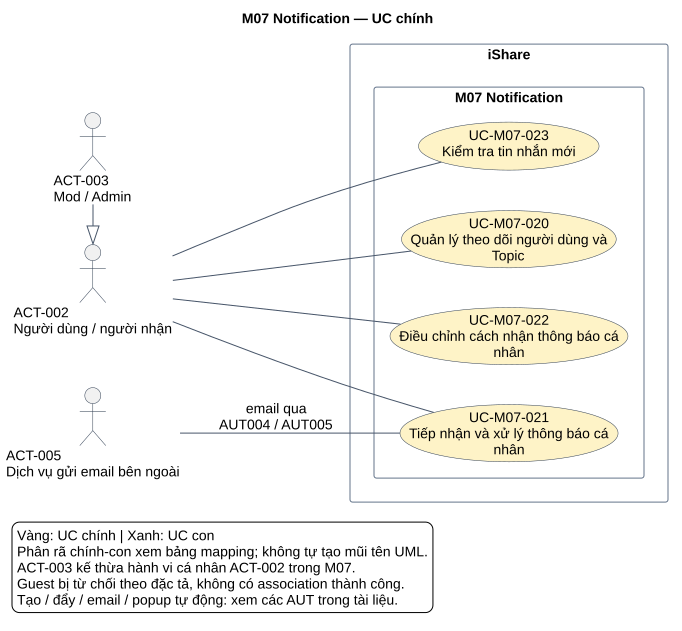
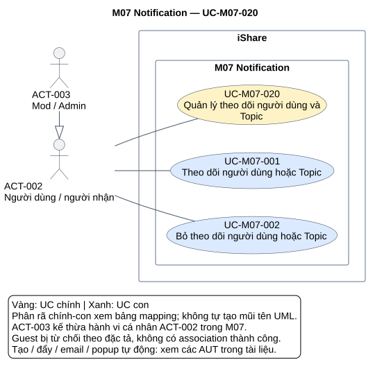
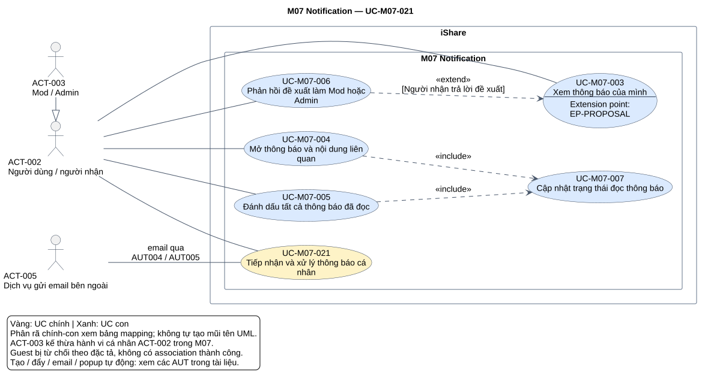
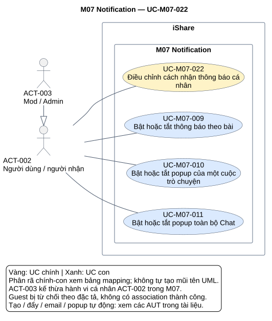
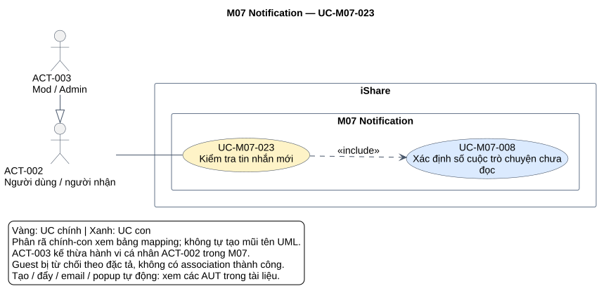

# Phân tích use case — M07 Notification

[Vietnamese Doc] — Theo skill use-case-analysis v2.2; dùng tiếng Việt, giữ thuật ngữ nghiệp vụ cần thiết.

Tài liệu phân tích **M07 Notification**, đúng tên trong FR-M07; Search là M06 đã có tài liệu riêng. Đầu ra có hai tầng, 4 UC chính, 11 UC con, đặc tả, tác vụ tự động, quan hệ, truy vết và 5 SVG. UC chính dùng làm đầu vào tổng hợp toàn hệ thống, UC con dùng cho chi tiết từng mục tiêu.

## Metadata và tiến độ

<!-- uc:document -->
| key | value |
|---|---|
| document_id | US-M07 |
| skill_version | 2.2 |
| mode | module |
| modules | M07 |
| scope | ALL |
| status | Chờ duyệt |
| current_step | 7 |
| completed_steps | 1, 2, 3, 4, 5, 6, 7 |
| approved_steps | - |
| source_baseline | FR-M07 v1.5; FR-M01 v1.10; FR-M02 v1.6; FR-M03 v1.10; FR-M04 v1.4; FR-M05 v1.7; FR-M06 v1.5; FR-M08 v1.7; FR-M09 v1.2; FR-M10 v1.4; FR-M11 v1.3; FR-M12 v1.1; FR-M14 v1.1; FR-M16 v1.0 |
| author | Codex |
| date | 2026-10-30 |
| approval_evidence | Người dùng đã cho phép tự thực hiện các bước cần thiết, không hỏi đồng ý trong lượt M04; quyền thực hiện liên tục áp dụng cho chuỗi module hiện tại. Không coi đó là phê duyệt US-M07 hay xác nhận kết quả từng bước. |
| semantic_review | pass |
| diagram_check | pass |

| Bước | Kết quả | Xác nhận | Baseline | Làm lại khi |
|---|---|---|---|---|
| 1 | 9 nhóm, 88 FR chi tiết, 25 BR; boundary/actor/giao tiếp; 13 mã bỏ | Được làm liên tục, chưa duyệt kết quả | FR-M07 v1.5 | Nguồn đổi |
| 2 | 4 core, 11 sub, 11 dòng phân rã | Chưa duyệt | FR-M07 v1.5 | Mục tiêu/phạm vi đổi |
| 3 | 12 hợp đồng chi tiết, 3 brief Summary; 9 AUT, 5 RULE | Chưa duyệt | FR-M07 v1.5 | Hành vi/quyền đổi |
| 4 | 3 include, 1 extend; 1 extension point; rà các cặp không có quan hệ | Chưa duyệt | Mô hình này | Luồng/điểm gọi đổi |
| 5 | 122 dòng truy vết; 113 tiêu chí nguồn chi tiết/BR; giao tiếp 13 FR liên quan | Chưa duyệt | FR-M07 v1.5; FR-M01 v1.10; FR-M02 v1.6; FR-M03 v1.10; FR-M04 v1.4; FR-M05 v1.7; FR-M06 v1.5; FR-M08 v1.7; FR-M09 v1.2; FR-M10 v1.4; FR-M11 v1.3; FR-M12 v1.1; FR-M14 v1.1; FR-M16 v1.0 | Baseline liên quan đổi |
| 6 | 5 SVG đã kiểm parser/render/hình và parity node/cạnh | Chưa duyệt | PlantUML 1.2026.8 | Mô hình/nguồn đổi |
| 7 | Đã review cấu trúc/ngữ nghĩa/truy vết/liên kết/hình; hồ sơ Chờ duyệt | Chưa duyệt | Skill v2.2 | Phản hồi/baseline đổi |

## 1. Phạm vi và tổng hợp yêu cầu

**Mục đích:** review các mục tiêu/hành vi Notification, làm cơ sở thiết kế và kiểm thử. Mục 2 trình bày hai tầng; mục 3 có hợp đồng/luồng/điều kiện chấp nhận; mục 4 giải thích UML; mục 5 truy vết; mục 6 xem hình; mục 7 ghi kết quả kiểm và giới hạn nguồn.

**Subject/boundary:** toàn iShare. M07 là phạm vi phân tích; các module phát sự kiện, M10 quyết vai trò, M16 sở hữu Chat đều bên trong subject. ACT-005 gửi email là hệ thống hỗ trợ bên ngoài. Không tạo actor Hệ thống, AI, Notification Worker, hàng đợi, bộ hẹn giờ, trình duyệt hoặc module nội bộ. Trigger sự kiện/thời gian được đặc tả bằng AUT.

**Trong phạm vi:** theo dõi/bỏ theo dõi người dùng và Topic; tạo/gộp/lưu/đẩy thông báo; email đúng kênh và retry; chuông/trang/read-unread/đích nội dung; phản hồi đề xuất vai trò; popup và chỉ báo Chat; cài đặt mute bài/cuộc/global và reset khi rời nhóm chat.

**Ngoài phạm vi:** thiết kế UI/API/CSDL/giao thức đẩy, quyết định sự kiện và người nhận của owner, xử lý báo cáo/khiếu nại/duyệt bài, quyết vai trò ở M10, Chat và mốc đọc M16, danh sách follow ở M02, Following ở M14, lọc ở M06, chuyển/xóa follow Topic M05, xóa quan hệ khi DELETED M01. Không thêm follow Tag/Group/bài, digest/email cho Chat, cài đặt theo loại, thông báo bài mới Topic, tự dọn thông báo.

**Baseline:** [FR-M07 — Notification](../fr/FR-M07.md) v1.5, Đã chốt ngày 2026-10-24; mốc DEC-271, QA-477, ISS-415, OPEN-012. Có 122 mã hiệu lực = 9 nhóm + 88 FR chi tiết + 25 BR; 13 mã đã bỏ được ghi riêng. Không dùng câu trả lời/phụ lục cũ thay quy định hiện hành.

<!-- uc:sources -->
| path | version | role |
|---|---|---|
| docs/specs/fr/FR-M07.md | 1.5 | owner |
| docs/specs/fr/FR-M01.md | 1.10 | related |
| docs/specs/fr/FR-M02.md | 1.6 | related |
| docs/specs/fr/FR-M03.md | 1.10 | related |
| docs/specs/fr/FR-M04.md | 1.4 | related |
| docs/specs/fr/FR-M05.md | 1.7 | related |
| docs/specs/fr/FR-M06.md | 1.5 | related |
| docs/specs/fr/FR-M08.md | 1.7 | related |
| docs/specs/fr/FR-M09.md | 1.2 | related |
| docs/specs/fr/FR-M10.md | 1.4 | related |
| docs/specs/fr/FR-M11.md | 1.3 | related |
| docs/specs/fr/FR-M12.md | 1.1 | related |
| docs/specs/fr/FR-M14.md | 1.1 | related |
| docs/specs/fr/FR-M16.md | 1.0 | related |

Phương pháp: [skill](../../../.agent-instructions/skills/use-case-analysis/SKILL.md), [modeling rules](../../../.agent-instructions/skills/use-case-analysis/references/modeling-rules.md), [diagram rules](../../../.agent-instructions/skills/use-case-analysis/references/diagram-rules.md). Phương pháp chỉ quy định cách biểu diễn, không là nguồn tính năng.

### Actor và quyền

<!-- uc:actors -->
| id | name | kind | parent | boundary_reason | sources |
|---|---|---|---|---|---|
| ACT-001 | Guest | human | - | Người ngoài iShare chưa có phiên; chỉ xuất hiện trong nhánh từ chối/yêu cầu đăng nhập, không nhận chuông/Chat/follow. | FR-M07-01.03, FR-M07-05.06, FR-M07-06.06, FR-M07-07.04, FR-M07-08.05, FR-M07-09.06 |
| ACT-002 | Người dùng đã đăng nhập / người nhận | human | - | Người ngoài subject nhận sự kiện cá nhân, xem/xử lý thông báo, theo dõi và đổi cài đặt. Người nhận/thành viên/người được đề xuất là ngữ cảnh, không tự thêm quyền. | FR-M07-05.05, FR-M07-02.15, FR-M07-07.05, FR-M07-09.01 |
| ACT-003 | Người dùng vai trò Mod/Admin | human | ACT-002 | M07 cho hành vi cá nhân như User, không thêm quyền xem thông báo người khác; kế thừa tương tác ACT-002 chỉ trong phạm vi M07. | FR-M07-05.05, FR-M07-01.01, FR-M07-09.06 |
| ACT-005 | Dịch vụ gửi email bên ngoài | external-system | - | Giao email ra ngoài iShare theo AUT004/005; M07 điều phối hàng đợi bên trong. Giữ ID dùng ở M01. | FR-M07-04.01, FR-M07-04.02, FR-M07-04.09, BR-M07-11, BR-M07-26 |

Quyền gắn với từng luồng: thông báo của chính mình, cài đặt cá nhân, mute cuộc cần là thành viên, đề xuất đúng người nhận. BANNED vẫn được tạo thông báo nhưng không được xem chuông/trang; DEACTIVATED xem lại khi tài khoản ACTIVE. ACT-003 kế thừa ACT-002 không cấp quyền xem Private hay đề xuất của người khác. ACT-001 chỉ được thể hiện như vai trò bị từ chối, không nối association tới UC thành công. ACT-005 hỗ trợ core021 qua AUT email, không tham gia luồng xem/read/follow. Subfunction nhận ngữ cảnh qua caller, không phải công cụ người dùng tự kích hoạt riêng.

### Kiểm kê và tổng hợp 9 nhóm

| Nhóm | Nội dung tổng hợp | FR chi tiết | Biểu diễn | Owner |
|---|---|---|---|---|
| FR-M07-01 | Theo dõi/bỏ theo dõi User/Topic; timestamp; cặp follow chỉ báo lần đầu; quan hệ sẵn có giữ khi BANNED/DEACTIVATED. | 10 | [UC-M07-020](#uc-m07-020), [UC-M07-001](#uc-m07-001), [UC-M07-002](#uc-m07-002) | M07 |
| FR-M07-02 | Tạo unread theo sự kiện/recipient; mute/quyền/tài khoản; gộp upvote; bài mới follower; đề xuất vai trò và vòng đời. | 28 | [UC-M07-021](#uc-m07-021), [UC-M07-006](#uc-m07-006); AUT001/002/006/007 | M07 |
| FR-M07-03 | Lưu trước đẩy mọi thiết bị đang mở, best effort không retry; tải lại nguồn đã lưu khi mở. | 4 | [UC-M07-021](#uc-m07-021), [UC-M07-003](#uc-m07-003); AUT003 | M07 |
| FR-M07-04 | Whitelist email bất đồng bộ; cảnh báo tự xóa chỉ email; quét 60 giây, tối đa 3 retry; email ban kèm khiếu nại. | 8 | [UC-M07-021](#uc-m07-021); AUT004/005 | M07 |
| FR-M07-05 | Chuông 10, trang 20/lần, cập nhật cuối giảm dần; chỉ của mình, giờ Việt Nam, giữ vô thời hạn; mở chuông không đọc. | 12 | [UC-M07-021](#uc-m07-021), [UC-M07-003](#uc-m07-003), [UC-M07-004](#uc-m07-004) | M07 |
| FR-M07-06 | Bấm thông báo: đọc rồi chuyển đích; mark-all riêng chuông, không tác động Chat. | 6 | [UC-M07-021](#uc-m07-021), [UC-M07-004](#uc-m07-004), [UC-M07-005](#uc-m07-005), [UC-M07-007](#uc-m07-007) | M07 |
| FR-M07-07 | Chat không vào chuông/email; mỗi tin popup theo điều kiện; chỉ báo đếm cuộc, click mở inbox M16. | 7 | [UC-M07-023](#uc-m07-023), [UC-M07-008](#uc-m07-008); AUT008 | M07 |
| FR-M07-08 | Mute trên mọi bài theo người; bật lại từ lúc đó; nhắc tên và thông báo xử lý vẫn nhận. | 5 | [UC-M07-022](#uc-m07-022), [UC-M07-009](#uc-m07-009) | M07 |
| FR-M07-09 | Mute cuộc/global chỉ chặn popup; global không ngoại lệ; unmute giữ từng cuộc; rời nhóm xóa mute riêng. | 8 | [UC-M07-022](#uc-m07-022), [UC-M07-010](#uc-m07-010), [UC-M07-011](#uc-m07-011); AUT009 | M07 |

## 2. Hai tầng use case

### 2.1 Danh mục

<!-- uc:catalog -->
| id | name | tier | level | primary | supporting | owner | anchor | sources |
|---|---|---|---|---|---|---|---|---|
| UC-M07-020 | Quản lý theo dõi người dùng và Topic | core | Summary | ACT-002, ACT-003 | - | M07 | #uc-m07-020 | FR-M07-01, BR-M07-15, BR-M07-23, BR-M07-25 |
| UC-M07-021 | Tiếp nhận và xử lý thông báo cá nhân | core | Summary | ACT-002, ACT-003 | ACT-005 | M07 | #uc-m07-021 | FR-M07-02, FR-M07-03, FR-M07-04, FR-M07-05, FR-M07-06, BR-M07-01, BR-M07-03, BR-M07-09, BR-M07-20 |
| UC-M07-022 | Điều chỉnh cách nhận thông báo cá nhân | core | Summary | ACT-002, ACT-003 | - | M07 | #uc-m07-022 | FR-M07-08, FR-M07-09, BR-M07-07, BR-M07-08 |
| UC-M07-023 | Kiểm tra tin nhắn mới | core | User goal | ACT-002, ACT-003 | - | M07 | #uc-m07-023 | FR-M07-07.01, FR-M07-07.02, FR-M07-07.03, FR-M07-07.04, BR-M07-02 |
| UC-M07-001 | Theo dõi người dùng hoặc Topic | sub | User goal | ACT-002, ACT-003 | - | M07 | #uc-m07-001 | FR-M07-01.01, FR-M07-01.02, FR-M07-01.03, FR-M07-01.04, FR-M07-01.10, FR-M07-01.11, FR-M07-01.12, BR-M07-15, BR-M07-25 |
| UC-M07-002 | Bỏ theo dõi người dùng hoặc Topic | sub | User goal | ACT-002, ACT-003 | - | M07 | #uc-m07-002 | FR-M07-01.03, FR-M07-01.08, FR-M07-01.09, FR-M07-01.10, BR-M07-25 |
| UC-M07-003 | Xem thông báo của mình | sub | User goal | ACT-002, ACT-003 | - | M07 | #uc-m07-003 | FR-M07-03.04, FR-M07-05, BR-M07-09, BR-M07-12, BR-M07-13, BR-M07-22, BR-M07-24 |
| UC-M07-004 | Mở thông báo và nội dung liên quan | sub | User goal | ACT-002, ACT-003 | - | M07 | #uc-m07-004 | FR-M07-05.05, FR-M07-05.13, FR-M07-06.01, FR-M07-06.02, FR-M07-06.04, BR-M07-14, BR-M07-27 |
| UC-M07-005 | Đánh dấu tất cả thông báo đã đọc | sub | User goal | ACT-002, ACT-003 | - | M07 | #uc-m07-005 | FR-M07-06.03, FR-M07-06.05, FR-M07-06.06, BR-M07-14 |
| UC-M07-006 | Phản hồi đề xuất làm Mod hoặc Admin | sub | User goal | ACT-002, ACT-003 | - | M07 | #uc-m07-006 | FR-M07-02.14, FR-M07-02.15, FR-M07-02.16, FR-M07-02.28, FR-M07-02.30, FR-M07-02.31, FR-M07-02.32, BR-M07-20 |
| UC-M07-007 | Cập nhật trạng thái đọc thông báo | sub | Subfunction | ACT-002, ACT-003 | - | M07 | #uc-m07-007 | FR-M07-05.05, FR-M07-06.01, FR-M07-06.03, FR-M07-06.04, FR-M07-06.05, FR-M07-06.06, BR-M07-14, BR-M07-27 |
| UC-M07-008 | Xác định số cuộc trò chuyện chưa đọc | sub | Subfunction | ACT-002, ACT-003 | - | M07 | #uc-m07-008 | FR-M07-07.02, FR-M07-09.07, BR-M07-02, BR-M07-08, FR-M16-07.10 |
| UC-M07-009 | Bật hoặc tắt thông báo theo bài | sub | User goal | ACT-002, ACT-003 | - | M07 | #uc-m07-009 | FR-M07-08, FR-M07-02.07, FR-M07-02.08, FR-M07-02.09, BR-M07-07 |
| UC-M07-010 | Bật hoặc tắt popup của một cuộc trò chuyện | sub | User goal | ACT-002, ACT-003 | - | M07 | #uc-m07-010 | FR-M07-09.01, FR-M07-09.02, FR-M07-09.05, FR-M07-09.06, FR-M07-09.07, BR-M07-08 |
| UC-M07-011 | Bật hoặc tắt popup toàn bộ Chat | sub | User goal | ACT-002, ACT-003 | - | M07 | #uc-m07-011 | FR-M07-09.03, FR-M07-09.04, FR-M07-09.06, FR-M07-09.07, BR-M07-08 |

Chỉ các UC core được lấy nguyên ID/tên/owner để ghép overview toàn hệ thống. `tier` độc lập với `level`: core023 là User goal, các core khác Summary; UC007/008 là Subfunction có hợp đồng hỗ trợ đáng tách.

### 2.2 Phân rã chính → con

<!-- uc:decomposition -->
| core | sub | rationale | sources |
|---|---|---|---|
| UC-M07-020 | UC-M07-001 | Thiết lập đối tượng quan tâm và timestamp | FR-M07-01.01, FR-M07-01.02, FR-M07-01.03, FR-M07-01.04, FR-M07-01.10, FR-M07-01.11, FR-M07-01.12, BR-M07-15, BR-M07-25 |
| UC-M07-020 | UC-M07-002 | Chấm dứt quan hệ theo dõi hiện hành | FR-M07-01.03, FR-M07-01.08, FR-M07-01.09, FR-M07-01.10, BR-M07-25 |
| UC-M07-021 | UC-M07-003 | Xem danh sách/số chưa đọc từ nguồn đã lưu | FR-M07-03.04, FR-M07-05, BR-M07-09, BR-M07-12, BR-M07-13, BR-M07-22, BR-M07-24 |
| UC-M07-021 | UC-M07-004 | Đọc một thông báo và mở đích theo quyền | FR-M07-05.05, FR-M07-05.13, FR-M07-06.01, FR-M07-06.02, FR-M07-06.04, BR-M07-14, BR-M07-27 |
| UC-M07-021 | UC-M07-005 | Xử lý toàn bộ trạng thái chưa đọc của mình | FR-M07-06.03, FR-M07-06.05, FR-M07-06.06, BR-M07-14 |
| UC-M07-021 | UC-M07-006 | Ra quyết định đề xuất vai trò đúng hiệu lực | FR-M07-02.14, FR-M07-02.15, FR-M07-02.16, FR-M07-02.28, FR-M07-02.30, FR-M07-02.31, FR-M07-02.32, BR-M07-20 |
| UC-M07-021 | UC-M07-007 | Tái sử dụng cập nhật read/unread đơn lẻ/hàng loạt | FR-M07-05.05, FR-M07-06.01, FR-M07-06.03, FR-M07-06.04, FR-M07-06.05, FR-M07-06.06, BR-M07-14, BR-M07-27 |
| UC-M07-022 | UC-M07-009 | Điều chỉnh thông báo tương tác theo bài cho mình | FR-M07-08, FR-M07-02.07, FR-M07-02.08, FR-M07-02.09, BR-M07-07 |
| UC-M07-022 | UC-M07-010 | Điều chỉnh popup một cuộc là thành viên | FR-M07-09.01, FR-M07-09.02, FR-M07-09.05, FR-M07-09.06, FR-M07-09.07, BR-M07-08 |
| UC-M07-022 | UC-M07-011 | Điều chỉnh popup toàn bộ Chat, giữ cài đặt riêng | FR-M07-09.03, FR-M07-09.04, FR-M07-09.06, FR-M07-09.07, BR-M07-08 |
| UC-M07-023 | UC-M07-008 | Xác định số cuộc chưa đọc theo read marker/quyền M16 | FR-M07-07.02, FR-M07-09.07, BR-M07-02, BR-M07-08, FR-M16-07.10 |

Không có UC con mồ côi; UC007 có một định nghĩa dù hai caller. Mapping chỉ nói đóng góp nghiệp vụ, không tự tạo include/extend. AUT/RULE cũng ghi core liên quan để truy vết hành vi tự động về mục tiêu bao quát.

### 2.3 Tổng hợp hệ thống và quyết định mô hình

<!-- uc:module-models -->
| module | path | baseline |
|---|---|---|

Chưa có US-overview tại thời điểm phân tích; không tạo/cập nhật overview trong lượt M07. Khi tổng hợp, lấy core020/021/022/023 của tài liệu này, không đưa các sub lên overview.

| ID | Hành vi nguồn | Biểu diễn | Vì sao | Không chọn |
|---|---|---|---|---|
| D-M07-01 | Follow/unfollow | [UC-M07-020](#uc-m07-020) Summary, [UC-M07-001](#uc-m07-001), [UC-M07-002](#uc-m07-002) | Hai mục tiêu trong bối cảnh quan hệ quan tâm | Không include Unfollow vào Follow hoặc kế thừa chỉ để nhóm CRUD |
| D-M07-02 | Nhận, xem, mở, read, đề xuất | [UC-M07-021](#uc-m07-021) Summary; 5 sub và AUT phân phối | Tách mục tiêu người dùng với xử lý theo sự kiện/thời gian | Không tạo actor Hệ thống/module, không oval từng sự kiện |
| D-M07-03 | Mở một / mark-all | [UC-M07-004](#uc-m07-004), [UC-M07-005](#uc-m07-005), [UC-M07-007](#uc-m07-007) | Hai caller dùng cùng hợp đồng đọc với phạm vi khác nhau | Không coi xem danh sách luôn đọc thông báo |
| D-M07-04 | Phản hồi đề xuất | [UC-M07-006](#uc-m07-006) extend [UC-M07-003](#uc-m07-003) | Hành vi bổ sung độc lập có vòng đời/hiệu lực/vai trò, base xem vẫn hoàn tất khi không chọn | Không suy mọi nút cùng trang hoặc link đích đều extend |
| D-M07-05 | Chat và chuông | [UC-M07-023](#uc-m07-023), [UC-M07-008](#uc-m07-008) + AUT008 | Hai hệ trạng thái đọc/kênh riêng; một goal kiểm tra và một hợp đồng số cuộc | Không đếm tin thay cuộc; không tách click biểu tượng thành UC điều hướng riêng |
| D-M07-06 | Mute bài/cuộc/global | [UC-M07-022](#uc-m07-022) Summary; UC009/010/011 | Phạm vi/tác động/điều kiện thành viên khác nhau | Không gộp thành tắt toàn bộ mọi thông báo hoặc giả quyền override |
| D-M07-07 | Đẩy/email/upvote | 9 AUT, 5 RULE | Trigger và before/after riêng, vẫn đặc tả/truy vết đủ | Không nhãn nền chung chung, không vẽ timer actor |

## 3. Đặc tả

### 3.1 UC chính

### UC-M07-020 — Quản lý theo dõi người dùng và Topic

**Actor chính:** ACT-002, ACT-003. **Hỗ trợ:** -. **Mức:** Summary. **Giá trị:** Chọn người/chủ đề quan tâm để dùng ở hồ sơ, Following, tìm kiếm và cập nhật bài mới của người được theo dõi. **Kết quả:** Quan hệ theo dõi hiện hành và thời điểm bắt đầu đúng; chỉ có sự kiện người theo dõi mới lần đầu mỗi cặp.

**UC con:** [UC-M07-001](#uc-m07-001) — Thiết lập đối tượng quan tâm và timestamp; [UC-M07-002](#uc-m07-002) — Chấm dứt quan hệ theo dõi hiện hành.

**Trigger:** Người dùng bắt đầu hoặc bỏ theo dõi trên hồ sơ/Topic. **Điều kiện:** Có ngữ cảnh người thao tác và đối tượng; đăng nhập được kiểm trong luồng, không giấu trường hợp Guest.

| Bước tổng quát | Quy trình | Nguồn |
|---|---|---|
| 1 | Người dùng chọn theo dõi theo [UC-M07-001](#uc-m07-001) hoặc bỏ theo dõi theo [UC-M07-002](#uc-m07-002); đây là hai mục tiêu khác nhau, không bắt chạy nối tiếp. | FR-M07-01, BR-M07-15, BR-M07-23, BR-M07-25 |
| 2 | Quan hệ được cung cấp cho M01/M02/M06/M14; M05 sở hữu gộp/xóa Topic, M01 sở hữu xóa quan hệ khi DELETED. | FR-M07-01, BR-M07-15, BR-M07-23, BR-M07-25 |
| 3 | Chỉ theo dõi người dùng có thông báo bài công khai lần đầu theo [AUT-M07-006](#aut-m07-006); theo dõi Topic không sinh thông báo. | FR-M07-01, BR-M07-15, BR-M07-23, BR-M07-25 |

**Kết thúc/ngoại lệ:** Không theo dõi Tag/Group/bài/chính mình hoặc bắt đầu theo dõi BANNED; không phát thông báo bỏ theo dõi.

Summary cho bối cảnh nhiều mục tiêu; không giả định các UC con cùng thực hiện hoặc chèn vào mọi lần tương tác.

### UC-M07-021 — Tiếp nhận và xử lý thông báo cá nhân

**Actor chính:** ACT-002, ACT-003. **Hỗ trợ:** ACT-005. **Mức:** Summary. **Giá trị:** Biết sự kiện liên quan tới mình qua kênh đã chốt và xử lý thông báo, nội dung hoặc đề xuất vai trò. **Kết quả:** Thông báo được lưu và phân phối đúng kênh; người dùng xem của mình, đọc/mở và phản hồi hợp lệ.

**UC con:** [UC-M07-003](#uc-m07-003) — Xem danh sách/số chưa đọc từ nguồn đã lưu; [UC-M07-004](#uc-m07-004) — Đọc một thông báo và mở đích theo quyền; [UC-M07-005](#uc-m07-005) — Xử lý toàn bộ trạng thái chưa đọc của mình; [UC-M07-006](#uc-m07-006) — Ra quyết định đề xuất vai trò đúng hiệu lực; [UC-M07-007](#uc-m07-007) — Tái sử dụng cập nhật read/unread đơn lẻ/hàng loạt.

**Trigger:** Sự kiện nghiệp vụ đến; người nhận mở chuông/trang Thông báo, mở thông báo hoặc chọn một hành động. **Điều kiện:** M07 nhận nội dung/người nhận/mốc từ owner; email có dịch vụ gửi bên ngoài, không đặt AI/module/scheduler thành actor.

| Bước tổng quát | Quy trình | Nguồn |
|---|---|---|
| 1 | [AUT-M07-001](#aut-m07-001)/002/006 tạo hoặc gộp thông báo đúng người, lưu trước khi [AUT-M07-003](#aut-m07-003) đẩy; [AUT-M07-004](#aut-m07-004)/005 xử lý email độc lập thao tác gây sự kiện. | FR-M07-02, FR-M07-03, FR-M07-04, FR-M07-05, FR-M07-06, BR-M07-01, BR-M07-03, BR-M07-09, BR-M07-20 |
| 2 | [UC-M07-003](#uc-m07-003) xem chuông/trang; [UC-M07-004](#uc-m07-004) mở một thông báo; [UC-M07-005](#uc-m07-005) đánh dấu tất cả. [UC-M07-004](#uc-m07-004)/005 cùng dùng [UC-M07-007](#uc-m07-007) thay đổi trạng thái đọc. | FR-M07-02, FR-M07-03, FR-M07-04, FR-M07-05, FR-M07-06, BR-M07-01, BR-M07-03, BR-M07-09, BR-M07-20 |
| 3 | [UC-M07-006](#uc-m07-006) bổ sung phản hồi đề xuất vai trò khi xem thông báo đề xuất có lựa chọn; M10 quyết định vai trò/hiệu lực, [AUT-M07-007](#aut-m07-007) phản ánh trạng thái. | FR-M07-02, FR-M07-03, FR-M07-04, FR-M07-05, FR-M07-06, BR-M07-01, BR-M07-03, BR-M07-09, BR-M07-20 |
| 4 | Email bảo mật/ban theo danh sách; không đưa tin nhắn vào chuông. Báo tin nhắn thuộc [UC-M07-023](#uc-m07-023) và [AUT-M07-008](#aut-m07-008). | FR-M07-02, FR-M07-03, FR-M07-04, FR-M07-05, FR-M07-06, BR-M07-01, BR-M07-03, BR-M07-09, BR-M07-20 |

**Kết thúc/ngoại lệ:** Không lộ Private; BANNED/DEACTIVATED vẫn có bản ghi nhưng chỉ xem khi truy cập hợp lệ; email/push lỗi xử lý riêng.

Summary cho bối cảnh nhiều mục tiêu; không giả định các UC con cùng thực hiện hoặc chèn vào mọi lần tương tác.

### UC-M07-022 — Điều chỉnh cách nhận thông báo cá nhân

**Actor chính:** ACT-002, ACT-003. **Hỗ trợ:** -. **Mức:** Summary. **Giá trị:** Giảm gián đoạn theo bài hoặc Chat mà vẫn giữ những cập nhật bắt buộc và số cuộc chưa đọc. **Kết quả:** Trạng thái nhận/tắt được cập nhật đúng phạm vi; bật lại có hiệu lực từ lúc đó.

**UC con:** [UC-M07-009](#uc-m07-009) — Điều chỉnh thông báo tương tác theo bài cho mình; [UC-M07-010](#uc-m07-010) — Điều chỉnh popup một cuộc là thành viên; [UC-M07-011](#uc-m07-011) — Điều chỉnh popup toàn bộ Chat, giữ cài đặt riêng.

**Trigger:** Người dùng thay công tắc thông báo bài, một cuộc trò chuyện hoặc toàn bộ Chat. **Điều kiện:** Cài đặt có phạm vi cá nhân; quyền đăng nhập/thành viên được xét khi thao tác.

| Bước tổng quát | Quy trình | Nguồn |
|---|---|---|
| 1 | [UC-M07-009](#uc-m07-009) đổi nhận thông báo trên một bài; tác động vào những loại tương tác được BR quy định, nhắc tên và xử lý khác vẫn nhận. | FR-M07-08, FR-M07-09, BR-M07-07, BR-M07-08 |
| 2 | [UC-M07-010](#uc-m07-010) đổi một cuộc trò chuyện; [UC-M07-011](#uc-m07-011) đổi toàn bộ Chat. Tắt toàn bộ chi phối mọi cuộc; bỏ tắt toàn bộ giữ các cuộc tắt riêng. | FR-M07-08, FR-M07-09, BR-M07-07, BR-M07-08 |
| 3 | [AUT-M07-009](#aut-m07-009) bỏ cài đặt tắt của thành viên khi rời/bị xóa khỏi nhóm chat, vào lại mặc định Đang nhận ở cấp cuộc. | FR-M07-08, FR-M07-09, BR-M07-07, BR-M07-08 |

**Kết thúc/ngoại lệ:** Không biến mute thành xóa thông báo, chặn nhắc tên hoặc xóa số chưa đọc Chat; không vượt tắt toàn bộ bằng bật một cuộc.

Summary cho bối cảnh nhiều mục tiêu; không giả định các UC con cùng thực hiện hoặc chèn vào mọi lần tương tác.

### UC-M07-023 — Kiểm tra tin nhắn mới

**Actor chính:** ACT-002, ACT-003. **Hỗ trợ:** -. **Mức:** User goal. **Giá trị:** Nhận biết số cuộc trò chuyện có tin chưa đọc và đi tới hộp thư Chat khi cần. **Kết quả:** Biểu tượng riêng với số cuộc chưa đọc đúng quyền; bấm dẫn tới hộp thư M16; không ảnh hưởng trạng thái chuông.

**UC con:** [UC-M07-008](#uc-m07-008) — Xác định số cuộc chưa đọc theo read marker/quyền M16.

<!-- uc:spec UC-M07-023 -->
| key | value |
|---|---|
| goal | Nhận biết số cuộc trò chuyện có tin chưa đọc và đi tới hộp thư Chat khi cần. |
| subject | iShare |
| level | User goal |
| primary | ACT-002, ACT-003 |
| supporting | - |
| trigger | Người dùng xem biểu tượng Tin nhắn trong ứng dụng hoặc bấm biểu tượng. |
| preconditions | Ngữ cảnh tài khoản/người xem; Guest bị từ chối biểu tượng trong nhánh. M16 cung cấp dữ liệu đã đọc/quyền thấy. |
| success | Biểu tượng riêng với số cuộc chưa đọc đúng quyền; bấm dẫn tới hộp thư M16; không ảnh hưởng trạng thái chuông. |
| failure | Không đếm số tin thay số cuộc; không loại cuộc tắt thông báo; không tính tin thành viên cũ không được thấy. |
| abstract | false |
| common_contract | Không áp dụng generalization UC; giữ hợp đồng riêng. Phân rã chính–con không phải quan hệ kế thừa. |

#### Luồng chính

| Bước | Ai | Hành động/phản hồi | Tiếp tục | Nguồn |
|---|---|---|---|---|
| 1 | Người dùng / iShare | iShare xác định người đang xem; chỉ hiện biểu tượng cho người đã đăng nhập, tách khỏi chuông. | 2 | FR-M07-07.01, FR-M07-07.02, FR-M07-07.03, FR-M07-07.04, BR-M07-02 |
| 2 | iShare | Thực hiện [UC-M07-008](#uc-m07-008) để lấy số cuộc có tin chưa đọc theo dữ liệu và mốc đã đọc M16. | 3 | FR-M07-07.01, FR-M07-07.02, FR-M07-07.03, FR-M07-07.04, BR-M07-02 |
| 3 | iShare | Hiện số nhận được, kể cả cuộc đã tắt thông báo và khi cờ Chat tắt. Popup theo [AUT-M07-008](#aut-m07-008) là hành vi sự kiện riêng. | 4 | FR-M07-07.01, FR-M07-07.02, FR-M07-07.03, FR-M07-07.04, BR-M07-02 |
| 4 | iShare | Nếu người dùng bấm biểu tượng, chuyển tới hộp thư Chat M16; nếu chỉ xem chỉ báo thì kết thúc tại đây, không tự đánh dấu thông báo/tin nhắn đã đọc. | END: Biểu tượng riêng với số cuộc chưa đọc đúng quyền; bấm dẫn tới hộp thư M16; không ảnh hưởng trạng thái chuông. | FR-M07-07.01, FR-M07-07.02, FR-M07-07.03, FR-M07-07.04, BR-M07-02 |

#### Luồng thay thế và ngoại lệ

| ID | Bước rẽ | Điều kiện | Xử lý | Quay lại/kết thúc | Nguồn |
|---|---|---|---|---|---|
| A1 | 1 | Guest | Không hiện biểu tượng Tin nhắn. | END: không có biểu tượng cho Guest | FR-M07-07.04 |
| A2 | 3 | Chat đang tắt | Vẫn hiện biểu tượng và số chưa đọc; các thao tác bị chặn trong Chat thuộc M16. | 4 | FR-M07-07.02, FR-M16-03.01 |

#### Quy tắc và điểm chưa rõ

Căn cứ: FR-M07-07.01, FR-M07-07.02, FR-M07-07.03, FR-M07-07.04, BR-M07-02. RULE/AUT ở mục 3.3 chỉ áp theo đúng phạm vi và guard; xem các NOTE ở mục 7, không tự biến chi tiết chưa chốt thành yêu cầu.

#### Tiêu chí nguồn và nghiệm thu

Các tiêu chí dưới đây giữ nội dung quy định hiệu lực, là điều kiện chấp nhận của các luồng/quy tắc đã phân tích; không chỉ là danh sách mã.

| Mã | Tiêu chí |
|---|---|
| FR-M07-07.01 | Hệ thống phải hiện biểu tượng Tin nhắn trên thanh điều hướng, tách khỏi chuông thông báo. |
| FR-M07-07.03 | Khi người dùng bấm biểu tượng Tin nhắn, hệ thống phải chuyển người dùng tới hộp thư Chat (M16). |
| FR-M07-07.04 | Hệ thống phải chỉ hiện biểu tượng Tin nhắn cho người đã đăng nhập. |

### 3.2 UC con

### UC-M07-001 — Theo dõi người dùng hoặc Topic

**UC chính:** [UC-M07-020](#uc-m07-020).

<!-- uc:spec UC-M07-001 -->
| key | value |
|---|---|
| goal | Thiết lập quan hệ với đối tượng quan tâm và thời điểm theo dõi. |
| subject | iShare |
| level | User goal |
| primary | ACT-002, ACT-003 |
| supporting | - |
| trigger | Bấm Theo dõi trên hồ sơ hoặc Topic. |
| preconditions | Đối tượng được xác định; không giả định đã đăng nhập hay target hợp lệ trước kiểm tra. |
| success | Quan hệ có thời điểm bắt đầu; nếu là người dùng thì sự kiện người theo dõi mới chỉ một lần mỗi cặp. |
| failure | Không tạo quan hệ cho Guest/Tag/Group/bài/chính mình/BANNED; không báo theo dõi lại cùng cặp. |
| abstract | false |
| common_contract | Không áp dụng generalization UC; giữ hợp đồng riêng. Phân rã chính–con không phải quan hệ kế thừa. |

#### Luồng chính

| Bước | Ai | Hành động/phản hồi | Tiếp tục | Nguồn |
|---|---|---|---|---|
| 1 | Người dùng / iShare | Người dùng chọn đối tượng và bấm Theo dõi; iShare kiểm phiên, loại đối tượng, không phải chính mình và không bắt đầu theo dõi tài khoản BANNED. | 2 | FR-M07-01.01, FR-M07-01.02, FR-M07-01.03, FR-M07-01.04, FR-M07-01.10, FR-M07-01.11, FR-M07-01.12, BR-M07-15, BR-M07-25 |
| 2 | iShare | Tạo quan hệ người theo dõi–người dùng/Topic kèm thời điểm bắt đầu; quan hệ dùng chung cho M01/M02/M06/M14. | 3 | FR-M07-01.01, FR-M07-01.02, FR-M07-01.03, FR-M07-01.04, FR-M07-01.10, FR-M07-01.11, FR-M07-01.12, BR-M07-15, BR-M07-25 |
| 3 | iShare | Với người dùng được theo dõi, tạo sự kiện có người theo dõi mới nếu cặp này chưa từng được báo, để [AUT-M07-001](#aut-m07-001) phân phối; không phát lại khi follow lại. | 4 | FR-M07-01.01, FR-M07-01.02, FR-M07-01.03, FR-M07-01.04, FR-M07-01.10, FR-M07-01.11, FR-M07-01.12, BR-M07-15, BR-M07-25 |
| 4 | iShare | Với Topic, không tạo thông báo theo dõi hoặc bài mới của Topic; kết thúc với quan hệ mới. | END: Quan hệ có thời điểm bắt đầu; nếu là người dùng thì sự kiện người theo dõi mới chỉ một lần mỗi cặp. | FR-M07-01.01, FR-M07-01.02, FR-M07-01.03, FR-M07-01.04, FR-M07-01.10, FR-M07-01.11, FR-M07-01.12, BR-M07-15, BR-M07-25 |

#### Luồng thay thế và ngoại lệ

| ID | Bước rẽ | Điều kiện | Xử lý | Quay lại/kết thúc | Nguồn |
|---|---|---|---|---|---|
| A1 | 1 | Guest bấm Theo dõi | Từ chối và yêu cầu đăng nhập. | END: không tạo quan hệ | FR-M07-01.03 |
| A2 | 1 | Tag, Group, bài viết, chính mình hoặc target BANNED | Từ chối loại đối tượng/hành động bị cấm. | END: không tạo quan hệ | FR-M07-01.02, FR-M07-01.11, FR-M07-01.12 |
| A3 | 3 | Theo dõi lại cặp người dùng đã từng nhận thông báo follow | Giữ việc tạo quan hệ lần này nhưng không tạo lại sự kiện follow. | 4 | FR-M07-01.10, BR-M07-25 |

#### Quy tắc và điểm chưa rõ

Căn cứ: FR-M07-01.01, FR-M07-01.02, FR-M07-01.03, FR-M07-01.04, FR-M07-01.10, FR-M07-01.11, FR-M07-01.12, BR-M07-15, BR-M07-25. RULE/AUT ở mục 3.3 chỉ áp theo đúng phạm vi và guard; xem các NOTE ở mục 7, không tự biến chi tiết chưa chốt thành yêu cầu.

#### Tiêu chí nguồn và nghiệm thu

Các tiêu chí dưới đây giữ nội dung quy định hiệu lực, là điều kiện chấp nhận của các luồng/quy tắc đã phân tích; không chỉ là danh sách mã.

| Mã | Tiêu chí |
|---|---|
| FR-M07-01.01 | Khi người dùng đã đăng nhập bấm theo dõi một người dùng hoặc một Topic, hệ thống phải tạo quan hệ theo dõi giữa người dùng đó và đối tượng, kèm thời điểm bắt đầu theo dõi. |
| FR-M07-01.02 | Hệ thống phải không cho theo dõi Tag, Group và bài viết (BR-M07-15). |
| FR-M07-01.03 | Nếu người chưa đăng nhập bấm theo dõi hoặc bỏ theo dõi, hệ thống phải từ chối và yêu cầu đăng nhập. |
| FR-M07-01.04 | Khi người dùng theo dõi một người dùng khác lần đầu, hệ thống phải tạo sự kiện "có người theo dõi mới" cho người được theo dõi (BR-M07-25). |
| FR-M07-01.10 | Nếu người dùng theo dõi lại một người dùng đã nhận thông báo "có người theo dõi mới" từ chính người đó, hệ thống phải không tạo lại sự kiện này. |
| FR-M07-01.11 | Nếu người dùng bấm theo dõi chính mình, hệ thống phải từ chối. |
| FR-M07-01.12 | Nếu người dùng bấm theo dõi một tài khoản đang BANNED, hệ thống phải từ chối. |
| BR-M07-15 | Đối tượng theo dõi là người dùng và Topic. Tag, Group, bài viết không theo dõi được. Theo dõi cần đăng nhập. Không theo dõi được chính mình và không bắt đầu theo dõi được tài khoản BANNED; lượt theo dõi đã có với tài khoản BANNED, DEACTIVATED được giữ. Theo dõi Topic không sinh thông báo. |

### UC-M07-002 — Bỏ theo dõi người dùng hoặc Topic

**UC chính:** [UC-M07-020](#uc-m07-020).

<!-- uc:spec UC-M07-002 -->
| key | value |
|---|---|
| goal | Chấm dứt quan hệ theo dõi đang có của mình. |
| subject | iShare |
| level | User goal |
| primary | ACT-002, ACT-003 |
| supporting | - |
| trigger | Bấm Bỏ theo dõi một người dùng hoặc Topic đang theo dõi. |
| preconditions | Có quan hệ đang theo dõi; Guest vẫn phải được từ chối nếu gửi yêu cầu. |
| success | Quan hệ bị xóa, số người theo dõi đối tượng giảm 1; không ai nhận thông báo. |
| failure | Không xóa quan hệ của người khác; không tạo thông báo unfollow. |
| abstract | false |
| common_contract | Không áp dụng generalization UC; giữ hợp đồng riêng. Phân rã chính–con không phải quan hệ kế thừa. |

#### Luồng chính

| Bước | Ai | Hành động/phản hồi | Tiếp tục | Nguồn |
|---|---|---|---|---|
| 1 | Người dùng / iShare | Người dùng chọn bỏ theo dõi đối tượng đang theo dõi; iShare kiểm ngữ cảnh đăng nhập của người thao tác. | 2 | FR-M07-01.03, FR-M07-01.08, FR-M07-01.09, FR-M07-01.10, BR-M07-25 |
| 2 | iShare | Xóa quan hệ của chính người thao tác với đối tượng và giảm số người theo dõi đối tượng một đơn vị. | 3 | FR-M07-01.03, FR-M07-01.08, FR-M07-01.09, FR-M07-01.10, BR-M07-25 |
| 3 | iShare | Không tạo thông báo cho ai. Dữ liệu hiện hành cung cấp cho module khác; không xóa lịch sử đã từng báo follow của cặp. | END: Quan hệ bị xóa, số người theo dõi đối tượng giảm 1; không ai nhận thông báo. | FR-M07-01.03, FR-M07-01.08, FR-M07-01.09, FR-M07-01.10, BR-M07-25 |

#### Luồng thay thế và ngoại lệ

| ID | Bước rẽ | Điều kiện | Xử lý | Quay lại/kết thúc | Nguồn |
|---|---|---|---|---|---|
| A1 | 1 | Guest bấm Bỏ theo dõi | Từ chối và yêu cầu đăng nhập. | END: không xóa quan hệ | FR-M07-01.03 |

#### Quy tắc và điểm chưa rõ

Căn cứ: FR-M07-01.03, FR-M07-01.08, FR-M07-01.09, FR-M07-01.10, BR-M07-25. RULE/AUT ở mục 3.3 chỉ áp theo đúng phạm vi và guard; xem các NOTE ở mục 7, không tự biến chi tiết chưa chốt thành yêu cầu.

#### Tiêu chí nguồn và nghiệm thu

Các tiêu chí dưới đây giữ nội dung quy định hiệu lực, là điều kiện chấp nhận của các luồng/quy tắc đã phân tích; không chỉ là danh sách mã.

| Mã | Tiêu chí |
|---|---|
| FR-M07-01.08 | Khi người dùng bấm bỏ theo dõi một người dùng hoặc một Topic đang theo dõi, hệ thống phải xóa quan hệ theo dõi đó, để số người theo dõi của đối tượng giảm 1 (BR-M07-25). |
| FR-M07-01.09 | Khi người dùng bỏ theo dõi, hệ thống phải không tạo thông báo cho ai. |
| BR-M07-25 | Người dùng bỏ theo dõi được người dùng, Topic đang theo dõi; quan hệ bị xóa, số người theo dõi giảm 1, không ai nhận thông báo. Thông báo "có người theo dõi mới" chỉ gửi một lần cho mỗi cặp người theo dõi – người được theo dõi. |

### UC-M07-003 — Xem thông báo của mình

**UC chính:** [UC-M07-021](#uc-m07-021).

<!-- uc:spec UC-M07-003 -->
| key | value |
|---|---|
| goal | Đọc danh sách/thời điểm/trạng thái và số chưa đọc mà không tự đánh dấu đã đọc chỉ do mở chuông. |
| subject | iShare |
| level | User goal |
| primary | ACT-002, ACT-003 |
| supporting | - |
| trigger | Bấm chuông hoặc mở trang Thông báo. |
| preconditions | Ngữ cảnh người yêu cầu được xác định; không giấu trường hợp Guest/BANNED trong tiền điều kiện. |
| success | Chỉ thông báo của mình, đúng thứ tự/số lượng/trạng thái; nguồn đã lưu bảo đảm thấy lại dù đẩy từng lỗi. |
| failure | Guest bị yêu cầu đăng nhập, BANNED không xem chuông/trang; không rò nội dung người khác. |
| abstract | false |
| common_contract | Không áp dụng generalization UC; giữ hợp đồng riêng. Phân rã chính–con không phải quan hệ kế thừa. |

#### Luồng chính

| Bước | Ai | Hành động/phản hồi | Tiếp tục | Nguồn |
|---|---|---|---|---|
| 1 | Người dùng / iShare | Người dùng mở chuông hoặc trang Thông báo; iShare kiểm đăng nhập và tài khoản không đang BANNED. | 2 | FR-M07-03.04, FR-M07-05, BR-M07-09, BR-M07-12, BR-M07-13, BR-M07-22, BR-M07-24 |
| 2 | iShare | Tải dữ liệu của chính người đó từ thông báo đã lưu; không dựa vào việc đẩy đã thành công. Thông báo được giữ vô thời hạn. | 3 | FR-M07-03.04, FR-M07-05, BR-M07-09, BR-M07-12, BR-M07-13, BR-M07-22, BR-M07-24 |
| 3 | iShare | Chuông: 10 gần nhất theo cập nhật cuối, số chưa đọc riêng không tính tin nhắn. Trang: mới nhất trước, tải thêm 20/lần tới cũ nhất. Hiện read/unread, giờ địa phương và nhãn tên theo [RULE-M07-002](#rule-m07-002). EP-PROPOSAL: khi đang xem đề xuất và người dùng chọn trả lời, chèn [UC-M07-006](#uc-m07-006). | 4 | FR-M07-03.04, FR-M07-05, BR-M07-09, BR-M07-12, BR-M07-13, BR-M07-22, BR-M07-24 |
| 4 | iShare | Giữ trạng thái đọc khi chỉ mở danh sách/chuông. Có thể kết thúc sau xem; mở một thông báo theo [UC-M07-004](#uc-m07-004) và đánh dấu tất cả theo [UC-M07-005](#uc-m07-005) là mục tiêu riêng, không bắt thực hiện. | END: Chỉ thông báo của mình, đúng thứ tự/số lượng/trạng thái; nguồn đã lưu bảo đảm thấy lại dù đẩy từng lỗi. | FR-M07-03.04, FR-M07-05, BR-M07-09, BR-M07-12, BR-M07-13, BR-M07-22, BR-M07-24 |

#### Luồng thay thế và ngoại lệ

| ID | Bước rẽ | Điều kiện | Xử lý | Quay lại/kết thúc | Nguồn |
|---|---|---|---|---|---|
| A1 | 1 | Guest mở trang | Từ chối và yêu cầu đăng nhập. | END: không xem thông báo | FR-M07-05.06 |
| A2 | 1 | Tài khoản đang BANNED | Không cho xem chuông/trang; các bản ghi vẫn được tạo theo [AUT-M07-001](#aut-m07-001). | END: không xem khi BANNED | FR-M07-05.09, FR-M07-02.26 |
| A3 | 3 | Người gây sự kiện DEACTIVATED/DELETED | Hiện đúng nhãn Tài khoản tạm thời vô hiệu hoá / [Người dùng đã xóa]. | 4 | FR-M07-05.12, BR-M07-24 |

#### Quy tắc và điểm chưa rõ

Căn cứ: FR-M07-03.04, FR-M07-05, BR-M07-09, BR-M07-12, BR-M07-13, BR-M07-22, BR-M07-24. RULE/AUT ở mục 3.3 chỉ áp theo đúng phạm vi và guard; xem các NOTE ở mục 7, không tự biến chi tiết chưa chốt thành yêu cầu.

#### Tiêu chí nguồn và nghiệm thu

Các tiêu chí dưới đây giữ nội dung quy định hiệu lực, là điều kiện chấp nhận của các luồng/quy tắc đã phân tích; không chỉ là danh sách mã.

| Mã | Tiêu chí |
|---|---|
| FR-M07-03.04 | Khi người dùng mở trang hoặc bấm chuông, hệ thống phải tải thông báo chưa đọc từ thông báo đã lưu, dù việc đẩy trước đó thành công hay không. |
| FR-M07-05.01 | Khi người dùng bấm chuông thông báo, hệ thống phải hiện 10 thông báo gần nhất của người dùng, mới nhất trước theo lần cập nhật cuối (BR-M07-12). |
| FR-M07-05.02 | Khi người dùng mở trang Thông báo, hệ thống phải hiện thông báo của người dùng mới nhất trước, tải thêm 20 thông báo mỗi lần cuộn, tới thông báo cũ nhất. |
| FR-M07-05.03 | Hệ thống phải hiện mỗi thông báo kèm trạng thái đã đọc hoặc chưa đọc. |
| FR-M07-05.04 | Hệ thống phải hiện thời điểm của thông báo theo giờ Asia/Ho_Chi_Minh (BR-M07-22). |
| FR-M07-05.05 | Hệ thống phải chỉ hiện cho mỗi người dùng các thông báo của chính người đó. |
| FR-M07-05.06 | Nếu người chưa đăng nhập mở trang Thông báo, hệ thống phải từ chối và yêu cầu đăng nhập. |
| FR-M07-05.07 | Hệ thống phải giữ mọi thông báo vô thời hạn, không tự xóa (BR-M07-13). |
| FR-M07-05.09 | Trong khi tài khoản đang BANNED, hệ thống phải không cho xem chuông và trang Thông báo. |
| FR-M07-05.10 | Hệ thống phải hiện trên chuông số thông báo chưa đọc của người dùng, không tính tin nhắn. |
| FR-M07-05.11 | Khi người dùng mở chuông, hệ thống phải giữ nguyên trạng thái đã đọc, chưa đọc của các thông báo. |
| FR-M07-05.12 | Hệ thống phải hiện tên người gây sự kiện là "Tài khoản tạm thời vô hiệu hoá" khi tài khoản đó DEACTIVATED và "[Người dùng đã xóa]" khi tài khoản đó DELETED (BR-M07-24). |
| BR-M07-12 | Chuông thông báo hiện 10 thông báo gần nhất, mới nhất trước theo lần cập nhật cuối, kèm số thông báo chưa đọc (không tính tin nhắn); mở chuông không đổi trạng thái đã đọc. Trang Thông báo hiện mọi thông báo mới nhất trước, tải thêm 20 mỗi lần cuộn, tới thông báo cũ nhất. |

### UC-M07-004 — Mở thông báo và nội dung liên quan

**UC chính:** [UC-M07-021](#uc-m07-021).

<!-- uc:spec UC-M07-004 -->
| key | value |
|---|---|
| goal | Đọc một thông báo rồi truy cập đúng nội dung/đường dẫn được phép. |
| subject | iShare |
| level | User goal |
| primary | ACT-002, ACT-003 |
| supporting | - |
| trigger | Người dùng bấm một thông báo của mình. |
| preconditions | Thông báo thuộc người yêu cầu; phiên/quyền được kiểm trước thay đổi, không giả định đích còn tồn tại. |
| success | Thông báo đã đọc; dẫn tới nội dung hợp lệ hoặc báo Nội dung không tồn tại; bản ghi luôn giữ. |
| failure | Không bỏ bước đã đọc chỉ vì đích mất quyền; không tự cấp quyền xem nội dung đã xử lý. |
| abstract | false |
| common_contract | Không áp dụng generalization UC; giữ hợp đồng riêng. Phân rã chính–con không phải quan hệ kế thừa. |

#### Luồng chính

| Bước | Ai | Hành động/phản hồi | Tiếp tục | Nguồn |
|---|---|---|---|---|
| 1 | Người dùng / iShare | Người dùng bấm một thông báo; iShare kiểm quyền truy cập thông báo của chính tài khoản, theo [RULE-M07-002](#rule-m07-002). | 2 | FR-M07-05.05, FR-M07-05.13, FR-M07-06.01, FR-M07-06.02, FR-M07-06.04, BR-M07-14, BR-M07-27 |
| 2 | iShare | Thực hiện [UC-M07-007](#uc-m07-007) với phạm vi một thông báo, giữ nguyên nếu nó đã đọc. | 3 | FR-M07-05.05, FR-M07-05.13, FR-M07-06.01, FR-M07-06.02, FR-M07-06.04, BR-M07-14, BR-M07-27 |
| 3 | iShare | Tra nội dung liên quan và quyền hiện tại; chuyển người dùng tới nội dung đó. Với nội dung của chủ đã xử lý, giao luồng chỉ đọc cho M03/M04; đường dẫn khiếu nại tuân M09. | 4 | FR-M07-05.05, FR-M07-05.13, FR-M07-06.01, FR-M07-06.02, FR-M07-06.04, BR-M07-14, BR-M07-27 |
| 4 | iShare | Kết thúc với thông báo đã đọc; vẫn giữ thông báo, không đánh dấu tin nhắn Chat. | END: Thông báo đã đọc; dẫn tới nội dung hợp lệ hoặc báo Nội dung không tồn tại; bản ghi luôn giữ. | FR-M07-05.05, FR-M07-05.13, FR-M07-06.01, FR-M07-06.02, FR-M07-06.04, BR-M07-14, BR-M07-27 |

#### Luồng thay thế và ngoại lệ

| ID | Bước rẽ | Điều kiện | Xử lý | Quay lại/kết thúc | Nguồn |
|---|---|---|---|---|---|
| A1 | 1 | Guest hoặc tài khoản không được xem thông báo (BANNED) | Từ chối theo quyền; Guest được yêu cầu đăng nhập. | END: không truy cập thông báo | FR-M07-05.06, FR-M07-05.09, FR-M07-06.06 |
| A2 | 3 | Đích đã xóa/ẩn hoặc người nhận mất quyền, không thuộc ngoại lệ chủ nội dung M03/M04 | Hiện Nội dung không tồn tại; giữ bản ghi và trạng thái đã đọc. | END: đã đọc, đích không khả dụng | FR-M07-05.13, BR-M07-27 |

#### Quy tắc và điểm chưa rõ

Căn cứ: FR-M07-05.05, FR-M07-05.13, FR-M07-06.01, FR-M07-06.02, FR-M07-06.04, BR-M07-14, BR-M07-27. RULE/AUT ở mục 3.3 chỉ áp theo đúng phạm vi và guard; xem các NOTE ở mục 7, không tự biến chi tiết chưa chốt thành yêu cầu.

#### Tiêu chí nguồn và nghiệm thu

Các tiêu chí dưới đây giữ nội dung quy định hiệu lực, là điều kiện chấp nhận của các luồng/quy tắc đã phân tích; không chỉ là danh sách mã.

| Mã | Tiêu chí |
|---|---|
| FR-M07-05.13 | Nếu nội dung liên quan của thông báo đã bị xóa, bị ẩn hoặc người dùng không còn quyền xem, khi người dùng bấm thông báo, hệ thống phải hiện "Nội dung không tồn tại", trừ khi chủ nội dung xem nội dung của mình đã bị xử lý theo M03, M04 (BR-M07-27). |
| FR-M07-06.02 | Khi người dùng bấm vào một thông báo, hệ thống phải chuyển người dùng tới nội dung liên quan của thông báo. |
| BR-M07-27 | Bấm một thông báo mà nội dung liên quan đã bị xóa, bị ẩn hoặc người dùng không còn quyền xem thì thông báo thành đã đọc và hiện "Nội dung không tồn tại"; thông báo vẫn được giữ. Chủ nội dung xem nội dung của mình đã bị xử lý theo M03, M04. |

### UC-M07-005 — Đánh dấu tất cả thông báo đã đọc

**UC chính:** [UC-M07-021](#uc-m07-021).

<!-- uc:spec UC-M07-005 -->
| key | value |
|---|---|
| goal | Xử lý trạng thái chưa đọc của mọi thông báo của mình trong một hành động. |
| subject | iShare |
| level | User goal |
| primary | ACT-002, ACT-003 |
| supporting | - |
| trigger | Bấm Đánh dấu tất cả đã đọc. |
| preconditions | Có ngữ cảnh người yêu cầu; không cần có thông báo chưa đọc để nêu hành vi giữ nguyên. |
| success | Mọi thông báo chưa đọc của mình được chuyển đã đọc; tin nhắn giữ nguyên. |
| failure | Guest không đánh dấu được; không tác động thông báo người khác hoặc mốc đọc Chat. |
| abstract | false |
| common_contract | Không áp dụng generalization UC; giữ hợp đồng riêng. Phân rã chính–con không phải quan hệ kế thừa. |

#### Luồng chính

| Bước | Ai | Hành động/phản hồi | Tiếp tục | Nguồn |
|---|---|---|---|---|
| 1 | Người dùng / iShare | Người dùng chọn đánh dấu tất cả; iShare kiểm quyền truy cập theo [RULE-M07-002](#rule-m07-002). | 2 | FR-M07-06.03, FR-M07-06.05, FR-M07-06.06, BR-M07-14 |
| 2 | iShare | Thực hiện [UC-M07-007](#uc-m07-007) với phạm vi mọi thông báo của chính tài khoản. | 3 | FR-M07-06.03, FR-M07-06.05, FR-M07-06.06, BR-M07-14 |
| 3 | iShare | Trả trạng thái đã đọc tương ứng; các thông báo vốn đã đọc không đổi, mốc đã đọc và số cuộc chưa đọc M16 không bị thay đổi bởi hành động này. | END: Mọi thông báo chưa đọc của mình được chuyển đã đọc; tin nhắn giữ nguyên. | FR-M07-06.03, FR-M07-06.05, FR-M07-06.06, BR-M07-14 |

#### Luồng thay thế và ngoại lệ

| ID | Bước rẽ | Điều kiện | Xử lý | Quay lại/kết thúc | Nguồn |
|---|---|---|---|---|---|
| A1 | 1 | Guest gửi thao tác | Từ chối, không thay đổi trạng thái. | END: không đánh dấu | FR-M07-06.06 |

#### Quy tắc và điểm chưa rõ

Căn cứ: FR-M07-06.03, FR-M07-06.05, FR-M07-06.06, BR-M07-14. RULE/AUT ở mục 3.3 chỉ áp theo đúng phạm vi và guard; xem các NOTE ở mục 7, không tự biến chi tiết chưa chốt thành yêu cầu.

#### Tiêu chí nguồn và nghiệm thu

Các tiêu chí dưới đây giữ nội dung quy định hiệu lực, là điều kiện chấp nhận của các luồng/quy tắc đã phân tích; không chỉ là danh sách mã.

| Mã | Tiêu chí |
|---|---|
| FR-M07-06.03 | Khi người dùng bấm "Đánh dấu tất cả đã đọc", hệ thống phải chuyển mọi thông báo chưa đọc của người dùng sang đã đọc. |
| FR-M07-06.05 | Khi người dùng bấm "Đánh dấu tất cả đã đọc", hệ thống phải giữ nguyên trạng thái đã đọc của tin nhắn. |

### UC-M07-006 — Phản hồi đề xuất làm Mod hoặc Admin

**UC chính:** [UC-M07-021](#uc-m07-021).

<!-- uc:spec UC-M07-006 -->
| key | value |
|---|---|
| goal | Chấp nhận/từ chối đúng một lần đề xuất vai trò còn hiệu lực do M10 sở hữu. |
| subject | iShare |
| level | User goal |
| primary | ACT-002, ACT-003 |
| supporting | - |
| trigger | Người được đề xuất chọn Chấp nhận hoặc Từ chối ngay trên thông báo đề xuất đang xem. |
| preconditions | Đề xuất được nhận diện cùng người nhận; kiểm hiệu lực trong luồng, không giấu hết hạn/thay thế/đã chọn. |
| success | Chấp nhận chuyển lựa chọn cho M10 để đổi vai trò ngay; từ chối giữ vai trò; thông báo hiện lựa chọn và khóa chọn lại. |
| failure | Không trả lời đề xuất người khác/hết hạn/bị thay thế/đã trả lời; không tự cấp role nếu M10 chưa quyết định. |
| abstract | false |
| common_contract | Không áp dụng generalization UC; giữ hợp đồng riêng. Phân rã chính–con không phải quan hệ kế thừa. |

#### Luồng chính

| Bước | Ai | Hành động/phản hồi | Tiếp tục | Nguồn |
|---|---|---|---|---|
| 1 | Người dùng / iShare | Từ EP-PROPOSAL của [UC-M07-003](#uc-m07-003), người nhận chọn Chấp nhận/Từ chối; iShare kiểm đúng người nhận và đề xuất M10 còn hiệu lực, chưa trả lời. | 2 | FR-M07-02.14, FR-M07-02.15, FR-M07-02.16, FR-M07-02.28, FR-M07-02.30, FR-M07-02.31, FR-M07-02.32, BR-M07-20 |
| 2 | iShare | Nếu Chấp nhận, chuyển lựa chọn cho M10 để đổi vai trò MOD hoặc ADMIN ngay theo loại; nếu Từ chối, M10 giữ nguyên vai trò và ghi nhận kết quả. | 3 | FR-M07-02.14, FR-M07-02.15, FR-M07-02.16, FR-M07-02.28, FR-M07-02.30, FR-M07-02.31, FR-M07-02.32, BR-M07-20 |
| 3 | iShare | Hiện lựa chọn đã chọn trên thông báo và không cho chọn lại; thông báo và đề xuất cũ không bị xóa. | 4 | FR-M07-02.14, FR-M07-02.15, FR-M07-02.16, FR-M07-02.28, FR-M07-02.30, FR-M07-02.31, FR-M07-02.32, BR-M07-20 |
| 4 | iShare | Quay về [UC-M07-003](#uc-m07-003) bước 4; không tự thay đổi loại/kênh của các thông báo khác. | END: Chấp nhận chuyển lựa chọn cho M10 để đổi vai trò ngay; từ chối giữ vai trò; thông báo hiện lựa chọn và khóa chọn lại. | FR-M07-02.14, FR-M07-02.15, FR-M07-02.16, FR-M07-02.28, FR-M07-02.30, FR-M07-02.31, FR-M07-02.32, BR-M07-20 |

#### Luồng thay thế và ngoại lệ

| ID | Bước rẽ | Điều kiện | Xử lý | Quay lại/kết thúc | Nguồn |
|---|---|---|---|---|---|
| A1 | 1 | Đã trả lời | Hiện lựa chọn đã chọn, không nhận lựa chọn mới. | END: giữ kết quả cũ | FR-M07-02.28 |
| A2 | 1 | Quá hạn 7 × 24 giờ, chưa trả lời | Hiện Đã hết hạn theo trạng thái M10, không cho Chấp nhận/Từ chối. | END: không đổi vai trò | FR-M07-02.31, BR-M07-20 |
| A3 | 1 | Đã có đề xuất mới cùng loại cho cùng người | Đề xuất cũ không còn nút chọn có hiệu lực; thông báo mới giữ ID bản ghi riêng. | END: đề xuất cũ không được trả lời | FR-M07-02.30, FR-M07-02.32 |

#### Quy tắc và điểm chưa rõ

Căn cứ: FR-M07-02.14, FR-M07-02.15, FR-M07-02.16, FR-M07-02.28, FR-M07-02.30, FR-M07-02.31, FR-M07-02.32, BR-M07-20. RULE/AUT ở mục 3.3 chỉ áp theo đúng phạm vi và guard; xem các NOTE ở mục 7, không tự biến chi tiết chưa chốt thành yêu cầu.

#### Tiêu chí nguồn và nghiệm thu

Các tiêu chí dưới đây giữ nội dung quy định hiệu lực, là điều kiện chấp nhận của các luồng/quy tắc đã phân tích; không chỉ là danh sách mã.

| Mã | Tiêu chí |
|---|---|
| FR-M07-02.14 | Khi Admin gửi đề xuất làm Mod, hoặc tài khoản ADMIN gốc gửi đề xuất làm Admin, cho một người dùng (M10), hệ thống phải tạo cho người đó thông báo có hai lựa chọn Chấp nhận và Từ chối (BR-M07-20). |
| FR-M07-02.15 | Khi người được đề xuất bấm Chấp nhận trên thông báo, hệ thống phải chuyển lựa chọn cho M10 để đặt vai trò MOD hoặc ADMIN ngay theo loại đề xuất. |
| FR-M07-02.16 | Khi người được đề xuất bấm Từ chối trên thông báo, hệ thống phải giữ nguyên vai trò của người đó. |
| FR-M07-02.28 | Khi người được đề xuất đã chọn Chấp nhận hoặc Từ chối, hệ thống phải hiện lựa chọn đó trên thông báo và không cho chọn lại (BR-M07-20). |
| BR-M07-20 | Thông báo "Đề xuất làm Mod" và "Đề xuất làm Admin" có hai lựa chọn Chấp nhận và Từ chối, chọn được một lần; sau đó thông báo hiện lựa chọn đã chọn. Đề xuất có hạn 7 ngày (7 × 24 giờ từ lúc gửi, M10); quá hạn mà chưa trả lời thì thông báo hiện "Đã hết hạn" và không chọn được nữa. Đề xuất mới cùng loại cho cùng người là một thông báo mới; đề xuất cũ thôi hiệu lực, không chọn được nữa. Chấp nhận thì vai trò đổi ngay (MOD hoặc ADMIN, M10); Từ chối thì không có gì thay đổi. |

### UC-M07-007 — Cập nhật trạng thái đọc thông báo

**UC chính:** [UC-M07-021](#uc-m07-021).

<!-- uc:spec UC-M07-007 -->
| key | value |
|---|---|
| goal | Áp cùng hợp đồng trạng thái cho một thông báo hoặc toàn bộ thông báo của người thao tác. |
| subject | iShare |
| level | Subfunction |
| primary | ACT-002, ACT-003 |
| supporting | - |
| trigger | [UC-M07-004](#uc-m07-004) hoặc [UC-M07-005](#uc-m07-005) gọi với phạm vi một/tất cả. |
| preconditions | Có phạm vi và người yêu cầu từ caller; vẫn kiểm chỉ tác động dữ liệu của chính người đó. |
| success | Thông báo trong phạm vi chưa đọc thành đã đọc; vốn đã đọc giữ nguyên; không thay đổi tin Chat. |
| failure | Không tác động người khác hoặc cung cấp chức năng tự chuyển về chưa đọc. |
| abstract | false |
| common_contract | Không áp dụng generalization UC; giữ hợp đồng riêng. Phân rã chính–con không phải quan hệ kế thừa. |

#### Luồng chính

| Bước | Ai | Hành động/phản hồi | Tiếp tục | Nguồn |
|---|---|---|---|---|
| 1 | iShare | Nhận người yêu cầu và phạm vi một/tất cả, xác nhận quyền theo [RULE-M07-002](#rule-m07-002); phạm vi tất cả chỉ bao gồm thông báo của chính tài khoản. | 2 | FR-M07-05.05, FR-M07-06.01, FR-M07-06.03, FR-M07-06.04, FR-M07-06.05, FR-M07-06.06, BR-M07-14, BR-M07-27 |
| 2 | iShare | Chuyển những thông báo chưa đọc trong phạm vi thành đã đọc; thông báo đã đọc giữ nguyên. Không sửa mốc đã đọc M16 hoặc xóa bản ghi. | 3 | FR-M07-05.05, FR-M07-06.01, FR-M07-06.03, FR-M07-06.04, FR-M07-06.05, FR-M07-06.06, BR-M07-14, BR-M07-27 |
| 3 | iShare | Trả về [UC-M07-004](#uc-m07-004) bước 3 hoặc [UC-M07-005](#uc-m07-005) bước 3; chỉ [AUT-M07-002](#aut-m07-002) gộp upvote mới có chuyển đã đọc về chưa đọc theo nguồn. | END: Thông báo trong phạm vi chưa đọc thành đã đọc; vốn đã đọc giữ nguyên; không thay đổi tin Chat. | FR-M07-05.05, FR-M07-06.01, FR-M07-06.03, FR-M07-06.04, FR-M07-06.05, FR-M07-06.06, BR-M07-14, BR-M07-27 |

#### Luồng thay thế và ngoại lệ

| ID | Bước rẽ | Điều kiện | Xử lý | Quay lại/kết thúc | Nguồn |
|---|---|---|---|---|---|
| A1 | 1 | Guest hoặc yêu cầu không thuộc phạm vi của mình | Từ chối, không cập nhật bản ghi ngoài quyền. | END: không đổi trạng thái | FR-M07-05.05, FR-M07-06.06 |

#### Quy tắc và điểm chưa rõ

Căn cứ: FR-M07-05.05, FR-M07-06.01, FR-M07-06.03, FR-M07-06.04, FR-M07-06.05, FR-M07-06.06, BR-M07-14, BR-M07-27. RULE/AUT ở mục 3.3 chỉ áp theo đúng phạm vi và guard; xem các NOTE ở mục 7, không tự biến chi tiết chưa chốt thành yêu cầu.

#### Tiêu chí nguồn và nghiệm thu

Các tiêu chí dưới đây giữ nội dung quy định hiệu lực, là điều kiện chấp nhận của các luồng/quy tắc đã phân tích; không chỉ là danh sách mã.

| Mã | Tiêu chí |
|---|---|
| FR-M07-06.01 | Khi người dùng bấm vào một thông báo chưa đọc, hệ thống phải chuyển thông báo đó sang đã đọc (BR-M07-14). |
| FR-M07-06.04 | Nếu người dùng bấm vào một thông báo đã đọc, hệ thống phải giữ thông báo đó ở trạng thái đã đọc. |
| FR-M07-06.06 | Nếu người chưa đăng nhập đánh dấu thông báo đã đọc, hệ thống phải từ chối. |
| BR-M07-14 | Bấm vào một thông báo thì thông báo đó thành đã đọc và người dùng được chuyển tới nội dung liên quan. Bấm "Đánh dấu tất cả đã đọc" thì mọi thông báo chưa đọc của người dùng thành đã đọc. |

### UC-M07-008 — Xác định số cuộc trò chuyện chưa đọc

**UC chính:** [UC-M07-023](#uc-m07-023).

<!-- uc:spec UC-M07-008 -->
| key | value |
|---|---|
| goal | Cung cấp đúng số cuộc có tin chưa đọc mà người dùng thấy được, độc lập popup và mute. |
| subject | iShare |
| level | Subfunction |
| primary | ACT-002, ACT-003 |
| supporting | - |
| trigger | Core023 hoặc xử lý cập nhật chỉ báo nhận ngữ cảnh đọc từ M16. |
| preconditions | Có tài khoản người xem và dữ liệu/mốc đã đọc M16, không lấy mốc chuông làm mốc tin nhắn. |
| success | Số đếm cuộc, gồm các cuộc mute, chỉ dựa tin được thấy; thành viên cũ chỉ tính tin trước lúc rời. |
| failure | Không đếm số tin; không đếm tin sau lúc rời mà người cũ không thấy; không dùng mute để làm mất số đếm. |
| abstract | false |
| common_contract | Không áp dụng generalization UC; giữ hợp đồng riêng. Phân rã chính–con không phải quan hệ kế thừa. |

#### Luồng chính

| Bước | Ai | Hành động/phản hồi | Tiếp tục | Nguồn |
|---|---|---|---|---|
| 1 | iShare | Nhận các cuộc hội thoại và trạng thái có tin chưa đọc theo mốc đã đọc M16 của chính tài khoản. | 2 | FR-M07-07.02, FR-M07-09.07, BR-M07-02, BR-M07-08, FR-M16-07.10 |
| 2 | iShare | Chỉ tính tin được xem: thành viên cũ nhóm chat chỉ tính tin gửi trước thời điểm rời theo FR-M16-07.10. | 3 | FR-M07-07.02, FR-M07-09.07, BR-M07-02, BR-M07-08, FR-M16-07.10 |
| 3 | iShare | Đếm mỗi cuộc có ít nhất một tin chưa đọc được thấy một lần; vẫn tính cuộc tắt riêng hoặc tắt Chat toàn bộ. | 4 | FR-M07-07.02, FR-M07-09.07, BR-M07-02, BR-M07-08, FR-M16-07.10 |
| 4 | iShare | Trả số đếm cho [UC-M07-023](#uc-m07-023) bước 3; biểu tượng/số vẫn hiện khi cờ Chat tắt, việc truy cập hộp thư do M16 xử lý. | END: Số đếm cuộc, gồm các cuộc mute, chỉ dựa tin được thấy; thành viên cũ chỉ tính tin trước lúc rời. | FR-M07-07.02, FR-M07-09.07, BR-M07-02, BR-M07-08, FR-M16-07.10 |

#### Luồng thay thế và ngoại lệ

Sau đối chiếu, không có nhánh lỗi độc lập được FR chốt cho phép đếm này; các điều kiện tin được thấy/mute/thành viên cũ là quy tắc trong luồng. Không tự đặt retry API, cơ chế mạng hoặc trạng thái lỗi để đủ mẫu.

#### Quy tắc và điểm chưa rõ

Căn cứ: FR-M07-07.02, FR-M07-09.07, BR-M07-02, BR-M07-08, FR-M16-07.10. RULE/AUT ở mục 3.3 chỉ áp theo đúng phạm vi và guard; xem các NOTE ở mục 7, không tự biến chi tiết chưa chốt thành yêu cầu.

#### Tiêu chí nguồn và nghiệm thu

Các tiêu chí dưới đây giữ nội dung quy định hiệu lực, là điều kiện chấp nhận của các luồng/quy tắc đã phân tích; không chỉ là danh sách mã.

| Mã | Tiêu chí |
|---|---|
| FR-M07-07.02 | Hệ thống phải hiện trên biểu tượng Tin nhắn số cuộc trò chuyện có tin chưa đọc của người dùng theo mốc đã đọc của M16, chỉ tính tin người dùng thấy được (thành viên cũ của nhóm chat: tin gửi trước thời điểm rời, FR-M16-07.10), gồm cả cuộc đã tắt thông báo (BR-M07-02). |
| FR-M07-09.07 | Hệ thống phải giữ số trên biểu tượng Tin nhắn như nhau dù cuộc trò chuyện có bị tắt thông báo hay không. |

### UC-M07-009 — Bật hoặc tắt thông báo theo bài

**UC chính:** [UC-M07-022](#uc-m07-022).

<!-- uc:spec UC-M07-009 -->
| key | value |
|---|---|
| goal | Thay mức nhận tương tác trên một bài cho riêng mình. |
| subject | iShare |
| level | User goal |
| primary | ACT-002, ACT-003 |
| supporting | - |
| trigger | Người dùng đổi công tắc Tắt thông báo cho bài này. |
| preconditions | Có bài/người thao tác; công tắc có trên mọi bài cho người đã đăng nhập, không giới hạn chỉ bài từng tương tác. |
| success | Cài đặt bài của mình được ghi/bỏ; bật lại nhận từ lúc đó, người khác không đổi. |
| failure | Không tắt nhắc tên/xử lý khác; không xóa thông báo đã có hoặc tác động mọi người. |
| abstract | false |
| common_contract | Không áp dụng generalization UC; giữ hợp đồng riêng. Phân rã chính–con không phải quan hệ kế thừa. |

#### Luồng chính

| Bước | Ai | Hành động/phản hồi | Tiếp tục | Nguồn |
|---|---|---|---|---|
| 1 | Người dùng / iShare | iShare hiện công tắc trên mỗi bài cho người đăng nhập; người dùng chọn tắt hoặc nhận lại. | 2 | FR-M07-08, FR-M07-02.07, FR-M07-02.08, FR-M07-02.09, BR-M07-07 |
| 2 | iShare | Nếu bật Tắt thông báo cho bài này, ghi tắt cho cặp người dùng–bài; nếu tắt công tắc, bỏ ghi nhận tắt. | 3 | FR-M07-08, FR-M07-02.07, FR-M07-02.08, FR-M07-02.09, BR-M07-07 |
| 3 | iShare | Áp [RULE-M07-005](#rule-m07-005): chỉ chặn bình luận mới/trả lời/upvote bài/upvote bình luận của mình trong bài. Nhắc tên và thông báo khác vẫn gửi; nhận lại từ thời điểm bật lại, không đổi người khác. | END: Cài đặt bài của mình được ghi/bỏ; bật lại nhận từ lúc đó, người khác không đổi. | FR-M07-08, FR-M07-02.07, FR-M07-02.08, FR-M07-02.09, BR-M07-07 |

#### Luồng thay thế và ngoại lệ

| ID | Bước rẽ | Điều kiện | Xử lý | Quay lại/kết thúc | Nguồn |
|---|---|---|---|---|---|
| A1 | 1 | Guest dùng công tắc | Từ chối và yêu cầu đăng nhập. | END: không đổi cài đặt | FR-M07-08.05 |

#### Quy tắc và điểm chưa rõ

Căn cứ: FR-M07-08, FR-M07-02.07, FR-M07-02.08, FR-M07-02.09, BR-M07-07. RULE/AUT ở mục 3.3 chỉ áp theo đúng phạm vi và guard; xem các NOTE ở mục 7, không tự biến chi tiết chưa chốt thành yêu cầu.

#### Tiêu chí nguồn và nghiệm thu

Các tiêu chí dưới đây giữ nội dung quy định hiệu lực, là điều kiện chấp nhận của các luồng/quy tắc đã phân tích; không chỉ là danh sách mã.

| Mã | Tiêu chí |
|---|---|
| FR-M07-08.01 | Hệ thống phải hiện công tắc "Tắt thông báo cho bài này" trên mỗi bài viết cho người đã đăng nhập. |
| FR-M07-08.02 | Khi người dùng bật "Tắt thông báo cho bài này", hệ thống phải ghi bài đó là đã tắt thông báo cho người dùng. |
| FR-M07-08.03 | Khi người dùng tắt "Tắt thông báo cho bài này", hệ thống phải bỏ ghi nhận đã tắt để người dùng nhận lại thông báo của bài từ lúc đó. |
| FR-M07-08.04 | Hệ thống phải chỉ áp việc tắt thông báo bài cho người đã bật nó; người khác vẫn nhận thông báo của bài. |
| FR-M07-08.05 | Nếu người chưa đăng nhập dùng công tắc tắt thông báo bài, hệ thống phải từ chối và yêu cầu đăng nhập. |

### UC-M07-010 — Bật hoặc tắt popup của một cuộc trò chuyện

**UC chính:** [UC-M07-022](#uc-m07-022).

<!-- uc:spec UC-M07-010 -->
| key | value |
|---|---|
| goal | Quản lý mức nhận popup riêng cho cuộc trò chuyện mình là thành viên. |
| subject | iShare |
| level | User goal |
| primary | ACT-002, ACT-003 |
| supporting | - |
| trigger | Thành viên đổi tắt/bật thông báo một cuộc 1-1 hoặc nhóm chat. |
| preconditions | Cuộc được nhận diện; đăng nhập/thành viên là điều kiện kiểm trong luồng. |
| success | Ghi/bỏ mute riêng; popup tuân cả cài đặt cuộc và toàn bộ Chat; số chưa đọc không đổi vì mute. |
| failure | Guest/người không là thành viên không đổi được; bật riêng không vượt tắt toàn bộ. |
| abstract | false |
| common_contract | Không áp dụng generalization UC; giữ hợp đồng riêng. Phân rã chính–con không phải quan hệ kế thừa. |

#### Luồng chính

| Bước | Ai | Hành động/phản hồi | Tiếp tục | Nguồn |
|---|---|---|---|---|
| 1 | Người dùng / iShare | Người dùng chọn cuộc; iShare kiểm đăng nhập và tư cách thành viên hiện tại. | 2 | FR-M07-09.01, FR-M07-09.02, FR-M07-09.05, FR-M07-09.06, FR-M07-09.07, BR-M07-08 |
| 2 | iShare | Tắt: ghi mute cho cặp thành viên–cuộc; bật lại: bỏ ghi mute riêng để nhận từ lúc đó theo điều kiện hiệu lực. | 3 | FR-M07-09.01, FR-M07-09.02, FR-M07-09.05, FR-M07-09.06, FR-M07-09.07, BR-M07-08 |
| 3 | iShare | Áp [RULE-M07-004](#rule-m07-004): popup chỉ có khi không mute riêng, không mute toàn bộ và không đang xem đúng cuộc. Tắt toàn bộ không có ngoại lệ; số cuộc chưa đọc vẫn tính đủ. | END: Ghi/bỏ mute riêng; popup tuân cả cài đặt cuộc và toàn bộ Chat; số chưa đọc không đổi vì mute. | FR-M07-09.01, FR-M07-09.02, FR-M07-09.05, FR-M07-09.06, FR-M07-09.07, BR-M07-08 |

#### Luồng thay thế và ngoại lệ

| ID | Bước rẽ | Điều kiện | Xử lý | Quay lại/kết thúc | Nguồn |
|---|---|---|---|---|---|
| A1 | 1 | Guest | Từ chối và yêu cầu đăng nhập. | END: không đổi cài đặt | FR-M07-09.06 |
| A2 | 1 | Không là thành viên cuộc trò chuyện | Từ chối tắt thông báo cuộc đó. | END: không đổi cài đặt | FR-M07-09.05 |
| A3 | 3 | Tắt toàn bộ Chat đang bật | Không hiện popup riêng để vượt tắt toàn bộ; giao diện điều khiển chi tiết thuộc HMI. | END: tắt toàn bộ vẫn chi phối | FR-M07-09.03, BR-M07-08 |

#### Quy tắc và điểm chưa rõ

Căn cứ: FR-M07-09.01, FR-M07-09.02, FR-M07-09.05, FR-M07-09.06, FR-M07-09.07, BR-M07-08. RULE/AUT ở mục 3.3 chỉ áp theo đúng phạm vi và guard; xem các NOTE ở mục 7, không tự biến chi tiết chưa chốt thành yêu cầu.

#### Tiêu chí nguồn và nghiệm thu

Các tiêu chí dưới đây giữ nội dung quy định hiệu lực, là điều kiện chấp nhận của các luồng/quy tắc đã phân tích; không chỉ là danh sách mã.

| Mã | Tiêu chí |
|---|---|
| FR-M07-09.01 | Khi thành viên tắt thông báo một cuộc trò chuyện, hệ thống phải ghi cuộc trò chuyện đó là đã tắt thông báo cho thành viên (BR-M07-08). |
| FR-M07-09.02 | Khi thành viên bật lại thông báo một cuộc trò chuyện, hệ thống phải bỏ ghi nhận đã tắt để tin nhắn của cuộc đó hiện popup lại từ lúc đó. |
| FR-M07-09.05 | Nếu người dùng không là thành viên của một cuộc trò chuyện, hệ thống phải từ chối tắt thông báo cuộc trò chuyện đó. |
| FR-M07-09.06 | Nếu người chưa đăng nhập dùng cài đặt tắt thông báo Chat, hệ thống phải từ chối và yêu cầu đăng nhập. |

### UC-M07-011 — Bật hoặc tắt popup toàn bộ Chat

**UC chính:** [UC-M07-022](#uc-m07-022).

<!-- uc:spec UC-M07-011 -->
| key | value |
|---|---|
| goal | Ngừng/khôi phục popup Chat theo phạm vi cá nhân mà giữ cài đặt từng cuộc. |
| subject | iShare |
| level | User goal |
| primary | ACT-002, ACT-003 |
| supporting | - |
| trigger | Người dùng đổi Tắt thông báo cho toàn bộ Chat. |
| preconditions | Ngữ cảnh cá nhân; Guest được xử lý từ chối. |
| success | Khi tắt toàn bộ, không cuộc nào có popup; bỏ tắt toàn bộ thì mỗi cuộc tuân cài đặt riêng đã có. |
| failure | Không xóa mute từng cuộc hoặc số cuộc chưa đọc; không mở ngoại lệ riêng khi global đang tắt. |
| abstract | false |
| common_contract | Không áp dụng generalization UC; giữ hợp đồng riêng. Phân rã chính–con không phải quan hệ kế thừa. |

#### Luồng chính

| Bước | Ai | Hành động/phản hồi | Tiếp tục | Nguồn |
|---|---|---|---|---|
| 1 | Người dùng / iShare | Người dùng thay cài đặt toàn bộ Chat; iShare kiểm đăng nhập. | 2 | FR-M07-09.03, FR-M07-09.04, FR-M07-09.06, FR-M07-09.07, BR-M07-08 |
| 2 | iShare | Nếu bật tắt toàn bộ, chặn popup của mọi cuộc 1-1 và nhóm chat, không có ngoại lệ. | 3 | FR-M07-09.03, FR-M07-09.04, FR-M07-09.06, FR-M07-09.07, BR-M07-08 |
| 3 | iShare | Nếu bỏ tắt toàn bộ, khôi phục hiệu lực theo cài đặt riêng của từng cuộc, giữ cuộc mute riêng vẫn mute; số trên biểu tượng không đổi chỉ vì thao tác mute. | END: Khi tắt toàn bộ, không cuộc nào có popup; bỏ tắt toàn bộ thì mỗi cuộc tuân cài đặt riêng đã có. | FR-M07-09.03, FR-M07-09.04, FR-M07-09.06, FR-M07-09.07, BR-M07-08 |

#### Luồng thay thế và ngoại lệ

| ID | Bước rẽ | Điều kiện | Xử lý | Quay lại/kết thúc | Nguồn |
|---|---|---|---|---|---|
| A1 | 1 | Guest | Từ chối và yêu cầu đăng nhập. | END: không đổi cài đặt | FR-M07-09.06 |

#### Quy tắc và điểm chưa rõ

Căn cứ: FR-M07-09.03, FR-M07-09.04, FR-M07-09.06, FR-M07-09.07, BR-M07-08. RULE/AUT ở mục 3.3 chỉ áp theo đúng phạm vi và guard; xem các NOTE ở mục 7, không tự biến chi tiết chưa chốt thành yêu cầu.

#### Tiêu chí nguồn và nghiệm thu

Các tiêu chí dưới đây giữ nội dung quy định hiệu lực, là điều kiện chấp nhận của các luồng/quy tắc đã phân tích; không chỉ là danh sách mã.

| Mã | Tiêu chí |
|---|---|
| FR-M07-09.03 | Khi người dùng bật "Tắt thông báo cho toàn bộ Chat", hệ thống phải ngừng hiện popup cho tin nhắn của mọi cuộc trò chuyện 1-1 và nhóm chat của người dùng, không có ngoại lệ. |
| FR-M07-09.04 | Khi người dùng tắt "Tắt thông báo cho toàn bộ Chat", hệ thống phải hiện popup theo cài đặt tắt của từng cuộc trò chuyện, giữ các cuộc đã tắt riêng ở trạng thái tắt. |

### 3.3 Hành vi tự động và quy tắc xuyên UC

Tác vụ dưới đây có trigger và kết quả nghiệp vụ; không phải UC con giả có actor Hệ thống. Nhận sự kiện không chứng minh mọi sự kiện được phép báo; AUT001/RULE001 lọc kênh/người nhận/quyền trước. AUT không miễn truy vết và cũng không tự tạo cạnh UML UC–UC.

#### AUT-M07-001 — Tạo thông báo từ sự kiện nghiệp vụ

**UC chính liên quan:** [UC-M07-021](#uc-m07-021).

| Thuộc tính | Đặc tả |
|---|---|
| Trigger | Owner báo sự kiện thuộc danh sách BR-M07-01, kèm người nhận/nội dung/thời điểm. |
| Điều kiện / trạng thái trước | Áp RULE001 về kênh/người nhận; M07 không tự xác định lại kết luận nghiệp vụ của owner. |
| Hành vi | Với mỗi người nhận đủ điều kiện, tạo một thông báo chưa đọc và lưu vô thời hạn trước khi đẩy. Dùng người nhận, nội dung, mốc do owner cung cấp; không tự báo cho người gây sự kiện cũng là người nhận. BANNED/DEACTIVATED vẫn tạo, DELETED không tạo; quyền Private và mute bài được xét trước tạo. Upvote giao [AUT-M07-002](#aut-m07-002), bài mới cho follower giao [AUT-M07-006](#aut-m07-006). Các sự kiện có email còn kích hoạt [AUT-M07-004](#aut-m07-004), độc lập việc mở ứng dụng. |
| Kết quả / trạng thái sau | Bản ghi của mỗi người nhận là nguồn chính cho UC003; AUT003 chỉ đẩy sau lưu. Không có thông báo chuông cho Chat, cảnh báo tự xóa hoặc các trường hợp bị loại ở RULE001. |
| Quy tắc dữ liệu / ngoại lệ | Giữ loại, người nhận, liên quan, causer, thời điểm tạo/cập nhật và unread. Đường dẫn khiếu nại cho các xử lý được khiếu nại; bình luận ẩn/nhóm bị ẩn-khóa và các ngoại lệ theo owner. M09 sở hữu thông báo gộp bài AI từ chối + cảnh cáo, không tách thành hai ở M07. M10 cung cấp sự kiện đề xuất Mod/Admin; ghi nhận mới mỗi đề xuất, trạng thái theo AUT007. |
| Nguồn | FR-M07-02.01, FR-M07-02.02, FR-M07-02.07, FR-M07-02.08, FR-M07-02.09, FR-M07-02.10, FR-M07-02.11, FR-M07-02.13, FR-M07-02.14, FR-M07-02.17, FR-M07-02.24, FR-M07-02.25, FR-M07-02.26, FR-M07-02.27, FR-M07-02.30, BR-M07-01, BR-M07-06, BR-M07-18, BR-M07-21, BR-M07-24, FR-M09-01.19 |

#### Tiêu chí nguồn và nghiệm thu

Các tiêu chí dưới đây giữ nội dung quy định hiệu lực, là điều kiện chấp nhận của các luồng/quy tắc đã phân tích; không chỉ là danh sách mã.

| Mã | Tiêu chí |
|---|---|
| FR-M07-02.01 | Khi một module báo một sự kiện thuộc BR-M07-01, hệ thống phải tạo một thông báo ở trạng thái chưa đọc cho mỗi người nhận của sự kiện. |
| FR-M07-02.02 | Hệ thống phải dùng người nhận, nội dung liên quan và thời điểm xảy ra sự kiện do module phát sinh sự kiện cung cấp. |
| FR-M07-02.07 | Nếu người được nhắc tên đã tắt thông báo cho bài chứa lượt nhắc, hệ thống phải vẫn tạo thông báo nhắc tên. |
| FR-M07-02.08 | Nếu người nhận đã tắt thông báo cho một bài, hệ thống phải không tạo cho người đó thông báo bình luận mới, trả lời, upvote bài và upvote các bình luận của người đó trong bài (BR-M07-07). |
| FR-M07-02.09 | Nếu người nhận đã tắt thông báo cho một bài, hệ thống phải vẫn tạo cho người đó các thông báo khác về bài, ngoài bình luận mới, trả lời, upvote. |
| FR-M07-02.10 | Hệ thống phải không đưa tin nhắn 1-1 và nhóm chat vào chuông thông báo; tin nhắn được báo ở biểu tượng Tin nhắn (FR-M07-07). |
| FR-M07-02.11 | Nếu sự kiện liên quan tới nội dung trong nhóm Private, hệ thống phải chỉ tạo thông báo cho người nhận có quyền xem nội dung đó (BR-M07-18). |
| FR-M07-02.13 | Khi sự kiện là một xử lý khiếu nại được (cảnh cáo, ban, bài bị Mod/Admin gỡ, bài bị AI từ chối), hệ thống phải đưa đường dẫn khiếu nại vào thông báo. |
| FR-M07-02.17 | Hệ thống phải không tạo thông báo cho các trường hợp ở BR-M07-21. |
| FR-M07-02.24 | Hệ thống phải không tạo thông báo khi một Topic có bài mới, kể cả cho người đang theo dõi Topic đó. |
| FR-M07-02.25 | Nếu người gây sự kiện cũng là người nhận, hệ thống phải không tạo thông báo cho người đó (BR-M07-24). |
| FR-M07-02.26 | Nếu người nhận đang BANNED hoặc DEACTIVATED, hệ thống phải vẫn tạo thông báo cho người đó. |
| FR-M07-02.27 | Nếu người nhận đã DELETED, hệ thống phải không tạo thông báo cho người đó. |
| BR-M07-01 | Sự kiện sinh thông báo trong ứng dụng: mật khẩu đã đổi (đổi trong Cài đặt hoặc đặt lại); đã liên kết Google; có người theo dõi mới; người bạn theo dõi có bài mới; bài được đăng, bị từ chối, bị ẩn, poll kết thúc; upvote bài viết, upvote bình luận (gộp theo BR-M07-05); bình luận mới, trả lời, nhắc tên; "Bình luận của bạn đã bị ẩn" khi AI ẩn bình luận; kết quả báo cáo, nhận cảnh cáo; ban, gỡ ban; kết luận khiếu nại về ban, về bài viết, về cảnh cáo; nhóm: được mời (kèm link mời), có yêu cầu tham gia mới, yêu cầu được chấp nhận, được bổ nhiệm Group Mod, bị kick, trở thành Owner, bài hoặc bình luận bị gỡ khỏi nhóm (người nhận và các trường hợp không thông báo theo M11); đạt badge ("mốc điểm" chính là đạt badge, không có thông báo mốc điểm riêng), đạt danh hiệu "Ngôi sao tuần"; đề xuất làm Mod, đề xuất làm Admin. |
| BR-M07-06 | Nhắc tên luôn sinh thông báo cho người được nhắc, dù lượt nhắc nằm trong bài viết hay bình luận, kể cả khi người đó đã tắt thông báo cho bài. Thông báo gửi khi nội dung chứa lượt nhắc hiển thị công khai; khi sửa nội dung, chỉ người mới được nhắc thêm nhận thông báo. |

#### AUT-M07-002 — Gộp upvote trong cửa sổ cố định 5 phút

**UC chính liên quan:** [UC-M07-021](#uc-m07-021).

| Thuộc tính | Đặc tả |
|---|---|
| Trigger | Nhận upvote/bỏ upvote bài hoặc bình luận từ M12. |
| Điều kiện / trạng thái trước | Người nhận đủ điều kiện theo AUT001/RULE001/RULE005; cửa sổ riêng cho từng bài và từng bình luận. |
| Hành vi | Nếu không có cửa sổ mở, báo ngay thông báo mới tên người upvote, mở cửa sổ [t0, t0+5 phút). Lượt từ người mới khác trong cửa sổ cập nhật cùng thông báo: A là người mới nhất, N là số người khác nhau còn lại; chuyển về chưa đọc và lên đầu theo cập nhật cuối. Cửa sổ không kéo dài. Tại t0+5 phút cửa sổ đã hết, lượt đầu tiếp theo mở bản ghi/cửa sổ mới. |
| Kết quả / trạng thái sau | Giữ thông báo gộp đúng số người; bỏ upvote không đổi thông báo, một người đã đếm bỏ rồi upvote lại trong cùng cửa sổ không làm đổi/đếm thêm. Không gộp giữa bài và bình luận. |
| Quy tắc dữ liệu / ngoại lệ | Giữ thông tin người đã được đếm trong cửa sổ và mốc mở; thông báo cũ giữ vô thời hạn. Không tự suy phải đẩy lại mọi cập nhật gộp vì FR phần đẩy chỉ chốt lúc tạo mới (NOTE-M07-02). |
| Nguồn | FR-M07-02.03, FR-M07-02.04, FR-M07-02.18, FR-M07-02.19, FR-M07-02.20, BR-M07-05 |

#### Tiêu chí nguồn và nghiệm thu

Các tiêu chí dưới đây giữ nội dung quy định hiệu lực, là điều kiện chấp nhận của các luồng/quy tắc đã phân tích; không chỉ là danh sách mã.

| Mã | Tiêu chí |
|---|---|
| FR-M07-02.03 | Khi bài viết hoặc bình luận của người dùng nhận một upvote mà nó không có cửa sổ 5 phút đang mở, hệ thống phải tạo ngay thông báo upvote hiện tên người upvote và mở cửa sổ 5 phút cho bài viết hoặc bình luận đó (BR-M07-05). |
| FR-M07-02.04 | Khi bài viết hoặc bình luận nhận thêm upvote trong cửa sổ 5 phút đang mở của nó, hệ thống phải cập nhật chính thông báo upvote đó thành "A và N người khác đã upvote…", chuyển nó về chưa đọc và đưa nó lên đầu danh sách. |
| FR-M07-02.18 | Hệ thống phải gộp upvote riêng cho từng bài viết và từng bình luận. |
| FR-M07-02.19 | Khi một người dùng bỏ upvote, hệ thống phải giữ nguyên thông báo upvote đã tạo. |
| FR-M07-02.20 | Nếu một người đã được đếm upvote lại trong cùng cửa sổ, hệ thống phải không đếm người đó thêm lần nữa. |
| BR-M07-05 | Upvote được gộp riêng cho từng bài viết và từng bình luận. Upvote mà bài/bình luận không có cửa sổ đang mở thì được báo ngay bằng thông báo mới hiện tên người upvote và mở cửa sổ 5 phút tính từ lượt đó. Upvote sau trong cửa sổ cập nhật chính thông báo đó thành "A và N người khác đã upvote…" (A: người upvote mới nhất; N: số người khác nhau còn lại trong cửa sổ), chuyển về chưa đọc, đưa lên đầu. Cửa sổ không kéo dài theo lượt sau. Bỏ upvote không đổi thông báo; một người upvote lại trong cùng cửa sổ không được đếm thêm. |

#### AUT-M07-003 — Đẩy thông báo đã lưu tới các thiết bị mở ứng dụng

**UC chính liên quan:** [UC-M07-021](#uc-m07-021).

| Thuộc tính | Đặc tả |
|---|---|
| Trigger | Thông báo trong ứng dụng vừa được tạo và lưu. |
| Điều kiện / trạng thái trước | Có bản ghi nguồn chính; xác định thiết bị đang mở ứng dụng của người nhận từ M01. |
| Hành vi | Đẩy bản ghi tới mọi thiết bị đang mở ứng dụng. Thiết bị nhận lỗi thì không thử lại; không đổi sang chính sách retry email hoặc xóa bản ghi. |
| Kết quả / trạng thái sau | Mở trang/bấm chuông luôn tải từ dữ liệu đã lưu, dù trước đó có nhận đẩy hay không; không hứa đẩy chắc chắn thành công. |
| Quy tắc dữ liệu / ngoại lệ | Không chọn WebSocket/SSE/giao thức hoặc tạo scheduler actor. Nhiều thiết bị cùng mở đều nhận nỗ lực đẩy; trạng thái đọc theo người nhận, không tạo bản thông báo riêng cho mỗi thiết bị. |
| Nguồn | FR-M07-03.01, FR-M07-03.02, FR-M07-03.03, FR-M07-03.04, BR-M07-09, BR-M07-10 |

#### Tiêu chí nguồn và nghiệm thu

Các tiêu chí dưới đây giữ nội dung quy định hiệu lực, là điều kiện chấp nhận của các luồng/quy tắc đã phân tích; không chỉ là danh sách mã.

| Mã | Tiêu chí |
|---|---|
| FR-M07-03.01 | Khi một thông báo được tạo, hệ thống phải lưu thông báo đó trước khi đẩy (BR-M07-09). |
| FR-M07-03.02 | Khi một thông báo đã được lưu, hệ thống phải đẩy thông báo đó tới mọi thiết bị đang mở ứng dụng của người nhận (BR-M07-10). |
| FR-M07-03.03 | Nếu đẩy thông báo tới một thiết bị không thành công, hệ thống phải không thử đẩy lại. |
| BR-M07-09 | Mỗi thông báo được lưu trước, rồi mới đẩy tới các thiết bị đang mở ứng dụng của người nhận. Thông báo đã lưu là nguồn chính: đẩy không tới thì không thử lại; người dùng thấy đủ thông báo khi mở trang hoặc bấm chuông. |
| BR-M07-10 | Người dùng đăng nhập trên nhiều thiết bị cùng lúc thì mỗi thiết bị đang mở ứng dụng đều được đẩy thông báo. |

#### AUT-M07-004 — Đưa email sự kiện vào hàng đợi

**UC chính liên quan:** [UC-M07-021](#uc-m07-021).

| Thuộc tính | Đặc tả |
|---|---|
| Trigger | Sự kiện thuộc đúng nhóm email BR-M07-03 đến từ owner. |
| Điều kiện / trạng thái trước | Có người nhận/địa chỉ tài khoản và loại sự kiện do owner cung cấp; không đưa mọi loại thông báo vào email. |
| Hành vi | Ghi một email vào hàng đợi cho sự kiện/người nhận; thao tác gây sự kiện hoàn tất không chờ gửi. Chỉ đổi/đặt lại mật khẩu, liên kết Google, cảnh báo tự xóa, ban/gỡ ban, kết luận khiếu nại ban. Email ban có đường dẫn trang khiếu nại. Không digest, không email Chat/cảnh cáo/kết luận khiếu nại bài hay cảnh cáo. |
| Kết quả / trạng thái sau | Email chờ AUT005. Cảnh báo tự xóa chỉ email, không bản ghi trong ứng dụng; thời điểm đúng 24 giờ trước tự DELETED do M01 sở hữu, M07 không tự phát lại hay quyết lịch xóa. |
| Quy tắc dữ liệu / ngoại lệ | Đúng một email cảnh báo theo sự kiện M01 đã chốt, retries là AUT005. Thao tác ban/mật khẩu không thất bại chỉ vì giao email chưa thành công; không thêm giả định idempotency/giao thức. |
| Nguồn | FR-M07-04.01, FR-M07-04.03, FR-M07-04.04, FR-M07-04.06, FR-M07-04.08, BR-M07-03, BR-M07-04, BR-M07-11, FR-M01-12.05, BR-M01-32 |

#### Tiêu chí nguồn và nghiệm thu

Các tiêu chí dưới đây giữ nội dung quy định hiệu lực, là điều kiện chấp nhận của các luồng/quy tắc đã phân tích; không chỉ là danh sách mã.

| Mã | Tiêu chí |
|---|---|
| FR-M07-04.01 | Khi một sự kiện thuộc nhóm có email xảy ra, hệ thống phải ghi một email cho người nhận vào hàng đợi email (BR-M07-03, BR-M07-11). |
| FR-M07-04.03 | Hệ thống phải hoàn tất thao tác gây ra sự kiện mà không chờ email được gửi. |
| FR-M07-04.04 | Nếu sự kiện không thuộc nhóm có email, hệ thống phải không gửi email cho sự kiện đó. |
| FR-M07-04.06 | Hệ thống phải không tạo thông báo trong ứng dụng cho cảnh báo trước khi tự xóa. |
| FR-M07-04.08 | Khi gửi email về ban, hệ thống phải đưa vào email đường dẫn tới trang khiếu nại. |
| BR-M07-03 | Chỉ các sự kiện sau được gửi thêm qua email: mật khẩu đã đổi, đã liên kết Google, cảnh báo trước khi tự xóa, ban, gỡ ban, kết luận khiếu nại về ban. Mọi sự kiện khác chỉ báo trong ứng dụng. Không có email tổng hợp. |
| BR-M07-04 | Cảnh báo trước khi tự xóa chỉ gửi qua email, không có thông báo trong ứng dụng; gửi đúng một email, lúc còn 24 giờ trước khi tài khoản DEACTIVATED tự chuyển DELETED. |

#### AUT-M07-005 — Gửi hàng đợi email và thử lại có giới hạn

**UC chính liên quan:** [UC-M07-021](#uc-m07-021).

| Thuộc tính | Đặc tả |
|---|---|
| Trigger | Đến mỗi lần quét hàng đợi 1 phút (60 giây). |
| Điều kiện / trạng thái trước | Email chưa gửi thành công và chưa hết số lần gửi lại; ACT-005 là dịch vụ email hỗ trợ ngoài iShare. |
| Hành vi | Gửi email đang chờ qua ACT-005. Thành công thì ghi nhận đã gửi. Lỗi thì giữ lại để lần quét kế tiếp thử lại, tối đa 3 lần gửi lại sau lần gửi đầu. Lỗi cả lần gửi lại thứ ba thì dừng gửi email đó ở các lần quét sau. |
| Kết quả / trạng thái sau | Tối đa 4 lần thử gồm lần đầu + 3 lần gửi lại; không kéo dài retry vô hạn và không làm người dùng chờ thao tác gốc. |
| Quy tắc dữ liệu / ngoại lệ | Giữ người nhận/loại/mốc vào hàng đợi/trạng thái đã gửi/số lần đã gửi lại ở mức nghiệp vụ. Không tự xóa email sau thất bại hoặc thêm trang quản trị gửi lại, backoff khác 60 giây, nhà cung cấp hay cron. |
| Nguồn | FR-M07-04.02, FR-M07-04.09, FR-M07-04.10, BR-M07-11, BR-M07-26 |

#### Tiêu chí nguồn và nghiệm thu

Các tiêu chí dưới đây giữ nội dung quy định hiệu lực, là điều kiện chấp nhận của các luồng/quy tắc đã phân tích; không chỉ là danh sách mã.

| Mã | Tiêu chí |
|---|---|
| FR-M07-04.02 | Hệ thống phải quét hàng đợi email mỗi 1 phút và gửi các email chưa gửi trong đó. |
| FR-M07-04.09 | Nếu gửi một email không thành công, hệ thống phải giữ email đó trong hàng đợi để gửi lại ở lần quét kế tiếp, tối đa 3 lần gửi lại (BR-M07-26). |
| FR-M07-04.10 | Nếu email vẫn không gửi được sau 3 lần gửi lại, hệ thống phải dừng gửi email đó. |
| BR-M07-11 | Email được gửi bất đồng bộ: sự kiện thuộc nhóm có email ghi một email vào hàng đợi email; hàng đợi được quét mỗi 1 phút và các email trong đó được gửi. Thao tác gây ra sự kiện không chờ việc gửi email. |
| BR-M07-26 | Email gửi không thành công ở lại hàng đợi và được gửi lại ở lần quét kế tiếp, tối đa 3 lần gửi lại; sau đó dừng. |

#### AUT-M07-006 — Báo bài mới cho người theo dõi tác giả

**UC chính liên quan:** [UC-M07-021](#uc-m07-021).

| Thuộc tính | Đặc tả |
|---|---|
| Trigger | M03/M11 báo bài hiển thị công khai lần đầu, kèm tác giả, ẩn danh và dữ liệu quyền. |
| Điều kiện / trạng thái trước | Có quan hệ theo dõi người dùng hiện hành; không dùng quan hệ Topic làm subscription thông báo bài mới. |
| Hành vi | Xác định mỗi người đang theo dõi tác giả đủ quyền xem, không tự nhận sự kiện của chính mình; tạo thông báo trong ứng dụng qua [AUT-M07-001](#aut-m07-001). Private phải đủ quyền, bài ẩn danh không gửi cho follower tác giả. |
| Kết quả / trạng thái sau | Không báo nếu bài bị từ chối, sửa, khôi phục hoặc chỉ do Topic theo dõi có bài mới. Chỉ lần đầu hiển thị công khai là bài mới. |
| Quy tắc dữ liệu / ngoại lệ | Giữ scope quyền do owner cung cấp; M11 duyệt xong lần đầu đăng vẫn dùng sự kiện bài được đăng. Không tự sinh email hoặc bài theo dõi như loại đối tượng mới. |
| Nguồn | FR-M07-02.21, FR-M07-02.22, FR-M07-02.23, FR-M07-02.24, BR-M07-18, BR-M07-23 |

#### Tiêu chí nguồn và nghiệm thu

Các tiêu chí dưới đây giữ nội dung quy định hiệu lực, là điều kiện chấp nhận của các luồng/quy tắc đã phân tích; không chỉ là danh sách mã.

| Mã | Tiêu chí |
|---|---|
| FR-M07-02.21 | Khi bài của một người dùng hiển thị công khai lần đầu, hệ thống phải tạo thông báo "người bạn theo dõi có bài mới" cho mỗi người đang theo dõi người dùng đó (BR-M07-23). |
| FR-M07-02.22 | Nếu bài được đăng ẩn danh, hệ thống phải không tạo thông báo bài mới cho người theo dõi tác giả. |
| FR-M07-02.23 | Nếu bài bị từ chối, được sửa hoặc được khôi phục, hệ thống phải không tạo thông báo bài mới. |
| BR-M07-23 | Khi bài của một người dùng hiển thị công khai lần đầu, mỗi người đang theo dõi người đó nhận thông báo "người bạn theo dõi có bài mới" (chỉ trong ứng dụng). Không gửi khi bài ẩn danh, khi người theo dõi không xem được bài (nhóm Private, BR-M07-18), khi bài bị từ chối, khi bài được sửa hoặc khôi phục. |

#### AUT-M07-007 — Phản ánh vòng đời đề xuất vai trò trên thông báo

**UC chính liên quan:** [UC-M07-021](#uc-m07-021).

| Thuộc tính | Đặc tả |
|---|---|
| Trigger | M10 báo đề xuất mới, lựa chọn đã chốt, hết hạn 7 × 24 giờ hoặc đề xuất mới cùng loại thay đề xuất cũ. |
| Điều kiện / trạng thái trước | Thông báo gắn đúng đề xuất, loại Mod/Admin và người nhận; M10 sở hữu hiệu lực/vai trò. |
| Hành vi | Đề xuất mới là thông báo mới. Đã trả lời thì hiện lựa chọn, khóa chọn lại. Quá hạn chưa trả lời thì hiện Đã hết hạn và khóa hai lựa chọn. Đề xuất cũ bị thay cũng không chọn được, không mặc định nhãn hết hạn cho lý do thay thế chưa được nguồn quy định. |
| Kết quả / trạng thái sau | UC003/006 thấy đúng trạng thái; không sửa role chỉ do thời gian trôi hoặc proposal mới xuất hiện, không xóa thông báo cũ. |
| Quy tắc dữ liệu / ngoại lệ | Giữ tách biệt ID thông báo và vòng đời đề xuất; không khôi phục quy tắc cũ không hết hạn (FR-M07-02.29 đã bỏ). Không tự định lịch quét hay cơ chế đồng bộ M10. |
| Nguồn | FR-M07-02.14, FR-M07-02.28, FR-M07-02.30, FR-M07-02.31, FR-M07-02.32, BR-M07-20, FR-M10-02.10, FR-M10-07.10 |

#### Tiêu chí nguồn và nghiệm thu

Các tiêu chí dưới đây giữ nội dung quy định hiệu lực, là điều kiện chấp nhận của các luồng/quy tắc đã phân tích; không chỉ là danh sách mã.

| Mã | Tiêu chí |
|---|---|
| FR-M07-02.30 | Khi có đề xuất mới cùng loại cho cùng người dùng, hệ thống phải tạo một thông báo đề xuất mới. |
| FR-M07-02.31 | Khi một đề xuất quá hạn 7 ngày mà chưa được trả lời (M10), hệ thống phải hiện "Đã hết hạn" trên thông báo đề xuất và không cho chọn Chấp nhận, Từ chối nữa (BR-M07-20). |
| FR-M07-02.32 | Khi có đề xuất mới cùng loại cho cùng người dùng, hệ thống phải không cho chọn Chấp nhận, Từ chối trên thông báo của đề xuất cũ (BR-M07-20). |

#### AUT-M07-008 — Báo tin nhắn mới bằng popup và chỉ báo riêng

**UC chính liên quan:** [UC-M07-023](#uc-m07-023).

| Thuộc tính | Đặc tả |
|---|---|
| Trigger | M16 phát tin nhắn mới hoặc cung cấp trạng thái cuộc có tin chưa đọc theo mốc người dùng. |
| Điều kiện / trạng thái trước | Người nhận là thành viên phù hợp của cuộc, đang mở ứng dụng để hiện popup; quyền thấy/mốc đọc/đang xem đúng cuộc lấy từ M16. |
| Hành vi | Mỗi tin mới hiện một popup cho thành viên đang mở ứng dụng, trừ đang xem đúng cuộc, mute cuộc hoặc mute toàn bộ. Không đưa Chat vào chuông, không gửi email. Chỉ báo dùng hợp đồng [UC-M07-008](#uc-m07-008): số cuộc có tin chưa đọc được thấy, gồm cuộc mute; thành viên cũ chỉ tin trước lúc rời. |
| Kết quả / trạng thái sau | Popup có thể bị ẩn mà số cuộc chưa đọc vẫn hiện đúng. Biểu tượng riêng dẫn hộp thư M16; khi cờ Chat tắt biểu tượng/số vẫn hiện, các thao tác Chat bị chặn do M16 quyết. |
| Quy tắc dữ liệu / ngoại lệ | Tin và read marker do M16 sở hữu; không tạo bản ghi chuông cho mỗi tin, không coi Mark-all chuông là đọc Chat. Không tự đặt retry popup hay nội dung popup ngoài FR. |
| Nguồn | FR-M07-02.10, FR-M07-07.01, FR-M07-07.02, FR-M07-07.03, FR-M07-07.04, FR-M07-07.05, FR-M07-07.06, FR-M07-07.07, BR-M07-02, BR-M07-08, BR-M07-28, FR-M16-05.03, FR-M16-07.10 |

#### Tiêu chí nguồn và nghiệm thu

Các tiêu chí dưới đây giữ nội dung quy định hiệu lực, là điều kiện chấp nhận của các luồng/quy tắc đã phân tích; không chỉ là danh sách mã.

| Mã | Tiêu chí |
|---|---|
| FR-M07-07.05 | Khi có tin nhắn mới trong một cuộc trò chuyện mà người dùng là thành viên và người dùng đang mở ứng dụng, hệ thống phải hiện một popup nhỏ báo tin nhắn đó (BR-M07-28). |
| FR-M07-07.06 | Nếu người dùng đang xem đúng cuộc trò chuyện có tin nhắn mới, hệ thống phải không hiện popup cho tin nhắn đó. |
| FR-M07-07.07 | Nếu cuộc trò chuyện đã bị người dùng tắt thông báo, hoặc người dùng đang bật "Tắt thông báo cho toàn bộ Chat", hệ thống phải không hiện popup cho tin nhắn của cuộc đó (BR-M07-08). |
| BR-M07-28 | Mỗi tin nhắn mới hiện một popup nhỏ cho thành viên của cuộc trò chuyện đang mở ứng dụng, trừ khi thành viên đang xem đúng cuộc trò chuyện đó hoặc đã tắt thông báo theo BR-M07-08. |

#### AUT-M07-009 — Bỏ mute riêng khi thành viên rời nhóm chat

**UC chính liên quan:** [UC-M07-022](#uc-m07-022).

| Thuộc tính | Đặc tả |
|---|---|
| Trigger | M16 báo người dùng rời hoặc bị xóa khỏi nhóm chat. |
| Điều kiện / trạng thái trước | Có cặp thành viên–nhóm chat, có hoặc không có mute riêng. |
| Hành vi | Bỏ cài đặt tắt của người đó cho nhóm chat. Khi người đó vào lại theo luồng M16, thông báo nhóm ở Đang nhận ở cấp cuộc. |
| Kết quả / trạng thái sau | Không phục hồi mute cũ khi vào lại. Tắt toàn bộ Chat nếu vẫn bật vẫn chi phối popup; không xóa tin cũ/mốc đọc hay thay quan hệ theo dõi. |
| Quy tắc dữ liệu / ngoại lệ | Chỉ reset cài đặt nhóm chat của thành viên liên quan, không tắt/bật mọi cuộc khác hoặc thay cài đặt Chat toàn bộ. |
| Nguồn | FR-M07-09.08, FR-M07-09.03, FR-M07-09.04, BR-M07-08, FR-M16-07.10 |

#### Tiêu chí nguồn và nghiệm thu

Các tiêu chí dưới đây giữ nội dung quy định hiệu lực, là điều kiện chấp nhận của các luồng/quy tắc đã phân tích; không chỉ là danh sách mã.

| Mã | Tiêu chí |
|---|---|
| FR-M07-09.08 | Khi người dùng rời hoặc bị xóa khỏi một nhóm chat (M16), hệ thống phải bỏ cài đặt tắt thông báo của người đó cho nhóm chat đó; người đó vào lại thì thông báo của nhóm bắt đầu ở Đang nhận. |

#### RULE-M07-001 — Kênh, người nhận và quyền tạo thông báo

**UC chính liên quan:** [UC-M07-021](#uc-m07-021).

Chỉ sự kiện whitelist BR-M07-01 tạo thông báo trong ứng dụng; Chat dùng popup/biểu tượng, cảnh báo tự xóa chỉ email. Dùng recipient/nội dung/mốc của owner, không tự xét lại kết quả báo cáo/khiếu nại/nhóm. Không tự báo causer khi cũng là recipient; BANNED/DEACTIVATED vẫn tạo, DELETED không tạo. Private chỉ tạo cho người có quyền. Những loại bị tắt theo bài mới bị chặn, nhắc tên vẫn chịu các quy tắc người nhận/quyền chung; không diễn giải nhắc tên bỏ qua Private. Quyết định đã bỏ: không thông báo đổi Topic/Tag bởi Mod/Admin, khiếu nại chỉ ADMIN thấy, nhắc cập nhật Lớp/Khối. Bài AI từ chối + cảnh cáo dùng thông báo gộp của M09, không nhân đôi. Mời Group kèm link, không tạo Chấp nhận/Từ chối theo mẫu đề xuất vai trò. Gamification tắt vẫn có sự kiện theo M12.

Nguồn: FR-M07-02.01, FR-M07-02.02, FR-M07-02.07, FR-M07-02.10, FR-M07-02.11, FR-M07-02.17, FR-M07-02.25, FR-M07-02.26, FR-M07-02.27, BR-M07-01, BR-M07-18, BR-M07-21, BR-M07-24, FR-M09-01.19.

#### Tiêu chí nguồn và nghiệm thu

Các tiêu chí dưới đây giữ nội dung quy định hiệu lực, là điều kiện chấp nhận của các luồng/quy tắc đã phân tích; không chỉ là danh sách mã.

| Mã | Tiêu chí |
|---|---|
| BR-M07-18 | Thông báo về nội dung trong Group dùng cùng cơ chế như ngoài Group; với nhóm Private, thông báo chỉ gửi cho người có quyền xem nội dung đó. |
| BR-M07-21 | Không có thông báo cho: tác giả khi Mod/Admin đổi Topic, Tag trên bài của họ; việc một khiếu nại chỉ ADMIN thấy được; nhắc cập nhật Lớp/Khối đầu năm học. |
| BR-M07-24 | Không có thông báo cho người gây sự kiện khi người đó cũng là người nhận. Thông báo vẫn được tạo cho người nhận BANNED, DEACTIVATED (thấy khi tài khoản ACTIVE lại), không tạo cho người nhận DELETED. Tên người gây sự kiện hiện "Tài khoản tạm thời vô hiệu hoá" khi tài khoản đó DEACTIVATED, "[Người dùng đã xóa]" khi DELETED. |

#### RULE-M07-002 — Lưu, đọc và mở thông báo

**UC chính liên quan:** [UC-M07-021](#uc-m07-021).

Lưu vô thời hạn, UTC khi lưu và Asia/Ho_Chi_Minh khi hiện; xếp mới nhất theo cập nhật cuối. Chuông 10 và số chưa đọc riêng; trang tải 20 mỗi lần. Chỉ thấy của mình; Guest không truy cập, BANNED không xem chuông/trang dù vẫn tạo bản ghi. Mở chuông không đánh dấu đọc; bấm thông báo mới đánh dấu, kể cả đích mất quyền/ẩn/xóa. Đích mất quyền hiện Nội dung không tồn tại, ngoại lệ chủ nội dung xem chỉ đọc do M03/M04 sở hữu. Giữ thông báo cũ và tên causer theo trạng thái: DEACTIVATED → Tài khoản tạm thời vô hiệu hoá; DELETED → [Người dùng đã xóa]. Không có hành động tự đổi về chưa đọc; chỉ gộp upvote làm read→unread. Mark-all không thay đổi read marker Chat.

Nguồn: FR-M07-05, FR-M07-06, BR-M07-09, BR-M07-12, BR-M07-13, BR-M07-14, BR-M07-22, BR-M07-24, BR-M07-27.

#### Tiêu chí nguồn và nghiệm thu

Các tiêu chí dưới đây giữ nội dung quy định hiệu lực, là điều kiện chấp nhận của các luồng/quy tắc đã phân tích; không chỉ là danh sách mã.

| Mã | Tiêu chí |
|---|---|
| BR-M07-13 | Thông báo được giữ vô thời hạn: không tự xóa, không có việc dọn định kỳ. |
| BR-M07-22 | Thời điểm của thông báo được lưu theo UTC và hiển thị theo giờ Asia/Ho_Chi_Minh (UTC+7). |

#### RULE-M07-003 — Quan hệ theo dõi và vòng đời

**UC chính liên quan:** [UC-M07-020](#uc-m07-020).

Chỉ theo dõi người dùng/Topic; cần đăng nhập, không tự theo dõi mình, không bắt đầu theo dõi BANNED. Quan hệ sẵn có với BANNED/DEACTIVATED giữ; khi DELETED thì M01 xóa, Topic gộp/xóa do M05. Follow người dùng chỉ một lần báo mỗi cặp; unfollow không báo; Topic không sinh thông báo bài mới. Không tự tái phát thông báo follow khi bỏ rồi theo dõi lại.

Nguồn: FR-M07-01.01, FR-M07-01.02, FR-M07-01.08, FR-M07-01.09, FR-M07-01.10, FR-M07-01.11, FR-M07-01.12, FR-M07-01.13, BR-M07-15, BR-M07-25.

#### Tiêu chí nguồn và nghiệm thu

Các tiêu chí dưới đây giữ nội dung quy định hiệu lực, là điều kiện chấp nhận của các luồng/quy tắc đã phân tích; không chỉ là danh sách mã.

| Mã | Tiêu chí |
|---|---|
| FR-M07-01.13 | Khi một tài khoản đang được theo dõi chuyển BANNED hoặc DEACTIVATED, hệ thống phải giữ các quan hệ theo dõi đã có với tài khoản đó. |

#### RULE-M07-004 — Hiệu lực popup Chat và số cuộc chưa đọc

**UC chính liên quan:** [UC-M07-022](#uc-m07-022), [UC-M07-023](#uc-m07-023).

Popup cần đang mở ứng dụng và là thành viên, không đang xem đúng cuộc, không mute riêng, không mute toàn bộ. Global mute chi phối mọi cuộc không có ngoại lệ; bỏ global mute giữ mute riêng. Mute chỉ ẩn popup, không đổi số cuộc chưa đọc. Badge đếm cuộc, không đếm tin; M16 cấp read marker và tin được thấy; thành viên cũ chỉ tính tin trước thời điểm rời. Rời/bị xóa khỏi nhóm chat bỏ mute riêng; vào lại mặc định Đang nhận ở cấp cuộc, vẫn chịu global mute. Tin nhắn không vào chuông/email; Mark-all chuông không đánh dấu Chat. Khi cờ Chat tắt, biểu tượng/số vẫn hiện theo giao tiếp M16.

Nguồn: FR-M07-07.02, FR-M07-07.05, FR-M07-07.06, FR-M07-07.07, FR-M07-09, BR-M07-02, BR-M07-08, BR-M07-28, FR-M16-07.10.

#### Tiêu chí nguồn và nghiệm thu

Các tiêu chí dưới đây giữ nội dung quy định hiệu lực, là điều kiện chấp nhận của các luồng/quy tắc đã phân tích; không chỉ là danh sách mã.

| Mã | Tiêu chí |
|---|---|
| BR-M07-02 | Tin nhắn mới trong cuộc trò chuyện 1-1 hoặc nhóm chat được báo bằng popup nhỏ (BR-M07-28) và bằng số trên biểu tượng Tin nhắn; không hiện ở chuông thông báo, không gửi email. Số trên biểu tượng Tin nhắn là số cuộc trò chuyện có tin chưa đọc, gồm cả cuộc đã tắt thông báo. |
| BR-M07-08 | Tắt thông báo (một cuộc trò chuyện hoặc toàn bộ Chat) chỉ làm tin nhắn mới không hiện popup; số trên biểu tượng Tin nhắn vẫn tính đủ. "Tắt thông báo cho toàn bộ Chat" áp cho mọi cuộc, không bật riêng được cuộc nào. Bỏ tắt toàn bộ thì các cuộc đã tắt riêng vẫn tắt. |

#### RULE-M07-005 — Hiệu lực tắt thông báo theo bài

**UC chính liên quan:** [UC-M07-022](#uc-m07-022).

Mute bài là cặp người–bài, chỉ chặn bình luận mới, trả lời, upvote bài và upvote bình luận của mình trong bài; vẫn nhận nhắc tên/các thông báo xử lý khác theo điều kiện quyền/người nhận chung. Công tắc trên mọi bài cho người đã đăng nhập. Bật lại nhận từ lúc đó, không thay người khác, không xóa thông báo đã lưu. Không tự thêm chính sách phát lại sự kiện đã bị mute.

Nguồn: FR-M07-02.07, FR-M07-02.08, FR-M07-02.09, FR-M07-08, BR-M07-07.

#### Tiêu chí nguồn và nghiệm thu

Các tiêu chí dưới đây giữ nội dung quy định hiệu lực, là điều kiện chấp nhận của các luồng/quy tắc đã phân tích; không chỉ là danh sách mã.

| Mã | Tiêu chí |
|---|---|
| BR-M07-07 | Khi một người dùng tắt thông báo cho một bài, người đó không nhận thông báo bình luận mới, trả lời, upvote bài và upvote các bình luận của mình trong bài đó; các thông báo khác về bài đó (nhắc tên, bài bị ẩn, kết quả báo cáo…) vẫn gửi. Công tắc có trên mọi bài cho người đã đăng nhập. Bật lại thì từ đó nhận như thường. |

### 3.4 Bảng sự kiện và kênh tổng hợp

Owner quyết điều kiện/người nhận, M07 giữ đúng các kênh. Các dòng trong ứng dụng vẫn phải qua lọc người nhận/quyền/mute; “email” không đồng nghĩa phải đợi giao email mới hoàn tất thao tác.

| Nhóm sự kiện | Owner | Chuông / trang | Email | Điều kiện hoặc ngoại lệ | Căn cứ |
|---|---|---|---|---|---|
| Đổi/đặt lại mật khẩu; liên kết Google | M01 | Có | Có | M01 phát sự kiện; thông báo mật khẩu đã đổi dùng cho cả đặt lại | BR-M07-01, BR-M07-03, FR-M01-09.12 |
| Cảnh báo trước tự DELETED | M01 | Không | Có, đúng một cảnh báo | Mốc còn 24 giờ, không tự quyết lịch xóa ở M07 | BR-M07-04, FR-M01-12.05 |
| Có người theo dõi mới | M07 | Có | Không | Một lần mỗi cặp; unfollow không báo | FR-M07-01.04, FR-M07-01.10, BR-M07-25 |
| Người đang theo dõi có bài mới | M03/M11 + quan hệ M07 | Có | Không | Công khai lần đầu, không ẩn danh; đủ quyền; không bài mới Topic | FR-M07-02.21, FR-M07-02.22, FR-M07-02.23, FR-M07-02.24 |
| Bài được đăng/từ chối/ẩn; poll kết thúc | M03, M08, M11 | Có | Không | Lý do/đường khiếu nại theo owner; nhóm dùng chung sự kiện bài | BR-M07-01, FR-M07-02.13 |
| Upvote bài/bình luận | M12 | Có, gộp | Không | Cửa sổ 5 phút cố định riêng từng nội dung, mute bài có thể chặn | BR-M07-05, BR-M07-07 |
| Bình luận mới/trả lời/nhắc tên/bình luận bị AI ẩn | M01/M04/M08 | Có | Không | Mention khi công khai, sửa chỉ người mới; mute không chặn mention | BR-M07-01, BR-M07-06, BR-M07-07 |
| Kết quả báo cáo/cảnh cáo | M08 | Có | Không | M08 cung cấp người nhận và mức thông tin; không suy quyền khiếu nại mọi nội dung | FR-M07-02.02, FR-M07-02.13, BR-M07-01 |
| Ban/gỡ ban | M08 | Có | Có | Email ban có đường dẫn khiếu nại; bản ghi vẫn tạo khi BANNED | FR-M07-04.08, FR-M07-02.26, BR-M07-03 |
| Kết luận khiếu nại ban | M09 | Có | Có | Khác kênh khiếu nại cảnh cáo/bài | BR-M07-03, FR-M09-07.04 |
| Kết luận khiếu nại bài/cảnh cáo; bài AI từ chối kèm cảnh cáo | M09 | Có | Không | Bài AI từ chối + cảnh cáo là một thông báo và một nút khiếu nại | FR-M09-07.05, FR-M09-01.19 |
| Nhóm: mời, yêu cầu tham gia, chấp nhận, Group Mod, kick, Owner, gỡ nội dung | M11 | Có | Không | Mời có link; không áp Chấp nhận/Từ chối mẫu M10; owner quy định các trường hợp không báo | BR-M07-01, FR-M11-05.02, FR-M11-14.06 |
| Badge / Ngôi sao tuần | M12 | Có | Không | Mốc điểm chính là badge, không nhân đôi; cờ Gamification tắt vẫn báo | BR-M07-01, FR-M12-03.10, FR-M12-05.07 |
| Đề xuất Mod/Admin | M10 | Có | Không | Hai lựa chọn, một lần, hạn 7 × 24 giờ, thay thế cùng loại | FR-M07-02.14, FR-M07-02.31, BR-M07-20 |
| Tin nhắn 1-1 / nhóm chat | M16 | Không | Không | Popup theo guard và biểu tượng riêng đếm cuộc; mute không giảm số đếm | FR-M07-02.10, BR-M07-02, BR-M07-28 |
| Đổi Topic/Tag bởi Mod/Admin; khiếu nại chỉ ADMIN thấy; nhắc năm học | Owner tương ứng | Không | Không | Không tạo thông báo, không khôi phục từ mô tả cũ | BR-M07-21 |

### 3.5 Trạng thái và ví dụ nghiệp vụ

| Đối tượng | Chuyển trạng thái | Căn cứ |
|---|---|---|
| Thông báo | Tạo → Chưa đọc; bấm hoặc mark-all → Đã đọc; upvote mới được gộp → Chưa đọc. Chỉ mở chuông giữ nguyên; không tự xóa | FR-M07-02.01, FR-M07-02.04, FR-M07-05.07, FR-M07-05.11, FR-M07-06.01, FR-M07-06.03 |
| Mute bài | Đang nhận ↔ Đã tắt theo cặp người–bài; nhận lại từ lúc bật | FR-M07-08.02, FR-M07-08.03 |
| Mute cuộc | Đang nhận ↔ Đã tắt theo cặp thành viên–cuộc; rời/bị xóa nhóm → bỏ cài đặt; vào lại Đang nhận cấp cuộc | FR-M07-09.01, FR-M07-09.02, FR-M07-09.08 |
| Mute global | Bật chặn mọi popup; tắt trả hiệu lực theo cài đặt từng cuộc còn giữ | FR-M07-09.03, FR-M07-09.04 |
| Đề xuất trên thông báo | Chưa trả lời còn hiệu lực → Đã chấp nhận/Đã từ chối; đủ 7 ngày chưa trả lời → Đã hết hạn; đề xuất mới cùng loại làm cũ không chọn được | FR-M07-02.28, FR-M07-02.30, FR-M07-02.31, FR-M07-02.32 |

| Ví dụ | Kết quả phải có | Nguồn |
|---|---|---|
| 10:00 Bình upvote X; 10:02 Chi upvote X; 10:05 Em upvote X | Lượt đầu báo ngay; 10:02 cập nhật cùng thông báo Chi và 1 người khác, unread/lên đầu; 10:05 mở thông báo/cửa sổ mới | BR-M07-05 |
| Bình bỏ rồi upvote lại X trong cùng cửa sổ | Không tăng thêm người, không tạo bản ghi/lần gộp mới từ người đã đếm | FR-M07-02.19, FR-M07-02.20, BR-M07-05 |
| Chuông có 3 unread, người dùng chỉ mở chuông | Vẫn 3 unread; chỉ hiện 10 gần nhất, không tính Chat | FR-M07-05.01, FR-M07-05.10, FR-M07-05.11 |
| Bấm thông báo nhóm Private sau khi rời nhóm | Thông báo thành đã đọc, vẫn giữ; đích Nội dung không tồn tại nếu không thuộc ngoại lệ chủ nội dung | BR-M07-27 |
| Bình gửi 5 tin, Chi gửi 2; hai cuộc đều chưa đọc, cuộc Bình mute | Biểu tượng là 2, chỉ popup Chi nếu không đang xem đúng cuộc và không mute global; mark-all chuông không đổi số 2 | BR-M07-02, BR-M07-08, FR-M07-06.05 |
| Email lỗi lần đầu 10:01, rồi lỗi 10:02, 10:03, 10:04 | Đúng 3 lần gửi lại, dừng sau 10:04; không gửi tiếp 10:05 | BR-M07-26 |
| Theo dõi, bỏ, theo dõi lại cùng người nhiều lần | Có quan hệ theo trạng thái cuối; sự kiện follower mới chỉ lần đầu cặp, unfollow không báo | BR-M07-25 |
| Đề xuất gửi 09:00 ngày 01/11, chưa trả lời tới 09:00 ngày 08/11 | Đủ 7 × 24 giờ, hiện Đã hết hạn, không chấp nhận/từ chối được nữa | BR-M07-20 |
| Rời nhóm chat đã mute rồi vào lại khi global mute còn bật | Mute riêng cũ đã bỏ; cấp cuộc Đang nhận, nhưng popup vẫn bị global chặn | FR-M07-09.08, FR-M07-09.03, BR-M07-08 |

## 4. Quan hệ và căn cứ UML

### Extension point

<!-- uc:extension-points -->
| id | base | at | description |
|---|---|---|---|
| EP-PROPOSAL | UC-M07-003 | #uc-m07-003-main-3 | Trong khi xem thông báo, chèn phản hồi đề xuất vai trò khi người nhận chọn hành động; base vẫn hoàn tất khi chỉ xem hoặc không có đề xuất. |

### Quan hệ UC–UC

<!-- uc:relations -->
| type | source | target | at | condition | return_to | rationale | sources |
|---|---|---|---|---|---|---|---|
| include | UC-M07-004 | UC-M07-007 | #uc-m07-004-main-2 | - | #uc-m07-004-main-3 | Mở thông báo luôn cập nhật read/unread trước khi xử lý đích, kể cả đích không tồn tại. | FR-M07-06.01, FR-M07-06.04, BR-M07-27 |
| include | UC-M07-005 | UC-M07-007 | #uc-m07-005-main-2 | - | #uc-m07-005-main-3 | Đánh dấu tất cả tái dùng cùng hợp đồng đọc với phạm vi tập thông báo của chính tài khoản. | FR-M07-06.03, FR-M07-06.05, FR-M07-06.06 |
| extend | UC-M07-006 | UC-M07-003 | EP-PROPOSAL | Thông báo đang xem là đề xuất vai trò của người nhận và người nhận chọn Chấp nhận/Từ chối | #uc-m07-003-main-4 | Xem thông báo hoàn tất không cần phản hồi. Luồng quyết định vai trò có vòng đời/hiệu lực riêng nên đặc tả phần bổ sung độc lập; không chỉ là link điều hướng. | FR-M07-02.14, FR-M07-02.15, FR-M07-02.16, FR-M07-02.28, BR-M07-20 |
| include | UC-M07-023 | UC-M07-008 | #uc-m07-023-main-2 | - | #uc-m07-023-main-3 | Chỉ báo tin nhắn phải tính đúng số cuộc theo M16, cùng quy tắc dù mute hay không. | FR-M07-07.02, FR-M07-09.07, BR-M07-02 |

Include source là caller, target là hành vi chèn; return trở lại đúng caller sau hoàn tất. Extend UC006 → UC003 có base/extension point/guard/return, không đảo chiều vì tầng. UC007 dùng chung giữ một ID cho cả phạm vi đơn lẻ và tập. Không generalization UC vì không cần hợp đồng cha kế thừa; không có cycle include. ACT-003 → ACT-002 là kế thừa actor riêng, không phải quan hệ UC–UC.

### Association actor–UC

| Actor | UC / ngữ cảnh | Vai trò tương tác | Điều kiện | Nguồn |
|---|---|---|---|---|
| ACT-002 | UC-M07-020, UC-M07-021, UC-M07-022, UC-M07-023, UC-M07-001, UC-M07-002, UC-M07-003, UC-M07-004, UC-M07-005, UC-M07-006, UC-M07-009, UC-M07-010, UC-M07-011 | Người thao tác/người nhận, khởi tạo hoặc nhận kết quả | Chỉ dữ liệu của mình, quyền nhóm/nội dung, đúng người nhận đề xuất; BANNED không xem chuông/trang | FR-M07-05.05, FR-M07-05.09, FR-M07-02.15 |
| ACT-003 | Kế thừa ACT-002 | Như User trong M07 | Không có quyền thêm đọc dữ liệu người khác | FR-M07-05.05, FR-M07-09.05 |
| ACT-002, ACT-003 | UC-M07-007, UC-M07-008 | Ngữ cảnh qua caller, không kích hoạt riêng bộ cập nhật/đếm | Một/tất cả thông báo đúng chủ; tin chưa đọc theo M16 | FR-M07-06.01, FR-M07-06.03, FR-M07-07.02 |
| ACT-005 | UC-M07-021, AUT-M07-004, AUT-M07-005 | Dịch vụ hỗ trợ giao email; association core là tóm tắt năng lực kênh email | Whitelist email; không hỗ trợ xem/mark-read/follow | FR-M07-04.01, FR-M07-04.02, BR-M07-11, BR-M07-26 |
| ACT-001 | Nhánh từ chối của UC001/002/003/004/005/007/009/010/011 và core023 | Người gửi yêu cầu chưa có phiên | Không vẽ association tới các mục tiêu thành công; từ chối và yêu cầu đăng nhập theo FR | FR-M07-01.03, FR-M07-05.06, FR-M07-06.06, FR-M07-07.04, FR-M07-08.05, FR-M07-09.06 |

### Các cặp đã xét không có quan hệ UC–UC

| UC chính | UC A | UC B | Kết luận/lý do | Thể hiện | Nguồn |
|---|---|---|---|---|---|
| UC-M07-020 | UC-M07-020 | UC-M07-001 | Core Summary đặt mục tiêu con vào bối cảnh; không phải luồng chèn mọi sub trong mỗi lần thực hiện. | Mapping/luồng/quy tắc; không thêm cạnh | FR-M07-01.01, FR-M07-01.02, FR-M07-01.03, FR-M07-01.04, FR-M07-01.10, FR-M07-01.11, FR-M07-01.12, BR-M07-15, BR-M07-25 |
| UC-M07-020 | UC-M07-020 | UC-M07-002 | Core Summary đặt mục tiêu con vào bối cảnh; không phải luồng chèn mọi sub trong mỗi lần thực hiện. | Mapping/luồng/quy tắc; không thêm cạnh | FR-M07-01.03, FR-M07-01.08, FR-M07-01.09, FR-M07-01.10, BR-M07-25 |
| UC-M07-020 | UC-M07-001 | UC-M07-002 | Follow và unfollow là hai mục tiêu riêng; trạng thái đã follow không phải include/extend với lần follow đã kết thúc. | Mapping/luồng/quy tắc; không thêm cạnh | FR-M07-01.03, FR-M07-01.08, FR-M07-01.09, FR-M07-01.10, BR-M07-25 |
| UC-M07-021 | UC-M07-021 | UC-M07-003 | Core Summary đặt mục tiêu con vào bối cảnh; không phải luồng chèn mọi sub trong mỗi lần thực hiện. | Mapping/luồng/quy tắc; không thêm cạnh | FR-M07-03.04, FR-M07-05, BR-M07-09, BR-M07-12, BR-M07-13, BR-M07-22, BR-M07-24 |
| UC-M07-021 | UC-M07-021 | UC-M07-004 | Core Summary đặt mục tiêu con vào bối cảnh; không phải luồng chèn mọi sub trong mỗi lần thực hiện. | Mapping/luồng/quy tắc; không thêm cạnh | FR-M07-05.05, FR-M07-05.13, FR-M07-06.01, FR-M07-06.02, FR-M07-06.04, BR-M07-14, BR-M07-27 |
| UC-M07-021 | UC-M07-021 | UC-M07-005 | Core Summary đặt mục tiêu con vào bối cảnh; không phải luồng chèn mọi sub trong mỗi lần thực hiện. | Mapping/luồng/quy tắc; không thêm cạnh | FR-M07-06.03, FR-M07-06.05, FR-M07-06.06, BR-M07-14 |
| UC-M07-021 | UC-M07-021 | UC-M07-006 | Core Summary đặt mục tiêu con vào bối cảnh; không phải luồng chèn mọi sub trong mỗi lần thực hiện. | Mapping/luồng/quy tắc; không thêm cạnh | FR-M07-02.14, FR-M07-02.15, FR-M07-02.16, FR-M07-02.28, FR-M07-02.30, FR-M07-02.31, FR-M07-02.32, BR-M07-20 |
| UC-M07-021 | UC-M07-021 | UC-M07-007 | Core Summary đặt mục tiêu con vào bối cảnh; không phải luồng chèn mọi sub trong mỗi lần thực hiện. | Mapping/luồng/quy tắc; không thêm cạnh | FR-M07-05.05, FR-M07-06.01, FR-M07-06.03, FR-M07-06.04, FR-M07-06.05, FR-M07-06.06, BR-M07-14, BR-M07-27 |
| UC-M07-021 | UC-M07-003 | UC-M07-004 | Chọn mở thông báo từ danh sách là mục tiêu riêng/điều hướng, không đủ bằng chứng để extend luồng xem. | Mapping/luồng/quy tắc; không thêm cạnh | FR-M07-05.05, FR-M07-05.13, FR-M07-06.01, FR-M07-06.02, FR-M07-06.04, BR-M07-14, BR-M07-27 |
| UC-M07-021 | UC-M07-003 | UC-M07-005 | Các mục tiêu độc lập trong cùng bối cảnh; không có bước gọi trực tiếp, extension point hay hợp đồng kế thừa chứng minh quan hệ. | Mapping/luồng/quy tắc; không thêm cạnh | FR-M07-06.03, FR-M07-06.05, FR-M07-06.06, BR-M07-14 |
| UC-M07-021 | UC-M07-003 | UC-M07-007 | Các mục tiêu độc lập trong cùng bối cảnh; không có bước gọi trực tiếp, extension point hay hợp đồng kế thừa chứng minh quan hệ. | Mapping/luồng/quy tắc; không thêm cạnh | FR-M07-05.05, FR-M07-06.01, FR-M07-06.03, FR-M07-06.04, FR-M07-06.05, FR-M07-06.06, BR-M07-14, BR-M07-27 |
| UC-M07-021 | UC-M07-004 | UC-M07-005 | Đọc một và đọc tất cả là caller độc lập cùng include UC007, không bao hàm lẫn nhau. | Mapping/luồng/quy tắc; không thêm cạnh | FR-M07-06.03, FR-M07-06.05, FR-M07-06.06, BR-M07-14 |
| UC-M07-021 | UC-M07-004 | UC-M07-006 | Các mục tiêu độc lập trong cùng bối cảnh; không có bước gọi trực tiếp, extension point hay hợp đồng kế thừa chứng minh quan hệ. | Mapping/luồng/quy tắc; không thêm cạnh | FR-M07-02.14, FR-M07-02.15, FR-M07-02.16, FR-M07-02.28, FR-M07-02.30, FR-M07-02.31, FR-M07-02.32, BR-M07-20 |
| UC-M07-021 | UC-M07-005 | UC-M07-006 | Các mục tiêu độc lập trong cùng bối cảnh; không có bước gọi trực tiếp, extension point hay hợp đồng kế thừa chứng minh quan hệ. | Mapping/luồng/quy tắc; không thêm cạnh | FR-M07-02.14, FR-M07-02.15, FR-M07-02.16, FR-M07-02.28, FR-M07-02.30, FR-M07-02.31, FR-M07-02.32, BR-M07-20 |
| UC-M07-021 | UC-M07-006 | UC-M07-007 | Các mục tiêu độc lập trong cùng bối cảnh; không có bước gọi trực tiếp, extension point hay hợp đồng kế thừa chứng minh quan hệ. | Mapping/luồng/quy tắc; không thêm cạnh | FR-M07-05.05, FR-M07-06.01, FR-M07-06.03, FR-M07-06.04, FR-M07-06.05, FR-M07-06.06, BR-M07-14, BR-M07-27 |
| UC-M07-022 | UC-M07-022 | UC-M07-009 | Core Summary đặt mục tiêu con vào bối cảnh; không phải luồng chèn mọi sub trong mỗi lần thực hiện. | Mapping/luồng/quy tắc; không thêm cạnh | FR-M07-08, FR-M07-02.07, FR-M07-02.08, FR-M07-02.09, BR-M07-07 |
| UC-M07-022 | UC-M07-022 | UC-M07-010 | Core Summary đặt mục tiêu con vào bối cảnh; không phải luồng chèn mọi sub trong mỗi lần thực hiện. | Mapping/luồng/quy tắc; không thêm cạnh | FR-M07-09.01, FR-M07-09.02, FR-M07-09.05, FR-M07-09.06, FR-M07-09.07, BR-M07-08 |
| UC-M07-022 | UC-M07-022 | UC-M07-011 | Core Summary đặt mục tiêu con vào bối cảnh; không phải luồng chèn mọi sub trong mỗi lần thực hiện. | Mapping/luồng/quy tắc; không thêm cạnh | FR-M07-09.03, FR-M07-09.04, FR-M07-09.06, FR-M07-09.07, BR-M07-08 |
| UC-M07-022 | UC-M07-009 | UC-M07-010 | Mute bài/cuộc/global có phạm vi riêng; global chi phối hiệu lực popup bằng BR, không gọi hoặc kế thừa thao tác đổi mute cuộc. | Mapping/luồng/quy tắc; không thêm cạnh | FR-M07-09.01, FR-M07-09.02, FR-M07-09.05, FR-M07-09.06, FR-M07-09.07, BR-M07-08 |
| UC-M07-022 | UC-M07-009 | UC-M07-011 | Mute bài/cuộc/global có phạm vi riêng; global chi phối hiệu lực popup bằng BR, không gọi hoặc kế thừa thao tác đổi mute cuộc. | Mapping/luồng/quy tắc; không thêm cạnh | FR-M07-09.03, FR-M07-09.04, FR-M07-09.06, FR-M07-09.07, BR-M07-08 |
| UC-M07-022 | UC-M07-010 | UC-M07-011 | Mute bài/cuộc/global có phạm vi riêng; global chi phối hiệu lực popup bằng BR, không gọi hoặc kế thừa thao tác đổi mute cuộc. | Mapping/luồng/quy tắc; không thêm cạnh | FR-M07-09.03, FR-M07-09.04, FR-M07-09.06, FR-M07-09.07, BR-M07-08 |

Mute bài tác động điều kiện AUT001, mute Chat tác động AUT008, follow cung cấp quan hệ cho AUT006. Đây là dữ liệu/điều kiện giữa các hành vi khác thời điểm; không tạo include giữa UC009 và UC004 hoặc giữa UC001 và core023. Không ép tất cả core phải có mũi tên tới sub: chỉ core023 có lời gọi include được luồng chứng minh; các core Summary có bảng mapping riêng. Mọi cạnh con–con đã chốt được giữ ở hình core021.

## 5. Truy vết hai chiều và giao tiếp

Mỗi mã hiệu lực có một dòng, chỉ tới tiêu chí nguồn trong đặc tả tương ứng và core liên quan. Chiều ngược từ UC/bước/nhánh/AUT/RULE quay lại mã nguồn. Coverage Đủ cho nội dung FR/BR hiện hành, không khẳng định các chi tiết ngoài nguồn ở mục 7 đã được quyết định.

<!-- uc:trace -->
| requirement | target | coverage | note |
|---|---|---|---|
| FR-M07-01 | #uc-m07-020, #uc-m07-001, #uc-m07-002 | Đủ | Nhóm được phân bổ vào mục tiêu và AUT; chi tiết có dòng riêng. |
| FR-M07-02 | #uc-m07-021, #uc-m07-006 | Đủ | Nhóm được phân bổ vào mục tiêu và AUT; chi tiết có dòng riêng. |
| FR-M07-03 | #uc-m07-021, #uc-m07-003 | Đủ | Nhóm được phân bổ vào mục tiêu và AUT; chi tiết có dòng riêng. |
| FR-M07-04 | #uc-m07-021 | Đủ | Nhóm được phân bổ vào mục tiêu và AUT; chi tiết có dòng riêng. |
| FR-M07-05 | #uc-m07-021, #uc-m07-003, #uc-m07-004 | Đủ | Nhóm được phân bổ vào mục tiêu và AUT; chi tiết có dòng riêng. |
| FR-M07-06 | #uc-m07-021, #uc-m07-004, #uc-m07-005, #uc-m07-007 | Đủ | Nhóm được phân bổ vào mục tiêu và AUT; chi tiết có dòng riêng. |
| FR-M07-07 | #uc-m07-023, #uc-m07-008 | Đủ | Nhóm được phân bổ vào mục tiêu và AUT; chi tiết có dòng riêng. |
| FR-M07-08 | #uc-m07-022, #uc-m07-009 | Đủ | Nhóm được phân bổ vào mục tiêu và AUT; chi tiết có dòng riêng. |
| FR-M07-09 | #uc-m07-022, #uc-m07-010, #uc-m07-011 | Đủ | Nhóm được phân bổ vào mục tiêu và AUT; chi tiết có dòng riêng. |
| FR-M07-01.01 | #uc-m07-001-fr-m07-01-01, #uc-m07-020 | Đủ | UC-M07-001: tiêu chí cùng luồng/quy tắc; core thể hiện bối cảnh nghiệp vụ. |
| FR-M07-01.02 | #uc-m07-001-fr-m07-01-02, #uc-m07-020 | Đủ | UC-M07-001: tiêu chí cùng luồng/quy tắc; core thể hiện bối cảnh nghiệp vụ. |
| FR-M07-01.03 | #uc-m07-001-fr-m07-01-03, #uc-m07-020 | Đủ | UC-M07-001: tiêu chí cùng luồng/quy tắc; core thể hiện bối cảnh nghiệp vụ. |
| FR-M07-01.04 | #uc-m07-001-fr-m07-01-04, #uc-m07-020 | Đủ | UC-M07-001: tiêu chí cùng luồng/quy tắc; core thể hiện bối cảnh nghiệp vụ. |
| FR-M07-01.08 | #uc-m07-002-fr-m07-01-08, #uc-m07-020 | Đủ | UC-M07-002: tiêu chí cùng luồng/quy tắc; core thể hiện bối cảnh nghiệp vụ. |
| FR-M07-01.09 | #uc-m07-002-fr-m07-01-09, #uc-m07-020 | Đủ | UC-M07-002: tiêu chí cùng luồng/quy tắc; core thể hiện bối cảnh nghiệp vụ. |
| FR-M07-01.10 | #uc-m07-001-fr-m07-01-10, #uc-m07-020 | Đủ | UC-M07-001: tiêu chí cùng luồng/quy tắc; core thể hiện bối cảnh nghiệp vụ. |
| FR-M07-01.11 | #uc-m07-001-fr-m07-01-11, #uc-m07-020 | Đủ | UC-M07-001: tiêu chí cùng luồng/quy tắc; core thể hiện bối cảnh nghiệp vụ. |
| FR-M07-01.12 | #uc-m07-001-fr-m07-01-12, #uc-m07-020 | Đủ | UC-M07-001: tiêu chí cùng luồng/quy tắc; core thể hiện bối cảnh nghiệp vụ. |
| FR-M07-01.13 | #rule-m07-003-fr-m07-01-13, #uc-m07-020 | Đủ | RULE-M07-003: tiêu chí cùng luồng/quy tắc; core thể hiện bối cảnh nghiệp vụ. |
| FR-M07-02.01 | #aut-m07-001-fr-m07-02-01, #uc-m07-021 | Đủ | AUT-M07-001: tiêu chí cùng luồng/quy tắc; core thể hiện bối cảnh nghiệp vụ. |
| FR-M07-02.02 | #aut-m07-001-fr-m07-02-02, #uc-m07-021 | Đủ | AUT-M07-001: tiêu chí cùng luồng/quy tắc; core thể hiện bối cảnh nghiệp vụ. |
| FR-M07-02.03 | #aut-m07-002-fr-m07-02-03, #uc-m07-021 | Đủ | AUT-M07-002: tiêu chí cùng luồng/quy tắc; core thể hiện bối cảnh nghiệp vụ. |
| FR-M07-02.04 | #aut-m07-002-fr-m07-02-04, #uc-m07-021 | Đủ | AUT-M07-002: tiêu chí cùng luồng/quy tắc; core thể hiện bối cảnh nghiệp vụ. |
| FR-M07-02.07 | #aut-m07-001-fr-m07-02-07, #uc-m07-021 | Đủ | AUT-M07-001: tiêu chí cùng luồng/quy tắc; core thể hiện bối cảnh nghiệp vụ. |
| FR-M07-02.08 | #aut-m07-001-fr-m07-02-08, #uc-m07-021 | Đủ | AUT-M07-001: tiêu chí cùng luồng/quy tắc; core thể hiện bối cảnh nghiệp vụ. |
| FR-M07-02.09 | #aut-m07-001-fr-m07-02-09, #uc-m07-021 | Đủ | AUT-M07-001: tiêu chí cùng luồng/quy tắc; core thể hiện bối cảnh nghiệp vụ. |
| FR-M07-02.10 | #aut-m07-001-fr-m07-02-10, #uc-m07-021 | Đủ | AUT-M07-001: tiêu chí cùng luồng/quy tắc; core thể hiện bối cảnh nghiệp vụ. |
| FR-M07-02.11 | #aut-m07-001-fr-m07-02-11, #uc-m07-021 | Đủ | AUT-M07-001: tiêu chí cùng luồng/quy tắc; core thể hiện bối cảnh nghiệp vụ. |
| FR-M07-02.13 | #aut-m07-001-fr-m07-02-13, #uc-m07-021 | Đủ | AUT-M07-001: tiêu chí cùng luồng/quy tắc; core thể hiện bối cảnh nghiệp vụ. |
| FR-M07-02.14 | #uc-m07-006-fr-m07-02-14, #uc-m07-021 | Đủ | UC-M07-006: tiêu chí cùng luồng/quy tắc; core thể hiện bối cảnh nghiệp vụ. |
| FR-M07-02.15 | #uc-m07-006-fr-m07-02-15, #uc-m07-021 | Đủ | UC-M07-006: tiêu chí cùng luồng/quy tắc; core thể hiện bối cảnh nghiệp vụ. |
| FR-M07-02.16 | #uc-m07-006-fr-m07-02-16, #uc-m07-021 | Đủ | UC-M07-006: tiêu chí cùng luồng/quy tắc; core thể hiện bối cảnh nghiệp vụ. |
| FR-M07-02.17 | #aut-m07-001-fr-m07-02-17, #uc-m07-021 | Đủ | AUT-M07-001: tiêu chí cùng luồng/quy tắc; core thể hiện bối cảnh nghiệp vụ. |
| FR-M07-02.18 | #aut-m07-002-fr-m07-02-18, #uc-m07-021 | Đủ | AUT-M07-002: tiêu chí cùng luồng/quy tắc; core thể hiện bối cảnh nghiệp vụ. |
| FR-M07-02.19 | #aut-m07-002-fr-m07-02-19, #uc-m07-021 | Đủ | AUT-M07-002: tiêu chí cùng luồng/quy tắc; core thể hiện bối cảnh nghiệp vụ. |
| FR-M07-02.20 | #aut-m07-002-fr-m07-02-20, #uc-m07-021 | Đủ | AUT-M07-002: tiêu chí cùng luồng/quy tắc; core thể hiện bối cảnh nghiệp vụ. |
| FR-M07-02.21 | #aut-m07-006-fr-m07-02-21, #uc-m07-021 | Đủ | AUT-M07-006: tiêu chí cùng luồng/quy tắc; core thể hiện bối cảnh nghiệp vụ. |
| FR-M07-02.22 | #aut-m07-006-fr-m07-02-22, #uc-m07-021 | Đủ | AUT-M07-006: tiêu chí cùng luồng/quy tắc; core thể hiện bối cảnh nghiệp vụ. |
| FR-M07-02.23 | #aut-m07-006-fr-m07-02-23, #uc-m07-021 | Đủ | AUT-M07-006: tiêu chí cùng luồng/quy tắc; core thể hiện bối cảnh nghiệp vụ. |
| FR-M07-02.24 | #aut-m07-001-fr-m07-02-24, #uc-m07-021 | Đủ | AUT-M07-001: tiêu chí cùng luồng/quy tắc; core thể hiện bối cảnh nghiệp vụ. |
| FR-M07-02.25 | #aut-m07-001-fr-m07-02-25, #uc-m07-021 | Đủ | AUT-M07-001: tiêu chí cùng luồng/quy tắc; core thể hiện bối cảnh nghiệp vụ. |
| FR-M07-02.26 | #aut-m07-001-fr-m07-02-26, #uc-m07-021 | Đủ | AUT-M07-001: tiêu chí cùng luồng/quy tắc; core thể hiện bối cảnh nghiệp vụ. |
| FR-M07-02.27 | #aut-m07-001-fr-m07-02-27, #uc-m07-021 | Đủ | AUT-M07-001: tiêu chí cùng luồng/quy tắc; core thể hiện bối cảnh nghiệp vụ. |
| FR-M07-02.28 | #uc-m07-006-fr-m07-02-28, #uc-m07-021 | Đủ | UC-M07-006: tiêu chí cùng luồng/quy tắc; core thể hiện bối cảnh nghiệp vụ. |
| FR-M07-02.30 | #aut-m07-007-fr-m07-02-30, #uc-m07-021 | Đủ | AUT-M07-007: tiêu chí cùng luồng/quy tắc; core thể hiện bối cảnh nghiệp vụ. |
| FR-M07-02.31 | #aut-m07-007-fr-m07-02-31, #uc-m07-021 | Đủ | AUT-M07-007: tiêu chí cùng luồng/quy tắc; core thể hiện bối cảnh nghiệp vụ. |
| FR-M07-02.32 | #aut-m07-007-fr-m07-02-32, #uc-m07-021 | Đủ | AUT-M07-007: tiêu chí cùng luồng/quy tắc; core thể hiện bối cảnh nghiệp vụ. |
| FR-M07-03.01 | #aut-m07-003-fr-m07-03-01, #uc-m07-021 | Đủ | AUT-M07-003: tiêu chí cùng luồng/quy tắc; core thể hiện bối cảnh nghiệp vụ. |
| FR-M07-03.02 | #aut-m07-003-fr-m07-03-02, #uc-m07-021 | Đủ | AUT-M07-003: tiêu chí cùng luồng/quy tắc; core thể hiện bối cảnh nghiệp vụ. |
| FR-M07-03.03 | #aut-m07-003-fr-m07-03-03, #uc-m07-021 | Đủ | AUT-M07-003: tiêu chí cùng luồng/quy tắc; core thể hiện bối cảnh nghiệp vụ. |
| FR-M07-03.04 | #uc-m07-003-fr-m07-03-04, #uc-m07-021 | Đủ | UC-M07-003: tiêu chí cùng luồng/quy tắc; core thể hiện bối cảnh nghiệp vụ. |
| FR-M07-04.01 | #aut-m07-004-fr-m07-04-01, #uc-m07-021 | Đủ | AUT-M07-004: tiêu chí cùng luồng/quy tắc; core thể hiện bối cảnh nghiệp vụ. |
| FR-M07-04.02 | #aut-m07-005-fr-m07-04-02, #uc-m07-021 | Đủ | AUT-M07-005: tiêu chí cùng luồng/quy tắc; core thể hiện bối cảnh nghiệp vụ. |
| FR-M07-04.03 | #aut-m07-004-fr-m07-04-03, #uc-m07-021 | Đủ | AUT-M07-004: tiêu chí cùng luồng/quy tắc; core thể hiện bối cảnh nghiệp vụ. |
| FR-M07-04.04 | #aut-m07-004-fr-m07-04-04, #uc-m07-021 | Đủ | AUT-M07-004: tiêu chí cùng luồng/quy tắc; core thể hiện bối cảnh nghiệp vụ. |
| FR-M07-04.06 | #aut-m07-004-fr-m07-04-06, #uc-m07-021 | Đủ | AUT-M07-004: tiêu chí cùng luồng/quy tắc; core thể hiện bối cảnh nghiệp vụ. |
| FR-M07-04.08 | #aut-m07-004-fr-m07-04-08, #uc-m07-021 | Đủ | AUT-M07-004: tiêu chí cùng luồng/quy tắc; core thể hiện bối cảnh nghiệp vụ. |
| FR-M07-04.09 | #aut-m07-005-fr-m07-04-09, #uc-m07-021 | Đủ | AUT-M07-005: tiêu chí cùng luồng/quy tắc; core thể hiện bối cảnh nghiệp vụ. |
| FR-M07-04.10 | #aut-m07-005-fr-m07-04-10, #uc-m07-021 | Đủ | AUT-M07-005: tiêu chí cùng luồng/quy tắc; core thể hiện bối cảnh nghiệp vụ. |
| FR-M07-05.01 | #uc-m07-003-fr-m07-05-01, #uc-m07-021 | Đủ | UC-M07-003: tiêu chí cùng luồng/quy tắc; core thể hiện bối cảnh nghiệp vụ. |
| FR-M07-05.02 | #uc-m07-003-fr-m07-05-02, #uc-m07-021 | Đủ | UC-M07-003: tiêu chí cùng luồng/quy tắc; core thể hiện bối cảnh nghiệp vụ. |
| FR-M07-05.03 | #uc-m07-003-fr-m07-05-03, #uc-m07-021 | Đủ | UC-M07-003: tiêu chí cùng luồng/quy tắc; core thể hiện bối cảnh nghiệp vụ. |
| FR-M07-05.04 | #uc-m07-003-fr-m07-05-04, #uc-m07-021 | Đủ | UC-M07-003: tiêu chí cùng luồng/quy tắc; core thể hiện bối cảnh nghiệp vụ. |
| FR-M07-05.05 | #uc-m07-003-fr-m07-05-05, #uc-m07-021 | Đủ | UC-M07-003: tiêu chí cùng luồng/quy tắc; core thể hiện bối cảnh nghiệp vụ. |
| FR-M07-05.06 | #uc-m07-003-fr-m07-05-06, #uc-m07-021 | Đủ | UC-M07-003: tiêu chí cùng luồng/quy tắc; core thể hiện bối cảnh nghiệp vụ. |
| FR-M07-05.07 | #uc-m07-003-fr-m07-05-07, #uc-m07-021 | Đủ | UC-M07-003: tiêu chí cùng luồng/quy tắc; core thể hiện bối cảnh nghiệp vụ. |
| FR-M07-05.09 | #uc-m07-003-fr-m07-05-09, #uc-m07-021 | Đủ | UC-M07-003: tiêu chí cùng luồng/quy tắc; core thể hiện bối cảnh nghiệp vụ. |
| FR-M07-05.10 | #uc-m07-003-fr-m07-05-10, #uc-m07-021 | Đủ | UC-M07-003: tiêu chí cùng luồng/quy tắc; core thể hiện bối cảnh nghiệp vụ. |
| FR-M07-05.11 | #uc-m07-003-fr-m07-05-11, #uc-m07-021 | Đủ | UC-M07-003: tiêu chí cùng luồng/quy tắc; core thể hiện bối cảnh nghiệp vụ. |
| FR-M07-05.12 | #uc-m07-003-fr-m07-05-12, #uc-m07-021 | Đủ | UC-M07-003: tiêu chí cùng luồng/quy tắc; core thể hiện bối cảnh nghiệp vụ. |
| FR-M07-05.13 | #uc-m07-004-fr-m07-05-13, #uc-m07-021 | Đủ | UC-M07-004: tiêu chí cùng luồng/quy tắc; core thể hiện bối cảnh nghiệp vụ. |
| FR-M07-06.01 | #uc-m07-007-fr-m07-06-01, #uc-m07-021 | Đủ | UC-M07-007: tiêu chí cùng luồng/quy tắc; core thể hiện bối cảnh nghiệp vụ. |
| FR-M07-06.02 | #uc-m07-004-fr-m07-06-02, #uc-m07-021 | Đủ | UC-M07-004: tiêu chí cùng luồng/quy tắc; core thể hiện bối cảnh nghiệp vụ. |
| FR-M07-06.03 | #uc-m07-005-fr-m07-06-03, #uc-m07-021 | Đủ | UC-M07-005: tiêu chí cùng luồng/quy tắc; core thể hiện bối cảnh nghiệp vụ. |
| FR-M07-06.04 | #uc-m07-007-fr-m07-06-04, #uc-m07-021 | Đủ | UC-M07-007: tiêu chí cùng luồng/quy tắc; core thể hiện bối cảnh nghiệp vụ. |
| FR-M07-06.05 | #uc-m07-005-fr-m07-06-05, #uc-m07-021 | Đủ | UC-M07-005: tiêu chí cùng luồng/quy tắc; core thể hiện bối cảnh nghiệp vụ. |
| FR-M07-06.06 | #uc-m07-007-fr-m07-06-06, #uc-m07-021 | Đủ | UC-M07-007: tiêu chí cùng luồng/quy tắc; core thể hiện bối cảnh nghiệp vụ. |
| FR-M07-07.01 | #uc-m07-023-fr-m07-07-01, #uc-m07-023 | Đủ | UC-M07-023: tiêu chí cùng luồng/quy tắc; core thể hiện bối cảnh nghiệp vụ. |
| FR-M07-07.02 | #uc-m07-008-fr-m07-07-02, #uc-m07-023 | Đủ | UC-M07-008: tiêu chí cùng luồng/quy tắc; core thể hiện bối cảnh nghiệp vụ. |
| FR-M07-07.03 | #uc-m07-023-fr-m07-07-03, #uc-m07-023 | Đủ | UC-M07-023: tiêu chí cùng luồng/quy tắc; core thể hiện bối cảnh nghiệp vụ. |
| FR-M07-07.04 | #uc-m07-023-fr-m07-07-04, #uc-m07-023 | Đủ | UC-M07-023: tiêu chí cùng luồng/quy tắc; core thể hiện bối cảnh nghiệp vụ. |
| FR-M07-07.05 | #aut-m07-008-fr-m07-07-05, #uc-m07-023 | Đủ | AUT-M07-008: tiêu chí cùng luồng/quy tắc; core thể hiện bối cảnh nghiệp vụ. |
| FR-M07-07.06 | #aut-m07-008-fr-m07-07-06, #uc-m07-023 | Đủ | AUT-M07-008: tiêu chí cùng luồng/quy tắc; core thể hiện bối cảnh nghiệp vụ. |
| FR-M07-07.07 | #aut-m07-008-fr-m07-07-07, #uc-m07-023 | Đủ | AUT-M07-008: tiêu chí cùng luồng/quy tắc; core thể hiện bối cảnh nghiệp vụ. |
| FR-M07-08.01 | #uc-m07-009-fr-m07-08-01, #uc-m07-022 | Đủ | UC-M07-009: tiêu chí cùng luồng/quy tắc; core thể hiện bối cảnh nghiệp vụ. |
| FR-M07-08.02 | #uc-m07-009-fr-m07-08-02, #uc-m07-022 | Đủ | UC-M07-009: tiêu chí cùng luồng/quy tắc; core thể hiện bối cảnh nghiệp vụ. |
| FR-M07-08.03 | #uc-m07-009-fr-m07-08-03, #uc-m07-022 | Đủ | UC-M07-009: tiêu chí cùng luồng/quy tắc; core thể hiện bối cảnh nghiệp vụ. |
| FR-M07-08.04 | #uc-m07-009-fr-m07-08-04, #uc-m07-022 | Đủ | UC-M07-009: tiêu chí cùng luồng/quy tắc; core thể hiện bối cảnh nghiệp vụ. |
| FR-M07-08.05 | #uc-m07-009-fr-m07-08-05, #uc-m07-022 | Đủ | UC-M07-009: tiêu chí cùng luồng/quy tắc; core thể hiện bối cảnh nghiệp vụ. |
| FR-M07-09.01 | #uc-m07-010-fr-m07-09-01, #uc-m07-022 | Đủ | UC-M07-010: tiêu chí cùng luồng/quy tắc; core thể hiện bối cảnh nghiệp vụ. |
| FR-M07-09.02 | #uc-m07-010-fr-m07-09-02, #uc-m07-022 | Đủ | UC-M07-010: tiêu chí cùng luồng/quy tắc; core thể hiện bối cảnh nghiệp vụ. |
| FR-M07-09.03 | #uc-m07-011-fr-m07-09-03, #uc-m07-022 | Đủ | UC-M07-011: tiêu chí cùng luồng/quy tắc; core thể hiện bối cảnh nghiệp vụ. |
| FR-M07-09.04 | #uc-m07-011-fr-m07-09-04, #uc-m07-022 | Đủ | UC-M07-011: tiêu chí cùng luồng/quy tắc; core thể hiện bối cảnh nghiệp vụ. |
| FR-M07-09.05 | #uc-m07-010-fr-m07-09-05, #uc-m07-022 | Đủ | UC-M07-010: tiêu chí cùng luồng/quy tắc; core thể hiện bối cảnh nghiệp vụ. |
| FR-M07-09.06 | #uc-m07-010-fr-m07-09-06, #uc-m07-022 | Đủ | UC-M07-010: tiêu chí cùng luồng/quy tắc; core thể hiện bối cảnh nghiệp vụ. |
| FR-M07-09.07 | #uc-m07-008-fr-m07-09-07, #uc-m07-023 | Đủ | UC-M07-008: tiêu chí cùng luồng/quy tắc; core thể hiện bối cảnh nghiệp vụ. |
| FR-M07-09.08 | #aut-m07-009-fr-m07-09-08, #uc-m07-022 | Đủ | AUT-M07-009: tiêu chí cùng luồng/quy tắc; core thể hiện bối cảnh nghiệp vụ. |
| BR-M07-01 | #aut-m07-001-br-m07-01, #uc-m07-021 | Đủ | AUT-M07-001: tiêu chí cùng luồng/quy tắc; core thể hiện bối cảnh nghiệp vụ. |
| BR-M07-02 | #rule-m07-004-br-m07-02, #uc-m07-022 | Đủ | RULE-M07-004: tiêu chí cùng luồng/quy tắc; core thể hiện bối cảnh nghiệp vụ. |
| BR-M07-03 | #aut-m07-004-br-m07-03, #uc-m07-021 | Đủ | AUT-M07-004: tiêu chí cùng luồng/quy tắc; core thể hiện bối cảnh nghiệp vụ. |
| BR-M07-04 | #aut-m07-004-br-m07-04, #uc-m07-021 | Đủ | AUT-M07-004: tiêu chí cùng luồng/quy tắc; core thể hiện bối cảnh nghiệp vụ. |
| BR-M07-05 | #aut-m07-002-br-m07-05, #uc-m07-021 | Đủ | AUT-M07-002: tiêu chí cùng luồng/quy tắc; core thể hiện bối cảnh nghiệp vụ. |
| BR-M07-06 | #aut-m07-001-br-m07-06, #uc-m07-021 | Đủ | AUT-M07-001: tiêu chí cùng luồng/quy tắc; core thể hiện bối cảnh nghiệp vụ. |
| BR-M07-07 | #rule-m07-005-br-m07-07, #uc-m07-022 | Đủ | RULE-M07-005: tiêu chí cùng luồng/quy tắc; core thể hiện bối cảnh nghiệp vụ. |
| BR-M07-08 | #rule-m07-004-br-m07-08, #uc-m07-022 | Đủ | RULE-M07-004: tiêu chí cùng luồng/quy tắc; core thể hiện bối cảnh nghiệp vụ. |
| BR-M07-09 | #aut-m07-003-br-m07-09, #uc-m07-021 | Đủ | AUT-M07-003: tiêu chí cùng luồng/quy tắc; core thể hiện bối cảnh nghiệp vụ. |
| BR-M07-10 | #aut-m07-003-br-m07-10, #uc-m07-021 | Đủ | AUT-M07-003: tiêu chí cùng luồng/quy tắc; core thể hiện bối cảnh nghiệp vụ. |
| BR-M07-11 | #aut-m07-005-br-m07-11, #uc-m07-021 | Đủ | AUT-M07-005: tiêu chí cùng luồng/quy tắc; core thể hiện bối cảnh nghiệp vụ. |
| BR-M07-12 | #uc-m07-003-br-m07-12, #uc-m07-021 | Đủ | UC-M07-003: tiêu chí cùng luồng/quy tắc; core thể hiện bối cảnh nghiệp vụ. |
| BR-M07-13 | #rule-m07-002-br-m07-13, #uc-m07-021 | Đủ | RULE-M07-002: tiêu chí cùng luồng/quy tắc; core thể hiện bối cảnh nghiệp vụ. |
| BR-M07-14 | #uc-m07-007-br-m07-14, #uc-m07-021 | Đủ | UC-M07-007: tiêu chí cùng luồng/quy tắc; core thể hiện bối cảnh nghiệp vụ. |
| BR-M07-15 | #uc-m07-001-br-m07-15, #uc-m07-020 | Đủ | UC-M07-001: tiêu chí cùng luồng/quy tắc; core thể hiện bối cảnh nghiệp vụ. |
| BR-M07-18 | #rule-m07-001-br-m07-18, #uc-m07-021 | Đủ | RULE-M07-001: tiêu chí cùng luồng/quy tắc; core thể hiện bối cảnh nghiệp vụ. |
| BR-M07-20 | #uc-m07-006-br-m07-20, #uc-m07-021 | Đủ | UC-M07-006: tiêu chí cùng luồng/quy tắc; core thể hiện bối cảnh nghiệp vụ. |
| BR-M07-21 | #rule-m07-001-br-m07-21, #uc-m07-021 | Đủ | RULE-M07-001: tiêu chí cùng luồng/quy tắc; core thể hiện bối cảnh nghiệp vụ. |
| BR-M07-22 | #rule-m07-002-br-m07-22, #uc-m07-021 | Đủ | RULE-M07-002: tiêu chí cùng luồng/quy tắc; core thể hiện bối cảnh nghiệp vụ. |
| BR-M07-23 | #aut-m07-006-br-m07-23, #uc-m07-021 | Đủ | AUT-M07-006: tiêu chí cùng luồng/quy tắc; core thể hiện bối cảnh nghiệp vụ. |
| BR-M07-24 | #rule-m07-001-br-m07-24, #uc-m07-021 | Đủ | RULE-M07-001: tiêu chí cùng luồng/quy tắc; core thể hiện bối cảnh nghiệp vụ. |
| BR-M07-25 | #uc-m07-002-br-m07-25, #uc-m07-020 | Đủ | UC-M07-002: tiêu chí cùng luồng/quy tắc; core thể hiện bối cảnh nghiệp vụ. |
| BR-M07-26 | #aut-m07-005-br-m07-26, #uc-m07-021 | Đủ | AUT-M07-005: tiêu chí cùng luồng/quy tắc; core thể hiện bối cảnh nghiệp vụ. |
| BR-M07-27 | #uc-m07-004-br-m07-27, #uc-m07-021 | Đủ | UC-M07-004: tiêu chí cùng luồng/quy tắc; core thể hiện bối cảnh nghiệp vụ. |
| BR-M07-28 | #aut-m07-008-br-m07-28, #uc-m07-023 | Đủ | AUT-M07-008: tiêu chí cùng luồng/quy tắc; core thể hiện bối cảnh nghiệp vụ. |

### Mã đã bỏ và phạm vi owner khác

| Mã đã bỏ | Bằng chứng FR-M07 v1.5 | Cách xử lý |
|---|---|---|
| FR-M07-01.05 | (Đã bỏ ở phiên bản 0.2 — hành vi thuộc M05, xem FR-M05-07.06.) | Không tính vào 122 mã hiệu lực; không khôi phục hành vi cũ. |
| FR-M07-01.06 | (Đã bỏ ở phiên bản 0.2 — hành vi thuộc M05, xem FR-M05-08.06.) | Không tính vào 122 mã hiệu lực; không khôi phục hành vi cũ. |
| FR-M07-01.07 | (Đã bỏ ở phiên bản 0.2 — hành vi thuộc M01, xem FR-M01-12.08.) | Không tính vào 122 mã hiệu lực; không khôi phục hành vi cũ. |
| FR-M07-02.05 | (Đã bỏ ở phiên bản 0.2 — hành vi thuộc M01, xem FR-M01-14.10.) | Không tính vào 122 mã hiệu lực; không khôi phục hành vi cũ. |
| FR-M07-02.06 | (Đã bỏ ở phiên bản 0.2 — hành vi thuộc M01, xem FR-M01-14.10.) | Không tính vào 122 mã hiệu lực; không khôi phục hành vi cũ. |
| FR-M07-02.12 | (Đã bỏ ở phiên bản 0.2 — hành vi thuộc M09, xem FR-M09-01.19.) | Không tính vào 122 mã hiệu lực; không khôi phục hành vi cũ. |
| FR-M07-02.29 | (Đã bỏ ở phiên bản 1.1 — đề xuất có hạn 7 ngày, xem FR-M07-02.31) | Không tính vào 122 mã hiệu lực; không khôi phục hành vi cũ. |
| FR-M07-04.05 | (Đã bỏ ở phiên bản 0.2 — hành vi thuộc M01, xem FR-M01-12.05, BR-M01-32.) | Không tính vào 122 mã hiệu lực; không khôi phục hành vi cũ. |
| FR-M07-04.07 | (Đã bỏ ở phiên bản 0.2 — hành vi thuộc M01, xem FR-M01-12.05, BR-M01-32.) | Không tính vào 122 mã hiệu lực; không khôi phục hành vi cũ. |
| FR-M07-05.08 | (Đã bỏ ở phiên bản 0.2 — hành vi thuộc M03, M04, xem FR-M04-06.01.) | Không tính vào 122 mã hiệu lực; không khôi phục hành vi cũ. |
| BR-M07-16 | (Đã bỏ ở phiên bản 0.2 — quy tắc thuộc M05, xem FR-M05-07.06, FR-M05-08.06.) | Không tính vào 122 mã hiệu lực; không khôi phục hành vi cũ. |
| BR-M07-17 | (Đã bỏ ở phiên bản 0.2 — quy tắc thuộc M01, xem BR-M01-47.) | Không tính vào 122 mã hiệu lực; không khôi phục hành vi cũ. |
| BR-M07-19 | (Đã bỏ ở phiên bản 0.2 — quy tắc thuộc M09, xem FR-M09-01.19.) | Không tính vào 122 mã hiệu lực; không khôi phục hành vi cũ. |

13 mã bỏ gồm 10 FR chi tiết và 3 BR. Cảnh báo tự xóa, mention công khai, gộp khiếu nại, chuyển/xóa follow Topic và xem lại nội dung vẫn được đối chiếu đúng owner khi cần, không chuyển quyền sở hữu về M07. Phụ lục B.2 không có TBD sinh từ OPEN chạm M07; các NOTE mới ở mục 7 là giới hạn phát hiện khi lập mô hình, chưa phải mục register được stakeholder chốt.

### Đối chiếu giao tiếp

| Owner | Sự kiện/dữ liệu M07 dùng hoặc cung cấp | UC/AUT/RULE | Bằng chứng ở owner | Tác động khi đổi |
|---|---|---|---|---|
| M01 | Sự kiện mật khẩu/Google/nhắc tên/cảnh báo 24h; trạng thái/email/thiết bị; M07 cung cấp follow để xếp mention | AUT001/003/004/005, RULE001/002/003 | FR-M01-04.05, FR-M01-08.05, FR-M01-09.12, FR-M01-12.05, FR-M01-12.08, FR-M01-14.04, FR-M01-14.05, FR-M01-14.10 | Rà kênh/thời điểm/cặp follow; không tự định lịch DELETED ở M07 |
| M02 | Số/danh sách follow người dùng dùng quan hệ và timestamp của M07 | UC001/002, RULE003 | FR-M02-02.01, FR-M02-02.02 | Danh sách hồ sơ thuộc M02; ẩn tài khoản trong danh sách không tự xóa quan hệ |
| M03 | Bài đăng/từ chối/poll, công khai lần đầu/ẩn danh, bài mute và đường xem lại | UC004/009, AUT001/006 | FR-M03-05.01, FR-M03-05.03, FR-M03-06.02, FR-M03-06.03, FR-M03-10.02 | Rà lần đầu hiển thị và đích theo quyền; không báo lại do sửa/khôi phục |
| M04 | Bình luận/trả lời/ẩn và đường xem chỉ đọc của chủ | UC004/009, AUT001, RULE005 | FR-M04-02.01, FR-M04-03.02, FR-M04-03.03, FR-M04-06.01, FR-M04-06.02 | Không mặc định mọi nội dung bị ẩn đều mất đường xem cho chủ |
| M05 | Danh mục Topic; chuyển follow nguồn→đích khi gộp; xóa lượt khi xóa | UC001/002, RULE003 | FR-M05-04.01, FR-M05-07.06, FR-M05-08.06 | Không thêm thông báo bài mới Topic; chuyển/xóa follow vẫn owner M05 |
| M06 | Nhận quan hệ follow người dùng/Topic để lọc bài | UC001/002, RULE003 | FR-M06-04.04 | Không còn đối tượng bài; ẩn danh theo Topic do M06 xử lý |
| M08 | Kết quả báo cáo/cảnh cáo/ban/gỡ ban, người nhận và đường khiếu nại | AUT001/004, RULE001 | FR-M08-05.04, FR-M08-05.05, FR-M08-08.07, FR-M08-09.05, FR-M08-10.03, FR-M08-14.04, FR-M08-15.02, FR-M08-18.11 | Không tự quyết người nhận hoặc thêm khiếu nại cho nhóm bị ẩn/khóa |
| M09 | Kết luận khiếu nại, kênh theo loại; một thông báo gộp AI từ chối bài+cảnh cáo | UC004, AUT001/004 | FR-M09-01.19, FR-M09-07.04, FR-M09-07.05 | Không tách hai thông báo/nút, không email kết luận khiếu nại bài/cảnh cáo |
| M10 | Đề xuất Mod/Admin, hết hạn/thay thế, quyết lựa chọn/vai trò | UC006, AUT007 | FR-M10-02.02, FR-M10-02.10, FR-M10-03.01, FR-M10-03.03, FR-M10-03.09, FR-M10-07.06, FR-M10-07.10 | M07 hiển thị/chuyển lựa chọn; M10 đổi vai trò/hiệu lực. MOD là cách gọi FR-M07, FR-M10 dùng MODERATOR |
| M11 | Các sự kiện nhóm và quyền Private; đăng/từ chối bài nhóm dùng sự kiện M03 | AUT001/006, RULE001 | FR-M11-05.02, FR-M11-06.04, FR-M11-06.07, FR-M11-08.03, FR-M11-09.06, FR-M11-10.07, FR-M11-11.07, FR-M11-14.06 | Không diễn giải mời nhóm thành đề xuất có Accept/Reject; owner quyết trường hợp không báo |
| M12 | Upvote/rút upvote, badge, danh hiệu tuần | AUT002, RULE001 | FR-M12-01.13, FR-M12-03.10, FR-M12-05.07 | Mốc điểm chính là badge; cờ Gamification tắt không ngừng sự kiện theo giao tiếp FR-M07 |
| M14 | Nhận follow User/Topic, unfollow áp từ lần tải tiếp | UC001/002, RULE003 | FR-M14-04.01, FR-M14-04.06 | Feed/banner bài mới là M14, không thông báo mới ở chuông vì Topic |
| M16 | Tin mới, thành viên/đã rời, mốc đọc/tin được thấy, cuộc đang mở/hộp thư; Chat tắt vẫn giữ icon/badge | core023, UC008/010/011, AUT008/009 | FR-M16-03.01, FR-M16-04.09, FR-M16-05.03, FR-M16-07.10 | Không đếm tin sau lúc rời; không đổi read marker qua mark-all chuông; reset mute khi rời |

M07 không gọi AI. Việc AI ẩn bình luận/từ chối bài/cảnh cáo do M08/M13 xử lý; M07 chỉ dùng sự kiện owner phát. Thay đổi FR liên quan phải rà UC/AUT/RULE và truy vết chịu ảnh hưởng, không chỉnh FR cho khớp mô hình.

## 6. Sơ đồ use case

Boundary là iShare; package M07 chỉ nhóm. Vàng: core, xanh: sub. ACT-003 kế thừa ACT-002; ACT-005 chỉ hỗ trợ kênh email của core021, không tham gia luồng read. Guest là nhánh từ chối trong đặc tả, không vẽ association thành công. Mỗi view chỉ bàn giao một SVG; mã PlantUML/PNG kiểm hình nằm ở workspace agent.

### C-M07 — Tổng quan module

**Subject:** iShare. **Focus:** -. **Members:** UC-M07-020, UC-M07-021, UC-M07-022, UC-M07-023.

Không có quan hệ UC–UC giữa các node của view này. Core Summary và các sub độc lập được phân rã theo bảng mục 2; không vẽ cạnh để thay mapping. Lý do từng cặp nằm ở mục 4.

### D-M07-020 — Quản lý theo dõi người dùng và Topic

**Subject:** iShare. **Focus:** UC-M07-020. **Members:** UC-M07-020, UC-M07-001, UC-M07-002.

Không có quan hệ UC–UC giữa các node của view này. Core Summary và các sub độc lập được phân rã theo bảng mục 2; không vẽ cạnh để thay mapping. Lý do từng cặp nằm ở mục 4.

### D-M07-021 — Tiếp nhận và xử lý thông báo cá nhân

**Subject:** iShare. **Focus:** UC-M07-021. **Members:** UC-M07-021, UC-M07-003, UC-M07-004, UC-M07-005, UC-M07-006, UC-M07-007.

| Source | Quan hệ | Target | Điểm gọi/mở rộng | Căn cứ |
|---|---|---|---|---|
| UC-M07-004 | include | UC-M07-007 | #uc-m07-004-main-2 | FR-M07-06.01, FR-M07-06.04, BR-M07-27 |
| UC-M07-005 | include | UC-M07-007 | #uc-m07-005-main-2 | FR-M07-06.03, FR-M07-06.05, FR-M07-06.06 |
| UC-M07-006 | extend | UC-M07-003 | EP-PROPOSAL | FR-M07-02.14, FR-M07-02.15, FR-M07-02.16, FR-M07-02.28, BR-M07-20 |

### D-M07-022 — Điều chỉnh cách nhận thông báo cá nhân

**Subject:** iShare. **Focus:** UC-M07-022. **Members:** UC-M07-022, UC-M07-009, UC-M07-010, UC-M07-011.

Không có quan hệ UC–UC giữa các node của view này. Core Summary và các sub độc lập được phân rã theo bảng mục 2; không vẽ cạnh để thay mapping. Lý do từng cặp nằm ở mục 4.

### D-M07-023 — Kiểm tra tin nhắn mới

**Subject:** iShare. **Focus:** UC-M07-023. **Members:** UC-M07-023, UC-M07-008.

| Source | Quan hệ | Target | Điểm gọi/mở rộng | Căn cứ |
|---|---|---|---|---|
| UC-M07-023 | include | UC-M07-008 | #uc-m07-023-main-2 | FR-M07-07.02, FR-M07-09.07, BR-M07-02 |

### Tổng quan toàn hệ thống

Chưa tổng hợp trong phạm vi lượt này. Khi có US-overview, dùng UC-M07-020/021/022/023 nguyên ID/tên/owner và trỏ về phân rã/đặc tả này; không đưa sub lên overview hệ thống.

## 7. Kiểm tra và phê duyệt

<!-- uc:diagrams -->
| id | view | focus | members | format | renderer | result | artifact |
|---|---|---|---|---|---|---|---|
| C-M07 | core | - | UC-M07-020, UC-M07-021, UC-M07-022, UC-M07-023 | plantuml | PlantUML 1.2026.8 / Java 23.0.2 | pass | docs/specs/us/diagrams/M07/C-M07.svg |
| D-M07-020 | detail | UC-M07-020 | UC-M07-020, UC-M07-001, UC-M07-002 | plantuml | PlantUML 1.2026.8 / Java 23.0.2 | pass | docs/specs/us/diagrams/M07/D-M07-020.svg |
| D-M07-021 | detail | UC-M07-021 | UC-M07-021, UC-M07-003, UC-M07-004, UC-M07-005, UC-M07-006, UC-M07-007 | plantuml | PlantUML 1.2026.8 / Java 23.0.2 | pass | docs/specs/us/diagrams/M07/D-M07-021.svg |
| D-M07-022 | detail | UC-M07-022 | UC-M07-022, UC-M07-009, UC-M07-010, UC-M07-011 | plantuml | PlantUML 1.2026.8 / Java 23.0.2 | pass | docs/specs/us/diagrams/M07/D-M07-022.svg |
| D-M07-023 | detail | UC-M07-023 | UC-M07-023, UC-M07-008 | plantuml | PlantUML 1.2026.8 / Java 23.0.2 | pass | docs/specs/us/diagrams/M07/D-M07-023.svg |

### Bằng chứng kiểm tra

| Hạng mục | Lệnh/phương pháp | Kết quả thực tế | Giới hạn/bằng chứng |
|---|---|---|---|
| Baseline/phạm vi | Đọc FR-M07 v1.5, 13 FR liên quan và đối chiếu giao tiếp/điều kiện hiệu lực | 9 nhóm, 88 FR chi tiết, 25 BR; 13 mã bỏ ghi riêng | Không đọc phụ lục cũ như yêu cầu hiện hành; NOTE ở dưới giữ giới hạn nguồn |
| Mục tiêu/hợp đồng | Rà từng core/sub, actor, quyền, luồng/nhánh/kết quả | 4 core, 11 sub, 11 mapping; 12 hợp đồng chi tiết, 3 brief Summary; 9 AUT, 5 RULE | Subfunction UC007/008 có ngữ cảnh caller, không phải thao tác người dùng độc lập |
| Quan hệ | Đối chiếu bước gọi/return, base/guard/extension point; rà 21 cặp không có quan hệ | 3 include + 1 extend, không cycle UC; actor ACT-003 kế thừa ACT-002 trong M07 | Mapping Summary không tự tạo cạnh; mọi quan hệ con–con có căn cứ trong luồng |
| Truy vết/nội dung nguồn | Script so tập mã hiện hành, đích anchor và 113 tiêu chí chi tiết/BR | Đủ 122/122 mã hiệu lực, không đưa mã bỏ vào mẫu số; 113 tiêu chí khớp nội dung nguồn | Có review ý nghĩa luồng/nhánh cùng tiêu chí, không chỉ so chuỗi ID |
| Kiểm tra cấu trúc | `python -X utf8 .agent-instructions/skills/use-case-analysis/tools/check_us.py docs/specs/us/US-M07.md --final` | errors=0, warnings=1 | Cảnh báo cố định nhắc kiểm thủ công source meaning/goal quality/relation semantics/diagrams; các review ghi riêng ở bảng này |
| Renderer | `java -jar .agents/.gpt/system_analysis/.work/use-case-m01/plantuml-1.2026.8.jar -version` | PlantUML 1.2026.8, Java 23.0.2, Graphviz 2.44.1 | Công cụ cục bộ có sẵn |
| Parser/render | Cùng JAR: lần lượt `-checkonly`, `-tsvg`, `-tpng` với `.agents/.gpt/system_analysis/.work/use-case-m07/*.puml` | Các lệnh exit 0; 5 SVG parse XML được | D-M07-021 được sửa nhãn rồi kiểm/render lại cùng lệnh trên file đó |
| Kiểm hình/parity | Mở cả 5 PNG render, kiểm lại D-M07-021 sau chỉnh nhãn; so tập node, endpoints, loại/chiều cạnh, extension point, actor/boundary | 5/5 view đúng node; 4/4 cạnh đúng, không thừa/thiếu; core chỉ có core, mỗi core một detail đủ sub; tên tiếng Việt/mũi tên đọc được | PNG và mã nguồn chỉ workspace; core Summary không có cạnh giả |
| Liên kết | Script kiểm Markdown links và anchor explicit | 118 link nội bộ, 9 link file hợp lệ; 218 anchor không trùng | Tại thời điểm bàn giao |
| Định dạng/phạm vi thay đổi | Kiểm thư mục M07 và git status | Chỉ US-M07.md và 5 SVG mới; đúng một SVG mỗi view, không PNG/PlantUML nguồn trong đầu ra | Không đổi FR/register, các US khác hay cấu hình |

Kiểm trực quan: C-M07 có đúng 4 core; D-M07-020 là Follow/Unfollow độc lập; D-M07-021 có hai include tới UC007 và extend UC006 → UC003 tại EP-PROPOSAL; D-M07-022 giữ ba phạm vi mute độc lập; D-M07-023 có core023 include UC008. Dịch vụ email ở ngoài boundary và chỉ gắn core021 qua năng lực AUT email; Guest chỉ được mô tả ở nhánh từ chối.

Semantic review pass nghĩa là mô hình đã được rà để phản ánh nguồn hiện hành cùng các giới hạn được ghi rõ, không có nghĩa những NOTE cần đối chiếu đã được stakeholder quyết định. Trạng thái vẫn Chờ duyệt.

### Điểm cần làm rõ và giới hạn nguồn

| ID | Nguồn | Điểm cần chú ý | Xử lý trong mô hình / ảnh hưởng | Trạng thái |
|---|---|---|---|---|
| NOTE-M07-01 | FR-M07-01.12, FR-M07-01.13, BR-M07-15; phụ lục B.1 Q-06 | FR/BR hiện hành chặn bắt đầu follow BANNED và giữ quan hệ BANNED/DEACTIVATED; Q-06 trước đó nói đề xuất chặn tài khoản không ACTIVE. | Không tự thêm lệnh cấm bắt đầu follow DEACTIVATED vào UC001. Cần đối chiếu chuỗi quyết định nếu muốn chốt rõ trường hợp này; không suy từ việc M02 ẩn tài khoản trong danh sách. | Giới hạn nguồn cần review, chưa sửa FR/register |
| NOTE-M07-02 | FR-M07-02.04, FR-M07-03.01, FR-M07-03.02, BR-M07-05, BR-M07-09 | Upvote gộp cập nhật cùng thông báo, nhưng phần đẩy chốt trigger lúc thông báo được tạo, chưa nói đẩy lại khi cập nhật. | AUT002 bảo đảm cập nhật unread/thứ tự; AUT003 bảo đảm đẩy khi tạo. Không khẳng định có/không đẩy mọi cập nhật gộp; cần chốt nếu thiết kế realtime yêu cầu. | Giới hạn nguồn cần review |
| NOTE-M07-03 | FR-M07-02.31, BR-M07-20; FR-M07-02.29 đã bỏ; phụ lục Q-07 | Câu cũ không hết hạn đã bị thay bởi hạn 7 × 24 giờ. | UC006/AUT007 dùng hiệu lực M10 hiện hành; không khôi phục quy tắc cũ hoặc nhãn hết hạn cho nguyên nhân thay thế khác. | Đã xử lý theo FR/BR v1.5 |
| NOTE-M07-04 | FR-M07-05.02, FR-M07-06.03, FR-M07-03.02 | Nguồn nêu tải đủ/mark-all/nhiều thiết bị, chưa quy định giao thức phân trang, đồng bộ read thời gian thực hay biên concurrent events. | Giữ hành vi theo người nhận và nguồn đã lưu; không phát minh API/cursor/giao thức/rollback. | Để giai đoạn thiết kế; không tự thêm tính năng |
| NOTE-M07-05 | FR-M07-02.25, BR-M07-24; FR-M01-04.05, FR-M01-08.05, FR-M01-09.12 | Lọc tự thông báo phụ thuộc người gây sự kiện; các sự kiện bảo mật lại yêu cầu thông báo cho chính chủ tài khoản. Hợp đồng sự kiện chưa nêu cách xác định causer cho nhóm bảo mật. | Giữ yêu cầu thông báo bảo mật và quy tắc lọc self theo nguồn; không tự thêm ngoại lệ hoặc gán causer khiến lọc mất sự kiện bảo mật. Cần owner M01/M07 đối chiếu hợp đồng causer trước triển khai. | Điểm cần làm rõ, chưa tự quyết hay sửa nguồn |
| TBD | Phụ lục B.2 FR-M07 v1.5 | Không có TBD từ OPEN chạm M07. | Không tạo OPEN hoặc coi NOTE mới là mục đã được stakeholder xác nhận. | Theo nguồn |

Không có chuyển đổi ID vì US-M07 được tạo mới. Không chỉnh FR/register hay các tài liệu US khác. Trạng thái bàn giao **Chờ duyệt**; hoàn thành phân tích/QA không tương đương stakeholder phê duyệt. Chỉ đổi **Đã duyệt** sau xác nhận kết quả cuối.

