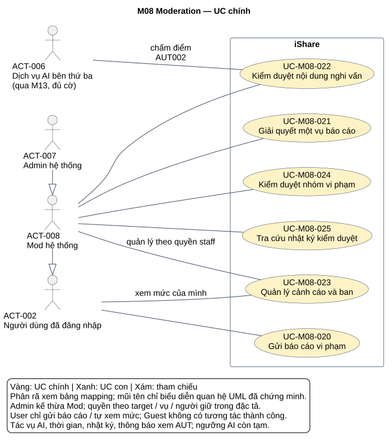
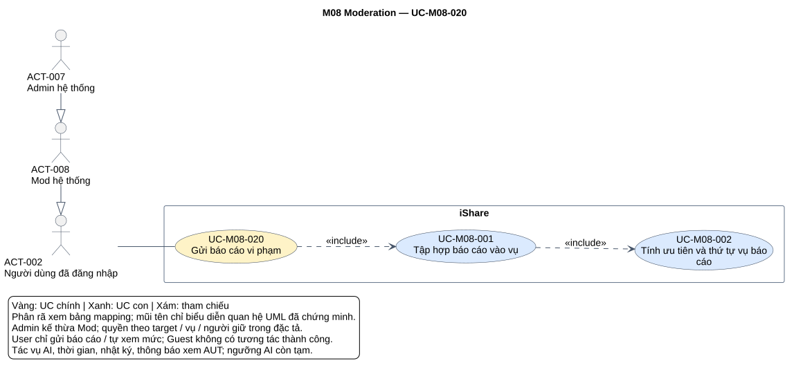
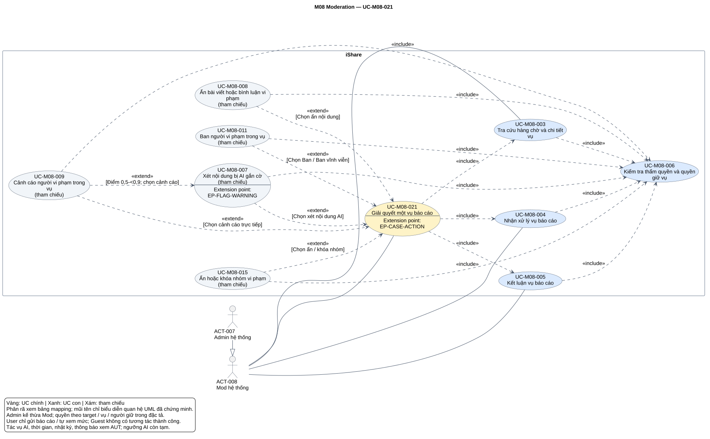
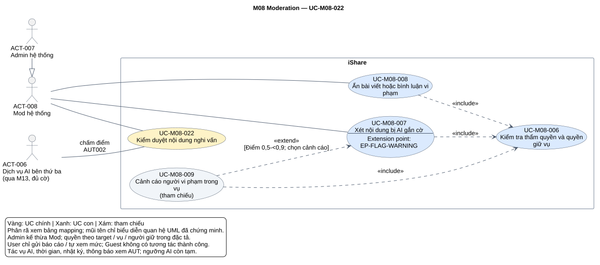
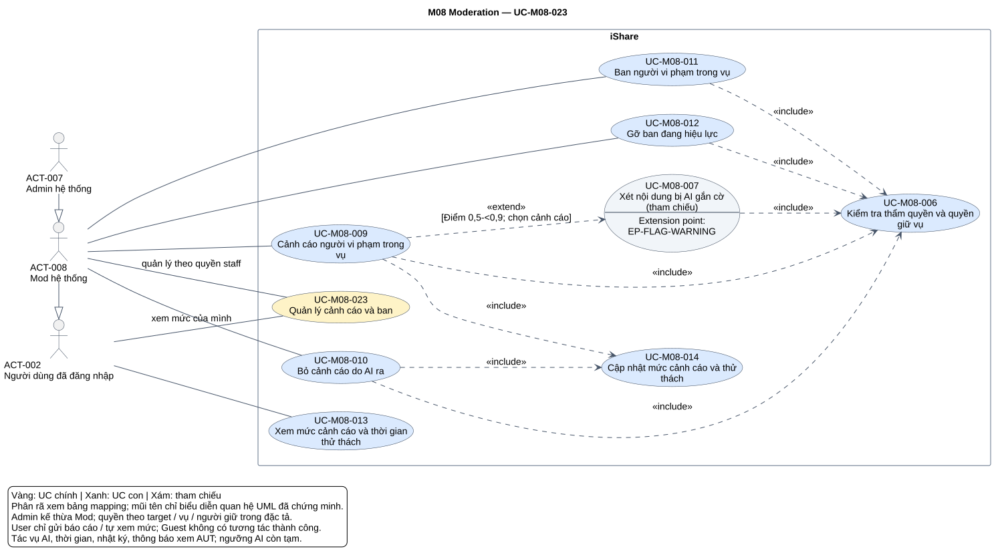
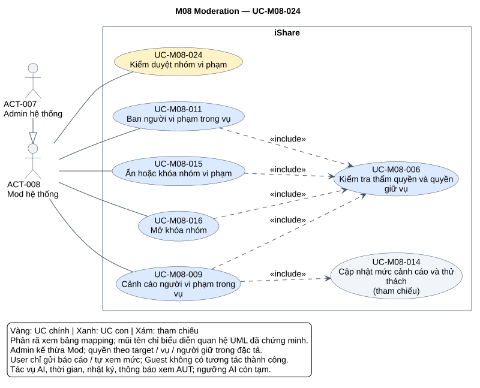
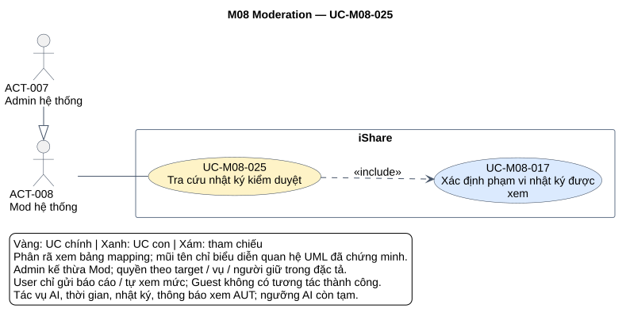

# Phân tích use case — M08 Moderation

[Vietnamese Doc] — Theo skill use-case-analysis v2.2; giữ thuật ngữ cần thiết, mô tả nghiệp vụ bằng tiếng Việt.

Tài liệu phân tích hai tầng cho M08: **6 UC chính, 17 UC con**, 22 ánh xạ chính–con, hợp đồng/luồng, xử lý tự động, quan hệ UML, truy vết và một sơ đồ chi tiết cho từng UC chính. Chỉ phân tích M08; UC chính là đầu vào tổng hợp hệ thống, không tự viết lại overview toàn dự án.

## Metadata và tiến độ

<!-- uc:document -->
| key | value |
|---|---|
| document_id | US-M08 |
| skill_version | 2.2 |
| mode | module |
| modules | M08 |
| scope | ALL |
| status | Chờ duyệt |
| current_step | 7 |
| completed_steps | 1, 2, 3, 4, 5, 6, 7 |
| approved_steps | - |
| source_baseline | FR-M08 v1.7; FR-M01 v1.10; FR-M02 v1.6; FR-M03 v1.10; FR-M04 v1.4; FR-M05 v1.7; FR-M06 v1.5; FR-M07 v1.5; FR-M09 v1.2; FR-M10 v1.4; FR-M11 v1.3; FR-M12 v1.1; FR-M13 v1.3; FR-M14 v1.1; FR-M15 v1.1; FR-M16 v1.0 |
| author | Codex |
| date | 2026-10-31 |
| approval_evidence | Người dùng đã cho phép tự thực hiện các bước cần thiết, không hỏi đồng ý ở lượt M04; tiếp tục áp dụng cho chuỗi phân tích module hiện tại. Đây là quyền thực hiện liên tục, không phải phê duyệt US-M08 hay kết quả từng bước. |
| semantic_review | pass |
| diagram_check | pass |

| Bước | Kết quả | Xác nhận | Baseline | Làm lại khi |
|---|---|---|---|---|
| 1 | 18 nhóm, 166 FR chi tiết, 55 BR; boundary, actor, giao tiếp, TBD | Được thực hiện liên tục; chưa duyệt | FR-M08 v1.7 | Nguồn đổi |
| 2 | 6 core, 17 sub; 22 mapping, ID dùng chung | Chưa duyệt | FR-M08 v1.7 | Mục tiêu/phạm vi đổi |
| 3 | 20 hợp đồng chi tiết, 3 brief Summary; 8 AUT, 6 RULE | Chưa duyệt | FR-M08 v1.7 | Hành vi/quyền đổi |
| 4 | 19 include, 6 extend, 2 extension point; xét các cặp không có quan hệ | Chưa duyệt | Mô hình tại đây | Luồng/guard đổi |
| 5 | 239 dòng truy vết, 221 tiêu chí chi tiết/BR; đối chiếu 15 FR liên quan | Chưa duyệt | FR-M08 v1.7; FR-M01 v1.10; FR-M02 v1.6; FR-M03 v1.10; FR-M04 v1.4; FR-M05 v1.7; FR-M06 v1.5; FR-M07 v1.5; FR-M09 v1.2; FR-M10 v1.4; FR-M11 v1.3; FR-M12 v1.1; FR-M13 v1.3; FR-M14 v1.1; FR-M15 v1.1; FR-M16 v1.0 | Baseline chịu tác động đổi |
| 6 | 7 SVG đã kiểm parser/render/hình; parity đủ node và 37 lần xuất hiện cạnh theo 25 relation | Chưa duyệt | PlantUML 1.2026.8 | Mô hình/nguồn đổi |
| 7 | Đã rà cấu trúc/ngữ nghĩa/truy vết/liên kết/hình; hồ sơ Chờ duyệt, giữ NOTE/TBD nguồn | Chưa duyệt | Skill v2.2 | Phản hồi/baseline đổi |

## 1. Phạm vi, nguồn và tổng hợp yêu cầu

**Mục đích sử dụng:** phục vụ review nghiệp vụ, tổng hợp UC chính hệ thống và làm đầu vào thiết kế/kiểm thử. Mục 2 trình bày hai tầng; mục 3 mô tả hợp đồng/luồng/tiêu chí; mục 4 giải thích UML; mục 5 truy vết; mục 6 là hình; mục 7 ghi QA, các giới hạn nguồn cần review.

**Subject/boundary:** toàn iShare, M08 là phạm vi nghiệp vụ. M01/M03/M04/M07/M09/M10/M11/M12/M13 và các module khác đều nội bộ; AI bên thứ ba mới là actor hỗ trợ ngoài subject. Không biến Hệ thống (AI) ở trường người báo cáo, hàng đợi, M13, cron, đồng hồ hoặc worker thành actor. Tác vụ theo sự kiện/thời gian có AUT với trigger/điều kiện/kết quả.

**Trong phạm vi:** gửi báo cáo bốn loại đối tượng; gom vụ và ưu tiên; quyền giữ/nhả 30 phút; điều tra, kết luận, bảo vệ thông tin tố cáo; xét/ẩn nội dung; quét luồng bình luận và cảnh cáo AI; cảnh cáo, bỏ AI, giảm mức, xem riêng tư; ban/gỡ ban; ẩn/khóa/mở khóa nhóm; ghi/tra cứu nhật ký; nội dung và người nhận sự kiện M07.

**Ngoài phạm vi:** cổng quét/duyệt bài M03, hiển thị luồng M04, gửi thông báo M07, quyết khiếu nại M09, cấu hình cờ/role M10, quản trị nhóm M11, tính điểm M12, lời gọi AI M13, thống kê M15. Không thêm xóa nội dung người khác, gỡ avatar/bio, AI tự ban, phạt tự động báo cáo sai, rút/sửa báo cáo, bỏ ẩn nhóm, báo cáo/quét Chat trong MS1 hay giao diện cấu hình hằng số.

**Baseline owner:** [FR-M08 — Moderation](../fr/FR-M08.md) v1.7, Đã chốt 2026-10-24; mốc DEC-271, QA-477, ISS-415, OPEN-012. Có 239 mã hiệu lực = 18 nhóm + 166 FR chi tiết + 55 BR; không có mã FR/BR đã bỏ trong phần hiện hành. Ngưỡng tạm và các TBD không bị biến thành giá trị chính sách cuối cùng.

<!-- uc:sources -->
| path | version | role |
|---|---|---|
| docs/specs/fr/FR-M08.md | 1.7 | owner |
| docs/specs/fr/FR-M01.md | 1.10 | related |
| docs/specs/fr/FR-M02.md | 1.6 | related |
| docs/specs/fr/FR-M03.md | 1.10 | related |
| docs/specs/fr/FR-M04.md | 1.4 | related |
| docs/specs/fr/FR-M05.md | 1.7 | related |
| docs/specs/fr/FR-M06.md | 1.5 | related |
| docs/specs/fr/FR-M07.md | 1.5 | related |
| docs/specs/fr/FR-M09.md | 1.2 | related |
| docs/specs/fr/FR-M10.md | 1.4 | related |
| docs/specs/fr/FR-M11.md | 1.3 | related |
| docs/specs/fr/FR-M12.md | 1.1 | related |
| docs/specs/fr/FR-M13.md | 1.3 | related |
| docs/specs/fr/FR-M14.md | 1.1 | related |
| docs/specs/fr/FR-M15.md | 1.1 | related |
| docs/specs/fr/FR-M16.md | 1.0 | related |

Nguồn phương pháp: [skill](../../../.agent-instructions/skills/use-case-analysis/SKILL.md), [quy tắc mô hình](../../../.agent-instructions/skills/use-case-analysis/references/modeling-rules.md), [quy tắc sơ đồ](../../../.agent-instructions/skills/use-case-analysis/references/diagram-rules.md). Chỉ dùng để quyết định cách biểu diễn, không lấy làm nguồn tính năng. US các module trước được dùng đối chiếu ID/owner, không coi là chuẩn vàng thay FR.

### Actor và quyền

<!-- uc:actors -->
| id | name | kind | parent | boundary_reason | sources |
|---|---|---|---|---|---|
| ACT-001 | Guest | human | - | Người chưa có phiên; bị từ chối các thao tác M08, chỉ hiện trong nhánh từ chối, không association thành công. | FR-M08-01.06, BR-M08-01, FR-M08-02.04 |
| ACT-002 | Người dùng đã đăng nhập | human | - | Người ngoài iShare gửi báo cáo và xem mức cảnh cáo riêng; không có quyền staff. | FR-M08-01.02, FR-M08-13.01, FR-M08-13.02 |
| ACT-008 | Mod hệ thống | human | ACT-002 | Chuyên biệt quyền User cho điều tra/xử lý/nhật ký theo phạm vi. Tách khỏi actor gộp ACT-003 của các module trước vì M08 cần phân biệt Mod/Admin. | FR-M08-02.01, FR-M08-03.01, FR-M08-10.08, FR-M08-17.02 |
| ACT-007 | Admin hệ thống | human | ACT-008 | Có quyền Mod trong M08, thêm quyền xử lý Mod và toàn bộ nhật ký; vẫn chịu điều kiện tự xử lý/giữ vụ. Giữ ID Admin đã dùng trong M05, không đổi các tài liệu đó. | FR-M08-02.09, FR-M08-10.08, FR-M08-14.09, FR-M08-17.01 |
| ACT-006 | Dịch vụ AI bên thứ ba | external-system | - | Nhận yêu cầu chấm điểm kiểm duyệt qua M13 khi đủ cờ. Không là người giữ vụ, không tự ban; Hệ thống (AI) trong dữ liệu báo cáo không tạo actor mới. | FR-M08-08.01, FR-M08-08.09, FR-M13-01.01, FR-M13-02.03 |

ACT-007 → ACT-008 → ACT-002 kế thừa tương tác; quyền được kiểm theo đúng target/operation. ACT-003 gộp Mod/Admin không dùng làm actor xử lý M08. Group Mod/Owner chỉ là vai trò nhóm, không đồng nghĩa ACT-008/007. Actor User liên hệ core023 qua xem mức của mình, không được suy thành quyền cảnh cáo/ban. Với Subfunction, primary là ngữ cảnh/đối tượng liên quan qua caller, không là nút người dùng được quyền gọi riêng. AI chỉ hỗ trợ năng lực quét AUT002 của core022; M07 xử lý email nội bộ, không tạo thêm actor email trong M08.

### Kiểm kê 18 nhóm và cách biểu diễn

| Nhóm FR | Tổng hợp | Chi tiết | Biểu diễn | Owner |
|---|---|---|---|---|
| FR-M08-01 | Bốn loại đối tượng, lý do đúng loại, dữ liệu hợp lệ, trùng/quyền/Admin; lưu vào vụ, không đổi trạng thái nội dung. | 20 | [UC-M08-020](#uc-m08-020), [UC-M08-001](#uc-m08-001), [UC-M08-002](#uc-m08-002) | M08 |
| FR-M08-02 | Hàng chờ theo ưu tiên, đánh dấu giữ/ban, giữ tới kết luận; lọc vụ tự thân và vụ về Mod. | 9 | [UC-M08-021](#uc-m08-021), [UC-M08-003](#uc-m08-003), [UC-M08-006](#uc-m08-006) | M08 |
| FR-M08-03 | Một người giữ, kiểm quyền hiện hành, tự nhả 30 phút; nhận/nhả không vào nhật ký. | 9 | [UC-M08-021](#uc-m08-021), [UC-M08-004](#uc-m08-004), [UC-M08-006](#uc-m08-006); AUT001 | M08 |
| FR-M08-04 | Chi tiết báo cáo/đối tượng/lịch sử/cảnh cáo/chỉ số 90×24 giờ; nội dung lưu giữ chỉ trong đúng ngữ cảnh. | 10 | [UC-M08-021](#uc-m08-021), [UC-M08-003](#uc-m08-003) | M08 |
| FR-M08-05 | Có xử lý/Bác bỏ cùng lý do; đóng mọi báo cáo; kết quả chung/chi tiết đúng người. | 11 | [UC-M08-021](#uc-m08-021), [UC-M08-005](#uc-m08-005); AUT007 | M08 |
| FR-M08-06 | Ẩn post/comment trong vụ, không xóa người khác hoặc ẩn lặp. | 6 | [UC-M08-022](#uc-m08-022), [UC-M08-008](#uc-m08-008) | M08 |
| FR-M08-07 | Xét post gắn cờ/comment trung bình, có thể giữ/ẩn và quyết cảnh cáo riêng; AI tạo mục chung vụ. | 10 | [UC-M08-022](#uc-m08-022), [UC-M08-007](#uc-m08-007) | M08 |
| FR-M08-08 | Quét comment theo tốc độ reply; bản hiện tại; bỏ Admin; phân nhánh điểm/lỗi/cờ tắt. | 12 | [UC-M08-022](#uc-m08-022); AUT002 | M08 |
| FR-M08-09 | AI cảnh cáo theo điểm, mỗi nội dung; Mod chuyển Admin, Admin miễn, HEAVY yêu cầu ban; không AI ban. | 12 | [UC-M08-023](#uc-m08-023), [UC-M08-014](#uc-m08-014); AUT003/004 | M08 |
| FR-M08-10 | Staff cảnh cáo trong vụ, có thể cảnh cáo reporter ác ý; áp role/HEAVY, không phạt tự động. | 11 | [UC-M08-023](#uc-m08-023), [UC-M08-009](#uc-m08-009), [UC-M08-014](#uc-m08-014) | M08 |
| FR-M08-11 | Bỏ cảnh cáo AI, giảm số lần/tính mức, record giữ, thử thách không đổi. | 5 | [UC-M08-023](#uc-m08-023), [UC-M08-010](#uc-m08-010), [UC-M08-014](#uc-m08-014) | M08 |
| FR-M08-12 | Hết thử thách giảm một mức, số lần 4/2/0, nối thử thách theo N×24h. | 5 | [UC-M08-023](#uc-m08-023), [UC-M08-014](#uc-m08-014); AUT005 | M08 |
| FR-M08-13 | Mức/thử thách riêng tư, không hiện công khai. | 3 | [UC-M08-023](#uc-m08-023), [UC-M08-013](#uc-m08-013) | M08 |
| FR-M08-14 | Ban leo thang hoặc vĩnh viễn, không chồng, role/giữ, HEAVY yêu cầu ban, ban Mod mất role. | 14 | [UC-M08-023](#uc-m08-023), [UC-M08-011](#uc-m08-011); AUT004/008 | M08 |
| FR-M08-15 | Gỡ ban trực tiếp, ACTIVE, app/email, lịch sử vẫn giữ. | 5 | [UC-M08-023](#uc-m08-023), [UC-M08-012](#uc-m08-012) | M08 |
| FR-M08-16 | Log bất biến/vĩnh viễn, danh tính đã xóa tra username, M05/M10, không nhận/nhả. | 7 | [UC-M08-025](#uc-m08-025); AUT006 | M08 |
| FR-M08-17 | Admin mọi dòng/lọc người làm; Mod vụ mình và ngoại lệ đúng khiếu nại đang xét. | 6 | [UC-M08-025](#uc-m08-025), [UC-M08-017](#uc-m08-017) | M08 |
| FR-M08-18 | Ẩn/khóa trong vụ, Owner là người bị báo cáo; mở khóa trực tiếp, không bỏ ẩn, M11 áp chặn đầy đủ. | 11 | [UC-M08-024](#uc-m08-024), [UC-M08-015](#uc-m08-015), [UC-M08-016](#uc-m08-016) | M08 |

## 2. UC chính, UC con và quyết định phân rã

### 2.1 Danh mục hai tầng

<!-- uc:catalog -->
| id | name | tier | level | primary | supporting | owner | anchor | sources |
|---|---|---|---|---|---|---|---|---|
| UC-M08-020 | Gửi báo cáo vi phạm | core | User goal | ACT-002, ACT-008, ACT-007 | - | M08 | #uc-m08-020 | FR-M08-01, BR-M08-01, BR-M08-02, BR-M08-03, BR-M08-04, BR-M08-47, BR-M08-55 |
| UC-M08-021 | Giải quyết một vụ báo cáo | core | User goal | ACT-008, ACT-007 | - | M08 | #uc-m08-021 | FR-M08-02, FR-M08-03, FR-M08-04, FR-M08-05, BR-M08-08, BR-M08-10, BR-M08-46, BR-M08-48 |
| UC-M08-022 | Kiểm duyệt nội dung nghi vấn | core | Summary | ACT-008, ACT-007 | ACT-006 | M08 | #uc-m08-022 | FR-M08-06, FR-M08-07, FR-M08-08, FR-M08-09, BR-M08-22, BR-M08-23, BR-M08-55 |
| UC-M08-023 | Quản lý cảnh cáo và ban | core | Summary | ACT-002, ACT-008, ACT-007 | - | M08 | #uc-m08-023 | FR-M08-09, FR-M08-10, FR-M08-11, FR-M08-12, FR-M08-13, FR-M08-14, FR-M08-15, BR-M08-31, BR-M08-33, BR-M08-46 |
| UC-M08-024 | Kiểm duyệt nhóm vi phạm | core | Summary | ACT-008, ACT-007 | - | M08 | #uc-m08-024 | FR-M08-18, BR-M08-46, BR-M08-48, BR-M08-50, BR-M11-28 |
| UC-M08-025 | Tra cứu nhật ký kiểm duyệt | core | User goal | ACT-008, ACT-007 | - | M08 | #uc-m08-025 | FR-M08-16, FR-M08-17, BR-M08-39, BR-M08-40, BR-M08-41 |
| UC-M08-001 | Tập hợp báo cáo vào vụ | sub | Subfunction | ACT-002, ACT-008, ACT-007 | - | M08 | #uc-m08-001 | FR-M08-01.02, FR-M08-01.03, FR-M08-01.04, FR-M08-07.09, BR-M08-05, BR-M08-49 |
| UC-M08-002 | Tính ưu tiên và thứ tự vụ báo cáo | sub | Subfunction | ACT-002, ACT-008, ACT-007 | - | M08 | #uc-m08-002 | FR-M08-01.05, FR-M08-02.01, FR-M08-02.07, BR-M08-06, BR-M08-07, BR-M08-49 |
| UC-M08-003 | Tra cứu hàng chờ và chi tiết vụ | sub | User goal | ACT-008, ACT-007 | - | M08 | #uc-m08-003 | FR-M08-02, FR-M08-04, BR-M08-11, BR-M08-15, BR-M08-19, BR-M08-46 |
| UC-M08-004 | Nhận xử lý vụ báo cáo | sub | User goal | ACT-008, ACT-007 | - | M08 | #uc-m08-004 | FR-M08-03, BR-M08-08, BR-M08-09, BR-M08-46 |
| UC-M08-005 | Kết luận vụ báo cáo | sub | User goal | ACT-008, ACT-007 | - | M08 | #uc-m08-005 | FR-M08-05, BR-M08-10, BR-M08-12, BR-M08-13, BR-M08-14 |
| UC-M08-006 | Kiểm tra thẩm quyền và quyền giữ vụ | sub | Subfunction | ACT-008, ACT-007 | - | M08 | #uc-m08-006 | FR-M08-03.03, FR-M08-03.06, FR-M08-03.07, FR-M08-03.09, BR-M08-46, BR-M08-48 |
| UC-M08-007 | Xét nội dung bị AI gắn cờ | sub | User goal | ACT-008, ACT-007 | - | M08 | #uc-m08-007 | FR-M08-07.01, FR-M08-07.02, FR-M08-07.03, FR-M08-07.04, FR-M08-07.05, FR-M08-07.06, FR-M08-07.07, FR-M08-07.08, BR-M08-23, BR-M08-48 |
| UC-M08-008 | Ẩn bài viết hoặc bình luận vi phạm | sub | User goal | ACT-008, ACT-007 | - | M08 | #uc-m08-008 | FR-M08-06, BR-M08-16, BR-M08-48, FR-M12-02.10, FR-M12-02.11 |
| UC-M08-009 | Cảnh cáo người vi phạm trong vụ | sub | User goal | ACT-008, ACT-007 | - | M08 | #uc-m08-009 | FR-M08-10, BR-M08-17, BR-M08-18, BR-M08-28, BR-M08-29, BR-M08-36 |
| UC-M08-010 | Bỏ cảnh cáo do AI ra | sub | User goal | ACT-008, ACT-007 | - | M08 | #uc-m08-010 | FR-M08-11, BR-M08-54, FR-M08-16.05 |
| UC-M08-011 | Ban người vi phạm trong vụ | sub | User goal | ACT-008, ACT-007 | - | M08 | #uc-m08-011 | FR-M08-14, BR-M08-33, BR-M08-34, BR-M08-35, BR-M08-36, BR-M08-52, BR-M08-53 |
| UC-M08-012 | Gỡ ban đang hiệu lực | sub | User goal | ACT-008, ACT-007 | - | M08 | #uc-m08-012 | FR-M08-15, BR-M08-38, BR-M08-48, BR-M08-34, FR-M10-06.01 |
| UC-M08-013 | Xem mức cảnh cáo và thời gian thử thách | sub | User goal | ACT-002, ACT-008, ACT-007 | - | M08 | #uc-m08-013 | FR-M08-13, BR-M08-31, BR-M08-32, BR-M08-43 |
| UC-M08-014 | Cập nhật mức cảnh cáo và thử thách | sub | Subfunction | ACT-008, ACT-007 | - | M08 | #uc-m08-014 | FR-M08-09.04, FR-M08-10.02, FR-M08-11.03, FR-M08-11.05, FR-M08-12, BR-M08-28, BR-M08-29, BR-M08-30, BR-M08-54 |
| UC-M08-015 | Ẩn hoặc khóa nhóm vi phạm | sub | User goal | ACT-008, ACT-007 | - | M08 | #uc-m08-015 | FR-M08-18.01, FR-M08-18.02, FR-M08-18.03, FR-M08-18.04, FR-M08-18.05, FR-M08-18.06, FR-M08-18.08, BR-M08-50, BR-M11-28 |
| UC-M08-016 | Mở khóa nhóm | sub | User goal | ACT-008, ACT-007 | - | M08 | #uc-m08-016 | FR-M08-18.07, FR-M08-18.09, FR-M08-18.10, BR-M08-48, BR-M08-50 |
| UC-M08-017 | Xác định phạm vi nhật ký được xem | sub | Subfunction | ACT-008, ACT-007 | - | M08 | #uc-m08-017 | FR-M08-17, BR-M08-40, BR-M08-41 |

`tier` độc lập `level`: core020/021/025 là User goal có hợp đồng chi tiết, ba core còn lại Summary đặt nhiều mục tiêu vào bối cảnh. Các sub giữ một ID dù được nhiều core dùng; không đặt ID theo loại quan hệ. Khi ghép overview hệ thống chỉ lấy nguyên sáu dòng core.

### 2.2 Ánh xạ chính → con

<!-- uc:decomposition -->
| core | sub | rationale | sources |
|---|---|---|---|
| UC-M08-020 | UC-M08-001 | Giữ dữ liệu báo cáo trong đúng vụ Mở | FR-M08-01.02, FR-M08-01.03, FR-M08-01.04, FR-M08-07.09, BR-M08-05, BR-M08-49 |
| UC-M08-020 | UC-M08-002 | Ưu tiên vụ từ lý do/số báo cáo nhất quán | FR-M08-01.05, FR-M08-02.01, FR-M08-02.07, BR-M08-06, BR-M08-07, BR-M08-49 |
| UC-M08-021 | UC-M08-003 | Điều tra dữ liệu/hàng chờ đúng quyền | FR-M08-02, FR-M08-04, BR-M08-11, BR-M08-15, BR-M08-19, BR-M08-46 |
| UC-M08-021 | UC-M08-004 | Đảm bảo một người giữ vụ để tác động | FR-M08-03, BR-M08-08, BR-M08-09, BR-M08-46 |
| UC-M08-021 | UC-M08-005 | Đóng vụ và phân phối kết quả đúng phạm vi | FR-M08-05, BR-M08-10, BR-M08-12, BR-M08-13, BR-M08-14 |
| UC-M08-021 | UC-M08-006 | Tái sử dụng quyền theo chế độ đọc/nhận/xử lý/trực tiếp | FR-M08-03.03, FR-M08-03.06, FR-M08-03.07, FR-M08-03.09, BR-M08-46, BR-M08-48 |
| UC-M08-022 | UC-M08-007 | Quyết định nội dung AI đang chờ xét | FR-M08-07.01, FR-M08-07.02, FR-M08-07.03, FR-M08-07.04, FR-M08-07.05, FR-M08-07.06, FR-M08-07.07, FR-M08-07.08, BR-M08-23, BR-M08-48 |
| UC-M08-022 | UC-M08-008 | Ẩn nội dung vi phạm, giữ dữ liệu | FR-M08-06, BR-M08-16, BR-M08-48, FR-M12-02.10, FR-M12-02.11 |
| UC-M08-022 | UC-M08-006 | Tái sử dụng quyền theo chế độ đọc/nhận/xử lý/trực tiếp | FR-M08-03.03, FR-M08-03.06, FR-M08-03.07, FR-M08-03.09, BR-M08-46, BR-M08-48 |
| UC-M08-023 | UC-M08-009 | Áp cảnh cáo đúng thẩm quyền và lý do | FR-M08-10, BR-M08-17, BR-M08-18, BR-M08-28, BR-M08-29, BR-M08-36 |
| UC-M08-023 | UC-M08-010 | Bỏ tác dụng cảnh cáo AI, giữ lịch sử | FR-M08-11, BR-M08-54, FR-M08-16.05 |
| UC-M08-023 | UC-M08-011 | Ban bằng quyết định con người trong vụ | FR-M08-14, BR-M08-33, BR-M08-34, BR-M08-35, BR-M08-36, BR-M08-52, BR-M08-53 |
| UC-M08-023 | UC-M08-012 | Gỡ ban trực tiếp, kết thúc ban đang hiệu lực | FR-M08-15, BR-M08-38, BR-M08-48, BR-M08-34, FR-M10-06.01 |
| UC-M08-023 | UC-M08-013 | Người dùng biết trạng thái cảnh cáo của mình | FR-M08-13, BR-M08-31, BR-M08-32, BR-M08-43 |
| UC-M08-023 | UC-M08-014 | Tính số lần/mức/thử thách theo đúng loại biến động | FR-M08-09.04, FR-M08-10.02, FR-M08-11.03, FR-M08-11.05, FR-M08-12, BR-M08-28, BR-M08-29, BR-M08-30, BR-M08-54 |
| UC-M08-023 | UC-M08-006 | Tái sử dụng quyền theo chế độ đọc/nhận/xử lý/trực tiếp | FR-M08-03.03, FR-M08-03.06, FR-M08-03.07, FR-M08-03.09, BR-M08-46, BR-M08-48 |
| UC-M08-024 | UC-M08-015 | Ẩn/khóa nhóm trong vụ về nhóm | FR-M08-18.01, FR-M08-18.02, FR-M08-18.03, FR-M08-18.04, FR-M08-18.05, FR-M08-18.06, FR-M08-18.08, BR-M08-50, BR-M11-28 |
| UC-M08-024 | UC-M08-016 | Mở khóa trực tiếp nhóm Bị khóa | FR-M08-18.07, FR-M08-18.09, FR-M08-18.10, BR-M08-48, BR-M08-50 |
| UC-M08-024 | UC-M08-009 | Áp cảnh cáo đúng thẩm quyền và lý do | FR-M08-10, BR-M08-17, BR-M08-18, BR-M08-28, BR-M08-29, BR-M08-36 |
| UC-M08-024 | UC-M08-011 | Ban bằng quyết định con người trong vụ | FR-M08-14, BR-M08-33, BR-M08-34, BR-M08-35, BR-M08-36, BR-M08-52, BR-M08-53 |
| UC-M08-024 | UC-M08-006 | Tái sử dụng quyền theo chế độ đọc/nhận/xử lý/trực tiếp | FR-M08-03.03, FR-M08-03.06, FR-M08-03.07, FR-M08-03.09, BR-M08-46, BR-M08-48 |
| UC-M08-025 | UC-M08-017 | Áp phạm vi nhật ký theo vai trò/ngữ cảnh khiếu nại | FR-M08-17, BR-M08-40, BR-M08-41 |

22 mapping, không UC con mồ côi. UC006 dùng chung nhiều core; UC009/011 dùng ở chế tài và nhóm. Mapping không tự tạo mũi tên UML. Các biện pháp khi giải quyết vụ là node tham chiếu trong D-M08-021; chúng giữ đặc tả/ID gốc, không nhân bản theo cha. AUT/RULE có core liên quan để nối hành vi tự động về mục tiêu.

### 2.3 Tổng hợp hệ thống và các quyết định

<!-- uc:module-models -->
| module | path | baseline |
|---|---|---|

US-overview chưa có tại thời điểm phân tích; lượt M08 không tổng hợp/cập nhật toàn dự án. Dùng core020–025 của tài liệu này làm đầu vào khi thực hiện overview sau.

| ID | Hành vi | Biểu diễn | Lý do | Phương án không chọn |
|---|---|---|---|---|
| D-M08-01 | Gửi báo cáo, gom vụ, xếp ưu tiên | [UC-M08-020](#uc-m08-020), [UC-M08-001](#uc-m08-001), [UC-M08-002](#uc-m08-002) | Tách hợp đồng vụ dùng cả báo cáo người dùng và mục AI; ưu tiên tái sử dụng | Không oval từng kiểm tra lý do/ảnh |
| D-M08-02 | Giải quyết vụ | [UC-M08-021](#uc-m08-021), [UC-M08-003](#uc-m08-003), [UC-M08-004](#uc-m08-004), [UC-M08-005](#uc-m08-005), [UC-M08-006](#uc-m08-006) | Claim/điều tra/kết luận rõ, quyền giữ kiểm lại tại mỗi hành động | Không include đăng nhập hoặc bắt nhận lại vụ đang tự giữ |
| D-M08-03 | Biện pháp nội dung/chế tài/nhóm | Các extend vào EP-CASE-ACTION | Mỗi biện pháp có hợp đồng/trạng thái riêng, base Bác bỏ vẫn hoàn tất khi không chọn biện pháp | Không bắt mọi vụ cùng ẩn+cảnh cáo+ban |
| D-M08-04 | Cảnh cáo khi xét nội dung trung bình | [UC-M08-009](#uc-m08-009) extend [UC-M08-007](#uc-m08-007) | Nội dung và chế tài độc lập, hai ngữ cảnh gọi cảnh cáo có guard tách nhau | Không coi ẩn nội dung luôn tăng cảnh cáo |
| D-M08-05 | Gỡ ban, mở khóa, bỏ AI | UC012/016/010 độc lập với thao tác áp chế tài trước đó | Mục tiêu ở thời điểm khác, có ngoại lệ không cần vụ | Không extend Ban/Khóa hoặc ép vụ cho ngoại lệ |
| D-M08-06 | AI/time/log/notification | 8 AUT, 6 RULE | Trigger, before/after và chính sách được đặc tả dù không có actor ngoài trực tiếp khởi tạo | Không actor Hệ thống/clock/module, không nhãn nền miễn truy vết |
| D-M08-07 | Nhật ký theo role | [UC-M08-025](#uc-m08-025) include [UC-M08-017](#uc-m08-017) | Phạm vi dữ liệu là hợp đồng đáng tách, gồm ngoại lệ M09 | Không suy quyền Mod đọc toàn bộ hoặc sửa/xóa log |
| D-M08-08 | Giới hạn chưa chốt | TBD và NOTE mục 7 | Giữ nguồn, ghi phạm vi thiếu rõ; không tự bổ sung quyết định sản phẩm | Không âm thầm chốt ngưỡng/nhánh số lần 0 |

## 3. Đặc tả nghiệp vụ

### 3.1 UC chính

### UC-M08-020 — Gửi báo cáo vi phạm

**Actor chính:** ACT-002, ACT-008, ACT-007. **Hỗ trợ:** -. **Mức:** User goal. **Giá trị:** Phản ánh một đối tượng nhìn thấy bị nghi vi phạm, đưa dữ liệu vào đúng vụ và hàng chờ. **Kết quả:** Báo cáo hợp lệ được lưu Mở trong đúng vụ, điểm ưu tiên được tính; báo cáo không làm đổi trạng thái nội dung.

**UC con:** [UC-M08-001](#uc-m08-001) — Giữ dữ liệu báo cáo trong đúng vụ Mở; [UC-M08-002](#uc-m08-002) — Ưu tiên vụ từ lý do/số báo cáo nhất quán.

<!-- uc:spec UC-M08-020 -->
| key | value |
|---|---|
| goal | Phản ánh một đối tượng nhìn thấy bị nghi vi phạm, đưa dữ liệu vào đúng vụ và hàng chờ. |
| subject | iShare |
| level | User goal |
| primary | ACT-002, ACT-008, ACT-007 |
| supporting | - |
| trigger | Chọn Báo cáo trên bài, bình luận, hồ sơ hoặc nhóm. |
| preconditions | Có đối tượng/người thao tác; phiên, quyền thấy, lý do, bằng chứng và trùng lặp được kiểm trong luồng. |
| success | Báo cáo hợp lệ được lưu Mở trong đúng vụ, điểm ưu tiên được tính; báo cáo không làm đổi trạng thái nội dung. |
| failure | Không nhận báo cáo Guest, tự báo cáo post/comment/account, Admin hoặc đối tượng không thấy; không sửa/rút báo cáo sau gửi. |
| abstract | false |
| common_contract | Không dùng generalization UC; mỗi ca có hợp đồng riêng. Mapping chính–con không là kế thừa. |

#### Luồng chính

| Bước | Ai | Hành động/phản hồi | Tiếp tục | Nguồn |
|---|---|---|---|---|
| 1 | Người thao tác / iShare | Người dùng chọn đối tượng; iShare kiểm đăng nhập, đối tượng còn hiển thị, quyền Private và cấm nhắm Admin/nhóm Owner Admin, cấm tự báo cáo bài/bình luận/tài khoản. | 2 | FR-M08-01, BR-M08-01, BR-M08-02, BR-M08-03, BR-M08-04, BR-M08-47, BR-M08-55 |
| 2 | iShare | Hiện đúng danh sách lý do theo loại; người dùng chọn một lý do, nhập mô tả và đính kèm bằng chứng tùy chọn. Kiểm bắt buộc lý do, Khác cần mô tả, tối đa 3 ảnh ≤5MB/ảnh JPEG/PNG/WebP. | 3 | FR-M08-01, BR-M08-01, BR-M08-02, BR-M08-03, BR-M08-04, BR-M08-47, BR-M08-55 |
| 3 | iShare | Kiểm người gửi chưa có báo cáo trong vụ Mở hiện tại; thực hiện [UC-M08-001](#uc-m08-001) với báo cáo hợp lệ để lưu vào vụ và xếp ưu tiên qua [UC-M08-002](#uc-m08-002). | 4 | FR-M08-01, BR-M08-01, BR-M08-02, BR-M08-03, BR-M08-04, BR-M08-47, BR-M08-55 |
| 4 | iShare | Xác nhận đã lưu; giữ nguyên trạng thái kiểm duyệt bài/bình luận. HEAVY vẫn được báo cáo, bài Khóa toàn bộ vẫn báo cáo, không yêu cầu bình luận đã quét AI. Không cung cấp rút/sửa báo cáo. | END: Báo cáo hợp lệ được lưu Mở trong đúng vụ, điểm ưu tiên được tính; báo cáo không làm đổi trạng thái nội dung. | FR-M08-01, BR-M08-01, BR-M08-02, BR-M08-03, BR-M08-04, BR-M08-47, BR-M08-55 |

#### Luồng thay thế và ngoại lệ

| ID | Bước rẽ | Điều kiện | Xử lý | Quay lại/kết thúc | Nguồn |
|---|---|---|---|---|---|
| A1 | 1 | Guest | Từ chối báo cáo. | END: không gửi | FR-M08-01.06 |
| A2 | 1 | Đối tượng không còn thấy; bài Private ngoài thành viên; tự báo cáo bài/bình luận/tài khoản; đối tượng Admin hoặc nhóm Owner Admin | Từ chối theo điều kiện tương ứng; không mở vụ. | END: không gửi | FR-M08-01.11, FR-M08-01.12, FR-M08-01.15, FR-M08-01.20 |
| A3 | 2 | Thiếu lý do hoặc Khác không mô tả | Từ chối gửi, cho sửa dữ liệu đầu vào trước khi gửi lại. | 2 | FR-M08-01.07, FR-M08-01.08 |
| A4 | 2 | Ảnh thứ tư, quá 5MB hoặc sai định dạng | Từ chối ảnh đó, không tự bỏ qua quy tắc bằng chứng. | 2 | FR-M08-01.09, FR-M08-01.10 |
| A5 | 3 | Đã có báo cáo của người này trong vụ Mở cùng đối tượng | Từ chối báo cáo mới; không cập nhật báo cáo cũ. | END: không báo cáo trùng | FR-M08-01.16 |

#### Quy tắc và giới hạn

Nguồn: FR-M08-01, BR-M08-01, BR-M08-02, BR-M08-03, BR-M08-04, BR-M08-47, BR-M08-55. Áp RULE/AUT đúng điều kiện; role, quyền giữ và scope của từng caller không được suy từ một association tổng quát. Các NOTE/TBD ở mục 7 không phải chính sách mới đã duyệt.

#### Tiêu chí nguồn và nghiệm thu

Các tiêu chí hiệu lực dưới đây được giữ nội dung để đối chiếu luồng/quy tắc; là điều kiện chấp nhận, không chỉ là danh sách mã. Các chi tiết nguồn chưa chốt được ghi ở mục 7.

| Mã | Tiêu chí |
|---|---|
| FR-M08-01.01 | Khi người dùng đã đăng nhập chọn "Báo cáo" trên một bài viết, bình luận, hồ sơ người dùng hoặc nhóm, hệ thống phải hiển thị danh sách lý do của đúng loại đối tượng đó (BR-M08-02). |
| FR-M08-01.06 | Nếu người chưa đăng nhập chọn báo cáo, hệ thống phải từ chối báo cáo. |
| FR-M08-01.07 | Nếu báo cáo không có lý do, hệ thống phải từ chối gửi. |
| FR-M08-01.08 | Nếu lý do là "Khác" mà mô tả trống, hệ thống phải từ chối gửi (BR-M08-04). |
| FR-M08-01.09 | Nếu người báo cáo đính kèm ảnh bằng chứng thứ tư, hệ thống phải từ chối ảnh đó (BR-M08-03). |
| FR-M08-01.10 | Nếu một ảnh bằng chứng lớn hơn 5MB hoặc có định dạng khác JPEG, PNG, WebP, hệ thống phải từ chối ảnh đó (BR-M08-03). |
| FR-M08-01.11 | Nếu đối tượng là bài viết thuộc nhóm Private mà người báo cáo không là thành viên, hệ thống phải từ chối báo cáo (BR-M08-45). |
| FR-M08-01.12 | Nếu đối tượng không còn hiển thị với người báo cáo, hệ thống phải từ chối báo cáo (BR-M08-47). |
| FR-M08-01.13 | Hệ thống phải cho báo cáo bài viết đang ở mức Khóa toàn bộ (BR-M08-45). |
| FR-M08-01.14 | Hệ thống phải cho báo cáo bình luận bất kể bình luận đã được quét AI hay chưa. |
| FR-M08-01.15 | Nếu người dùng báo cáo bài viết, bình luận hoặc tài khoản của chính mình, hệ thống phải từ chối báo cáo (BR-M08-47). |
| FR-M08-01.16 | Nếu người báo cáo đã có một báo cáo trong vụ đang Mở của cùng đối tượng, hệ thống phải từ chối báo cáo mới (BR-M08-47). |
| FR-M08-01.17 | Hệ thống phải cho người đang ở mức cảnh cáo HEAVY gửi báo cáo (BR-M08-47). |
| FR-M08-01.18 | Hệ thống phải không cho người báo cáo rút hoặc sửa báo cáo đã gửi (BR-M08-47). |
| FR-M08-01.19 | Hệ thống phải chỉ nhận một lý do cho mỗi báo cáo (BR-M08-02). |
| FR-M08-01.20 | Nếu đối tượng là bài viết, bình luận hoặc tài khoản của Admin, hoặc nhóm có Owner là Admin, hệ thống phải từ chối báo cáo (BR-M08-55). |
| BR-M08-01 | Chỉ người dùng đã đăng nhập được báo cáo; Guest không báo cáo được. |
| BR-M08-02 | Lý do báo cáo theo loại đối tượng. Bài viết (8): Spam/Quảng cáo; Nội dung sai/hiểu nhầm; Đạo văn/Vi phạm bản quyền; Quấy rối/Bắt nạt; Ngôn từ thù ghét/Phân biệt; Nội dung người lớn/Không phù hợp; Bạo lực/Đe dọa; Khác. Bình luận (7): như bài viết, bỏ Đạo văn/Vi phạm bản quyền. Người dùng (2): Quấy rối/Bắt nạt có hệ thống; Khác. Nhóm (4): Nội dung người lớn/Không phù hợp; Group giả mạo; Quấy rối/Bắt nạt có hệ thống; Khác. Mỗi báo cáo chọn đúng một lý do. |
| BR-M08-03 | Bằng chứng tối đa 3 ảnh, mỗi ảnh tối đa 5MB, định dạng JPEG, PNG hoặc WebP. |
| BR-M08-04 | Mô tả là tùy chọn; bắt buộc khi lý do là "Khác". |
| BR-M08-45 | Bài đang ở mức Khóa toàn bộ vẫn báo cáo được. Bài trong nhóm đã chuyển Private không báo cáo được bởi người không phải thành viên (M11). |
| BR-M08-47 | Gửi báo cáo: không báo cáo được bài viết, bình luận, tài khoản của chính mình; khi đối tượng đang có vụ Mở, một người chỉ có một báo cáo trong vụ đó; người ở mức HEAVY vẫn báo cáo được; đối tượng không còn hiển thị với người báo cáo thì bị từ chối; báo cáo đã gửi không rút, không sửa được. |

### UC-M08-021 — Giải quyết một vụ báo cáo

**Actor chính:** ACT-008, ACT-007. **Hỗ trợ:** -. **Mức:** User goal. **Giá trị:** Điều tra, chọn biện pháp phù hợp và kết luận vụ, bảo vệ dữ liệu người báo cáo. **Kết quả:** Vụ và mọi báo cáo Mở được kết luận cùng kết quả, lý do/nhật ký/thông báo đúng phạm vi.

**UC con:** [UC-M08-003](#uc-m08-003) — Điều tra dữ liệu/hàng chờ đúng quyền; [UC-M08-004](#uc-m08-004) — Đảm bảo một người giữ vụ để tác động; [UC-M08-005](#uc-m08-005) — Đóng vụ và phân phối kết quả đúng phạm vi; [UC-M08-006](#uc-m08-006) — Tái sử dụng quyền theo chế độ đọc/nhận/xử lý/trực tiếp.

<!-- uc:spec UC-M08-021 -->
| key | value |
|---|---|
| goal | Điều tra, chọn biện pháp phù hợp và kết luận vụ, bảo vệ dữ liệu người báo cáo. |
| subject | iShare |
| level | User goal |
| primary | ACT-008, ACT-007 |
| supporting | - |
| trigger | Người có vai trò kiểm duyệt chọn xử lý một vụ Mở được phép thấy. |
| preconditions | Có vụ; quyền nhìn/nhận/giữ và trạng thái được kiểm ở từng hành vi, không giấu vụ đang bị người khác giữ. |
| success | Vụ và mọi báo cáo Mở được kết luận cùng kết quả, lý do/nhật ký/thông báo đúng phạm vi. |
| failure | Không xử lý ngoài quyền hoặc không còn giữ; không kết luận lại hay lộ thông tin tố cáo cho người bị xử lý. |
| abstract | false |
| common_contract | Không dùng generalization UC; mỗi ca có hợp đồng riêng. Mapping chính–con không là kế thừa. |

#### Luồng chính

| Bước | Ai | Hành động/phản hồi | Tiếp tục | Nguồn |
|---|---|---|---|---|
| 1 | Người thao tác / iShare | Người xử lý chọn vụ từ hàng chờ; iShare dùng phạm vi nhìn/nhận theo [RULE-M08-001](#rule-m08-001). | 2 | FR-M08-02, FR-M08-03, FR-M08-04, FR-M08-05, BR-M08-08, BR-M08-10, BR-M08-46, BR-M08-48 |
| 2 | iShare | Thực hiện [UC-M08-004](#uc-m08-004) để nhận vụ chưa ai giữ; nếu chính mình đã giữ thì đi thẳng bước 3, không bắt nhận lại. | 3 | FR-M08-02, FR-M08-03, FR-M08-04, FR-M08-05, BR-M08-08, BR-M08-10, BR-M08-46, BR-M08-48 |
| 3 | iShare | Thực hiện [UC-M08-003](#uc-m08-003) ở chế độ chi tiết vụ đã chọn để đọc báo cáo, đối tượng, lịch sử, cảnh cáo và chỉ số tham khảo. | 4 | FR-M08-02, FR-M08-03, FR-M08-04, FR-M08-05, BR-M08-08, BR-M08-10, BR-M08-46, BR-M08-48 |
| 4 | iShare | Tại EP-CASE-ACTION, người giữ cân nhắc chứng cứ. Chọn xét nội dung AI ([UC-M08-007](#uc-m08-007)), ẩn nội dung ([UC-M08-008](#uc-m08-008)), cảnh cáo trực tiếp ([UC-M08-009](#uc-m08-009)), Ban ([UC-M08-011](#uc-m08-011)), hoặc ẩn/khóa nhóm ([UC-M08-015](#uc-m08-015)) thì chèn đúng hành vi đó. Các hành vi này không tự kết luận vụ; có thể chọn hành động khác còn hợp lệ rồi tiến tới bước 5. Không bắt chạy mọi biện pháp; Bác bỏ vẫn có ý nghĩa khi không có xử lý. | 5 | FR-M08-02, FR-M08-03, FR-M08-04, FR-M08-05, BR-M08-08, BR-M08-10, BR-M08-46, BR-M08-48 |
| 5 | iShare | Thực hiện [UC-M08-005](#uc-m08-005) để kết luận Có xử lý hoặc Bác bỏ kèm lý do; chỉ người còn giữ vụ được kết luận. | 6 | FR-M08-02, FR-M08-03, FR-M08-04, FR-M08-05, BR-M08-08, BR-M08-10, BR-M08-46, BR-M08-48 |
| 6 | iShare | Kết thúc với vụ Đã xử lý, báo cáo cùng kết luận; [AUT-M08-007](#aut-m08-007) phát kết quả, [AUT-M08-006](#aut-m08-006) ghi nhật ký. Không gộp hàng chờ báo cáo với hàng chờ khiếu nại M09. | END: Vụ và mọi báo cáo Mở được kết luận cùng kết quả, lý do/nhật ký/thông báo đúng phạm vi. | FR-M08-02, FR-M08-03, FR-M08-04, FR-M08-05, BR-M08-08, BR-M08-10, BR-M08-46, BR-M08-48 |

#### Luồng thay thế và ngoại lệ

| ID | Bước rẽ | Điều kiện | Xử lý | Quay lại/kết thúc | Nguồn |
|---|---|---|---|---|---|
| A1 | 2 | Người khác đang giữ, vụ đã kết luận hoặc không đủ quyền nhận | [UC-M08-004](#uc-m08-004) từ chối, không thực hiện biện pháp/kết luận. | END: chưa nhận vụ | FR-M08-03.02, FR-M08-03.05, FR-M08-03.06, FR-M08-03.07, FR-M08-03.09 |
| A2 | 2 | Đã là người giữ vụ | Tiếp tục điều tra mà không tái nhận vụ. | 3 | FR-M08-03.01, BR-M08-08 |
| A3 | 4 | Hết 30 phút không thao tác và vụ đã tự nhả | Các UC tác động kiểm [UC-M08-006](#uc-m08-006) và từ chối nếu không còn giữ; phải nhận lại qua luồng nhận xử lý hợp lệ. | END: không xử lý khi mất quyền giữ | FR-M08-03.03, FR-M08-03.04 |
| A4 | 5 | Thiếu lý do, đã kết luận hoặc người khác đang giữ | [UC-M08-005](#uc-m08-005) từ chối kết luận. | END: chưa kết luận | FR-M08-05.07, FR-M08-05.08, FR-M08-05.09 |

#### Quy tắc và giới hạn

Nguồn: FR-M08-02, FR-M08-03, FR-M08-04, FR-M08-05, BR-M08-08, BR-M08-10, BR-M08-46, BR-M08-48. Áp RULE/AUT đúng điều kiện; role, quyền giữ và scope của từng caller không được suy từ một association tổng quát. Các NOTE/TBD ở mục 7 không phải chính sách mới đã duyệt.

### UC-M08-022 — Kiểm duyệt nội dung nghi vấn

**Actor chính:** ACT-008, ACT-007. **Hỗ trợ:** ACT-006. **Mức:** Summary. **Giá trị:** Giữ hoặc ẩn nội dung theo bằng chứng, kết hợp quét bình luận và xét thủ công có giới hạn quyền. **Kết quả:** Nội dung chuyển đúng trạng thái; nhánh cảnh cáo độc lập, mục AI cần người xét vào cùng hàng chờ vụ.

**UC con:** [UC-M08-007](#uc-m08-007) — Quyết định nội dung AI đang chờ xét; [UC-M08-008](#uc-m08-008) — Ẩn nội dung vi phạm, giữ dữ liệu; [UC-M08-006](#uc-m08-006) — Tái sử dụng quyền theo chế độ đọc/nhận/xử lý/trực tiếp.

**Trigger:** Vụ có nội dung bị AI gắn cờ hoặc người giữ chọn ẩn nội dung; tốc độ trả lời kích hoạt AUT002 khi đủ cờ. **Điều kiện:** Phân biệt post quét bởi M03 và comment quét bởi M08 qua M13; không coi quét là tiền điều kiện để báo cáo.

| Bước tổng quát | Quy trình | Nguồn |
|---|---|---|
| 1 | [AUT-M08-002](#aut-m08-002) quét comment theo tốc độ, [AUT-M08-004](#aut-m08-004) đưa các mục cần người xét vào vụ qua [UC-M08-001](#uc-m08-001), [UC-M08-002](#uc-m08-002); [AUT-M08-003](#aut-m08-003) xử lý nhánh cảnh cáo riêng trên kết quả. | FR-M08-06, FR-M08-07, FR-M08-08, FR-M08-09, BR-M08-22, BR-M08-23, BR-M08-55 |
| 2 | [UC-M08-007](#uc-m08-007) xét post Bị gắn cờ/comment ẩn điểm trung bình; [UC-M08-008](#uc-m08-008) ẩn nội dung vi phạm trong vụ. Cả hai gọi [UC-M08-006](#uc-m08-006) để kiểm quyền/giữ. | FR-M08-06, FR-M08-07, FR-M08-08, FR-M08-09, BR-M08-22, BR-M08-23, BR-M08-55 |
| 3 | [UC-M08-009](#uc-m08-009) là hành vi dùng lại khi người xét quyết cảnh cáo ở EP-FLAG-WARNING, không bắt cảnh cáo sau mọi kết luận nội dung. | FR-M08-06, FR-M08-07, FR-M08-08, FR-M08-09, BR-M08-22, BR-M08-23, BR-M08-55 |
| 4 | Điểm/phạm vi cờ AI theo [RULE-M08-004](#rule-m08-004), không quét mặc định khi comment mới đăng. M03 sở hữu cổng bài; M04/M11 áp hiển thị; M12 áp hệ quả điểm. | FR-M08-06, FR-M08-07, FR-M08-08, FR-M08-09, BR-M08-22, BR-M08-23, BR-M08-55 |

**Ngoại lệ/kết thúc:** Không xóa nội dung người khác, không quét Admin, không dùng báo cáo người dùng để tự gắn cờ; AI không ban.

Đây là Summary đặt nhiều mục tiêu trong bối cảnh; không có giả định mọi sub chạy cùng một lần hoặc mọi sub đều include vào core.

### UC-M08-023 — Quản lý cảnh cáo và ban

**Actor chính:** ACT-002, ACT-008, ACT-007. **Hỗ trợ:** -. **Mức:** Summary. **Giá trị:** Áp chế tài đúng thẩm quyền, theo dõi mức cá nhân và kết thúc chế tài đúng chính sách. **Kết quả:** Số lần/mức/thử thách/ban và trạng thái tài khoản đúng; lưu dấu vết và quyền khiếu nại.

**UC con:** [UC-M08-009](#uc-m08-009) — Áp cảnh cáo đúng thẩm quyền và lý do; [UC-M08-010](#uc-m08-010) — Bỏ tác dụng cảnh cáo AI, giữ lịch sử; [UC-M08-011](#uc-m08-011) — Ban bằng quyết định con người trong vụ; [UC-M08-012](#uc-m08-012) — Gỡ ban trực tiếp, kết thúc ban đang hiệu lực; [UC-M08-013](#uc-m08-013) — Người dùng biết trạng thái cảnh cáo của mình; [UC-M08-014](#uc-m08-014) — Tính số lần/mức/thử thách theo đúng loại biến động; [UC-M08-006](#uc-m08-006) — Tái sử dụng quyền theo chế độ đọc/nhận/xử lý/trực tiếp.

**Trigger:** Có vi phạm đủ căn cứ, yêu cầu bỏ cảnh cáo AI/gỡ ban, xem cảnh cáo hoặc đến hạn thử thách/ban. **Điều kiện:** User chỉ xem của mình; Mod/Admin xử lý theo thẩm quyền, các hành vi trong vụ và trực tiếp được phân biệt.

| Bước tổng quát | Quy trình | Nguồn |
|---|---|---|
| 1 | [UC-M08-009](#uc-m08-009) cảnh cáo; [UC-M08-011](#uc-m08-011) ban trong vụ; [UC-M08-010](#uc-m08-010) bỏ cảnh cáo AI và [UC-M08-012](#uc-m08-012) gỡ ban là các mục tiêu riêng, không tự gọi nhau. | FR-M08-09, FR-M08-10, FR-M08-11, FR-M08-12, FR-M08-13, FR-M08-14, FR-M08-15, BR-M08-31, BR-M08-33, BR-M08-46 |
| 2 | [UC-M08-014](#uc-m08-014) cập nhật số lần/mức/thử thách dùng chung; [AUT-M08-003](#aut-m08-003) cảnh cáo AI, [AUT-M08-004](#aut-m08-004) yêu cầu ban, [AUT-M08-005](#aut-m08-005) giảm mức đúng thời gian; [AUT-M08-008](#aut-m08-008) phản ánh ban hết hạn M01. | FR-M08-09, FR-M08-10, FR-M08-11, FR-M08-12, FR-M08-13, FR-M08-14, FR-M08-15, BR-M08-31, BR-M08-33, BR-M08-46 |
| 3 | [UC-M08-013](#uc-m08-013) cho người dùng xem mức/thử thách của mình; Mod/Admin thấy mức người khác theo quyền, không công khai. | FR-M08-09, FR-M08-10, FR-M08-11, FR-M08-12, FR-M08-13, FR-M08-14, FR-M08-15, BR-M08-31, BR-M08-33, BR-M08-46 |
| 4 | Ban Mod chỉ Admin, M10 thu hồi vai trò; khiếu nại thành công do M09 sở hữu đảo ngược, dữ liệu được giữ. | FR-M08-09, FR-M08-10, FR-M08-11, FR-M08-12, FR-M08-13, FR-M08-14, FR-M08-15, BR-M08-31, BR-M08-33, BR-M08-46 |

**Ngoại lệ/kết thúc:** Không cảnh cáo mới khi đang HEAVY, không AI ban, không ban chồng hoặc xử lý Admin; không tự khôi phục vai trò Mod khi gỡ ban.

Đây là Summary đặt nhiều mục tiêu trong bối cảnh; không có giả định mọi sub chạy cùng một lần hoặc mọi sub đều include vào core.

### UC-M08-024 — Kiểm duyệt nhóm vi phạm

**Actor chính:** ACT-008, ACT-007. **Hỗ trợ:** -. **Mức:** Summary. **Giá trị:** Giới hạn hoạt động/hiển thị nhóm và xử lý Owner đúng quyền, có đường mở khóa phù hợp. **Kết quả:** Nhóm ẩn/khóa hoặc mở khóa đúng chính sách M11; Owner nhận kết quả phù hợp khi kết luận.

**UC con:** [UC-M08-015](#uc-m08-015) — Ẩn/khóa nhóm trong vụ về nhóm; [UC-M08-016](#uc-m08-016) — Mở khóa trực tiếp nhóm Bị khóa; [UC-M08-009](#uc-m08-009) — Áp cảnh cáo đúng thẩm quyền và lý do; [UC-M08-011](#uc-m08-011) — Ban bằng quyết định con người trong vụ; [UC-M08-006](#uc-m08-006) — Tái sử dụng quyền theo chế độ đọc/nhận/xử lý/trực tiếp.

**Trigger:** Người giữ vụ nhóm chọn ẩn/khóa, áp chế tài Owner, hoặc Mod/Admin chọn mở khóa trực tiếp. **Điều kiện:** Group Mod/Owner không phải Mod/Admin hệ thống; hành vi trong vụ phải qua UC006.

| Bước tổng quát | Quy trình | Nguồn |
|---|---|---|
| 1 | [UC-M08-015](#uc-m08-015) áp Ẩn hoặc Khóa nhóm trong vụ; [UC-M08-009](#uc-m08-009), [UC-M08-011](#uc-m08-011) xử lý Owner khi đủ quyền, độc lập với biện pháp nhóm. | FR-M08-18, BR-M08-46, BR-M08-48, BR-M08-50, BR-M11-28 |
| 2 | [UC-M08-016](#uc-m08-016) mở khóa trực tiếp nhóm Bị khóa, không cần vụ; không phải extend thao tác khóa trước đó. | FR-M08-18, BR-M08-46, BR-M08-48, BR-M08-50, BR-M11-28 |
| 3 | M11 áp danh sách đầy đủ các thao tác bị chặn và quyền đọc; nhóm Bị khóa có thể ẩn ở vụ sau, Bị ẩn là cuối không bỏ ẩn. | FR-M08-18, BR-M08-46, BR-M08-48, BR-M08-50, BR-M11-28 |

**Ngoại lệ/kết thúc:** Không bỏ ẩn, không khôi phục nhóm đã ẩn bằng mở khóa; không coi khóa nhóm là quyền vượt Private.

Đây là Summary đặt nhiều mục tiêu trong bối cảnh; không có giả định mọi sub chạy cùng một lần hoặc mọi sub đều include vào core.

### UC-M08-025 — Tra cứu nhật ký kiểm duyệt

**Actor chính:** ACT-008, ACT-007. **Hỗ trợ:** -. **Mức:** User goal. **Giá trị:** Kiểm tra lịch sử thao tác trong đúng phạm vi thẩm quyền hoặc ngữ cảnh xét khiếu nại. **Kết quả:** Hiển thị đúng nhật ký bất biến, vĩnh viễn; người đã xóa vẫn tra được bằng username.

**UC con:** [UC-M08-017](#uc-m08-017) — Áp phạm vi nhật ký theo vai trò/ngữ cảnh khiếu nại.

<!-- uc:spec UC-M08-025 -->
| key | value |
|---|---|
| goal | Kiểm tra lịch sử thao tác trong đúng phạm vi thẩm quyền hoặc ngữ cảnh xét khiếu nại. |
| subject | iShare |
| level | User goal |
| primary | ACT-008, ACT-007 |
| supporting | - |
| trigger | Admin/Mod mở nhật ký hoặc thao tác cần xem trong khiếu nại liên quan. |
| preconditions | Người xem/ngữ cảnh/lọc được cung cấp; vai trò và ngoại lệ khiếu nại được kiểm trong luồng. |
| success | Hiển thị đúng nhật ký bất biến, vĩnh viễn; người đã xóa vẫn tra được bằng username. |
| failure | Không cho User/Guest đọc; Mod không đọc toàn bộ thao tác người khác ngoài khiếu nại đang xét. |
| abstract | false |
| common_contract | Không dùng generalization UC; mỗi ca có hợp đồng riêng. Mapping chính–con không là kế thừa. |

#### Luồng chính

| Bước | Ai | Hành động/phản hồi | Tiếp tục | Nguồn |
|---|---|---|---|---|
| 1 | Người thao tác / iShare | Người xem mở nhật ký, hoặc M09 cung cấp ngữ cảnh đang xét khiếu nại về thao tác cụ thể. | 2 | FR-M08-16, FR-M08-17, BR-M08-39, BR-M08-40, BR-M08-41 |
| 2 | iShare | Thực hiện [UC-M08-017](#uc-m08-017) để xác định tập nhật ký/phạm vi vụ được phép; Admin có thể yêu cầu lọc theo người làm. | 3 | FR-M08-16, FR-M08-17, BR-M08-39, BR-M08-40, BR-M08-41 |
| 3 | iShare | Hiển thị tập được phép từ [AUT-M08-006](#aut-m08-006); người làm DELETED hiện [Người dùng đã xóa] và vẫn tra qua username. Nhật ký không sửa/xóa, không tự dọn. | 4 | FR-M08-16, FR-M08-17, BR-M08-39, BR-M08-40, BR-M08-41 |
| 4 | iShare | Kết thúc chỉ đọc; không tự mở rộng quyền của Mod sang nhật ký Admin hoặc những vụ không liên quan. | END: Hiển thị đúng nhật ký bất biến, vĩnh viễn; người đã xóa vẫn tra được bằng username. | FR-M08-16, FR-M08-17, BR-M08-39, BR-M08-40, BR-M08-41 |

#### Luồng thay thế và ngoại lệ

| ID | Bước rẽ | Điều kiện | Xử lý | Quay lại/kết thúc | Nguồn |
|---|---|---|---|---|---|
| A1 | 2 | Không Mod/Admin hoặc Mod xem thao tác người khác ngoài ngoại lệ khiếu nại | [UC-M08-017](#uc-m08-017) từ chối. | END: không xem ngoài quyền | FR-M08-17.04, FR-M08-17.05 |

#### Quy tắc và giới hạn

Nguồn: FR-M08-16, FR-M08-17, BR-M08-39, BR-M08-40, BR-M08-41. Áp RULE/AUT đúng điều kiện; role, quyền giữ và scope của từng caller không được suy từ một association tổng quát. Các NOTE/TBD ở mục 7 không phải chính sách mới đã duyệt.

### 3.2 UC con

### UC-M08-001 — Tập hợp báo cáo vào vụ

**UC chính:** [UC-M08-020](#uc-m08-020).

<!-- uc:spec UC-M08-001 -->
| key | value |
|---|---|
| goal | Gom đúng loại đối tượng vào một vụ Mở và giữ dữ liệu báo cáo riêng. |
| subject | iShare |
| level | Subfunction |
| primary | ACT-002, ACT-008, ACT-007 |
| supporting | - |
| trigger | Core020 gửi báo cáo hợp lệ hoặc [AUT-M08-004](#aut-m08-004) đưa mục AI cần người xét. |
| preconditions | Caller đã kiểm điều kiện nguồn; origin người dùng hoặc mục AI có loại/đối tượng/lý do/metadata, không giả actor Hệ thống bên ngoài. |
| success | Báo cáo Mở thuộc vụ Mở duy nhất đang xét của đối tượng, ưu tiên được cập nhật. |
| failure | Không mở lại vụ đã kết luận, không làm đổi nội dung hoặc trộn đối tượng; quota một báo cáo người dùng được kiểm khi gửi. |
| abstract | false |
| common_contract | Không dùng generalization UC; mỗi ca có hợp đồng riêng. Mapping chính–con không là kế thừa. |

#### Luồng chính

| Bước | Ai | Hành động/phản hồi | Tiếp tục | Nguồn |
|---|---|---|---|---|
| 1 | iShare | Nhận dữ liệu báo cáo người dùng đã hợp lệ hoặc mục AI được chính sách chỉ định; lưu báo cáo Mở và dữ liệu riêng của nó. | 2 | FR-M08-01.02, FR-M08-01.03, FR-M08-01.04, FR-M08-07.09, BR-M08-05, BR-M08-49 |
| 2 | iShare | Tìm vụ Mở cùng loại đối tượng và cùng đối tượng; có thì thêm báo cáo vào đó, không có thì tạo vụ mới Mở chưa ai giữ. Vụ đã xử lý giữ lịch sử, không mở lại. | 3 | FR-M08-01.02, FR-M08-01.03, FR-M08-01.04, FR-M08-07.09, BR-M08-05, BR-M08-49 |
| 3 | iShare | Thực hiện [UC-M08-002](#uc-m08-002) để tính lại ưu tiên của vụ sau khi thêm. | 4 | FR-M08-01.02, FR-M08-01.03, FR-M08-01.04, FR-M08-07.09, BR-M08-05, BR-M08-49 |
| 4 | iShare | Trả vụ/báo cáo về [UC-M08-020](#uc-m08-020) bước 4 hoặc [AUT-M08-004](#aut-m08-004); không đổi trạng thái bài/comment chỉ vì nhận báo cáo. | END: Báo cáo Mở thuộc vụ Mở duy nhất đang xét của đối tượng, ưu tiên được cập nhật. | FR-M08-01.02, FR-M08-01.03, FR-M08-01.04, FR-M08-07.09, BR-M08-05, BR-M08-49 |

#### Luồng thay thế và ngoại lệ

| ID | Bước rẽ | Điều kiện | Xử lý | Quay lại/kết thúc | Nguồn |
|---|---|---|---|---|---|
| A1 | 2 | Mọi vụ trước cùng đối tượng đã kết luận | Mở vụ mới, không sửa hoặc mở lại vụ cũ. | 3 | FR-M08-01.04, BR-M08-05 |

#### Quy tắc và giới hạn

Nguồn: FR-M08-01.02, FR-M08-01.03, FR-M08-01.04, FR-M08-07.09, BR-M08-05, BR-M08-49. Áp RULE/AUT đúng điều kiện; role, quyền giữ và scope của từng caller không được suy từ một association tổng quát. Các NOTE/TBD ở mục 7 không phải chính sách mới đã duyệt.

#### Tiêu chí nguồn và nghiệm thu

Các tiêu chí hiệu lực dưới đây được giữ nội dung để đối chiếu luồng/quy tắc; là điều kiện chấp nhận, không chỉ là danh sách mã. Các chi tiết nguồn chưa chốt được ghi ở mục 7.

| Mã | Tiêu chí |
|---|---|
| FR-M08-01.02 | Khi người dùng gửi một báo cáo hợp lệ, hệ thống phải lưu báo cáo với người báo cáo, loại đối tượng, đối tượng, lý do, mô tả, bằng chứng và trạng thái Mở. |
| FR-M08-01.03 | Khi lưu một báo cáo về đối tượng đang có vụ Mở, hệ thống phải thêm báo cáo vào vụ đó (BR-M08-05). |
| FR-M08-01.04 | Khi lưu một báo cáo về đối tượng không có vụ Mở, hệ thống phải mở một vụ mới cho đối tượng và đưa vụ vào hàng chờ báo cáo (BR-M08-05). |
| BR-M08-05 | Báo cáo mới về một đối tượng đang có vụ Mở được thêm vào vụ đó. Đối tượng không có vụ Mở (chưa từng bị báo cáo, hoặc mọi vụ trước đã kết luận) thì hệ thống mở vụ mới; vụ đã kết luận không bao giờ mở lại. |

### UC-M08-002 — Tính ưu tiên và thứ tự vụ báo cáo

**UC chính:** [UC-M08-020](#uc-m08-020).

<!-- uc:spec UC-M08-002 -->
| key | value |
|---|---|
| goal | Đặt mức ưu tiên nhất quán cho báo cáo người dùng và mục AI. |
| subject | iShare |
| level | Subfunction |
| primary | ACT-002, ACT-008, ACT-007 |
| supporting | - |
| trigger | [UC-M08-001](#uc-m08-001) thêm báo cáo vào vụ hoặc [UC-M08-003](#uc-m08-003) cần xếp hàng chờ theo dữ liệu đã tính. |
| preconditions | Vụ có báo cáo/lý do hợp lệ, thời điểm mở; không tự tạo mức nặng ngoài bảng nguồn. |
| success | Điểm = max trọng số lý do + 2 × số báo cáo, hàng chờ giảm dần điểm rồi tăng dần thời điểm mở. |
| failure | Không nhân trọng số theo role người báo cáo hoặc phạt người báo cáo tự động. |
| abstract | false |
| common_contract | Không dùng generalization UC; mỗi ca có hợp đồng riêng. Mapping chính–con không là kế thừa. |

#### Luồng chính

| Bước | Ai | Hành động/phản hồi | Tiếp tục | Nguồn |
|---|---|---|---|---|
| 1 | iShare | Gán trọng số lý do theo [RULE-M08-002](#rule-m08-002); mỗi mục AI tính một báo cáo với lý do là nhóm điểm cao nhất do M13 xác định. | 2 | FR-M08-01.05, FR-M08-02.01, FR-M08-02.07, BR-M08-06, BR-M08-07, BR-M08-49 |
| 2 | iShare | Tính điểm ưu tiên = mức nặng cao nhất trong vụ + số báo cáo × 2, cập nhật cho vụ. | 3 | FR-M08-01.05, FR-M08-02.01, FR-M08-02.07, BR-M08-06, BR-M08-07, BR-M08-49 |
| 3 | iShare | Khi xếp hàng chờ, ưu tiên điểm cao trước, hòa thì vụ mở trước; vụ được giữ vẫn ở hàng chờ, không có hạn xử lý. | 4 | FR-M08-01.05, FR-M08-02.01, FR-M08-02.07, BR-M08-06, BR-M08-07, BR-M08-49 |
| 4 | iShare | Trả về [UC-M08-001](#uc-m08-001) bước 4 hoặc cung cấp thứ tự để [UC-M08-003](#uc-m08-003) hiển thị theo quyền người xem. | END: Điểm = max trọng số lý do + 2 × số báo cáo, hàng chờ giảm dần điểm rồi tăng dần thời điểm mở. | FR-M08-01.05, FR-M08-02.01, FR-M08-02.07, BR-M08-06, BR-M08-07, BR-M08-49 |

#### Luồng thay thế và ngoại lệ

Sau đối chiếu, không có ngoại lệ riêng ngoài các điều kiện trong hợp đồng/quy tắc được nguồn chốt cho phép tính này. Không tự bổ sung lỗi API, retry hoặc transaction để đủ mẫu.

#### Quy tắc và giới hạn

Nguồn: FR-M08-01.05, FR-M08-02.01, FR-M08-02.07, BR-M08-06, BR-M08-07, BR-M08-49. Áp RULE/AUT đúng điều kiện; role, quyền giữ và scope của từng caller không được suy từ một association tổng quát. Các NOTE/TBD ở mục 7 không phải chính sách mới đã duyệt.

#### Tiêu chí nguồn và nghiệm thu

Các tiêu chí hiệu lực dưới đây được giữ nội dung để đối chiếu luồng/quy tắc; là điều kiện chấp nhận, không chỉ là danh sách mã. Các chi tiết nguồn chưa chốt được ghi ở mục 7.

| Mã | Tiêu chí |
|---|---|
| FR-M08-01.05 | Khi thêm báo cáo vào một vụ, hệ thống phải tính lại điểm ưu tiên của vụ theo BR-M08-06. |
| BR-M08-06 | Điểm ưu tiên của vụ = mức nặng cao nhất trong các lý do của các báo cáo trong vụ + số báo cáo trong vụ × 2. Mức nặng: 10 — Bạo lực/Đe dọa; Nội dung người lớn/Không phù hợp; Ngôn từ thù ghét/Phân biệt; Quấy rối/Bắt nạt (kể cả "có hệ thống"); Group giả mạo. 5 — Nội dung sai/hiểu nhầm; Đạo văn/Vi phạm bản quyền. 2 — Spam/Quảng cáo; Khác. Mục do AI tạo tính là một báo cáo với lý do là nhóm vi phạm AI phát hiện. |
| BR-M08-07 | Hàng chờ xếp vụ theo điểm ưu tiên từ cao xuống thấp; hai vụ bằng điểm thì vụ mở trước đứng trước; không có hạn xử lý. |

### UC-M08-003 — Tra cứu hàng chờ và chi tiết vụ

**UC chính:** [UC-M08-021](#uc-m08-021).

<!-- uc:spec UC-M08-003 -->
| key | value |
|---|---|
| goal | Tìm vụ được phép thấy và đọc đầy đủ dữ liệu cần điều tra trong ngữ cảnh kiểm duyệt. |
| subject | iShare |
| level | User goal |
| primary | ACT-008, ACT-007 |
| supporting | - |
| trigger | Mở hàng chờ hoặc mở một vụ cụ thể, kể cả từ [UC-M08-021](#uc-m08-021). |
| preconditions | Có chế độ xem/người yêu cầu; không cần đang giữ để chỉ đọc vụ được phép. |
| success | Hàng chờ/chi tiết đúng quyền, lịch sử/chứng cứ/mức/chỉ số; bảo toàn giới hạn nội dung lưu giữ. |
| failure | Không thấy vụ nhắm mình, Mod không thấy vụ về Mod khác; không cho duyệt nội dung ẩn/xóa ngoài ngữ cảnh được phép. |
| abstract | false |
| common_contract | Không dùng generalization UC; mỗi ca có hợp đồng riêng. Mapping chính–con không là kế thừa. |

#### Luồng chính

| Bước | Ai | Hành động/phản hồi | Tiếp tục | Nguồn |
|---|---|---|---|---|
| 1 | Người thao tác / iShare | Thực hiện [UC-M08-006](#uc-m08-006) ở chế độ đọc để xét vai trò và phạm vi vụ; không yêu cầu đang giữ chỉ để đọc. | 2 | FR-M08-02, FR-M08-04, BR-M08-11, BR-M08-15, BR-M08-19, BR-M08-46 |
| 2 | iShare | Nếu mở hàng chờ, hiển thị vụ Mở theo điểm/thời điểm đã tính ở [UC-M08-002](#uc-m08-002), đánh dấu đang giữ/yêu cầu ban; AI tắt vẫn hoạt động, không đặt deadline kết luận. | 3 | FR-M08-02, FR-M08-04, BR-M08-11, BR-M08-15, BR-M08-19, BR-M08-46 |
| 3 | iShare | Khi mở vụ cụ thể, hiện từng báo cáo/causer/lý do/mô tả/bằng chứng, đối tượng và lịch sử vụ trước, cảnh cáo hiện tại. Mục AI hiện Hệ thống (AI), nhóm có Owner là người bị báo cáo; bài ẩn danh/DEACTIVATED hiện danh tính thật cho staff trong ngữ cảnh. | 4 | FR-M08-02, FR-M08-04, BR-M08-11, BR-M08-15, BR-M08-19, BR-M08-46 |
| 4 | iShare | Hiện chỉ số tập trung = số báo cáo bị bác bỏ của người đó nhắm đối tượng vụ / tổng báo cáo đã xử lý của người đó trong 90×24 giờ. Nếu mẫu số 0, giữ điểm cần làm rõ NOTE-M08-01, không tự chốt giá trị hiển thị. | 5 | FR-M08-02, FR-M08-04, BR-M08-11, BR-M08-15, BR-M08-19, BR-M08-46 |
| 5 | iShare | Chỉ trong ngữ cảnh đúng nội dung cho xem post/comment đã xóa, xóa hẳn, Tự ẩn; không cho xem Nháp/Bị từ chối người khác hoặc tìm/duyệt ngoài ngữ cảnh. Nếu người xem là người giữ thì mở xem tính là thao tác reset 30 phút; người khác xem không là thao tác của người giữ. | END: Hàng chờ/chi tiết đúng quyền, lịch sử/chứng cứ/mức/chỉ số; bảo toàn giới hạn nội dung lưu giữ. | FR-M08-02, FR-M08-04, BR-M08-11, BR-M08-15, BR-M08-19, BR-M08-46 |

#### Luồng thay thế và ngoại lệ

| ID | Bước rẽ | Điều kiện | Xử lý | Quay lại/kết thúc | Nguồn |
|---|---|---|---|---|---|
| A1 | 1 | Không đủ vai trò/phạm vi | Từ chối hoặc loại vụ không được phép khỏi hàng chờ theo [UC-M08-006](#uc-m08-006). | END: không lộ vụ ngoài quyền | FR-M08-02.04, FR-M08-02.06, FR-M08-02.09, FR-M08-04.08 |
| A2 | 5 | Yêu cầu xem nội dung lưu giữ ngoài vụ/lịch sử/khiếu nại liên quan | Từ chối; không tạo quyền duyệt toàn bộ nội dung đã xóa. | END: ngoài ngữ cảnh | FR-M08-04.07, BR-M08-15 |

#### Quy tắc và giới hạn

Nguồn: FR-M08-02, FR-M08-04, BR-M08-11, BR-M08-15, BR-M08-19, BR-M08-46. Áp RULE/AUT đúng điều kiện; role, quyền giữ và scope của từng caller không được suy từ một association tổng quát. Các NOTE/TBD ở mục 7 không phải chính sách mới đã duyệt.

#### Tiêu chí nguồn và nghiệm thu

Các tiêu chí hiệu lực dưới đây được giữ nội dung để đối chiếu luồng/quy tắc; là điều kiện chấp nhận, không chỉ là danh sách mã. Các chi tiết nguồn chưa chốt được ghi ở mục 7.

| Mã | Tiêu chí |
|---|---|
| FR-M08-02.01 | Khi Mod hoặc Admin mở hàng chờ báo cáo, hệ thống phải hiển thị mọi vụ đang Mở, gồm cả vụ do AI tạo, xếp theo điểm ưu tiên từ cao xuống thấp (BR-M08-06, BR-M08-07). |
| FR-M08-02.02 | Hệ thống phải đánh dấu trong hàng chờ các vụ đang được giữ. |
| FR-M08-02.07 | Nếu hai vụ có cùng điểm ưu tiên, hệ thống phải xếp vụ mở trước đứng trước (BR-M08-07). |
| FR-M08-02.08 | Hệ thống phải đánh dấu trong hàng chờ các vụ là yêu cầu ban (BR-M08-36). |
| FR-M08-04.01 | Khi Mod hoặc Admin mở một vụ, hệ thống phải hiển thị từng báo cáo trong vụ với người báo cáo, lý do, mô tả và bằng chứng. |
| FR-M08-04.02 | Khi Mod hoặc Admin mở một vụ, hệ thống phải hiển thị đối tượng bị báo cáo, kể cả khi bài viết, bình luận đó đã bị tác giả xóa, đã xóa hẳn hoặc đang Tự ẩn (BR-M08-15). |
| FR-M08-04.03 | Khi Mod hoặc Admin mở một vụ, hệ thống phải hiển thị lịch sử báo cáo của đối tượng: các vụ đã kết luận trước đó và kết luận của chúng (BR-M08-11). |
| FR-M08-04.04 | Khi Mod hoặc Admin mở một vụ, hệ thống phải hiển thị chỉ số tập trung của từng người báo cáo trong vụ, tính cho đối tượng của vụ đó (BR-M08-19). |
| FR-M08-04.05 | Khi Mod hoặc Admin mở một vụ, hệ thống phải hiển thị mức cảnh cáo hiện tại của người bị báo cáo. |
| FR-M08-04.06 | Nếu đối tượng là bài đăng ẩn danh hoặc của tác giả đang DEACTIVATED, hệ thống phải hiển thị danh tính thật của tác giả cho Mod, Admin. |
| FR-M08-04.07 | Hệ thống phải không cho Mod, Admin xem nội dung đã xóa, tự ẩn, đã xóa hẳn của người khác ngoài vụ, lịch sử báo cáo và khiếu nại liên quan tới chính nội dung đó (BR-M08-15). |
| FR-M08-04.09 | Khi vụ có mục do AI tạo, hệ thống phải hiển thị người báo cáo của mục đó là "Hệ thống (AI)" và lý do là nhóm vi phạm AI phát hiện (BR-M08-49). |
| FR-M08-04.10 | Khi đối tượng là một nhóm, hệ thống phải hiển thị Owner của nhóm là người bị báo cáo (BR-M08-50). |
| BR-M08-11 | Khi xử lý vụ, Mod, Admin thấy lịch sử báo cáo của đối tượng: các vụ trước và kết luận của chúng. |
| BR-M08-15 | Mod, Admin chỉ xem nội dung đã xóa, tự ẩn, đã xóa hẳn của người khác trong ngữ cảnh kiểm duyệt của chính nội dung đó: vụ đang mở, lịch sử báo cáo, khiếu nại (M09); không duyệt, không tìm kiếm nội dung đó ở nơi khác. Bài Nháp, Bị từ chối của người khác không hiện với Mod, Admin. |
| BR-M08-19 | Chỉ số tập trung của một người báo cáo, tính cho đối tượng của vụ đang xem = số báo cáo của người đó nhắm vào đối tượng này và bị Bác bỏ ÷ tổng số báo cáo của người đó đã được xử lý; chỉ tính báo cáo được xử lý trong 90 × 24 giờ gần nhất. |

### UC-M08-004 — Nhận xử lý vụ báo cáo

**UC chính:** [UC-M08-021](#uc-m08-021).

<!-- uc:spec UC-M08-004 -->
| key | value |
|---|---|
| goal | Giữ riêng một vụ Mở được phép xử lý. |
| subject | iShare |
| level | User goal |
| primary | ACT-008, ACT-007 |
| supporting | - |
| trigger | Chọn Nhận xử lý trên vụ Mở chưa ai giữ. |
| preconditions | Vụ/người yêu cầu được nhận diện; không giả đã đủ role hoặc chưa ai giữ. |
| success | Vụ được gắn đúng một người giữ, các người khác không xử lý/kết luận được. |
| failure | Không nhận vụ đóng/đang người khác giữ/nhắm mình hoặc vụ về Mod bởi Mod khác. |
| abstract | false |
| common_contract | Không dùng generalization UC; mỗi ca có hợp đồng riêng. Mapping chính–con không là kế thừa. |

#### Luồng chính

| Bước | Ai | Hành động/phản hồi | Tiếp tục | Nguồn |
|---|---|---|---|---|
| 1 | Người thao tác / iShare | Thực hiện [UC-M08-006](#uc-m08-006) chế độ nhận: kiểm Mod/Admin và phạm vi vụ, trạng thái Mở, chưa ai giữ. | 2 | FR-M08-03, BR-M08-08, BR-M08-09, BR-M08-46 |
| 2 | iShare | Ghi người chọn là người giữ duy nhất. Không ghi nhận thao tác nhận vào nhật ký kiểm duyệt. | 3 | FR-M08-03, BR-M08-08, BR-M08-09, BR-M08-46 |
| 3 | iShare | Trả về [UC-M08-021](#uc-m08-021) bước 3 hoặc kết thúc mục tiêu nhận; [AUT-M08-001](#aut-m08-001) tự nhả theo 30 phút không thao tác hợp lệ, không tạo nút nhả thủ công ngoài nguồn. | END: Vụ được gắn đúng một người giữ, các người khác không xử lý/kết luận được. | FR-M08-03, BR-M08-08, BR-M08-09, BR-M08-46 |

#### Luồng thay thế và ngoại lệ

| ID | Bước rẽ | Điều kiện | Xử lý | Quay lại/kết thúc | Nguồn |
|---|---|---|---|---|---|
| A1 | 1 | Người khác đang giữ hoặc vụ đã xử lý | Từ chối nhận, không chiếm quyền giữ. | END: không nhận | FR-M08-03.02, FR-M08-03.05 |
| A2 | 1 | Không Mod/Admin, nhắm chính mình, hoặc Mod nhận vụ về Mod khác | Từ chối theo phạm vi vai trò. | END: không nhận | FR-M08-03.06, FR-M08-03.07, FR-M08-03.09 |

#### Quy tắc và giới hạn

Nguồn: FR-M08-03, BR-M08-08, BR-M08-09, BR-M08-46. Áp RULE/AUT đúng điều kiện; role, quyền giữ và scope của từng caller không được suy từ một association tổng quát. Các NOTE/TBD ở mục 7 không phải chính sách mới đã duyệt.

#### Tiêu chí nguồn và nghiệm thu

Các tiêu chí hiệu lực dưới đây được giữ nội dung để đối chiếu luồng/quy tắc; là điều kiện chấp nhận, không chỉ là danh sách mã. Các chi tiết nguồn chưa chốt được ghi ở mục 7.

| Mã | Tiêu chí |
|---|---|
| FR-M08-03.01 | Khi Mod hoặc Admin chọn "Nhận xử lý" một vụ Mở chưa ai giữ, hệ thống phải ghi người đó là người giữ vụ. |
| FR-M08-03.02 | Nếu vụ đang được người khác giữ, hệ thống phải từ chối "Nhận xử lý" (BR-M08-08). |
| FR-M08-03.05 | Nếu vụ đã được kết luận, hệ thống phải từ chối "Nhận xử lý". |
| FR-M08-03.06 | Nếu người chọn "Nhận xử lý" không có vai trò Mod hoặc Admin, hệ thống phải từ chối. |
| FR-M08-03.07 | Nếu một Mod hoặc Admin chọn "Nhận xử lý" một vụ nhắm vào bài viết, bình luận hoặc tài khoản của chính mình, hệ thống phải từ chối (BR-M08-46). |
| FR-M08-03.09 | Nếu một Mod chọn "Nhận xử lý" một vụ nhắm vào bài viết, bình luận hoặc tài khoản của một Mod khác, hệ thống phải từ chối (BR-M08-46). |

### UC-M08-005 — Kết luận vụ báo cáo

**UC chính:** [UC-M08-021](#uc-m08-021).

<!-- uc:spec UC-M08-005 -->
| key | value |
|---|---|
| goal | Đóng vụ với kết quả/lý do và phân phối kết quả đúng đối tượng. |
| subject | iShare |
| level | User goal |
| primary | ACT-008, ACT-007 |
| supporting | - |
| trigger | Người giữ chọn Có xử lý hoặc Bác bỏ, nhập lý do kết luận. |
| preconditions | Không giả vẫn giữ vụ hay chưa đóng; việc đã áp biện pháp theo những UC tương ứng thuộc ngữ cảnh. |
| success | Vụ/báo cáo cùng Đã xử lý, kết luận/lý do/người/mốc được lưu; kết quả riêng tư. |
| failure | Không kết luận lại/ngoài quyền, không thiếu lý do; Bác bỏ không báo người bị báo cáo. |
| abstract | false |
| common_contract | Không dùng generalization UC; mỗi ca có hợp đồng riêng. Mapping chính–con không là kế thừa. |

#### Luồng chính

| Bước | Ai | Hành động/phản hồi | Tiếp tục | Nguồn |
|---|---|---|---|---|
| 1 | Người thao tác / iShare | Thực hiện [UC-M08-006](#uc-m08-006) chế độ xử lý đang giữ, yêu cầu vụ Mở và người gọi là người giữ hiện tại. | 2 | FR-M08-05, BR-M08-10, BR-M08-12, BR-M08-13, BR-M08-14 |
| 2 | iShare | Nhận Có xử lý hoặc Bác bỏ cùng lý do tự xác định, không bắt trùng lý do báo cáo. Không có lý do thì từ chối. | 3 | FR-M08-05, BR-M08-10, BR-M08-12, BR-M08-13, BR-M08-14 |
| 3 | iShare | Lưu kết luận, lý do, người, thời điểm; chuyển vụ và mọi báo cáo Mở trong vụ sang Đã xử lý cùng kết quả. | 4 | FR-M08-05, BR-M08-10, BR-M08-12, BR-M08-13, BR-M08-14 |
| 4 | iShare | Kích hoạt [AUT-M08-006](#aut-m08-006) ghi nhật ký và [AUT-M08-007](#aut-m08-007) phát kết quả. Người báo cáo chỉ nhận kết quả chung; người bị báo cáo chỉ nhận chi tiết khi Có xử lý, không thấy danh tính/chứng cứ tố cáo. | 5 | FR-M08-05, BR-M08-10, BR-M08-12, BR-M08-13, BR-M08-14 |
| 5 | iShare | Trả về [UC-M08-021](#uc-m08-021) bước 6 hoặc kết thúc mục tiêu; bản ghi Đã xử lý giữ làm lịch sử, không mở lại. | END: Vụ/báo cáo cùng Đã xử lý, kết luận/lý do/người/mốc được lưu; kết quả riêng tư. | FR-M08-05, BR-M08-10, BR-M08-12, BR-M08-13, BR-M08-14 |

#### Luồng thay thế và ngoại lệ

| ID | Bước rẽ | Điều kiện | Xử lý | Quay lại/kết thúc | Nguồn |
|---|---|---|---|---|---|
| A1 | 1 | Không còn giữ vụ hoặc vụ đã xử lý | Từ chối kết luận. | END: chưa kết luận mới | FR-M08-05.07, FR-M08-05.08 |
| A2 | 2 | Không có lý do | Từ chối kết luận. | 2 | FR-M08-05.09 |
| A3 | 4 | Kết luận Bác bỏ | Chỉ báo kết quả chung cho người báo cáo là người dùng, không báo người bị báo cáo. | 5 | FR-M08-05.10, BR-M08-12, BR-M08-13 |

#### Quy tắc và giới hạn

Nguồn: FR-M08-05, BR-M08-10, BR-M08-12, BR-M08-13, BR-M08-14. Áp RULE/AUT đúng điều kiện; role, quyền giữ và scope của từng caller không được suy từ một association tổng quát. Các NOTE/TBD ở mục 7 không phải chính sách mới đã duyệt.

#### Tiêu chí nguồn và nghiệm thu

Các tiêu chí hiệu lực dưới đây được giữ nội dung để đối chiếu luồng/quy tắc; là điều kiện chấp nhận, không chỉ là danh sách mã. Các chi tiết nguồn chưa chốt được ghi ở mục 7.

| Mã | Tiêu chí |
|---|---|
| FR-M08-05.01 | Khi người giữ vụ kết luận Có xử lý hoặc Bác bỏ kèm lý do kết luận, hệ thống phải chuyển vụ sang Đã xử lý và lưu kết luận, lý do kết luận, người kết luận, thời điểm kết luận. |
| FR-M08-05.02 | Khi vụ chuyển sang Đã xử lý, hệ thống phải chuyển mọi báo cáo Mở trong vụ sang Đã xử lý với kết luận của vụ (BR-M08-10). |
| FR-M08-05.03 | Hệ thống phải cho lý do kết luận khác với lý do người báo cáo đã chọn. |
| FR-M08-05.07 | Nếu người kết luận khác người đang giữ vụ, hệ thống phải từ chối kết luận (BR-M08-08). |
| FR-M08-05.08 | Nếu vụ đã ở Đã xử lý, hệ thống phải từ chối kết luận lại. |
| FR-M08-05.09 | Nếu người giữ vụ kết luận mà không nhập lý do kết luận, hệ thống phải từ chối kết luận. |
| BR-M08-10 | Khi vụ được kết luận, mọi báo cáo đang mở trong vụ cùng chuyển sang Đã xử lý với kết luận của vụ (Có xử lý hoặc Bác bỏ). Lý do kết luận do Mod, Admin tự xác định. |

### UC-M08-006 — Kiểm tra thẩm quyền và quyền giữ vụ

**UC chính:** [UC-M08-021](#uc-m08-021), [UC-M08-022](#uc-m08-022), [UC-M08-023](#uc-m08-023), [UC-M08-024](#uc-m08-024).

<!-- uc:spec UC-M08-006 -->
| key | value |
|---|---|
| goal | Áp đúng role/phạm vi và kiểm quyền giữ còn hiệu lực cho từng hành động dùng chung. |
| subject | iShare |
| level | Subfunction |
| primary | ACT-008, ACT-007 |
| supporting | - |
| trigger | Các caller tra cứu/nhận/xử lý hoặc thao tác trực tiếp cần kiểm quyền. |
| preconditions | Có người, thao tác, đối tượng, ngữ cảnh vụ nếu cần; các chế độ không tự gọi nhận xử lý. |
| success | Caller được tiếp tục chỉ khi đủ quyền của đúng chế độ, không dùng quyền đọc thay quyền tác động. |
| failure | Không buộc gỡ ban/mở khóa/bỏ cảnh cáo AI vào vụ; không tự nhận vụ hay vượt miễn trừ Admin/Mod. |
| abstract | false |
| common_contract | Không dùng generalization UC; mỗi ca có hợp đồng riêng. Mapping chính–con không là kế thừa. |

#### Luồng chính

| Bước | Ai | Hành động/phản hồi | Tiếp tục | Nguồn |
|---|---|---|---|---|
| 1 | iShare | Xác định vai trò Mod hoặc Admin hệ thống; Group Mod/Owner không thay thế role này. User/Guest không có quyền staff. | 2 | FR-M08-03.03, FR-M08-03.06, FR-M08-03.07, FR-M08-03.09, BR-M08-46, BR-M08-48 |
| 2 | iShare | Chế độ đọc/nhận vụ: không cho thấy/nhận vụ về bài/comment/tài khoản của chính mình; vụ về Mod chỉ Admin. Chế độ nhận còn cần Mở/chưa ai giữ. Không mở rộng danh sách tự cấm sang nhóm ngoài quy định (NOTE-M08-04). | 3 | FR-M08-03.03, FR-M08-03.06, FR-M08-03.07, FR-M08-03.09, BR-M08-46, BR-M08-48 |
| 3 | iShare | Chế độ tác động trong vụ (xét, ẩn, cảnh cáo, ban, ẩn/khóa nhóm, kết luận): kiểm lại vụ Mở và người đang giữ hiện tại, không chỉ dựa vào việc đã nhận trước đó. | 4 | FR-M08-03.03, FR-M08-03.06, FR-M08-03.07, FR-M08-03.09, BR-M08-46, BR-M08-48 |
| 4 | iShare | Với cảnh cáo/ban, áp thêm chỉ Admin xử lý Mod và không ai xử lý Admin. Bỏ cảnh cáo AI/gỡ ban/mở khóa là thao tác trực tiếp theo nguồn, không áp điều kiện đang giữ vụ cho chúng. | 5 | FR-M08-03.03, FR-M08-03.06, FR-M08-03.07, FR-M08-03.09, BR-M08-46, BR-M08-48 |
| 5 | iShare | Trả kết quả về caller; từ chối khi sai điều kiện tương ứng. Kiểm quyền không tạo quyền xem nội dung bất kỳ, không thay dữ liệu hay ghi log nhận/nhả. | END: Caller được tiếp tục chỉ khi đủ quyền của đúng chế độ, không dùng quyền đọc thay quyền tác động. | FR-M08-03.03, FR-M08-03.06, FR-M08-03.07, FR-M08-03.09, BR-M08-46, BR-M08-48 |

#### Luồng thay thế và ngoại lệ

| ID | Bước rẽ | Điều kiện | Xử lý | Quay lại/kết thúc | Nguồn |
|---|---|---|---|---|---|
| A1 | 1 | Không Mod/Admin hệ thống | Từ chối hành vi staff. | END: không đủ vai trò | FR-M08-03.06, FR-M08-06.04, FR-M08-10.07, FR-M08-18.10 |
| A2 | 3 | Vụ tự nhả/đã đóng hoặc người khác giữ | Từ chối tác động trong vụ. | END: không còn quyền giữ | FR-M08-03.03, BR-M08-08, BR-M08-48 |
| A3 | 4 | Mod cảnh cáo/ban Mod, hoặc target Admin | Từ chối chế tài. | END: không đủ thẩm quyền | FR-M08-10.08, FR-M08-10.09, FR-M08-14.09, FR-M08-14.10 |

#### Quy tắc và giới hạn

Nguồn: FR-M08-03.03, FR-M08-03.06, FR-M08-03.07, FR-M08-03.09, BR-M08-46, BR-M08-48. Áp RULE/AUT đúng điều kiện; role, quyền giữ và scope của từng caller không được suy từ một association tổng quát. Các NOTE/TBD ở mục 7 không phải chính sách mới đã duyệt.

#### Tiêu chí nguồn và nghiệm thu

Các tiêu chí hiệu lực dưới đây được giữ nội dung để đối chiếu luồng/quy tắc; là điều kiện chấp nhận, không chỉ là danh sách mã. Các chi tiết nguồn chưa chốt được ghi ở mục 7.

| Mã | Tiêu chí |
|---|---|
| FR-M08-02.04 | Nếu người mở hàng chờ không có vai trò Mod hoặc Admin, hệ thống phải từ chối. |
| FR-M08-02.06 | Hệ thống phải không hiển thị cho một Mod hoặc Admin các vụ nhắm vào bài viết, bình luận hoặc tài khoản của chính người đó (BR-M08-46). |
| FR-M08-02.09 | Hệ thống phải chỉ hiển thị cho Admin các vụ nhắm vào bài viết, bình luận hoặc tài khoản của một Mod, không hiển thị cho các Mod khác (BR-M08-46). |
| FR-M08-03.03 | Nếu người không giữ vụ thực hiện thao tác xử lý (ẩn, cảnh cáo, ban, kết luận) trên một vụ, hệ thống phải từ chối thao tác đó (BR-M08-08). |
| FR-M08-04.08 | Nếu người mở vụ không có vai trò Mod hoặc Admin, hệ thống phải từ chối. |
| BR-M08-48 | Ẩn nội dung, cảnh cáo, ban, ẩn và khóa nhóm chỉ làm được trong một vụ mà người làm đang giữ; Mod tự phát hiện vi phạm thì báo cáo trước rồi nhận xử lý. Ngoại lệ: gỡ ban và mở khóa nhóm làm trực tiếp, không cần vụ. Báo cáo của người dùng không làm đổi trạng thái kiểm duyệt của bài viết, bình luận; chỉ AI quét lại (M03) mới làm bài Bị gắn cờ. |

### UC-M08-007 — Xét nội dung bị AI gắn cờ

**UC chính:** [UC-M08-022](#uc-m08-022).

<!-- uc:spec UC-M08-007 -->
| key | value |
|---|---|
| goal | Quyết định giữ/ẩn nội dung đang chờ xét và tách quyết định cảnh cáo khi nguồn cho phép. |
| subject | iShare |
| level | User goal |
| primary | ACT-008, ACT-007 |
| supporting | - |
| trigger | Người giữ vụ chọn xét bài Bị gắn cờ hoặc bình luận ẩn vì điểm 0,5–<0,9. |
| preconditions | Ngữ cảnh vụ/nội dung được cung cấp; kiểm đang chờ/role/giữ trong luồng. |
| success | Post giữ→Bình thường, ẩn→Bị ẩn; comment trung bình không vi phạm→Bình thường, vi phạm→giữ Bị ẩn; cảnh cáo theo lựa chọn/điều kiện. |
| failure | Không xét lại nội dung hết chờ; không dùng luồng này để hiện lại comment ẩn ≥0,9 hoặc do staff ẩn. |
| abstract | false |
| common_contract | Không dùng generalization UC; mỗi ca có hợp đồng riêng. Mapping chính–con không là kế thừa. |

#### Luồng chính

| Bước | Ai | Hành động/phản hồi | Tiếp tục | Nguồn |
|---|---|---|---|---|
| 1 | Người thao tác / iShare | Thực hiện [UC-M08-006](#uc-m08-006) chế độ xử lý trong vụ; kiểm đối tượng còn đúng trạng thái chờ xét. | 2 | FR-M08-07.01, FR-M08-07.02, FR-M08-07.03, FR-M08-07.04, FR-M08-07.05, FR-M08-07.06, FR-M08-07.07, FR-M08-07.08, BR-M08-23, BR-M08-48 |
| 2 | iShare | Hiển thị nội dung và điểm/nhóm vi phạm để người xử lý chọn giữ/ẩn đối với bài hoặc không vi phạm/vi phạm đối với comment trung bình. | 3 | FR-M08-07.01, FR-M08-07.02, FR-M08-07.03, FR-M08-07.04, FR-M08-07.05, FR-M08-07.06, FR-M08-07.07, FR-M08-07.08, BR-M08-23, BR-M08-48 |
| 3 | iShare | Áp trạng thái theo lựa chọn. EP-FLAG-WARNING: với điểm 0,5–<0,9 và người xử lý chọn cảnh cáo tác giả, chèn [UC-M08-009](#uc-m08-009); trường hợp HEAVY/quyền target vẫn kiểm theo chính sách, không cảnh cáo mặc định. | 4 | FR-M08-07.01, FR-M08-07.02, FR-M08-07.03, FR-M08-07.04, FR-M08-07.05, FR-M08-07.06, FR-M08-07.07, FR-M08-07.08, BR-M08-23, BR-M08-48 |
| 4 | iShare | Phát thay đổi cần cho M03/M04/M12; comment trung bình chỉ trừ điểm khi người xét kết luận vi phạm, không vi phạm không trừ. Việc cảnh cáo là nhánh riêng; không tự kết luận cả vụ. | 5 | FR-M08-07.01, FR-M08-07.02, FR-M08-07.03, FR-M08-07.04, FR-M08-07.05, FR-M08-07.06, FR-M08-07.07, FR-M08-07.08, BR-M08-23, BR-M08-48 |
| 5 | iShare | Quay về [UC-M08-021](#uc-m08-021) bước 4 khi xét trong xử lý vụ, hoặc kết thúc hành vi xét; kết luận vụ dùng [UC-M08-005](#uc-m08-005). | END: Post giữ→Bình thường, ẩn→Bị ẩn; comment trung bình không vi phạm→Bình thường, vi phạm→giữ Bị ẩn; cảnh cáo theo lựa chọn/điều kiện. | FR-M08-07.01, FR-M08-07.02, FR-M08-07.03, FR-M08-07.04, FR-M08-07.05, FR-M08-07.06, FR-M08-07.07, FR-M08-07.08, BR-M08-23, BR-M08-48 |

#### Luồng thay thế và ngoại lệ

| ID | Bước rẽ | Điều kiện | Xử lý | Quay lại/kết thúc | Nguồn |
|---|---|---|---|---|---|
| A1 | 1 | Nội dung không còn ở trạng thái chờ hoặc không đúng loại comment trung bình | Từ chối xét theo luồng này. | END: không xét lại | FR-M08-07.07 |
| A2 | 3 | Người xét không chọn cảnh cáo | Chỉ áp kết quả nội dung; không ra thêm cảnh cáo từ UC này. | 4 | FR-M08-07.05 |
| A3 | 3 | Tác giả đang HEAVY và được xác định vi phạm | Không ghi cảnh cáo mới; [AUT-M08-004](#aut-m08-004) đánh dấu yêu cầu ban, con người quyết Ban riêng. | 4 | FR-M08-14.11, BR-M08-36 |

#### Quy tắc và giới hạn

Nguồn: FR-M08-07.01, FR-M08-07.02, FR-M08-07.03, FR-M08-07.04, FR-M08-07.05, FR-M08-07.06, FR-M08-07.07, FR-M08-07.08, BR-M08-23, BR-M08-48. Áp RULE/AUT đúng điều kiện; role, quyền giữ và scope của từng caller không được suy từ một association tổng quát. Các NOTE/TBD ở mục 7 không phải chính sách mới đã duyệt.

#### Tiêu chí nguồn và nghiệm thu

Các tiêu chí hiệu lực dưới đây được giữ nội dung để đối chiếu luồng/quy tắc; là điều kiện chấp nhận, không chỉ là danh sách mã. Các chi tiết nguồn chưa chốt được ghi ở mục 7.

| Mã | Tiêu chí |
|---|---|
| FR-M08-07.01 | Khi Mod hoặc Admin xét một bài viết Bị gắn cờ và giữ bài, hệ thống phải chuyển bài về trạng thái kiểm duyệt Bình thường. |
| FR-M08-07.02 | Khi Mod hoặc Admin xét một bài viết Bị gắn cờ và ẩn bài, hệ thống phải chuyển bài sang Bị ẩn. |
| FR-M08-07.03 | Khi Mod hoặc Admin xét một bình luận bị AI ẩn với điểm quét từ 0,5 đến dưới 0,9 và kết luận không vi phạm, hệ thống phải chuyển bình luận về Bình thường. |
| FR-M08-07.04 | Khi Mod hoặc Admin xét một bình luận bị AI ẩn với điểm quét từ 0,5 đến dưới 0,9 và kết luận vi phạm, hệ thống phải giữ bình luận ở Bị ẩn. |
| FR-M08-07.05 | Khi Mod hoặc Admin xét nội dung có điểm quét từ 0,5 đến dưới 0,9, hệ thống phải cho Mod, Admin quyết có cảnh cáo tác giả hay không (BR-M08-23). |
| FR-M08-07.06 | Hệ thống phải hiển thị nội dung bị gắn cờ của người khác cho Mod, Admin khi xét. |
| FR-M08-07.07 | Nếu nội dung không còn ở trạng thái chờ xét, hệ thống phải từ chối thao tác xét. |
| FR-M08-07.08 | Nếu người xét không có vai trò Mod hoặc Admin, hệ thống phải từ chối. |

### UC-M08-008 — Ẩn bài viết hoặc bình luận vi phạm

**UC chính:** [UC-M08-022](#uc-m08-022).

<!-- uc:spec UC-M08-008 -->
| key | value |
|---|---|
| goal | Ngừng hiển thị nội dung vi phạm bằng trạng thái Bị ẩn, giữ dữ liệu để tra cứu. |
| subject | iShare |
| level | User goal |
| primary | ACT-008, ACT-007 |
| supporting | - |
| trigger | Người giữ vụ chọn ẩn post/comment của vụ. |
| preconditions | Có vụ/đối tượng; chưa giả role/giữ/trạng thái phù hợp. |
| success | Đối tượng chuyển Bị ẩn; ghi log, sự kiện hệ quả theo owner; không xóa dữ liệu. |
| failure | Không xóa nội dung người khác, ẩn lại đối tượng đã ẩn hoặc xử lý ngoài vụ đang giữ. |
| abstract | false |
| common_contract | Không dùng generalization UC; mỗi ca có hợp đồng riêng. Mapping chính–con không là kế thừa. |

#### Luồng chính

| Bước | Ai | Hành động/phản hồi | Tiếp tục | Nguồn |
|---|---|---|---|---|
| 1 | Người thao tác / iShare | Thực hiện [UC-M08-006](#uc-m08-006) chế độ tác động trong vụ và kiểm nội dung đúng đối tượng vụ. | 2 | FR-M08-06, BR-M08-16, BR-M08-48, FR-M12-02.10, FR-M12-02.11 |
| 2 | iShare | Kiểm bài/comment chưa Bị ẩn; chuyển trạng thái kiểm duyệt sang Bị ẩn. Từ gỡ/xóa của staff được hiểu là Ẩn theo nguồn, không xóa nội dung. | 3 | FR-M08-06, BR-M08-16, BR-M08-48, FR-M12-02.10, FR-M12-02.11 |
| 3 | iShare | Kích hoạt [AUT-M08-006](#aut-m08-006) ghi log, cung cấp sự kiện gỡ/ẩn vi phạm cho M12 để trừ điểm; M03/M04 áp hiển thị. Thông báo kết luận vụ thuộc [AUT-M08-007](#aut-m08-007), không tự kết luận vụ. | 4 | FR-M08-06, BR-M08-16, BR-M08-48, FR-M12-02.10, FR-M12-02.11 |
| 4 | iShare | Quay lại [UC-M08-021](#uc-m08-021) bước 4 hoặc kết thúc thao tác ẩn; có thể tiếp tục biện pháp hợp lệ khác rồi kết luận. | END: Đối tượng chuyển Bị ẩn; ghi log, sự kiện hệ quả theo owner; không xóa dữ liệu. | FR-M08-06, BR-M08-16, BR-M08-48, FR-M12-02.10, FR-M12-02.11 |

#### Luồng thay thế và ngoại lệ

| ID | Bước rẽ | Điều kiện | Xử lý | Quay lại/kết thúc | Nguồn |
|---|---|---|---|---|---|
| A1 | 1 | Không giữ vụ/không đủ role | [UC-M08-006](#uc-m08-006) từ chối. | END: không ẩn | FR-M08-06.04, FR-M08-06.06 |
| A2 | 2 | Đối tượng đã Bị ẩn | Từ chối ẩn lại. | END: không ẩn lặp | FR-M08-06.05 |

#### Quy tắc và giới hạn

Nguồn: FR-M08-06, BR-M08-16, BR-M08-48, FR-M12-02.10, FR-M12-02.11. Áp RULE/AUT đúng điều kiện; role, quyền giữ và scope của từng caller không được suy từ một association tổng quát. Các NOTE/TBD ở mục 7 không phải chính sách mới đã duyệt.

#### Tiêu chí nguồn và nghiệm thu

Các tiêu chí hiệu lực dưới đây được giữ nội dung để đối chiếu luồng/quy tắc; là điều kiện chấp nhận, không chỉ là danh sách mã. Các chi tiết nguồn chưa chốt được ghi ở mục 7.

| Mã | Tiêu chí |
|---|---|
| FR-M08-06.01 | Khi Mod hoặc Admin đang giữ vụ ẩn bài viết của vụ, hệ thống phải chuyển trạng thái kiểm duyệt của bài sang Bị ẩn (BR-M08-16). |
| FR-M08-06.02 | Khi Mod hoặc Admin đang giữ vụ ẩn bình luận của vụ, hệ thống phải chuyển trạng thái kiểm duyệt của bình luận sang Bị ẩn (BR-M08-16). |
| FR-M08-06.03 | Hệ thống phải không cho Mod, Admin xóa bài viết, bình luận của người khác (BR-M08-16). |
| FR-M08-06.04 | Nếu người ẩn không có vai trò Mod hoặc Admin, hệ thống phải từ chối. |
| FR-M08-06.05 | Nếu bài viết, bình luận đã ở trạng thái Bị ẩn, hệ thống phải từ chối ẩn lại. |
| FR-M08-06.06 | Nếu Mod, Admin ẩn bài viết, bình luận ngoài một vụ mình đang giữ, hệ thống phải từ chối (BR-M08-48). |
| BR-M08-16 | Với bình luận của người khác, Mod, Admin chỉ có thao tác Ẩn; với bài viết, "gỡ" hay "xóa" bài là Ẩn (trạng thái Bị ẩn). Mod, Admin không xóa nội dung của người khác. |

### UC-M08-009 — Cảnh cáo người vi phạm trong vụ

**UC chính:** [UC-M08-023](#uc-m08-023), [UC-M08-024](#uc-m08-024).

<!-- uc:spec UC-M08-009 -->
| key | value |
|---|---|
| goal | Ghi nhận một vi phạm bằng cảnh cáo đúng thẩm quyền và cập nhật thử thách. |
| subject | iShare |
| level | User goal |
| primary | ACT-008, ACT-007 |
| supporting | - |
| trigger | Người giữ chọn cảnh cáo trực tiếp trong vụ, hoặc chọn cảnh cáo khi đang [UC-M08-007](#uc-m08-007) xét điểm trung bình. |
| preconditions | Có vụ/người vi phạm/lý do; có thể là người bị báo cáo, Owner nhóm hoặc người báo cáo bị đánh giá ác ý. |
| success | Lưu cảnh cáo người ra/lý do/vụ, cập nhật mức/thử thách và phát thông báo có khiếu nại. |
| failure | Không tự phạt báo cáo bị bác bỏ; không cảnh cáo Admin/Mod bởi Mod, ngoài vụ hoặc đang HEAVY. |
| abstract | false |
| common_contract | Không dùng generalization UC; mỗi ca có hợp đồng riêng. Mapping chính–con không là kế thừa. |

#### Luồng chính

| Bước | Ai | Hành động/phản hồi | Tiếp tục | Nguồn |
|---|---|---|---|---|
| 1 | Người thao tác / iShare | Thực hiện [UC-M08-006](#uc-m08-006) chế độ cảnh cáo trong vụ; kiểm đối tượng thực sự được phép cảnh cáo. Báo cáo người dùng chỉ có cảnh cáo/ban, không sửa avatar/bio. | 2 | FR-M08-10, BR-M08-17, BR-M08-18, BR-M08-28, BR-M08-29, BR-M08-36 |
| 2 | iShare | Người giữ xác định lý do, có thể đánh giá người báo cáo ác ý bằng cảnh cáo thông thường; kiểm người vi phạm chưa ở HEAVY. | 3 | FR-M08-10, BR-M08-17, BR-M08-18, BR-M08-28, BR-M08-29, BR-M08-36 |
| 3 | iShare | Lưu cảnh cáo với người ra là Mod/Admin đang giữ vụ, lý do và vụ; thực hiện [UC-M08-014](#uc-m08-014) chế độ thêm cảnh cáo để cập nhật số lần/mức/thử thách. | 4 | FR-M08-10, BR-M08-17, BR-M08-18, BR-M08-28, BR-M08-29, BR-M08-36 |
| 4 | iShare | Kích hoạt [AUT-M08-006](#aut-m08-006) ghi nhật ký và [AUT-M08-007](#aut-m08-007) sự kiện cảnh cáo trong ứng dụng kèm đường khiếu nại qua M07. | 5 | FR-M08-10, BR-M08-17, BR-M08-18, BR-M08-28, BR-M08-29, BR-M08-36 |
| 5 | iShare | Trả về [UC-M08-021](#uc-m08-021) bước 4 nếu cảnh cáo trực tiếp, hoặc [UC-M08-007](#uc-m08-007) bước 4 nếu từ EP-FLAG-WARNING; không tự kết luận vụ. | END: Lưu cảnh cáo người ra/lý do/vụ, cập nhật mức/thử thách và phát thông báo có khiếu nại. | FR-M08-10, BR-M08-17, BR-M08-18, BR-M08-28, BR-M08-29, BR-M08-36 |

#### Luồng thay thế và ngoại lệ

| ID | Bước rẽ | Điều kiện | Xử lý | Quay lại/kết thúc | Nguồn |
|---|---|---|---|---|---|
| A1 | 1 | Không đúng role/giữ hoặc target không thuộc thẩm quyền | Từ chối theo [UC-M08-006](#uc-m08-006); không cảnh cáo. | END: không cảnh cáo | FR-M08-10.07, FR-M08-10.08, FR-M08-10.09, FR-M08-10.11 |
| A2 | 2 | Người vi phạm đang HEAVY | Từ chối cảnh cáo mới; [AUT-M08-004](#aut-m08-004) đánh dấu yêu cầu ban để người giữ cân nhắc [UC-M08-011](#uc-m08-011), không tự ban. | END: không tăng cảnh cáo | FR-M08-10.10, FR-M08-14.11 |
| A3 | 2 | Chỉ có báo cáo bị Bác bỏ, chưa có đánh giá ác ý của staff | Không tự cảnh cáo/phạt người báo cáo. | END: không phạt tự động | FR-M08-10.04, FR-M08-10.05 |

#### Quy tắc và giới hạn

Nguồn: FR-M08-10, BR-M08-17, BR-M08-18, BR-M08-28, BR-M08-29, BR-M08-36. Áp RULE/AUT đúng điều kiện; role, quyền giữ và scope của từng caller không được suy từ một association tổng quát. Các NOTE/TBD ở mục 7 không phải chính sách mới đã duyệt.

#### Tiêu chí nguồn và nghiệm thu

Các tiêu chí hiệu lực dưới đây được giữ nội dung để đối chiếu luồng/quy tắc; là điều kiện chấp nhận, không chỉ là danh sách mã. Các chi tiết nguồn chưa chốt được ghi ở mục 7.

| Mã | Tiêu chí |
|---|---|
| FR-M08-10.01 | Khi Mod hoặc Admin đang giữ vụ cảnh cáo người vi phạm, hệ thống phải lưu một cảnh cáo với người ra là Mod hoặc Admin đó, lý do và vụ liên quan. |
| FR-M08-10.03 | Khi Mod hoặc Admin ra một cảnh cáo, hệ thống phải gửi cho người bị cảnh cáo thông báo cảnh cáo trong ứng dụng kèm đường dẫn khiếu nại (qua M07). |
| FR-M08-10.04 | Hệ thống phải cho Mod, Admin cảnh cáo người báo cáo của vụ khi đánh giá người đó báo cáo ác ý (BR-M08-18). |
| FR-M08-10.05 | Hệ thống phải không tự cảnh cáo hay phạt người báo cáo có báo cáo bị Bác bỏ (BR-M08-18). |
| FR-M08-10.06 | Khi xử lý vụ báo cáo người dùng, hệ thống phải chỉ cho Mod, Admin cảnh cáo hoặc ban, không cho gỡ, sửa avatar, bio của người đó (BR-M08-17). |
| FR-M08-10.07 | Nếu người ra cảnh cáo không có vai trò Mod hoặc Admin, hệ thống phải từ chối. |
| FR-M08-10.08 | Nếu người bị cảnh cáo có vai trò Mod mà người ra cảnh cáo là Mod, hệ thống phải từ chối cảnh cáo (BR-M08-46). |
| FR-M08-10.09 | Nếu người bị cảnh cáo có vai trò Admin, hệ thống phải từ chối cảnh cáo (BR-M08-46). |
| FR-M08-10.10 | Nếu người vi phạm đang ở mức HEAVY, hệ thống phải từ chối cảnh cáo mới và để Mod, Admin chọn Ban (BR-M08-36). |
| FR-M08-10.11 | Nếu Mod, Admin cảnh cáo ngoài một vụ mình đang giữ, hệ thống phải từ chối (BR-M08-48). |
| BR-M08-17 | Báo cáo người dùng chỉ được xử lý bằng cảnh cáo hoặc ban; Mod, Admin không gỡ, không sửa avatar, bio của người khác. |

### UC-M08-010 — Bỏ cảnh cáo do AI ra

**UC chính:** [UC-M08-023](#uc-m08-023).

<!-- uc:spec UC-M08-010 -->
| key | value |
|---|---|
| goal | Loại tác dụng của một cảnh cáo AI, giữ lịch sử và không đặt lại hạn thử thách. |
| subject | iShare |
| level | User goal |
| primary | ACT-008, ACT-007 |
| supporting | - |
| trigger | Mod/Admin chọn bỏ một cảnh cáo có người ra là AI. |
| preconditions | Có cảnh cáo AI còn tác dụng cần bỏ; không yêu cầu vụ đang giữ, không dùng đây để lật cảnh cáo thủ công. |
| success | Số lần giảm một, mức tính lại, record đánh dấu đã bỏ; hạn thử thách hiện tại giữ nguyên. |
| failure | Không xóa bản ghi hoặc tự phục hồi nội dung ẩn, không dùng thay khiếu nại M09. |
| abstract | false |
| common_contract | Không dùng generalization UC; mỗi ca có hợp đồng riêng. Mapping chính–con không là kế thừa. |

#### Luồng chính

| Bước | Ai | Hành động/phản hồi | Tiếp tục | Nguồn |
|---|---|---|---|---|
| 1 | Người thao tác / iShare | Thực hiện [UC-M08-006](#uc-m08-006) chế độ trực tiếp bỏ cảnh cáo AI: kiểm Mod/Admin, không yêu cầu giữ vụ; xác định người ra cảnh cáo là AI. | 2 | FR-M08-11, BR-M08-54, FR-M08-16.05 |
| 2 | iShare | Đối chiếu trạng thái/số lần trước khi áp thay đổi; nhánh số lần 0 theo NOTE-M08-02 chưa tự chốt. Với nhánh đã có quy tắc, thực hiện [UC-M08-014](#uc-m08-014) chế độ bỏ cảnh cáo để giảm số lần/tính mức và giữ hạn hiện tại, đồng thời giữ record đánh dấu đã bỏ. | 3 | FR-M08-11, BR-M08-54, FR-M08-16.05 |
| 3 | iShare | Kích hoạt [AUT-M08-006](#aut-m08-006) ghi thao tác; áp hạn chế mức mới, không tự đổi comment Bị ẩn hoặc xóa chứng cứ/nhật ký. Trả về người thao tác. | END: Số lần giảm một, mức tính lại, record đánh dấu đã bỏ; hạn thử thách hiện tại giữ nguyên. | FR-M08-11, BR-M08-54, FR-M08-16.05 |

#### Luồng thay thế và ngoại lệ

| ID | Bước rẽ | Điều kiện | Xử lý | Quay lại/kết thúc | Nguồn |
|---|---|---|---|---|---|
| A1 | 1 | Không có vai trò staff hoặc cảnh cáo không do AI ra | Không cho bỏ qua mục tiêu này; cảnh cáo thủ công theo M09 nếu khiếu nại được. | END: không bỏ cảnh cáo | FR-M08-11.01, FR-M08-11.02 |
| A2 | 2 | Số lần hiện tại đã 0 sau các đợt giảm mức | Nguồn M08 chưa chốt cách giảm tiếp khi bỏ cảnh cáo lịch sử; ghi NOTE-M08-02, không tự đặt số âm hoặc mượn quy tắc M09 để chốt M08. | END: cần chốt quy tắc dữ liệu trước triển khai nhánh này | FR-M08-11.03, BR-M08-54 |

#### Quy tắc và giới hạn

Nguồn: FR-M08-11, BR-M08-54, FR-M08-16.05. Áp RULE/AUT đúng điều kiện; role, quyền giữ và scope của từng caller không được suy từ một association tổng quát. Các NOTE/TBD ở mục 7 không phải chính sách mới đã duyệt.

#### Tiêu chí nguồn và nghiệm thu

Các tiêu chí hiệu lực dưới đây được giữ nội dung để đối chiếu luồng/quy tắc; là điều kiện chấp nhận, không chỉ là danh sách mã. Các chi tiết nguồn chưa chốt được ghi ở mục 7.

| Mã | Tiêu chí |
|---|---|
| FR-M08-11.01 | Hệ thống phải cho Mod, Admin bỏ một cảnh cáo có người ra là AI. |
| FR-M08-11.02 | Nếu người bỏ cảnh cáo không có vai trò Mod hoặc Admin, hệ thống phải từ chối. |
| FR-M08-11.04 | Khi một cảnh cáo bị bỏ, hệ thống phải giữ bản ghi cảnh cáo và đánh dấu "đã bỏ" (BR-M08-54). |

### UC-M08-011 — Ban người vi phạm trong vụ

**UC chính:** [UC-M08-023](#uc-m08-023), [UC-M08-024](#uc-m08-024).

<!-- uc:spec UC-M08-011 -->
| key | value |
|---|---|
| goal | Đặt ban có thời hạn theo lịch sử hoặc vĩnh viễn thủ công bằng quyết định con người. |
| subject | iShare |
| level | User goal |
| primary | ACT-008, ACT-007 |
| supporting | - |
| trigger | Người giữ chọn Ban hoặc Ban vĩnh viễn, có thể từ vụ được đánh dấu yêu cầu ban. |
| preconditions | Có vụ/target/lý do; role/giữ/ban hiệu lực được kiểm trong luồng. Yêu cầu ban không tự là quyết định ban. |
| success | Một ban Đang hiệu lực, account BANNED, thu hồi Mod nếu target là Mod, thông báo app/email và log. |
| failure | Không AI ban, ban chồng, xử lý Admin hoặc Mod bởi Mod; không ban ngoài vụ. |
| abstract | false |
| common_contract | Không dùng generalization UC; mỗi ca có hợp đồng riêng. Mapping chính–con không là kế thừa. |

#### Luồng chính

| Bước | Ai | Hành động/phản hồi | Tiếp tục | Nguồn |
|---|---|---|---|---|
| 1 | Người thao tác / iShare | Thực hiện [UC-M08-006](#uc-m08-006) chế độ ban trong vụ; kiểm tài khoản không có ban Đang hiệu lực và target không miễn trừ. | 2 | FR-M08-14, BR-M08-33, BR-M08-34, BR-M08-35, BR-M08-36, BR-M08-52, BR-M08-53 |
| 2 | iShare | Người giữ chọn Ban: đếm mọi ban từng có hiệu lực trừ Bị lật; chưa lần nào→30 ngày, 1 lần→90 ngày, từ 2→vĩnh viễn. Chọn Ban vĩnh viễn riêng thì bỏ qua leo thang, có thể từ lần đầu. | 3 | FR-M08-14, BR-M08-33, BR-M08-34, BR-M08-35, BR-M08-36, BR-M08-52, BR-M08-53 |
| 3 | iShare | Lưu ban Đang hiệu lực gồm target, loại/thời hạn, lý do, người ban, thời điểm bắt đầu; chuyển account BANNED qua M01. Nếu target là Mod, M10 đổi role về User ngay. | 4 | FR-M08-14, BR-M08-33, BR-M08-34, BR-M08-35, BR-M08-36, BR-M08-52, BR-M08-53 |
| 4 | iShare | Kích hoạt [AUT-M08-006](#aut-m08-006) ghi log và [AUT-M08-007](#aut-m08-007) gửi thông báo app/email có lý do/đường khiếu nại. Thử thách cảnh cáo vẫn chạy theo thời gian, không tự reset. | 5 | FR-M08-14, BR-M08-33, BR-M08-34, BR-M08-35, BR-M08-36, BR-M08-52, BR-M08-53 |
| 5 | iShare | Trở về [UC-M08-021](#uc-m08-021) bước 4 nếu được gọi trong giải quyết vụ; kết luận vụ là [UC-M08-005](#uc-m08-005). Ban tạm hết hạn theo [AUT-M08-008](#aut-m08-008)/M01, gỡ sớm theo [UC-M08-012](#uc-m08-012). | END: Một ban Đang hiệu lực, account BANNED, thu hồi Mod nếu target là Mod, thông báo app/email và log. | FR-M08-14, BR-M08-33, BR-M08-34, BR-M08-35, BR-M08-36, BR-M08-52, BR-M08-53 |

#### Luồng thay thế và ngoại lệ

| ID | Bước rẽ | Điều kiện | Xử lý | Quay lại/kết thúc | Nguồn |
|---|---|---|---|---|---|
| A1 | 1 | Tài khoản đang có ban Đang hiệu lực | Từ chối ban mới. Muốn đổi sang vĩnh viễn cần gỡ ban rồi chọn Ban vĩnh viễn trong vụ hợp lệ, không tự gọi gỡ ban. | END: không ban chồng | FR-M08-14.13, BR-M08-52 |
| A2 | 1 | Mod muốn ban Mod hoặc target Admin; không đang giữ vụ; caller AI | Từ chối, không tự chuyển quyết định sang người khác hoặc AI. | END: không ban | FR-M08-14.06, FR-M08-14.09, FR-M08-14.10, FR-M08-14.14 |

#### Quy tắc và giới hạn

Nguồn: FR-M08-14, BR-M08-33, BR-M08-34, BR-M08-35, BR-M08-36, BR-M08-52, BR-M08-53. Áp RULE/AUT đúng điều kiện; role, quyền giữ và scope của từng caller không được suy từ một association tổng quát. Các NOTE/TBD ở mục 7 không phải chính sách mới đã duyệt.

#### Tiêu chí nguồn và nghiệm thu

Các tiêu chí hiệu lực dưới đây được giữ nội dung để đối chiếu luồng/quy tắc; là điều kiện chấp nhận, không chỉ là danh sách mã. Các chi tiết nguồn chưa chốt được ghi ở mục 7.

| Mã | Tiêu chí |
|---|---|
| FR-M08-14.01 | Khi Mod hoặc Admin đang giữ vụ chọn "Ban" người vi phạm, hệ thống phải tạo một ban Đang hiệu lực với thời hạn theo số lần đã bị ban (BR-M08-34), lý do, người ban và thời điểm bắt đầu. |
| FR-M08-14.02 | Khi Mod hoặc Admin đang giữ vụ chọn "Ban vĩnh viễn" người vi phạm, hệ thống phải tạo một ban vĩnh viễn Đang hiệu lực, không theo cách tính leo thang (BR-M08-35). |
| FR-M08-14.03 | Khi một ban được tạo, hệ thống phải chuyển tài khoản bị ban sang BANNED (M01). |
| FR-M08-14.04 | Khi một ban được tạo, hệ thống phải gửi cho người bị ban thông báo ban trong ứng dụng và email, kèm lý do và đường dẫn khiếu nại (qua M07). |
| FR-M08-14.05 | Khi Mod hoặc Admin ban một tài khoản có vai trò Mod, hệ thống phải thu hồi vai trò Mod của tài khoản đó. |
| FR-M08-14.06 | Hệ thống phải không cho AI tạo ban (BR-M08-33). |
| FR-M08-14.07 | Nếu người ban không có vai trò Mod hoặc Admin, hệ thống phải từ chối. |
| FR-M08-14.09 | Nếu người bị ban có vai trò Mod mà người ban là Mod, hệ thống phải từ chối ban (BR-M08-46). |
| FR-M08-14.10 | Nếu người bị ban có vai trò Admin, hệ thống phải từ chối ban (BR-M08-46). |
| FR-M08-14.12 | Hệ thống phải tính số lần đã bị ban gồm mọi ban từng có hiệu lực, kể cả ban được gỡ sớm và ban vĩnh viễn, trừ ban bị lật do khiếu nại (BR-M08-34). |
| FR-M08-14.13 | Nếu tài khoản đang có một ban Đang hiệu lực, hệ thống phải từ chối ban mới (BR-M08-52). |
| FR-M08-14.14 | Nếu Mod, Admin ban ngoài một vụ mình đang giữ, hệ thống phải từ chối (BR-M08-48). |
| BR-M08-33 | AI không bao giờ ban, dù độ tin cậy cao tới đâu; mọi ban do Mod hoặc Admin thực hiện. |
| BR-M08-34 | Thời hạn của thao tác "Ban" theo số lần đã bị ban: chưa từng bị ban → 30 ngày; đã bị ban 1 lần → 90 ngày; đã bị ban từ 2 lần → vĩnh viễn. Số lần đã bị ban gồm mọi ban từng có hiệu lực, kể cả ban được gỡ sớm và ban vĩnh viễn thủ công; không tính ban bị lật do khiếu nại. |
| BR-M08-35 | "Ban vĩnh viễn" là thao tác riêng, bỏ qua cách tính leo thang, dùng cho vi phạm nghiêm trọng ngay lần đầu. |
| BR-M08-52 | Không ban chồng: tài khoản đang có ban Đang hiệu lực thì không ban mới được; muốn đổi sang vĩnh viễn thì gỡ ban rồi chọn "Ban vĩnh viễn". |

### UC-M08-012 — Gỡ ban đang hiệu lực

**UC chính:** [UC-M08-023](#uc-m08-023).

<!-- uc:spec UC-M08-012 -->
| key | value |
|---|---|
| goal | Kết thúc ban trước hạn hoặc ban vĩnh viễn theo quyết định staff, không cần vụ. |
| subject | iShare |
| level | User goal |
| primary | ACT-008, ACT-007 |
| supporting | - |
| trigger | Mod/Admin chọn gỡ ban trực tiếp trên tài khoản. |
| preconditions | Có bản ghi ban; không giả đang hiệu lực hoặc có vụ đang giữ. |
| success | Ban Đã gỡ, account ACTIVE ngay, gửi app/email và ghi log; lịch sử ban vẫn tính theo nguồn. |
| failure | Không gỡ ban hết hiệu lực, không xóa lịch sử hoặc tự trả lại vai trò Mod đã thu hồi. |
| abstract | false |
| common_contract | Không dùng generalization UC; mỗi ca có hợp đồng riêng. Mapping chính–con không là kế thừa. |

#### Luồng chính

| Bước | Ai | Hành động/phản hồi | Tiếp tục | Nguồn |
|---|---|---|---|---|
| 1 | Người thao tác / iShare | Thực hiện [UC-M08-006](#uc-m08-006) chế độ trực tiếp gỡ ban, chỉ cần staff, không yêu cầu vụ. | 2 | FR-M08-15, BR-M08-38, BR-M08-48, BR-M08-34, FR-M10-06.01 |
| 2 | iShare | Kiểm ban Đang hiệu lực; chuyển Đã gỡ và account ACTIVE ngay qua M01. Ban gỡ sớm vẫn tính vào lịch sử leo thang. | 3 | FR-M08-15, BR-M08-38, BR-M08-48, BR-M08-34, FR-M10-06.01 |
| 3 | iShare | Kích hoạt [AUT-M08-006](#aut-m08-006) ghi log và [AUT-M08-007](#aut-m08-007) thông báo app/email gỡ ban. Không tự khôi phục Mod; quy trình vai trò do M10. | END: Ban Đã gỡ, account ACTIVE ngay, gửi app/email và ghi log; lịch sử ban vẫn tính theo nguồn. | FR-M08-15, BR-M08-38, BR-M08-48, BR-M08-34, FR-M10-06.01 |

#### Luồng thay thế và ngoại lệ

| ID | Bước rẽ | Điều kiện | Xử lý | Quay lại/kết thúc | Nguồn |
|---|---|---|---|---|---|
| A1 | 1 | Không Mod/Admin | Từ chối. | END: không gỡ | FR-M08-15.04 |
| A2 | 2 | Ban không còn Đang hiệu lực | Từ chối gỡ. | END: không gỡ lại | FR-M08-15.03 |

#### Quy tắc và giới hạn

Nguồn: FR-M08-15, BR-M08-38, BR-M08-48, BR-M08-34, FR-M10-06.01. Áp RULE/AUT đúng điều kiện; role, quyền giữ và scope của từng caller không được suy từ một association tổng quát. Các NOTE/TBD ở mục 7 không phải chính sách mới đã duyệt.

#### Tiêu chí nguồn và nghiệm thu

Các tiêu chí hiệu lực dưới đây được giữ nội dung để đối chiếu luồng/quy tắc; là điều kiện chấp nhận, không chỉ là danh sách mã. Các chi tiết nguồn chưa chốt được ghi ở mục 7.

| Mã | Tiêu chí |
|---|---|
| FR-M08-15.01 | Khi Mod hoặc Admin gỡ một ban Đang hiệu lực, hệ thống phải chuyển ban sang Đã gỡ và chuyển tài khoản về ACTIVE (M01) (BR-M08-38). |
| FR-M08-15.02 | Khi một ban được gỡ, hệ thống phải gửi cho người được gỡ ban thông báo gỡ ban trong ứng dụng và email (qua M07). |
| FR-M08-15.03 | Nếu ban không còn Đang hiệu lực, hệ thống phải từ chối gỡ ban. |
| FR-M08-15.04 | Nếu người gỡ ban không có vai trò Mod hoặc Admin, hệ thống phải từ chối. |
| FR-M08-15.05 | Hệ thống phải cho Mod, Admin gỡ ban trực tiếp trên tài khoản, không cần vụ (BR-M08-48). |
| BR-M08-38 | Mod hoặc Admin gỡ ban thì tài khoản về ACTIVE ngay (M01). |

### UC-M08-013 — Xem mức cảnh cáo và thời gian thử thách

**UC chính:** [UC-M08-023](#uc-m08-023).

<!-- uc:spec UC-M08-013 -->
| key | value |
|---|---|
| goal | Biết mức hiện tại, thời điểm kết thúc và hạn chế áp dụng của mình. |
| subject | iShare |
| level | User goal |
| primary | ACT-002, ACT-008, ACT-007 |
| supporting | - |
| trigger | Người dùng mở trạng thái cảnh cáo của mình; staff có ngữ cảnh xem hợp lệ. |
| preconditions | Có người yêu cầu/target; không coi trạng thái cảnh cáo là thông tin công khai. |
| success | Hiện mức/thời điểm của chính người đó; chỉ staff được thấy của người khác theo quyền. |
| failure | Không lộ mức trên bài/comment/profile hoặc phát tán cho User khác. |
| abstract | false |
| common_contract | Không dùng generalization UC; mỗi ca có hợp đồng riêng. Mapping chính–con không là kế thừa. |

#### Luồng chính

| Bước | Ai | Hành động/phản hồi | Tiếp tục | Nguồn |
|---|---|---|---|---|
| 1 | Người thao tác / iShare | Xác định người xem và người có mức cảnh cáo; chỉ chính người đó hoặc Mod/Admin được xem. | 2 | FR-M08-13, BR-M08-31, BR-M08-32, BR-M08-43 |
| 2 | iShare | Hiện mức hiện tại và thời điểm kết thúc thử thách, theo giờ Việt Nam; hạn chế lấy đúng mức theo [RULE-M08-005](#rule-m08-005). | 3 | FR-M08-13, BR-M08-31, BR-M08-32, BR-M08-43 |
| 3 | iShare | Giữ trạng thái riêng tư, không tạo badge công khai trên post/comment/profile; ngoại lệ loại khỏi BXH HEAVY do M12 xử lý, feed không bị giảm điểm vì mức. | END: Hiện mức/thời điểm của chính người đó; chỉ staff được thấy của người khác theo quyền. | FR-M08-13, BR-M08-31, BR-M08-32, BR-M08-43 |

#### Luồng thay thế và ngoại lệ

| ID | Bước rẽ | Điều kiện | Xử lý | Quay lại/kết thúc | Nguồn |
|---|---|---|---|---|---|
| A1 | 1 | Người xem là người khác và không Mod/Admin | Không hiển thị mức cảnh cáo. | END: không truy cập ngoài quyền | FR-M08-13.02 |

#### Quy tắc và giới hạn

Nguồn: FR-M08-13, BR-M08-31, BR-M08-32, BR-M08-43. Áp RULE/AUT đúng điều kiện; role, quyền giữ và scope của từng caller không được suy từ một association tổng quát. Các NOTE/TBD ở mục 7 không phải chính sách mới đã duyệt.

#### Tiêu chí nguồn và nghiệm thu

Các tiêu chí hiệu lực dưới đây được giữ nội dung để đối chiếu luồng/quy tắc; là điều kiện chấp nhận, không chỉ là danh sách mã. Các chi tiết nguồn chưa chốt được ghi ở mục 7.

| Mã | Tiêu chí |
|---|---|
| FR-M08-13.01 | Hệ thống phải cho người dùng xem mức cảnh cáo hiện tại và thời điểm kết thúc thời gian thử thách của chính mình. |
| FR-M08-13.02 | Nếu người xem khác chính người đó và không có vai trò Mod hoặc Admin, hệ thống phải không hiển thị mức cảnh cáo của người đó (BR-M08-32). |
| FR-M08-13.03 | Hệ thống phải không hiển thị mức cảnh cáo trên bài viết, bình luận, hồ sơ (BR-M08-32). |
| BR-M08-32 | Trạng thái cảnh cáo là riêng tư: chỉ chính người đó và Mod, Admin thấy; không hiện trên bài viết, bình luận, hồ sơ. Ngoại lệ duy nhất là việc người ở mức HEAVY bị loại khỏi bảng xếp hạng (M12). |

### UC-M08-014 — Cập nhật mức cảnh cáo và thử thách

**UC chính:** [UC-M08-023](#uc-m08-023).

<!-- uc:spec UC-M08-014 -->
| key | value |
|---|---|
| goal | Giữ cùng chính sách số lần/mức/hạn thử thách cho thêm, bỏ/lật và giảm mức theo hạn. |
| subject | iShare |
| level | Subfunction |
| primary | ACT-008, ACT-007 |
| supporting | - |
| trigger | [UC-M08-009](#uc-m08-009) thêm cảnh cáo, [UC-M08-010](#uc-m08-010) bỏ AI, [AUT-M08-003](#aut-m08-003)/[AUT-M08-005](#aut-m08-005) hoặc kết quả M09 được áp. |
| preconditions | Có trạng thái hiện tại và loại biến động; không gộp chính sách reset hạn với giữ hạn. |
| success | Số lần/mức và hạn được tính đúng chế độ; hạn chế theo mức mới được áp. |
| failure | Không tạo cảnh cáo mới khi HEAVY; bỏ/lật không đặt lại thử thách; không tự quyết nhánh số lần 0 của bỏ AI. |
| abstract | false |
| common_contract | Không dùng generalization UC; mỗi ca có hợp đồng riêng. Mapping chính–con không là kế thừa. |

#### Luồng chính

| Bước | Ai | Hành động/phản hồi | Tiếp tục | Nguồn |
|---|---|---|---|---|
| 1 | iShare | Nhận loại thay đổi và trạng thái hiện tại. Mức theo số lần: 0 Sạch, 1–2 LIGHT, 3–4 MEDIUM, 5–6 HEAVY. | 2 | FR-M08-09.04, FR-M08-10.02, FR-M08-11.03, FR-M08-11.05, FR-M08-12, BR-M08-28, BR-M08-29, BR-M08-30, BR-M08-54 |
| 2 | iShare | Thêm cảnh cáo hợp lệ: tăng số lần, tính mức; đặt lại thử thách mức hiện tại kể cả mức không đổi: LIGHT 7, MEDIUM 10, HEAVY 15 ngày, đủ N×24 giờ. | 3 | FR-M08-09.04, FR-M08-10.02, FR-M08-11.03, FR-M08-11.05, FR-M08-12, BR-M08-28, BR-M08-29, BR-M08-30, BR-M08-54 |
| 3 | iShare | Bỏ cảnh cáo AI/lật qua M09: giảm một, tính lại mức, giữ nguyên thời điểm kết thúc hiện tại. Giữ bản ghi đã bỏ/Bị lật; trường hợp M09 có sàn 0 theo nguồn M09, không tự sao chép sang bỏ AI M08 chưa chốt. | 4 | FR-M08-09.04, FR-M08-10.02, FR-M08-11.03, FR-M08-11.05, FR-M08-12, BR-M08-28, BR-M08-29, BR-M08-30, BR-M08-54 |
| 4 | iShare | Hết thử thách: giảm một bậc, đặt số lần về max mức mới (4/2/0); nếu về MEDIUM/LIGHT bắt đầu thử thách mới ngay, về Sạch không tạo hạn chế mới. | 5 | FR-M08-09.04, FR-M08-10.02, FR-M08-11.03, FR-M08-11.05, FR-M08-12, BR-M08-28, BR-M08-29, BR-M08-30, BR-M08-54 |
| 5 | iShare | Áp ngay hạn chế mức mới qua các owner, giữ riêng tư. Trả [UC-M08-009](#uc-m08-009) bước 4, [UC-M08-010](#uc-m08-010) bước 3 hoặc AUT caller; HEAVY vi phạm tiếp do [AUT-M08-004](#aut-m08-004) tạo yêu cầu ban, không tăng số cảnh cáo. | END: Số lần/mức và hạn được tính đúng chế độ; hạn chế theo mức mới được áp. | FR-M08-09.04, FR-M08-10.02, FR-M08-11.03, FR-M08-11.05, FR-M08-12, BR-M08-28, BR-M08-29, BR-M08-30, BR-M08-54 |

#### Luồng thay thế và ngoại lệ

| ID | Bước rẽ | Điều kiện | Xử lý | Quay lại/kết thúc | Nguồn |
|---|---|---|---|---|---|
| A1 | 2 | Trạng thái hiện tại HEAVY khi định thêm cảnh cáo | Không tăng; chuyển nhánh yêu cầu ban theo [AUT-M08-004](#aut-m08-004), không tự ban. | END: không thêm cảnh cáo | FR-M08-09.11, FR-M08-10.10, BR-M08-36 |
| A2 | 3 | Bỏ cảnh cáo AI khi số lần hiện tại bằng 0 | Chưa có chính sách M08 đủ rõ; giữ NOTE-M08-02, không tự đặt kết quả số học. | END: cần làm rõ | FR-M08-11.03, BR-M08-54 |

#### Quy tắc và giới hạn

Nguồn: FR-M08-09.04, FR-M08-10.02, FR-M08-11.03, FR-M08-11.05, FR-M08-12, BR-M08-28, BR-M08-29, BR-M08-30, BR-M08-54. Áp RULE/AUT đúng điều kiện; role, quyền giữ và scope của từng caller không được suy từ một association tổng quát. Các NOTE/TBD ở mục 7 không phải chính sách mới đã duyệt.

#### Tiêu chí nguồn và nghiệm thu

Các tiêu chí hiệu lực dưới đây được giữ nội dung để đối chiếu luồng/quy tắc; là điều kiện chấp nhận, không chỉ là danh sách mã. Các chi tiết nguồn chưa chốt được ghi ở mục 7.

| Mã | Tiêu chí |
|---|---|
| FR-M08-09.04 | Khi một cảnh cáo được ra, hệ thống phải cập nhật số lần cảnh cáo, mức cảnh cáo và thời gian thử thách của người bị cảnh cáo theo BR-M08-28, BR-M08-29. |
| FR-M08-10.02 | Khi Mod hoặc Admin ra một cảnh cáo, hệ thống phải cập nhật số lần cảnh cáo, mức cảnh cáo và thời gian thử thách của người bị cảnh cáo theo BR-M08-28, BR-M08-29. |
| FR-M08-11.03 | Khi một cảnh cáo bị bỏ, hệ thống phải giảm số lần cảnh cáo của người đó 1 lần và tính lại mức cảnh cáo theo số lần còn lại (BR-M08-54). |
| FR-M08-11.05 | Khi một cảnh cáo bị bỏ, hệ thống phải giữ nguyên thời điểm kết thúc thời gian thử thách hiện tại (BR-M08-54). |
| BR-M08-28 | Mức cảnh cáo theo số lần cảnh cáo: 0 → Sạch; 1–2 → LIGHT; 3–4 → MEDIUM; 5–6 → HEAVY. |
| BR-M08-29 | Thời gian thử thách: LIGHT 7 ngày, MEDIUM 10 ngày, HEAVY 15 ngày; N ngày là đủ N × 24 giờ kể từ lúc cảnh cáo hoặc lúc giảm mức. Cảnh cáo mới không làm đổi mức thì chỉ đặt lại thời gian thử thách của mức hiện tại. |
| BR-M08-54 | Cảnh cáo bị Mod, Admin bỏ (cảnh cáo do AI ra) hoặc bị lật khi khiếu nại thành công (M09): số lần cảnh cáo giảm 1, mức tính lại theo số lần còn lại; bản ghi cảnh cáo giữ, đánh dấu "đã bỏ" hoặc "bị lật"; thời điểm kết thúc thời gian thử thách hiện tại không đổi. |

### UC-M08-015 — Ẩn hoặc khóa nhóm vi phạm

**UC chính:** [UC-M08-024](#uc-m08-024).

<!-- uc:spec UC-M08-015 -->
| key | value |
|---|---|
| goal | Áp biện pháp nhóm đúng vụ, giữ nguyên dữ liệu và giới hạn theo M11. |
| subject | iShare |
| level | User goal |
| primary | ACT-008, ACT-007 |
| supporting | - |
| trigger | Người giữ vụ nhóm chọn Ẩn nhóm hoặc Khóa nhóm. |
| preconditions | Có vụ nhóm/Owner và trạng thái; quyền giữ được kiểm, không đồng nhất Group Mod với staff. |
| success | Ẩn: nhóm/nội dung không hiện ai, không bỏ ẩn; Khóa: giữ đọc nhưng chặn đúng danh sách M11. |
| failure | Không xử lý ngoài vụ, không khóa/ẩn lại/mở khóa nhóm đã ẩn; không tự xử lý Owner nếu chưa chọn biện pháp riêng. |
| abstract | false |
| common_contract | Không dùng generalization UC; mỗi ca có hợp đồng riêng. Mapping chính–con không là kế thừa. |

#### Luồng chính

| Bước | Ai | Hành động/phản hồi | Tiếp tục | Nguồn |
|---|---|---|---|---|
| 1 | Người thao tác / iShare | Thực hiện [UC-M08-006](#uc-m08-006) chế độ xử lý trong vụ về đúng nhóm; kiểm trạng thái chưa Bị ẩn. | 2 | FR-M08-18.01, FR-M08-18.02, FR-M08-18.03, FR-M08-18.04, FR-M08-18.05, FR-M08-18.06, FR-M08-18.08, BR-M08-50, BR-M11-28 |
| 2 | iShare | Chọn Ẩn: chuyển Bị ẩn, nhóm và mọi nội dung không hiện với ai kể cả Owner/thành viên, dữ liệu giữ nguyên, không có bỏ ẩn. Nhóm Bị khóa có thể ẩn ở một vụ sau. | 3 | FR-M08-18.01, FR-M08-18.02, FR-M08-18.03, FR-M08-18.04, FR-M08-18.05, FR-M08-18.06, FR-M08-18.08, BR-M08-50, BR-M11-28 |
| 3 | iShare | Chọn Khóa: chuyển Bị khóa; M11 chặn đầy đủ các thao tác BR-M11-28 với cả Owner/Group Mod, vẫn cho người đủ quyền đọc, bookmark/báo cáo và các ngoại lệ M11. | 4 | FR-M08-18.01, FR-M08-18.02, FR-M08-18.03, FR-M08-18.04, FR-M08-18.05, FR-M08-18.06, FR-M08-18.08, BR-M08-50, BR-M11-28 |
| 4 | iShare | Kích hoạt [AUT-M08-006](#aut-m08-006) ghi log. Owner là người bị báo cáo, [AUT-M08-007](#aut-m08-007) chỉ gửi kết quả chi tiết nhóm khi kết luận Có xử lý, không kèm khiếu nại nhóm. Cảnh cáo/ban Owner là [UC-M08-009](#uc-m08-009), [UC-M08-011](#uc-m08-011) độc lập khi đủ quyền. | 5 | FR-M08-18.01, FR-M08-18.02, FR-M08-18.03, FR-M08-18.04, FR-M08-18.05, FR-M08-18.06, FR-M08-18.08, BR-M08-50, BR-M11-28 |
| 5 | iShare | Quay về [UC-M08-021](#uc-m08-021) bước 4 hoặc kết thúc thao tác; mở khóa trực tiếp theo [UC-M08-016](#uc-m08-016), không dùng để bỏ ẩn. | END: Ẩn: nhóm/nội dung không hiện ai, không bỏ ẩn; Khóa: giữ đọc nhưng chặn đúng danh sách M11. | FR-M08-18.01, FR-M08-18.02, FR-M08-18.03, FR-M08-18.04, FR-M08-18.05, FR-M08-18.06, FR-M08-18.08, BR-M08-50, BR-M11-28 |

#### Luồng thay thế và ngoại lệ

| ID | Bước rẽ | Điều kiện | Xử lý | Quay lại/kết thúc | Nguồn |
|---|---|---|---|---|---|
| A1 | 1 | Không đủ role/giữ vụ | Từ chối. | END: không đổi nhóm | FR-M08-18.10, BR-M08-48 |
| A2 | 1 | Nhóm đã Bị ẩn | Từ chối khóa, ẩn lại, mở khóa. | END: trạng thái ẩn không đảo | FR-M08-18.09 |

#### Quy tắc và giới hạn

Nguồn: FR-M08-18.01, FR-M08-18.02, FR-M08-18.03, FR-M08-18.04, FR-M08-18.05, FR-M08-18.06, FR-M08-18.08, BR-M08-50, BR-M11-28. Áp RULE/AUT đúng điều kiện; role, quyền giữ và scope của từng caller không được suy từ một association tổng quát. Các NOTE/TBD ở mục 7 không phải chính sách mới đã duyệt.

#### Tiêu chí nguồn và nghiệm thu

Các tiêu chí hiệu lực dưới đây được giữ nội dung để đối chiếu luồng/quy tắc; là điều kiện chấp nhận, không chỉ là danh sách mã. Các chi tiết nguồn chưa chốt được ghi ở mục 7.

| Mã | Tiêu chí |
|---|---|
| FR-M08-18.01 | Khi Mod hoặc Admin đang giữ vụ về một nhóm chọn "Ẩn nhóm", hệ thống phải chuyển trạng thái kiểm duyệt của nhóm sang Bị ẩn (BR-M08-50). |
| FR-M08-18.02 | Trong khi nhóm ở trạng thái Bị ẩn, hệ thống phải không hiển thị nhóm và mọi nội dung của nhóm với bất kỳ ai, kể cả thành viên và Owner (M11) (BR-M08-50). |
| FR-M08-18.03 | Hệ thống phải không có thao tác bỏ ẩn nhóm (BR-M08-50). |
| FR-M08-18.04 | Khi Mod hoặc Admin đang giữ vụ về một nhóm chọn "Khóa nhóm", hệ thống phải chuyển trạng thái kiểm duyệt của nhóm sang Bị khóa (BR-M08-50). |
| FR-M08-18.05 | Trong khi nhóm ở trạng thái Bị khóa, hệ thống phải chặn với mọi người, kể cả Owner và Group Mod, các thao tác trong nhóm theo danh sách của M11 (BR-M11-28), gồm đăng bài, bình luận, upvote, bình chọn poll, tham gia và mời thành viên (BR-M08-50). |
| FR-M08-18.06 | Trong khi nhóm ở trạng thái Bị khóa, hệ thống phải vẫn cho người được phép xem nhóm đọc nội dung, lưu bài và báo cáo (BR-M08-50). |
| FR-M08-18.08 | Hệ thống phải cho Mod, Admin ẩn một nhóm đang Bị khóa trong một vụ sau (BR-M08-50). |
| FR-M08-18.09 | Nếu nhóm đã ở trạng thái Bị ẩn, hệ thống phải từ chối khóa, ẩn lại hoặc mở khóa nhóm. |
| FR-M08-18.10 | Nếu người thực hiện không có vai trò Mod hoặc Admin, hệ thống phải từ chối ẩn, khóa, mở khóa nhóm. |
| BR-M08-50 | Vụ về một nhóm: người bị báo cáo là Owner. Mod, Admin đang giữ vụ có thể Ẩn nhóm hoặc Khóa nhóm, và có thể cảnh cáo, ban Owner theo BR-M08-46. Ẩn nhóm: nhóm và mọi nội dung không hiện với ai, kể cả thành viên và Owner; dữ liệu giữ nguyên; không có bỏ ẩn. Khóa nhóm: nhóm và nội dung cũ vẫn hiện như trước; đăng bài, bình luận, upvote, bình chọn poll, tham gia, mời thành viên bị chặn với mọi người, kể cả Owner và Group Mod, cùng các thao tác quản lý nhóm theo danh sách đầy đủ của M11 (BR-M11-28); lưu bài, báo cáo vẫn được; Mod, Admin mở khóa trực tiếp. Nhóm Bị khóa có thể bị Ẩn ở vụ sau; nhóm Bị ẩn không khóa, không mở khóa được. |

### UC-M08-016 — Mở khóa nhóm

**UC chính:** [UC-M08-024](#uc-m08-024).

<!-- uc:spec UC-M08-016 -->
| key | value |
|---|---|
| goal | Cho nhóm Bị khóa hoạt động lại theo quyền thông thường. |
| subject | iShare |
| level | User goal |
| primary | ACT-008, ACT-007 |
| supporting | - |
| trigger | Mod/Admin chọn mở khóa nhóm Bị khóa trực tiếp. |
| preconditions | Có nhóm/trạng thái; không đòi vụ đang giữ. |
| success | Nhóm về Bình thường; M11 cho lại các thao tác bị chặn bởi khóa và log được ghi. |
| failure | Không mở khóa nhóm Bị ẩn, không tạo chức năng bỏ ẩn. |
| abstract | false |
| common_contract | Không dùng generalization UC; mỗi ca có hợp đồng riêng. Mapping chính–con không là kế thừa. |

#### Luồng chính

| Bước | Ai | Hành động/phản hồi | Tiếp tục | Nguồn |
|---|---|---|---|---|
| 1 | Người thao tác / iShare | Thực hiện [UC-M08-006](#uc-m08-006) chế độ trực tiếp mở khóa nhóm, không yêu cầu vụ. | 2 | FR-M08-18.07, FR-M08-18.09, FR-M08-18.10, BR-M08-48, BR-M08-50 |
| 2 | iShare | Kiểm nhóm Bị khóa; chuyển về Bình thường và cung cấp trạng thái cho M11 khôi phục các thao tác trong phạm vi quyền thường. | 3 | FR-M08-18.07, FR-M08-18.09, FR-M08-18.10, BR-M08-48, BR-M08-50 |
| 3 | iShare | Kích hoạt [AUT-M08-006](#aut-m08-006) ghi log; không xóa vụ cũ hoặc tự phục hồi nhóm đã ẩn. | END: Nhóm về Bình thường; M11 cho lại các thao tác bị chặn bởi khóa và log được ghi. | FR-M08-18.07, FR-M08-18.09, FR-M08-18.10, BR-M08-48, BR-M08-50 |

#### Luồng thay thế và ngoại lệ

| ID | Bước rẽ | Điều kiện | Xử lý | Quay lại/kết thúc | Nguồn |
|---|---|---|---|---|---|
| A1 | 1 | Không Mod/Admin | Từ chối. | END: không mở khóa | FR-M08-18.10 |
| A2 | 2 | Nhóm Bị ẩn | Từ chối, không có bỏ ẩn. | END: không đảo trạng thái ẩn | FR-M08-18.09 |

#### Quy tắc và giới hạn

Nguồn: FR-M08-18.07, FR-M08-18.09, FR-M08-18.10, BR-M08-48, BR-M08-50. Áp RULE/AUT đúng điều kiện; role, quyền giữ và scope của từng caller không được suy từ một association tổng quát. Các NOTE/TBD ở mục 7 không phải chính sách mới đã duyệt.

#### Tiêu chí nguồn và nghiệm thu

Các tiêu chí hiệu lực dưới đây được giữ nội dung để đối chiếu luồng/quy tắc; là điều kiện chấp nhận, không chỉ là danh sách mã. Các chi tiết nguồn chưa chốt được ghi ở mục 7.

| Mã | Tiêu chí |
|---|---|
| FR-M08-18.07 | Khi Mod hoặc Admin mở khóa một nhóm Bị khóa, hệ thống phải chuyển nhóm về Bình thường mà không cần vụ (BR-M08-50). |

### UC-M08-017 — Xác định phạm vi nhật ký được xem

**UC chính:** [UC-M08-025](#uc-m08-025).

<!-- uc:spec UC-M08-017 -->
| key | value |
|---|---|
| goal | Giới hạn tập nhật ký theo vai trò và ngữ cảnh khiếu nại trước khi hiển thị. |
| subject | iShare |
| level | Subfunction |
| primary | ACT-008, ACT-007 |
| supporting | - |
| trigger | Core025 yêu cầu phạm vi nhật ký/lọc. |
| preconditions | Có người xem và ngữ cảnh M09 nếu dùng ngoại lệ, không mặc định Mod được đọc toàn bộ. |
| success | Admin mọi dòng/lọc người làm; Mod các vụ mình xử lý; ngoại lệ đúng thao tác Mod khác đang bị khiếu nại do mình xét. |
| failure | Không mở ngoại lệ vì chỉ có link khiếu nại; không cấp User/Guest quyền. |
| abstract | false |
| common_contract | Không dùng generalization UC; mỗi ca có hợp đồng riêng. Mapping chính–con không là kế thừa. |

#### Luồng chính

| Bước | Ai | Hành động/phản hồi | Tiếp tục | Nguồn |
|---|---|---|---|---|
| 1 | iShare | Kiểm người xem Mod/Admin; ngoài hai vai trò thì từ chối. | 2 | FR-M08-17, BR-M08-40, BR-M08-41 |
| 2 | iShare | Admin: chọn mọi dòng, nếu lọc người làm chỉ trả dòng người đó. Mod: trả danh sách vụ chính Mod đã xử lý. | 3 | FR-M08-17, BR-M08-40, BR-M08-41 |
| 3 | iShare | Với Mod đang xét khiếu nại M09 về thao tác Mod khác, chỉ bổ sung chi tiết chính thao tác liên quan; ngoài ngữ cảnh đó từ chối đọc người khác. | 4 | FR-M08-17, BR-M08-40, BR-M08-41 |
| 4 | iShare | Trả tập/phạm vi được phép cho [UC-M08-025](#uc-m08-025) bước 3; không thay đổi dữ liệu, không cho sửa/xóa log. | END: Admin mọi dòng/lọc người làm; Mod các vụ mình xử lý; ngoại lệ đúng thao tác Mod khác đang bị khiếu nại do mình xét. | FR-M08-17, BR-M08-40, BR-M08-41 |

#### Luồng thay thế và ngoại lệ

| ID | Bước rẽ | Điều kiện | Xử lý | Quay lại/kết thúc | Nguồn |
|---|---|---|---|---|---|
| A1 | 1 | Không Mod/Admin | Từ chối. | END: không xem | FR-M08-17.05 |
| A2 | 3 | Mod đọc thao tác Mod khác không đúng khiếu nại đang xét | Từ chối. | END: ngoài phạm vi | FR-M08-17.03, FR-M08-17.04 |

#### Quy tắc và giới hạn

Nguồn: FR-M08-17, BR-M08-40, BR-M08-41. Áp RULE/AUT đúng điều kiện; role, quyền giữ và scope của từng caller không được suy từ một association tổng quát. Các NOTE/TBD ở mục 7 không phải chính sách mới đã duyệt.

#### Tiêu chí nguồn và nghiệm thu

Các tiêu chí hiệu lực dưới đây được giữ nội dung để đối chiếu luồng/quy tắc; là điều kiện chấp nhận, không chỉ là danh sách mã. Các chi tiết nguồn chưa chốt được ghi ở mục 7.

| Mã | Tiêu chí |
|---|---|
| FR-M08-17.01 | Khi Admin mở nhật ký kiểm duyệt, hệ thống phải hiển thị mọi dòng nhật ký của mọi người làm. |
| FR-M08-17.02 | Khi Mod mở nhật ký kiểm duyệt, hệ thống phải hiển thị danh sách các vụ chính Mod đó đã xử lý. |
| FR-M08-17.03 | Khi Mod đang xét một khiếu nại (M09) về thao tác của Mod khác, hệ thống phải hiển thị chi tiết thao tác đó cho Mod đang xét. |
| FR-M08-17.04 | Nếu Mod xem thao tác của Mod khác ngoài trường hợp ở FR-M08-17.03, hệ thống phải từ chối (BR-M08-41). |
| FR-M08-17.05 | Nếu người mở nhật ký không có vai trò Mod hoặc Admin, hệ thống phải từ chối. |
| FR-M08-17.06 | Khi Admin lọc nhật ký kiểm duyệt theo người làm, hệ thống phải chỉ hiển thị các dòng của người làm đó (BR-M08-41). |
| BR-M08-41 | Quyền xem nhật ký: Admin xem toàn bộ và lọc được theo người làm (để theo dõi từng Mod, M10); Mod xem danh sách vụ mình đã xử lý; Mod xem thao tác của Mod khác chỉ khi đang xét khiếu nại về chính thao tác đó (M09). |

### 3.3 Tác vụ tự động và quy tắc xuyên UC

AUT có trigger/điều kiện/trạng thái trước–sau và quy tắc dữ liệu, được truy vết đầy đủ. Nhãn Hệ thống (AI) là thuộc tính báo cáo do iShare tạo; actor hỗ trợ AI là dịch vụ ngoài, không là người dùng giữ vụ. Nhắc AUT dùng một hợp đồng UC hỗ trợ không tạo quan hệ UML UC–UC với AUT.

#### AUT-M08-001 — Tự nhả quyền giữ vụ khi không thao tác

**UC chính liên quan:** [UC-M08-021](#uc-m08-021).

| Thuộc tính | Đặc tả |
|---|---|
| Trigger | Vụ Mở đang được giữ đã đủ 30 phút không có thao tác của người giữ. |
| Điều kiện/trạng thái trước | Theo mốc thao tác cuối hợp lệ: mở xem vụ, ẩn nội dung, cảnh cáo, ban, kết luận; không áp mốc xem của người khác. |
| Hành vi | Nhả về Mở chưa ai giữ, không đóng vụ. Thao tác tác động tiếp theo phải kiểm lại qua [UC-M08-006](#uc-m08-006) và nhận lại nếu cần; không ghi nhật ký nhận/tự nhả. |
| Kết quả/trạng thái sau | Người khác đủ quyền có thể nhận; người giữ cũ không còn quyền chỉ vì đã từng nhận. |
| Quy tắc dữ liệu/ngoại lệ | Không tạo thao tác nhả thủ công, hạn xử lý vụ hay scheduler actor; không chọn tần suất polling/cron. |
| Nguồn | FR-M08-03.04, FR-M08-03.08, FR-M08-16.07, BR-M08-09 |

#### Tiêu chí nguồn và nghiệm thu

Các tiêu chí hiệu lực dưới đây được giữ nội dung để đối chiếu luồng/quy tắc; là điều kiện chấp nhận, không chỉ là danh sách mã. Các chi tiết nguồn chưa chốt được ghi ở mục 7.

| Mã | Tiêu chí |
|---|---|
| FR-M08-03.04 | Khi người giữ không có thao tác nào trên vụ trong 30 phút, hệ thống phải nhả vụ về trạng thái chưa ai giữ (BR-M08-09). |
| FR-M08-03.08 | Hệ thống phải tính 30 phút không thao tác từ thao tác cuối của người giữ trên vụ: mở xem vụ, ẩn nội dung, cảnh cáo, ban, kết luận (BR-M08-09). |
| BR-M08-09 | Vụ đang được giữ tự được nhả khi người giữ không có thao tác nào trên vụ trong 30 phút. Thao tác gồm: mở xem vụ, ẩn nội dung, cảnh cáo, ban, kết luận. |

#### AUT-M08-002 — Quét luồng bình luận và áp nhánh nội dung

**UC chính liên quan:** [UC-M08-022](#uc-m08-022).

| Thuộc tính | Đặc tả |
|---|---|
| Trigger | Cả AI tổng và Moderation bật, số trả lời luồng trong cửa sổ trượt đạt ngưỡng tốc độ. |
| Điều kiện/trạng thái trước | Chỉ đếm trả lời, không bình luận gốc; tạm 10 trả lời/5 phút theo TBD-M08-04, không coi đã chốt. Không quét mặc định khi đăng/sửa, bỏ comment Admin khỏi yêu cầu AI. |
| Hành vi | Gửi qua M13 nội dung hiện tại của comment gốc và mọi trả lời chưa được quét với bản hiện tại. Điểm là max bốn nhóm; M13 xử lý hòa nhóm, timeout/retry. ≥0,9: ẩn ngay không qua hàng chờ nội dung; 0,5–<0,9: ẩn và [AUT-M08-004](#aut-m08-004) thêm mục AI vào vụ; <0,5: giữ nguyên, không tự hiện lại comment vốn đã ẩn. Đánh dấu đã quét bản hiện tại sau quét xong. Nhánh cảnh cáo [AUT-M08-003](#aut-m08-003) xử lý độc lập cùng kết quả. |
| Kết quả/trạng thái sau | AI ẩn comment phát thông báo trong ứng dụng Bình luận của bạn đã bị ẩn qua [AUT-M08-007](#aut-m08-007). Comment ≥0,9 trừ điểm ngay theo M12; điểm trung bình chỉ trừ khi Mod kết luận vi phạm qua [UC-M08-007](#uc-m08-007). Sửa comment chờ lần kích hoạt kế tiếp. |
| Quy tắc dữ liệu/ngoại lệ | AI lỗi sau một lần thử lại (hai lần thử tổng cộng) giữ nguyên trạng thái và M13 ghi lỗi cho Admin; không tự coi bản quét lỗi là đã quét thành công. Bốn nhóm và giá trị tạm theo [RULE-M08-004](#rule-m08-004)/TBD-M08-05; không quét Spam/đạo văn/sai thông tin. Trạng thái Bị ẩn ≥0,9 không được phục hồi chỉ vì bỏ/lật cảnh cáo/ban. |
| Nguồn | FR-M08-08, BR-M08-20, BR-M08-21, BR-M08-22, BR-M08-27, BR-M08-55, FR-M13-02.03, FR-M13-02.06, FR-M13-08.09 |

#### Tiêu chí nguồn và nghiệm thu

Các tiêu chí hiệu lực dưới đây được giữ nội dung để đối chiếu luồng/quy tắc; là điều kiện chấp nhận, không chỉ là danh sách mã. Các chi tiết nguồn chưa chốt được ghi ở mục 7.

| Mã | Tiêu chí |
|---|---|
| FR-M08-08.01 | Ở nơi công tắc AI tổng và công tắc Moderation đều bật, khi số trả lời của một luồng trong khoảng thời gian trượt đạt ngưỡng tốc độ trở lên (BR-M08-20), hệ thống phải quét AI các bình luận của luồng chưa được quét với nội dung hiện tại (BR-M08-21). |
| FR-M08-08.02 | Hệ thống phải không quét bình luận lúc bình luận được đăng (BR-M08-20). |
| FR-M08-08.03 | Khi tác giả sửa một bình luận, hệ thống phải chờ lần kích hoạt kế tiếp của luồng mới quét lại bình luận đó (BR-M08-21). |
| FR-M08-08.04 | Khi quét xong một bình luận với điểm quét từ 0,9 trở lên, hệ thống phải chuyển bình luận sang Bị ẩn mà không đưa vào hàng chờ (BR-M08-22). |
| FR-M08-08.05 | Khi quét xong một bình luận với điểm quét từ 0,5 đến dưới 0,9, hệ thống phải chuyển bình luận sang Bị ẩn và thêm một mục do "Hệ thống (AI)" tạo vào vụ đang Mở của bình luận, hoặc mở vụ mới (BR-M08-22, BR-M08-49). |
| FR-M08-08.06 | Khi quét xong một bình luận với điểm quét dưới 0,5, hệ thống phải giữ nguyên trạng thái kiểm duyệt của bình luận. |
| FR-M08-08.07 | Khi AI ẩn một bình luận, hệ thống phải gửi cho tác giả thông báo trong ứng dụng "Bình luận của bạn đã bị ẩn" (qua M07). |
| FR-M08-08.08 | Khi quét xong một bình luận, hệ thống phải ghi nhận bình luận đã được quét với nội dung hiện tại. |
| FR-M08-08.09 | Nếu quét một bình luận thất bại sau một lần thử lại, hệ thống phải giữ nguyên trạng thái bình luận và ghi lỗi cho Admin (BR-M08-27). |
| FR-M08-08.12 | Khi quét một luồng bình luận, hệ thống phải không gửi quét các bình luận của Admin (BR-M08-55). |
| BR-M08-20 | Hệ thống quét AI một luồng bình luận khi số trả lời của luồng trong khoảng thời gian trượt đạt ngưỡng tốc độ trở lên (giá trị tạm "10 trả lời trong 5 phút"); chỉ đếm trả lời, không đếm bình luận gốc. Bình luận không được quét khi đăng. |
| BR-M08-21 | Mỗi lần kích hoạt, hệ thống quét bình luận gốc và mọi trả lời của luồng chưa được quét với nội dung hiện tại. Sửa bình luận không tự kích hoạt quét; bình luận đã sửa chỉ được quét lại ở lần kích hoạt sau. |
| BR-M08-22 | Kết quả quét bình luận: điểm ≥ 0,9 → Bị ẩn ngay, không qua Mod; 0,5 ≤ điểm < 0,9 → Bị ẩn và vào hàng chờ cho Mod xét; điểm < 0,5 → giữ nguyên. |
| BR-M08-27 | Nếu quét một bình luận thất bại sau một lần thử lại, bình luận giữ nguyên trạng thái và lỗi được ghi lại cho Admin. |

#### AUT-M08-003 — Áp nhánh cảnh cáo trên kết quả AI

**UC chính liên quan:** [UC-M08-023](#uc-m08-023).

| Thuộc tính | Đặc tả |
|---|---|
| Trigger | Kết quả quét post từ M03 hoặc comment từ AUT002 được trả, cả hai cờ AI bật. |
| Điều kiện/trạng thái trước | Điểm/nhóm từ M13; ngưỡng tạm 0,9 và 0,5 dùng chung mọi tác giả, không điều chỉnh theo mức cảnh cáo. |
| Hành vi | Điểm <0,5 không cảnh cáo; 0,5–<0,9 không tự cảnh cáo, để staff quyết khi xét. ≥0,9 với tác giả User chưa HEAVY: mỗi nội dung một cảnh cáo AI, cập nhật số lần/mức/thử thách theo [UC-M08-014](#uc-m08-014). Target Mod: không tự cảnh cáo, [AUT-M08-004](#aut-m08-004) đưa vào vụ để Admin quyết. Target Admin: không tự cảnh cáo và nội dung Admin vốn không được gửi quét. Target HEAVY: không thêm cảnh cáo, [AUT-M08-004](#aut-m08-004) tạo yêu cầu ban cho người quyết. |
| Kết quả/trạng thái sau | Cảnh cáo AI ghi log [AUT-M08-006](#aut-m08-006) và thông báo app có khiếu nại qua [AUT-M08-007](#aut-m08-007); post AI từ chối+cảnh cáo dùng thông báo gộp do M09 sở hữu. AI không bao giờ tự ban. |
| Quy tắc dữ liệu/ngoại lệ | Hai nhánh nội dung/cảnh cáo độc lập: comment ≥0,9 không vào hàng chờ để xét nội dung, nhưng có thể có vụ do target Mod hoặc HEAVY. Nhiều nội dung cùng tác giả ≥0,9 vẫn mỗi nội dung một cảnh cáo khi đủ điều kiện; không tự chốt thứ tự đồng thời qua biên HEAVY (NOTE-M08-03). |
| Nguồn | FR-M08-09, BR-M08-23, BR-M08-24, BR-M08-26, BR-M08-33, BR-M08-36, BR-M08-46, FR-M09-01.19 |

#### Tiêu chí nguồn và nghiệm thu

Các tiêu chí hiệu lực dưới đây được giữ nội dung để đối chiếu luồng/quy tắc; là điều kiện chấp nhận, không chỉ là danh sách mã. Các chi tiết nguồn chưa chốt được ghi ở mục 7.

| Mã | Tiêu chí |
|---|---|
| FR-M08-09.01 | Ở nơi công tắc AI tổng và công tắc Moderation đều bật, khi kết quả quét một bài viết (M03) hoặc bình luận có điểm quét từ 0,9 trở lên, hệ thống phải tự ra một cảnh cáo cho tác giả với người ra là AI (BR-M08-23). |
| FR-M08-09.02 | Khi kết quả quét có điểm quét từ 0,5 đến dưới 0,9, hệ thống phải không tự cảnh cáo mà để Mod, Admin quyết khi xét (BR-M08-23). |
| FR-M08-09.03 | Khi kết quả quét có điểm quét dưới 0,5, hệ thống phải không cảnh cáo tác giả. |
| FR-M08-09.05 | Khi AI ra một cảnh cáo, hệ thống phải gửi cho người bị cảnh cáo thông báo cảnh cáo trong ứng dụng kèm đường dẫn khiếu nại (qua M07). |
| FR-M08-09.12 | Khi một lần quét cho điểm từ 0,9 trở lên với nhiều nội dung của cùng một tác giả, hệ thống phải ra một cảnh cáo cho mỗi nội dung (BR-M08-23). |
| BR-M08-23 | Nhánh cảnh cáo, áp cho cả bài viết (khi M03 quét) và bình luận: điểm ≥ 0,9 → AI tự cảnh cáo tác giả, mỗi nội dung một cảnh cáo; 0,5 ≤ điểm < 0,9 → Mod, Admin quyết có cảnh cáo hay không khi xét; điểm < 0,5 → không cảnh cáo. Hai nhánh (nội dung, cảnh cáo) chạy độc lập trên cùng một kết quả quét. Ngoại lệ với tác giả là Mod, Admin: BR-M08-46; tác giả đang ở HEAVY: BR-M08-36. |

#### AUT-M08-004 — Đưa mục AI và yêu cầu ban vào vụ

**UC chính liên quan:** [UC-M08-021](#uc-m08-021).

| Thuộc tính | Đặc tả |
|---|---|
| Trigger | Post Bị gắn cờ sau quét lại M03; comment 0,5–<0,9; nội dung Mod ≥0,9; HEAVY vi phạm tiếp do AI ≥0,9 hoặc staff xác định trong vụ. |
| Điều kiện/trạng thái trước | Xác định nội dung/loại và role tác giả; mục AI có nhóm vi phạm cao nhất, còn vi phạm staff xác định dùng vụ/lý do hiện có. Không tạo cảnh cáo mới cho HEAVY hoặc tự quyết ban. |
| Hành vi | Tạo mục báo cáo người báo cáo Hệ thống (AI) cho sự việc do AI phát hiện, lý do nhóm vi phạm, tính một báo cáo. Dùng hợp đồng [UC-M08-001](#uc-m08-001), [UC-M08-002](#uc-m08-002): thêm vào vụ Mở hoặc tạo vụ mới và tính ưu tiên, không mở lại vụ đã xử lý. Với HEAVY vi phạm tiếp, đánh dấu vụ của nội dung là yêu cầu ban, mở vụ nếu chưa có. Staff quyết chọn [UC-M08-011](#uc-m08-011), không tự ban. |
| Kết quả/trạng thái sau | Mục cần staff xét xuất hiện cùng hàng chờ báo cáo, yêu cầu ban có dấu nhận diện; vụ về Mod chỉ Admin thấy/nhận. Không có thông báo kết quả cho reporter Hệ thống (AI). |
| Quy tắc dữ liệu/ngoại lệ | Không tạo hàng chờ AI/ban mới tách riêng; không áp quota một báo cáo người dùng để tự phát minh dedup mục AI. Nguồn chưa chốt thứ tự đồng thời/biên HEAVY, giữ NOTE-M08-03. Khi staff xác định HEAVY vi phạm trong vụ có sẵn, đánh dấu yêu cầu ban trên vụ đó; không tự thêm mục Hệ thống (AI) chỉ vì kết luận thủ công. |
| Nguồn | FR-M08-07.09, FR-M08-08.05, FR-M08-09.08, FR-M08-09.11, FR-M08-14.11, BR-M08-36, BR-M08-49, BR-M08-51 |

#### Tiêu chí nguồn và nghiệm thu

Các tiêu chí hiệu lực dưới đây được giữ nội dung để đối chiếu luồng/quy tắc; là điều kiện chấp nhận, không chỉ là danh sách mã. Các chi tiết nguồn chưa chốt được ghi ở mục 7.

| Mã | Tiêu chí |
|---|---|
| FR-M08-07.09 | Khi một bài viết chuyển sang Bị gắn cờ sau khi quét lại (M03), hệ thống phải thêm một mục do "Hệ thống (AI)" tạo vào vụ đang Mở của bài, hoặc mở vụ mới nếu bài không có vụ Mở (BR-M08-49). |
| FR-M08-09.08 | Khi kết quả quét có điểm quét từ 0,9 trở lên với nội dung của tác giả có vai trò Mod, hệ thống phải không tự cảnh cáo mà thêm một mục do "Hệ thống (AI)" tạo vào vụ của nội dung đó để Admin quyết có cảnh cáo hay không (BR-M08-46). |
| FR-M08-09.11 | Nếu tác giả đang ở mức HEAVY, hệ thống phải không ra cảnh cáo mới mà tạo yêu cầu ban theo FR-M08-14.11 (BR-M08-36). |
| FR-M08-14.11 | Khi người đang ở mức HEAVY bị xác định vi phạm tiếp (AI cho điểm từ 0,9 trở lên, hoặc Mod kết luận vi phạm trong vụ), hệ thống phải đánh dấu vụ của nội dung đó là yêu cầu ban, mở vụ nếu nội dung chưa có vụ Mở (BR-M08-36). |
| BR-M08-36 | Người đang ở mức HEAVY lại bị xác định vi phạm (AI cho điểm ≥ 0,9, hoặc Mod kết luận vi phạm trong vụ) thì không nhận cảnh cáo mới. Vụ của nội dung đó được đánh dấu là yêu cầu ban (mở vụ nếu chưa có); Mod hoặc Admin quyết và chọn "Ban". AI không tự ban. |
| BR-M08-49 | Các việc do AI phát hiện cần Mod xem trở thành mục do "Hệ thống (AI)" tạo trong hàng chờ báo cáo: bình luận bị AI ẩn với điểm 0,5–< 0,9; bài Bị gắn cờ sau khi quét lại; nội dung của Mod có điểm ≥ 0,9; yêu cầu ban (BR-M08-36). Đối tượng đang có vụ Mở thì mục được thêm vào vụ đó, không thì mở vụ mới. Lý do của mục là nhóm vi phạm AI phát hiện; mục tính là một báo cáo. |

#### AUT-M08-005 — Giảm mức khi hết thử thách

**UC chính liên quan:** [UC-M08-023](#uc-m08-023).

| Thuộc tính | Đặc tả |
|---|---|
| Trigger | Đến thời điểm kết thúc thử thách hiện tại, kể cả trong thời gian tài khoản bị ban. |
| Điều kiện/trạng thái trước | Mức LIGHT/MEDIUM/HEAVY và mốc thời gian hiện hành; không áp công tắc AI để ngừng giảm mức. |
| Hành vi | Dùng chính sách [UC-M08-014](#uc-m08-014): HEAVY→MEDIUM, số lần=4, bắt đầu thử thách 10×24h; MEDIUM→LIGHT, số lần=2, bắt đầu 7×24h; LIGHT→Sạch, số lần=0. Tính hạn đủ N×24h từ mốc giảm, không làm tròn sang ngày lịch. |
| Kết quả/trạng thái sau | Hạn chế mức mới được áp ngay bởi M03/M04/M06/M12; trạng thái riêng tư. Ban không tự reset cảnh cáo/thử thách; hết ban do [AUT-M08-008](#aut-m08-008)/M01 riêng. |
| Quy tắc dữ liệu/ngoại lệ | Không chọn chu kỳ chạy tác vụ hay reset từng bản ghi cảnh cáo lịch sử thay số lần hiện hành; nội dung đã ẩn không tự hiện lại. |
| Nguồn | FR-M08-12, BR-M08-29, BR-M08-30, BR-M08-31, BR-M08-43 |

#### Tiêu chí nguồn và nghiệm thu

Các tiêu chí hiệu lực dưới đây được giữ nội dung để đối chiếu luồng/quy tắc; là điều kiện chấp nhận, không chỉ là danh sách mã. Các chi tiết nguồn chưa chốt được ghi ở mục 7.

| Mã | Tiêu chí |
|---|---|
| FR-M08-12.01 | Khi thời gian thử thách của mức cảnh cáo hiện tại kết thúc, hệ thống phải giảm mức cảnh cáo của người dùng một bậc (BR-M08-30). |
| FR-M08-12.04 | Khi giảm mức, hệ thống phải đặt số lần cảnh cáo bằng số lần cao nhất của mức mới: 4 khi về MEDIUM, 2 khi về LIGHT, 0 khi về Sạch (BR-M08-30). |
| FR-M08-12.05 | Khi giảm về MEDIUM hoặc LIGHT, hệ thống phải bắt đầu thời gian thử thách của mức mới ngay lúc giảm (BR-M08-30). |
| BR-M08-30 | Hết thời gian thử thách, mức cảnh cáo tự giảm một bậc và số lần cảnh cáo trở thành số lần cao nhất của mức mới: HEAVY → MEDIUM (4 lần), MEDIUM → LIGHT (2 lần), LIGHT → Sạch (0 lần). Mức mới bắt đầu thời gian thử thách của nó ngay lúc giảm. |

#### AUT-M08-006 — Ghi nhật ký kiểm duyệt bất biến

**UC chính liên quan:** [UC-M08-025](#uc-m08-025).

| Thuộc tính | Đặc tả |
|---|---|
| Trigger | Thao tác cảnh cáo/bỏ AI, ban/gỡ ban, ẩn nội dung, kết luận vụ, ẩn/khóa/mở khóa nhóm hoặc sự kiện Tag/Topic được liệt kê từ M05. |
| Điều kiện/trạng thái trước | Một thao tác thuộc BR-M08-39 có người làm, loại, đối tượng, lý do, thời điểm; không phải nhận/tự nhả vụ. |
| Hành vi | Ghi một dòng gồm người làm Mod/Admin/AI, loại thao tác, đối tượng, lý do, thời điểm. Ghi thao tác M05 vô hiệu/kích hoạt Tag, đổi Topic/Tag trên bài người khác. Thao tác Admin còn thuộc nhật ký Admin M10 song song theo owner. |
| Kết quả/trạng thái sau | Mọi dòng giữ vĩnh viễn, không sửa/xóa. Người làm DELETED hiển thị [Người dùng đã xóa], vẫn tra qua username; [UC-M08-017](#uc-m08-017) giới hạn phạm vi đọc. |
| Quy tắc dữ liệu/ngoại lệ | Không tự ghi nhận/tự nhả vụ, không thêm loại log không được nguồn liệt kê; nhật ký quyết định AI thô thuộc M13, không thay nhau. Không chốt cơ chế giao dịch/rollback hay định dạng lưu trữ. |
| Nguồn | FR-M08-16, BR-M08-39, BR-M08-40, FR-M01-12.10, FR-M10-14.03 |

#### Tiêu chí nguồn và nghiệm thu

Các tiêu chí hiệu lực dưới đây được giữ nội dung để đối chiếu luồng/quy tắc; là điều kiện chấp nhận, không chỉ là danh sách mã. Các chi tiết nguồn chưa chốt được ghi ở mục 7.

| Mã | Tiêu chí |
|---|---|
| FR-M08-16.01 | Khi Mod, Admin hoặc AI cảnh cáo, ban, ẩn nội dung hoặc kết luận vụ, hệ thống phải ghi một dòng nhật ký gồm người làm, loại thao tác, đối tượng, lý do và thời điểm (BR-M08-39). |
| FR-M08-16.02 | Khi Mod hoặc Admin vô hiệu hóa, kích hoạt lại Tag hoặc đổi Topic, Tag trên bài người khác (M05), hệ thống phải ghi một dòng nhật ký (BR-M08-39). |
| FR-M08-16.03 | Hệ thống phải giữ mọi dòng nhật ký kiểm duyệt vĩnh viễn, không xóa (BR-M08-40). |
| FR-M08-16.04 | Nếu người làm đã xóa tài khoản, hệ thống phải hiển thị người làm là "[Người dùng đã xóa]" và vẫn cho tra cứu dòng nhật ký qua username (BR-M08-40). |
| FR-M08-16.05 | Khi Mod hoặc Admin gỡ ban, bỏ cảnh cáo do AI ra, ẩn, khóa hoặc mở khóa nhóm, hệ thống phải ghi một dòng nhật ký (BR-M08-39). |
| FR-M08-16.06 | Hệ thống phải không cho sửa dòng nhật ký kiểm duyệt (BR-M08-40). |
| FR-M08-16.07 | Hệ thống phải không ghi nhật ký việc nhận và tự nhả vụ (BR-M08-39). |
| BR-M08-39 | Hệ thống ghi vào nhật ký kiểm duyệt mỗi thao tác: cảnh cáo, bỏ cảnh cáo do AI ra, ban, gỡ ban, ẩn nội dung, ẩn, khóa và mở khóa nhóm, kết luận vụ, vô hiệu hóa và kích hoạt lại Tag, đổi Topic/Tag trên bài người khác (M05); mỗi dòng gồm người làm (Mod, Admin hoặc AI), loại thao tác, đối tượng, lý do, thời điểm. Không ghi việc nhận và tự nhả vụ. Thao tác của Admin còn được ghi ở nhật ký thao tác Admin (M10). |
| BR-M08-40 | Nhật ký kiểm duyệt được giữ vĩnh viễn; dòng nhật ký không sửa, không xóa được. Người làm đã xóa tài khoản hiện "[Người dùng đã xóa]" nhưng vẫn tra được qua username. |

#### AUT-M08-007 — Phát thông báo đúng người nhận và mức thông tin

**UC chính liên quan:** [UC-M08-021](#uc-m08-021).

| Thuộc tính | Đặc tả |
|---|---|
| Trigger | Vụ được kết luận, AI ẩn comment, cảnh cáo, ban hoặc gỡ ban được thực hiện. |
| Điều kiện/trạng thái trước | Có sự kiện/người nhận/kết quả từ M08; M07 sở hữu kênh giao, M09 sở hữu đường khiếu nại và thông báo gộp AI từ chối+cảnh cáo. |
| Hành vi | Kết luận vụ: mọi reporter là User nhận cùng kết quả chung Có xử lý→đã có biện pháp xử lý, Bác bỏ→không phát hiện vi phạm; không biết mức xử lý, mục AI không có người nhận reporter. Chỉ Có xử lý báo người bị báo cáo lý do/mức xử lý, nhóm gửi Owner; Bác bỏ không báo họ. Danh tính reporter/lý do họ chọn/mô tả/chứng cứ không lộ cho người bị báo cáo. |
| Kết quả/trạng thái sau | Cảnh cáo/ban/bài bị ẩn kèm đường khiếu nại; comment ẩn/nhóm ẩn-khóa không có đường này. Cảnh cáo chỉ app; ban/gỡ ban app+email; AI ẩn comment chỉ app theo nguồn. Không dùng luồng thông báo để cấp quyền xem đối tượng ngoài M03/M04/M11. |
| Quy tắc dữ liệu/ngoại lệ | Giữ tách sự kiện tại thao tác cảnh cáo/ban và kết luận vụ theo FR; không tự thêm quy tắc gộp khử trùng ngoài trường hợp M09 đã chốt. Câu chữ kết quả chung chốt ở thiết kế; M07 lọc người nhận/kênh theo quy định của nó. |
| Nguồn | FR-M08-05.04, FR-M08-05.05, FR-M08-05.06, FR-M08-05.10, FR-M08-05.11, FR-M08-08.07, FR-M08-09.05, FR-M08-10.03, FR-M08-14.04, FR-M08-15.02, FR-M08-18.11, BR-M08-12, BR-M08-13, BR-M08-14 |

#### Tiêu chí nguồn và nghiệm thu

Các tiêu chí hiệu lực dưới đây được giữ nội dung để đối chiếu luồng/quy tắc; là điều kiện chấp nhận, không chỉ là danh sách mã. Các chi tiết nguồn chưa chốt được ghi ở mục 7.

| Mã | Tiêu chí |
|---|---|
| FR-M08-05.04 | Khi vụ chuyển sang Đã xử lý, hệ thống phải gửi cho mọi người báo cáo là người dùng trong vụ cùng một kết quả chung theo BR-M08-12 (qua M07). |
| FR-M08-05.05 | Khi vụ được kết luận Có xử lý, hệ thống phải gửi cho người bị báo cáo thông báo gồm lý do kết luận và mức xử lý (BR-M08-13, qua M07). |
| FR-M08-05.06 | Hệ thống phải không cho người bị báo cáo thấy danh tính người báo cáo, lý do họ chọn, mô tả và bằng chứng (BR-M08-14). |
| FR-M08-05.10 | Khi vụ được kết luận Bác bỏ, hệ thống phải không gửi thông báo cho người bị báo cáo (BR-M08-13). |
| FR-M08-05.11 | Khi thông báo cho người bị báo cáo về một cảnh cáo, một ban hoặc một bài viết bị ẩn, hệ thống phải kèm đường dẫn khiếu nại (M09); với bình luận bị ẩn, nhóm bị ẩn hoặc bị khóa thì không kèm (BR-M08-13). |
| FR-M08-18.11 | Khi vụ về một nhóm được kết luận Có xử lý, hệ thống phải gửi thông báo kết quả cho Owner của nhóm, không kèm đường dẫn khiếu nại (BR-M08-13, BR-M08-50). |
| BR-M08-12 | Mọi người báo cáo là người dùng trong vụ nhận cùng một kết quả chung, dùng cho mọi loại đối tượng: "đã có biện pháp xử lý" khi Có xử lý, "không phát hiện vi phạm" khi Bác bỏ; câu chữ chốt khi thiết kế. Không thấy mức xử lý dành cho người bị báo cáo. Mục do AI tạo không có thông báo cho người báo cáo. |
| BR-M08-13 | Chỉ khi vụ được kết luận Có xử lý, người bị báo cáo mới nhận thông báo chi tiết: lý do kết luận, mức xử lý (mức cảnh cáo, ban, nội dung bị ẩn, nhóm bị ẩn hoặc khóa). Đường dẫn khiếu nại (M09) chỉ kèm khi việc xử lý khiếu nại được: cảnh cáo, ban, bài viết bị ẩn. Vụ Bác bỏ: người bị báo cáo không nhận thông báo. Với vụ về nhóm, người bị báo cáo là Owner. |

#### AUT-M08-008 — Kết thúc ban tạm thời đến hạn

**UC chính liên quan:** [UC-M08-023](#uc-m08-023).

| Thuộc tính | Đặc tả |
|---|---|
| Trigger | Đúng thời điểm hết hạn của ban tạm thời theo M01. |
| Điều kiện/trạng thái trước | Ban Đang hiệu lực có thời hạn, không áp cho ban vĩnh viễn. |
| Hành vi | Chuyển bản ghi ban sang Hết hạn; M01 chuyển tài khoản về ACTIVE ngay lúc hết hạn. Giữ lịch sử ban có hiệu lực để tính leo thang; gỡ ban sớm và khiếu nại thành công là các nhánh vòng đời riêng. |
| Kết quả/trạng thái sau | Tài khoản không còn bị chặn bởi ban đó; cảnh cáo vẫn theo thử thách riêng, không tự khôi phục role Mod bị thu hồi. |
| Quy tắc dữ liệu/ngoại lệ | Không tự tạo email hết ban, không chọn lịch quét/cron. Ban Bị lật do M09 không tính vào lịch sử; ban Đã gỡ/Hết hạn vẫn là ban từng hiệu lực. |
| Nguồn | FR-M08-14.08, BR-M08-34, BR-M08-37, FR-M01-05.17 |

#### Tiêu chí nguồn và nghiệm thu

Các tiêu chí hiệu lực dưới đây được giữ nội dung để đối chiếu luồng/quy tắc; là điều kiện chấp nhận, không chỉ là danh sách mã. Các chi tiết nguồn chưa chốt được ghi ở mục 7.

| Mã | Tiêu chí |
|---|---|
| FR-M08-14.08 | Khi ban tạm thời hết thời hạn, hệ thống phải chuyển ban sang Hết hạn (BR-M08-37). |
| BR-M08-37 | Ban tạm thời hết hạn thì tài khoản tự về ACTIVE ngay lúc hết hạn (M01). |

#### RULE-M08-001 — Thẩm quyền theo vai trò và đối tượng

**UC chính liên quan:** [UC-M08-020](#uc-m08-020), [UC-M08-021](#uc-m08-021), [UC-M08-022](#uc-m08-022), [UC-M08-023](#uc-m08-023), [UC-M08-024](#uc-m08-024).

User chỉ báo cáo và xem mức của mình; Mod/Admin có quyền staff. Vụ nhắm bài/comment/tài khoản của Mod chỉ Admin thấy/nhận/xử lý; chính Mod/Admin không thấy/nhận vụ nhắm bài/comment/tài khoản của mình. Chỉ Admin cảnh cáo/ban Mod, không ai cảnh cáo/ban Admin; Admin không bị báo cáo và nội dung Admin không quét. Cấm báo cáo nhóm có Owner Admin. Group Mod/Owner không có quyền staff hệ thống chỉ vì vai trò nhóm. Giữ nguyên phạm vi liệt kê, không suy tự cấm nhóm của chính Owner hoặc coi nhóm có Owner Mod luôn là vụ về tài khoản Mod; NOTE-M08-04 cần review phần này.

Nguồn: FR-M08-01.20, FR-M08-02.06, FR-M08-02.09, FR-M08-03.07, FR-M08-03.09, FR-M08-10.08, FR-M08-10.09, FR-M08-14.09, FR-M08-14.10, BR-M08-46, BR-M08-55.

#### Tiêu chí nguồn và nghiệm thu

Các tiêu chí hiệu lực dưới đây được giữ nội dung để đối chiếu luồng/quy tắc; là điều kiện chấp nhận, không chỉ là danh sách mã. Các chi tiết nguồn chưa chốt được ghi ở mục 7.

| Mã | Tiêu chí |
|---|---|
| FR-M08-09.09 | Khi kết quả quét có điểm quét từ 0,9 trở lên với nội dung của tác giả có vai trò Admin, hệ thống phải không tự cảnh cáo (BR-M08-46). |
| BR-M08-46 | Chỉ Admin cảnh cáo, ban tài khoản Mod. Vụ nhắm vào bài viết, bình luận hoặc tài khoản của một Mod chỉ Admin thấy, nhận và xử lý; các Mod khác không thấy vụ đó. Tài khoản Admin không bị cảnh cáo, ban. AI không tự cảnh cáo Mod, Admin; nội dung của Mod có điểm quét ≥ 0,9 được đưa vào vụ để Admin quyết. Mod, Admin không thấy, không nhận vụ nhắm vào bài viết, bình luận hoặc tài khoản của chính mình. |
| BR-M08-55 | Không ai báo cáo được bài viết, bình luận, tài khoản của Admin, hay nhóm có Owner là Admin. Nội dung của Admin không bị AI quét: bài của Admin đăng không qua quét trước (M03), bình luận của Admin không được quét khi quét luồng. Hệ quả đã chấp nhận: nội dung của Admin không có kiểm duyệt hệ thống. |

#### RULE-M08-002 — Báo cáo, vụ và ưu tiên

**UC chính liên quan:** [UC-M08-020](#uc-m08-020), [UC-M08-021](#uc-m08-021).

Bốn loại đối tượng post/comment/account/group; đúng một lý do theo danh mục riêng. Khác cần mô tả; tối đa 3 ảnh mỗi ảnh ≤5MB JPEG/PNG/WebP. Chỉ nhận đối tượng còn thấy, không tự báo cáo post/comment/account hoặc trùng người trong vụ Mở; HEAVY và bài Khóa toàn bộ vẫn được báo cáo. Giữ dữ liệu từng báo cáo, thêm vụ Mở hoặc mở vụ mới, không mở lại vụ kết luận. Báo cáo người dùng không tự ẩn/gắn cờ nội dung. Ưu tiên = max trọng số + 2×số báo cáo, mục AI tính một; hòa theo vụ mở trước. Không sửa/rút báo cáo; chat hoãn MS1.

Nguồn: FR-M08-01, FR-M08-07.10, BR-M08-02, BR-M08-03, BR-M08-04, BR-M08-05, BR-M08-06, BR-M08-07, BR-M08-47.

#### Tiêu chí nguồn và nghiệm thu

Các tiêu chí hiệu lực dưới đây được giữ nội dung để đối chiếu luồng/quy tắc; là điều kiện chấp nhận, không chỉ là danh sách mã. Các chi tiết nguồn chưa chốt được ghi ở mục 7.

| Mã | Tiêu chí |
|---|---|
| FR-M08-07.10 | Hệ thống phải không đổi trạng thái kiểm duyệt của bài viết, bình luận khi nhận báo cáo của người dùng (BR-M08-48). |

#### RULE-M08-003 — Quyền giữ vụ, dữ liệu tố cáo và chỉ số tham khảo

**UC chính liên quan:** [UC-M08-021](#uc-m08-021).

Chỉ một người giữ vụ tại một thời điểm; thao tác ẩn/cảnh cáo/ban/kết luận phải kiểm còn giữ. Không thao tác 30 phút thì tự nhả, không hạn xử lý toàn vụ. Nội dung lưu giữ chỉ xem trong đúng vụ/lịch sử/khiếu nại của nội dung, không có quyền tìm/duyệt toàn bộ và không xem Nháp/Bị từ chối của người khác. Người bị báo cáo không thấy danh tính/chứng cứ tố cáo. Chỉ số tập trung cửa sổ 90×24h chỉ tham khảo, không tự phạt; việc ác ý phải do staff đánh giá theo cảnh cáo thông thường. Mẫu số 0 được ghi NOTE-M08-01.

Nguồn: FR-M08-03.03, FR-M08-03.04, FR-M08-03.08, FR-M08-04.07, FR-M08-05.06, FR-M08-10.04, FR-M08-10.05, BR-M08-08, BR-M08-09, BR-M08-14, BR-M08-15, BR-M08-18, BR-M08-19.

#### Tiêu chí nguồn và nghiệm thu

Các tiêu chí hiệu lực dưới đây được giữ nội dung để đối chiếu luồng/quy tắc; là điều kiện chấp nhận, không chỉ là danh sách mã. Các chi tiết nguồn chưa chốt được ghi ở mục 7.

| Mã | Tiêu chí |
|---|---|
| FR-M08-02.03 | Hệ thống phải giữ vụ trong hàng chờ cho tới khi vụ được kết luận, không đặt hạn xử lý. |
| BR-M08-08 | Mỗi vụ tại một thời điểm chỉ có một Mod hoặc Admin giữ; người khác không nhận, không kết luận được vụ đang được giữ. |
| BR-M08-14 | Người bị báo cáo không bao giờ thấy danh tính người báo cáo, lý do người báo cáo chọn, mô tả và bằng chứng. |
| BR-M08-18 | Không có phạt tự động cho báo cáo sai hoặc ác ý. Mod, Admin tự đánh giá và có thể cảnh cáo người báo cáo ác ý bằng cảnh cáo thông thường. |

#### RULE-M08-004 — AI có giới hạn, nhánh nội dung độc lập chế tài

**UC chính liên quan:** [UC-M08-022](#uc-m08-022), [UC-M08-023](#uc-m08-023).

Hai cờ cùng bật mới quét/comment và tự cảnh cáo, một cờ tắt thì chỉ thủ công/hàng chờ hiện hành; không xóa backlog. Quét khi số reply đạt ngưỡng, không quét mặc định khi đăng/sửa, bỏ comment Admin; quét các bản hiện tại chưa quét. AI chỉ bốn nhóm Quấy rối/Ngôn từ thù ghét/Nội dung người lớn/Bạo lực, không phát hiện Spam/đạo văn/nội dung sai. Điểm=max bốn nhóm, hòa nhóm theo thứ tự M13. Tạm 0,9/0,5 dùng chung cả hai nhánh/mọi tác giả; tạm 10 reply/5 phút. AI lỗi hai lần giữ trạng thái, ghi lỗi Admin. ≥0,9 ẩn comment ngay, cảnh cáo nhánh riêng nếu đủ điều kiện; Mod chuyển Admin, Admin miễn, HEAVY yêu cầu ban, không bao giờ AI ban.

Nguồn: FR-M08-02.05, FR-M08-08, FR-M08-09, BR-M08-20, BR-M08-21, BR-M08-22, BR-M08-23, BR-M08-24, BR-M08-25, BR-M08-26, BR-M08-27, BR-M08-51, FR-M13-02.06.

#### Tiêu chí nguồn và nghiệm thu

Các tiêu chí hiệu lực dưới đây được giữ nội dung để đối chiếu luồng/quy tắc; là điều kiện chấp nhận, không chỉ là danh sách mã. Các chi tiết nguồn chưa chốt được ghi ở mục 7.

| Mã | Tiêu chí |
|---|---|
| FR-M08-02.05 | Trong khi công tắc AI tổng hoặc công tắc Moderation tắt, hệ thống phải vẫn cho Mod, Admin xử lý các vụ trong hàng chờ báo cáo. |
| FR-M08-08.10 | Trong khi công tắc AI tổng hoặc công tắc Moderation tắt, hệ thống phải không quét luồng bình luận (BR-M08-26). |
| FR-M08-08.11 | Hệ thống phải lấy điểm quét của một bài viết, bình luận là điểm cao nhất trong bốn nhóm vi phạm AI trả về (BR-M08-51). |
| FR-M08-09.07 | Trong khi công tắc AI tổng hoặc công tắc Moderation tắt, hệ thống phải không tự cảnh cáo (BR-M08-26). |
| FR-M08-09.10 | Hệ thống phải dùng cùng ngưỡng 0,9 và 0,5 cho mọi tác giả, không phụ thuộc mức cảnh cáo của tác giả (BR-M08-24). |
| BR-M08-24 | Các ngưỡng 0,9 và 0,5 là giá trị tạm, dùng chung cho bài viết, bình luận, cho cả hai nhánh và cho mọi tác giả; mức cảnh cáo của tác giả không làm đổi ngưỡng. |
| BR-M08-25 | AI chỉ phát hiện bốn nhóm vi phạm: Quấy rối, Ngôn từ thù ghét, Nội dung người lớn, Bạo lực. Spam, Đạo văn/Vi phạm bản quyền, Nội dung sai/gây hiểu nhầm chỉ được phát hiện qua báo cáo. |
| BR-M08-26 | Khi công tắc AI tổng hoặc công tắc Moderation tắt, hệ thống không quét luồng bình luận và AI không tự cảnh cáo; nội dung đăng bình thường và chỉ dựa vào báo cáo. |
| BR-M08-51 | Điểm quét của một bài viết, bình luận = điểm cao nhất trong bốn nhóm vi phạm AI trả về; nhóm có điểm cao nhất là lý do của mục do AI tạo. |

#### RULE-M08-005 — Chính sách chế tài, thời gian và đảo ngược

**UC chính liên quan:** [UC-M08-023](#uc-m08-023).

Cảnh cáo: 0 Sạch, 1–2 LIGHT, 3–4 MEDIUM, 5–6 HEAVY; thử thách 7/10/15 ngày đủ N×24h. Thêm hợp lệ reset thử thách, hết hạn giảm một bậc về số lần max mức mới và nối thử thách. Bỏ/lật giữ record, giảm số lần/tính mức nhưng giữ hạn hiện tại; M09 có sàn 0, bỏ AI M08 tại số lần 0 chưa chốt. HEAVY vi phạm tiếp không thêm cảnh cáo; con người quyết ban từ vụ. Ban leo thang 30/90/vĩnh viễn theo lịch sử mọi ban từng hiệu lực trừ Bị lật; Ban vĩnh viễn thủ công bỏ leo thang; không ban chồng. Gỡ ban và mở khóa trực tiếp không đòi vụ. Mức riêng tư, MEDIUM chặn tạo bài; HEAVY thêm chặn tạo comment nhưng vẫn sửa/xóa cũ, bình chọn, báo cáo; search giảm ×0,5 chỉ Liên quan theo M06, loại BXH M12, không ảnh hưởng feed. Hằng số không cấu hình UI. Mọi hiển thị theo giờ Việt Nam, thời hạn dùng đủ N×24h, không nhầm ngày lịch. Lật cảnh cáo/ban không tự hiện lại comment ẩn, M09 sở hữu đảo ngược và không bị M08 áp giảm lần thứ hai. Giảm mức cảnh cáo không tự gỡ ban đang hiệu lực.

Nguồn: BR-M08-28, BR-M08-29, BR-M08-30, BR-M08-31, BR-M08-32, BR-M08-33, BR-M08-34, BR-M08-35, BR-M08-36, BR-M08-37, BR-M08-38, BR-M08-42, BR-M08-43, BR-M08-52, BR-M08-53, BR-M08-54, FR-M09-08.05.

#### Tiêu chí nguồn và nghiệm thu

Các tiêu chí hiệu lực dưới đây được giữ nội dung để đối chiếu luồng/quy tắc; là điều kiện chấp nhận, không chỉ là danh sách mã. Các chi tiết nguồn chưa chốt được ghi ở mục 7.

| Mã | Tiêu chí |
|---|---|
| FR-M08-09.06 | Hệ thống phải không để AI ban tài khoản, dù điểm quét cao tới đâu (BR-M08-33). |
| FR-M08-12.02 | Khi mức cảnh cáo của người dùng thay đổi, hệ thống phải áp hạn chế của mức mới (BR-M08-31). |
| FR-M08-12.03 | Hệ thống phải tính thời gian thử thách N ngày là đủ N × 24 giờ kể từ lúc cảnh cáo hoặc lúc giảm mức (BR-M08-29). |
| BR-M08-31 | Hạn chế trong thời gian thử thách: LIGHT không hạn chế. MEDIUM không tạo bài mới (phạm vi do M03 định nghĩa), bình luận vẫn được. HEAVY không tạo bài mới, không tạo bình luận mới (vẫn sửa, xóa nội dung cũ của mình, bình chọn, báo cáo); nội dung hiện có bị giảm hạng tìm kiếm ×0,5 (M06); bị loại khỏi bảng xếp hạng công khai (M12). |
| BR-M08-42 | Thời gian thử thách, thời hạn ban và các ngưỡng kiểm duyệt là hằng số chính sách: không đổi được qua giao diện, chỉ đổi qua triển khai. |
| BR-M08-43 | Mọi thời điểm hiển thị và mọi ranh giới ngày theo lịch tính theo giờ Việt Nam; các thời hạn tính bằng ngày (thời gian thử thách, thời hạn ban, cửa sổ 90 ngày) là đủ N × 24 giờ. |
| BR-M08-53 | Thao tác của Mod, Admin với tài khoản người vi phạm chỉ có cảnh cáo, "Ban" và "Ban vĩnh viễn". "Suspend" trong draft là ban tạm thời; không có thao tác suspend hay vô hiệu hóa tài khoản người khác. |

#### RULE-M08-006 — Ẩn nội dung, xử lý nhóm và ranh giới module

**UC chính liên quan:** [UC-M08-022](#uc-m08-022), [UC-M08-024](#uc-m08-024).

Staff chỉ ẩn nội dung người khác, không xóa. Post giữ/ẩn sau gắn cờ theo M03; comment trung bình được xét để giữ ẩn/hiện lại, comment ẩn ≥0,9 hoặc staff ẩn không được hiện lại vì lật cảnh cáo/ban. Nhóm: Owner là người bị báo cáo; Ẩn là không hiện với ai, dữ liệu giữ, không bỏ ẩn; Khóa vẫn đọc theo quyền cũ, giữ bookmark/báo cáo và chặn toàn bộ danh sách BR-M11-28 với mọi người. Mở khóa trực tiếp chỉ nhóm Bị khóa; nhóm Bị khóa có thể Ẩn ở vụ sau. Quyền báo cáo/nội dung nhóm không thay cổng M11; Group Mod không thay staff hệ thống. Chế tài Owner chọn riêng theo quyền, không mặc định từ việc ẩn/khóa nhóm.

Nguồn: FR-M08-06.03, FR-M08-07.03, FR-M08-07.04, FR-M08-18, BR-M08-16, BR-M08-44, BR-M08-45, BR-M08-48, BR-M08-50, BR-M11-28.

#### Tiêu chí nguồn và nghiệm thu

Các tiêu chí hiệu lực dưới đây được giữ nội dung để đối chiếu luồng/quy tắc; là điều kiện chấp nhận, không chỉ là danh sách mã. Các chi tiết nguồn chưa chốt được ghi ở mục 7.

| Mã | Tiêu chí |
|---|---|
| BR-M08-44 | Nội dung trong nhóm vẫn báo cáo được và vẫn do Mod, Admin hệ thống xử lý; cổng duyệt của nhóm (M11) chỉ thêm vào, không thay thế. |

### 3.4 Ma trận nghiệp vụ và ví dụ đối chiếu

| Thao tác | Cần vụ đang giữ | Target/điều kiện đặc biệt | Hệ quả và phạm vi | Căn cứ |
|---|---|---|---|---|
| Đọc chi tiết vụ | Không bắt buộc giữ để chỉ xem | Staff đúng phạm vi, không vụ nhắm post/comment/account của mình; Mod không thấy vụ về Mod | Xem dữ liệu tố cáo và nội dung lưu giữ đúng ngữ cảnh, không cấp quyền duyệt nội dung xóa ngoài ngữ cảnh | FR-M08-04.01, FR-M08-04.07, BR-M08-46 |
| Ẩn nội dung, cảnh cáo, ban, ẩn/khóa nhóm, kết luận | Có | Đối tượng đúng vụ; chế tài Mod chỉ Admin; Admin miễn | Biện pháp có hợp đồng riêng, không tự đóng vụ | BR-M08-48, BR-M08-46 |
| Bỏ cảnh cáo AI | Không có điều kiện giữ vụ trong nguồn | Staff, cảnh cáo do AI ra | Giữ record và hạn, giảm lần/tính mức; không hiện lại comment ẩn | FR-M08-11.01, BR-M08-54 |
| Gỡ ban | Không | Ban Đang hiệu lực, staff | Đã gỡ/ACTIVE; lịch sử ban vẫn tính; không tự khôi phục Mod | FR-M08-15.01, FR-M08-15.05, BR-M08-34 |
| Mở khóa nhóm | Không | Nhóm Bị khóa, staff | Bình thường, cho lại thao tác theo M11; không bỏ ẩn | FR-M08-18.07, FR-M08-18.09 |
| Đề nghị Ban khi HEAVY vi phạm tiếp | Vụ được đánh dấu/mở để người quyết | AI ≥0,9 hoặc staff xác định vi phạm | Không thêm cảnh cáo, không tự ban; quyền giữ/target kiểm khi người chọn Ban | FR-M08-14.11, BR-M08-36 |

| Điểm/quyền tác giả | Nhánh nội dung comment | Nhánh chế tài | Vụ cần người xử lý | Căn cứ |
|---|---|---|---|---|
| <0,5 | Giữ trạng thái hiện có | Không cảnh cáo | Không tạo chỉ do điểm này | FR-M08-08.06, FR-M08-09.03 |
| 0,5–<0,9 | Ẩn comment, chờ xét | Không tự cảnh cáo; staff có thể chọn | Mục AI chung vụ/hàng chờ | FR-M08-08.05, FR-M08-09.02 |
| ≥0,9; User chưa HEAVY | Ẩn ngay, không qua Mod xét nội dung | Cảnh cáo AI mỗi nội dung | Không cần hàng chờ nội dung chỉ do nhánh này | FR-M08-08.04, FR-M08-09.01, FR-M08-09.12 |
| ≥0,9; tác giả Mod | Nhánh nội dung vẫn theo chính sách | AI không tự cảnh cáo Mod | Mục AI để Admin quyết | FR-M08-09.08, BR-M08-46 |
| ≥0,9; tác giả đang HEAVY | Nhánh nội dung độc lập | Không cảnh cáo mới/không AI ban | Yêu cầu ban để con người quyết | FR-M08-09.11, FR-M08-14.11 |
| Tác giả Admin | Không gửi quét nội dung Admin | Không cảnh cáo/ban Admin | Không tạo báo cáo về các đối tượng bị miễn | FR-M08-08.12, FR-M08-01.20, BR-M08-55 |
| Cờ tắt / AI lỗi | Tắt: không quét; lỗi hai lần: giữ nguyên | Tắt: không tự cảnh cáo | Hàng chờ/kiểm duyệt thủ công vẫn hoạt động | FR-M08-02.05, FR-M08-08.09, FR-M08-08.10, FR-M08-09.07 |

Các ngưỡng bảng trên là giá trị **tạm** trong baseline, không thay trạng thái TBD-M08-04/05. Nhánh quét post do M03 sở hữu; không dùng bảng comment để suy post bị từ chối hay được đăng.

| Chính sách | Quy định | Căn cứ |
|---|---|---|
| Ưu tiên | max trọng số lý do + 2×số báo cáo; nặng 10, trung bình 5, nhẹ 2; mục AI tính một; hòa theo vụ mở trước | BR-M08-06, BR-M08-07 |
| Mức/thử thách | 0 Sạch; 1–2 LIGHT/7 ngày; 3–4 MEDIUM/10 ngày; 5–6 HEAVY/15 ngày. Thêm hợp lệ reset hạn; hết thử thách giảm bậc và số lần về 4/2/0 | BR-M08-28, BR-M08-29, BR-M08-30 |
| Bỏ/lật cảnh cáo | Giảm 1 và tính mức, record giữ, hạn hiện tại không đổi; quy tắc sàn 0 của M09 không tự trở thành quyết định cho bỏ AI M08 | BR-M08-54, FR-M09-08.05 |
| Thời hạn Ban | 0 ban trước→30 ngày; 1→90; ≥2→vĩnh viễn. Tính mọi ban từng hiệu lực gồm Đã gỡ/vĩnh viễn thủ công, trừ Bị lật. Ban vĩnh viễn riêng bỏ qua tính leo thang | BR-M08-34, BR-M08-35 |
| Thời gian | Giờ Việt Nam khi hiển thị; thời hạn thử thách/ban/cửa sổ 90 ngày là đủ N×24h, không cắt theo ngày lịch | BR-M08-43 |
| Nhật ký | Bất biến/vĩnh viễn; không ghi nhận/tự nhả; DELETED hiện nhãn và vẫn tra username; nhật ký Admin M10 song song | BR-M08-39, BR-M08-40 |

| Ví dụ | Kết quả phải có | Nguồn |
|---|---|---|
| Vụ có 1 lý do nặng, 2 Spam | Ưu tiên =10+3×2=16; không cộng tất cả trọng số lý do | BR-M08-06 |
| User đã có báo cáo trong vụ Mở rồi gửi lại; vụ cũ sau đó đóng, có sự việc mới | Khi vụ Mở từ chối trùng; sau khi mọi vụ cũ đã kết luận thì mở vụ mới, không mở lại lịch sử | FR-M08-01.16, BR-M08-05 |
| Người giữ mở xem lúc 10:00, người khác chỉ xem lúc 10:20, không thao tác nào của người giữ tới 10:30 | Mốc hoạt động người khác không giữ lease hộ; vụ tự nhả khi đủ 30 phút của người giữ, tác động cũ bị từ chối | FR-M08-03.04, FR-M08-03.08 |
| Cùng người nhiều nội dung ≥0,9 trong một đợt | Mỗi nội dung theo nhánh cảnh cáo, không gộp thành một cảnh cáo toàn đợt; vẫn phải xử lý biên HEAVY theo NOTE-M08-03 | FR-M08-09.12, FR-M08-09.11 |
| Đang HEAVY rồi AI xác định vi phạm tiếp | Không thêm cảnh cáo/AI ban; vụ là yêu cầu ban. Không tự thay bằng diễn giải chỉ lần thứ 7 mới ban | BR-M08-36, FR-M08-14.11 |
| HEAVY kết thúc thử thách tại t | Về MEDIUM với 4 lần, thử thách mới tới t+10×24h; không tự xóa ban đang hiệu lực | FR-M08-12.04, FR-M08-12.05 |
| Lịch sử có 1 ban gỡ sớm và 1 ban Bị lật | Số lần ban tính 1; chọn Ban tiếp theo 90 ngày, không phải vĩnh viễn do đếm cả Bị lật | FR-M08-14.12, BR-M08-34 |
| Bỏ AI cảnh cáo gắn comment đã bị ẩn ≥0,9 | Mức có thể giảm, record đã bỏ và hạn giữ; comment vẫn ẩn | BR-M08-54, chú thích chuyển trạng thái FR-M08 v1.7 / DEC-201 |
| Nhóm Bị khóa, sau đó có vụ mới được staff giữ và chọn Ẩn | Chuyển Bị ẩn, không mở khóa/bỏ ẩn được; khóa không cho phép vượt quyền đọc Private | FR-M08-18.08, FR-M08-18.09, BR-M08-50 |
| Mod xem thao tác Mod khác khi không xét khiếu nại về thao tác đó | Từ chối; Admin có thể xem toàn bộ/lọc theo người làm | FR-M08-17.03, FR-M08-17.04, FR-M08-17.06 |

## 4. Quan hệ và bằng chứng UML

### Extension points

<!-- uc:extension-points -->
| id | base | at | description |
|---|---|---|---|
| EP-CASE-ACTION | UC-M08-021 | #uc-m08-021-main-4 | Điểm chèn các biện pháp độc lập do người giữ chọn trước kết luận; từng biện pháp kiểm điều kiện riêng, có thể quay lại để cân nhắc biện pháp hợp lệ tiếp theo. |
| EP-FLAG-WARNING | UC-M08-007 | #uc-m08-007-main-3 | Sau chọn kết quả nội dung trung bình, chèn cảnh cáo khi người xét chủ động quyết; không đồng nhất ẩn nội dung với tăng cảnh cáo. |

### Quan hệ UC–UC

<!-- uc:relations -->
| type | source | target | at | condition | return_to | rationale | sources |
|---|---|---|---|---|---|---|---|
| include | UC-M08-020 | UC-M08-001 | #uc-m08-020-main-3 | - | #uc-m08-020-main-4 | Báo cáo hợp lệ phải được lưu vào đúng vụ trước khi trả kết quả. | FR-M08-01.02, FR-M08-01.03, FR-M08-01.04 |
| include | UC-M08-001 | UC-M08-002 | #uc-m08-001-main-3 | - | #uc-m08-001-main-4 | Mỗi lần thêm báo cáo phải tính lại ưu tiên, gồm cả mục AI. | FR-M08-01.05, BR-M08-06, BR-M08-49 |
| include | UC-M08-021 | UC-M08-004 | #uc-m08-021-main-2 | - | #uc-m08-021-main-3 | Luồng giải quyết vụ mới nhận quyền giữ; nhánh đã giữ đi thẳng bước 3, không tái nhận. | FR-M08-03.01, FR-M08-03.03, BR-M08-08 |
| include | UC-M08-021 | UC-M08-003 | #uc-m08-021-main-3 | - | #uc-m08-021-main-4 | Điều tra vụ chèn hành vi đọc chi tiết đúng phạm vi, caller chọn chế độ chi tiết. | FR-M08-04.01, FR-M08-04.03, FR-M08-04.04 |
| include | UC-M08-021 | UC-M08-005 | #uc-m08-021-main-5 | - | #uc-m08-021-main-6 | Để đạt kết quả giải quyết, vụ cần kết luận đúng người giữ và có lý do. | FR-M08-05.01, FR-M08-05.02, FR-M08-05.09 |
| include | UC-M08-003 | UC-M08-006 | #uc-m08-003-main-1 | - | #uc-m08-003-main-2 | Chèn kiểm đúng chế độ role/phạm vi/giữ, không coi việc từng nhận vụ là quyền còn mãi. | FR-M08-02.04, FR-M08-02.06, FR-M08-02.09, FR-M08-04.08 |
| include | UC-M08-004 | UC-M08-006 | #uc-m08-004-main-1 | - | #uc-m08-004-main-2 | Chèn kiểm đúng chế độ role/phạm vi/giữ, không coi việc từng nhận vụ là quyền còn mãi. | FR-M08-03.06, FR-M08-03.07, FR-M08-03.09 |
| include | UC-M08-005 | UC-M08-006 | #uc-m08-005-main-1 | - | #uc-m08-005-main-2 | Chèn kiểm đúng chế độ role/phạm vi/giữ, không coi việc từng nhận vụ là quyền còn mãi. | FR-M08-05.07, BR-M08-08 |
| include | UC-M08-007 | UC-M08-006 | #uc-m08-007-main-1 | - | #uc-m08-007-main-2 | Chèn kiểm đúng chế độ role/phạm vi/giữ, không coi việc từng nhận vụ là quyền còn mãi. | FR-M08-07.08, BR-M08-48 |
| include | UC-M08-008 | UC-M08-006 | #uc-m08-008-main-1 | - | #uc-m08-008-main-2 | Chèn kiểm đúng chế độ role/phạm vi/giữ, không coi việc từng nhận vụ là quyền còn mãi. | FR-M08-06.04, FR-M08-06.06 |
| include | UC-M08-009 | UC-M08-006 | #uc-m08-009-main-1 | - | #uc-m08-009-main-2 | Chèn kiểm đúng chế độ role/phạm vi/giữ, không coi việc từng nhận vụ là quyền còn mãi. | FR-M08-10.07, FR-M08-10.08, FR-M08-10.09, FR-M08-10.11 |
| include | UC-M08-010 | UC-M08-006 | #uc-m08-010-main-1 | - | #uc-m08-010-main-2 | Chèn kiểm vai trò trực tiếp, không yêu cầu đang giữ vụ cho ngoại lệ này. | FR-M08-11.02, FR-M08-11.01 |
| include | UC-M08-011 | UC-M08-006 | #uc-m08-011-main-1 | - | #uc-m08-011-main-2 | Chèn kiểm đúng chế độ role/phạm vi/giữ, không coi việc từng nhận vụ là quyền còn mãi. | FR-M08-14.07, FR-M08-14.09, FR-M08-14.10, FR-M08-14.14 |
| include | UC-M08-012 | UC-M08-006 | #uc-m08-012-main-1 | - | #uc-m08-012-main-2 | Chèn kiểm vai trò trực tiếp, không yêu cầu đang giữ vụ cho ngoại lệ này. | FR-M08-15.04, FR-M08-15.05 |
| include | UC-M08-015 | UC-M08-006 | #uc-m08-015-main-1 | - | #uc-m08-015-main-2 | Chèn kiểm đúng chế độ role/phạm vi/giữ, không coi việc từng nhận vụ là quyền còn mãi. | FR-M08-18.10, BR-M08-48 |
| include | UC-M08-016 | UC-M08-006 | #uc-m08-016-main-1 | - | #uc-m08-016-main-2 | Chèn kiểm vai trò trực tiếp, không yêu cầu đang giữ vụ cho ngoại lệ này. | FR-M08-18.07, FR-M08-18.10 |
| include | UC-M08-009 | UC-M08-014 | #uc-m08-009-main-3 | - | #uc-m08-009-main-4 | Cảnh cáo mới bắt buộc cập nhật số lần, mức và thử thách theo cùng chính sách. | FR-M08-10.02, BR-M08-28, BR-M08-29 |
| include | UC-M08-010 | UC-M08-014 | #uc-m08-010-main-2 | - | #uc-m08-010-main-3 | Bỏ AI tính lại mức nhưng giữ hạn thử thách, khác chính sách reset khi thêm. | FR-M08-11.03, FR-M08-11.05, BR-M08-54 |
| include | UC-M08-025 | UC-M08-017 | #uc-m08-025-main-2 | - | #uc-m08-025-main-3 | Tra cứu phải áp đúng phạm vi nhật ký trước khi hiển thị. | FR-M08-17.01, FR-M08-17.02, FR-M08-17.03, FR-M08-17.04 |
| extend | UC-M08-007 | UC-M08-021 | EP-CASE-ACTION | Vụ có nội dung đang chờ xét và người giữ chọn xét nội dung AI | #uc-m08-021-main-4 | Xét nội dung là mục tiêu bổ sung với chuyển trạng thái riêng; base giải quyết vụ không có nội dung AI vẫn hoàn tất. | FR-M08-07.01, FR-M08-07.03, FR-M08-07.07, BR-M08-49 |
| extend | UC-M08-008 | UC-M08-021 | EP-CASE-ACTION | Người giữ chọn ẩn bài hoặc bình luận của vụ | #uc-m08-021-main-4 | Không phải mọi kết luận đều ẩn nội dung; giữ luồng ẩn độc lập và tái dùng đúng vụ. | FR-M08-06.01, FR-M08-06.02, BR-M08-48 |
| extend | UC-M08-009 | UC-M08-021 | EP-CASE-ACTION | Người giữ chọn cảnh cáo trực tiếp trong vụ, không đang thực hiện UC-M08-007 | #uc-m08-021-main-4 | Bổ sung chế tài khi đã quyết định, không bắt cảnh cáo mọi vụ; guard tách với cảnh cáo trong lúc xét AI. | FR-M08-10.01, FR-M08-10.04, BR-M08-18, BR-M08-48 |
| extend | UC-M08-011 | UC-M08-021 | EP-CASE-ACTION | Người giữ quyết định chọn Ban hoặc Ban vĩnh viễn | #uc-m08-021-main-4 | Yêu cầu ban không tự ban; tác động tài khoản là phần bổ sung có hợp đồng/kiểm thẩm quyền riêng. | FR-M08-14.01, FR-M08-14.02, FR-M08-14.11, BR-M08-33 |
| extend | UC-M08-015 | UC-M08-021 | EP-CASE-ACTION | Vụ nhắm nhóm và người giữ chọn Ẩn nhóm hoặc Khóa nhóm | #uc-m08-021-main-4 | Phạm vi biện pháp nhóm riêng, không dùng thay xử lý chủ hoặc bắt mọi vụ đều đổi nhóm. | FR-M08-18.01, FR-M08-18.04, BR-M08-50 |
| extend | UC-M08-009 | UC-M08-007 | EP-FLAG-WARNING | Nội dung có điểm 0,5 đến dưới 0,9 và người xét quyết định cảnh cáo tác giả | #uc-m08-007-main-4 | Kết quả nội dung và cảnh cáo độc lập; cảnh cáo được quản lý riêng, base xét vẫn hoàn tất khi không cảnh cáo. | FR-M08-07.05, BR-M08-23 |

19 include và 6 extend, không generalization UC. Include chèn hành vi tại bước ghi, không là thứ tự chung hoặc một trạng thái tiền điều kiện; nhánh đã giữ vụ bỏ qua nhận lại. Các include UC006 có chế độ riêng: đọc không cần giữ, xử lý cần giữ, gỡ ban/mở khóa/bỏ AI trực tiếp chỉ kiểm đúng điều kiện nguồn. Các extend vào core021 quay về bước cân nhắc biện pháp; người dùng có thể kết thúc với Bác bỏ mà không chọn biện pháp. Hai guard cảnh cáo tách nhau: chọn trực tiếp trong vụ hoặc chọn trong khi xét UC007, không thực hiện hai lần cùng quyết định. Cảnh cáo có thể bị từ chối do HEAVY/role ngay trong phần mở rộng. Không có cycle include; không biến việc gỡ chế tài ở thời điểm sau thành extend hành vi áp chế tài trước.

### Association actor–UC

| Actor | UC/ngữ cảnh | Tương tác | Điều kiện | Nguồn |
|---|---|---|---|---|
| ACT-002 | UC-M08-020, UC-M08-013, UC-M08-023 | Gửi báo cáo, xem mức của mình; core023 chỉ năng lực tự xem với User | Đã đăng nhập, target/ownership/phạm vi theo hợp đồng; không có quyền cảnh cáo/ban | FR-M08-01.02, FR-M08-13.01, FR-M08-13.02 |
| ACT-008 | UC-M08-021, UC-M08-022, UC-M08-023, UC-M08-024, UC-M08-025, UC-M08-003, UC-M08-004, UC-M08-005, UC-M08-007, UC-M08-008, UC-M08-009, UC-M08-010, UC-M08-011, UC-M08-012, UC-M08-015, UC-M08-016 | Khởi tạo/nhận kết quả các mục tiêu staff; kế thừa tương tác User | Không thấy/nhận vụ post/comment/account của chính mình hoặc Mod khác, không cảnh cáo/ban Mod/Admin | BR-M08-46, FR-M08-10.08, FR-M08-14.09, FR-M08-17.02 |
| ACT-007 | Kế thừa ACT-008, ACT-002 | Như Mod, thêm quyền target Mod/nhật ký toàn bộ | Vẫn không xử lý Admin/tự nhận vụ nhắm chính mình theo phạm vi nguồn; mọi action giữ đúng guard | FR-M08-02.09, FR-M08-10.08, FR-M08-14.09, FR-M08-17.01 |
| ACT-002, ACT-008, ACT-007 | UC-M08-001, UC-M08-002, UC-M08-006, UC-M08-014, UC-M08-017 | Các Subfunction chỉ nhận ngữ cảnh caller, không cung cấp thao tác độc lập cho mọi actor | Quyền caller quyết định; UC006/017 dành kiểm quyền staff, User không tự cập nhật mức/case/log | FR-M08-01.03, FR-M08-01.05, FR-M08-03.03, FR-M08-10.02, FR-M08-17.05 |
| ACT-006 | UC-M08-022 / AUT-M08-002 | Hỗ trợ chấm điểm qua M13 trong năng lực quét, không nhận quyết định ban | Hai cờ bật và đủ điều kiện quét, không nội dung Admin | FR-M08-08.01, FR-M08-08.12, FR-M13-01.01 |
| ACT-001 | Nhánh từ chối | Gửi yêu cầu khi chưa có phiên | Không association thành công trên hình | FR-M08-01.06, BR-M08-01 |

Sơ đồ chi tiết chỉ nối actor trực tiếp với core/mục tiêu thuộc focus; node tham chiếu hành động nhận ngữ cảnh qua base, không cần lặp mọi đường actor để coi có quyền. Quyền của mỗi node vẫn theo catalog/hợp đồng, không suy từ node core. ACT-007 kế thừa ACT-008 bằng tam giác rỗng; đây là quan hệ actor, không phải quan hệ phân rã UC.

### Các cặp không có quan hệ UML

| Core | UC A | UC B | Kết luận/lý do | Thể hiện | Nguồn |
|---|---|---|---|---|---|
| UC-M08-020 | UC-M08-020 | UC-M08-002 | Cùng bối cảnh không chứng minh gọi trực tiếp/kế thừa. Quan hệ có thật đã ghi riêng; dùng luồng và mapping để liên hệ. | Bảng mapping/luồng; không thêm mũi tên | FR-M08-01.05, FR-M08-02.01, FR-M08-02.07, BR-M08-06, BR-M08-07, BR-M08-49 |
| UC-M08-021 | UC-M08-021 | UC-M08-006 | Cùng bối cảnh không chứng minh gọi trực tiếp/kế thừa. Quan hệ có thật đã ghi riêng; dùng luồng và mapping để liên hệ. | Bảng mapping/luồng; không thêm mũi tên | FR-M08-03.03, FR-M08-03.06, FR-M08-03.07, FR-M08-03.09, BR-M08-46, BR-M08-48 |
| UC-M08-021 | UC-M08-003 | UC-M08-004 | Cùng bối cảnh không chứng minh gọi trực tiếp/kế thừa. Quan hệ có thật đã ghi riêng; dùng luồng và mapping để liên hệ. | Bảng mapping/luồng; không thêm mũi tên | FR-M08-03, BR-M08-08, BR-M08-09, BR-M08-46 |
| UC-M08-021 | UC-M08-003 | UC-M08-005 | Cùng bối cảnh không chứng minh gọi trực tiếp/kế thừa. Quan hệ có thật đã ghi riêng; dùng luồng và mapping để liên hệ. | Bảng mapping/luồng; không thêm mũi tên | FR-M08-05, BR-M08-10, BR-M08-12, BR-M08-13, BR-M08-14 |
| UC-M08-021 | UC-M08-004 | UC-M08-005 | Đang giữ là điều kiện để kết luận; UC005 kiểm UC006, không bắt nhận xử lý lại bằng include. | Bảng mapping/luồng; không thêm mũi tên | FR-M08-05, BR-M08-10, BR-M08-12, BR-M08-13, BR-M08-14 |
| UC-M08-022 | UC-M08-022 | UC-M08-007 | Core Summary đặt các mục tiêu trong bối cảnh; không chèn tất cả sub vào mọi lần thực hiện. | Bảng mapping/luồng; không thêm mũi tên | FR-M08-07.01, FR-M08-07.02, FR-M08-07.03, FR-M08-07.04, FR-M08-07.05, FR-M08-07.06, FR-M08-07.07, FR-M08-07.08, BR-M08-23, BR-M08-48 |
| UC-M08-022 | UC-M08-022 | UC-M08-008 | Core Summary đặt các mục tiêu trong bối cảnh; không chèn tất cả sub vào mọi lần thực hiện. | Bảng mapping/luồng; không thêm mũi tên | FR-M08-06, BR-M08-16, BR-M08-48, FR-M12-02.10, FR-M12-02.11 |
| UC-M08-022 | UC-M08-022 | UC-M08-006 | Core Summary đặt các mục tiêu trong bối cảnh; không chèn tất cả sub vào mọi lần thực hiện. | Bảng mapping/luồng; không thêm mũi tên | FR-M08-03.03, FR-M08-03.06, FR-M08-03.07, FR-M08-03.09, BR-M08-46, BR-M08-48 |
| UC-M08-022 | UC-M08-007 | UC-M08-008 | Cùng bối cảnh không chứng minh gọi trực tiếp/kế thừa. Quan hệ có thật đã ghi riêng; dùng luồng và mapping để liên hệ. | Bảng mapping/luồng; không thêm mũi tên | FR-M08-06, BR-M08-16, BR-M08-48, FR-M12-02.10, FR-M12-02.11 |
| UC-M08-023 | UC-M08-023 | UC-M08-009 | Core Summary đặt các mục tiêu trong bối cảnh; không chèn tất cả sub vào mọi lần thực hiện. | Bảng mapping/luồng; không thêm mũi tên | FR-M08-10, BR-M08-17, BR-M08-18, BR-M08-28, BR-M08-29, BR-M08-36 |
| UC-M08-023 | UC-M08-023 | UC-M08-010 | Core Summary đặt các mục tiêu trong bối cảnh; không chèn tất cả sub vào mọi lần thực hiện. | Bảng mapping/luồng; không thêm mũi tên | FR-M08-11, BR-M08-54, FR-M08-16.05 |
| UC-M08-023 | UC-M08-023 | UC-M08-011 | Core Summary đặt các mục tiêu trong bối cảnh; không chèn tất cả sub vào mọi lần thực hiện. | Bảng mapping/luồng; không thêm mũi tên | FR-M08-14, BR-M08-33, BR-M08-34, BR-M08-35, BR-M08-36, BR-M08-52, BR-M08-53 |
| UC-M08-023 | UC-M08-023 | UC-M08-012 | Core Summary đặt các mục tiêu trong bối cảnh; không chèn tất cả sub vào mọi lần thực hiện. | Bảng mapping/luồng; không thêm mũi tên | FR-M08-15, BR-M08-38, BR-M08-48, BR-M08-34, FR-M10-06.01 |
| UC-M08-023 | UC-M08-023 | UC-M08-013 | Core Summary đặt các mục tiêu trong bối cảnh; không chèn tất cả sub vào mọi lần thực hiện. | Bảng mapping/luồng; không thêm mũi tên | FR-M08-13, BR-M08-31, BR-M08-32, BR-M08-43 |
| UC-M08-023 | UC-M08-023 | UC-M08-014 | Core Summary đặt các mục tiêu trong bối cảnh; không chèn tất cả sub vào mọi lần thực hiện. | Bảng mapping/luồng; không thêm mũi tên | FR-M08-09.04, FR-M08-10.02, FR-M08-11.03, FR-M08-11.05, FR-M08-12, BR-M08-28, BR-M08-29, BR-M08-30, BR-M08-54 |
| UC-M08-023 | UC-M08-023 | UC-M08-006 | Core Summary đặt các mục tiêu trong bối cảnh; không chèn tất cả sub vào mọi lần thực hiện. | Bảng mapping/luồng; không thêm mũi tên | FR-M08-03.03, FR-M08-03.06, FR-M08-03.07, FR-M08-03.09, BR-M08-46, BR-M08-48 |
| UC-M08-023 | UC-M08-009 | UC-M08-010 | Bỏ AI không phải hoàn tác mọi cảnh cáo thủ công; mục tiêu độc lập có điều kiện nguồn riêng, không include/extend lẫn nhau. | Bảng mapping/luồng; không thêm mũi tên | FR-M08-11, BR-M08-54, FR-M08-16.05 |
| UC-M08-023 | UC-M08-009 | UC-M08-011 | Cùng bối cảnh không chứng minh gọi trực tiếp/kế thừa. Quan hệ có thật đã ghi riêng; dùng luồng và mapping để liên hệ. | Bảng mapping/luồng; không thêm mũi tên | FR-M08-14, BR-M08-33, BR-M08-34, BR-M08-35, BR-M08-36, BR-M08-52, BR-M08-53 |
| UC-M08-023 | UC-M08-009 | UC-M08-012 | Cùng bối cảnh không chứng minh gọi trực tiếp/kế thừa. Quan hệ có thật đã ghi riêng; dùng luồng và mapping để liên hệ. | Bảng mapping/luồng; không thêm mũi tên | FR-M08-15, BR-M08-38, BR-M08-48, BR-M08-34, FR-M10-06.01 |
| UC-M08-023 | UC-M08-009 | UC-M08-013 | Xem mức là tra cứu riêng tư, không bao hàm thao tác thay đổi chế tài và không cấp User quyền staff. | Bảng mapping/luồng; không thêm mũi tên | FR-M08-13, BR-M08-31, BR-M08-32, BR-M08-43 |
| UC-M08-023 | UC-M08-010 | UC-M08-011 | Cùng bối cảnh không chứng minh gọi trực tiếp/kế thừa. Quan hệ có thật đã ghi riêng; dùng luồng và mapping để liên hệ. | Bảng mapping/luồng; không thêm mũi tên | FR-M08-14, BR-M08-33, BR-M08-34, BR-M08-35, BR-M08-36, BR-M08-52, BR-M08-53 |
| UC-M08-023 | UC-M08-010 | UC-M08-012 | Cùng bối cảnh không chứng minh gọi trực tiếp/kế thừa. Quan hệ có thật đã ghi riêng; dùng luồng và mapping để liên hệ. | Bảng mapping/luồng; không thêm mũi tên | FR-M08-15, BR-M08-38, BR-M08-48, BR-M08-34, FR-M10-06.01 |
| UC-M08-023 | UC-M08-010 | UC-M08-013 | Xem mức là tra cứu riêng tư, không bao hàm thao tác thay đổi chế tài và không cấp User quyền staff. | Bảng mapping/luồng; không thêm mũi tên | FR-M08-13, BR-M08-31, BR-M08-32, BR-M08-43 |
| UC-M08-023 | UC-M08-011 | UC-M08-012 | Ban và gỡ ban là mục tiêu khác thời điểm; gỡ ban không extend lần ban đã kết thúc, ban chồng bị từ chối không tự gọi gỡ. | Bảng mapping/luồng; không thêm mũi tên | FR-M08-15, BR-M08-38, BR-M08-48, BR-M08-34, FR-M10-06.01 |
| UC-M08-023 | UC-M08-011 | UC-M08-013 | Xem mức là tra cứu riêng tư, không bao hàm thao tác thay đổi chế tài và không cấp User quyền staff. | Bảng mapping/luồng; không thêm mũi tên | FR-M08-13, BR-M08-31, BR-M08-32, BR-M08-43 |
| UC-M08-023 | UC-M08-011 | UC-M08-014 | Cùng bối cảnh không chứng minh gọi trực tiếp/kế thừa. Quan hệ có thật đã ghi riêng; dùng luồng và mapping để liên hệ. | Bảng mapping/luồng; không thêm mũi tên | FR-M08-09.04, FR-M08-10.02, FR-M08-11.03, FR-M08-11.05, FR-M08-12, BR-M08-28, BR-M08-29, BR-M08-30, BR-M08-54 |
| UC-M08-023 | UC-M08-012 | UC-M08-013 | Xem mức là tra cứu riêng tư, không bao hàm thao tác thay đổi chế tài và không cấp User quyền staff. | Bảng mapping/luồng; không thêm mũi tên | FR-M08-13, BR-M08-31, BR-M08-32, BR-M08-43 |
| UC-M08-023 | UC-M08-012 | UC-M08-014 | Cùng bối cảnh không chứng minh gọi trực tiếp/kế thừa. Quan hệ có thật đã ghi riêng; dùng luồng và mapping để liên hệ. | Bảng mapping/luồng; không thêm mũi tên | FR-M08-09.04, FR-M08-10.02, FR-M08-11.03, FR-M08-11.05, FR-M08-12, BR-M08-28, BR-M08-29, BR-M08-30, BR-M08-54 |
| UC-M08-023 | UC-M08-013 | UC-M08-014 | Xem mức là tra cứu riêng tư, không bao hàm thao tác thay đổi chế tài và không cấp User quyền staff. | Bảng mapping/luồng; không thêm mũi tên | FR-M08-09.04, FR-M08-10.02, FR-M08-11.03, FR-M08-11.05, FR-M08-12, BR-M08-28, BR-M08-29, BR-M08-30, BR-M08-54 |
| UC-M08-023 | UC-M08-013 | UC-M08-006 | Cùng bối cảnh không chứng minh gọi trực tiếp/kế thừa. Quan hệ có thật đã ghi riêng; dùng luồng và mapping để liên hệ. | Bảng mapping/luồng; không thêm mũi tên | FR-M08-03.03, FR-M08-03.06, FR-M08-03.07, FR-M08-03.09, BR-M08-46, BR-M08-48 |
| UC-M08-023 | UC-M08-014 | UC-M08-006 | Cùng bối cảnh không chứng minh gọi trực tiếp/kế thừa. Quan hệ có thật đã ghi riêng; dùng luồng và mapping để liên hệ. | Bảng mapping/luồng; không thêm mũi tên | FR-M08-03.03, FR-M08-03.06, FR-M08-03.07, FR-M08-03.09, BR-M08-46, BR-M08-48 |
| UC-M08-024 | UC-M08-024 | UC-M08-015 | Core Summary đặt các mục tiêu trong bối cảnh; không chèn tất cả sub vào mọi lần thực hiện. | Bảng mapping/luồng; không thêm mũi tên | FR-M08-18.01, FR-M08-18.02, FR-M08-18.03, FR-M08-18.04, FR-M08-18.05, FR-M08-18.06, FR-M08-18.08, BR-M08-50, BR-M11-28 |
| UC-M08-024 | UC-M08-024 | UC-M08-016 | Core Summary đặt các mục tiêu trong bối cảnh; không chèn tất cả sub vào mọi lần thực hiện. | Bảng mapping/luồng; không thêm mũi tên | FR-M08-18.07, FR-M08-18.09, FR-M08-18.10, BR-M08-48, BR-M08-50 |
| UC-M08-024 | UC-M08-024 | UC-M08-009 | Core Summary đặt các mục tiêu trong bối cảnh; không chèn tất cả sub vào mọi lần thực hiện. | Bảng mapping/luồng; không thêm mũi tên | FR-M08-10, BR-M08-17, BR-M08-18, BR-M08-28, BR-M08-29, BR-M08-36 |
| UC-M08-024 | UC-M08-024 | UC-M08-011 | Core Summary đặt các mục tiêu trong bối cảnh; không chèn tất cả sub vào mọi lần thực hiện. | Bảng mapping/luồng; không thêm mũi tên | FR-M08-14, BR-M08-33, BR-M08-34, BR-M08-35, BR-M08-36, BR-M08-52, BR-M08-53 |
| UC-M08-024 | UC-M08-024 | UC-M08-006 | Core Summary đặt các mục tiêu trong bối cảnh; không chèn tất cả sub vào mọi lần thực hiện. | Bảng mapping/luồng; không thêm mũi tên | FR-M08-03.03, FR-M08-03.06, FR-M08-03.07, FR-M08-03.09, BR-M08-46, BR-M08-48 |
| UC-M08-024 | UC-M08-015 | UC-M08-016 | Mở khóa nhóm là mục tiêu trực tiếp, không extend lúc khóa/ẩn trước đó và không có bỏ ẩn. | Bảng mapping/luồng; không thêm mũi tên | FR-M08-18.07, FR-M08-18.09, FR-M08-18.10, BR-M08-48, BR-M08-50 |
| UC-M08-024 | UC-M08-015 | UC-M08-009 | Cùng bối cảnh không chứng minh gọi trực tiếp/kế thừa. Quan hệ có thật đã ghi riêng; dùng luồng và mapping để liên hệ. | Bảng mapping/luồng; không thêm mũi tên | FR-M08-10, BR-M08-17, BR-M08-18, BR-M08-28, BR-M08-29, BR-M08-36 |
| UC-M08-024 | UC-M08-015 | UC-M08-011 | Cùng bối cảnh không chứng minh gọi trực tiếp/kế thừa. Quan hệ có thật đã ghi riêng; dùng luồng và mapping để liên hệ. | Bảng mapping/luồng; không thêm mũi tên | FR-M08-14, BR-M08-33, BR-M08-34, BR-M08-35, BR-M08-36, BR-M08-52, BR-M08-53 |
| UC-M08-024 | UC-M08-016 | UC-M08-009 | Cùng bối cảnh không chứng minh gọi trực tiếp/kế thừa. Quan hệ có thật đã ghi riêng; dùng luồng và mapping để liên hệ. | Bảng mapping/luồng; không thêm mũi tên | FR-M08-10, BR-M08-17, BR-M08-18, BR-M08-28, BR-M08-29, BR-M08-36 |
| UC-M08-024 | UC-M08-016 | UC-M08-011 | Cùng bối cảnh không chứng minh gọi trực tiếp/kế thừa. Quan hệ có thật đã ghi riêng; dùng luồng và mapping để liên hệ. | Bảng mapping/luồng; không thêm mũi tên | FR-M08-14, BR-M08-33, BR-M08-34, BR-M08-35, BR-M08-36, BR-M08-52, BR-M08-53 |
| UC-M08-024 | UC-M08-009 | UC-M08-011 | Cùng bối cảnh không chứng minh gọi trực tiếp/kế thừa. Quan hệ có thật đã ghi riêng; dùng luồng và mapping để liên hệ. | Bảng mapping/luồng; không thêm mũi tên | FR-M08-14, BR-M08-33, BR-M08-34, BR-M08-35, BR-M08-36, BR-M08-52, BR-M08-53 |

Các quan hệ dữ liệu với AUT/RULE không là cạnh UML UC–UC: thêm vụ, nhật ký, giảm mức, gửi thông báo vẫn được đặc tả và truy vết. Ngoại lệ khiếu nại thuộc M09 không mở quyền Mod xem toàn bộ dữ liệu người khác.

## 5. Truy vết hai chiều và giao tiếp

Mỗi FR nhóm/chi tiết/BR có một dòng, target là anchor cụ thể; note có link để đọc tiêu chí và quay về core. Chiều ngược từ từng UC/AUT/RULE/luồng/quan hệ có mã căn cứ. Coverage Đủ là bao phủ quy định hiện có, không biến phần công thức/điều kiện chưa được nguồn chốt thành quyết định đã xong.

<!-- uc:trace -->
| requirement | target | coverage | note |
|---|---|---|---|
| FR-M08-01 | #uc-m08-020, #uc-m08-001, #uc-m08-002 | Đủ | Nhóm phân bổ qua [UC-M08-020](#uc-m08-020), [UC-M08-001](#uc-m08-001), [UC-M08-002](#uc-m08-002) và các AUT tương ứng; các mã chi tiết có dòng riêng. |
| FR-M08-02 | #uc-m08-021, #uc-m08-003, #uc-m08-006 | Đủ | Nhóm phân bổ qua [UC-M08-021](#uc-m08-021), [UC-M08-003](#uc-m08-003), [UC-M08-006](#uc-m08-006) và các AUT tương ứng; các mã chi tiết có dòng riêng. |
| FR-M08-03 | #uc-m08-021, #uc-m08-004, #uc-m08-006 | Đủ | Nhóm phân bổ qua [UC-M08-021](#uc-m08-021), [UC-M08-004](#uc-m08-004), [UC-M08-006](#uc-m08-006) và các AUT tương ứng; các mã chi tiết có dòng riêng. |
| FR-M08-04 | #uc-m08-021, #uc-m08-003 | Đủ | Nhóm phân bổ qua [UC-M08-021](#uc-m08-021), [UC-M08-003](#uc-m08-003) và các AUT tương ứng; các mã chi tiết có dòng riêng. |
| FR-M08-05 | #uc-m08-021, #uc-m08-005 | Đủ | Nhóm phân bổ qua [UC-M08-021](#uc-m08-021), [UC-M08-005](#uc-m08-005) và các AUT tương ứng; các mã chi tiết có dòng riêng. |
| FR-M08-06 | #uc-m08-022, #uc-m08-008 | Đủ | Nhóm phân bổ qua [UC-M08-022](#uc-m08-022), [UC-M08-008](#uc-m08-008) và các AUT tương ứng; các mã chi tiết có dòng riêng. |
| FR-M08-07 | #uc-m08-022, #uc-m08-007 | Đủ | Nhóm phân bổ qua [UC-M08-022](#uc-m08-022), [UC-M08-007](#uc-m08-007) và các AUT tương ứng; các mã chi tiết có dòng riêng. |
| FR-M08-08 | #uc-m08-022 | Đủ | Nhóm phân bổ qua [UC-M08-022](#uc-m08-022) và các AUT tương ứng; các mã chi tiết có dòng riêng. |
| FR-M08-09 | #uc-m08-023, #uc-m08-014 | Đủ | Nhóm phân bổ qua [UC-M08-023](#uc-m08-023), [UC-M08-014](#uc-m08-014) và các AUT tương ứng; các mã chi tiết có dòng riêng. |
| FR-M08-10 | #uc-m08-023, #uc-m08-009, #uc-m08-014 | Đủ | Nhóm phân bổ qua [UC-M08-023](#uc-m08-023), [UC-M08-009](#uc-m08-009), [UC-M08-014](#uc-m08-014) và các AUT tương ứng; các mã chi tiết có dòng riêng. |
| FR-M08-11 | #uc-m08-023, #uc-m08-010, #uc-m08-014 | Đủ | Nhóm phân bổ qua [UC-M08-023](#uc-m08-023), [UC-M08-010](#uc-m08-010), [UC-M08-014](#uc-m08-014) và các AUT tương ứng; các mã chi tiết có dòng riêng. |
| FR-M08-12 | #uc-m08-023, #uc-m08-014 | Đủ | Nhóm phân bổ qua [UC-M08-023](#uc-m08-023), [UC-M08-014](#uc-m08-014) và các AUT tương ứng; các mã chi tiết có dòng riêng. |
| FR-M08-13 | #uc-m08-023, #uc-m08-013 | Đủ | Nhóm phân bổ qua [UC-M08-023](#uc-m08-023), [UC-M08-013](#uc-m08-013) và các AUT tương ứng; các mã chi tiết có dòng riêng. |
| FR-M08-14 | #uc-m08-023, #uc-m08-011 | Đủ | Nhóm phân bổ qua [UC-M08-023](#uc-m08-023), [UC-M08-011](#uc-m08-011) và các AUT tương ứng; các mã chi tiết có dòng riêng. |
| FR-M08-15 | #uc-m08-023, #uc-m08-012 | Đủ | Nhóm phân bổ qua [UC-M08-023](#uc-m08-023), [UC-M08-012](#uc-m08-012) và các AUT tương ứng; các mã chi tiết có dòng riêng. |
| FR-M08-16 | #uc-m08-025 | Đủ | Nhóm phân bổ qua [UC-M08-025](#uc-m08-025) và các AUT tương ứng; các mã chi tiết có dòng riêng. |
| FR-M08-17 | #uc-m08-025, #uc-m08-017 | Đủ | Nhóm phân bổ qua [UC-M08-025](#uc-m08-025), [UC-M08-017](#uc-m08-017) và các AUT tương ứng; các mã chi tiết có dòng riêng. |
| FR-M08-18 | #uc-m08-024, #uc-m08-015, #uc-m08-016 | Đủ | Nhóm phân bổ qua [UC-M08-024](#uc-m08-024), [UC-M08-015](#uc-m08-015), [UC-M08-016](#uc-m08-016) và các AUT tương ứng; các mã chi tiết có dòng riêng. |
| FR-M08-01.01 | #uc-m08-020-fr-m08-01-01, #uc-m08-020 | Đủ | [Tiêu chí tại UC-M08-020](#uc-m08-020-fr-m08-01-01); bối cảnh [UC-M08-020](#uc-m08-020). |
| FR-M08-01.02 | #uc-m08-001-fr-m08-01-02, #uc-m08-020 | Đủ | [Tiêu chí tại UC-M08-001](#uc-m08-001-fr-m08-01-02); bối cảnh [UC-M08-020](#uc-m08-020). |
| FR-M08-01.03 | #uc-m08-001-fr-m08-01-03, #uc-m08-020 | Đủ | [Tiêu chí tại UC-M08-001](#uc-m08-001-fr-m08-01-03); bối cảnh [UC-M08-020](#uc-m08-020). |
| FR-M08-01.04 | #uc-m08-001-fr-m08-01-04, #uc-m08-020 | Đủ | [Tiêu chí tại UC-M08-001](#uc-m08-001-fr-m08-01-04); bối cảnh [UC-M08-020](#uc-m08-020). |
| FR-M08-01.05 | #uc-m08-002-fr-m08-01-05, #uc-m08-020 | Đủ | [Tiêu chí tại UC-M08-002](#uc-m08-002-fr-m08-01-05); bối cảnh [UC-M08-020](#uc-m08-020). |
| FR-M08-01.06 | #uc-m08-020-fr-m08-01-06, #uc-m08-020 | Đủ | [Tiêu chí tại UC-M08-020](#uc-m08-020-fr-m08-01-06); bối cảnh [UC-M08-020](#uc-m08-020). |
| FR-M08-01.07 | #uc-m08-020-fr-m08-01-07, #uc-m08-020 | Đủ | [Tiêu chí tại UC-M08-020](#uc-m08-020-fr-m08-01-07); bối cảnh [UC-M08-020](#uc-m08-020). |
| FR-M08-01.08 | #uc-m08-020-fr-m08-01-08, #uc-m08-020 | Đủ | [Tiêu chí tại UC-M08-020](#uc-m08-020-fr-m08-01-08); bối cảnh [UC-M08-020](#uc-m08-020). |
| FR-M08-01.09 | #uc-m08-020-fr-m08-01-09, #uc-m08-020 | Đủ | [Tiêu chí tại UC-M08-020](#uc-m08-020-fr-m08-01-09); bối cảnh [UC-M08-020](#uc-m08-020). |
| FR-M08-01.10 | #uc-m08-020-fr-m08-01-10, #uc-m08-020 | Đủ | [Tiêu chí tại UC-M08-020](#uc-m08-020-fr-m08-01-10); bối cảnh [UC-M08-020](#uc-m08-020). |
| FR-M08-01.11 | #uc-m08-020-fr-m08-01-11, #uc-m08-020 | Đủ | [Tiêu chí tại UC-M08-020](#uc-m08-020-fr-m08-01-11); bối cảnh [UC-M08-020](#uc-m08-020). |
| FR-M08-01.12 | #uc-m08-020-fr-m08-01-12, #uc-m08-020 | Đủ | [Tiêu chí tại UC-M08-020](#uc-m08-020-fr-m08-01-12); bối cảnh [UC-M08-020](#uc-m08-020). |
| FR-M08-01.13 | #uc-m08-020-fr-m08-01-13, #uc-m08-020 | Đủ | [Tiêu chí tại UC-M08-020](#uc-m08-020-fr-m08-01-13); bối cảnh [UC-M08-020](#uc-m08-020). |
| FR-M08-01.14 | #uc-m08-020-fr-m08-01-14, #uc-m08-020 | Đủ | [Tiêu chí tại UC-M08-020](#uc-m08-020-fr-m08-01-14); bối cảnh [UC-M08-020](#uc-m08-020). |
| FR-M08-01.15 | #uc-m08-020-fr-m08-01-15, #uc-m08-020 | Đủ | [Tiêu chí tại UC-M08-020](#uc-m08-020-fr-m08-01-15); bối cảnh [UC-M08-020](#uc-m08-020). |
| FR-M08-01.16 | #uc-m08-020-fr-m08-01-16, #uc-m08-020 | Đủ | [Tiêu chí tại UC-M08-020](#uc-m08-020-fr-m08-01-16); bối cảnh [UC-M08-020](#uc-m08-020). |
| FR-M08-01.17 | #uc-m08-020-fr-m08-01-17, #uc-m08-020 | Đủ | [Tiêu chí tại UC-M08-020](#uc-m08-020-fr-m08-01-17); bối cảnh [UC-M08-020](#uc-m08-020). |
| FR-M08-01.18 | #uc-m08-020-fr-m08-01-18, #uc-m08-020 | Đủ | [Tiêu chí tại UC-M08-020](#uc-m08-020-fr-m08-01-18); bối cảnh [UC-M08-020](#uc-m08-020). |
| FR-M08-01.19 | #uc-m08-020-fr-m08-01-19, #uc-m08-020 | Đủ | [Tiêu chí tại UC-M08-020](#uc-m08-020-fr-m08-01-19); bối cảnh [UC-M08-020](#uc-m08-020). |
| FR-M08-01.20 | #uc-m08-020-fr-m08-01-20, #uc-m08-020 | Đủ | [Tiêu chí tại UC-M08-020](#uc-m08-020-fr-m08-01-20); bối cảnh [UC-M08-020](#uc-m08-020). |
| FR-M08-02.01 | #uc-m08-003-fr-m08-02-01, #uc-m08-021 | Đủ | [Tiêu chí tại UC-M08-003](#uc-m08-003-fr-m08-02-01); bối cảnh [UC-M08-021](#uc-m08-021). |
| FR-M08-02.02 | #uc-m08-003-fr-m08-02-02, #uc-m08-021 | Đủ | [Tiêu chí tại UC-M08-003](#uc-m08-003-fr-m08-02-02); bối cảnh [UC-M08-021](#uc-m08-021). |
| FR-M08-02.03 | #rule-m08-003-fr-m08-02-03, #uc-m08-021 | Đủ | [Tiêu chí tại RULE-M08-003](#rule-m08-003-fr-m08-02-03); bối cảnh [UC-M08-021](#uc-m08-021). |
| FR-M08-02.04 | #uc-m08-006-fr-m08-02-04, #uc-m08-021, #uc-m08-022, #uc-m08-023, #uc-m08-024 | Đủ | [Tiêu chí tại UC-M08-006](#uc-m08-006-fr-m08-02-04); bối cảnh [UC-M08-021](#uc-m08-021), [UC-M08-022](#uc-m08-022), [UC-M08-023](#uc-m08-023), [UC-M08-024](#uc-m08-024). |
| FR-M08-02.05 | #rule-m08-004-fr-m08-02-05, #uc-m08-022, #uc-m08-023 | Đủ | [Tiêu chí tại RULE-M08-004](#rule-m08-004-fr-m08-02-05); bối cảnh [UC-M08-022](#uc-m08-022), [UC-M08-023](#uc-m08-023). |
| FR-M08-02.06 | #uc-m08-006-fr-m08-02-06, #uc-m08-021, #uc-m08-022, #uc-m08-023, #uc-m08-024 | Đủ | [Tiêu chí tại UC-M08-006](#uc-m08-006-fr-m08-02-06); bối cảnh [UC-M08-021](#uc-m08-021), [UC-M08-022](#uc-m08-022), [UC-M08-023](#uc-m08-023), [UC-M08-024](#uc-m08-024). |
| FR-M08-02.07 | #uc-m08-003-fr-m08-02-07, #uc-m08-021 | Đủ | [Tiêu chí tại UC-M08-003](#uc-m08-003-fr-m08-02-07); bối cảnh [UC-M08-021](#uc-m08-021). |
| FR-M08-02.08 | #uc-m08-003-fr-m08-02-08, #uc-m08-021 | Đủ | [Tiêu chí tại UC-M08-003](#uc-m08-003-fr-m08-02-08); bối cảnh [UC-M08-021](#uc-m08-021). |
| FR-M08-02.09 | #uc-m08-006-fr-m08-02-09, #uc-m08-021, #uc-m08-022, #uc-m08-023, #uc-m08-024 | Đủ | [Tiêu chí tại UC-M08-006](#uc-m08-006-fr-m08-02-09); bối cảnh [UC-M08-021](#uc-m08-021), [UC-M08-022](#uc-m08-022), [UC-M08-023](#uc-m08-023), [UC-M08-024](#uc-m08-024). |
| FR-M08-03.01 | #uc-m08-004-fr-m08-03-01, #uc-m08-021 | Đủ | [Tiêu chí tại UC-M08-004](#uc-m08-004-fr-m08-03-01); bối cảnh [UC-M08-021](#uc-m08-021). |
| FR-M08-03.02 | #uc-m08-004-fr-m08-03-02, #uc-m08-021 | Đủ | [Tiêu chí tại UC-M08-004](#uc-m08-004-fr-m08-03-02); bối cảnh [UC-M08-021](#uc-m08-021). |
| FR-M08-03.03 | #uc-m08-006-fr-m08-03-03, #uc-m08-021, #uc-m08-022, #uc-m08-023, #uc-m08-024 | Đủ | [Tiêu chí tại UC-M08-006](#uc-m08-006-fr-m08-03-03); bối cảnh [UC-M08-021](#uc-m08-021), [UC-M08-022](#uc-m08-022), [UC-M08-023](#uc-m08-023), [UC-M08-024](#uc-m08-024). |
| FR-M08-03.04 | #aut-m08-001-fr-m08-03-04, #uc-m08-021 | Đủ | [Tiêu chí tại AUT-M08-001](#aut-m08-001-fr-m08-03-04); bối cảnh [UC-M08-021](#uc-m08-021). |
| FR-M08-03.05 | #uc-m08-004-fr-m08-03-05, #uc-m08-021 | Đủ | [Tiêu chí tại UC-M08-004](#uc-m08-004-fr-m08-03-05); bối cảnh [UC-M08-021](#uc-m08-021). |
| FR-M08-03.06 | #uc-m08-004-fr-m08-03-06, #uc-m08-021 | Đủ | [Tiêu chí tại UC-M08-004](#uc-m08-004-fr-m08-03-06); bối cảnh [UC-M08-021](#uc-m08-021). |
| FR-M08-03.07 | #uc-m08-004-fr-m08-03-07, #uc-m08-021 | Đủ | [Tiêu chí tại UC-M08-004](#uc-m08-004-fr-m08-03-07); bối cảnh [UC-M08-021](#uc-m08-021). |
| FR-M08-03.08 | #aut-m08-001-fr-m08-03-08, #uc-m08-021 | Đủ | [Tiêu chí tại AUT-M08-001](#aut-m08-001-fr-m08-03-08); bối cảnh [UC-M08-021](#uc-m08-021). |
| FR-M08-03.09 | #uc-m08-004-fr-m08-03-09, #uc-m08-021 | Đủ | [Tiêu chí tại UC-M08-004](#uc-m08-004-fr-m08-03-09); bối cảnh [UC-M08-021](#uc-m08-021). |
| FR-M08-04.01 | #uc-m08-003-fr-m08-04-01, #uc-m08-021 | Đủ | [Tiêu chí tại UC-M08-003](#uc-m08-003-fr-m08-04-01); bối cảnh [UC-M08-021](#uc-m08-021). |
| FR-M08-04.02 | #uc-m08-003-fr-m08-04-02, #uc-m08-021 | Đủ | [Tiêu chí tại UC-M08-003](#uc-m08-003-fr-m08-04-02); bối cảnh [UC-M08-021](#uc-m08-021). |
| FR-M08-04.03 | #uc-m08-003-fr-m08-04-03, #uc-m08-021 | Đủ | [Tiêu chí tại UC-M08-003](#uc-m08-003-fr-m08-04-03); bối cảnh [UC-M08-021](#uc-m08-021). |
| FR-M08-04.04 | #uc-m08-003-fr-m08-04-04, #uc-m08-021 | Đủ | [Tiêu chí tại UC-M08-003](#uc-m08-003-fr-m08-04-04); bối cảnh [UC-M08-021](#uc-m08-021). |
| FR-M08-04.05 | #uc-m08-003-fr-m08-04-05, #uc-m08-021 | Đủ | [Tiêu chí tại UC-M08-003](#uc-m08-003-fr-m08-04-05); bối cảnh [UC-M08-021](#uc-m08-021). |
| FR-M08-04.06 | #uc-m08-003-fr-m08-04-06, #uc-m08-021 | Đủ | [Tiêu chí tại UC-M08-003](#uc-m08-003-fr-m08-04-06); bối cảnh [UC-M08-021](#uc-m08-021). |
| FR-M08-04.07 | #uc-m08-003-fr-m08-04-07, #uc-m08-021 | Đủ | [Tiêu chí tại UC-M08-003](#uc-m08-003-fr-m08-04-07); bối cảnh [UC-M08-021](#uc-m08-021). |
| FR-M08-04.08 | #uc-m08-006-fr-m08-04-08, #uc-m08-021, #uc-m08-022, #uc-m08-023, #uc-m08-024 | Đủ | [Tiêu chí tại UC-M08-006](#uc-m08-006-fr-m08-04-08); bối cảnh [UC-M08-021](#uc-m08-021), [UC-M08-022](#uc-m08-022), [UC-M08-023](#uc-m08-023), [UC-M08-024](#uc-m08-024). |
| FR-M08-04.09 | #uc-m08-003-fr-m08-04-09, #uc-m08-021 | Đủ | [Tiêu chí tại UC-M08-003](#uc-m08-003-fr-m08-04-09); bối cảnh [UC-M08-021](#uc-m08-021). |
| FR-M08-04.10 | #uc-m08-003-fr-m08-04-10, #uc-m08-021 | Đủ | [Tiêu chí tại UC-M08-003](#uc-m08-003-fr-m08-04-10); bối cảnh [UC-M08-021](#uc-m08-021). |
| FR-M08-05.01 | #uc-m08-005-fr-m08-05-01, #uc-m08-021 | Đủ | [Tiêu chí tại UC-M08-005](#uc-m08-005-fr-m08-05-01); bối cảnh [UC-M08-021](#uc-m08-021). |
| FR-M08-05.02 | #uc-m08-005-fr-m08-05-02, #uc-m08-021 | Đủ | [Tiêu chí tại UC-M08-005](#uc-m08-005-fr-m08-05-02); bối cảnh [UC-M08-021](#uc-m08-021). |
| FR-M08-05.03 | #uc-m08-005-fr-m08-05-03, #uc-m08-021 | Đủ | [Tiêu chí tại UC-M08-005](#uc-m08-005-fr-m08-05-03); bối cảnh [UC-M08-021](#uc-m08-021). |
| FR-M08-05.04 | #aut-m08-007-fr-m08-05-04, #uc-m08-021 | Đủ | [Tiêu chí tại AUT-M08-007](#aut-m08-007-fr-m08-05-04); bối cảnh [UC-M08-021](#uc-m08-021). |
| FR-M08-05.05 | #aut-m08-007-fr-m08-05-05, #uc-m08-021 | Đủ | [Tiêu chí tại AUT-M08-007](#aut-m08-007-fr-m08-05-05); bối cảnh [UC-M08-021](#uc-m08-021). |
| FR-M08-05.06 | #aut-m08-007-fr-m08-05-06, #uc-m08-021 | Đủ | [Tiêu chí tại AUT-M08-007](#aut-m08-007-fr-m08-05-06); bối cảnh [UC-M08-021](#uc-m08-021). |
| FR-M08-05.07 | #uc-m08-005-fr-m08-05-07, #uc-m08-021 | Đủ | [Tiêu chí tại UC-M08-005](#uc-m08-005-fr-m08-05-07); bối cảnh [UC-M08-021](#uc-m08-021). |
| FR-M08-05.08 | #uc-m08-005-fr-m08-05-08, #uc-m08-021 | Đủ | [Tiêu chí tại UC-M08-005](#uc-m08-005-fr-m08-05-08); bối cảnh [UC-M08-021](#uc-m08-021). |
| FR-M08-05.09 | #uc-m08-005-fr-m08-05-09, #uc-m08-021 | Đủ | [Tiêu chí tại UC-M08-005](#uc-m08-005-fr-m08-05-09); bối cảnh [UC-M08-021](#uc-m08-021). |
| FR-M08-05.10 | #aut-m08-007-fr-m08-05-10, #uc-m08-021 | Đủ | [Tiêu chí tại AUT-M08-007](#aut-m08-007-fr-m08-05-10); bối cảnh [UC-M08-021](#uc-m08-021). |
| FR-M08-05.11 | #aut-m08-007-fr-m08-05-11, #uc-m08-021 | Đủ | [Tiêu chí tại AUT-M08-007](#aut-m08-007-fr-m08-05-11); bối cảnh [UC-M08-021](#uc-m08-021). |
| FR-M08-06.01 | #uc-m08-008-fr-m08-06-01, #uc-m08-022 | Đủ | [Tiêu chí tại UC-M08-008](#uc-m08-008-fr-m08-06-01); bối cảnh [UC-M08-022](#uc-m08-022). |
| FR-M08-06.02 | #uc-m08-008-fr-m08-06-02, #uc-m08-022 | Đủ | [Tiêu chí tại UC-M08-008](#uc-m08-008-fr-m08-06-02); bối cảnh [UC-M08-022](#uc-m08-022). |
| FR-M08-06.03 | #uc-m08-008-fr-m08-06-03, #uc-m08-022 | Đủ | [Tiêu chí tại UC-M08-008](#uc-m08-008-fr-m08-06-03); bối cảnh [UC-M08-022](#uc-m08-022). |
| FR-M08-06.04 | #uc-m08-008-fr-m08-06-04, #uc-m08-022 | Đủ | [Tiêu chí tại UC-M08-008](#uc-m08-008-fr-m08-06-04); bối cảnh [UC-M08-022](#uc-m08-022). |
| FR-M08-06.05 | #uc-m08-008-fr-m08-06-05, #uc-m08-022 | Đủ | [Tiêu chí tại UC-M08-008](#uc-m08-008-fr-m08-06-05); bối cảnh [UC-M08-022](#uc-m08-022). |
| FR-M08-06.06 | #uc-m08-008-fr-m08-06-06, #uc-m08-022 | Đủ | [Tiêu chí tại UC-M08-008](#uc-m08-008-fr-m08-06-06); bối cảnh [UC-M08-022](#uc-m08-022). |
| FR-M08-07.01 | #uc-m08-007-fr-m08-07-01, #uc-m08-022 | Đủ | [Tiêu chí tại UC-M08-007](#uc-m08-007-fr-m08-07-01); bối cảnh [UC-M08-022](#uc-m08-022). |
| FR-M08-07.02 | #uc-m08-007-fr-m08-07-02, #uc-m08-022 | Đủ | [Tiêu chí tại UC-M08-007](#uc-m08-007-fr-m08-07-02); bối cảnh [UC-M08-022](#uc-m08-022). |
| FR-M08-07.03 | #uc-m08-007-fr-m08-07-03, #uc-m08-022 | Đủ | [Tiêu chí tại UC-M08-007](#uc-m08-007-fr-m08-07-03); bối cảnh [UC-M08-022](#uc-m08-022). |
| FR-M08-07.04 | #uc-m08-007-fr-m08-07-04, #uc-m08-022 | Đủ | [Tiêu chí tại UC-M08-007](#uc-m08-007-fr-m08-07-04); bối cảnh [UC-M08-022](#uc-m08-022). |
| FR-M08-07.05 | #uc-m08-007-fr-m08-07-05, #uc-m08-022 | Đủ | [Tiêu chí tại UC-M08-007](#uc-m08-007-fr-m08-07-05); bối cảnh [UC-M08-022](#uc-m08-022). |
| FR-M08-07.06 | #uc-m08-007-fr-m08-07-06, #uc-m08-022 | Đủ | [Tiêu chí tại UC-M08-007](#uc-m08-007-fr-m08-07-06); bối cảnh [UC-M08-022](#uc-m08-022). |
| FR-M08-07.07 | #uc-m08-007-fr-m08-07-07, #uc-m08-022 | Đủ | [Tiêu chí tại UC-M08-007](#uc-m08-007-fr-m08-07-07); bối cảnh [UC-M08-022](#uc-m08-022). |
| FR-M08-07.08 | #uc-m08-007-fr-m08-07-08, #uc-m08-022 | Đủ | [Tiêu chí tại UC-M08-007](#uc-m08-007-fr-m08-07-08); bối cảnh [UC-M08-022](#uc-m08-022). |
| FR-M08-07.09 | #aut-m08-004-fr-m08-07-09, #uc-m08-021 | Đủ | [Tiêu chí tại AUT-M08-004](#aut-m08-004-fr-m08-07-09); bối cảnh [UC-M08-021](#uc-m08-021). |
| FR-M08-07.10 | #rule-m08-002-fr-m08-07-10, #uc-m08-020, #uc-m08-021 | Đủ | [Tiêu chí tại RULE-M08-002](#rule-m08-002-fr-m08-07-10); bối cảnh [UC-M08-020](#uc-m08-020), [UC-M08-021](#uc-m08-021). |
| FR-M08-08.01 | #aut-m08-002-fr-m08-08-01, #uc-m08-022 | Đủ | [Tiêu chí tại AUT-M08-002](#aut-m08-002-fr-m08-08-01); bối cảnh [UC-M08-022](#uc-m08-022). |
| FR-M08-08.02 | #aut-m08-002-fr-m08-08-02, #uc-m08-022 | Đủ | [Tiêu chí tại AUT-M08-002](#aut-m08-002-fr-m08-08-02); bối cảnh [UC-M08-022](#uc-m08-022). |
| FR-M08-08.03 | #aut-m08-002-fr-m08-08-03, #uc-m08-022 | Đủ | [Tiêu chí tại AUT-M08-002](#aut-m08-002-fr-m08-08-03); bối cảnh [UC-M08-022](#uc-m08-022). |
| FR-M08-08.04 | #aut-m08-002-fr-m08-08-04, #uc-m08-022 | Đủ | [Tiêu chí tại AUT-M08-002](#aut-m08-002-fr-m08-08-04); bối cảnh [UC-M08-022](#uc-m08-022). |
| FR-M08-08.05 | #aut-m08-002-fr-m08-08-05, #uc-m08-022 | Đủ | [Tiêu chí tại AUT-M08-002](#aut-m08-002-fr-m08-08-05); bối cảnh [UC-M08-022](#uc-m08-022). |
| FR-M08-08.06 | #aut-m08-002-fr-m08-08-06, #uc-m08-022 | Đủ | [Tiêu chí tại AUT-M08-002](#aut-m08-002-fr-m08-08-06); bối cảnh [UC-M08-022](#uc-m08-022). |
| FR-M08-08.07 | #aut-m08-002-fr-m08-08-07, #uc-m08-022 | Đủ | [Tiêu chí tại AUT-M08-002](#aut-m08-002-fr-m08-08-07); bối cảnh [UC-M08-022](#uc-m08-022). |
| FR-M08-08.08 | #aut-m08-002-fr-m08-08-08, #uc-m08-022 | Đủ | [Tiêu chí tại AUT-M08-002](#aut-m08-002-fr-m08-08-08); bối cảnh [UC-M08-022](#uc-m08-022). |
| FR-M08-08.09 | #aut-m08-002-fr-m08-08-09, #uc-m08-022 | Đủ | [Tiêu chí tại AUT-M08-002](#aut-m08-002-fr-m08-08-09); bối cảnh [UC-M08-022](#uc-m08-022). |
| FR-M08-08.10 | #rule-m08-004-fr-m08-08-10, #uc-m08-022, #uc-m08-023 | Đủ | [Tiêu chí tại RULE-M08-004](#rule-m08-004-fr-m08-08-10); bối cảnh [UC-M08-022](#uc-m08-022), [UC-M08-023](#uc-m08-023). |
| FR-M08-08.11 | #rule-m08-004-fr-m08-08-11, #uc-m08-022, #uc-m08-023 | Đủ | [Tiêu chí tại RULE-M08-004](#rule-m08-004-fr-m08-08-11); bối cảnh [UC-M08-022](#uc-m08-022), [UC-M08-023](#uc-m08-023). |
| FR-M08-08.12 | #aut-m08-002-fr-m08-08-12, #uc-m08-022 | Đủ | [Tiêu chí tại AUT-M08-002](#aut-m08-002-fr-m08-08-12); bối cảnh [UC-M08-022](#uc-m08-022). |
| FR-M08-09.01 | #aut-m08-003-fr-m08-09-01, #uc-m08-023 | Đủ | [Tiêu chí tại AUT-M08-003](#aut-m08-003-fr-m08-09-01); bối cảnh [UC-M08-023](#uc-m08-023). |
| FR-M08-09.02 | #aut-m08-003-fr-m08-09-02, #uc-m08-023 | Đủ | [Tiêu chí tại AUT-M08-003](#aut-m08-003-fr-m08-09-02); bối cảnh [UC-M08-023](#uc-m08-023). |
| FR-M08-09.03 | #aut-m08-003-fr-m08-09-03, #uc-m08-023 | Đủ | [Tiêu chí tại AUT-M08-003](#aut-m08-003-fr-m08-09-03); bối cảnh [UC-M08-023](#uc-m08-023). |
| FR-M08-09.04 | #uc-m08-014-fr-m08-09-04, #uc-m08-023 | Đủ | [Tiêu chí tại UC-M08-014](#uc-m08-014-fr-m08-09-04); bối cảnh [UC-M08-023](#uc-m08-023). |
| FR-M08-09.05 | #aut-m08-003-fr-m08-09-05, #uc-m08-023 | Đủ | [Tiêu chí tại AUT-M08-003](#aut-m08-003-fr-m08-09-05); bối cảnh [UC-M08-023](#uc-m08-023). |
| FR-M08-09.06 | #rule-m08-005-fr-m08-09-06, #uc-m08-023 | Đủ | [Tiêu chí tại RULE-M08-005](#rule-m08-005-fr-m08-09-06); bối cảnh [UC-M08-023](#uc-m08-023). |
| FR-M08-09.07 | #rule-m08-004-fr-m08-09-07, #uc-m08-022, #uc-m08-023 | Đủ | [Tiêu chí tại RULE-M08-004](#rule-m08-004-fr-m08-09-07); bối cảnh [UC-M08-022](#uc-m08-022), [UC-M08-023](#uc-m08-023). |
| FR-M08-09.08 | #aut-m08-004-fr-m08-09-08, #uc-m08-021 | Đủ | [Tiêu chí tại AUT-M08-004](#aut-m08-004-fr-m08-09-08); bối cảnh [UC-M08-021](#uc-m08-021). |
| FR-M08-09.09 | #rule-m08-001-fr-m08-09-09, #uc-m08-020, #uc-m08-021, #uc-m08-022, #uc-m08-023, #uc-m08-024 | Đủ | [Tiêu chí tại RULE-M08-001](#rule-m08-001-fr-m08-09-09); bối cảnh [UC-M08-020](#uc-m08-020), [UC-M08-021](#uc-m08-021), [UC-M08-022](#uc-m08-022), [UC-M08-023](#uc-m08-023), [UC-M08-024](#uc-m08-024). |
| FR-M08-09.10 | #rule-m08-004-fr-m08-09-10, #uc-m08-022, #uc-m08-023 | Đủ | [Tiêu chí tại RULE-M08-004](#rule-m08-004-fr-m08-09-10); bối cảnh [UC-M08-022](#uc-m08-022), [UC-M08-023](#uc-m08-023). |
| FR-M08-09.11 | #aut-m08-004-fr-m08-09-11, #uc-m08-021 | Đủ | [Tiêu chí tại AUT-M08-004](#aut-m08-004-fr-m08-09-11); bối cảnh [UC-M08-021](#uc-m08-021). |
| FR-M08-09.12 | #aut-m08-003-fr-m08-09-12, #uc-m08-023 | Đủ | [Tiêu chí tại AUT-M08-003](#aut-m08-003-fr-m08-09-12); bối cảnh [UC-M08-023](#uc-m08-023). |
| FR-M08-10.01 | #uc-m08-009-fr-m08-10-01, #uc-m08-023, #uc-m08-024 | Đủ | [Tiêu chí tại UC-M08-009](#uc-m08-009-fr-m08-10-01); bối cảnh [UC-M08-023](#uc-m08-023), [UC-M08-024](#uc-m08-024). |
| FR-M08-10.02 | #uc-m08-014-fr-m08-10-02, #uc-m08-023 | Đủ | [Tiêu chí tại UC-M08-014](#uc-m08-014-fr-m08-10-02); bối cảnh [UC-M08-023](#uc-m08-023). |
| FR-M08-10.03 | #uc-m08-009-fr-m08-10-03, #uc-m08-023, #uc-m08-024 | Đủ | [Tiêu chí tại UC-M08-009](#uc-m08-009-fr-m08-10-03); bối cảnh [UC-M08-023](#uc-m08-023), [UC-M08-024](#uc-m08-024). |
| FR-M08-10.04 | #uc-m08-009-fr-m08-10-04, #uc-m08-023, #uc-m08-024 | Đủ | [Tiêu chí tại UC-M08-009](#uc-m08-009-fr-m08-10-04); bối cảnh [UC-M08-023](#uc-m08-023), [UC-M08-024](#uc-m08-024). |
| FR-M08-10.05 | #uc-m08-009-fr-m08-10-05, #uc-m08-023, #uc-m08-024 | Đủ | [Tiêu chí tại UC-M08-009](#uc-m08-009-fr-m08-10-05); bối cảnh [UC-M08-023](#uc-m08-023), [UC-M08-024](#uc-m08-024). |
| FR-M08-10.06 | #uc-m08-009-fr-m08-10-06, #uc-m08-023, #uc-m08-024 | Đủ | [Tiêu chí tại UC-M08-009](#uc-m08-009-fr-m08-10-06); bối cảnh [UC-M08-023](#uc-m08-023), [UC-M08-024](#uc-m08-024). |
| FR-M08-10.07 | #uc-m08-009-fr-m08-10-07, #uc-m08-023, #uc-m08-024 | Đủ | [Tiêu chí tại UC-M08-009](#uc-m08-009-fr-m08-10-07); bối cảnh [UC-M08-023](#uc-m08-023), [UC-M08-024](#uc-m08-024). |
| FR-M08-10.08 | #uc-m08-009-fr-m08-10-08, #uc-m08-023, #uc-m08-024 | Đủ | [Tiêu chí tại UC-M08-009](#uc-m08-009-fr-m08-10-08); bối cảnh [UC-M08-023](#uc-m08-023), [UC-M08-024](#uc-m08-024). |
| FR-M08-10.09 | #uc-m08-009-fr-m08-10-09, #uc-m08-023, #uc-m08-024 | Đủ | [Tiêu chí tại UC-M08-009](#uc-m08-009-fr-m08-10-09); bối cảnh [UC-M08-023](#uc-m08-023), [UC-M08-024](#uc-m08-024). |
| FR-M08-10.10 | #uc-m08-009-fr-m08-10-10, #uc-m08-023, #uc-m08-024 | Đủ | [Tiêu chí tại UC-M08-009](#uc-m08-009-fr-m08-10-10); bối cảnh [UC-M08-023](#uc-m08-023), [UC-M08-024](#uc-m08-024). |
| FR-M08-10.11 | #uc-m08-009-fr-m08-10-11, #uc-m08-023, #uc-m08-024 | Đủ | [Tiêu chí tại UC-M08-009](#uc-m08-009-fr-m08-10-11); bối cảnh [UC-M08-023](#uc-m08-023), [UC-M08-024](#uc-m08-024). |
| FR-M08-11.01 | #uc-m08-010-fr-m08-11-01, #uc-m08-023 | Đủ | [Tiêu chí tại UC-M08-010](#uc-m08-010-fr-m08-11-01); bối cảnh [UC-M08-023](#uc-m08-023). |
| FR-M08-11.02 | #uc-m08-010-fr-m08-11-02, #uc-m08-023 | Đủ | [Tiêu chí tại UC-M08-010](#uc-m08-010-fr-m08-11-02); bối cảnh [UC-M08-023](#uc-m08-023). |
| FR-M08-11.03 | #uc-m08-014-fr-m08-11-03, #uc-m08-023 | Đủ | [Tiêu chí tại UC-M08-014](#uc-m08-014-fr-m08-11-03); bối cảnh [UC-M08-023](#uc-m08-023). |
| FR-M08-11.04 | #uc-m08-010-fr-m08-11-04, #uc-m08-023 | Đủ | [Tiêu chí tại UC-M08-010](#uc-m08-010-fr-m08-11-04); bối cảnh [UC-M08-023](#uc-m08-023). |
| FR-M08-11.05 | #uc-m08-014-fr-m08-11-05, #uc-m08-023 | Đủ | [Tiêu chí tại UC-M08-014](#uc-m08-014-fr-m08-11-05); bối cảnh [UC-M08-023](#uc-m08-023). |
| FR-M08-12.01 | #aut-m08-005-fr-m08-12-01, #uc-m08-023 | Đủ | [Tiêu chí tại AUT-M08-005](#aut-m08-005-fr-m08-12-01); bối cảnh [UC-M08-023](#uc-m08-023). |
| FR-M08-12.02 | #rule-m08-005-fr-m08-12-02, #uc-m08-023 | Đủ | [Tiêu chí tại RULE-M08-005](#rule-m08-005-fr-m08-12-02); bối cảnh [UC-M08-023](#uc-m08-023). |
| FR-M08-12.03 | #rule-m08-005-fr-m08-12-03, #uc-m08-023 | Đủ | [Tiêu chí tại RULE-M08-005](#rule-m08-005-fr-m08-12-03); bối cảnh [UC-M08-023](#uc-m08-023). |
| FR-M08-12.04 | #aut-m08-005-fr-m08-12-04, #uc-m08-023 | Đủ | [Tiêu chí tại AUT-M08-005](#aut-m08-005-fr-m08-12-04); bối cảnh [UC-M08-023](#uc-m08-023). |
| FR-M08-12.05 | #aut-m08-005-fr-m08-12-05, #uc-m08-023 | Đủ | [Tiêu chí tại AUT-M08-005](#aut-m08-005-fr-m08-12-05); bối cảnh [UC-M08-023](#uc-m08-023). |
| FR-M08-13.01 | #uc-m08-013-fr-m08-13-01, #uc-m08-023 | Đủ | [Tiêu chí tại UC-M08-013](#uc-m08-013-fr-m08-13-01); bối cảnh [UC-M08-023](#uc-m08-023). |
| FR-M08-13.02 | #uc-m08-013-fr-m08-13-02, #uc-m08-023 | Đủ | [Tiêu chí tại UC-M08-013](#uc-m08-013-fr-m08-13-02); bối cảnh [UC-M08-023](#uc-m08-023). |
| FR-M08-13.03 | #uc-m08-013-fr-m08-13-03, #uc-m08-023 | Đủ | [Tiêu chí tại UC-M08-013](#uc-m08-013-fr-m08-13-03); bối cảnh [UC-M08-023](#uc-m08-023). |
| FR-M08-14.01 | #uc-m08-011-fr-m08-14-01, #uc-m08-023, #uc-m08-024 | Đủ | [Tiêu chí tại UC-M08-011](#uc-m08-011-fr-m08-14-01); bối cảnh [UC-M08-023](#uc-m08-023), [UC-M08-024](#uc-m08-024). |
| FR-M08-14.02 | #uc-m08-011-fr-m08-14-02, #uc-m08-023, #uc-m08-024 | Đủ | [Tiêu chí tại UC-M08-011](#uc-m08-011-fr-m08-14-02); bối cảnh [UC-M08-023](#uc-m08-023), [UC-M08-024](#uc-m08-024). |
| FR-M08-14.03 | #uc-m08-011-fr-m08-14-03, #uc-m08-023, #uc-m08-024 | Đủ | [Tiêu chí tại UC-M08-011](#uc-m08-011-fr-m08-14-03); bối cảnh [UC-M08-023](#uc-m08-023), [UC-M08-024](#uc-m08-024). |
| FR-M08-14.04 | #uc-m08-011-fr-m08-14-04, #uc-m08-023, #uc-m08-024 | Đủ | [Tiêu chí tại UC-M08-011](#uc-m08-011-fr-m08-14-04); bối cảnh [UC-M08-023](#uc-m08-023), [UC-M08-024](#uc-m08-024). |
| FR-M08-14.05 | #uc-m08-011-fr-m08-14-05, #uc-m08-023, #uc-m08-024 | Đủ | [Tiêu chí tại UC-M08-011](#uc-m08-011-fr-m08-14-05); bối cảnh [UC-M08-023](#uc-m08-023), [UC-M08-024](#uc-m08-024). |
| FR-M08-14.06 | #uc-m08-011-fr-m08-14-06, #uc-m08-023, #uc-m08-024 | Đủ | [Tiêu chí tại UC-M08-011](#uc-m08-011-fr-m08-14-06); bối cảnh [UC-M08-023](#uc-m08-023), [UC-M08-024](#uc-m08-024). |
| FR-M08-14.07 | #uc-m08-011-fr-m08-14-07, #uc-m08-023, #uc-m08-024 | Đủ | [Tiêu chí tại UC-M08-011](#uc-m08-011-fr-m08-14-07); bối cảnh [UC-M08-023](#uc-m08-023), [UC-M08-024](#uc-m08-024). |
| FR-M08-14.08 | #aut-m08-008-fr-m08-14-08, #uc-m08-023 | Đủ | [Tiêu chí tại AUT-M08-008](#aut-m08-008-fr-m08-14-08); bối cảnh [UC-M08-023](#uc-m08-023). |
| FR-M08-14.09 | #uc-m08-011-fr-m08-14-09, #uc-m08-023, #uc-m08-024 | Đủ | [Tiêu chí tại UC-M08-011](#uc-m08-011-fr-m08-14-09); bối cảnh [UC-M08-023](#uc-m08-023), [UC-M08-024](#uc-m08-024). |
| FR-M08-14.10 | #uc-m08-011-fr-m08-14-10, #uc-m08-023, #uc-m08-024 | Đủ | [Tiêu chí tại UC-M08-011](#uc-m08-011-fr-m08-14-10); bối cảnh [UC-M08-023](#uc-m08-023), [UC-M08-024](#uc-m08-024). |
| FR-M08-14.11 | #aut-m08-004-fr-m08-14-11, #uc-m08-021 | Đủ | [Tiêu chí tại AUT-M08-004](#aut-m08-004-fr-m08-14-11); bối cảnh [UC-M08-021](#uc-m08-021). |
| FR-M08-14.12 | #uc-m08-011-fr-m08-14-12, #uc-m08-023, #uc-m08-024 | Đủ | [Tiêu chí tại UC-M08-011](#uc-m08-011-fr-m08-14-12); bối cảnh [UC-M08-023](#uc-m08-023), [UC-M08-024](#uc-m08-024). |
| FR-M08-14.13 | #uc-m08-011-fr-m08-14-13, #uc-m08-023, #uc-m08-024 | Đủ | [Tiêu chí tại UC-M08-011](#uc-m08-011-fr-m08-14-13); bối cảnh [UC-M08-023](#uc-m08-023), [UC-M08-024](#uc-m08-024). |
| FR-M08-14.14 | #uc-m08-011-fr-m08-14-14, #uc-m08-023, #uc-m08-024 | Đủ | [Tiêu chí tại UC-M08-011](#uc-m08-011-fr-m08-14-14); bối cảnh [UC-M08-023](#uc-m08-023), [UC-M08-024](#uc-m08-024). |
| FR-M08-15.01 | #uc-m08-012-fr-m08-15-01, #uc-m08-023 | Đủ | [Tiêu chí tại UC-M08-012](#uc-m08-012-fr-m08-15-01); bối cảnh [UC-M08-023](#uc-m08-023). |
| FR-M08-15.02 | #uc-m08-012-fr-m08-15-02, #uc-m08-023 | Đủ | [Tiêu chí tại UC-M08-012](#uc-m08-012-fr-m08-15-02); bối cảnh [UC-M08-023](#uc-m08-023). |
| FR-M08-15.03 | #uc-m08-012-fr-m08-15-03, #uc-m08-023 | Đủ | [Tiêu chí tại UC-M08-012](#uc-m08-012-fr-m08-15-03); bối cảnh [UC-M08-023](#uc-m08-023). |
| FR-M08-15.04 | #uc-m08-012-fr-m08-15-04, #uc-m08-023 | Đủ | [Tiêu chí tại UC-M08-012](#uc-m08-012-fr-m08-15-04); bối cảnh [UC-M08-023](#uc-m08-023). |
| FR-M08-15.05 | #uc-m08-012-fr-m08-15-05, #uc-m08-023 | Đủ | [Tiêu chí tại UC-M08-012](#uc-m08-012-fr-m08-15-05); bối cảnh [UC-M08-023](#uc-m08-023). |
| FR-M08-16.01 | #aut-m08-006-fr-m08-16-01, #uc-m08-025 | Đủ | [Tiêu chí tại AUT-M08-006](#aut-m08-006-fr-m08-16-01); bối cảnh [UC-M08-025](#uc-m08-025). |
| FR-M08-16.02 | #aut-m08-006-fr-m08-16-02, #uc-m08-025 | Đủ | [Tiêu chí tại AUT-M08-006](#aut-m08-006-fr-m08-16-02); bối cảnh [UC-M08-025](#uc-m08-025). |
| FR-M08-16.03 | #aut-m08-006-fr-m08-16-03, #uc-m08-025 | Đủ | [Tiêu chí tại AUT-M08-006](#aut-m08-006-fr-m08-16-03); bối cảnh [UC-M08-025](#uc-m08-025). |
| FR-M08-16.04 | #aut-m08-006-fr-m08-16-04, #uc-m08-025 | Đủ | [Tiêu chí tại AUT-M08-006](#aut-m08-006-fr-m08-16-04); bối cảnh [UC-M08-025](#uc-m08-025). |
| FR-M08-16.05 | #aut-m08-006-fr-m08-16-05, #uc-m08-025 | Đủ | [Tiêu chí tại AUT-M08-006](#aut-m08-006-fr-m08-16-05); bối cảnh [UC-M08-025](#uc-m08-025). |
| FR-M08-16.06 | #aut-m08-006-fr-m08-16-06, #uc-m08-025 | Đủ | [Tiêu chí tại AUT-M08-006](#aut-m08-006-fr-m08-16-06); bối cảnh [UC-M08-025](#uc-m08-025). |
| FR-M08-16.07 | #aut-m08-006-fr-m08-16-07, #uc-m08-025 | Đủ | [Tiêu chí tại AUT-M08-006](#aut-m08-006-fr-m08-16-07); bối cảnh [UC-M08-025](#uc-m08-025). |
| FR-M08-17.01 | #uc-m08-017-fr-m08-17-01, #uc-m08-025 | Đủ | [Tiêu chí tại UC-M08-017](#uc-m08-017-fr-m08-17-01); bối cảnh [UC-M08-025](#uc-m08-025). |
| FR-M08-17.02 | #uc-m08-017-fr-m08-17-02, #uc-m08-025 | Đủ | [Tiêu chí tại UC-M08-017](#uc-m08-017-fr-m08-17-02); bối cảnh [UC-M08-025](#uc-m08-025). |
| FR-M08-17.03 | #uc-m08-017-fr-m08-17-03, #uc-m08-025 | Đủ | [Tiêu chí tại UC-M08-017](#uc-m08-017-fr-m08-17-03); bối cảnh [UC-M08-025](#uc-m08-025). |
| FR-M08-17.04 | #uc-m08-017-fr-m08-17-04, #uc-m08-025 | Đủ | [Tiêu chí tại UC-M08-017](#uc-m08-017-fr-m08-17-04); bối cảnh [UC-M08-025](#uc-m08-025). |
| FR-M08-17.05 | #uc-m08-017-fr-m08-17-05, #uc-m08-025 | Đủ | [Tiêu chí tại UC-M08-017](#uc-m08-017-fr-m08-17-05); bối cảnh [UC-M08-025](#uc-m08-025). |
| FR-M08-17.06 | #uc-m08-017-fr-m08-17-06, #uc-m08-025 | Đủ | [Tiêu chí tại UC-M08-017](#uc-m08-017-fr-m08-17-06); bối cảnh [UC-M08-025](#uc-m08-025). |
| FR-M08-18.01 | #uc-m08-015-fr-m08-18-01, #uc-m08-024 | Đủ | [Tiêu chí tại UC-M08-015](#uc-m08-015-fr-m08-18-01); bối cảnh [UC-M08-024](#uc-m08-024). |
| FR-M08-18.02 | #uc-m08-015-fr-m08-18-02, #uc-m08-024 | Đủ | [Tiêu chí tại UC-M08-015](#uc-m08-015-fr-m08-18-02); bối cảnh [UC-M08-024](#uc-m08-024). |
| FR-M08-18.03 | #uc-m08-015-fr-m08-18-03, #uc-m08-024 | Đủ | [Tiêu chí tại UC-M08-015](#uc-m08-015-fr-m08-18-03); bối cảnh [UC-M08-024](#uc-m08-024). |
| FR-M08-18.04 | #uc-m08-015-fr-m08-18-04, #uc-m08-024 | Đủ | [Tiêu chí tại UC-M08-015](#uc-m08-015-fr-m08-18-04); bối cảnh [UC-M08-024](#uc-m08-024). |
| FR-M08-18.05 | #uc-m08-015-fr-m08-18-05, #uc-m08-024 | Đủ | [Tiêu chí tại UC-M08-015](#uc-m08-015-fr-m08-18-05); bối cảnh [UC-M08-024](#uc-m08-024). |
| FR-M08-18.06 | #uc-m08-015-fr-m08-18-06, #uc-m08-024 | Đủ | [Tiêu chí tại UC-M08-015](#uc-m08-015-fr-m08-18-06); bối cảnh [UC-M08-024](#uc-m08-024). |
| FR-M08-18.07 | #uc-m08-016-fr-m08-18-07, #uc-m08-024 | Đủ | [Tiêu chí tại UC-M08-016](#uc-m08-016-fr-m08-18-07); bối cảnh [UC-M08-024](#uc-m08-024). |
| FR-M08-18.08 | #uc-m08-015-fr-m08-18-08, #uc-m08-024 | Đủ | [Tiêu chí tại UC-M08-015](#uc-m08-015-fr-m08-18-08); bối cảnh [UC-M08-024](#uc-m08-024). |
| FR-M08-18.09 | #uc-m08-015-fr-m08-18-09, #uc-m08-024 | Đủ | [Tiêu chí tại UC-M08-015](#uc-m08-015-fr-m08-18-09); bối cảnh [UC-M08-024](#uc-m08-024). |
| FR-M08-18.10 | #uc-m08-015-fr-m08-18-10, #uc-m08-024 | Đủ | [Tiêu chí tại UC-M08-015](#uc-m08-015-fr-m08-18-10); bối cảnh [UC-M08-024](#uc-m08-024). |
| FR-M08-18.11 | #aut-m08-007-fr-m08-18-11, #uc-m08-021 | Đủ | [Tiêu chí tại AUT-M08-007](#aut-m08-007-fr-m08-18-11); bối cảnh [UC-M08-021](#uc-m08-021). |
| BR-M08-01 | #uc-m08-020-br-m08-01, #uc-m08-020 | Đủ | [Tiêu chí tại UC-M08-020](#uc-m08-020-br-m08-01); bối cảnh [UC-M08-020](#uc-m08-020). |
| BR-M08-02 | #uc-m08-020-br-m08-02, #uc-m08-020 | Đủ | [Tiêu chí tại UC-M08-020](#uc-m08-020-br-m08-02); bối cảnh [UC-M08-020](#uc-m08-020). |
| BR-M08-03 | #uc-m08-020-br-m08-03, #uc-m08-020 | Đủ | [Tiêu chí tại UC-M08-020](#uc-m08-020-br-m08-03); bối cảnh [UC-M08-020](#uc-m08-020). |
| BR-M08-04 | #uc-m08-020-br-m08-04, #uc-m08-020 | Đủ | [Tiêu chí tại UC-M08-020](#uc-m08-020-br-m08-04); bối cảnh [UC-M08-020](#uc-m08-020). |
| BR-M08-05 | #uc-m08-001-br-m08-05, #uc-m08-020 | Đủ | [Tiêu chí tại UC-M08-001](#uc-m08-001-br-m08-05); bối cảnh [UC-M08-020](#uc-m08-020). |
| BR-M08-06 | #uc-m08-002-br-m08-06, #uc-m08-020 | Đủ | [Tiêu chí tại UC-M08-002](#uc-m08-002-br-m08-06); bối cảnh [UC-M08-020](#uc-m08-020). |
| BR-M08-07 | #uc-m08-002-br-m08-07, #uc-m08-020 | Đủ | [Tiêu chí tại UC-M08-002](#uc-m08-002-br-m08-07); bối cảnh [UC-M08-020](#uc-m08-020). |
| BR-M08-08 | #rule-m08-003-br-m08-08, #uc-m08-021 | Đủ | [Tiêu chí tại RULE-M08-003](#rule-m08-003-br-m08-08); bối cảnh [UC-M08-021](#uc-m08-021). |
| BR-M08-09 | #aut-m08-001-br-m08-09, #uc-m08-021 | Đủ | [Tiêu chí tại AUT-M08-001](#aut-m08-001-br-m08-09); bối cảnh [UC-M08-021](#uc-m08-021). |
| BR-M08-10 | #uc-m08-005-br-m08-10, #uc-m08-021 | Đủ | [Tiêu chí tại UC-M08-005](#uc-m08-005-br-m08-10); bối cảnh [UC-M08-021](#uc-m08-021). |
| BR-M08-11 | #uc-m08-003-br-m08-11, #uc-m08-021 | Đủ | [Tiêu chí tại UC-M08-003](#uc-m08-003-br-m08-11); bối cảnh [UC-M08-021](#uc-m08-021). |
| BR-M08-12 | #aut-m08-007-br-m08-12, #uc-m08-021 | Đủ | [Tiêu chí tại AUT-M08-007](#aut-m08-007-br-m08-12); bối cảnh [UC-M08-021](#uc-m08-021). |
| BR-M08-13 | #aut-m08-007-br-m08-13, #uc-m08-021 | Đủ | [Tiêu chí tại AUT-M08-007](#aut-m08-007-br-m08-13); bối cảnh [UC-M08-021](#uc-m08-021). |
| BR-M08-14 | #rule-m08-003-br-m08-14, #uc-m08-021 | Đủ | [Tiêu chí tại RULE-M08-003](#rule-m08-003-br-m08-14); bối cảnh [UC-M08-021](#uc-m08-021). |
| BR-M08-15 | #uc-m08-003-br-m08-15, #uc-m08-021 | Đủ | [Tiêu chí tại UC-M08-003](#uc-m08-003-br-m08-15); bối cảnh [UC-M08-021](#uc-m08-021). |
| BR-M08-16 | #uc-m08-008-br-m08-16, #uc-m08-022 | Đủ | [Tiêu chí tại UC-M08-008](#uc-m08-008-br-m08-16); bối cảnh [UC-M08-022](#uc-m08-022). |
| BR-M08-17 | #uc-m08-009-br-m08-17, #uc-m08-023, #uc-m08-024 | Đủ | [Tiêu chí tại UC-M08-009](#uc-m08-009-br-m08-17); bối cảnh [UC-M08-023](#uc-m08-023), [UC-M08-024](#uc-m08-024). |
| BR-M08-18 | #rule-m08-003-br-m08-18, #uc-m08-021 | Đủ | [Tiêu chí tại RULE-M08-003](#rule-m08-003-br-m08-18); bối cảnh [UC-M08-021](#uc-m08-021). |
| BR-M08-19 | #uc-m08-003-br-m08-19, #uc-m08-021 | Đủ | [Tiêu chí tại UC-M08-003](#uc-m08-003-br-m08-19); bối cảnh [UC-M08-021](#uc-m08-021). |
| BR-M08-20 | #aut-m08-002-br-m08-20, #uc-m08-022 | Đủ | [Tiêu chí tại AUT-M08-002](#aut-m08-002-br-m08-20); bối cảnh [UC-M08-022](#uc-m08-022). |
| BR-M08-21 | #aut-m08-002-br-m08-21, #uc-m08-022 | Đủ | [Tiêu chí tại AUT-M08-002](#aut-m08-002-br-m08-21); bối cảnh [UC-M08-022](#uc-m08-022). |
| BR-M08-22 | #aut-m08-002-br-m08-22, #uc-m08-022 | Đủ | [Tiêu chí tại AUT-M08-002](#aut-m08-002-br-m08-22); bối cảnh [UC-M08-022](#uc-m08-022). |
| BR-M08-23 | #aut-m08-003-br-m08-23, #uc-m08-023 | Đủ | [Tiêu chí tại AUT-M08-003](#aut-m08-003-br-m08-23); bối cảnh [UC-M08-023](#uc-m08-023). |
| BR-M08-24 | #rule-m08-004-br-m08-24, #uc-m08-022, #uc-m08-023 | Đủ | [Tiêu chí tại RULE-M08-004](#rule-m08-004-br-m08-24); bối cảnh [UC-M08-022](#uc-m08-022), [UC-M08-023](#uc-m08-023). |
| BR-M08-25 | #rule-m08-004-br-m08-25, #uc-m08-022, #uc-m08-023 | Đủ | [Tiêu chí tại RULE-M08-004](#rule-m08-004-br-m08-25); bối cảnh [UC-M08-022](#uc-m08-022), [UC-M08-023](#uc-m08-023). |
| BR-M08-26 | #rule-m08-004-br-m08-26, #uc-m08-022, #uc-m08-023 | Đủ | [Tiêu chí tại RULE-M08-004](#rule-m08-004-br-m08-26); bối cảnh [UC-M08-022](#uc-m08-022), [UC-M08-023](#uc-m08-023). |
| BR-M08-27 | #aut-m08-002-br-m08-27, #uc-m08-022 | Đủ | [Tiêu chí tại AUT-M08-002](#aut-m08-002-br-m08-27); bối cảnh [UC-M08-022](#uc-m08-022). |
| BR-M08-28 | #uc-m08-014-br-m08-28, #uc-m08-023 | Đủ | [Tiêu chí tại UC-M08-014](#uc-m08-014-br-m08-28); bối cảnh [UC-M08-023](#uc-m08-023). |
| BR-M08-29 | #uc-m08-014-br-m08-29, #uc-m08-023 | Đủ | [Tiêu chí tại UC-M08-014](#uc-m08-014-br-m08-29); bối cảnh [UC-M08-023](#uc-m08-023). |
| BR-M08-30 | #aut-m08-005-br-m08-30, #uc-m08-023 | Đủ | [Tiêu chí tại AUT-M08-005](#aut-m08-005-br-m08-30); bối cảnh [UC-M08-023](#uc-m08-023). |
| BR-M08-31 | #rule-m08-005-br-m08-31, #uc-m08-023 | Đủ | [Tiêu chí tại RULE-M08-005](#rule-m08-005-br-m08-31); bối cảnh [UC-M08-023](#uc-m08-023). |
| BR-M08-32 | #uc-m08-013-br-m08-32, #uc-m08-023 | Đủ | [Tiêu chí tại UC-M08-013](#uc-m08-013-br-m08-32); bối cảnh [UC-M08-023](#uc-m08-023). |
| BR-M08-33 | #uc-m08-011-br-m08-33, #uc-m08-023, #uc-m08-024 | Đủ | [Tiêu chí tại UC-M08-011](#uc-m08-011-br-m08-33); bối cảnh [UC-M08-023](#uc-m08-023), [UC-M08-024](#uc-m08-024). |
| BR-M08-34 | #uc-m08-011-br-m08-34, #uc-m08-023, #uc-m08-024 | Đủ | [Tiêu chí tại UC-M08-011](#uc-m08-011-br-m08-34); bối cảnh [UC-M08-023](#uc-m08-023), [UC-M08-024](#uc-m08-024). |
| BR-M08-35 | #uc-m08-011-br-m08-35, #uc-m08-023, #uc-m08-024 | Đủ | [Tiêu chí tại UC-M08-011](#uc-m08-011-br-m08-35); bối cảnh [UC-M08-023](#uc-m08-023), [UC-M08-024](#uc-m08-024). |
| BR-M08-36 | #aut-m08-004-br-m08-36, #uc-m08-021 | Đủ | [Tiêu chí tại AUT-M08-004](#aut-m08-004-br-m08-36); bối cảnh [UC-M08-021](#uc-m08-021). |
| BR-M08-37 | #aut-m08-008-br-m08-37, #uc-m08-023 | Đủ | [Tiêu chí tại AUT-M08-008](#aut-m08-008-br-m08-37); bối cảnh [UC-M08-023](#uc-m08-023). |
| BR-M08-38 | #uc-m08-012-br-m08-38, #uc-m08-023 | Đủ | [Tiêu chí tại UC-M08-012](#uc-m08-012-br-m08-38); bối cảnh [UC-M08-023](#uc-m08-023). |
| BR-M08-39 | #aut-m08-006-br-m08-39, #uc-m08-025 | Đủ | [Tiêu chí tại AUT-M08-006](#aut-m08-006-br-m08-39); bối cảnh [UC-M08-025](#uc-m08-025). |
| BR-M08-40 | #aut-m08-006-br-m08-40, #uc-m08-025 | Đủ | [Tiêu chí tại AUT-M08-006](#aut-m08-006-br-m08-40); bối cảnh [UC-M08-025](#uc-m08-025). |
| BR-M08-41 | #uc-m08-017-br-m08-41, #uc-m08-025 | Đủ | [Tiêu chí tại UC-M08-017](#uc-m08-017-br-m08-41); bối cảnh [UC-M08-025](#uc-m08-025). |
| BR-M08-42 | #rule-m08-005-br-m08-42, #uc-m08-023 | Đủ | [Tiêu chí tại RULE-M08-005](#rule-m08-005-br-m08-42); bối cảnh [UC-M08-023](#uc-m08-023). |
| BR-M08-43 | #rule-m08-005-br-m08-43, #uc-m08-023 | Đủ | [Tiêu chí tại RULE-M08-005](#rule-m08-005-br-m08-43); bối cảnh [UC-M08-023](#uc-m08-023). |
| BR-M08-44 | #rule-m08-006-br-m08-44, #uc-m08-022, #uc-m08-024 | Đủ | [Tiêu chí tại RULE-M08-006](#rule-m08-006-br-m08-44); bối cảnh [UC-M08-022](#uc-m08-022), [UC-M08-024](#uc-m08-024). |
| BR-M08-45 | #uc-m08-020-br-m08-45, #uc-m08-020 | Đủ | [Tiêu chí tại UC-M08-020](#uc-m08-020-br-m08-45); bối cảnh [UC-M08-020](#uc-m08-020). |
| BR-M08-46 | #rule-m08-001-br-m08-46, #uc-m08-020, #uc-m08-021, #uc-m08-022, #uc-m08-023, #uc-m08-024 | Đủ | [Tiêu chí tại RULE-M08-001](#rule-m08-001-br-m08-46); bối cảnh [UC-M08-020](#uc-m08-020), [UC-M08-021](#uc-m08-021), [UC-M08-022](#uc-m08-022), [UC-M08-023](#uc-m08-023), [UC-M08-024](#uc-m08-024). |
| BR-M08-47 | #uc-m08-020-br-m08-47, #uc-m08-020 | Đủ | [Tiêu chí tại UC-M08-020](#uc-m08-020-br-m08-47); bối cảnh [UC-M08-020](#uc-m08-020). |
| BR-M08-48 | #uc-m08-006-br-m08-48, #uc-m08-021, #uc-m08-022, #uc-m08-023, #uc-m08-024 | Đủ | [Tiêu chí tại UC-M08-006](#uc-m08-006-br-m08-48); bối cảnh [UC-M08-021](#uc-m08-021), [UC-M08-022](#uc-m08-022), [UC-M08-023](#uc-m08-023), [UC-M08-024](#uc-m08-024). |
| BR-M08-49 | #aut-m08-004-br-m08-49, #uc-m08-021 | Đủ | [Tiêu chí tại AUT-M08-004](#aut-m08-004-br-m08-49); bối cảnh [UC-M08-021](#uc-m08-021). |
| BR-M08-50 | #uc-m08-015-br-m08-50, #uc-m08-024 | Đủ | [Tiêu chí tại UC-M08-015](#uc-m08-015-br-m08-50); bối cảnh [UC-M08-024](#uc-m08-024). |
| BR-M08-51 | #rule-m08-004-br-m08-51, #uc-m08-022, #uc-m08-023 | Đủ | [Tiêu chí tại RULE-M08-004](#rule-m08-004-br-m08-51); bối cảnh [UC-M08-022](#uc-m08-022), [UC-M08-023](#uc-m08-023). |
| BR-M08-52 | #uc-m08-011-br-m08-52, #uc-m08-023, #uc-m08-024 | Đủ | [Tiêu chí tại UC-M08-011](#uc-m08-011-br-m08-52); bối cảnh [UC-M08-023](#uc-m08-023), [UC-M08-024](#uc-m08-024). |
| BR-M08-53 | #rule-m08-005-br-m08-53, #uc-m08-023 | Đủ | [Tiêu chí tại RULE-M08-005](#rule-m08-005-br-m08-53); bối cảnh [UC-M08-023](#uc-m08-023). |
| BR-M08-54 | #uc-m08-014-br-m08-54, #uc-m08-023 | Đủ | [Tiêu chí tại UC-M08-014](#uc-m08-014-br-m08-54); bối cảnh [UC-M08-023](#uc-m08-023). |
| BR-M08-55 | #rule-m08-001-br-m08-55, #uc-m08-020, #uc-m08-021, #uc-m08-022, #uc-m08-023, #uc-m08-024 | Đủ | [Tiêu chí tại RULE-M08-001](#rule-m08-001-br-m08-55); bối cảnh [UC-M08-020](#uc-m08-020), [UC-M08-021](#uc-m08-021), [UC-M08-022](#uc-m08-022), [UC-M08-023](#uc-m08-023), [UC-M08-024](#uc-m08-024). |

### Mã bỏ/hoãn và thay đổi phạm vi

| Mục | Bằng chứng | Xử lý |
|---|---|---|
| Mã FR/BR đã bỏ | Phần hiệu lực FR-M08 v1.7 không có mã bị đánh dấu đã bỏ | Không trừ mã khỏi mẫu số 239, không tạo bảng chuyển ID giả. |
| TBD-M08-01 | OPEN-003 chủ đích hoãn báo cáo Chat khỏi MS1 | Không tạo UC báo cáo/quét tin nhắn Chat, không cấp staff xem tin thu hồi MS1. |
| TBD-M08-02 | Đã đóng v1.4, DEC-248; phần nhóm DEC-239 | Nội dung tin thu hồi/xóa nhóm giữ dữ liệu; giữ ranh giới MS1, không suy chức năng báo cáo Chat đã có. |
| TBD-M08-03 | Đã đóng v1.3, DEC-201 | Comment Bị ẩn vẫn ẩn khi cảnh cáo/ban liên quan bị lật; không tạo UC bỏ ẩn comment từ gỡ chế tài. |
| TBD-M08-04 | Ngưỡng tốc độ/cửa sổ trượt tạm 10 reply/5 phút | Gắn nhãn tạm trong AUT002, không coi là hằng số đã chốt. |
| TBD-M08-05 | Ngưỡng AI 0,9 và 0,5 tạm | Giữ phân nhánh theo baseline, không tự chọn giá trị mới. |
| CC-01 / CC-02 | Không rút/sửa báo cáo; đã chấp nhận Ẩn/Khóa nhóm | Không khôi phục rút/sửa; có UC015/016 cho phạm vi nhóm đã chốt. |

### Đối chiếu liên module và tác động baseline

| Owner | Giao tiếp và giới hạn | UC/AUT/RULE | Căn cứ owner | Nếu nguồn đổi |
|---|---|---|---|---|
| M01 | Ban/gỡ/hết hạn, trạng thái BANNED/ACTIVE, lý do, danh tính DEACTIVATED và username khi DELETED | UC011/012, AUT008, AUT006, UC003 | FR-M01-05.05, FR-M01-05.07, FR-M01-05.17, FR-M01-12.10, FR-M01-13.05 | Rà trạng thái/lý do/tra cứu, không hồi role Mod ở M08 |
| M02 | Mức không hiện hồ sơ; xử lý account không gỡ avatar/bio | UC009/013, RULE005 | FR-M02-01.13, FR-M02-03.10, FR-M02-04.07 | Không biến xử lý report thành sửa hồ sơ |
| M03 | Cổng post và quét lại; post Bị gắn cờ vào vụ; dữ liệu xóa/hẳn/Tự ẩn xem đúng context; chặn tạo bài theo mức | UC003/007/008, AUT003/004 | FR-M03-05.02, FR-M03-05.04, FR-M03-05.07, FR-M03-17.02, FR-M03-17.04, FR-M03-07.08 | Không gộp cổng duyệt bài trước đăng với vụ báo cáo sau phát hiện, không tự xem Nháp/Bị từ chối |
| M04 | Luồng comment, bản sửa, đã xóa vẫn giữ; hiển thị Bị ẩn và hạn chế HEAVY | UC003/007/008, AUT002 | FR-M04-01.09, FR-M04-02.02, FR-M04-03.04, FR-M04-05.07 | Không quét khi vừa đăng/sửa hoặc hiện lại comment khi gỡ cảnh cáo |
| M05 | Thao tác Tag/Topic trong log chung | AUT006 | FR-M05-09.07, FR-M05-10.06, FR-M05-11.07 | Không tạo UC quản trị Tag/Topic trong M08 |
| M06 | HEAVY ×0,5 khi xếp Liên quan, không áp cho Newest/Upvote | UC014, RULE005 | FR-M06-02.11, FR-M06-04.16 | Không tự giảm điểm feed hoặc các sort khác |
| M07 | Nhận kết quả chung/chi tiết, cảnh cáo, ban/gỡ, AI ẩn comment, kênh đúng loại | AUT007 | FR-M07-02.01, FR-M07-02.02, FR-M07-02.13, FR-M07-04.08 | M08 quyết recipient/nội dung, M07 giao; không lọt dữ liệu tố cáo |
| M09 | Khiếu nại/cấp ngoại lệ log; lật ban/cảnh cáo và hiện lại post theo quyền owner | UC014/017, RULE005 | FR-M09-06.02, FR-M09-06.03, FR-M09-08.01, FR-M09-08.03, FR-M09-08.05, FR-M09-08.07, BR-M09-24 | M09 áp đảo ngược một lần; M08 không giảm số lần lần thứ hai; comment vẫn ẩn; ban Bị lật không đếm |
| M10 | Hai cờ AI/Moderation; quyền/thu hồi Mod và log Admin song song | UC006/011, AUT002/003/006 | FR-M10-09.03, FR-M10-09.04, FR-M10-09.07, FR-M10-06.01, FR-M10-14.03 | Cờ tắt không xóa hàng chờ; ban Mod về USER, gỡ ban không tự phục hồi role |
| M11 | Quyền Private/ẩn danh/Owner, report nhóm, trạng thái group và đầy đủ thao tác khóa | UC003/015/016, RULE006 | FR-M11-03.10, FR-M11-03.12, FR-M11-16.01, FR-M11-16.04, FR-M11-16.06, FR-M11-16.07, BR-M11-28 | Cổng nhóm thêm vào kiểm duyệt hệ thống; không coi Group Mod là staff, không chỉ chặn sáu thao tác ví dụ mà bỏ phần quản trị nhóm |
| M12 | Ẩn vi phạm trừ điểm; comment AI cao trừ ngay, trung bình chờ kết luận; HEAVY/BANNED loại BXH | UC007/008/014, AUT002 | FR-M12-02.10, FR-M12-02.11, FR-M12-02.20, FR-M12-02.21, FR-M12-02.22, FR-M12-04.07, FR-M12-04.08 | Không trừ điểm trung bình ngay khi AI ẩn; không nhân đôi trừ điểm do cả nhánh content/cảnh cáo |
| M13 | Dịch vụ AI, max/hòa nhóm, timeout/retry và lỗi Admin, nhật ký AI | AUT002/003/004, RULE004 | FR-M13-01.01, FR-M13-01.04, FR-M13-01.05, FR-M13-01.06, FR-M13-02.03, FR-M13-02.05, FR-M13-02.06, FR-M13-08.09 | 5 giây/attempt kiểm duyệt, đợi 2 giây rồi đúng một retry là M13; không thêm retry tầng M08 hoặc lấy trung bình bốn điểm |
| M14 | Mức riêng tư, không loại/hạ điểm feed chỉ vì cảnh cáo; report từ feed dùng chung | core020, UC013, RULE005 | FR-M14-01.06 | Không lan logic giảm Search sang feed |
| M15 | Report/case/kết luận/cảnh cáo kèm mức đạt/ban/gỡ cung cấp thống kê | AUT006, UC014 | FR-M15-01.05, FR-M15-03.01, FR-M15-03.02, FR-M15-03.03, FR-M15-03.04, FR-M15-03.05, FR-M15-03.06 | Không thiết kế thống kê/dashboard trong M08 |
| M16 | Không report/quét Chat MS1, tin thu hồi xóa mềm giữ cho phase sau | TBD-M08-01/02 | FR-M16-05.09, FR-M16-05.10, FR-M16-06.07 | Không dùng dữ liệu giữ để tự cấp staff quyền đọc Chat |

Các FR liên quan được đọc cho đúng giao tiếp, không coi đã phân tích chi tiết toàn bộ module đó. Khi baseline đổi phải rà các hợp đồng/criteria/relations/view chịu tác động, giữ ID và không sửa FR để làm mô hình có vẻ đầy đủ.

## 6. Sơ đồ use case

Boundary là **iShare**, phạm vi M08 ghi trong tiêu đề. Vàng: core, xanh: sub thuộc focus, xám: tham chiếu. Màu không thay ký pháp UML. Chỉ nối actor trực tiếp tới mục tiêu trong focus, node tham chiếu nhận context qua lời gọi/mở rộng. Role và quyền chi tiết theo hợp đồng, không suy từ association tới core Summary.

### C-M08 — Tổng quan module từ UC chính

**Subject:** iShare. **Focus:** -. **Members:** UC-M08-020, UC-M08-021, UC-M08-022, UC-M08-023, UC-M08-024, UC-M08-025.

View tổng quan chỉ có core, không thêm cạnh từ mapping. Các cặp không có relation đã ghi kết luận ở mục 4.

### D-M08-020 — Gửi báo cáo vi phạm

**Subject:** iShare. **Focus:** UC-M08-020. **Members:** UC-M08-020, UC-M08-001, UC-M08-002.

| Source | Quan hệ | Target | Điểm gọi/mở rộng | Căn cứ |
|---|---|---|---|---|
| UC-M08-020 | include | UC-M08-001 | #uc-m08-020-main-3 | FR-M08-01.02, FR-M08-01.03, FR-M08-01.04 |
| UC-M08-001 | include | UC-M08-002 | #uc-m08-001-main-3 | FR-M08-01.05, BR-M08-06, BR-M08-49 |

### D-M08-021 — Giải quyết một vụ báo cáo

**Subject:** iShare. **Focus:** UC-M08-021. **Members:** UC-M08-021, UC-M08-003, UC-M08-004, UC-M08-005, UC-M08-006, UC-M08-007, UC-M08-008, UC-M08-009, UC-M08-011, UC-M08-015.

| Source | Quan hệ | Target | Điểm gọi/mở rộng | Căn cứ |
|---|---|---|---|---|
| UC-M08-021 | include | UC-M08-004 | #uc-m08-021-main-2 | FR-M08-03.01, FR-M08-03.03, BR-M08-08 |
| UC-M08-021 | include | UC-M08-003 | #uc-m08-021-main-3 | FR-M08-04.01, FR-M08-04.03, FR-M08-04.04 |
| UC-M08-021 | include | UC-M08-005 | #uc-m08-021-main-5 | FR-M08-05.01, FR-M08-05.02, FR-M08-05.09 |
| UC-M08-003 | include | UC-M08-006 | #uc-m08-003-main-1 | FR-M08-02.04, FR-M08-02.06, FR-M08-02.09, FR-M08-04.08 |
| UC-M08-004 | include | UC-M08-006 | #uc-m08-004-main-1 | FR-M08-03.06, FR-M08-03.07, FR-M08-03.09 |
| UC-M08-005 | include | UC-M08-006 | #uc-m08-005-main-1 | FR-M08-05.07, BR-M08-08 |
| UC-M08-007 | include | UC-M08-006 | #uc-m08-007-main-1 | FR-M08-07.08, BR-M08-48 |
| UC-M08-008 | include | UC-M08-006 | #uc-m08-008-main-1 | FR-M08-06.04, FR-M08-06.06 |
| UC-M08-009 | include | UC-M08-006 | #uc-m08-009-main-1 | FR-M08-10.07, FR-M08-10.08, FR-M08-10.09, FR-M08-10.11 |
| UC-M08-011 | include | UC-M08-006 | #uc-m08-011-main-1 | FR-M08-14.07, FR-M08-14.09, FR-M08-14.10, FR-M08-14.14 |
| UC-M08-015 | include | UC-M08-006 | #uc-m08-015-main-1 | FR-M08-18.10, BR-M08-48 |
| UC-M08-007 | extend | UC-M08-021 | EP-CASE-ACTION | FR-M08-07.01, FR-M08-07.03, FR-M08-07.07, BR-M08-49 |
| UC-M08-008 | extend | UC-M08-021 | EP-CASE-ACTION | FR-M08-06.01, FR-M08-06.02, BR-M08-48 |
| UC-M08-009 | extend | UC-M08-021 | EP-CASE-ACTION | FR-M08-10.01, FR-M08-10.04, BR-M08-18, BR-M08-48 |
| UC-M08-011 | extend | UC-M08-021 | EP-CASE-ACTION | FR-M08-14.01, FR-M08-14.02, FR-M08-14.11, BR-M08-33 |
| UC-M08-015 | extend | UC-M08-021 | EP-CASE-ACTION | FR-M08-18.01, FR-M08-18.04, BR-M08-50 |
| UC-M08-009 | extend | UC-M08-007 | EP-FLAG-WARNING | FR-M08-07.05, BR-M08-23 |

Các biện pháp UC007/008/009/011/015 màu xám được tham chiếu đúng ID để thấy các extend vào core021, cùng cạnh con–con cần thiết. Không có nghĩa mọi biện pháp cùng chạy; guard/return trong bảng relation quyết định.

### D-M08-022 — Kiểm duyệt nội dung nghi vấn

**Subject:** iShare. **Focus:** UC-M08-022. **Members:** UC-M08-022, UC-M08-007, UC-M08-008, UC-M08-006, UC-M08-009.

| Source | Quan hệ | Target | Điểm gọi/mở rộng | Căn cứ |
|---|---|---|---|---|
| UC-M08-007 | include | UC-M08-006 | #uc-m08-007-main-1 | FR-M08-07.08, BR-M08-48 |
| UC-M08-008 | include | UC-M08-006 | #uc-m08-008-main-1 | FR-M08-06.04, FR-M08-06.06 |
| UC-M08-009 | include | UC-M08-006 | #uc-m08-009-main-1 | FR-M08-10.07, FR-M08-10.08, FR-M08-10.09, FR-M08-10.11 |
| UC-M08-009 | extend | UC-M08-007 | EP-FLAG-WARNING | FR-M08-07.05, BR-M08-23 |

View này tập trung các mục tiêu thuộc core; các extend về vòng xử lý vụ ở D-M08-021. Chỉ vẽ relation có cả hai endpoint thuộc members của view; không nhân bản hành động hoặc tự chuyển đích về core hiện tại. Các bước cập nhật/giữ/notification chi tiết đọc đặc tả gốc.

### D-M08-023 — Quản lý cảnh cáo và ban

**Subject:** iShare. **Focus:** UC-M08-023. **Members:** UC-M08-023, UC-M08-009, UC-M08-010, UC-M08-011, UC-M08-012, UC-M08-013, UC-M08-014, UC-M08-006, UC-M08-007.

| Source | Quan hệ | Target | Điểm gọi/mở rộng | Căn cứ |
|---|---|---|---|---|
| UC-M08-007 | include | UC-M08-006 | #uc-m08-007-main-1 | FR-M08-07.08, BR-M08-48 |
| UC-M08-009 | include | UC-M08-006 | #uc-m08-009-main-1 | FR-M08-10.07, FR-M08-10.08, FR-M08-10.09, FR-M08-10.11 |
| UC-M08-010 | include | UC-M08-006 | #uc-m08-010-main-1 | FR-M08-11.02, FR-M08-11.01 |
| UC-M08-011 | include | UC-M08-006 | #uc-m08-011-main-1 | FR-M08-14.07, FR-M08-14.09, FR-M08-14.10, FR-M08-14.14 |
| UC-M08-012 | include | UC-M08-006 | #uc-m08-012-main-1 | FR-M08-15.04, FR-M08-15.05 |
| UC-M08-009 | include | UC-M08-014 | #uc-m08-009-main-3 | FR-M08-10.02, BR-M08-28, BR-M08-29 |
| UC-M08-010 | include | UC-M08-014 | #uc-m08-010-main-2 | FR-M08-11.03, FR-M08-11.05, BR-M08-54 |
| UC-M08-009 | extend | UC-M08-007 | EP-FLAG-WARNING | FR-M08-07.05, BR-M08-23 |

View này tập trung các mục tiêu thuộc core; các extend về vòng xử lý vụ ở D-M08-021. Chỉ vẽ relation có cả hai endpoint thuộc members của view; không nhân bản hành động hoặc tự chuyển đích về core hiện tại. Các bước cập nhật/giữ/notification chi tiết đọc đặc tả gốc.

### D-M08-024 — Kiểm duyệt nhóm vi phạm

**Subject:** iShare. **Focus:** UC-M08-024. **Members:** UC-M08-024, UC-M08-015, UC-M08-016, UC-M08-009, UC-M08-011, UC-M08-006, UC-M08-014.

| Source | Quan hệ | Target | Điểm gọi/mở rộng | Căn cứ |
|---|---|---|---|---|
| UC-M08-009 | include | UC-M08-006 | #uc-m08-009-main-1 | FR-M08-10.07, FR-M08-10.08, FR-M08-10.09, FR-M08-10.11 |
| UC-M08-011 | include | UC-M08-006 | #uc-m08-011-main-1 | FR-M08-14.07, FR-M08-14.09, FR-M08-14.10, FR-M08-14.14 |
| UC-M08-015 | include | UC-M08-006 | #uc-m08-015-main-1 | FR-M08-18.10, BR-M08-48 |
| UC-M08-016 | include | UC-M08-006 | #uc-m08-016-main-1 | FR-M08-18.07, FR-M08-18.10 |
| UC-M08-009 | include | UC-M08-014 | #uc-m08-009-main-3 | FR-M08-10.02, BR-M08-28, BR-M08-29 |

View này tập trung các mục tiêu thuộc core; các extend về vòng xử lý vụ ở D-M08-021. Chỉ vẽ relation có cả hai endpoint thuộc members của view; không nhân bản hành động hoặc tự chuyển đích về core hiện tại. Các bước cập nhật/giữ/notification chi tiết đọc đặc tả gốc.

### D-M08-025 — Tra cứu nhật ký kiểm duyệt

**Subject:** iShare. **Focus:** UC-M08-025. **Members:** UC-M08-025, UC-M08-017.

| Source | Quan hệ | Target | Điểm gọi/mở rộng | Căn cứ |
|---|---|---|---|---|
| UC-M08-025 | include | UC-M08-017 | #uc-m08-025-main-2 | FR-M08-17.01, FR-M08-17.02, FR-M08-17.03, FR-M08-17.04 |

### Tổng quan toàn hệ thống

Chưa tổng hợp trong lượt M08; khi tạo US-overview, lấy nguyên UC-M08-020, UC-M08-021, UC-M08-022, UC-M08-023, UC-M08-024, UC-M08-025 và trỏ lại tài liệu này. Không đưa sub vào overview hệ thống.

## 7. Kiểm tra và phê duyệt

<!-- uc:diagrams -->
| id | view | focus | members | format | renderer | result | artifact |
|---|---|---|---|---|---|---|---|
| C-M08 | core | - | UC-M08-020, UC-M08-021, UC-M08-022, UC-M08-023, UC-M08-024, UC-M08-025 | plantuml | PlantUML 1.2026.8 / Java 23.0.2 | pass | docs/specs/us/diagrams/M08/C-M08.svg |
| D-M08-020 | detail | UC-M08-020 | UC-M08-020, UC-M08-001, UC-M08-002 | plantuml | PlantUML 1.2026.8 / Java 23.0.2 | pass | docs/specs/us/diagrams/M08/D-M08-020.svg |
| D-M08-021 | detail | UC-M08-021 | UC-M08-021, UC-M08-003, UC-M08-004, UC-M08-005, UC-M08-006, UC-M08-007, UC-M08-008, UC-M08-009, UC-M08-011, UC-M08-015 | plantuml | PlantUML 1.2026.8 / Java 23.0.2 | pass | docs/specs/us/diagrams/M08/D-M08-021.svg |
| D-M08-022 | detail | UC-M08-022 | UC-M08-022, UC-M08-007, UC-M08-008, UC-M08-006, UC-M08-009 | plantuml | PlantUML 1.2026.8 / Java 23.0.2 | pass | docs/specs/us/diagrams/M08/D-M08-022.svg |
| D-M08-023 | detail | UC-M08-023 | UC-M08-023, UC-M08-009, UC-M08-010, UC-M08-011, UC-M08-012, UC-M08-013, UC-M08-014, UC-M08-006, UC-M08-007 | plantuml | PlantUML 1.2026.8 / Java 23.0.2 | pass | docs/specs/us/diagrams/M08/D-M08-023.svg |
| D-M08-024 | detail | UC-M08-024 | UC-M08-024, UC-M08-015, UC-M08-016, UC-M08-009, UC-M08-011, UC-M08-006, UC-M08-014 | plantuml | PlantUML 1.2026.8 / Java 23.0.2 | pass | docs/specs/us/diagrams/M08/D-M08-024.svg |
| D-M08-025 | detail | UC-M08-025 | UC-M08-025, UC-M08-017 | plantuml | PlantUML 1.2026.8 / Java 23.0.2 | pass | docs/specs/us/diagrams/M08/D-M08-025.svg |

### Bằng chứng kiểm tra

| Hạng mục | Lệnh/phương pháp | Kết quả thực tế | Giới hạn/bằng chứng |
|---|---|---|---|
| Baseline/phạm vi | Đọc FR-M08 v1.7, giao tiếp 15 FR liên quan và 89 quy định owner phục vụ đối chiếu | 18 nhóm, 166 FR chi tiết, 55 BR; không bỏ mã hiệu lực | Ngưỡng tạm, TBD và NOTE được giữ, không tự quyết chính sách thiếu |
| Mục tiêu/hợp đồng | Rà boundary, actor, tier/level, luồng/nhánh/kết quả và core liên quan | 6 core, 17 sub, 22 mapping; 20 hợp đồng chi tiết và 3 brief Summary; 8 AUT, 6 RULE | User chỉ báo cáo/tự xem, staff theo target/giữ; AUT có trigger/before/after |
| Quan hệ | Đối chiếu từng bước include/return, base/guard/return extend, 42 cặp không có quan hệ | 19 include, 6 extend, 2 extension point; không cycle include/generalization UC | Hai guard gọi cảnh cáo tách nhau; gỡ ban/mở khóa không extend hành vi áp chế tài trước |
| Truy vết và nội dung nguồn | Script so tập mã, target anchor, 221 tiêu chí chi tiết/BR và nội dung nguồn; review luồng theo mã | 239/239 mã hiệu lực có đích cụ thể, 221 tiêu chí khớp nội dung nguồn, 0 mã bị bỏ trong phần hiệu lực | Đủ theo yêu cầu nguồn đã có, không có nghĩa NOTE chưa chốt đã thành quyết định |
| Cấu trúc | `python -X utf8 .agent-instructions/skills/use-case-analysis/tools/check_us.py docs/specs/us/US-M08.md --final` | errors=0, warnings=1 | Cảnh báo cố định yêu cầu review thủ công source meaning/goal quality/relation semantics/diagrams; các review ghi riêng ở bảng này |
| Renderer | `java -jar .agents/.gpt/system_analysis/.work/use-case-m01/plantuml-1.2026.8.jar -version` | PlantUML 1.2026.8, Java 23.0.2, Graphviz 2.44.1 | Công cụ cục bộ có sẵn |
| Parser/render | Cùng JAR: lần lượt `-checkonly`, `-tsvg`, `-tpng` với `.agents/.gpt/system_analysis/.work/use-case-m08/*.puml` | Các lệnh exit 0; 7 SVG parse XML được | PNG/source chỉ phục vụ kiểm ở workspace, không bàn giao |
| Kiểm hình/parity | Mở cả 7 ảnh render; đối chiếu ID/node/role/boundary, loại/chiều cạnh, extension point và focus | 7/7 view đúng tập node; 37 lần xuất hiện cạnh, đủ cả 25 relation, không thừa/thiếu; overview chỉ core, mỗi core một detail đủ sub | D-M08-021 nhiều cạnh, SVG giữ vector để phóng; node tham chiếu không đổi ID/owner |
| Liên kết | Script kiểm mọi Markdown link và anchor explicit | 799 link nội bộ, 11 link file hợp lệ; 408 anchor không trùng | Tại thời điểm bàn giao |
| Định dạng/phạm vi thay đổi | Kiểm thư mục M08 và git status | Chỉ US-M08.md và 7 SVG mới; mỗi view đúng một SVG, không PNG/PlantUML nguồn trong đầu ra | Không đổi FR/register, US module khác hay cấu hình |

Kiểm trực quan: C-M08 có đủ 6 core và actor đúng năng lực; D-M08-020 thể hiện core include hợp đồng gom vụ rồi xếp ưu tiên; D-M08-021 giữ cả 5 biện pháp tham chiếu, extension point và các include về quyền giữ; D-M08-022/023 thể hiện cảnh cáo con–con tại EP-FLAG-WARNING; D-M08-024 phân biệt biện pháp trong vụ và mở khóa trực tiếp; D-M08-025 có kiểm phạm vi nhật ký trước hiển thị. Các tên tiếng Việt/ID, mũi tên và nhãn quan hệ đọc được; actor ngoài boundary.

Semantic review pass ghi nhận đã đối chiếu mô hình với nguồn cùng giới hạn được công khai, không chứng nhận các NOTE/TBD đã được stakeholder chốt hoặc đã có thiết kế chạy được cho nhánh thiếu quy tắc. Hồ sơ vẫn Chờ duyệt.

### Điểm cần làm rõ và TBD

| ID | Nguồn | Vấn đề | Xử lý/ảnh hưởng | Trạng thái |
|---|---|---|---|---|
| NOTE-M08-01 | FR-M08-04.04, BR-M08-19 | Chỉ số tập trung có mẫu số tổng báo cáo đã xử lý 90×24h; chưa nêu giá trị hiển thị khi mẫu số bằng 0. | Giữ công thức; không tự gán 0%, 100% hoặc lỗi chia 0. Cần chốt trước triển khai nhánh này. | Cần làm rõ, chưa sửa nguồn |
| NOTE-M08-02 | FR-M08-11.03, FR-M08-11.05, BR-M08-30, BR-M08-54; FR-M09-08.05 | Sau giảm mức số lần có thể 0, nhưng cảnh cáo lịch sử còn giữ; bỏ AI chỉ nói giảm 1, không nêu sàn 0 hay cách xác định cảnh cáo còn được tính. M09 có sàn 0 cho khiếu nại. | UC010/014 ghi nhánh chưa chốt trước áp thay đổi; không tự cho số âm, không mượn quy định M09 để thay quyết định M08. | Cần làm rõ dữ liệu, không tự chốt |
| NOTE-M08-03 | FR-M08-09.11, FR-M08-09.12, FR-M08-10.10, BR-M08-28, BR-M08-36; thuật ngữ HEAVY | Nguồn có HEAVY 5–6 và mô tả lần vi phạm thứ 7, nhưng FR/BR điều hành nói đang HEAVY vi phạm tiếp thì không cảnh cáo mới. Nhiều kết quả cùng tác giả trong một đợt chưa chốt thứ tự qua biên. | Giữ guard trạng thái HEAVY trong FR điều hành; không tự cho cảnh cáo tiếp vì chưa đạt số 7, cũng không chốt thứ tự concurrent/batch. Cần đối chiếu thuật ngữ và quy tắc đồng thời trước triển khai. | Giới hạn nguồn cần review |
| NOTE-M08-04 | FR-M08-01.15, FR-M08-02.06, FR-M08-03.07, BR-M08-46, BR-M08-50, BR-M08-55 | Danh sách cấm tự báo cáo/tự thấy-nhận nêu post/comment/account; Owner là người bị báo cáo của vụ nhóm nhưng chưa nêu rõ tự báo cáo/xử lý nhóm của mình. Nhóm Owner Admin đã cấm riêng. | Không tự mở rộng điều cấm sang mọi nhóm, không coi vụ nhóm Owner Mod là vụ tài khoản Mod. Chế tài Owner vẫn phải đúng quyền target. Cần chốt khi thiết kế luồng tự thân nhóm. | Cần làm rõ, chưa tự quyết |
| NOTE-M08-05 | FR-M08-07.03, FR-M08-07.04, FR-M08-11.03, BR-M08-54; TBD-M08-03/DEC-201 | Lật/bỏ cảnh cáo hay ban không đồng nghĩa hoàn tác trạng thái nội dung. | Đã giữ comment ẩn cao/ẩn thủ công vẫn ẩn. Chỉ comment trung bình đang chờ xét mới có nhánh về Bình thường theo UC007; đảo ngược post theo M09/M03. | Đã xử lý theo nguồn |
| NOTE-M08-06 | FR-M08-05.01, BR-M08-10, BR-M08-18; định nghĩa kết luận vụ | Các biện pháp có thể được áp trước khi kết luận; nguồn chưa nêu kiểm tra/hoàn tác nếu sau đó chọn Bác bỏ, hoặc cách phân biệt kết quả đối tượng bị báo cáo với cảnh cáo reporter ác ý trong cùng vụ. | Giữ thao tác và kết luận theo FR, không tự thêm rollback, tự hủy chế tài hoặc tự chọn kết luận thay staff. Cần đối chiếu sự nhất quán kết quả–biện pháp trước triển khai các nhánh này. | Cần làm rõ, chưa tự bổ sung chính sách |
| TBD-M08-01 | OPEN-003, phụ lục B.2 | Báo cáo Chat hoãn MS1. | Không thêm UC/actor quyền đọc Chat. | Giữ hoãn |
| TBD-M08-02/03 | DEC-248, DEC-239, DEC-201, phụ lục B.2 | Đã đóng các vấn đề lưu dữ liệu và comment ẩn sau lật chế tài. | Không mở lại quyết định hoặc tạo quyền truy cập mới. | Theo bản v1.7 |
| TBD-M08-04/05 | BR-M08-20, BR-M08-24, phụ lục B.2 | Tốc độ 10 reply/5 phút và điểm 0,9/0,5 đều tạm, cần dữ liệu thật chỉnh. | Phân tích theo nhánh hiện hành nhưng không tự chốt số, không cấu hình qua UI. | Chưa chốt cuối trong nguồn |

Các NOTE là giới hạn phân tích để review, chưa là mục register/decision được stakeholder duyệt. Không chỉnh FR/register, không phát minh chính sách rollback/idempotency/cơ chế đồng thời hay cách lưu trữ để lấp khoảng trống. Không đổi ID cũ vì US-M08 được tạo mới. Hoàn thành mô hình/QA chỉ chuyển **Chờ duyệt**; **Đã duyệt** cần người dùng chấp nhận kết quả cuối.

