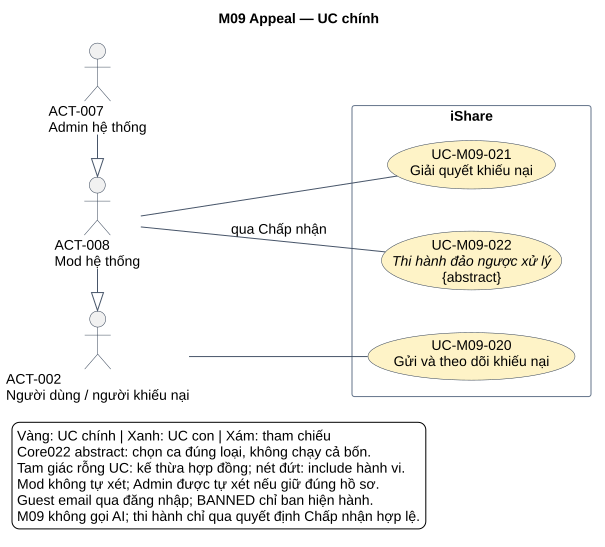
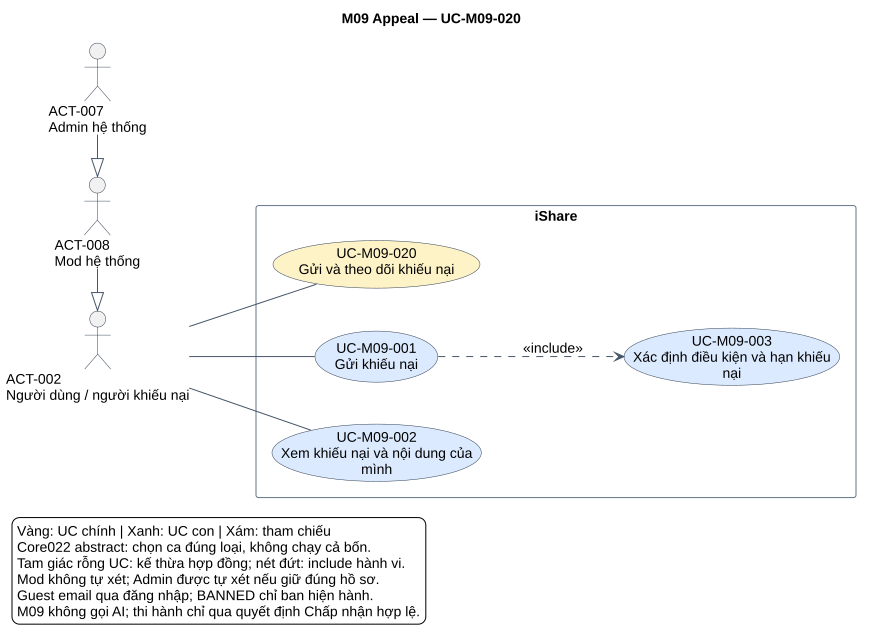
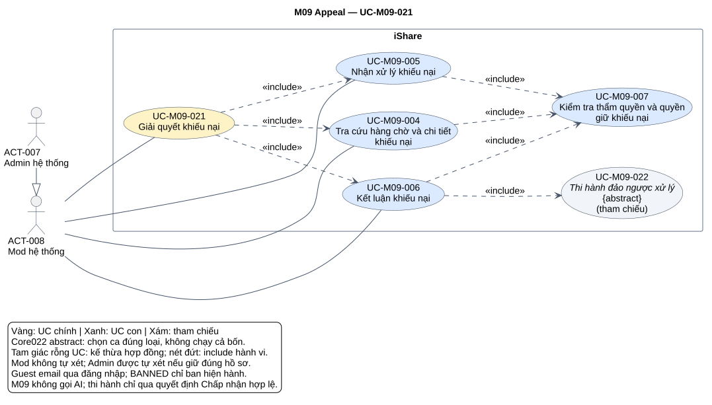
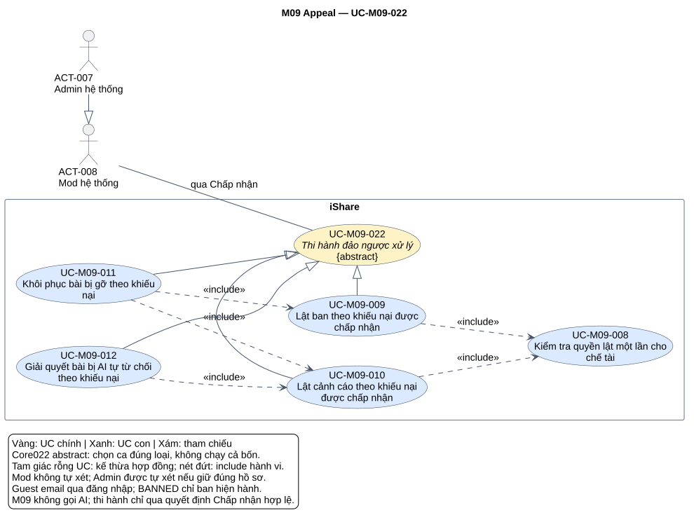

# Phân tích use case — M09 Appeal

[Vietnamese Doc] — Theo skill use-case-analysis v2.2; viết tiếng Việt, giữ thuật ngữ cần thiết.

Đầu ra hai tầng gồm **3 UC chính, 12 UC con**, đặc tả, quan hệ, truy vết và 4 SVG (tổng quan module, một detail cho mỗi core). Core022 là UC abstract có hợp đồng chung, được bốn ca thi hành theo loại xử lý chuyên biệt hóa; không phải nút cho người dùng tự lật chế tài. Tài liệu chỉ phân tích M09.

## Metadata và tiến độ

<!-- uc:document -->
| key | value |
|---|---|
| document_id | US-M09 |
| skill_version | 2.2 |
| mode | module |
| modules | M09 |
| scope | ALL |
| status | Chờ duyệt |
| current_step | 7 |
| completed_steps | 1, 2, 3, 4, 5, 6, 7 |
| approved_steps | - |
| source_baseline | FR-M09 v1.2; FR-M01 v1.10; FR-M03 v1.10; FR-M04 v1.4; FR-M07 v1.5; FR-M08 v1.7; FR-M10 v1.4; FR-M11 v1.3; FR-M12 v1.1; FR-M13 v1.3; FR-M15 v1.1; FR-M16 v1.0 |
| author | Codex |
| date | 2026-10-31 |
| approval_evidence | Người dùng đã cho phép tự thực hiện các bước cần thiết, không hỏi đồng ý ở lượt M04; tiếp tục áp dụng cho chuỗi module hiện tại. Đây là quyền thực hiện liên tục, không phải phê duyệt US-M09 hoặc kết quả từng bước. |
| semantic_review | pass |
| diagram_check | pass |

| Bước | Kết quả | Xác nhận | Baseline | Làm lại khi |
|---|---|---|---|---|
| 1 | 7 nhóm, 83 FR chi tiết, 29 BR; 2 mã bỏ, boundary/actor/giao tiếp | Được làm liên tục; chưa duyệt | FR-M09 v1.2 | Nguồn đổi |
| 2 | 3 core, 12 sub, 12 mapping; giữ ID actor Mod/Admin | Chưa duyệt | FR-M09 v1.2 | Mục tiêu/phạm vi đổi |
| 3 | 14 hợp đồng chi tiết và 1 brief Summary; 3 AUT, 4 RULE | Chưa duyệt | FR-M09 v1.2 | Hành vi/quyền đổi |
| 4 | 13 include, 4 generalization; contract abstract và rà cặp không có quan hệ | Chưa duyệt | Mô hình tại đây | Hợp đồng/điểm gọi đổi |
| 5 | 119 dòng truy vết, 112 tiêu chí chi tiết/BR; 11 FR liên quan | Chưa duyệt | FR-M09 v1.2; FR-M01 v1.10; FR-M03 v1.10; FR-M04 v1.4; FR-M07 v1.5; FR-M08 v1.7; FR-M10 v1.4; FR-M11 v1.3; FR-M12 v1.1; FR-M13 v1.3; FR-M15 v1.1; FR-M16 v1.0 | Baseline chịu tác động đổi |
| 6 | 4 SVG đã kiểm parser/render/hình; đủ node và 17 cạnh theo mô hình | Chưa duyệt | PlantUML 1.2026.8 | Mô hình/nguồn đổi |
| 7 | Đã rà cấu trúc/ngữ nghĩa/truy vết/liên kết/hình; hồ sơ Chờ duyệt, giữ giới hạn nguồn | Chưa duyệt | Skill v2.2 | Phản hồi/baseline đổi |

## 1. Phạm vi, nguồn và tổng hợp yêu cầu

**Mục đích:** review quyền khiếu nại, thẩm quyền người xét và hệ quả từng kết luận; làm đầu vào thiết kế/kiểm thử và ghép UC chính hệ thống. Mục 2 là danh mục/phân rã, mục 3 hợp đồng/luồng/tiêu chí, mục 4 ngữ nghĩa UML, mục 5 truy vết, mục 6 hình, mục 7 QA/giới hạn nguồn.

**Subject:** toàn iShare. M09 sở hữu khiếu nại và quyết định đảo ngược; các module khác là thành phần nội bộ. M09 không gọi AI; đọc nhật ký AI không tạo actor AI. M07 gửi thông báo/email, M01 đăng nhập, M08 sở hữu chế tài/mức, M03/M04/M11 áp nội dung, M12 điểm, M10 vai trò. Không vẽ module, Hệ thống, hàng đợi, cron, dịch vụ email/AI làm actor ngoài M09 khi thực tế không có tương tác trực tiếp với subject trong phạm vi này.

**Trong phạm vi:** gửi/xem khiếu nại của mình, điều kiện/hạn/không lặp/gộp; lối thông báo/email/màn BANNED; hàng chờ/lọc/nhận/tự nhả; chi tiết điều tra, thẩm quyền, kết luận có lý do; lật ban/warning/phục hồi bài gỡ hoặc AI từ chối với ngoại lệ; nội dung thông báo kết luận, giữ hồ sơ/riêng tư.

**Ngoài phạm vi:** ra chế tài/gỡ ban thủ công M08, xét báo cáo, quyết điểm AI, cấu hình cờ/hằng số qua UI, quản trị vai trò, thiết kế giao thức/CSDL/giao dịch, khiếu nại bình luận/nhóm/cấp nhóm/giáng Mod/thu hồi Admin, AI xét hộ, rút/sửa/gửi lại hồ sơ, phục hồi Mod hoặc snapshot nội dung lúc xử lý. M9 lật ban khác với Gỡ ban M08: giữ record Bị lật và loại khỏi lịch sử leo thang.

**Baseline:** [FR-M09 — Appeal](../fr/FR-M09.md) v1.2 Đã chốt 2026-10-24; mốc DEC-271, QA-477, ISS-415, OPEN-012. 119 mã hiệu lực = 7 nhóm + 83 FR chi tiết + 29 BR. FR-M09-05 và FR-M09-05.01 đã bỏ: chuyển Admin là bộ lọc, không là UC chuyển riêng. Câu khái quát ở phần mục đích không ghi đè ngoại lệ Admin tự xét trong FR/BR chi tiết.

<!-- uc:sources -->
| path | version | role |
|---|---|---|
| docs/specs/fr/FR-M09.md | 1.2 | owner |
| docs/specs/fr/FR-M01.md | 1.10 | related |
| docs/specs/fr/FR-M03.md | 1.10 | related |
| docs/specs/fr/FR-M04.md | 1.4 | related |
| docs/specs/fr/FR-M07.md | 1.5 | related |
| docs/specs/fr/FR-M08.md | 1.7 | related |
| docs/specs/fr/FR-M10.md | 1.4 | related |
| docs/specs/fr/FR-M11.md | 1.3 | related |
| docs/specs/fr/FR-M12.md | 1.1 | related |
| docs/specs/fr/FR-M13.md | 1.3 | related |
| docs/specs/fr/FR-M15.md | 1.1 | related |
| docs/specs/fr/FR-M16.md | 1.0 | related |

Phương pháp: [skill](../../../.agent-instructions/skills/use-case-analysis/SKILL.md), [modeling rules](../../../.agent-instructions/skills/use-case-analysis/references/modeling-rules.md), [diagram rules](../../../.agent-instructions/skills/use-case-analysis/references/diagram-rules.md). Không dùng ví dụ phương pháp hoặc US module trước thay nguồn chức năng. Đối chiếu [US-M08](US-M08.md) để giữ ID actor/ranh giới, không coi hồ sơ Chờ duyệt là FR đã chốt.

### Actor và điều kiện quyền

<!-- uc:actors -->
| id | name | kind | parent | boundary_reason | sources |
|---|---|---|---|---|---|
| ACT-001 | Guest | human | - | Người chưa có phiên mở link email có thể được dẫn qua M01; không được gửi trực tiếp hoặc xem hồ sơ khi chưa có quyền. | FR-M09-01.05, FR-M09-01.08, BR-M09-08 |
| ACT-002 | Người dùng / người khiếu nại | human | - | Người ngoài subject bị xử lý; gửi và xem của mình. BANNED là trạng thái, không actor mới; chỉ chính ban hiệu lực. | FR-M09-01.04, FR-M09-01.09, FR-M09-01.18, FR-M09-02.01 |
| ACT-008 | Mod hệ thống | human | ACT-002 | Có hành vi cá nhân và quyền xét theo phạm vi; không tự xét hoặc xét người là Mod tại lúc bị xử lý. Giữ ID M08. | FR-M09-03.04, FR-M09-03.08, FR-M09-06.07, FR-M09-06.08 |
| ACT-007 | Admin hệ thống | human | ACT-008 | Xét mọi khiếu nại, kể cả xử lý do mình ra; chỉ Admin xét người là Mod lúc bị xử lý. Theo nguồn Admin không có xử lý để tự khiếu nại, không phải actor gửi trong catalog. | FR-M09-03.05, FR-M09-07.10, FR-M09-07.12, BR-M09-01, BR-M09-12 |

Admin kế thừa năng lực tương tác của Mod, nhưng bộ kiểm UC007 có nhánh Admin rõ ràng; không kế thừa lệnh cấm Mod tự xét thành lệnh cấm Admin. Vai trò người khiếu nại lúc bị xử lý quyết phạm vi xét; Mod đã bị ban hiện User vẫn chỉ Admin xét khiếu nại đó. Group Mod/Owner và Admin nhóm chat M16 không phải hai actor staff này. Actor User không có thao tác tự lật; core022 và các ca chuyên biệt chỉ được khởi phát bởi quyết định Chấp nhận hợp lệ. Các Subfunction nhận ngữ cảnh caller, không là nút công khai.

### Kiểm kê và tổng hợp

| Nhóm | Tổng hợp | FR chi tiết | Biểu diễn | Owner |
|---|---|---|---|---|
| FR-M09-01 | Gửi đúng chủ/đúng xử lý/còn hạn, giải thích và ảnh; lối email/thông báo/BANNED; gộp, không rút/sửa/lặp/xóa. | 23 | [UC-M09-020](#uc-m09-020), [UC-M09-001](#uc-m09-001), [UC-M09-003](#uc-m09-003); AUT001 | M09 |
| FR-M09-02 | Chỉ xem hồ sơ của mình, kết luận/lý do, nội dung chỉ đọc; không biết dữ liệu tố cáo. | 5 | [UC-M09-020](#uc-m09-020), [UC-M09-002](#uc-m09-002) | M09 |
| FR-M09-03 | Một hàng chờ riêng, ưu tiên Ban→Warning→Bài, lọc loại, giới hạn Mod/Admin; không escalation riêng. | 9 | [UC-M09-021](#uc-m09-021), [UC-M09-004](#uc-m09-004), [UC-M09-007](#uc-m09-007) | M09 |
| FR-M09-04 | Một người giữ, kiểm phạm vi, tự nhả 30 phút theo mở xem/kết luận. | 8 | [UC-M09-021](#uc-m09-021), [UC-M09-005](#uc-m09-005), [UC-M09-007](#uc-m09-007); AUT002 | M09 |
| FR-M09-06 | Chi tiết hồ sơ/xử lý gốc, nội dung lưu giữ và AI log đúng ngữ cảnh, không thêm snapshot. | 8 | [UC-M09-021](#uc-m09-021), [UC-M09-004](#uc-m09-004), [UC-M09-007](#uc-m09-007) | M09 |
| FR-M09-07 | Chấp nhận/Từ chối có lý do bởi người giữ; cấm AI; Admin tự xét được; kênh theo loại. | 12 | [UC-M09-021](#uc-m09-021), [UC-M09-006](#uc-m09-006); AUT003 | M09 |
| FR-M09-08 | Lật ban/warning, phục hồi bài/điểm/liên kết; giữ ban lịch sử, sàn 0, no-op lật lặp, gửi lại/cổng nhóm, không hiện comment ẩn. | 18 | [UC-M09-022](#uc-m09-022), [UC-M09-008](#uc-m09-008), [UC-M09-009](#uc-m09-009), [UC-M09-010](#uc-m09-010), [UC-M09-011](#uc-m09-011), [UC-M09-012](#uc-m09-012) | M09 |

## 2. Danh mục và phân rã

### 2.1 Hai tầng

<!-- uc:catalog -->
| id | name | tier | level | primary | supporting | owner | anchor | sources |
|---|---|---|---|---|---|---|---|---|
| UC-M09-020 | Gửi và theo dõi khiếu nại | core | Summary | ACT-002, ACT-008 | - | M09 | #uc-m09-020 | FR-M09-01, FR-M09-02, BR-M09-01, BR-M09-04, BR-M09-21, BR-M09-27 |
| UC-M09-021 | Giải quyết khiếu nại | core | User goal | ACT-008, ACT-007 | - | M09 | #uc-m09-021 | FR-M09-03, FR-M09-04, FR-M09-06, FR-M09-07, BR-M09-11, BR-M09-12, BR-M09-27 |
| UC-M09-022 | Thi hành đảo ngược xử lý | core | User goal | ACT-008, ACT-007 | - | M09 | #uc-m09-022 | FR-M09-08, BR-M09-16, BR-M09-17, BR-M09-18, BR-M09-24, BR-M09-25, BR-M09-26, BR-M09-29 |
| UC-M09-001 | Gửi khiếu nại | sub | User goal | ACT-002, ACT-008 | - | M09 | #uc-m09-001 | FR-M09-01, BR-M09-03, BR-M09-06, BR-M09-07, BR-M09-08, BR-M09-24 |
| UC-M09-002 | Xem khiếu nại và nội dung của mình | sub | User goal | ACT-002, ACT-008 | - | M09 | #uc-m09-002 | FR-M09-02, BR-M09-21, BR-M09-22, BR-M09-27 |
| UC-M09-003 | Xác định điều kiện và hạn khiếu nại | sub | Subfunction | ACT-002, ACT-008 | - | M09 | #uc-m09-003 | FR-M09-01.07, FR-M09-01.08, FR-M09-01.09, FR-M09-01.13, FR-M09-01.14, FR-M09-01.15, FR-M09-01.18, FR-M09-01.21, FR-M09-01.23, BR-M09-04, BR-M09-05, BR-M09-06, BR-M09-25 |
| UC-M09-004 | Tra cứu hàng chờ và chi tiết khiếu nại | sub | User goal | ACT-008, ACT-007 | - | M09 | #uc-m09-004 | FR-M09-03, FR-M09-06, BR-M09-09, BR-M09-10, BR-M09-12, BR-M09-15 |
| UC-M09-005 | Nhận xử lý khiếu nại | sub | User goal | ACT-008, ACT-007 | - | M09 | #uc-m09-005 | FR-M09-04, BR-M09-11, BR-M09-12 |
| UC-M09-006 | Kết luận khiếu nại | sub | User goal | ACT-008, ACT-007 | - | M09 | #uc-m09-006 | FR-M09-07, BR-M09-06, BR-M09-11, BR-M09-12, BR-M09-19, BR-M09-20, BR-M09-27 |
| UC-M09-007 | Kiểm tra thẩm quyền và quyền giữ khiếu nại | sub | Subfunction | ACT-008, ACT-007 | - | M09 | #uc-m09-007 | FR-M09-03.04, FR-M09-03.05, FR-M09-03.08, FR-M09-04.03, FR-M09-04.08, FR-M09-07.07, FR-M09-07.10, FR-M09-07.12, BR-M09-11, BR-M09-12, BR-M09-13, BR-M09-14 |
| UC-M09-008 | Kiểm tra quyền lật một lần cho chế tài | sub | Subfunction | ACT-008, ACT-007 | - | M09 | #uc-m09-008 | FR-M09-08.10, FR-M09-08.16, FR-M09-08.17, BR-M09-06, BR-M09-29 |
| UC-M09-009 | Lật ban theo khiếu nại được chấp nhận | sub | User goal | ACT-008, ACT-007 | - | M09 | #uc-m09-009 | FR-M09-08.01, FR-M09-08.02, FR-M09-08.03, FR-M09-08.11, BR-M09-16, BR-M09-25 |
| UC-M09-010 | Lật cảnh cáo theo khiếu nại được chấp nhận | sub | User goal | ACT-008, ACT-007 | - | M09 | #uc-m09-010 | FR-M09-08.04, FR-M09-08.05, FR-M09-08.06, FR-M09-08.07, FR-M09-08.13, FR-M09-08.15, BR-M09-17, BR-M09-26 |
| UC-M09-011 | Khôi phục bài bị gỡ theo khiếu nại | sub | User goal | ACT-008, ACT-007 | - | M09 | #uc-m09-011 | FR-M09-08.08, FR-M09-08.09, FR-M09-08.10, FR-M09-08.16, BR-M09-18, BR-M09-29, FR-M12-02.12 |
| UC-M09-012 | Giải quyết bài bị AI tự từ chối theo khiếu nại | sub | User goal | ACT-008, ACT-007 | - | M09 | #uc-m09-012 | FR-M09-08.12, FR-M09-08.13, FR-M09-08.14, FR-M09-08.18, BR-M09-24, FR-M11-13.14 |

`tier` độc lập `level`; chỉ ba UC core dùng cho tổng quan hệ thống. Core020 là Summary. Core021 có luồng giải quyết; core022 là User goal abstract, có giá trị khôi phục theo quyết định staff, bốn chuyên biệt hiện thực phần thiếu theo loại. Không bắt buộc abstract chỉ vì là core; quyết định abstract ở đây dựa vào hợp đồng/triển khai riêng từng loại, không do hai tầng.

### 2.2 Ánh xạ core → sub

<!-- uc:decomposition -->
| core | sub | rationale | sources |
|---|---|---|---|
| UC-M09-020 | UC-M09-001 | Lưu phản đối đúng một lần xử lý | FR-M09-01, BR-M09-03, BR-M09-06, BR-M09-07, BR-M09-08, BR-M09-24 |
| UC-M09-020 | UC-M09-002 | Theo dõi và đọc hồ sơ/nội dung riêng tư | FR-M09-02, BR-M09-21, BR-M09-22, BR-M09-27 |
| UC-M09-020 | UC-M09-003 | Đánh giá điều kiện/hạn bất biến của lần xử lý | FR-M09-01.07, FR-M09-01.08, FR-M09-01.09, FR-M09-01.13, FR-M09-01.14, FR-M09-01.15, FR-M09-01.18, FR-M09-01.21, FR-M09-01.23, BR-M09-04, BR-M09-05, BR-M09-06, BR-M09-25 |
| UC-M09-021 | UC-M09-004 | Điều tra hồ sơ trong phạm vi được phép | FR-M09-03, FR-M09-06, BR-M09-09, BR-M09-10, BR-M09-12, BR-M09-15 |
| UC-M09-021 | UC-M09-005 | Giữ riêng hồ sơ trước xét/kết luận | FR-M09-04, BR-M09-11, BR-M09-12 |
| UC-M09-021 | UC-M09-006 | Ra quyết định có lý do và thi hành hệ quả | FR-M09-07, BR-M09-06, BR-M09-11, BR-M09-12, BR-M09-19, BR-M09-20, BR-M09-27 |
| UC-M09-021 | UC-M09-007 | Dùng chung quyền đọc/nhận/kết luận, ngoại lệ Admin | FR-M09-03.04, FR-M09-03.05, FR-M09-03.08, FR-M09-04.03, FR-M09-04.08, FR-M09-07.07, FR-M09-07.10, FR-M09-07.12, BR-M09-11, BR-M09-12, BR-M09-13, BR-M09-14 |
| UC-M09-022 | UC-M09-008 | Bảo đảm một lần và tôn trọng Từ chối riêng | FR-M09-08.10, FR-M09-08.16, FR-M09-08.17, BR-M09-06, BR-M09-29 |
| UC-M09-022 | UC-M09-009 | Hiện thực lật ban chính/đi kèm | FR-M09-08.01, FR-M09-08.02, FR-M09-08.03, FR-M09-08.11, BR-M09-16, BR-M09-25 |
| UC-M09-022 | UC-M09-010 | Hiện thực lật warning chính/đi kèm và tính mức | FR-M09-08.04, FR-M09-08.05, FR-M09-08.06, FR-M09-08.07, FR-M09-08.13, FR-M09-08.15, BR-M09-17, BR-M09-26 |
| UC-M09-022 | UC-M09-011 | Hiện thực phục hồi lần gỡ bài/điểm/chế tài liên kết | FR-M09-08.08, FR-M09-08.09, FR-M09-08.10, FR-M09-08.16, BR-M09-18, BR-M09-29, FR-M12-02.12 |
| UC-M09-022 | UC-M09-012 | Hiện thực chấp nhận AI từ chối, gửi lại/cổng nhóm | FR-M09-08.12, FR-M09-08.13, FR-M09-08.14, FR-M09-08.18, BR-M09-24, FR-M11-13.14 |

12 mapping, không sub mồ côi. UC009/010 được dùng lại khi lật chế tài chính hoặc đi kèm, không tạo ID theo cha. Mapping không tự tạo UML: UC008 thuộc core022 nhưng không là chuyên biệt của core022 vì chỉ kiểm điều kiện, không hiện thực mục tiêu đảo ngược.

### 2.3 Tổng hợp hệ thống và quyết định mô hình

<!-- uc:module-models -->
| module | path | baseline |
|---|---|---|

US-overview chưa có tại thời điểm phân tích; không tạo/cập nhật trong lượt này. Khi tổng hợp, lấy nguyên core020/021/022 với ID, tên, owner và thông tin abstract tương ứng, liên kết về tài liệu này.

| ID | Hành vi | Biểu diễn | Lý do | Phương án cân nhắc |
|---|---|---|---|---|
| D-M09-01 | Gửi/theo dõi | [UC-M09-020](#uc-m09-020) với UC001/002/003 | Hai mục tiêu người gửi và hợp đồng điều kiện/hạn riêng | Không tách mỗi nút/form/ảnh thành UC, không extend xem hồ sơ vào lần gửi đã kết thúc |
| D-M09-02 | Gửi qua email/BANNED/thông báo | Nhánh UC001 + contract UC003 | Đường vào không cấp quyền, không cần UC login mới trong M09 | Không bắt mọi lần gửi include đăng nhập lại |
| D-M09-03 | Xét một hồ sơ | [UC-M09-021](#uc-m09-021) include nhận/đọc/kết luận; callers include UC007 | Mở chỉ đọc không cần giữ; kết luận phải còn giữ/đúng thẩm quyền | Không tự gọi nhận lại ở bước kết luận |
| D-M09-04 | Phạm vi Mod/Admin | ACT008/007 riêng, UC007 dùng role lịch sử | Ngoại lệ Admin có căn cứ FR/BR, khác M08 | Không dùng quy tắc cấm Admin tự xử lý vụ báo cáo thay Appeal |
| D-M09-05 | Đảo ngược theo loại | core022 abstract, UC009–012 chuyên biệt | Có hợp đồng kế thừa và phần hiệu quả riêng; ca ban/warning còn được dùng bởi post | Không đặt bốn include bắt mọi loại chạy cùng nhau hoặc kế thừa chỉ để nhóm |
| D-M09-06 | Kiểm một lần | UC008 được UC009/010 include | Khác việc gửi một lần; xử lý liên kết có nhiều đường chấp nhận phải tránh hiệu quả lặp | Không tự lật chế tài đã Từ chối riêng khi chấp nhận bài |
| D-M09-07 | AI/giữ/notification | 3 AUT và 4 RULE | Tự động vẫn có trigger/trước-sau/truy vết | Không actor AI/clock/module hoặc AI kết luận |
| D-M09-08 | Điểm thiếu rõ | NOTE mục 7, không sửa FR | Giữ điều kiện nguồn đã chốt, chỉ rõ nhánh chưa đủ dữ liệu | Không tự quyết rollback, cảnh cáo đã Đã bỏ hoặc mở lịch sử rộng cho BANNED |

## 3. Đặc tả

### 3.1 UC chính

### UC-M09-020 — Gửi và theo dõi khiếu nại

**Actor chính:** ACT-002, ACT-008. **Hỗ trợ:** -. **Mức:** Summary. **Giá trị:** Phản đối xử lý của chính mình trong hạn và theo dõi hồ sơ/kết luận, không làm mất thông tin tố cáo. **Kết quả:** Khiếu nại hợp lệ được lưu Chờ xét, xem lại dữ liệu/kết luận riêng tư và nội dung chỉ đọc theo quyền.

**UC con:** [UC-M09-001](#uc-m09-001) — Lưu phản đối đúng một lần xử lý; [UC-M09-002](#uc-m09-002) — Theo dõi và đọc hồ sơ/nội dung riêng tư; [UC-M09-003](#uc-m09-003) — Đánh giá điều kiện/hạn bất biến của lần xử lý.

**Trigger:** Người bị xử lý mở lối khiếu nại hoặc hồ sơ của mình. **Điều kiện:** Xử lý/nhân thân được xác định; BANNED và hạn được kiểm theo luồng, không coi mọi xử lý đều khiếu nại được.

| Bước tổng quát | Quy trình | Nguồn |
|---|---|---|
| 1 | [UC-M09-001](#uc-m09-001) gửi khiếu nại, dùng [UC-M09-003](#uc-m09-003) xác định điều kiện/hạn riêng của lần xử lý, gồm lối email qua đăng nhập và BANNED chỉ lệnh ban hiện hành. | FR-M09-01, FR-M09-02, BR-M09-01, BR-M09-04, BR-M09-21, BR-M09-27 |
| 2 | [UC-M09-002](#uc-m09-002) cho người gửi xem hồ sơ/kết luận và nội dung của mình chỉ đọc; không lộ dữ liệu báo cáo người khác. | FR-M09-01, FR-M09-02, BR-M09-01, BR-M09-04, BR-M09-21, BR-M09-27 |
| 3 | [AUT-M09-001](#aut-m09-001) tạo thông báo gộp bài AI từ chối+cảnh cáo; hằng số và retention theo [RULE-M09-001](#rule-m09-001), [RULE-M09-004](#rule-m09-004), không thêm snapshot nội dung. | FR-M09-01, FR-M09-02, BR-M09-01, BR-M09-04, BR-M09-21, BR-M09-27 |

**Ngoại lệ/kết thúc:** Không gửi lặp/rút/sửa, không khiếu nại của người khác hoặc xử lý không thuộc phạm vi.

Summary đặt các mục tiêu trong bối cảnh, không mặc định người gửi vừa gửi vừa xem tất cả trong cùng lần tương tác.

### UC-M09-021 — Giải quyết khiếu nại

**Actor chính:** ACT-008, ACT-007. **Hỗ trợ:** -. **Mức:** User goal. **Giá trị:** Xét độc lập theo thẩm quyền, ra kết luận có lý do và thi hành hệ quả đúng. **Kết quả:** Khiếu nại Đã kết luận Chấp nhận/Từ chối có người/lý do/mốc; hệ quả và thông báo đúng.

**UC con:** [UC-M09-004](#uc-m09-004) — Điều tra hồ sơ trong phạm vi được phép; [UC-M09-005](#uc-m09-005) — Giữ riêng hồ sơ trước xét/kết luận; [UC-M09-006](#uc-m09-006) — Ra quyết định có lý do và thi hành hệ quả; [UC-M09-007](#uc-m09-007) — Dùng chung quyền đọc/nhận/kết luận, ngoại lệ Admin.

<!-- uc:spec UC-M09-021 -->
| key | value |
|---|---|
| goal | Xét độc lập theo thẩm quyền, ra kết luận có lý do và thi hành hệ quả đúng. |
| subject | iShare |
| level | User goal |
| primary | ACT-008, ACT-007 |
| supporting | - |
| trigger | Staff chọn xét một khiếu nại Chờ xét trong phạm vi được thấy. |
| preconditions | Có khiếu nại; quyền xem/nhận/giữ và trạng thái được kiểm, không giả luôn còn giữ. |
| success | Khiếu nại Đã kết luận Chấp nhận/Từ chối có người/lý do/mốc; hệ quả và thông báo đúng. |
| failure | Không Mod tự xét hoặc xét khiếu nại người có role Mod lúc bị xử lý; Admin có ngoại lệ tự xét được nguồn cho phép; AI không xét. |
| abstract | false |
| common_contract | Không áp dụng generalization UC cho ca này; phân rã chính–con không là kế thừa. |

#### Luồng chính

| Bước | Ai | Hành động/phản hồi | Tiếp tục | Nguồn |
|---|---|---|---|---|
| 1 | Người thao tác / iShare | Người xét chọn khiếu nại được phép thấy; thứ tự/lọc theo loại và thời điểm do [UC-M09-004](#uc-m09-004), tách hàng chờ báo cáo. | 2 | FR-M09-03, FR-M09-04, FR-M09-06, FR-M09-07, BR-M09-11, BR-M09-12, BR-M09-27 |
| 2 | iShare | Thực hiện [UC-M09-005](#uc-m09-005) để nhận khiếu nại Chờ xét chưa ai giữ; nếu đã là người giữ thì đi thẳng bước 3, không bắt nhận lại. | 3 | FR-M09-03, FR-M09-04, FR-M09-06, FR-M09-07, BR-M09-11, BR-M09-12, BR-M09-27 |
| 3 | iShare | Thực hiện [UC-M09-004](#uc-m09-004) ở chế độ chi tiết để xem hồ sơ, xử lý gốc/nội dung liên quan/nhật ký AI theo đúng phạm vi. | 4 | FR-M09-03, FR-M09-04, FR-M09-06, FR-M09-07, BR-M09-11, BR-M09-12, BR-M09-27 |
| 4 | iShare | Thực hiện [UC-M09-006](#uc-m09-006) để kết luận Chấp nhận/Từ chối kèm lý do; quyền giữ kiểm lại tại thời điểm quyết định. Chấp nhận chèn [UC-M09-022](#uc-m09-022) qua [UC-M09-006](#uc-m09-006); Từ chối giữ nguyên xử lý. | 5 | FR-M09-03, FR-M09-04, FR-M09-06, FR-M09-07, BR-M09-11, BR-M09-12, BR-M09-27 |
| 5 | iShare | Kết thúc với kết luận/lý do được lưu và [AUT-M09-003](#aut-m09-003) phát kết quả; không tạo bước chuyển lên Admin, mở lại khiếu nại hoặc AI xét hộ. | END: Khiếu nại Đã kết luận Chấp nhận/Từ chối có người/lý do/mốc; hệ quả và thông báo đúng. | FR-M09-03, FR-M09-04, FR-M09-06, FR-M09-07, BR-M09-11, BR-M09-12, BR-M09-27 |

#### Luồng thay thế và ngoại lệ

| ID | Bước rẽ | Điều kiện | Xử lý | Quay lại/kết thúc | Nguồn |
|---|---|---|---|---|---|
| A1 | 2 | Người khác giữ, đã kết luận hoặc ngoài phạm vi | [UC-M09-005](#uc-m09-005) từ chối nhận. | END: chưa nhận xử lý | FR-M09-04.02, FR-M09-04.03, FR-M09-04.05, FR-M09-04.08 |
| A2 | 2 | Đã tự giữ khiếu nại | Không tái nhận, tiếp tục điều tra. | 3 | FR-M09-04.01, BR-M09-11 |
| A3 | 4 | Khiếu nại đã tự nhả sau 30 phút, đã kết luận, thiếu lý do hoặc sai role/phạm vi | [UC-M09-006](#uc-m09-006) từ chối theo điều kiện tương ứng. | END: chưa có kết luận mới | FR-M09-04.06, FR-M09-07.06, FR-M09-07.08, FR-M09-07.09, FR-M09-07.11 |

#### Quy tắc và giới hạn

Nguồn: FR-M09-03, FR-M09-04, FR-M09-06, FR-M09-07, BR-M09-11, BR-M09-12, BR-M09-27. Áp RULE/AUT đúng phạm vi/guard; vai trò, ownership và quyền giữ không được suy từ association core. Các NOTE là phần chưa chốt cần review, không phải chức năng hoặc chính sách mới.

### UC-M09-022 — Thi hành đảo ngược xử lý

**Actor chính:** ACT-008, ACT-007. **Hỗ trợ:** -. **Mức:** User goal, abstract. **Giá trị:** Thực hiện đúng hệ quả của quyết định Chấp nhận, giữ lịch sử và tránh lật cùng chế tài hai lần. **Kết quả:** Hệ quả theo đúng loại được áp, hoặc không thay đổi thêm khi xử lý đã Bị lật; không vượt quyền phục hồi nội dung/role.

**UC con:** [UC-M09-008](#uc-m09-008) — Bảo đảm một lần và tôn trọng Từ chối riêng; [UC-M09-009](#uc-m09-009) — Hiện thực lật ban chính/đi kèm; [UC-M09-010](#uc-m09-010) — Hiện thực lật warning chính/đi kèm và tính mức; [UC-M09-011](#uc-m09-011) — Hiện thực phục hồi lần gỡ bài/điểm/chế tài liên kết; [UC-M09-012](#uc-m09-012) — Hiện thực chấp nhận AI từ chối, gửi lại/cổng nhóm.

<!-- uc:spec UC-M09-022 -->
| key | value |
|---|---|
| goal | Thực hiện đúng hệ quả của quyết định Chấp nhận, giữ lịch sử và tránh lật cùng chế tài hai lần. |
| subject | iShare |
| level | User goal |
| primary | ACT-008, ACT-007 |
| supporting | - |
| trigger | [UC-M09-006](#uc-m09-006) đã có quyết định Chấp nhận hợp lệ hoặc ca chuyên biệt xử lý chế tài đi kèm được nguồn cho phép. |
| preconditions | Chấp nhận bởi người còn thẩm quyền/giữ tại điểm kết luận; có lần xử lý và ngữ cảnh chính/đi kèm. Không phải thao tác người khiếu nại tự gọi. |
| success | Hệ quả theo đúng loại được áp, hoặc không thay đổi thêm khi xử lý đã Bị lật; không vượt quyền phục hồi nội dung/role. |
| failure | Không thi hành cho quyết định Từ chối, không lật lặp hoặc bỏ qua Từ chối riêng của chế tài đi kèm; không tự trả Mod/hiện comment ẩn. |
| abstract | true |
| common_contract | Hợp đồng chung [UC-M09-022](#uc-m09-022): chỉ thi hành sau quyết định Chấp nhận hợp lệ; target là đúng lần xử lý chính hoặc chế tài đi kèm được nguồn cho phép; giữ quyền/lý do của quyết định từ [UC-M09-006](#uc-m09-006), không tự ra quyết định mới; giữ hồ sơ; chống lật lặp ban/cảnh cáo và tôn trọng Từ chối riêng khi là chế tài đi kèm; áp đúng hệ quả loại cùng các ngoại lệ nguồn; không tự phục hồi Mod, hiện bình luận ẩn hay quét kiểm duyệt lại bài được chấp nhận; trả kết quả về caller. Cha abstract thiếu bước áp hệ quả cụ thể; [UC-M09-009](#uc-m09-009), [UC-M09-010](#uc-m09-010), [UC-M09-011](#uc-m09-011), [UC-M09-012](#uc-m09-012) hiện thực phần đó theo loại, không gọi ngược cha hoặc chạy nối tiếp bốn ca. |

**Abstract:** không có lần thực hiện riêng của cha. Khi UC006 gọi hợp đồng, chọn một chuyên biệt phù hợp loại xử lý chính; con kế thừa điều kiện/giới hạn và hiện thực hệ quả, không gọi ngược cha. Khi xử lý chế tài đi kèm, ca post dùng lại trực tiếp ca ban/warning phù hợp ngữ cảnh cho phép.

#### Luồng chính

| Bước | Ai | Hành động/phản hồi | Tiếp tục | Nguồn |
|---|---|---|---|---|
| 1 | Hợp đồng chung / ca chuyên biệt | Nhận quyết định Chấp nhận, loại/lần xử lý và các liên kết đi kèm. Hợp đồng chung này là abstract, không tự đặt một chuỗi bốn thao tác để chạy tất cả. | 2 | FR-M09-08, BR-M09-16, BR-M09-17, BR-M09-18, BR-M09-24, BR-M09-25, BR-M09-26, BR-M09-29 |
| 2 | Hợp đồng chung / ca chuyên biệt | Chọn đúng chuyên biệt theo loại xử lý: [UC-M09-009](#uc-m09-009) cho ban, [UC-M09-010](#uc-m09-010) cho cảnh cáo, [UC-M09-011](#uc-m09-011) cho lần gỡ bài, [UC-M09-012](#uc-m09-012) cho AI từ chối bài. Ca chuyên biệt kế thừa hợp đồng, triển khai hệ quả riêng và gọi lại ca ban/cảnh cáo cho xử lý đi kèm đủ điều kiện. | 3 | FR-M09-08, BR-M09-16, BR-M09-17, BR-M09-18, BR-M09-24, BR-M09-25, BR-M09-26, BR-M09-29 |
| 3 | Hợp đồng chung / ca chuyên biệt | Giữ hồ sơ và trả hệ quả thực tế về đúng caller: [UC-M09-006](#uc-m09-006) bước 5 ở nhánh chính, hoặc [UC-M09-011](#uc-m09-011) hoặc [UC-M09-012](#uc-m09-012) khi thi hành chế tài đi kèm; không tự đổi kết luận hồ sơ khác. Nếu đã Bị lật thì hồ sơ vẫn được xét nhưng không thay đổi thêm. Nhánh thiếu quy tắc nguồn giữ NOTE mục 7, không tự phát minh giao dịch/rollback. | END: trả hệ quả đúng caller theo loại/ngữ cảnh | FR-M09-08, BR-M09-16, BR-M09-17, BR-M09-18, BR-M09-24, BR-M09-25, BR-M09-26, BR-M09-29 |

#### Luồng thay thế và ngoại lệ

Cha abstract dùng các ngoại lệ trong contract và các chuyên biệt; không có nhánh hệ quả riêng được thi hành ở cha. Không tự tạo retry/rollback để điền mẫu.

#### Quy tắc và giới hạn

Nguồn: FR-M09-08, BR-M09-16, BR-M09-17, BR-M09-18, BR-M09-24, BR-M09-25, BR-M09-26, BR-M09-29. Áp RULE/AUT đúng phạm vi/guard; vai trò, ownership và quyền giữ không được suy từ association core. Các NOTE là phần chưa chốt cần review, không phải chức năng hoặc chính sách mới.

### 3.2 UC con

### UC-M09-001 — Gửi khiếu nại

**UC chính:** [UC-M09-020](#uc-m09-020).

<!-- uc:spec UC-M09-001 -->
| key | value |
|---|---|
| goal | Lưu một phản đối hợp lệ cho chính lần xử lý của mình, có giải thích và bằng chứng nếu có. |
| subject | iShare |
| level | User goal |
| primary | ACT-002, ACT-008 |
| supporting | - |
| trigger | Chọn Khiếu nại từ thông báo, màn hình BANNED hoặc link email ban. |
| preconditions | Có lối vào/target; không giả đã đăng nhập/còn hạn/target khiếu nại được trước kiểm. |
| success | Lưu người gửi, loại, lần xử lý, giải thích, ảnh, thời điểm gửi, Chờ xét; hồ sơ vào hàng chờ riêng. |
| failure | Không giả lối vào là quyền gửi, không xử lý riêng AI warning gắn cùng lần AI từ chối, không cho gửi lặp/rút/sửa. |
| abstract | false |
| common_contract | Không áp dụng generalization UC cho ca này; phân rã chính–con không là kế thừa. |

#### Luồng chính

| Bước | Ai | Hành động/phản hồi | Tiếp tục | Nguồn |
|---|---|---|---|---|
| 1 | Người thao tác / iShare | Tiếp nhận target từ đúng lối vào. Với email ban chưa có phiên, M01 đăng nhập rồi trở về đúng trang gửi; thông báo hợp lệ bất kể AI/Mod/Admin đều trỏ đúng lần xử lý. Màn BANNED trỏ chính ban hiệu lực khi còn hạn. | 2 | FR-M09-01, BR-M09-03, BR-M09-06, BR-M09-07, BR-M09-08, BR-M09-24 |
| 2 | iShare | Thực hiện [UC-M09-003](#uc-m09-003) để kiểm danh tính/sở hữu, loại, hạn, từng có khiếu nại/Bị lật, điều kiện BANNED và quan hệ gộp. | 3 | FR-M09-01, BR-M09-03, BR-M09-06, BR-M09-07, BR-M09-08, BR-M09-24 |
| 3 | iShare | Người gửi nhập lời giải thích bắt buộc, bằng chứng tùy chọn tối đa 3 ảnh, mỗi ảnh ≤5MB JPEG/PNG/WebP. Hệ thống kiểm hợp lệ trước lưu. | 4 | FR-M09-01, BR-M09-03, BR-M09-06, BR-M09-07, BR-M09-08, BR-M09-24 |
| 4 | iShare | Lưu đúng một khiếu nại Chờ xét với metadata nguồn; loại Ban/Cảnh cáo/Bài viết, bài gỡ và AI từ chối đều là Bài viết. AI từ chối+cảnh cáo cùng lần ghi chung và tính đã khiếu nại cho cả hai. | 5 | FR-M09-01, BR-M09-03, BR-M09-06, BR-M09-07, BR-M09-08, BR-M09-24 |
| 5 | iShare | Đưa vào hàng chờ khiếu nại tách báo cáo; giữ hồ sơ dù tài khoản sau đó xóa, không cung cấp rút/sửa. Kết thúc với hồ sơ chờ xét. | END: Lưu người gửi, loại, lần xử lý, giải thích, ảnh, thời điểm gửi, Chờ xét; hồ sơ vào hàng chờ riêng. | FR-M09-01, BR-M09-03, BR-M09-06, BR-M09-07, BR-M09-08, BR-M09-24 |

#### Luồng thay thế và ngoại lệ

| ID | Bước rẽ | Điều kiện | Xử lý | Quay lại/kết thúc | Nguồn |
|---|---|---|---|---|---|
| A1 | 1 | Email ban được mở khi chưa đăng nhập | Chuyển qua M01 rồi quay về trang cho đúng ban; không coi đã đăng nhập thành công nếu chưa có kết quả M01. | 2 sau đăng nhập thành công | FR-M09-01.05, BR-M09-08 |
| A2 | 2 | Guest trực tiếp gửi, không sở hữu, BANNED gửi xử lý khác ban hiện hành, hết hạn/trùng/đã Bị lật/loại cấm | [UC-M09-003](#uc-m09-003) từ chối; không lưu hồ sơ mới. | END: không gửi | FR-M09-01.08, FR-M09-01.09, FR-M09-01.13, FR-M09-01.14, FR-M09-01.15, FR-M09-01.18, FR-M09-01.23 |
| A3 | 3 | Giải thích trống hoặc ảnh sai số lượng/dung lượng/định dạng | Từ chối gửi khi giải thích trống, từ chối ảnh vi phạm theo FR; người gửi có thể sửa đầu vào trước khi gửi. | 3 | FR-M09-01.10, FR-M09-01.11, FR-M09-01.12 |
| A4 | 4 | Định gửi riêng cảnh cáo AI gắn cùng lần từ chối bài | Từ chối riêng; phải phản đối qua khiếu nại bài/gộp đủ điều kiện. | END: không có khiếu nại riêng | FR-M09-01.20, FR-M09-01.21 |

#### Quy tắc và giới hạn

Nguồn: FR-M09-01, BR-M09-03, BR-M09-06, BR-M09-07, BR-M09-08, BR-M09-24. Áp RULE/AUT đúng phạm vi/guard; vai trò, ownership và quyền giữ không được suy từ association core. Các NOTE là phần chưa chốt cần review, không phải chức năng hoặc chính sách mới.

#### Tiêu chí nguồn và nghiệm thu

Các tiêu chí hiệu lực dưới đây giữ nội dung baseline và là điều kiện chấp nhận của luồng/quy tắc, không chỉ là danh sách ID. Nhánh nguồn thiếu rõ vẫn giữ NOTE mục 7.

| Mã | Tiêu chí |
|---|---|
| FR-M09-01.01 | Khi người dùng gửi một khiếu nại hợp lệ, hệ thống phải lưu khiếu nại với người khiếu nại, loại khiếu nại, xử lý bị khiếu nại, lời giải thích, bằng chứng, thời điểm gửi và trạng thái Chờ xét (BR-M09-01). |
| FR-M09-01.02 | Khi lưu một khiếu nại, hệ thống phải đưa khiếu nại vào hàng chờ khiếu nại, tách khỏi hàng chờ báo cáo (BR-M09-09). |
| FR-M09-01.03 | Khi lưu một khiếu nại, hệ thống phải gắn loại khiếu nại theo xử lý bị khiếu nại: ban, cảnh cáo, hoặc bài viết (bài bị gỡ, bài bị AI tự từ chối) (BR-M09-09). |
| FR-M09-01.04 | Khi tài khoản BANNED chọn "Gửi khiếu nại" trên màn hình tài khoản bị khóa, hệ thống phải mở trang gửi khiếu nại cho ban đang hiệu lực (BR-M09-07). |
| FR-M09-01.05 | Khi người chưa đăng nhập mở đường dẫn khiếu nại trong email ban, hệ thống phải đưa người đó qua đăng nhập rồi tới trang gửi khiếu nại (BR-M09-08). |
| FR-M09-01.06 | Khi người bị xử lý chọn nút Khiếu nại trong thông báo về một cảnh cáo, một ban, một bài bị gỡ hoặc một bài bị AI tự từ chối, bất kể người ra xử lý là AI, Mod hay Admin, hệ thống phải mở trang gửi khiếu nại cho đúng xử lý đó (BR-M09-28). |
| FR-M09-01.10 | Nếu lời giải thích trống, hệ thống phải từ chối gửi khiếu nại (BR-M09-03). |
| FR-M09-01.11 | Nếu người khiếu nại đính kèm ảnh bằng chứng thứ tư, hệ thống phải từ chối ảnh đó (BR-M09-03). |
| FR-M09-01.12 | Nếu một ảnh bằng chứng lớn hơn 5MB hoặc có định dạng khác JPEG, PNG, WebP, hệ thống phải từ chối ảnh đó (BR-M09-03). |
| BR-M09-03 | Khiếu nại gồm lời giải thích (bắt buộc) và bằng chứng (tùy chọn): tối đa 3 ảnh, mỗi ảnh tối đa 5MB, định dạng JPEG, PNG hoặc WebP — cùng giới hạn với bằng chứng của báo cáo. |
| BR-M09-08 | Email báo ban có đường dẫn tới trang khiếu nại; người chưa đăng nhập mở đường dẫn thì được đưa qua đăng nhập rồi tới trang khiếu nại. |

### UC-M09-002 — Xem khiếu nại và nội dung của mình

**UC chính:** [UC-M09-020](#uc-m09-020).

<!-- uc:spec UC-M09-002 -->
| key | value |
|---|---|
| goal | Theo dõi trạng thái/kết luận, đọc lại hồ sơ và nội dung liên quan của mình theo quyền. |
| subject | iShare |
| level | User goal |
| primary | ACT-002, ACT-008 |
| supporting | - |
| trigger | Người gửi mở hồ sơ của mình hoặc thông báo kết luận. |
| preconditions | Có phiên và hồ sơ được nhận diện; không giả sở hữu hoặc cấp trang lịch sử tổng quát cho BANNED. |
| success | Hiện xử lý, giải thích, bằng chứng đã gửi, trạng thái và kết luận/lý do nếu có; nội dung của mình chỉ đọc. |
| failure | Không đọc hồ sơ người khác, không lộ người báo cáo/chứng cứ tố cáo; không tự tạo snapshot nội dung. |
| abstract | false |
| common_contract | Không áp dụng generalization UC cho ca này; phân rã chính–con không là kế thừa. |

#### Luồng chính

| Bước | Ai | Hành động/phản hồi | Tiếp tục | Nguồn |
|---|---|---|---|---|
| 1 | Người thao tác / iShare | Kiểm người yêu cầu là người khiếu nại; quyền truy cập chung qua M01. BANNED tuân đường được cho phép của chính ban hiện hành, phạm vi xem/lối vào chưa rõ giữ NOTE-M09-01. | 2 | FR-M09-02, BR-M09-21, BR-M09-22, BR-M09-27 |
| 2 | iShare | Hiện xử lý bị khiếu nại, lời giải thích, ảnh đã gửi và trạng thái; nếu Đã kết luận thì hiện Chấp nhận/Từ chối cùng lý do. | 3 | FR-M09-02, BR-M09-21, BR-M09-22, BR-M09-27 |
| 3 | iShare | Nếu mở nội dung từ khiếu nại của mình, giao M03/M04 hiển thị chỉ đọc kể cả đã xóa/xóa hẳn; không hiển thị danh tính người báo cáo, lý do/mô tả/ảnh của báo cáo. | 4 | FR-M09-02, BR-M09-21, BR-M09-22, BR-M09-27 |
| 4 | iShare | Kết thúc chỉ đọc, không rút/sửa khiếu nại, không mở quyền đọc nội dung người khác hay snapshot đã bị loại MS1. | END: Hiện xử lý, giải thích, bằng chứng đã gửi, trạng thái và kết luận/lý do nếu có; nội dung của mình chỉ đọc. | FR-M09-02, BR-M09-21, BR-M09-22, BR-M09-27 |

#### Luồng thay thế và ngoại lệ

| ID | Bước rẽ | Điều kiện | Xử lý | Quay lại/kết thúc | Nguồn |
|---|---|---|---|---|---|
| A1 | 1 | Mở khiếu nại của người khác | Từ chối; quyền staff điều tra dùng [UC-M09-004](#uc-m09-004) riêng, không dùng chức năng của người gửi để vượt ownership. | END: không xem hồ sơ khác | FR-M09-02.05, FR-M09-06.06 |

#### Quy tắc và giới hạn

Nguồn: FR-M09-02, BR-M09-21, BR-M09-22, BR-M09-27. Áp RULE/AUT đúng phạm vi/guard; vai trò, ownership và quyền giữ không được suy từ association core. Các NOTE là phần chưa chốt cần review, không phải chức năng hoặc chính sách mới.

#### Tiêu chí nguồn và nghiệm thu

Các tiêu chí hiệu lực dưới đây giữ nội dung baseline và là điều kiện chấp nhận của luồng/quy tắc, không chỉ là danh sách ID. Nhánh nguồn thiếu rõ vẫn giữ NOTE mục 7.

| Mã | Tiêu chí |
|---|---|
| FR-M09-02.01 | Khi người khiếu nại mở khiếu nại của mình, hệ thống phải hiển thị xử lý bị khiếu nại, lời giải thích, bằng chứng đã gửi và trạng thái của khiếu nại. |
| FR-M09-02.02 | Khi khiếu nại của người dùng đã kết luận, hệ thống phải hiển thị kết luận Chấp nhận hoặc Từ chối cùng lý do kết luận cho người khiếu nại (BR-M09-27). |
| FR-M09-02.03 | Khi người khiếu nại mở nội dung bị xử lý từ khiếu nại của mình, hệ thống phải hiển thị nội dung đó ở chế độ chỉ đọc, kể cả khi nội dung đã xóa hoặc đã xóa hẳn (BR-M09-21). |
| FR-M09-02.04 | Hệ thống phải không hiển thị cho người khiếu nại danh tính người báo cáo, lý do người báo cáo chọn, mô tả và bằng chứng của báo cáo (BR-M09-21). |
| FR-M09-02.05 | Nếu người dùng mở khiếu nại của người khác, hệ thống phải từ chối. |
| BR-M09-21 | Người khiếu nại mở xem lại nội dung của mình đã bị xử lý (chỉ đọc) từ khiếu nại của mình; không thấy danh tính người báo cáo, lý do người báo cáo chọn, mô tả, bằng chứng của báo cáo. |

### UC-M09-003 — Xác định điều kiện và hạn khiếu nại

**UC chính:** [UC-M09-020](#uc-m09-020).

<!-- uc:spec UC-M09-003 -->
| key | value |
|---|---|
| goal | Áp điều kiện theo đúng lần xử lý, không phụ thuộc mức cảnh cáo hiện tại để tính lại hạn cũ. |
| subject | iShare |
| level | Subfunction |
| primary | ACT-002, ACT-008 |
| supporting | - |
| trigger | [UC-M09-001](#uc-m09-001) cần kiểm target/người gửi, hoặc M01 cần biết ban còn hạn để hiện nút. |
| preconditions | Có danh tính, xử lý/loại/mốc/quan hệ đi kèm, vai trò khi bị xử lý và lịch sử khiếu nại theo nguồn. |
| success | Chấp nhận kiểm tra chỉ khi target thuộc phạm vi, còn hạn, đúng chủ và chưa từng khiếu nại/Bị lật; phân loại/gộp đúng. |
| failure | Không tự kéo dài hạn theo thử thách mới, không coi gỡ/hết ban là lý do tự hủy khiếu nại đang chờ. |
| abstract | false |
| common_contract | Không áp dụng generalization UC cho ca này; phân rã chính–con không là kế thừa. |

#### Luồng chính

| Bước | Ai | Hành động/phản hồi | Tiếp tục | Nguồn |
|---|---|---|---|---|
| 1 | iShare | Kiểm đăng nhập/đúng chủ; loại cho phép là cảnh cáo, ban, lần gỡ bài, AI tự từ chối. Loại cấm theo [RULE-M09-001](#rule-m09-001); AI warning kèm AI từ chối chỉ đi cùng bài/gộp. | 2 | FR-M09-01.07, FR-M09-01.08, FR-M09-01.09, FR-M09-01.13, FR-M09-01.14, FR-M09-01.15, FR-M09-01.18, FR-M09-01.21, FR-M09-01.23, BR-M09-04, BR-M09-05, BR-M09-06, BR-M09-25 |
| 2 | iShare | Tính hạn từ lúc xử lý: warning 7/10/15 ngày theo mức chính warning đó đưa tới, cố định; ban tạm cả thời hạn 30/90, ban vĩnh viễn 90; gỡ bài 30; AI từ chối theo warning cùng lần hoặc 3 ngày nếu không có warning. Ngày đủ N×24h, hiển thị theo giờ Việt Nam. | 3 | FR-M09-01.07, FR-M09-01.08, FR-M09-01.09, FR-M09-01.13, FR-M09-01.14, FR-M09-01.15, FR-M09-01.18, FR-M09-01.21, FR-M09-01.23, BR-M09-04, BR-M09-05, BR-M09-06, BR-M09-25 |
| 3 | iShare | Kiểm tại mốc nhận khiếu nại hợp lệ còn trong hạn, chưa có khiếu nại của cùng xử lý ở bất kỳ trạng thái và chưa Bị lật. Gộp tính đã khiếu nại cho cả bài/lần từ chối và warning đi kèm. | 4 | FR-M09-01.07, FR-M09-01.08, FR-M09-01.09, FR-M09-01.13, FR-M09-01.14, FR-M09-01.15, FR-M09-01.18, FR-M09-01.21, FR-M09-01.23, BR-M09-04, BR-M09-05, BR-M09-06, BR-M09-25 |
| 4 | iShare | Nếu BANNED chỉ chính ban đang hiệu lực; cảnh cáo/bài chỉ khi ACTIVE và còn hạn. Kết quả ban còn hạn cũng được cung cấp cho M01 để hiện/ẩn nút, không thực thi đăng nhập thay M01. | 5 | FR-M09-01.07, FR-M09-01.08, FR-M09-01.09, FR-M09-01.13, FR-M09-01.14, FR-M09-01.15, FR-M09-01.18, FR-M09-01.21, FR-M09-01.23, BR-M09-04, BR-M09-05, BR-M09-06, BR-M09-25 |
| 5 | iShare | Trả [UC-M09-001](#uc-m09-001) bước 3 hoặc dữ liệu hạn cho M01. Hạn đã hết từ chối gửi mới nhưng hồ sơ gửi trong hạn vẫn được xét sau khi xử lý kết thúc. | END: Chấp nhận kiểm tra chỉ khi target thuộc phạm vi, còn hạn, đúng chủ và chưa từng khiếu nại/Bị lật; phân loại/gộp đúng. | FR-M09-01.07, FR-M09-01.08, FR-M09-01.09, FR-M09-01.13, FR-M09-01.14, FR-M09-01.15, FR-M09-01.18, FR-M09-01.21, FR-M09-01.23, BR-M09-04, BR-M09-05, BR-M09-06, BR-M09-25 |

#### Luồng thay thế và ngoại lệ

| ID | Bước rẽ | Điều kiện | Xử lý | Quay lại/kết thúc | Nguồn |
|---|---|---|---|---|---|
| A1 | 1 | Không thuộc phạm vi, không sở hữu hoặc chưa có phiên | Từ chối kiểm tra đạt, không cấp quyền gửi. | END: không đủ điều kiện | FR-M09-01.08, FR-M09-01.09, FR-M09-01.15, FR-M09-01.21 |
| A2 | 3 | Hết hạn, đã có khiếu nại hoặc đã Bị lật | Từ chối gửi mới; không xóa khiếu nại đã có. | END: không gửi mới | FR-M09-01.13, FR-M09-01.14, FR-M09-01.23 |
| A3 | 4 | BANNED phản đối cảnh cáo/bài/ban khác ban hiện hành | Từ chối trong lúc đang bị ban. | END: ngoài quyền BANNED | FR-M09-01.18, BR-M09-07 |

#### Quy tắc và giới hạn

Nguồn: FR-M09-01.07, FR-M09-01.08, FR-M09-01.09, FR-M09-01.13, FR-M09-01.14, FR-M09-01.15, FR-M09-01.18, FR-M09-01.21, FR-M09-01.23, BR-M09-04, BR-M09-05, BR-M09-06, BR-M09-25. Áp RULE/AUT đúng phạm vi/guard; vai trò, ownership và quyền giữ không được suy từ association core. Các NOTE là phần chưa chốt cần review, không phải chức năng hoặc chính sách mới.

#### Tiêu chí nguồn và nghiệm thu

Các tiêu chí hiệu lực dưới đây giữ nội dung baseline và là điều kiện chấp nhận của luồng/quy tắc, không chỉ là danh sách ID. Nhánh nguồn thiếu rõ vẫn giữ NOTE mục 7.

| Mã | Tiêu chí |
|---|---|
| FR-M09-01.07 | Hệ thống phải cho khiếu nại cảnh cáo do AI tự ra như cảnh cáo do Mod, Admin ra (BR-M09-01). |
| FR-M09-01.08 | Nếu người gửi chưa đăng nhập, hệ thống phải từ chối khiếu nại. |
| FR-M09-01.09 | Nếu người gửi khác người bị xử lý (người bị cảnh cáo, người bị ban hoặc tác giả của bài), hệ thống phải từ chối khiếu nại. |
| FR-M09-01.13 | Nếu đã hết hạn khiếu nại của xử lý (BR-M09-04, BR-M09-05), hệ thống phải từ chối khiếu nại. |
| FR-M09-01.14 | Nếu xử lý đã có một khiếu nại, đang chờ xét hoặc đã kết luận, hệ thống phải từ chối khiếu nại mới cho xử lý đó (BR-M09-06). |
| FR-M09-01.15 | Nếu người dùng khiếu nại một bình luận bị ẩn, một nhóm bị ẩn hoặc bị khóa, một thao tác kiểm duyệt cấp nhóm, việc giáng cấp Mod hoặc việc thu hồi vai trò Admin, hệ thống phải từ chối khiếu nại (BR-M09-02). |
| FR-M09-01.18 | Trong khi tài khoản BANNED, nếu người dùng gửi khiếu nại một xử lý khác lệnh ban đang hiệu lực, hệ thống phải từ chối khiếu nại (BR-M09-07). |
| FR-M09-01.20 | Khi tác giả khiếu nại một bài bị AI tự từ chối, hệ thống phải gộp bài và cảnh cáo AI ra cùng lần từ chối vào một khiếu nại (BR-M09-24). |
| FR-M09-01.21 | Nếu người dùng gửi khiếu nại riêng cho cảnh cáo AI ra cùng lần từ chối một bài, hệ thống phải từ chối khiếu nại riêng đó (BR-M09-24). |
| FR-M09-01.23 | Nếu xử lý bị khiếu nại đã bị lật, hệ thống phải từ chối khiếu nại mới cho xử lý đó (BR-M09-29). |
| BR-M09-04 | Hạn khiếu nại tính từ lúc có xử lý: cảnh cáo — 7, 10 hoặc 15 ngày theo mức mà chính cảnh cáo đó đưa người dùng tới (LIGHT, MEDIUM, HEAVY), không đổi khi có cảnh cáo sau hay khi giảm mức; ban tạm thời — bằng thời hạn ban (30 hoặc 90 ngày); ban vĩnh viễn — 90 ngày; bài bị gỡ — 30 ngày; bài bị AI tự từ chối — bằng hạn của cảnh cáo AI đi kèm, không có cảnh cáo đi kèm thì 3 ngày. "N ngày" là đủ N × 24 giờ, theo giờ Việt Nam. |
| BR-M09-05 | Quá hạn khiếu nại thì không gửi được khiếu nại cho xử lý đó; với ban vĩnh viễn, quyền khiếu nại mất hẳn. Nút "Gửi khiếu nại" trên màn hình tài khoản bị khóa chỉ hiện khi ban còn trong hạn khiếu nại. |

### UC-M09-004 — Tra cứu hàng chờ và chi tiết khiếu nại

**UC chính:** [UC-M09-021](#uc-m09-021).

<!-- uc:spec UC-M09-004 -->
| key | value |
|---|---|
| goal | Tìm khiếu nại đủ quyền và đọc căn cứ điều tra, không cần giữ chỉ để xem. |
| subject | iShare |
| level | User goal |
| primary | ACT-008, ACT-007 |
| supporting | - |
| trigger | Mở hàng chờ/lọc theo loại hoặc mở một khiếu nại cụ thể. |
| preconditions | Có người/mode xem; kiểm quyền theo [UC-M09-007](#uc-m09-007), không giả mọi staff xem được mọi hồ sơ. |
| success | Hàng chờ đúng thứ tự/lọc/phạm vi; chi tiết đủ căn cứ xử lý và nhật ký AI khi có. |
| failure | Không lộ khiếu nại ngoài quyền Mod, không chuyển lên Admin riêng hoặc gọi AI để đánh giá. |
| abstract | false |
| common_contract | Không áp dụng generalization UC cho ca này; phân rã chính–con không là kế thừa. |

#### Luồng chính

| Bước | Ai | Hành động/phản hồi | Tiếp tục | Nguồn |
|---|---|---|---|---|
| 1 | Người thao tác / iShare | Thực hiện [UC-M09-007](#uc-m09-007) chế độ đọc để lấy phạm vi người xét được phép xem. | 2 | FR-M09-03, FR-M09-06, BR-M09-09, BR-M09-10, BR-M09-12, BR-M09-15 |
| 2 | iShare | Ở hàng chờ, chỉ Chờ xét, xếp Ban→Cảnh cáo→Bài viết; cùng loại gửi trước trước. Lọc một loại chỉ giữ loại đó theo mốc gửi; tách khỏi hàng chờ báo cáo. | 3 | FR-M09-03, FR-M09-06, BR-M09-09, BR-M09-10, BR-M09-12, BR-M09-15 |
| 3 | iShare | Khi mở hồ sơ cụ thể, hiện người khiếu nại, loại, giải thích, ảnh và mốc gửi; xử lý gốc gồm người ra, loại, lý do, mốc. Cho xem đúng thao tác Mod khác liên quan, không mở toàn bộ nhật ký staff. | 4 | FR-M09-03, FR-M09-06, BR-M09-09, BR-M09-10, BR-M09-12, BR-M09-15 |
| 4 | iShare | Hiện nội dung liên quan kể cả đã xóa/xóa hẳn/Tự ẩn trong ngữ cảnh; với AI từ chối hiển thị nhật ký quyết định AI từ M13. Không tạo bản chụp nội dung MS1 hay gọi lại AI. | 5 | FR-M09-03, FR-M09-06, BR-M09-09, BR-M09-10, BR-M09-12, BR-M09-15 |
| 5 | iShare | Nếu người xem đang giữ, mở xem cập nhật mốc 30 phút theo [AUT-M09-002](#aut-m09-002); người khác xem không là thao tác của người giữ. Trả [UC-M09-021](#uc-m09-021) bước 4 nếu caller đang điều tra, hoặc kết thúc mục tiêu tra cứu. | END: Hàng chờ đúng thứ tự/lọc/phạm vi; chi tiết đủ căn cứ xử lý và nhật ký AI khi có. | FR-M09-03, FR-M09-06, BR-M09-09, BR-M09-10, BR-M09-12, BR-M09-15 |

#### Luồng thay thế và ngoại lệ

| ID | Bước rẽ | Điều kiện | Xử lý | Quay lại/kết thúc | Nguồn |
|---|---|---|---|---|---|
| A1 | 1 | Không staff, Mod xem xử lý do mình ra hoặc khiếu nại người là Mod lúc bị xử lý | Từ chối chi tiết/loại khỏi hàng chờ theo [UC-M09-007](#uc-m09-007). | END: không lộ ngoài phạm vi | FR-M09-03.07, FR-M09-06.06, FR-M09-06.07, FR-M09-06.08 |
| A2 | 2 | Không còn Mod khác người ra xử lý | Chỉ Admin thấy theo bộ lọc; không bước chuyển/đánh dấu/thông báo escalation. | 3 khi có hồ sơ đủ quyền | FR-M09-03.09, BR-M09-13 |

#### Quy tắc và giới hạn

Nguồn: FR-M09-03, FR-M09-06, BR-M09-09, BR-M09-10, BR-M09-12, BR-M09-15. Áp RULE/AUT đúng phạm vi/guard; vai trò, ownership và quyền giữ không được suy từ association core. Các NOTE là phần chưa chốt cần review, không phải chức năng hoặc chính sách mới.

#### Tiêu chí nguồn và nghiệm thu

Các tiêu chí hiệu lực dưới đây giữ nội dung baseline và là điều kiện chấp nhận của luồng/quy tắc, không chỉ là danh sách ID. Nhánh nguồn thiếu rõ vẫn giữ NOTE mục 7.

| Mã | Tiêu chí |
|---|---|
| FR-M09-03.01 | Khi Mod hoặc Admin mở hàng chờ khiếu nại, hệ thống phải hiển thị các khiếu nại đang Chờ xét theo thứ tự khiếu nại ban, rồi khiếu nại cảnh cáo, rồi khiếu nại bài viết; cùng loại thì khiếu nại gửi trước đứng trước (BR-M09-10). |
| FR-M09-03.02 | Khi Mod hoặc Admin lọc hàng chờ khiếu nại theo một loại, hệ thống phải chỉ hiển thị khiếu nại của loại đó, khiếu nại gửi trước đứng trước (BR-M09-09). |
| FR-M09-03.03 | Hệ thống phải giữ hàng chờ khiếu nại tách khỏi hàng chờ báo cáo (BR-M09-09). |
| FR-M09-03.06 | Hệ thống phải hiển thị khiếu nại về cảnh cáo do AI tự ra và về bài bị AI tự từ chối trong hàng chờ của mọi Mod, trừ khiếu nại do một Mod gửi (BR-M09-14). |
| FR-M09-06.01 | Khi Mod hoặc Admin mở một khiếu nại, hệ thống phải hiển thị người khiếu nại, loại khiếu nại, lời giải thích, bằng chứng và thời điểm gửi (BR-M09-15). |
| FR-M09-06.02 | Khi Mod hoặc Admin mở một khiếu nại, hệ thống phải hiển thị chi tiết xử lý bị khiếu nại gồm người ra xử lý, loại xử lý, lý do và thời điểm (BR-M09-15). |
| FR-M09-06.03 | Khi Mod xét khiếu nại về xử lý do Mod khác ra, hệ thống phải hiển thị chi tiết thao tác đó cho Mod đang xét (BR-M09-15). |
| FR-M09-06.04 | Khi Mod hoặc Admin mở một khiếu nại có nội dung liên quan đã xóa, đã xóa hẳn hoặc tự ẩn, hệ thống phải hiển thị nội dung đó trong khiếu nại (BR-M09-15). |
| FR-M09-06.05 | Khi Mod hoặc Admin mở khiếu nại về bài bị AI tự từ chối, hệ thống phải hiển thị nhật ký quyết định AI của bài đó (BR-M09-15). |
| BR-M09-09 | Hàng chờ khiếu nại tách khỏi hàng chờ báo cáo và là một danh sách chung cho ba loại: ban, cảnh cáo, bài viết. Mod, Admin lọc được theo loại. |
| BR-M09-10 | Thứ tự trong hàng chờ khiếu nại: khiếu nại ban, rồi khiếu nại cảnh cáo, rồi khiếu nại bài viết; cùng loại thì khiếu nại gửi trước đứng trước. |
| BR-M09-15 | Khi xét khiếu nại, người xét thấy: lời giải thích, bằng chứng; chi tiết xử lý bị khiếu nại (kể cả khi do Mod khác ra); nội dung liên quan, kể cả đã xóa, đã xóa hẳn, tự ẩn; với bài bị AI tự từ chối, nhật ký quyết định AI. Ngoài ngữ cảnh khiếu nại (và báo cáo ở M08), Mod, Admin không xem được các nội dung đã xóa, tự ẩn đó. |

### UC-M09-005 — Nhận xử lý khiếu nại

**UC chính:** [UC-M09-021](#uc-m09-021).

<!-- uc:spec UC-M09-005 -->
| key | value |
|---|---|
| goal | Giữ riêng một hồ sơ chờ xét thuộc thẩm quyền. |
| subject | iShare |
| level | User goal |
| primary | ACT-008, ACT-007 |
| supporting | - |
| trigger | Chọn Nhận xử lý trên hồ sơ Chờ xét chưa ai giữ. |
| preconditions | Có target/người xét; role/scope/trạng thái/giữ được kiểm, không coi link hồ sơ là quyền. |
| success | Hồ sơ có đúng một người giữ, chờ xét; người khác không xét được khi đang giữ. |
| failure | Không nhận hồ sơ đóng/người khác giữ, Mod tự xét hoặc khiếu nại của Mod. |
| abstract | false |
| common_contract | Không áp dụng generalization UC cho ca này; phân rã chính–con không là kế thừa. |

#### Luồng chính

| Bước | Ai | Hành động/phản hồi | Tiếp tục | Nguồn |
|---|---|---|---|---|
| 1 | Người thao tác / iShare | Thực hiện [UC-M09-007](#uc-m09-007) chế độ nhận để kiểm quyền, Chờ xét và chưa có người giữ. | 2 | FR-M09-04, BR-M09-11, BR-M09-12 |
| 2 | iShare | Ghi người chọn là người giữ; vẫn trạng thái Chờ xét, không tạo kết luận hay quyết định lật. | 3 | FR-M09-04, BR-M09-11, BR-M09-12 |
| 3 | iShare | Trả [UC-M09-021](#uc-m09-021) bước 3 hoặc kết thúc nhận; [AUT-M09-002](#aut-m09-002) tự nhả sau 30 phút không thao tác người giữ. Không tạo thao tác nhả thủ công ngoài nguồn. | END: Hồ sơ có đúng một người giữ, chờ xét; người khác không xét được khi đang giữ. | FR-M09-04, BR-M09-11, BR-M09-12 |

#### Luồng thay thế và ngoại lệ

| ID | Bước rẽ | Điều kiện | Xử lý | Quay lại/kết thúc | Nguồn |
|---|---|---|---|---|---|
| A1 | 1 | Người khác giữ, hồ sơ kết luận hoặc không đúng role/phạm vi | Từ chối nhận, không chiếm quyền giữ. | END: không nhận | FR-M09-04.02, FR-M09-04.03, FR-M09-04.04, FR-M09-04.05, FR-M09-04.08 |

#### Quy tắc và giới hạn

Nguồn: FR-M09-04, BR-M09-11, BR-M09-12. Áp RULE/AUT đúng phạm vi/guard; vai trò, ownership và quyền giữ không được suy từ association core. Các NOTE là phần chưa chốt cần review, không phải chức năng hoặc chính sách mới.

#### Tiêu chí nguồn và nghiệm thu

Các tiêu chí hiệu lực dưới đây giữ nội dung baseline và là điều kiện chấp nhận của luồng/quy tắc, không chỉ là danh sách ID. Nhánh nguồn thiếu rõ vẫn giữ NOTE mục 7.

| Mã | Tiêu chí |
|---|---|
| FR-M09-04.01 | Khi Mod hoặc Admin chọn "Nhận xử lý" một khiếu nại Chờ xét chưa ai giữ, hệ thống phải ghi người đó là người đang giữ khiếu nại (BR-M09-11). |
| FR-M09-04.02 | Nếu khiếu nại đang được người khác giữ, hệ thống phải từ chối nhận xử lý (BR-M09-11). |
| FR-M09-04.03 | Nếu Mod chọn nhận xử lý một khiếu nại về xử lý do chính mình ra, hệ thống phải từ chối (BR-M09-12). |
| FR-M09-04.04 | Nếu người không có vai trò Mod hoặc Admin chọn nhận xử lý, hệ thống phải từ chối. |
| FR-M09-04.05 | Nếu khiếu nại đã kết luận, hệ thống phải từ chối nhận xử lý. |
| FR-M09-04.08 | Nếu Mod chọn nhận xử lý một khiếu nại do một Mod gửi, hệ thống phải từ chối (BR-M09-12). |

### UC-M09-006 — Kết luận khiếu nại

**UC chính:** [UC-M09-021](#uc-m09-021).

<!-- uc:spec UC-M09-006 -->
| key | value |
|---|---|
| goal | Chấp nhận/Từ chối có lý do bằng quyết định của người giữ đúng quyền, kèm hệ quả và thông báo. |
| subject | iShare |
| level | User goal |
| primary | ACT-008, ACT-007 |
| supporting | - |
| trigger | Người giữ chọn một kết luận và nhập lý do. |
| preconditions | Có hồ sơ/ngữ cảnh điều tra; kiểm giữ/phạm vi hiện hành, không giả vẫn chưa kết luận. |
| success | Lưu kết luận/lý do/người/mốc, chỉ Chấp nhận thi hành lật; thông báo cho người khiếu nại đúng kênh. |
| failure | Không AI kết luận, không kết luận lại/thiếu lý do/ngoài quyền; Từ chối giữ nguyên cả bài và warning khi gộp. |
| abstract | false |
| common_contract | Không áp dụng generalization UC cho ca này; phân rã chính–con không là kế thừa. |

#### Luồng chính

| Bước | Ai | Hành động/phản hồi | Tiếp tục | Nguồn |
|---|---|---|---|---|
| 1 | Người thao tác / iShare | Thực hiện [UC-M09-007](#uc-m09-007) chế độ kết luận, kiểm còn Chờ xét và người gọi còn giữ hợp lệ. | 2 | FR-M09-07, BR-M09-06, BR-M09-11, BR-M09-12, BR-M09-19, BR-M09-20, BR-M09-27 |
| 2 | iShare | Người xét chọn Chấp nhận hoặc Từ chối và nhập lý do bắt buộc cho cả hai; không có lý do thì từ chối thao tác. | 3 | FR-M09-07, BR-M09-06, BR-M09-11, BR-M09-12, BR-M09-19, BR-M09-20, BR-M09-27 |
| 3 | iShare | Lưu Đã kết luận, lựa chọn, lý do, người và thời điểm kết luận theo FR. Không cho sửa/rút/mở lại hoặc gửi lại cùng xử lý. | 4 | FR-M09-07, BR-M09-06, BR-M09-11, BR-M09-12, BR-M09-19, BR-M09-20, BR-M09-27 |
| 4 | iShare | Ở nhánh Chấp nhận, thực hiện [UC-M09-022](#uc-m09-022) với lần xử lý/ngữ cảnh đúng, được hiện thực bởi ca chuyên biệt phù hợp. Ở nhánh Từ chối bỏ qua bước thi hành, giữ nguyên xử lý, gồm cả bài và warning trong khiếu nại gộp. | 5 | FR-M09-07, BR-M09-06, BR-M09-11, BR-M09-12, BR-M09-19, BR-M09-20, BR-M09-27 |
| 5 | iShare | Kích hoạt [AUT-M09-003](#aut-m09-003) phát kết luận/lý do; loại Ban app+email, Warning/Bài viết chỉ app. Người gửi xem kết quả qua [UC-M09-002](#uc-m09-002); không tự thêm kênh/notification escalation. | 6 | FR-M09-07, BR-M09-06, BR-M09-11, BR-M09-12, BR-M09-19, BR-M09-20, BR-M09-27 |
| 6 | iShare | Trả [UC-M09-021](#uc-m09-021) bước 5 hoặc kết thúc mục tiêu; giới hạn thứ tự commit/hệ quả khi lỗi liên module được ghi NOTE-M09-03, không tự chọn rollback. | END: Lưu kết luận/lý do/người/mốc, chỉ Chấp nhận thi hành lật; thông báo cho người khiếu nại đúng kênh. | FR-M09-07, BR-M09-06, BR-M09-11, BR-M09-12, BR-M09-19, BR-M09-20, BR-M09-27 |

#### Luồng thay thế và ngoại lệ

| ID | Bước rẽ | Điều kiện | Xử lý | Quay lại/kết thúc | Nguồn |
|---|---|---|---|---|---|
| A1 | 1 | Không còn giữ, đã kết luận, sai role/phạm vi hoặc caller AI | Từ chối kết luận theo [UC-M09-007](#uc-m09-007); Admin tự xét vẫn được phép nếu đang giữ. | END: không có kết luận mới | FR-M09-07.06, FR-M09-07.07, FR-M09-07.08, FR-M09-07.09, FR-M09-07.10, FR-M09-07.12 |
| A2 | 2 | Lý do trống | Từ chối kết luận. | 2 | FR-M09-07.11 |
| A3 | 4 | Từ chối | Không thực hiện [UC-M09-022](#uc-m09-022), không đổi xử lý bị khiếu nại. | 5 | FR-M09-07.03, BR-M09-19 |
| A4 | 4 | Xử lý đã Bị lật trước khi hồ sơ chờ này được Chấp nhận | Vẫn được kết luận Chấp nhận, các ca lật không thay đổi thêm theo [UC-M09-008](#uc-m09-008). | 5 | FR-M09-08.17, BR-M09-29 |

#### Quy tắc và giới hạn

Nguồn: FR-M09-07, BR-M09-06, BR-M09-11, BR-M09-12, BR-M09-19, BR-M09-20, BR-M09-27. Áp RULE/AUT đúng phạm vi/guard; vai trò, ownership và quyền giữ không được suy từ association core. Các NOTE là phần chưa chốt cần review, không phải chức năng hoặc chính sách mới.

#### Tiêu chí nguồn và nghiệm thu

Các tiêu chí hiệu lực dưới đây giữ nội dung baseline và là điều kiện chấp nhận của luồng/quy tắc, không chỉ là danh sách ID. Nhánh nguồn thiếu rõ vẫn giữ NOTE mục 7.

| Mã | Tiêu chí |
|---|---|
| FR-M09-07.01 | Khi người đang giữ chọn Chấp nhận kèm lý do kết luận, hệ thống phải chuyển khiếu nại sang Đã kết luận với kết luận Chấp nhận, ghi lý do, người kết luận và thời điểm kết luận. |
| FR-M09-07.02 | Khi người đang giữ chọn Từ chối kèm lý do kết luận, hệ thống phải chuyển khiếu nại sang Đã kết luận với kết luận Từ chối, ghi lý do, người kết luận và thời điểm kết luận. |
| FR-M09-07.03 | Khi khiếu nại bị từ chối, hệ thống phải giữ nguyên xử lý bị khiếu nại (BR-M09-19). |
| FR-M09-07.06 | Nếu người kết luận khác người đang giữ khiếu nại, hệ thống phải từ chối kết luận (BR-M09-11). |
| FR-M09-07.07 | Nếu Mod kết luận khiếu nại về xử lý do chính mình ra, hệ thống phải từ chối (BR-M09-12). |
| FR-M09-07.08 | Nếu khiếu nại đã kết luận, hệ thống phải từ chối kết luận lại (BR-M09-06). |
| FR-M09-07.09 | Hệ thống phải chỉ nhận kết luận khiếu nại từ Mod hoặc Admin, không để AI kết luận khiếu nại (BR-M09-12). |
| FR-M09-07.10 | Hệ thống phải cho Admin kết luận mọi khiếu nại, kể cả khiếu nại về xử lý do chính Admin đó ra (BR-M09-12). |
| FR-M09-07.11 | Nếu người kết luận không nhập lý do kết luận, hệ thống phải từ chối kết luận (BR-M09-27). |
| FR-M09-07.12 | Nếu Mod kết luận một khiếu nại do một Mod gửi, hệ thống phải từ chối (BR-M09-12). |
| BR-M09-19 | Khiếu nại bị từ chối: xử lý bị khiếu nại giữ nguyên; với khiếu nại gộp, cả bài và cảnh cáo giữ nguyên. |

### UC-M09-007 — Kiểm tra thẩm quyền và quyền giữ khiếu nại

**UC chính:** [UC-M09-021](#uc-m09-021).

<!-- uc:spec UC-M09-007 -->
| key | value |
|---|---|
| goal | Lọc đúng người xét, phân biệt quyền đọc/nhận/kết luận và ngoại lệ Admin. |
| subject | iShare |
| level | Subfunction |
| primary | ACT-008, ACT-007 |
| supporting | - |
| trigger | [UC-M09-004](#uc-m09-004), [UC-M09-005](#uc-m09-005), [UC-M09-006](#uc-m09-006) gọi với thao tác, người xét, hồ sơ và lịch sử role. |
| preconditions | Có người ra xử lý, role người khiếu nại lúc bị xử lý, trạng thái và người giữ; không dùng role hiện tại của người gửi thay role lịch sử. |
| success | Chỉ staff trong đúng phạm vi được đi tiếp; Admin có quyền tự xét, Mod không được tự xét hay xét người là Mod lúc bị xử lý. |
| failure | Không AI/User/Guest xử lý; không áp quy tắc cấm Admin tự xử lý của vụ báo cáo M08 sang Appeal. |
| abstract | false |
| common_contract | Không áp dụng generalization UC cho ca này; phân rã chính–con không là kế thừa. |

#### Luồng chính

| Bước | Ai | Hành động/phản hồi | Tiếp tục | Nguồn |
|---|---|---|---|---|
| 1 | iShare | Kiểm người xét Mod/Admin hệ thống, không phải Group Mod/Owner/Admin nhóm chat hoặc AI. | 2 | FR-M09-03.04, FR-M09-03.05, FR-M09-03.08, FR-M09-04.03, FR-M09-04.08, FR-M09-07.07, FR-M09-07.10, FR-M09-07.12, BR-M09-11, BR-M09-12, BR-M09-13, BR-M09-14 |
| 2 | iShare | Admin: phạm vi mọi khiếu nại, kể cả xử lý do chính Admin ra. Mod: loại xử lý do chính mình ra và khiếu nại của người có vai trò Mod tại lúc bị xử lý, kể cả giờ đã là User vì ban. | 3 | FR-M09-03.04, FR-M09-03.05, FR-M09-03.08, FR-M09-04.03, FR-M09-04.08, FR-M09-07.07, FR-M09-07.10, FR-M09-07.12, BR-M09-11, BR-M09-12, BR-M09-13, BR-M09-14 |
| 3 | iShare | Không tạo bước chuyển Admin: khiếu nại xử lý của Mod X hiện cho Mod khác X và Admin; nếu không còn Mod khác X chỉ Admin. Xử lý AI hiện mọi Mod trừ người khiếu nại là Mod; Mod được xét xử lý do Admin ra với người dùng thường. | 4 | FR-M09-03.04, FR-M09-03.05, FR-M09-03.08, FR-M09-04.03, FR-M09-04.08, FR-M09-07.07, FR-M09-07.10, FR-M09-07.12, BR-M09-11, BR-M09-12, BR-M09-13, BR-M09-14 |
| 4 | iShare | Chế độ đọc không đòi giữ; chế độ nhận đòi Chờ xét chưa ai giữ; chế độ kết luận đòi Chờ xét và chính người gọi đang giữ hiện tại. | 5 | FR-M09-03.04, FR-M09-03.05, FR-M09-03.08, FR-M09-04.03, FR-M09-04.08, FR-M09-07.07, FR-M09-07.10, FR-M09-07.12, BR-M09-11, BR-M09-12, BR-M09-13, BR-M09-14 |
| 5 | iShare | Trả [UC-M09-004](#uc-m09-004) bước 2, [UC-M09-005](#uc-m09-005) bước 2 hoặc [UC-M09-006](#uc-m09-006) bước 2; không tự nhận hộ khi đã mất giữ hoặc cho người khác kết luận hộ. | END: Chỉ staff trong đúng phạm vi được đi tiếp; Admin có quyền tự xét, Mod không được tự xét hay xét người là Mod lúc bị xử lý. | FR-M09-03.04, FR-M09-03.05, FR-M09-03.08, FR-M09-04.03, FR-M09-04.08, FR-M09-07.07, FR-M09-07.10, FR-M09-07.12, BR-M09-11, BR-M09-12, BR-M09-13, BR-M09-14 |

#### Luồng thay thế và ngoại lệ

| ID | Bước rẽ | Điều kiện | Xử lý | Quay lại/kết thúc | Nguồn |
|---|---|---|---|---|---|
| A1 | 1 | Không staff hệ thống/caller AI | Từ chối. | END: không có quyền staff | FR-M09-03.07, FR-M09-04.04, FR-M09-07.09 |
| A2 | 2 | Mod là người ra xử lý hoặc người khiếu nại là Mod tại lúc bị xử lý | Từ chối/loại khỏi phạm vi; Admin không bị áp ngoại lệ cấm tự xét này. | END: ngoài phạm vi Mod | FR-M09-03.04, FR-M09-03.08, FR-M09-06.07, FR-M09-06.08 |
| A3 | 4 | Người khác giữ hoặc đã kết luận/mất giữ | Từ chối nhận/kết luận tương ứng. | END: không đủ quyền giữ/trạng thái | FR-M09-04.02, FR-M09-04.05, FR-M09-07.06, FR-M09-07.08 |

#### Quy tắc và giới hạn

Nguồn: FR-M09-03.04, FR-M09-03.05, FR-M09-03.08, FR-M09-04.03, FR-M09-04.08, FR-M09-07.07, FR-M09-07.10, FR-M09-07.12, BR-M09-11, BR-M09-12, BR-M09-13, BR-M09-14. Áp RULE/AUT đúng phạm vi/guard; vai trò, ownership và quyền giữ không được suy từ association core. Các NOTE là phần chưa chốt cần review, không phải chức năng hoặc chính sách mới.

#### Tiêu chí nguồn và nghiệm thu

Các tiêu chí hiệu lực dưới đây giữ nội dung baseline và là điều kiện chấp nhận của luồng/quy tắc, không chỉ là danh sách ID. Nhánh nguồn thiếu rõ vẫn giữ NOTE mục 7.

| Mã | Tiêu chí |
|---|---|
| FR-M09-03.04 | Hệ thống phải không hiển thị trong hàng chờ của một Mod các khiếu nại về xử lý do chính Mod đó ra (BR-M09-12). |
| FR-M09-03.05 | Hệ thống phải hiển thị cho Admin mọi khiếu nại đang Chờ xét, kể cả khiếu nại về xử lý do chính Admin đó ra (BR-M09-12). |
| FR-M09-03.07 | Nếu người không có vai trò Mod hoặc Admin mở hàng chờ khiếu nại, hệ thống phải từ chối. |
| FR-M09-03.08 | Hệ thống phải không hiển thị cho Mod các khiếu nại do một Mod gửi, kể cả khi người gửi đã mất vai trò Mod vì bị ban (BR-M09-12). |
| FR-M09-03.09 | Khi không còn Mod nào khác người ra xử lý, hệ thống phải chỉ hiển thị khiếu nại về xử lý đó cho Admin, không có bước chuyển, đánh dấu hay thông báo riêng (BR-M09-13). |
| FR-M09-06.06 | Nếu người không có vai trò Mod hoặc Admin mở chi tiết khiếu nại của người khác, hệ thống phải từ chối. |
| FR-M09-06.07 | Nếu Mod mở chi tiết khiếu nại về xử lý do chính mình ra, hệ thống phải từ chối (BR-M09-12). |
| FR-M09-06.08 | Nếu Mod mở chi tiết một khiếu nại do một Mod gửi, hệ thống phải từ chối (BR-M09-12). |
| BR-M09-12 | Mod không thấy, không nhận, không xét khiếu nại về xử lý do chính mình ra, và khiếu nại do một Mod gửi. Khiếu nại do Mod gửi chỉ Admin xét; vai trò tính theo lúc bị xử lý. Admin xét được mọi khiếu nại, kể cả về xử lý do chính Admin ra. AI không xét khiếu nại. |
| BR-M09-13 | Không có bước chuyển khiếu nại lên Admin riêng: khiếu nại về xử lý của Mod X hiện với các Mod khác X và Admin; khi không còn Mod nào khác X, chỉ Admin thấy khiếu nại. |
| BR-M09-14 | Cảnh cáo do AI tự ra và bài bị AI tự từ chối không có Mod là người ra xử lý, nên mọi Mod đều xét được khiếu nại về chúng, trừ khi người gửi là Mod (BR-M09-12). |

### UC-M09-008 — Kiểm tra quyền lật một lần cho chế tài

**UC chính:** [UC-M09-022](#uc-m09-022).

<!-- uc:spec UC-M09-008 -->
| key | value |
|---|---|
| goal | Đảm bảo mỗi cảnh cáo/ban chỉ có tác dụng lật một lần và không vượt Từ chối riêng khi đi kèm bài. |
| subject | iShare |
| level | Subfunction |
| primary | ACT-008, ACT-007 |
| supporting | - |
| trigger | [UC-M09-009](#uc-m09-009) hoặc [UC-M09-010](#uc-m09-010) cần thi hành cho một ban/cảnh cáo chính hoặc đi kèm. |
| preconditions | Có quyết định Chấp nhận hợp lệ, record chế tài và quan hệ với lần xử lý được khiếu nại; không tự kiểm thay quyền kết luận. |
| success | Cho phép lật lần đầu, hoặc trả no-op cho Bị lật/đi kèm đã Từ chối riêng, không tác động thêm. |
| failure | Không giảm số lần/hoàn hiệu lực hai lần, không coi khiếu nại đang chờ là tự được chấp nhận. |
| abstract | false |
| common_contract | Không dùng generalization riêng cho [UC-M09-008](#uc-m09-008); đây là hành vi được chèn dùng chung. |

#### Luồng chính

| Bước | Ai | Hành động/phản hồi | Tiếp tục | Nguồn |
|---|---|---|---|---|
| 1 | iShare | Xác định đúng record và ngữ cảnh: xử lý chính của khiếu nại đã Chấp nhận, hoặc ban/warning ra cùng lần gỡ bài được Chấp nhận, hoặc warning AI cùng lần từ chối bài. | 2 | FR-M09-08.10, FR-M09-08.16, FR-M09-08.17, BR-M09-06, BR-M09-29 |
| 2 | iShare | Nếu record đã Bị lật, trả kết quả không thay đổi thêm. Hồ sơ riêng đang chờ vẫn được xét và có thể Chấp nhận, nhưng không áp hệ quả lần thứ hai. | 3 | FR-M09-08.10, FR-M09-08.16, FR-M09-08.17, BR-M09-06, BR-M09-29 |
| 3 | iShare | Nếu là chế tài đi kèm lần gỡ bài và khiếu nại riêng của nó đã Từ chối, trả không được lật từ đường khiếu nại bài. Nếu chưa bị lật/chưa có Từ chối riêng thuộc ngoại lệ, cho ca gọi tiếp tục. | 4 | FR-M09-08.10, FR-M09-08.16, FR-M09-08.17, BR-M09-06, BR-M09-29 |
| 4 | iShare | Trả [UC-M09-009](#uc-m09-009) bước 2 hoặc [UC-M09-010](#uc-m09-010) bước 2; bước kiểm này không tự đánh dấu Bị lật, không giảm số lần và không kết luận hồ sơ riêng khác. | END: Cho phép lật lần đầu, hoặc trả no-op cho Bị lật/đi kèm đã Từ chối riêng, không tác động thêm. | FR-M09-08.10, FR-M09-08.16, FR-M09-08.17, BR-M09-06, BR-M09-29 |

#### Luồng thay thế và ngoại lệ

| ID | Bước rẽ | Điều kiện | Xử lý | Quay lại/kết thúc | Nguồn |
|---|---|---|---|---|---|
| A1 | 2 | Đã Bị lật bởi đường được chấp nhận trước | Kết thúc ca lật với no-op; không đổi số lần hay account. | END: không thay đổi thêm | FR-M09-08.17, BR-M09-29 |
| A2 | 3 | Chế tài đi kèm có khiếu nại riêng đã Từ chối | Giữ nguyên chế tài đó khi chấp nhận khiếu nại bài; các hệ quả bài khác vẫn theo [UC-M09-011](#uc-m09-011). | END: không lật chế tài đi kèm này | FR-M09-08.16, BR-M09-29 |

#### Quy tắc và giới hạn

Nguồn: FR-M09-08.10, FR-M09-08.16, FR-M09-08.17, BR-M09-06, BR-M09-29. Áp RULE/AUT đúng phạm vi/guard; vai trò, ownership và quyền giữ không được suy từ association core. Các NOTE là phần chưa chốt cần review, không phải chức năng hoặc chính sách mới.

#### Tiêu chí nguồn và nghiệm thu

Các tiêu chí hiệu lực dưới đây giữ nội dung baseline và là điều kiện chấp nhận của luồng/quy tắc, không chỉ là danh sách ID. Nhánh nguồn thiếu rõ vẫn giữ NOTE mục 7.

| Mã | Tiêu chí |
|---|---|
| FR-M09-08.16 | Nếu cảnh cáo hay ban ra cùng lần gỡ bài đã có khiếu nại riêng bị Từ chối, khi chấp nhận khiếu nại bài hệ thống phải không lật cảnh cáo hay ban đó (BR-M09-29). |
| FR-M09-08.17 | Khi chấp nhận khiếu nại của một xử lý đã bị lật, hệ thống phải giữ nguyên xử lý đó, không đổi gì thêm (BR-M09-29). |
| BR-M09-29 | Cảnh cáo hay ban ra cùng lần gỡ một bài chỉ bị lật một lần, theo khiếu nại được Chấp nhận trước: khiếu nại riêng của nó hoặc khiếu nại bài. Nó đã có khiếu nại riêng bị Từ chối thì khiếu nại bài được chấp nhận không lật nó. Xử lý đã bị lật thì khiếu nại mới cho nó bị từ chối khi gửi; khiếu nại của nó đang chờ vẫn được xét, chấp nhận thì không đổi gì thêm. |

### UC-M09-009 — Lật ban theo khiếu nại được chấp nhận

**UC chính:** [UC-M09-022](#uc-m09-022).

<!-- uc:spec UC-M09-009 -->
| key | value |
|---|---|
| goal | Loại ban sai khỏi hiệu lực/lịch sử leo thang, giữ record và phục hồi account chỉ khi chính ban đó còn hiệu lực. |
| subject | iShare |
| level | User goal |
| primary | ACT-008, ACT-007 |
| supporting | - |
| trigger | Thi hành [UC-M09-022](#uc-m09-022) cho ban chính, hoặc [UC-M09-011](#uc-m09-011) xử lý ban đi kèm lần gỡ bài. |
| preconditions | Kế thừa contract [UC-M09-022](#uc-m09-022); target là đúng ban chính/đi kèm đủ điều kiện, có trạng thái hiện hành. |
| success | Ban Bị lật, giữ record, loại khỏi số lần ban; nếu đang hiệu lực thì account ACTIVE ngay, không trả Mod. |
| failure | Không gỡ một ban khác hoặc ép ACTIVE chỉ vì lật ban lịch sử đã hết/gỡ; không tự phục hồi vai trò. |
| abstract | false |
| common_contract | Kế thừa hợp đồng [UC-M09-022](#uc-m09-022) tại #uc-m09-022-contract: quyết định Chấp nhận hợp lệ, đúng lần xử lý/ngữ cảnh, giữ hồ sơ, chống lật lặp và tôn trọng Từ chối riêng khi đi kèm; áp hệ quả chuyên biệt mô tả dưới đây và trả kết quả caller, không tự kết luận khiếu nại. |

**Kế thừa:** [core022 — hợp đồng chung](#uc-m09-022-contract). Các bước dưới đây hiện thực phần hệ quả loại cụ thể; ca không tự tạo quyết định Chấp nhận hoặc nới phạm vi của người xét.

#### Luồng chính

| Bước | Ai | Hành động/phản hồi | Tiếp tục | Nguồn |
|---|---|---|---|---|
| 1 | iShare | Thực hiện [UC-M09-008](#uc-m09-008) với đúng ban/ngữ cảnh; nếu no-op hoặc ngoại lệ Từ chối riêng thì kết thúc giữ nguyên. | 2 | FR-M09-08.01, FR-M09-08.02, FR-M09-08.03, FR-M09-08.11, BR-M09-16, BR-M09-25 |
| 2 | iShare | Đánh dấu ban Bị lật và giữ record, gồm cả ban đã Hết hạn hoặc Đã gỡ. Nếu chính ban này đang hiệu lực, chuyển account ACTIVE ngay; nếu nó đã kết thúc thì không dùng việc lật để tự thay trạng thái do ban khác. | 3 | FR-M09-08.01, FR-M09-08.02, FR-M09-08.03, FR-M09-08.11, BR-M09-16, BR-M09-25 |
| 3 | iShare | Loại ban Bị lật khỏi số lần đã bị ban M08. Người từng bị thu hồi Mod không được trả Mod do lật ban; đề xuất làm Mod mới do M10, không tự tạo đề xuất. | 4 | FR-M09-08.01, FR-M09-08.02, FR-M09-08.03, FR-M09-08.11, BR-M09-16, BR-M09-25 |
| 4 | iShare | Trả kết quả về [UC-M09-022](#uc-m09-022) bước 3 hoặc [UC-M09-011](#uc-m09-011) bước 5; không xóa ban/hồ sơ hoặc làm comment ẩn hiện lại. | END: Ban Bị lật, giữ record, loại khỏi số lần ban; nếu đang hiệu lực thì account ACTIVE ngay, không trả Mod. | FR-M09-08.01, FR-M09-08.02, FR-M09-08.03, FR-M09-08.11, BR-M09-16, BR-M09-25 |

#### Luồng thay thế và ngoại lệ

| ID | Bước rẽ | Điều kiện | Xử lý | Quay lại/kết thúc | Nguồn |
|---|---|---|---|---|---|
| A1 | 1 | Ban đã Bị lật hoặc đi kèm đã Từ chối riêng | [UC-M09-008](#uc-m09-008) trả no-op/không áp từ đường này; không đổi thêm. | END: giữ trạng thái và dữ liệu hiện có | FR-M09-08.16, FR-M09-08.17 |
| A2 | 2 | Ban hết hạn/đã gỡ trước khi kết luận hồ sơ gửi trong hạn | Vẫn đánh dấu Bị lật, loại lịch sử ban; không bỏ qua vì đã kết thúc. | 3 | FR-M09-08.01, BR-M09-25 |

#### Quy tắc và giới hạn

Nguồn: FR-M09-08.01, FR-M09-08.02, FR-M09-08.03, FR-M09-08.11, BR-M09-16, BR-M09-25. Áp RULE/AUT đúng phạm vi/guard; vai trò, ownership và quyền giữ không được suy từ association core. Các NOTE là phần chưa chốt cần review, không phải chức năng hoặc chính sách mới.

#### Tiêu chí nguồn và nghiệm thu

Các tiêu chí hiệu lực dưới đây giữ nội dung baseline và là điều kiện chấp nhận của luồng/quy tắc, không chỉ là danh sách ID. Nhánh nguồn thiếu rõ vẫn giữ NOTE mục 7.

| Mã | Tiêu chí |
|---|---|
| FR-M09-08.01 | Khi khiếu nại ban được chấp nhận, hệ thống phải chuyển ban sang Bị lật và giữ bản ghi ban, kể cả khi ban đã hết hạn hoặc đã được gỡ (BR-M09-16, BR-M09-25). |
| FR-M09-08.02 | Khi khiếu nại một ban đang hiệu lực được chấp nhận, hệ thống phải chuyển tài khoản về ACTIVE ngay lúc đó (BR-M09-16). |
| FR-M09-08.03 | Hệ thống phải không tính ban Bị lật vào số lần đã bị ban (BR-M09-16). |
| FR-M09-08.11 | Khi khiếu nại ban của một người từng có vai trò Mod được chấp nhận, hệ thống phải giữ vai trò User cho tài khoản đó, không trả lại vai trò Mod (BR-M09-16). |
| BR-M09-16 | Khiếu nại ban được chấp nhận: ban giữ bản ghi, đánh dấu bị lật, thôi hiệu lực, không tính vào số lần đã bị ban; ban còn hiệu lực thì tài khoản về ACTIVE ngay. Người bị ban từng là Mod về ACTIVE với vai trò User; vai trò Mod không được trả lại, Admin muốn thì gửi đề xuất làm Mod (M10). |

### UC-M09-010 — Lật cảnh cáo theo khiếu nại được chấp nhận

**UC chính:** [UC-M09-022](#uc-m09-022).

<!-- uc:spec UC-M09-010 -->
| key | value |
|---|---|
| goal | Loại cảnh cáo bị phản đối thành công và áp lại mức hiện tại đúng một lần, không đặt lại thử thách. |
| subject | iShare |
| level | User goal |
| primary | ACT-008, ACT-007 |
| supporting | - |
| trigger | Thi hành [UC-M09-022](#uc-m09-022) cho warning chính, hoặc [UC-M09-011](#uc-m09-011), [UC-M09-012](#uc-m09-012) xử lý warning đi kèm. |
| preconditions | Kế thừa contract [UC-M09-022](#uc-m09-022); có record warning, số lần/mức/hạn hiện tại và ngữ cảnh liên kết. |
| success | Warning Bị lật giữ record; n'=max(0,n−1), mức tính lại theo M08 và áp hạn chế ngay; hạn hiện tại không đổi. |
| failure | Không giảm lặp, không reset probation, không tự hiện lại comment ẩn hoặc lật chế tài đi kèm đã Từ chối riêng. |
| abstract | false |
| common_contract | Kế thừa hợp đồng [UC-M09-022](#uc-m09-022) tại #uc-m09-022-contract: quyết định Chấp nhận hợp lệ, đúng lần xử lý/ngữ cảnh, giữ hồ sơ, chống lật lặp và tôn trọng Từ chối riêng khi đi kèm; áp hệ quả chuyên biệt mô tả dưới đây và trả kết quả caller, không tự kết luận khiếu nại. |

**Kế thừa:** [core022 — hợp đồng chung](#uc-m09-022-contract). Các bước dưới đây hiện thực phần hệ quả loại cụ thể; ca không tự tạo quyết định Chấp nhận hoặc nới phạm vi của người xét.

#### Luồng chính

| Bước | Ai | Hành động/phản hồi | Tiếp tục | Nguồn |
|---|---|---|---|---|
| 1 | iShare | Thực hiện [UC-M09-008](#uc-m09-008) cho warning và ngữ cảnh; nếu đã Bị lật hoặc ngoại lệ Từ chối riêng thì kết thúc không thay đổi thêm. | 2 | FR-M09-08.04, FR-M09-08.05, FR-M09-08.06, FR-M09-08.07, FR-M09-08.13, FR-M09-08.15, BR-M09-17, BR-M09-26 |
| 2 | iShare | Đối chiếu trạng thái record. Với nhánh có quy tắc đủ, đánh dấu Bị lật và giữ record; giảm số lần hiện tại một, sàn 0, tính lại mức theo chính sách M08, không tính lại hạn khiếu nại gốc. | 3 | FR-M09-08.04, FR-M09-08.05, FR-M09-08.06, FR-M09-08.07, FR-M09-08.13, FR-M09-08.15, BR-M09-17, BR-M09-26 |
| 3 | iShare | Áp ngay hạn chế mức mới, giữ nguyên thời điểm kết thúc thử thách hiện tại. Mức đã giảm trước khi xét không làm hủy quyết định Chấp nhận; comment liên quan vẫn Bị ẩn. | 4 | FR-M09-08.04, FR-M09-08.05, FR-M09-08.06, FR-M09-08.07, FR-M09-08.13, FR-M09-08.15, BR-M09-17, BR-M09-26 |
| 4 | iShare | Trả [UC-M09-022](#uc-m09-022) bước 3, [UC-M09-011](#uc-m09-011) bước 4 hoặc [UC-M09-012](#uc-m09-012) bước 3 tùy caller. M08 không giảm lần thứ hai chỉ vì đọc kết quả M09. | END: Warning Bị lật giữ record; n'=max(0,n−1), mức tính lại theo M08 và áp hạn chế ngay; hạn hiện tại không đổi. | FR-M09-08.04, FR-M09-08.05, FR-M09-08.06, FR-M09-08.07, FR-M09-08.13, FR-M09-08.15, BR-M09-17, BR-M09-26 |

#### Luồng thay thế và ngoại lệ

| ID | Bước rẽ | Điều kiện | Xử lý | Quay lại/kết thúc | Nguồn |
|---|---|---|---|---|---|
| A1 | 1 | Đã Bị lật hoặc chế tài đi kèm đã Từ chối riêng | Không giảm số lần/đổi trạng thái thêm. | END: không lật lặp | FR-M09-08.16, FR-M09-08.17 |
| A2 | 2 | Số lần hiện tại đã 0 do giảm mức | Vẫn giữ nguyên sàn 0, đánh dấu Bị lật nếu đủ điều kiện, giữ hạn hiện tại. | 3 | FR-M09-08.05, BR-M09-25 |
| A3 | 2 | Record warning đã Đã bỏ do override AI ở M08 trước khi xét | Giữ NOTE-M09-02: chưa có quy tắc rõ tránh giảm thêm một lần đã được bỏ; không tự chốt no-op hay giảm lặp. | END: cần chốt phối hợp dữ liệu trước triển khai nhánh này | FR-M08-11.03, FR-M08-11.04, FR-M09-08.05 |

#### Quy tắc và giới hạn

Nguồn: FR-M09-08.04, FR-M09-08.05, FR-M09-08.06, FR-M09-08.07, FR-M09-08.13, FR-M09-08.15, BR-M09-17, BR-M09-26. Áp RULE/AUT đúng phạm vi/guard; vai trò, ownership và quyền giữ không được suy từ association core. Các NOTE là phần chưa chốt cần review, không phải chức năng hoặc chính sách mới.

#### Tiêu chí nguồn và nghiệm thu

Các tiêu chí hiệu lực dưới đây giữ nội dung baseline và là điều kiện chấp nhận của luồng/quy tắc, không chỉ là danh sách ID. Nhánh nguồn thiếu rõ vẫn giữ NOTE mục 7.

| Mã | Tiêu chí |
|---|---|
| FR-M09-08.04 | Khi khiếu nại cảnh cáo được chấp nhận, hệ thống phải chuyển cảnh cáo sang Bị lật và giữ bản ghi cảnh cáo (BR-M09-17). |
| FR-M09-08.05 | Khi khiếu nại cảnh cáo được chấp nhận, hệ thống phải giảm số lần cảnh cáo hiện tại của người khiếu nại 1 lần, không xuống dưới 0, và tính lại mức cảnh cáo theo số lần còn lại (BR-M09-17, BR-M09-25). |
| FR-M09-08.06 | Khi mức cảnh cáo được tính lại do lật cảnh cáo, hệ thống phải áp ngay hạn chế của mức mới (BR-M09-17). |
| FR-M09-08.07 | Khi lật cảnh cáo, hệ thống phải giữ nguyên thời điểm kết thúc thời gian thử thách hiện tại (BR-M09-17). |
| FR-M09-08.15 | Khi lật một cảnh cáo hay một ban ra cùng lần ẩn một bình luận, hệ thống phải giữ bình luận đó ở trạng thái Bị ẩn (BR-M09-26). |
| BR-M09-17 | Khiếu nại cảnh cáo được chấp nhận: cảnh cáo giữ bản ghi, đánh dấu bị lật; số lần cảnh cáo hiện tại giảm 1 (không xuống dưới 0), mức cảnh cáo tính lại theo số lần còn lại và hạn chế theo mức mới áp dụng ngay; thời điểm kết thúc thời gian thử thách hiện tại không đổi. |
| BR-M09-26 | Lật một cảnh cáo hay một ban ra cùng lần ẩn một bình luận không làm bình luận hiện lại; bình luận giữ trạng thái Bị ẩn. |

### UC-M09-011 — Khôi phục bài bị gỡ theo khiếu nại

**UC chính:** [UC-M09-022](#uc-m09-022).

<!-- uc:spec UC-M09-011 -->
| key | value |
|---|---|
| goal | Đảo quyết định gỡ cụ thể, hoàn điểm và lật chế tài đi kèm được phép mà không làm lại thay đổi đã lật. |
| subject | iShare |
| level | User goal |
| primary | ACT-008, ACT-007 |
| supporting | - |
| trigger | Thi hành [UC-M09-022](#uc-m09-022) cho một lần gỡ bài đã được Chấp nhận. |
| preconditions | Kế thừa contract [UC-M09-022](#uc-m09-022); có bài/lần gỡ và các warning/ban ra cùng lần, trạng thái khiếu nại riêng của chúng. |
| success | Bài về kiểm duyệt Bình thường, hoàn số điểm đã trừ vì đúng lần gỡ; chế tài đi kèm áp theo quyền lật một lần. |
| failure | Không lật chế tài riêng đã Từ chối, không hoàn theo số vote hiện tại, không ghi đè những trạng thái xuất bản/xóa/Tự ẩn thuộc M03 ngoài quyết định gỡ. |
| abstract | false |
| common_contract | Kế thừa hợp đồng [UC-M09-022](#uc-m09-022) tại #uc-m09-022-contract: quyết định Chấp nhận hợp lệ, đúng lần xử lý/ngữ cảnh, giữ hồ sơ, chống lật lặp và tôn trọng Từ chối riêng khi đi kèm; áp hệ quả chuyên biệt mô tả dưới đây và trả kết quả caller, không tự kết luận khiếu nại. |

**Kế thừa:** [core022 — hợp đồng chung](#uc-m09-022-contract). Các bước dưới đây hiện thực phần hệ quả loại cụ thể; ca không tự tạo quyết định Chấp nhận hoặc nới phạm vi của người xét.

#### Luồng chính

| Bước | Ai | Hành động/phản hồi | Tiếp tục | Nguồn |
|---|---|---|---|---|
| 1 | iShare | Chuyển trạng thái kiểm duyệt bài về Bình thường cho quyết định gỡ được xét; không đồng nhất với việc bắt bài đã xóa/Tự ẩn công khai trở lại, các lớp trạng thái M03 vẫn có owner. | 2 | FR-M09-08.08, FR-M09-08.09, FR-M09-08.10, FR-M09-08.16, BR-M09-18, BR-M09-29, FR-M12-02.12 |
| 2 | iShare | Yêu cầu M12 hoàn đúng số điểm đã trừ vì lần gỡ đó, không tự tính lại thành điểm từ vote mới. | 3 | FR-M09-08.08, FR-M09-08.09, FR-M09-08.10, FR-M09-08.16, BR-M09-18, BR-M09-29, FR-M12-02.12 |
| 3 | iShare | Nếu có cảnh cáo ra cùng lần gỡ, thực hiện [UC-M09-010](#uc-m09-010); [UC-M09-008](#uc-m09-008) quyết no-op/ngoại lệ Từ chối riêng, không làm thay đổi kết quả chấp nhận bài. | 4 | FR-M09-08.08, FR-M09-08.09, FR-M09-08.10, FR-M09-08.16, BR-M09-18, BR-M09-29, FR-M12-02.12 |
| 4 | iShare | Nếu có ban ra cùng lần gỡ, thực hiện [UC-M09-009](#uc-m09-009) cùng hợp đồng quyền lật; không tạo ban mới/gỡ mọi ban của tác giả. | 5 | FR-M09-08.08, FR-M09-08.09, FR-M09-08.10, FR-M09-08.16, BR-M09-18, BR-M09-29, FR-M12-02.12 |
| 5 | iShare | Trả [UC-M09-022](#uc-m09-022) bước 3; các hồ sơ chế tài riêng đang chờ vẫn được xét, nếu chấp nhận sau đó thì không có hệ quả lặp. Đối chiếu xử lý khác/lần gỡ khác còn hiệu lực theo NOTE-M09-04. | END: Bài về kiểm duyệt Bình thường, hoàn số điểm đã trừ vì đúng lần gỡ; chế tài đi kèm áp theo quyền lật một lần. | FR-M09-08.08, FR-M09-08.09, FR-M09-08.10, FR-M09-08.16, BR-M09-18, BR-M09-29, FR-M12-02.12 |

#### Luồng thay thế và ngoại lệ

| ID | Bước rẽ | Điều kiện | Xử lý | Quay lại/kết thúc | Nguồn |
|---|---|---|---|---|---|
| A1 | 3 | Warning đi kèm đã Bị lật hoặc có Từ chối riêng | Bỏ qua tác động warning theo [UC-M09-008](#uc-m09-008), vẫn xử lý phần bài/điểm và xét ban theo nguồn. | 4 | FR-M09-08.16, FR-M09-08.17, BR-M09-29 |
| A2 | 4 | Ban đi kèm đã Bị lật hoặc có Từ chối riêng | Bỏ qua tác động ban đó, không đảo kết quả riêng đã Từ chối. | 5 | FR-M09-08.16, FR-M09-08.17 |

#### Quy tắc và giới hạn

Nguồn: FR-M09-08.08, FR-M09-08.09, FR-M09-08.10, FR-M09-08.16, BR-M09-18, BR-M09-29, FR-M12-02.12. Áp RULE/AUT đúng phạm vi/guard; vai trò, ownership và quyền giữ không được suy từ association core. Các NOTE là phần chưa chốt cần review, không phải chức năng hoặc chính sách mới.

#### Tiêu chí nguồn và nghiệm thu

Các tiêu chí hiệu lực dưới đây giữ nội dung baseline và là điều kiện chấp nhận của luồng/quy tắc, không chỉ là danh sách ID. Nhánh nguồn thiếu rõ vẫn giữ NOTE mục 7.

| Mã | Tiêu chí |
|---|---|
| FR-M09-08.08 | Khi khiếu nại bài bị gỡ được chấp nhận, hệ thống phải chuyển bài về trạng thái kiểm duyệt Bình thường (BR-M09-18). |
| FR-M09-08.09 | Khi khiếu nại bài bị gỡ được chấp nhận, hệ thống phải hoàn điểm đã trừ vì lần gỡ đó (BR-M09-18). |
| FR-M09-08.10 | Khi khiếu nại bài bị gỡ được chấp nhận, hệ thống phải lật cảnh cáo, ban ra cùng lần gỡ đó chưa bị lật theo FR-M09-08.01 đến FR-M09-08.07 (BR-M09-18, BR-M09-29). |
| BR-M09-18 | Khiếu nại bài bị gỡ được chấp nhận: bài trở lại trạng thái kiểm duyệt Bình thường; điểm đã trừ vì lần gỡ đó được hoàn (M12); cảnh cáo, ban ra cùng lần gỡ đó được lật theo BR-M09-16, BR-M09-17, trừ trường hợp ở BR-M09-29. |

### UC-M09-012 — Giải quyết bài bị AI tự từ chối theo khiếu nại

**UC chính:** [UC-M09-022](#uc-m09-022).

<!-- uc:spec UC-M09-012 -->
| key | value |
|---|---|
| goal | Thi hành Chấp nhận bài AI từ chối, giữ lần gửi lại và cổng nhóm, lật warning cùng lần nếu có. |
| subject | iShare |
| level | User goal |
| primary | ACT-008, ACT-007 |
| supporting | - |
| trigger | Thi hành [UC-M09-022](#uc-m09-022) cho một lần AI tự từ chối bài; có hoặc không warning đi kèm. |
| preconditions | Kế thừa contract [UC-M09-022](#uc-m09-022); biết bài thuộc nhóm, đã gửi lại trước kết luận hay chưa, warning cùng lần và cổng nhóm M11. |
| success | Chưa gửi lại: không thuộc nhóm Đã đăng ngay, nhóm qua cổng như điểm sạch, không quét kiểm duyệt lại. Đã gửi lại: trạng thái hiện tại giữ; warning cùng lần được lật đủ điều kiện. |
| failure | Không bắt mọi bài nhóm Đã đăng, không quét kiểm duyệt lại, không ghi đè lần gửi lại hoặc cho khiếu nại warning riêng khi đã gộp. |
| abstract | false |
| common_contract | Kế thừa hợp đồng [UC-M09-022](#uc-m09-022) tại #uc-m09-022-contract: quyết định Chấp nhận hợp lệ, đúng lần xử lý/ngữ cảnh, giữ hồ sơ, chống lật lặp và tôn trọng Từ chối riêng khi đi kèm; áp hệ quả chuyên biệt mô tả dưới đây và trả kết quả caller, không tự kết luận khiếu nại. |

**Kế thừa:** [core022 — hợp đồng chung](#uc-m09-022-contract). Các bước dưới đây hiện thực phần hệ quả loại cụ thể; ca không tự tạo quyết định Chấp nhận hoặc nới phạm vi của người xét.

#### Luồng chính

| Bước | Ai | Hành động/phản hồi | Tiếp tục | Nguồn |
|---|---|---|---|---|
| 1 | iShare | Kiểm có lần gửi lại trước kết luận không. Nếu có, giữ nguyên trạng thái hiện tại của bài. Nếu chưa: ngoài nhóm chuyển Đã đăng ngay; trong nhóm đi cổng M11 như điểm sạch, duyệt trước bật thì chờ nhóm duyệt, tắt hoặc bài Owner thì Đã đăng. Không quét kiểm duyệt lại. | 2 | FR-M09-08.12, FR-M09-08.13, FR-M09-08.14, FR-M09-08.18, BR-M09-24, FR-M11-13.14 |
| 2 | iShare | Nếu có warning AI ra cùng lần từ chối, thực hiện [UC-M09-010](#uc-m09-010) để lật, tính mức/hạn theo nguồn; vẫn lật warning nếu tác giả đã gửi lại bài. Không có warning thì không tự tạo warning để lật, hạn gửi áp 3 ngày theo [UC-M09-003](#uc-m09-003). | 3 | FR-M09-08.12, FR-M09-08.13, FR-M09-08.14, FR-M09-08.18, BR-M09-24, FR-M11-13.14 |
| 3 | iShare | Trả [UC-M09-022](#uc-m09-022) bước 3 hoặc caller; việc tạo embedding/báo bài được đăng sau đó do owner M03/M11/M13/M07, không diễn giải không quét lại thành cấm mọi tác vụ AI của module khác. | END: Chưa gửi lại: không thuộc nhóm Đã đăng ngay, nhóm qua cổng như điểm sạch, không quét kiểm duyệt lại. Đã gửi lại: trạng thái hiện tại giữ; warning cùng lần được lật đủ điều kiện. | FR-M09-08.12, FR-M09-08.13, FR-M09-08.14, FR-M09-08.18, BR-M09-24, FR-M11-13.14 |

#### Luồng thay thế và ngoại lệ

| ID | Bước rẽ | Điều kiện | Xử lý | Quay lại/kết thúc | Nguồn |
|---|---|---|---|---|---|
| A1 | 1 | Tác giả đã sửa và gửi lại trước kết luận | Không đổi trạng thái bài hiện tại; chỉ nhánh warning đi kèm nếu có được áp. | 2 | FR-M09-08.14, BR-M09-24 |
| A2 | 1 | Bài nhóm thuộc cổng duyệt | Giao đúng cổng M11, không quét lại hoặc bỏ qua duyệt nhóm; trường hợp nhóm mất khả năng hoạt động cần hợp đồng owner theo NOTE-M09-04. | 2 | FR-M09-08.18, FR-M11-13.14 |
| A3 | 2 | Warning đã Bị lật | [UC-M09-008](#uc-m09-008) trả no-op, không giảm số lần thêm. | 3 | FR-M09-08.17, BR-M09-29 |

#### Quy tắc và giới hạn

Nguồn: FR-M09-08.12, FR-M09-08.13, FR-M09-08.14, FR-M09-08.18, BR-M09-24, FR-M11-13.14. Áp RULE/AUT đúng phạm vi/guard; vai trò, ownership và quyền giữ không được suy từ association core. Các NOTE là phần chưa chốt cần review, không phải chức năng hoặc chính sách mới.

#### Tiêu chí nguồn và nghiệm thu

Các tiêu chí hiệu lực dưới đây giữ nội dung baseline và là điều kiện chấp nhận của luồng/quy tắc, không chỉ là danh sách ID. Nhánh nguồn thiếu rõ vẫn giữ NOTE mục 7.

| Mã | Tiêu chí |
|---|---|
| FR-M09-08.12 | Khi khiếu nại gộp về một bài không thuộc nhóm bị AI tự từ chối được chấp nhận, hệ thống phải chuyển bài sang Đã đăng ngay mà không quét lại (BR-M09-24). |
| FR-M09-08.13 | Khi khiếu nại gộp về một bài bị AI tự từ chối được chấp nhận, hệ thống phải lật cảnh cáo AI ra cùng lần từ chối theo FR-M09-08.04 đến FR-M09-08.07 (BR-M09-24). |
| FR-M09-08.14 | Nếu tác giả đã gửi lại bài trước khi khiếu nại gộp được kết luận, hệ thống phải chỉ lật cảnh cáo AI khi chấp nhận, giữ nguyên trạng thái hiện tại của bài (BR-M09-24). |
| FR-M09-08.18 | Khi khiếu nại gộp về một bài nhóm bị AI tự từ chối được chấp nhận, hệ thống phải đưa bài qua cổng duyệt của nhóm như bài có điểm quét sạch mà không quét lại (M11) (BR-M09-24). |
| BR-M09-24 | Bài bị AI tự từ chối kèm một cảnh cáo AI: tác giả nhận một thông báo nêu cả hai (bài bị từ chối, chưa được đăng; bạn bị cảnh cáo), kèm một nút Khiếu nại; bài và cảnh cáo được khiếu nại chung trong một khiếu nại, không khiếu nại riêng cảnh cáo đó. Chấp nhận: cảnh cáo bị lật; bài không thuộc nhóm chuyển sang Đã đăng ngay, không quét lại; bài nhóm đi tiếp như bài nhóm có điểm quét sạch, không quét lại: nhóm bật duyệt trước thì vào hàng chờ duyệt của nhóm, nhóm tắt duyệt trước hoặc bài của Owner nhóm thì Đã đăng ngay (M11); nếu tác giả đã gửi lại bài trước khi kết luận thì chỉ cảnh cáo bị lật. Tác giả vẫn được sửa và gửi lại bài không giới hạn (M03). |

### 3.3 Tác vụ tự động và quy tắc xuyên UC

AUT có trigger, điều kiện và kết quả cụ thể; không tạo actor Hệ thống/clock. Các hành vi lật phức tạp được đặc tả thành hợp đồng UC theo ngữ cảnh quyết định staff, không bỏ qua FR-M09-08 chỉ vì hệ thống tự thi hành sau Chấp nhận.

#### AUT-M09-001 — Tạo thông báo gộp AI từ chối bài và cảnh cáo

**Core liên quan:** [UC-M09-020](#uc-m09-020).

| Thuộc tính | Đặc tả |
|---|---|
| Trigger | M03/M08 báo cùng một lần AI từ chối bài kèm cảnh cáo AI. |
| Điều kiện/trạng thái trước | Xác định đúng bài/lần từ chối/warning đi kèm và tác giả; không gộp tùy ý các cảnh cáo khác thời điểm. |
| Hành vi | Cung cấp M07 một thông báo nêu bài chưa được đăng/bị AI từ chối và cảnh cáo, kèm một nút Khiếu nại cho cả hai. Lối gửi nhắm đúng lần xử lý, không tạo nút khiếu nại riêng warning này. |
| Kết quả/trạng thái sau | Người dùng qua [UC-M09-001](#uc-m09-001) gửi một hồ sơ thuộc loại Bài viết, tính là khiếu nại của cả bài và warning. Không có warning cùng lần thì không tự tạo warning để đủ gộp; hạn AI từ chối không warning vẫn 3 ngày theo [UC-M09-003](#uc-m09-003). |
| Quy tắc dữ liệu/ngoại lệ | M09 quy định nội dung/gộp/lối vào, M07 sở hữu lưu/đẩy/kênh; không gọi AI mới hoặc quyết điểm quét từ M09. |
| Nguồn | FR-M09-01.19, FR-M09-01.20, FR-M09-01.21, BR-M09-24, BR-M09-28, FR-M07-02.01 |

#### Tiêu chí nguồn và nghiệm thu

Các tiêu chí hiệu lực dưới đây giữ nội dung baseline và là điều kiện chấp nhận của luồng/quy tắc, không chỉ là danh sách ID. Nhánh nguồn thiếu rõ vẫn giữ NOTE mục 7.

| Mã | Tiêu chí |
|---|---|
| FR-M09-01.19 | Khi bài bị AI tự từ chối kèm một cảnh cáo AI, hệ thống phải gửi cho tác giả một thông báo nêu bài bị từ chối (chưa được đăng) và cảnh cáo, kèm một nút Khiếu nại cho cả hai (BR-M09-24). |

#### AUT-M09-002 — Tự nhả khiếu nại khi người giữ không thao tác

**Core liên quan:** [UC-M09-021](#uc-m09-021).

| Thuộc tính | Đặc tả |
|---|---|
| Trigger | Khiếu nại Chờ xét đang được giữ đã đủ 30 phút không thao tác người giữ. |
| Điều kiện/trạng thái trước | Mốc thao tác theo nguồn là mở xem khiếu nại, kết luận; không nhập danh sách thao tác ẩn/cảnh cáo/ban của M08 vào cơ chế M09. |
| Hành vi | Nhả về Chờ xét chưa ai giữ; người giữ mở xem thì tính lại 30 phút từ lúc mở. Người khác chỉ xem không giữ thời gian hộ người giữ. |
| Kết quả/trạng thái sau | Staff đủ quyền có thể nhận lại; người giữ cũ không được kết luận chỉ vì đã từng giữ. Không tự kết luận hay đổi xử lý vì hết thời gian giữ. |
| Quy tắc dữ liệu/ngoại lệ | Không tạo actor đồng hồ/scheduler, tần suất quét, nút nhả thủ công hoặc SLA xử lý ngoài nguồn. Kết luận là trạng thái cuối, không nhả về chờ nếu đã kết luận. |
| Nguồn | FR-M09-04.06, FR-M09-04.07, BR-M09-11 |

#### Tiêu chí nguồn và nghiệm thu

Các tiêu chí hiệu lực dưới đây giữ nội dung baseline và là điều kiện chấp nhận của luồng/quy tắc, không chỉ là danh sách ID. Nhánh nguồn thiếu rõ vẫn giữ NOTE mục 7.

| Mã | Tiêu chí |
|---|---|
| FR-M09-04.06 | Khi người giữ không có thao tác nào trên khiếu nại trong 30 phút, hệ thống phải nhả khiếu nại về Chờ xét chưa ai giữ (BR-M09-11). |
| FR-M09-04.07 | Khi người giữ mở xem khiếu nại, hệ thống phải tính lại 30 phút từ lúc mở xem (BR-M09-11). |
| BR-M09-11 | Mỗi khiếu nại tại một thời điểm chỉ có một Mod hoặc Admin giữ; người khác không xét được khiếu nại đang được giữ. Khiếu nại đang được giữ tự được nhả khi người giữ không có thao tác nào trên khiếu nại trong 30 phút (cùng cơ chế với hàng chờ báo cáo). Thao tác gồm: mở xem khiếu nại, kết luận. |

#### AUT-M09-003 — Phát thông báo kết luận khiếu nại

**Core liên quan:** [UC-M09-021](#uc-m09-021).

| Thuộc tính | Đặc tả |
|---|---|
| Trigger | Một khiếu nại được kết luận Chấp nhận hoặc Từ chối kèm lý do. |
| Điều kiện/trạng thái trước | Có người khiếu nại, loại, kết luận/lý do và thời điểm theo hồ sơ; M07 sở hữu giao thông báo. |
| Hành vi | Gửi M07 kết luận và lý do: loại Ban trong ứng dụng + email, loại Cảnh cáo/Bài viết chỉ trong ứng dụng; AI từ chối/gộp vẫn loại Bài viết. Không tạo bước chuyển/đánh dấu/escalation Admin riêng. |
| Kết quả/trạng thái sau | Người khiếu nại nhận kết quả và xem qua [UC-M09-002](#uc-m09-002) theo quyền; hồ sơ/kết luận không xóa. M16 được dùng hạn/kết quả ban vĩnh viễn theo giao tiếp, không biến M09 thành bộ điều khiển nhóm chat. |
| Quy tắc dữ liệu/ngoại lệ | Không lộ thông tin tố cáo, không tự gửi email bằng M09, không thêm digest hoặc email cho khiếu nại bài/cảnh cáo. Retry/kênh thuộc M07, không quyết giao dịch/rollback với phục hồi ở đây. |
| Nguồn | FR-M09-07.04, FR-M09-07.05, BR-M09-20, BR-M09-27 |

#### Tiêu chí nguồn và nghiệm thu

Các tiêu chí hiệu lực dưới đây giữ nội dung baseline và là điều kiện chấp nhận của luồng/quy tắc, không chỉ là danh sách ID. Nhánh nguồn thiếu rõ vẫn giữ NOTE mục 7.

| Mã | Tiêu chí |
|---|---|
| FR-M09-07.04 | Khi một khiếu nại ban được kết luận, hệ thống phải gửi kết luận kèm lý do cho người khiếu nại trong ứng dụng và qua email (BR-M09-20). |
| FR-M09-07.05 | Khi một khiếu nại cảnh cáo hoặc khiếu nại bài viết được kết luận, hệ thống phải gửi kết luận kèm lý do cho người khiếu nại chỉ trong ứng dụng (BR-M09-20). |
| BR-M09-20 | Thông báo kết luận khiếu nại (M07 gửi): khiếu nại ban gửi trong ứng dụng và qua email; khiếu nại cảnh cáo, bài viết chỉ gửi trong ứng dụng. |

#### RULE-M09-001 — Điều kiện, lối vào và hạn gửi

**Core liên quan:** [UC-M09-020](#uc-m09-020).

Chỉ đúng người bị xử lý/tác giả được gửi khiếu nại còn hạn cho một lần xử lý thuộc whitelist. AI/Mod/Admin ra xử lý đều có lối vào phù hợp; Admin không có xử lý để tự khiếu nại theo phạm vi nguồn. Không khiếu nại comment ẩn/nhóm ẩn-khóa/thao tác cấp nhóm/giáng Mod/thu hồi Admin. BANNED chỉ ban hiện hành, cảnh cáo/bài cần ACTIVE; email qua đăng nhập không tạo quyền gửi nếu sai chủ/hết hạn. Warning dùng mức chính lần đó tạo ra để cố định 7/10/15 ngày, không đổi khi probation reset/giảm mức; mọi hạn đủ N×24h. Mỗi xử lý một khiếu nại, gộp chiếm cả bài và warning, không gửi lại khi Từ chối hoặc Bị lật. Màn BANNED chỉ hiện nút khi ban còn hạn; hằng số không sửa qua UI.

Nguồn: FR-M09-01.04, FR-M09-01.05, FR-M09-01.06, FR-M09-01.13, FR-M09-01.14, FR-M09-01.15, FR-M09-01.18, FR-M09-01.23, BR-M09-01, BR-M09-02, BR-M09-04, BR-M09-05, BR-M09-06, BR-M09-07, BR-M09-08, BR-M09-28.

#### Tiêu chí nguồn và nghiệm thu

Các tiêu chí hiệu lực dưới đây giữ nội dung baseline và là điều kiện chấp nhận của luồng/quy tắc, không chỉ là danh sách ID. Nhánh nguồn thiếu rõ vẫn giữ NOTE mục 7.

| Mã | Tiêu chí |
|---|---|
| BR-M09-01 | Xử lý khiếu nại được: một cảnh cáo (do AI, Mod hoặc Admin ra); một ban tạm thời hoặc vĩnh viễn; một bài viết bị Mod, Admin gỡ vì vi phạm (trạng thái kiểm duyệt Bị ẩn); một bài viết bị AI tự từ chối, khiếu nại gộp với cảnh cáo AI ra cùng lần (BR-M09-24). Admin không bị báo cáo, cảnh cáo, ban và nội dung của Admin không bị AI quét, nên Admin không có khiếu nại. |
| BR-M09-02 | Không khiếu nại được: bình luận bị ẩn (do Mod, Admin hay AI); nhóm bị ẩn hoặc bị khóa; thao tác kiểm duyệt cấp nhóm của Group Mod, Owner; việc giáng cấp Mod; việc thu hồi vai trò Admin. |
| BR-M09-06 | Mỗi xử lý chỉ được khiếu nại một lần. Khiếu nại bị từ chối là cuối cùng: không gửi lại cho cùng xử lý. Khiếu nại gộp tính là khiếu nại của cả bài và cảnh cáo AI đi kèm. |
| BR-M09-07 | Tài khoản BANNED đăng nhập bình thường nhưng chỉ thấy màn hình tài khoản bị khóa và chỉ khiếu nại được chính lệnh ban đang hiệu lực (ngoài ra chỉ đặt lại mật khẩu ở M01). Cảnh cáo, bài bị gỡ chỉ khiếu nại được khi tài khoản ACTIVE và còn hạn. |
| BR-M09-28 | Mọi thông báo về một xử lý khiếu nại được (cảnh cáo, ban, bài bị gỡ, bài bị AI tự từ chối) kèm nút Khiếu nại, bất kể người ra xử lý là AI, Mod hay Admin. Thông báo về bình luận bị ẩn, nhóm bị ẩn hoặc bị khóa không kèm. |

#### RULE-M09-002 — Phạm vi người xét, hàng chờ và quyền giữ

**Core liên quan:** [UC-M09-021](#uc-m09-021).

Một hàng chờ khiếu nại riêng, tách khỏi hàng chờ báo cáo, ưu tiên Ban→Cảnh cáo→Bài viết rồi thời điểm gửi tăng; lọc theo loại. Một người giữ, tự nhả sau 30 phút chỉ tính thao tác người giữ được nguồn liệt kê. Mod không xem/nhận/xét xử lý do mình ra hoặc khiếu nại người có role Mod lúc bị xử lý; Admin được mọi hồ sơ kể cả xử lý của mình. Mod được xét xử lý của Admin với User thường. AI không xét; đọc nhật ký AI không là gọi AI. Không bước chuyển Admin, chỉ phạm vi lọc. Khi người bị ban từng là Mod hiện User, vẫn chỉ Admin xét do role lịch sử. Quyền đọc khác quyền nhận/kết luận, phải kiểm giữ hiện hành trước kết luận.

Nguồn: FR-M09-03, FR-M09-04, FR-M09-06, FR-M09-07.09, FR-M09-07.10, FR-M09-07.12, BR-M09-09, BR-M09-10, BR-M09-11, BR-M09-12, BR-M09-13, BR-M09-14.

#### RULE-M09-003 — Thi hành Chấp nhận, xử lý đi kèm và chống lật lặp

**Core liên quan:** [UC-M09-021](#uc-m09-021), [UC-M09-022](#uc-m09-022).

Từ chối giữ nguyên xử lý (gộp giữ cả bài/warning); Chấp nhận thi hành ca đúng loại theo hợp đồng core022. Hồ sơ gửi trong hạn vẫn xét/lật dù ban đã hết/gỡ hoặc mức warning đã giảm. Ban Bị lật không tính lịch sử, chỉ ban chính đang hiệu lực đưa account ACTIVE, không trả role Mod. Warning giảm số lần hiện tại với sàn 0, tính mức/áp hạn chế ngay nhưng giữ hạn probation. Bài gỡ về kiểm duyệt Bình thường, hoàn đúng điểm đã trừ lần đó; chỉ lật chế tài cùng lần đủ quyền. Chế tài đã Từ chối riêng không bị lật qua bài; đã Bị lật không lật thêm, hồ sơ chờ vẫn có thể xét với no-op. AI từ chối đã gửi lại giữ trạng thái bài, chưa gửi lại ngoài nhóm Đã đăng, nhóm qua cổng như điểm sạch; không quét kiểm duyệt lại. Lật warning/ban không hiện comment ẩn. M08 sở hữu phép tính mức, M09 sở hữu quyết định/điều kiện lật, không áp giảm hai lần ở hai module.

Nguồn: FR-M09-07.03, FR-M09-08, BR-M09-16, BR-M09-17, BR-M09-18, BR-M09-19, BR-M09-24, BR-M09-25, BR-M09-26, BR-M09-29.

#### Tiêu chí nguồn và nghiệm thu

Các tiêu chí hiệu lực dưới đây giữ nội dung baseline và là điều kiện chấp nhận của luồng/quy tắc, không chỉ là danh sách ID. Nhánh nguồn thiếu rõ vẫn giữ NOTE mục 7.

| Mã | Tiêu chí |
|---|---|
| BR-M09-25 | Khiếu nại gửi trong hạn vẫn được xét và lật như thường dù xử lý đã kết thúc trước lúc kết luận (ban hết hạn hoặc được gỡ, mức cảnh cáo đã giảm). |

#### RULE-M09-004 — Hồ sơ, riêng tư, nội dung và giới hạn chính sách

**Core liên quan:** [UC-M09-020](#uc-m09-020), [UC-M09-021](#uc-m09-021), [UC-M09-022](#uc-m09-022).

Lời giải thích bắt buộc, ảnh tùy chọn tối đa 3×5MB JPEG/PNG/WebP; hồ sơ không rút/sửa/xóa, giữ cả khi tài khoản người gửi DELETED. Kết luận cả hai lựa chọn đều cần lý do và người gửi thấy. Người gửi chỉ đọc hồ sơ/nội dung của mình và không biết danh tính/lý do/mô tả/chứng cứ báo cáo. Staff xem nội dung lưu giữ và thao tác/AI log chỉ trong ngữ cảnh liên quan; không quyền duyệt nội dung xóa toàn hệ thống. MS1 không làm snapshot nội dung lúc xử lý (K-01); vai trò lúc bị xử lý vẫn là dữ kiện nghiệp vụ phải dùng, không được thay bằng role hiện tại. Hạn/giới hạn ảnh là hằng số không cấu hình UI. Các NOTE không là quyết định mới được duyệt.

Nguồn: FR-M09-01.16, FR-M09-01.17, FR-M09-01.22, FR-M09-02, FR-M09-06, FR-M09-07.11, BR-M09-03, BR-M09-15, BR-M09-21, BR-M09-22, BR-M09-23, BR-M09-27.

#### Tiêu chí nguồn và nghiệm thu

Các tiêu chí hiệu lực dưới đây giữ nội dung baseline và là điều kiện chấp nhận của luồng/quy tắc, không chỉ là danh sách ID. Nhánh nguồn thiếu rõ vẫn giữ NOTE mục 7.

| Mã | Tiêu chí |
|---|---|
| FR-M09-01.16 | Hệ thống phải không xóa khiếu nại đã lưu, kể cả khi tài khoản người khiếu nại bị xóa (BR-M09-22). |
| FR-M09-01.17 | Hệ thống phải không cho đổi hạn khiếu nại và giới hạn bằng chứng qua giao diện (BR-M09-23). |
| FR-M09-01.22 | Hệ thống phải không cho người khiếu nại rút hoặc sửa khiếu nại đã gửi (BR-M09-27). |
| BR-M09-22 | Khiếu nại không bị xóa; dữ liệu khiếu nại được giữ cả khi tài khoản người khiếu nại bị xóa, để phục vụ an toàn cộng đồng. |
| BR-M09-23 | Hạn khiếu nại và giới hạn bằng chứng là hằng số chính sách: không đổi qua giao diện, chỉ đổi qua triển khai. |
| BR-M09-27 | Kết luận khiếu nại bắt buộc có lý do ở cả Chấp nhận và Từ chối; người khiếu nại thấy kết luận kèm lý do. Người khiếu nại không rút, không sửa khiếu nại đã gửi. |

### 3.4 Ma trận điều kiện, hệ quả và ví dụ

| Loại xử lý | Hạn gửi từ thời điểm xử lý | Đặc điểm | Căn cứ |
|---|---|---|---|
| Cảnh cáo | 7/10/15 ×24 giờ | Theo mức chính warning đó đưa tới, không theo mức hiện tại hoặc ngày reset probation về sau | BR-M09-04 |
| Ban tạm thời | Bằng thời hạn 30/90 ×24 giờ | BANNED chỉ ban hiện hành; hồ sơ đã gửi đúng hạn vẫn xét sau ban kết thúc | BR-M09-04, BR-M09-07, BR-M09-25 |
| Ban vĩnh viễn | 90×24 giờ | Quá hạn mất quyền gửi mới, nút màn bị khóa không hiện | BR-M09-04, BR-M09-05 |
| Lần gỡ bài vi phạm | 30×24 giờ | Mỗi lần xử lý một khiếu nại, gỡ cấp nhóm không thuộc phạm vi | BR-M09-04, BR-M09-02 |
| AI từ chối kèm warning cùng lần | Theo hạn warning đi kèm | Một hồ sơ loại Bài viết, không warning riêng; dùng một nút gộp | BR-M09-04, BR-M09-24 |
| AI từ chối không warning cùng lần | 3×24 giờ | Không tự tạo warning, không cần có warning làm tiền điều kiện | BR-M09-04 |

| Người xét / target | Xem/nhận/kết luận | Ghi chú | Căn cứ |
|---|---|---|---|
| Mod, xử lý do chính Mod đó ra | Không | Cấm cả detail và action, không chỉ ẩn hàng chờ | FR-M09-03.04, FR-M09-06.07, FR-M09-07.07 |
| Mod, người khiếu nại có role Mod lúc bị xử lý | Không | Kể cả hiện User sau ban; chỉ Admin xét | FR-M09-03.08, FR-M09-04.08, FR-M09-07.12 |
| Mod, xử lý của Admin với User thường | Được nếu điều kiện khác hợp lệ | Không nhập quyền miễn trừ Admin bị xử lý từ M08 vào người xét M09 | BR-M09-12, phụ lục B.1 Q-02 |
| Mod, xử lý AI với User thường | Được | Không có Mod là người ra xử lý; vẫn xét bằng con người | FR-M09-03.06, BR-M09-14 |
| Admin, xử lý do chính Admin đó ra | Được nếu nhận/giữ đúng | Ngoại lệ được nguồn cho phép, không phải cổng xin phép thêm | FR-M09-03.05, FR-M09-07.10 |
| User/Guest/AI/Group Mod đơn thuần | Không quyền staff | User chỉ gửi/xem của mình; Guest email đi qua M01 | FR-M09-03.07, FR-M09-07.09 |

| Quyết định / đối tượng | Hệ quả bắt buộc và ngoại lệ | Căn cứ |
|---|---|---|
| Từ chối | Giữ xử lý; gộp giữ cả bài/warning; cuối cùng không gửi lại cùng xử lý | FR-M09-07.03, BR-M09-06, BR-M09-19 |
| Chấp nhận ban | Bị lật/giữ record/loại lịch sử ban; chỉ ban đang hiệu lực đưa account ACTIVE, không trả Mod | FR-M09-08.01, FR-M09-08.02, FR-M09-08.03, FR-M09-08.11 |
| Chấp nhận warning | Bị lật, giảm n với sàn 0, tính mức/hạn chế ngay, giữ end probation; comment ẩn không hiện lại | FR-M09-08.04, FR-M09-08.05, FR-M09-08.06, FR-M09-08.07, FR-M09-08.15 |
| Chấp nhận lần gỡ bài | Kiểm duyệt Bình thường, hoàn đúng điểm đã trừ lần gỡ, lật warning/ban cùng lần trừ ngoại lệ riêng Từ chối/Bị lật | FR-M09-08.08, FR-M09-08.09, FR-M09-08.10, FR-M09-08.16 |
| Chấp nhận AI từ chối, chưa gửi lại | Ngoài nhóm Đã đăng ngay; nhóm như điểm sạch qua cổng M11; không quét kiểm duyệt lại; lật warning cùng lần nếu có | FR-M09-08.12, FR-M09-08.13, FR-M09-08.18 |
| Chấp nhận AI từ chối, đã gửi lại trước kết luận | Giữ trạng thái bài hiện tại, chỉ áp lật warning cùng lần nếu có | FR-M09-08.14 |
| Hồ sơ vẫn chờ nhưng xử lý đã Bị lật qua đường khác | Vẫn xét, Chấp nhận không thêm thay đổi; không giảm count/hoàn chế tài lặp | FR-M09-08.17, BR-M09-29 |
| Chế tài đi kèm có khiếu nại riêng Từ chối | Chấp nhận bài không lật chế tài đó; các hệ quả khác của bài vẫn áp | FR-M09-08.16, BR-M09-29 |

| Ví dụ | Kết quả cần quan sát | Nguồn |
|---|---|---|
| Warning LIGHT ngày t, warning mới ngày t+5 đặt lại probation | Hạn khiếu nại warning đầu vẫn t+7×24h, không kéo theo mốc mới | BR-M09-04 |
| Former Mod đang BANNED, role hiện User gửi khiếu nại ban | Chỉ chính ban hiệu lực và còn hạn; chỉ Admin thấy/nhận/xét vì role lúc bị xử lý là Mod | BR-M09-07, BR-M09-12 |
| Admin là người ra warning bị User thường khiếu nại | Admin đó có thể xét nếu còn giữ; Mod khác cũng có thể xét theo phạm vi, không chỉ Admin | FR-M09-07.10, phụ lục B.1 Q-02 |
| Ban A đã hết, hồ sơ A gửi đúng hạn; người đó hiện có ban B khác | Chấp nhận A vẫn đánh dấu Bị lật và loại lịch sử A; không dùng A để tự gỡ B đang hiệu lực | FR-M09-08.01, FR-M09-08.02 |
| Warning chưa Bị lật, count hiện 0 do đã giảm mức | Chấp nhận vẫn đánh dấu Bị lật, count giữ 0, end probation không đổi | FR-M09-08.05, FR-M09-08.07, BR-M09-25 |
| Khiếu nại bài được Chấp nhận trước, lật warning đi kèm; hồ sơ warning riêng còn chờ rồi được Chấp nhận | Hồ sơ warning được kết luận nhưng không giảm count lần nữa | FR-M09-08.17, BR-M09-29 |
| Warning riêng đã Từ chối rồi khiếu nại lần gỡ bài được Chấp nhận | Khôi phục bài/điểm theo lần gỡ, không lật warning đã Từ chối riêng | FR-M09-08.16, BR-M09-29 |
| Bài AI từ chối đã sửa/gửi lại trước kết luận khiếu nại cũ | Giữ trạng thái hiện tại, chỉ lật warning cũ đi kèm đủ điều kiện; không đăng đè phiên gửi lại | FR-M09-08.14 |
| Bài nhóm AI từ chối, chưa gửi lại, nhóm bật duyệt trước và tác giả không là Owner | Chấp nhận vẫn chờ nhóm duyệt, không bắt Đã đăng ngay, không quét kiểm duyệt lại | FR-M09-08.18, FR-M11-13.14 |
| Lật warning gắn lần ẩn comment | Warning/mức thay đổi theo nguồn, comment vẫn Bị ẩn | FR-M09-08.15, BR-M09-26 |

## 4. Quan hệ và kiểm chứng UML

### Extension points

<!-- uc:extension-points -->
| id | base | at | description |
|---|---|---|---|

Không dùng extend trong mô hình này: gửi/xem là mục tiêu độc lập, lật sau Chấp nhận là hành vi bắt buộc của nhánh đó, còn biến thể loại xử lý được chuyên biệt hóa có contract. Không tạo extension point hoặc cạnh chỉ để đủ loại quan hệ.

### Quan hệ UC–UC

<!-- uc:relations -->
| type | source | target | at | condition | return_to | rationale | sources |
|---|---|---|---|---|---|---|---|
| include | UC-M09-001 | UC-M09-003 | #uc-m09-001-main-2 | - | #uc-m09-001-main-3 | Gửi phải dùng đúng điều kiện/hạn cố định theo lần xử lý trước lưu. | FR-M09-01.13, FR-M09-01.14, FR-M09-01.18, BR-M09-04 |
| include | UC-M09-021 | UC-M09-005 | #uc-m09-021-main-2 | - | #uc-m09-021-main-3 | Luồng nhận mới chèn hành vi claim; nhánh đã giữ không bắt claim lại. | FR-M09-04.01, BR-M09-11 |
| include | UC-M09-021 | UC-M09-004 | #uc-m09-021-main-3 | - | #uc-m09-021-main-4 | Điều tra chèn đọc chi tiết ở mode tương ứng, không buộc mở lại hàng chờ. | FR-M09-06.01, FR-M09-06.02, FR-M09-06.04 |
| include | UC-M09-021 | UC-M09-006 | #uc-m09-021-main-4 | - | #uc-m09-021-main-5 | Giải quyết kết thúc bằng một quyết định có lý do từ người giữ. | FR-M09-07.01, FR-M09-07.02, FR-M09-07.11 |
| include | UC-M09-004 | UC-M09-007 | #uc-m09-004-main-1 | - | #uc-m09-004-main-2 | Tái dùng kiểm role/phạm vi/giữ theo đúng mode, Admin có ngoại lệ tự xét. | FR-M09-03.07, FR-M09-06.06, FR-M09-06.07, FR-M09-06.08 |
| include | UC-M09-005 | UC-M09-007 | #uc-m09-005-main-1 | - | #uc-m09-005-main-2 | Tái dùng kiểm role/phạm vi/giữ theo đúng mode, Admin có ngoại lệ tự xét. | FR-M09-04.03, FR-M09-04.04, FR-M09-04.08 |
| include | UC-M09-006 | UC-M09-007 | #uc-m09-006-main-1 | - | #uc-m09-006-main-2 | Tái dùng kiểm role/phạm vi/giữ theo đúng mode, Admin có ngoại lệ tự xét. | FR-M09-07.06, FR-M09-07.07, FR-M09-07.09, FR-M09-07.10, FR-M09-07.12 |
| include | UC-M09-006 | UC-M09-022 | #uc-m09-006-main-4 | - | #uc-m09-006-main-5 | Ở nhánh Chấp nhận bắt buộc thi hành hợp đồng chung được hiện thực bởi ca đúng loại; Từ chối không gọi. Cha abstract không phải bốn lời gọi nối tiếp. | FR-M09-07.01, FR-M09-07.03, FR-M09-08, BR-M09-19 |
| include | UC-M09-009 | UC-M09-008 | #uc-m09-009-main-1 | - | #uc-m09-009-main-2 | Lật ban dùng cùng kiểm một lần/ngoại lệ khi đi kèm. | FR-M09-08.16, FR-M09-08.17, BR-M09-29 |
| include | UC-M09-010 | UC-M09-008 | #uc-m09-010-main-1 | - | #uc-m09-010-main-2 | Lật warning dùng lại guard trước giảm số lần hoặc đổi trạng thái. | FR-M09-08.16, FR-M09-08.17, BR-M09-29 |
| include | UC-M09-011 | UC-M09-010 | #uc-m09-011-main-3 | - | #uc-m09-011-main-4 | Trong nhánh có warning đi kèm đủ điều kiện, tái dùng đầy đủ hợp đồng lật warning, không sao chép phép giảm. | FR-M09-08.10, FR-M09-08.16, BR-M09-18 |
| include | UC-M09-011 | UC-M09-009 | #uc-m09-011-main-4 | - | #uc-m09-011-main-5 | Trong nhánh có ban đi kèm, tái dùng lật ban theo quyền của từng record. | FR-M09-08.10, FR-M09-08.16, BR-M09-18 |
| include | UC-M09-012 | UC-M09-010 | #uc-m09-012-main-2 | - | #uc-m09-012-main-3 | Trong nhánh có warning cùng lần AI từ chối, tái dùng lật warning ngay cả khi bài đã gửi lại. | FR-M09-08.13, FR-M09-08.14, BR-M09-24 |
| generalization | UC-M09-009 | UC-M09-022 | #uc-m09-022-contract | - | - | UC-M09-009 kế thừa đầu vào Chấp nhận/thẩm quyền, bảo toàn hồ sơ, chống lật lặp và trả kết quả của core022; chuyên biệt hệ quả cho ban, gồm ban hết/gỡ và role. Chọn con phù hợp loại, không kế thừa chỉ vì cùng tier và không gọi ngược cha. | FR-M09-08.01, FR-M09-08.02, FR-M09-08.03, FR-M09-08.11, BR-M09-16 |
| generalization | UC-M09-010 | UC-M09-022 | #uc-m09-022-contract | - | - | UC-M09-010 kế thừa đầu vào Chấp nhận/thẩm quyền, bảo toàn hồ sơ, chống lật lặp và trả kết quả của core022; chuyên biệt hệ quả cho warning, số lần/mức/hạn. Chọn con phù hợp loại, không kế thừa chỉ vì cùng tier và không gọi ngược cha. | FR-M09-08.04, FR-M09-08.05, FR-M09-08.06, FR-M09-08.07, BR-M09-17 |
| generalization | UC-M09-011 | UC-M09-022 | #uc-m09-022-contract | - | - | UC-M09-011 kế thừa đầu vào Chấp nhận/thẩm quyền, bảo toàn hồ sơ, chống lật lặp và trả kết quả của core022; chuyên biệt hệ quả cho lần gỡ bài, điểm và chế tài liên kết. Chọn con phù hợp loại, không kế thừa chỉ vì cùng tier và không gọi ngược cha. | FR-M09-08.08, FR-M09-08.09, FR-M09-08.10, BR-M09-18 |
| generalization | UC-M09-012 | UC-M09-022 | #uc-m09-022-contract | - | - | UC-M09-012 kế thừa đầu vào Chấp nhận/thẩm quyền, bảo toàn hồ sơ, chống lật lặp và trả kết quả của core022; chuyên biệt hệ quả cho AI từ chối, gửi lại và cổng nhóm. Chọn con phù hợp loại, không kế thừa chỉ vì cùng tier và không gọi ngược cha. | FR-M09-08.12, FR-M09-08.13, FR-M09-08.14, FR-M09-08.18, BR-M09-24 |

Include là chèn hành vi tại đúng bước, return về caller. Nhánh đã giữ bỏ qua nhận lại; nhánh Từ chối không gọi thi hành lật; nhánh không có chế tài đi kèm không tạo chế tài giả để gọi. Trong nhánh có target đi kèm đủ điều kiện, hành vi lật tương ứng là bắt buộc và được dùng lại. Không có cycle include.

Generalization là từ chuyên biệt UC009/010/011/012 → core022 abstract, nét liền/tam giác rỗng. Cha giữ điều kiện Chấp nhận/quyền/đúng lần xử lý/bảo toàn/chống lặp/return; mỗi con hiện thực phần hiệu quả phụ thuộc loại. Chọn một con cho xử lý chính, không chạy bốn con nối tiếp. UC011/012 có thể gọi lại ca ban/warning cho chế tài đi kèm được contract chấp nhận; đây là include con–con, không gọi ngược cha. Không có cycle generalization.

### Kiểm chứng hợp đồng cha và từng chuyên biệt

| Ca chuyên biệt | Phần kế thừa core022 | Phần hiện thực riêng | Điều kiện thay thế hợp đồng | Căn cứ |
|---|---|---|---|---|
| UC-M09-009 | Quyết định Chấp nhận/quyền từ caller, target đúng lần, giữ record, chống lặp và ngoại lệ đi kèm, trả kết quả | Ban Bị lật, lịch sử leo thang/account/không trả Mod | Target là ban chính hoặc ban đi kèm hợp lệ; không đổi sang xử lý warning/post hoặc tự tạo quyết định | FR-M09-08.01, FR-M09-08.02, FR-M09-08.03, FR-M09-08.11 |
| UC-M09-010 | Cùng contract; dùng UC008 trước thay đổi | Warning Bị lật, max(0,n−1), mức/hạn chế và end probation giữ | Target là warning chính/đi kèm hợp lệ, không thay quyền/nguồn; nhánh đã Đã bỏ giữ NOTE | FR-M09-08.04, FR-M09-08.05, FR-M09-08.06, FR-M09-08.07 |
| UC-M09-011 | Cùng contract; bảo toàn lần xử lý và không lặp chế tài | Kiểm duyệt Bình thường, hoàn điểm đúng lần gỡ, gọi ban/warning đi kèm | Target là lần gỡ bài, không khôi phục mọi lớp trạng thái hay mọi chế tài của tác giả | FR-M09-08.08, FR-M09-08.09, FR-M09-08.10, FR-M09-08.16 |
| UC-M09-012 | Cùng contract; Chấp nhận hợp lệ và giữ kết quả/thay đổi đúng phạm vi | Gửi lại/cổng nhóm/không quét kiểm duyệt lại, lật warning cùng lần | Target là lần AI từ chối, có/không warning; không tự công khai bài nhóm cần duyệt hoặc đè lần gửi lại | FR-M09-08.12, FR-M09-08.13, FR-M09-08.14, FR-M09-08.18 |

Cha abstract có phần thi hành loại chưa được hiện thực nên không có lần chạy riêng. Kế thừa không được suy từ việc các sub cùng core: UC008 không hoàn thành mục tiêu đảo ngược và không kế thừa core022; nó chỉ được include bởi các ca lật ban/warning. Đây là lý do giữ generalization cho bốn ca cụ thể thay vì áp lên mọi dòng mapping.

### Association actor–UC

| Actor | UC/ngữ cảnh | Tương tác | Điều kiện | Nguồn |
|---|---|---|---|---|
| ACT-002 | UC-M09-020, UC-M09-001, UC-M09-002 | Người khiếu nại gửi/xem của mình | Đúng chủ/còn hạn/loại; BANNED chỉ ban hiện hành theo M01 | FR-M09-01.09, FR-M09-01.18, FR-M09-02.05 |
| ACT-008 | UC-M09-021, UC-M09-004, UC-M09-005, UC-M09-006 | Xem/nhận/xét trong phạm vi Mod | Không tự xét/không người là Mod lúc bị xử lý; vẫn cần giữ khi kết luận | BR-M09-11, BR-M09-12 |
| ACT-007 | Kế thừa năng lực staff, ngoại lệ scope Admin tại UC007 | Xét mọi hồ sơ kể cả xử lý do chính Admin ra | Phải đúng trạng thái/người giữ, lý do bắt buộc; không tự có hồ sơ để gửi theo nguồn | FR-M09-07.10, BR-M09-12 |
| ACT-008, ACT-007 | UC-M09-022 và các chuyên biệt UC-M09-009/010/011/012 | Thi hành kết quả quyết định Chấp nhận; association kế thừa từ hợp đồng | Không có nút lật tự do, không nguồn AI ra quyết định thay staff | FR-M09-07.09, FR-M09-08 |
| Theo caller | UC-M09-003, UC-M09-007, UC-M09-008 | Subfunction, không kích hoạt riêng | Không suy User được giữ/xét/lật chỉ vì là người liên quan | FR-M09-01.13, FR-M09-04.04, FR-M09-07.06, BR-M09-29 |
| ACT-001 | Nhánh email qua đăng nhập/từ chối gửi trực tiếp | Người chưa có phiên | Không association gửi thành công khi chưa đăng nhập | FR-M09-01.05, FR-M09-01.08 |

Trong hình, chỉ nối actor trực tiếp vào các mục tiêu của focus; core022 abstract biểu diễn năng lực thi hành theo quyết định, các chuyên biệt kế thừa tương tác/context, không cần lặp mọi association. Cờ AI tắt không đổi hành vi M09, không thêm actor dịch vụ AI chỉ vì xem log.

### Các cặp không có quan hệ UML

| Core | UC A | UC B | Kết luận | Thể hiện | Nguồn |
|---|---|---|---|---|---|
| UC-M09-020 | UC-M09-020 | UC-M09-001 | Core Summary đặt mục tiêu gửi/đọc/điều kiện trong bối cảnh, không là luồng chèn tất cả cùng lúc. | Mapping/luồng hoặc cùng contract, không thêm cạnh | FR-M09-01, BR-M09-03, BR-M09-06, BR-M09-07, BR-M09-08, BR-M09-24 |
| UC-M09-020 | UC-M09-020 | UC-M09-002 | Core Summary đặt mục tiêu gửi/đọc/điều kiện trong bối cảnh, không là luồng chèn tất cả cùng lúc. | Mapping/luồng hoặc cùng contract, không thêm cạnh | FR-M09-02, BR-M09-21, BR-M09-22, BR-M09-27 |
| UC-M09-020 | UC-M09-020 | UC-M09-003 | Core Summary đặt mục tiêu gửi/đọc/điều kiện trong bối cảnh, không là luồng chèn tất cả cùng lúc. | Mapping/luồng hoặc cùng contract, không thêm cạnh | FR-M09-01.07, FR-M09-01.08, FR-M09-01.09, FR-M09-01.13, FR-M09-01.14, FR-M09-01.15, FR-M09-01.18, FR-M09-01.21, FR-M09-01.23, BR-M09-04, BR-M09-05, BR-M09-06, BR-M09-25 |
| UC-M09-020 | UC-M09-001 | UC-M09-002 | Xem hồ sơ là mục tiêu thời điểm khác; không extend lần gửi đã kết thúc hoặc bắt phải gửi mới để xem. | Mapping/luồng hoặc cùng contract, không thêm cạnh | FR-M09-02, BR-M09-21, BR-M09-22, BR-M09-27 |
| UC-M09-020 | UC-M09-002 | UC-M09-003 | Cùng bối cảnh không chứng minh lời gọi/kế thừa; quan hệ có nguồn đã ghi riêng. | Mapping/luồng hoặc cùng contract, không thêm cạnh | FR-M09-01.07, FR-M09-01.08, FR-M09-01.09, FR-M09-01.13, FR-M09-01.14, FR-M09-01.15, FR-M09-01.18, FR-M09-01.21, FR-M09-01.23, BR-M09-04, BR-M09-05, BR-M09-06, BR-M09-25 |
| UC-M09-021 | UC-M09-021 | UC-M09-007 | Cùng bối cảnh không chứng minh lời gọi/kế thừa; quan hệ có nguồn đã ghi riêng. | Mapping/luồng hoặc cùng contract, không thêm cạnh | FR-M09-03.04, FR-M09-03.05, FR-M09-03.08, FR-M09-04.03, FR-M09-04.08, FR-M09-07.07, FR-M09-07.10, FR-M09-07.12, BR-M09-11, BR-M09-12, BR-M09-13, BR-M09-14 |
| UC-M09-021 | UC-M09-004 | UC-M09-005 | Cùng bối cảnh không chứng minh lời gọi/kế thừa; quan hệ có nguồn đã ghi riêng. | Mapping/luồng hoặc cùng contract, không thêm cạnh | FR-M09-04, BR-M09-11, BR-M09-12 |
| UC-M09-021 | UC-M09-004 | UC-M09-006 | Cùng bối cảnh không chứng minh lời gọi/kế thừa; quan hệ có nguồn đã ghi riêng. | Mapping/luồng hoặc cùng contract, không thêm cạnh | FR-M09-07, BR-M09-06, BR-M09-11, BR-M09-12, BR-M09-19, BR-M09-20, BR-M09-27 |
| UC-M09-021 | UC-M09-005 | UC-M09-006 | Đang giữ là trạng thái cần có; UC006 kiểm UC007, không bắt nhận lại bằng include UC005. | Mapping/luồng hoặc cùng contract, không thêm cạnh | FR-M09-07, BR-M09-06, BR-M09-11, BR-M09-12, BR-M09-19, BR-M09-20, BR-M09-27 |
| UC-M09-022 | UC-M09-022 | UC-M09-008 | UC008 chỉ đánh giá quyền lật một lần, không hiện thực toàn mục tiêu core022 nên không generalization. | Mapping/luồng hoặc cùng contract, không thêm cạnh | FR-M09-08.10, FR-M09-08.16, FR-M09-08.17, BR-M09-06, BR-M09-29 |
| UC-M09-022 | UC-M09-008 | UC-M09-011 | Cùng bối cảnh không chứng minh lời gọi/kế thừa; quan hệ có nguồn đã ghi riêng. | Mapping/luồng hoặc cùng contract, không thêm cạnh | FR-M09-08.08, FR-M09-08.09, FR-M09-08.10, FR-M09-08.16, BR-M09-18, BR-M09-29, FR-M12-02.12 |
| UC-M09-022 | UC-M09-008 | UC-M09-012 | Cùng bối cảnh không chứng minh lời gọi/kế thừa; quan hệ có nguồn đã ghi riêng. | Mapping/luồng hoặc cùng contract, không thêm cạnh | FR-M09-08.12, FR-M09-08.13, FR-M09-08.14, FR-M09-08.18, BR-M09-24, FR-M11-13.14 |
| UC-M09-022 | UC-M09-009 | UC-M09-010 | Ban và warning là hai hiện thực của cùng contract, không include/kế thừa lẫn nhau; các ca post gọi đúng loại. | Mapping/luồng hoặc cùng contract, không thêm cạnh | FR-M09-08.04, FR-M09-08.05, FR-M09-08.06, FR-M09-08.07, FR-M09-08.13, FR-M09-08.15, BR-M09-17, BR-M09-26 |
| UC-M09-022 | UC-M09-009 | UC-M09-012 | Cùng bối cảnh không chứng minh lời gọi/kế thừa; quan hệ có nguồn đã ghi riêng. | Mapping/luồng hoặc cùng contract, không thêm cạnh | FR-M09-08.12, FR-M09-08.13, FR-M09-08.14, FR-M09-08.18, BR-M09-24, FR-M11-13.14 |
| UC-M09-022 | UC-M09-011 | UC-M09-012 | Gỡ bài và AI từ chối là hai loại xử lý khác, không mở rộng hoặc gọi lẫn nhau. | Mapping/luồng hoặc cùng contract, không thêm cạnh | FR-M09-08.12, FR-M09-08.13, FR-M09-08.14, FR-M09-08.18, BR-M09-24, FR-M11-13.14 |

Không có quan hệ UC chuyển Admin vì chức năng đó đã bỏ. Đăng nhập M01 và hàng chờ báo cáo M08 có owner riêng; không tạo UC login mới hoặc include giải quyết báo cáo vào giải quyết khiếu nại.

## 5. Truy vết hai chiều và giao tiếp

119 dòng cho mỗi mã hiệu lực. Target tới tiêu chí cụ thể và core; note có link đọc nhanh. Chiều ngược từ UC/bước/nhánh/contract/AUT/RULE/quan hệ có nguồn. Coverage Đủ theo nội dung FR/BR đang có, không có nghĩa các NOTE đã được quyết định hoặc lỗi runtime giả định đã có thiết kế xử lý.

<!-- uc:trace -->
| requirement | target | coverage | note |
|---|---|---|---|
| FR-M09-01 | #uc-m09-020, #uc-m09-001, #uc-m09-003 | Đủ | Nhóm qua [UC-M09-020](#uc-m09-020), [UC-M09-001](#uc-m09-001), [UC-M09-003](#uc-m09-003) và AUT/RULE tương ứng; mã chi tiết có dòng riêng. |
| FR-M09-02 | #uc-m09-020, #uc-m09-002 | Đủ | Nhóm qua [UC-M09-020](#uc-m09-020), [UC-M09-002](#uc-m09-002) và AUT/RULE tương ứng; mã chi tiết có dòng riêng. |
| FR-M09-03 | #uc-m09-021, #uc-m09-004, #uc-m09-007 | Đủ | Nhóm qua [UC-M09-021](#uc-m09-021), [UC-M09-004](#uc-m09-004), [UC-M09-007](#uc-m09-007) và AUT/RULE tương ứng; mã chi tiết có dòng riêng. |
| FR-M09-04 | #uc-m09-021, #uc-m09-005, #uc-m09-007 | Đủ | Nhóm qua [UC-M09-021](#uc-m09-021), [UC-M09-005](#uc-m09-005), [UC-M09-007](#uc-m09-007) và AUT/RULE tương ứng; mã chi tiết có dòng riêng. |
| FR-M09-06 | #uc-m09-021, #uc-m09-004, #uc-m09-007 | Đủ | Nhóm qua [UC-M09-021](#uc-m09-021), [UC-M09-004](#uc-m09-004), [UC-M09-007](#uc-m09-007) và AUT/RULE tương ứng; mã chi tiết có dòng riêng. |
| FR-M09-07 | #uc-m09-021, #uc-m09-006 | Đủ | Nhóm qua [UC-M09-021](#uc-m09-021), [UC-M09-006](#uc-m09-006) và AUT/RULE tương ứng; mã chi tiết có dòng riêng. |
| FR-M09-08 | #uc-m09-022, #uc-m09-008, #uc-m09-009, #uc-m09-010, #uc-m09-011, #uc-m09-012 | Đủ | Nhóm qua [UC-M09-022](#uc-m09-022), [UC-M09-008](#uc-m09-008), [UC-M09-009](#uc-m09-009), [UC-M09-010](#uc-m09-010), [UC-M09-011](#uc-m09-011), [UC-M09-012](#uc-m09-012) và AUT/RULE tương ứng; mã chi tiết có dòng riêng. |
| FR-M09-01.01 | #uc-m09-001-fr-m09-01-01, #uc-m09-020 | Đủ | [Tiêu chí tại UC-M09-001](#uc-m09-001-fr-m09-01-01); bối cảnh [UC-M09-020](#uc-m09-020). |
| FR-M09-01.02 | #uc-m09-001-fr-m09-01-02, #uc-m09-020 | Đủ | [Tiêu chí tại UC-M09-001](#uc-m09-001-fr-m09-01-02); bối cảnh [UC-M09-020](#uc-m09-020). |
| FR-M09-01.03 | #uc-m09-001-fr-m09-01-03, #uc-m09-020 | Đủ | [Tiêu chí tại UC-M09-001](#uc-m09-001-fr-m09-01-03); bối cảnh [UC-M09-020](#uc-m09-020). |
| FR-M09-01.04 | #uc-m09-001-fr-m09-01-04, #uc-m09-020 | Đủ | [Tiêu chí tại UC-M09-001](#uc-m09-001-fr-m09-01-04); bối cảnh [UC-M09-020](#uc-m09-020). |
| FR-M09-01.05 | #uc-m09-001-fr-m09-01-05, #uc-m09-020 | Đủ | [Tiêu chí tại UC-M09-001](#uc-m09-001-fr-m09-01-05); bối cảnh [UC-M09-020](#uc-m09-020). |
| FR-M09-01.06 | #uc-m09-001-fr-m09-01-06, #uc-m09-020 | Đủ | [Tiêu chí tại UC-M09-001](#uc-m09-001-fr-m09-01-06); bối cảnh [UC-M09-020](#uc-m09-020). |
| FR-M09-01.07 | #uc-m09-003-fr-m09-01-07, #uc-m09-020 | Đủ | [Tiêu chí tại UC-M09-003](#uc-m09-003-fr-m09-01-07); bối cảnh [UC-M09-020](#uc-m09-020). |
| FR-M09-01.08 | #uc-m09-003-fr-m09-01-08, #uc-m09-020 | Đủ | [Tiêu chí tại UC-M09-003](#uc-m09-003-fr-m09-01-08); bối cảnh [UC-M09-020](#uc-m09-020). |
| FR-M09-01.09 | #uc-m09-003-fr-m09-01-09, #uc-m09-020 | Đủ | [Tiêu chí tại UC-M09-003](#uc-m09-003-fr-m09-01-09); bối cảnh [UC-M09-020](#uc-m09-020). |
| FR-M09-01.10 | #uc-m09-001-fr-m09-01-10, #uc-m09-020 | Đủ | [Tiêu chí tại UC-M09-001](#uc-m09-001-fr-m09-01-10); bối cảnh [UC-M09-020](#uc-m09-020). |
| FR-M09-01.11 | #uc-m09-001-fr-m09-01-11, #uc-m09-020 | Đủ | [Tiêu chí tại UC-M09-001](#uc-m09-001-fr-m09-01-11); bối cảnh [UC-M09-020](#uc-m09-020). |
| FR-M09-01.12 | #uc-m09-001-fr-m09-01-12, #uc-m09-020 | Đủ | [Tiêu chí tại UC-M09-001](#uc-m09-001-fr-m09-01-12); bối cảnh [UC-M09-020](#uc-m09-020). |
| FR-M09-01.13 | #uc-m09-003-fr-m09-01-13, #uc-m09-020 | Đủ | [Tiêu chí tại UC-M09-003](#uc-m09-003-fr-m09-01-13); bối cảnh [UC-M09-020](#uc-m09-020). |
| FR-M09-01.14 | #uc-m09-003-fr-m09-01-14, #uc-m09-020 | Đủ | [Tiêu chí tại UC-M09-003](#uc-m09-003-fr-m09-01-14); bối cảnh [UC-M09-020](#uc-m09-020). |
| FR-M09-01.15 | #uc-m09-003-fr-m09-01-15, #uc-m09-020 | Đủ | [Tiêu chí tại UC-M09-003](#uc-m09-003-fr-m09-01-15); bối cảnh [UC-M09-020](#uc-m09-020). |
| FR-M09-01.16 | #rule-m09-004-fr-m09-01-16, #uc-m09-020, #uc-m09-021, #uc-m09-022 | Đủ | [Tiêu chí tại RULE-M09-004](#rule-m09-004-fr-m09-01-16); bối cảnh [UC-M09-020](#uc-m09-020), [UC-M09-021](#uc-m09-021), [UC-M09-022](#uc-m09-022). |
| FR-M09-01.17 | #rule-m09-004-fr-m09-01-17, #uc-m09-020, #uc-m09-021, #uc-m09-022 | Đủ | [Tiêu chí tại RULE-M09-004](#rule-m09-004-fr-m09-01-17); bối cảnh [UC-M09-020](#uc-m09-020), [UC-M09-021](#uc-m09-021), [UC-M09-022](#uc-m09-022). |
| FR-M09-01.18 | #uc-m09-003-fr-m09-01-18, #uc-m09-020 | Đủ | [Tiêu chí tại UC-M09-003](#uc-m09-003-fr-m09-01-18); bối cảnh [UC-M09-020](#uc-m09-020). |
| FR-M09-01.19 | #aut-m09-001-fr-m09-01-19, #uc-m09-020 | Đủ | [Tiêu chí tại AUT-M09-001](#aut-m09-001-fr-m09-01-19); bối cảnh [UC-M09-020](#uc-m09-020). |
| FR-M09-01.20 | #uc-m09-003-fr-m09-01-20, #uc-m09-020 | Đủ | [Tiêu chí tại UC-M09-003](#uc-m09-003-fr-m09-01-20); bối cảnh [UC-M09-020](#uc-m09-020). |
| FR-M09-01.21 | #uc-m09-003-fr-m09-01-21, #uc-m09-020 | Đủ | [Tiêu chí tại UC-M09-003](#uc-m09-003-fr-m09-01-21); bối cảnh [UC-M09-020](#uc-m09-020). |
| FR-M09-01.22 | #rule-m09-004-fr-m09-01-22, #uc-m09-020, #uc-m09-021, #uc-m09-022 | Đủ | [Tiêu chí tại RULE-M09-004](#rule-m09-004-fr-m09-01-22); bối cảnh [UC-M09-020](#uc-m09-020), [UC-M09-021](#uc-m09-021), [UC-M09-022](#uc-m09-022). |
| FR-M09-01.23 | #uc-m09-003-fr-m09-01-23, #uc-m09-020 | Đủ | [Tiêu chí tại UC-M09-003](#uc-m09-003-fr-m09-01-23); bối cảnh [UC-M09-020](#uc-m09-020). |
| FR-M09-02.01 | #uc-m09-002-fr-m09-02-01, #uc-m09-020 | Đủ | [Tiêu chí tại UC-M09-002](#uc-m09-002-fr-m09-02-01); bối cảnh [UC-M09-020](#uc-m09-020). |
| FR-M09-02.02 | #uc-m09-002-fr-m09-02-02, #uc-m09-020 | Đủ | [Tiêu chí tại UC-M09-002](#uc-m09-002-fr-m09-02-02); bối cảnh [UC-M09-020](#uc-m09-020). |
| FR-M09-02.03 | #uc-m09-002-fr-m09-02-03, #uc-m09-020 | Đủ | [Tiêu chí tại UC-M09-002](#uc-m09-002-fr-m09-02-03); bối cảnh [UC-M09-020](#uc-m09-020). |
| FR-M09-02.04 | #uc-m09-002-fr-m09-02-04, #uc-m09-020 | Đủ | [Tiêu chí tại UC-M09-002](#uc-m09-002-fr-m09-02-04); bối cảnh [UC-M09-020](#uc-m09-020). |
| FR-M09-02.05 | #uc-m09-002-fr-m09-02-05, #uc-m09-020 | Đủ | [Tiêu chí tại UC-M09-002](#uc-m09-002-fr-m09-02-05); bối cảnh [UC-M09-020](#uc-m09-020). |
| FR-M09-03.01 | #uc-m09-004-fr-m09-03-01, #uc-m09-021 | Đủ | [Tiêu chí tại UC-M09-004](#uc-m09-004-fr-m09-03-01); bối cảnh [UC-M09-021](#uc-m09-021). |
| FR-M09-03.02 | #uc-m09-004-fr-m09-03-02, #uc-m09-021 | Đủ | [Tiêu chí tại UC-M09-004](#uc-m09-004-fr-m09-03-02); bối cảnh [UC-M09-021](#uc-m09-021). |
| FR-M09-03.03 | #uc-m09-004-fr-m09-03-03, #uc-m09-021 | Đủ | [Tiêu chí tại UC-M09-004](#uc-m09-004-fr-m09-03-03); bối cảnh [UC-M09-021](#uc-m09-021). |
| FR-M09-03.04 | #uc-m09-007-fr-m09-03-04, #uc-m09-021 | Đủ | [Tiêu chí tại UC-M09-007](#uc-m09-007-fr-m09-03-04); bối cảnh [UC-M09-021](#uc-m09-021). |
| FR-M09-03.05 | #uc-m09-007-fr-m09-03-05, #uc-m09-021 | Đủ | [Tiêu chí tại UC-M09-007](#uc-m09-007-fr-m09-03-05); bối cảnh [UC-M09-021](#uc-m09-021). |
| FR-M09-03.06 | #uc-m09-004-fr-m09-03-06, #uc-m09-021 | Đủ | [Tiêu chí tại UC-M09-004](#uc-m09-004-fr-m09-03-06); bối cảnh [UC-M09-021](#uc-m09-021). |
| FR-M09-03.07 | #uc-m09-007-fr-m09-03-07, #uc-m09-021 | Đủ | [Tiêu chí tại UC-M09-007](#uc-m09-007-fr-m09-03-07); bối cảnh [UC-M09-021](#uc-m09-021). |
| FR-M09-03.08 | #uc-m09-007-fr-m09-03-08, #uc-m09-021 | Đủ | [Tiêu chí tại UC-M09-007](#uc-m09-007-fr-m09-03-08); bối cảnh [UC-M09-021](#uc-m09-021). |
| FR-M09-03.09 | #uc-m09-007-fr-m09-03-09, #uc-m09-021 | Đủ | [Tiêu chí tại UC-M09-007](#uc-m09-007-fr-m09-03-09); bối cảnh [UC-M09-021](#uc-m09-021). |
| FR-M09-04.01 | #uc-m09-005-fr-m09-04-01, #uc-m09-021 | Đủ | [Tiêu chí tại UC-M09-005](#uc-m09-005-fr-m09-04-01); bối cảnh [UC-M09-021](#uc-m09-021). |
| FR-M09-04.02 | #uc-m09-005-fr-m09-04-02, #uc-m09-021 | Đủ | [Tiêu chí tại UC-M09-005](#uc-m09-005-fr-m09-04-02); bối cảnh [UC-M09-021](#uc-m09-021). |
| FR-M09-04.03 | #uc-m09-005-fr-m09-04-03, #uc-m09-021 | Đủ | [Tiêu chí tại UC-M09-005](#uc-m09-005-fr-m09-04-03); bối cảnh [UC-M09-021](#uc-m09-021). |
| FR-M09-04.04 | #uc-m09-005-fr-m09-04-04, #uc-m09-021 | Đủ | [Tiêu chí tại UC-M09-005](#uc-m09-005-fr-m09-04-04); bối cảnh [UC-M09-021](#uc-m09-021). |
| FR-M09-04.05 | #uc-m09-005-fr-m09-04-05, #uc-m09-021 | Đủ | [Tiêu chí tại UC-M09-005](#uc-m09-005-fr-m09-04-05); bối cảnh [UC-M09-021](#uc-m09-021). |
| FR-M09-04.06 | #aut-m09-002-fr-m09-04-06, #uc-m09-021 | Đủ | [Tiêu chí tại AUT-M09-002](#aut-m09-002-fr-m09-04-06); bối cảnh [UC-M09-021](#uc-m09-021). |
| FR-M09-04.07 | #aut-m09-002-fr-m09-04-07, #uc-m09-021 | Đủ | [Tiêu chí tại AUT-M09-002](#aut-m09-002-fr-m09-04-07); bối cảnh [UC-M09-021](#uc-m09-021). |
| FR-M09-04.08 | #uc-m09-005-fr-m09-04-08, #uc-m09-021 | Đủ | [Tiêu chí tại UC-M09-005](#uc-m09-005-fr-m09-04-08); bối cảnh [UC-M09-021](#uc-m09-021). |
| FR-M09-06.01 | #uc-m09-004-fr-m09-06-01, #uc-m09-021 | Đủ | [Tiêu chí tại UC-M09-004](#uc-m09-004-fr-m09-06-01); bối cảnh [UC-M09-021](#uc-m09-021). |
| FR-M09-06.02 | #uc-m09-004-fr-m09-06-02, #uc-m09-021 | Đủ | [Tiêu chí tại UC-M09-004](#uc-m09-004-fr-m09-06-02); bối cảnh [UC-M09-021](#uc-m09-021). |
| FR-M09-06.03 | #uc-m09-004-fr-m09-06-03, #uc-m09-021 | Đủ | [Tiêu chí tại UC-M09-004](#uc-m09-004-fr-m09-06-03); bối cảnh [UC-M09-021](#uc-m09-021). |
| FR-M09-06.04 | #uc-m09-004-fr-m09-06-04, #uc-m09-021 | Đủ | [Tiêu chí tại UC-M09-004](#uc-m09-004-fr-m09-06-04); bối cảnh [UC-M09-021](#uc-m09-021). |
| FR-M09-06.05 | #uc-m09-004-fr-m09-06-05, #uc-m09-021 | Đủ | [Tiêu chí tại UC-M09-004](#uc-m09-004-fr-m09-06-05); bối cảnh [UC-M09-021](#uc-m09-021). |
| FR-M09-06.06 | #uc-m09-007-fr-m09-06-06, #uc-m09-021 | Đủ | [Tiêu chí tại UC-M09-007](#uc-m09-007-fr-m09-06-06); bối cảnh [UC-M09-021](#uc-m09-021). |
| FR-M09-06.07 | #uc-m09-007-fr-m09-06-07, #uc-m09-021 | Đủ | [Tiêu chí tại UC-M09-007](#uc-m09-007-fr-m09-06-07); bối cảnh [UC-M09-021](#uc-m09-021). |
| FR-M09-06.08 | #uc-m09-007-fr-m09-06-08, #uc-m09-021 | Đủ | [Tiêu chí tại UC-M09-007](#uc-m09-007-fr-m09-06-08); bối cảnh [UC-M09-021](#uc-m09-021). |
| FR-M09-07.01 | #uc-m09-006-fr-m09-07-01, #uc-m09-021 | Đủ | [Tiêu chí tại UC-M09-006](#uc-m09-006-fr-m09-07-01); bối cảnh [UC-M09-021](#uc-m09-021). |
| FR-M09-07.02 | #uc-m09-006-fr-m09-07-02, #uc-m09-021 | Đủ | [Tiêu chí tại UC-M09-006](#uc-m09-006-fr-m09-07-02); bối cảnh [UC-M09-021](#uc-m09-021). |
| FR-M09-07.03 | #uc-m09-006-fr-m09-07-03, #uc-m09-021 | Đủ | [Tiêu chí tại UC-M09-006](#uc-m09-006-fr-m09-07-03); bối cảnh [UC-M09-021](#uc-m09-021). |
| FR-M09-07.04 | #aut-m09-003-fr-m09-07-04, #uc-m09-021 | Đủ | [Tiêu chí tại AUT-M09-003](#aut-m09-003-fr-m09-07-04); bối cảnh [UC-M09-021](#uc-m09-021). |
| FR-M09-07.05 | #aut-m09-003-fr-m09-07-05, #uc-m09-021 | Đủ | [Tiêu chí tại AUT-M09-003](#aut-m09-003-fr-m09-07-05); bối cảnh [UC-M09-021](#uc-m09-021). |
| FR-M09-07.06 | #uc-m09-006-fr-m09-07-06, #uc-m09-021 | Đủ | [Tiêu chí tại UC-M09-006](#uc-m09-006-fr-m09-07-06); bối cảnh [UC-M09-021](#uc-m09-021). |
| FR-M09-07.07 | #uc-m09-006-fr-m09-07-07, #uc-m09-021 | Đủ | [Tiêu chí tại UC-M09-006](#uc-m09-006-fr-m09-07-07); bối cảnh [UC-M09-021](#uc-m09-021). |
| FR-M09-07.08 | #uc-m09-006-fr-m09-07-08, #uc-m09-021 | Đủ | [Tiêu chí tại UC-M09-006](#uc-m09-006-fr-m09-07-08); bối cảnh [UC-M09-021](#uc-m09-021). |
| FR-M09-07.09 | #uc-m09-006-fr-m09-07-09, #uc-m09-021 | Đủ | [Tiêu chí tại UC-M09-006](#uc-m09-006-fr-m09-07-09); bối cảnh [UC-M09-021](#uc-m09-021). |
| FR-M09-07.10 | #uc-m09-006-fr-m09-07-10, #uc-m09-021 | Đủ | [Tiêu chí tại UC-M09-006](#uc-m09-006-fr-m09-07-10); bối cảnh [UC-M09-021](#uc-m09-021). |
| FR-M09-07.11 | #uc-m09-006-fr-m09-07-11, #uc-m09-021 | Đủ | [Tiêu chí tại UC-M09-006](#uc-m09-006-fr-m09-07-11); bối cảnh [UC-M09-021](#uc-m09-021). |
| FR-M09-07.12 | #uc-m09-006-fr-m09-07-12, #uc-m09-021 | Đủ | [Tiêu chí tại UC-M09-006](#uc-m09-006-fr-m09-07-12); bối cảnh [UC-M09-021](#uc-m09-021). |
| FR-M09-08.01 | #uc-m09-009-fr-m09-08-01, #uc-m09-022 | Đủ | [Tiêu chí tại UC-M09-009](#uc-m09-009-fr-m09-08-01); bối cảnh [UC-M09-022](#uc-m09-022). |
| FR-M09-08.02 | #uc-m09-009-fr-m09-08-02, #uc-m09-022 | Đủ | [Tiêu chí tại UC-M09-009](#uc-m09-009-fr-m09-08-02); bối cảnh [UC-M09-022](#uc-m09-022). |
| FR-M09-08.03 | #uc-m09-009-fr-m09-08-03, #uc-m09-022 | Đủ | [Tiêu chí tại UC-M09-009](#uc-m09-009-fr-m09-08-03); bối cảnh [UC-M09-022](#uc-m09-022). |
| FR-M09-08.04 | #uc-m09-010-fr-m09-08-04, #uc-m09-022 | Đủ | [Tiêu chí tại UC-M09-010](#uc-m09-010-fr-m09-08-04); bối cảnh [UC-M09-022](#uc-m09-022). |
| FR-M09-08.05 | #uc-m09-010-fr-m09-08-05, #uc-m09-022 | Đủ | [Tiêu chí tại UC-M09-010](#uc-m09-010-fr-m09-08-05); bối cảnh [UC-M09-022](#uc-m09-022). |
| FR-M09-08.06 | #uc-m09-010-fr-m09-08-06, #uc-m09-022 | Đủ | [Tiêu chí tại UC-M09-010](#uc-m09-010-fr-m09-08-06); bối cảnh [UC-M09-022](#uc-m09-022). |
| FR-M09-08.07 | #uc-m09-010-fr-m09-08-07, #uc-m09-022 | Đủ | [Tiêu chí tại UC-M09-010](#uc-m09-010-fr-m09-08-07); bối cảnh [UC-M09-022](#uc-m09-022). |
| FR-M09-08.08 | #uc-m09-011-fr-m09-08-08, #uc-m09-022 | Đủ | [Tiêu chí tại UC-M09-011](#uc-m09-011-fr-m09-08-08); bối cảnh [UC-M09-022](#uc-m09-022). |
| FR-M09-08.09 | #uc-m09-011-fr-m09-08-09, #uc-m09-022 | Đủ | [Tiêu chí tại UC-M09-011](#uc-m09-011-fr-m09-08-09); bối cảnh [UC-M09-022](#uc-m09-022). |
| FR-M09-08.10 | #uc-m09-011-fr-m09-08-10, #uc-m09-022 | Đủ | [Tiêu chí tại UC-M09-011](#uc-m09-011-fr-m09-08-10); bối cảnh [UC-M09-022](#uc-m09-022). |
| FR-M09-08.11 | #uc-m09-009-fr-m09-08-11, #uc-m09-022 | Đủ | [Tiêu chí tại UC-M09-009](#uc-m09-009-fr-m09-08-11); bối cảnh [UC-M09-022](#uc-m09-022). |
| FR-M09-08.12 | #uc-m09-012-fr-m09-08-12, #uc-m09-022 | Đủ | [Tiêu chí tại UC-M09-012](#uc-m09-012-fr-m09-08-12); bối cảnh [UC-M09-022](#uc-m09-022). |
| FR-M09-08.13 | #uc-m09-012-fr-m09-08-13, #uc-m09-022 | Đủ | [Tiêu chí tại UC-M09-012](#uc-m09-012-fr-m09-08-13); bối cảnh [UC-M09-022](#uc-m09-022). |
| FR-M09-08.14 | #uc-m09-012-fr-m09-08-14, #uc-m09-022 | Đủ | [Tiêu chí tại UC-M09-012](#uc-m09-012-fr-m09-08-14); bối cảnh [UC-M09-022](#uc-m09-022). |
| FR-M09-08.15 | #uc-m09-010-fr-m09-08-15, #uc-m09-022 | Đủ | [Tiêu chí tại UC-M09-010](#uc-m09-010-fr-m09-08-15); bối cảnh [UC-M09-022](#uc-m09-022). |
| FR-M09-08.16 | #uc-m09-008-fr-m09-08-16, #uc-m09-022 | Đủ | [Tiêu chí tại UC-M09-008](#uc-m09-008-fr-m09-08-16); bối cảnh [UC-M09-022](#uc-m09-022). |
| FR-M09-08.17 | #uc-m09-008-fr-m09-08-17, #uc-m09-022 | Đủ | [Tiêu chí tại UC-M09-008](#uc-m09-008-fr-m09-08-17); bối cảnh [UC-M09-022](#uc-m09-022). |
| FR-M09-08.18 | #uc-m09-012-fr-m09-08-18, #uc-m09-022 | Đủ | [Tiêu chí tại UC-M09-012](#uc-m09-012-fr-m09-08-18); bối cảnh [UC-M09-022](#uc-m09-022). |
| BR-M09-01 | #rule-m09-001-br-m09-01, #uc-m09-020 | Đủ | [Tiêu chí tại RULE-M09-001](#rule-m09-001-br-m09-01); bối cảnh [UC-M09-020](#uc-m09-020). |
| BR-M09-02 | #rule-m09-001-br-m09-02, #uc-m09-020 | Đủ | [Tiêu chí tại RULE-M09-001](#rule-m09-001-br-m09-02); bối cảnh [UC-M09-020](#uc-m09-020). |
| BR-M09-03 | #uc-m09-001-br-m09-03, #uc-m09-020 | Đủ | [Tiêu chí tại UC-M09-001](#uc-m09-001-br-m09-03); bối cảnh [UC-M09-020](#uc-m09-020). |
| BR-M09-04 | #uc-m09-003-br-m09-04, #uc-m09-020 | Đủ | [Tiêu chí tại UC-M09-003](#uc-m09-003-br-m09-04); bối cảnh [UC-M09-020](#uc-m09-020). |
| BR-M09-05 | #uc-m09-003-br-m09-05, #uc-m09-020 | Đủ | [Tiêu chí tại UC-M09-003](#uc-m09-003-br-m09-05); bối cảnh [UC-M09-020](#uc-m09-020). |
| BR-M09-06 | #rule-m09-001-br-m09-06, #uc-m09-020 | Đủ | [Tiêu chí tại RULE-M09-001](#rule-m09-001-br-m09-06); bối cảnh [UC-M09-020](#uc-m09-020). |
| BR-M09-07 | #rule-m09-001-br-m09-07, #uc-m09-020 | Đủ | [Tiêu chí tại RULE-M09-001](#rule-m09-001-br-m09-07); bối cảnh [UC-M09-020](#uc-m09-020). |
| BR-M09-08 | #uc-m09-001-br-m09-08, #uc-m09-020 | Đủ | [Tiêu chí tại UC-M09-001](#uc-m09-001-br-m09-08); bối cảnh [UC-M09-020](#uc-m09-020). |
| BR-M09-09 | #uc-m09-004-br-m09-09, #uc-m09-021 | Đủ | [Tiêu chí tại UC-M09-004](#uc-m09-004-br-m09-09); bối cảnh [UC-M09-021](#uc-m09-021). |
| BR-M09-10 | #uc-m09-004-br-m09-10, #uc-m09-021 | Đủ | [Tiêu chí tại UC-M09-004](#uc-m09-004-br-m09-10); bối cảnh [UC-M09-021](#uc-m09-021). |
| BR-M09-11 | #aut-m09-002-br-m09-11, #uc-m09-021 | Đủ | [Tiêu chí tại AUT-M09-002](#aut-m09-002-br-m09-11); bối cảnh [UC-M09-021](#uc-m09-021). |
| BR-M09-12 | #uc-m09-007-br-m09-12, #uc-m09-021 | Đủ | [Tiêu chí tại UC-M09-007](#uc-m09-007-br-m09-12); bối cảnh [UC-M09-021](#uc-m09-021). |
| BR-M09-13 | #uc-m09-007-br-m09-13, #uc-m09-021 | Đủ | [Tiêu chí tại UC-M09-007](#uc-m09-007-br-m09-13); bối cảnh [UC-M09-021](#uc-m09-021). |
| BR-M09-14 | #uc-m09-007-br-m09-14, #uc-m09-021 | Đủ | [Tiêu chí tại UC-M09-007](#uc-m09-007-br-m09-14); bối cảnh [UC-M09-021](#uc-m09-021). |
| BR-M09-15 | #uc-m09-004-br-m09-15, #uc-m09-021 | Đủ | [Tiêu chí tại UC-M09-004](#uc-m09-004-br-m09-15); bối cảnh [UC-M09-021](#uc-m09-021). |
| BR-M09-16 | #uc-m09-009-br-m09-16, #uc-m09-022 | Đủ | [Tiêu chí tại UC-M09-009](#uc-m09-009-br-m09-16); bối cảnh [UC-M09-022](#uc-m09-022). |
| BR-M09-17 | #uc-m09-010-br-m09-17, #uc-m09-022 | Đủ | [Tiêu chí tại UC-M09-010](#uc-m09-010-br-m09-17); bối cảnh [UC-M09-022](#uc-m09-022). |
| BR-M09-18 | #uc-m09-011-br-m09-18, #uc-m09-022 | Đủ | [Tiêu chí tại UC-M09-011](#uc-m09-011-br-m09-18); bối cảnh [UC-M09-022](#uc-m09-022). |
| BR-M09-19 | #uc-m09-006-br-m09-19, #uc-m09-021 | Đủ | [Tiêu chí tại UC-M09-006](#uc-m09-006-br-m09-19); bối cảnh [UC-M09-021](#uc-m09-021). |
| BR-M09-20 | #aut-m09-003-br-m09-20, #uc-m09-021 | Đủ | [Tiêu chí tại AUT-M09-003](#aut-m09-003-br-m09-20); bối cảnh [UC-M09-021](#uc-m09-021). |
| BR-M09-21 | #uc-m09-002-br-m09-21, #uc-m09-020 | Đủ | [Tiêu chí tại UC-M09-002](#uc-m09-002-br-m09-21); bối cảnh [UC-M09-020](#uc-m09-020). |
| BR-M09-22 | #rule-m09-004-br-m09-22, #uc-m09-020, #uc-m09-021, #uc-m09-022 | Đủ | [Tiêu chí tại RULE-M09-004](#rule-m09-004-br-m09-22); bối cảnh [UC-M09-020](#uc-m09-020), [UC-M09-021](#uc-m09-021), [UC-M09-022](#uc-m09-022). |
| BR-M09-23 | #rule-m09-004-br-m09-23, #uc-m09-020, #uc-m09-021, #uc-m09-022 | Đủ | [Tiêu chí tại RULE-M09-004](#rule-m09-004-br-m09-23); bối cảnh [UC-M09-020](#uc-m09-020), [UC-M09-021](#uc-m09-021), [UC-M09-022](#uc-m09-022). |
| BR-M09-24 | #uc-m09-012-br-m09-24, #uc-m09-022 | Đủ | [Tiêu chí tại UC-M09-012](#uc-m09-012-br-m09-24); bối cảnh [UC-M09-022](#uc-m09-022). |
| BR-M09-25 | #rule-m09-003-br-m09-25, #uc-m09-021, #uc-m09-022 | Đủ | [Tiêu chí tại RULE-M09-003](#rule-m09-003-br-m09-25); bối cảnh [UC-M09-021](#uc-m09-021), [UC-M09-022](#uc-m09-022). |
| BR-M09-26 | #uc-m09-010-br-m09-26, #uc-m09-022 | Đủ | [Tiêu chí tại UC-M09-010](#uc-m09-010-br-m09-26); bối cảnh [UC-M09-022](#uc-m09-022). |
| BR-M09-27 | #rule-m09-004-br-m09-27, #uc-m09-020, #uc-m09-021, #uc-m09-022 | Đủ | [Tiêu chí tại RULE-M09-004](#rule-m09-004-br-m09-27); bối cảnh [UC-M09-020](#uc-m09-020), [UC-M09-021](#uc-m09-021), [UC-M09-022](#uc-m09-022). |
| BR-M09-28 | #rule-m09-001-br-m09-28, #uc-m09-020 | Đủ | [Tiêu chí tại RULE-M09-001](#rule-m09-001-br-m09-28); bối cảnh [UC-M09-020](#uc-m09-020). |
| BR-M09-29 | #uc-m09-008-br-m09-29, #uc-m09-022 | Đủ | [Tiêu chí tại UC-M09-008](#uc-m09-008-br-m09-29); bối cảnh [UC-M09-022](#uc-m09-022). |

### Mục bỏ/hoãn và phạm vi khác

| Mục | Bằng chứng nguồn | Xử lý |
|---|---|---|
| FR-M09-05 | (Đã bỏ ở phiên bản 0.1 — chuyển lên Admin là quy tắc lọc ở FR-M09-03.09) | Không tính vào 119; không tạo UC/escalation riêng, dùng lọc quyền FR-M09-03.09. |
| FR-M09-05.01 | (Đã bỏ ở phiên bản 0.1 — thay bằng FR-M09-03.09.) | Không tính vào 119; không tạo UC/escalation riêng, dùng lọc quyền FR-M09-03.09. |
| TBD-M09-01 | Đã đóng v1.0, DEC-201 / OPEN-012 | Giữ comment Bị ẩn khi warning/ban liên quan bị lật; không mở lại vấn đề như TBD còn chờ. |
| K-01 | Phụ lục B.3, DEC-198: không snapshot nội dung lúc xử lý trong MS1 | Người xét dùng lý do, bằng chứng, lịch sử sửa bài, AI log theo owner; nội dung hiện tại có thể đã sửa. Không tự bổ sung snapshot. |
| M08 và M09 | Gỡ ban thủ công khác lật ban; bỏ AI khác lật warning; role xét khác vụ báo cáo | Giữ ranh giới, không sao chép quy tắc Admin không tự xử lý M08 sang M09 hoặc hợp nhất bản ghi Đã gỡ/Bị lật. |

### Đối chiếu owner và tác động baseline

| Owner | Giao tiếp/giới hạn | UC/AUT/RULE | Căn cứ owner | Khi nguồn đổi |
|---|---|---|---|---|
| M01 | BANNED có phiên nhưng màn bị khóa; nút theo hạn, email qua đăng nhập; lật ban đang hiệu lực ACTIVE | UC001/003/009, RULE001 | FR-M01-05.05, FR-M01-05.08, FR-M01-05.09 | Không tạo lịch sử/portal mới cho BANNED hoặc tự gỡ ban khác |
| M03 | Giữ nội dung xóa/hẳn/Tự ẩn để xem đúng context; trạng thái bài/khiếu nại AI từ chối/gửi lại | UC002/004/011/012 | FR-M03-07.08, FR-M03-17.02, FR-M03-17.04, BR-M03-46 | Không ghi đè lớp xóa/Tự ẩn, không quét kiểm duyệt lại hoặc đè lần gửi lại |
| M04 | Chủ xem comment chỉ đọc và dữ liệu đã xóa giữ; không comment appeal riêng | UC002/004/010 | FR-M04-05.07, FR-M04-06.03 | Không hiện comment ẩn khi lật warning/ban |
| M07 | M09 cung cấp thông báo gộp và kết luận/lý do đúng loại, M07 giao | AUT001/003 | FR-M07-02.01, FR-M07-02.13 | Không email warning/post appeal hoặc gửi trực tiếp qua M09 |
| M08 | Cảnh cáo/ban/lần gỡ và liên kết; tính mức, số lần ban, ngoại lệ log | UC003/004/008/009/010/011 | FR-M08-05.11, FR-M08-14.12, FR-M08-17.03, BR-M08-28, BR-M08-54 | Giảm một lần bởi M09, không giảm lại ở M08; xử lý Đã bỏ theo NOTE-M09-02 |
| M10 | Vai trò staff, thu hồi Mod do ban, không trả role khi lật; giáng Mod/thu hồi Admin không appeal | UC007/009, RULE002 | FR-M10-04.03, FR-M10-06.02, FR-M10-07.03, FR-M10-08.06 | Không tự đề xuất/khôi phục role; dùng role lịch sử người khiếu nại theo M09 |
| M11 | Cấp nhóm không appeal; AI từ chối bài nhóm appeal được, chấp nhận qua cổng như điểm sạch | UC003/012 | FR-M11-13.07, FR-M11-14.03, FR-M11-13.12, FR-M11-13.14 | Không bỏ duyệt nhóm; Owner/công tắc theo cổng M11, không vượt trạng thái khóa/ẩn |
| M12 | Hoàn đúng điểm trừ của lần gỡ; BXH/nhãn khi không còn HEAVY/BANNED do owner tính | UC009/010/011 | FR-M12-02.12, FR-M12-04.10, FR-M12-07.03 | Không cộng điểm theo vote hiện tại hoặc cam kết BXH cập nhật đồng bộ ngay ngoài lịch owner |
| M13 | AI decision log làm căn cứ, không gọi AI xét lại | UC004, RULE002 | FR-M13-09.01 | Không tạo actor AI/call mới; cờ AI tắt không đổi quyền xét M09 |
| M15 | Hồ sơ/kết luận theo loại cho thống kê, gộp thuộc Bài viết | UC001/006, AUT003 | FR-M15-03.07, FR-M15-03.08 | Không thêm dashboard/thống kê vào M09 |
| M16 | Dùng hạn/kết quả ban vĩnh viễn cho điều kiện không khôi phục Admin nhóm chat; BANNED không Chat | UC003/006, AUT003 | FR-M16-03.03, FR-M16-17.02 | Chỉ cung cấp dữ liệu; không nhầm Admin nhóm chat với ACT-007 hoặc tự đổi nhóm chat từ M09 |

Các tài liệu liên quan chỉ được đọc theo giao tiếp; không nhận đã đặc tả sâu toàn bộ module đó. Thay baseline phải rà lại hợp đồng, mapping, relation, tiêu chí và sơ đồ chịu tác động; không sửa nguồn để mô hình có vẻ đủ.

## 6. Sơ đồ use case

Boundary **iShare**, phạm vi M09 trong tiêu đề. Vàng core, xanh sub, xám tham chiếu. Core022 abstract được ghi `{abstract}` và tên nghiêng; generalization nét liền/tam giác rỗng từ các chuyên biệt lên cha, include nét đứt/mũi tên mở. Màu không thay ký pháp. Mỗi view đúng một SVG; nguồn PlantUML và ảnh kiểm hình chỉ ở workspace agent.

### C-M09 — Tổng quan module từ UC chính

**Subject:** iShare. **Focus:** -. **Members:** UC-M09-020, UC-M09-021, UC-M09-022.

View tổng quan chỉ có core; không thêm mũi tên từ phân rã.

### D-M09-020 — Gửi và theo dõi khiếu nại

**Subject:** iShare. **Focus:** UC-M09-020. **Members:** UC-M09-020, UC-M09-001, UC-M09-002, UC-M09-003.

| Source | Quan hệ | Target | Điểm gọi/hợp đồng | Căn cứ |
|---|---|---|---|---|
| UC-M09-001 | include | UC-M09-003 | #uc-m09-001-main-2 | FR-M09-01.13, FR-M09-01.14, FR-M09-01.18, BR-M09-04 |

### D-M09-021 — Giải quyết khiếu nại

**Subject:** iShare. **Focus:** UC-M09-021. **Members:** UC-M09-021, UC-M09-004, UC-M09-005, UC-M09-006, UC-M09-007, UC-M09-022.

| Source | Quan hệ | Target | Điểm gọi/hợp đồng | Căn cứ |
|---|---|---|---|---|
| UC-M09-021 | include | UC-M09-005 | #uc-m09-021-main-2 | FR-M09-04.01, BR-M09-11 |
| UC-M09-021 | include | UC-M09-004 | #uc-m09-021-main-3 | FR-M09-06.01, FR-M09-06.02, FR-M09-06.04 |
| UC-M09-021 | include | UC-M09-006 | #uc-m09-021-main-4 | FR-M09-07.01, FR-M09-07.02, FR-M09-07.11 |
| UC-M09-004 | include | UC-M09-007 | #uc-m09-004-main-1 | FR-M09-03.07, FR-M09-06.06, FR-M09-06.07, FR-M09-06.08 |
| UC-M09-005 | include | UC-M09-007 | #uc-m09-005-main-1 | FR-M09-04.03, FR-M09-04.04, FR-M09-04.08 |
| UC-M09-006 | include | UC-M09-007 | #uc-m09-006-main-1 | FR-M09-07.06, FR-M09-07.07, FR-M09-07.09, FR-M09-07.10, FR-M09-07.12 |
| UC-M09-006 | include | UC-M09-022 | #uc-m09-006-main-4 | FR-M09-07.01, FR-M09-07.03, FR-M09-08, BR-M09-19 |

Core022 màu xám giữ đúng đích include của UC006 trong nhánh Chấp nhận; nó là hợp đồng abstract. Các chuyên biệt và quan hệ gọi ban/warning đi kèm nằm ở D-M09-022, không nhân bản ID/hợp đồng.

### D-M09-022 — Thi hành đảo ngược xử lý

**Subject:** iShare. **Focus:** UC-M09-022. **Members:** UC-M09-022, UC-M09-008, UC-M09-009, UC-M09-010, UC-M09-011, UC-M09-012.

| Source | Quan hệ | Target | Điểm gọi/hợp đồng | Căn cứ |
|---|---|---|---|---|
| UC-M09-009 | include | UC-M09-008 | #uc-m09-009-main-1 | FR-M09-08.16, FR-M09-08.17, BR-M09-29 |
| UC-M09-010 | include | UC-M09-008 | #uc-m09-010-main-1 | FR-M09-08.16, FR-M09-08.17, BR-M09-29 |
| UC-M09-011 | include | UC-M09-010 | #uc-m09-011-main-3 | FR-M09-08.10, FR-M09-08.16, BR-M09-18 |
| UC-M09-011 | include | UC-M09-009 | #uc-m09-011-main-4 | FR-M09-08.10, FR-M09-08.16, BR-M09-18 |
| UC-M09-012 | include | UC-M09-010 | #uc-m09-012-main-2 | FR-M09-08.13, FR-M09-08.14, BR-M09-24 |
| UC-M09-009 | generalization | UC-M09-022 | #uc-m09-022-contract | FR-M09-08.01, FR-M09-08.02, FR-M09-08.03, FR-M09-08.11, BR-M09-16 |
| UC-M09-010 | generalization | UC-M09-022 | #uc-m09-022-contract | FR-M09-08.04, FR-M09-08.05, FR-M09-08.06, FR-M09-08.07, BR-M09-17 |
| UC-M09-011 | generalization | UC-M09-022 | #uc-m09-022-contract | FR-M09-08.08, FR-M09-08.09, FR-M09-08.10, BR-M09-18 |
| UC-M09-012 | generalization | UC-M09-022 | #uc-m09-022-contract | FR-M09-08.12, FR-M09-08.13, FR-M09-08.14, FR-M09-08.18, BR-M09-24 |

Bốn chuyên biệt được chọn theo loại chính, không bắt mọi lần thi hành đều chạy cả bốn. UC008 không generalization vì chỉ kiểm một lần; UC011/012 include lại UC009/010 cho chế tài đi kèm theo điều kiện, không tự đổi kết luận hồ sơ khác. Actor là người ra quyết định Chấp nhận qua caller, không có nút lật tự do.

### Tổng quan toàn hệ thống

Chưa tổng hợp trong lượt M09. Khi tạo US-overview, lấy nguyên UC-M09-020, UC-M09-021, UC-M09-022 (giữ thuộc tính abstract/owner) và trỏ về tài liệu module; không lấy sub lên overview.

## 7. Kiểm tra và phê duyệt

<!-- uc:diagrams -->
| id | view | focus | members | format | renderer | result | artifact |
|---|---|---|---|---|---|---|---|
| C-M09 | core | - | UC-M09-020, UC-M09-021, UC-M09-022 | plantuml | PlantUML 1.2026.8 / Java 23.0.2 | pass | docs/specs/us/diagrams/M09/C-M09.svg |
| D-M09-020 | detail | UC-M09-020 | UC-M09-020, UC-M09-001, UC-M09-002, UC-M09-003 | plantuml | PlantUML 1.2026.8 / Java 23.0.2 | pass | docs/specs/us/diagrams/M09/D-M09-020.svg |
| D-M09-021 | detail | UC-M09-021 | UC-M09-021, UC-M09-004, UC-M09-005, UC-M09-006, UC-M09-007, UC-M09-022 | plantuml | PlantUML 1.2026.8 / Java 23.0.2 | pass | docs/specs/us/diagrams/M09/D-M09-021.svg |
| D-M09-022 | detail | UC-M09-022 | UC-M09-022, UC-M09-008, UC-M09-009, UC-M09-010, UC-M09-011, UC-M09-012 | plantuml | PlantUML 1.2026.8 / Java 23.0.2 | pass | docs/specs/us/diagrams/M09/D-M09-022.svg |

### Bằng chứng kiểm tra

| Hạng mục | Lệnh/phương pháp | Kết quả thực tế | Giới hạn/bằng chứng |
|---|---|---|---|
| Baseline/phạm vi | Đọc FR-M09 v1.2, giao tiếp 11 FR liên quan và 37 quy định owner để đối chiếu | 7 nhóm, 83 FR chi tiết, 29 BR; 2 mã bỏ ghi riêng | Không khôi phục UC chuyển Admin, TBD-M09-01 đã đóng, snapshot MS1 không làm |
| Mục tiêu/hợp đồng | Rà actor, scope, tier/level, trigger, luồng/nhánh, kết quả | 3 core, 12 sub, 12 mapping; 14 hợp đồng chi tiết và 1 brief Summary; 3 AUT, 4 RULE | User không tự lật; Admin có ngoại lệ tự xét; role lịch sử người gửi được dùng |
| Ngữ nghĩa quan hệ | Đối chiếu điểm gọi/return của include và contract/hiện thực của bốn chuyên biệt; rà 15 cặp không có quan hệ | 13 include, 4 generalization, không extend/extension point; không cycle include/generalization | Core022 abstract có contract và phần thiếu rõ; UC008 không bị ép thành chuyên biệt chỉ vì cùng mapping |
| Lật một lần/phạm vi dữ liệu | Review các nhánh ban hết/gỡ, warning count 0, đi kèm Từ chối riêng/Bị lật, gửi lại và cổng nhóm | Bảo toàn các ngoại lệ FR/BR; không hiện comment ẩn hoặc tự trả Mod, không quét kiểm duyệt lại | Giữ NOTE về warning Đã bỏ, lỗi liên module và trạng thái chồng chưa được nguồn chốt |
| Truy vết/nội dung nguồn | Script so tập mã hiệu lực, đích anchor và 112 tiêu chí chi tiết/BR, cùng review luồng | 119/119 mã có đích, 112 tiêu chí khớp nội dung nguồn; 2 mã bỏ không vào mẫu số | Đủ theo nội dung nguồn hiện có, không hàm ý các NOTE đã được quyết định |
| Cấu trúc | `python -X utf8 .agent-instructions/skills/use-case-analysis/tools/check_us.py docs/specs/us/US-M09.md --final` | errors=0, warnings=1 | Cảnh báo cố định nhắc review thủ công source meaning/goal quality/relation semantics/diagrams; các review được ghi riêng tại bảng này |
| Renderer | `java -jar .agents/.gpt/system_analysis/.work/use-case-m01/plantuml-1.2026.8.jar -version` | PlantUML 1.2026.8, Java 23.0.2, Graphviz 2.44.1 | Công cụ cục bộ có sẵn |
| Parser/render | Cùng JAR: lần lượt `-checkonly`, `-tsvg`, `-tpng` với `.agents/.gpt/system_analysis/.work/use-case-m09/*.puml` | Các lệnh exit 0; 4 SVG parse XML được | PNG/source chỉ kiểm ở workspace, không bàn giao |
| Hình/parity | Mở cả 4 ảnh render; so ID/node/endpoints/loại/chiều cạnh, boundary/actor, abstract/contract | 4/4 view đúng node; đủ 17/17 cạnh, không thừa/thiếu; overview chỉ core, mỗi core một detail đủ sub | Core022 có tên nghiêng và {abstract}; generalization là nét liền/tam giác rỗng, include nét đứt/mũi tên mở |
| Liên kết | Script kiểm mọi Markdown link và anchor explicit | 419 link nội bộ, 9 link file hợp lệ; 257 anchor không trùng | Tại thời điểm bàn giao |
| Định dạng/phạm vi thay đổi | Kiểm thư mục M09 và git status | Chỉ US-M09.md và 4 SVG mới, mỗi view một SVG, không nguồn/PNG trong đầu ra | Không đổi FR/register, US khác hoặc cấu hình |

Kiểm trực quan: C-M09 có đúng 3 core, core022 abstract; D-M09-020 tách gửi/xem và include điều kiện/hạn; D-M09-021 có gọi nhận/điều tra/kết luận, chung UC007 và core022 tham chiếu; D-M09-022 thể hiện bốn chuyên biệt tới core022 cùng các include UC011/012 → UC009/010 → UC008. Các nhãn tiếng Việt/ID/đầu mũi tên đọc được, actor ngoài boundary.

Semantic review pass ghi nhận đã đối chiếu mô hình với FR/BR và công khai giới hạn nguồn, không chứng nhận NOTE đã được stakeholder chốt hoặc nhánh lỗi liên module đã có thiết kế triển khai. Trạng thái vẫn Chờ duyệt.

### Điểm cần làm rõ và giới hạn nguồn

| ID | Nguồn | Điểm cần chú ý | Xử lý/ảnh hưởng | Trạng thái |
|---|---|---|---|---|
| NOTE-M09-01 | FR-M09-02.01, FR-M09-02.02, BR-M09-07; FR-M01-05.05 | User xem hồ sơ của mình, nhưng BANNED chỉ thấy màn khóa và chỉ khiếu nại ban hiện hành; lối xem lại hồ sơ đã gửi trong lúc còn BANNED chưa mô tả rõ. | Không tự tạo portal/lịch sử rộng cho BANNED. Cần chốt lối vào/phạm vi chỉ đọc cho chính hồ sơ ban phù hợp M01. | Giới hạn nguồn cần review |
| NOTE-M09-02 | FR-M08-11.03, FR-M08-11.04, BR-M08-54; FR-M09-08.04, FR-M09-08.05, BR-M09-25, BR-M09-29 | Warning đã Đã bỏ do override AI trước khi hồ sơ chờ được Chấp nhận: M08 đã giảm số lần, còn M09 chỉ nói giảm khi lật, no-op chỉ nêu Bị lật. | Không tự chốt giảm thêm hay bỏ qua yêu cầu lật; UC010 nêu nhánh chưa đủ quy tắc trước áp thay đổi. Khác nhánh số lần hiện 0 do decay, M09 đã có sàn 0 rõ. | Cần chốt phối hợp dữ liệu M08/M09 |
| NOTE-M09-03 | FR-M09-07.01, FR-M09-08, BR-M09-16, BR-M09-18 | Nguồn chốt kết luận và hệ quả, không chốt lỗi/transaction giữa lưu kết luận, lật record, hoàn điểm, trạng thái bài/account và phát thông báo. | Giữ hành vi yêu cầu, không phát minh rollback/retry/outbox hay kết luận thất bại/thành công riêng. Thiết kế cần chứng minh nhất quán và lật một lần. | Để phân tích hợp đồng lỗi/thiết kế, chưa tự chọn cơ chế |
| NOTE-M09-04 | FR-M09-08.08, FR-M09-08.14, FR-M09-08.18, BR-M09-24, BR-M09-29; BR-M11-28 | Đã có ngoại lệ gửi lại và chế tài đi kèm, nhưng bài có lần gỡ khác còn hiệu lực hoặc nhóm đã khóa/ẩn/thay điều kiện khi xét chưa được M09 nêu riêng. | Mỗi lần xử lý giữ liên kết riêng; không tự ghi đè lần xử lý khác hoặc vượt cổng/quyền M03/M11. Cần owner đối chiếu nếu gặp các nhánh trạng thái chồng này. | Giới hạn nguồn cần review |
| NOTE-M09-05 | Phần mục đích; FR-M09-03.05, FR-M09-07.10, BR-M09-12 | Câu khái quát không ai xét xử lý của mình không bao phủ ngoại lệ Admin trong quy định chi tiết. | Đã dùng ngoại lệ Admin tự xét của FR/BR hiện hành; Mod vẫn bị cấm. Không sửa FR hoặc nhập quy tắc M08 sang M09. | Đã đối chiếu theo v1.2 |
| TBD-M09-01 | Phụ lục B.2, DEC-201 | Đã đóng: comment Bị ẩn vẫn ẩn khi warning/ban liên quan bị lật. | Giữ nguyên quyết định, không mở lại như TBD chưa chốt. | Đã chốt trong nguồn |
| K-01 | Phụ lục B.3, DEC-198 | Không snapshot nội dung lúc xử lý trong MS1; nội dung có thể đã sửa. | Không bổ sung tính năng; role lịch sử người khiếu nại vẫn là dữ kiện đã được nguồn yêu cầu, khác snapshot nội dung. | Hoãn snapshot, giữ giới hạn |

Các NOTE mới là giới hạn review, chưa là decision/register được stakeholder chấp nhận. Không chỉnh FR/register, US khác hoặc cấu hình trong lượt này. US-M09 mới nên không cần đổi ID cũ. Hoàn thành phân tích/QA chuyển **Chờ duyệt**; chỉ đổi **Đã duyệt** khi người dùng xác nhận kết quả cuối.

