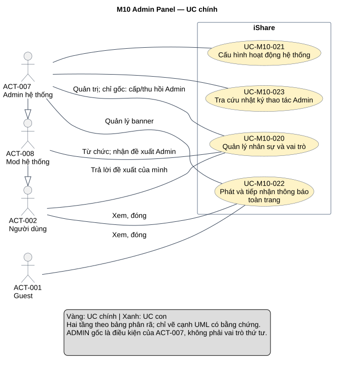
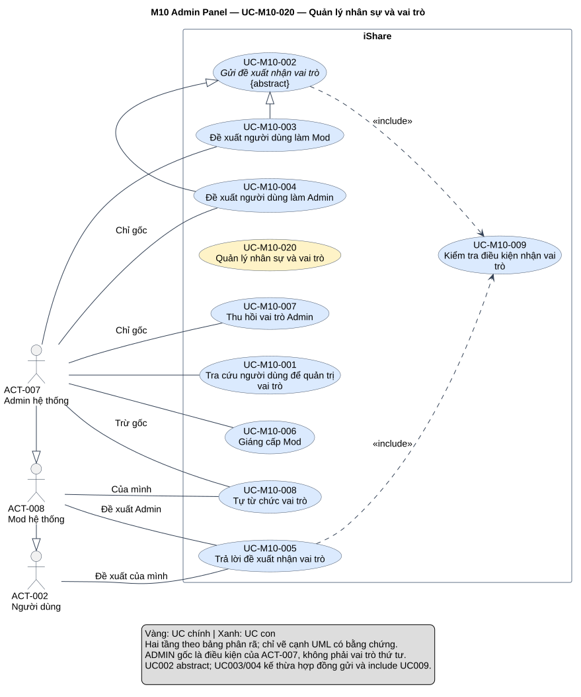
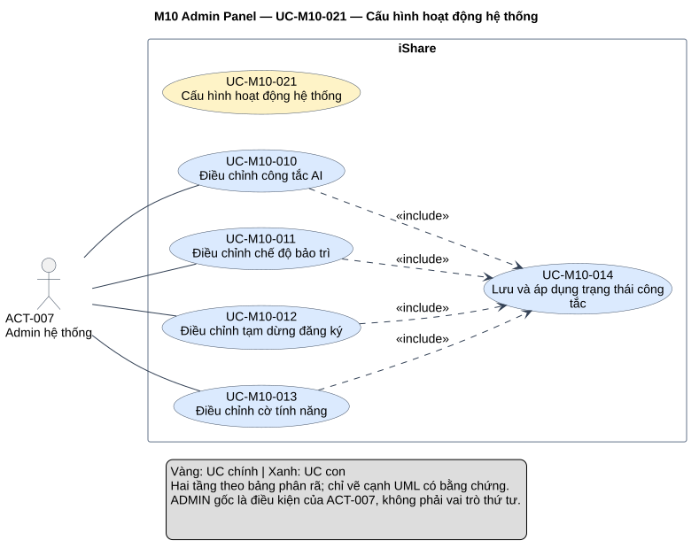
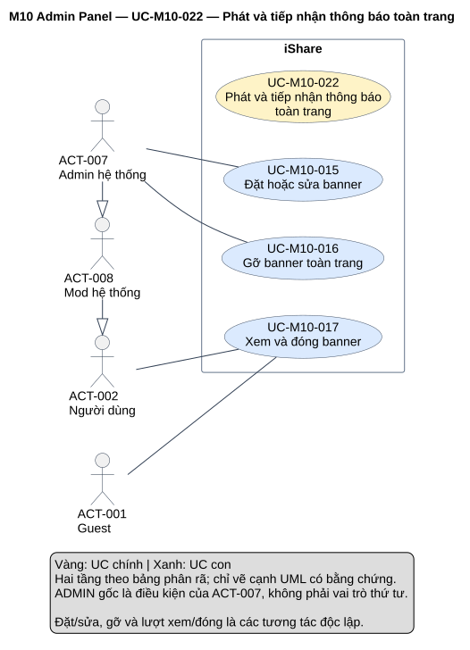
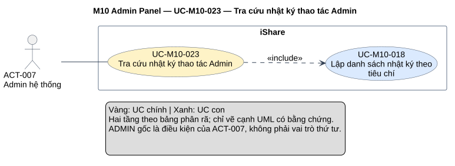

# Phân tích use case — M10 Admin Panel

[Vietnamese Doc] — Theo skill use-case-analysis v2.2; viết tiếng Việt, giữ thuật ngữ cần thiết.

Đầu ra gồm **4 UC chính, 18 UC con**, đặc tả, truy vết và 5 sơ đồ SVG: tổng quan module và một detail cho mỗi core. UC002 là hợp đồng gửi đề xuất abstract, được hai ca Mod/Admin chuyên biệt hóa; dấu ADMIN gốc là điều kiện ngữ cảnh, không phải vai trò thứ tư. Tài liệu chỉ phân tích M10.

## Metadata và tiến độ

<!-- uc:document -->
| key | value |
|---|---|
| document_id | US-M10 |
| skill_version | 2.2 |
| mode | module |
| modules | M10 |
| scope | ALL |
| status | Chờ duyệt |
| current_step | 7 |
| completed_steps | 1, 2, 3, 4, 5, 6, 7 |
| approved_steps | - |
| source_baseline | FR-M10 v1.4; FR-M01 v1.10; FR-M03 v1.10; FR-M04 v1.4; FR-M05 v1.7; FR-M06 v1.5; FR-M07 v1.5; FR-M08 v1.7; FR-M09 v1.2; FR-M11 v1.3; FR-M12 v1.1; FR-M13 v1.3; FR-M14 v1.1; FR-M15 v1.1; FR-M16 v1.0 |
| author | Codex |
| date | 2026-11-01 |
| approval_evidence | Người dùng đã cho phép tự thực hiện các bước cần thiết, không hỏi đồng ý ở lượt M04; áp dụng cho chuỗi module hiện tại. Đây là quyền làm liên tục, không phải phê duyệt kết quả US-M10 hoặc từng bước. |
| semantic_review | pass |
| diagram_check | pass |

| Bước | Kết quả | Xác nhận | Baseline | Làm lại khi |
|---|---|---|---|---|
| 1 | 15 nhóm, 107 FR chi tiết, 30 BR; 1 mã bỏ; boundary/actor/giao tiếp | Được làm liên tục; chưa duyệt | FR-M10 v1.4 | Nguồn đổi |
| 2 | 4 core, 18 sub, 18 mapping; giữ ID actor hiện có | Chưa duyệt | FR-M10 v1.4 | Mục tiêu/phạm vi đổi |
| 3 | 19 hợp đồng chi tiết, 3 brief Summary; 4 AUT và 6 RULE | Chưa duyệt | FR-M10 v1.4 | Hành vi/quyền đổi |
| 4 | 7 include, 2 generalization; rà cả core–sub, sub–sub và cặp không có quan hệ | Chưa duyệt | Mô hình tại đây | Hợp đồng/điểm gọi đổi |
| 5 | 152 dòng truy vết và 137 tiêu chí chi tiết/BR; đối chiếu 14 FR liên quan | Chưa duyệt | FR-M10 v1.4; FR-M01 v1.10; FR-M03 v1.10; FR-M04 v1.4; FR-M05 v1.7; FR-M06 v1.5; FR-M07 v1.5; FR-M08 v1.7; FR-M09 v1.2; FR-M11 v1.3; FR-M12 v1.1; FR-M13 v1.3; FR-M14 v1.1; FR-M15 v1.1; FR-M16 v1.0 | Baseline liên quan đổi |
| 6 | 5 view đã kiểm cú pháp/render/hình, đủ node và 9 cạnh theo mô hình; mỗi view chỉ một SVG | Chưa duyệt | PlantUML 1.2026.8 | Mô hình/nguồn đổi |
| 7 | Đã review nguồn/luồng/quan hệ/hình/liên kết; hoàn tất hồ sơ Chờ duyệt và các giới hạn nguồn | Chưa duyệt | Skill v2.2 | Phản hồi/baseline đổi |

## 1. Phạm vi, nguồn và tổng hợp yêu cầu

**Mục đích:** làm đầu vào thiết kế và kiểm thử quản trị vai trò, cấu hình, banner, nhật ký; cung cấp bốn core để ghép tổng quan hệ thống. Đọc mục 2 để xem phân rã, mục 3 cho hợp đồng/luồng/tiêu chí, mục 4 cho quan hệ, mục 5 cho truy vết, mục 6 cho hình và mục 7 cho QA/giới hạn nguồn.

**Subject:** toàn iShare. M10 sở hữu vai trò/đề xuất/cấu hình/banner/nhật ký Admin. M01, M07, M08, M09 và các module nhận cấu hình là thành phần nội bộ; không vẽ chúng thành actor. M10 không gọi AI hoặc dịch vụ email, không tạo actor AI/email, Hệ thống, clock hay scheduler. AUT biểu diễn hành vi nghiệp vụ do thời gian/sự kiện, không biến hạ tầng thành actor ngoài subject.

**Trong phạm vi:** tra cứu người dùng để quản trị; gửi hai loại đề xuất, phản hồi một lần và thời hạn; giáng Mod/thu hồi Admin/tự từ chức; thu hồi Mod do ban; AI tổng/ba riêng, bảo trì, tạm dừng đăng ký, ba cờ; đặt/sửa/gỡ/đọc/đóng banner; khởi tạo, ghi và xem/lọc nhật ký Admin.

**Ngoài phạm vi:** đăng ký/phiên M01, giao thông báo M07, ban/cảnh cáo/xét báo cáo và nhật ký kiểm duyệt M08, xét khiếu nại M09, chỉnh danh mục Topic/Tag M05, AI/dự phòng chi tiết M13 và module gọi, thao tác chi tiết Group/Gamification/Chat, thống kê M15, thiết kế UI/CSDL/giao thức/giao dịch. Không bổ sung phong thẳng Mod/Admin, điều kiện điểm/uy tín/thâm niên, khiếu nại giáng/thu hồi, phục hồi Mod tự động, chỉnh hằng số qua UI, công tắc email/tóm tắt riêng, cờ module khác, dashboard hiệu suất Mod riêng, nhiều banner hoặc hẹn giờ banner.

**Baseline:** [FR-M10 — Admin Panel](../fr/FR-M10.md) v1.4, Đã chốt 2026-10-24; mốc DEC-271, QA-477, ISS-415, OPEN-012. **152 mã hiệu lực = 15 nhóm + 107 FR chi tiết + 30 BR**. FR-M10-03.05 đã bỏ; quy tắc đề xuất không hết hạn không còn hiệu lực. TBD-M10-01 đã đóng v1.1, chi tiết cờ ở M11/M12/M16.

<!-- uc:sources -->
| path | version | role |
|---|---|---|
| docs/specs/fr/FR-M10.md | 1.4 | owner |
| docs/specs/fr/FR-M01.md | 1.10 | related |
| docs/specs/fr/FR-M03.md | 1.10 | related |
| docs/specs/fr/FR-M04.md | 1.4 | related |
| docs/specs/fr/FR-M05.md | 1.7 | related |
| docs/specs/fr/FR-M06.md | 1.5 | related |
| docs/specs/fr/FR-M07.md | 1.5 | related |
| docs/specs/fr/FR-M08.md | 1.7 | related |
| docs/specs/fr/FR-M09.md | 1.2 | related |
| docs/specs/fr/FR-M11.md | 1.3 | related |
| docs/specs/fr/FR-M12.md | 1.1 | related |
| docs/specs/fr/FR-M13.md | 1.3 | related |
| docs/specs/fr/FR-M14.md | 1.1 | related |
| docs/specs/fr/FR-M15.md | 1.1 | related |
| docs/specs/fr/FR-M16.md | 1.0 | related |

Phương pháp: [skill](../../../.agent-instructions/skills/use-case-analysis/SKILL.md), [modeling rules](../../../.agent-instructions/skills/use-case-analysis/references/modeling-rules.md), [diagram rules](../../../.agent-instructions/skills/use-case-analysis/references/diagram-rules.md). Nguồn phương pháp không cung cấp tính năng. Đối chiếu [US-M08](US-M08.md) và [US-M09](US-M09.md) để giữ ID actor và ranh giới, không coi US Chờ duyệt là FR đã chốt.

### Actor và điều kiện quyền

<!-- uc:actors -->
| id | name | kind | parent | boundary_reason | sources |
|---|---|---|---|---|---|
| ACT-001 | Guest | human | - | Người ngoài subject mở trang và thấy/đóng banner; không vào Panel hoặc trả lời đề xuất. | FR-M10-01.02, FR-M10-13.01, FR-M10-13.07, BR-M10-20 |
| ACT-002 | Người dùng / người được đề xuất | human | - | Người nhận phản hồi đề xuất của chính mình, đọc/đóng banner; không được vào Panel. Người được đề xuất là ngữ cảnh của tài khoản. | FR-M10-03.01, FR-M10-03.03, FR-M10-03.07, FR-M10-03.09, BR-M10-20 |
| ACT-008 | Mod hệ thống | human | ACT-002 | Thêm nhận đề xuất Admin và tự từ chức; không vào Panel. Không phải Mod nhóm M11. | FR-M10-03.09, FR-M10-05.01, BR-M10-01, BR-M10-02 |
| ACT-007 | Admin hệ thống | human | ACT-008 | Vận hành Panel, cấu hình và log; ADMIN gốc là dấu ngữ cảnh trên actor này, chỉ gốc gửi/thu hồi Admin, gốc không được từ chức. | FR-M10-01.01, FR-M10-05.04, FR-M10-05.05, FR-M10-07.07, FR-M10-08.05, BR-M10-01, BR-M10-10, BR-M10-11 |

Actor generalization giữ ACT-007 → ACT-008 → ACT-002, thể hiện năng lực vai trò kế thừa; mỗi UC vẫn kiểm điều kiện cụ thể (USER nhận Mod, USER/MOD nhận Admin, tự từ chức loại gốc). Không dùng kế thừa actor để cấp ADMIN gốc quyền từ chức hoặc cấp mọi Admin quyền gửi/thu hồi Admin. ACTIVE/BANNED/SETUP_COMPLETED và dấu gốc là thuộc tính/điều kiện, không actor hoặc vai trò mới. Hành vi cá nhân của Mod không đòi quyền mở Admin Panel.

### Kiểm kê và tổng hợp yêu cầu

| Nhóm | Tổng hợp | FR chi tiết | Biểu diễn | Owner |
|---|---|---|---|---|
| FR-M10-01 | Tìm username/tên hiển thị, lọc vai trò, hiện trạng thái/nhãn gốc; xem thao tác Mod ở M08. | 6 | [UC-M10-001](#uc-m10-001) | M10 |
| FR-M10-02 | Admin mời USER làm Mod, không phong thẳng; điều kiện ACTIVE/xong bước 3, thay bản cùng loại, hạn 7 ngày. | 10 | [UC-M10-002](#uc-m10-002), [UC-M10-003](#uc-m10-003), [UC-M10-009](#uc-m10-009) | M10 |
| FR-M10-03 | Chủ đề xuất trả lời một lần; kiểm hiệu lực/ACTIVE/vai trò ở lúc chấp nhận, hiện lựa chọn. | 10 | [UC-M10-005](#uc-m10-005), [UC-M10-009](#uc-m10-009) | M10 |
| FR-M10-04 | Admin giáng Mod về USER ngay, không cần đồng ý, không khiếu nại. | 5 | [UC-M10-006](#uc-m10-006) | M10 |
| FR-M10-05 | Mod/Admin không gốc từ chức sau một xác nhận, hủy giữ nguyên, nhận lại qua đề xuất mới. | 6 | [UC-M10-008](#uc-m10-008) | M10 |
| FR-M10-06 | Ban Mod đổi ngay vai trò USER; hết/gỡ/lật ban không trả Mod. | 2 | [AUT003](#aut-m10-003) | M10 |
| FR-M10-07 | Chỉ ADMIN gốc mời USER/MOD làm Admin; tạo gốc sẵn, cùng vòng đời đề xuất. | 11 | [UC-M10-002](#uc-m10-002), [UC-M10-004](#uc-m10-004), [UC-M10-009](#uc-m10-009) | M10 |
| FR-M10-08 | Chỉ gốc thu hồi Admin khác về USER, không chạm gốc, không cần đồng ý/khiếu nại. | 6 | [UC-M10-007](#uc-m10-007) | M10 |
| FR-M10-09 | AI tổng và ba riêng, lưu bền, hiệu lực sau đổi, dự phòng khác lỗi; không chỉnh hằng số. | 10 | [UC-M10-010](#uc-m10-010), [UC-M10-014](#uc-m10-014) | M10 |
| FR-M10-10 | Bảo trì cung cấp M01: chỉ ADMIN đăng nhập/thao tác, kể cả phiên cũ của người khác. | 4 | [UC-M10-011](#uc-m10-011), [UC-M10-014](#uc-m10-014) | M10 |
| FR-M10-11 | Dừng tài khoản mới email/Google; giữ liên kết tài khoản cũ và tiếp bước 2,3. | 4 | [UC-M10-012](#uc-m10-012), [UC-M10-014](#uc-m10-014) | M10 |
| FR-M10-12 | Đúng ba cờ, chặn người không Admin; giữ lối vào, dữ liệu, tự động, kiểm duyệt; không bù. | 9 | [UC-M10-013](#uc-m10-013), [UC-M10-014](#uc-m10-014) | M10 |
| FR-M10-13 | Một banner plain text 1–200 ký tự trim; Admin quản lý, mọi người xem/đóng, nội dung đổi hiện lại. | 10 | [UC-M10-015](#uc-m10-015), [UC-M10-016](#uc-m10-016), [UC-M10-017](#uc-m10-017) | M10 |
| FR-M10-14 | Ghi thao tác Admin đổi dữ liệu và mọi đổi vai trò, đúng người làm/lý do; bất biến/vĩnh viễn. | 9 | [AUT004](#aut-m10-004) | M10 |
| FR-M10-15 | Chỉ Admin xem log, mới nhất trước, giờ Việt Nam, lọc người làm/loại, không sửa/xóa. | 5 | [UC-M10-023](#uc-m10-023), [UC-M10-018](#uc-m10-018) | M10 |

## 2. Danh mục và phân rã

### 2.1 Hai tầng

<!-- uc:catalog -->
| id | name | tier | level | primary | supporting | owner | anchor | sources |
|---|---|---|---|---|---|---|---|---|
| UC-M10-020 | Quản lý nhân sự và vai trò | core | Summary | ACT-007, ACT-002, ACT-008 | - | M10 | #uc-m10-020 | FR-M10-01, FR-M10-02, FR-M10-03, FR-M10-04, FR-M10-05, FR-M10-06, FR-M10-07, FR-M10-08, BR-M10-01, BR-M10-02, BR-M10-05, BR-M10-07, BR-M10-10, BR-M10-11, BR-M10-25, BR-M10-27 |
| UC-M10-021 | Cấu hình hoạt động hệ thống | core | Summary | ACT-007 | - | M10 | #uc-m10-021 | FR-M10-09, FR-M10-10, FR-M10-11, FR-M10-12, BR-M10-04, BR-M10-12, BR-M10-13, BR-M10-14, BR-M10-15, BR-M10-16, BR-M10-17, BR-M10-18, BR-M10-19, BR-M10-26, BR-M10-28 |
| UC-M10-022 | Phát và tiếp nhận thông báo toàn trang | core | Summary | ACT-007, ACT-001, ACT-002 | - | M10 | #uc-m10-022 | FR-M10-13, BR-M10-20, BR-M10-26 |
| UC-M10-023 | Tra cứu nhật ký thao tác Admin | core | User goal | ACT-007 | - | M10 | #uc-m10-023 | FR-M10-14, FR-M10-15, BR-M10-02, BR-M10-21, BR-M10-22, BR-M10-23, BR-M10-24 |
| UC-M10-001 | Tra cứu người dùng để quản trị vai trò | sub | User goal | ACT-007 | - | M10 | #uc-m10-001 | FR-M10-01, BR-M10-02, BR-M10-29, BR-M10-30, BR-M06-09 |
| UC-M10-002 | Gửi đề xuất nhận vai trò | sub | User goal | ACT-007 | - | M10 | #uc-m10-002 | FR-M10-02, FR-M10-07, BR-M10-05, BR-M10-06, BR-M10-07, BR-M10-11, BR-M10-27 |
| UC-M10-003 | Đề xuất người dùng làm Mod | sub | User goal | ACT-007 | - | M10 | #uc-m10-003 | FR-M10-02, BR-M10-05, BR-M10-06, BR-M10-07, BR-M10-27 |
| UC-M10-004 | Đề xuất người dùng làm Admin | sub | User goal | ACT-007 | - | M10 | #uc-m10-004 | FR-M10-07, BR-M10-05, BR-M10-06, BR-M10-07, BR-M10-10, BR-M10-11, BR-M10-27 |
| UC-M10-005 | Trả lời đề xuất nhận vai trò | sub | User goal | ACT-002, ACT-008 | - | M10 | #uc-m10-005 | FR-M10-03, BR-M10-05, BR-M10-06, BR-M10-07, BR-M10-27 |
| UC-M10-006 | Giáng cấp Mod | sub | User goal | ACT-007 | - | M10 | #uc-m10-006 | FR-M10-04, BR-M10-02, BR-M10-08 |
| UC-M10-007 | Thu hồi vai trò Admin | sub | User goal | ACT-007 | - | M10 | #uc-m10-007 | FR-M10-08, BR-M10-10, BR-M10-11 |
| UC-M10-008 | Tự từ chức vai trò | sub | User goal | ACT-008, ACT-007 | - | M10 | #uc-m10-008 | FR-M10-05, BR-M10-10, BR-M10-25 |
| UC-M10-009 | Kiểm tra điều kiện nhận vai trò | sub | Subfunction | ACT-007, ACT-002, ACT-008 | - | M10 | #uc-m10-009 | FR-M10-02.06, FR-M10-02.07, FR-M10-02.09, FR-M10-07.01, FR-M10-07.02, FR-M10-07.07, FR-M10-07.08, FR-M10-03.10, FR-M10-03.11, BR-M10-05, BR-M10-11, BR-M10-27 |
| UC-M10-010 | Điều chỉnh công tắc AI | sub | User goal | ACT-007 | - | M10 | #uc-m10-010 | FR-M10-09, BR-M10-04, BR-M10-12, BR-M10-13, BR-M10-14, BR-M10-15, BR-M10-16 |
| UC-M10-011 | Điều chỉnh chế độ bảo trì | sub | User goal | ACT-007 | - | M10 | #uc-m10-011 | FR-M10-10, BR-M10-13, BR-M10-17 |
| UC-M10-012 | Điều chỉnh tạm dừng đăng ký | sub | User goal | ACT-007 | - | M10 | #uc-m10-012 | FR-M10-11, BR-M10-13, BR-M10-18 |
| UC-M10-013 | Điều chỉnh cờ tính năng | sub | User goal | ACT-007 | - | M10 | #uc-m10-013 | FR-M10-12, BR-M10-13, BR-M10-19, BR-M10-28 |
| UC-M10-014 | Lưu và áp dụng trạng thái công tắc | sub | Subfunction | ACT-007 | - | M10 | #uc-m10-014 | FR-M10-09.02, FR-M10-09.08, FR-M10-10.01, FR-M10-10.03, FR-M10-11.01, FR-M10-11.03, FR-M10-12.01, FR-M10-12.02, BR-M10-02, BR-M10-13 |
| UC-M10-015 | Đặt hoặc sửa banner | sub | User goal | ACT-007 | - | M10 | #uc-m10-015 | FR-M10-13.01, FR-M10-13.03, FR-M10-13.04, FR-M10-13.05, FR-M10-13.06, FR-M10-13.08, FR-M10-13.09, BR-M10-20 |
| UC-M10-016 | Gỡ banner toàn trang | sub | User goal | ACT-007 | - | M10 | #uc-m10-016 | FR-M10-13.02, FR-M10-13.03, BR-M10-20 |
| UC-M10-017 | Xem và đóng banner | sub | User goal | ACT-001, ACT-002 | - | M10 | #uc-m10-017 | FR-M10-13.01, FR-M10-13.06, FR-M10-13.07, FR-M10-13.08, BR-M10-20 |
| UC-M10-018 | Lập danh sách nhật ký theo tiêu chí | sub | Subfunction | ACT-007 | - | M10 | #uc-m10-018 | FR-M10-15.01, FR-M10-15.02, FR-M10-15.04, FR-M10-15.05, BR-M10-02, BR-M10-23 |

Chỉ bốn core dùng để tổng hợp toàn hệ thống. Core020/021/022 là Summary, không ép mọi sub thành một chuỗi thực thi. Core023 là User goal có hợp đồng đầy đủ. Các sub là User goal hoặc Subfunction độc lập với tier. UC002 abstract thuộc tầng sub vì là hợp đồng gửi dùng chung, không phải UC tổng quan hệ thống; UC003/004 là chuyên biệt Mod/Admin có kết quả và kiểm quyền rõ.

### 2.2 Ánh xạ core → sub

<!-- uc:decomposition -->
| core | sub | rationale | sources |
|---|---|---|---|
| UC-M10-020 | UC-M10-001 | Tìm tài khoản, thao tác vai trò áp dụng và lối xem lịch sử Mod. | FR-M10-01, BR-M10-02, BR-M10-29, BR-M10-30, BR-M06-09 |
| UC-M10-020 | UC-M10-002 | Hợp đồng chung gửi lời mời, thời hạn, thay bản và giữ vai trò. | FR-M10-02, FR-M10-07, BR-M10-05, BR-M10-06, BR-M10-07, BR-M10-11, BR-M10-27 |
| UC-M10-020 | UC-M10-003 | Mời USER nhận MODERATOR. | FR-M10-02, BR-M10-05, BR-M10-06, BR-M10-07, BR-M10-27 |
| UC-M10-020 | UC-M10-004 | Gốc mời USER/MODERATOR nhận ADMIN. | FR-M10-07, BR-M10-05, BR-M10-06, BR-M10-07, BR-M10-10, BR-M10-11, BR-M10-27 |
| UC-M10-020 | UC-M10-005 | Người nhận quyết định nhận hoặc từ chối vai trò. | FR-M10-03, BR-M10-05, BR-M10-06, BR-M10-07, BR-M10-27 |
| UC-M10-020 | UC-M10-006 | Admin trực tiếp chấm dứt quyền Mod. | FR-M10-04, BR-M10-02, BR-M10-08 |
| UC-M10-020 | UC-M10-007 | Gốc chấm dứt quyền Admin khác. | FR-M10-08, BR-M10-10, BR-M10-11 |
| UC-M10-020 | UC-M10-008 | Staff tự chấm dứt vai trò có xác nhận. | FR-M10-05, BR-M10-10, BR-M10-25 |
| UC-M10-020 | UC-M10-009 | Kiểm điều kiện nhận vai trò dùng chung theo giai đoạn. | FR-M10-02.06, FR-M10-02.07, FR-M10-02.09, FR-M10-07.01, FR-M10-07.02, FR-M10-07.07, FR-M10-07.08, FR-M10-03.10, FR-M10-03.11, BR-M10-05, BR-M10-11, BR-M10-27 |
| UC-M10-021 | UC-M10-010 | Điều khiển AI tổng và ba loại. | FR-M10-09, BR-M10-04, BR-M10-12, BR-M10-13, BR-M10-14, BR-M10-15, BR-M10-16 |
| UC-M10-021 | UC-M10-011 | Giới hạn hoạt động chỉ ADMIN trong bảo trì. | FR-M10-10, BR-M10-13, BR-M10-17 |
| UC-M10-021 | UC-M10-012 | Kiểm soát nhận tài khoản mới với ngoại lệ. | FR-M10-11, BR-M10-13, BR-M10-18 |
| UC-M10-021 | UC-M10-013 | Tạm dừng thao tác ở ba module có cờ. | FR-M10-12, BR-M10-13, BR-M10-19, BR-M10-28 |
| UC-M10-021 | UC-M10-014 | Lưu bền và áp thời điểm chung cho các thay đổi công tắc. | FR-M10-09.02, FR-M10-09.08, FR-M10-10.01, FR-M10-10.03, FR-M10-11.01, FR-M10-11.03, FR-M10-12.01, FR-M10-12.02, BR-M10-02, BR-M10-13 |
| UC-M10-022 | UC-M10-015 | Công bố/thay một nội dung thông báo. | FR-M10-13.01, FR-M10-13.03, FR-M10-13.04, FR-M10-13.05, FR-M10-13.06, FR-M10-13.08, FR-M10-13.09, BR-M10-20 |
| UC-M10-022 | UC-M10-016 | Ngừng thông báo cho toàn hệ thống. | FR-M10-13.02, FR-M10-13.03, BR-M10-20 |
| UC-M10-022 | UC-M10-017 | Người xem đọc và đóng riêng banner hiện tại. | FR-M10-13.01, FR-M10-13.06, FR-M10-13.07, FR-M10-13.08, BR-M10-20 |
| UC-M10-023 | UC-M10-018 | Cung cấp tập nhật ký đúng quyền/bộ lọc để core023 hiển thị. | FR-M10-15.01, FR-M10-15.02, FR-M10-15.04, FR-M10-15.05, BR-M10-02, BR-M10-23 |

18 mapping, không sub mồ côi. Mapping là cấu trúc phân tích, không tự tạo mũi tên. UC009 được tái sử dụng theo hai ngữ cảnh gửi/chấp nhận; UC014 theo bốn loại công tắc. Không nhân bản ID theo caller. Lối Xem thao tác Mod tái sử dụng [UC-M08-025](US-M08.md#uc-m08-025), không phát minh UC M10 trùng mục tiêu hoặc chỉ số hiệu suất.

### 2.3 Tổng hợp hệ thống và quyết định phân tích

<!-- uc:module-models -->
| module | path | baseline |
|---|---|---|

Mode module: chưa tổng hợp toàn hệ thống, không tạo lại danh sách core các module khác.

| Quyết định | Hành vi | Biểu diễn | Lý do | Phương án không chọn |
|---|---|---|---|---|
| D-M10-01 | Gửi hai loại đề xuất | UC002 abstract; UC003/004 generalization | Cùng hợp đồng gửi, vòng đời và đầu ra; khác quyền/đích/loại thông báo. Kế thừa được nêu tại mục 4. | Không gọi lần lượt hai loại, không chỉ gom hai nút trong một package rồi coi là kế thừa. |
| D-M10-02 | Trả lời lời mời | UC005, Chấp nhận chính/Từ chối nhánh | Cùng mục tiêu quyết định một đề xuất; không cần hai UC mới theo từng nút hay loại vai trò. | Không extend ca gửi đã kết thúc; không include trả lời vào gửi. |
| D-M10-03 | Gửi/chấp nhận kiểm điều kiện | UC009 subfunction dùng lại | Cần phân biệt điều kiện ở hai giai đoạn và giữ quyền đúng lúc, không biến trạng thái hợp lệ thành actor. | Không tạo UC cho mỗi phép kiểm ACTIVE/điểm/username. |
| D-M10-04 | Cấu hình công tắc | Bốn mục tiêu UC010/011/012/013 include UC014 | Hành vi lưu bền/áp thời điểm dùng lại; mỗi loại có hiệu quả nghiệp vụ riêng. | Không dựng generalization chỉ để gom CRUD; không include đăng nhập. |
| D-M10-05 | Đặt/sửa/gỡ/đọc/đóng banner | UC015 đặt/sửa; UC016 gỡ; UC017 đọc và nhánh đóng | Đặt/sửa cùng hợp đồng nội dung; gỡ toàn trang khác đóng cá nhân. Việc xem xảy ra độc lập với thao tác Admin. | Không extend Gỡ vào Đặt, không chèn mọi lượt người xem vào ca Admin. |
| D-M10-06 | Ban, quá hạn, khởi tạo, audit | 4 AUT đầy đủ trigger/trước/sau/dữ liệu | Sự kiện nội bộ/thời gian, không cần tạo actor hệ thống giả. | Không vẽ scheduler hoặc M08/M07 làm actor ngoài iShare. |
| D-M10-07 | Theo dõi hiệu suất Mod | Nhánh điều hướng UC001 tới nhật ký M08 lọc theo Mod | FR chỉ yêu cầu mở nhật ký, không mục tiêu tính KPI mới. | Không thêm bảng xếp hạng/chỉ số/màn hình hiệu suất. |
| D-M10-08 | Ghi và đọc log | AUT004 ghi; core023 include UC018 đọc đúng tập | Ghi theo sự kiện độc lập, đọc không làm phát sinh mục Admin. | Không cho Admin sửa/xóa nhật ký hoặc ghi quyết định AI vào log này. |

## 3. Đặc tả

### 3.1 UC chính

#### UC-M10-020 — Quản lý nhân sự và vai trò

**Actor:** ACT-007, ACT-002, ACT-008. **Mục tiêu/giá trị:** Admin chọn nhân sự và quản trị vai trò; người nhận quyết định nhận vai trò, staff tự từ chức đúng quyền. Mỗi tài khoản chỉ giữ một vai trò.

**Kích hoạt và ranh giới:** Cần tìm người, gửi/trả lời đề xuất, giáng cấp/thu hồi hoặc tự từ chức. Quyền theo từng nhánh; Admin Panel chỉ ADMIN, phản hồi và từ chức không yêu cầu quyền vào Panel.

**Quy trình tổng quát:** Admin tra cứu người dùng qua UC001 rồi có thể gửi đề xuất Mod (UC003) hoặc Admin nếu là gốc (UC004), giáng Mod (UC006) hoặc thu hồi Admin nếu là gốc (UC007). Tra cứu không phải tiền điều kiện bắt buộc chạy lại mỗi lần. Hai cách gửi kế thừa hợp đồng UC002 và dùng bộ kiểm UC009. Người nhận phản hồi độc lập qua M07 bằng UC005; Mod/Admin không phải gốc tự từ chức bằng UC008. AUT002 hết hạn đề xuất; AUT003 thu hồi Mod do ban; AUT004 ghi lịch sử. Không có hành trình nào bắt gửi cả hai loại, nhận vai trò rồi giáng cấp hoặc từ chức ngay.

**Kết quả:** Đề xuất/hay thay đổi vai trò được ghi nhận theo hành vi được chọn; không ép mọi UC con chạy cùng một phiên. **Giới hạn khi không đạt:** Từ chối theo điều kiện cụ thể; không tự bù quy tắc giao dịch khi nguồn chưa mô tả.

**UC con:** [UC-M10-001](#uc-m10-001), [UC-M10-002](#uc-m10-002), [UC-M10-003](#uc-m10-003), [UC-M10-004](#uc-m10-004), [UC-M10-005](#uc-m10-005), [UC-M10-006](#uc-m10-006), [UC-M10-007](#uc-m10-007), [UC-M10-008](#uc-m10-008), [UC-M10-009](#uc-m10-009). **Căn cứ:** FR-M10-01, FR-M10-02, FR-M10-03, FR-M10-04, FR-M10-05, FR-M10-06, FR-M10-07, FR-M10-08, BR-M10-01, BR-M10-02, BR-M10-05, BR-M10-07, BR-M10-10, BR-M10-11, BR-M10-25, BR-M10-27.

#### UC-M10-021 — Cấu hình hoạt động hệ thống

**Actor:** ACT-007. **Mục tiêu/giá trị:** Vận hành AI, bảo trì, đăng ký và ba module có cờ lúc hệ thống đang chạy, giữ trạng thái bền.

**Kích hoạt và ranh giới:** Admin cần đổi một công tắc cấu hình. ADMIN cho các thay đổi; loại cấu hình phải thuộc danh sách đã chốt.

**Quy trình tổng quát:** Admin chọn đúng loại: UC010 công tắc AI, UC011 bảo trì, UC012 tạm dừng đăng ký, UC013 cờ Group/Chat/Gamification. Mỗi ca chèn UC014 để lưu và áp trạng thái sau thời điểm đổi. Các ca độc lập; tắt AI không phải lỗi AI, không phải cờ tính năng. Cấu hình banner thuộc core022; không có công tắc email, tóm tắt riêng hoặc màn hình chỉnh hằng số. AUT001 khởi tạo một lần, không reset khi triển khai/chuyển công tắc.

**Kết quả:** Trạng thái mới tác động thao tác sau lúc đổi; module sở hữu áp đúng chính sách. **Giới hạn khi không đạt:** Từ chối người không có quyền; giao dịch và lỗi lưu xem NOTE-M10-04.

**UC con:** [UC-M10-010](#uc-m10-010), [UC-M10-011](#uc-m10-011), [UC-M10-012](#uc-m10-012), [UC-M10-013](#uc-m10-013), [UC-M10-014](#uc-m10-014). **Căn cứ:** FR-M10-09, FR-M10-10, FR-M10-11, FR-M10-12, BR-M10-04, BR-M10-12, BR-M10-13, BR-M10-14, BR-M10-15, BR-M10-16, BR-M10-17, BR-M10-18, BR-M10-19, BR-M10-26, BR-M10-28.

#### UC-M10-022 — Phát và tiếp nhận thông báo toàn trang

**Actor:** ACT-007, ACT-001, ACT-002. **Mục tiêu/giá trị:** Admin truyền đạt một thông báo toàn trang; từng người xem đọc hoặc đóng phiên bản banner hiện tại.

**Kích hoạt và ranh giới:** Admin đặt/sửa/gỡ hoặc một người mở trang/đóng banner. Quyền quản lý thuộc ADMIN; Guest và mọi vai trò được thấy, đóng banner.

**Quy trình tổng quát:** UC015 đặt hoặc sửa nội dung, UC016 gỡ banner, UC017 đọc và đóng banner. Việc quản trị và việc người khác xem xảy ra độc lập; không include/extend UC017 vào một lần Admin đặt banner. Thay nội dung/đặt mới làm banner hiện lại với mọi người, kể cả đã đóng. Gỡ làm không hiện toàn trang, khác đóng của một người. Không có hẹn giờ hoặc nhiều banner.

**Kết quả:** Tối đa một banner văn bản thuần hợp lệ; đóng đúng phạm vi người xem và hiện lại khi nội dung đổi/đặt mới. **Giới hạn khi không đạt:** Từ chối quản lý trái quyền/nội dung sai; phạm vi ghi nhớ cho người đăng nhập xem NOTE-M10-02.

**UC con:** [UC-M10-015](#uc-m10-015), [UC-M10-016](#uc-m10-016), [UC-M10-017](#uc-m10-017). **Căn cứ:** FR-M10-13, BR-M10-20, BR-M10-26.

### 3.2 Core User goal và các UC con

Các Subfunction nhận ngữ cảnh của caller, không là nút cho người dùng tự chạy bỏ qua kiểm quyền. Cột nguồn của bước kế thừa bao gồm hợp đồng được liên kết; không gán các module nội bộ làm actor hỗ trợ.

#### UC-M10-023 — Tra cứu nhật ký thao tác Admin

**UC con:** [UC-M10-018](#uc-m10-018), hành vi truy xuất/lọc chèn ở bước 2.

<!-- uc:spec UC-M10-023 -->
| key | value |
|---|---|
| goal | Admin kiểm tra lịch sử vận hành toàn hệ thống bằng nhật ký chỉ ghi thêm, tìm đúng người làm/loại thao tác. |
| subject | iShare |
| level | User goal |
| primary | ACT-007 |
| supporting | - |
| trigger | Admin mở nhật ký thao tác Admin. |
| preconditions | Phiên được M01 xử lý; quyền ADMIN được kiểm trong luồng, không dùng tiền điều kiện để bỏ nhánh từ chối. |
| success | Danh sách đúng tiêu chí, mới nhất trước, đủ năm trường và giờ Việt Nam; dữ liệu không bị sửa bởi việc đọc. |
| failure | Từ chối người không có quyền và mọi yêu cầu sửa/xóa mục; lỗi truy xuất chưa được nguồn chốt. |
| abstract | false |
| common_contract | Không áp dụng: không là UC tổng quát có chuyên biệt hóa. |

**Luồng chính:**

| Bước | Ai | Hành động/phản hồi | Tiếp tục | Nguồn |
|---|---|---|---|---|
| 1 | ACT-007 | Mở nhật ký; có thể đưa tiêu chí người làm và loại thao tác. | [Bước 2](#uc-m10-023-main-2) | FR-M10-14, FR-M10-15, BR-M10-02, BR-M10-21, BR-M10-22, BR-M10-23, BR-M10-24 |
| 2 | iShare | Chèn UC-M10-018 để kiểm phạm vi và lập tập mục theo tiêu chí; tiêu chí rỗng trả toàn bộ nhật ký được xem. | [Bước 3](#uc-m10-023-main-3) | FR-M10-14, FR-M10-15, BR-M10-02, BR-M10-21, BR-M10-22, BR-M10-23, BR-M10-24 |
| 3 | iShare | Hiện người làm, thao tác, đối tượng, lý do tùy chọn và thời điểm theo Asia/Ho_Chi_Minh (UTC+7), mới nhất trước. | [Bước 4](#uc-m10-023-main-4) | FR-M10-14, FR-M10-15, BR-M10-02, BR-M10-21, BR-M10-22, BR-M10-23, BR-M10-24 |
| 4 | ACT-007 | Đọc lịch sử; có thể đổi tiêu chí và yêu cầu danh sách mới. Việc xem không sinh mục nhật ký thao tác Admin. | END: đạt kết quả thành công trong hợp đồng. | FR-M10-14, FR-M10-15, BR-M10-02, BR-M10-21, BR-M10-22, BR-M10-23, BR-M10-24 |

**Luồng thay thế và ngoại lệ:**

| ID nhánh | Bước rẽ | Điều kiện | Xử lý | Quay lại/kết thúc | Nguồn |
|---|---|---|---|---|---|
| A1 | [Bước 2](#uc-m10-023-main-2) | Người mở không có vai trò ADMIN hoặc chưa đăng nhập. | UC018 từ chối truy xuất. | END: không cho xem. | FR-M10-15.02, BR-M10-02 |
| A2 | [Bước 4](#uc-m10-023-main-4) | Admin thay tiêu chí người làm hoặc loại thao tác. | Lập lại danh sách đúng tiêu chí. | [Tiếp tục](#uc-m10-023-main-2) | FR-M10-15.05 |
| A3 | [Bước 4](#uc-m10-023-main-4) | Bất kỳ ai yêu cầu sửa hoặc xóa mục nhật ký. | Từ chối; giữ mục nhật ký vĩnh viễn. | END: mục không bị sửa/xóa. | FR-M10-15.03, FR-M10-14.04, BR-M10-22 |

**Quy tắc áp dụng:** FR-M10-14, FR-M10-15, BR-M10-02, BR-M10-21, BR-M10-22, BR-M10-23, BR-M10-24. Xem [vai trò](#rule-m10-001), [đề xuất](#rule-m10-002), [cấu hình](#rule-m10-003), [cờ tính năng](#rule-m10-004), [banner](#rule-m10-005), [nhật ký](#rule-m10-006) theo phạm vi UC. Lỗi giao dịch và trạng thái chưa được nguồn chốt được ghi tại mục 7; không tự đưa rollback/retry vào hợp đồng.

**Tiêu chí nguồn phải giữ khi thiết kế/kiểm thử:** Các dòng dưới đây đối chiếu nguyên nghĩa FR/BR với luồng/quy tắc tại đây; không thay cho logic bước/nhánh đã đặc tả.

| Mã | Nội dung đối chiếu |
|---|---|
| FR-M10-15.01 | Khi Admin mở nhật ký thao tác Admin, hệ thống phải hiện các mục với người làm, thao tác, đối tượng, lý do và thời điểm theo giờ Việt Nam (BR-M10-23). |
| FR-M10-15.02 | Nếu người mở nhật ký không có vai trò ADMIN, hệ thống phải từ chối (BR-M10-02). |
| FR-M10-15.03 | Nếu bất kỳ ai, kể cả Admin, sửa hoặc xóa một mục nhật ký thao tác Admin, hệ thống phải từ chối (BR-M10-22). |
| FR-M10-15.04 | Khi Admin mở nhật ký thao tác Admin, hệ thống phải hiện mục mới nhất trước (BR-M10-23). |

#### UC-M10-001 — Tra cứu người dùng để quản trị vai trò

**Thuộc core:** [UC-M10-020](#uc-m10-020). Tìm tài khoản, thao tác vai trò áp dụng và lối xem lịch sử Mod.

<!-- uc:spec UC-M10-001 -->
| key | value |
|---|---|
| goal | Tìm đúng tài khoản và biết thao tác vai trò áp dụng; xem thao tác của Mod qua nhật ký M08 khi cần. |
| subject | iShare |
| level | User goal |
| primary | ACT-007 |
| supporting | - |
| trigger | Admin mở phần quản lý người dùng. |
| preconditions | Định danh/phiên do M01 cung cấp; quyền truy cập được kiểm trong luồng. |
| success | Danh sách đúng tên/vai trò, đủ thông tin; chọn được thao tác phù hợp mà không thay đổi vai trò chỉ vì xem. |
| failure | Từ chối người không có quyền. Không tự giới hạn tập tài khoản theo quy tắc tìm công khai của M06. |
| abstract | false |
| common_contract | Không áp dụng: không là UC tổng quát có chuyên biệt hóa. |

**Luồng chính:**

| Bước | Ai | Hành động/phản hồi | Tiếp tục | Nguồn |
|---|---|---|---|---|
| 1 | ACT-007 | Mở phần quản lý người dùng, nhập username/tên hiển thị hoặc chọn bộ lọc vai trò khi cần. | [Bước 2](#uc-m10-001-main-2) | FR-M10-01, BR-M10-02, BR-M10-29, BR-M10-30, BR-M06-09 |
| 2 | iShare | Kiểm người mở là ADMIN; tìm theo username hoặc display_name, chuỗi ở bất kỳ vị trí, không phân biệt hoa/thường, bỏ dấu và chấp nhận gõ sai nhẹ theo BR-M06-09; mục giống hơn đứng trước. Chỉ tái sử dụng cách khớp, không bê tập chỉ ACTIVE/SETUP_COMPLETED, debounce hay giới hạn 3 của tìm công khai sang Admin Panel. | [Bước 3](#uc-m10-001-main-3) | FR-M10-01, BR-M10-02, BR-M10-29, BR-M10-30, BR-M06-09 |
| 3 | iShare | Áp bộ lọc USER/MODERATOR/ADMIN nếu có; hiện username, tên hiển thị, vai trò, trạng thái tài khoản và nhãn gốc cho tài khoản ADMIN gốc. | [Bước 4](#uc-m10-001-main-4) | FR-M10-01, BR-M10-02, BR-M10-29, BR-M10-30, BR-M06-09 |
| 4 | ACT-007 | Chọn tài khoản cần quản trị. | [Bước 5](#uc-m10-001-main-5) | FR-M10-01, BR-M10-02, BR-M10-29, BR-M10-30, BR-M06-09 |
| 5 | iShare | Cho thao tác áp dụng: đề xuất làm Mod, giáng cấp; nếu người thao tác là ADMIN gốc thêm đề xuất làm Admin, thu hồi Admin. Mỗi thao tác kiểm lại điều kiện riêng trong UC003/004/006/007; việc hiển thị lệnh không cấp quyền thay thế. | END: đạt kết quả thành công trong hợp đồng. | FR-M10-01, BR-M10-02, BR-M10-29, BR-M10-30, BR-M06-09 |

**Luồng thay thế và ngoại lệ:**

| ID nhánh | Bước rẽ | Điều kiện | Xử lý | Quay lại/kết thúc | Nguồn |
|---|---|---|---|---|---|
| A1 | [Bước 2](#uc-m10-001-main-2) | Guest hoặc tài khoản không có vai trò ADMIN. | Từ chối vào Admin Panel. | END: không cho xem. | FR-M10-01.02, BR-M10-02 |
| A2 | [Bước 4](#uc-m10-001-main-4) | Admin chọn Xem thao tác ở một tài khoản Mod. | Mở nhật ký kiểm duyệt M08 lọc theo người làm là Mod đó; dùng UC-M08-025 đã có, không lập màn hình hay chỉ số hiệu suất riêng. Đây là điều hướng tới mục tiêu độc lập, không chèn thêm UC vào luồng tìm. | END: tiếp tục tại M08 theo quyền nhật ký của M08. | FR-M10-01.06, BR-M10-30, FR-M08-17.06 |

**Quy tắc áp dụng:** FR-M10-01, BR-M10-02, BR-M10-29, BR-M10-30, BR-M06-09. Xem [vai trò](#rule-m10-001), [đề xuất](#rule-m10-002), [cấu hình](#rule-m10-003), [cờ tính năng](#rule-m10-004), [banner](#rule-m10-005), [nhật ký](#rule-m10-006) theo phạm vi UC. Lỗi giao dịch và trạng thái chưa được nguồn chốt được ghi tại mục 7; không tự đưa rollback/retry vào hợp đồng.

Nhánh Xem thao tác tiếp tục ở [UC-M08-025](US-M08.md#uc-m08-025). Không đưa quy tắc lọc tài khoản tìm công khai (BR-M06-24), debounce hay tối đa ba kết quả vào tìm quản trị chỉ vì dùng lại cách khớp BR-M06-09. Tập trạng thái tài khoản có thể xuất hiện ngoài các trường đã nêu chưa được FR liệt kê riêng (NOTE-M10-05).

**Tiêu chí nguồn phải giữ khi thiết kế/kiểm thử:** Các dòng dưới đây đối chiếu nguyên nghĩa FR/BR với luồng/quy tắc tại đây; không thay cho logic bước/nhánh đã đặc tả.

| Mã | Nội dung đối chiếu |
|---|---|
| FR-M10-01.01 | Khi Admin chọn một người dùng trong phần quản lý người dùng, hệ thống phải cho Admin thực hiện các thao tác vai trò áp được cho người đó: đề xuất làm Mod, giáng cấp; với tài khoản ADMIN gốc thêm đề xuất làm Admin, thu hồi vai trò Admin. |
| FR-M10-01.02 | Nếu người chưa đăng nhập hoặc tài khoản không có vai trò ADMIN mở Admin Panel, hệ thống phải từ chối (BR-M10-02). |
| FR-M10-01.03 | Khi Admin tìm người dùng, hệ thống phải tìm theo username hoặc tên hiển thị, khớp như tìm người dùng ở M06 (BR-M10-29). |
| FR-M10-01.04 | Khi Admin lọc theo vai trò USER, MODERATOR hoặc ADMIN, hệ thống phải chỉ hiện người dùng có vai trò đó (BR-M10-29). |
| FR-M10-01.05 | Hệ thống phải hiện ở mỗi người dùng: username, tên hiển thị, vai trò, trạng thái tài khoản; tài khoản ADMIN gốc có nhãn "gốc" (BR-M10-29). |
| FR-M10-01.06 | Khi Admin chọn "Xem thao tác" ở một Mod, hệ thống phải mở nhật ký kiểm duyệt (M08) lọc theo người làm là Mod đó (BR-M10-30). |
| BR-M10-29 | Admin tìm người dùng theo username hoặc tên hiển thị (khớp như tìm người dùng ở M06), lọc theo vai trò; mỗi người dùng hiện username, tên hiển thị, vai trò, trạng thái tài khoản; tài khoản ADMIN gốc có nhãn "gốc". |
| BR-M10-30 | Admin theo dõi "hiệu suất" của Mod bằng nhật ký kiểm duyệt (M08) lọc theo Mod đó; không có màn hình hay chỉ số hiệu suất riêng. Thu hồi vai trò Mod là giáng cấp. |

#### UC-M10-002 — Gửi đề xuất nhận vai trò (abstract)

**Thuộc core:** [UC-M10-020](#uc-m10-020). Hợp đồng chung gửi lời mời, thời hạn, thay bản và giữ vai trò.

<!-- uc:spec UC-M10-002 -->
| key | value |
|---|---|
| goal | Lưu một đề xuất hợp lệ, thông báo đúng người và giữ nguyên vai trò cho tới khi chấp nhận. |
| subject | iShare |
| level | User goal |
| primary | ACT-007 |
| supporting | - |
| trigger | Admin gửi đề xuất của một loại cụ thể. |
| preconditions | Có loại Mod hoặc Admin và người nhận; quyền gửi theo loại được chuyên biệt hóa. UC abstract không là lệnh gửi bỏ qua loại. |
| success | Đề xuất mới Chưa trả lời có thời điểm gửi, hạn 7 × 24 giờ; tối đa một đề xuất hiệu lực cùng loại/cùng người; tạo thông báo mới; vai trò người nhận giữ nguyên. |
| failure | Từ chối theo bộ kiểm hoặc quyền của chuyên biệt; không tự quy định atomicity giữa hết hiệu lực đề xuất cũ, lưu mới, thông báo và log. |
| abstract | true |
| common_contract | Hợp đồng chung: kiểm người gửi/loại và điều kiện người nhận trước khi thay bản cũ; tối đa một đề xuất hiệu lực mỗi loại/người; bản mới Chưa trả lời có thời điểm gửi, hạn 7 × 24 giờ; không tự phong vai trò; phát thông báo mới và ghi thao tác gửi. Kế thừa toàn bộ thứ tự 1→5 và nhánh thất bại. Phần còn thiếu để hiện thực: người được quyền gửi, vai trò đích/nguồn và loại thông báo, do UC003 hoặc UC004 cố định. Không kế thừa hai UC con nối tiếp nhau. |

**Luồng chính:**

| Bước | Ai | Hành động/phản hồi | Tiếp tục | Nguồn |
|---|---|---|---|---|
| 1 | iShare | Chèn UC-M10-009 với ngữ cảnh gửi, loại đề xuất, người gửi và người nhận; chỉ tiếp tục khi đủ quyền và điều kiện. | [Bước 2](#uc-m10-002-main-2) | FR-M10-02, FR-M10-07, BR-M10-05, BR-M10-06, BR-M10-07, BR-M10-11, BR-M10-27 |
| 2 | iShare | Nếu có đề xuất cùng loại cho cùng người còn hiệu lực, chuyển đề xuất cũ sang Hết hiệu lực trước khi lưu mới; thông báo cũ không còn trả lời được. Gửi lại sau Từ chối/Hết hiệu lực là một đề xuất mới, không mở lại bản cũ. | [Bước 3](#uc-m10-002-main-3) | FR-M10-02, FR-M10-07, BR-M10-05, BR-M10-06, BR-M10-07, BR-M10-11, BR-M10-27 |
| 3 | iShare | Lưu đề xuất mới Chưa trả lời, người gửi, người nhận, loại và thời điểm gửi; không đổi vai trò người nhận; hạn bằng thời điểm gửi + 7 × 24 giờ. | [Bước 4](#uc-m10-002-main-4) | FR-M10-02, FR-M10-07, BR-M10-05, BR-M10-06, BR-M10-07, BR-M10-11, BR-M10-27 |
| 4 | iShare | Cung cấp cho M07 sự kiện để tạo thông báo mới đúng loại với Chấp nhận/Từ chối. AUT002 xử lý đủ hạn; gửi lại tạo thông báo mới. | [Bước 5](#uc-m10-002-main-5) | FR-M10-02, FR-M10-07, BR-M10-05, BR-M10-06, BR-M10-07, BR-M10-11, BR-M10-27 |
| 5 | iShare | AUT004 ghi thao tác Admin gửi đề xuất; kết thúc ca gửi. Không chờ câu trả lời trong phiên gửi. | END: đạt kết quả thành công trong hợp đồng. | FR-M10-02, FR-M10-07, BR-M10-05, BR-M10-06, BR-M10-07, BR-M10-11, BR-M10-27 |

**Luồng thay thế và ngoại lệ:**

| ID nhánh | Bước rẽ | Điều kiện | Xử lý | Quay lại/kết thúc | Nguồn |
|---|---|---|---|---|---|
| A1 | [Bước 1](#uc-m10-002-main-1) | Bộ kiểm UC009 từ chối. | Không tạo đề xuất mới; trả từ chối theo nguyên nhân của bộ kiểm. | END: không có đề xuất gửi hợp lệ. | FR-M10-02.06, FR-M10-02.07, FR-M10-02.09, FR-M10-07.01, FR-M10-07.02, FR-M10-07.07, FR-M10-07.08, BR-M10-05, BR-M10-11 |
| A2 | [Bước 2](#uc-m10-002-main-2) | Đề xuất trước đã Từ chối hoặc Hết hiệu lực. | Giữ trạng thái bản cũ, tiếp tục tạo bản và thông báo mới. | [Tiếp tục](#uc-m10-002-main-3) | FR-M10-02.05, BR-M10-06, BR-M10-27 |

**Quy tắc áp dụng:** FR-M10-02, FR-M10-07, BR-M10-05, BR-M10-06, BR-M10-07, BR-M10-11, BR-M10-27. Xem [vai trò](#rule-m10-001), [đề xuất](#rule-m10-002), [cấu hình](#rule-m10-003), [cờ tính năng](#rule-m10-004), [banner](#rule-m10-005), [nhật ký](#rule-m10-006) theo phạm vi UC. Lỗi giao dịch và trạng thái chưa được nguồn chốt được ghi tại mục 7; không tự đưa rollback/retry vào hợp đồng.

UC002 không thực thi độc lập với một loại chưa xác định. [UC003](#uc-m10-003) và [UC004](#uc-m10-004) hiện thực phần thiếu, kế thừa bước 1–5/nhánh và include bộ kiểm ở bước 1. Quyết định chuyên biệt hóa và bảng chứng minh ở mục 4.

#### UC-M10-003 — Đề xuất người dùng làm Mod

**Thuộc core:** [UC-M10-020](#uc-m10-020). Mời USER nhận MODERATOR.

<!-- uc:spec UC-M10-003 -->
| key | value |
|---|---|
| goal | Mời tài khoản USER hợp lệ nhận vai trò MODERATOR theo sự đồng ý của họ. |
| subject | iShare |
| level | User goal |
| primary | ACT-007 |
| supporting | - |
| trigger | Admin chọn gửi Đề xuất làm Mod cho một người dùng. |
| preconditions | Định danh người gửi/nhận; không giả định người nhận đã hợp lệ trước khi kiểm. |
| success | Đề xuất làm Mod mới Chưa trả lời, thông báo mới; người nhận vẫn USER cho tới chấp nhận. |
| failure | Từ chối người gửi không ADMIN, người nhận không USER, không ACTIVE hoặc chưa xong bước 3. |
| abstract | false |
| common_contract | Chuyên biệt UC002: giữ nguyên tiền/hậu điều kiện chung, thứ tự và nhánh; cố định loại Mod, quyền gửi ADMIN, vai trò nhận USER, vai trò khi chấp nhận MODERATOR, thông báo Đề xuất làm Mod. Không tự cộng thêm điều kiện điểm, uy tín hoặc tuổi tài khoản. |

**Luồng chính:**

| Bước | Ai | Hành động/phản hồi | Tiếp tục | Nguồn |
|---|---|---|---|---|
| 1 | ACT-007 | Gửi đề xuất làm Mod cho một tài khoản được chọn. | [Bước 2](#uc-m10-003-main-2) | FR-M10-02, BR-M10-05, BR-M10-06, BR-M10-07, BR-M10-27 |
| 2 | iShare | Thực hiện hợp đồng UC002 với loại Mod: chỉ ADMIN gửi, người nhận phải USER; UC009 kiểm ACTIVE và SETUP_COMPLETED, không kiểm điểm/uy tín/thâm niên. Kế thừa thay đề xuất cũ cùng loại, lưu mới kèm thời điểm, hạn, giữ vai trò và xử lý từ chối. | [Bước 3](#uc-m10-003-main-3) | FR-M10-02, BR-M10-05, BR-M10-06, BR-M10-07, BR-M10-27 |
| 3 | iShare | Hoàn tất hợp đồng kế thừa: M07 nhận sự kiện Đề xuất làm Mod có Chấp nhận/Từ chối; AUT004 ghi người gửi. Trả kết quả đã gửi. | END: đạt kết quả thành công trong hợp đồng. | FR-M10-02, BR-M10-05, BR-M10-06, BR-M10-07, BR-M10-27 |

**Luồng thay thế và ngoại lệ:**

| ID nhánh | Bước rẽ | Điều kiện | Xử lý | Quay lại/kết thúc | Nguồn |
|---|---|---|---|---|---|
| A1 | [Bước 2](#uc-m10-003-main-2) | Người gửi không ADMIN; hoặc người nhận MODERATOR/ADMIN; hoặc không ACTIVE/chưa xong bước 3. | Áp nhánh từ chối của hợp đồng UC002/UC009, không phong Mod. | END: từ chối đề xuất. | FR-M10-02.06, FR-M10-02.07, FR-M10-02.09 |
| A2 | [Bước 2](#uc-m10-003-main-2) | Có đề xuất Mod còn hiệu lực hoặc bản Mod cũ đã từ chối/hết hiệu lực. | Áp đúng nhánh thay/lập mới UC002; chỉ thay cùng loại. Đề xuất Admin của người này độc lập. | [Tiếp tục](#uc-m10-003-main-3) | FR-M10-02.05, FR-M10-02.08, BR-M10-27 |

**Quy tắc áp dụng:** FR-M10-02, BR-M10-05, BR-M10-06, BR-M10-07, BR-M10-27. Xem [vai trò](#rule-m10-001), [đề xuất](#rule-m10-002), [cấu hình](#rule-m10-003), [cờ tính năng](#rule-m10-004), [banner](#rule-m10-005), [nhật ký](#rule-m10-006) theo phạm vi UC. Lỗi giao dịch và trạng thái chưa được nguồn chốt được ghi tại mục 7; không tự đưa rollback/retry vào hợp đồng.

Kế thừa [hợp đồng UC002](#uc-m10-002-contract), [bước kiểm](#uc-m10-002-main-1), [thay bản cùng loại](#uc-m10-002-main-2), [lưu đề xuất](#uc-m10-002-main-3), [thông báo](#uc-m10-002-main-4), [ghi thao tác gửi](#uc-m10-002-main-5). Đây là generalization; không vẽ thêm include tới UC002 hoặc nhân bản include UC009 trên từng chuyên biệt.

**Tiêu chí nguồn phải giữ khi thiết kế/kiểm thử:** Các dòng dưới đây đối chiếu nguyên nghĩa FR/BR với luồng/quy tắc tại đây; không thay cho logic bước/nhánh đã đặc tả.

| Mã | Nội dung đối chiếu |
|---|---|
| FR-M10-02.01 | Khi Admin gửi đề xuất làm Mod cho một người dùng có vai trò USER, hệ thống phải lưu đề xuất ở trạng thái Chưa trả lời kèm thời điểm gửi. |
| FR-M10-02.02 | Khi lưu một đề xuất làm Mod, hệ thống phải gửi cho người được đề xuất thông báo "Đề xuất làm Mod" có hai lựa chọn Chấp nhận và Từ chối (M07). |
| FR-M10-02.03 | Khi Admin gửi đề xuất, hệ thống phải giữ nguyên vai trò của người được đề xuất cho tới khi người đó chọn Chấp nhận (BR-M10-06). |
| FR-M10-02.04 | Hệ thống phải không kiểm điểm, uy tín hay thời gian sử dụng của người được đề xuất (BR-M10-05). |
| FR-M10-02.05 | Khi Admin đề xuất lại cho một người đã từ chối hoặc có đề xuất đã hết hiệu lực, hệ thống phải tạo một đề xuất mới kèm thông báo mới (BR-M10-06). |
| FR-M10-02.06 | Nếu người gửi đề xuất không có vai trò ADMIN, hệ thống phải từ chối đề xuất (BR-M10-02). |
| FR-M10-02.07 | Nếu người nhận đang có vai trò MODERATOR hoặc ADMIN, hệ thống phải từ chối đề xuất làm Mod. |
| FR-M10-02.08 | Khi Admin gửi đề xuất làm Mod cho người đang có một đề xuất làm Mod còn hiệu lực, hệ thống phải chuyển đề xuất cũ sang Hết hiệu lực trước khi lưu đề xuất mới (BR-M10-27). |
| FR-M10-02.09 | Nếu người nhận không ở trạng thái ACTIVE hoặc chưa hoàn tất bước 3 đăng ký, hệ thống phải từ chối đề xuất (BR-M10-05). |

#### UC-M10-004 — Đề xuất người dùng làm Admin

**Thuộc core:** [UC-M10-020](#uc-m10-020). Gốc mời USER/MODERATOR nhận ADMIN.

<!-- uc:spec UC-M10-004 -->
| key | value |
|---|---|
| goal | ADMIN gốc mời tài khoản USER hoặc MODERATOR nhận ADMIN qua chấp nhận, không phong thẳng. |
| subject | iShare |
| level | User goal |
| primary | ACT-007 |
| supporting | - |
| trigger | ADMIN gốc chọn gửi Đề xuất làm Admin. |
| preconditions | Biết người gửi/nhận; dấu gốc là thuộc tính tài khoản ADMIN, không phải vai trò thứ tư. |
| success | Đề xuất Admin mới Chưa trả lời và thông báo mới; vai trò USER hoặc MODERATOR của người nhận giữ nguyên đến khi chấp nhận. |
| failure | Từ chối người gửi không ADMIN/gốc hoặc đích không đúng vai trò, trạng thái, mức hoàn tất. |
| abstract | false |
| common_contract | Chuyên biệt UC002: kế thừa toàn bộ hợp đồng/luồng/nhánh chung; cố định quyền gửi ADMIN gốc, đích USER hoặc MODERATOR, loại Admin, vai trò khi chấp nhận ADMIN, thông báo Đề xuất làm Admin. Dấu gốc không được cấp cho người nhận cùng với vai trò ADMIN. |

**Luồng chính:**

| Bước | Ai | Hành động/phản hồi | Tiếp tục | Nguồn |
|---|---|---|---|---|
| 1 | ACT-007 | Tài khoản ADMIN gốc gửi đề xuất làm Admin cho tài khoản được chọn. | [Bước 2](#uc-m10-004-main-2) | FR-M10-07, BR-M10-05, BR-M10-06, BR-M10-07, BR-M10-10, BR-M10-11, BR-M10-27 |
| 2 | iShare | Thực hiện hợp đồng UC002 với loại Admin: chỉ ADMIN có dấu gốc gửi, người nhận USER hoặc MODERATOR, ACTIVE, đã xong bước 3; UC009 kiểm. Kế thừa thay bản cùng loại, lưu mới, hạn 7 × 24 giờ, giữ nguyên vai trò và mọi nhánh từ chối. | [Bước 3](#uc-m10-004-main-3) | FR-M10-07, BR-M10-05, BR-M10-06, BR-M10-07, BR-M10-10, BR-M10-11, BR-M10-27 |
| 3 | iShare | Hoàn tất hợp đồng kế thừa: M07 nhận sự kiện Đề xuất làm Admin có Chấp nhận/Từ chối; AUT004 ghi người gửi. Không hạ Mod xuống USER trước khi gửi hoặc gán ADMIN trước câu trả lời. | END: đạt kết quả thành công trong hợp đồng. | FR-M10-07, BR-M10-05, BR-M10-06, BR-M10-07, BR-M10-10, BR-M10-11, BR-M10-27 |

**Luồng thay thế và ngoại lệ:**

| ID nhánh | Bước rẽ | Điều kiện | Xử lý | Quay lại/kết thúc | Nguồn |
|---|---|---|---|---|---|
| A1 | [Bước 2](#uc-m10-004-main-2) | Người gửi không ADMIN hoặc là ADMIN không phải gốc. | Từ chối theo quyền của UC002/UC009. | END: không gửi đề xuất. | FR-M10-07.01, FR-M10-07.07, BR-M10-11 |
| A2 | [Bước 2](#uc-m10-004-main-2) | Người nhận đã ADMIN hoặc không ACTIVE/chưa xong bước 3. | Từ chối theo UC009. | END: không gửi đề xuất. | FR-M10-07.02, FR-M10-07.08 |
| A3 | [Bước 2](#uc-m10-004-main-2) | Có đề xuất Admin cùng người còn hiệu lực. | Chuyển bản Admin cũ Hết hiệu lực trước khi lưu mới; không thay đề xuất Mod của người này. | [Tiếp tục](#uc-m10-004-main-3) | FR-M10-07.09, BR-M10-27 |

**Quy tắc áp dụng:** FR-M10-07, BR-M10-05, BR-M10-06, BR-M10-07, BR-M10-10, BR-M10-11, BR-M10-27. Xem [vai trò](#rule-m10-001), [đề xuất](#rule-m10-002), [cấu hình](#rule-m10-003), [cờ tính năng](#rule-m10-004), [banner](#rule-m10-005), [nhật ký](#rule-m10-006) theo phạm vi UC. Lỗi giao dịch và trạng thái chưa được nguồn chốt được ghi tại mục 7; không tự đưa rollback/retry vào hợp đồng.

Kế thừa [hợp đồng UC002](#uc-m10-002-contract), [bước kiểm](#uc-m10-002-main-1), [thay bản cùng loại](#uc-m10-002-main-2), [lưu đề xuất](#uc-m10-002-main-3), [thông báo](#uc-m10-002-main-4), [ghi thao tác gửi](#uc-m10-002-main-5). Đây là generalization; không vẽ thêm include tới UC002 hoặc nhân bản include UC009 trên từng chuyên biệt.

**Tiêu chí nguồn phải giữ khi thiết kế/kiểm thử:** Các dòng dưới đây đối chiếu nguyên nghĩa FR/BR với luồng/quy tắc tại đây; không thay cho logic bước/nhánh đã đặc tả.

| Mã | Nội dung đối chiếu |
|---|---|
| FR-M10-07.01 | Nếu người thao tác không có vai trò ADMIN, hệ thống phải từ chối đề xuất làm Admin (BR-M10-02). |
| FR-M10-07.02 | Nếu tài khoản được chọn đã có vai trò ADMIN, hệ thống phải từ chối đề xuất làm Admin. |
| FR-M10-07.05 | Khi tài khoản ADMIN gốc gửi đề xuất làm Admin cho một tài khoản USER hoặc MODERATOR, hệ thống phải lưu đề xuất ở trạng thái Chưa trả lời kèm thời điểm gửi (BR-M10-11). |
| FR-M10-07.06 | Khi lưu một đề xuất làm Admin, hệ thống phải gửi cho người được đề xuất thông báo "Đề xuất làm Admin" có hai lựa chọn Chấp nhận và Từ chối (M07). |
| FR-M10-07.07 | Nếu người gửi có vai trò ADMIN nhưng khác tài khoản ADMIN gốc, hệ thống phải từ chối đề xuất làm Admin (BR-M10-11). |
| FR-M10-07.08 | Nếu người nhận không ở trạng thái ACTIVE hoặc chưa hoàn tất bước 3 đăng ký, hệ thống phải từ chối đề xuất làm Admin (BR-M10-05). |
| FR-M10-07.09 | Khi ADMIN gốc gửi đề xuất làm Admin cho người đang có một đề xuất làm Admin còn hiệu lực, hệ thống phải chuyển đề xuất cũ sang Hết hiệu lực trước khi lưu đề xuất mới (BR-M10-27). |
| FR-M10-07.11 | Khi ADMIN gốc gửi đề xuất làm Admin, hệ thống phải giữ nguyên vai trò của người được đề xuất cho tới khi người đó chọn Chấp nhận (BR-M10-06). |

#### UC-M10-005 — Trả lời đề xuất nhận vai trò

**Thuộc core:** [UC-M10-020](#uc-m10-020). Người nhận quyết định nhận hoặc từ chối vai trò.

<!-- uc:spec UC-M10-005 -->
| key | value |
|---|---|
| goal | Người được mời quyết định nhận hoặc từ chối vai trò đúng đề xuất của mình, một lần. |
| subject | iShare |
| level | User goal |
| primary | ACT-002, ACT-008 |
| supporting | - |
| trigger | Người nhận bấm Chấp nhận hoặc Từ chối trên thông báo M07. |
| preconditions | Định danh/phiên theo M01, thông báo tham chiếu một đề xuất. Không cần vào Admin Panel; quyền chủ đề xuất, hiệu lực, trạng thái được kiểm trong luồng. |
| success | Chấp nhận hợp lệ đổi ngay một vai trò và Đã chấp nhận; Từ chối giữ vai trò và Đã từ chối; hiện lựa chọn đã chọn, không trả lời lại. |
| failure | Trả lời sai người, đã trả lời, hết hiệu lực hoặc chấp nhận sai vai trò/không ACTIVE bị từ chối; vai trò giữ nguyên. Trạng thái bản khi chấp nhận bị từ chối chưa chốt ở NOTE-M10-01. |
| abstract | false |
| common_contract | Không áp dụng: không là UC tổng quát có chuyên biệt hóa. |

**Luồng chính:**

| Bước | Ai | Hành động/phản hồi | Tiếp tục | Nguồn |
|---|---|---|---|---|
| 1 | ACT-002 / ACT-008 | Chọn Chấp nhận trên thông báo đề xuất của mình; M07 chuyển lựa chọn và tham chiếu về M10. | [Bước 2](#uc-m10-005-main-2) | FR-M10-03, BR-M10-05, BR-M10-06, BR-M10-07, BR-M10-27 |
| 2 | iShare | Kiểm người trả lời đúng người nhận, bản Chưa trả lời còn hiệu lực: chưa bị thay và thời điểm trả lời trước thời điểm gửi + 7 × 24 giờ. Đúng mốc hết hạn là đã Hết hiệu lực; AUT002 đồng bộ trạng thái/hiển thị. | [Bước 3](#uc-m10-005-main-3) | FR-M10-03, BR-M10-05, BR-M10-06, BR-M10-07, BR-M10-27 |
| 3 | iShare | Chèn UC-M10-009 với ngữ cảnh chấp nhận để kiểm ACTIVE và vai trò hiện tại còn hợp lệ cho loại, không yêu cầu người gửi cũ còn giữ quyền khi trả lời vì FR không đặt điều kiện đó. | [Bước 4](#uc-m10-005-main-4) | FR-M10-03, BR-M10-05, BR-M10-06, BR-M10-07, BR-M10-27 |
| 4 | iShare | Đổi ngay vai trò thành MODERATOR với đề xuất Mod, thành ADMIN với đề xuất Admin; mỗi tài khoản đúng một vai trò. Chuyển đề xuất Đã chấp nhận. | [Bước 5](#uc-m10-005-main-5) | FR-M10-03, BR-M10-05, BR-M10-06, BR-M10-07, BR-M10-27 |
| 5 | iShare | M07 hiện lựa chọn Chấp nhận đã chọn, không cho trả lời lần nữa. AUT004 ghi người làm là chính người nhận đã chấp nhận. | END: đạt kết quả thành công trong hợp đồng. | FR-M10-03, BR-M10-05, BR-M10-06, BR-M10-07, BR-M10-27 |

**Luồng thay thế và ngoại lệ:**

| ID nhánh | Bước rẽ | Điều kiện | Xử lý | Quay lại/kết thúc | Nguồn |
|---|---|---|---|---|---|
| A1 | [Bước 1](#uc-m10-005-main-1) | Người nhận chọn Từ chối. | Vẫn thực hiện kiểm chủ bản, một lần và hiệu lực ở bước 2. Nếu đạt, giữ vai trò, chuyển Đã từ chối, M07 hiện Từ chối; không chạy bộ kiểm ACTIVE/vai trò của nhánh Chấp nhận và không ghi thay đổi vai trò không xảy ra. | END: Đã từ chối; vai trò giữ nguyên. | FR-M10-03.03, FR-M10-03.04, FR-M10-03.07, FR-M10-03.08, BR-M10-06, BR-M10-07, BR-M10-21 |
| A2 | [Bước 2](#uc-m10-005-main-2) | Người trả lời khác người nhận. | Từ chối. | END: không đổi vai trò. | FR-M10-03.07 |
| A3 | [Bước 2](#uc-m10-005-main-2) | Đề xuất đã Đã chấp nhận hoặc Đã từ chối. | Từ chối trả lời lần nữa; giữ lựa chọn đã chọn. | END: không đổi vai trò. | FR-M10-03.04, FR-M10-03.06, BR-M10-07 |
| A4 | [Bước 2](#uc-m10-005-main-2) | Đề xuất Hết hiệu lực do đủ 7 × 24 giờ hoặc bị đề xuất mới cùng loại thay. | Từ chối; quá hạn hiện Đã hết hạn và không chọn được, bản bị thay cũng không trả lời được theo M07. | END: vai trò giữ nguyên. | FR-M10-03.08, BR-M10-07, BR-M10-27, FR-M07-02.31, FR-M07-02.32 |
| A5 | [Bước 3](#uc-m10-005-main-3) | Vai trò hiện tại không còn hợp lệ hoặc tài khoản không ACTIVE. | UC009 từ chối chấp nhận; không đổi vai trò. Không tự đánh dấu Đã từ chối/Hết hiệu lực do nguyên nhân này khi FR chưa quy định. | END: chấp nhận không thành công; NOTE-M10-01. | FR-M10-03.10, FR-M10-03.11, BR-M10-05, BR-M10-27 |

**Quy tắc áp dụng:** FR-M10-03, BR-M10-05, BR-M10-06, BR-M10-07, BR-M10-27. Xem [vai trò](#rule-m10-001), [đề xuất](#rule-m10-002), [cấu hình](#rule-m10-003), [cờ tính năng](#rule-m10-004), [banner](#rule-m10-005), [nhật ký](#rule-m10-006) theo phạm vi UC. Lỗi giao dịch và trạng thái chưa được nguồn chốt được ghi tại mục 7; không tự đưa rollback/retry vào hợp đồng.

**Tiêu chí nguồn phải giữ khi thiết kế/kiểm thử:** Các dòng dưới đây đối chiếu nguyên nghĩa FR/BR với luồng/quy tắc tại đây; không thay cho logic bước/nhánh đã đặc tả.

| Mã | Nội dung đối chiếu |
|---|---|
| FR-M10-03.01 | Khi người được đề xuất chọn Chấp nhận trên một đề xuất làm Mod còn hiệu lực, hệ thống phải đổi vai trò của người đó thành MODERATOR ngay (BR-M10-06). |
| FR-M10-03.02 | Khi người được đề xuất chọn Chấp nhận, hệ thống phải chuyển đề xuất sang trạng thái Đã chấp nhận. |
| FR-M10-03.03 | Khi người được đề xuất chọn Từ chối, hệ thống phải giữ nguyên vai trò của người đó và chuyển đề xuất sang trạng thái Đã từ chối (BR-M10-06). |
| FR-M10-03.04 | Khi một đề xuất đã được trả lời, hệ thống phải hiện lựa chọn đã chọn trên đề xuất đó (BR-M10-07). |
| FR-M10-03.06 | Nếu người được đề xuất trả lời một đề xuất đã được trả lời, hệ thống phải từ chối lần trả lời đó (BR-M10-07). |
| FR-M10-03.07 | Nếu một người khác người được đề xuất trả lời đề xuất, hệ thống phải từ chối. |
| FR-M10-03.08 | Nếu người được đề xuất trả lời một đề xuất đã Hết hiệu lực, hệ thống phải từ chối và giữ nguyên vai trò (BR-M10-07, BR-M10-27). |
| FR-M10-03.09 | Khi người được đề xuất chọn Chấp nhận trên một đề xuất làm Admin còn hiệu lực, hệ thống phải đổi vai trò của người đó thành ADMIN ngay (BR-M10-06, BR-M10-11). |
| FR-M10-03.10 | Nếu lúc chọn Chấp nhận vai trò của người đó không còn hợp lệ cho loại đề xuất (đề xuất làm Mod: không còn USER; đề xuất làm Admin: không còn USER hoặc MODERATOR), hệ thống phải từ chối và giữ nguyên vai trò (BR-M10-27). |
| FR-M10-03.11 | Nếu lúc chọn Chấp nhận tài khoản không ở trạng thái ACTIVE, hệ thống phải từ chối (BR-M10-05). |

#### UC-M10-006 — Giáng cấp Mod

**Thuộc core:** [UC-M10-020](#uc-m10-020). Admin trực tiếp chấm dứt quyền Mod.

<!-- uc:spec UC-M10-006 -->
| key | value |
|---|---|
| goal | Admin chấm dứt quyền MODERATOR trực tiếp, không phải xử lý kiểm duyệt. |
| subject | iShare |
| level | User goal |
| primary | ACT-007 |
| supporting | - |
| trigger | Admin chọn giáng cấp một tài khoản Mod. |
| preconditions | Có tài khoản được chọn; quyền người gửi/vai trò đích được kiểm khi làm. |
| success | Đích đổi MODERATOR→USER ngay, không cần đồng ý, không khiếu nại; AUT004 ghi thao tác. |
| failure | Từ chối người không ADMIN hoặc đích không MODERATOR. |
| abstract | false |
| common_contract | Không áp dụng: không là UC tổng quát có chuyên biệt hóa. |

**Luồng chính:**

| Bước | Ai | Hành động/phản hồi | Tiếp tục | Nguồn |
|---|---|---|---|---|
| 1 | ACT-007 | Yêu cầu giáng cấp tài khoản Mod được chọn. | [Bước 2](#uc-m10-006-main-2) | FR-M10-04, BR-M10-02, BR-M10-08 |
| 2 | iShare | Kiểm người thao tác có vai trò ADMIN và đích đang MODERATOR. | [Bước 3](#uc-m10-006-main-3) | FR-M10-04, BR-M10-02, BR-M10-08 |
| 3 | iShare | Đổi vai trò đích thành USER ngay, không hỏi Mod đồng ý; đây là quản lý vai trò, không tạo xử lý có thể khiếu nại M09. | [Bước 4](#uc-m10-006-main-4) | FR-M10-04, BR-M10-02, BR-M10-08 |
| 4 | iShare | AUT004 ghi thao tác Admin giáng cấp; kết thúc. Không tự phục hồi Mod theo một lần gỡ/lật ban. | END: đạt kết quả thành công trong hợp đồng. | FR-M10-04, BR-M10-02, BR-M10-08 |

**Luồng thay thế và ngoại lệ:**

| ID nhánh | Bước rẽ | Điều kiện | Xử lý | Quay lại/kết thúc | Nguồn |
|---|---|---|---|---|---|
| A1 | [Bước 2](#uc-m10-006-main-2) | Người thao tác không ADMIN. | Từ chối giáng cấp. | END: không đổi vai trò. | FR-M10-04.04, BR-M10-02 |
| A2 | [Bước 2](#uc-m10-006-main-2) | Tài khoản đích không MODERATOR. | Từ chối; không dùng giáng cấp Mod để thu hồi ADMIN. | END: không đổi vai trò. | FR-M10-04.05 |

**Quy tắc áp dụng:** FR-M10-04, BR-M10-02, BR-M10-08. Xem [vai trò](#rule-m10-001), [đề xuất](#rule-m10-002), [cấu hình](#rule-m10-003), [cờ tính năng](#rule-m10-004), [banner](#rule-m10-005), [nhật ký](#rule-m10-006) theo phạm vi UC. Lỗi giao dịch và trạng thái chưa được nguồn chốt được ghi tại mục 7; không tự đưa rollback/retry vào hợp đồng.

**Tiêu chí nguồn phải giữ khi thiết kế/kiểm thử:** Các dòng dưới đây đối chiếu nguyên nghĩa FR/BR với luồng/quy tắc tại đây; không thay cho logic bước/nhánh đã đặc tả.

| Mã | Nội dung đối chiếu |
|---|---|
| FR-M10-04.01 | Khi Admin giáng cấp một Mod, hệ thống phải đổi vai trò của người đó thành USER ngay (BR-M10-08). |
| FR-M10-04.02 | Khi Admin giáng cấp một Mod, hệ thống phải không yêu cầu sự đồng ý của Mod đó (BR-M10-08). |
| FR-M10-04.03 | Hệ thống phải không cho khiếu nại việc giáng cấp (BR-M10-08). |
| FR-M10-04.04 | Nếu người thao tác không có vai trò ADMIN, hệ thống phải từ chối giáng cấp (BR-M10-02). |
| FR-M10-04.05 | Nếu tài khoản bị chọn không có vai trò MODERATOR, hệ thống phải từ chối giáng cấp. |
| BR-M10-08 | Giáng cấp do Admin làm trực tiếp, có hiệu lực ngay, đưa Mod về vai trò USER; không cần Mod đồng ý; Mod không khiếu nại được vì đây không phải hình phạt. |

#### UC-M10-007 — Thu hồi vai trò Admin

**Thuộc core:** [UC-M10-020](#uc-m10-020). Gốc chấm dứt quyền Admin khác.

<!-- uc:spec UC-M10-007 -->
| key | value |
|---|---|
| goal | ADMIN gốc đưa một Admin khác trực tiếp về USER. |
| subject | iShare |
| level | User goal |
| primary | ACT-007 |
| supporting | - |
| trigger | ADMIN gốc chọn thu hồi vai trò Admin của tài khoản được chọn. |
| preconditions | Định danh người thao tác/đích; không giả định quyền gốc hoặc đích ADMIN hợp lệ trước bước kiểm. |
| success | Admin đích khác gốc về USER ngay, kể cả trước đó từng Mod; không cần đồng ý, không khiếu nại; hệ thống vẫn có ADMIN gốc. |
| failure | Từ chối người không ADMIN/gốc, đích không ADMIN hoặc là ADMIN gốc. |
| abstract | false |
| common_contract | Không áp dụng: không là UC tổng quát có chuyên biệt hóa. |

**Luồng chính:**

| Bước | Ai | Hành động/phản hồi | Tiếp tục | Nguồn |
|---|---|---|---|---|
| 1 | ACT-007 | ADMIN gốc yêu cầu thu hồi vai trò của một Admin khác. | [Bước 2](#uc-m10-007-main-2) | FR-M10-08, BR-M10-10, BR-M10-11 |
| 2 | iShare | Kiểm người thao tác ADMIN có dấu gốc, đích đang ADMIN và không là tài khoản ADMIN gốc. | [Bước 3](#uc-m10-007-main-3) | FR-M10-08, BR-M10-10, BR-M10-11 |
| 3 | iShare | Đổi trực tiếp đích thành USER ngay, không hỏi đồng ý, không cho khiếu nại; không phục hồi MODERATOR theo vai trò trước khi nhận Admin. | [Bước 4](#uc-m10-007-main-4) | FR-M10-08, BR-M10-10, BR-M10-11 |
| 4 | iShare | AUT004 ghi thao tác với người làm là ADMIN gốc; hoàn tất. | END: đạt kết quả thành công trong hợp đồng. | FR-M10-08, BR-M10-10, BR-M10-11 |

**Luồng thay thế và ngoại lệ:**

| ID nhánh | Bước rẽ | Điều kiện | Xử lý | Quay lại/kết thúc | Nguồn |
|---|---|---|---|---|---|
| A1 | [Bước 2](#uc-m10-007-main-2) | Người thao tác không ADMIN hoặc ADMIN không phải gốc. | Từ chối. | END: không đổi vai trò. | FR-M10-08.01, FR-M10-08.05, BR-M10-11 |
| A2 | [Bước 2](#uc-m10-007-main-2) | Đích không ADMIN. | Từ chối thu hồi. | END: không đổi vai trò. | FR-M10-08.02 |
| A3 | [Bước 2](#uc-m10-007-main-2) | Đích là ADMIN gốc. | Từ chối tuyệt đối, kể cả yêu cầu từ chính gốc. | END: gốc giữ ADMIN. | FR-M10-08.04, BR-M10-10 |

**Quy tắc áp dụng:** FR-M10-08, BR-M10-10, BR-M10-11. Xem [vai trò](#rule-m10-001), [đề xuất](#rule-m10-002), [cấu hình](#rule-m10-003), [cờ tính năng](#rule-m10-004), [banner](#rule-m10-005), [nhật ký](#rule-m10-006) theo phạm vi UC. Lỗi giao dịch và trạng thái chưa được nguồn chốt được ghi tại mục 7; không tự đưa rollback/retry vào hợp đồng.

**Tiêu chí nguồn phải giữ khi thiết kế/kiểm thử:** Các dòng dưới đây đối chiếu nguyên nghĩa FR/BR với luồng/quy tắc tại đây; không thay cho logic bước/nhánh đã đặc tả.

| Mã | Nội dung đối chiếu |
|---|---|
| FR-M10-08.01 | Nếu người thao tác không có vai trò ADMIN, hệ thống phải từ chối thu hồi vai trò Admin (BR-M10-02). |
| FR-M10-08.02 | Nếu tài khoản được chọn không có vai trò ADMIN, hệ thống phải từ chối thu hồi. |
| FR-M10-08.03 | Khi ADMIN gốc thu hồi vai trò Admin của một tài khoản, hệ thống phải đổi vai trò của tài khoản đó thành USER ngay, không cần tài khoản đó đồng ý (BR-M10-11). |
| FR-M10-08.04 | Nếu tài khoản bị chọn là tài khoản ADMIN gốc, hệ thống phải từ chối thu hồi (BR-M10-10). |
| FR-M10-08.05 | Nếu người thao tác có vai trò ADMIN nhưng khác tài khoản ADMIN gốc, hệ thống phải từ chối thu hồi (BR-M10-11). |
| FR-M10-08.06 | Hệ thống phải không cho khiếu nại việc thu hồi vai trò Admin (BR-M10-11). |

#### UC-M10-008 — Tự từ chức vai trò

**Thuộc core:** [UC-M10-020](#uc-m10-020). Staff tự chấm dứt vai trò có xác nhận.

<!-- uc:spec UC-M10-008 -->
| key | value |
|---|---|
| goal | Mod hoặc Admin không phải gốc tự về USER sau một lần xác nhận. |
| subject | iShare |
| level | User goal |
| primary | ACT-008, ACT-007 |
| supporting | - |
| trigger | Chính tài khoản chọn từ chức. |
| preconditions | Định danh chính người thao tác; không yêu cầu Mod vào Admin Panel, nguồn chưa thiết kế vị trí lối vào. |
| success | Vai trò về USER sau xác nhận, người làm nhật ký là chính người từ chức; nhận lại vai trò chỉ qua đề xuất mới. |
| failure | Hủy giữ nguyên vai trò; từ chối USER hoặc ADMIN gốc. |
| abstract | false |
| common_contract | Không áp dụng: không là UC tổng quát có chuyên biệt hóa. |

**Luồng chính:**

| Bước | Ai | Hành động/phản hồi | Tiếp tục | Nguồn |
|---|---|---|---|---|
| 1 | ACT-008 / ACT-007 | Chọn từ chức vai trò của chính mình. | [Bước 2](#uc-m10-008-main-2) | FR-M10-05, BR-M10-10, BR-M10-25 |
| 2 | iShare | Kiểm người thao tác đang MODERATOR hoặc ADMIN không phải gốc; không thực hiện cho người khác. | [Bước 3](#uc-m10-008-main-3) | FR-M10-05, BR-M10-10, BR-M10-25 |
| 3 | iShare | Hỏi xác nhận một lần trước khi đổi vai trò. | [Bước 4](#uc-m10-008-main-4) | FR-M10-05, BR-M10-10, BR-M10-25 |
| 4 | ACT-008 / ACT-007 | Xác nhận từ chức. | [Bước 5](#uc-m10-008-main-5) | FR-M10-05, BR-M10-10, BR-M10-25 |
| 5 | iShare | Đổi vai trò thành USER; AUT004 ghi người làm là chính người từ chức. Muốn nhận lại vai trò phải chấp nhận một đề xuất mới hợp lệ. | END: đạt kết quả thành công trong hợp đồng. | FR-M10-05, BR-M10-10, BR-M10-25 |

**Luồng thay thế và ngoại lệ:**

| ID nhánh | Bước rẽ | Điều kiện | Xử lý | Quay lại/kết thúc | Nguồn |
|---|---|---|---|---|---|
| A1 | [Bước 2](#uc-m10-008-main-2) | Người thao tác không MODERATOR hoặc ADMIN. | Từ chối. | END: không đổi vai trò. | FR-M10-05.02 |
| A2 | [Bước 2](#uc-m10-008-main-2) | Người thao tác là ADMIN gốc. | Từ chối từ chức. | END: gốc giữ ADMIN. | FR-M10-05.05, BR-M10-10 |
| A3 | [Bước 4](#uc-m10-008-main-4) | Người thao tác hủy xác nhận. | Giữ nguyên vai trò. | END: không từ chức. | FR-M10-05.03, BR-M10-25 |

**Quy tắc áp dụng:** FR-M10-05, BR-M10-10, BR-M10-25. Xem [vai trò](#rule-m10-001), [đề xuất](#rule-m10-002), [cấu hình](#rule-m10-003), [cờ tính năng](#rule-m10-004), [banner](#rule-m10-005), [nhật ký](#rule-m10-006) theo phạm vi UC. Lỗi giao dịch và trạng thái chưa được nguồn chốt được ghi tại mục 7; không tự đưa rollback/retry vào hợp đồng.

**Tiêu chí nguồn phải giữ khi thiết kế/kiểm thử:** Các dòng dưới đây đối chiếu nguyên nghĩa FR/BR với luồng/quy tắc tại đây; không thay cho logic bước/nhánh đã đặc tả.

| Mã | Nội dung đối chiếu |
|---|---|
| FR-M10-05.01 | Khi Mod chọn từ chức và xác nhận, hệ thống phải đổi vai trò của người đó thành USER (BR-M10-25). |
| FR-M10-05.02 | Nếu tài khoản chọn từ chức không có vai trò MODERATOR hoặc ADMIN, hệ thống phải từ chối. |
| FR-M10-05.03 | Khi người dùng chọn từ chức, hệ thống phải hỏi xác nhận một lần trước khi đổi vai trò; người dùng hủy thì giữ nguyên vai trò (BR-M10-25). |
| FR-M10-05.04 | Khi một Admin khác tài khoản ADMIN gốc chọn từ chức và xác nhận, hệ thống phải đổi vai trò của người đó thành USER (BR-M10-25). |
| FR-M10-05.05 | Nếu tài khoản ADMIN gốc chọn từ chức, hệ thống phải từ chối (BR-M10-10). |
| FR-M10-05.06 | Hệ thống phải chỉ trả lại vai trò đã từ chức khi người đó chấp nhận một đề xuất mới (BR-M10-25). |
| BR-M10-25 | Mod và Admin không phải gốc tự từ chức được và về USER; hệ thống hỏi xác nhận một lần trước khi đổi vai trò. Muốn có lại vai trò thì phải chấp nhận một đề xuất mới. |

#### UC-M10-009 — Kiểm tra điều kiện nhận vai trò

**Thuộc core:** [UC-M10-020](#uc-m10-020). Kiểm điều kiện nhận vai trò dùng chung theo giai đoạn.

<!-- uc:spec UC-M10-009 -->
| key | value |
|---|---|
| goal | Trả kết quả đủ điều kiện theo loại và giai đoạn gửi/chấp nhận, dùng chung đúng các khác biệt đã chốt. |
| subject | iShare |
| level | Subfunction |
| primary | ACT-007, ACT-002, ACT-008 |
| supporting | - |
| trigger | UC002 (kế thừa qua UC003/004) hoặc UC005 nhánh Chấp nhận chèn bộ kiểm. |
| preconditions | Caller đã cung cấp ngữ cảnh, loại, người gửi/người nhận và trạng thái; ở nhánh Chấp nhận UC005 đã kiểm chủ đề xuất và hiệu lực. |
| success | Trả đủ điều kiện; không đổi đề xuất hoặc vai trò trong bộ kiểm. |
| failure | Trả từ chối và nguyên nhân theo điều kiện, caller dừng phần gửi/chấp nhận. |
| abstract | false |
| common_contract | Không áp dụng: không là UC tổng quát có chuyên biệt hóa. |

**Luồng chính:**

| Bước | Ai | Hành động/phản hồi | Tiếp tục | Nguồn |
|---|---|---|---|---|
| 1 | iShare | Nhận ngữ cảnh gửi: loại Mod yêu cầu người gửi ADMIN, đích USER; loại Admin yêu cầu người gửi ADMIN gốc, đích USER hoặc MODERATOR. | [Bước 2](#uc-m10-009-main-2) | FR-M10-02.06, FR-M10-02.07, FR-M10-02.09, FR-M10-07.01, FR-M10-07.02, FR-M10-07.07, FR-M10-07.08, FR-M10-03.10, FR-M10-03.11, BR-M10-05, BR-M10-11, BR-M10-27 |
| 2 | iShare | Với ngữ cảnh gửi, kiểm đích ACTIVE và đã hoàn tất bước 3 (SETUP_COMPLETED). Không kiểm điểm, uy tín hay thời gian sử dụng. | [Bước 3](#uc-m10-009-main-3) | FR-M10-02.06, FR-M10-02.07, FR-M10-02.09, FR-M10-07.01, FR-M10-07.02, FR-M10-07.07, FR-M10-07.08, FR-M10-03.10, FR-M10-03.11, BR-M10-05, BR-M10-11, BR-M10-27 |
| 3 | iShare | Trả đủ điều kiện cho caller gửi; bộ kiểm chỉ đọc điều kiện, không chuyển vai trò hoặc lưu đề xuất. | END: đạt kết quả thành công trong hợp đồng. | FR-M10-02.06, FR-M10-02.07, FR-M10-02.09, FR-M10-07.01, FR-M10-07.02, FR-M10-07.07, FR-M10-07.08, FR-M10-03.10, FR-M10-03.11, BR-M10-05, BR-M10-11, BR-M10-27 |

**Luồng thay thế và ngoại lệ:**

| ID nhánh | Bước rẽ | Điều kiện | Xử lý | Quay lại/kết thúc | Nguồn |
|---|---|---|---|---|---|
| A1 | [Bước 1](#uc-m10-009-main-1) | Ngữ cảnh là chấp nhận từ UC005. | Không kiểm lại quyền người gửi cũ. Kiểm người nhận hiện ACTIVE và vai trò hiện tại: USER cho Mod; USER hoặc MODERATOR cho Admin. Điều kiện hoàn tất bước 3 là điều kiện khi gửi, không tự thêm một bước xác minh đăng ký mới lúc trả lời. | [Tiếp tục](#uc-m10-009-main-3) | FR-M10-03.10, FR-M10-03.11, BR-M10-05, BR-M10-27 |
| A2 | [Bước 1](#uc-m10-009-main-1) | Quyền gửi hoặc vai trò đích không hợp lệ cho loại. | Trả từ chối; UC002/UC005 không đi tới phần ghi thay đổi. | END: bộ kiểm không đạt. | FR-M10-02.06, FR-M10-02.07, FR-M10-07.01, FR-M10-07.02, FR-M10-07.07, FR-M10-03.10 |
| A3 | [Bước 2](#uc-m10-009-main-2) | Khi gửi đích không ACTIVE/chưa SETUP_COMPLETED; hoặc khi chấp nhận đích không ACTIVE. | Trả từ chối; không tự đặt trạng thái đề xuất do lỗi này. | END: bộ kiểm không đạt. | FR-M10-02.09, FR-M10-07.08, FR-M10-03.11, BR-M10-05 |

**Quy tắc áp dụng:** FR-M10-02.06, FR-M10-02.07, FR-M10-02.09, FR-M10-07.01, FR-M10-07.02, FR-M10-07.07, FR-M10-07.08, FR-M10-03.10, FR-M10-03.11, BR-M10-05, BR-M10-11, BR-M10-27. Xem [vai trò](#rule-m10-001), [đề xuất](#rule-m10-002), [cấu hình](#rule-m10-003), [cờ tính năng](#rule-m10-004), [banner](#rule-m10-005), [nhật ký](#rule-m10-006) theo phạm vi UC. Lỗi giao dịch và trạng thái chưa được nguồn chốt được ghi tại mục 7; không tự đưa rollback/retry vào hợp đồng.

#### UC-M10-010 — Điều chỉnh công tắc AI

**Thuộc core:** [UC-M10-021](#uc-m10-021). Điều khiển AI tổng và ba loại.

<!-- uc:spec UC-M10-010 -->
| key | value |
|---|---|
| goal | Admin chủ động kiểm soát AI tổng và ba phạm vi riêng, giữ cách dự phòng đúng module. |
| subject | iShare |
| level | User goal |
| primary | ACT-007 |
| supporting | - |
| trigger | Admin đổi AI tổng hoặc Search/Moderation/Topic suggestion. |
| preconditions | Có định danh người thao tác, tên công tắc và trạng thái Bật/Tắt; quyền ADMIN được kiểm khi lưu. |
| success | Công tắc lưu bền và có hiệu lực cho thao tác sau đổi; tổng tắt phủ mọi AI, riêng được lưu ngay cả khi tổng tắt. |
| failure | Từ chối người không ADMIN; không có lệnh chỉnh hằng số/AI tóm tắt riêng/email. Lỗi lưu chưa chốt. |
| abstract | false |
| common_contract | Không áp dụng: không là UC tổng quát có chuyên biệt hóa. |

**Luồng chính:**

| Bước | Ai | Hành động/phản hồi | Tiếp tục | Nguồn |
|---|---|---|---|---|
| 1 | ACT-007 | Đổi một công tắc thuộc AI tổng, Search, Moderation hoặc Topic suggestion, giá trị Bật/Tắt. | [Bước 2](#uc-m10-010-main-2) | FR-M10-09, BR-M10-04, BR-M10-12, BR-M10-13, BR-M10-14, BR-M10-15, BR-M10-16 |
| 2 | iShare | Chèn UC-M10-014 để kiểm quyền ADMIN, lưu trạng thái mới và áp dụng cho các thao tác sau thời điểm đổi mà không triển khai lại. | [Bước 3](#uc-m10-010-main-3) | FR-M10-09, BR-M10-04, BR-M10-12, BR-M10-13, BR-M10-14, BR-M10-15, BR-M10-16 |
| 3 | iShare | Tính hiệu lực: mọi AI tắt khi tổng tắt; khi tổng bật, từng tính năng có công tắc riêng chỉ bật khi riêng bật. Riêng đổi lúc tổng tắt vẫn được lưu, dùng khi bật tổng lại. Tóm tắt chỉ theo tổng. | [Bước 4](#uc-m10-010-main-4) | FR-M10-09, BR-M10-04, BR-M10-12, BR-M10-13, BR-M10-14, BR-M10-15, BR-M10-16 |
| 4 | iShare | Các owner áp phạm vi: Search cho embedding bài/truy vấn và ngữ nghĩa; Moderation cho quét bài, quét luồng bình luận, tự cảnh cáo; Topic suggestion cho gợi ý Topic. M10 không gọi AI. Tắt chủ đích dùng dự phòng (tự chọn Topic, full-text, không quét/tự cảnh cáo); khi tổng và Search cùng bật lại, M13 tạo bù embedding theo nội dung hiện tại, không tạo bù tóm tắt. | [Bước 5](#uc-m10-010-main-5) | FR-M10-09, BR-M10-04, BR-M10-12, BR-M10-13, BR-M10-14, BR-M10-15, BR-M10-16 |
| 5 | iShare | Hoàn tất, AUT004 ghi công tắc đã đổi. Không ghi quyết định AI vào nhật ký Admin. | END: đạt kết quả thành công trong hợp đồng. | FR-M10-09, BR-M10-04, BR-M10-12, BR-M10-13, BR-M10-14, BR-M10-15, BR-M10-16 |

**Luồng thay thế và ngoại lệ:**

| ID nhánh | Bước rẽ | Điều kiện | Xử lý | Quay lại/kết thúc | Nguồn |
|---|---|---|---|---|---|
| A1 | [Bước 2](#uc-m10-010-main-2) | Người thao tác không ADMIN. | UC014 từ chối đổi công tắc. | END: cấu hình không đổi. | FR-M10-09.08, BR-M10-02 |
| A2 | [Bước 1](#uc-m10-010-main-1) | Yêu cầu công tắc email, công tắc riêng tóm tắt hoặc sửa hằng số chính sách. | Ngoài khả năng Admin Panel đã chốt: không có mục UI cho các yêu cầu này; không suy thêm endpoint hay màn hình quản lý. | END: không thực hiện thay đổi này. | FR-M10-09.05, FR-M10-09.09, BR-M10-04, BR-M10-12, BR-M10-15 |
| A3 | [Bước 4](#uc-m10-010-main-4) | Một lời gọi AI lỗi tạm thời ở module nhận. | Xử lý ở M13/module gọi; không đổi công tắc và không coi việc AI tắt do Admin là lỗi. | END: cấu hình M10 giữ trạng thái đã lưu. | FR-M10-09.07, BR-M10-16, BR-M13-07 |

**Quy tắc áp dụng:** FR-M10-09, BR-M10-04, BR-M10-12, BR-M10-13, BR-M10-14, BR-M10-15, BR-M10-16. Xem [vai trò](#rule-m10-001), [đề xuất](#rule-m10-002), [cấu hình](#rule-m10-003), [cờ tính năng](#rule-m10-004), [banner](#rule-m10-005), [nhật ký](#rule-m10-006) theo phạm vi UC. Lỗi giao dịch và trạng thái chưa được nguồn chốt được ghi tại mục 7; không tự đưa rollback/retry vào hợp đồng.

**Tiêu chí nguồn phải giữ khi thiết kế/kiểm thử:** Các dòng dưới đây đối chiếu nguyên nghĩa FR/BR với luồng/quy tắc tại đây; không thay cho logic bước/nhánh đã đặc tả.

| Mã | Nội dung đối chiếu |
|---|---|
| FR-M10-09.01 | Hệ thống phải có công tắc AI tổng và ba công tắc AI riêng Search, Moderation, Topic suggestion, mỗi công tắc ở trạng thái Bật hoặc Tắt (BR-M10-12, BR-M10-15). |
| FR-M10-09.02 | Khi Admin đổi một công tắc AI, hệ thống phải lưu trạng thái mới và áp dụng cho mọi thao tác sau thời điểm đổi mà không cần triển khai lại (BR-M10-13). |
| FR-M10-09.03 | Trong khi công tắc AI tổng tắt, hệ thống phải coi mọi tính năng AI là tắt, bất kể trạng thái của công tắc riêng (BR-M10-14). |
| FR-M10-09.04 | Trong khi công tắc AI tổng bật, hệ thống phải coi một tính năng AI có công tắc riêng là bật khi và chỉ khi công tắc riêng của nó bật (BR-M10-14, BR-M10-15). |
| FR-M10-09.05 | Hệ thống phải không có công tắc riêng cho tóm tắt AI; tóm tắt chỉ theo công tắc AI tổng (BR-M10-15). |
| FR-M10-09.06 | Khi Admin đổi công tắc AI riêng trong lúc công tắc AI tổng tắt, hệ thống phải lưu trạng thái công tắc riêng và áp dụng nó khi công tắc tổng được bật lại. |
| FR-M10-09.07 | Trong khi một công tắc AI tắt, hệ thống phải để các module dùng cách dự phòng của mình như một trạng thái có chủ đích, không coi là AI lỗi (BR-M10-16). |
| FR-M10-09.08 | Nếu người thao tác không có vai trò ADMIN, hệ thống phải từ chối đổi công tắc AI (BR-M10-02). |
| FR-M10-09.09 | Hệ thống phải không có mục nào trong Admin Panel để đổi hằng số chính sách: thời hạn cảnh cáo, ban, ngưỡng AI, trọng số mức nghiêm trọng, thời gian chờ của AI, hạn của đề xuất, nội dung và phiên bản trang chính sách (BR-M10-04). |
| BR-M10-14 | Một tính năng AI có công tắc riêng chỉ chạy khi cả công tắc AI tổng và công tắc riêng của nó đều bật. Công tắc tổng tắt thì mọi tính năng AI tắt, bất kể công tắc riêng. |
| BR-M10-15 | Phạm vi của ba công tắc AI riêng: Search — tạo embedding bài và embedding truy vấn (M06, M13); Moderation — quét bài trước khi đăng, quét bình luận tự động, tự cảnh cáo (M03, M04, M08); Topic suggestion — gợi ý Topic (M05). Tóm tắt AI không có công tắc riêng, chỉ theo công tắc tổng. |
| BR-M10-16 | Tắt công tắc AI là trạng thái có chủ đích: mỗi module dùng cách dự phòng của mình (M05 chọn Topic thủ công, M06 full-text, M03/M04/M08 không quét, chỉ dựa vào báo cáo), khác với xử lý AI lỗi tạm thời. Bài đăng khi Search tắt được tạo embedding bù sau khi công tắc bật lại. |

#### UC-M10-011 — Điều chỉnh chế độ bảo trì

**Thuộc core:** [UC-M10-021](#uc-m10-021). Giới hạn hoạt động chỉ ADMIN trong bảo trì.

<!-- uc:spec UC-M10-011 -->
| key | value |
|---|---|
| goal | Admin kiểm soát thời gian chỉ ADMIN được đăng nhập và thao tác. |
| subject | iShare |
| level | User goal |
| primary | ACT-007 |
| supporting | - |
| trigger | Admin đổi chế độ bảo trì. |
| preconditions | Biết người thao tác và trạng thái Bật/Tắt; quyền được kiểm trong luồng. |
| success | Lưu trạng thái và cung cấp M01; khi bật chỉ ADMIN được dùng, kể cả áp từ chối cho phiên hiện có của người khác. |
| failure | Từ chối người không ADMIN; không tự xóa tài khoản hay đặt chính sách logout/retry. |
| abstract | false |
| common_contract | Không áp dụng: không là UC tổng quát có chuyên biệt hóa. |

**Luồng chính:**

| Bước | Ai | Hành động/phản hồi | Tiếp tục | Nguồn |
|---|---|---|---|---|
| 1 | ACT-007 | Đặt chế độ bảo trì Bật hoặc Tắt. | [Bước 2](#uc-m10-011-main-2) | FR-M10-10, BR-M10-13, BR-M10-17 |
| 2 | iShare | Chèn UC-M10-014 để kiểm ADMIN, lưu và áp trạng thái cho thao tác sau thời điểm đổi. | [Bước 3](#uc-m10-011-main-3) | FR-M10-10, BR-M10-13, BR-M10-17 |
| 3 | iShare | Cung cấp trạng thái cho M01. Nếu bật: M01 từ chối đăng nhập và mọi thao tác qua phiên đang có của người không ADMIN; ADMIN vẫn đăng nhập và thao tác được. | [Bước 4](#uc-m10-011-main-4) | FR-M10-10, BR-M10-13, BR-M10-17 |
| 4 | iShare | Hoàn tất thay đổi; AUT004 ghi thao tác. Khi tắt, rào bảo trì không áp dụng; các điều kiện truy cập khác vẫn thuộc M01/module gốc. | END: đạt kết quả thành công trong hợp đồng. | FR-M10-10, BR-M10-13, BR-M10-17 |

**Luồng thay thế và ngoại lệ:**

| ID nhánh | Bước rẽ | Điều kiện | Xử lý | Quay lại/kết thúc | Nguồn |
|---|---|---|---|---|---|
| A1 | [Bước 2](#uc-m10-011-main-2) | Người thao tác không ADMIN. | UC014 từ chối. | END: không đổi chế độ. | FR-M10-10.03, BR-M10-02 |

**Quy tắc áp dụng:** FR-M10-10, BR-M10-13, BR-M10-17. Xem [vai trò](#rule-m10-001), [đề xuất](#rule-m10-002), [cấu hình](#rule-m10-003), [cờ tính năng](#rule-m10-004), [banner](#rule-m10-005), [nhật ký](#rule-m10-006) theo phạm vi UC. Lỗi giao dịch và trạng thái chưa được nguồn chốt được ghi tại mục 7; không tự đưa rollback/retry vào hợp đồng.

**Tiêu chí nguồn phải giữ khi thiết kế/kiểm thử:** Các dòng dưới đây đối chiếu nguyên nghĩa FR/BR với luồng/quy tắc tại đây; không thay cho logic bước/nhánh đã đặc tả.

| Mã | Nội dung đối chiếu |
|---|---|
| FR-M10-10.01 | Khi Admin bật hoặc tắt chế độ bảo trì, hệ thống phải lưu trạng thái mới và áp dụng cho mọi thao tác sau thời điểm đổi (BR-M10-13). |
| FR-M10-10.02 | Trong khi chế độ bảo trì bật, hệ thống phải cung cấp trạng thái này cho M01 để chỉ tài khoản ADMIN đăng nhập và thao tác được, tài khoản khác bị từ chối kể cả phiên đang có (BR-M10-17). |
| FR-M10-10.03 | Nếu người thao tác không có vai trò ADMIN, hệ thống phải từ chối đổi chế độ bảo trì (BR-M10-02). |
| BR-M10-17 | Trong khi chế độ bảo trì bật, chỉ tài khoản ADMIN đăng nhập được; người khác bị từ chối và phiên đang có của họ không dùng được (M01 thi hành). |

#### UC-M10-012 — Điều chỉnh tạm dừng đăng ký

**Thuộc core:** [UC-M10-021](#uc-m10-021). Kiểm soát nhận tài khoản mới với ngoại lệ.

<!-- uc:spec UC-M10-012 -->
| key | value |
|---|---|
| goal | Admin tạm dừng nhận tài khoản mới nhưng bảo toàn lối tiếp tục đăng ký và liên kết tài khoản đã có. |
| subject | iShare |
| level | User goal |
| primary | ACT-007 |
| supporting | - |
| trigger | Admin đổi tạm dừng đăng ký. |
| preconditions | Định danh người thao tác và trạng thái cần đổi; quyền được kiểm khi thực hiện. |
| success | Lưu trạng thái; khi bật M01 từ chối email mới/Google lần đầu nhưng vẫn cho liên kết Google vào tài khoản có sẵn và tiếp bước 2,3 nếu đã qua bước 1. |
| failure | Từ chối người không ADMIN; không coi đây là cờ tính năng hay cấm toàn bộ đăng nhập. |
| abstract | false |
| common_contract | Không áp dụng: không là UC tổng quát có chuyên biệt hóa. |

**Luồng chính:**

| Bước | Ai | Hành động/phản hồi | Tiếp tục | Nguồn |
|---|---|---|---|---|
| 1 | ACT-007 | Đặt tạm dừng đăng ký Bật hoặc Tắt. | [Bước 2](#uc-m10-012-main-2) | FR-M10-11, BR-M10-13, BR-M10-18 |
| 2 | iShare | Chèn UC-M10-014 kiểm ADMIN, lưu và áp trạng thái cho thao tác sau thời điểm đổi. | [Bước 3](#uc-m10-012-main-3) | FR-M10-11, BR-M10-13, BR-M10-18 |
| 3 | iShare | Cung cấp trạng thái cho M01. Khi bật: từ chối tạo tài khoản email mới và Google lần đầu; vẫn cho liên kết Google vào tài khoản có sẵn, người đã qua bước 1 tiếp bước 2,3. Các kiểm tra M01 khác vẫn áp dụng. | [Bước 4](#uc-m10-012-main-4) | FR-M10-11, BR-M10-13, BR-M10-18 |
| 4 | iShare | Hoàn tất; AUT004 ghi công tắc đã đổi. Đây là mục cấu hình riêng, không là cờ của M01. | END: đạt kết quả thành công trong hợp đồng. | FR-M10-11, BR-M10-13, BR-M10-18 |

**Luồng thay thế và ngoại lệ:**

| ID nhánh | Bước rẽ | Điều kiện | Xử lý | Quay lại/kết thúc | Nguồn |
|---|---|---|---|---|---|
| A1 | [Bước 2](#uc-m10-012-main-2) | Người thao tác không ADMIN. | UC014 từ chối. | END: không đổi trạng thái. | FR-M10-11.03, BR-M10-02 |

**Quy tắc áp dụng:** FR-M10-11, BR-M10-13, BR-M10-18. Xem [vai trò](#rule-m10-001), [đề xuất](#rule-m10-002), [cấu hình](#rule-m10-003), [cờ tính năng](#rule-m10-004), [banner](#rule-m10-005), [nhật ký](#rule-m10-006) theo phạm vi UC. Lỗi giao dịch và trạng thái chưa được nguồn chốt được ghi tại mục 7; không tự đưa rollback/retry vào hợp đồng.

**Tiêu chí nguồn phải giữ khi thiết kế/kiểm thử:** Các dòng dưới đây đối chiếu nguyên nghĩa FR/BR với luồng/quy tắc tại đây; không thay cho logic bước/nhánh đã đặc tả.

| Mã | Nội dung đối chiếu |
|---|---|
| FR-M10-11.01 | Khi Admin bật hoặc tắt tạm dừng đăng ký, hệ thống phải lưu trạng thái mới và áp dụng cho mọi thao tác sau thời điểm đổi (BR-M10-13). |
| FR-M10-11.02 | Trong khi tạm dừng đăng ký bật, hệ thống phải cung cấp trạng thái này cho M01 để từ chối tạo tài khoản mới bằng email hoặc đăng nhập Google lần đầu, vẫn cho liên kết Google vào tài khoản có sẵn và cho tài khoản đã xong bước 1 làm tiếp (BR-M10-18). |
| FR-M10-11.03 | Nếu người thao tác không có vai trò ADMIN, hệ thống phải từ chối đổi tạm dừng đăng ký (BR-M10-02). |
| BR-M10-18 | Trong khi tạm dừng đăng ký bật, không tạo được tài khoản mới bằng email hay bằng đăng nhập Google lần đầu; liên kết Google vào tài khoản có sẵn vẫn được; tài khoản đã xong bước 1 vẫn làm tiếp bước 2, 3 (M01 thi hành). |

#### UC-M10-013 — Điều chỉnh cờ tính năng

**Thuộc core:** [UC-M10-021](#uc-m10-021). Tạm dừng thao tác ở ba module có cờ.

<!-- uc:spec UC-M10-013 -->
| key | value |
|---|---|
| goal | Admin tạm dừng thao tác người dùng của đúng ba module mà không mất dữ liệu hoặc ngừng tác vụ tự động. |
| subject | iShare |
| level | User goal |
| primary | ACT-007 |
| supporting | - |
| trigger | Admin đổi cờ Group, Chat hoặc Gamification. |
| preconditions | Biết người thao tác, một trong ba cờ và trạng thái; kiểm quyền trong luồng. |
| success | Lưu trạng thái; khi tắt người không Admin bị chặn theo owner; lối vào còn, dữ liệu giữ, tự động và kiểm duyệt vẫn chạy, Admin vẫn dùng được. |
| failure | Từ chối người không ADMIN; không có cờ cho module khác; không tự bù các yêu cầu bị chặn khi bật lại. |
| abstract | false |
| common_contract | Không áp dụng: không là UC tổng quát có chuyên biệt hóa. |

**Luồng chính:**

| Bước | Ai | Hành động/phản hồi | Tiếp tục | Nguồn |
|---|---|---|---|---|
| 1 | ACT-007 | Đổi cờ Bật/Tắt cho đúng một module Group (M11), Chat (M16) hoặc Gamification (M12). | [Bước 2](#uc-m10-013-main-2) | FR-M10-12, BR-M10-13, BR-M10-19, BR-M10-28 |
| 2 | iShare | Chèn UC-M10-014 kiểm ADMIN, lưu và áp trạng thái cho các thao tác sau lúc đổi. | [Bước 3](#uc-m10-013-main-3) | FR-M10-12, BR-M10-13, BR-M10-19, BR-M10-28 |
| 3 | iShare | Cung cấp cờ cho owner. Khi tắt, mọi yêu cầu người dùng không ADMIN tới module bị từ chối với Hệ thống đang bận, vui lòng thử lại sau; vẫn hiện lối vào. ADMIN dùng như khi bật; việc tự làm và kiểm duyệt M08 liên quan vẫn chạy. | [Bước 4](#uc-m10-013-main-4) | FR-M10-12, BR-M10-13, BR-M10-19, BR-M10-28 |
| 4 | iShare | Việc tắt không xóa/sửa dữ liệu; bật lại không tính bù yêu cầu đã bị từ chối. Danh sách bị chặn/vẫn hiện/vẫn chạy theo RULE004 và FR M11/M12/M16; không diễn giải là dừng cộng điểm hoặc ẩn toàn bộ bài nhóm khỏi feed. | [Bước 5](#uc-m10-013-main-5) | FR-M10-12, BR-M10-13, BR-M10-19, BR-M10-28 |
| 5 | iShare | Hoàn tất; AUT004 ghi cờ được đổi. Feed M14 và Analytics M15 không có cờ tính năng. | END: đạt kết quả thành công trong hợp đồng. | FR-M10-12, BR-M10-13, BR-M10-19, BR-M10-28 |

**Luồng thay thế và ngoại lệ:**

| ID nhánh | Bước rẽ | Điều kiện | Xử lý | Quay lại/kết thúc | Nguồn |
|---|---|---|---|---|---|
| A1 | [Bước 2](#uc-m10-013-main-2) | Người thao tác không ADMIN. | UC014 từ chối. | END: cờ không đổi. | FR-M10-12.02, BR-M10-02 |
| A2 | [Bước 1](#uc-m10-013-main-1) | Yêu cầu cờ module ngoài Group/Chat/Gamification. | Không có cờ tương ứng trong phạm vi cấu hình đã chốt; không bổ sung UI. | END: không có thay đổi cấu hình loại này. | FR-M10-12.03, BR-M10-19 |

**Quy tắc áp dụng:** FR-M10-12, BR-M10-13, BR-M10-19, BR-M10-28. Xem [vai trò](#rule-m10-001), [đề xuất](#rule-m10-002), [cấu hình](#rule-m10-003), [cờ tính năng](#rule-m10-004), [banner](#rule-m10-005), [nhật ký](#rule-m10-006) theo phạm vi UC. Lỗi giao dịch và trạng thái chưa được nguồn chốt được ghi tại mục 7; không tự đưa rollback/retry vào hợp đồng.

**Tiêu chí nguồn phải giữ khi thiết kế/kiểm thử:** Các dòng dưới đây đối chiếu nguyên nghĩa FR/BR với luồng/quy tắc tại đây; không thay cho logic bước/nhánh đã đặc tả.

| Mã | Nội dung đối chiếu |
|---|---|
| FR-M10-12.01 | Khi Admin bật hoặc tắt cờ tính năng của Group, Chat hoặc Gamification, hệ thống phải lưu trạng thái mới và áp dụng cho mọi thao tác sau thời điểm đổi (BR-M10-13, BR-M10-19). |
| FR-M10-12.02 | Nếu người thao tác không có vai trò ADMIN, hệ thống phải từ chối đổi cờ tính năng (BR-M10-02). |
| FR-M10-12.03 | Hệ thống phải có cờ tính năng cho đúng ba module Group (M11), Chat (M16), Gamification (M12), không có cờ cho module khác (BR-M10-19). |
| FR-M10-12.04 | Trong khi cờ tính năng của một module tắt, nếu người dùng không có vai trò ADMIN gửi một thao tác tới module đó, hệ thống phải từ chối và hiện "Hệ thống đang bận, vui lòng thử lại sau" (BR-M10-28). |
| FR-M10-12.05 | Trong khi cờ tính năng của một module tắt, hệ thống phải vẫn hiện lối vào module đó (BR-M10-28). |
| FR-M10-12.06 | Trong khi cờ tính năng của một module tắt, hệ thống phải vẫn chạy các việc hệ thống tự làm của module đó và kiểm duyệt (M08) liên quan tới module đó (BR-M10-28). |
| FR-M10-12.07 | Khi cờ tính năng của một module tắt rồi bật lại, hệ thống phải giữ nguyên dữ liệu của module, không xóa, không sửa do việc tắt, và không tính bù cho khoảng thời gian đã tắt (BR-M10-28). |
| FR-M10-12.08 | Trong khi cờ tính năng của một module tắt, hệ thống phải cho tài khoản ADMIN dùng module đó như khi cờ bật (BR-M10-28). |
| BR-M10-19 | Có cờ tính năng cho đúng ba module: Group (M11), Chat (M16), Gamification (M12). Module khác không có cờ: module Must là lõi hoặc đã có công tắc riêng (bảo trì, tạm dừng đăng ký, AI); Feed & Discovery (M14) là trang chủ; Analytics & Stats (M15) chỉ Admin xem. Tạm dừng đăng ký là mục cấu hình riêng, không phải cờ tính năng. |

#### UC-M10-014 — Lưu và áp dụng trạng thái công tắc

**Thuộc core:** [UC-M10-021](#uc-m10-021). Lưu bền và áp thời điểm chung cho các thay đổi công tắc.

<!-- uc:spec UC-M10-014 -->
| key | value |
|---|---|
| goal | Thực hiện hợp đồng cập nhật bền và áp trạng thái sau thời điểm đổi thống nhất cho bốn loại UC. |
| subject | iShare |
| level | Subfunction |
| primary | ACT-007 |
| supporting | - |
| trigger | UC010/011/012/013 chèn hành vi lưu cấu hình. |
| preconditions | Caller đã xác định công tắc nằm trong danh sách và giá trị Bật/Tắt; phiên/định danh do M01. |
| success | Trạng thái mới được lưu, có hiệu lực cho các thao tác sau đổi không cần triển khai lại; trả về caller áp ý nghĩa riêng. |
| failure | Từ chối người không ADMIN. Không tự khẳng định rollback/atomicity hoặc xử lý lỗi không có nguồn. |
| abstract | false |
| common_contract | Không áp dụng: không là UC tổng quát có chuyên biệt hóa. |

**Luồng chính:**

| Bước | Ai | Hành động/phản hồi | Tiếp tục | Nguồn |
|---|---|---|---|---|
| 1 | iShare | Kiểm vai trò hiện hành của người yêu cầu là ADMIN. | [Bước 2](#uc-m10-014-main-2) | FR-M10-09.02, FR-M10-09.08, FR-M10-10.01, FR-M10-10.03, FR-M10-11.01, FR-M10-11.03, FR-M10-12.01, FR-M10-12.02, BR-M10-02, BR-M10-13 |
| 2 | iShare | Lưu trạng thái mới của đúng công tắc được yêu cầu, gồm cả công tắc AI riêng khi tổng đang tắt. | [Bước 3](#uc-m10-014-main-3) | FR-M10-09.02, FR-M10-09.08, FR-M10-10.01, FR-M10-10.03, FR-M10-11.01, FR-M10-11.03, FR-M10-12.01, FR-M10-12.02, BR-M10-02, BR-M10-13 |
| 3 | iShare | Áp trạng thái mới cho thao tác sau thời điểm đổi, không triển khai lại; không tự đặt lại các công tắc khác. Trả cho UC gọi bước 3 để áp chính sách loại đó; AUT004 ghi thao tác đổi công tắc khi hoàn tất. | END: đạt kết quả thành công trong hợp đồng. | FR-M10-09.02, FR-M10-09.08, FR-M10-10.01, FR-M10-10.03, FR-M10-11.01, FR-M10-11.03, FR-M10-12.01, FR-M10-12.02, BR-M10-02, BR-M10-13 |

**Luồng thay thế và ngoại lệ:**

| ID nhánh | Bước rẽ | Điều kiện | Xử lý | Quay lại/kết thúc | Nguồn |
|---|---|---|---|---|---|
| A1 | [Bước 1](#uc-m10-014-main-1) | Người yêu cầu không ADMIN hoặc chưa đăng nhập. | Từ chối lưu; caller dừng thay đổi. | END: trạng thái không đổi. | BR-M10-02, FR-M10-09.08, FR-M10-10.03, FR-M10-11.03, FR-M10-12.02 |

**Quy tắc áp dụng:** FR-M10-09.02, FR-M10-09.08, FR-M10-10.01, FR-M10-10.03, FR-M10-11.01, FR-M10-11.03, FR-M10-12.01, FR-M10-12.02, BR-M10-02, BR-M10-13. Xem [vai trò](#rule-m10-001), [đề xuất](#rule-m10-002), [cấu hình](#rule-m10-003), [cờ tính năng](#rule-m10-004), [banner](#rule-m10-005), [nhật ký](#rule-m10-006) theo phạm vi UC. Lỗi giao dịch và trạng thái chưa được nguồn chốt được ghi tại mục 7; không tự đưa rollback/retry vào hợp đồng.

**Tiêu chí nguồn phải giữ khi thiết kế/kiểm thử:** Các dòng dưới đây đối chiếu nguyên nghĩa FR/BR với luồng/quy tắc tại đây; không thay cho logic bước/nhánh đã đặc tả.

| Mã | Nội dung đối chiếu |
|---|---|
| BR-M10-13 | Thay đổi cấu hình được lưu lại và áp dụng cho mọi thao tác xảy ra sau thời điểm đổi, không cần triển khai lại. |

#### UC-M10-015 — Đặt hoặc sửa banner

**Thuộc core:** [UC-M10-022](#uc-m10-022). Công bố/thay một nội dung thông báo.

<!-- uc:spec UC-M10-015 -->
| key | value |
|---|---|
| goal | Admin công bố một nội dung thông báo toàn trang hợp lệ hoặc thay nội dung hiện tại. |
| subject | iShare |
| level | User goal |
| primary | ACT-007 |
| supporting | - |
| trigger | Admin đặt banner mới hoặc sửa banner đang hiện. |
| preconditions | Định danh Admin; với sửa, có banner đang hiện. Kiểm quyền/nội dung trong luồng. |
| success | Tối đa một banner văn bản thuần 1–200 ký tự sau trim, hiện mọi trang cho mọi người; đặt mới/sửa nội dung làm hiện lại với cả người đã đóng. |
| failure | Từ chối quản lý trái quyền hoặc nội dung trống/quá 200 ký tự; hành vi lưu lỗi chưa chốt. |
| abstract | false |
| common_contract | Không áp dụng: không là UC tổng quát có chuyên biệt hóa. |

**Luồng chính:**

| Bước | Ai | Hành động/phản hồi | Tiếp tục | Nguồn |
|---|---|---|---|---|
| 1 | ACT-007 | Gửi nội dung để đặt banner mới hoặc sửa banner đang hiện. | [Bước 2](#uc-m10-015-main-2) | FR-M10-13.01, FR-M10-13.03, FR-M10-13.04, FR-M10-13.05, FR-M10-13.06, FR-M10-13.08, FR-M10-13.09, BR-M10-20 |
| 2 | iShare | Kiểm người thao tác ADMIN; bỏ khoảng trắng đầu/cuối để tính độ dài, chỉ nhận nội dung 1–200 ký tự. | [Bước 3](#uc-m10-015-main-3) | FR-M10-13.01, FR-M10-13.03, FR-M10-13.04, FR-M10-13.05, FR-M10-13.06, FR-M10-13.08, FR-M10-13.09, BR-M10-20 |
| 3 | iShare | Lưu/hiện nội dung dạng văn bản thuần, không diễn giải HTML hay Markdown. Nếu đặt mới lúc đã có, thay banner cũ; nếu sửa, thay nội dung đang hiện trên mọi trang. | [Bước 4](#uc-m10-015-main-4) | FR-M10-13.01, FR-M10-13.03, FR-M10-13.04, FR-M10-13.05, FR-M10-13.06, FR-M10-13.08, FR-M10-13.09, BR-M10-20 |
| 4 | iShare | Cho mọi người, gồm Guest và người đã đóng banner trước đó, thấy nội dung được đặt mới/sửa lại. Từng người đọc/đóng qua UC017 ở tương tác riêng; không bắt mở trang của họ trong ca quản trị. | [Bước 5](#uc-m10-015-main-5) | FR-M10-13.01, FR-M10-13.03, FR-M10-13.04, FR-M10-13.05, FR-M10-13.06, FR-M10-13.08, FR-M10-13.09, BR-M10-20 |
| 5 | iShare | AUT004 ghi thao tác đặt hoặc sửa của Admin; kết thúc. | END: đạt kết quả thành công trong hợp đồng. | FR-M10-13.01, FR-M10-13.03, FR-M10-13.04, FR-M10-13.05, FR-M10-13.06, FR-M10-13.08, FR-M10-13.09, BR-M10-20 |

**Luồng thay thế và ngoại lệ:**

| ID nhánh | Bước rẽ | Điều kiện | Xử lý | Quay lại/kết thúc | Nguồn |
|---|---|---|---|---|---|
| A1 | [Bước 2](#uc-m10-015-main-2) | Người thao tác không ADMIN. | Từ chối đặt/sửa/gỡ banner theo quy tắc chung. | END: không thực hiện quản lý banner. | FR-M10-13.03, BR-M10-02 |
| A2 | [Bước 2](#uc-m10-015-main-2) | Sau khi bỏ khoảng trắng hai đầu, nội dung trống hoặc dài hơn 200 ký tự. | Từ chối nội dung. | END: yêu cầu đặt/sửa bị từ chối. | FR-M10-13.05, BR-M10-20 |

**Quy tắc áp dụng:** FR-M10-13.01, FR-M10-13.03, FR-M10-13.04, FR-M10-13.05, FR-M10-13.06, FR-M10-13.08, FR-M10-13.09, BR-M10-20. Xem [vai trò](#rule-m10-001), [đề xuất](#rule-m10-002), [cấu hình](#rule-m10-003), [cờ tính năng](#rule-m10-004), [banner](#rule-m10-005), [nhật ký](#rule-m10-006) theo phạm vi UC. Lỗi giao dịch và trạng thái chưa được nguồn chốt được ghi tại mục 7; không tự đưa rollback/retry vào hợp đồng.

**Tiêu chí nguồn phải giữ khi thiết kế/kiểm thử:** Các dòng dưới đây đối chiếu nguyên nghĩa FR/BR với luồng/quy tắc tại đây; không thay cho logic bước/nhánh đã đặc tả.

| Mã | Nội dung đối chiếu |
|---|---|
| FR-M10-13.01 | Khi Admin đặt banner thông báo, hệ thống phải hiện banner trên mọi trang cho mọi người xem, kể cả người chưa đăng nhập (BR-M10-20). |
| FR-M10-13.03 | Nếu người thao tác không có vai trò ADMIN, hệ thống phải từ chối đặt, sửa hoặc gỡ banner (BR-M10-02). |
| FR-M10-13.04 | Khi Admin đặt banner mới trong lúc đang có banner hiện, hệ thống phải thay banner đang hiện bằng banner mới (BR-M10-20). |
| FR-M10-13.05 | Nếu nội dung banner trống hoặc dài hơn 200 ký tự (tính sau khi bỏ khoảng trắng ở đầu và cuối), hệ thống phải từ chối (BR-M10-20). |
| FR-M10-13.06 | Hệ thống phải hiện nội dung banner dưới dạng văn bản thuần (BR-M10-20). |
| FR-M10-13.08 | Khi Admin sửa nội dung banner hoặc đặt banner mới, hệ thống phải hiện banner lại với mọi người, kể cả người đã đóng (BR-M10-20). |
| FR-M10-13.09 | Khi Admin sửa nội dung banner đang hiện, hệ thống phải thay nội dung banner trên mọi trang (BR-M10-20). |

#### UC-M10-016 — Gỡ banner toàn trang

**Thuộc core:** [UC-M10-022](#uc-m10-022). Ngừng thông báo cho toàn hệ thống.

<!-- uc:spec UC-M10-016 -->
| key | value |
|---|---|
| goal | Admin ngừng công bố banner hiện tại cho mọi người. |
| subject | iShare |
| level | User goal |
| primary | ACT-007 |
| supporting | - |
| trigger | Admin chọn gỡ banner đang hiện. |
| preconditions | Có banner đang hiện; kiểm quyền trong luồng. |
| success | Banner không còn hiện trên mọi trang; AUT004 ghi thao tác gỡ. |
| failure | Từ chối người không ADMIN. Không suy diễn quy tắc xóa cứng lịch sử nội dung banner. |
| abstract | false |
| common_contract | Không áp dụng: không là UC tổng quát có chuyên biệt hóa. |

**Luồng chính:**

| Bước | Ai | Hành động/phản hồi | Tiếp tục | Nguồn |
|---|---|---|---|---|
| 1 | ACT-007 | Yêu cầu gỡ banner hiện tại. | [Bước 2](#uc-m10-016-main-2) | FR-M10-13.02, FR-M10-13.03, BR-M10-20 |
| 2 | iShare | Kiểm người thao tác là ADMIN. | [Bước 3](#uc-m10-016-main-3) | FR-M10-13.02, FR-M10-13.03, BR-M10-20 |
| 3 | iShare | Đặt banner Không hiện, ngừng hiển thị trên mọi trang; không nhầm với dấu đóng riêng một người của UC017. | [Bước 4](#uc-m10-016-main-4) | FR-M10-13.02, FR-M10-13.03, BR-M10-20 |
| 4 | iShare | AUT004 ghi Admin gỡ banner; hoàn tất. | END: đạt kết quả thành công trong hợp đồng. | FR-M10-13.02, FR-M10-13.03, BR-M10-20 |

**Luồng thay thế và ngoại lệ:**

| ID nhánh | Bước rẽ | Điều kiện | Xử lý | Quay lại/kết thúc | Nguồn |
|---|---|---|---|---|---|
| A1 | [Bước 2](#uc-m10-016-main-2) | Người thao tác không ADMIN. | Từ chối. | END: không gỡ banner. | FR-M10-13.03, BR-M10-02 |

**Quy tắc áp dụng:** FR-M10-13.02, FR-M10-13.03, BR-M10-20. Xem [vai trò](#rule-m10-001), [đề xuất](#rule-m10-002), [cấu hình](#rule-m10-003), [cờ tính năng](#rule-m10-004), [banner](#rule-m10-005), [nhật ký](#rule-m10-006) theo phạm vi UC. Lỗi giao dịch và trạng thái chưa được nguồn chốt được ghi tại mục 7; không tự đưa rollback/retry vào hợp đồng.

**Tiêu chí nguồn phải giữ khi thiết kế/kiểm thử:** Các dòng dưới đây đối chiếu nguyên nghĩa FR/BR với luồng/quy tắc tại đây; không thay cho logic bước/nhánh đã đặc tả.

| Mã | Nội dung đối chiếu |
|---|---|
| FR-M10-13.02 | Khi Admin gỡ banner thông báo, hệ thống phải thôi hiện banner trên mọi trang. |

#### UC-M10-017 — Xem và đóng banner

**Thuộc core:** [UC-M10-022](#uc-m10-022). Người xem đọc và đóng riêng banner hiện tại.

<!-- uc:spec UC-M10-017 -->
| key | value |
|---|---|
| goal | Người xem tiếp nhận thông báo toàn trang, có thể ngừng thấy banner hiện tại mà không ảnh hưởng người khác. |
| subject | iShare |
| level | User goal |
| primary | ACT-001, ACT-002 |
| supporting | - |
| trigger | Một người mở trang khi có banner; hoặc chọn đóng banner đang thấy. |
| preconditions | Có ngữ cảnh người xem/trình duyệt; không cần quyền Admin hay đăng nhập. |
| success | Banner văn bản thuần hiện đúng người; đóng thì không hiện lại bản đó cho người ấy, nhưng đặt mới/sửa nội dung thì hiện lại. |
| failure | Không có banner hoặc đã đóng bản hiện tại thì không hiện; phạm vi đồng bộ của người đăng nhập chưa chốt (NOTE-M10-02). |
| abstract | false |
| common_contract | Không áp dụng: không là UC tổng quát có chuyên biệt hóa. |

**Luồng chính:**

| Bước | Ai | Hành động/phản hồi | Tiếp tục | Nguồn |
|---|---|---|---|---|
| 1 | ACT-001 / ACT-002 | Mở một trang của iShare. | [Bước 2](#uc-m10-017-main-2) | FR-M10-13.01, FR-M10-13.06, FR-M10-13.07, FR-M10-13.08, BR-M10-20 |
| 2 | iShare | Nếu có banner Đang hiện và người này chưa đóng bản hiện tại, hiện văn bản thuần trên trang; áp cho Guest và mọi vai trò. | [Bước 3](#uc-m10-017-main-3) | FR-M10-13.01, FR-M10-13.06, FR-M10-13.07, FR-M10-13.08, BR-M10-20 |
| 3 | ACT-001 / ACT-002 | Đọc thông báo. | [Bước 4](#uc-m10-017-main-4) | FR-M10-13.01, FR-M10-13.06, FR-M10-13.07, FR-M10-13.08, BR-M10-20 |
| 4 | iShare | Giữ trạng thái công bố toàn trang, không tạo nhật ký Admin chỉ vì có người xem. | END: đạt kết quả thành công trong hợp đồng. | FR-M10-13.01, FR-M10-13.06, FR-M10-13.07, FR-M10-13.08, BR-M10-20 |

**Luồng thay thế và ngoại lệ:**

| ID nhánh | Bước rẽ | Điều kiện | Xử lý | Quay lại/kết thúc | Nguồn |
|---|---|---|---|---|---|
| A1 | [Bước 2](#uc-m10-017-main-2) | Không có banner Đang hiện hoặc người xem đã đóng bản hiện tại. | Không hiện banner này cho người xem. | END: trang không có banner cho người này. | FR-M10-13.02, FR-M10-13.07, BR-M10-20 |
| A2 | [Bước 3](#uc-m10-017-main-3) | Người xem chọn đóng banner. | Không hiện banner đó cho người này nữa, không gỡ cho người khác; Guest chỉ có hiệu lực ở trình duyệt đã đóng. Không tự chọn cookie/localStorage hay cơ chế đồng bộ. | END: đã đóng bản hiện tại. | FR-M10-13.07, BR-M10-20 |
| A3 | [Bước 2](#uc-m10-017-main-2) | Admin sửa nội dung hoặc đặt banner mới sau lần người này đã đóng. | Hiện lại với mọi người, kể cả người đã đóng; việc này là điều kiện hiển thị của lượt xem sau, không gọi UC015 từ lượt xem. | [Tiếp tục](#uc-m10-017-main-3) | FR-M10-13.08, BR-M10-20 |

**Quy tắc áp dụng:** FR-M10-13.01, FR-M10-13.06, FR-M10-13.07, FR-M10-13.08, BR-M10-20. Xem [vai trò](#rule-m10-001), [đề xuất](#rule-m10-002), [cấu hình](#rule-m10-003), [cờ tính năng](#rule-m10-004), [banner](#rule-m10-005), [nhật ký](#rule-m10-006) theo phạm vi UC. Lỗi giao dịch và trạng thái chưa được nguồn chốt được ghi tại mục 7; không tự đưa rollback/retry vào hợp đồng.

**Tiêu chí nguồn phải giữ khi thiết kế/kiểm thử:** Các dòng dưới đây đối chiếu nguyên nghĩa FR/BR với luồng/quy tắc tại đây; không thay cho logic bước/nhánh đã đặc tả.

| Mã | Nội dung đối chiếu |
|---|---|
| FR-M10-13.07 | Khi người xem đóng banner, hệ thống phải không hiện banner đó với người xem ấy nữa (BR-M10-20). |

#### UC-M10-018 — Lập danh sách nhật ký theo tiêu chí

**Thuộc core:** [UC-M10-023](#uc-m10-023). Cung cấp tập nhật ký đúng quyền/bộ lọc để core023 hiển thị.

<!-- uc:spec UC-M10-018 -->
| key | value |
|---|---|
| goal | Trả tập mục nhật ký được phép xem, khớp người làm/loại thao tác, theo thứ tự mới nhất trước. |
| subject | iShare |
| level | Subfunction |
| primary | ACT-007 |
| supporting | - |
| trigger | Core023 chèn truy xuất với tiêu chí hiện hành. |
| preconditions | Biết định danh người xem và tiêu chí tùy chọn; đối tượng là nhật ký thao tác Admin, không phải nhật ký AI hoặc chỉ vụ của Mod. |
| success | Trả danh sách đúng quyền và tiêu chí, thứ tự mới nhất trước; tiêu chí trống trả toàn bộ tập Admin được xem. |
| failure | Từ chối không ADMIN; không sửa dữ liệu khi lọc. |
| abstract | false |
| common_contract | Không áp dụng: không là UC tổng quát có chuyên biệt hóa. |

**Luồng chính:**

| Bước | Ai | Hành động/phản hồi | Tiếp tục | Nguồn |
|---|---|---|---|---|
| 1 | iShare | Kiểm người yêu cầu có vai trò ADMIN; Admin được xem toàn bộ nhật ký thao tác Admin, không giới hạn chỉ dòng mình. | [Bước 2](#uc-m10-018-main-2) | FR-M10-15.01, FR-M10-15.02, FR-M10-15.04, FR-M10-15.05, BR-M10-02, BR-M10-23 |
| 2 | iShare | Lấy các mục khớp người làm và loại thao tác đã chọn; tiêu chí nào không được đưa vào thì không thu hẹp theo tiêu chí đó. Người làm của log có thể là tài khoản hoặc Hệ thống. | [Bước 3](#uc-m10-018-main-3) | FR-M10-15.01, FR-M10-15.02, FR-M10-15.04, FR-M10-15.05, BR-M10-02, BR-M10-23 |
| 3 | iShare | Sắp thời điểm mới nhất trước, trả các mục cùng năm trường nguồn cho core023 hiển thị giờ Việt Nam; không thêm mục nhật ký cho việc đọc/lọc. | END: đạt kết quả thành công trong hợp đồng. | FR-M10-15.01, FR-M10-15.02, FR-M10-15.04, FR-M10-15.05, BR-M10-02, BR-M10-23 |

**Luồng thay thế và ngoại lệ:**

| ID nhánh | Bước rẽ | Điều kiện | Xử lý | Quay lại/kết thúc | Nguồn |
|---|---|---|---|---|---|
| A1 | [Bước 1](#uc-m10-018-main-1) | Người yêu cầu không ADMIN. | Từ chối truy xuất. | END: caller không cho xem. | FR-M10-15.02, BR-M10-02 |
| A2 | [Bước 2](#uc-m10-018-main-2) | Admin đổi người làm hoặc loại thao tác. | Thực hiện lại bộ lọc theo tiêu chí mới. | [Tiếp tục](#uc-m10-018-main-3) | FR-M10-15.05, BR-M10-23 |

**Quy tắc áp dụng:** FR-M10-15.01, FR-M10-15.02, FR-M10-15.04, FR-M10-15.05, BR-M10-02, BR-M10-23. Xem [vai trò](#rule-m10-001), [đề xuất](#rule-m10-002), [cấu hình](#rule-m10-003), [cờ tính năng](#rule-m10-004), [banner](#rule-m10-005), [nhật ký](#rule-m10-006) theo phạm vi UC. Lỗi giao dịch và trạng thái chưa được nguồn chốt được ghi tại mục 7; không tự đưa rollback/retry vào hợp đồng.

**Tiêu chí nguồn phải giữ khi thiết kế/kiểm thử:** Các dòng dưới đây đối chiếu nguyên nghĩa FR/BR với luồng/quy tắc tại đây; không thay cho logic bước/nhánh đã đặc tả.

| Mã | Nội dung đối chiếu |
|---|---|
| FR-M10-15.05 | Khi Admin lọc nhật ký theo người làm hoặc theo loại thao tác, hệ thống phải chỉ hiện các mục khớp (BR-M10-23). |

### 3.3 Hành vi tự động

#### AUT-M10-001 — Khởi tạo tài khoản gốc và cấu hình

| ID | Trigger | Điều kiện/trạng thái trước | Hành vi | Kết quả/trạng thái sau | Quy tắc dữ liệu | Nguồn |
|---|---|---|---|---|---|---|
| AUT-M10-001 | Khởi tạo hệ thống. | Chưa có bộ giá trị khởi tạo M10; không phải mỗi lần Admin mở Panel hoặc mỗi lần triển khai. | Có sẵn một tài khoản ADMIN gốc do đội phát triển tạo, không qua đăng ký; đội phát triển giữ thông tin đăng nhập. Đánh dấu gốc, không tạo vai trò thứ tư. Đặt AI tổng và ba riêng Bật, bảo trì và tạm dừng đăng ký Tắt, ba cờ Group/Chat/Gamification Bật, không có banner. | Hệ thống có ADMIN gốc và cấu hình mặc định. Tài khoản gốc không bị thu hồi/từ chức nên luôn có ít nhất một Admin. | Chỉ một vai trò mỗi tài khoản; tạo gốc tách đăng ký thông thường M01 (luôn USER). Không thêm mật khẩu cố định, quy trình cấp bí mật hoặc thao tác UI bootstrap. | FR-M10-07.04, FR-M10-09.10, FR-M10-10.04, FR-M10-11.04, FR-M10-12.09, FR-M10-13.10, BR-M10-10, BR-M10-26 |

**Tiêu chí nguồn phải giữ khi thiết kế/kiểm thử:** Các dòng dưới đây đối chiếu nguyên nghĩa FR/BR với luồng/quy tắc tại đây; không thay cho logic bước/nhánh đã đặc tả.

| Mã | Nội dung đối chiếu |
|---|---|
| FR-M10-07.04 | Hệ thống phải có sẵn một tài khoản ADMIN gốc khi khởi tạo, không tạo qua đăng ký (BR-M10-10). |
| FR-M10-09.10 | Khi khởi tạo hệ thống, hệ thống phải đặt công tắc AI tổng và ba công tắc AI riêng ở trạng thái Bật (BR-M10-26). |
| FR-M10-10.04 | Khi khởi tạo hệ thống, hệ thống phải đặt chế độ bảo trì ở trạng thái Tắt (BR-M10-26). |
| FR-M10-11.04 | Khi khởi tạo hệ thống, hệ thống phải đặt tạm dừng đăng ký ở trạng thái Tắt (BR-M10-26). |
| FR-M10-12.09 | Khi khởi tạo hệ thống, hệ thống phải đặt ba cờ tính năng ở trạng thái Bật (BR-M10-26). |
| FR-M10-13.10 | Khi khởi tạo hệ thống, hệ thống phải không có banner nào (BR-M10-26). |
| BR-M10-10 | Tài khoản ADMIN gốc do đội phát triển tạo sẵn khi khởi tạo hệ thống, không qua đăng ký; đội phát triển giữ thông tin đăng nhập. Tài khoản này mang vai trò ADMIN, được đánh dấu "gốc" (không phải vai trò thứ tư), không bị ai thu hồi vai trò và không tự từ chức; vì vậy hệ thống luôn có ít nhất một Admin. |
| BR-M10-26 | Giá trị cấu hình lúc khởi tạo hệ thống: công tắc AI tổng và ba công tắc AI riêng Bật; chế độ bảo trì và tạm dừng đăng ký Tắt; ba cờ tính năng Bật; không có banner. |

#### AUT-M10-002 — Hết hiệu lực đề xuất đúng hạn

| ID | Trigger | Điều kiện/trạng thái trước | Hành vi | Kết quả/trạng thái sau | Quy tắc dữ liệu | Nguồn |
|---|---|---|---|---|---|---|
| AUT-M10-002 | Thời điểm hiện tại đạt thời điểm gửi + 7 × 24 giờ cho từng đề xuất Mod/Admin. | Đề xuất còn Chưa trả lời; bản đã trả lời hoặc đã Hết hiệu lực không trở lại Chưa trả lời. | Chuyển sang Hết hiệu lực; vai trò giữ nguyên. M07 hiện Đã hết hạn, không cho chọn Chấp nhận/Từ chối. Bộ kiểm lúc trả lời cũng dùng chính mốc này, không chấp nhận tại mốc đủ hạn. | Đề xuất không còn trả lời được; có thể gửi bản mới hợp lệ qua UC003/004. | Hằng số 7 × 24 giờ không chỉnh qua Panel. Gửi 09:00:00 ngày 01/11 thì từ 09:00:00 ngày 08/11 đã hết hạn. Bản bị đề xuất mới cùng loại thay hết hiệu lực ở UC002 bước 2; không khẳng định phải hiển thị Đã hết hạn cho nguyên nhân bị thay khi M07 chỉ quy định vô hiệu lựa chọn. Không tự thêm cron hoặc tác vụ audit cho hết hạn. | FR-M10-02.10, FR-M10-07.10, FR-M10-03.08, BR-M10-07, BR-M10-27, FR-M07-02.31, FR-M07-02.32 |

**Tiêu chí nguồn phải giữ khi thiết kế/kiểm thử:** Các dòng dưới đây đối chiếu nguyên nghĩa FR/BR với luồng/quy tắc tại đây; không thay cho logic bước/nhánh đã đặc tả.

| Mã | Nội dung đối chiếu |
|---|---|
| FR-M10-02.10 | Khi đủ 7 × 24 giờ kể từ thời điểm gửi mà đề xuất làm Mod vẫn Chưa trả lời, hệ thống phải chuyển đề xuất sang Hết hiệu lực để thông báo hiện "Đã hết hạn" (BR-M10-07). |
| FR-M10-07.10 | Khi đủ 7 × 24 giờ kể từ thời điểm gửi mà đề xuất làm Admin vẫn Chưa trả lời, hệ thống phải chuyển đề xuất sang Hết hiệu lực để thông báo hiện "Đã hết hạn" (BR-M10-07). |

#### AUT-M10-003 — Thu hồi vai trò Mod do ban

| ID | Trigger | Điều kiện/trạng thái trước | Hành vi | Kết quả/trạng thái sau | Quy tắc dữ liệu | Nguồn |
|---|---|---|---|---|---|---|
| AUT-M10-003 | M08 ban một tài khoản đang có vai trò MODERATOR. | Vai trò trước ban là MODERATOR; chế tài ban do M08 thực hiện, không phải M10 tự ban. | Đổi vai trò thành USER ngay. AUT004 ghi thay đổi vai trò với người làm Hệ thống; thao tác Admin ban có dòng riêng do người ban nếu thuộc nhật ký Admin. | Tài khoản bị ban không giữ Mod. Ban hết hạn, được gỡ M08 hoặc bị lật M09 vẫn USER; muốn nhận lại cần chấp nhận đề xuất mới hợp lệ. | Giữ phân biệt trạng thái tài khoản BANNED với vai trò USER. Không auto phục hồi Mod, không cấp một vai trò phụ, không mở lối ban Admin. Không biến M08/Hệ thống thành actor ngoài iShare. | FR-M10-06.01, FR-M10-06.02, BR-M10-09, FR-M10-14.07, FR-M08-14.05, FR-M09-08.11 |

**Tiêu chí nguồn phải giữ khi thiết kế/kiểm thử:** Các dòng dưới đây đối chiếu nguyên nghĩa FR/BR với luồng/quy tắc tại đây; không thay cho logic bước/nhánh đã đặc tả.

| Mã | Nội dung đối chiếu |
|---|---|
| FR-M10-06.01 | Khi một tài khoản có vai trò MODERATOR bị ban (M08), hệ thống phải đổi vai trò của tài khoản đó thành USER ngay (BR-M10-09). |
| FR-M10-06.02 | Khi ban của một tài khoản từng là Mod hết hạn hoặc được gỡ (M08), hệ thống phải giữ vai trò USER của tài khoản đó; trường hợp ban bị lật do khiếu nại theo quy định của M09 (BR-M10-09). |
| BR-M10-09 | Khi một tài khoản MODERATOR bị ban, vai trò chuyển về USER ngay. Ban đó sau này bị gỡ, hết hạn hay bị lật do khiếu nại thì vai trò Mod cũng không được trả lại; Admin muốn thì gửi đề xuất mới. |

#### AUT-M10-004 — Ghi nhật ký thao tác Admin và thay đổi vai trò

| ID | Trigger | Điều kiện/trạng thái trước | Hành vi | Kết quả/trạng thái sau | Quy tắc dữ liệu | Nguồn |
|---|---|---|---|---|---|---|
| AUT-M10-004 | Một thao tác làm đổi dữ liệu với vai trò Admin hoàn tất, hoặc một thay đổi vai trò do người nhận chấp nhận/tự từ chức/ban Mod xảy ra. | Hành vi thuộc phạm vi ghi BR-M10-21, đã hoàn tất/được ghi nhận. Không áp cho việc xem, nhận/nhả vụ, thao tác như người dùng thường hoặc quyết định AI. | Ghi thêm một mục với người làm, thao tác, đối tượng, lý do tùy chọn, thời điểm hoàn tất. Gửi đề xuất/giáng Mod/thu hồi Admin/đổi từng công tắc/đặt sửa gỡ banner: người Admin làm. Chấp nhận đề xuất hoặc tự từ chức: chính người đó. Mất Mod do ban: Hệ thống. Thao tác kiểm duyệt/Topic/Tag của Admin ghi ở nhật ký này đồng thời nhật ký kiểm duyệt theo owner. | Lịch sử ghi thêm, không cho ai sửa/xóa, giữ vĩnh viễn, truy xuất qua core023. Tách nhật ký AI M13, giữ nhật ký kiểm duyệt M08 riêng. | Danh sách phải ghi: gửi đề xuất Mod/Admin; giáng Mod; thu hồi Admin; đổi mỗi công tắc; đặt/sửa/gỡ banner; cảnh cáo, bỏ cảnh cáo AI, ban, gỡ ban, ẩn nội dung, ẩn/khóa/mở khóa nhóm, kết luận báo cáo/khiếu nại; thêm/gộp/xóa Topic; vô hiệu hóa/kích hoạt lại Tag; đổi Topic/Tag trên bài người khác; chấp nhận/tự từ chức và Mod mất vai trò do ban. Không ghi việc xem trang, nhận/nhả vụ báo cáo/khiếu nại, Admin đăng bài/bình luận/Star như user. Lý do lấy đúng lý do bắt buộc của module gốc nếu có; không tự bắt thêm lý do cho mọi thao tác M10. Giờ hiển thị UTC+7; FR không chốt giao dịch hoặc xử lý thất bại log (NOTE-M10-04). | FR-M10-14.01, FR-M10-14.02, FR-M10-14.03, FR-M10-14.04, FR-M10-14.05, FR-M10-14.06, FR-M10-14.07, FR-M10-14.08, FR-M10-14.09, BR-M10-21, BR-M10-22, BR-M10-23, BR-M10-24 |

**Tiêu chí nguồn phải giữ khi thiết kế/kiểm thử:** Các dòng dưới đây đối chiếu nguyên nghĩa FR/BR với luồng/quy tắc tại đây; không thay cho logic bước/nhánh đã đặc tả.

| Mã | Nội dung đối chiếu |
|---|---|
| FR-M10-14.01 | Khi Admin hoàn tất một thao tác làm đổi dữ liệu với vai trò Admin, hệ thống phải ghi một mục vào nhật ký thao tác Admin gồm người làm, thao tác, đối tượng, lý do và thời điểm (BR-M10-21, BR-M10-23). |
| FR-M10-14.02 | Hệ thống phải ghi vào nhật ký thao tác Admin: gửi đề xuất làm Mod, làm Admin; giáng cấp Mod; thu hồi vai trò Admin; đổi mỗi công tắc cấu hình; đặt, sửa, gỡ banner; cảnh cáo, bỏ cảnh cáo AI, ban, gỡ ban, ẩn nội dung, ẩn, khóa, mở khóa nhóm, kết luận vụ báo cáo, kết luận khiếu nại; thêm, gộp, xóa Topic; vô hiệu hóa, kích hoạt lại Tag; đổi Topic, Tag trên bài người khác (BR-M10-21). |
| FR-M10-14.03 | Khi Admin làm một thao tác kiểm duyệt hoặc thao tác Tag, Topic, hệ thống phải ghi mục ở nhật ký thao tác Admin dù thao tác đó cũng được ghi ở nhật ký kiểm duyệt (M08) (BR-M10-24). |
| FR-M10-14.04 | Hệ thống phải không cho sửa hoặc xóa một mục nhật ký thao tác Admin đã ghi, và giữ các mục vĩnh viễn (BR-M10-22). |
| FR-M10-14.05 | Hệ thống phải không ghi quyết định của AI vào nhật ký thao tác Admin; quyết định AI thuộc nhật ký quyết định AI (M13) (BR-M10-24). |
| FR-M10-14.06 | Khi người được đề xuất chấp nhận một đề xuất, hoặc Mod, Admin tự từ chức, hệ thống phải ghi một mục với người làm là chính người đó (BR-M10-21). |
| FR-M10-14.07 | Khi một Mod mất vai trò do bị ban, hệ thống phải ghi một mục với người làm là "Hệ thống" (BR-M10-21). |
| FR-M10-14.08 | Hệ thống phải không ghi vào nhật ký thao tác Admin: việc xem trang; việc nhận, nhả vụ báo cáo hay khiếu nại; thao tác Admin làm như người dùng thường (đăng bài, bình luận, Star) (BR-M10-21). |
| FR-M10-14.09 | Hệ thống phải để lý do của mục nhật ký là tùy chọn; với thao tác mà module gốc bắt buộc lý do, mục nhật ký lấy đúng lý do đó (BR-M10-23). |
| BR-M10-21 | Nhật ký thao tác Admin ghi mọi thao tác làm đổi dữ liệu do Admin làm với vai trò Admin (vai trò, cấu hình, banner, kiểm duyệt, khiếu nại, danh mục Topic, Tag) và mọi thay đổi vai trò không do Admin làm (chấp nhận đề xuất, tự từ chức: người làm là chính người đó; mất vai trò Mod do bị ban: người làm là "Hệ thống"). Không ghi việc xem, việc nhận hoặc nhả vụ, khiếu nại, và việc Admin làm như người dùng thường. |
| BR-M10-24 | Thao tác kiểm duyệt của Admin được ghi ở cả nhật ký thao tác Admin và nhật ký kiểm duyệt (M08). Nhật ký quyết định AI (M13) là nhật ký riêng, không thuộc nhật ký thao tác Admin. |

### 3.4 Quy tắc xuyên UC

#### RULE-M10-001 — Vai trò, quyền Admin và dấu gốc

Mỗi tài khoản đúng một trong USER < MODERATOR < ADMIN; quyền cao có năng lực của quyền thấp nhưng từng thao tác vẫn có điều kiện nguồn. Chỉ ADMIN vào Panel/quản lý vai trò, cấu hình, toàn bộ nhật ký, tài khoản Mod. Phản hồi đề xuất và từ chức là tương tác cá nhân bên ngoài Panel, không cấp quyền Panel cho User/Mod. ADMIN gốc là dấu ngữ cảnh của một ADMIN, duy nhất gửi đề xuất Admin và thu hồi Admin khác; không bị thu hồi và không từ chức. Không tách actor chỉ vì dấu gốc; association vẫn ACT-007 với điều kiện chỉ gốc. Gốc có mọi quyền Admin nhưng không tham gia ca từ chức. Mod hệ thống khác Mod/Owner nhóm M11 hoặc Admin nhóm chat M16. Các việc dùng chung và ngoại lệ chỉ Admin ở M05/M08/M09 theo owner; không tái tạo chức năng đó trong M10.

**Căn cứ:** BR-M10-01, BR-M10-02, BR-M10-03, BR-M10-10, BR-M10-11, FR-M10-07.03.

**Tiêu chí nguồn phải giữ khi thiết kế/kiểm thử:** Các dòng dưới đây đối chiếu nguyên nghĩa FR/BR với luồng/quy tắc tại đây; không thay cho logic bước/nhánh đã đặc tả.

| Mã | Nội dung đối chiếu |
|---|---|
| FR-M10-07.03 | Trong khi một tài khoản có vai trò ADMIN, hệ thống phải cho tài khoản đó mọi quyền của Mod mà không cần vai trò MODERATOR, và là vai trò duy nhất làm được các việc chỉ Admin làm ở module khác (BR-M10-01, BR-M10-03). |
| BR-M10-01 | Hệ thống có ba vai trò USER, MODERATOR, ADMIN. Mỗi tài khoản có đúng một vai trò, theo thứ bậc USER < MODERATOR < ADMIN; vai trò cao hơn có mọi quyền của vai trò thấp hơn. |
| BR-M10-02 | Chỉ tài khoản ADMIN vào được Admin Panel và làm các việc: quản lý vai trò, cấu hình hệ thống, xem toàn bộ nhật ký, quản lý tài khoản Mod. |
| BR-M10-03 | Việc dùng chung giữa Mod và Admin (xử lý báo cáo, cảnh cáo, ban, khiếu nại; xóa mềm Tag) thuộc module khác, với các ngoại lệ chỉ Admin làm: thêm, gộp, xóa Topic (M05); cảnh cáo, ban Mod và xử lý vụ, khiếu nại về Mod (M08, M09). |
| BR-M10-11 | Chỉ tài khoản ADMIN gốc cấp và thu hồi vai trò ADMIN. Cấp qua đề xuất làm Admin gửi cho tài khoản USER hoặc MODERATOR, người nhận chấp nhận; thu hồi làm trực tiếp, ngay, không cần đồng ý, không khiếu nại, tài khoản về USER. |

#### RULE-M10-002 — Vòng đời và điều kiện đề xuất

Khi gửi: tài khoản ACTIVE, đã xong bước 3, đúng vai trò nhận (Mod: USER; Admin: USER hoặc MODERATOR), không điểm/uy tín/thâm niên; quyền người gửi theo loại. Tối đa một đề xuất hiệu lực mỗi loại/người; gửi mới làm bản cùng loại cũ Hết hiệu lực trước lưu mới; hai loại không tự thay nhau. Trước khi chấp nhận, kiểm chủ bản, chưa trả lời, chưa bị thay, còn trước hạn 7 × 24 giờ, đang ACTIVE và vai trò hiện tại còn hợp lệ; không tự kiểm lại quyền người gửi cũ hoặc thêm điều kiện đăng ký mới tại bước chấp nhận. Người nhận MOD bị giáng USER vẫn nhận Admin được nếu các điều kiện còn lại đạt. Chấp nhận đổi ngay vai trò, Đã chấp nhận; Từ chối giữ vai trò, Đã từ chối; hiện lựa chọn, không trả lời lại. Quá hạn Hết hiệu lực, không đổi vai trò. Trạng thái sau một lần chấp nhận không đạt vì ACTIVE/vai trò chưa quy định (NOTE-M10-01).

**Căn cứ:** BR-M10-05, BR-M10-06, BR-M10-07, BR-M10-27, FR-M10-03.06, FR-M10-03.07, FR-M10-03.08, FR-M10-03.10, FR-M10-03.11.

**Tiêu chí nguồn phải giữ khi thiết kế/kiểm thử:** Các dòng dưới đây đối chiếu nguyên nghĩa FR/BR với luồng/quy tắc tại đây; không thay cho logic bước/nhánh đã đặc tả.

| Mã | Nội dung đối chiếu |
|---|---|
| BR-M10-05 | Đề xuất làm Mod, làm Admin không có điều kiện về điểm, uy tín hay thời gian dùng. Đề xuất chỉ gửi được cho tài khoản ACTIVE đã hoàn tất bước 3 đăng ký; người nhận chấp nhận cũng phải đang ACTIVE. |
| BR-M10-06 | Người được đề xuất chọn Chấp nhận trên một đề xuất còn hiệu lực thì vai trò chuyển ngay sang MODERATOR (đề xuất làm Mod) hoặc ADMIN (đề xuất làm Admin); chọn Từ chối thì vai trò không đổi. Người gửi có thể gửi đề xuất mới cho người đã từ chối. |
| BR-M10-07 | Mỗi đề xuất chỉ trả lời được một lần; sau khi trả lời, đề xuất hiện lựa chọn đã chọn. Đề xuất có hạn 7 ngày, tính bằng 7 × 24 giờ từ thời điểm gửi; quá hạn mà chưa trả lời thì đề xuất Hết hiệu lực, hiện "Đã hết hạn", không trả lời được nữa, vai trò không đổi. |
| BR-M10-27 | Mỗi người có tối đa một đề xuất còn hiệu lực cho mỗi loại; gửi đề xuất mới cùng loại thì đề xuất cũ Hết hiệu lực. Chấp nhận chỉ có tác dụng khi vai trò lúc bấm còn hợp lệ: USER với đề xuất làm Mod; USER hoặc MODERATOR với đề xuất làm Admin. |

#### RULE-M10-003 — Phạm vi cấu hình và hiệu lực theo thời điểm

Đúng năm mục cấu hình: AI tổng/riêng, bảo trì, tạm dừng đăng ký, cờ tính năng, banner. Công tắc Bật/Tắt; lưu bền và áp các thao tác sau thời điểm đổi, không triển khai lại; không tự hồi tố yêu cầu đã bắt đầu trước thời điểm đổi. Ngưỡng AI/thời hạn cảnh cáo-ban/trọng số báo cáo/thời gian chờ AI/hạn đề xuất/nội dung và phiên bản chính sách là hằng số đổi qua triển khai, không có mục chỉnh trong Panel. Không công tắc email, tóm tắt riêng hay cờ cho module khác. Giá trị khởi tạo ở AUT001, không đặt lại khi mở Panel. Trường hợp yêu cầu đang chạy hoặc thay đổi đồng thời chỉ xét giới hạn nguồn tại NOTE-M10-04.

**Căn cứ:** BR-M10-04, BR-M10-12, BR-M10-13, BR-M10-26, FR-M10-09.09.

**Tiêu chí nguồn phải giữ khi thiết kế/kiểm thử:** Các dòng dưới đây đối chiếu nguyên nghĩa FR/BR với luồng/quy tắc tại đây; không thay cho logic bước/nhánh đã đặc tả.

| Mã | Nội dung đối chiếu |
|---|---|
| BR-M10-04 | Hằng số chính sách không chỉnh được qua Admin Panel; chỉ đổi qua triển khai. Gồm: thời hạn cảnh cáo, ban; ngưỡng AI; trọng số mức nghiêm trọng của báo cáo; thời gian chờ của AI; hạn của đề xuất; nội dung và phiên bản trang chính sách. |
| BR-M10-12 | Cấu hình hệ thống gồm đúng năm mục: công tắc AI (tổng và riêng), chế độ bảo trì, tạm dừng đăng ký, cờ tính năng, banner thông báo toàn trang. Không có công tắc dịch vụ email. |

#### RULE-M10-004 — Thi hành cờ tính năng theo module

Cờ tắt chặn mọi yêu cầu người dùng không ADMIN tới module với đúng thông báo Hệ thống đang bận, vui lòng thử lại sau; lối vào vẫn hiện, ADMIN dùng được, tự động và kiểm duyệt M08 vẫn chạy, dữ liệu không bị đổi do tắt, không bù yêu cầu đã bị từ chối. Group: vẫn hiện nhóm/bài nhóm ở danh sách nhóm, Trending, feed Group/Following, hồ sơ, tìm kiếm, bookmark, thông báo; mở nhóm/mở bài nhóm/tương tác bị chặn với người không Admin. Gamification: upvote/rút upvote/mở bảng xếp hạng bị chặn, nút/lối vào còn; vẫn tính/cộng/trừ/hoàn điểm, huy hiệu, bảng toàn thời gian/chốt tuần-tháng/danh hiệu/thông báo, vẫn hiện số upvote/điểm/huy hiệu/danh hiệu/nhãn tài khoản khóa. Chat: chặn đầy đủ các thao tác mở hộp thư/cuộc trò chuyện, bắt đầu 1-1, tạo nhóm, gửi/thu hồi tin, thêm/xóa thành viên, duyệt, đổi tên, chuyển quyền, rời, bật/tắt duyệt, lấy link/xin gia nhập; biểu tượng/số chưa đọc và nút nhắn tin vẫn hiện; tự tắt duyệt do Admin nhóm không thể khôi phục và hạn thu hồi 5 phút vẫn chạy. Tự chuyển Owner nhóm thuộc M11 vẫn là việc tự làm; không biến cờ tắt thành dừng hệ thống. M14 vẫn truy cập feed, M15 không có cờ.

**Căn cứ:** BR-M10-19, BR-M10-28, FR-M10-12.03, FR-M10-12.04, FR-M10-12.05, FR-M10-12.06, FR-M10-12.07, FR-M10-12.08, FR-M11-17.01, FR-M11-17.07, FR-M11-17.08, FR-M12-08.08, FR-M12-08.09, FR-M12-08.10, FR-M16-15.06, FR-M16-15.07, FR-M16-15.08, FR-M14-01.07.

**Tiêu chí nguồn phải giữ khi thiết kế/kiểm thử:** Các dòng dưới đây đối chiếu nguyên nghĩa FR/BR với luồng/quy tắc tại đây; không thay cho logic bước/nhánh đã đặc tả.

| Mã | Nội dung đối chiếu |
|---|---|
| BR-M10-28 | Trong khi cờ tính năng của một module tắt: mọi thao tác của người dùng không phải Admin với module đó bị từ chối và hiện "Hệ thống đang bận, vui lòng thử lại sau"; lối vào vẫn hiện; việc hệ thống tự làm của module và kiểm duyệt (M08) vẫn chạy; dữ liệu không bị xóa, sửa do việc tắt; bật lại không tính bù; Admin vẫn dùng module. Danh sách chi tiết thuộc FR của M11, M12, M16. |

#### RULE-M10-005 — Nội dung và phạm vi đóng banner

Tối đa một banner, văn bản thuần, 1–200 ký tự sau bỏ khoảng trắng đầu/cuối; banner hiện mọi trang cho mọi người gồm Guest. Người xem đóng thì không thấy chính banner ấy nữa, không gỡ cho người khác. Guest chỉ ghi nhận ở trình duyệt đã đóng. Sửa nội dung hoặc đặt mới thay bản đang hiện và hiện lại với tất cả, kể cả đã đóng; gỡ ngừng hiện toàn trang. Không tự chọn cơ chế lưu dấu đóng, thời gian lưu cho người đăng nhập hoặc quy tắc đếm Unicode chưa chốt; NOTE-M10-02 và NOTE-M10-03.

**Căn cứ:** BR-M10-20, FR-M10-13.04, FR-M10-13.05, FR-M10-13.06, FR-M10-13.07, FR-M10-13.08, FR-M10-13.09.

**Tiêu chí nguồn phải giữ khi thiết kế/kiểm thử:** Các dòng dưới đây đối chiếu nguyên nghĩa FR/BR với luồng/quy tắc tại đây; không thay cho logic bước/nhánh đã đặc tả.

| Mã | Nội dung đối chiếu |
|---|---|
| BR-M10-20 | Có tối đa một banner tại một thời điểm, nội dung văn bản thuần dài 1–200 ký tự (đếm sau khi bỏ khoảng trắng ở đầu và cuối). Banner hiện trên mọi trang cho mọi người, kể cả Guest. Người xem đóng được banner; banner đã đóng hiện lại khi Admin sửa nội dung hoặc đặt banner mới. Với Guest, việc đã đóng banner chỉ có tác dụng trên trình duyệt đã đóng. |

#### RULE-M10-006 — Nhật ký bất biến và dữ liệu hiển thị

Nhật ký Admin chỉ ghi thêm, không ai sửa/xóa, giữ vĩnh viễn. Năm trường: người làm (tài khoản/Hệ thống), thao tác, đối tượng, lý do tùy chọn lấy đúng nguồn bắt buộc nếu có, thời điểm hoàn tất. Hiển thị Asia/Ho_Chi_Minh UTC+7, mới nhất trước, lọc theo người làm và loại thao tác; chỉ ADMIN xem toàn bộ. Quyết định AI ở M13, thao tác kiểm duyệt Admin ghi song song ở M08; không đồng nhất ba nhật ký. M10 không tự cấp Mod quyền xem nhật ký Admin vì Mod xem được nhật ký kiểm duyệt. Hồ sơ của người làm đã xóa vẫn thuộc chính sách giữ vĩnh viễn, không tự đặt thêm nhãn hiển thị cho nhật ký Admin khi FR chỉ quy định rõ nhãn ở M08.

**Căn cứ:** BR-M10-21, BR-M10-22, BR-M10-23, BR-M10-24, FR-M10-15.01, FR-M10-15.02, FR-M10-15.03, FR-M10-15.04, FR-M10-15.05.

**Tiêu chí nguồn phải giữ khi thiết kế/kiểm thử:** Các dòng dưới đây đối chiếu nguyên nghĩa FR/BR với luồng/quy tắc tại đây; không thay cho logic bước/nhánh đã đặc tả.

| Mã | Nội dung đối chiếu |
|---|---|
| BR-M10-22 | Nhật ký thao tác Admin chỉ ghi thêm: không ai, kể cả Admin, sửa hoặc xóa được một mục; nhật ký giữ vĩnh viễn. |
| BR-M10-23 | Mỗi mục nhật ký thao tác Admin gồm: người làm, thao tác, đối tượng, lý do (tùy chọn; lấy lý do bắt buộc của module gốc nếu có), thời điểm. Thời điểm hiển thị theo giờ Việt Nam. Nhật ký hiện mục mới nhất trước, lọc được theo người làm và theo loại thao tác. |

## 4. Quan hệ UML và quyết định không tạo cạnh

### 4.1 Extension points

<!-- uc:extension-points -->
| id | base | at | description |
|---|---|---|---|

Không có extend được chọn. Các nhánh Từ chối đề xuất, hủy từ chức, đóng banner và lọc lại nhật ký được mô tả tại bước rẽ/điểm trở về; không tách extension chỉ vì có nút hoặc có điều kiện.

### 4.2 Quan hệ UC–UC

<!-- uc:relations -->
| type | source | target | at | condition | return_to | rationale | sources |
|---|---|---|---|---|---|---|---|
| generalization | UC-M10-003 | UC-M10-002 | #uc-m10-002-contract | Loại Mod | - | Kế thừa hợp đồng gửi chung, cố định ADMIN gửi/USER nhận, loại Mod và thông báo; không chỉ gom hai chức năng. | FR-M10-02.01, FR-M10-02.02, FR-M10-02.03, FR-M10-02.05, FR-M10-02.06, FR-M10-02.07, FR-M10-02.08, FR-M10-02.09, BR-M10-05, BR-M10-07, BR-M10-27 |
| generalization | UC-M10-004 | UC-M10-002 | #uc-m10-002-contract | Loại Admin | - | Kế thừa hợp đồng gửi chung, cố định ADMIN gốc gửi/USER hoặc MOD nhận, loại Admin và thông báo. | FR-M10-07.01, FR-M10-07.02, FR-M10-07.05, FR-M10-07.06, FR-M10-07.07, FR-M10-07.08, FR-M10-07.09, FR-M10-07.11, BR-M10-05, BR-M10-07, BR-M10-11, BR-M10-27 |
| include | UC-M10-002 | UC-M10-009 | #uc-m10-002-main-1 | Ngữ cảnh gửi | #uc-m10-002-main-2 | Chèn bộ kiểm trước đổi hiệu lực bản cũ/lưu bản mới; lỗi kết thúc ca gửi, không chỉ là tiền điều kiện. | FR-M10-02.06, FR-M10-02.07, FR-M10-02.09, FR-M10-07.01, FR-M10-07.02, FR-M10-07.07, FR-M10-07.08, BR-M10-05, BR-M10-11 |
| include | UC-M10-005 | UC-M10-009 | #uc-m10-005-main-3 | Nhánh Chấp nhận đã qua kiểm chủ bản/hiệu lực; Từ chối không chạy nhánh này | #uc-m10-005-main-4 | Chèn kiểm ACTIVE/vai trò hiện tại trước đổi vai trò; khác ngữ cảnh gửi và không kiểm lại quyền người gửi cũ. | FR-M10-03.10, FR-M10-03.11, BR-M10-05, BR-M10-27 |
| include | UC-M10-010 | UC-M10-014 | #uc-m10-010-main-2 | Một lần thay đổi công tắc tương ứng | #uc-m10-010-main-3 | Chèn kiểm ADMIN, lưu bền và hiệu lực sau thời điểm đổi; caller áp chính sách loại riêng sau khi trở về. | FR-M10-09.02, FR-M10-09.08, BR-M10-02, BR-M10-13 |
| include | UC-M10-011 | UC-M10-014 | #uc-m10-011-main-2 | Một lần thay đổi công tắc tương ứng | #uc-m10-011-main-3 | Chèn kiểm ADMIN, lưu bền và hiệu lực sau thời điểm đổi; caller áp chính sách loại riêng sau khi trở về. | FR-M10-10.01, BR-M10-02, BR-M10-13 |
| include | UC-M10-012 | UC-M10-014 | #uc-m10-012-main-2 | Một lần thay đổi công tắc tương ứng | #uc-m10-012-main-3 | Chèn kiểm ADMIN, lưu bền và hiệu lực sau thời điểm đổi; caller áp chính sách loại riêng sau khi trở về. | FR-M10-11.01, BR-M10-02, BR-M10-13 |
| include | UC-M10-013 | UC-M10-014 | #uc-m10-013-main-2 | Một lần thay đổi công tắc tương ứng | #uc-m10-013-main-3 | Chèn kiểm ADMIN, lưu bền và hiệu lực sau thời điểm đổi; caller áp chính sách loại riêng sau khi trở về. | FR-M10-12.01, BR-M10-02, BR-M10-13 |
| include | UC-M10-023 | UC-M10-018 | #uc-m10-023-main-2 | Mỗi lượt lấy danh sách, kể cả tiêu chí rỗng | #uc-m10-023-main-3 | Chèn xác định tập mục được xem, lọc, thứ tự trước hiển thị; không phải yêu cầu đăng nhập lại. | FR-M10-15.01, FR-M10-15.02, FR-M10-15.04, FR-M10-15.05, BR-M10-02, BR-M10-23 |

**7 include + 2 generalization.** Include có bước chèn và điểm trở về, lỗi dừng caller theo nhánh đích/nguồn; nhánh Từ chối UC005 không gọi bộ kiểm chỉ dành cho Chấp nhận. Hai cạnh chuyên biệt cùng trỏ về UC002 abstract. Include UC002→UC009 được kế thừa qua UC003/004; không nhân bản hai cạnh gọi riêng, không vẽ mũi tên quy trình gửi→trả lời.

### 4.3 Bằng chứng kế thừa

| Chuyên biệt | Hợp đồng/hành vi kế thừa | Phần cố định/chuyên biệt | Ràng buộc và khả năng thay thế | Điểm thực thi |
|---|---|---|---|---|
| UC-M10-003 | UC002: kiểm→thay bản cùng loại→lưu Chưa trả lời/thời điểm→thông báo→ghi gửi; giữ vai trò, hạn 7 ngày, nhánh từ chối và include UC009. | Người gửi ADMIN; đích USER; loại Mod; khi chấp nhận MODERATOR; thông báo Đề xuất làm Mod. | Đáp ứng toàn bộ hậu điều kiện gửi. Hợp đồng cha đã tham số hóa loại/quyền; không thêm điều kiện điểm/uy tín. Không thực hiện vai trò Admin. | [UC003 bước 2](#uc-m10-003-main-2) thực hiện [hợp đồng cha](#uc-m10-002-contract). |
| UC-M10-004 | Cùng hợp đồng/luồng/nhánh UC002, giữ USER hoặc MODERATOR hiện tại cho tới câu trả lời; include bộ kiểm được kế thừa. | Người gửi ADMIN gốc; đích USER hoặc MODERATOR; loại Admin; khi chấp nhận ADMIN; thông báo Đề xuất làm Admin. | Đáp ứng toàn bộ hậu điều kiện gửi; dấu gốc chỉ điều kiện người gửi, không cấp dấu gốc cho người nhận. Không làm ca Mod như một bước trước. | [UC004 bước 2](#uc-m10-004-main-2) thực hiện [hợp đồng cha](#uc-m10-002-contract). |

UC002 chưa hoàn chỉnh khi chưa có loại/quyền/đích cụ thể nên được đánh dấu abstract trong đặc tả và hình. UC009 chỉ kiểm điều kiện, không hiện thực kết quả lưu/gửi đề xuất, nên không chuyên biệt UC002. Hai loại gửi không phải quan hệ cha–con chỉ vì cùng thuộc core020.

### 4.4 Association actor–UC

| Actor ID | UC ID | Vai trò tương tác | Điều kiện quyền | Nguồn |
|---|---|---|---|---|
| ACT-007 | UC-M10-020 | Quản trị; chỉ gốc: cấp/thu hồi Admin | Admin quản trị nhân sự; thao tác Admin chỉ gốc; từ chức trừ gốc. | FR-M10-01, FR-M10-02, FR-M10-03, FR-M10-04, FR-M10-05, FR-M10-06, FR-M10-07, FR-M10-08, BR-M10-01, BR-M10-02, BR-M10-05, BR-M10-07, BR-M10-10, BR-M10-11, BR-M10-25, BR-M10-27 |
| ACT-002 | UC-M10-020 | Trả lời đề xuất của mình | Không vào Panel; trả lời đúng đề xuất/điều kiện. | FR-M10-01, FR-M10-02, FR-M10-03, FR-M10-04, FR-M10-05, FR-M10-06, FR-M10-07, FR-M10-08, BR-M10-01, BR-M10-02, BR-M10-05, BR-M10-07, BR-M10-10, BR-M10-11, BR-M10-25, BR-M10-27 |
| ACT-008 | UC-M10-020 | Từ chức; nhận đề xuất Admin | Tương tác cá nhân, không cấp quyền Panel. | FR-M10-01, FR-M10-02, FR-M10-03, FR-M10-04, FR-M10-05, FR-M10-06, FR-M10-07, FR-M10-08, BR-M10-01, BR-M10-02, BR-M10-05, BR-M10-07, BR-M10-10, BR-M10-11, BR-M10-25, BR-M10-27 |
| ACT-007 | UC-M10-021 | Khởi phát/tham gia mục tiêu | ADMIN đổi các loại công tắc đã chốt. | FR-M10-09, FR-M10-10, FR-M10-11, FR-M10-12, BR-M10-04, BR-M10-12, BR-M10-13, BR-M10-14, BR-M10-15, BR-M10-16, BR-M10-17, BR-M10-18, BR-M10-19, BR-M10-26, BR-M10-28 |
| ACT-007 | UC-M10-022 | Quản lý banner | ADMIN đặt/sửa/gỡ. | FR-M10-13, BR-M10-20, BR-M10-26 |
| ACT-001 | UC-M10-022 | Xem, đóng | Mọi người gồm Guest thấy/đóng banner. | FR-M10-13, BR-M10-20, BR-M10-26 |
| ACT-002 | UC-M10-022 | Xem, đóng | Mọi vai trò tài khoản thấy/đóng. | FR-M10-13, BR-M10-20, BR-M10-26 |
| ACT-007 | UC-M10-023 | Khởi phát/tham gia mục tiêu | ADMIN xem toàn bộ, chỉ đọc. | FR-M10-14, FR-M10-15, BR-M10-02, BR-M10-21, BR-M10-22, BR-M10-23, BR-M10-24 |
| ACT-007 | UC-M10-001 | Khởi phát/tham gia mục tiêu | ADMIN, theo điều kiện của UC. | FR-M10-01, BR-M10-02, BR-M10-29, BR-M10-30, BR-M06-09 |
| ACT-007 | UC-M10-003 | Khởi phát/tham gia mục tiêu | ADMIN, theo điều kiện của UC. | FR-M10-02, BR-M10-05, BR-M10-06, BR-M10-07, BR-M10-27 |
| ACT-007 | UC-M10-004 | Chỉ gốc | Chỉ ADMIN gốc. | FR-M10-07, BR-M10-05, BR-M10-06, BR-M10-07, BR-M10-10, BR-M10-11, BR-M10-27 |
| ACT-007 | UC-M10-006 | Khởi phát/tham gia mục tiêu | ADMIN, theo điều kiện của UC. | FR-M10-04, BR-M10-02, BR-M10-08 |
| ACT-007 | UC-M10-007 | Chỉ gốc | Chỉ ADMIN gốc. | FR-M10-08, BR-M10-10, BR-M10-11 |
| ACT-007 | UC-M10-008 | Trừ gốc | ADMIN không phải gốc; xác nhận một lần. | FR-M10-05, BR-M10-10, BR-M10-25 |
| ACT-007 | UC-M10-010 | Khởi phát/tham gia mục tiêu | ADMIN, theo điều kiện của UC. | FR-M10-09, BR-M10-04, BR-M10-12, BR-M10-13, BR-M10-14, BR-M10-15, BR-M10-16 |
| ACT-007 | UC-M10-011 | Khởi phát/tham gia mục tiêu | ADMIN, theo điều kiện của UC. | FR-M10-10, BR-M10-13, BR-M10-17 |
| ACT-007 | UC-M10-012 | Khởi phát/tham gia mục tiêu | ADMIN, theo điều kiện của UC. | FR-M10-11, BR-M10-13, BR-M10-18 |
| ACT-007 | UC-M10-013 | Khởi phát/tham gia mục tiêu | ADMIN, theo điều kiện của UC. | FR-M10-12, BR-M10-13, BR-M10-19, BR-M10-28 |
| ACT-007 | UC-M10-015 | Khởi phát/tham gia mục tiêu | ADMIN, theo điều kiện của UC. | FR-M10-13.01, FR-M10-13.03, FR-M10-13.04, FR-M10-13.05, FR-M10-13.06, FR-M10-13.08, FR-M10-13.09, BR-M10-20 |
| ACT-007 | UC-M10-016 | Khởi phát/tham gia mục tiêu | ADMIN, theo điều kiện của UC. | FR-M10-13.02, FR-M10-13.03, BR-M10-20 |
| ACT-002 | UC-M10-005 | Đề xuất của mình | USER nhận Mod/Admin, kiểm hiện tại khi chấp nhận. | FR-M10-03, BR-M10-05, BR-M10-06, BR-M10-07, BR-M10-27 |
| ACT-008 | UC-M10-005 | Đề xuất Admin | Mod nhận Admin; không nhận Mod. | FR-M10-03, BR-M10-05, BR-M10-06, BR-M10-07, BR-M10-27 |
| ACT-008 | UC-M10-008 | Của mình | Mod tự từ chức có xác nhận. | FR-M10-05, BR-M10-10, BR-M10-25 |
| ACT-001 | UC-M10-017 | Khởi phát/tham gia mục tiêu | Guest; dấu đóng chỉ trình duyệt này. | FR-M10-13.01, FR-M10-13.06, FR-M10-13.07, FR-M10-13.08, BR-M10-20 |
| ACT-002 | UC-M10-017 | Khởi phát/tham gia mục tiêu | Tài khoản đọc/đóng, Mod/Admin kế thừa với điều kiện tương ứng. | FR-M10-13.01, FR-M10-13.06, FR-M10-13.07, FR-M10-13.08, BR-M10-20 |

UC002 là hợp đồng abstract, UC009/014/018 là Subfunction được caller chèn; không có association thể hiện nút khởi chạy độc lập. Actor hỗ trợ không áp dụng: các dữ liệu/thông báo đi qua thành phần nội bộ iShare. Actor hierarchy không thay thế các guard ở bảng trên.

### 4.5 Rà các cặp không có quan hệ UML

Mỗi core được rà với từng sub và mọi cặp sub–sub. Các cặp có cạnh được ghi tại bảng 4.2, các cặp còn lại dưới đây giữ mapping/tham chiếu; không bỏ cạnh chỉ để hình thành hình sao.

| UC chính đang xét | UC A | UC B | Kết luận/lý do | Cách thể hiện | Nguồn |
|---|---|---|---|---|---|
| UC-M10-020 | UC-M10-020 | UC-M10-001 | Core Summary bao quát mục tiêu, không bắt mọi sub chạy trong cùng lần, không có hợp đồng hành vi chung đủ để kế thừa. | Mapping core→sub và brief, không mũi tên UML. | FR-M10-01, FR-M10-02, FR-M10-03, FR-M10-04, FR-M10-05, FR-M10-06, FR-M10-07, FR-M10-08, BR-M10-01, BR-M10-02, BR-M10-05, BR-M10-07, BR-M10-10, BR-M10-11, BR-M10-25, BR-M10-27 |
| UC-M10-020 | UC-M10-020 | UC-M10-002 | Core Summary bao quát mục tiêu, không bắt mọi sub chạy trong cùng lần, không có hợp đồng hành vi chung đủ để kế thừa. | Mapping core→sub và brief, không mũi tên UML. | FR-M10-01, FR-M10-02, FR-M10-03, FR-M10-04, FR-M10-05, FR-M10-06, FR-M10-07, FR-M10-08, BR-M10-01, BR-M10-02, BR-M10-05, BR-M10-07, BR-M10-10, BR-M10-11, BR-M10-25, BR-M10-27 |
| UC-M10-020 | UC-M10-020 | UC-M10-003 | Core Summary bao quát mục tiêu, không bắt mọi sub chạy trong cùng lần, không có hợp đồng hành vi chung đủ để kế thừa. | Mapping core→sub và brief, không mũi tên UML. | FR-M10-01, FR-M10-02, FR-M10-03, FR-M10-04, FR-M10-05, FR-M10-06, FR-M10-07, FR-M10-08, BR-M10-01, BR-M10-02, BR-M10-05, BR-M10-07, BR-M10-10, BR-M10-11, BR-M10-25, BR-M10-27 |
| UC-M10-020 | UC-M10-020 | UC-M10-004 | Core Summary bao quát mục tiêu, không bắt mọi sub chạy trong cùng lần, không có hợp đồng hành vi chung đủ để kế thừa. | Mapping core→sub và brief, không mũi tên UML. | FR-M10-01, FR-M10-02, FR-M10-03, FR-M10-04, FR-M10-05, FR-M10-06, FR-M10-07, FR-M10-08, BR-M10-01, BR-M10-02, BR-M10-05, BR-M10-07, BR-M10-10, BR-M10-11, BR-M10-25, BR-M10-27 |
| UC-M10-020 | UC-M10-020 | UC-M10-005 | Core Summary bao quát mục tiêu, không bắt mọi sub chạy trong cùng lần, không có hợp đồng hành vi chung đủ để kế thừa. | Mapping core→sub và brief, không mũi tên UML. | FR-M10-01, FR-M10-02, FR-M10-03, FR-M10-04, FR-M10-05, FR-M10-06, FR-M10-07, FR-M10-08, BR-M10-01, BR-M10-02, BR-M10-05, BR-M10-07, BR-M10-10, BR-M10-11, BR-M10-25, BR-M10-27 |
| UC-M10-020 | UC-M10-020 | UC-M10-006 | Core Summary bao quát mục tiêu, không bắt mọi sub chạy trong cùng lần, không có hợp đồng hành vi chung đủ để kế thừa. | Mapping core→sub và brief, không mũi tên UML. | FR-M10-01, FR-M10-02, FR-M10-03, FR-M10-04, FR-M10-05, FR-M10-06, FR-M10-07, FR-M10-08, BR-M10-01, BR-M10-02, BR-M10-05, BR-M10-07, BR-M10-10, BR-M10-11, BR-M10-25, BR-M10-27 |
| UC-M10-020 | UC-M10-020 | UC-M10-007 | Core Summary bao quát mục tiêu, không bắt mọi sub chạy trong cùng lần, không có hợp đồng hành vi chung đủ để kế thừa. | Mapping core→sub và brief, không mũi tên UML. | FR-M10-01, FR-M10-02, FR-M10-03, FR-M10-04, FR-M10-05, FR-M10-06, FR-M10-07, FR-M10-08, BR-M10-01, BR-M10-02, BR-M10-05, BR-M10-07, BR-M10-10, BR-M10-11, BR-M10-25, BR-M10-27 |
| UC-M10-020 | UC-M10-020 | UC-M10-008 | Core Summary bao quát mục tiêu, không bắt mọi sub chạy trong cùng lần, không có hợp đồng hành vi chung đủ để kế thừa. | Mapping core→sub và brief, không mũi tên UML. | FR-M10-01, FR-M10-02, FR-M10-03, FR-M10-04, FR-M10-05, FR-M10-06, FR-M10-07, FR-M10-08, BR-M10-01, BR-M10-02, BR-M10-05, BR-M10-07, BR-M10-10, BR-M10-11, BR-M10-25, BR-M10-27 |
| UC-M10-020 | UC-M10-020 | UC-M10-009 | Core Summary bao quát mục tiêu, không bắt mọi sub chạy trong cùng lần, không có hợp đồng hành vi chung đủ để kế thừa. | Mapping core→sub và brief, không mũi tên UML. | FR-M10-01, FR-M10-02, FR-M10-03, FR-M10-04, FR-M10-05, FR-M10-06, FR-M10-07, FR-M10-08, BR-M10-01, BR-M10-02, BR-M10-05, BR-M10-07, BR-M10-10, BR-M10-11, BR-M10-25, BR-M10-27 |
| UC-M10-020 | UC-M10-001 | UC-M10-002 | Tìm/chọn người hoặc điều hướng không bắt buộc thực hiện lại khi chạy mục tiêu kia; không phải hành vi chèn. | Luồng/tham chiếu, kiểm quyền của UC đích. | FR-M10-01, FR-M10-02, FR-M10-03, FR-M10-04, FR-M10-05, FR-M10-06, FR-M10-07, FR-M10-08, BR-M10-01, BR-M10-02, BR-M10-05, BR-M10-07, BR-M10-10, BR-M10-11, BR-M10-25, BR-M10-27 |
| UC-M10-020 | UC-M10-001 | UC-M10-003 | Tìm/chọn người hoặc điều hướng không bắt buộc thực hiện lại khi chạy mục tiêu kia; không phải hành vi chèn. | Luồng/tham chiếu, kiểm quyền của UC đích. | FR-M10-01, FR-M10-02, FR-M10-03, FR-M10-04, FR-M10-05, FR-M10-06, FR-M10-07, FR-M10-08, BR-M10-01, BR-M10-02, BR-M10-05, BR-M10-07, BR-M10-10, BR-M10-11, BR-M10-25, BR-M10-27 |
| UC-M10-020 | UC-M10-001 | UC-M10-004 | Tìm/chọn người hoặc điều hướng không bắt buộc thực hiện lại khi chạy mục tiêu kia; không phải hành vi chèn. | Luồng/tham chiếu, kiểm quyền của UC đích. | FR-M10-01, FR-M10-02, FR-M10-03, FR-M10-04, FR-M10-05, FR-M10-06, FR-M10-07, FR-M10-08, BR-M10-01, BR-M10-02, BR-M10-05, BR-M10-07, BR-M10-10, BR-M10-11, BR-M10-25, BR-M10-27 |
| UC-M10-020 | UC-M10-001 | UC-M10-005 | Tìm/chọn người hoặc điều hướng không bắt buộc thực hiện lại khi chạy mục tiêu kia; không phải hành vi chèn. | Luồng/tham chiếu, kiểm quyền của UC đích. | FR-M10-01, FR-M10-02, FR-M10-03, FR-M10-04, FR-M10-05, FR-M10-06, FR-M10-07, FR-M10-08, BR-M10-01, BR-M10-02, BR-M10-05, BR-M10-07, BR-M10-10, BR-M10-11, BR-M10-25, BR-M10-27 |
| UC-M10-020 | UC-M10-001 | UC-M10-006 | Tìm/chọn người hoặc điều hướng không bắt buộc thực hiện lại khi chạy mục tiêu kia; không phải hành vi chèn. | Luồng/tham chiếu, kiểm quyền của UC đích. | FR-M10-01, FR-M10-02, FR-M10-03, FR-M10-04, FR-M10-05, FR-M10-06, FR-M10-07, FR-M10-08, BR-M10-01, BR-M10-02, BR-M10-05, BR-M10-07, BR-M10-10, BR-M10-11, BR-M10-25, BR-M10-27 |
| UC-M10-020 | UC-M10-001 | UC-M10-007 | Tìm/chọn người hoặc điều hướng không bắt buộc thực hiện lại khi chạy mục tiêu kia; không phải hành vi chèn. | Luồng/tham chiếu, kiểm quyền của UC đích. | FR-M10-01, FR-M10-02, FR-M10-03, FR-M10-04, FR-M10-05, FR-M10-06, FR-M10-07, FR-M10-08, BR-M10-01, BR-M10-02, BR-M10-05, BR-M10-07, BR-M10-10, BR-M10-11, BR-M10-25, BR-M10-27 |
| UC-M10-020 | UC-M10-001 | UC-M10-008 | Tìm/chọn người hoặc điều hướng không bắt buộc thực hiện lại khi chạy mục tiêu kia; không phải hành vi chèn. | Luồng/tham chiếu, kiểm quyền của UC đích. | FR-M10-01, FR-M10-02, FR-M10-03, FR-M10-04, FR-M10-05, FR-M10-06, FR-M10-07, FR-M10-08, BR-M10-01, BR-M10-02, BR-M10-05, BR-M10-07, BR-M10-10, BR-M10-11, BR-M10-25, BR-M10-27 |
| UC-M10-020 | UC-M10-001 | UC-M10-009 | Tìm/chọn người hoặc điều hướng không bắt buộc thực hiện lại khi chạy mục tiêu kia; không phải hành vi chèn. | Luồng/tham chiếu, kiểm quyền của UC đích. | FR-M10-01, FR-M10-02, FR-M10-03, FR-M10-04, FR-M10-05, FR-M10-06, FR-M10-07, FR-M10-08, BR-M10-01, BR-M10-02, BR-M10-05, BR-M10-07, BR-M10-10, BR-M10-11, BR-M10-25, BR-M10-27 |
| UC-M10-020 | UC-M10-002 | UC-M10-005 | Gửi đã kết thúc; trả lời là mục tiêu độc lập qua thông báo với một đề xuất có sẵn, không phải phần chèn của phiên gửi. | Vòng đời đề xuất, M07 và truy vết; không include/extend. | FR-M10-01, FR-M10-02, FR-M10-03, FR-M10-04, FR-M10-05, FR-M10-06, FR-M10-07, FR-M10-08, BR-M10-01, BR-M10-02, BR-M10-05, BR-M10-07, BR-M10-10, BR-M10-11, BR-M10-25, BR-M10-27 |
| UC-M10-020 | UC-M10-002 | UC-M10-006 | Các mục tiêu/nhánh quản trị độc lập; cùng đối tượng tài khoản hoặc có thứ tự trong vòng đời không chứng minh chèn, mở rộng hay kế thừa. | Đặc tả từng UC và quy tắc chuyển vai trò/đề xuất. | FR-M10-01, FR-M10-02, FR-M10-03, FR-M10-04, FR-M10-05, FR-M10-06, FR-M10-07, FR-M10-08, BR-M10-01, BR-M10-02, BR-M10-05, BR-M10-07, BR-M10-10, BR-M10-11, BR-M10-25, BR-M10-27 |
| UC-M10-020 | UC-M10-002 | UC-M10-007 | Các mục tiêu/nhánh quản trị độc lập; cùng đối tượng tài khoản hoặc có thứ tự trong vòng đời không chứng minh chèn, mở rộng hay kế thừa. | Đặc tả từng UC và quy tắc chuyển vai trò/đề xuất. | FR-M10-01, FR-M10-02, FR-M10-03, FR-M10-04, FR-M10-05, FR-M10-06, FR-M10-07, FR-M10-08, BR-M10-01, BR-M10-02, BR-M10-05, BR-M10-07, BR-M10-10, BR-M10-11, BR-M10-25, BR-M10-27 |
| UC-M10-020 | UC-M10-002 | UC-M10-008 | Các mục tiêu/nhánh quản trị độc lập; cùng đối tượng tài khoản hoặc có thứ tự trong vòng đời không chứng minh chèn, mở rộng hay kế thừa. | Đặc tả từng UC và quy tắc chuyển vai trò/đề xuất. | FR-M10-01, FR-M10-02, FR-M10-03, FR-M10-04, FR-M10-05, FR-M10-06, FR-M10-07, FR-M10-08, BR-M10-01, BR-M10-02, BR-M10-05, BR-M10-07, BR-M10-10, BR-M10-11, BR-M10-25, BR-M10-27 |
| UC-M10-020 | UC-M10-003 | UC-M10-004 | Hai loại đề xuất là các chuyên biệt song song của cùng hợp đồng, không gọi hoặc kế thừa nhau. | Hai cạnh generalization cùng về UC002. | FR-M10-01, FR-M10-02, FR-M10-03, FR-M10-04, FR-M10-05, FR-M10-06, FR-M10-07, FR-M10-08, BR-M10-01, BR-M10-02, BR-M10-05, BR-M10-07, BR-M10-10, BR-M10-11, BR-M10-25, BR-M10-27 |
| UC-M10-020 | UC-M10-003 | UC-M10-005 | Gửi đã kết thúc; trả lời là mục tiêu độc lập qua thông báo với một đề xuất có sẵn, không phải phần chèn của phiên gửi. | Vòng đời đề xuất, M07 và truy vết; không include/extend. | FR-M10-01, FR-M10-02, FR-M10-03, FR-M10-04, FR-M10-05, FR-M10-06, FR-M10-07, FR-M10-08, BR-M10-01, BR-M10-02, BR-M10-05, BR-M10-07, BR-M10-10, BR-M10-11, BR-M10-25, BR-M10-27 |
| UC-M10-020 | UC-M10-003 | UC-M10-006 | Các mục tiêu/nhánh quản trị độc lập; cùng đối tượng tài khoản hoặc có thứ tự trong vòng đời không chứng minh chèn, mở rộng hay kế thừa. | Đặc tả từng UC và quy tắc chuyển vai trò/đề xuất. | FR-M10-01, FR-M10-02, FR-M10-03, FR-M10-04, FR-M10-05, FR-M10-06, FR-M10-07, FR-M10-08, BR-M10-01, BR-M10-02, BR-M10-05, BR-M10-07, BR-M10-10, BR-M10-11, BR-M10-25, BR-M10-27 |
| UC-M10-020 | UC-M10-003 | UC-M10-007 | Các mục tiêu/nhánh quản trị độc lập; cùng đối tượng tài khoản hoặc có thứ tự trong vòng đời không chứng minh chèn, mở rộng hay kế thừa. | Đặc tả từng UC và quy tắc chuyển vai trò/đề xuất. | FR-M10-01, FR-M10-02, FR-M10-03, FR-M10-04, FR-M10-05, FR-M10-06, FR-M10-07, FR-M10-08, BR-M10-01, BR-M10-02, BR-M10-05, BR-M10-07, BR-M10-10, BR-M10-11, BR-M10-25, BR-M10-27 |
| UC-M10-020 | UC-M10-003 | UC-M10-008 | Các mục tiêu/nhánh quản trị độc lập; cùng đối tượng tài khoản hoặc có thứ tự trong vòng đời không chứng minh chèn, mở rộng hay kế thừa. | Đặc tả từng UC và quy tắc chuyển vai trò/đề xuất. | FR-M10-01, FR-M10-02, FR-M10-03, FR-M10-04, FR-M10-05, FR-M10-06, FR-M10-07, FR-M10-08, BR-M10-01, BR-M10-02, BR-M10-05, BR-M10-07, BR-M10-10, BR-M10-11, BR-M10-25, BR-M10-27 |
| UC-M10-020 | UC-M10-003 | UC-M10-009 | Bộ kiểm UC009 đã được chèn qua hợp đồng UC002 kế thừa; không tạo cạnh gọi riêng trùng hành vi. | Generalization tới UC002 và include UC002→UC009. | FR-M10-01, FR-M10-02, FR-M10-03, FR-M10-04, FR-M10-05, FR-M10-06, FR-M10-07, FR-M10-08, BR-M10-01, BR-M10-02, BR-M10-05, BR-M10-07, BR-M10-10, BR-M10-11, BR-M10-25, BR-M10-27 |
| UC-M10-020 | UC-M10-004 | UC-M10-005 | Gửi đã kết thúc; trả lời là mục tiêu độc lập qua thông báo với một đề xuất có sẵn, không phải phần chèn của phiên gửi. | Vòng đời đề xuất, M07 và truy vết; không include/extend. | FR-M10-01, FR-M10-02, FR-M10-03, FR-M10-04, FR-M10-05, FR-M10-06, FR-M10-07, FR-M10-08, BR-M10-01, BR-M10-02, BR-M10-05, BR-M10-07, BR-M10-10, BR-M10-11, BR-M10-25, BR-M10-27 |
| UC-M10-020 | UC-M10-004 | UC-M10-006 | Các mục tiêu/nhánh quản trị độc lập; cùng đối tượng tài khoản hoặc có thứ tự trong vòng đời không chứng minh chèn, mở rộng hay kế thừa. | Đặc tả từng UC và quy tắc chuyển vai trò/đề xuất. | FR-M10-01, FR-M10-02, FR-M10-03, FR-M10-04, FR-M10-05, FR-M10-06, FR-M10-07, FR-M10-08, BR-M10-01, BR-M10-02, BR-M10-05, BR-M10-07, BR-M10-10, BR-M10-11, BR-M10-25, BR-M10-27 |
| UC-M10-020 | UC-M10-004 | UC-M10-007 | Các mục tiêu/nhánh quản trị độc lập; cùng đối tượng tài khoản hoặc có thứ tự trong vòng đời không chứng minh chèn, mở rộng hay kế thừa. | Đặc tả từng UC và quy tắc chuyển vai trò/đề xuất. | FR-M10-01, FR-M10-02, FR-M10-03, FR-M10-04, FR-M10-05, FR-M10-06, FR-M10-07, FR-M10-08, BR-M10-01, BR-M10-02, BR-M10-05, BR-M10-07, BR-M10-10, BR-M10-11, BR-M10-25, BR-M10-27 |
| UC-M10-020 | UC-M10-004 | UC-M10-008 | Các mục tiêu/nhánh quản trị độc lập; cùng đối tượng tài khoản hoặc có thứ tự trong vòng đời không chứng minh chèn, mở rộng hay kế thừa. | Đặc tả từng UC và quy tắc chuyển vai trò/đề xuất. | FR-M10-01, FR-M10-02, FR-M10-03, FR-M10-04, FR-M10-05, FR-M10-06, FR-M10-07, FR-M10-08, BR-M10-01, BR-M10-02, BR-M10-05, BR-M10-07, BR-M10-10, BR-M10-11, BR-M10-25, BR-M10-27 |
| UC-M10-020 | UC-M10-004 | UC-M10-009 | Bộ kiểm UC009 đã được chèn qua hợp đồng UC002 kế thừa; không tạo cạnh gọi riêng trùng hành vi. | Generalization tới UC002 và include UC002→UC009. | FR-M10-01, FR-M10-02, FR-M10-03, FR-M10-04, FR-M10-05, FR-M10-06, FR-M10-07, FR-M10-08, BR-M10-01, BR-M10-02, BR-M10-05, BR-M10-07, BR-M10-10, BR-M10-11, BR-M10-25, BR-M10-27 |
| UC-M10-020 | UC-M10-005 | UC-M10-006 | Các mục tiêu/nhánh quản trị độc lập; cùng đối tượng tài khoản hoặc có thứ tự trong vòng đời không chứng minh chèn, mở rộng hay kế thừa. | Đặc tả từng UC và quy tắc chuyển vai trò/đề xuất. | FR-M10-01, FR-M10-02, FR-M10-03, FR-M10-04, FR-M10-05, FR-M10-06, FR-M10-07, FR-M10-08, BR-M10-01, BR-M10-02, BR-M10-05, BR-M10-07, BR-M10-10, BR-M10-11, BR-M10-25, BR-M10-27 |
| UC-M10-020 | UC-M10-005 | UC-M10-007 | Các mục tiêu/nhánh quản trị độc lập; cùng đối tượng tài khoản hoặc có thứ tự trong vòng đời không chứng minh chèn, mở rộng hay kế thừa. | Đặc tả từng UC và quy tắc chuyển vai trò/đề xuất. | FR-M10-01, FR-M10-02, FR-M10-03, FR-M10-04, FR-M10-05, FR-M10-06, FR-M10-07, FR-M10-08, BR-M10-01, BR-M10-02, BR-M10-05, BR-M10-07, BR-M10-10, BR-M10-11, BR-M10-25, BR-M10-27 |
| UC-M10-020 | UC-M10-005 | UC-M10-008 | Các mục tiêu/nhánh quản trị độc lập; cùng đối tượng tài khoản hoặc có thứ tự trong vòng đời không chứng minh chèn, mở rộng hay kế thừa. | Đặc tả từng UC và quy tắc chuyển vai trò/đề xuất. | FR-M10-01, FR-M10-02, FR-M10-03, FR-M10-04, FR-M10-05, FR-M10-06, FR-M10-07, FR-M10-08, BR-M10-01, BR-M10-02, BR-M10-05, BR-M10-07, BR-M10-10, BR-M10-11, BR-M10-25, BR-M10-27 |
| UC-M10-020 | UC-M10-006 | UC-M10-007 | Các mục tiêu/nhánh quản trị độc lập; cùng đối tượng tài khoản hoặc có thứ tự trong vòng đời không chứng minh chèn, mở rộng hay kế thừa. | Đặc tả từng UC và quy tắc chuyển vai trò/đề xuất. | FR-M10-01, FR-M10-02, FR-M10-03, FR-M10-04, FR-M10-05, FR-M10-06, FR-M10-07, FR-M10-08, BR-M10-01, BR-M10-02, BR-M10-05, BR-M10-07, BR-M10-10, BR-M10-11, BR-M10-25, BR-M10-27 |
| UC-M10-020 | UC-M10-006 | UC-M10-008 | Các mục tiêu/nhánh quản trị độc lập; cùng đối tượng tài khoản hoặc có thứ tự trong vòng đời không chứng minh chèn, mở rộng hay kế thừa. | Đặc tả từng UC và quy tắc chuyển vai trò/đề xuất. | FR-M10-01, FR-M10-02, FR-M10-03, FR-M10-04, FR-M10-05, FR-M10-06, FR-M10-07, FR-M10-08, BR-M10-01, BR-M10-02, BR-M10-05, BR-M10-07, BR-M10-10, BR-M10-11, BR-M10-25, BR-M10-27 |
| UC-M10-020 | UC-M10-006 | UC-M10-009 | Bộ kiểm nhận vai trò không là bộ kiểm giáng cấp/thu hồi/từ chức; các điều kiện của mục tiêu kia được giữ trong luồng riêng. | Nhánh quyền/vai trò tại UC kia, không tái sử dụng sai bộ kiểm. | FR-M10-01, FR-M10-02, FR-M10-03, FR-M10-04, FR-M10-05, FR-M10-06, FR-M10-07, FR-M10-08, BR-M10-01, BR-M10-02, BR-M10-05, BR-M10-07, BR-M10-10, BR-M10-11, BR-M10-25, BR-M10-27 |
| UC-M10-020 | UC-M10-007 | UC-M10-008 | Các mục tiêu/nhánh quản trị độc lập; cùng đối tượng tài khoản hoặc có thứ tự trong vòng đời không chứng minh chèn, mở rộng hay kế thừa. | Đặc tả từng UC và quy tắc chuyển vai trò/đề xuất. | FR-M10-01, FR-M10-02, FR-M10-03, FR-M10-04, FR-M10-05, FR-M10-06, FR-M10-07, FR-M10-08, BR-M10-01, BR-M10-02, BR-M10-05, BR-M10-07, BR-M10-10, BR-M10-11, BR-M10-25, BR-M10-27 |
| UC-M10-020 | UC-M10-007 | UC-M10-009 | Bộ kiểm nhận vai trò không là bộ kiểm giáng cấp/thu hồi/từ chức; các điều kiện của mục tiêu kia được giữ trong luồng riêng. | Nhánh quyền/vai trò tại UC kia, không tái sử dụng sai bộ kiểm. | FR-M10-01, FR-M10-02, FR-M10-03, FR-M10-04, FR-M10-05, FR-M10-06, FR-M10-07, FR-M10-08, BR-M10-01, BR-M10-02, BR-M10-05, BR-M10-07, BR-M10-10, BR-M10-11, BR-M10-25, BR-M10-27 |
| UC-M10-020 | UC-M10-008 | UC-M10-009 | Bộ kiểm nhận vai trò không là bộ kiểm giáng cấp/thu hồi/từ chức; các điều kiện của mục tiêu kia được giữ trong luồng riêng. | Nhánh quyền/vai trò tại UC kia, không tái sử dụng sai bộ kiểm. | FR-M10-01, FR-M10-02, FR-M10-03, FR-M10-04, FR-M10-05, FR-M10-06, FR-M10-07, FR-M10-08, BR-M10-01, BR-M10-02, BR-M10-05, BR-M10-07, BR-M10-10, BR-M10-11, BR-M10-25, BR-M10-27 |
| UC-M10-021 | UC-M10-021 | UC-M10-010 | Core Summary bao quát mục tiêu, không bắt mọi sub chạy trong cùng lần, không có hợp đồng hành vi chung đủ để kế thừa. | Mapping core→sub và brief, không mũi tên UML. | FR-M10-09, FR-M10-10, FR-M10-11, FR-M10-12, BR-M10-04, BR-M10-12, BR-M10-13, BR-M10-14, BR-M10-15, BR-M10-16, BR-M10-17, BR-M10-18, BR-M10-19, BR-M10-26, BR-M10-28 |
| UC-M10-021 | UC-M10-021 | UC-M10-011 | Core Summary bao quát mục tiêu, không bắt mọi sub chạy trong cùng lần, không có hợp đồng hành vi chung đủ để kế thừa. | Mapping core→sub và brief, không mũi tên UML. | FR-M10-09, FR-M10-10, FR-M10-11, FR-M10-12, BR-M10-04, BR-M10-12, BR-M10-13, BR-M10-14, BR-M10-15, BR-M10-16, BR-M10-17, BR-M10-18, BR-M10-19, BR-M10-26, BR-M10-28 |
| UC-M10-021 | UC-M10-021 | UC-M10-012 | Core Summary bao quát mục tiêu, không bắt mọi sub chạy trong cùng lần, không có hợp đồng hành vi chung đủ để kế thừa. | Mapping core→sub và brief, không mũi tên UML. | FR-M10-09, FR-M10-10, FR-M10-11, FR-M10-12, BR-M10-04, BR-M10-12, BR-M10-13, BR-M10-14, BR-M10-15, BR-M10-16, BR-M10-17, BR-M10-18, BR-M10-19, BR-M10-26, BR-M10-28 |
| UC-M10-021 | UC-M10-021 | UC-M10-013 | Core Summary bao quát mục tiêu, không bắt mọi sub chạy trong cùng lần, không có hợp đồng hành vi chung đủ để kế thừa. | Mapping core→sub và brief, không mũi tên UML. | FR-M10-09, FR-M10-10, FR-M10-11, FR-M10-12, BR-M10-04, BR-M10-12, BR-M10-13, BR-M10-14, BR-M10-15, BR-M10-16, BR-M10-17, BR-M10-18, BR-M10-19, BR-M10-26, BR-M10-28 |
| UC-M10-021 | UC-M10-021 | UC-M10-014 | Core Summary bao quát mục tiêu, không bắt mọi sub chạy trong cùng lần, không có hợp đồng hành vi chung đủ để kế thừa. | Mapping core→sub và brief, không mũi tên UML. | FR-M10-09, FR-M10-10, FR-M10-11, FR-M10-12, BR-M10-04, BR-M10-12, BR-M10-13, BR-M10-14, BR-M10-15, BR-M10-16, BR-M10-17, BR-M10-18, BR-M10-19, BR-M10-26, BR-M10-28 |
| UC-M10-021 | UC-M10-010 | UC-M10-011 | Mỗi loại công tắc là mục tiêu điều chỉnh độc lập; đổi loại này không bắt đổi loại kia. | Cùng include UC014 khi thực thi, không nối các loại với nhau. | FR-M10-09, FR-M10-10, FR-M10-11, FR-M10-12, BR-M10-04, BR-M10-12, BR-M10-13, BR-M10-14, BR-M10-15, BR-M10-16, BR-M10-17, BR-M10-18, BR-M10-19, BR-M10-26, BR-M10-28 |
| UC-M10-021 | UC-M10-010 | UC-M10-012 | Mỗi loại công tắc là mục tiêu điều chỉnh độc lập; đổi loại này không bắt đổi loại kia. | Cùng include UC014 khi thực thi, không nối các loại với nhau. | FR-M10-09, FR-M10-10, FR-M10-11, FR-M10-12, BR-M10-04, BR-M10-12, BR-M10-13, BR-M10-14, BR-M10-15, BR-M10-16, BR-M10-17, BR-M10-18, BR-M10-19, BR-M10-26, BR-M10-28 |
| UC-M10-021 | UC-M10-010 | UC-M10-013 | Mỗi loại công tắc là mục tiêu điều chỉnh độc lập; đổi loại này không bắt đổi loại kia. | Cùng include UC014 khi thực thi, không nối các loại với nhau. | FR-M10-09, FR-M10-10, FR-M10-11, FR-M10-12, BR-M10-04, BR-M10-12, BR-M10-13, BR-M10-14, BR-M10-15, BR-M10-16, BR-M10-17, BR-M10-18, BR-M10-19, BR-M10-26, BR-M10-28 |
| UC-M10-021 | UC-M10-011 | UC-M10-012 | Mỗi loại công tắc là mục tiêu điều chỉnh độc lập; đổi loại này không bắt đổi loại kia. | Cùng include UC014 khi thực thi, không nối các loại với nhau. | FR-M10-09, FR-M10-10, FR-M10-11, FR-M10-12, BR-M10-04, BR-M10-12, BR-M10-13, BR-M10-14, BR-M10-15, BR-M10-16, BR-M10-17, BR-M10-18, BR-M10-19, BR-M10-26, BR-M10-28 |
| UC-M10-021 | UC-M10-011 | UC-M10-013 | Mỗi loại công tắc là mục tiêu điều chỉnh độc lập; đổi loại này không bắt đổi loại kia. | Cùng include UC014 khi thực thi, không nối các loại với nhau. | FR-M10-09, FR-M10-10, FR-M10-11, FR-M10-12, BR-M10-04, BR-M10-12, BR-M10-13, BR-M10-14, BR-M10-15, BR-M10-16, BR-M10-17, BR-M10-18, BR-M10-19, BR-M10-26, BR-M10-28 |
| UC-M10-021 | UC-M10-012 | UC-M10-013 | Mỗi loại công tắc là mục tiêu điều chỉnh độc lập; đổi loại này không bắt đổi loại kia. | Cùng include UC014 khi thực thi, không nối các loại với nhau. | FR-M10-09, FR-M10-10, FR-M10-11, FR-M10-12, BR-M10-04, BR-M10-12, BR-M10-13, BR-M10-14, BR-M10-15, BR-M10-16, BR-M10-17, BR-M10-18, BR-M10-19, BR-M10-26, BR-M10-28 |
| UC-M10-022 | UC-M10-022 | UC-M10-015 | Core Summary bao quát mục tiêu, không bắt mọi sub chạy trong cùng lần, không có hợp đồng hành vi chung đủ để kế thừa. | Mapping core→sub và brief, không mũi tên UML. | FR-M10-13, BR-M10-20, BR-M10-26 |
| UC-M10-022 | UC-M10-022 | UC-M10-016 | Core Summary bao quát mục tiêu, không bắt mọi sub chạy trong cùng lần, không có hợp đồng hành vi chung đủ để kế thừa. | Mapping core→sub và brief, không mũi tên UML. | FR-M10-13, BR-M10-20, BR-M10-26 |
| UC-M10-022 | UC-M10-022 | UC-M10-017 | Core Summary bao quát mục tiêu, không bắt mọi sub chạy trong cùng lần, không có hợp đồng hành vi chung đủ để kế thừa. | Mapping core→sub và brief, không mũi tên UML. | FR-M10-13, BR-M10-20, BR-M10-26 |
| UC-M10-022 | UC-M10-015 | UC-M10-016 | Gỡ là mục tiêu độc lập khi đang có banner, không mở rộng một lần đặt/sửa đã xong. | Trạng thái banner và dấu đóng, luồng/điều kiện hiển thị. | FR-M10-13, BR-M10-20, BR-M10-26 |
| UC-M10-022 | UC-M10-015 | UC-M10-017 | Công bố/gỡ của Admin và xem/đóng của từng người là tương tác khác thời điểm, không chèn vào nhau. | Trạng thái banner và dấu đóng, luồng/điều kiện hiển thị. | FR-M10-13, BR-M10-20, BR-M10-26 |
| UC-M10-022 | UC-M10-016 | UC-M10-017 | Công bố/gỡ của Admin và xem/đóng của từng người là tương tác khác thời điểm, không chèn vào nhau. | Trạng thái banner và dấu đóng, luồng/điều kiện hiển thị. | FR-M10-13, BR-M10-20, BR-M10-26 |

Không có cycle include hoặc generalization. AUT004 ghi sự kiện hoàn tất không tạo mũi tên UC–UC tới một actor Hệ thống. Quyền vào Panel là điều kiện được kiểm, không include đăng nhập M01 vào từng UC.

## 5. Truy vết

### 5.1 Bao phủ yêu cầu hiện hành

Một dòng cho mỗi mã hiệu lực; các mã chi tiết/BR trỏ đến tiêu chí nguyên nghĩa trong UC/AUT/RULE đã có luồng hoặc quy tắc thực thi, và liên kết ngược tới nơi đặc tả. Từ sub tiếp tục theo mapping mục 2 về core và view mục 6. Coverage Đủ thể hiện yêu cầu được bảo toàn trong mô hình, không khẳng định nguồn đã mô tả mọi tình huống chưa chốt tại mục 7.

<!-- uc:trace -->
| requirement | target | coverage | note |
|---|---|---|---|
| BR-M10-01 | #rule-m10-001-br-m10-01 | Đủ | Đối chiếu [đặc tả](#rule-m10-001); quy tắc/tác vụ xuyên core theo phạm vi ở mục 3. Tiêu chí nguồn khớp nội dung và được xử lý trong luồng/quy tắc. |
| BR-M10-02 | #rule-m10-001-br-m10-02 | Đủ | Đối chiếu [đặc tả](#rule-m10-001); quy tắc/tác vụ xuyên core theo phạm vi ở mục 3. Tiêu chí nguồn khớp nội dung và được xử lý trong luồng/quy tắc. |
| BR-M10-03 | #rule-m10-001-br-m10-03 | Đủ | Đối chiếu [đặc tả](#rule-m10-001); quy tắc/tác vụ xuyên core theo phạm vi ở mục 3. Tiêu chí nguồn khớp nội dung và được xử lý trong luồng/quy tắc. |
| BR-M10-04 | #rule-m10-003-br-m10-04 | Đủ | Đối chiếu [đặc tả](#rule-m10-003); quy tắc/tác vụ xuyên core theo phạm vi ở mục 3. Tiêu chí nguồn khớp nội dung và được xử lý trong luồng/quy tắc. |
| BR-M10-05 | #rule-m10-002-br-m10-05 | Đủ | Đối chiếu [đặc tả](#rule-m10-002); quy tắc/tác vụ xuyên core theo phạm vi ở mục 3. Tiêu chí nguồn khớp nội dung và được xử lý trong luồng/quy tắc. |
| BR-M10-06 | #rule-m10-002-br-m10-06 | Đủ | Đối chiếu [đặc tả](#rule-m10-002); quy tắc/tác vụ xuyên core theo phạm vi ở mục 3. Tiêu chí nguồn khớp nội dung và được xử lý trong luồng/quy tắc. |
| BR-M10-07 | #rule-m10-002-br-m10-07 | Đủ | Đối chiếu [đặc tả](#rule-m10-002); quy tắc/tác vụ xuyên core theo phạm vi ở mục 3. Tiêu chí nguồn khớp nội dung và được xử lý trong luồng/quy tắc. |
| BR-M10-08 | #uc-m10-006-br-m10-08 | Đủ | Đối chiếu [đặc tả](#uc-m10-006) → [core UC-M10-020](#uc-m10-020). Tiêu chí nguồn khớp nội dung và được xử lý trong luồng/quy tắc. |
| BR-M10-09 | #aut-m10-003-br-m10-09 | Đủ | Đối chiếu [đặc tả](#aut-m10-003) → [core UC-M10-020](#uc-m10-020). Tiêu chí nguồn khớp nội dung và được xử lý trong luồng/quy tắc. |
| BR-M10-10 | #aut-m10-001-br-m10-10 | Đủ | Đối chiếu [đặc tả](#aut-m10-001); quy tắc/tác vụ xuyên core theo phạm vi ở mục 3. Tiêu chí nguồn khớp nội dung và được xử lý trong luồng/quy tắc. |
| BR-M10-11 | #rule-m10-001-br-m10-11 | Đủ | Đối chiếu [đặc tả](#rule-m10-001); quy tắc/tác vụ xuyên core theo phạm vi ở mục 3. Tiêu chí nguồn khớp nội dung và được xử lý trong luồng/quy tắc. |
| BR-M10-12 | #rule-m10-003-br-m10-12 | Đủ | Đối chiếu [đặc tả](#rule-m10-003); quy tắc/tác vụ xuyên core theo phạm vi ở mục 3. Tiêu chí nguồn khớp nội dung và được xử lý trong luồng/quy tắc. |
| BR-M10-13 | #uc-m10-014-br-m10-13 | Đủ | Đối chiếu [đặc tả](#uc-m10-014) → [core UC-M10-021](#uc-m10-021). Tiêu chí nguồn khớp nội dung và được xử lý trong luồng/quy tắc. |
| BR-M10-14 | #uc-m10-010-br-m10-14 | Đủ | Đối chiếu [đặc tả](#uc-m10-010) → [core UC-M10-021](#uc-m10-021). Tiêu chí nguồn khớp nội dung và được xử lý trong luồng/quy tắc. |
| BR-M10-15 | #uc-m10-010-br-m10-15 | Đủ | Đối chiếu [đặc tả](#uc-m10-010) → [core UC-M10-021](#uc-m10-021). Tiêu chí nguồn khớp nội dung và được xử lý trong luồng/quy tắc. |
| BR-M10-16 | #uc-m10-010-br-m10-16 | Đủ | Đối chiếu [đặc tả](#uc-m10-010) → [core UC-M10-021](#uc-m10-021). Tiêu chí nguồn khớp nội dung và được xử lý trong luồng/quy tắc. |
| BR-M10-17 | #uc-m10-011-br-m10-17 | Đủ | Đối chiếu [đặc tả](#uc-m10-011) → [core UC-M10-021](#uc-m10-021). Tiêu chí nguồn khớp nội dung và được xử lý trong luồng/quy tắc. |
| BR-M10-18 | #uc-m10-012-br-m10-18 | Đủ | Đối chiếu [đặc tả](#uc-m10-012) → [core UC-M10-021](#uc-m10-021). Tiêu chí nguồn khớp nội dung và được xử lý trong luồng/quy tắc. |
| BR-M10-19 | #uc-m10-013-br-m10-19 | Đủ | Đối chiếu [đặc tả](#uc-m10-013) → [core UC-M10-021](#uc-m10-021). Tiêu chí nguồn khớp nội dung và được xử lý trong luồng/quy tắc. |
| BR-M10-20 | #rule-m10-005-br-m10-20 | Đủ | Đối chiếu [đặc tả](#rule-m10-005); quy tắc/tác vụ xuyên core theo phạm vi ở mục 3. Tiêu chí nguồn khớp nội dung và được xử lý trong luồng/quy tắc. |
| BR-M10-21 | #aut-m10-004-br-m10-21 | Đủ | Đối chiếu [đặc tả](#aut-m10-004) → [core UC-M10-023](#uc-m10-023). Tiêu chí nguồn khớp nội dung và được xử lý trong luồng/quy tắc. |
| BR-M10-22 | #rule-m10-006-br-m10-22 | Đủ | Đối chiếu [đặc tả](#rule-m10-006); quy tắc/tác vụ xuyên core theo phạm vi ở mục 3. Tiêu chí nguồn khớp nội dung và được xử lý trong luồng/quy tắc. |
| BR-M10-23 | #rule-m10-006-br-m10-23 | Đủ | Đối chiếu [đặc tả](#rule-m10-006); quy tắc/tác vụ xuyên core theo phạm vi ở mục 3. Tiêu chí nguồn khớp nội dung và được xử lý trong luồng/quy tắc. |
| BR-M10-24 | #aut-m10-004-br-m10-24 | Đủ | Đối chiếu [đặc tả](#aut-m10-004) → [core UC-M10-023](#uc-m10-023). Tiêu chí nguồn khớp nội dung và được xử lý trong luồng/quy tắc. |
| BR-M10-25 | #uc-m10-008-br-m10-25 | Đủ | Đối chiếu [đặc tả](#uc-m10-008) → [core UC-M10-020](#uc-m10-020). Tiêu chí nguồn khớp nội dung và được xử lý trong luồng/quy tắc. |
| BR-M10-26 | #aut-m10-001-br-m10-26 | Đủ | Đối chiếu [đặc tả](#aut-m10-001); quy tắc/tác vụ xuyên core theo phạm vi ở mục 3. Tiêu chí nguồn khớp nội dung và được xử lý trong luồng/quy tắc. |
| BR-M10-27 | #rule-m10-002-br-m10-27 | Đủ | Đối chiếu [đặc tả](#rule-m10-002); quy tắc/tác vụ xuyên core theo phạm vi ở mục 3. Tiêu chí nguồn khớp nội dung và được xử lý trong luồng/quy tắc. |
| BR-M10-28 | #rule-m10-004-br-m10-28 | Đủ | Đối chiếu [đặc tả](#rule-m10-004); quy tắc/tác vụ xuyên core theo phạm vi ở mục 3. Tiêu chí nguồn khớp nội dung và được xử lý trong luồng/quy tắc. |
| BR-M10-29 | #uc-m10-001-br-m10-29 | Đủ | Đối chiếu [đặc tả](#uc-m10-001) → [core UC-M10-020](#uc-m10-020). Tiêu chí nguồn khớp nội dung và được xử lý trong luồng/quy tắc. |
| BR-M10-30 | #uc-m10-001-br-m10-30 | Đủ | Đối chiếu [đặc tả](#uc-m10-001) → [core UC-M10-020](#uc-m10-020). Tiêu chí nguồn khớp nội dung và được xử lý trong luồng/quy tắc. |
| FR-M10-01 | #uc-m10-020 | Đủ | Đối chiếu [đặc tả](#uc-m10-020) → [core UC-M10-020](#uc-m10-020). Bao gồm các mã con hiệu lực tại bảng kiểm kê và chi tiết bên dưới. |
| FR-M10-01.01 | #uc-m10-001-fr-m10-01-01 | Đủ | Đối chiếu [đặc tả](#uc-m10-001) → [core UC-M10-020](#uc-m10-020). Tiêu chí nguồn khớp nội dung và được xử lý trong luồng/quy tắc. |
| FR-M10-01.02 | #uc-m10-001-fr-m10-01-02 | Đủ | Đối chiếu [đặc tả](#uc-m10-001) → [core UC-M10-020](#uc-m10-020). Tiêu chí nguồn khớp nội dung và được xử lý trong luồng/quy tắc. |
| FR-M10-01.03 | #uc-m10-001-fr-m10-01-03 | Đủ | Đối chiếu [đặc tả](#uc-m10-001) → [core UC-M10-020](#uc-m10-020). Tiêu chí nguồn khớp nội dung và được xử lý trong luồng/quy tắc. |
| FR-M10-01.04 | #uc-m10-001-fr-m10-01-04 | Đủ | Đối chiếu [đặc tả](#uc-m10-001) → [core UC-M10-020](#uc-m10-020). Tiêu chí nguồn khớp nội dung và được xử lý trong luồng/quy tắc. |
| FR-M10-01.05 | #uc-m10-001-fr-m10-01-05 | Đủ | Đối chiếu [đặc tả](#uc-m10-001) → [core UC-M10-020](#uc-m10-020). Tiêu chí nguồn khớp nội dung và được xử lý trong luồng/quy tắc. |
| FR-M10-01.06 | #uc-m10-001-fr-m10-01-06 | Đủ | Đối chiếu [đặc tả](#uc-m10-001) → [core UC-M10-020](#uc-m10-020). Tiêu chí nguồn khớp nội dung và được xử lý trong luồng/quy tắc. |
| FR-M10-02 | #uc-m10-020 | Đủ | Đối chiếu [đặc tả](#uc-m10-020) → [core UC-M10-020](#uc-m10-020). Bao gồm các mã con hiệu lực tại bảng kiểm kê và chi tiết bên dưới. |
| FR-M10-02.01 | #uc-m10-003-fr-m10-02-01 | Đủ | Đối chiếu [đặc tả](#uc-m10-003) → [core UC-M10-020](#uc-m10-020). Tiêu chí nguồn khớp nội dung và được xử lý trong luồng/quy tắc. |
| FR-M10-02.02 | #uc-m10-003-fr-m10-02-02 | Đủ | Đối chiếu [đặc tả](#uc-m10-003) → [core UC-M10-020](#uc-m10-020). Tiêu chí nguồn khớp nội dung và được xử lý trong luồng/quy tắc. |
| FR-M10-02.03 | #uc-m10-003-fr-m10-02-03 | Đủ | Đối chiếu [đặc tả](#uc-m10-003) → [core UC-M10-020](#uc-m10-020). Tiêu chí nguồn khớp nội dung và được xử lý trong luồng/quy tắc. |
| FR-M10-02.04 | #uc-m10-003-fr-m10-02-04 | Đủ | Đối chiếu [đặc tả](#uc-m10-003) → [core UC-M10-020](#uc-m10-020). Tiêu chí nguồn khớp nội dung và được xử lý trong luồng/quy tắc. |
| FR-M10-02.05 | #uc-m10-003-fr-m10-02-05 | Đủ | Đối chiếu [đặc tả](#uc-m10-003) → [core UC-M10-020](#uc-m10-020). Tiêu chí nguồn khớp nội dung và được xử lý trong luồng/quy tắc. |
| FR-M10-02.06 | #uc-m10-003-fr-m10-02-06 | Đủ | Đối chiếu [đặc tả](#uc-m10-003) → [core UC-M10-020](#uc-m10-020). Tiêu chí nguồn khớp nội dung và được xử lý trong luồng/quy tắc. |
| FR-M10-02.07 | #uc-m10-003-fr-m10-02-07 | Đủ | Đối chiếu [đặc tả](#uc-m10-003) → [core UC-M10-020](#uc-m10-020). Tiêu chí nguồn khớp nội dung và được xử lý trong luồng/quy tắc. |
| FR-M10-02.08 | #uc-m10-003-fr-m10-02-08 | Đủ | Đối chiếu [đặc tả](#uc-m10-003) → [core UC-M10-020](#uc-m10-020). Tiêu chí nguồn khớp nội dung và được xử lý trong luồng/quy tắc. |
| FR-M10-02.09 | #uc-m10-003-fr-m10-02-09 | Đủ | Đối chiếu [đặc tả](#uc-m10-003) → [core UC-M10-020](#uc-m10-020). Tiêu chí nguồn khớp nội dung và được xử lý trong luồng/quy tắc. |
| FR-M10-02.10 | #aut-m10-002-fr-m10-02-10 | Đủ | Đối chiếu [đặc tả](#aut-m10-002) → [core UC-M10-020](#uc-m10-020). Tiêu chí nguồn khớp nội dung và được xử lý trong luồng/quy tắc. |
| FR-M10-03 | #uc-m10-020 | Đủ | Đối chiếu [đặc tả](#uc-m10-020) → [core UC-M10-020](#uc-m10-020). Bao gồm các mã con hiệu lực tại bảng kiểm kê và chi tiết bên dưới. |
| FR-M10-03.01 | #uc-m10-005-fr-m10-03-01 | Đủ | Đối chiếu [đặc tả](#uc-m10-005) → [core UC-M10-020](#uc-m10-020). Tiêu chí nguồn khớp nội dung và được xử lý trong luồng/quy tắc. |
| FR-M10-03.02 | #uc-m10-005-fr-m10-03-02 | Đủ | Đối chiếu [đặc tả](#uc-m10-005) → [core UC-M10-020](#uc-m10-020). Tiêu chí nguồn khớp nội dung và được xử lý trong luồng/quy tắc. |
| FR-M10-03.03 | #uc-m10-005-fr-m10-03-03 | Đủ | Đối chiếu [đặc tả](#uc-m10-005) → [core UC-M10-020](#uc-m10-020). Tiêu chí nguồn khớp nội dung và được xử lý trong luồng/quy tắc. |
| FR-M10-03.04 | #uc-m10-005-fr-m10-03-04 | Đủ | Đối chiếu [đặc tả](#uc-m10-005) → [core UC-M10-020](#uc-m10-020). Tiêu chí nguồn khớp nội dung và được xử lý trong luồng/quy tắc. |
| FR-M10-03.06 | #uc-m10-005-fr-m10-03-06 | Đủ | Đối chiếu [đặc tả](#uc-m10-005) → [core UC-M10-020](#uc-m10-020). Tiêu chí nguồn khớp nội dung và được xử lý trong luồng/quy tắc. |
| FR-M10-03.07 | #uc-m10-005-fr-m10-03-07 | Đủ | Đối chiếu [đặc tả](#uc-m10-005) → [core UC-M10-020](#uc-m10-020). Tiêu chí nguồn khớp nội dung và được xử lý trong luồng/quy tắc. |
| FR-M10-03.08 | #uc-m10-005-fr-m10-03-08 | Đủ | Đối chiếu [đặc tả](#uc-m10-005) → [core UC-M10-020](#uc-m10-020). Tiêu chí nguồn khớp nội dung và được xử lý trong luồng/quy tắc. |
| FR-M10-03.09 | #uc-m10-005-fr-m10-03-09 | Đủ | Đối chiếu [đặc tả](#uc-m10-005) → [core UC-M10-020](#uc-m10-020). Tiêu chí nguồn khớp nội dung và được xử lý trong luồng/quy tắc. |
| FR-M10-03.10 | #uc-m10-005-fr-m10-03-10 | Đủ | Đối chiếu [đặc tả](#uc-m10-005) → [core UC-M10-020](#uc-m10-020). Tiêu chí nguồn khớp nội dung và được xử lý trong luồng/quy tắc. |
| FR-M10-03.11 | #uc-m10-005-fr-m10-03-11 | Đủ | Đối chiếu [đặc tả](#uc-m10-005) → [core UC-M10-020](#uc-m10-020). Tiêu chí nguồn khớp nội dung và được xử lý trong luồng/quy tắc. |
| FR-M10-04 | #uc-m10-020 | Đủ | Đối chiếu [đặc tả](#uc-m10-020) → [core UC-M10-020](#uc-m10-020). Bao gồm các mã con hiệu lực tại bảng kiểm kê và chi tiết bên dưới. |
| FR-M10-04.01 | #uc-m10-006-fr-m10-04-01 | Đủ | Đối chiếu [đặc tả](#uc-m10-006) → [core UC-M10-020](#uc-m10-020). Tiêu chí nguồn khớp nội dung và được xử lý trong luồng/quy tắc. |
| FR-M10-04.02 | #uc-m10-006-fr-m10-04-02 | Đủ | Đối chiếu [đặc tả](#uc-m10-006) → [core UC-M10-020](#uc-m10-020). Tiêu chí nguồn khớp nội dung và được xử lý trong luồng/quy tắc. |
| FR-M10-04.03 | #uc-m10-006-fr-m10-04-03 | Đủ | Đối chiếu [đặc tả](#uc-m10-006) → [core UC-M10-020](#uc-m10-020). Tiêu chí nguồn khớp nội dung và được xử lý trong luồng/quy tắc. |
| FR-M10-04.04 | #uc-m10-006-fr-m10-04-04 | Đủ | Đối chiếu [đặc tả](#uc-m10-006) → [core UC-M10-020](#uc-m10-020). Tiêu chí nguồn khớp nội dung và được xử lý trong luồng/quy tắc. |
| FR-M10-04.05 | #uc-m10-006-fr-m10-04-05 | Đủ | Đối chiếu [đặc tả](#uc-m10-006) → [core UC-M10-020](#uc-m10-020). Tiêu chí nguồn khớp nội dung và được xử lý trong luồng/quy tắc. |
| FR-M10-05 | #uc-m10-020 | Đủ | Đối chiếu [đặc tả](#uc-m10-020) → [core UC-M10-020](#uc-m10-020). Bao gồm các mã con hiệu lực tại bảng kiểm kê và chi tiết bên dưới. |
| FR-M10-05.01 | #uc-m10-008-fr-m10-05-01 | Đủ | Đối chiếu [đặc tả](#uc-m10-008) → [core UC-M10-020](#uc-m10-020). Tiêu chí nguồn khớp nội dung và được xử lý trong luồng/quy tắc. |
| FR-M10-05.02 | #uc-m10-008-fr-m10-05-02 | Đủ | Đối chiếu [đặc tả](#uc-m10-008) → [core UC-M10-020](#uc-m10-020). Tiêu chí nguồn khớp nội dung và được xử lý trong luồng/quy tắc. |
| FR-M10-05.03 | #uc-m10-008-fr-m10-05-03 | Đủ | Đối chiếu [đặc tả](#uc-m10-008) → [core UC-M10-020](#uc-m10-020). Tiêu chí nguồn khớp nội dung và được xử lý trong luồng/quy tắc. |
| FR-M10-05.04 | #uc-m10-008-fr-m10-05-04 | Đủ | Đối chiếu [đặc tả](#uc-m10-008) → [core UC-M10-020](#uc-m10-020). Tiêu chí nguồn khớp nội dung và được xử lý trong luồng/quy tắc. |
| FR-M10-05.05 | #uc-m10-008-fr-m10-05-05 | Đủ | Đối chiếu [đặc tả](#uc-m10-008) → [core UC-M10-020](#uc-m10-020). Tiêu chí nguồn khớp nội dung và được xử lý trong luồng/quy tắc. |
| FR-M10-05.06 | #uc-m10-008-fr-m10-05-06 | Đủ | Đối chiếu [đặc tả](#uc-m10-008) → [core UC-M10-020](#uc-m10-020). Tiêu chí nguồn khớp nội dung và được xử lý trong luồng/quy tắc. |
| FR-M10-06 | #aut-m10-003 | Đủ | Đối chiếu [đặc tả](#aut-m10-003) → [core UC-M10-020](#uc-m10-020). Bao gồm các mã con hiệu lực tại bảng kiểm kê và chi tiết bên dưới. |
| FR-M10-06.01 | #aut-m10-003-fr-m10-06-01 | Đủ | Đối chiếu [đặc tả](#aut-m10-003) → [core UC-M10-020](#uc-m10-020). Tiêu chí nguồn khớp nội dung và được xử lý trong luồng/quy tắc. |
| FR-M10-06.02 | #aut-m10-003-fr-m10-06-02 | Đủ | Đối chiếu [đặc tả](#aut-m10-003) → [core UC-M10-020](#uc-m10-020). Tiêu chí nguồn khớp nội dung và được xử lý trong luồng/quy tắc. |
| FR-M10-07 | #uc-m10-020 | Đủ | Đối chiếu [đặc tả](#uc-m10-020) → [core UC-M10-020](#uc-m10-020). Bao gồm các mã con hiệu lực tại bảng kiểm kê và chi tiết bên dưới. |
| FR-M10-07.01 | #uc-m10-004-fr-m10-07-01 | Đủ | Đối chiếu [đặc tả](#uc-m10-004) → [core UC-M10-020](#uc-m10-020). Tiêu chí nguồn khớp nội dung và được xử lý trong luồng/quy tắc. |
| FR-M10-07.02 | #uc-m10-004-fr-m10-07-02 | Đủ | Đối chiếu [đặc tả](#uc-m10-004) → [core UC-M10-020](#uc-m10-020). Tiêu chí nguồn khớp nội dung và được xử lý trong luồng/quy tắc. |
| FR-M10-07.03 | #rule-m10-001-fr-m10-07-03 | Đủ | Đối chiếu [đặc tả](#rule-m10-001); quy tắc/tác vụ xuyên core theo phạm vi ở mục 3. Tiêu chí nguồn khớp nội dung và được xử lý trong luồng/quy tắc. |
| FR-M10-07.04 | #aut-m10-001-fr-m10-07-04 | Đủ | Đối chiếu [đặc tả](#aut-m10-001); quy tắc/tác vụ xuyên core theo phạm vi ở mục 3. Tiêu chí nguồn khớp nội dung và được xử lý trong luồng/quy tắc. |
| FR-M10-07.05 | #uc-m10-004-fr-m10-07-05 | Đủ | Đối chiếu [đặc tả](#uc-m10-004) → [core UC-M10-020](#uc-m10-020). Tiêu chí nguồn khớp nội dung và được xử lý trong luồng/quy tắc. |
| FR-M10-07.06 | #uc-m10-004-fr-m10-07-06 | Đủ | Đối chiếu [đặc tả](#uc-m10-004) → [core UC-M10-020](#uc-m10-020). Tiêu chí nguồn khớp nội dung và được xử lý trong luồng/quy tắc. |
| FR-M10-07.07 | #uc-m10-004-fr-m10-07-07 | Đủ | Đối chiếu [đặc tả](#uc-m10-004) → [core UC-M10-020](#uc-m10-020). Tiêu chí nguồn khớp nội dung và được xử lý trong luồng/quy tắc. |
| FR-M10-07.08 | #uc-m10-004-fr-m10-07-08 | Đủ | Đối chiếu [đặc tả](#uc-m10-004) → [core UC-M10-020](#uc-m10-020). Tiêu chí nguồn khớp nội dung và được xử lý trong luồng/quy tắc. |
| FR-M10-07.09 | #uc-m10-004-fr-m10-07-09 | Đủ | Đối chiếu [đặc tả](#uc-m10-004) → [core UC-M10-020](#uc-m10-020). Tiêu chí nguồn khớp nội dung và được xử lý trong luồng/quy tắc. |
| FR-M10-07.10 | #aut-m10-002-fr-m10-07-10 | Đủ | Đối chiếu [đặc tả](#aut-m10-002) → [core UC-M10-020](#uc-m10-020). Tiêu chí nguồn khớp nội dung và được xử lý trong luồng/quy tắc. |
| FR-M10-07.11 | #uc-m10-004-fr-m10-07-11 | Đủ | Đối chiếu [đặc tả](#uc-m10-004) → [core UC-M10-020](#uc-m10-020). Tiêu chí nguồn khớp nội dung và được xử lý trong luồng/quy tắc. |
| FR-M10-08 | #uc-m10-020 | Đủ | Đối chiếu [đặc tả](#uc-m10-020) → [core UC-M10-020](#uc-m10-020). Bao gồm các mã con hiệu lực tại bảng kiểm kê và chi tiết bên dưới. |
| FR-M10-08.01 | #uc-m10-007-fr-m10-08-01 | Đủ | Đối chiếu [đặc tả](#uc-m10-007) → [core UC-M10-020](#uc-m10-020). Tiêu chí nguồn khớp nội dung và được xử lý trong luồng/quy tắc. |
| FR-M10-08.02 | #uc-m10-007-fr-m10-08-02 | Đủ | Đối chiếu [đặc tả](#uc-m10-007) → [core UC-M10-020](#uc-m10-020). Tiêu chí nguồn khớp nội dung và được xử lý trong luồng/quy tắc. |
| FR-M10-08.03 | #uc-m10-007-fr-m10-08-03 | Đủ | Đối chiếu [đặc tả](#uc-m10-007) → [core UC-M10-020](#uc-m10-020). Tiêu chí nguồn khớp nội dung và được xử lý trong luồng/quy tắc. |
| FR-M10-08.04 | #uc-m10-007-fr-m10-08-04 | Đủ | Đối chiếu [đặc tả](#uc-m10-007) → [core UC-M10-020](#uc-m10-020). Tiêu chí nguồn khớp nội dung và được xử lý trong luồng/quy tắc. |
| FR-M10-08.05 | #uc-m10-007-fr-m10-08-05 | Đủ | Đối chiếu [đặc tả](#uc-m10-007) → [core UC-M10-020](#uc-m10-020). Tiêu chí nguồn khớp nội dung và được xử lý trong luồng/quy tắc. |
| FR-M10-08.06 | #uc-m10-007-fr-m10-08-06 | Đủ | Đối chiếu [đặc tả](#uc-m10-007) → [core UC-M10-020](#uc-m10-020). Tiêu chí nguồn khớp nội dung và được xử lý trong luồng/quy tắc. |
| FR-M10-09 | #uc-m10-021 | Đủ | Đối chiếu [đặc tả](#uc-m10-021) → [core UC-M10-021](#uc-m10-021). Bao gồm các mã con hiệu lực tại bảng kiểm kê và chi tiết bên dưới. |
| FR-M10-09.01 | #uc-m10-010-fr-m10-09-01 | Đủ | Đối chiếu [đặc tả](#uc-m10-010) → [core UC-M10-021](#uc-m10-021). Tiêu chí nguồn khớp nội dung và được xử lý trong luồng/quy tắc. |
| FR-M10-09.02 | #uc-m10-010-fr-m10-09-02 | Đủ | Đối chiếu [đặc tả](#uc-m10-010) → [core UC-M10-021](#uc-m10-021). Tiêu chí nguồn khớp nội dung và được xử lý trong luồng/quy tắc. |
| FR-M10-09.03 | #uc-m10-010-fr-m10-09-03 | Đủ | Đối chiếu [đặc tả](#uc-m10-010) → [core UC-M10-021](#uc-m10-021). Tiêu chí nguồn khớp nội dung và được xử lý trong luồng/quy tắc. |
| FR-M10-09.04 | #uc-m10-010-fr-m10-09-04 | Đủ | Đối chiếu [đặc tả](#uc-m10-010) → [core UC-M10-021](#uc-m10-021). Tiêu chí nguồn khớp nội dung và được xử lý trong luồng/quy tắc. |
| FR-M10-09.05 | #uc-m10-010-fr-m10-09-05 | Đủ | Đối chiếu [đặc tả](#uc-m10-010) → [core UC-M10-021](#uc-m10-021). Tiêu chí nguồn khớp nội dung và được xử lý trong luồng/quy tắc. |
| FR-M10-09.06 | #uc-m10-010-fr-m10-09-06 | Đủ | Đối chiếu [đặc tả](#uc-m10-010) → [core UC-M10-021](#uc-m10-021). Tiêu chí nguồn khớp nội dung và được xử lý trong luồng/quy tắc. |
| FR-M10-09.07 | #uc-m10-010-fr-m10-09-07 | Đủ | Đối chiếu [đặc tả](#uc-m10-010) → [core UC-M10-021](#uc-m10-021). Tiêu chí nguồn khớp nội dung và được xử lý trong luồng/quy tắc. |
| FR-M10-09.08 | #uc-m10-010-fr-m10-09-08 | Đủ | Đối chiếu [đặc tả](#uc-m10-010) → [core UC-M10-021](#uc-m10-021). Tiêu chí nguồn khớp nội dung và được xử lý trong luồng/quy tắc. |
| FR-M10-09.09 | #uc-m10-010-fr-m10-09-09 | Đủ | Đối chiếu [đặc tả](#uc-m10-010) → [core UC-M10-021](#uc-m10-021). Tiêu chí nguồn khớp nội dung và được xử lý trong luồng/quy tắc. |
| FR-M10-09.10 | #aut-m10-001-fr-m10-09-10 | Đủ | Đối chiếu [đặc tả](#aut-m10-001); quy tắc/tác vụ xuyên core theo phạm vi ở mục 3. Tiêu chí nguồn khớp nội dung và được xử lý trong luồng/quy tắc. |
| FR-M10-10 | #uc-m10-021 | Đủ | Đối chiếu [đặc tả](#uc-m10-021) → [core UC-M10-021](#uc-m10-021). Bao gồm các mã con hiệu lực tại bảng kiểm kê và chi tiết bên dưới. |
| FR-M10-10.01 | #uc-m10-011-fr-m10-10-01 | Đủ | Đối chiếu [đặc tả](#uc-m10-011) → [core UC-M10-021](#uc-m10-021). Tiêu chí nguồn khớp nội dung và được xử lý trong luồng/quy tắc. |
| FR-M10-10.02 | #uc-m10-011-fr-m10-10-02 | Đủ | Đối chiếu [đặc tả](#uc-m10-011) → [core UC-M10-021](#uc-m10-021). Tiêu chí nguồn khớp nội dung và được xử lý trong luồng/quy tắc. |
| FR-M10-10.03 | #uc-m10-011-fr-m10-10-03 | Đủ | Đối chiếu [đặc tả](#uc-m10-011) → [core UC-M10-021](#uc-m10-021). Tiêu chí nguồn khớp nội dung và được xử lý trong luồng/quy tắc. |
| FR-M10-10.04 | #aut-m10-001-fr-m10-10-04 | Đủ | Đối chiếu [đặc tả](#aut-m10-001); quy tắc/tác vụ xuyên core theo phạm vi ở mục 3. Tiêu chí nguồn khớp nội dung và được xử lý trong luồng/quy tắc. |
| FR-M10-11 | #uc-m10-021 | Đủ | Đối chiếu [đặc tả](#uc-m10-021) → [core UC-M10-021](#uc-m10-021). Bao gồm các mã con hiệu lực tại bảng kiểm kê và chi tiết bên dưới. |
| FR-M10-11.01 | #uc-m10-012-fr-m10-11-01 | Đủ | Đối chiếu [đặc tả](#uc-m10-012) → [core UC-M10-021](#uc-m10-021). Tiêu chí nguồn khớp nội dung và được xử lý trong luồng/quy tắc. |
| FR-M10-11.02 | #uc-m10-012-fr-m10-11-02 | Đủ | Đối chiếu [đặc tả](#uc-m10-012) → [core UC-M10-021](#uc-m10-021). Tiêu chí nguồn khớp nội dung và được xử lý trong luồng/quy tắc. |
| FR-M10-11.03 | #uc-m10-012-fr-m10-11-03 | Đủ | Đối chiếu [đặc tả](#uc-m10-012) → [core UC-M10-021](#uc-m10-021). Tiêu chí nguồn khớp nội dung và được xử lý trong luồng/quy tắc. |
| FR-M10-11.04 | #aut-m10-001-fr-m10-11-04 | Đủ | Đối chiếu [đặc tả](#aut-m10-001); quy tắc/tác vụ xuyên core theo phạm vi ở mục 3. Tiêu chí nguồn khớp nội dung và được xử lý trong luồng/quy tắc. |
| FR-M10-12 | #uc-m10-021 | Đủ | Đối chiếu [đặc tả](#uc-m10-021) → [core UC-M10-021](#uc-m10-021). Bao gồm các mã con hiệu lực tại bảng kiểm kê và chi tiết bên dưới. |
| FR-M10-12.01 | #uc-m10-013-fr-m10-12-01 | Đủ | Đối chiếu [đặc tả](#uc-m10-013) → [core UC-M10-021](#uc-m10-021). Tiêu chí nguồn khớp nội dung và được xử lý trong luồng/quy tắc. |
| FR-M10-12.02 | #uc-m10-013-fr-m10-12-02 | Đủ | Đối chiếu [đặc tả](#uc-m10-013) → [core UC-M10-021](#uc-m10-021). Tiêu chí nguồn khớp nội dung và được xử lý trong luồng/quy tắc. |
| FR-M10-12.03 | #uc-m10-013-fr-m10-12-03 | Đủ | Đối chiếu [đặc tả](#uc-m10-013) → [core UC-M10-021](#uc-m10-021). Tiêu chí nguồn khớp nội dung và được xử lý trong luồng/quy tắc. |
| FR-M10-12.04 | #uc-m10-013-fr-m10-12-04 | Đủ | Đối chiếu [đặc tả](#uc-m10-013) → [core UC-M10-021](#uc-m10-021). Tiêu chí nguồn khớp nội dung và được xử lý trong luồng/quy tắc. |
| FR-M10-12.05 | #uc-m10-013-fr-m10-12-05 | Đủ | Đối chiếu [đặc tả](#uc-m10-013) → [core UC-M10-021](#uc-m10-021). Tiêu chí nguồn khớp nội dung và được xử lý trong luồng/quy tắc. |
| FR-M10-12.06 | #uc-m10-013-fr-m10-12-06 | Đủ | Đối chiếu [đặc tả](#uc-m10-013) → [core UC-M10-021](#uc-m10-021). Tiêu chí nguồn khớp nội dung và được xử lý trong luồng/quy tắc. |
| FR-M10-12.07 | #uc-m10-013-fr-m10-12-07 | Đủ | Đối chiếu [đặc tả](#uc-m10-013) → [core UC-M10-021](#uc-m10-021). Tiêu chí nguồn khớp nội dung và được xử lý trong luồng/quy tắc. |
| FR-M10-12.08 | #uc-m10-013-fr-m10-12-08 | Đủ | Đối chiếu [đặc tả](#uc-m10-013) → [core UC-M10-021](#uc-m10-021). Tiêu chí nguồn khớp nội dung và được xử lý trong luồng/quy tắc. |
| FR-M10-12.09 | #aut-m10-001-fr-m10-12-09 | Đủ | Đối chiếu [đặc tả](#aut-m10-001); quy tắc/tác vụ xuyên core theo phạm vi ở mục 3. Tiêu chí nguồn khớp nội dung và được xử lý trong luồng/quy tắc. |
| FR-M10-13 | #uc-m10-022 | Đủ | Đối chiếu [đặc tả](#uc-m10-022) → [core UC-M10-022](#uc-m10-022). Bao gồm các mã con hiệu lực tại bảng kiểm kê và chi tiết bên dưới. |
| FR-M10-13.01 | #uc-m10-015-fr-m10-13-01 | Đủ | Đối chiếu [đặc tả](#uc-m10-015) → [core UC-M10-022](#uc-m10-022). Tiêu chí nguồn khớp nội dung và được xử lý trong luồng/quy tắc. |
| FR-M10-13.02 | #uc-m10-016-fr-m10-13-02 | Đủ | Đối chiếu [đặc tả](#uc-m10-016) → [core UC-M10-022](#uc-m10-022). Tiêu chí nguồn khớp nội dung và được xử lý trong luồng/quy tắc. |
| FR-M10-13.03 | #uc-m10-015-fr-m10-13-03 | Đủ | Đối chiếu [đặc tả](#uc-m10-015) → [core UC-M10-022](#uc-m10-022). Tiêu chí nguồn khớp nội dung và được xử lý trong luồng/quy tắc. |
| FR-M10-13.04 | #uc-m10-015-fr-m10-13-04 | Đủ | Đối chiếu [đặc tả](#uc-m10-015) → [core UC-M10-022](#uc-m10-022). Tiêu chí nguồn khớp nội dung và được xử lý trong luồng/quy tắc. |
| FR-M10-13.05 | #uc-m10-015-fr-m10-13-05 | Đủ | Đối chiếu [đặc tả](#uc-m10-015) → [core UC-M10-022](#uc-m10-022). Tiêu chí nguồn khớp nội dung và được xử lý trong luồng/quy tắc. |
| FR-M10-13.06 | #uc-m10-015-fr-m10-13-06 | Đủ | Đối chiếu [đặc tả](#uc-m10-015) → [core UC-M10-022](#uc-m10-022). Tiêu chí nguồn khớp nội dung và được xử lý trong luồng/quy tắc. |
| FR-M10-13.07 | #uc-m10-017-fr-m10-13-07 | Đủ | Đối chiếu [đặc tả](#uc-m10-017) → [core UC-M10-022](#uc-m10-022). Tiêu chí nguồn khớp nội dung và được xử lý trong luồng/quy tắc. |
| FR-M10-13.08 | #uc-m10-015-fr-m10-13-08 | Đủ | Đối chiếu [đặc tả](#uc-m10-015) → [core UC-M10-022](#uc-m10-022). Tiêu chí nguồn khớp nội dung và được xử lý trong luồng/quy tắc. |
| FR-M10-13.09 | #uc-m10-015-fr-m10-13-09 | Đủ | Đối chiếu [đặc tả](#uc-m10-015) → [core UC-M10-022](#uc-m10-022). Tiêu chí nguồn khớp nội dung và được xử lý trong luồng/quy tắc. |
| FR-M10-13.10 | #aut-m10-001-fr-m10-13-10 | Đủ | Đối chiếu [đặc tả](#aut-m10-001); quy tắc/tác vụ xuyên core theo phạm vi ở mục 3. Tiêu chí nguồn khớp nội dung và được xử lý trong luồng/quy tắc. |
| FR-M10-14 | #aut-m10-004 | Đủ | Đối chiếu [đặc tả](#aut-m10-004) → [core UC-M10-023](#uc-m10-023). Bao gồm các mã con hiệu lực tại bảng kiểm kê và chi tiết bên dưới. |
| FR-M10-14.01 | #aut-m10-004-fr-m10-14-01 | Đủ | Đối chiếu [đặc tả](#aut-m10-004) → [core UC-M10-023](#uc-m10-023). Tiêu chí nguồn khớp nội dung và được xử lý trong luồng/quy tắc. |
| FR-M10-14.02 | #aut-m10-004-fr-m10-14-02 | Đủ | Đối chiếu [đặc tả](#aut-m10-004) → [core UC-M10-023](#uc-m10-023). Tiêu chí nguồn khớp nội dung và được xử lý trong luồng/quy tắc. |
| FR-M10-14.03 | #aut-m10-004-fr-m10-14-03 | Đủ | Đối chiếu [đặc tả](#aut-m10-004) → [core UC-M10-023](#uc-m10-023). Tiêu chí nguồn khớp nội dung và được xử lý trong luồng/quy tắc. |
| FR-M10-14.04 | #aut-m10-004-fr-m10-14-04 | Đủ | Đối chiếu [đặc tả](#aut-m10-004) → [core UC-M10-023](#uc-m10-023). Tiêu chí nguồn khớp nội dung và được xử lý trong luồng/quy tắc. |
| FR-M10-14.05 | #aut-m10-004-fr-m10-14-05 | Đủ | Đối chiếu [đặc tả](#aut-m10-004) → [core UC-M10-023](#uc-m10-023). Tiêu chí nguồn khớp nội dung và được xử lý trong luồng/quy tắc. |
| FR-M10-14.06 | #aut-m10-004-fr-m10-14-06 | Đủ | Đối chiếu [đặc tả](#aut-m10-004) → [core UC-M10-023](#uc-m10-023). Tiêu chí nguồn khớp nội dung và được xử lý trong luồng/quy tắc. |
| FR-M10-14.07 | #aut-m10-004-fr-m10-14-07 | Đủ | Đối chiếu [đặc tả](#aut-m10-004) → [core UC-M10-023](#uc-m10-023). Tiêu chí nguồn khớp nội dung và được xử lý trong luồng/quy tắc. |
| FR-M10-14.08 | #aut-m10-004-fr-m10-14-08 | Đủ | Đối chiếu [đặc tả](#aut-m10-004) → [core UC-M10-023](#uc-m10-023). Tiêu chí nguồn khớp nội dung và được xử lý trong luồng/quy tắc. |
| FR-M10-14.09 | #aut-m10-004-fr-m10-14-09 | Đủ | Đối chiếu [đặc tả](#aut-m10-004) → [core UC-M10-023](#uc-m10-023). Tiêu chí nguồn khớp nội dung và được xử lý trong luồng/quy tắc. |
| FR-M10-15 | #uc-m10-023 | Đủ | Đối chiếu [đặc tả](#uc-m10-023) → [core UC-M10-023](#uc-m10-023). Bao gồm các mã con hiệu lực tại bảng kiểm kê và chi tiết bên dưới. |
| FR-M10-15.01 | #uc-m10-023-fr-m10-15-01 | Đủ | Đối chiếu [đặc tả](#uc-m10-023) → [core UC-M10-023](#uc-m10-023). Tiêu chí nguồn khớp nội dung và được xử lý trong luồng/quy tắc. |
| FR-M10-15.02 | #uc-m10-023-fr-m10-15-02 | Đủ | Đối chiếu [đặc tả](#uc-m10-023) → [core UC-M10-023](#uc-m10-023). Tiêu chí nguồn khớp nội dung và được xử lý trong luồng/quy tắc. |
| FR-M10-15.03 | #uc-m10-023-fr-m10-15-03 | Đủ | Đối chiếu [đặc tả](#uc-m10-023) → [core UC-M10-023](#uc-m10-023). Tiêu chí nguồn khớp nội dung và được xử lý trong luồng/quy tắc. |
| FR-M10-15.04 | #uc-m10-023-fr-m10-15-04 | Đủ | Đối chiếu [đặc tả](#uc-m10-023) → [core UC-M10-023](#uc-m10-023). Tiêu chí nguồn khớp nội dung và được xử lý trong luồng/quy tắc. |
| FR-M10-15.05 | #uc-m10-018-fr-m10-15-05 | Đủ | Đối chiếu [đặc tả](#uc-m10-018) → [core UC-M10-023](#uc-m10-023). Tiêu chí nguồn khớp nội dung và được xử lý trong luồng/quy tắc. |

| Mã đã bỏ/hoãn | Bằng chứng nguồn hiện hành | Cách xử lý |
|---|---|---|
| FR-M10-03.05 | FR-M10 v1.4 ghi Đã bỏ; DEC-222 thay không hết hạn bằng 7 ngày; FR-M10-03.08, BR-M10-07. | Không đưa vào 152 mã hiệu lực; không khôi phục quy tắc không hết hạn. |
| TBD-M10-01 | Đã đóng từ FR-M10 v1.1 (DEC-236, DEC-245, DEC-256). | Đối chiếu cờ tại M11/M12/M16, không báo vẫn mở hoặc tự định nghĩa thay owner. |

### 5.2 Giao tiếp, owner và tác động baseline

Đọc FR liên quan theo giao tiếp, không mở rộng phạm vi viết US của module khác. Không biến một lời gọi nội bộ hoặc sự kiện giữa hai owner thành association với actor module.

| Owner/FR | Mã/đoạn đã đối chiếu | Sự kiện/điều kiện/kết quả | Đối chiếu phía nhận/cung cấp | Nơi sử dụng và thay đổi baseline |
|---|---|---|---|---|
| [FR-M01](../fr/FR-M01.md) v1.10 | FR-M01-01.02, FR-M01-03.01, FR-M01-01.08, FR-M01-01.09, FR-M01-04.10, FR-M01-04.11, FR-M01-05.19, FR-M01-05.20, BR-M01-33, BR-M01-37 | Cung cấp trạng thái/hoàn tất bước 3/vai trò USER; nhận bảo trì, tạm dừng đăng ký, ADMIN gốc. | Gửi chỉ ACTIVE/xong bước 3; chấp nhận ACTIVE. M01 thi hành ngoại lệ liên kết/tiếp đăng ký và chặn phiên đang có khi bảo trì. | UC009, UC011, UC012, AUT001. Nếu FR liên quan đổi, rà lại các mục này; không tự sửa nguồn. |
| [FR-M03](../fr/FR-M03.md) v1.10 | FR-M03-04.03, FR-M03-05.08 | Nhận AI tổng/Moderation để quyết định có quét bài khi gửi/sửa. | Tắt chủ đích không quét; hành vi xuất bản/duyệt nhóm cụ thể vẫn theo owner M03/M11, không M10 tự buộc mọi bài public. | UC010; M10 chỉ cung cấp cấu hình. Nếu FR liên quan đổi, rà lại các mục này; không tự sửa nguồn. |
| [FR-M04](../fr/FR-M04.md) v1.4 | FR-M04 §3.2, §5 Giao tiếp với module khác; FR-M08-08.10 | Nhận hiệu quả tổng/Moderation qua quét bình luận thuộc M08. | M04 không tự quét ở mỗi lần đăng/sửa; M08 kiểm công tắc khi chạy quét theo điều kiện của mình. | UC010; không dựng một ca AI trong M10. Nếu FR liên quan đổi, rà lại các mục này; không tự sửa nguồn. |
| [FR-M05](../fr/FR-M05.md) v1.7 | FR-M05-02.16; FR-M10-14.02, FR-M10-14.03 | Gợi ý Topic theo tổng/riêng; quyền danh mục và nguồn audit thao tác Admin. | Tắt không gợi ý, tác giả tự chọn; thêm/gộp/xóa Topic chỉ Admin; các thao tác Tag/Topic Admin được ghi Admin và nhật ký gốc theo owner. | UC010, RULE001, AUT004. Nếu FR liên quan đổi, rà lại các mục này; không tự sửa nguồn. |
| [FR-M06](../fr/FR-M06.md) v1.5 | BR-M06-09, FR-M06-02.03, FR-M06-02.04 | Dùng lại cách khớp tên; nhận tổng/Search. | Tên khớp bất kỳ vị trí, hoa/thường/bỏ dấu/gần đúng, giống hơn trước; không import tập tài khoản tìm công khai. Tổng hoặc Search tắt dùng full-text. | UC001, UC010. Nếu FR liên quan đổi, rà lại các mục này; không tự sửa nguồn. |
| [FR-M07](../fr/FR-M07.md) v1.5 | FR-M07-02.14, FR-M07-02.15, FR-M07-02.16, FR-M07-02.30, FR-M07-02.31, FR-M07-02.32, BR-M07-20 | Nhận đề xuất mới/loại/hiệu lực; chuyển lựa chọn về M10. | Thông báo mới cho bản mới, chỉ một câu trả lời, hiện lựa chọn; quá hạn hiện Đã hết hạn, bản bị thay cũng không chọn được. M10 sở hữu kiểm và thay vai trò. | UC002/003/004/005, AUT002. Nếu FR liên quan đổi, rà lại các mục này; không tự sửa nguồn. |
| [FR-M08](../fr/FR-M08.md) v1.7 | FR-M08-08.10, FR-M08-09.07, FR-M08-14.05, FR-M08-17.06 | Nhận AI; phát ban Mod; sở hữu nhật ký kiểm duyệt và bộ lọc người làm. | Ban Mod thu hồi về USER ngay; nhật ký Admin ghi thêm song song thao tác Admin, không thay nhật ký kiểm duyệt. Xem thao tác Mod chỉ mở M08 lọc đúng Mod. | UC001, UC010, AUT003, AUT004. Nếu FR liên quan đổi, rà lại các mục này; không tự sửa nguồn. |
| [FR-M09](../fr/FR-M09.md) v1.2 | FR-M09-03.07, FR-M09-04.04, FR-M09-08.11 | Dùng vai trò để phân quyền; lật ban Mod cũ không trả Mod. | Giáng/thu hồi là quản lý vai trò không khiếu nại; gỡ/hết/lật ban vẫn USER, muốn làm lại qua đề xuất mới. | UC006/007/008, AUT003. Nếu FR liên quan đổi, rà lại các mục này; không tự sửa nguồn. |
| [FR-M11](../fr/FR-M11.md) v1.3 | FR-M11-17.01, FR-M11-17.02, FR-M11-17.03, FR-M11-17.04, FR-M11-17.05, FR-M11-17.06, FR-M11-17.07, FR-M11-17.08 | Nhận cờ Group; thi hành chi tiết người bị chặn/lối vào/tự động. | Nhóm/bài nhóm vẫn xuất hiện tại các lối vào; mở/tương tác từ người không Admin bị chặn; kiểm duyệt còn, không mất dữ liệu/bù yêu cầu. | UC013, RULE004; TBD-M10-01 đã đóng. Nếu FR liên quan đổi, rà lại các mục này; không tự sửa nguồn. |
| [FR-M12](../fr/FR-M12.md) v1.1 | FR-M12-08.01, FR-M12-08.02, FR-M12-08.03, FR-M12-08.04, FR-M12-08.05, FR-M12-08.06, FR-M12-08.07, FR-M12-08.08, FR-M12-08.09, FR-M12-08.10 | Nhận cờ Gamification và giá trị Bật khởi tạo. | Chặn upvote/rút/mở BXH cho người không Admin; vẫn tính điểm/xếp hạng/điểm nội dung/huy hiệu/danh hiệu/thông báo và số liệu đang hiện. | UC013, RULE004, AUT001. Nếu FR liên quan đổi, rà lại các mục này; không tự sửa nguồn. |
| [FR-M13](../fr/FR-M13.md) v1.3 | FR-M13-01.02, FR-M13-01.03, FR-M13-01.09, FR-M13-02.14, FR-M13-03.08, FR-M13-03.10, FR-M13-04.02, FR-M13-05.04, FR-M13-07.07, BR-M13-06, BR-M13-07, BR-M13-26 | Nhận tổng/ba riêng, áp yêu cầu sau đổi; tạo bù embedding khi cả tổng/Search bật; ngưỡng qua triển khai. | Không gọi AI khi tắt; tóm tắt chỉ tổng, không tạo bù tóm tắt; lỗi riêng không tự tắt công tắc. Quyết định AI là log riêng. | UC010, RULE003, AUT004. Nếu FR liên quan đổi, rà lại các mục này; không tự sửa nguồn. |
| [FR-M14](../fr/FR-M14.md) v1.1 | FR-M14-01.07; FR-M10-12.03 | Không có cờ M14, đọc ảnh hưởng Group/Gamification. | Feed luôn truy cập được; không ẩn feed vì cờ khác tắt. Các lối nội dung còn hiển thị và mở bị chặn do owner. | UC013, RULE004. Nếu FR liên quan đổi, rà lại các mục này; không tự sửa nguồn. |
| [FR-M15](../fr/FR-M15.md) v1.1 | FR-M15-01.03, FR-M15-01.12, FR-M15-02.16, FR-M15-03.16 | Nhận vai trò để chỉ Admin xem thống kê và đếm theo vai trò. | M10 cung cấp vai trò đơn nhất; không thêm cờ M15 hoặc đưa dashboard thống kê vào US-M10. | RULE001, UC013. Nếu FR liên quan đổi, rà lại các mục này; không tự sửa nguồn. |
| [FR-M16](../fr/FR-M16.md) v1.0 | FR-M16-15.01, FR-M16-15.02, FR-M16-15.03, FR-M16-15.04, FR-M16-15.05, FR-M16-15.06, FR-M16-15.07, FR-M16-15.08 | Nhận cờ Chat, thi hành danh sách chi tiết. | Mọi thao tác Chat liệt kê bị chặn với người không Admin; biểu tượng/số chưa đọc/nút vẫn hiện, tự tắt duyệt và hạn thu hồi còn chạy. | UC013, RULE004; Admin nhóm chat không phải ADMIN hệ thống. Nếu FR liên quan đổi, rà lại các mục này; không tự sửa nguồn. |

## 6. Sơ đồ tổng quan và chi tiết

Subject của cả năm hình là iShare. Node vàng là core, xanh là sub. Abstract được ghi rõ và tên in nghiêng. Màu hỗ trợ đọc, ký pháp quyết định ngữ nghĩa: include nét đứt, generalization nét liền/tam giác rỗng, association nét liền không mũi tên. Dấu gốc/điều kiện loại đề xuất nằm ở nhãn/đặc tả, không có vai trò thứ tư.

### 6.1 Tổng quan module — UC chính

Tổng quan chỉ chứa UC-M10-020, UC-M10-021, UC-M10-022, UC-M10-023 và actor. Không có cạnh UC–UC giữa bốn core Summary/User goal này: các năng lực vận hành độc lập, cùng dữ liệu không tạo include/extend/generalization.

### 6.2 Chi tiết riêng cho từng UC chính

#### UC-M10-020 — Quản lý nhân sự và vai trò

**Focus:** UC-M10-020. **Node:** UC-M10-020, UC-M10-001, UC-M10-002, UC-M10-003, UC-M10-004, UC-M10-005, UC-M10-006, UC-M10-007, UC-M10-008, UC-M10-009. **Số cạnh UC–UC:** 4.

| Source | Quan hệ | Target | Điểm gọi/chuyên biệt | Căn cứ |
|---|---|---|---|---|
| UC-M10-003 | generalization | UC-M10-002 | [Đặc tả](#uc-m10-002-contract); trả về - | FR-M10-02.01, FR-M10-02.02, FR-M10-02.03, FR-M10-02.05, FR-M10-02.06, FR-M10-02.07, FR-M10-02.08, FR-M10-02.09, BR-M10-05, BR-M10-07, BR-M10-27 |
| UC-M10-004 | generalization | UC-M10-002 | [Đặc tả](#uc-m10-002-contract); trả về - | FR-M10-07.01, FR-M10-07.02, FR-M10-07.05, FR-M10-07.06, FR-M10-07.07, FR-M10-07.08, FR-M10-07.09, FR-M10-07.11, BR-M10-05, BR-M10-07, BR-M10-11, BR-M10-27 |
| UC-M10-002 | include | UC-M10-009 | [Đặc tả](#uc-m10-002-main-1); trả về #uc-m10-002-main-2 | FR-M10-02.06, FR-M10-02.07, FR-M10-02.09, FR-M10-07.01, FR-M10-07.02, FR-M10-07.07, FR-M10-07.08, BR-M10-05, BR-M10-11 |
| UC-M10-005 | include | UC-M10-009 | [Đặc tả](#uc-m10-005-main-3); trả về #uc-m10-005-main-4 | FR-M10-03.10, FR-M10-03.11, BR-M10-05, BR-M10-27 |

Core Summary làm ngữ cảnh nghiệp vụ; chỉ các cặp có hành vi chèn/chuyên biệt hóa được nối. Không nối core xuống mọi sub chỉ để tạo cây phân cấp. Các Subfunction/abstract không là lệnh gọi độc lập của actor.

#### UC-M10-021 — Cấu hình hoạt động hệ thống

**Focus:** UC-M10-021. **Node:** UC-M10-021, UC-M10-010, UC-M10-011, UC-M10-012, UC-M10-013, UC-M10-014. **Số cạnh UC–UC:** 4.

| Source | Quan hệ | Target | Điểm gọi/chuyên biệt | Căn cứ |
|---|---|---|---|---|
| UC-M10-010 | include | UC-M10-014 | [Đặc tả](#uc-m10-010-main-2); trả về #uc-m10-010-main-3 | FR-M10-09.02, FR-M10-09.08, BR-M10-02, BR-M10-13 |
| UC-M10-011 | include | UC-M10-014 | [Đặc tả](#uc-m10-011-main-2); trả về #uc-m10-011-main-3 | FR-M10-10.01, BR-M10-02, BR-M10-13 |
| UC-M10-012 | include | UC-M10-014 | [Đặc tả](#uc-m10-012-main-2); trả về #uc-m10-012-main-3 | FR-M10-11.01, BR-M10-02, BR-M10-13 |
| UC-M10-013 | include | UC-M10-014 | [Đặc tả](#uc-m10-013-main-2); trả về #uc-m10-013-main-3 | FR-M10-12.01, BR-M10-02, BR-M10-13 |

Core Summary làm ngữ cảnh nghiệp vụ; chỉ các cặp có hành vi chèn/chuyên biệt hóa được nối. Không nối core xuống mọi sub chỉ để tạo cây phân cấp. Các Subfunction/abstract không là lệnh gọi độc lập của actor.

#### UC-M10-022 — Phát và tiếp nhận thông báo toàn trang

**Focus:** UC-M10-022. **Node:** UC-M10-022, UC-M10-015, UC-M10-016, UC-M10-017. **Số cạnh UC–UC:** 0.

Không có cạnh UC–UC có bằng chứng trong nhóm này. Hình vẫn giữ node core và toàn bộ sub; xem brief, mapping và bảng 4.5 để hiểu liên hệ trạng thái/hiển thị, không dùng mũi tên giả cho hai tầng.

Core Summary làm ngữ cảnh nghiệp vụ; chỉ các cặp có hành vi chèn/chuyên biệt hóa được nối. Không nối core xuống mọi sub chỉ để tạo cây phân cấp. Các Subfunction/abstract không là lệnh gọi độc lập của actor.

#### UC-M10-023 — Tra cứu nhật ký thao tác Admin

**Focus:** UC-M10-023. **Node:** UC-M10-023, UC-M10-018. **Số cạnh UC–UC:** 1.

| Source | Quan hệ | Target | Điểm gọi/chuyên biệt | Căn cứ |
|---|---|---|---|---|
| UC-M10-023 | include | UC-M10-018 | [Đặc tả](#uc-m10-023-main-2); trả về #uc-m10-023-main-3 | FR-M10-15.01, FR-M10-15.02, FR-M10-15.04, FR-M10-15.05, BR-M10-02, BR-M10-23 |

### 6.3 Tổng quan toàn hệ thống

Chưa có US-overview.md tại baseline. Phạm vi yêu cầu này chỉ M10; chưa tạo hoặc sửa tổng quan dự án. Khi tổng hợp, lấy nguyên bốn core trong catalog (ID/tên/level/actor/owner), trỏ về tài liệu này; không đưa 18 sub lên tổng quan hệ thống.

## 7. Kiểm tra và phê duyệt

<!-- uc:diagrams -->
| id | view | focus | members | format | renderer | result | artifact |
|---|---|---|---|---|---|---|---|
| C-M10 | core | - | UC-M10-020, UC-M10-021, UC-M10-022, UC-M10-023 | plantuml | PlantUML 1.2026.8 | pass | docs/specs/us/diagrams/M10/C-M10.svg |
| D-M10-020 | detail | UC-M10-020 | UC-M10-020, UC-M10-001, UC-M10-002, UC-M10-003, UC-M10-004, UC-M10-005, UC-M10-006, UC-M10-007, UC-M10-008, UC-M10-009 | plantuml | PlantUML 1.2026.8 | pass | docs/specs/us/diagrams/M10/D-M10-020.svg |
| D-M10-021 | detail | UC-M10-021 | UC-M10-021, UC-M10-010, UC-M10-011, UC-M10-012, UC-M10-013, UC-M10-014 | plantuml | PlantUML 1.2026.8 | pass | docs/specs/us/diagrams/M10/D-M10-021.svg |
| D-M10-022 | detail | UC-M10-022 | UC-M10-022, UC-M10-015, UC-M10-016, UC-M10-017 | plantuml | PlantUML 1.2026.8 | pass | docs/specs/us/diagrams/M10/D-M10-022.svg |
| D-M10-023 | detail | UC-M10-023 | UC-M10-023, UC-M10-018 | plantuml | PlantUML 1.2026.8 | pass | docs/specs/us/diagrams/M10/D-M10-023.svg |

### 7.1 Bằng chứng kiểm tra

| Hạng mục | Lệnh/phương pháp | Kết quả thực tế | Giới hạn/bằng chứng |
|---|---|---|---|
| Ngữ nghĩa | Đọc FR-M10 v1.4, 14 FR giao tiếp; kiểm từng mục tiêu/hợp đồng/nhánh/quan hệ | Đạt trong phạm vi nguồn: 152 mã (15 nhóm + 107 FR chi tiết + 30 BR), 137 tiêu chí đúng nội dung; không dùng FR-M10-03.05 đã bỏ | 19 hợp đồng, 3 brief Summary; 4 AUT, 6 RULE; rà đủ 67 cặp core–sub/sub–sub: 9 cạnh, 58 cặp không tạo cạnh. Giữ NOTE-M10-01 đến NOTE-M10-05 và TBD đã đóng bên dưới. |
| Cấu trúc/truy vết | python -X utf8 .agent-instructions/skills/use-case-analysis/tools/check_us.py docs/specs/us/US-M10.md --final | Exit 0; errors=0, warnings=1 | Cảnh báo duy nhất là lời nhắc kiểm nghĩa nguồn/mục tiêu/quan hệ/hình thủ công; đã thực hiện ở các dòng QA tương ứng. Tool không tự chứng minh ngữ nghĩa hoặc phê duyệt của người dùng. |
| Sơ đồ | java -jar .agents/.gpt/system_analysis/.work/use-case-m01/plantuml-1.2026.8.jar -version; chạy -checkonly, -tsvg, -tpng trên .agents/.gpt/system_analysis/.work/use-case-m10/*.puml | Tất cả exit 0; đã xem đủ 5 PNG gốc: C-M10 665×718, D020 878×1051, D021 788×627, D022 525×727, D023 772×281; tiếng Việt/ID/boundary/actor/nhãn/đầu mũi tên đủ đọc, không cắt nội dung | PlantUML 1.2026.8, Java 23.0.2, Graphviz 2.44.1. Abstract UC002 in nghiêng và có dấu abstract; 2 generalization dùng tam giác rỗng. Chỉ chuyển SVG vào diagrams/M10; nguồn/PNG ở cache agent. |
| Nhất quán/link | Audit Python dùng parser check_us.py, đối chiếu PUML/bảng, parse XML SVG, kiểm local/cross-file links và tiêu chí nguồn | Exit 0: 22 UC/18 mapping, 5 view đúng tập node; đủ 9 quan hệ duy nhất/9 cạnh xuất hiện, đúng chiều/loại; không cycle include/generalization. 329 anchor duy nhất, 595 link nội bộ và 27 link file hợp lệ | Đã đối chiếu hình thủ công riêng với parser. Actor hierarchy ACT-007→ACT-008→ACT-002 đúng nơi xuất hiện. 137 tiêu chí chi tiết/BR khớp nguồn, 1 mã bỏ bị loại khỏi mẫu số. |
| Phạm vi sửa | git status --short; kiểm danh sách file đầu ra | Chỉ thêm US-M10.md và diagrams/M10 với đúng 5 SVG | Không sửa FR/register/US khác/.gitignore hoặc index; không tạo US-overview, không xuất thêm PUML/PNG/MMD. |

### 7.2 Điểm cần làm rõ và giới hạn nguồn

| ID | Nguồn | Vấn đề | Ảnh hưởng | Trạng thái/quyết định |
|---|---|---|---|---|
| NOTE-M10-01 | FR-M10-03.10, FR-M10-03.11, BR-M10-05, BR-M10-27 | Khi Chấp nhận bị từ chối vì vai trò không hợp lệ hoặc không ACTIVE, FR chỉ yêu cầu từ chối/giữ vai trò; chưa nêu đề xuất giữ Chưa trả lời hay chuyển trạng thái, có thể thử lại nếu hợp lệ trở lại không. | Chưa chốt trạng thái/khả năng thử lại trong tình huống này. | Giữ phần đã quyết: không đổi vai trò; không tự đặt Đã từ chối/Hết hiệu lực hoặc tiêu thụ lượt trả lời. Cần quay về phân tích yêu cầu cho chi tiết trạng thái. |
| NOTE-M10-02 | FR-M10-13.07, BR-M10-20 | Nguồn chỉ nói Guest đóng theo trình duyệt; chưa nói người đăng nhập ghi nhớ theo tài khoản/thiết bị trong bao lâu hoặc qua phiên như thế nào. | Ảnh hưởng đồng bộ dấu đóng, không thay quy tắc không hiện lại bản đã đóng và hiện lại khi nội dung đổi. | Giữ kết quả hiển thị theo nguồn; không chọn lưu cookie/localStorage/server hoặc chính sách thời hạn. |
| NOTE-M10-03 | FR-M10-13.05, BR-M10-20 | 200 ký tự được tính sau trim nhưng chưa xác định grapheme/code point/UTF-16 hoặc xử lý gõ lại cùng một nội dung có được tính bản mới khi gọi Sửa. | Ảnh hưởng kiểm thử emoji/ký tự tổ hợp và dấu đóng ở thao tác không đổi nội dung. | Chốt được các biên trống/1/200/201 theo khái niệm ký tự của nguồn; không tự chọn đơn vị kỹ thuật. Chỉ hành vi sửa nội dung/đặt mới được yêu cầu làm hiện lại. |
| NOTE-M10-04 | FR-M10-02.08, FR-M10-07.09, FR-M10-09.02, FR-M10-14.01, BR-M10-13 | Nguồn nêu thứ tự thay bản cũ trước lưu mới và hiệu lực sau đổi, nhưng chưa chốt giao dịch/lỗi lưu/lỗi thông báo hoặc audit, nhiều yêu cầu đồng thời và cách xử lý yêu cầu đang thực hiện. | Ảnh hưởng xử lý thất bại và triển khai, không làm thay đổi hợp đồng thành công và guard hiệu lực tại lúc trả lời. | Không tự thêm rollback, outbox, retry, khóa hay cơ chế hồi tố/hủy yêu cầu đang chạy. Giữ thứ tự/điều kiện nghiệp vụ đã có, đưa chi tiết còn thiếu về phân tích yêu cầu/kỹ thuật. |
| NOTE-M10-05 | FR-M10-01.03, FR-M10-01.04, FR-M10-01.05, BR-M10-29; BR-M06-09 | M10 tái dùng cách khớp tên M06, chưa liệt kê riêng toàn bộ tập trạng thái tài khoản được đưa vào kết quả tìm quản trị. | Không được tự đưa quy tắc chỉ ACTIVE/xong bước 3 hoặc giới hạn ba kết quả của tìm công khai sang quản trị; cũng chưa khẳng định danh sách đầy đủ tài khoản DELETED. | Đặc tả đúng cách khớp, trường và lọc vai trò đã chốt; không thêm bộ lọc trạng thái ngoài nguồn. Đối tượng đề xuất vẫn kiểm ACTIVE/xong bước 3. |
| TBD-M10-01 (đã đóng) | FR-M10 v1.1; FR-M11-17.01, FR-M12-08.01, FR-M16-15.01 | Chi tiết cờ theo module đã được đóng, dù đoạn mô tả cũ còn dẫn xem TBD. | Không phải blocker hoặc yêu cầu mở mới. | Đã đọc và đối chiếu Group/Gamification/Chat; RULE004 và giao tiếp ghi hành vi hiện hành. |

### 7.3 ID cũ → mới

| ID cũ | ID hiện hành | Lý do | Tham chiếu đã xử lý |
|---|---|---|---|

M10 chưa có tài liệu US trước lượt này, không đổi ID đã duyệt. Giữ actor ACT-001/ACT-002/ACT-008/ACT-007 và tham chiếu UC-M08-025. FR/register không bị sửa để khớp mô hình. Chỉ chuyển trạng thái Đã duyệt khi người dùng chấp nhận kết quả cuối; quyền làm liên tục không thay bằng chứng phê duyệt.

