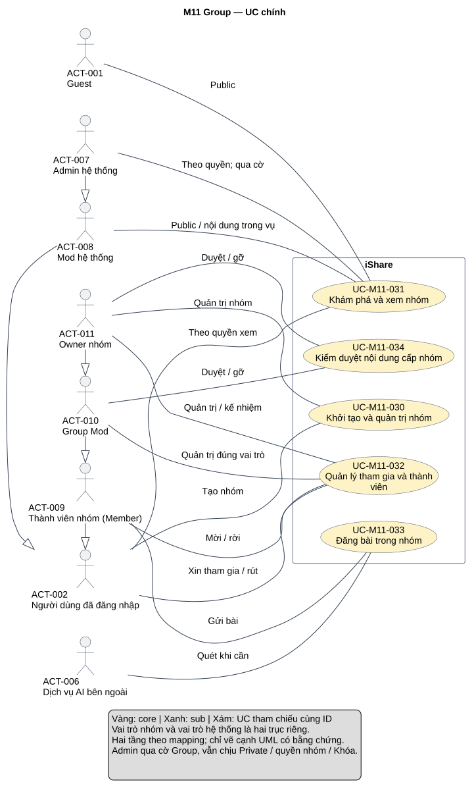
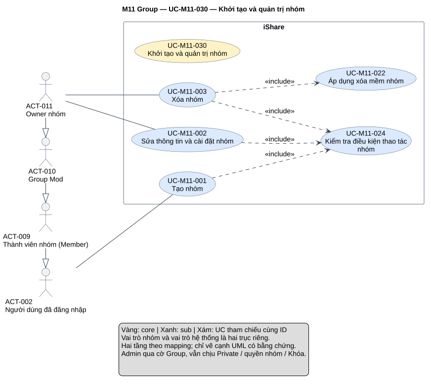
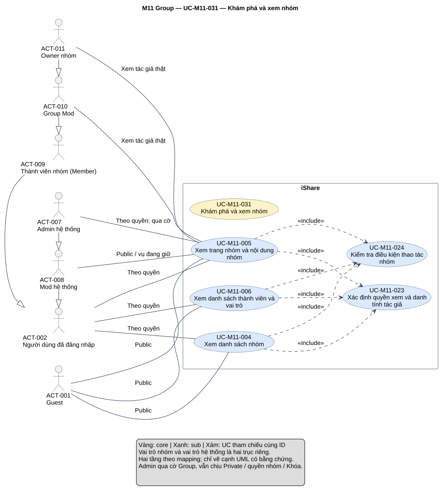
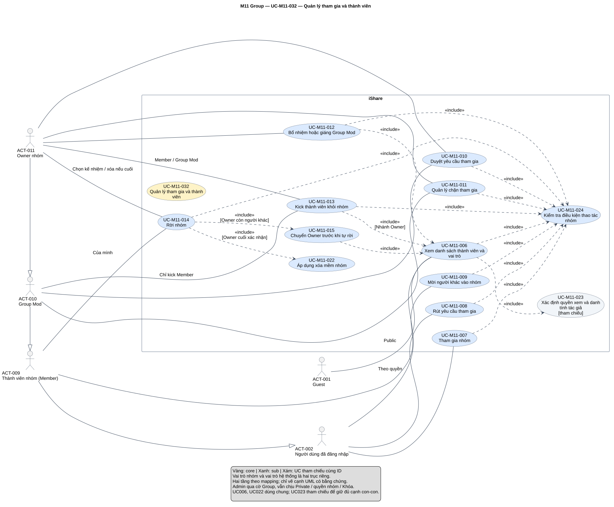
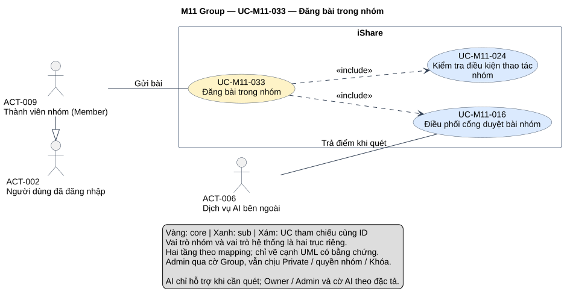
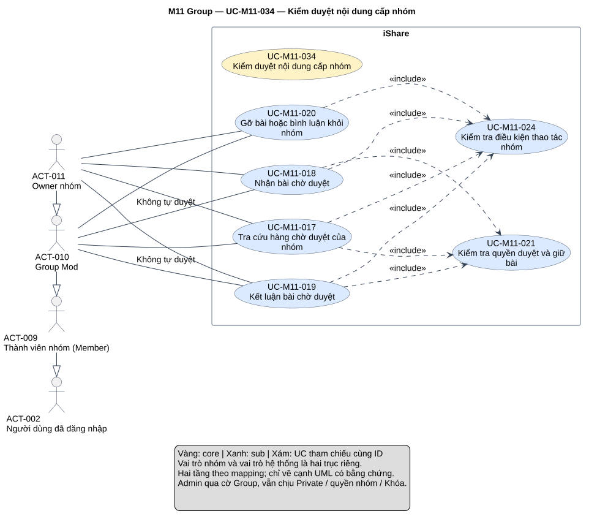

# Phân tích use case — M11 Group

[Vietnamese Doc] — Theo skill use-case-analysis v2.2, viết tiếng Việt và giữ thuật ngữ cần thiết.

Đầu ra hai tầng gồm **5 UC chính, 24 UC con**, 30 mapping, đặc tả, quan hệ, truy vết và 6 SVG: tổng quan module, một detail riêng cho mỗi core. Mô hình phân biệt quyền nhóm với quyền hệ thống, cổng duyệt nhóm với cổng Mod hệ thống, dấu gỡ với trạng thái đăng. Chỉ phân tích M11, không xây thêm Group Chat hoặc follow nhóm.

## Metadata và tiến độ

<!-- uc:document -->
| key | value |
|---|---|
| document_id | US-M11 |
| skill_version | 2.2 |
| mode | module |
| modules | M11 |
| scope | ALL |
| status | Chờ duyệt |
| current_step | 7 |
| completed_steps | 1, 2, 3, 4, 5, 6, 7 |
| approved_steps | - |
| source_baseline | FR-M11 v1.3; FR-M01 v1.10; FR-M02 v1.6; FR-M03 v1.10; FR-M04 v1.4; FR-M05 v1.7; FR-M06 v1.5; FR-M07 v1.5; FR-M08 v1.7; FR-M09 v1.2; FR-M10 v1.4; FR-M12 v1.1; FR-M13 v1.3; FR-M14 v1.1; FR-M15 v1.1 |
| author | Codex |
| date | 2026-11-01 |
| approval_evidence | Người dùng cho phép tự làm các bước cần thiết ở lượt M04, áp dụng chuỗi module đang thực hiện. Đây là quyền thực hiện liên tục, không phải phê duyệt US-M11 hoặc kết quả từng bước. |
| semantic_review | pass |
| diagram_check | pass |

| Bước | Kết quả | Xác nhận | Baseline | Làm lại khi |
|---|---|---|---|---|
| 1 | 17 nhóm, 170 FR chi tiết, 40 BR; không mã bỏ; boundary, actor, giao tiếp | Được làm liên tục; chưa duyệt | FR-M11 v1.3 | Nguồn đổi |
| 2 | 5 core, 24 sub, 30 mapping, ID dùng chung và vai trò ngữ cảnh | Chưa duyệt | FR-M11 v1.3 | Mục tiêu/ranh giới đổi |
| 3 | 25 hợp đồng chi tiết và 4 brief Summary; 6 AUT, 6 RULE | Chưa duyệt | FR-M11 v1.3 | Hành vi/quyền đổi |
| 4 | 32 include; rà cặp core–sub/sub–sub, không ép extend hoặc generalization UC | Chưa duyệt | Mô hình tại đây | Điểm chèn/hợp đồng đổi |
| 5 | 227 dòng truy vết, 210 tiêu chí chi tiết/BR; 14 FR liên quan | Chưa duyệt | FR-M11 v1.3; FR-M01 v1.10; FR-M02 v1.6; FR-M03 v1.10; FR-M04 v1.4; FR-M05 v1.7; FR-M06 v1.5; FR-M07 v1.5; FR-M08 v1.7; FR-M09 v1.2; FR-M10 v1.4; FR-M12 v1.1; FR-M13 v1.3; FR-M14 v1.1; FR-M15 v1.1 | Baseline liên quan đổi |
| 6 | 6 view đã kiểm cú pháp/render/hình; đúng node và 32 quan hệ, 34 cạnh xuất hiện; mỗi view chỉ một SVG | Chưa duyệt | PlantUML 1.2026.8 | Mô hình/nguồn đổi |
| 7 | Đã review nguồn/luồng/UML/truy vết/hình/liên kết, hồ sơ Chờ duyệt và giữ các giới hạn nguồn | Chưa duyệt | Skill v2.2 | Phản hồi/baseline đổi |

## 1. Phạm vi, nguồn và tổng hợp yêu cầu

**Mục đích sử dụng:** đầu vào thiết kế/kiểm thử và ghép UC tổng quan hệ thống. Mục 2 trình bày hai tầng và mapping; mục 3 hợp đồng/luồng/tiêu chí; mục 4 quyết định quan hệ; mục 5 truy vết và owner; mục 6 sơ đồ; mục 7 bằng chứng QA/giới hạn nguồn.

**Subject:** toàn iShare. M11 sở hữu nhóm, vai trò/thành viên/yêu cầu/chặn, cổng duyệt nhóm, phần ẩn danh và các lớp nhóm. M01/M03/M07/M08/M09/M10/M12/M13/M14 là thành phần nội bộ, không actor ngoài iShare. Dịch vụ AI bên ngoài hỗ trợ chấm bài qua M13 khi cần quét; không tạo actor Hệ thống, scheduler, queue hoặc module. Thông báo giao qua M07 không tạo actor email cho M11.

**Trong phạm vi:** tạo/sửa/xóa nhóm; danh sách/trang/thành viên và quyền Private/ẩn danh; tham gia/rút/mời/duyệt/chặn/bỏ chặn; Group Mod/kick/rời/kế nhiệm; gửi và cổng duyệt bài, giữ/kết luận hàng chờ nhóm, gỡ nội dung; áp Khóa/Ẩn/cờ; hệ quả dữ liệu/điểm và sự kiện giao tiếp.

**Ngoài phạm vi:** soạn/sửa/xóa bài chung M03, bình luận M04, điểm/upvote M12, bookmark/hồ sơ M02, tìm theo tên M06, feed/Trending/Following M14/M05, phát thông báo M07, xét báo cáo/khóa/ẩn/mở khóa hệ thống M08, xét khiếu nại M09, cấu hình cờ M10, triển khai AI M13, thiết kế UI/CSDL/API/giao dịch. Không thêm Group Chat gắn nhóm, leaderboard/reputation riêng, follow nhóm, lời mời có Chấp nhận/Từ chối riêng, thu hồi/tạo lại link, cooldown gửi lại hoặc khiếu nại cấp nhóm.

**Baseline:** [FR-M11 — Group](../fr/FR-M11.md) v1.3, Đã chốt 2026-10-24; mốc DEC-271, QA-477, ISS-415, OPEN-012. **227 mã hiệu lực = 17 nhóm + 170 FR chi tiết + 40 BR**, không mã FR/BR đã bỏ. TBD-M11-01 đã đóng v0.1 theo DEC-239, nội dung M11 mất đi là xóa mềm. Bản v1.3 giữ trạng thái đăng của bài bị gỡ và cập nhật luồng sau chấp nhận khiếu nại AI.

<!-- uc:sources -->
| path | version | role |
|---|---|---|
| docs/specs/fr/FR-M11.md | 1.3 | owner |
| docs/specs/fr/FR-M01.md | 1.10 | related |
| docs/specs/fr/FR-M02.md | 1.6 | related |
| docs/specs/fr/FR-M03.md | 1.10 | related |
| docs/specs/fr/FR-M04.md | 1.4 | related |
| docs/specs/fr/FR-M05.md | 1.7 | related |
| docs/specs/fr/FR-M06.md | 1.5 | related |
| docs/specs/fr/FR-M07.md | 1.5 | related |
| docs/specs/fr/FR-M08.md | 1.7 | related |
| docs/specs/fr/FR-M09.md | 1.2 | related |
| docs/specs/fr/FR-M10.md | 1.4 | related |
| docs/specs/fr/FR-M12.md | 1.1 | related |
| docs/specs/fr/FR-M13.md | 1.3 | related |
| docs/specs/fr/FR-M14.md | 1.1 | related |
| docs/specs/fr/FR-M15.md | 1.1 | related |

Phương pháp: [skill](../../../.agent-instructions/skills/use-case-analysis/SKILL.md), [modeling rules](../../../.agent-instructions/skills/use-case-analysis/references/modeling-rules.md), [diagram rules](../../../.agent-instructions/skills/use-case-analysis/references/diagram-rules.md). Không suy tính năng từ ví dụ hoặc US cũ. Đọc [US-M08](US-M08.md), [US-M09](US-M09.md), [US-M10](US-M10.md) để giữ actor/ranh giới; nguồn chức năng vẫn là FR đã chốt.

### Actor và điều kiện quyền

<!-- uc:actors -->
| id | name | kind | parent | boundary_reason | sources |
|---|---|---|---|---|---|
| ACT-001 | Guest | human | - | Người ngoài subject đọc Public và lối vào; tham gia/tạo/tương tác cần đăng nhập. | FR-M11-01.04, FR-M11-03.01, FR-M11-03.04, FR-M11-04.05 |
| ACT-002 | Người dùng đã đăng nhập | human | - | Tạo, tham gia, rút yêu cầu, xem theo quyền; Mod/Admin vẫn là người dùng khi làm hành vi cá nhân. | FR-M11-01.01, FR-M11-04.01, FR-M11-04.10, BR-M11-03 |
| ACT-009 | Thành viên nhóm (Member) | human | ACT-002 | Vai trò tương tác theo nhóm cụ thể; đăng bài/mời/rời, không là vai trò hệ thống mới. | BR-M11-06, FR-M11-05.01, FR-M11-10.01, FR-M11-12.01 |
| ACT-010 | Group Mod | human | ACT-009 | Thành viên được phân công duyệt/gỡ/quản trị thành viên đúng nhóm; khác ACT-008. | BR-M11-05, BR-M11-06, BR-M11-39 |
| ACT-011 | Owner nhóm | human | ACT-010 | Chủ nhóm; thêm quyền cấu hình/quản trị, tự rời có điều kiện; mỗi nhóm một Owner. | BR-M11-04, BR-M11-06, BR-M11-25, BR-M11-40 |
| ACT-008 | Mod hệ thống | human | ACT-002 | Giữ ID M08; không tự mở Private hoặc queue nhóm. Xem nội dung trong vụ đang giữ M08; ngoại lệ bài Owner chờ Mod hệ thống nằm trong M03. | FR-M11-03.11, FR-M11-03.12, FR-M11-12.18, FR-M11-13.09, BR-M11-33, BR-M11-40 |
| ACT-007 | Admin hệ thống | human | ACT-008 | Qua cờ Group tắt, miễn quét AI, vẫn chịu thành viên/Private/quyền nhóm/Khóa và hạn tạo. | FR-M11-01.07, FR-M11-12.06, FR-M11-12.20, FR-M11-17.03, BR-M11-33 |
| ACT-006 | Dịch vụ AI bên ngoài | external-system | - | Dịch vụ ngoài iShare trả điểm quét qua lớp nội bộ M13; hỗ trợ có điều kiện khi cần quét bài. | FR-M13-02.01, FR-M13-02.08, FR-M13-02.11, FR-M11-12.02 |

ACT-011 → ACT-010 → ACT-009 → ACT-002 là phân cấp tương tác theo nhóm đang xét; ACT-007 → ACT-008 → ACT-002 là vai trò hệ thống. Hai trục độc lập: một Admin chỉ là Member/Group Mod/Owner nếu có đúng vai trò trong nhóm, Group Mod không tự có quyền hệ thống. Guard Owner rời, không Group Mod tự duyệt và kiểm thứ bậc vẫn áp dù có actor generalization. Admin qua cờ Group tắt nhưng không qua Private/Khóa/quyền Owner; vẫn chịu hạn tạo 5 nhóm. Trạng thái tài khoản, nhóm Bị khóa/ẩn/xóa và cờ là điều kiện, không actor.

### Kiểm kê và tổng hợp

| Nhóm FR | Tổng hợp | Số FR chi tiết | Biểu diễn | Owner |
|---|---|---|---|---|
| FR-M11-01 | Tạo Hoạt động/Bình thường, một Owner; tối đa 5 trong 24 giờ lăn kể cả đã xóa/Admin; tên100/mô tả500, cài đặt mặc định. | 12 | [UC-M11-001](#uc-m11-001) | M11 |
| FR-M11-02 | Chỉ Owner sửa; riêng tư theo yêu cầu mới; tắt ẩn danh giữ bài cũ, tắt duyệt trước giữ queue; thành vào ngay nhận yêu cầu chờ. | 15 | [UC-M11-002](#uc-m11-002) | M11 |
| FR-M11-03 | Public/Private/lời mời; thành viên và danh tính thật; giới hạn hệ thống Mod/Admin và feed. | 18 | [UC-M11-004](#uc-m11-004), [UC-M11-005](#uc-m11-005), [UC-M11-006](#uc-m11-006), [UC-M11-023](#uc-m11-023) | M11 |
| FR-M11-04 | Vào ngay hoặc yêu cầu/câu trả lời, không trùng Chờ duyệt, không cooldown, rút của mình. | 10 | [UC-M11-007](#uc-m11-007), [UC-M11-008](#uc-m11-008) | M11 |
| FR-M11-05 | Mọi thành viên mời; một link chung không hạn/thu hồi/tạo lại; không thực thể mời riêng. | 7 | [UC-M11-009](#uc-m11-009) | M11 |
| FR-M11-06 | Owner/Group Mod xét yêu cầu; thông báo đúng sự kiện và không thông báo ở các nhánh loại trừ. | 9 | [UC-M11-010](#uc-m11-010) | M11 |
| FR-M11-07 | Chặn mọi lối gia nhập; từ chối yêu cầu đang chờ; xem và bỏ chặn đúng quyền. | 5 | [UC-M11-011](#uc-m11-011) | M11 |
| FR-M11-08 | Owner bổ nhiệm/giáng, lưu lần bổ nhiệm gần nhất; hiện thành viên/vai trò khi quản trị. | 6 | [UC-M11-012](#uc-m11-012), [UC-M11-006](#uc-m11-006) | M11 |
| FR-M11-09 | Kick theo thứ bậc; giữ nội dung/tác giả/điểm, thông báo và có đường quay lại. | 7 | [UC-M11-013](#uc-m11-013) | M11 |
| FR-M11-10 | Rời giữ nội dung/điểm; Owner chuyển trước hoặc cảnh báo/xác nhận xóa nếu một người; Public/Private sau rời. | 9 | [UC-M11-014](#uc-m11-014), [UC-M11-015](#uc-m11-015), [UC-M11-022](#uc-m11-022) | M11 |
| FR-M11-11 | Tự kế nhiệm theo Group Mod thâm niên rồi Member vào sớm; Owner cũ Member, vẫn chạy khi Khóa/cờ tắt. | 7 | [AUT002](#aut-m11-002) | M11 |
| FR-M11-12 | Cổng bài: Owner/Admin/AI tắt/lỗi/điểm, ẩn danh; feed và hàng chờ đúng nơi. | 20 | [UC-M11-033](#uc-m11-033), [UC-M11-016](#uc-m11-016) | M11 |
| FR-M11-13 | Queue riêng, nhận giữ30phút, đúng người kết luận, từ chối có lý do, không tự duyệt Group Mod; M09 AI được tiếp cổng. | 14 | [UC-M11-017](#uc-m11-017), [UC-M11-018](#uc-m11-018), [UC-M11-019](#uc-m11-019), [UC-M11-021](#uc-m11-021) | M11 |
| FR-M11-14 | Gỡ bằng dấu xóa mềm, giữ trạng thái đăng/điểm, tập xem hạn chế, không tự hiện lại/khiếu nại cấp nhóm. | 8 | [UC-M11-020](#uc-m11-020) | M11 |
| FR-M11-15 | Xóa mềm, giữ dữ liệu/điểm; không hiện nhóm/nội dung với ai; không mở/tham gia/đăng sau xóa. | 5 | [UC-M11-003](#uc-m11-003), [UC-M11-022](#uc-m11-022) | M11 |
| FR-M11-16 | Áp Ẩn/Khóa: đầy đủ tập quản trị bị chặn, đọc/bookmark/báo cáo và Member/Group Mod rời còn cho; tự kế nhiệm chạy. | 10 | [AUT006](#aut-m11-006) | M11 |
| FR-M11-17 | Cờ tắt chặn mở/tương tác người không Admin; giữ lối vào/dữ liệu/tự động/kiểm duyệt, không làm bù. | 8 | [UC-M11-024](#uc-m11-024) | M11 |

## 2. UC chính và UC con

### 2.1 Danh mục hai tầng

<!-- uc:catalog -->
| id | name | tier | level | primary | supporting | owner | anchor | sources |
|---|---|---|---|---|---|---|---|---|
| UC-M11-030 | Khởi tạo và quản trị nhóm | core | Summary | ACT-002, ACT-011 | - | M11 | #uc-m11-030 | FR-M11-01, FR-M11-02, FR-M11-15, BR-M11-03, BR-M11-04, BR-M11-06, BR-M11-23, BR-M11-31, BR-M11-32 |
| UC-M11-031 | Khám phá và xem nhóm | core | Summary | ACT-001, ACT-002, ACT-009, ACT-008, ACT-007 | - | M11 | #uc-m11-031 | FR-M11-03, BR-M11-11, BR-M11-13, BR-M11-14, BR-M11-15, BR-M11-17, BR-M11-33, BR-M11-34, BR-M11-35 |
| UC-M11-032 | Quản lý tham gia và thành viên | core | Summary | ACT-002, ACT-009, ACT-010, ACT-011 | - | M11 | #uc-m11-032 | FR-M11-04, FR-M11-05, FR-M11-06, FR-M11-07, FR-M11-08, FR-M11-09, FR-M11-10, FR-M11-11, BR-M11-05, BR-M11-06, BR-M11-07, BR-M11-08, BR-M11-09, BR-M11-10, BR-M11-12, BR-M11-24, BR-M11-25, BR-M11-26 |
| UC-M11-033 | Đăng bài trong nhóm | core | User goal | ACT-009, ACT-010, ACT-011 | ACT-006 | M11 | #uc-m11-033 | FR-M11-12, FR-M11-13.11, FR-M11-13.12, FR-M11-13.14, BR-M11-01, BR-M11-16, BR-M11-17, BR-M11-18, BR-M11-19, BR-M11-38, BR-M11-40 |
| UC-M11-034 | Kiểm duyệt nội dung cấp nhóm | core | Summary | ACT-010, ACT-011 | - | M11 | #uc-m11-034 | FR-M11-13, FR-M11-14, BR-M11-05, BR-M11-06, BR-M11-20, BR-M11-21, BR-M11-22, BR-M11-30, BR-M11-38, BR-M11-39 |
| UC-M11-001 | Tạo nhóm | sub | User goal | ACT-002 | - | M11 | #uc-m11-001 | FR-M11-01, BR-M11-03, BR-M11-04, BR-M11-31 |
| UC-M11-002 | Sửa thông tin và cài đặt nhóm | sub | User goal | ACT-011 | - | M11 | #uc-m11-002 | FR-M11-02, BR-M11-06, BR-M11-08, BR-M11-15, BR-M11-16, BR-M11-18, BR-M11-31, BR-M11-32 |
| UC-M11-003 | Xóa nhóm | sub | User goal | ACT-011 | - | M11 | #uc-m11-003 | FR-M11-15, BR-M11-06, BR-M11-23 |
| UC-M11-004 | Xem danh sách nhóm | sub | User goal | ACT-001, ACT-002 | - | M11 | #uc-m11-004 | FR-M11-03.01, FR-M11-03.02, FR-M11-03.03, FR-M11-03.16, FR-M11-03.17, BR-M11-11, BR-M11-35 |
| UC-M11-005 | Xem trang nhóm và nội dung nhóm | sub | User goal | ACT-001, ACT-002, ACT-009, ACT-008, ACT-007 | - | M11 | #uc-m11-005 | FR-M11-03.04, FR-M11-03.05, FR-M11-03.06, FR-M11-03.07, FR-M11-03.08, FR-M11-03.09, FR-M11-03.10, FR-M11-03.11, FR-M11-03.12, FR-M11-03.13, FR-M11-03.18, BR-M11-13, BR-M11-14, BR-M11-15, BR-M11-17, BR-M11-33 |
| UC-M11-006 | Xem danh sách thành viên và vai trò | sub | User goal | ACT-001, ACT-002, ACT-009, ACT-011 | - | M11 | #uc-m11-006 | FR-M11-03.14, FR-M11-03.15, FR-M11-08.05, BR-M11-34 |
| UC-M11-007 | Tham gia nhóm | sub | User goal | ACT-002 | - | M11 | #uc-m11-007 | FR-M11-04, FR-M11-05.05, BR-M11-03, BR-M11-07, BR-M11-08, BR-M11-09, BR-M11-10, BR-M11-12 |
| UC-M11-008 | Rút yêu cầu tham gia | sub | User goal | ACT-002 | - | M11 | #uc-m11-008 | FR-M11-04.10, BR-M11-36 |
| UC-M11-009 | Mời người khác vào nhóm | sub | User goal | ACT-009 | - | M11 | #uc-m11-009 | FR-M11-05, BR-M11-12 |
| UC-M11-010 | Duyệt yêu cầu tham gia | sub | User goal | ACT-010, ACT-011 | - | M11 | #uc-m11-010 | FR-M11-06, BR-M11-06, BR-M11-07, BR-M11-08, BR-M11-09, BR-M11-37 |
| UC-M11-011 | Quản lý chặn tham gia | sub | User goal | ACT-010, ACT-011 | - | M11 | #uc-m11-011 | FR-M11-07, BR-M11-06, BR-M11-10 |
| UC-M11-012 | Bổ nhiệm hoặc giáng Group Mod | sub | User goal | ACT-011 | - | M11 | #uc-m11-012 | FR-M11-08, BR-M11-05, BR-M11-06, BR-M11-26, BR-M11-37 |
| UC-M11-013 | Kick thành viên khỏi nhóm | sub | User goal | ACT-010, ACT-011 | - | M11 | #uc-m11-013 | FR-M11-09, FR-M11-08.05, BR-M11-05, BR-M11-06, BR-M11-24 |
| UC-M11-014 | Rời nhóm | sub | User goal | ACT-009, ACT-010, ACT-011 | - | M11 | #uc-m11-014 | FR-M11-10, BR-M11-24, BR-M11-25, BR-M11-28 |
| UC-M11-015 | Chuyển Owner trước khi tự rời | sub | Subfunction | ACT-011 | - | M11 | #uc-m11-015 | FR-M11-10.03, FR-M11-10.04, FR-M11-10.05, FR-M11-10.07, FR-M11-08.05, BR-M11-04, BR-M11-25, BR-M11-37 |
| UC-M11-016 | Điều phối cổng duyệt bài nhóm | sub | Subfunction | ACT-009, ACT-010, ACT-011 | ACT-006 | M11 | #uc-m11-016 | FR-M11-12, FR-M11-13.14, BR-M11-18, BR-M11-19, BR-M11-38, BR-M11-40, FR-M13-02.08, FR-M13-02.11 |
| UC-M11-017 | Tra cứu hàng chờ duyệt của nhóm | sub | User goal | ACT-010, ACT-011 | - | M11 | #uc-m11-017 | FR-M11-13.01, FR-M11-13.08, FR-M11-13.09, BR-M11-20, BR-M11-33, BR-M11-39 |
| UC-M11-018 | Nhận bài chờ duyệt | sub | User goal | ACT-010, ACT-011 | - | M11 | #uc-m11-018 | FR-M11-13.02, FR-M11-13.08, FR-M11-13.09, FR-M11-13.13, BR-M11-20, BR-M11-33, BR-M11-39 |
| UC-M11-019 | Kết luận bài chờ duyệt | sub | User goal | ACT-010, ACT-011 | - | M11 | #uc-m11-019 | FR-M11-13.03, FR-M11-13.05, FR-M11-13.06, FR-M11-13.07, FR-M11-13.08, FR-M11-13.09, FR-M11-13.10, FR-M11-13.11, FR-M11-13.12, FR-M11-13.13, BR-M11-18, BR-M11-20, BR-M11-21, BR-M11-38, BR-M11-39 |
| UC-M11-020 | Gỡ bài hoặc bình luận khỏi nhóm | sub | User goal | ACT-010, ACT-011 | - | M11 | #uc-m11-020 | FR-M11-14, BR-M11-05, BR-M11-06, BR-M11-21, BR-M11-22, BR-M11-30 |
| UC-M11-021 | Kiểm tra quyền duyệt và giữ bài | sub | Subfunction | ACT-010, ACT-011 | - | M11 | #uc-m11-021 | FR-M11-13.03, FR-M11-13.08, FR-M11-13.09, FR-M11-13.13, BR-M11-06, BR-M11-20, BR-M11-33, BR-M11-39 |
| UC-M11-022 | Áp dụng xóa mềm nhóm | sub | Subfunction | ACT-011 | - | M11 | #uc-m11-022 | FR-M11-15, FR-M11-10.06, FR-M11-11.03, BR-M11-23, BR-M11-25, BR-M11-26 |
| UC-M11-023 | Xác định quyền xem và danh tính tác giả | sub | Subfunction | ACT-001, ACT-002, ACT-009, ACT-008, ACT-007 | - | M11 | #uc-m11-023 | FR-M11-03, BR-M11-11, BR-M11-13, BR-M11-14, BR-M11-15, BR-M11-17, BR-M11-27, BR-M11-30, BR-M11-33, BR-M11-34, BR-M11-35 |
| UC-M11-024 | Kiểm tra điều kiện thao tác nhóm | sub | Subfunction | ACT-001, ACT-002, ACT-009, ACT-010, ACT-011, ACT-008, ACT-007 | - | M11 | #uc-m11-024 | FR-M11-16, FR-M11-17, BR-M11-06, BR-M11-13, BR-M11-23, BR-M11-27, BR-M11-28, BR-M11-29, BR-M11-33 |

Chỉ năm core được đưa lên tổng quan hệ thống. Tier độc lập level: core033 là User goal có luồng gửi cụ thể; bốn core còn lại là Summary bao quát các mục tiêu độc lập. Sub có User goal và Subfunction; không dùng mỗi ngưỡng AI, công tắc hoặc phép kiểm làm một oval. Không UC abstract hoặc generalization UC cần thiết trong mô hình này.

### 2.2 Phân rã core → sub

<!-- uc:decomposition -->
| core | sub | rationale | sources |
|---|---|---|---|
| UC-M11-030 | UC-M11-001 | Tạo cộng đồng và Owner đầu tiên. | FR-M11-01, BR-M11-03, BR-M11-04, BR-M11-31 |
| UC-M11-030 | UC-M11-002 | Duy trì thông tin, cài đặt và quyền riêng tư. | FR-M11-02, BR-M11-06, BR-M11-08, BR-M11-15, BR-M11-16, BR-M11-18, BR-M11-31, BR-M11-32 |
| UC-M11-030 | UC-M11-003 | Owner kết thúc nhóm. | FR-M11-15, BR-M11-06, BR-M11-23 |
| UC-M11-030 | UC-M11-022 | Tái dùng hệ quả xóa mềm/giữ dữ liệu/điểm. | FR-M11-15, FR-M11-10.06, FR-M11-11.03, BR-M11-23, BR-M11-25, BR-M11-26 |
| UC-M11-030 | UC-M11-024 | Áp cờ/trạng thái/quyền hành vi dùng chung. | FR-M11-16, FR-M11-17, BR-M11-06, BR-M11-13, BR-M11-23, BR-M11-27, BR-M11-28, BR-M11-29, BR-M11-33 |
| UC-M11-031 | UC-M11-004 | Khám phá các nhóm được phép thấy. | FR-M11-03.01, FR-M11-03.02, FR-M11-03.03, FR-M11-03.16, FR-M11-03.17, BR-M11-11, BR-M11-35 |
| UC-M11-031 | UC-M11-005 | Đọc thông tin/nội dung theo lớp quyền. | FR-M11-03.04, FR-M11-03.05, FR-M11-03.06, FR-M11-03.07, FR-M11-03.08, FR-M11-03.09, FR-M11-03.10, FR-M11-03.11, FR-M11-03.12, FR-M11-03.13, FR-M11-03.18, BR-M11-13, BR-M11-14, BR-M11-15, BR-M11-17, BR-M11-33 |
| UC-M11-031 | UC-M11-006 | Xem thành viên/vai trò; dùng lại khi Owner quản trị. | FR-M11-03.14, FR-M11-03.15, FR-M11-08.05, BR-M11-34 |
| UC-M11-031 | UC-M11-023 | Dùng chung lọc dữ liệu/riêng tư/danh tính thật. | FR-M11-03, BR-M11-11, BR-M11-13, BR-M11-14, BR-M11-15, BR-M11-17, BR-M11-27, BR-M11-30, BR-M11-33, BR-M11-34, BR-M11-35 |
| UC-M11-031 | UC-M11-024 | Áp cờ/trạng thái/quyền hành vi dùng chung. | FR-M11-16, FR-M11-17, BR-M11-06, BR-M11-13, BR-M11-23, BR-M11-27, BR-M11-28, BR-M11-29, BR-M11-33 |
| UC-M11-032 | UC-M11-006 | Xem thành viên/vai trò; dùng lại khi Owner quản trị. | FR-M11-03.14, FR-M11-03.15, FR-M11-08.05, BR-M11-34 |
| UC-M11-032 | UC-M11-007 | Gia nhập ngay hoặc tạo yêu cầu. | FR-M11-04, FR-M11-05.05, BR-M11-03, BR-M11-07, BR-M11-08, BR-M11-09, BR-M11-10, BR-M11-12 |
| UC-M11-032 | UC-M11-008 | Chấm dứt yêu cầu đang chờ của chính người gửi. | FR-M11-04.10, BR-M11-36 |
| UC-M11-032 | UC-M11-009 | Đưa người khác tới cổng tham gia bằng link chung. | FR-M11-05, BR-M11-12 |
| UC-M11-032 | UC-M11-010 | Xét yêu cầu và thêm Member. | FR-M11-06, BR-M11-06, BR-M11-07, BR-M11-08, BR-M11-09, BR-M11-37 |
| UC-M11-032 | UC-M11-011 | Kiểm soát người bị chặn tham gia. | FR-M11-07, BR-M11-06, BR-M11-10 |
| UC-M11-032 | UC-M11-012 | Phân công/chấm dứt Group Mod. | FR-M11-08, BR-M11-05, BR-M11-06, BR-M11-26, BR-M11-37 |
| UC-M11-032 | UC-M11-013 | Đưa người thuộc thẩm quyền ra khỏi nhóm. | FR-M11-09, FR-M11-08.05, BR-M11-05, BR-M11-06, BR-M11-24 |
| UC-M11-032 | UC-M11-014 | Tự rời với các điều kiện Owner. | FR-M11-10, BR-M11-24, BR-M11-25, BR-M11-28 |
| UC-M11-032 | UC-M11-015 | Duy trì Owner khi người cũ tự rời. | FR-M11-10.03, FR-M11-10.04, FR-M11-10.05, FR-M11-10.07, FR-M11-08.05, BR-M11-04, BR-M11-25, BR-M11-37 |
| UC-M11-032 | UC-M11-022 | Tái dùng hệ quả xóa mềm/giữ dữ liệu/điểm. | FR-M11-15, FR-M11-10.06, FR-M11-11.03, BR-M11-23, BR-M11-25, BR-M11-26 |
| UC-M11-032 | UC-M11-024 | Áp cờ/trạng thái/quyền hành vi dùng chung. | FR-M11-16, FR-M11-17, BR-M11-06, BR-M11-13, BR-M11-23, BR-M11-27, BR-M11-28, BR-M11-29, BR-M11-33 |
| UC-M11-033 | UC-M11-016 | Quyết đúng kết quả/hàng chờ của bài nhóm. | FR-M11-12, FR-M11-13.14, BR-M11-18, BR-M11-19, BR-M11-38, BR-M11-40, FR-M13-02.08, FR-M13-02.11 |
| UC-M11-033 | UC-M11-024 | Áp cờ/trạng thái/quyền hành vi dùng chung. | FR-M11-16, FR-M11-17, BR-M11-06, BR-M11-13, BR-M11-23, BR-M11-27, BR-M11-28, BR-M11-29, BR-M11-33 |
| UC-M11-034 | UC-M11-017 | Xem tập bài chờ riêng nhóm. | FR-M11-13.01, FR-M11-13.08, FR-M11-13.09, BR-M11-20, BR-M11-33, BR-M11-39 |
| UC-M11-034 | UC-M11-018 | Nhận quyền giữ để xử lý. | FR-M11-13.02, FR-M11-13.08, FR-M11-13.09, FR-M11-13.13, BR-M11-20, BR-M11-33, BR-M11-39 |
| UC-M11-034 | UC-M11-019 | Ra kết quả chấp nhận hoặc từ chối có lý do. | FR-M11-13.03, FR-M11-13.05, FR-M11-13.06, FR-M11-13.07, FR-M11-13.08, FR-M11-13.09, FR-M11-13.10, FR-M11-13.11, FR-M11-13.12, FR-M11-13.13, BR-M11-18, BR-M11-20, BR-M11-21, BR-M11-38, BR-M11-39 |
| UC-M11-034 | UC-M11-020 | Gỡ nội dung bằng dấu xóa mềm đúng thẩm quyền. | FR-M11-14, BR-M11-05, BR-M11-06, BR-M11-21, BR-M11-22, BR-M11-30 |
| UC-M11-034 | UC-M11-021 | Dùng chung quyền theo pha xem/nhận/kết luận. | FR-M11-13.03, FR-M11-13.08, FR-M11-13.09, FR-M11-13.13, BR-M11-06, BR-M11-20, BR-M11-33, BR-M11-39 |
| UC-M11-034 | UC-M11-024 | Áp cờ/trạng thái/quyền hành vi dùng chung. | FR-M11-16, FR-M11-17, BR-M11-06, BR-M11-13, BR-M11-23, BR-M11-27, BR-M11-28, BR-M11-29, BR-M11-33 |

30 mapping, mọi core có sub và mọi sub có core. UC006, UC022, UC024 dùng ở nhiều core nhưng giữ một ID/đặc tả. UC023 ngoài mapping core032 được thêm vào D032 như node tham chiếu để thể hiện đủ cạnh UC006→UC023; không đổi đích cạnh về core hoặc nhân bản UC. Mapping không tự thành include/extend/generalization.

### 2.3 Tổng hợp hệ thống và quyết định phân tích

<!-- uc:module-models -->
| module | path | baseline |
|---|---|---|

Mode module, chỉ làm M11; chưa tổng hợp toàn hệ thống hoặc tạo danh mục core mới thay các module.

| Quyết định | Hành vi FR | Biểu diễn | Lý do | Phương án không chọn |
|---|---|---|---|---|
| D-M11-01 | Năm năng lực nghiệp vụ | 5 core và 24 sub | Tách mục tiêu tạo/quản trị, xem, thành viên, gửi bài, duyệt/gỡ; không đặt quota. | Không dùng tên module/package làm cha UML. |
| D-M11-02 | Tham gia theo chế độ/câu hỏi | UC007 có nhánh vào ngay/Chờ duyệt | Cùng mục tiêu gia nhập, kết quả cụ thể theo cổng; trả lời câu hỏi là bước. | Không bốn oval theo bốn tổ hợp Public/Private/có câu hỏi. |
| D-M11-03 | Mời và tham gia | UC009 riêng UC007, link chung | Gửi lời mời đã xong, người nhận đi luồng gia nhập độc lập. | Không include chấp nhận lời mời riêng hoặc nối thứ tự gửi→nhận bằng UML. |
| D-M11-04 | Owner rời và mất quyền | UC014 include UC015 hoặc UC022 theo nhánh; AUT002 riêng | Tự chọn kế nhiệm khác tự động thâm niên; xóa mềm dùng lại một hợp đồng. | Không đưa scheduler/M01/M08 làm actor, không auto trả Owner cũ. |
| D-M11-05 | Đăng bài/cổng kiểm duyệt | Core033 include UC016, cổng có bảng quyết định | Cùng bài M03, ngưỡng/Owner/Admin là nhánh nghiệp vụ, không loại bài riêng. | Không kéo Owner vào queue nhóm hoặc cho Admin bỏ duyệt nhóm khi không Owner. |
| D-M11-06 | Queue nhóm | UC017/018/019 include UC021 theo pha | Cần phân biệt xem, nhận giữ, kết luận; cấm Group Mod tự nhận/duyệt, không cấm chỉ nhìn bài mình. | Không dùng queue báo cáo M08 hoặc cho Mod hệ thống can thiệp queue nhóm. |
| D-M11-07 | Gỡ nội dung | UC020 với dấu xóa mềm | Khác đổi trạng thái đăng hoặc ẩn hệ thống; dữ liệu/điểm/kháng nghị khác. | Không một UC Xóa chung làm mất khác biệt gỡ nhóm/xóa nhóm/xóa tác giả. |
| D-M11-08 | Private, ẩn danh, Khóa/Ẩn/cờ | UC023/024, RULE và AUT | Tái dùng quyền/hiệu lực trạng thái, không actor của chính hệ thống. | Không gán quyền mở Private từ quyền thấy tác giả thật hoặc miễn cờ Admin. |
| D-M11-09 | Thông báo/embedding, quá hạn | 6 AUT có trigger/trước/sau/dữ liệu | Giữ các hành vi sự kiện/time, owner phân tách. | Không bỏ bao phủ chỉ vì gọi là chạy ngầm; không thêm email hoặc audit mới. |

## 3. Đặc tả

### 3.1 Mô tả các UC chính Summary

#### UC-M11-030 — Khởi tạo và quản trị nhóm

**Actor:** ACT-002, ACT-011. **Mục tiêu/giá trị:** Tạo và duy trì một cộng đồng có Owner, cấu hình rõ, kết thúc bằng xóa mềm đúng quyền.

**Kích hoạt/ranh giới:** Người dùng tạo nhóm hoặc Owner cần sửa/xóa nhóm. Quyền và trạng thái theo hành vi; đã đăng nhập khi tạo, Owner khi sửa/xóa.

**Quy trình tổng quát:** UC001 tạo nhóm và Owner đầu tiên; UC002 sửa thông tin/cài đặt; UC003 xóa nhóm bằng hành vi dùng lại UC022. Đổi cài đặt thành vào ngay kích hoạt AUT001 chấp nhận mọi yêu cầu Chờ duyệt; tắt duyệt trước không nhả bài đang chờ. UC024 kiểm điều kiện thao tác, không thay quyền Owner. Các mục tiêu độc lập, không bắt tạo rồi sửa rồi xóa trong cùng lần.

**Kết quả:** Nhóm được tạo/điều chỉnh hoặc Đã xóa đúng lựa chọn, giữ dữ liệu và điểm theo nguồn. **Khi không đạt:** Các từ chối kiểm trong UC con; không tự bổ sung giao dịch/khôi phục nhóm.

**UC con:** [UC-M11-001](#uc-m11-001), [UC-M11-002](#uc-m11-002), [UC-M11-003](#uc-m11-003), [UC-M11-022](#uc-m11-022), [UC-M11-024](#uc-m11-024). **Nguồn:** FR-M11-01, FR-M11-02, FR-M11-15, BR-M11-03, BR-M11-04, BR-M11-06, BR-M11-23, BR-M11-31, BR-M11-32.

#### UC-M11-031 — Khám phá và xem nhóm

**Actor:** ACT-001, ACT-002, ACT-009, ACT-008, ACT-007. **Mục tiêu/giá trị:** Người xem tìm cộng đồng qua danh sách, đọc nhóm/nội dung/danh sách thành viên theo quyền, bảo toàn riêng tư và ẩn danh.

**Kích hoạt/ranh giới:** Mở danh sách nhóm, trang nhóm, nội dung hoặc danh sách thành viên. Quyền xem theo Public/Private, trạng thái nhóm/nội dung, vai trò và ngữ cảnh.

**Quy trình tổng quát:** UC004 liệt kê nhóm và UC005 đọc trang/nội dung; UC006 xem danh sách thành viên. UC023 dùng chung quyết quyền xem và danh tính ẩn danh, UC024 áp trạng thái/cờ. Mời/link Private chỉ cho người ngoài tên/mô tả trước tham gia. Tìm tên thuộc M06; tab Group/Trending/Following thuộc M14. Không có hành vi follow nhóm.

**Kết quả:** Chỉ hiện tập nhóm/nội dung/trường tác giả được phép; không biến quyền hệ thống thành quyền thành viên Private. **Khi không đạt:** Từ chối/không hiện theo nguồn; ngoại lệ vụ báo cáo nằm trong M08, không là lối xem tự do của M11.

**UC con:** [UC-M11-004](#uc-m11-004), [UC-M11-005](#uc-m11-005), [UC-M11-006](#uc-m11-006), [UC-M11-023](#uc-m11-023), [UC-M11-024](#uc-m11-024). **Nguồn:** FR-M11-03, BR-M11-11, BR-M11-13, BR-M11-14, BR-M11-15, BR-M11-17, BR-M11-33, BR-M11-34, BR-M11-35.

#### UC-M11-032 — Quản lý tham gia và thành viên

**Actor:** ACT-002, ACT-009, ACT-010, ACT-011. **Mục tiêu/giá trị:** Người dùng gia nhập/rời cộng đồng; Owner/Group Mod quản trị thành viên và duy trì một Owner.

**Kích hoạt/ranh giới:** Cần gia nhập, mời, duyệt/chặn, đổi Group Mod, kick hoặc rời nhóm. Đúng người/nhóm/vai trò theo từng UC; quyền nhóm độc lập quyền hệ thống.

**Quy trình tổng quát:** UC007 gia nhập, UC008 rút yêu cầu, UC009 mời bằng link chung; UC010 duyệt yêu cầu, UC011 chặn/xem/bỏ chặn; UC012 bổ nhiệm/giáng Group Mod, UC013 kick. UC014 rời nhóm: Member/Group Mod ra ngay, Owner còn người khác gọi UC015 chuyển Owner trước rời; Owner cuối cảnh báo/xác nhận rồi gọi UC022 xóa mềm. UC006 được dùng để hiện thành viên/vai trò cho Owner chọn trong các hành vi được FR-M11-08.05 quy định; không vì vậy mọi lần rời đều mở danh sách. AUT002 tự kế nhiệm khi Owner mất quyền ngoài ý muốn, khác Owner tự chọn rời.

**Kết quả:** Thành viên/yêu cầu/vai trò nhóm thay đổi đúng; nội dung/điểm giữ theo quy tắc rời, kick. **Khi không đạt:** Từ chối sai quyền/chặn/trạng thái; không bổ sung giới hạn số nhóm, cooldown hoặc lời mời có nút chấp nhận riêng.

**UC con:** [UC-M11-006](#uc-m11-006), [UC-M11-007](#uc-m11-007), [UC-M11-008](#uc-m11-008), [UC-M11-009](#uc-m11-009), [UC-M11-010](#uc-m11-010), [UC-M11-011](#uc-m11-011), [UC-M11-012](#uc-m11-012), [UC-M11-013](#uc-m11-013), [UC-M11-014](#uc-m11-014), [UC-M11-015](#uc-m11-015), [UC-M11-022](#uc-m11-022), [UC-M11-024](#uc-m11-024). **Nguồn:** FR-M11-04, FR-M11-05, FR-M11-06, FR-M11-07, FR-M11-08, FR-M11-09, FR-M11-10, FR-M11-11, BR-M11-05, BR-M11-06, BR-M11-07, BR-M11-08, BR-M11-09, BR-M11-10, BR-M11-12, BR-M11-24, BR-M11-25, BR-M11-26.

#### UC-M11-034 — Kiểm duyệt nội dung cấp nhóm

**Actor:** ACT-010, ACT-011. **Mục tiêu/giá trị:** Owner/Group Mod giữ chất lượng nội dung nhóm bằng duyệt hàng chờ và gỡ nội dung đúng thẩm quyền.

**Kích hoạt/ranh giới:** Mở hàng chờ, nhận/kết luận bài hoặc gỡ nội dung. Quyền nhóm đúng ngữ cảnh, không suy từ MODERATOR/ADMIN hệ thống.

**Quy trình tổng quát:** UC017 xem hàng chờ riêng của nhóm; UC018 nhận giữ một bài; UC019 chấp nhận hoặc từ chối bài có lý do; UC021 kiểm thẩm quyền, tự duyệt và quyền giữ theo pha. UC020 gỡ bài/bình luận bằng dấu xóa mềm, không cần giữ một bài chờ duyệt. UC024 áp trạng thái/cờ. AUT003 tự nhả sau 30 phút không thao tác; kiểm duyệt hệ thống M08 và khiếu nại AI M09 vẫn là luồng khác.

**Kết quả:** Bài được duyệt/từ chối có lý do hoặc nội dung mang dấu gỡ; không tự phạt điểm, không khiếu nại cấp nhóm. **Khi không đạt:** Từ chối sai vai trò, tự duyệt, không giữ bài hoặc nhóm bị khóa; thiếu nguồn được ghi ở mục 7.

**UC con:** [UC-M11-017](#uc-m11-017), [UC-M11-018](#uc-m11-018), [UC-M11-019](#uc-m11-019), [UC-M11-020](#uc-m11-020), [UC-M11-021](#uc-m11-021), [UC-M11-024](#uc-m11-024). **Nguồn:** FR-M11-13, FR-M11-14, BR-M11-05, BR-M11-06, BR-M11-20, BR-M11-21, BR-M11-22, BR-M11-30, BR-M11-38, BR-M11-39.

### 3.2 Core User goal và các UC con

Subfunction nhận ngữ cảnh caller, không có nút bỏ qua quyền. Nguồn luồng dùng FR/BR hiện hành, FR liên module chỉ để chứng minh giao tiếp. Các giới hạn chưa chốt được giữ riêng tại mục 7.

#### UC-M11-033 — Đăng bài trong nhóm

**UC con:** [UC-M11-016](#uc-m11-016), [UC-M11-024](#uc-m11-024).

<!-- uc:spec UC-M11-033 -->
| key | value |
|---|---|
| goal | Thành viên gửi bài vào đúng một nhóm, chọn ẩn danh nếu được phép và nhận kết quả đúng cổng kiểm duyệt. |
| subject | iShare |
| level | User goal |
| primary | ACT-009, ACT-010, ACT-011 |
| supporting | ACT-006 |
| trigger | Thành viên gửi bài mới hoặc sửa/gửi lại bài Bị từ chối. |
| preconditions | Định danh, bài và dữ liệu soạn/sửa do M03 cung cấp; không giả định quyền đăng hoặc kết quả quét trước khi kiểm. |
| success | Đường chính: bài Đã đăng đúng phạm vi nhóm và lựa chọn ẩn danh. Các nhánh Chờ duyệt/Bị từ chối giữ kết quả của cổng và quyền tiếp tục đúng nguồn. |
| failure | Người ngoài nhóm/nhóm khóa,xóa,ẩn/cờ tắt không được gửi; bài vi phạm bị từ chối; lỗi quét không đồng nghĩa AI tắt. |
| abstract | false |
| common_contract | Không áp dụng: không dùng generalization UC. |

**Luồng chính:**

| Bước | Ai | Hành động/phản hồi | Tiếp tục | Nguồn |
|---|---|---|---|---|
| 1 | iShare | Chèn UC-M11-024 với hành vi đăng/gửi lại và nhóm đích để kiểm cờ, trạng thái và tư cách thành viên. | [Bước 2](#uc-m11-033-main-2) | FR-M11-12, FR-M11-13.11, FR-M11-13.12, FR-M11-13.14, BR-M11-01, BR-M11-16, BR-M11-17, BR-M11-18, BR-M11-19, BR-M11-38, BR-M11-40 |
| 2 | ACT-009 / ACT-010 / ACT-011 | Gửi nội dung đã soạn qua M03, chọn ẩn danh cho bài này nếu công tắc nhóm bật. iShare gắn bài với nhóm (tối đa một) và giữ danh tính thật; không cho ẩn danh bài ngoài nhóm. | [Bước 3](#uc-m11-033-main-3) | FR-M11-12, FR-M11-13.11, FR-M11-13.12, FR-M11-13.14, BR-M11-01, BR-M11-16, BR-M11-17, BR-M11-18, BR-M11-19, BR-M11-38, BR-M11-40 |
| 3 | iShare | Chèn UC-M11-016 để quyết định Đã đăng/Chờ duyệt/Bị từ chối theo Owner, Admin, cờ AI, điểm/lỗi và công tắc duyệt trước. | [Bước 4](#uc-m11-033-main-4) | FR-M11-12, FR-M11-13.11, FR-M11-13.12, FR-M11-13.14, BR-M11-01, BR-M11-16, BR-M11-17, BR-M11-18, BR-M11-19, BR-M11-38, BR-M11-40 |
| 4 | iShare | Với đường chính (bài đủ điều kiện đăng ngay), bài Đã đăng; áp quyền hiển thị và ẩn danh RULE002/RULE004. AUT005 cung cấp sự kiện bài được đăng cho M07/M03 và mốc embedding M13; không đồng nhất đã đăng với mọi người đều thấy. | END: đạt kết quả của đường chính theo hợp đồng. | FR-M11-12, FR-M11-13.11, FR-M11-13.12, FR-M11-13.14, BR-M11-01, BR-M11-16, BR-M11-17, BR-M11-18, BR-M11-19, BR-M11-38, BR-M11-40 |

**Luồng thay thế/ngoại lệ:**

| ID nhánh | Bước rẽ | Điều kiện | Xử lý | Quay lại/kết thúc | Nguồn |
|---|---|---|---|---|---|
| A1 | [Bước 1](#uc-m11-033-main-1) | UC024 không đạt quyền hoặc trạng thái. | Dừng gửi bài theo từ chối của bộ kiểm. | END: không đăng bài. | FR-M11-12.11, FR-M11-16.04, FR-M11-17.01 |
| A2 | [Bước 2](#uc-m11-033-main-2) | Công tắc ẩn danh tắt hoặc bài không thuộc nhóm. | Không cho lựa chọn ẩn danh; tác giả chỉ gửi theo lựa chọn hợp lệ. | [Tiếp tục](#uc-m11-033-main-3) | FR-M11-12.08, FR-M11-12.09 |
| A3 | [Bước 3](#uc-m11-033-main-3) | UC016 trả Chờ duyệt. | Giữ bài trong đúng hàng chờ nhóm hoặc Mod hệ thống theo kết quả; không hiện cho người xem thường. Tác giả theo dõi trạng thái qua M03. | END: bài chờ đúng nơi. | FR-M11-12.03, FR-M11-12.04, FR-M11-12.15, FR-M11-12.18 |
| A4 | [Bước 3](#uc-m11-033-main-3) | UC016 trả Bị từ chối bởi AI. | Cho tác giả biết kết quả qua owner M03/M07, sửa/gửi lại hoặc khiếu nại M09 như bài thường; không coi là nhóm từ chối. | END: Bị từ chối; có đường tiếp theo theo nguồn. | FR-M11-12.02, FR-M11-12.17, FR-M11-13.12, BR-M11-21, BR-M11-38 |
| A5 | [Bước 1](#uc-m11-033-main-1) | Tác giả sửa và gửi lại bài bị nhóm từ chối. | Qua cổng nhóm thêm một lần, áp lại các điều kiện và kết quả; không tự chuyển Đã đăng hoặc khiếu nại quyết định cấp nhóm. | [Tiếp tục](#uc-m11-033-main-2) | FR-M11-13.11, BR-M11-38 |

**Quy tắc áp dụng:** FR-M11-12, FR-M11-13.11, FR-M11-13.12, FR-M11-13.14, BR-M11-01, BR-M11-16, BR-M11-17, BR-M11-18, BR-M11-19, BR-M11-38, BR-M11-40. Theo phạm vi UC, xem [vai trò](#rule-m11-001), [quyền xem](#rule-m11-002), [tham gia](#rule-m11-003), [cổng bài](#rule-m11-004), [vòng đời nội dung](#rule-m11-005), [trạng thái/cờ](#rule-m11-006). Không tự bổ sung yêu cầu ở các tình huống chưa chốt trong mục 7.

**Ranh giới ngữ cảnh xét:** UC này mô tả lối xem nhóm và dữ liệu được trả cho caller, không dùng quyền xem trang thường để chặn hàng chờ Mod hệ thống của bài Owner. BR-M11-33 ghi ngoại lệ, FR-M11-12.18 và BR-M11-40 chuyển bài Owner điểm trung bình/quét lỗi sang M03; FR-M03-06.01 và FR-M03-07.02 cho staff xem bài trong chính hàng chờ đó, không cấp quyền trang/danh sách thành viên/queue nhóm. Ngữ cảnh khiếu nại M09 được owner quy định riêng; việc M11 chưa nói rõ ngoại lệ Private cho M09 được giữ tại NOTE-M11-08, không tự biến thành quyền mở Private tự do hoặc một lệnh cấm toàn cục.

**Tiêu chí nguồn phải bảo toàn:** đối chiếu với luồng/quy tắc đã nêu, không dùng bảng này thay logic đặc tả.

| Mã | Nội dung nguồn đối chiếu |
|---|---|
| FR-M11-12.07 | Ở nơi công tắc ẩn danh của nhóm bật, hệ thống phải cho tác giả chọn đăng ẩn danh hay không cho từng bài (BR-M11-16). |
| FR-M11-12.08 | Nếu công tắc ẩn danh của nhóm tắt, hệ thống phải không cho chọn đăng ẩn danh (BR-M11-16). |
| FR-M11-12.09 | Nếu bài không thuộc nhóm, hệ thống phải không cho chọn đăng ẩn danh (BR-M11-16). |
| FR-M11-12.10 | Khi bài ẩn danh được lưu, hệ thống phải giữ danh tính thật của tác giả (BR-M11-17). |
| FR-M11-12.11 | Nếu người không là thành viên gửi bài vào nhóm, hệ thống phải từ chối (BR-M11-06). |

#### UC-M11-001 — Tạo nhóm

**Thuộc core:** [UC-M11-030](#uc-m11-030). Tạo cộng đồng và Owner đầu tiên.

<!-- uc:spec UC-M11-001 -->
| key | value |
|---|---|
| goal | Tạo cộng đồng Public/Private và làm Owner đầu tiên. |
| subject | iShare |
| level | User goal |
| primary | ACT-002 |
| supporting | - |
| trigger | Người dùng chọn tạo nhóm. |
| preconditions | Phiên/định danh theo M01; quyền và hạn mức kiểm trong luồng. |
| success | Nhóm Hoạt động, Bình thường, một Owner đầu tiên có thời điểm tham gia lúc tạo; cấu hình và link chung được giữ. |
| failure | Từ chối Guest, cờ không cho phép, vượt hạn mức hoặc tên/mô tả sai; không có giao dịch/rollback được tự bổ sung. |
| abstract | false |
| common_contract | Không áp dụng: không dùng generalization UC. |

**Luồng chính:**

| Bước | Ai | Hành động/phản hồi | Tiếp tục | Nguồn |
|---|---|---|---|---|
| 1 | ACT-002 | Gửi tên, mô tả tùy chọn, chế độ Public/Private; có thể đặt ngay duyệt trước, ẩn danh, một câu hỏi tham gia. | [Bước 2](#uc-m11-001-main-2) | FR-M11-01, BR-M11-03, BR-M11-04, BR-M11-31 |
| 2 | iShare | Chèn UC-M11-024 ngữ cảnh tạo nhóm (chưa có nhóm đích); cần đăng nhập, cờ Group cho phép (Admin được qua cờ). | [Bước 3](#uc-m11-001-main-3) | FR-M11-01, BR-M11-03, BR-M11-04, BR-M11-31 |
| 3 | iShare | Kiểm tên bắt buộc ≤100 ký tự, mô tả tùy chọn ≤500, tên được trùng. Đếm các nhóm người này đã tạo trong 24 giờ ngay trước lúc tạo, gồm nhóm đã xóa; đã đủ 5 thì từ chối, kể cả Admin. Nhóm đúng 24 giờ trước không tính. | [Bước 4](#uc-m11-001-main-4) | FR-M11-01, BR-M11-03, BR-M11-04, BR-M11-31 |
| 4 | iShare | Tạo nhóm Hoạt động/Bình thường, người tạo là Owner duy nhất và thành viên đầu tiên; ghi thời điểm tham gia bằng thời điểm tạo. Không đặt công tắc thì duyệt trước/ẩn danh Tắt, câu hỏi trống; có một link mời chung không hết hạn. | [Bước 5](#uc-m11-001-main-5) | FR-M11-01, BR-M11-03, BR-M11-04, BR-M11-31 |
| 5 | iShare | Trả nhóm đã tạo. Không giới hạn tổng nhóm sở hữu hoặc tham gia; không thêm leaderboard/reputation riêng. | END: đạt kết quả của đường chính theo hợp đồng. | FR-M11-01, BR-M11-03, BR-M11-04, BR-M11-31 |

**Luồng thay thế/ngoại lệ:**

| ID nhánh | Bước rẽ | Điều kiện | Xử lý | Quay lại/kết thúc | Nguồn |
|---|---|---|---|---|---|
| A1 | [Bước 2](#uc-m11-001-main-2) | Guest hoặc bộ kiểm UC024 không đạt. | Từ chối tạo. | END: không tạo nhóm. | FR-M11-01.04, FR-M11-17.01 |
| A2 | [Bước 3](#uc-m11-001-main-3) | Đã tạo 5 nhóm trong 24 giờ gần nhất. | Từ chối; xóa nhóm cũ không làm giảm số đã tạo trong khoảng, Admin không được miễn. | END: vượt hạn mức. | FR-M11-01.03, FR-M11-01.06, FR-M11-01.07, BR-M11-03 |
| A3 | [Bước 3](#uc-m11-001-main-3) | Tên trống/>100 hoặc mô tả >500 ký tự. | Từ chối lưu. | END: dữ liệu không đạt. | FR-M11-01.08, FR-M11-01.09, BR-M11-31 |

**Quy tắc áp dụng:** FR-M11-01, BR-M11-03, BR-M11-04, BR-M11-31. Theo phạm vi UC, xem [vai trò](#rule-m11-001), [quyền xem](#rule-m11-002), [tham gia](#rule-m11-003), [cổng bài](#rule-m11-004), [vòng đời nội dung](#rule-m11-005), [trạng thái/cờ](#rule-m11-006). Không tự bổ sung yêu cầu ở các tình huống chưa chốt trong mục 7.

**Ranh giới ngữ cảnh xét:** UC này mô tả lối xem nhóm và dữ liệu được trả cho caller, không dùng quyền xem trang thường để chặn hàng chờ Mod hệ thống của bài Owner. BR-M11-33 ghi ngoại lệ, FR-M11-12.18 và BR-M11-40 chuyển bài Owner điểm trung bình/quét lỗi sang M03; FR-M03-06.01 và FR-M03-07.02 cho staff xem bài trong chính hàng chờ đó, không cấp quyền trang/danh sách thành viên/queue nhóm. Ngữ cảnh khiếu nại M09 được owner quy định riêng; việc M11 chưa nói rõ ngoại lệ Private cho M09 được giữ tại NOTE-M11-08, không tự biến thành quyền mở Private tự do hoặc một lệnh cấm toàn cục.

**Tiêu chí nguồn phải bảo toàn:** đối chiếu với luồng/quy tắc đã nêu, không dùng bảng này thay logic đặc tả.

| Mã | Nội dung nguồn đối chiếu |
|---|---|
| FR-M11-01.01 | Khi người dùng đã đăng nhập tạo nhóm với tên, mô tả và chế độ Public hoặc Private, hệ thống phải tạo nhóm ở trạng thái Hoạt động và trạng thái kiểm duyệt Bình thường. |
| FR-M11-01.02 | Khi nhóm được tạo, hệ thống phải ghi người tạo là Owner, với thời điểm tham gia là thời điểm tạo nhóm (BR-M11-04). |
| FR-M11-01.03 | Nếu người dùng đã tạo 5 nhóm trong 24 giờ gần nhất tính tới lúc tạo, hệ thống phải từ chối tạo thêm nhóm (BR-M11-03). |
| FR-M11-01.04 | Nếu người chưa đăng nhập chọn tạo nhóm, hệ thống phải từ chối (BR-M11-03). |
| FR-M11-01.05 | Hệ thống phải không giới hạn tổng số nhóm một người dùng sở hữu (BR-M11-03). |
| FR-M11-01.06 | Hệ thống phải tính cả nhóm đã bị xóa vào giới hạn tạo nhóm (BR-M11-03). |
| FR-M11-01.07 | Hệ thống phải áp giới hạn tạo nhóm cho cả Admin (BR-M11-03). |
| FR-M11-01.08 | Nếu tên nhóm để trống hoặc dài hơn 100 ký tự, hệ thống phải từ chối lưu nhóm (BR-M11-31). |
| FR-M11-01.09 | Nếu mô tả nhóm dài hơn 500 ký tự, hệ thống phải từ chối lưu nhóm (BR-M11-31). |
| FR-M11-01.10 | Hệ thống phải cho tên nhóm trùng với tên của nhóm khác (BR-M11-31). |
| FR-M11-01.11 | Khi tạo nhóm, hệ thống phải cho người tạo đặt ngay công tắc duyệt trước, công tắc ẩn danh và câu hỏi tham gia (BR-M11-31). |
| FR-M11-01.12 | Nếu người tạo không đặt, hệ thống phải để công tắc duyệt trước và công tắc ẩn danh ở Tắt, câu hỏi tham gia trống (BR-M11-31). |
| BR-M11-03 | Mọi người dùng đã đăng nhập tạo được nhóm, tối đa 5 nhóm trong 24 giờ gần nhất tính tới lúc tạo; nhóm đã bị xóa vẫn được tính; Admin cũng bị giới hạn. Không giới hạn số nhóm một người sở hữu hay tham gia. |
| BR-M11-31 | Tên nhóm bắt buộc, tối đa 100 ký tự; mô tả không bắt buộc, tối đa 500 ký tự; tên được trùng với nhóm khác. Khi tạo, người tạo chọn chế độ Public hoặc Private và đặt được ngay công tắc duyệt trước, công tắc ẩn danh, câu hỏi tham gia; mặc định hai công tắc Tắt, câu hỏi trống. |

#### UC-M11-002 — Sửa thông tin và cài đặt nhóm

**Thuộc core:** [UC-M11-030](#uc-m11-030). Duy trì thông tin, cài đặt và quyền riêng tư.

<!-- uc:spec UC-M11-002 -->
| key | value |
|---|---|
| goal | Owner điều chỉnh thông tin, riêng tư và cổng tham gia/đăng bài của cộng đồng. |
| subject | iShare |
| level | User goal |
| primary | ACT-011 |
| supporting | - |
| trigger | Owner lưu thay đổi tên/mô tả/Public-Private/duyệt trước/ẩn danh/câu hỏi. |
| preconditions | Có nhóm đích; quyền Owner và trạng thái kiểm trong luồng. |
| success | Cài đặt mới áp các thao tác/bài/yêu cầu gửi sau đổi; dữ liệu đang có được giữ theo ngoại lệ cụ thể. |
| failure | Từ chối người không Owner hoặc nhóm không cho thao tác/nội dung sai; chưa có quy tắc giao dịch thất bại. |
| abstract | false |
| common_contract | Không áp dụng: không dùng generalization UC. |

**Luồng chính:**

| Bước | Ai | Hành động/phản hồi | Tiếp tục | Nguồn |
|---|---|---|---|---|
| 1 | ACT-011 | Chọn thay đổi thông tin/cài đặt của nhóm. | [Bước 2](#uc-m11-002-main-2) | FR-M11-02, BR-M11-06, BR-M11-08, BR-M11-15, BR-M11-16, BR-M11-18, BR-M11-31, BR-M11-32 |
| 2 | iShare | Chèn UC-M11-024 cho hành vi sửa cài đặt; chỉ Owner, nhóm không Khóa/Xóa/Ẩn, cờ cho phép. | [Bước 3](#uc-m11-002-main-3) | FR-M11-02, BR-M11-06, BR-M11-08, BR-M11-15, BR-M11-16, BR-M11-18, BR-M11-31, BR-M11-32 |
| 3 | iShare | Kiểm tên không trống ≤100, mô tả ≤500 và tối đa một câu hỏi tham gia; lưu thay đổi hợp lệ. | [Bước 4](#uc-m11-002-main-4) | FR-M11-02, BR-M11-06, BR-M11-08, BR-M11-15, BR-M11-16, BR-M11-18, BR-M11-31, BR-M11-32 |
| 4 | iShare | Áp chế độ/công tắc/câu hỏi mới cho thao tác hoặc bài/yêu cầu gửi sau thời điểm đổi. Public→Private: chặn tương tác người ngoài; lần tải feed/tìm sau không trả bài cho họ, mở lại/link/bookmark/thông báo báo Nội dung không tồn tại; bản đang hiện trước đổi chỉ còn đọc. | [Bước 5](#uc-m11-002-main-5) | FR-M11-02, BR-M11-06, BR-M11-08, BR-M11-15, BR-M11-16, BR-M11-18, BR-M11-31, BR-M11-32 |
| 5 | iShare | Nếu thay đổi làm thành nhóm vào ngay, AUT001 chấp nhận toàn bộ yêu cầu Chờ duyệt. Tắt duyệt trước vẫn giữ các bài chờ nhóm duyệt; tắt ẩn danh vẫn giữ bài ẩn danh cũ, chỉ không cho bài mới chọn; câu hỏi mới chỉ áp yêu cầu mới. | END: đạt kết quả của đường chính theo hợp đồng. | FR-M11-02, BR-M11-06, BR-M11-08, BR-M11-15, BR-M11-16, BR-M11-18, BR-M11-31, BR-M11-32 |

**Luồng thay thế/ngoại lệ:**

| ID nhánh | Bước rẽ | Điều kiện | Xử lý | Quay lại/kết thúc | Nguồn |
|---|---|---|---|---|---|
| A1 | [Bước 2](#uc-m11-002-main-2) | Group Mod/Member/người ngoài đổi thông tin hoặc cài đặt; hoặc UC024 từ chối. | Từ chối thay đổi. | END: không sửa nhóm. | FR-M11-02.09, FR-M11-02.10, FR-M11-16.07 |
| A2 | [Bước 3](#uc-m11-002-main-3) | Tên trống/>100 hoặc mô tả >500. | Từ chối lưu. | END: dữ liệu không đạt. | FR-M11-02.11 |
| A3 | [Bước 5](#uc-m11-002-main-5) | Chỉ sửa câu hỏi hoặc thay đổi khác không làm thành nhóm vào ngay. | Không tự chấp nhận yêu cầu cũ; không tự nhả bài chờ. | END: cài đặt đã đổi, hàng chờ giữ theo nguồn. | FR-M11-02.14, FR-M11-02.15, BR-M11-32 |

**Quy tắc áp dụng:** FR-M11-02, BR-M11-06, BR-M11-08, BR-M11-15, BR-M11-16, BR-M11-18, BR-M11-31, BR-M11-32. Theo phạm vi UC, xem [vai trò](#rule-m11-001), [quyền xem](#rule-m11-002), [tham gia](#rule-m11-003), [cổng bài](#rule-m11-004), [vòng đời nội dung](#rule-m11-005), [trạng thái/cờ](#rule-m11-006). Không tự bổ sung yêu cầu ở các tình huống chưa chốt trong mục 7.

**Tiêu chí nguồn phải bảo toàn:** đối chiếu với luồng/quy tắc đã nêu, không dùng bảng này thay logic đặc tả.

| Mã | Nội dung nguồn đối chiếu |
|---|---|
| FR-M11-02.01 | Khi Owner sửa tên hoặc mô tả nhóm, hệ thống phải lưu và hiển thị nội dung mới. |
| FR-M11-02.02 | Khi Owner đổi chế độ Public sang Private hoặc ngược lại, hệ thống phải áp chế độ mới cho mọi thao tác xảy ra sau thời điểm đổi (BR-M11-15). |
| FR-M11-02.03 | Khi nhóm chuyển sang Private, hệ thống phải từ chối bình luận, vote, báo cáo của người ngoài nhóm trên bài của nhóm (BR-M11-15). |
| FR-M11-02.04 | Khi nhóm chuyển sang Private, hệ thống phải không đưa bài của nhóm cho người ngoài nhóm ở các lần tải feed, tìm kiếm sau đó (BR-M11-15). |
| FR-M11-02.05 | Khi Owner bật hoặc tắt công tắc duyệt trước, hệ thống phải dùng giá trị mới cho các bài gửi vào nhóm sau thời điểm đổi (BR-M11-18). |
| FR-M11-02.06 | Khi Owner tắt công tắc ẩn danh, hệ thống phải giữ ẩn danh cho các bài đã đăng ẩn danh và chỉ chặn lựa chọn ẩn danh cho bài mới (BR-M11-16). |
| FR-M11-02.07 | Khi Owner đặt, sửa hoặc bỏ câu hỏi tham gia, hệ thống phải áp câu hỏi mới cho các yêu cầu tham gia gửi sau đó (BR-M11-08). |
| FR-M11-02.08 | Hệ thống phải cho mỗi nhóm tối đa một câu hỏi tham gia (BR-M11-08). |
| FR-M11-02.09 | Nếu Group Mod, Member hoặc người không là thành viên đổi chế độ, công tắc duyệt trước, công tắc ẩn danh hoặc câu hỏi tham gia, hệ thống phải từ chối (BR-M11-06). |
| FR-M11-02.10 | Nếu Group Mod, Member hoặc người không là thành viên sửa tên, mô tả nhóm, hệ thống phải từ chối (BR-M11-06). |
| FR-M11-02.11 | Nếu tên nhóm được sửa thành trống hoặc dài hơn 100 ký tự, hoặc mô tả dài hơn 500 ký tự, hệ thống phải từ chối lưu (BR-M11-31). |
| FR-M11-02.12 | Khi nhóm chuyển sang Private, hệ thống phải chỉ để người ngoài nhóm đọc những bài của nhóm đang hiện sẵn trên màn hình họ đã tải trước thời điểm đổi (BR-M11-15). |
| FR-M11-02.13 | Nếu người ngoài nhóm tải lại hoặc mở lại bài của nhóm đã chuyển Private bằng link, bookmark hay thông báo, hệ thống phải hiển thị "Nội dung không tồn tại" (BR-M11-15). |
| FR-M11-02.15 | Khi Owner tắt công tắc duyệt trước, hệ thống phải giữ các bài đang chờ nhóm duyệt trong hàng chờ duyệt của nhóm (BR-M11-18). |
| BR-M11-15 | Owner đổi chế độ Public↔Private bất kỳ lúc nào. Khi nhóm chuyển sang Private: người ngoài nhóm chỉ còn đọc những bài của nhóm đang hiện sẵn trên màn hình họ đã tải trước thời điểm đổi, không bình luận, vote, báo cáo được; tải lại hoặc mở lại bằng link, bookmark, thông báo thì thấy "Nội dung không tồn tại"; các lần tải feed, tìm kiếm sau đó không còn trả bài của nhóm cho người ngoài nhóm. |

#### UC-M11-003 — Xóa nhóm

**Thuộc core:** [UC-M11-030](#uc-m11-030). Owner kết thúc nhóm.

<!-- uc:spec UC-M11-003 -->
| key | value |
|---|---|
| goal | Owner kết thúc cộng đồng mà vẫn giữ dữ liệu và điểm. |
| subject | iShare |
| level | User goal |
| primary | ACT-011 |
| supporting | - |
| trigger | Owner chọn xóa nhóm. |
| preconditions | Có nhóm đích; kiểm quyền/trạng thái trong luồng. |
| success | Nhóm Đã xóa và không còn hiện cùng nội dung với ai; dữ liệu/điểm được giữ. |
| failure | Từ chối người không Owner hoặc nhóm Khóa/không cho thao tác; không tự thêm khôi phục nhóm. |
| abstract | false |
| common_contract | Không áp dụng: không dùng generalization UC. |

**Luồng chính:**

| Bước | Ai | Hành động/phản hồi | Tiếp tục | Nguồn |
|---|---|---|---|---|
| 1 | ACT-011 | Yêu cầu xóa nhóm của mình. | [Bước 2](#uc-m11-003-main-2) | FR-M11-15, BR-M11-06, BR-M11-23 |
| 2 | iShare | Chèn UC-M11-024 với hành vi xóa nhóm, kiểm Owner và trạng thái/cờ. | [Bước 3](#uc-m11-003-main-3) | FR-M11-15, BR-M11-06, BR-M11-23 |
| 3 | iShare | Chèn UC-M11-022 áp xóa mềm nhóm và các hệ quả hiển thị/dữ liệu/điểm. | [Bước 4](#uc-m11-003-main-4) | FR-M11-15, BR-M11-06, BR-M11-23 |
| 4 | iShare | Trả kết quả nhóm Đã xóa. Không tự thêm một bước xác nhận riêng cho xóa trực tiếp khi FR chỉ buộc cảnh báo/xác nhận ở Owner cuối rời. | END: đạt kết quả của đường chính theo hợp đồng. | FR-M11-15, BR-M11-06, BR-M11-23 |

**Luồng thay thế/ngoại lệ:**

| ID nhánh | Bước rẽ | Điều kiện | Xử lý | Quay lại/kết thúc | Nguồn |
|---|---|---|---|---|---|
| A1 | [Bước 2](#uc-m11-003-main-2) | Người thao tác không Owner hoặc UC024 từ chối. | Từ chối xóa. | END: không xóa nhóm. | FR-M11-15.04, FR-M11-16.07 |

**Quy tắc áp dụng:** FR-M11-15, BR-M11-06, BR-M11-23. Theo phạm vi UC, xem [vai trò](#rule-m11-001), [quyền xem](#rule-m11-002), [tham gia](#rule-m11-003), [cổng bài](#rule-m11-004), [vòng đời nội dung](#rule-m11-005), [trạng thái/cờ](#rule-m11-006). Không tự bổ sung yêu cầu ở các tình huống chưa chốt trong mục 7.

**Tiêu chí nguồn phải bảo toàn:** đối chiếu với luồng/quy tắc đã nêu, không dùng bảng này thay logic đặc tả.

| Mã | Nội dung nguồn đối chiếu |
|---|---|
| FR-M11-15.04 | Nếu Group Mod, Member hoặc người không là thành viên xóa nhóm, hệ thống phải từ chối (BR-M11-06). |

#### UC-M11-004 — Xem danh sách nhóm

**Thuộc core:** [UC-M11-031](#uc-m11-031). Khám phá các nhóm được phép thấy.

<!-- uc:spec UC-M11-004 -->
| key | value |
|---|---|
| goal | Khám phá các nhóm được phép xuất hiện, mới nhất trước. |
| subject | iShare |
| level | User goal |
| primary | ACT-001, ACT-002 |
| supporting | - |
| trigger | Mở trang danh sách nhóm, gồm lối Khám phá Group từ M14. |
| preconditions | Không cần đăng nhập để xem nhóm Public; danh tính/thành viên dùng nếu có. |
| success | Danh sách có Public và Private đã tham gia, tên/mô tả/chế độ, xếp tạo mới nhất trước; không hiện nhóm không được xem. |
| failure | Không tiết lộ Private cho người ngoài, không phục hồi nhóm Ẩn/Xóa; cờ tắt giữ lối vào theo quy tắc riêng. |
| abstract | false |
| common_contract | Không áp dụng: không dùng generalization UC. |

**Luồng chính:**

| Bước | Ai | Hành động/phản hồi | Tiếp tục | Nguồn |
|---|---|---|---|---|
| 1 | ACT-001 / ACT-002 | Mở trang danh sách nhóm. | [Bước 2](#uc-m11-004-main-2) | FR-M11-03.01, FR-M11-03.02, FR-M11-03.03, FR-M11-03.16, FR-M11-03.17, BR-M11-11, BR-M11-35 |
| 2 | iShare | Chèn UC-M11-024 ngữ cảnh liệt kê lối vào: giữ việc hiển thị lối vào theo FR-M11-17.07, không tự cấp quyền mở nhóm khi cờ tắt. | [Bước 3](#uc-m11-004-main-3) | FR-M11-03.01, FR-M11-03.02, FR-M11-03.03, FR-M11-03.16, FR-M11-03.17, BR-M11-11, BR-M11-35 |
| 3 | iShare | Chèn UC-M11-023 ngữ cảnh danh sách để chọn các nhóm Public và Private người này là thành viên; loại nhóm Đã xóa/Bị ẩn. | [Bước 4](#uc-m11-004-main-4) | FR-M11-03.01, FR-M11-03.02, FR-M11-03.03, FR-M11-03.16, FR-M11-03.17, BR-M11-11, BR-M11-35 |
| 4 | iShare | Hiện tên, mô tả, chế độ từng nhóm, theo thời điểm tạo mới nhất trước. Tìm theo tên là mục tiêu M06 độc lập. | END: đạt kết quả của đường chính theo hợp đồng. | FR-M11-03.01, FR-M11-03.02, FR-M11-03.03, FR-M11-03.16, FR-M11-03.17, BR-M11-11, BR-M11-35 |

**Luồng thay thế/ngoại lệ:**

| ID nhánh | Bước rẽ | Điều kiện | Xử lý | Quay lại/kết thúc | Nguồn |
|---|---|---|---|---|---|
| A1 | [Bước 3](#uc-m11-004-main-3) | Người xem không là thành viên của nhóm Private, kể cả Guest/Mod/Admin. | Không đưa nhóm đó vào danh sách. | [Tiếp tục](#uc-m11-004-main-4) | FR-M11-03.02, FR-M11-03.11, BR-M11-11, BR-M11-33 |
| A2 | [Bước 2](#uc-m11-004-main-2) | Cờ Group tắt. | Vẫn giữ nhóm/bài ở các lối vào đã nêu; mở nhóm hoặc tương tác là yêu cầu khác và UC024 chặn người không ADMIN. Diễn giải ngoại lệ cụ thể này được ghi tại NOTE-M11-05. | [Tiếp tục](#uc-m11-004-main-3) | FR-M11-17.01, FR-M11-17.07, FR-M11-17.08, BR-M11-29 |

**Quy tắc áp dụng:** FR-M11-03.01, FR-M11-03.02, FR-M11-03.03, FR-M11-03.16, FR-M11-03.17, BR-M11-11, BR-M11-35. Theo phạm vi UC, xem [vai trò](#rule-m11-001), [quyền xem](#rule-m11-002), [tham gia](#rule-m11-003), [cổng bài](#rule-m11-004), [vòng đời nội dung](#rule-m11-005), [trạng thái/cờ](#rule-m11-006). Không tự bổ sung yêu cầu ở các tình huống chưa chốt trong mục 7.

**Tiêu chí nguồn phải bảo toàn:** đối chiếu với luồng/quy tắc đã nêu, không dùng bảng này thay logic đặc tả.

| Mã | Nội dung nguồn đối chiếu |
|---|---|
| FR-M11-03.01 | Hệ thống phải hiển thị các nhóm Public trong danh sách nhóm với mọi người, kể cả Guest (BR-M11-13). |
| FR-M11-03.02 | Nếu người xem không là thành viên của một nhóm Private, kể cả Guest, hệ thống phải không đưa nhóm đó vào danh sách nhóm (BR-M11-11). |
| FR-M11-03.03 | Khi thành viên của nhóm Private mở danh sách nhóm, hệ thống phải đưa nhóm Private đó vào danh sách (BR-M11-11). |
| FR-M11-03.16 | Khi người xem mở trang danh sách nhóm, hệ thống phải hiển thị các nhóm Private mà người đó là thành viên và các nhóm Public, mỗi nhóm kèm tên, mô tả, chế độ (BR-M11-35). |
| FR-M11-03.17 | Hệ thống phải xếp các nhóm trên trang danh sách nhóm theo thời điểm tạo, nhóm mới nhất trước (BR-M11-35). |
| BR-M11-35 | Trang danh sách nhóm (nơi nút "Khám phá Group" của M14 dẫn tới) gồm các nhóm Private mà người xem là thành viên và các nhóm Public; mỗi nhóm hiện tên, mô tả, chế độ; xếp theo thời điểm tạo, mới nhất trước. Tìm nhóm theo tên thuộc M06. |

#### UC-M11-005 — Xem trang nhóm và nội dung nhóm

**Thuộc core:** [UC-M11-031](#uc-m11-031). Đọc thông tin/nội dung theo lớp quyền.

<!-- uc:spec UC-M11-005 -->
| key | value |
|---|---|
| goal | Đọc thông tin/nội dung được phép, hiển thị tác giả đúng phạm vi ẩn danh. |
| subject | iShare |
| level | User goal |
| primary | ACT-001, ACT-002, ACT-009, ACT-008, ACT-007 |
| supporting | - |
| trigger | Mở trang nhóm hoặc bài/nội dung nhóm, kể cả qua link/bookmark/thông báo/lời mời. |
| preconditions | Có nhóm/nội dung đích và ngữ cảnh vào; không giả định đã có quyền Private. |
| success | Chỉ trả dữ liệu được xem và nhãn tác giả đúng; Public xem được cả Guest, Private theo thành viên/ngoại lệ đúng ngữ cảnh. |
| failure | Không hiện Private trái quyền hoặc nhóm Xóa/Ẩn; cờ tắt chặn mở của người không Admin; quyền hệ thống không tự mở Private. |
| abstract | false |
| common_contract | Không áp dụng: không dùng generalization UC. |

**Luồng chính:**

| Bước | Ai | Hành động/phản hồi | Tiếp tục | Nguồn |
|---|---|---|---|---|
| 1 | ACT-001 / ACT-002 / ACT-009 | Mở trang hoặc nội dung của nhóm. | [Bước 2](#uc-m11-005-main-2) | FR-M11-03.04, FR-M11-03.05, FR-M11-03.06, FR-M11-03.07, FR-M11-03.08, FR-M11-03.09, FR-M11-03.10, FR-M11-03.11, FR-M11-03.12, FR-M11-03.13, FR-M11-03.18, BR-M11-13, BR-M11-14, BR-M11-15, BR-M11-17, BR-M11-33 |
| 2 | iShare | Chèn UC-M11-024 ngữ cảnh đọc/mở; nhóm Khóa vẫn được đọc theo quyền, cờ tắt chặn người không ADMIN. | [Bước 3](#uc-m11-005-main-3) | FR-M11-03.04, FR-M11-03.05, FR-M11-03.06, FR-M11-03.07, FR-M11-03.08, FR-M11-03.09, FR-M11-03.10, FR-M11-03.11, FR-M11-03.12, FR-M11-03.13, FR-M11-03.18, BR-M11-13, BR-M11-14, BR-M11-15, BR-M11-17, BR-M11-33 |
| 3 | iShare | Chèn UC-M11-023 ngữ cảnh trang/nội dung để kiểm Public/Private và tầng trạng thái nội dung, lấy danh tính thật hay nhãn Ẩn danh đúng người. | [Bước 4](#uc-m11-005-main-4) | FR-M11-03.04, FR-M11-03.05, FR-M11-03.06, FR-M11-03.07, FR-M11-03.08, FR-M11-03.09, FR-M11-03.10, FR-M11-03.11, FR-M11-03.12, FR-M11-03.13, FR-M11-03.18, BR-M11-13, BR-M11-14, BR-M11-15, BR-M11-17, BR-M11-33 |
| 4 | iShare | Hiện tên, mô tả và bài đủ điều kiện xem. Không đưa bài Chờ duyệt cho người xem thường; xem/duyệt riêng ở UC017, tác giả theo dõi bài ở M03. | [Bước 5](#uc-m11-005-main-5) | FR-M11-03.04, FR-M11-03.05, FR-M11-03.06, FR-M11-03.07, FR-M11-03.08, FR-M11-03.09, FR-M11-03.10, FR-M11-03.11, FR-M11-03.12, FR-M11-03.13, FR-M11-03.18, BR-M11-13, BR-M11-14, BR-M11-15, BR-M11-17, BR-M11-33 |
| 5 | ACT-002 / ACT-009 | Có thể gửi yêu cầu tương tác qua owner M03/M04/M08/M12/M02. Người ngoài đã đăng nhập bình luận/vote/báo cáo/bookmark Public như bài thường; Private chỉ theo quyền thành viên; mỗi yêu cầu kiểm lại điều kiện nhóm, không suy từ lần tải cũ. | END: đạt kết quả của đường chính theo hợp đồng. | FR-M11-03.04, FR-M11-03.05, FR-M11-03.06, FR-M11-03.07, FR-M11-03.08, FR-M11-03.09, FR-M11-03.10, FR-M11-03.11, FR-M11-03.12, FR-M11-03.13, FR-M11-03.18, BR-M11-13, BR-M11-14, BR-M11-15, BR-M11-17, BR-M11-33 |

**Luồng thay thế/ngoại lệ:**

| ID nhánh | Bước rẽ | Điều kiện | Xử lý | Quay lại/kết thúc | Nguồn |
|---|---|---|---|---|---|
| A1 | [Bước 3](#uc-m11-005-main-3) | Người ngoài mở lời mời/link mời Private. | Chỉ hiện tên/mô tả để đi tiếp UC007 theo luồng tham gia; không hiện nội dung hoặc danh sách thành viên. | END: phần giới thiệu qua lời mời. | FR-M11-03.06, FR-M11-03.18, BR-M11-12 |
| A2 | [Bước 3](#uc-m11-005-main-3) | Người ngoài mở Private bằng lối thông thường (gồm Mod/Admin không là thành viên). | Không hiển thị thông tin/nội dung; trường hợp nhóm vừa chuyển Private mà tải lại/mở lại hiện Nội dung không tồn tại. | END: không cho xem. | FR-M11-03.06, FR-M11-03.11, FR-M11-02.13, BR-M11-33 |
| A3 | [Bước 3](#uc-m11-005-main-3) | Mod/Admin xem nội dung Private từ vụ báo cáo mình đang giữ. | Theo ngữ cảnh kiểm duyệt M08 được xem nội dung trong vụ và danh tính thật; không cho tự mở trang nhóm hay hàng chờ nhóm từ quyền này. | END: xem trong M08. | FR-M11-03.10, FR-M11-03.12, BR-M11-33 |
| A4 | [Bước 2](#uc-m11-005-main-2) | Nhóm Xóa/Ẩn hoặc cờ tắt với người không ADMIN. | Áp từ chối UC024, không lộ nội dung. | END: không mở được nhóm/nội dung. | FR-M11-15.05, FR-M11-16.01, FR-M11-17.08 |
| A5 | [Bước 5](#uc-m11-005-main-5) | Nhóm vừa chuyển Private khi người ngoài vẫn đang đọc bản đã tải. | Cho tiếp tục đọc bản đang hiện, chặn bình luận/vote/báo cáo; lần tải lại/mở lại không được xem. | END: không tương tác theo quyền cũ. | FR-M11-02.03, FR-M11-02.04, FR-M11-02.12, FR-M11-02.13, BR-M11-15 |

**Quy tắc áp dụng:** FR-M11-03.04, FR-M11-03.05, FR-M11-03.06, FR-M11-03.07, FR-M11-03.08, FR-M11-03.09, FR-M11-03.10, FR-M11-03.11, FR-M11-03.12, FR-M11-03.13, FR-M11-03.18, BR-M11-13, BR-M11-14, BR-M11-15, BR-M11-17, BR-M11-33. Theo phạm vi UC, xem [vai trò](#rule-m11-001), [quyền xem](#rule-m11-002), [tham gia](#rule-m11-003), [cổng bài](#rule-m11-004), [vòng đời nội dung](#rule-m11-005), [trạng thái/cờ](#rule-m11-006). Không tự bổ sung yêu cầu ở các tình huống chưa chốt trong mục 7.

**Tiêu chí nguồn phải bảo toàn:** đối chiếu với luồng/quy tắc đã nêu, không dùng bảng này thay logic đặc tả.

| Mã | Nội dung nguồn đối chiếu |
|---|---|
| FR-M11-03.04 | Khi người xem mở trang một nhóm Public, hệ thống phải hiển thị tên, mô tả và các bài hiển thị công khai của nhóm, kể cả với Guest (BR-M11-13). |
| FR-M11-03.05 | Khi thành viên mở trang nhóm của mình, dù nhóm Public hay Private, hệ thống phải hiển thị tên, mô tả và các bài của nhóm (BR-M11-14). |
| FR-M11-03.06 | Nếu người không là thành viên, kể cả Guest, mở trang hoặc một bài của nhóm Private, hệ thống phải không hiển thị thông tin và nội dung của nhóm, trừ tên, mô tả khi mở qua lời mời (FR-M11-03.18) (BR-M11-13). |
| FR-M11-03.07 | Nếu người không là thành viên bình luận hoặc vote bài của nhóm Private, hệ thống phải từ chối (BR-M11-13). |
| FR-M11-03.08 | Hệ thống phải cho thành viên bình luận và vote bài của nhóm mình (BR-M11-06). |
| FR-M11-03.11 | Nếu Mod hoặc Admin không là thành viên tìm, mở danh sách nhóm hoặc mở trang của một nhóm Private, hệ thống phải không hiển thị nhóm đó (BR-M11-33). |
| FR-M11-03.12 | Khi Mod hoặc Admin mở nội dung của một nhóm Private từ vụ báo cáo mình đang giữ (M08), hệ thống phải hiển thị nội dung đó (BR-M11-33). |
| FR-M11-03.13 | Hệ thống phải cho người ngoài nhóm đã đăng nhập bình luận, vote, báo cáo và bookmark bài của nhóm Public như bài không thuộc nhóm (BR-M11-13). |
| FR-M11-03.18 | Khi người ngoài nhóm mở lời mời hoặc link mời của một nhóm Private, hệ thống phải hiển thị tên, mô tả nhóm để người đó tham gia theo luồng tham gia (BR-M11-12). |

#### UC-M11-006 — Xem danh sách thành viên và vai trò

**Thuộc core:** [UC-M11-031](#uc-m11-031), [UC-M11-032](#uc-m11-032). Xem thành viên/vai trò; dùng lại khi Owner quản trị.

<!-- uc:spec UC-M11-006 -->
| key | value |
|---|---|
| goal | Người được xem nhóm biết các thành viên/vai trò; Owner chọn đúng người khi quản trị. |
| subject | iShare |
| level | User goal |
| primary | ACT-001, ACT-002, ACT-009, ACT-011 |
| supporting | - |
| trigger | Người xem mở danh sách thành viên, hoặc UC012/013/015 chèn hiển thị danh sách cho Owner chọn. |
| preconditions | Có nhóm và ngữ cảnh người xem; caller đã quản lý mục tiêu khi chèn, quyền đọc vẫn kiểm. |
| success | Danh sách thành viên kèm vai trò, chỉ khi được xem trang nhóm; không lộ qua preview lời mời Private. |
| failure | Từ chối người không được xem hoặc trạng thái/cờ không cho; danh sách không tự cấp quyền đổi vai trò/kick/chuyển Owner. |
| abstract | false |
| common_contract | Không áp dụng: không dùng generalization UC. |

**Luồng chính:**

| Bước | Ai | Hành động/phản hồi | Tiếp tục | Nguồn |
|---|---|---|---|---|
| 1 | ACT-001 / ACT-002 / ACT-009 / ACT-011 | Yêu cầu danh sách thành viên; khi được chèn, nhận nhóm và người thao tác từ caller. | [Bước 2](#uc-m11-006-main-2) | FR-M11-03.14, FR-M11-03.15, FR-M11-08.05, BR-M11-34 |
| 2 | iShare | Chèn UC-M11-024 ngữ cảnh đọc danh sách thành viên. | [Bước 3](#uc-m11-006-main-3) | FR-M11-03.14, FR-M11-03.15, FR-M11-08.05, BR-M11-34 |
| 3 | iShare | Chèn UC-M11-023 ngữ cảnh thành viên: chỉ người xem được trang nhóm, không tính preview lời mời hay xem một nội dung trong vụ là quyền xem trang. | [Bước 4](#uc-m11-006-main-4) | FR-M11-03.14, FR-M11-03.15, FR-M11-08.05, BR-M11-34 |
| 4 | iShare | Hiện thành viên và vai trò nhóm. Trả về UC012/013/015 khi được chèn để Owner tiếp tục chọn người; mở riêng thì kết thúc việc xem. | END: đạt kết quả của đường chính theo hợp đồng. | FR-M11-03.14, FR-M11-03.15, FR-M11-08.05, BR-M11-34 |

**Luồng thay thế/ngoại lệ:**

| ID nhánh | Bước rẽ | Điều kiện | Xử lý | Quay lại/kết thúc | Nguồn |
|---|---|---|---|---|---|
| A1 | [Bước 3](#uc-m11-006-main-3) | Không được xem trang nhóm (ví dụ người ngoài Private). | Không hiển thị danh sách thành viên. | END: không cho xem. | FR-M11-03.15, BR-M11-34 |
| A2 | [Bước 2](#uc-m11-006-main-2) | UC024 không đạt (ví dụ cờ tắt với người không ADMIN). | Từ chối đọc danh sách. | END: không cho xem. | FR-M11-17.01, BR-M11-29 |

**Quy tắc áp dụng:** FR-M11-03.14, FR-M11-03.15, FR-M11-08.05, BR-M11-34. Theo phạm vi UC, xem [vai trò](#rule-m11-001), [quyền xem](#rule-m11-002), [tham gia](#rule-m11-003), [cổng bài](#rule-m11-004), [vòng đời nội dung](#rule-m11-005), [trạng thái/cờ](#rule-m11-006). Không tự bổ sung yêu cầu ở các tình huống chưa chốt trong mục 7.

**Tiêu chí nguồn phải bảo toàn:** đối chiếu với luồng/quy tắc đã nêu, không dùng bảng này thay logic đặc tả.

| Mã | Nội dung nguồn đối chiếu |
|---|---|
| FR-M11-03.14 | Khi người xem được trang nhóm mở danh sách thành viên, hệ thống phải hiển thị các thành viên kèm vai trò nhóm (BR-M11-34). |
| FR-M11-03.15 | Nếu người xem không xem được trang nhóm, hệ thống phải không hiển thị danh sách thành viên của nhóm (BR-M11-34). |
| BR-M11-34 | Ai xem được trang nhóm thì xem được danh sách thành viên kèm vai trò nhóm: nhóm Public — mọi người kể cả Guest; nhóm Private — thành viên. |

#### UC-M11-007 — Tham gia nhóm

**Thuộc core:** [UC-M11-032](#uc-m11-032). Gia nhập ngay hoặc tạo yêu cầu.

<!-- uc:spec UC-M11-007 -->
| key | value |
|---|---|
| goal | Người ngoài trở thành Member hoặc gửi đúng một yêu cầu Chờ duyệt theo cổng tham gia. |
| subject | iShare |
| level | User goal |
| primary | ACT-002 |
| supporting | - |
| trigger | Chọn tham gia hoặc đi vào luồng tham gia qua lời mời/link mời. |
| preconditions | Có nhóm đích, định danh nếu đã đăng nhập; kiểm chặn và yêu cầu hiện có trong luồng. |
| success | Public không câu hỏi: Member ngay với thời điểm tham gia lúc chọn. Còn lại: yêu cầu Chờ duyệt có câu trả lời nếu có câu hỏi. |
| failure | Từ chối Guest/chặn/câu trả lời thiếu/yêu cầu Chờ duyệt trùng hoặc trạng thái không cho; không cooldown, không hạn tổng nhóm. |
| abstract | false |
| common_contract | Không áp dụng: không dùng generalization UC. |

**Luồng chính:**

| Bước | Ai | Hành động/phản hồi | Tiếp tục | Nguồn |
|---|---|---|---|---|
| 1 | ACT-002 | Chọn tham gia nhóm (có thể đi từ lời mời/link chung). | [Bước 2](#uc-m11-007-main-2) | FR-M11-04, FR-M11-05.05, BR-M11-03, BR-M11-07, BR-M11-08, BR-M11-09, BR-M11-10, BR-M11-12 |
| 2 | iShare | Chèn UC-M11-024 ngữ cảnh tham gia: cần đăng nhập và nhóm cho phép; không yêu cầu đã là thành viên. | [Bước 3](#uc-m11-007-main-3) | FR-M11-04, FR-M11-05.05, BR-M11-03, BR-M11-07, BR-M11-08, BR-M11-09, BR-M11-10, BR-M11-12 |
| 3 | iShare | Kiểm không bị chặn vào nhóm bằng bất kỳ lối nào, không có yêu cầu Chờ duyệt tới chính nhóm; không giới hạn tổng nhóm đã tham gia. | [Bước 4](#uc-m11-007-main-4) | FR-M11-04, FR-M11-05.05, BR-M11-03, BR-M11-07, BR-M11-08, BR-M11-09, BR-M11-10, BR-M11-12 |
| 4 | iShare | Đường chính Public không câu hỏi: thêm Member ngay, ghi thời điểm tham gia lúc chọn. Không gửi thông báo vào ngay nhóm Public. | END: đạt kết quả của đường chính theo hợp đồng. | FR-M11-04, FR-M11-05.05, BR-M11-03, BR-M11-07, BR-M11-08, BR-M11-09, BR-M11-10, BR-M11-12 |

**Luồng thay thế/ngoại lệ:**

| ID nhánh | Bước rẽ | Điều kiện | Xử lý | Quay lại/kết thúc | Nguồn |
|---|---|---|---|---|---|
| A1 | [Bước 2](#uc-m11-007-main-2) | Guest tham gia. | Từ chối và yêu cầu đăng nhập M01; không include đăng nhập vào UC này. | END: chưa gia nhập. | FR-M11-04.05 |
| A2 | [Bước 3](#uc-m11-007-main-3) | Bị nhóm chặn. | Từ chối cả vào ngay/gửi yêu cầu/qua lời mời. | END: không gia nhập. | FR-M11-04.06, BR-M11-10 |
| A3 | [Bước 3](#uc-m11-007-main-3) | Đang có yêu cầu Chờ duyệt tới nhóm. | Từ chối yêu cầu mới trùng. | END: giữ yêu cầu hiện tại. | FR-M11-04.09, BR-M11-09 |
| A4 | [Bước 4](#uc-m11-007-main-4) | Nhóm Public có câu hỏi hoặc Private. | Nếu có câu hỏi, hiện để trả lời, bắt buộc có câu trả lời; tạo yêu cầu Chờ duyệt kèm câu trả lời, AUT005 báo Owner/Group Mod. Không có câu hỏi thì không buộc câu trả lời. | END: Chờ duyệt; chưa là Member. | FR-M11-04.02, FR-M11-04.03, FR-M11-06.07, BR-M11-07, BR-M11-08 |
| A5 | [Bước 4](#uc-m11-007-main-4) | Nhóm có câu hỏi nhưng để trống câu trả lời. | Từ chối gửi yêu cầu. | END: yêu cầu chưa gửi. | FR-M11-04.08 |
| A6 | [Bước 3](#uc-m11-007-main-3) | Yêu cầu trước bị từ chối hoặc người đã rời/bị kick quay lại. | Cho gửi yêu cầu mới/tham gia theo chế độ hiện hành ngay, không cooldown/không giới hạn lần; vẫn kiểm chặn và yêu cầu Chờ duyệt. | [Tiếp tục](#uc-m11-007-main-4) | FR-M11-04.04, FR-M11-09.07, BR-M11-09, BR-M11-24 |

**Quy tắc áp dụng:** FR-M11-04, FR-M11-05.05, BR-M11-03, BR-M11-07, BR-M11-08, BR-M11-09, BR-M11-10, BR-M11-12. Theo phạm vi UC, xem [vai trò](#rule-m11-001), [quyền xem](#rule-m11-002), [tham gia](#rule-m11-003), [cổng bài](#rule-m11-004), [vòng đời nội dung](#rule-m11-005), [trạng thái/cờ](#rule-m11-006). Không tự bổ sung yêu cầu ở các tình huống chưa chốt trong mục 7.

**Tiêu chí nguồn phải bảo toàn:** đối chiếu với luồng/quy tắc đã nêu, không dùng bảng này thay logic đặc tả.

| Mã | Nội dung nguồn đối chiếu |
|---|---|
| FR-M11-04.01 | Khi người ngoài nhóm chọn tham gia một nhóm Public không có câu hỏi tham gia, hệ thống phải thêm người đó làm Member ngay, với thời điểm tham gia là lúc chọn (BR-M11-07). |
| FR-M11-04.02 | Khi người ngoài nhóm chọn tham gia một nhóm có câu hỏi tham gia, hệ thống phải hiển thị câu hỏi để người đó trả lời trước khi gửi yêu cầu (BR-M11-08). |
| FR-M11-04.03 | Khi người ngoài nhóm gửi yêu cầu tham gia một nhóm Public có câu hỏi hoặc một nhóm Private, hệ thống phải tạo yêu cầu tham gia ở trạng thái Chờ duyệt, kèm câu trả lời khi nhóm có câu hỏi (BR-M11-07). |
| FR-M11-04.04 | Khi yêu cầu tham gia của một người bị từ chối, hệ thống phải cho người đó gửi yêu cầu mới ngay, không giới hạn số lần (BR-M11-09). |
| FR-M11-04.05 | Nếu Guest chọn tham gia nhóm, hệ thống phải từ chối và yêu cầu đăng nhập (BR-M11-07). |
| FR-M11-04.06 | Nếu người dùng đang bị nhóm chặn vào nhóm đó bằng bất kỳ cách nào (vào ngay, gửi yêu cầu, qua lời mời), hệ thống phải từ chối (BR-M11-10). |
| FR-M11-04.07 | Hệ thống phải không giới hạn số nhóm một người dùng tham gia (BR-M11-03). |
| FR-M11-04.08 | Nếu nhóm có câu hỏi tham gia mà người gửi để trống câu trả lời, hệ thống phải từ chối gửi yêu cầu (BR-M11-08). |
| FR-M11-04.09 | Nếu người dùng đang có một yêu cầu Chờ duyệt gửi thêm yêu cầu tới chính nhóm đó, hệ thống phải từ chối (BR-M11-09). |

#### UC-M11-008 — Rút yêu cầu tham gia

**Thuộc core:** [UC-M11-032](#uc-m11-032). Chấm dứt yêu cầu đang chờ của chính người gửi.

<!-- uc:spec UC-M11-008 -->
| key | value |
|---|---|
| goal | Người gửi chấm dứt yêu cầu tham gia đang chờ của mình. |
| subject | iShare |
| level | User goal |
| primary | ACT-002 |
| supporting | - |
| trigger | Người gửi chọn rút yêu cầu. |
| preconditions | Có yêu cầu/nhóm đích, định danh người gửi; trạng thái kiểm trong luồng. |
| success | Yêu cầu Chờ duyệt của chính người gửi thành Đã rút, không trở thành Member. |
| failure | Không cho rút yêu cầu người khác/không Chờ duyệt theo hợp đồng quyền nguồn; hành vi rút ở nhóm Khóa chưa được nêu riêng (NOTE-M11-04). |
| abstract | false |
| common_contract | Không áp dụng: không dùng generalization UC. |

**Luồng chính:**

| Bước | Ai | Hành động/phản hồi | Tiếp tục | Nguồn |
|---|---|---|---|---|
| 1 | ACT-002 | Yêu cầu rút yêu cầu tham gia của mình. | [Bước 2](#uc-m11-008-main-2) | FR-M11-04.10, BR-M11-36 |
| 2 | iShare | Chèn UC-M11-024 cho hành vi rút; kiểm cờ/trạng thái theo giới hạn nguồn. Không suy lệnh rút là duyệt thành viên hoặc tự rời nhóm. | [Bước 3](#uc-m11-008-main-3) | FR-M11-04.10, BR-M11-36 |
| 3 | iShare | Kiểm yêu cầu thuộc người gửi và đang Chờ duyệt; chuyển sang Đã rút. | END: đạt kết quả của đường chính theo hợp đồng. | FR-M11-04.10, BR-M11-36 |

**Luồng thay thế/ngoại lệ:**

| ID nhánh | Bước rẽ | Điều kiện | Xử lý | Quay lại/kết thúc | Nguồn |
|---|---|---|---|---|---|
| A1 | [Bước 3](#uc-m11-008-main-3) | Yêu cầu không thuộc người gửi hoặc không còn Chờ duyệt. | Không thực hiện rút ngoài điều kiện FR quy định; không tự xóa dữ liệu yêu cầu. | END: không rút yêu cầu này. | FR-M11-04.10, BR-M11-36 |
| A2 | [Bước 2](#uc-m11-008-main-2) | Nhóm Bị khóa và yêu cầu thao tác rút. | Nguồn chưa liệt kê rút yêu cầu trong các thao tác chặn/cho phép; không tự chốt cho/chặn. Áp phần đã rõ, đưa quyết định còn thiếu về phân tích yêu cầu. | END: cần làm rõ NOTE-M11-04 cho tình huống này. | BR-M11-28, BR-M11-36 |

**Quy tắc áp dụng:** FR-M11-04.10, BR-M11-36. Theo phạm vi UC, xem [vai trò](#rule-m11-001), [quyền xem](#rule-m11-002), [tham gia](#rule-m11-003), [cổng bài](#rule-m11-004), [vòng đời nội dung](#rule-m11-005), [trạng thái/cờ](#rule-m11-006). Không tự bổ sung yêu cầu ở các tình huống chưa chốt trong mục 7.

**Tiêu chí nguồn phải bảo toàn:** đối chiếu với luồng/quy tắc đã nêu, không dùng bảng này thay logic đặc tả.

| Mã | Nội dung nguồn đối chiếu |
|---|---|
| FR-M11-04.10 | Khi người gửi rút một yêu cầu đang Chờ duyệt của mình, hệ thống phải chuyển yêu cầu sang Đã rút (BR-M11-36). |
| BR-M11-36 | Người gửi rút được yêu cầu tham gia đang Chờ duyệt của mình; yêu cầu chuyển sang Đã rút. |

#### UC-M11-009 — Mời người khác vào nhóm

**Thuộc core:** [UC-M11-032](#uc-m11-032). Đưa người khác tới cổng tham gia bằng link chung.

<!-- uc:spec UC-M11-009 -->
| key | value |
|---|---|
| goal | Thành viên đưa người khác tới nhóm bằng link chung hoặc thông báo kèm link. |
| subject | iShare |
| level | User goal |
| primary | ACT-009 |
| supporting | - |
| trigger | Thành viên chọn lấy link hoặc mời một người cụ thể. |
| preconditions | Có nhóm; kiểm tư cách thành viên/trạng thái trong luồng. |
| success | Nhận đúng link chung, hoặc phát thông báo mời ứng dụng kèm link; không tạo thực thể mời cần Chấp nhận/Từ chối. |
| failure | Từ chối người không là thành viên hoặc nhóm không cho mời; không tự cho link bỏ qua chặn/duyệt. |
| abstract | false |
| common_contract | Không áp dụng: không dùng generalization UC. |

**Luồng chính:**

| Bước | Ai | Hành động/phản hồi | Tiếp tục | Nguồn |
|---|---|---|---|---|
| 1 | ACT-009 | Chọn lấy link mời hoặc mời một người dùng cụ thể. | [Bước 2](#uc-m11-009-main-2) | FR-M11-05, BR-M11-12 |
| 2 | iShare | Chèn UC-M11-024 ngữ cảnh mời/lấy link; cần thành viên, nhóm không Khóa và cờ cho phép. | [Bước 3](#uc-m11-009-main-3) | FR-M11-05, BR-M11-12 |
| 3 | iShare | Cung cấp một link chung của nhóm, không hết hạn, không thu hồi/tạo lại. Nếu mời người cụ thể, AUT005 cung cấp thông báo trong ứng dụng kèm chính link này. | [Bước 4](#uc-m11-009-main-4) | FR-M11-05, BR-M11-12 |
| 4 | iShare | Người nhận mở qua UC005/UC007, tham gia theo Public/Private/câu hỏi/chặn như thường, không có lời mời riêng để chấp nhận hoặc từ chối. | END: đạt kết quả của đường chính theo hợp đồng. | FR-M11-05, BR-M11-12 |

**Luồng thay thế/ngoại lệ:**

| ID nhánh | Bước rẽ | Điều kiện | Xử lý | Quay lại/kết thúc | Nguồn |
|---|---|---|---|---|---|
| A1 | [Bước 2](#uc-m11-009-main-2) | Guest hoặc người không là thành viên, hoặc nhóm/cờ không cho mời. | Từ chối mời/lấy link. | END: không mời được. | FR-M11-05.03, FR-M11-16.04, FR-M11-17.01 |

**Quy tắc áp dụng:** FR-M11-05, BR-M11-12. Theo phạm vi UC, xem [vai trò](#rule-m11-001), [quyền xem](#rule-m11-002), [tham gia](#rule-m11-003), [cổng bài](#rule-m11-004), [vòng đời nội dung](#rule-m11-005), [trạng thái/cờ](#rule-m11-006). Không tự bổ sung yêu cầu ở các tình huống chưa chốt trong mục 7.

**Tiêu chí nguồn phải bảo toàn:** đối chiếu với luồng/quy tắc đã nêu, không dùng bảng này thay logic đặc tả.

| Mã | Nội dung nguồn đối chiếu |
|---|---|
| FR-M11-05.01 | Khi một thành viên (Member, Group Mod hoặc Owner) chọn mời người khác hoặc lấy link mời, hệ thống phải cung cấp lời mời hoặc link mời tới nhóm (BR-M11-12). |
| FR-M11-05.02 | Khi thành viên mời một người dùng cụ thể, hệ thống phải gửi cho người đó thông báo mời trong ứng dụng kèm link mời của nhóm (M07) (BR-M11-12). |
| FR-M11-05.03 | Nếu người không là thành viên nhóm, kể cả Guest, chọn mời hoặc lấy link mời, hệ thống phải từ chối (BR-M11-12). |
| FR-M11-05.04 | Hệ thống phải không tạo lời mời riêng để người được mời chấp nhận hoặc từ chối (BR-M11-12). |
| FR-M11-05.05 | Khi người được mời mở lời mời hoặc link mời, hệ thống phải xử lý việc tham gia theo BR-M11-07: nhóm Public không có câu hỏi thì vào ngay, còn lại thì gửi yêu cầu Chờ duyệt (BR-M11-12). |
| FR-M11-05.06 | Hệ thống phải dùng một link mời chung, không hết hạn, cho mỗi nhóm (BR-M11-12). |
| FR-M11-05.07 | Hệ thống phải không cho thu hồi hay tạo lại link mời của nhóm (BR-M11-12). |
| BR-M11-12 | Mọi thành viên (Member, Group Mod, Owner) mời được người khác. Mỗi nhóm có một link mời chung, không hết hạn, không thu hồi hay tạo lại được; mời một người cụ thể là gửi cho người đó thông báo kèm link này. Không có lời mời riêng để chấp nhận hay từ chối; người được mời vào nhóm theo luồng tham gia (BR-M11-07). |

#### UC-M11-010 — Duyệt yêu cầu tham gia

**Thuộc core:** [UC-M11-032](#uc-m11-032). Xét yêu cầu và thêm Member.

<!-- uc:spec UC-M11-010 -->
| key | value |
|---|---|
| goal | Owner/Group Mod quyết định thêm người xin vào nhóm hoặc từ chối yêu cầu. |
| subject | iShare |
| level | User goal |
| primary | ACT-010, ACT-011 |
| supporting | - |
| trigger | Mở danh sách yêu cầu và chọn chấp nhận/từ chối một yêu cầu. |
| preconditions | Có nhóm/yêu cầu đích, quyền và trạng thái kiểm khi làm. |
| success | Chấp nhận: Đã chấp nhận, Member với thời điểm lúc chấp nhận và thông báo cho người gửi. Từ chối: Đã từ chối, không thêm Member/không thông báo. |
| failure | Từ chối người không đúng vai trò/nhóm không cho, yêu cầu không còn Chờ duyệt. |
| abstract | false |
| common_contract | Không áp dụng: không dùng generalization UC. |

**Luồng chính:**

| Bước | Ai | Hành động/phản hồi | Tiếp tục | Nguồn |
|---|---|---|---|---|
| 1 | ACT-010 / ACT-011 | Mở danh sách yêu cầu tham gia của nhóm. | [Bước 2](#uc-m11-010-main-2) | FR-M11-06, BR-M11-06, BR-M11-07, BR-M11-08, BR-M11-09, BR-M11-37 |
| 2 | iShare | Chèn UC-M11-024 ngữ cảnh duyệt yêu cầu; cần Owner/Group Mod, không Khóa, cờ cho phép. | [Bước 3](#uc-m11-010-main-3) | FR-M11-06, BR-M11-06, BR-M11-07, BR-M11-08, BR-M11-09, BR-M11-37 |
| 3 | iShare | Hiện yêu cầu Chờ duyệt kèm câu trả lời khi có câu hỏi. Người duyệt chọn chấp nhận một yêu cầu. | [Bước 4](#uc-m11-010-main-4) | FR-M11-06, BR-M11-06, BR-M11-07, BR-M11-08, BR-M11-09, BR-M11-37 |
| 4 | iShare | Kiểm yêu cầu vẫn Chờ duyệt; chuyển Đã chấp nhận, thêm Member với thời điểm tham gia lúc chấp nhận; AUT005 báo người gửi. | END: đạt kết quả của đường chính theo hợp đồng. | FR-M11-06, BR-M11-06, BR-M11-07, BR-M11-08, BR-M11-09, BR-M11-37 |

**Luồng thay thế/ngoại lệ:**

| ID nhánh | Bước rẽ | Điều kiện | Xử lý | Quay lại/kết thúc | Nguồn |
|---|---|---|---|---|---|
| A1 | [Bước 2](#uc-m11-010-main-2) | Member/người ngoài hoặc trạng thái/cờ không cho. | Từ chối duyệt. | END: không đổi yêu cầu. | FR-M11-06.05, FR-M11-16.07 |
| A2 | [Bước 4](#uc-m11-010-main-4) | Yêu cầu không còn Chờ duyệt. | Từ chối chấp nhận/từ chối lần nữa. | END: giữ trạng thái hiện tại. | FR-M11-06.06 |
| A3 | [Bước 3](#uc-m11-010-main-3) | Người duyệt chọn Từ chối. | Kiểm yêu cầu còn Chờ duyệt; chuyển Đã từ chối, không gửi thông báo; người gửi được gửi yêu cầu mới ngay. | END: Đã từ chối. | FR-M11-06.03, FR-M11-06.09, BR-M11-09, BR-M11-37 |

**Quy tắc áp dụng:** FR-M11-06, BR-M11-06, BR-M11-07, BR-M11-08, BR-M11-09, BR-M11-37. Theo phạm vi UC, xem [vai trò](#rule-m11-001), [quyền xem](#rule-m11-002), [tham gia](#rule-m11-003), [cổng bài](#rule-m11-004), [vòng đời nội dung](#rule-m11-005), [trạng thái/cờ](#rule-m11-006). Không tự bổ sung yêu cầu ở các tình huống chưa chốt trong mục 7.

**Tiêu chí nguồn phải bảo toàn:** đối chiếu với luồng/quy tắc đã nêu, không dùng bảng này thay logic đặc tả.

| Mã | Nội dung nguồn đối chiếu |
|---|---|
| FR-M11-06.01 | Khi Owner hoặc Group Mod mở danh sách yêu cầu tham gia, hệ thống phải hiển thị các yêu cầu Chờ duyệt của nhóm, kèm câu trả lời khi nhóm có câu hỏi (BR-M11-08). |
| FR-M11-06.02 | Khi Owner hoặc Group Mod chấp nhận một yêu cầu, hệ thống phải chuyển yêu cầu sang Đã chấp nhận và thêm người gửi làm Member, với thời điểm tham gia là lúc chấp nhận (BR-M11-07). |
| FR-M11-06.03 | Khi Owner hoặc Group Mod từ chối một yêu cầu, hệ thống phải chuyển yêu cầu sang Đã từ chối (BR-M11-09). |
| FR-M11-06.04 | Khi một yêu cầu được chấp nhận, hệ thống phải gửi thông báo trong ứng dụng cho người gửi (M07). |
| FR-M11-06.05 | Nếu Member hoặc người không là thành viên chấp nhận, từ chối yêu cầu tham gia, hệ thống phải từ chối thao tác (BR-M11-06). |
| FR-M11-06.06 | Nếu yêu cầu không còn ở trạng thái Chờ duyệt, hệ thống phải từ chối chấp nhận hoặc từ chối yêu cầu đó. |

#### UC-M11-011 — Quản lý chặn tham gia

**Thuộc core:** [UC-M11-032](#uc-m11-032). Kiểm soát người bị chặn tham gia.

<!-- uc:spec UC-M11-011 -->
| key | value |
|---|---|
| goal | Ngăn người gửi yêu cầu lạm dụng vào nhóm và cho phép bỏ chặn đúng quyền. |
| subject | iShare |
| level | User goal |
| primary | ACT-010, ACT-011 |
| supporting | - |
| trigger | Owner/Group Mod chặn người gửi, xem danh sách chặn hoặc bỏ chặn. |
| preconditions | Có nhóm và người đích; kiểm vai trò/trạng thái khi thực hiện. |
| success | Chặn: có trong danh sách, yêu cầu Chờ duyệt thành Đã từ chối; bỏ chặn: được quay lại luồng tham gia, không tự thành Member. |
| failure | Từ chối Member/người ngoài hoặc nhóm/cờ không cho; không biến chặn tham gia thành ban hệ thống/kick mọi thành viên. |
| abstract | false |
| common_contract | Không áp dụng: không dùng generalization UC. |

**Luồng chính:**

| Bước | Ai | Hành động/phản hồi | Tiếp tục | Nguồn |
|---|---|---|---|---|
| 1 | ACT-010 / ACT-011 | Chọn chặn một người gửi yêu cầu tham gia. | [Bước 2](#uc-m11-011-main-2) | FR-M11-07, BR-M11-06, BR-M11-10 |
| 2 | iShare | Chèn UC-M11-024 ngữ cảnh chặn; cần Owner/Group Mod, không Khóa, cờ cho phép. | [Bước 3](#uc-m11-011-main-3) | FR-M11-07, BR-M11-06, BR-M11-10 |
| 3 | iShare | Ghi người vào danh sách chặn của nhóm; nếu đang có yêu cầu Chờ duyệt thì chuyển Đã từ chối. | [Bước 4](#uc-m11-011-main-4) | FR-M11-07, BR-M11-06, BR-M11-10 |
| 4 | iShare | Người bị chặn không vào bằng bất kỳ cách nào (vào ngay, gửi yêu cầu, qua lời mời). Không đặt thời gian chờ. | END: đạt kết quả của đường chính theo hợp đồng. | FR-M11-07, BR-M11-06, BR-M11-10 |

**Luồng thay thế/ngoại lệ:**

| ID nhánh | Bước rẽ | Điều kiện | Xử lý | Quay lại/kết thúc | Nguồn |
|---|---|---|---|---|---|
| A1 | [Bước 1](#uc-m11-011-main-1) | Chọn xem danh sách chặn. | Kiểm quyền/cờ/trạng thái đọc bằng UC024, hiện những người đang bị chặn; ở nhóm Khóa nguồn chưa liệt kê xem danh sách chặn, xem NOTE-M11-04. | END: danh sách theo phần quyền đã chốt. | FR-M11-07.02, FR-M11-07.04, BR-M11-10, BR-M11-28 |
| A2 | [Bước 1](#uc-m11-011-main-1) | Chọn bỏ chặn một người. | Qua UC024 với hành vi bỏ chặn; cho người đó vào lại theo UC007, không khôi phục tự động yêu cầu bị từ chối/thành viên. | END: bỏ chặn; chờ người đó thực hiện luồng tham gia. | FR-M11-07.05, BR-M11-10 |
| A3 | [Bước 2](#uc-m11-011-main-2) | Member/người ngoài hoặc nhóm không cho chặn/bỏ chặn. | Từ chối. | END: không sửa danh sách chặn. | FR-M11-07.02, FR-M11-16.07 |

**Quy tắc áp dụng:** FR-M11-07, BR-M11-06, BR-M11-10. Theo phạm vi UC, xem [vai trò](#rule-m11-001), [quyền xem](#rule-m11-002), [tham gia](#rule-m11-003), [cổng bài](#rule-m11-004), [vòng đời nội dung](#rule-m11-005), [trạng thái/cờ](#rule-m11-006). Không tự bổ sung yêu cầu ở các tình huống chưa chốt trong mục 7.

**Tiêu chí nguồn phải bảo toàn:** đối chiếu với luồng/quy tắc đã nêu, không dùng bảng này thay logic đặc tả.

| Mã | Nội dung nguồn đối chiếu |
|---|---|
| FR-M11-07.01 | Khi Owner hoặc Group Mod chặn một người gửi yêu cầu, hệ thống phải ghi người đó vào danh sách chặn của nhóm (BR-M11-10). |
| FR-M11-07.02 | Nếu Member hoặc người không là thành viên chặn, xem danh sách chặn hoặc bỏ chặn, hệ thống phải từ chối (BR-M11-06). |
| FR-M11-07.03 | Khi Owner hoặc Group Mod chặn một người đang có yêu cầu Chờ duyệt, hệ thống phải chuyển yêu cầu đó sang Đã từ chối (BR-M11-10). |
| FR-M11-07.04 | Khi Owner hoặc Group Mod mở danh sách chặn, hệ thống phải hiển thị những người đang bị nhóm chặn (BR-M11-10). |
| FR-M11-07.05 | Khi Owner hoặc Group Mod bỏ chặn một người, hệ thống phải cho người đó vào nhóm lại theo luồng tham gia (BR-M11-10). |
| BR-M11-10 | Owner hoặc Group Mod chặn một người dùng thì người đó không vào được nhóm bằng bất kỳ cách nào (vào ngay, gửi yêu cầu, qua lời mời); yêu cầu đang Chờ duyệt của người đó chuyển sang Đã từ chối. Owner, Group Mod xem được danh sách chặn và bỏ chặn; bỏ chặn thì người đó vào lại theo luồng tham gia. Hệ thống không có thời gian chờ. |

#### UC-M11-012 — Bổ nhiệm hoặc giáng Group Mod

**Thuộc core:** [UC-M11-032](#uc-m11-032). Phân công/chấm dứt Group Mod.

<!-- uc:spec UC-M11-012 -->
| key | value |
|---|---|
| goal | Owner phân công hoặc chấm dứt quyền kiểm duyệt trong riêng nhóm. |
| subject | iShare |
| level | User goal |
| primary | ACT-011 |
| supporting | - |
| trigger | Owner chọn bổ nhiệm Member hoặc giáng Group Mod. |
| preconditions | Có nhóm/người đích; không suy từ vai trò Mod/Admin hệ thống. |
| success | Member thành Group Mod kèm thời điểm bổ nhiệm; hoặc Group Mod về Member; chỉ bổ nhiệm có thông báo. |
| failure | Từ chối người không Owner, sai loại đích hoặc nhóm/cờ không cho. |
| abstract | false |
| common_contract | Không áp dụng: không dùng generalization UC. |

**Luồng chính:**

| Bước | Ai | Hành động/phản hồi | Tiếp tục | Nguồn |
|---|---|---|---|---|
| 1 | ACT-011 | Chọn bổ nhiệm hoặc giáng Group Mod trong nhóm. | [Bước 2](#uc-m11-012-main-2) | FR-M11-08, BR-M11-05, BR-M11-06, BR-M11-26, BR-M11-37 |
| 2 | iShare | Chèn UC-M11-024 ngữ cảnh quản trị Group Mod; cần Owner và nhóm cho thao tác. | [Bước 3](#uc-m11-012-main-3) | FR-M11-08, BR-M11-05, BR-M11-06, BR-M11-26, BR-M11-37 |
| 3 | iShare | Chèn UC-M11-006 để hiển thị thành viên kèm vai trò cho Owner chọn. | [Bước 4](#uc-m11-012-main-4) | FR-M11-08, BR-M11-05, BR-M11-06, BR-M11-26, BR-M11-37 |
| 4 | ACT-011 | Chọn một Member để bổ nhiệm. | [Bước 5](#uc-m11-012-main-5) | FR-M11-08, BR-M11-05, BR-M11-06, BR-M11-26, BR-M11-37 |
| 5 | iShare | Chuyển người được chọn thành Group Mod, ghi thời điểm bổ nhiệm lần này để tính thâm niên; AUT005 báo người được bổ nhiệm. | END: đạt kết quả của đường chính theo hợp đồng. | FR-M11-08, BR-M11-05, BR-M11-06, BR-M11-26, BR-M11-37 |

**Luồng thay thế/ngoại lệ:**

| ID nhánh | Bước rẽ | Điều kiện | Xử lý | Quay lại/kết thúc | Nguồn |
|---|---|---|---|---|---|
| A1 | [Bước 2](#uc-m11-012-main-2) | Người thao tác không Owner hoặc UC024 không đạt. | Từ chối bổ nhiệm/giáng. | END: không đổi vai trò nhóm. | FR-M11-08.04, FR-M11-16.07 |
| A2 | [Bước 4](#uc-m11-012-main-4) | Owner chọn giáng một Group Mod. | Đưa về Member; không thông báo cho người bị giáng, thâm niên nếu được bổ nhiệm lại tính từ lần mới. | END: Group Mod thành Member. | FR-M11-08.02, FR-M11-08.06, BR-M11-26, BR-M11-37 |
| A3 | [Bước 4](#uc-m11-012-main-4) | Đích không thuộc loại vai trò nguồn của thao tác đã chọn. | Không áp chuyển Member→Group Mod hoặc Group Mod→Member ngoài điều kiện nguồn; không tác động người ngang/cao hơn. | END: không đổi vai trò. | FR-M11-08.01, FR-M11-08.02, BR-M11-05 |

**Quy tắc áp dụng:** FR-M11-08, BR-M11-05, BR-M11-06, BR-M11-26, BR-M11-37. Theo phạm vi UC, xem [vai trò](#rule-m11-001), [quyền xem](#rule-m11-002), [tham gia](#rule-m11-003), [cổng bài](#rule-m11-004), [vòng đời nội dung](#rule-m11-005), [trạng thái/cờ](#rule-m11-006). Không tự bổ sung yêu cầu ở các tình huống chưa chốt trong mục 7.

**Tiêu chí nguồn phải bảo toàn:** đối chiếu với luồng/quy tắc đã nêu, không dùng bảng này thay logic đặc tả.

| Mã | Nội dung nguồn đối chiếu |
|---|---|
| FR-M11-08.01 | Khi Owner bổ nhiệm một Member, hệ thống phải chuyển vai trò người đó sang Group Mod và ghi thời điểm bổ nhiệm (BR-M11-05, BR-M11-26). |
| FR-M11-08.02 | Khi Owner giáng một Group Mod, hệ thống phải chuyển vai trò người đó về Member (BR-M11-05). |
| FR-M11-08.04 | Nếu Group Mod, Member hoặc người không là thành viên bổ nhiệm hoặc giáng Group Mod, hệ thống phải từ chối (BR-M11-06). |
| FR-M11-08.05 | Khi Owner bổ nhiệm, giáng, kick hoặc chọn người kế nhiệm, hệ thống phải hiển thị cho Owner các thành viên của nhóm kèm vai trò. |

#### UC-M11-013 — Kick thành viên khỏi nhóm

**Thuộc core:** [UC-M11-032](#uc-m11-032). Đưa người thuộc thẩm quyền ra khỏi nhóm.

<!-- uc:spec UC-M11-013 -->
| key | value |
|---|---|
| goal | Owner/Group Mod đưa người ở vai trò thấp hơn ra khỏi nhóm đúng thẩm quyền. |
| subject | iShare |
| level | User goal |
| primary | ACT-010, ACT-011 |
| supporting | - |
| trigger | Owner/Group Mod chọn kick thành viên. |
| preconditions | Có nhóm/người đích; kiểm vai trò hiện tại và trạng thái trong luồng. |
| success | Đích ra khỏi nhóm, bài/bình luận/tác giả/ẩn danh/điểm giữ nguyên; nhận thông báo, có thể tham gia lại như người tự rời. |
| failure | Từ chối sai vai trò/ngang-cao hơn, người không được quản trị, nhóm/cờ không cho. |
| abstract | false |
| common_contract | Không áp dụng: không dùng generalization UC. |

**Luồng chính:**

| Bước | Ai | Hành động/phản hồi | Tiếp tục | Nguồn |
|---|---|---|---|---|
| 1 | ACT-011 | Owner yêu cầu kick một thành viên. | [Bước 2](#uc-m11-013-main-2) | FR-M11-09, FR-M11-08.05, BR-M11-05, BR-M11-06, BR-M11-24 |
| 2 | iShare | Chèn UC-M11-024 ngữ cảnh kick; kiểm vai trò thao tác và nhóm/cờ. | [Bước 3](#uc-m11-013-main-3) | FR-M11-09, FR-M11-08.05, BR-M11-05, BR-M11-06, BR-M11-24 |
| 3 | iShare | Với Owner, chèn UC-M11-006 để hiện thành viên/vai trò; chọn Member hoặc Group Mod. | [Bước 4](#uc-m11-013-main-4) | FR-M11-09, FR-M11-08.05, BR-M11-05, BR-M11-06, BR-M11-24 |
| 4 | iShare | Đưa đích ra khỏi nhóm. Giữ bài/bình luận, cách hiện tác giả (gồm ẩn danh), điểm không đổi; AUT005 báo người bị kick. | [Bước 5](#uc-m11-013-main-5) | FR-M11-09, FR-M11-08.05, BR-M11-05, BR-M11-06, BR-M11-24 |
| 5 | iShare | Người bị kick quay lại theo UC007 nếu không bị chặn, không tự tạo bản chặn. Public cho sửa/xóa nội dung mình theo M03/M04; Private không cho sau rời. | END: đạt kết quả của đường chính theo hợp đồng. | FR-M11-09, FR-M11-08.05, BR-M11-05, BR-M11-06, BR-M11-24 |

**Luồng thay thế/ngoại lệ:**

| ID nhánh | Bước rẽ | Điều kiện | Xử lý | Quay lại/kết thúc | Nguồn |
|---|---|---|---|---|---|
| A1 | [Bước 1](#uc-m11-013-main-1) | Người thao tác là Group Mod. | Qua UC024 bước 2; chỉ chọn Member để kick, không bắt thực hiện luồng chọn danh sách riêng của Owner. | [Tiếp tục](#uc-m11-013-main-4) | FR-M11-09.02, BR-M11-05 |
| A2 | [Bước 2](#uc-m11-013-main-2) | Group Mod kick Group Mod khác/Owner, hoặc Member/người ngoài kick. | Từ chối. | END: không kick. | FR-M11-09.03, FR-M11-09.04 |
| A3 | [Bước 2](#uc-m11-013-main-2) | Nhóm Khóa hoặc UC024 không đạt. | Từ chối. | END: không kick. | FR-M11-16.07, FR-M11-17.01 |

**Quy tắc áp dụng:** FR-M11-09, FR-M11-08.05, BR-M11-05, BR-M11-06, BR-M11-24. Theo phạm vi UC, xem [vai trò](#rule-m11-001), [quyền xem](#rule-m11-002), [tham gia](#rule-m11-003), [cổng bài](#rule-m11-004), [vòng đời nội dung](#rule-m11-005), [trạng thái/cờ](#rule-m11-006). Không tự bổ sung yêu cầu ở các tình huống chưa chốt trong mục 7.

**Tiêu chí nguồn phải bảo toàn:** đối chiếu với luồng/quy tắc đã nêu, không dùng bảng này thay logic đặc tả.

| Mã | Nội dung nguồn đối chiếu |
|---|---|
| FR-M11-09.01 | Khi Owner kick một Member hoặc Group Mod, hệ thống phải đưa người đó ra khỏi nhóm (BR-M11-05). |
| FR-M11-09.02 | Khi Group Mod kick một Member, hệ thống phải đưa người đó ra khỏi nhóm (BR-M11-05). |
| FR-M11-09.03 | Nếu Group Mod kick một Group Mod khác hoặc Owner, hệ thống phải từ chối (BR-M11-05). |
| FR-M11-09.04 | Nếu Member hoặc người không là thành viên kick một thành viên, hệ thống phải từ chối (BR-M11-06). |
| FR-M11-09.05 | Khi một thành viên bị kick, hệ thống phải giữ nguyên bài, bình luận của người đó trong nhóm, tác giả hiện như trước và không đổi điểm (BR-M11-24). |
| FR-M11-09.07 | Hệ thống phải cho người đã bị kick tham gia lại nhóm theo luồng tham gia như người đã tự rời (BR-M11-24). |

#### UC-M11-014 — Rời nhóm

**Thuộc core:** [UC-M11-032](#uc-m11-032). Tự rời với các điều kiện Owner.

<!-- uc:spec UC-M11-014 -->
| key | value |
|---|---|
| goal | Thành viên tự kết thúc tư cách nhóm, bảo toàn nội dung/điểm và Owner kế nhiệm khi cần. |
| subject | iShare |
| level | User goal |
| primary | ACT-009, ACT-010, ACT-011 |
| supporting | - |
| trigger | Thành viên chọn rời nhóm. |
| preconditions | Có nhóm và định danh thành viên; vai trò, trạng thái kiểm trong luồng. |
| success | Thành viên ra khỏi nhóm; Owner rời khi đã chuyển quyền hoặc xóa nhóm cuối sau cảnh báo/xác nhận; nội dung/điểm đúng quy tắc. |
| failure | Owner chưa chọn người kế nhiệm/nhóm Khóa hoặc cờ không cho bị từ chối; không tự phục hồi quyền Owner khi quay lại. |
| abstract | false |
| common_contract | Không áp dụng: không dùng generalization UC. |

**Luồng chính:**

| Bước | Ai | Hành động/phản hồi | Tiếp tục | Nguồn |
|---|---|---|---|---|
| 1 | ACT-009 / ACT-010 | Member hoặc Group Mod chọn rời nhóm. | [Bước 2](#uc-m11-014-main-2) | FR-M11-10, BR-M11-24, BR-M11-25, BR-M11-28 |
| 2 | iShare | Chèn UC-M11-024 ngữ cảnh rời, phân biệt Member/Group Mod được tự rời nhóm Khóa còn Owner không được; cờ tắt vẫn chặn người không ADMIN. | [Bước 3](#uc-m11-014-main-3) | FR-M11-10, BR-M11-24, BR-M11-25, BR-M11-28 |
| 3 | iShare | Đưa thành viên ra khỏi nhóm. Giữ bài/bình luận và cách hiện tác giả/ẩn danh, điểm không đổi. | [Bước 4](#uc-m11-014-main-4) | FR-M11-10, BR-M11-24, BR-M11-25, BR-M11-28 |
| 4 | iShare | Public: vẫn sửa/xóa nội dung mình theo M03/M04; Private: không sửa/xóa được sau rời. Tham gia lại qua UC007, không có giới hạn tổng nhóm. | END: đạt kết quả của đường chính theo hợp đồng. | FR-M11-10, BR-M11-24, BR-M11-25, BR-M11-28 |

**Luồng thay thế/ngoại lệ:**

| ID nhánh | Bước rẽ | Điều kiện | Xử lý | Quay lại/kết thúc | Nguồn |
|---|---|---|---|---|---|
| A1 | [Bước 2](#uc-m11-014-main-2) | Người rời là Owner và còn thành viên khác, nhóm/cờ cho phép. | Chèn UC015: chọn thành viên khác, xác nhận rời, chuyển quyền trước; sau UC015 thành công tiếp tục đưa Owner cũ ra khỏi nhóm. | [Tiếp tục](#uc-m11-014-main-3) | FR-M11-10.03, FR-M11-10.04, FR-M11-10.05, FR-M11-10.07, BR-M11-25 |
| A2 | [Bước 2](#uc-m11-014-main-2) | Owner là thành viên duy nhất, nhóm/cờ cho phép. | Cảnh báo nhóm sẽ bị xóa; chỉ khi Owner xác nhận mới chèn UC022 xóa mềm nhóm. Không xác nhận thì không xóa theo hành vi này. | END: Đã xóa sau xác nhận; nếu không xác nhận thì không thực hiện xóa. | FR-M11-10.06, BR-M11-25 |
| A3 | [Bước 2](#uc-m11-014-main-2) | Owner chưa chỉ định kế nhiệm khi nhóm còn người khác hoặc nhóm Bị khóa. | Từ chối rời; không tự kế nhiệm thay cho lựa chọn tự rời của Owner. | END: Owner chưa rời. | FR-M11-10.05, FR-M11-16.08 |

**Quy tắc áp dụng:** FR-M11-10, BR-M11-24, BR-M11-25, BR-M11-28. Theo phạm vi UC, xem [vai trò](#rule-m11-001), [quyền xem](#rule-m11-002), [tham gia](#rule-m11-003), [cổng bài](#rule-m11-004), [vòng đời nội dung](#rule-m11-005), [trạng thái/cờ](#rule-m11-006). Không tự bổ sung yêu cầu ở các tình huống chưa chốt trong mục 7.

**Tiêu chí nguồn phải bảo toàn:** đối chiếu với luồng/quy tắc đã nêu, không dùng bảng này thay logic đặc tả.

| Mã | Nội dung nguồn đối chiếu |
|---|---|
| FR-M11-10.01 | Khi Member hoặc Group Mod chọn rời nhóm, hệ thống phải đưa người đó ra khỏi nhóm (BR-M11-24). |
| FR-M11-10.02 | Khi một thành viên rời nhóm, hệ thống phải giữ nguyên bài, bình luận của người đó trong nhóm, tác giả hiện như trước và không đổi điểm (BR-M11-24). |
| FR-M11-10.06 | Khi Owner là thành viên duy nhất chọn rời, hệ thống phải cảnh báo nhóm sẽ bị xóa và chỉ xóa nhóm (FR-M11-15) khi Owner xác nhận (BR-M11-25). |
| FR-M11-10.08 | Khi người đã rời hoặc bị kick khỏi một nhóm Public sửa hoặc xóa bài, bình luận của chính mình trong nhóm, hệ thống phải cho làm như với bài, bình luận không thuộc nhóm (M03, M04) (BR-M11-24). |
| FR-M11-10.09 | Nếu người đã rời hoặc bị kick khỏi một nhóm Private sửa hoặc xóa bài, bình luận của mình trong nhóm, hệ thống phải từ chối (BR-M11-24). |
| BR-M11-25 | Owner muốn rời nhóm phải chỉ định trước một thành viên khác làm Owner; chưa chỉ định thì không rời được. Owner là thành viên duy nhất thì rời nhóm là xóa nhóm, sau khi được cảnh báo. |

#### UC-M11-015 — Chuyển Owner trước khi tự rời

**Thuộc core:** [UC-M11-032](#uc-m11-032). Duy trì Owner khi người cũ tự rời.

<!-- uc:spec UC-M11-015 -->
| key | value |
|---|---|
| goal | Duy trì đúng một Owner khi Owner tự nguyện rời nhóm còn người khác. |
| subject | iShare |
| level | Subfunction |
| primary | ACT-011 |
| supporting | - |
| trigger | Nhánh Owner có thành viên khác của UC014 chèn hành vi. |
| preconditions | Caller đã kiểm Owner/nhóm/cờ cho phép rời; có ít nhất một thành viên khác. |
| success | Thành viên khác được chọn thành Owner trước khi caller đưa Owner cũ ra; thông báo đúng người. |
| failure | Chưa chỉ định thì từ chối rời, không dùng lựa chọn tự động theo thâm niên thay lựa chọn của Owner. |
| abstract | false |
| common_contract | Không áp dụng: không dùng generalization UC. |

**Luồng chính:**

| Bước | Ai | Hành động/phản hồi | Tiếp tục | Nguồn |
|---|---|---|---|---|
| 1 | iShare | Nhận ngữ cảnh Owner muốn rời và nhóm còn thành viên khác từ UC014. | [Bước 2](#uc-m11-015-main-2) | FR-M11-10.03, FR-M11-10.04, FR-M11-10.05, FR-M11-10.07, FR-M11-08.05, BR-M11-04, BR-M11-25, BR-M11-37 |
| 2 | iShare | Chèn UC-M11-006 để hiện thành viên/vai trò cho Owner chọn. | [Bước 3](#uc-m11-015-main-3) | FR-M11-10.03, FR-M11-10.04, FR-M11-10.05, FR-M11-10.07, FR-M11-08.05, BR-M11-04, BR-M11-25, BR-M11-37 |
| 3 | ACT-011 | Chọn một thành viên khác làm Owner, xác nhận rời. | [Bước 4](#uc-m11-015-main-4) | FR-M11-10.03, FR-M11-10.04, FR-M11-10.05, FR-M11-10.07, FR-M11-08.05, BR-M11-04, BR-M11-25, BR-M11-37 |
| 4 | iShare | Chuyển vai trò Owner cho người được chọn rồi trả về UC014 bước 3 để đưa Owner cũ ra khỏi nhóm; AUT005 báo người trở thành Owner. | END: đạt kết quả của đường chính theo hợp đồng. | FR-M11-10.03, FR-M11-10.04, FR-M11-10.05, FR-M11-10.07, FR-M11-08.05, BR-M11-04, BR-M11-25, BR-M11-37 |

**Luồng thay thế/ngoại lệ:**

| ID nhánh | Bước rẽ | Điều kiện | Xử lý | Quay lại/kết thúc | Nguồn |
|---|---|---|---|---|---|
| A1 | [Bước 3](#uc-m11-015-main-3) | Chưa chỉ định một thành viên khác. | Từ chối rời; không tự chọn người thay. | END: UC014 không đưa Owner ra. | FR-M11-10.05, BR-M11-25 |

**Quy tắc áp dụng:** FR-M11-10.03, FR-M11-10.04, FR-M11-10.05, FR-M11-10.07, FR-M11-08.05, BR-M11-04, BR-M11-25, BR-M11-37. Theo phạm vi UC, xem [vai trò](#rule-m11-001), [quyền xem](#rule-m11-002), [tham gia](#rule-m11-003), [cổng bài](#rule-m11-004), [vòng đời nội dung](#rule-m11-005), [trạng thái/cờ](#rule-m11-006). Không tự bổ sung yêu cầu ở các tình huống chưa chốt trong mục 7.

**Tiêu chí nguồn phải bảo toàn:** đối chiếu với luồng/quy tắc đã nêu, không dùng bảng này thay logic đặc tả.

| Mã | Nội dung nguồn đối chiếu |
|---|---|
| FR-M11-10.03 | Khi Owner chọn rời một nhóm còn thành viên khác, hệ thống phải yêu cầu Owner chọn một thành viên khác làm Owner trước (BR-M11-25). |
| FR-M11-10.04 | Khi Owner đã chọn người kế nhiệm và xác nhận rời, hệ thống phải chuyển vai trò Owner cho người được chọn rồi đưa Owner cũ ra khỏi nhóm (BR-M11-25). |
| FR-M11-10.05 | Nếu Owner rời nhóm còn thành viên khác mà chưa chỉ định người kế nhiệm, hệ thống phải từ chối (BR-M11-25). |

#### UC-M11-016 — Điều phối cổng duyệt bài nhóm

**Thuộc core:** [UC-M11-033](#uc-m11-033). Quyết đúng kết quả/hàng chờ của bài nhóm.

<!-- uc:spec UC-M11-016 -->
| key | value |
|---|---|
| goal | Đặt bài vào đúng kết quả/hàng chờ, giữ khác biệt Owner/Admin và AI tắt/lỗi. |
| subject | iShare |
| level | Subfunction |
| primary | ACT-009, ACT-010, ACT-011 |
| supporting | ACT-006 |
| trigger | UC033 chèn sau gửi; AUT004 chèn ngữ cảnh M09 chấp nhận AI từ chối với điểm sạch, không quét lại. |
| preconditions | Bài đã gắn tối đa một nhóm, có tác giả thật, vai trò nhóm/hệ thống và cấu hình cần dùng. Caller chịu quyền khởi phát; AUT không giả là yêu cầu đăng mới. |
| success | Trả đúng trạng thái Đã đăng, Chờ nhóm duyệt, Chờ Mod hệ thống hoặc Bị AI từ chối; không thay kiểm duyệt hệ thống bằng nhóm. |
| failure | Khi AI lỗi sau một lần thử lại, trả chờ đúng hàng theo Owner; không tự đăng hoặc tự tắt công tắc. Tình huống thay trạng thái trong lúc chờ xem NOTE-M11-06. |
| abstract | false |
| common_contract | Không áp dụng: không dùng generalization UC. |

**Luồng chính:**

| Bước | Ai | Hành động/phản hồi | Tiếp tục | Nguồn |
|---|---|---|---|---|
| 1 | iShare | Nhận ngữ cảnh bài/nhóm, tác giả có là Owner không, có là Admin không, AI tổng/Moderation và duyệt trước; xác định đây là gửi thường hay kết quả khiếu nại được chấp nhận. | [Bước 2](#uc-m11-016-main-2) | FR-M11-12, FR-M11-13.14, BR-M11-18, BR-M11-19, BR-M11-38, BR-M11-40, FR-M13-02.08, FR-M13-02.11 |
| 2 | iShare / ACT-006 | Đường chính: tác giả không Owner, không Admin, hai công tắc AI bật. Qua M13 yêu cầu dịch vụ AI chấm bài; M13 áp một lần thử lại nếu lần đầu lỗi và trả điểm quét. | [Bước 3](#uc-m11-016-main-3) | FR-M11-12, FR-M11-13.14, BR-M11-18, BR-M11-19, BR-M11-38, BR-M11-40, FR-M13-02.08, FR-M13-02.11 |
| 3 | iShare | Đường chính điểm <0.5 và duyệt trước Tắt: chuyển Đã đăng, trả cho caller. Các tổ hợp khác theo nhánh và bảng quyết định RULE004, không suy mọi bài nhóm về cùng một hàng chờ. | END: đạt kết quả của đường chính theo hợp đồng. | FR-M11-12, FR-M11-13.14, BR-M11-18, BR-M11-19, BR-M11-38, BR-M11-40, FR-M13-02.08, FR-M13-02.11 |

**Luồng thay thế/ngoại lệ:**

| ID nhánh | Bước rẽ | Điều kiện | Xử lý | Quay lại/kết thúc | Nguồn |
|---|---|---|---|---|---|
| A1 | [Bước 2](#uc-m11-016-main-2) | Tác giả là Admin. | Không quét: Admin không Owner theo công tắc duyệt trước (Bật→chờ nhóm, Tắt→Đã đăng); Admin là Owner→Đã đăng ngay. | END: trả trạng thái theo Admin/Owner. | FR-M11-12.06, FR-M11-12.20, BR-M11-19, BR-M11-40 |
| A2 | [Bước 2](#uc-m11-016-main-2) | AI tổng hoặc Moderation tắt. | Không quét: không Owner theo duyệt trước (Bật→chờ nhóm, Tắt→Đã đăng); Owner→Đã đăng ngay. Không coi AI tắt là lỗi. | END: trả trạng thái không quét. | FR-M11-12.14, FR-M11-12.19, BR-M11-18, BR-M11-40 |
| A3 | [Bước 2](#uc-m11-016-main-2) | Tác giả là Owner, không Admin, AI bật. | Vẫn quét qua M13; <0.5→Đã đăng; ≥0.9→Bị từ chối; 0.5≤điểm<0.9 hoặc lỗi sau một lần thử lại→hàng chờ Mod hệ thống M03. Bỏ qua duyệt trước và hàng chờ nhóm. | END: trả kết quả Owner. | FR-M11-12.16, FR-M11-12.17, FR-M11-12.18, FR-M11-12.19, BR-M11-40 |
| A4 | [Bước 3](#uc-m11-016-main-3) | Tác giả không Owner, điểm ≥0.9. | Bị từ chối tự động; không vào hàng chờ nhóm. Khiếu nại theo M09, không coi là quyết định cấp nhóm. | END: Bị AI từ chối. | FR-M11-12.02, BR-M11-18, BR-M11-21 |
| A5 | [Bước 3](#uc-m11-016-main-3) | Không Owner, 0.5≤điểm<0.9; hoặc <0.5 nhưng duyệt trước Bật. | Đưa Chờ duyệt (chờ nhóm duyệt), dù duyệt trước tắt ở khoảng trung bình. | END: trả chờ nhóm. | FR-M11-12.03, FR-M11-12.04, BR-M11-18 |
| A6 | [Bước 2](#uc-m11-016-main-2) | Không Owner và quét thất bại sau một lần thử lại. | Đưa Chờ duyệt (chờ nhóm duyệt) bất kể duyệt trước, không đưa nhầm sang hàng Mod hệ thống. | END: trả chờ nhóm do lỗi quét. | FR-M11-12.15, BR-M11-18 |
| A7 | [Bước 1](#uc-m11-016-main-1) | M09 đã chấp nhận bài bị AI tự từ chối, tác giả chưa gửi lại trước kết luận. | Không gọi AI. Xử lý như điểm <0.5: Owner hoặc duyệt trước Tắt→Đã đăng, còn lại→chờ nhóm. Nếu tác giả đã gửi lại, AUT004/M09 giữ trạng thái hiện tại, không gọi nhánh này để ghi đè. | END: kết quả cổng sau khiếu nại. | FR-M11-13.14, BR-M11-38, BR-M03-46 |

**Quy tắc áp dụng:** FR-M11-12, FR-M11-13.14, BR-M11-18, BR-M11-19, BR-M11-38, BR-M11-40, FR-M13-02.08, FR-M13-02.11. Theo phạm vi UC, xem [vai trò](#rule-m11-001), [quyền xem](#rule-m11-002), [tham gia](#rule-m11-003), [cổng bài](#rule-m11-004), [vòng đời nội dung](#rule-m11-005), [trạng thái/cờ](#rule-m11-006). Không tự bổ sung yêu cầu ở các tình huống chưa chốt trong mục 7.

**Tiêu chí nguồn phải bảo toàn:** đối chiếu với luồng/quy tắc đã nêu, không dùng bảng này thay logic đặc tả.

| Mã | Nội dung nguồn đối chiếu |
|---|---|
| FR-M11-12.01 | Khi thành viên khác Owner gửi bài trong nhóm, hệ thống phải gắn bài với nhóm đó và đưa bài qua cổng duyệt của nhóm thay cho luồng duyệt của bài không thuộc nhóm (BR-M11-01, BR-M11-18). |
| FR-M11-12.02 | Khi bài nhóm có điểm quét ≥ 0.9, hệ thống phải chuyển bài sang Bị từ chối (BR-M11-18). |
| FR-M11-12.03 | Khi bài nhóm của thành viên khác Owner có điểm quét từ 0.5 tới dưới 0.9, hệ thống phải đưa bài vào hàng chờ duyệt của nhóm, kể cả khi công tắc duyệt trước tắt (BR-M11-18). |
| FR-M11-12.04 | Khi bài nhóm của thành viên khác Owner có điểm quét < 0.5 và công tắc duyệt trước bật, hệ thống phải đưa bài vào hàng chờ duyệt của nhóm (BR-M11-18). |
| FR-M11-12.05 | Khi bài nhóm của thành viên khác Owner có điểm quét < 0.5 và công tắc duyệt trước tắt, hệ thống phải chuyển bài sang Đã đăng (BR-M11-18). |
| FR-M11-12.06 | Khi tác giả là Admin và không là Owner của nhóm, hệ thống phải không quét bài và đưa bài theo công tắc duyệt trước của nhóm: bật thì vào hàng chờ duyệt của nhóm, tắt thì Đã đăng (BR-M11-19). |
| FR-M11-12.14 | Trong khi công tắc AI tổng hoặc công tắc Moderation tắt, hệ thống phải đưa bài của thành viên khác Owner gửi vào nhóm theo công tắc duyệt trước: bật thì vào hàng chờ duyệt của nhóm, tắt thì Đã đăng (BR-M11-18). |
| FR-M11-12.15 | Nếu quét bài nhóm của thành viên khác Owner thất bại sau một lần thử lại, hệ thống phải đưa bài vào hàng chờ duyệt của nhóm, dù công tắc duyệt trước tắt (BR-M11-18). |
| FR-M11-12.16 | Khi Owner gửi bài trong nhóm của mình, hệ thống phải gắn bài với nhóm và không đưa bài vào hàng chờ duyệt của nhóm, bất kể công tắc duyệt trước (BR-M11-40). |
| FR-M11-12.17 | Khi bài của Owner có điểm quét ≥ 0.9, hệ thống phải chuyển bài sang Bị từ chối (BR-M11-40). |
| FR-M11-12.18 | Khi bài của Owner có điểm quét từ 0.5 tới dưới 0.9, hoặc quét thất bại sau một lần thử lại, hệ thống phải đưa bài vào hàng chờ duyệt của Mod hệ thống như bài không thuộc nhóm (M03) (BR-M11-40). |
| FR-M11-12.19 | Khi bài của Owner có điểm quét < 0.5, hoặc công tắc AI tổng hay Moderation tắt, hệ thống phải chuyển bài sang Đã đăng (BR-M11-40). |
| FR-M11-12.20 | Khi Owner là Admin, hệ thống phải không quét bài của Owner trong nhóm và chuyển bài sang Đã đăng (BR-M11-40). |

#### UC-M11-017 — Tra cứu hàng chờ duyệt của nhóm

**Thuộc core:** [UC-M11-034](#uc-m11-034). Xem tập bài chờ riêng nhóm.

<!-- uc:spec UC-M11-017 -->
| key | value |
|---|---|
| goal | Người duyệt nhóm xem các bài đang chờ riêng nhóm, không nhận nhầm hàng báo cáo/hàng Mod hệ thống. |
| subject | iShare |
| level | User goal |
| primary | ACT-010, ACT-011 |
| supporting | - |
| trigger | Owner/Group Mod mở hàng chờ của nhóm. |
| preconditions | Có nhóm, quyền và trạng thái kiểm trong luồng. |
| success | Danh sách bài chờ nhóm duyệt đúng nhóm và thông tin cần đọc; không tự nhận bài chỉ vì xem. |
| failure | Từ chối không đúng vai trò nhóm hoặc nhóm/cờ không cho; không cấp Mod/Admin ngoài nhóm quyền xem queue. |
| abstract | false |
| common_contract | Không áp dụng: không dùng generalization UC. |

**Luồng chính:**

| Bước | Ai | Hành động/phản hồi | Tiếp tục | Nguồn |
|---|---|---|---|---|
| 1 | ACT-010 / ACT-011 | Mở hàng chờ duyệt của nhóm. | [Bước 2](#uc-m11-017-main-2) | FR-M11-13.01, FR-M11-13.08, FR-M11-13.09, BR-M11-20, BR-M11-33, BR-M11-39 |
| 2 | iShare | Chèn UC-M11-024 cho hành vi xem hàng chờ; cần Owner/Group Mod, nhóm không Khóa và cờ cho phép. | [Bước 3](#uc-m11-017-main-3) | FR-M11-13.01, FR-M11-13.08, FR-M11-13.09, BR-M11-20, BR-M11-33, BR-M11-39 |
| 3 | iShare | Chèn UC-M11-021 ngữ cảnh xem hàng chờ; quyền giữ không cần cho việc xem, luật không tự duyệt chưa cấm nhìn thấy bài của mình. | [Bước 4](#uc-m11-017-main-4) | FR-M11-13.01, FR-M11-13.08, FR-M11-13.09, BR-M11-20, BR-M11-33, BR-M11-39 |
| 4 | iShare | Hiện bài đang chờ nhóm duyệt của riêng nhóm. Không trộn hàng báo cáo M08 hoặc hàng Mod hệ thống của bài Owner M03; tác giả theo dõi bài mình trong M03, không có quyền queue chỉ vì là tác giả. | END: đạt kết quả của đường chính theo hợp đồng. | FR-M11-13.01, FR-M11-13.08, FR-M11-13.09, BR-M11-20, BR-M11-33, BR-M11-39 |

**Luồng thay thế/ngoại lệ:**

| ID nhánh | Bước rẽ | Điều kiện | Xử lý | Quay lại/kết thúc | Nguồn |
|---|---|---|---|---|---|
| A1 | [Bước 2](#uc-m11-017-main-2) | Member/người ngoài, kể cả Mod/Admin không có vai trò nhóm phù hợp. | Từ chối mở hàng chờ. | END: không xem queue. | FR-M11-13.08, FR-M11-13.09, BR-M11-33 |
| A2 | [Bước 2](#uc-m11-017-main-2) | Nhóm Khóa hoặc UC024 không đạt. | Từ chối thao tác. | END: không mở queue. | FR-M11-16.07, FR-M11-17.01 |

**Quy tắc áp dụng:** FR-M11-13.01, FR-M11-13.08, FR-M11-13.09, BR-M11-20, BR-M11-33, BR-M11-39. Theo phạm vi UC, xem [vai trò](#rule-m11-001), [quyền xem](#rule-m11-002), [tham gia](#rule-m11-003), [cổng bài](#rule-m11-004), [vòng đời nội dung](#rule-m11-005), [trạng thái/cờ](#rule-m11-006). Không tự bổ sung yêu cầu ở các tình huống chưa chốt trong mục 7.

**Tiêu chí nguồn phải bảo toàn:** đối chiếu với luồng/quy tắc đã nêu, không dùng bảng này thay logic đặc tả.

| Mã | Nội dung nguồn đối chiếu |
|---|---|
| FR-M11-13.01 | Khi Owner hoặc Group Mod mở hàng chờ duyệt của nhóm, hệ thống phải hiển thị các bài đang chờ nhóm duyệt của riêng nhóm đó, tách khỏi hàng chờ báo cáo (BR-M11-20). |

#### UC-M11-018 — Nhận bài chờ duyệt

**Thuộc core:** [UC-M11-034](#uc-m11-034). Nhận quyền giữ để xử lý.

<!-- uc:spec UC-M11-018 -->
| key | value |
|---|---|
| goal | Nhận riêng một bài chờ nhóm duyệt để xử lý, không hai người cùng giữ. |
| subject | iShare |
| level | User goal |
| primary | ACT-010, ACT-011 |
| supporting | - |
| trigger | Owner/Group Mod chọn nhận bài. |
| preconditions | Có nhóm/bài đích; kiểm quyền, trạng thái, tự duyệt và người giữ trong luồng. |
| success | Người thao tác được ghi là người giữ, có mốc để tính 30 phút không thao tác; người khác không kết luận được. |
| failure | Từ chối không đúng quyền, Group Mod nhận bài mình hoặc bài đang do người khác giữ; không tạo cơ chế chiếm quyền giữ. |
| abstract | false |
| common_contract | Không áp dụng: không dùng generalization UC. |

**Luồng chính:**

| Bước | Ai | Hành động/phản hồi | Tiếp tục | Nguồn |
|---|---|---|---|---|
| 1 | ACT-010 / ACT-011 | Chọn nhận một bài đang chờ nhóm duyệt. | [Bước 2](#uc-m11-018-main-2) | FR-M11-13.02, FR-M11-13.08, FR-M11-13.09, FR-M11-13.13, BR-M11-20, BR-M11-33, BR-M11-39 |
| 2 | iShare | Chèn UC-M11-024 ngữ cảnh nhận bài, kiểm cờ/trạng thái/quyền nhóm. | [Bước 3](#uc-m11-018-main-3) | FR-M11-13.02, FR-M11-13.08, FR-M11-13.09, FR-M11-13.13, BR-M11-20, BR-M11-33, BR-M11-39 |
| 3 | iShare | Chèn UC-M11-021 ngữ cảnh nhận: không phải Group Mod tự nhận bài, bài đúng hàng chờ và không có người khác đang giữ. | [Bước 4](#uc-m11-018-main-4) | FR-M11-13.02, FR-M11-13.08, FR-M11-13.09, FR-M11-13.13, BR-M11-20, BR-M11-33, BR-M11-39 |
| 4 | iShare | Ghi người thao tác là người giữ; bắt đầu mốc không thao tác từ lúc nhận. AUT003 tính 30 phút, sau đó các lần mở xem/chấp nhận/từ chối của người giữ cập nhật theo nguồn. | END: đạt kết quả của đường chính theo hợp đồng. | FR-M11-13.02, FR-M11-13.08, FR-M11-13.09, FR-M11-13.13, BR-M11-20, BR-M11-33, BR-M11-39 |

**Luồng thay thế/ngoại lệ:**

| ID nhánh | Bước rẽ | Điều kiện | Xử lý | Quay lại/kết thúc | Nguồn |
|---|---|---|---|---|---|
| A1 | [Bước 3](#uc-m11-018-main-3) | Group Mod chọn bài của chính mình. | Từ chối nhận; Owner hoặc Group Mod khác xử lý. | END: không nhận bài. | FR-M11-13.13, BR-M11-39 |
| A2 | [Bước 3](#uc-m11-018-main-3) | Đã có người khác giữ bài hoặc không đúng hàng chờ/không đủ quyền. | UC021 từ chối, không ghi đè người giữ. | END: không nhận được. | BR-M11-20, FR-M11-13.08, FR-M11-13.09 |

**Quy tắc áp dụng:** FR-M11-13.02, FR-M11-13.08, FR-M11-13.09, FR-M11-13.13, BR-M11-20, BR-M11-33, BR-M11-39. Theo phạm vi UC, xem [vai trò](#rule-m11-001), [quyền xem](#rule-m11-002), [tham gia](#rule-m11-003), [cổng bài](#rule-m11-004), [vòng đời nội dung](#rule-m11-005), [trạng thái/cờ](#rule-m11-006). Không tự bổ sung yêu cầu ở các tình huống chưa chốt trong mục 7.

**Tiêu chí nguồn phải bảo toàn:** đối chiếu với luồng/quy tắc đã nêu, không dùng bảng này thay logic đặc tả.

| Mã | Nội dung nguồn đối chiếu |
|---|---|
| FR-M11-13.02 | Khi Owner hoặc Group Mod nhận một bài, hệ thống phải ghi người đó là người đang giữ bài (BR-M11-20). |

#### UC-M11-019 — Kết luận bài chờ duyệt

**Thuộc core:** [UC-M11-034](#uc-m11-034). Ra kết quả chấp nhận hoặc từ chối có lý do.

<!-- uc:spec UC-M11-019 -->
| key | value |
|---|---|
| goal | Người giữ quyết định cho đăng hoặc từ chối có lý do một bài chờ nhóm duyệt. |
| subject | iShare |
| level | User goal |
| primary | ACT-010, ACT-011 |
| supporting | - |
| trigger | Người đang giữ chọn Chấp nhận hoặc Từ chối. |
| preconditions | Có nhóm/bài/lựa chọn; không dùng tiền điều kiện để giấu kiểm người giữ hoặc lý do. |
| success | Chấp nhận→Đã đăng; Từ chối có lý do→Bị từ chối; có sự kiện bài tương ứng M07/M03; không khiếu nại cấp nhóm. |
| failure | Từ chối người khác người giữ, mất quyền, tự duyệt Group Mod, thiếu lý do hoặc nhóm không cho; không tự thêm giao dịch/retry. |
| abstract | false |
| common_contract | Không áp dụng: không dùng generalization UC. |

**Luồng chính:**

| Bước | Ai | Hành động/phản hồi | Tiếp tục | Nguồn |
|---|---|---|---|---|
| 1 | ACT-010 / ACT-011 | Chọn Chấp nhận bài đang giữ. | [Bước 2](#uc-m11-019-main-2) | FR-M11-13.03, FR-M11-13.05, FR-M11-13.06, FR-M11-13.07, FR-M11-13.08, FR-M11-13.09, FR-M11-13.10, FR-M11-13.11, FR-M11-13.12, FR-M11-13.13, BR-M11-18, BR-M11-20, BR-M11-21, BR-M11-38, BR-M11-39 |
| 2 | iShare | Chèn UC-M11-024 ngữ cảnh duyệt bài, kiểm nhóm/cờ/quyền hiện hành. | [Bước 3](#uc-m11-019-main-3) | FR-M11-13.03, FR-M11-13.05, FR-M11-13.06, FR-M11-13.07, FR-M11-13.08, FR-M11-13.09, FR-M11-13.10, FR-M11-13.11, FR-M11-13.12, FR-M11-13.13, BR-M11-18, BR-M11-20, BR-M11-21, BR-M11-38, BR-M11-39 |
| 3 | iShare | Chèn UC-M11-021 ngữ cảnh kết luận, cần đúng người giữ bài và không Group Mod tự duyệt. | [Bước 4](#uc-m11-019-main-4) | FR-M11-13.03, FR-M11-13.05, FR-M11-13.06, FR-M11-13.07, FR-M11-13.08, FR-M11-13.09, FR-M11-13.10, FR-M11-13.11, FR-M11-13.12, FR-M11-13.13, BR-M11-18, BR-M11-20, BR-M11-21, BR-M11-38, BR-M11-39 |
| 4 | iShare | Chuyển bài sang Đã đăng, ra khỏi tập bài chờ nhóm duyệt; không chuyển nhóm thành nơi xét báo cáo hệ thống. | [Bước 5](#uc-m11-019-main-5) | FR-M11-13.03, FR-M11-13.05, FR-M11-13.06, FR-M11-13.07, FR-M11-13.08, FR-M11-13.09, FR-M11-13.10, FR-M11-13.11, FR-M11-13.12, FR-M11-13.13, BR-M11-18, BR-M11-20, BR-M11-21, BR-M11-38, BR-M11-39 |
| 5 | iShare | AUT005 phát sự kiện bài được đăng cho M07/M03 và mốc embedding M13; hiển thị theo lớp quyền/ẩn danh. Hoàn tất việc duyệt. | END: đạt kết quả của đường chính theo hợp đồng. | FR-M11-13.03, FR-M11-13.05, FR-M11-13.06, FR-M11-13.07, FR-M11-13.08, FR-M11-13.09, FR-M11-13.10, FR-M11-13.11, FR-M11-13.12, FR-M11-13.13, BR-M11-18, BR-M11-20, BR-M11-21, BR-M11-38, BR-M11-39 |

**Luồng thay thế/ngoại lệ:**

| ID nhánh | Bước rẽ | Điều kiện | Xử lý | Quay lại/kết thúc | Nguồn |
|---|---|---|---|---|---|
| A1 | [Bước 1](#uc-m11-019-main-1) | Chọn Từ chối có lý do. | Vẫn kiểm UC024/UC021; lưu lý do và chuyển Bị từ chối, phát sự kiện bài bị từ chối qua AUT005. Tác giả có thể sửa/gửi lại qua UC033 thêm một lần cổng; không khiếu nại quyết định nhóm. | END: Bị từ chối cấp nhóm. | FR-M11-13.06, FR-M11-13.07, FR-M11-13.11, BR-M11-21, BR-M11-38 |
| A2 | [Bước 1](#uc-m11-019-main-1) | Từ chối nhưng không nhập lý do. | Từ chối thao tác. | END: chưa kết luận Từ chối. | FR-M11-13.10, BR-M11-38 |
| A3 | [Bước 3](#uc-m11-019-main-3) | Người thao tác khác người giữ, không còn vai trò phù hợp hoặc Group Mod kết luận bài mình. | Từ chối qua UC021; không ra quyết định hợp lệ. | END: chưa kết luận. | FR-M11-13.03, FR-M11-13.08, FR-M11-13.09, FR-M11-13.13 |
| A4 | [Bước 2](#uc-m11-019-main-2) | Nhóm Khóa hoặc cờ/trạng thái không cho. | UC024 từ chối. | END: không duyệt bài. | FR-M11-16.07, FR-M11-17.01 |

**Quy tắc áp dụng:** FR-M11-13.03, FR-M11-13.05, FR-M11-13.06, FR-M11-13.07, FR-M11-13.08, FR-M11-13.09, FR-M11-13.10, FR-M11-13.11, FR-M11-13.12, FR-M11-13.13, BR-M11-18, BR-M11-20, BR-M11-21, BR-M11-38, BR-M11-39. Theo phạm vi UC, xem [vai trò](#rule-m11-001), [quyền xem](#rule-m11-002), [tham gia](#rule-m11-003), [cổng bài](#rule-m11-004), [vòng đời nội dung](#rule-m11-005), [trạng thái/cờ](#rule-m11-006). Không tự bổ sung yêu cầu ở các tình huống chưa chốt trong mục 7.

**Tiêu chí nguồn phải bảo toàn:** đối chiếu với luồng/quy tắc đã nêu, không dùng bảng này thay logic đặc tả.

| Mã | Nội dung nguồn đối chiếu |
|---|---|
| FR-M11-13.05 | Khi người đang giữ chấp nhận bài, hệ thống phải chuyển bài sang Đã đăng (BR-M11-18). |
| FR-M11-13.06 | Khi người đang giữ từ chối bài kèm lý do, hệ thống phải chuyển bài sang Bị từ chối kèm lý do đó (BR-M11-38). |
| FR-M11-13.07 | Nếu tác giả khiếu nại việc nhóm từ chối bài, hệ thống phải từ chối khiếu nại (BR-M11-21). |
| FR-M11-13.10 | Nếu người đang giữ từ chối bài mà không nhập lý do, hệ thống phải từ chối thao tác (BR-M11-38). |
| FR-M11-13.11 | Khi tác giả sửa và gửi lại bài bị nhóm từ chối, hệ thống phải đưa bài vào cổng duyệt của nhóm thêm một lần (BR-M11-38). |
| FR-M11-13.12 | Nếu tác giả khiếu nại một bài nhóm bị AI tự từ chối, hệ thống phải nhận khiếu nại qua M09 như với bài không thuộc nhóm (BR-M11-38). |

#### UC-M11-020 — Gỡ bài hoặc bình luận khỏi nhóm

**Thuộc core:** [UC-M11-034](#uc-m11-034). Gỡ nội dung bằng dấu xóa mềm đúng thẩm quyền.

<!-- uc:spec UC-M11-020 -->
| key | value |
|---|---|
| goal | Người kiểm duyệt cấp nhóm ngừng hiển thị nội dung với người xem thường bằng dấu gỡ xóa mềm. |
| subject | iShare |
| level | User goal |
| primary | ACT-010, ACT-011 |
| supporting | - |
| trigger | Owner/Group Mod chọn gỡ nội dung trong nhóm. |
| preconditions | Có nội dung thuộc nhóm và tác giả; không cần nhận một bài trong queue để gỡ. |
| success | Nội dung mang dấu Bị gỡ khỏi nhóm; bài giữ trạng thái đăng, chỉ hiện cho tập được phép; dữ liệu/điểm giữ, tác giả nhận thông báo, không tự hiện lại/khiếu nại cấp nhóm. |
| failure | Từ chối sai quyền/nhóm không cho hoặc Group Mod tác động nội dung của Owner/Group Mod khác; gỡ chính nội dung mình dưới quyền nhóm chưa rõ (NOTE-M11-03). |
| abstract | false |
| common_contract | Không áp dụng: không dùng generalization UC. |

**Luồng chính:**

| Bước | Ai | Hành động/phản hồi | Tiếp tục | Nguồn |
|---|---|---|---|---|
| 1 | ACT-010 / ACT-011 | Chọn gỡ một bài hoặc bình luận của thành viên thuộc thẩm quyền trong nhóm. | [Bước 2](#uc-m11-020-main-2) | FR-M11-14, BR-M11-05, BR-M11-06, BR-M11-21, BR-M11-22, BR-M11-30 |
| 2 | iShare | Chèn UC-M11-024 ngữ cảnh gỡ, kiểm Owner/Group Mod, thứ bậc của tác giả, trạng thái/cờ. Không kiểm quyền giữ bài chờ như UC019. | [Bước 3](#uc-m11-020-main-3) | FR-M11-14, BR-M11-05, BR-M11-06, BR-M11-21, BR-M11-22, BR-M11-30 |
| 3 | iShare | Đặt dấu Bị gỡ khỏi nhóm/xóa mềm, giữ dữ liệu và trạng thái đăng riêng của bài. Chỉ còn tập tác giả, Owner/Group Mod của nhóm, Mod/Admin theo quyền xem tổng hợp; không dùng dấu gỡ để mở Private/nhóm Ẩn/Xóa trái quyền. | [Bước 4](#uc-m11-020-main-4) | FR-M11-14, BR-M11-05, BR-M11-06, BR-M11-21, BR-M11-22, BR-M11-30 |
| 4 | iShare | AUT005 báo tác giả trong ứng dụng; không trừ điểm. Không cho tác giả tự hiện lại hoặc khiếu nại việc nhóm gỡ; báo cáo/can thiệp hệ thống M08 vẫn áp dụng. | END: đạt kết quả của đường chính theo hợp đồng. | FR-M11-14, BR-M11-05, BR-M11-06, BR-M11-21, BR-M11-22, BR-M11-30 |

**Luồng thay thế/ngoại lệ:**

| ID nhánh | Bước rẽ | Điều kiện | Xử lý | Quay lại/kết thúc | Nguồn |
|---|---|---|---|---|---|
| A1 | [Bước 2](#uc-m11-020-main-2) | Member/người ngoài dùng quyền nhóm; hoặc Group Mod gỡ nội dung Owner/Group Mod khác. | Từ chối. | END: không gỡ theo quyền nhóm. | FR-M11-14.02, FR-M11-14.08, BR-M11-05 |
| A2 | [Bước 4](#uc-m11-020-main-4) | Tác giả tự hiện lại hoặc khiếu nại thao tác cấp nhóm. | Từ chối; giữ phân biệt với khiếu nại chế tài hệ thống/AI. | END: không tự hiện lại/khiếu nại cấp nhóm. | FR-M11-14.03, FR-M11-14.05, BR-M11-21, BR-M11-30 |
| A3 | [Bước 2](#uc-m11-020-main-2) | Nội dung của chính người gỡ dưới quyền nhóm. | Không suy rõ từ cấm tác động ngang vai trò và ngoại lệ cụ thể chỉ nêu Group Mod khác. Giữ quyền sửa/xóa của tác giả theo M03/M04, đưa quyền gỡ nhóm tình huống này về NOTE-M11-03. | END: chưa chốt quyền gỡ bằng vai trò nhóm trong tình huống này. | BR-M11-05, FR-M11-14.08 |

**Quy tắc áp dụng:** FR-M11-14, BR-M11-05, BR-M11-06, BR-M11-21, BR-M11-22, BR-M11-30. Theo phạm vi UC, xem [vai trò](#rule-m11-001), [quyền xem](#rule-m11-002), [tham gia](#rule-m11-003), [cổng bài](#rule-m11-004), [vòng đời nội dung](#rule-m11-005), [trạng thái/cờ](#rule-m11-006). Không tự bổ sung yêu cầu ở các tình huống chưa chốt trong mục 7.

**Tiêu chí nguồn phải bảo toàn:** đối chiếu với luồng/quy tắc đã nêu, không dùng bảng này thay logic đặc tả.

| Mã | Nội dung nguồn đối chiếu |
|---|---|
| FR-M11-14.01 | Khi Owner hoặc Group Mod gỡ một bài hoặc bình luận khỏi nhóm, hệ thống phải xóa mềm và chỉ hiển thị nội dung đó cho tác giả, Owner, Group Mod của nhóm, Mod và Admin (BR-M11-30). |
| FR-M11-14.02 | Nếu Member hoặc người không là thành viên gỡ bài hoặc bình luận của người khác khỏi nhóm bằng quyền của nhóm, hệ thống phải từ chối (BR-M11-06). |
| FR-M11-14.03 | Nếu tác giả khiếu nại việc Owner, Group Mod gỡ bài hoặc bình luận khỏi nhóm, hệ thống phải từ chối khiếu nại (BR-M11-21). |
| FR-M11-14.05 | Nếu tác giả hiện lại bài, bình luận đã bị gỡ khỏi nhóm, hệ thống phải từ chối (BR-M11-30). |
| FR-M11-14.07 | Khi một bài hoặc bình luận bị gỡ khỏi nhóm, hệ thống phải không trừ điểm của tác giả (M12) (BR-M11-30). |
| FR-M11-14.08 | Nếu Group Mod gỡ bài hoặc bình luận của Owner hoặc của một Group Mod khác, hệ thống phải từ chối (BR-M11-05). |
| BR-M11-30 | Owner, Group Mod gỡ bài hoặc bình luận khỏi nhóm bằng một thao tác: xóa mềm; nội dung chỉ còn hiện với tác giả, Owner, Group Mod của nhóm, Mod và Admin; tác giả không tự hiện lại được; tác giả nhận thông báo trong ứng dụng; không trừ điểm; không khiếu nại. |

#### UC-M11-021 — Kiểm tra quyền duyệt và giữ bài

**Thuộc core:** [UC-M11-034](#uc-m11-034). Dùng chung quyền theo pha xem/nhận/kết luận.

<!-- uc:spec UC-M11-021 -->
| key | value |
|---|---|
| goal | Trả kết quả quyền xem/nhận/kết luận bài theo pha, không đánh đồng quyền hệ thống và quyền nhóm. |
| subject | iShare |
| level | Subfunction |
| primary | ACT-010, ACT-011 |
| supporting | - |
| trigger | UC017/018/019 chèn với pha xem, nhận hoặc kết luận. |
| preconditions | Có nhóm, vai trò hiện tại, bài nếu có và người giữ; caller đã áp UC024 cho điều kiện nhóm/cờ. |
| success | Cho xem queue đúng vai trò; cho nhận khi không tự nhận và không bị người khác giữ; cho kết luận khi đúng người giữ và không tự duyệt. |
| failure | Từ chối từng điều kiện pha; không tự nhả/chiếm bài khi vai trò thay đổi ngoài quy tắc 30 phút đã có. |
| abstract | false |
| common_contract | Không áp dụng: không dùng generalization UC. |

**Luồng chính:**

| Bước | Ai | Hành động/phản hồi | Tiếp tục | Nguồn |
|---|---|---|---|---|
| 1 | iShare | Kiểm người thao tác là Owner hoặc Group Mod của chính nhóm; Mod/Admin hệ thống không đủ nếu không có vai trò nhóm tương ứng. | [Bước 2](#uc-m11-021-main-2) | FR-M11-13.03, FR-M11-13.08, FR-M11-13.09, FR-M11-13.13, BR-M11-06, BR-M11-20, BR-M11-33, BR-M11-39 |
| 2 | iShare | Đường chính pha nhận: kiểm bài đang chờ nhóm duyệt và Group Mod không nhận bài của mình; bài không do người khác giữ. | [Bước 3](#uc-m11-021-main-3) | FR-M11-13.03, FR-M11-13.08, FR-M11-13.09, FR-M11-13.13, BR-M11-06, BR-M11-20, BR-M11-33, BR-M11-39 |
| 3 | iShare | Trả đạt cho caller, chưa tự ghi người giữ hoặc trạng thái kết luận trong bộ kiểm. | END: đạt kết quả của đường chính theo hợp đồng. | FR-M11-13.03, FR-M11-13.08, FR-M11-13.09, FR-M11-13.13, BR-M11-06, BR-M11-20, BR-M11-33, BR-M11-39 |

**Luồng thay thế/ngoại lệ:**

| ID nhánh | Bước rẽ | Điều kiện | Xử lý | Quay lại/kết thúc | Nguồn |
|---|---|---|---|---|---|
| A1 | [Bước 1](#uc-m11-021-main-1) | Pha xem queue. | Chỉ cần quyền Owner/Group Mod và điều kiện nhóm đã kiểm; không cần giữ bài và không loại bài của mình chỉ vì cấm tự nhận/duyệt. | [Tiếp tục](#uc-m11-021-main-3) | FR-M11-13.01, FR-M11-13.08, FR-M11-13.09, FR-M11-13.13, BR-M11-39 |
| A2 | [Bước 2](#uc-m11-021-main-2) | Pha kết luận. | Kiểm người thao tác đúng người giữ bài chờ, còn quyền nhóm; Group Mod không chấp nhận/từ chối bài mình. | [Tiếp tục](#uc-m11-021-main-3) | FR-M11-13.03, FR-M11-13.08, FR-M11-13.09, FR-M11-13.13, BR-M11-20, BR-M11-39 |
| A3 | [Bước 1](#uc-m11-021-main-1) | Không có vai trò nhóm đúng hoặc bộ kiểm theo pha không đạt. | Từ chối; caller không nhận/kết luận. Không tự tạo quy tắc tự nhả ngay khi mất vai trò vì nguồn chưa có. | END: bộ kiểm không đạt. | FR-M11-13.03, FR-M11-13.08, FR-M11-13.09, FR-M11-13.13, BR-M11-20 |

**Quy tắc áp dụng:** FR-M11-13.03, FR-M11-13.08, FR-M11-13.09, FR-M11-13.13, BR-M11-06, BR-M11-20, BR-M11-33, BR-M11-39. Theo phạm vi UC, xem [vai trò](#rule-m11-001), [quyền xem](#rule-m11-002), [tham gia](#rule-m11-003), [cổng bài](#rule-m11-004), [vòng đời nội dung](#rule-m11-005), [trạng thái/cờ](#rule-m11-006). Không tự bổ sung yêu cầu ở các tình huống chưa chốt trong mục 7.

**Tiêu chí nguồn phải bảo toàn:** đối chiếu với luồng/quy tắc đã nêu, không dùng bảng này thay logic đặc tả.

| Mã | Nội dung nguồn đối chiếu |
|---|---|
| FR-M11-13.03 | Nếu một người khác người đang giữ bài chấp nhận hoặc từ chối bài, hệ thống phải từ chối thao tác (BR-M11-20). |
| FR-M11-13.08 | Nếu Member hoặc người không là thành viên mở hàng chờ duyệt, nhận, chấp nhận hoặc từ chối bài của nhóm, hệ thống phải từ chối (BR-M11-06). |
| FR-M11-13.09 | Nếu Mod hoặc Admin không là thành viên nhóm mở hàng chờ duyệt, nhận, chấp nhận hoặc từ chối bài của nhóm, hệ thống phải từ chối (BR-M11-33). |
| FR-M11-13.13 | Nếu Group Mod nhận, chấp nhận hoặc từ chối bài chờ duyệt của chính mình, hệ thống phải từ chối (BR-M11-39). |
| BR-M11-39 | Group Mod không tự nhận, chấp nhận hay từ chối bài chờ duyệt của chính mình; bài của Group Mod do Owner hoặc Group Mod khác duyệt. Bài của Owner không vào hàng chờ của nhóm (BR-M11-40). |

#### UC-M11-022 — Áp dụng xóa mềm nhóm

**Thuộc core:** [UC-M11-030](#uc-m11-030), [UC-M11-032](#uc-m11-032). Tái dùng hệ quả xóa mềm/giữ dữ liệu/điểm.

<!-- uc:spec UC-M11-022 -->
| key | value |
|---|---|
| goal | Thực hiện một bộ hệ quả xóa mềm thống nhất cho xóa trực tiếp, Owner cuối tự rời hoặc mất quyền. |
| subject | iShare |
| level | Subfunction |
| primary | ACT-011 |
| supporting | - |
| trigger | UC003, nhánh Owner cuối đã xác nhận của UC014, hoặc AUT002 khi Owner là người duy nhất. |
| preconditions | Caller đã chứng minh điều kiện: Owner được xóa, hoặc Owner cuối đã cảnh báo/xác nhận, hoặc sự kiện mất quyền ngoài ý muốn. Không là lệnh xóa công khai bỏ kiểm quyền. |
| success | Nhóm Đã xóa, nhóm và mọi nội dung không hiện với ai, giữ dữ liệu/điểm; nhóm vẫn tính vào hạn tạo trong 24 giờ nếu còn trong khoảng. |
| failure | Caller không đạt điều kiện thì không gọi; giao dịch/hậu xử lý kỹ thuật chưa được FR chốt. |
| abstract | false |
| common_contract | Không áp dụng: không dùng generalization UC. |

**Luồng chính:**

| Bước | Ai | Hành động/phản hồi | Tiếp tục | Nguồn |
|---|---|---|---|---|
| 1 | iShare | Nhận căn cứ xóa từ caller; không yêu cầu xác nhận người dùng cho trường hợp tự động Owner mất quyền. | [Bước 2](#uc-m11-022-main-2) | FR-M11-15, FR-M11-10.06, FR-M11-11.03, BR-M11-23, BR-M11-25, BR-M11-26 |
| 2 | iShare | Chuyển trạng thái tồn tại nhóm thành Đã xóa, không hiển thị nhóm và mọi nội dung với bất kỳ ai kể cả thành viên cũ. | [Bước 3](#uc-m11-022-main-3) | FR-M11-15, FR-M11-10.06, FR-M11-11.03, BR-M11-23, BR-M11-25, BR-M11-26 |
| 3 | iShare | Giữ dữ liệu nhóm/nội dung và không trừ điểm vì nhóm bị xóa; từ chối mở/tham gia/đăng vào nhóm Đã xóa. Không trừ nhóm khỏi lịch sử tạo trong 24 giờ. | [Bước 4](#uc-m11-022-main-4) | FR-M11-15, FR-M11-10.06, FR-M11-11.03, BR-M11-23, BR-M11-25, BR-M11-26 |
| 4 | iShare | Trả cho UC003 bước 4; nhánh UC014 hoặc AUT002 kết thúc bằng kết quả nhóm Đã xóa. Không tự chọn xóa cứng thành viên/hồ sơ hoặc chức năng khôi phục. | END: đạt kết quả của đường chính theo hợp đồng. | FR-M11-15, FR-M11-10.06, FR-M11-11.03, BR-M11-23, BR-M11-25, BR-M11-26 |

**Luồng thay thế/ngoại lệ:**

| ID nhánh | Bước rẽ | Điều kiện | Xử lý | Quay lại/kết thúc | Nguồn |
|---|---|---|---|---|---|
| A1 | [Bước 1](#uc-m11-022-main-1) | Owner cuối tự rời nhưng chưa xác nhận cảnh báo. | UC014 không gọi phần xóa; không xóa do hành vi này. | END: không xóa theo tự rời. | FR-M11-10.06, BR-M11-25 |

**Quy tắc áp dụng:** FR-M11-15, FR-M11-10.06, FR-M11-11.03, BR-M11-23, BR-M11-25, BR-M11-26. Theo phạm vi UC, xem [vai trò](#rule-m11-001), [quyền xem](#rule-m11-002), [tham gia](#rule-m11-003), [cổng bài](#rule-m11-004), [vòng đời nội dung](#rule-m11-005), [trạng thái/cờ](#rule-m11-006). Không tự bổ sung yêu cầu ở các tình huống chưa chốt trong mục 7.

**Tiêu chí nguồn phải bảo toàn:** đối chiếu với luồng/quy tắc đã nêu, không dùng bảng này thay logic đặc tả.

| Mã | Nội dung nguồn đối chiếu |
|---|---|
| FR-M11-15.01 | Khi Owner xóa nhóm, hệ thống phải chuyển nhóm sang Đã xóa và không hiển thị nhóm cùng mọi nội dung với bất kỳ ai, kể cả thành viên cũ (BR-M11-23). |
| FR-M11-15.02 | Khi nhóm bị xóa, hệ thống phải giữ dữ liệu của nhóm và nội dung của nhóm (BR-M11-23). |
| FR-M11-15.03 | Khi nhóm bị xóa, hệ thống phải không trừ điểm của các thành viên vì nội dung mất theo nhóm (BR-M11-23). |
| BR-M11-23 | Owner xóa nhóm là xóa mềm: nhóm và mọi nội dung của nhóm không hiện với ai, kể cả thành viên cũ; dữ liệu được giữ. Điểm của các thành viên không bị trừ vì nhóm bị xóa. |

#### UC-M11-023 — Xác định quyền xem và danh tính tác giả

**Thuộc core:** [UC-M11-031](#uc-m11-031). Dùng chung lọc dữ liệu/riêng tư/danh tính thật.

<!-- uc:spec UC-M11-023 -->
| key | value |
|---|---|
| goal | Cung cấp tập nhóm/nội dung và trường tác giả được phép cho các mục tiêu xem, tái sử dụng giữa danh sách/trang/thành viên. |
| subject | iShare |
| level | Subfunction |
| primary | ACT-001, ACT-002, ACT-009, ACT-008, ACT-007 |
| supporting | - |
| trigger | UC004/005/006 chèn ngữ cảnh danh sách/trang/nội dung/thành viên. |
| preconditions | Có người xem nếu đăng nhập, nhóm/nội dung hoặc tập ứng viên và loại lối vào; UC024 đã kiểm điều kiện thao tác chung. |
| success | Trả đúng dữ liệu và nhãn tác giả, giữ mọi lớp tồn tại/kiểm duyệt/riêng tư/xuất bản/gỡ; không tự cấp quyền truy cập từ quyền thấy danh tính thật. |
| failure | Không tiết lộ Private/nhóm bị Ẩn,Xóa; preview mời không là quyền xem trang/thành viên; các xung đột lớp quyền nêu tại mục 7. |
| abstract | false |
| common_contract | Không áp dụng: không dùng generalization UC. |

**Luồng chính:**

| Bước | Ai | Hành động/phản hồi | Tiếp tục | Nguồn |
|---|---|---|---|---|
| 1 | iShare | Theo ngữ cảnh danh sách/trang/thành viên/nội dung, loại nhóm Đã xóa/Bị ẩn khỏi việc hiển thị thường; Bị khóa vẫn đọc theo Public/Private. Nhóm Private chỉ thành viên được xem trang, danh sách, nội dung. | [Bước 2](#uc-m11-023-main-2) | FR-M11-03, BR-M11-11, BR-M11-13, BR-M11-14, BR-M11-15, BR-M11-17, BR-M11-27, BR-M11-30, BR-M11-33, BR-M11-34, BR-M11-35 |
| 2 | iShare | Public: mọi người gồm Guest xem thông tin/nội dung đủ điều kiện; danh sách nhóm có Public và Private đã tham gia, trang thành viên chỉ khi được xem trang nhóm. Bài Chờ duyệt không là bài công khai; dấu gỡ giới hạn thêm người xem theo RULE005. | [Bước 3](#uc-m11-023-main-3) | FR-M11-03, BR-M11-11, BR-M11-13, BR-M11-14, BR-M11-15, BR-M11-17, BR-M11-27, BR-M11-30, BR-M11-33, BR-M11-34, BR-M11-35 |
| 3 | iShare | Nếu bài ẩn danh, giữ tác giả thật trong dữ liệu: chỉ Owner/Group Mod của nhóm, Mod/Admin hệ thống thấy danh tính thật khi có quyền xem nội dung; người xem khác thấy Ẩn danh. Trả tập mục/trường cho caller. | END: đạt kết quả của đường chính theo hợp đồng. | FR-M11-03, BR-M11-11, BR-M11-13, BR-M11-14, BR-M11-15, BR-M11-17, BR-M11-27, BR-M11-30, BR-M11-33, BR-M11-34, BR-M11-35 |

**Luồng thay thế/ngoại lệ:**

| ID nhánh | Bước rẽ | Điều kiện | Xử lý | Quay lại/kết thúc | Nguồn |
|---|---|---|---|---|---|
| A1 | [Bước 1](#uc-m11-023-main-1) | Người ngoài Private đi qua lời mời/link mời. | Chỉ trả tên/mô tả để theo luồng tham gia, không trả nội dung/thành viên hoặc tự làm Member. | END: preview theo lời mời. | FR-M11-03.06, FR-M11-03.18, BR-M11-12 |
| A2 | [Bước 1](#uc-m11-023-main-1) | Mod/Admin không thành viên xem nội dung từ vụ báo cáo mình đang giữ. | Chỉ cho đúng ngữ cảnh nội dung trong M08, không mở trang/queue nhóm Private; sau đó áp trường tác giả thật nếu ẩn danh. | [Tiếp tục](#uc-m11-023-main-3) | FR-M11-03.10, FR-M11-03.11, FR-M11-03.12, BR-M11-33 |
| A3 | [Bước 1](#uc-m11-023-main-1) | Không đủ quyền Private ở lối thường hoặc vừa Public→Private mở lại. | Không hiển thị; tải lại/mở lại từ link/bookmark/thông báo ở tình huống đổi chế độ trả Nội dung không tồn tại. Bản đã tải từ trước chỉ đọc, không tương tác. | END: không trả nội dung theo quyền cũ. | FR-M11-02.12, FR-M11-02.13, FR-M11-03.06, BR-M11-15 |

**Quy tắc áp dụng:** FR-M11-03, BR-M11-11, BR-M11-13, BR-M11-14, BR-M11-15, BR-M11-17, BR-M11-27, BR-M11-30, BR-M11-33, BR-M11-34, BR-M11-35. Theo phạm vi UC, xem [vai trò](#rule-m11-001), [quyền xem](#rule-m11-002), [tham gia](#rule-m11-003), [cổng bài](#rule-m11-004), [vòng đời nội dung](#rule-m11-005), [trạng thái/cờ](#rule-m11-006). Không tự bổ sung yêu cầu ở các tình huống chưa chốt trong mục 7.

**Tiêu chí nguồn phải bảo toàn:** đối chiếu với luồng/quy tắc đã nêu, không dùng bảng này thay logic đặc tả.

| Mã | Nội dung nguồn đối chiếu |
|---|---|
| FR-M11-03.09 | Khi bài ẩn danh hiển thị với người xem ngoài Owner, Group Mod của nhóm, Mod và Admin, hệ thống phải hiển thị "Ẩn danh" thay cho tác giả (BR-M11-17). |
| FR-M11-03.10 | Khi Owner, Group Mod của nhóm, Mod hoặc Admin xem bài ẩn danh trong nhóm, hệ thống phải hiển thị tác giả thật (BR-M11-17). |
| BR-M11-17 | Hệ thống luôn giữ danh tính thật của tác giả bài ẩn danh. Người thấy danh tính thật: Owner, Group Mod của nhóm đó và Mod, Admin hệ thống; mọi người khác (Member, người ngoài nhóm, Guest) thấy "Ẩn danh". |
| BR-M11-33 | Mod, Admin không là thành viên chỉ xem nội dung nhóm Private trong vụ báo cáo mình đang giữ (M08); không tìm, không thấy trong danh sách, không mở được trang nhóm Private. Hàng chờ duyệt của nhóm chỉ Owner, Group Mod của nhóm xử lý; Mod, Admin can thiệp nội dung nhóm qua báo cáo và vụ (M08). Ngoại lệ: bài của Owner có điểm 0.5–< 0.9 hoặc quét lỗi vào hàng chờ duyệt của Mod hệ thống (BR-M11-40). |

#### UC-M11-024 — Kiểm tra điều kiện thao tác nhóm

**Thuộc core:** [UC-M11-030](#uc-m11-030), [UC-M11-031](#uc-m11-031), [UC-M11-032](#uc-m11-032), [UC-M11-033](#uc-m11-033), [UC-M11-034](#uc-m11-034). Áp cờ/trạng thái/quyền hành vi dùng chung.

<!-- uc:spec UC-M11-024 -->
| key | value |
|---|---|
| goal | Áp chung cờ Group, trạng thái nhóm và quyền đúng loại thao tác trước khi thực hiện mục tiêu. |
| subject | iShare |
| level | Subfunction |
| primary | ACT-001, ACT-002, ACT-009, ACT-010, ACT-011, ACT-008, ACT-007 |
| supporting | - |
| trigger | Các caller chèn với hành vi, nhóm/đích và ngữ cảnh lối vào. |
| preconditions | Có loại hành vi, người yêu cầu, nhóm nếu đã có; với tạo không cần nhóm tồn tại. Không phải lệnh quản trị có thể gọi độc lập. |
| success | Trả cho phép trong phần nguồn đã chốt; Admin chỉ được miễn cờ, không tự miễn Private/thành viên/Owner/Khóa. |
| failure | Từ chối đúng điều kiện đã chốt; tình huống rút/xem danh sách chặn ở nhóm Khóa chưa được chốt không bị tự quyết (NOTE-M11-04). |
| abstract | false |
| common_contract | Không áp dụng: không dùng generalization UC. |

**Luồng chính:**

| Bước | Ai | Hành động/phản hồi | Tiếp tục | Nguồn |
|---|---|---|---|---|
| 1 | iShare | Đối với yêu cầu người dùng tới module, kiểm cờ Group. Nếu tắt và không ADMIN, từ chối Hệ thống đang bận, vui lòng thử lại sau; lối vào/việc liệt kê vẫn theo ngoại lệ FR-M11-17.07 (NOTE-M11-05). ADMIN đi tiếp nhưng không được miễn các kiểm còn lại. | [Bước 2](#uc-m11-024-main-2) | FR-M11-16, FR-M11-17, BR-M11-06, BR-M11-13, BR-M11-23, BR-M11-27, BR-M11-28, BR-M11-29, BR-M11-33 |
| 2 | iShare | Nếu có nhóm đích: Đã xóa từ chối mở/tham gia/đăng và không hiện nội dung; Bị ẩn không hiện nhóm/nội dung, giữ dữ liệu. Bị khóa dùng đúng tập chặn/cho phép RULE006; không suy chỉ chặn sáu ví dụ mà bỏ quản trị hoặc Owner rời. | [Bước 3](#uc-m11-024-main-3) | FR-M11-16, FR-M11-17, BR-M11-06, BR-M11-13, BR-M11-23, BR-M11-27, BR-M11-28, BR-M11-29, BR-M11-33 |
| 3 | iShare | Kiểm đúng quyền theo hành vi: tạo/tham gia cần đăng nhập; đăng/mời cần thành viên; duyệt yêu cầu/chặn/bỏ chặn/queue/gỡ/kick Member cần Owner hoặc Group Mod; sửa/cài đặt/xóa/Group Mod/kick Group Mod/chọn kế nhiệm cần Owner. Kick/gỡ kiểm thứ bậc; đọc tiếp tục UC023. Không cấp vai trò nhóm từ MODERATOR/ADMIN. | [Bước 4](#uc-m11-024-main-4) | FR-M11-16, FR-M11-17, BR-M11-06, BR-M11-13, BR-M11-23, BR-M11-27, BR-M11-28, BR-M11-29, BR-M11-33 |
| 4 | iShare | Trả đạt cho caller; không ghi thay đổi hoặc tự thực hiện mục tiêu. Tác vụ tự động kế nhiệm và kiểm duyệt M08 vẫn chạy theo hợp đồng riêng, không bị biến thành yêu cầu người dùng để chặn bởi cờ. | END: đạt kết quả của đường chính theo hợp đồng. | FR-M11-16, FR-M11-17, BR-M11-06, BR-M11-13, BR-M11-23, BR-M11-27, BR-M11-28, BR-M11-29, BR-M11-33 |

**Luồng thay thế/ngoại lệ:**

| ID nhánh | Bước rẽ | Điều kiện | Xử lý | Quay lại/kết thúc | Nguồn |
|---|---|---|---|---|---|
| A1 | [Bước 1](#uc-m11-024-main-1) | Cờ Group tắt, không ADMIN, yêu cầu mở nhóm/bài/tương tác/thao tác nhóm. | Từ chối với đúng thông báo bận; vẫn giữ lối vào/dữ liệu/tự động, bật lại không làm bù. | END: không cho thao tác. | FR-M11-17.01, FR-M11-17.02, FR-M11-17.04, FR-M11-17.05, FR-M11-17.06, FR-M11-17.07, FR-M11-17.08, BR-M11-29 |
| A2 | [Bước 2](#uc-m11-024-main-2) | Nhóm Bị khóa, hành vi thuộc danh sách chặn. | Từ chối với mọi người, kể cả Owner/Group Mod/Admin; nhóm được đọc theo Public/Private, bookmark/báo cáo và Member/Group Mod tự rời vẫn cho; tự chuyển Owner vẫn chạy. | END: không cho hành vi bị khóa. | FR-M11-16.03, FR-M11-16.04, FR-M11-16.05, FR-M11-16.07, FR-M11-16.08, FR-M11-16.09, FR-M11-16.10, BR-M11-28 |
| A3 | [Bước 3](#uc-m11-024-main-3) | Vai trò nhóm/quyền đích không đúng; Guest muốn tạo/tham gia hoặc thao tác cần đăng nhập. | Từ chối theo hành vi, yêu cầu đăng nhập khi tham gia Guest; không include phiên đăng nhập vào từng UC. | END: không đủ quyền. | FR-M11-01.04, FR-M11-04.05, BR-M11-05, BR-M11-06, BR-M11-33 |
| A4 | [Bước 2](#uc-m11-024-main-2) | Tạo chưa có nhóm hoặc liệt kê tập nhóm như lối vào. | Không đòi nhóm đã có cho tạo; liệt kê lọc từng nhóm theo UC023, không từ chối cả danh sách chỉ vì có một nhóm không được thấy. | [Tiếp tục](#uc-m11-024-main-3) | FR-M11-01.01, FR-M11-03.16, FR-M11-17.07 |

**Quy tắc áp dụng:** FR-M11-16, FR-M11-17, BR-M11-06, BR-M11-13, BR-M11-23, BR-M11-27, BR-M11-28, BR-M11-29, BR-M11-33. Theo phạm vi UC, xem [vai trò](#rule-m11-001), [quyền xem](#rule-m11-002), [tham gia](#rule-m11-003), [cổng bài](#rule-m11-004), [vòng đời nội dung](#rule-m11-005), [trạng thái/cờ](#rule-m11-006). Không tự bổ sung yêu cầu ở các tình huống chưa chốt trong mục 7.

**Tiêu chí nguồn phải bảo toàn:** đối chiếu với luồng/quy tắc đã nêu, không dùng bảng này thay logic đặc tả.

| Mã | Nội dung nguồn đối chiếu |
|---|---|
| FR-M11-15.05 | Nếu người dùng mở, tham gia hoặc đăng bài vào một nhóm Đã xóa, hệ thống phải từ chối (BR-M11-23). |

### 3.3 Hành vi tự động

#### AUT-M11-001 — Chấp nhận yêu cầu khi nhóm chuyển thành vào ngay

| ID | Trigger | Điều kiện/trạng thái trước | Hành vi | Kết quả/trạng thái sau | Quy tắc dữ liệu | Nguồn |
|---|---|---|---|---|---|---|
| AUT-M11-001 | Owner lưu cài đặt làm nhóm thành Public không câu hỏi (Private→Public không câu hỏi hoặc bỏ câu hỏi của Public). | Thao tác sửa được UC002/UC024 cho phép; có các yêu cầu đang Chờ duyệt. | Chấp nhận ngay mọi yêu cầu Chờ duyệt; người gửi thành Member tại thời điểm chuyển như ví dụ BR-M11-32; AUT005 cung cấp sự kiện yêu cầu được chấp nhận. | Nhóm trở thành vào ngay và mọi yêu cầu đang chờ được chấp nhận, không phải Owner duyệt từng bản bằng UC010. | Chỉ sửa câu hỏi hoặc thay đổi không làm vào ngay thì không kích hoạt. Không coi việc tắt duyệt trước bài viết là hành vi chấp nhận thành viên hoặc giải phóng hàng chờ bài. | FR-M11-02.14, BR-M11-07, BR-M11-32, BR-M11-37 |

**Tiêu chí nguồn phải bảo toàn:** đối chiếu với luồng/quy tắc đã nêu, không dùng bảng này thay logic đặc tả.

| Mã | Nội dung nguồn đối chiếu |
|---|---|
| FR-M11-02.14 | Khi Owner đổi cài đặt làm nhóm thành vào ngay (Private sang Public không có câu hỏi tham gia, hoặc bỏ câu hỏi của nhóm Public), hệ thống phải chấp nhận ngay mọi yêu cầu tham gia đang Chờ duyệt của nhóm (BR-M11-32). |
| BR-M11-32 | Owner đổi cài đặt làm nhóm thành vào ngay (Private sang Public không có câu hỏi tham gia, hoặc bỏ câu hỏi của nhóm Public) thì mọi yêu cầu tham gia đang Chờ duyệt của nhóm được chấp nhận ngay. |

#### AUT-M11-002 — Kế nhiệm khi Owner mất quyền ngoài ý muốn

| ID | Trigger | Điều kiện/trạng thái trước | Hành vi | Kết quả/trạng thái sau | Quy tắc dữ liệu | Nguồn |
|---|---|---|---|---|---|---|
| AUT-M11-002 | Tài khoản Owner bị ban tạm/vĩnh viễn, vô hiệu hóa (kể cả tự làm) hoặc bị xóa, từ M01/M08. | Có nhóm/Owner chịu sự kiện; không dùng cho Owner tự chọn rời nhóm. | Chuyển ngay Owner cho Group Mod thâm niên dài nhất tính từ lần bổ nhiệm gần nhất; nếu không có Group Mod thì Member có thời điểm tham gia sớm nhất. Nếu Owner là thành viên duy nhất, dùng UC022 xóa mềm nhóm. | Nếu chuyển quyền: Owner cũ ở lại Member, kể cả tài khoản hoạt động trở lại; không trả Owner. AUT005 báo người kế nhiệm. Nếu xóa: giữ dữ liệu/điểm theo UC022. | Vẫn chạy khi cờ Group tắt hoặc nhóm Khóa; không đòi người cũ xác nhận. Không tự chọn tie-breaker hoặc lọc thêm ứng viên ACTIVE vì FR chưa chốt (NOTE-M11-01). M01/M08 là nguồn sự kiện nội bộ, không actor. | FR-M11-11, BR-M11-04, BR-M11-26, BR-M11-28, BR-M11-29, BR-M11-37, FR-M11-16.10 |

**Tiêu chí nguồn phải bảo toàn:** đối chiếu với luồng/quy tắc đã nêu, không dùng bảng này thay logic đặc tả.

| Mã | Nội dung nguồn đối chiếu |
|---|---|
| FR-M11-11.01 | Khi tài khoản Owner bị ban (tạm thời hoặc vĩnh viễn), bị vô hiệu hóa (kể cả tự vô hiệu hóa) hoặc bị xóa, hệ thống phải chuyển ngay vai trò Owner cho Group Mod có thâm niên Group Mod dài nhất (BR-M11-26). |
| FR-M11-11.02 | Nếu nhóm không còn Group Mod, hệ thống phải chuyển vai trò Owner cho Member có thời điểm tham gia sớm nhất (BR-M11-26). |
| FR-M11-11.03 | Nếu Owner là thành viên duy nhất của nhóm, hệ thống phải xóa mềm nhóm (BR-M11-26, BR-M11-23). |
| FR-M11-11.04 | Trong khi cờ Group tắt, hệ thống phải vẫn tự chuyển vai trò Owner (BR-M11-29). |
| FR-M11-11.05 | Khi tự chuyển vai trò Owner, hệ thống phải giữ Owner cũ trong nhóm với vai trò Member, kể cả khi tài khoản đó hoạt động trở lại (BR-M11-26). |
| FR-M11-11.06 | Hệ thống phải tính thâm niên Group Mod từ lần bổ nhiệm gần nhất (BR-M11-26). |
| BR-M11-26 | Owner mất quyền ngoài ý muốn (bị ban tạm thời hoặc vĩnh viễn, bị vô hiệu hóa kể cả tự vô hiệu hóa, bị xóa tài khoản) thì hệ thống chuyển ngay vai trò Owner theo thứ tự: (1) Group Mod có thâm niên Group Mod dài nhất, tính từ lần bổ nhiệm gần nhất; (2) không có Group Mod thì Member có thời điểm tham gia sớm nhất; (3) Owner là thành viên duy nhất thì nhóm bị xóa mềm. Owner cũ ở lại nhóm với vai trò Member, kể cả khi tài khoản hoạt động trở lại. Việc này vẫn chạy khi cờ Group tắt hoặc nhóm Bị khóa. |

#### AUT-M11-003 — Tự nhả bài chờ duyệt sau 30 phút

| ID | Trigger | Điều kiện/trạng thái trước | Hành vi | Kết quả/trạng thái sau | Quy tắc dữ liệu | Nguồn |
|---|---|---|---|---|---|---|
| AUT-M11-003 | Người giữ bài không thao tác trên bài đủ 30 phút tính từ thời điểm thao tác cuối. | Bài đang chờ nhóm duyệt và có người giữ. | Nhả bài về hàng chờ duyệt riêng của nhóm; người khác có quyền có thể nhận theo UC018. | Không còn quyền giữ độc quyền của người cũ; không tự chấp nhận/từ chối/xóa bài. | Mở xem, chấp nhận, từ chối bởi chính người giữ là các thao tác nguồn nêu; ví dụ nhận 10:00, mở 10:10→ 10:40 tự nhả nếu không thêm thao tác. Người khác mở không gia hạn giữ. Không tự nhập mọi thao tác của M08/M09 hoặc một nút nhả thủ công chưa nêu; mất vai trò/đua thời gian ở NOTE-M11-06. | FR-M11-13.02, FR-M11-13.03, FR-M11-13.04, BR-M11-20 |

**Tiêu chí nguồn phải bảo toàn:** đối chiếu với luồng/quy tắc đã nêu, không dùng bảng này thay logic đặc tả.

| Mã | Nội dung nguồn đối chiếu |
|---|---|
| FR-M11-13.04 | Nếu người đang giữ không thao tác trên bài trong 30 phút tính từ thời điểm thao tác cuối, hệ thống phải nhả bài về hàng chờ duyệt của nhóm (BR-M11-20). |
| BR-M11-20 | Mỗi nhóm có một hàng chờ duyệt riêng, tách khỏi hàng chờ báo cáo (M08). Owner hoặc Group Mod nhận một bài để xử lý; trong lúc bài đang được giữ, người khác không xử lý được bài đó. Người giữ không thao tác trên bài trong 30 phút, tính từ thời điểm thao tác cuối, thì bài tự được nhả về hàng chờ. |

#### AUT-M11-004 — Tiếp tục bài nhóm sau chấp nhận khiếu nại AI

| ID | Trigger | Điều kiện/trạng thái trước | Hành vi | Kết quả/trạng thái sau | Quy tắc dữ liệu | Nguồn |
|---|---|---|---|---|---|---|
| AUT-M11-004 | M09 chấp nhận khiếu nại về bài nhóm bị AI tự từ chối. | Có kết luận M09 hợp lệ và lần xử lý gốc; bài nhóm, khác quyết định từ chối/gỡ cấp nhóm. | Nếu tác giả chưa sửa/gửi lại trước kết luận, chèn UC016 với ngữ cảnh điểm sạch <0.5, không quét lại: duyệt trước Bật và không Owner→chờ nhóm; Tắt hoặc Owner→Đã đăng. Nếu đã gửi lại, giữ trạng thái bài hiện tại theo M09/M03, không gọi lại cổng để ghi đè. | Bài tiếp tục đúng cổng nhóm, không tự bỏ qua duyệt trước, không AI scan lại. Sự kiện Đã đăng đi qua AUT005 khi có chuyển trạng thái. | Đảo cảnh cáo đi kèm thuộc M09, không M11 tự trừ/hoàn số lần. Hiển thị vẫn chịu nhóm/Private/lớp nội dung; thay đổi vai trò/cài đặt/nhóm trong lúc chờ không được tự bổ sung chính sách chưa chốt (NOTE-M11-06). | FR-M11-13.12, FR-M11-13.14, BR-M11-21, BR-M11-38, FR-M09-08.18, BR-M03-46 |

**Tiêu chí nguồn phải bảo toàn:** đối chiếu với luồng/quy tắc đã nêu, không dùng bảng này thay logic đặc tả.

| Mã | Nội dung nguồn đối chiếu |
|---|---|
| FR-M11-13.14 | Khi khiếu nại về một bài nhóm bị AI tự từ chối được chấp nhận (M09), hệ thống phải đưa bài qua cổng duyệt của nhóm như bài có điểm quét dưới 0.5 mà không quét lại: công tắc duyệt trước bật thì bài chờ nhóm duyệt, tắt hoặc bài của Owner thì bài sang Đã đăng (BR-M11-38). |

#### AUT-M11-005 — Phát sự kiện nhóm và trạng thái bài cho owner thông báo

| ID | Trigger | Điều kiện/trạng thái trước | Hành vi | Kết quả/trạng thái sau | Quy tắc dữ liệu | Nguồn |
|---|---|---|---|---|---|---|
| AUT-M11-005 | Một sự kiện nhóm hoặc chuyển trạng thái bài thuộc danh sách nguồn vừa xảy ra. | Có nhóm, người liên quan, thời điểm và dữ liệu/nguời nhận theo đúng sự kiện; không tự mở rộng loại thông báo. | Cung cấp M07 thông báo ứng dụng: mời→người được mời kèm link; yêu cầu mới→Owner/các Group Mod; yêu cầu chấp nhận→người gửi; bổ nhiệm Group Mod→người được bổ nhiệm; kick→người bị kick; trở thành Owner (chỉ định/tự chuyển)→người kế nhiệm; gỡ bài/bình luận→tác giả. Bài được đăng/bị từ chối qua cổng nhóm dùng sự kiện chung M03/M07. Bài Đã đăng cung cấp mốc để M13 tạo embedding. | M07 xử lý tạo/hiển thị đúng người theo quyền; M13 xử lý embedding như mọi bài Đã đăng, theo cờ AI của mình. | Không thông báo khi vào ngay Public, yêu cầu tham gia bị từ chối hoặc giáng Group Mod; không thêm email/chấp nhận lời mời riêng. Cấm lộ nội dung Private qua thông báo; thông báo mời Private vẫn có tên/mô tả/link theo quyền preview. Thông báo bài mới cho người theo dõi tác giả tuân ẩn danh/first-public của M07/M14, không M11 tự thêm người nhận. Lỗi phát/thứ tự giao dịch chưa chốt (NOTE-M11-07). | FR-M11-05.02, FR-M11-06.04, FR-M11-06.07, FR-M11-06.08, FR-M11-06.09, FR-M11-08.03, FR-M11-08.06, FR-M11-09.06, FR-M11-10.07, FR-M11-11.07, FR-M11-14.06, BR-M11-37, FR-M07-02.01, FR-M07-02.02, FR-M07-02.11, FR-M13-03.01 |

**Tiêu chí nguồn phải bảo toàn:** đối chiếu với luồng/quy tắc đã nêu, không dùng bảng này thay logic đặc tả.

| Mã | Nội dung nguồn đối chiếu |
|---|---|
| FR-M11-06.07 | Khi có yêu cầu tham gia mới, hệ thống phải gửi thông báo trong ứng dụng cho Owner và các Group Mod của nhóm (M07) (BR-M11-37). |
| FR-M11-06.08 | Khi người ngoài nhóm vào ngay một nhóm Public, hệ thống phải không gửi thông báo (BR-M11-37). |
| FR-M11-06.09 | Khi một yêu cầu tham gia bị từ chối, hệ thống phải không gửi thông báo cho người gửi (BR-M11-37). |
| FR-M11-08.03 | Khi một thành viên được bổ nhiệm làm Group Mod, hệ thống phải gửi thông báo trong ứng dụng cho người đó (M07). |
| FR-M11-08.06 | Khi Owner giáng một Group Mod, hệ thống phải không gửi thông báo cho người bị giáng (BR-M11-37). |
| FR-M11-09.06 | Khi một thành viên bị kick, hệ thống phải gửi thông báo trong ứng dụng cho người đó (M07). |
| FR-M11-10.07 | Khi một thành viên trở thành Owner do Owner cũ chỉ định, hệ thống phải gửi thông báo trong ứng dụng cho người đó (M07) (BR-M11-37). |
| FR-M11-11.07 | Khi một thành viên trở thành Owner do hệ thống tự chuyển, hệ thống phải gửi thông báo trong ứng dụng cho người đó (M07) (BR-M11-37). |
| FR-M11-14.06 | Khi một bài hoặc bình luận bị gỡ khỏi nhóm, hệ thống phải gửi thông báo trong ứng dụng cho tác giả (M07) (BR-M11-30). |
| BR-M11-37 | Thông báo trong ứng dụng của nhóm (M07): được mời → người được mời (kèm link mời); có yêu cầu tham gia mới → Owner và các Group Mod; yêu cầu được chấp nhận → người gửi; được bổ nhiệm Group Mod → người đó; bị kick → người đó; trở thành Owner (do chỉ định hoặc tự chuyển) → người đó; bài, bình luận bị gỡ khỏi nhóm → tác giả. Không có thông báo khi: vào ngay nhóm Public, yêu cầu bị từ chối, bị giáng Group Mod. |

#### AUT-M11-006 — Áp kết quả kiểm duyệt nhóm từ M08

| ID | Trigger | Điều kiện/trạng thái trước | Hành vi | Kết quả/trạng thái sau | Quy tắc dữ liệu | Nguồn |
|---|---|---|---|---|---|---|
| AUT-M11-006 | M08 quyết nhóm Bị khóa/Bị ẩn hoặc mở khóa. | Quyết định hợp lệ của M08; M11 không tự xét báo cáo/ra khóa hay ẩn. | Bị ẩn: không hiện nhóm/toàn nội dung với ai, giữ dữ liệu, không có bỏ ẩn. Bị khóa: vẫn đọc theo Public/Private, áp đầy đủ tập chặn/cho phép RULE006. Mở khóa: cho lại các hành vi đã bị chặn bởi Khóa; các điều kiện khác vẫn áp. | Lớp kiểm duyệt nhóm được thi hành tách trạng thái tồn tại, riêng tư, vai trò và cờ; nhóm đang Khóa vẫn có thể Bị ẩn trong vụ sau. | Không xóa cứng hoặc trừ điểm tự suy; Owner/Group Mod không được thay quyết định M08. Quyền xét/tồn tại nội dung trong vụ ở M08 không phải lối mở trang nhóm thường. | FR-M11-16, BR-M11-27, BR-M11-28, FR-M08-18.02, FR-M08-18.05, FR-M08-18.06 |

**Tiêu chí nguồn phải bảo toàn:** đối chiếu với luồng/quy tắc đã nêu, không dùng bảng này thay logic đặc tả.

| Mã | Nội dung nguồn đối chiếu |
|---|---|
| FR-M11-16.01 | Trong khi nhóm Bị ẩn, hệ thống phải không hiển thị nhóm và mọi nội dung của nhóm với bất kỳ ai, kể cả thành viên và Owner (BR-M11-27). |
| FR-M11-16.02 | Trong khi nhóm Bị ẩn, hệ thống phải giữ dữ liệu của nhóm (BR-M11-27). |
| FR-M11-16.03 | Trong khi nhóm Bị khóa, hệ thống phải hiển thị nhóm theo chế độ Public, Private như trước và cho đọc nội dung đã có (BR-M11-28). |
| FR-M11-16.04 | Trong khi nhóm Bị khóa, hệ thống phải từ chối đăng bài, bình luận, vote, bình chọn poll, tham gia và mời trong nhóm với mọi người, kể cả Owner và Group Mod (BR-M11-28). |
| FR-M11-16.05 | Trong khi nhóm Bị khóa, hệ thống phải cho bookmark và báo cáo nội dung của nhóm (BR-M11-28). |
| FR-M11-16.06 | Khi Mod, Admin mở khóa nhóm, hệ thống phải cho lại các thao tác đã bị chặn lúc nhóm Bị khóa (BR-M11-28). |
| FR-M11-16.07 | Trong khi nhóm Bị khóa, hệ thống phải từ chối với mọi người, kể cả Owner và Group Mod, các thao tác: duyệt yêu cầu tham gia, duyệt bài chờ, gỡ nội dung, kick, chặn, bỏ chặn, bổ nhiệm, giáng Group Mod, đổi thông tin và cài đặt, xóa nhóm (BR-M11-28). |
| FR-M11-16.08 | Nếu Owner rời nhóm trong khi nhóm Bị khóa, hệ thống phải từ chối (BR-M11-28). |
| FR-M11-16.09 | Trong khi nhóm Bị khóa, hệ thống phải cho Member và Group Mod tự rời nhóm (BR-M11-28). |
| FR-M11-16.10 | Trong khi nhóm Bị khóa, hệ thống phải vẫn tự chuyển vai trò Owner khi Owner mất quyền ngoài ý muốn (BR-M11-28). |
| BR-M11-27 | Nhóm Bị ẩn (M08): nhóm và mọi nội dung không hiện với ai, kể cả thành viên và Owner; dữ liệu được giữ; không có bỏ ẩn. |

### 3.4 Quy tắc xuyên UC

#### RULE-M11-001 — Vai trò nhóm và giới hạn tạo

Mỗi nhóm có đúng một Owner. Member < Group Mod < Owner, độc lập USER/MODERATOR/ADMIN; quyền cao trong nhóm bao gồm tương tác của quyền thấp nhưng guard từng hành vi vẫn áp. Chỉ Owner sửa/cài đặt, bổ nhiệm/giáng Group Mod, kick Group Mod, xóa; Owner/Group Mod duyệt, gỡ, quản lý yêu cầu/chặn/kick Member; mọi thành viên đăng/bình luận/vote/mời. Group Mod không tác động Owner hoặc Group Mod khác, không tự nhận/duyệt bài mình. Mod/Admin hệ thống không có vai trò nhóm nếu chưa tham gia. Mọi người đăng nhập tạo tối đa 5 nhóm trong 24 giờ lăn, gồm đã xóa và Admin, đúng 24 giờ trước ra khỏi khoảng; không giới hạn tổng sở hữu/tham gia. Không leaderboard/reputation riêng hoặc follow nhóm.

**Căn cứ:** BR-M11-02, BR-M11-03, BR-M11-04, BR-M11-05, BR-M11-06, BR-M11-33, BR-M11-39.

**Tiêu chí nguồn phải bảo toàn:** đối chiếu với luồng/quy tắc đã nêu, không dùng bảng này thay logic đặc tả.

| Mã | Nội dung nguồn đối chiếu |
|---|---|
| BR-M11-02 | Không có leaderboard hay reputation riêng theo nhóm. |
| BR-M11-04 | Người tạo nhóm là Owner đầu tiên của nhóm. Mỗi nhóm luôn có đúng một Owner. |
| BR-M11-05 | Vai trò nhóm theo thứ bậc Member < Group Mod < Owner; không vai trò nào tác động lên người ngang hoặc cao hơn mình, kể cả với nội dung: Group Mod không gỡ bài, bình luận của Owner hay Group Mod khác. |
| BR-M11-06 | Chỉ Owner được: đổi cài đặt nhóm (Public/Private, công tắc duyệt trước, công tắc ẩn danh, câu hỏi tham gia), bổ nhiệm và giáng Group Mod, kick Group Mod, xóa nhóm. Owner và Group Mod được: duyệt bài chờ đăng, gỡ bài và bình luận khỏi nhóm, duyệt yêu cầu tham gia, chặn người gửi yêu cầu, kick Member. Mọi thành viên được: đăng bài, bình luận, vote, mời người khác. |

#### RULE-M11-002 — Các lớp xem, Private, feed và ẩn danh

Nhóm Public cho mọi người đọc, người ngoài đăng nhập tương tác như bài thường; Private chỉ thành viên xem/trong danh sách-tìm kiếm-gợi ý, lời mời/link chỉ cho người ngoài tên/mô tả. Mod/Admin ngoài nhóm không mở trang hoặc queue nhóm Private; xem nội dung trong vụ đang giữ M08 và ngoại lệ bài Owner chờ Mod hệ thống ở M03 theo BR-M11-33/BR-M11-40. Quyền đọc trong các ngữ cảnh xét riêng không là quyền mở trang nhóm. Phạm vi Private khi xét khiếu nại M09 cần làm rõ tại NOTE-M11-08. Quyền thấy danh tính thật không tự cấp quyền mở nội dung. Owner/Group Mod của nhóm và Mod/Admin thấy tác giả thật khi được xem bài ẩn danh, người khác thấy Ẩn danh; dữ liệu luôn giữ tác giả thật. Tắt ẩn danh chỉ chặn bài mới, giữ bài cũ. Danh sách thành viên theo quyền xem trang. Public→Private áp yêu cầu mới, bản tải trước chỉ đọc, chặn bình luận/vote/báo cáo, mở lại thấy Nội dung không tồn tại. Bài nhóm Public có thể ở Trending và Following, không Newest; bài Private không ra feed chính kể cả thành viên nhưng có ở trang nhóm/tab Group. Ẩn danh không vào Following nhờ theo dõi tác giả. M02/M06/M14 thi hành lọc theo owner, không giả mọi bài Đã đăng đều công khai.

**Căn cứ:** BR-M11-11, BR-M11-13, BR-M11-14, BR-M11-15, BR-M11-16, BR-M11-17, BR-M11-33, BR-M11-34, BR-M11-35, FR-M14-04.09.

**Tiêu chí nguồn phải bảo toàn:** đối chiếu với luồng/quy tắc đã nêu, không dùng bảng này thay logic đặc tả.

| Mã | Nội dung nguồn đối chiếu |
|---|---|
| FR-M11-12.12 | Khi bài của nhóm Public được đăng, hệ thống phải cho bài hiện với người ngoài nhóm như bài thường ở feed chính (M14) (BR-M11-14). |
| FR-M11-12.13 | Nếu bài thuộc nhóm Private, hệ thống phải không đưa bài ra feed chính, kể cả với thành viên nhóm (BR-M11-14). |
| BR-M11-11 | Nhóm Private không hiện với người ngoài nhóm, kể cả Guest, ở danh sách nhóm, tìm kiếm, gợi ý khi gõ, khám phá; người ngoài tới nhóm Private chỉ qua lời mời hoặc link mời. Thành viên vẫn thấy và tìm thấy nhóm Private của mình. |
| BR-M11-13 | Nhóm Public: mọi người kể cả Guest xem được thông tin và nội dung nhóm; người ngoài nhóm đã đăng nhập bình luận, vote, báo cáo, bookmark bài như bài không thuộc nhóm. Nhóm Private: chỉ thành viên xem được thông tin và nội dung (bài, bình luận) của nhóm. |
| BR-M11-14 | Bài nhóm luôn hiện với thành viên của nhóm (trang nhóm; tab Group, M14), dù nhóm Public hay Private. Bài nhóm Public còn hiện với người ngoài nhóm như bài thường ở feed chính, cụ thể là Trending và tab Following, không vào Newest (M14). Bài nhóm Private không bao giờ ra feed chính, kể cả với thành viên nhóm. |
| BR-M11-16 | Ẩn danh chỉ có trong nhóm. Khi công tắc ẩn danh của nhóm bật, thành viên tự chọn đăng ẩn danh hay không cho từng bài. Owner tắt công tắc thì chỉ chặn chọn ẩn danh cho bài mới; bài đã đăng ẩn danh vẫn ẩn danh. |

#### RULE-M11-003 — Tham gia, yêu cầu, mời và chặn

Public không câu hỏi vào ngay; Public có câu hỏi hoặc Private chờ duyệt; có câu hỏi phải trả lời, tối đa một câu hỏi. Không có cooldown hoặc hạn gửi lại sau từ chối, không được hai yêu cầu Chờ duyệt cùng nhóm. Rút của mình chuyển Đã rút, không xóa yêu cầu. Chặn ngăn mọi lối vào và từ chối yêu cầu đang chờ; bỏ chặn chỉ cho trở lại luồng, không tự gia nhập. Mọi thành viên mời; một link chung không hết hạn/thu hồi/tạo lại, mời cụ thể chỉ thông báo kèm link, không có mời riêng Chấp nhận/Từ chối. Chuyển cài đặt thành vào ngay nhận mọi yêu cầu Chờ duyệt (AUT001), khác tắt duyệt bài.

**Căn cứ:** BR-M11-07, BR-M11-08, BR-M11-09, BR-M11-10, BR-M11-12, BR-M11-32, BR-M11-36.

**Tiêu chí nguồn phải bảo toàn:** đối chiếu với luồng/quy tắc đã nêu, không dùng bảng này thay logic đặc tả.

| Mã | Nội dung nguồn đối chiếu |
|---|---|
| BR-M11-07 | Người ngoài nhóm chọn tham gia: nhóm Public không có câu hỏi tham gia → thành viên ngay; nhóm Public có câu hỏi → gửi yêu cầu kèm câu trả lời, chờ duyệt; nhóm Private không có câu hỏi → gửi yêu cầu, chờ duyệt; nhóm Private có câu hỏi → gửi yêu cầu kèm câu trả lời, chờ duyệt. Người duyệt là Owner hoặc Group Mod. |
| BR-M11-08 | Mỗi nhóm có tối đa một câu hỏi tham gia, không bắt buộc, do Owner đặt hoặc bỏ; câu hỏi áp cho cả nhóm Public và Private. Nhóm có câu hỏi thì người gửi yêu cầu bắt buộc trả lời. Owner, Group Mod xem câu trả lời khi duyệt yêu cầu. |
| BR-M11-09 | Yêu cầu tham gia bị từ chối thì người đó gửi lại yêu cầu mới ngay được, không có thời gian chờ, không giới hạn số lần. Người đang có một yêu cầu Chờ duyệt không gửi thêm yêu cầu tới cùng nhóm. |

#### RULE-M11-004 — Cổng bài nhóm và Owner/Admin

Bài nhóm vẫn là bài M03, tối đa một nhóm; cổng nhóm bổ sung kiểm duyệt hệ thống. Không Owner/không Admin/AI bật: ≥0.9 tự từ chối; [0.5,0.9) chờ nhóm dù duyệt trước tắt; <0.5 theo công tắc. AI tắt chủ đích hoặc Admin không Owner: không quét, theo công tắc. Lỗi quét sau một lần thử lại: không Owner chờ nhóm, Owner chờ Mod hệ thống. Owner không qua hàng chờ nhóm: vẫn quét nếu không Admin và AI bật; ≥0.9 tự từ chối, [0.5,0.9) hoặc lỗi chờ Mod hệ thống, sạch/AI tắt đăng ngay; Owner là Admin đăng ngay không quét. Tắt duyệt trước không nhả bài cũ. Group Mod không tự duyệt. Nhóm từ chối cần lý do, sửa/gửi lại qua cổng lần nữa; không khiếu nại quyết định nhóm. AI tự từ chối khiếu nại M09 được; chấp nhận không quét lại, xử lý điểm sạch với ngoại lệ đã gửi lại theo AUT004. Ngưỡng và retry do nguồn/M13, không thiết kế thuật toán AI mới.

**Căn cứ:** BR-M11-01, BR-M11-18, BR-M11-19, BR-M11-20, BR-M11-21, BR-M11-22, BR-M11-38, BR-M11-39, BR-M11-40.

**Tiêu chí nguồn phải bảo toàn:** đối chiếu với luồng/quy tắc đã nêu, không dùng bảng này thay logic đặc tả.

| Mã | Nội dung nguồn đối chiếu |
|---|---|
| FR-M11-14.04 | Hệ thống phải giữ việc báo cáo và quyền can thiệp của Mod, Admin hệ thống với bài, bình luận trong nhóm (BR-M11-22). |
| BR-M11-01 | Nhóm tái dùng cơ chế bài viết, bình luận, star, báo cáo, kiểm duyệt, AI, thông báo của Forum. Bài nhóm là bài viết chung có gắn nhóm, không phải loại bài riêng; một bài thuộc tối đa một nhóm. |
| BR-M11-18 | Bài gửi vào nhóm qua cổng duyệt của nhóm theo điểm quét: điểm ≥ 0.9 → bị tự từ chối; 0.5 ≤ điểm < 0.9 → chờ Owner hoặc Group Mod duyệt, dù công tắc duyệt trước tắt; điểm < 0.5 → công tắc duyệt trước bật thì chờ duyệt, tắt thì đăng ngay. Không có điểm quét: công tắc AI tổng hoặc Moderation tắt → theo công tắc duyệt trước; quét thất bại sau một lần thử lại → chờ nhóm duyệt dù công tắc tắt. Tắt công tắc duyệt trước không nhả các bài đang chờ. Bài không thuộc nhóm theo luồng của M03; bài của Owner theo BR-M11-40. |
| BR-M11-19 | Bài của Admin trong nhóm không bị AI quét, không qua duyệt của hệ thống, và đi theo công tắc duyệt trước của nhóm: bật thì chờ Owner, Group Mod duyệt, tắt thì đăng ngay. Admin là Owner của nhóm thì bài đăng ngay (BR-M11-40). |
| BR-M11-21 | Quyết định kiểm duyệt cấp nhóm (từ chối bài chờ duyệt, gỡ bài, bình luận khỏi nhóm) là cuối cùng, không khiếu nại được; khác thao tác của Mod, Admin hệ thống, vẫn khiếu nại qua M09. Bài nhóm bị AI tự từ chối không phải quyết định cấp nhóm, khiếu nại qua M09 như bài thường. |
| BR-M11-22 | Kiểm duyệt cấp nhóm chồng lên, không thay kiểm duyệt hệ thống: báo cáo (M08) và việc Mod, Admin hệ thống can thiệp vẫn áp dụng với nhóm và nội dung nhóm. |
| BR-M11-38 | Nhóm từ chối bài chờ duyệt phải kèm lý do; tác giả sửa và gửi lại được, bài gửi lại đi qua cổng duyệt của nhóm thêm một lần. Bài nhóm bị AI tự từ chối khiếu nại qua M09 như bài thường; khiếu nại được chấp nhận thì bài đi tiếp qua cổng duyệt của nhóm như bài có điểm quét dưới 0.5, không quét lại: công tắc duyệt trước bật → chờ nhóm duyệt; tắt, hoặc bài của Owner → Đã đăng. |
| BR-M11-40 | Bài của Owner trong nhóm của mình không qua duyệt của nhóm (bỏ qua công tắc duyệt trước và bước nhóm bắt buộc duyệt với điểm 0.5–< 0.9). Quét AI vẫn áp dụng: điểm ≥ 0.9 → bị tự từ chối; 0.5 ≤ điểm < 0.9, hoặc quét thất bại sau một lần thử lại → vào hàng chờ duyệt của Mod hệ thống như bài không thuộc nhóm (M03); điểm < 0.5, hoặc công tắc AI tổng hay Moderation tắt → đăng ngay. Owner là Admin thì không quét, đăng ngay. |

| Tác giả/ngữ cảnh | Điểm hoặc điều kiện | Duyệt trước | Kết quả | Nguồn |
|---|---|---|---|---|
| Không Owner, không Admin, AI bật | ≥0.9 | Bất kỳ | Bị AI tự từ chối | FR-M11-12.02 |
| Không Owner, không Admin, AI bật | 0.5≤điểm<0.9 | Bất kỳ | Chờ nhóm duyệt | FR-M11-12.03 |
| Không Owner, không Admin, AI bật | <0.5 | Bật | Chờ nhóm duyệt | FR-M11-12.04 |
| Không Owner, không Admin, AI bật | <0.5 | Tắt | Đã đăng | FR-M11-12.05 |
| Không Owner | AI tổng/Moderation tắt | Bật / Tắt | Chờ nhóm / Đã đăng | FR-M11-12.14 |
| Admin không Owner | Không quét | Bật / Tắt | Chờ nhóm / Đã đăng | FR-M11-12.06 |
| Không Owner | Lỗi sau một lần thử lại | Bất kỳ | Chờ nhóm duyệt | FR-M11-12.15 |
| Owner không Admin, AI bật | ≥0.9 | Bất kỳ | Bị AI tự từ chối | FR-M11-12.17 |
| Owner không Admin, AI bật | 0.5≤điểm<0.9 hoặc lỗi sau một lần thử lại | Bất kỳ | Chờ Mod hệ thống M03 | FR-M11-12.18 |
| Owner | <0.5 hoặc AI tắt | Bất kỳ | Đã đăng | FR-M11-12.19 |
| Owner là Admin | Không quét | Bất kỳ | Đã đăng | FR-M11-12.20 |
| M09 chấp nhận AI từ chối, chưa gửi lại | Không quét lại, coi <0.5 | Bật và không Owner / Tắt hoặc Owner | Chờ nhóm / Đã đăng | FR-M11-13.14 |
| M09 chấp nhận nhưng đã gửi lại trước kết luận | Giữ trạng thái hiện tại | Không ghi đè | Không đổi trạng thái bài do kết luận cũ | BR-M03-46 |

#### RULE-M11-005 — Vòng đời nội dung, rời/kick/gỡ/xóa và điểm

Rời/kick giữ bài-bình luận, tác giả/ẩn danh/điểm. Sau rời Public vẫn sửa/xóa nội dung mình theo M03/M04, Private không cho. Kick không tự là chặn; quay lại theo luồng tham gia. Gỡ khỏi nhóm là dấu xóa mềm, bài giữ trạng thái đăng, không trừ điểm, chỉ còn tập tác giả/Owner/Group Mod/Mod/Admin theo các lớp quyền; tác giả không tự hiện lại, không khiếu nại cấp nhóm. Xóa nhóm hoặc Owner cuối mất quyền: xóa mềm cả nhóm/ngừng hiện mọi nội dung với ai, giữ dữ liệu/điểm. Xóa nhóm không là trạng thái Bị ẩn M08, không thêm khôi phục. Owner tự rời còn người phải chọn thành viên khác; tự kế nhiệm khi mất quyền theo AUT002, Owner cũ giữ Member và không lấy lại khi trở lại. Không tự chọn quy tắc hòa thâm niên/ứng viên chưa chốt.

**Căn cứ:** BR-M11-23, BR-M11-24, BR-M11-25, BR-M11-26, BR-M11-30.

**Tiêu chí nguồn phải bảo toàn:** đối chiếu với luồng/quy tắc đã nêu, không dùng bảng này thay logic đặc tả.

| Mã | Nội dung nguồn đối chiếu |
|---|---|
| BR-M11-24 | Thành viên rời nhóm hoặc bị kick (nhóm còn tồn tại): bài, bình luận của họ trong nhóm giữ nguyên, tác giả hiện như trước, điểm không đổi. Kick được xử lý giống tự rời. Sau khi rời, người đó vẫn sửa, xóa được bài, bình luận của mình ở nhóm Public; ở nhóm Private thì không. |

#### RULE-M11-006 — Nhóm Khóa/Ẩn và cờ tính năng

Đã xóa hoặc Bị ẩn không hiện nhóm/nội dung; Bị ẩn giữ dữ liệu và không có bỏ ẩn. Bị khóa vẫn đọc theo Public/Private, bookmark/báo cáo được; chặn tất cả: đăng, bình luận, vote, poll, tham gia/mời, duyệt yêu cầu/bài, gỡ, kick, chặn/bỏ chặn, bổ nhiệm/giáng, sửa/cài đặt/xóa và Owner rời; Member/Group Mod tự rời và tự chuyển Owner vẫn chạy. Mở khóa do M08 trả điều kiện như thường, không vượt Private/quyền/cờ. Cờ Group tắt chặn thao tác người không ADMIN với đúng thông báo Hệ thống đang bận, vui lòng thử lại sau; nhóm/bài vẫn ở các lối vào đã nêu; kế nhiệm và kiểm duyệt M08 vẫn chạy; dữ liệu không thay do tắt, bật lại không bù yêu cầu. Admin chỉ qua cờ, vẫn phải đúng thành viên/Owner và nhóm không Khóa/Ẩn/Xóa. Phân biệt danh sách lối vào còn hiển thị với mở nhóm/nội dung bị chặn (NOTE-M11-05); rút yêu cầu/xem danh sách chặn trong Khóa chưa được nguồn tách riêng (NOTE-M11-04).

**Căn cứ:** BR-M11-23, BR-M11-27, BR-M11-28, BR-M11-29, FR-M11-16, FR-M11-17.

**Tiêu chí nguồn phải bảo toàn:** đối chiếu với luồng/quy tắc đã nêu, không dùng bảng này thay logic đặc tả.

| Mã | Nội dung nguồn đối chiếu |
|---|---|
| FR-M11-17.01 | Trong khi cờ Group tắt, nếu người dùng khác Admin gửi một thao tác tới module Group, hệ thống phải từ chối với thông báo "Hệ thống đang bận, vui lòng thử lại sau" (BR-M11-29). |
| FR-M11-17.02 | Trong khi cờ Group tắt, hệ thống phải vẫn hiển thị lối vào module Group (BR-M11-29). |
| FR-M11-17.03 | Trong khi cờ Group tắt, hệ thống phải cho Admin dùng module Group như khi cờ bật (BR-M11-29). |
| FR-M11-17.04 | Trong khi cờ Group tắt, hệ thống phải không xóa hay đổi dữ liệu của nhóm (BR-M11-29). |
| FR-M11-17.05 | Trong khi cờ Group tắt, hệ thống phải vẫn cho kiểm duyệt M08 chạy với nhóm và nội dung nhóm (BR-M11-29). |
| FR-M11-17.06 | Khi cờ Group được bật lại, hệ thống phải không làm bù các thao tác đã bị từ chối trong lúc cờ tắt (BR-M11-29). |
| FR-M11-17.07 | Trong khi cờ Group tắt, hệ thống phải vẫn hiển thị nhóm và bài nhóm ở các lối vào: danh sách nhóm, Trending, tab Group và tab Following của feed, tab Bài viết trên hồ sơ, tìm kiếm, bookmark, thông báo (BR-M11-29). |
| FR-M11-17.08 | Trong khi cờ Group tắt, nếu người dùng khác Admin mở một nhóm, mở một bài nhóm hoặc tương tác với bài nhóm, hệ thống phải từ chối với thông báo "Hệ thống đang bận, vui lòng thử lại sau" (BR-M11-29). |
| BR-M11-28 | Nhóm Bị khóa (M08): nhóm vẫn hiện như trước theo chế độ Public, Private và nội dung cũ vẫn đọc được. Bị chặn với mọi người, kể cả Owner và Group Mod: đăng bài, bình luận, vote, bình chọn poll, tham gia, mời; duyệt yêu cầu tham gia, duyệt bài chờ, gỡ nội dung, kick, chặn, bỏ chặn, bổ nhiệm, giáng Group Mod, đổi thông tin và cài đặt, xóa nhóm, Owner rời nhóm. Vẫn được: Member, Group Mod tự rời nhóm; bookmark, báo cáo; hệ thống tự chuyển quyền Owner. Mod, Admin mở khóa trực tiếp; nhóm đang Bị khóa vẫn có thể bị ẩn ở một vụ sau. |
| BR-M11-29 | Trong khi cờ Group tắt: mọi thao tác người dùng gửi tới module bị từ chối với thông báo "Hệ thống đang bận, vui lòng thử lại sau", kể cả mở nhóm, mở bài nhóm và tương tác với bài nhóm; nhóm và bài nhóm vẫn hiện ở các lối vào (danh sách nhóm, Trending, tab Group và tab Following của feed, tab Bài viết trên hồ sơ, tìm kiếm, bookmark, thông báo); việc hệ thống tự làm vẫn chạy (kế nhiệm Owner); dữ liệu không bị xóa hay đổi; bật lại cờ thì không làm bù; Admin vẫn dùng được module; kiểm duyệt M08 vẫn chạy. |

## 4. Quan hệ UML

### 4.1 Extension points

<!-- uc:extension-points -->
| id | base | at | description |
|---|---|---|---|

Không chọn extend hoặc generalization UC: các nhánh cổng duyệt, từ chối, rút, cài đặt và rời Owner đã có điều kiện/điểm trở về trong luồng. Kế thừa actor là quan hệ khác, có bằng chứng vai trò, không tự sinh kế thừa UC.

### 4.2 Quan hệ UC–UC

<!-- uc:relations -->
| type | source | target | at | condition | return_to | rationale | sources |
|---|---|---|---|---|---|---|---|
| include | UC-M11-001 | UC-M11-024 | #uc-m11-001-main-2 | Mỗi lần thực hiện hành vi; các nhánh cùng loại kiểm theo pha | #uc-m11-001-main-3 | Chèn kiểm cờ/trạng thái/quyền của hành vi trước thực hiện; không include đăng nhập hay lấy quyền từ actor hệ thống. | BR-M11-06, BR-M11-28, BR-M11-29, FR-M11-01, BR-M11-03, BR-M11-04, BR-M11-31 |
| include | UC-M11-002 | UC-M11-024 | #uc-m11-002-main-2 | Mỗi lần thực hiện hành vi; các nhánh cùng loại kiểm theo pha | #uc-m11-002-main-3 | Chèn kiểm cờ/trạng thái/quyền của hành vi trước thực hiện; không include đăng nhập hay lấy quyền từ actor hệ thống. | BR-M11-06, BR-M11-28, BR-M11-29, FR-M11-02, BR-M11-08, BR-M11-15, BR-M11-16, BR-M11-18, BR-M11-31, BR-M11-32 |
| include | UC-M11-003 | UC-M11-024 | #uc-m11-003-main-2 | Mỗi lần thực hiện hành vi; các nhánh cùng loại kiểm theo pha | #uc-m11-003-main-3 | Chèn kiểm cờ/trạng thái/quyền của hành vi trước thực hiện; không include đăng nhập hay lấy quyền từ actor hệ thống. | BR-M11-06, BR-M11-28, BR-M11-29, FR-M11-15, BR-M11-23 |
| include | UC-M11-004 | UC-M11-024 | #uc-m11-004-main-2 | Ngữ cảnh lối vào; không tự cho mở nhóm khi cờ tắt | #uc-m11-004-main-3 | Chèn kiểm cờ/trạng thái/quyền của hành vi trước thực hiện; không include đăng nhập hay lấy quyền từ actor hệ thống. | BR-M11-06, BR-M11-28, BR-M11-29, FR-M11-03.01, FR-M11-03.02, FR-M11-03.03, FR-M11-03.16, FR-M11-03.17, BR-M11-11, BR-M11-35 |
| include | UC-M11-005 | UC-M11-024 | #uc-m11-005-main-2 | Mỗi lần thực hiện hành vi; các nhánh cùng loại kiểm theo pha | #uc-m11-005-main-3 | Chèn kiểm cờ/trạng thái/quyền của hành vi trước thực hiện; không include đăng nhập hay lấy quyền từ actor hệ thống. | BR-M11-06, BR-M11-28, BR-M11-29, FR-M11-03.04, FR-M11-03.05, FR-M11-03.06, FR-M11-03.07, FR-M11-03.08, FR-M11-03.09, FR-M11-03.10, FR-M11-03.11, FR-M11-03.12, FR-M11-03.13, FR-M11-03.18, BR-M11-13, BR-M11-14, BR-M11-15, BR-M11-17, BR-M11-33 |
| include | UC-M11-006 | UC-M11-024 | #uc-m11-006-main-2 | Mỗi lần thực hiện hành vi; các nhánh cùng loại kiểm theo pha | #uc-m11-006-main-3 | Chèn kiểm cờ/trạng thái/quyền của hành vi trước thực hiện; không include đăng nhập hay lấy quyền từ actor hệ thống. | BR-M11-06, BR-M11-28, BR-M11-29, FR-M11-03.14, FR-M11-03.15, FR-M11-08.05, BR-M11-34 |
| include | UC-M11-007 | UC-M11-024 | #uc-m11-007-main-2 | Mỗi lần thực hiện hành vi; các nhánh cùng loại kiểm theo pha | #uc-m11-007-main-3 | Chèn kiểm cờ/trạng thái/quyền của hành vi trước thực hiện; không include đăng nhập hay lấy quyền từ actor hệ thống. | BR-M11-06, BR-M11-28, BR-M11-29, FR-M11-04, FR-M11-05.05, BR-M11-03, BR-M11-07, BR-M11-08, BR-M11-09, BR-M11-10, BR-M11-12 |
| include | UC-M11-008 | UC-M11-024 | #uc-m11-008-main-2 | Mỗi lần thực hiện hành vi; các nhánh cùng loại kiểm theo pha | #uc-m11-008-main-3 | Chèn kiểm cờ/trạng thái/quyền của hành vi trước thực hiện; không include đăng nhập hay lấy quyền từ actor hệ thống. | BR-M11-06, BR-M11-28, BR-M11-29, FR-M11-04.10, BR-M11-36 |
| include | UC-M11-009 | UC-M11-024 | #uc-m11-009-main-2 | Mỗi lần thực hiện hành vi; các nhánh cùng loại kiểm theo pha | #uc-m11-009-main-3 | Chèn kiểm cờ/trạng thái/quyền của hành vi trước thực hiện; không include đăng nhập hay lấy quyền từ actor hệ thống. | BR-M11-06, BR-M11-28, BR-M11-29, FR-M11-05, BR-M11-12 |
| include | UC-M11-010 | UC-M11-024 | #uc-m11-010-main-2 | Mỗi lần thực hiện hành vi; các nhánh cùng loại kiểm theo pha | #uc-m11-010-main-3 | Chèn kiểm cờ/trạng thái/quyền của hành vi trước thực hiện; không include đăng nhập hay lấy quyền từ actor hệ thống. | BR-M11-06, BR-M11-28, BR-M11-29, FR-M11-06, BR-M11-07, BR-M11-08, BR-M11-09, BR-M11-37 |
| include | UC-M11-011 | UC-M11-024 | #uc-m11-011-main-2 | Mỗi lần thực hiện hành vi; các nhánh cùng loại kiểm theo pha | #uc-m11-011-main-3 | Chèn kiểm cờ/trạng thái/quyền của hành vi trước thực hiện; không include đăng nhập hay lấy quyền từ actor hệ thống. | BR-M11-06, BR-M11-28, BR-M11-29, FR-M11-07, BR-M11-10 |
| include | UC-M11-012 | UC-M11-024 | #uc-m11-012-main-2 | Mỗi lần thực hiện hành vi; các nhánh cùng loại kiểm theo pha | #uc-m11-012-main-3 | Chèn kiểm cờ/trạng thái/quyền của hành vi trước thực hiện; không include đăng nhập hay lấy quyền từ actor hệ thống. | BR-M11-06, BR-M11-28, BR-M11-29, FR-M11-08, BR-M11-05, BR-M11-26, BR-M11-37 |
| include | UC-M11-013 | UC-M11-024 | #uc-m11-013-main-2 | Mỗi lần thực hiện hành vi; các nhánh cùng loại kiểm theo pha | #uc-m11-013-main-3 | Chèn kiểm cờ/trạng thái/quyền của hành vi trước thực hiện; không include đăng nhập hay lấy quyền từ actor hệ thống. | BR-M11-06, BR-M11-28, BR-M11-29, FR-M11-09, FR-M11-08.05, BR-M11-05, BR-M11-24 |
| include | UC-M11-014 | UC-M11-024 | #uc-m11-014-main-2 | Mỗi lần thực hiện hành vi; các nhánh cùng loại kiểm theo pha | #uc-m11-014-main-3 | Chèn kiểm cờ/trạng thái/quyền của hành vi trước thực hiện; không include đăng nhập hay lấy quyền từ actor hệ thống. | BR-M11-06, BR-M11-28, BR-M11-29, FR-M11-10, BR-M11-24, BR-M11-25 |
| include | UC-M11-017 | UC-M11-024 | #uc-m11-017-main-2 | Mỗi lần thực hiện hành vi; các nhánh cùng loại kiểm theo pha | #uc-m11-017-main-3 | Chèn kiểm cờ/trạng thái/quyền của hành vi trước thực hiện; không include đăng nhập hay lấy quyền từ actor hệ thống. | BR-M11-06, BR-M11-28, BR-M11-29, FR-M11-13.01, FR-M11-13.08, FR-M11-13.09, BR-M11-20, BR-M11-33, BR-M11-39 |
| include | UC-M11-018 | UC-M11-024 | #uc-m11-018-main-2 | Mỗi lần thực hiện hành vi; các nhánh cùng loại kiểm theo pha | #uc-m11-018-main-3 | Chèn kiểm cờ/trạng thái/quyền của hành vi trước thực hiện; không include đăng nhập hay lấy quyền từ actor hệ thống. | BR-M11-06, BR-M11-28, BR-M11-29, FR-M11-13.02, FR-M11-13.08, FR-M11-13.09, FR-M11-13.13, BR-M11-20, BR-M11-33, BR-M11-39 |
| include | UC-M11-019 | UC-M11-024 | #uc-m11-019-main-2 | Mỗi lần thực hiện hành vi; các nhánh cùng loại kiểm theo pha | #uc-m11-019-main-3 | Chèn kiểm cờ/trạng thái/quyền của hành vi trước thực hiện; không include đăng nhập hay lấy quyền từ actor hệ thống. | BR-M11-06, BR-M11-28, BR-M11-29, FR-M11-13.03, FR-M11-13.05, FR-M11-13.06, FR-M11-13.07, FR-M11-13.08, FR-M11-13.09, FR-M11-13.10, FR-M11-13.11, FR-M11-13.12, FR-M11-13.13, BR-M11-18, BR-M11-20, BR-M11-21, BR-M11-38, BR-M11-39 |
| include | UC-M11-020 | UC-M11-024 | #uc-m11-020-main-2 | Mỗi lần thực hiện hành vi; các nhánh cùng loại kiểm theo pha | #uc-m11-020-main-3 | Chèn kiểm cờ/trạng thái/quyền của hành vi trước thực hiện; không include đăng nhập hay lấy quyền từ actor hệ thống. | BR-M11-06, BR-M11-28, BR-M11-29, FR-M11-14, BR-M11-05, BR-M11-21, BR-M11-22, BR-M11-30 |
| include | UC-M11-033 | UC-M11-024 | #uc-m11-033-main-1 | Mỗi lần thực hiện hành vi; các nhánh cùng loại kiểm theo pha | #uc-m11-033-main-2 | Chèn kiểm cờ/trạng thái/quyền của hành vi trước thực hiện; không include đăng nhập hay lấy quyền từ actor hệ thống. | BR-M11-06, BR-M11-28, BR-M11-29, FR-M11-12, FR-M11-13.11, FR-M11-13.12, FR-M11-13.14, BR-M11-01, BR-M11-16, BR-M11-17, BR-M11-18, BR-M11-19, BR-M11-38, BR-M11-40 |
| include | UC-M11-003 | UC-M11-022 | #uc-m11-003-main-3 | Owner được phép xóa trực tiếp | #uc-m11-003-main-4 | Dùng chung bộ hệ quả xóa mềm/giữ dữ liệu/điểm. | FR-M11-15.01, FR-M11-15.02, FR-M11-15.03 |
| include | UC-M11-004 | UC-M11-023 | #uc-m11-004-main-3 | Ngữ cảnh danh sách/trang/thành viên tương ứng | #uc-m11-004-main-4 | Chèn bộ chọn dữ liệu/riêng tư/danh tính trước hiển thị; không xem là quyền mở Private chỉ vì biết tác giả thật. | FR-M11-03, BR-M11-13, BR-M11-17, BR-M11-33, BR-M11-34, BR-M11-35 |
| include | UC-M11-005 | UC-M11-023 | #uc-m11-005-main-3 | Ngữ cảnh danh sách/trang/thành viên tương ứng | #uc-m11-005-main-4 | Chèn bộ chọn dữ liệu/riêng tư/danh tính trước hiển thị; không xem là quyền mở Private chỉ vì biết tác giả thật. | FR-M11-03, BR-M11-13, BR-M11-17, BR-M11-33, BR-M11-34, BR-M11-35 |
| include | UC-M11-006 | UC-M11-023 | #uc-m11-006-main-3 | Ngữ cảnh danh sách/trang/thành viên tương ứng | #uc-m11-006-main-4 | Chèn bộ chọn dữ liệu/riêng tư/danh tính trước hiển thị; không xem là quyền mở Private chỉ vì biết tác giả thật. | FR-M11-03, BR-M11-13, BR-M11-17, BR-M11-33, BR-M11-34, BR-M11-35 |
| include | UC-M11-012 | UC-M11-006 | #uc-m11-012-main-3 | Owner bổ nhiệm/giáng | #uc-m11-012-main-4 | FR-M11-08.05 yêu cầu hiện thành viên và vai trò ngay trong công việc để chọn; chèn hành vi xem danh sách, không chỉ link điều hướng. | FR-M11-08.05, FR-M11-03.14, FR-M11-03.15 |
| include | UC-M11-013 | UC-M11-006 | #uc-m11-013-main-3 | Nhánh Owner kick; Group Mod không bắt luồng chọn của Owner | #uc-m11-013-main-4 | FR-M11-08.05 yêu cầu hiện thành viên và vai trò ngay trong công việc để chọn; chèn hành vi xem danh sách, không chỉ link điều hướng. | FR-M11-08.05, FR-M11-03.14, FR-M11-03.15 |
| include | UC-M11-015 | UC-M11-006 | #uc-m11-015-main-2 | Owner chọn người kế nhiệm trước rời | #uc-m11-015-main-3 | FR-M11-08.05 yêu cầu hiện thành viên và vai trò ngay trong công việc để chọn; chèn hành vi xem danh sách, không chỉ link điều hướng. | FR-M11-08.05, FR-M11-03.14, FR-M11-03.15 |
| include | UC-M11-014 | UC-M11-015 | #uc-m11-014-alt-1 | Owner rời, còn người khác, nhóm/cờ cho phép | #uc-m11-014-main-3 | Chèn lựa chọn và chuyển Owner trước đưa Owner cũ ra; lỗi chưa chọn kết thúc không rời. | FR-M11-10.03, FR-M11-10.04, FR-M11-10.05, FR-M11-10.07, BR-M11-25 |
| include | UC-M11-014 | UC-M11-022 | #uc-m11-014-alt-2 | Owner là người duy nhất, đã xác nhận và nhóm/cờ cho phép | END: nhóm Đã xóa sau Owner cuối xác nhận cảnh báo | Nhánh điều kiện trong ca rời chèn cùng bộ hệ quả xóa, không gọi một ca Owner xóa trực tiếp để né kiểm. | FR-M11-10.06, FR-M11-15.01, FR-M11-15.02, FR-M11-15.03, BR-M11-25 |
| include | UC-M11-033 | UC-M11-016 | #uc-m11-033-main-3 | Gửi mới hoặc gửi lại; kết quả không đăng ngay kết thúc theo nhánh | #uc-m11-033-main-4 | Chèn cổng có kết quả/nhánh rõ; AI ngoài subject hỗ trợ qua M13, không phải actor module nội bộ. | FR-M11-12, FR-M11-13.11, BR-M11-18, BR-M11-19, BR-M11-40 |
| include | UC-M11-017 | UC-M11-021 | #uc-m11-017-main-3 | Pha xem, không cần giữ | #uc-m11-017-main-4 | Chèn kiểm theo pha có thất bại, dùng lại cùng ID; không coi giữ bài là đã đăng nhập hoặc quyền toàn hệ thống. | FR-M11-13.03, FR-M11-13.08, FR-M11-13.09, FR-M11-13.13, BR-M11-20, BR-M11-33, BR-M11-39 |
| include | UC-M11-018 | UC-M11-021 | #uc-m11-018-main-3 | Pha nhận, cấm Group Mod tự nhận và không chiếm người giữ | #uc-m11-018-main-4 | Chèn kiểm theo pha có thất bại, dùng lại cùng ID; không coi giữ bài là đã đăng nhập hoặc quyền toàn hệ thống. | FR-M11-13.03, FR-M11-13.08, FR-M11-13.09, FR-M11-13.13, BR-M11-20, BR-M11-33, BR-M11-39 |
| include | UC-M11-019 | UC-M11-021 | #uc-m11-019-main-3 | Pha kết luận, cần đúng người giữ và không Group Mod tự duyệt | #uc-m11-019-main-4 | Chèn kiểm theo pha có thất bại, dùng lại cùng ID; không coi giữ bài là đã đăng nhập hoặc quyền toàn hệ thống. | FR-M11-13.03, FR-M11-13.08, FR-M11-13.09, FR-M11-13.13, BR-M11-20, BR-M11-33, BR-M11-39 |

32 include có điểm chèn và kết quả trở về/thoát. UC014→UC015 và UC014→UC022 được chèn trong hai nhánh khác nhau, không phải cả hai đều chạy trong một lần rời. UC013→UC006 chỉ nhánh Owner, không ép Group Mod qua luồng chọn riêng của Owner. Với UC011, các nhánh xem/bỏ chặn cũng gọi bộ kiểm UC024 theo loại hành vi, dùng cùng một cạnh và cùng ID; vùng call cụ thể được nêu ở nhánh tương ứng.

Core033→UC016 và Core033→UC024 là cạnh chính–con; các cạnh UC003→UC022, UC012/013/015→UC006, UC004/005/006→UC023, UC017/018/019→UC021 và các caller sub→UC024 là cạnh con–con. Không đổi mọi đích về core để tạo cây hình sao. AUT004 gọi ngữ cảnh sạch của UC016, AUT002 dùng UC022; đây là tham chiếu nghiệp vụ trong AUT, không tạo actor hoặc oval AUT giả.

### 4.3 Association actor–UC

| Actor ID | UC ID | Vai trò tương tác | Điều kiện quyền | Nguồn |
|---|---|---|---|---|
| ACT-002 | UC-M11-030 | Tạo nhóm | Theo điều kiện quyền và nhánh của UC | FR-M11-01, FR-M11-02, FR-M11-15, BR-M11-03, BR-M11-04, BR-M11-06, BR-M11-23, BR-M11-31, BR-M11-32 |
| ACT-011 | UC-M11-030 | Quản trị nhóm | Theo điều kiện quyền và nhánh của UC | FR-M11-01, FR-M11-02, FR-M11-15, BR-M11-03, BR-M11-04, BR-M11-06, BR-M11-23, BR-M11-31, BR-M11-32 |
| ACT-001 | UC-M11-031 | Public | Theo điều kiện quyền và nhánh của UC | FR-M11-03, BR-M11-11, BR-M11-13, BR-M11-14, BR-M11-15, BR-M11-17, BR-M11-33, BR-M11-34, BR-M11-35 |
| ACT-002 | UC-M11-031 | Theo quyền xem | Theo điều kiện quyền và nhánh của UC | FR-M11-03, BR-M11-11, BR-M11-13, BR-M11-14, BR-M11-15, BR-M11-17, BR-M11-33, BR-M11-34, BR-M11-35 |
| ACT-008 | UC-M11-031 | Public / nội dung trong vụ | Theo điều kiện quyền và nhánh của UC | FR-M11-03, BR-M11-11, BR-M11-13, BR-M11-14, BR-M11-15, BR-M11-17, BR-M11-33, BR-M11-34, BR-M11-35 |
| ACT-007 | UC-M11-031 | Theo quyền; qua cờ | Theo điều kiện quyền và nhánh của UC | FR-M11-03, BR-M11-11, BR-M11-13, BR-M11-14, BR-M11-15, BR-M11-17, BR-M11-33, BR-M11-34, BR-M11-35 |
| ACT-002 | UC-M11-032 | Xin tham gia / rút | Theo điều kiện quyền và nhánh của UC | FR-M11-04, FR-M11-05, FR-M11-06, FR-M11-07, FR-M11-08, FR-M11-09, FR-M11-10, FR-M11-11, BR-M11-05, BR-M11-06, BR-M11-07, BR-M11-08, BR-M11-09, BR-M11-10, BR-M11-12, BR-M11-24, BR-M11-25, BR-M11-26 |
| ACT-009 | UC-M11-032 | Mời / rời | Theo điều kiện quyền và nhánh của UC | FR-M11-04, FR-M11-05, FR-M11-06, FR-M11-07, FR-M11-08, FR-M11-09, FR-M11-10, FR-M11-11, BR-M11-05, BR-M11-06, BR-M11-07, BR-M11-08, BR-M11-09, BR-M11-10, BR-M11-12, BR-M11-24, BR-M11-25, BR-M11-26 |
| ACT-010 | UC-M11-032 | Quản trị đúng vai trò | Theo điều kiện quyền và nhánh của UC | FR-M11-04, FR-M11-05, FR-M11-06, FR-M11-07, FR-M11-08, FR-M11-09, FR-M11-10, FR-M11-11, BR-M11-05, BR-M11-06, BR-M11-07, BR-M11-08, BR-M11-09, BR-M11-10, BR-M11-12, BR-M11-24, BR-M11-25, BR-M11-26 |
| ACT-011 | UC-M11-032 | Quản trị / kế nhiệm | Theo điều kiện quyền và nhánh của UC | FR-M11-04, FR-M11-05, FR-M11-06, FR-M11-07, FR-M11-08, FR-M11-09, FR-M11-10, FR-M11-11, BR-M11-05, BR-M11-06, BR-M11-07, BR-M11-08, BR-M11-09, BR-M11-10, BR-M11-12, BR-M11-24, BR-M11-25, BR-M11-26 |
| ACT-009 | UC-M11-033 | Gửi bài | Theo điều kiện quyền và nhánh của UC | FR-M11-12, FR-M11-13.11, FR-M11-13.12, FR-M11-13.14, BR-M11-01, BR-M11-16, BR-M11-17, BR-M11-18, BR-M11-19, BR-M11-38, BR-M11-40 |
| ACT-010 | UC-M11-034 | Duyệt / gỡ | Theo điều kiện quyền và nhánh của UC | FR-M11-13, FR-M11-14, BR-M11-05, BR-M11-06, BR-M11-20, BR-M11-21, BR-M11-22, BR-M11-30, BR-M11-38, BR-M11-39 |
| ACT-011 | UC-M11-034 | Duyệt / gỡ | Theo điều kiện quyền và nhánh của UC | FR-M11-13, FR-M11-14, BR-M11-05, BR-M11-06, BR-M11-20, BR-M11-21, BR-M11-22, BR-M11-30, BR-M11-38, BR-M11-39 |
| ACT-006 | UC-M11-033 | Quét khi cần | Hỗ trợ qua M13; bỏ quét khi AI tắt hoặc tác giả Admin | FR-M11-12, FR-M11-13.11, FR-M11-13.12, FR-M11-13.14, BR-M11-01, BR-M11-16, BR-M11-17, BR-M11-18, BR-M11-19, BR-M11-38, BR-M11-40 |
| ACT-002 | UC-M11-001 | Khởi phát/tham gia mục tiêu | Theo điều kiện quyền và nhánh của UC | FR-M11-01, BR-M11-03, BR-M11-04, BR-M11-31 |
| ACT-011 | UC-M11-002 | Khởi phát/tham gia mục tiêu | Theo điều kiện quyền và nhánh của UC | FR-M11-02, BR-M11-06, BR-M11-08, BR-M11-15, BR-M11-16, BR-M11-18, BR-M11-31, BR-M11-32 |
| ACT-011 | UC-M11-003 | Khởi phát/tham gia mục tiêu | Theo điều kiện quyền và nhánh của UC | FR-M11-15, BR-M11-06, BR-M11-23 |
| ACT-001 | UC-M11-004 | Public | Theo điều kiện quyền và nhánh của UC | FR-M11-03.01, FR-M11-03.02, FR-M11-03.03, FR-M11-03.16, FR-M11-03.17, BR-M11-11, BR-M11-35 |
| ACT-002 | UC-M11-004 | Theo quyền | Theo điều kiện quyền và nhánh của UC | FR-M11-03.01, FR-M11-03.02, FR-M11-03.03, FR-M11-03.16, FR-M11-03.17, BR-M11-11, BR-M11-35 |
| ACT-001 | UC-M11-005 | Public | Theo điều kiện quyền và nhánh của UC | FR-M11-03.04, FR-M11-03.05, FR-M11-03.06, FR-M11-03.07, FR-M11-03.08, FR-M11-03.09, FR-M11-03.10, FR-M11-03.11, FR-M11-03.12, FR-M11-03.13, FR-M11-03.18, BR-M11-13, BR-M11-14, BR-M11-15, BR-M11-17, BR-M11-33 |
| ACT-002 | UC-M11-005 | Theo quyền | Theo điều kiện quyền và nhánh của UC | FR-M11-03.04, FR-M11-03.05, FR-M11-03.06, FR-M11-03.07, FR-M11-03.08, FR-M11-03.09, FR-M11-03.10, FR-M11-03.11, FR-M11-03.12, FR-M11-03.13, FR-M11-03.18, BR-M11-13, BR-M11-14, BR-M11-15, BR-M11-17, BR-M11-33 |
| ACT-001 | UC-M11-006 | Public | Theo điều kiện quyền và nhánh của UC | FR-M11-03.14, FR-M11-03.15, FR-M11-08.05, BR-M11-34 |
| ACT-002 | UC-M11-006 | Theo quyền | Theo điều kiện quyền và nhánh của UC | FR-M11-03.14, FR-M11-03.15, FR-M11-08.05, BR-M11-34 |
| ACT-010 | UC-M11-005 | Xem tác giả thật | Theo điều kiện quyền và nhánh của UC | FR-M11-03.04, FR-M11-03.05, FR-M11-03.06, FR-M11-03.07, FR-M11-03.08, FR-M11-03.09, FR-M11-03.10, FR-M11-03.11, FR-M11-03.12, FR-M11-03.13, FR-M11-03.18, BR-M11-13, BR-M11-14, BR-M11-15, BR-M11-17, BR-M11-33 |
| ACT-011 | UC-M11-005 | Xem tác giả thật | Theo điều kiện quyền và nhánh của UC | FR-M11-03.04, FR-M11-03.05, FR-M11-03.06, FR-M11-03.07, FR-M11-03.08, FR-M11-03.09, FR-M11-03.10, FR-M11-03.11, FR-M11-03.12, FR-M11-03.13, FR-M11-03.18, BR-M11-13, BR-M11-14, BR-M11-15, BR-M11-17, BR-M11-33 |
| ACT-008 | UC-M11-005 | Public / vụ đang giữ | Theo điều kiện quyền và nhánh của UC | FR-M11-03.04, FR-M11-03.05, FR-M11-03.06, FR-M11-03.07, FR-M11-03.08, FR-M11-03.09, FR-M11-03.10, FR-M11-03.11, FR-M11-03.12, FR-M11-03.13, FR-M11-03.18, BR-M11-13, BR-M11-14, BR-M11-15, BR-M11-17, BR-M11-33 |
| ACT-007 | UC-M11-005 | Theo quyền; qua cờ | Theo điều kiện quyền và nhánh của UC | FR-M11-03.04, FR-M11-03.05, FR-M11-03.06, FR-M11-03.07, FR-M11-03.08, FR-M11-03.09, FR-M11-03.10, FR-M11-03.11, FR-M11-03.12, FR-M11-03.13, FR-M11-03.18, BR-M11-13, BR-M11-14, BR-M11-15, BR-M11-17, BR-M11-33 |
| ACT-002 | UC-M11-007 | Khởi phát/tham gia mục tiêu | Theo điều kiện quyền và nhánh của UC | FR-M11-04, FR-M11-05.05, BR-M11-03, BR-M11-07, BR-M11-08, BR-M11-09, BR-M11-10, BR-M11-12 |
| ACT-002 | UC-M11-008 | Khởi phát/tham gia mục tiêu | Theo điều kiện quyền và nhánh của UC | FR-M11-04.10, BR-M11-36 |
| ACT-009 | UC-M11-009 | Khởi phát/tham gia mục tiêu | Theo điều kiện quyền và nhánh của UC | FR-M11-05, BR-M11-12 |
| ACT-010 | UC-M11-010 | Khởi phát/tham gia mục tiêu | Theo điều kiện quyền và nhánh của UC | FR-M11-06, BR-M11-06, BR-M11-07, BR-M11-08, BR-M11-09, BR-M11-37 |
| ACT-011 | UC-M11-010 | Khởi phát/tham gia mục tiêu | Theo điều kiện quyền và nhánh của UC | FR-M11-06, BR-M11-06, BR-M11-07, BR-M11-08, BR-M11-09, BR-M11-37 |
| ACT-010 | UC-M11-011 | Khởi phát/tham gia mục tiêu | Theo điều kiện quyền và nhánh của UC | FR-M11-07, BR-M11-06, BR-M11-10 |
| ACT-011 | UC-M11-011 | Khởi phát/tham gia mục tiêu | Theo điều kiện quyền và nhánh của UC | FR-M11-07, BR-M11-06, BR-M11-10 |
| ACT-011 | UC-M11-012 | Khởi phát/tham gia mục tiêu | Theo điều kiện quyền và nhánh của UC | FR-M11-08, BR-M11-05, BR-M11-06, BR-M11-26, BR-M11-37 |
| ACT-010 | UC-M11-013 | Chỉ kick Member | Theo điều kiện quyền và nhánh của UC | FR-M11-09, FR-M11-08.05, BR-M11-05, BR-M11-06, BR-M11-24 |
| ACT-011 | UC-M11-013 | Member / Group Mod | Theo điều kiện quyền và nhánh của UC | FR-M11-09, FR-M11-08.05, BR-M11-05, BR-M11-06, BR-M11-24 |
| ACT-009 | UC-M11-014 | Của mình | Theo điều kiện quyền và nhánh của UC | FR-M11-10, BR-M11-24, BR-M11-25, BR-M11-28 |
| ACT-011 | UC-M11-014 | Chọn kế nhiệm / xóa nếu cuối | Theo điều kiện quyền và nhánh của UC | FR-M11-10, BR-M11-24, BR-M11-25, BR-M11-28 |
| ACT-010 | UC-M11-017 | Khởi phát/tham gia mục tiêu | Theo điều kiện quyền và nhánh của UC | FR-M11-13.01, FR-M11-13.08, FR-M11-13.09, BR-M11-20, BR-M11-33, BR-M11-39 |
| ACT-011 | UC-M11-017 | Khởi phát/tham gia mục tiêu | Theo điều kiện quyền và nhánh của UC | FR-M11-13.01, FR-M11-13.08, FR-M11-13.09, BR-M11-20, BR-M11-33, BR-M11-39 |
| ACT-010 | UC-M11-018 | Không tự duyệt | Theo điều kiện quyền và nhánh của UC | FR-M11-13.02, FR-M11-13.08, FR-M11-13.09, FR-M11-13.13, BR-M11-20, BR-M11-33, BR-M11-39 |
| ACT-011 | UC-M11-018 | Khởi phát/tham gia mục tiêu | Theo điều kiện quyền và nhánh của UC | FR-M11-13.02, FR-M11-13.08, FR-M11-13.09, FR-M11-13.13, BR-M11-20, BR-M11-33, BR-M11-39 |
| ACT-010 | UC-M11-019 | Không tự duyệt | Theo điều kiện quyền và nhánh của UC | FR-M11-13.03, FR-M11-13.05, FR-M11-13.06, FR-M11-13.07, FR-M11-13.08, FR-M11-13.09, FR-M11-13.10, FR-M11-13.11, FR-M11-13.12, FR-M11-13.13, BR-M11-18, BR-M11-20, BR-M11-21, BR-M11-38, BR-M11-39 |
| ACT-011 | UC-M11-019 | Khởi phát/tham gia mục tiêu | Theo điều kiện quyền và nhánh của UC | FR-M11-13.03, FR-M11-13.05, FR-M11-13.06, FR-M11-13.07, FR-M11-13.08, FR-M11-13.09, FR-M11-13.10, FR-M11-13.11, FR-M11-13.12, FR-M11-13.13, BR-M11-18, BR-M11-20, BR-M11-21, BR-M11-38, BR-M11-39 |
| ACT-010 | UC-M11-020 | Khởi phát/tham gia mục tiêu | Theo điều kiện quyền và nhánh của UC | FR-M11-14, BR-M11-05, BR-M11-06, BR-M11-21, BR-M11-22, BR-M11-30 |
| ACT-011 | UC-M11-020 | Khởi phát/tham gia mục tiêu | Theo điều kiện quyền và nhánh của UC | FR-M11-14, BR-M11-05, BR-M11-06, BR-M11-21, BR-M11-22, BR-M11-30 |
| ACT-006 | UC-M11-016 | Trả điểm khi quét | Hỗ trợ UC016 qua M13, không làm quyết định duyệt nhóm | FR-M11-12, FR-M11-13.14, BR-M11-18, BR-M11-19, BR-M11-38, BR-M11-40, FR-M13-02.08, FR-M13-02.11 |

Group Mod/Owner kế thừa tương tác Member trong đúng nhóm; Admin kế thừa tương tác người dùng theo vai trò hệ thống, phải mang thêm ngữ cảnh thành viên nếu muốn đăng/mời. UC015/016/021/022/023/024 là Subfunction nhận ngữ cảnh, không là lệnh độc lập để né caller. AI hỗ trợ có điều kiện, không tự nhận/kết luận bài ở queue nhóm.

### 4.4 Các cặp không tạo quan hệ UML

Rà core với từng sub, các sub với nhau và node tham chiếu có trong mỗi view. Cặp có cạnh ở bảng 4.2; những cặp còn lại được ghi đầy đủ dưới đây. Không coi thứ tự giữa các mục tiêu hoặc trạng thái tạo bởi một UC là include/extend.

| Core đang xét | UC A | UC B | Kết luận/lý do | Cách thể hiện | Nguồn |
|---|---|---|---|---|---|
| UC-M11-030 | UC-M11-030 | UC-M11-001 | Core Summary bao quát mục tiêu và phạm vi, không bắt mọi sub chạy trong một lần; không có hợp đồng chung để chuyên biệt hóa. | Giữ node core, mapping và brief. | FR-M11-01, FR-M11-02, FR-M11-15, BR-M11-03, BR-M11-04, BR-M11-06, BR-M11-23, BR-M11-31, BR-M11-32 |
| UC-M11-030 | UC-M11-030 | UC-M11-002 | Core Summary bao quát mục tiêu và phạm vi, không bắt mọi sub chạy trong một lần; không có hợp đồng chung để chuyên biệt hóa. | Giữ node core, mapping và brief. | FR-M11-01, FR-M11-02, FR-M11-15, BR-M11-03, BR-M11-04, BR-M11-06, BR-M11-23, BR-M11-31, BR-M11-32 |
| UC-M11-030 | UC-M11-030 | UC-M11-003 | Core Summary bao quát mục tiêu và phạm vi, không bắt mọi sub chạy trong một lần; không có hợp đồng chung để chuyên biệt hóa. | Giữ node core, mapping và brief. | FR-M11-01, FR-M11-02, FR-M11-15, BR-M11-03, BR-M11-04, BR-M11-06, BR-M11-23, BR-M11-31, BR-M11-32 |
| UC-M11-030 | UC-M11-030 | UC-M11-022 | Core Summary bao quát mục tiêu và phạm vi, không bắt mọi sub chạy trong một lần; không có hợp đồng chung để chuyên biệt hóa. | Giữ node core, mapping và brief. | FR-M11-01, FR-M11-02, FR-M11-15, BR-M11-03, BR-M11-04, BR-M11-06, BR-M11-23, BR-M11-31, BR-M11-32 |
| UC-M11-030 | UC-M11-030 | UC-M11-024 | Bộ kiểm chung chỉ được gọi bởi các caller có cạnh; cặp này không có lời chèn riêng, không nối chỉ vì cùng kiểm quyền. | Điểm gọi đã có ở caller; giữ điều kiện/tiền điều kiện phù hợp. | FR-M11-01, FR-M11-02, FR-M11-15, BR-M11-03, BR-M11-04, BR-M11-06, BR-M11-23, BR-M11-31, BR-M11-32 |
| UC-M11-030 | UC-M11-001 | UC-M11-002 | Các mục tiêu độc lập hoặc cùng dùng dữ liệu/trạng thái; không có phần hành vi chèn/mở rộng/hợp đồng kế thừa trong cặp này. | Mapping, luồng hoặc quy tắc, không mũi tên UC–UC. | FR-M11-01, FR-M11-02, FR-M11-15, BR-M11-03, BR-M11-04, BR-M11-06, BR-M11-23, BR-M11-31, BR-M11-32 |
| UC-M11-030 | UC-M11-001 | UC-M11-003 | Các mục tiêu độc lập hoặc cùng dùng dữ liệu/trạng thái; không có phần hành vi chèn/mở rộng/hợp đồng kế thừa trong cặp này. | Mapping, luồng hoặc quy tắc, không mũi tên UC–UC. | FR-M11-01, FR-M11-02, FR-M11-15, BR-M11-03, BR-M11-04, BR-M11-06, BR-M11-23, BR-M11-31, BR-M11-32 |
| UC-M11-030 | UC-M11-001 | UC-M11-022 | Các mục tiêu độc lập hoặc cùng dùng dữ liệu/trạng thái; không có phần hành vi chèn/mở rộng/hợp đồng kế thừa trong cặp này. | Mapping, luồng hoặc quy tắc, không mũi tên UC–UC. | FR-M11-01, FR-M11-02, FR-M11-15, BR-M11-03, BR-M11-04, BR-M11-06, BR-M11-23, BR-M11-31, BR-M11-32 |
| UC-M11-030 | UC-M11-002 | UC-M11-003 | Các mục tiêu độc lập hoặc cùng dùng dữ liệu/trạng thái; không có phần hành vi chèn/mở rộng/hợp đồng kế thừa trong cặp này. | Mapping, luồng hoặc quy tắc, không mũi tên UC–UC. | FR-M11-01, FR-M11-02, FR-M11-15, BR-M11-03, BR-M11-04, BR-M11-06, BR-M11-23, BR-M11-31, BR-M11-32 |
| UC-M11-030 | UC-M11-002 | UC-M11-022 | Các mục tiêu độc lập hoặc cùng dùng dữ liệu/trạng thái; không có phần hành vi chèn/mở rộng/hợp đồng kế thừa trong cặp này. | Mapping, luồng hoặc quy tắc, không mũi tên UC–UC. | FR-M11-01, FR-M11-02, FR-M11-15, BR-M11-03, BR-M11-04, BR-M11-06, BR-M11-23, BR-M11-31, BR-M11-32 |
| UC-M11-030 | UC-M11-022 | UC-M11-024 | Caller đã xác định căn cứ xóa; AUT kế nhiệm vẫn chạy khi Khóa/cờ tắt nên không biến thành yêu cầu người dùng để chặn. | Điểm gọi đã có ở caller; giữ điều kiện/tiền điều kiện phù hợp. | FR-M11-01, FR-M11-02, FR-M11-15, BR-M11-03, BR-M11-04, BR-M11-06, BR-M11-23, BR-M11-31, BR-M11-32 |
| UC-M11-031 | UC-M11-031 | UC-M11-004 | Core Summary bao quát mục tiêu và phạm vi, không bắt mọi sub chạy trong một lần; không có hợp đồng chung để chuyên biệt hóa. | Giữ node core, mapping và brief. | FR-M11-03, BR-M11-11, BR-M11-13, BR-M11-14, BR-M11-15, BR-M11-17, BR-M11-33, BR-M11-34, BR-M11-35 |
| UC-M11-031 | UC-M11-031 | UC-M11-005 | Core Summary bao quát mục tiêu và phạm vi, không bắt mọi sub chạy trong một lần; không có hợp đồng chung để chuyên biệt hóa. | Giữ node core, mapping và brief. | FR-M11-03, BR-M11-11, BR-M11-13, BR-M11-14, BR-M11-15, BR-M11-17, BR-M11-33, BR-M11-34, BR-M11-35 |
| UC-M11-031 | UC-M11-031 | UC-M11-006 | Core Summary bao quát mục tiêu và phạm vi, không bắt mọi sub chạy trong một lần; không có hợp đồng chung để chuyên biệt hóa. | Giữ node core, mapping và brief. | FR-M11-03, BR-M11-11, BR-M11-13, BR-M11-14, BR-M11-15, BR-M11-17, BR-M11-33, BR-M11-34, BR-M11-35 |
| UC-M11-031 | UC-M11-031 | UC-M11-023 | Core Summary bao quát mục tiêu và phạm vi, không bắt mọi sub chạy trong một lần; không có hợp đồng chung để chuyên biệt hóa. | Giữ node core, mapping và brief. | FR-M11-03, BR-M11-11, BR-M11-13, BR-M11-14, BR-M11-15, BR-M11-17, BR-M11-33, BR-M11-34, BR-M11-35 |
| UC-M11-031 | UC-M11-031 | UC-M11-024 | Bộ kiểm chung chỉ được gọi bởi các caller có cạnh; cặp này không có lời chèn riêng, không nối chỉ vì cùng kiểm quyền. | Điểm gọi đã có ở caller; giữ điều kiện/tiền điều kiện phù hợp. | FR-M11-03, BR-M11-11, BR-M11-13, BR-M11-14, BR-M11-15, BR-M11-17, BR-M11-33, BR-M11-34, BR-M11-35 |
| UC-M11-031 | UC-M11-004 | UC-M11-005 | Các mục tiêu độc lập hoặc cùng dùng dữ liệu/trạng thái; không có phần hành vi chèn/mở rộng/hợp đồng kế thừa trong cặp này. | Mapping, luồng hoặc quy tắc, không mũi tên UC–UC. | FR-M11-03, BR-M11-11, BR-M11-13, BR-M11-14, BR-M11-15, BR-M11-17, BR-M11-33, BR-M11-34, BR-M11-35 |
| UC-M11-031 | UC-M11-004 | UC-M11-006 | Các mục tiêu độc lập hoặc cùng dùng dữ liệu/trạng thái; không có phần hành vi chèn/mở rộng/hợp đồng kế thừa trong cặp này. | Mapping, luồng hoặc quy tắc, không mũi tên UC–UC. | FR-M11-03, BR-M11-11, BR-M11-13, BR-M11-14, BR-M11-15, BR-M11-17, BR-M11-33, BR-M11-34, BR-M11-35 |
| UC-M11-031 | UC-M11-005 | UC-M11-006 | Các mục tiêu độc lập hoặc cùng dùng dữ liệu/trạng thái; không có phần hành vi chèn/mở rộng/hợp đồng kế thừa trong cặp này. | Mapping, luồng hoặc quy tắc, không mũi tên UC–UC. | FR-M11-03, BR-M11-11, BR-M11-13, BR-M11-14, BR-M11-15, BR-M11-17, BR-M11-33, BR-M11-34, BR-M11-35 |
| UC-M11-031 | UC-M11-023 | UC-M11-024 | Bộ kiểm chung chỉ được gọi bởi các caller có cạnh; cặp này không có lời chèn riêng, không nối chỉ vì cùng kiểm quyền. | Điểm gọi đã có ở caller; giữ điều kiện/tiền điều kiện phù hợp. | FR-M11-03, BR-M11-11, BR-M11-13, BR-M11-14, BR-M11-15, BR-M11-17, BR-M11-33, BR-M11-34, BR-M11-35 |
| UC-M11-032 | UC-M11-032 | UC-M11-006 | Core Summary bao quát mục tiêu và phạm vi, không bắt mọi sub chạy trong một lần; không có hợp đồng chung để chuyên biệt hóa. | Giữ node core, mapping và brief. | FR-M11-04, FR-M11-05, FR-M11-06, FR-M11-07, FR-M11-08, FR-M11-09, FR-M11-10, FR-M11-11, BR-M11-05, BR-M11-06, BR-M11-07, BR-M11-08, BR-M11-09, BR-M11-10, BR-M11-12, BR-M11-24, BR-M11-25, BR-M11-26 |
| UC-M11-032 | UC-M11-032 | UC-M11-007 | Core Summary bao quát mục tiêu và phạm vi, không bắt mọi sub chạy trong một lần; không có hợp đồng chung để chuyên biệt hóa. | Giữ node core, mapping và brief. | FR-M11-04, FR-M11-05, FR-M11-06, FR-M11-07, FR-M11-08, FR-M11-09, FR-M11-10, FR-M11-11, BR-M11-05, BR-M11-06, BR-M11-07, BR-M11-08, BR-M11-09, BR-M11-10, BR-M11-12, BR-M11-24, BR-M11-25, BR-M11-26 |
| UC-M11-032 | UC-M11-032 | UC-M11-008 | Core Summary bao quát mục tiêu và phạm vi, không bắt mọi sub chạy trong một lần; không có hợp đồng chung để chuyên biệt hóa. | Giữ node core, mapping và brief. | FR-M11-04, FR-M11-05, FR-M11-06, FR-M11-07, FR-M11-08, FR-M11-09, FR-M11-10, FR-M11-11, BR-M11-05, BR-M11-06, BR-M11-07, BR-M11-08, BR-M11-09, BR-M11-10, BR-M11-12, BR-M11-24, BR-M11-25, BR-M11-26 |
| UC-M11-032 | UC-M11-032 | UC-M11-009 | Core Summary bao quát mục tiêu và phạm vi, không bắt mọi sub chạy trong một lần; không có hợp đồng chung để chuyên biệt hóa. | Giữ node core, mapping và brief. | FR-M11-04, FR-M11-05, FR-M11-06, FR-M11-07, FR-M11-08, FR-M11-09, FR-M11-10, FR-M11-11, BR-M11-05, BR-M11-06, BR-M11-07, BR-M11-08, BR-M11-09, BR-M11-10, BR-M11-12, BR-M11-24, BR-M11-25, BR-M11-26 |
| UC-M11-032 | UC-M11-032 | UC-M11-010 | Core Summary bao quát mục tiêu và phạm vi, không bắt mọi sub chạy trong một lần; không có hợp đồng chung để chuyên biệt hóa. | Giữ node core, mapping và brief. | FR-M11-04, FR-M11-05, FR-M11-06, FR-M11-07, FR-M11-08, FR-M11-09, FR-M11-10, FR-M11-11, BR-M11-05, BR-M11-06, BR-M11-07, BR-M11-08, BR-M11-09, BR-M11-10, BR-M11-12, BR-M11-24, BR-M11-25, BR-M11-26 |
| UC-M11-032 | UC-M11-032 | UC-M11-011 | Core Summary bao quát mục tiêu và phạm vi, không bắt mọi sub chạy trong một lần; không có hợp đồng chung để chuyên biệt hóa. | Giữ node core, mapping và brief. | FR-M11-04, FR-M11-05, FR-M11-06, FR-M11-07, FR-M11-08, FR-M11-09, FR-M11-10, FR-M11-11, BR-M11-05, BR-M11-06, BR-M11-07, BR-M11-08, BR-M11-09, BR-M11-10, BR-M11-12, BR-M11-24, BR-M11-25, BR-M11-26 |
| UC-M11-032 | UC-M11-032 | UC-M11-012 | Core Summary bao quát mục tiêu và phạm vi, không bắt mọi sub chạy trong một lần; không có hợp đồng chung để chuyên biệt hóa. | Giữ node core, mapping và brief. | FR-M11-04, FR-M11-05, FR-M11-06, FR-M11-07, FR-M11-08, FR-M11-09, FR-M11-10, FR-M11-11, BR-M11-05, BR-M11-06, BR-M11-07, BR-M11-08, BR-M11-09, BR-M11-10, BR-M11-12, BR-M11-24, BR-M11-25, BR-M11-26 |
| UC-M11-032 | UC-M11-032 | UC-M11-013 | Core Summary bao quát mục tiêu và phạm vi, không bắt mọi sub chạy trong một lần; không có hợp đồng chung để chuyên biệt hóa. | Giữ node core, mapping và brief. | FR-M11-04, FR-M11-05, FR-M11-06, FR-M11-07, FR-M11-08, FR-M11-09, FR-M11-10, FR-M11-11, BR-M11-05, BR-M11-06, BR-M11-07, BR-M11-08, BR-M11-09, BR-M11-10, BR-M11-12, BR-M11-24, BR-M11-25, BR-M11-26 |
| UC-M11-032 | UC-M11-032 | UC-M11-014 | Core Summary bao quát mục tiêu và phạm vi, không bắt mọi sub chạy trong một lần; không có hợp đồng chung để chuyên biệt hóa. | Giữ node core, mapping và brief. | FR-M11-04, FR-M11-05, FR-M11-06, FR-M11-07, FR-M11-08, FR-M11-09, FR-M11-10, FR-M11-11, BR-M11-05, BR-M11-06, BR-M11-07, BR-M11-08, BR-M11-09, BR-M11-10, BR-M11-12, BR-M11-24, BR-M11-25, BR-M11-26 |
| UC-M11-032 | UC-M11-032 | UC-M11-015 | Core Summary bao quát mục tiêu và phạm vi, không bắt mọi sub chạy trong một lần; không có hợp đồng chung để chuyên biệt hóa. | Giữ node core, mapping và brief. | FR-M11-04, FR-M11-05, FR-M11-06, FR-M11-07, FR-M11-08, FR-M11-09, FR-M11-10, FR-M11-11, BR-M11-05, BR-M11-06, BR-M11-07, BR-M11-08, BR-M11-09, BR-M11-10, BR-M11-12, BR-M11-24, BR-M11-25, BR-M11-26 |
| UC-M11-032 | UC-M11-032 | UC-M11-022 | Core Summary bao quát mục tiêu và phạm vi, không bắt mọi sub chạy trong một lần; không có hợp đồng chung để chuyên biệt hóa. | Giữ node core, mapping và brief. | FR-M11-04, FR-M11-05, FR-M11-06, FR-M11-07, FR-M11-08, FR-M11-09, FR-M11-10, FR-M11-11, BR-M11-05, BR-M11-06, BR-M11-07, BR-M11-08, BR-M11-09, BR-M11-10, BR-M11-12, BR-M11-24, BR-M11-25, BR-M11-26 |
| UC-M11-032 | UC-M11-032 | UC-M11-024 | Bộ kiểm chung chỉ được gọi bởi các caller có cạnh; cặp này không có lời chèn riêng, không nối chỉ vì cùng kiểm quyền. | Điểm gọi đã có ở caller; giữ điều kiện/tiền điều kiện phù hợp. | FR-M11-04, FR-M11-05, FR-M11-06, FR-M11-07, FR-M11-08, FR-M11-09, FR-M11-10, FR-M11-11, BR-M11-05, BR-M11-06, BR-M11-07, BR-M11-08, BR-M11-09, BR-M11-10, BR-M11-12, BR-M11-24, BR-M11-25, BR-M11-26 |
| UC-M11-032 | UC-M11-032 | UC-M11-023 | Core Summary bao quát mục tiêu và phạm vi, không bắt mọi sub chạy trong một lần; không có hợp đồng chung để chuyên biệt hóa. | Giữ node core, mapping và brief. | FR-M11-04, FR-M11-05, FR-M11-06, FR-M11-07, FR-M11-08, FR-M11-09, FR-M11-10, FR-M11-11, BR-M11-05, BR-M11-06, BR-M11-07, BR-M11-08, BR-M11-09, BR-M11-10, BR-M11-12, BR-M11-24, BR-M11-25, BR-M11-26 |
| UC-M11-032 | UC-M11-006 | UC-M11-007 | Các mục tiêu độc lập hoặc cùng dùng dữ liệu/trạng thái; không có phần hành vi chèn/mở rộng/hợp đồng kế thừa trong cặp này. | Mapping, luồng hoặc quy tắc, không mũi tên UC–UC. | FR-M11-04, FR-M11-05, FR-M11-06, FR-M11-07, FR-M11-08, FR-M11-09, FR-M11-10, FR-M11-11, BR-M11-05, BR-M11-06, BR-M11-07, BR-M11-08, BR-M11-09, BR-M11-10, BR-M11-12, BR-M11-24, BR-M11-25, BR-M11-26 |
| UC-M11-032 | UC-M11-006 | UC-M11-008 | Các mục tiêu độc lập hoặc cùng dùng dữ liệu/trạng thái; không có phần hành vi chèn/mở rộng/hợp đồng kế thừa trong cặp này. | Mapping, luồng hoặc quy tắc, không mũi tên UC–UC. | FR-M11-04, FR-M11-05, FR-M11-06, FR-M11-07, FR-M11-08, FR-M11-09, FR-M11-10, FR-M11-11, BR-M11-05, BR-M11-06, BR-M11-07, BR-M11-08, BR-M11-09, BR-M11-10, BR-M11-12, BR-M11-24, BR-M11-25, BR-M11-26 |
| UC-M11-032 | UC-M11-006 | UC-M11-009 | Các mục tiêu độc lập hoặc cùng dùng dữ liệu/trạng thái; không có phần hành vi chèn/mở rộng/hợp đồng kế thừa trong cặp này. | Mapping, luồng hoặc quy tắc, không mũi tên UC–UC. | FR-M11-04, FR-M11-05, FR-M11-06, FR-M11-07, FR-M11-08, FR-M11-09, FR-M11-10, FR-M11-11, BR-M11-05, BR-M11-06, BR-M11-07, BR-M11-08, BR-M11-09, BR-M11-10, BR-M11-12, BR-M11-24, BR-M11-25, BR-M11-26 |
| UC-M11-032 | UC-M11-006 | UC-M11-010 | Các mục tiêu độc lập hoặc cùng dùng dữ liệu/trạng thái; không có phần hành vi chèn/mở rộng/hợp đồng kế thừa trong cặp này. | Mapping, luồng hoặc quy tắc, không mũi tên UC–UC. | FR-M11-04, FR-M11-05, FR-M11-06, FR-M11-07, FR-M11-08, FR-M11-09, FR-M11-10, FR-M11-11, BR-M11-05, BR-M11-06, BR-M11-07, BR-M11-08, BR-M11-09, BR-M11-10, BR-M11-12, BR-M11-24, BR-M11-25, BR-M11-26 |
| UC-M11-032 | UC-M11-006 | UC-M11-011 | Các mục tiêu độc lập hoặc cùng dùng dữ liệu/trạng thái; không có phần hành vi chèn/mở rộng/hợp đồng kế thừa trong cặp này. | Mapping, luồng hoặc quy tắc, không mũi tên UC–UC. | FR-M11-04, FR-M11-05, FR-M11-06, FR-M11-07, FR-M11-08, FR-M11-09, FR-M11-10, FR-M11-11, BR-M11-05, BR-M11-06, BR-M11-07, BR-M11-08, BR-M11-09, BR-M11-10, BR-M11-12, BR-M11-24, BR-M11-25, BR-M11-26 |
| UC-M11-032 | UC-M11-006 | UC-M11-014 | Các mục tiêu độc lập hoặc cùng dùng dữ liệu/trạng thái; không có phần hành vi chèn/mở rộng/hợp đồng kế thừa trong cặp này. | Mapping, luồng hoặc quy tắc, không mũi tên UC–UC. | FR-M11-04, FR-M11-05, FR-M11-06, FR-M11-07, FR-M11-08, FR-M11-09, FR-M11-10, FR-M11-11, BR-M11-05, BR-M11-06, BR-M11-07, BR-M11-08, BR-M11-09, BR-M11-10, BR-M11-12, BR-M11-24, BR-M11-25, BR-M11-26 |
| UC-M11-032 | UC-M11-006 | UC-M11-022 | Các mục tiêu độc lập hoặc cùng dùng dữ liệu/trạng thái; không có phần hành vi chèn/mở rộng/hợp đồng kế thừa trong cặp này. | Mapping, luồng hoặc quy tắc, không mũi tên UC–UC. | FR-M11-04, FR-M11-05, FR-M11-06, FR-M11-07, FR-M11-08, FR-M11-09, FR-M11-10, FR-M11-11, BR-M11-05, BR-M11-06, BR-M11-07, BR-M11-08, BR-M11-09, BR-M11-10, BR-M11-12, BR-M11-24, BR-M11-25, BR-M11-26 |
| UC-M11-032 | UC-M11-007 | UC-M11-008 | Các mục tiêu độc lập hoặc cùng dùng dữ liệu/trạng thái; không có phần hành vi chèn/mở rộng/hợp đồng kế thừa trong cặp này. | Mapping, luồng hoặc quy tắc, không mũi tên UC–UC. | FR-M11-04, FR-M11-05, FR-M11-06, FR-M11-07, FR-M11-08, FR-M11-09, FR-M11-10, FR-M11-11, BR-M11-05, BR-M11-06, BR-M11-07, BR-M11-08, BR-M11-09, BR-M11-10, BR-M11-12, BR-M11-24, BR-M11-25, BR-M11-26 |
| UC-M11-032 | UC-M11-007 | UC-M11-009 | Các mục tiêu độc lập hoặc cùng dùng dữ liệu/trạng thái; không có phần hành vi chèn/mở rộng/hợp đồng kế thừa trong cặp này. | Mapping, luồng hoặc quy tắc, không mũi tên UC–UC. | FR-M11-04, FR-M11-05, FR-M11-06, FR-M11-07, FR-M11-08, FR-M11-09, FR-M11-10, FR-M11-11, BR-M11-05, BR-M11-06, BR-M11-07, BR-M11-08, BR-M11-09, BR-M11-10, BR-M11-12, BR-M11-24, BR-M11-25, BR-M11-26 |
| UC-M11-032 | UC-M11-007 | UC-M11-010 | Xin tham gia/gửi mời và duyệt là các lượt tương tác khác thời điểm; yêu cầu/lời mời có trước chỉ là trạng thái/đầu vào. | Vòng đời yêu cầu/link và sự kiện, không include/extend. | FR-M11-04, FR-M11-05, FR-M11-06, FR-M11-07, FR-M11-08, FR-M11-09, FR-M11-10, FR-M11-11, BR-M11-05, BR-M11-06, BR-M11-07, BR-M11-08, BR-M11-09, BR-M11-10, BR-M11-12, BR-M11-24, BR-M11-25, BR-M11-26 |
| UC-M11-032 | UC-M11-007 | UC-M11-011 | Các mục tiêu độc lập hoặc cùng dùng dữ liệu/trạng thái; không có phần hành vi chèn/mở rộng/hợp đồng kế thừa trong cặp này. | Mapping, luồng hoặc quy tắc, không mũi tên UC–UC. | FR-M11-04, FR-M11-05, FR-M11-06, FR-M11-07, FR-M11-08, FR-M11-09, FR-M11-10, FR-M11-11, BR-M11-05, BR-M11-06, BR-M11-07, BR-M11-08, BR-M11-09, BR-M11-10, BR-M11-12, BR-M11-24, BR-M11-25, BR-M11-26 |
| UC-M11-032 | UC-M11-007 | UC-M11-012 | Các mục tiêu độc lập hoặc cùng dùng dữ liệu/trạng thái; không có phần hành vi chèn/mở rộng/hợp đồng kế thừa trong cặp này. | Mapping, luồng hoặc quy tắc, không mũi tên UC–UC. | FR-M11-04, FR-M11-05, FR-M11-06, FR-M11-07, FR-M11-08, FR-M11-09, FR-M11-10, FR-M11-11, BR-M11-05, BR-M11-06, BR-M11-07, BR-M11-08, BR-M11-09, BR-M11-10, BR-M11-12, BR-M11-24, BR-M11-25, BR-M11-26 |
| UC-M11-032 | UC-M11-007 | UC-M11-013 | Các mục tiêu độc lập hoặc cùng dùng dữ liệu/trạng thái; không có phần hành vi chèn/mở rộng/hợp đồng kế thừa trong cặp này. | Mapping, luồng hoặc quy tắc, không mũi tên UC–UC. | FR-M11-04, FR-M11-05, FR-M11-06, FR-M11-07, FR-M11-08, FR-M11-09, FR-M11-10, FR-M11-11, BR-M11-05, BR-M11-06, BR-M11-07, BR-M11-08, BR-M11-09, BR-M11-10, BR-M11-12, BR-M11-24, BR-M11-25, BR-M11-26 |
| UC-M11-032 | UC-M11-007 | UC-M11-014 | Các mục tiêu độc lập hoặc cùng dùng dữ liệu/trạng thái; không có phần hành vi chèn/mở rộng/hợp đồng kế thừa trong cặp này. | Mapping, luồng hoặc quy tắc, không mũi tên UC–UC. | FR-M11-04, FR-M11-05, FR-M11-06, FR-M11-07, FR-M11-08, FR-M11-09, FR-M11-10, FR-M11-11, BR-M11-05, BR-M11-06, BR-M11-07, BR-M11-08, BR-M11-09, BR-M11-10, BR-M11-12, BR-M11-24, BR-M11-25, BR-M11-26 |
| UC-M11-032 | UC-M11-007 | UC-M11-015 | Các mục tiêu độc lập hoặc cùng dùng dữ liệu/trạng thái; không có phần hành vi chèn/mở rộng/hợp đồng kế thừa trong cặp này. | Mapping, luồng hoặc quy tắc, không mũi tên UC–UC. | FR-M11-04, FR-M11-05, FR-M11-06, FR-M11-07, FR-M11-08, FR-M11-09, FR-M11-10, FR-M11-11, BR-M11-05, BR-M11-06, BR-M11-07, BR-M11-08, BR-M11-09, BR-M11-10, BR-M11-12, BR-M11-24, BR-M11-25, BR-M11-26 |
| UC-M11-032 | UC-M11-007 | UC-M11-022 | Các mục tiêu độc lập hoặc cùng dùng dữ liệu/trạng thái; không có phần hành vi chèn/mở rộng/hợp đồng kế thừa trong cặp này. | Mapping, luồng hoặc quy tắc, không mũi tên UC–UC. | FR-M11-04, FR-M11-05, FR-M11-06, FR-M11-07, FR-M11-08, FR-M11-09, FR-M11-10, FR-M11-11, BR-M11-05, BR-M11-06, BR-M11-07, BR-M11-08, BR-M11-09, BR-M11-10, BR-M11-12, BR-M11-24, BR-M11-25, BR-M11-26 |
| UC-M11-032 | UC-M11-007 | UC-M11-023 | Các mục tiêu độc lập hoặc cùng dùng dữ liệu/trạng thái; không có phần hành vi chèn/mở rộng/hợp đồng kế thừa trong cặp này. | Mapping, luồng hoặc quy tắc, không mũi tên UC–UC. | FR-M11-04, FR-M11-05, FR-M11-06, FR-M11-07, FR-M11-08, FR-M11-09, FR-M11-10, FR-M11-11, BR-M11-05, BR-M11-06, BR-M11-07, BR-M11-08, BR-M11-09, BR-M11-10, BR-M11-12, BR-M11-24, BR-M11-25, BR-M11-26 |
| UC-M11-032 | UC-M11-008 | UC-M11-009 | Các mục tiêu độc lập hoặc cùng dùng dữ liệu/trạng thái; không có phần hành vi chèn/mở rộng/hợp đồng kế thừa trong cặp này. | Mapping, luồng hoặc quy tắc, không mũi tên UC–UC. | FR-M11-04, FR-M11-05, FR-M11-06, FR-M11-07, FR-M11-08, FR-M11-09, FR-M11-10, FR-M11-11, BR-M11-05, BR-M11-06, BR-M11-07, BR-M11-08, BR-M11-09, BR-M11-10, BR-M11-12, BR-M11-24, BR-M11-25, BR-M11-26 |
| UC-M11-032 | UC-M11-008 | UC-M11-010 | Các mục tiêu độc lập hoặc cùng dùng dữ liệu/trạng thái; không có phần hành vi chèn/mở rộng/hợp đồng kế thừa trong cặp này. | Mapping, luồng hoặc quy tắc, không mũi tên UC–UC. | FR-M11-04, FR-M11-05, FR-M11-06, FR-M11-07, FR-M11-08, FR-M11-09, FR-M11-10, FR-M11-11, BR-M11-05, BR-M11-06, BR-M11-07, BR-M11-08, BR-M11-09, BR-M11-10, BR-M11-12, BR-M11-24, BR-M11-25, BR-M11-26 |
| UC-M11-032 | UC-M11-008 | UC-M11-011 | Các mục tiêu độc lập hoặc cùng dùng dữ liệu/trạng thái; không có phần hành vi chèn/mở rộng/hợp đồng kế thừa trong cặp này. | Mapping, luồng hoặc quy tắc, không mũi tên UC–UC. | FR-M11-04, FR-M11-05, FR-M11-06, FR-M11-07, FR-M11-08, FR-M11-09, FR-M11-10, FR-M11-11, BR-M11-05, BR-M11-06, BR-M11-07, BR-M11-08, BR-M11-09, BR-M11-10, BR-M11-12, BR-M11-24, BR-M11-25, BR-M11-26 |
| UC-M11-032 | UC-M11-008 | UC-M11-012 | Các mục tiêu độc lập hoặc cùng dùng dữ liệu/trạng thái; không có phần hành vi chèn/mở rộng/hợp đồng kế thừa trong cặp này. | Mapping, luồng hoặc quy tắc, không mũi tên UC–UC. | FR-M11-04, FR-M11-05, FR-M11-06, FR-M11-07, FR-M11-08, FR-M11-09, FR-M11-10, FR-M11-11, BR-M11-05, BR-M11-06, BR-M11-07, BR-M11-08, BR-M11-09, BR-M11-10, BR-M11-12, BR-M11-24, BR-M11-25, BR-M11-26 |
| UC-M11-032 | UC-M11-008 | UC-M11-013 | Các mục tiêu độc lập hoặc cùng dùng dữ liệu/trạng thái; không có phần hành vi chèn/mở rộng/hợp đồng kế thừa trong cặp này. | Mapping, luồng hoặc quy tắc, không mũi tên UC–UC. | FR-M11-04, FR-M11-05, FR-M11-06, FR-M11-07, FR-M11-08, FR-M11-09, FR-M11-10, FR-M11-11, BR-M11-05, BR-M11-06, BR-M11-07, BR-M11-08, BR-M11-09, BR-M11-10, BR-M11-12, BR-M11-24, BR-M11-25, BR-M11-26 |
| UC-M11-032 | UC-M11-008 | UC-M11-014 | Các mục tiêu độc lập hoặc cùng dùng dữ liệu/trạng thái; không có phần hành vi chèn/mở rộng/hợp đồng kế thừa trong cặp này. | Mapping, luồng hoặc quy tắc, không mũi tên UC–UC. | FR-M11-04, FR-M11-05, FR-M11-06, FR-M11-07, FR-M11-08, FR-M11-09, FR-M11-10, FR-M11-11, BR-M11-05, BR-M11-06, BR-M11-07, BR-M11-08, BR-M11-09, BR-M11-10, BR-M11-12, BR-M11-24, BR-M11-25, BR-M11-26 |
| UC-M11-032 | UC-M11-008 | UC-M11-015 | Các mục tiêu độc lập hoặc cùng dùng dữ liệu/trạng thái; không có phần hành vi chèn/mở rộng/hợp đồng kế thừa trong cặp này. | Mapping, luồng hoặc quy tắc, không mũi tên UC–UC. | FR-M11-04, FR-M11-05, FR-M11-06, FR-M11-07, FR-M11-08, FR-M11-09, FR-M11-10, FR-M11-11, BR-M11-05, BR-M11-06, BR-M11-07, BR-M11-08, BR-M11-09, BR-M11-10, BR-M11-12, BR-M11-24, BR-M11-25, BR-M11-26 |
| UC-M11-032 | UC-M11-008 | UC-M11-022 | Các mục tiêu độc lập hoặc cùng dùng dữ liệu/trạng thái; không có phần hành vi chèn/mở rộng/hợp đồng kế thừa trong cặp này. | Mapping, luồng hoặc quy tắc, không mũi tên UC–UC. | FR-M11-04, FR-M11-05, FR-M11-06, FR-M11-07, FR-M11-08, FR-M11-09, FR-M11-10, FR-M11-11, BR-M11-05, BR-M11-06, BR-M11-07, BR-M11-08, BR-M11-09, BR-M11-10, BR-M11-12, BR-M11-24, BR-M11-25, BR-M11-26 |
| UC-M11-032 | UC-M11-008 | UC-M11-023 | Các mục tiêu độc lập hoặc cùng dùng dữ liệu/trạng thái; không có phần hành vi chèn/mở rộng/hợp đồng kế thừa trong cặp này. | Mapping, luồng hoặc quy tắc, không mũi tên UC–UC. | FR-M11-04, FR-M11-05, FR-M11-06, FR-M11-07, FR-M11-08, FR-M11-09, FR-M11-10, FR-M11-11, BR-M11-05, BR-M11-06, BR-M11-07, BR-M11-08, BR-M11-09, BR-M11-10, BR-M11-12, BR-M11-24, BR-M11-25, BR-M11-26 |
| UC-M11-032 | UC-M11-009 | UC-M11-010 | Các mục tiêu độc lập hoặc cùng dùng dữ liệu/trạng thái; không có phần hành vi chèn/mở rộng/hợp đồng kế thừa trong cặp này. | Mapping, luồng hoặc quy tắc, không mũi tên UC–UC. | FR-M11-04, FR-M11-05, FR-M11-06, FR-M11-07, FR-M11-08, FR-M11-09, FR-M11-10, FR-M11-11, BR-M11-05, BR-M11-06, BR-M11-07, BR-M11-08, BR-M11-09, BR-M11-10, BR-M11-12, BR-M11-24, BR-M11-25, BR-M11-26 |
| UC-M11-032 | UC-M11-009 | UC-M11-011 | Các mục tiêu độc lập hoặc cùng dùng dữ liệu/trạng thái; không có phần hành vi chèn/mở rộng/hợp đồng kế thừa trong cặp này. | Mapping, luồng hoặc quy tắc, không mũi tên UC–UC. | FR-M11-04, FR-M11-05, FR-M11-06, FR-M11-07, FR-M11-08, FR-M11-09, FR-M11-10, FR-M11-11, BR-M11-05, BR-M11-06, BR-M11-07, BR-M11-08, BR-M11-09, BR-M11-10, BR-M11-12, BR-M11-24, BR-M11-25, BR-M11-26 |
| UC-M11-032 | UC-M11-009 | UC-M11-012 | Các mục tiêu độc lập hoặc cùng dùng dữ liệu/trạng thái; không có phần hành vi chèn/mở rộng/hợp đồng kế thừa trong cặp này. | Mapping, luồng hoặc quy tắc, không mũi tên UC–UC. | FR-M11-04, FR-M11-05, FR-M11-06, FR-M11-07, FR-M11-08, FR-M11-09, FR-M11-10, FR-M11-11, BR-M11-05, BR-M11-06, BR-M11-07, BR-M11-08, BR-M11-09, BR-M11-10, BR-M11-12, BR-M11-24, BR-M11-25, BR-M11-26 |
| UC-M11-032 | UC-M11-009 | UC-M11-013 | Các mục tiêu độc lập hoặc cùng dùng dữ liệu/trạng thái; không có phần hành vi chèn/mở rộng/hợp đồng kế thừa trong cặp này. | Mapping, luồng hoặc quy tắc, không mũi tên UC–UC. | FR-M11-04, FR-M11-05, FR-M11-06, FR-M11-07, FR-M11-08, FR-M11-09, FR-M11-10, FR-M11-11, BR-M11-05, BR-M11-06, BR-M11-07, BR-M11-08, BR-M11-09, BR-M11-10, BR-M11-12, BR-M11-24, BR-M11-25, BR-M11-26 |
| UC-M11-032 | UC-M11-009 | UC-M11-014 | Các mục tiêu độc lập hoặc cùng dùng dữ liệu/trạng thái; không có phần hành vi chèn/mở rộng/hợp đồng kế thừa trong cặp này. | Mapping, luồng hoặc quy tắc, không mũi tên UC–UC. | FR-M11-04, FR-M11-05, FR-M11-06, FR-M11-07, FR-M11-08, FR-M11-09, FR-M11-10, FR-M11-11, BR-M11-05, BR-M11-06, BR-M11-07, BR-M11-08, BR-M11-09, BR-M11-10, BR-M11-12, BR-M11-24, BR-M11-25, BR-M11-26 |
| UC-M11-032 | UC-M11-009 | UC-M11-015 | Các mục tiêu độc lập hoặc cùng dùng dữ liệu/trạng thái; không có phần hành vi chèn/mở rộng/hợp đồng kế thừa trong cặp này. | Mapping, luồng hoặc quy tắc, không mũi tên UC–UC. | FR-M11-04, FR-M11-05, FR-M11-06, FR-M11-07, FR-M11-08, FR-M11-09, FR-M11-10, FR-M11-11, BR-M11-05, BR-M11-06, BR-M11-07, BR-M11-08, BR-M11-09, BR-M11-10, BR-M11-12, BR-M11-24, BR-M11-25, BR-M11-26 |
| UC-M11-032 | UC-M11-009 | UC-M11-022 | Các mục tiêu độc lập hoặc cùng dùng dữ liệu/trạng thái; không có phần hành vi chèn/mở rộng/hợp đồng kế thừa trong cặp này. | Mapping, luồng hoặc quy tắc, không mũi tên UC–UC. | FR-M11-04, FR-M11-05, FR-M11-06, FR-M11-07, FR-M11-08, FR-M11-09, FR-M11-10, FR-M11-11, BR-M11-05, BR-M11-06, BR-M11-07, BR-M11-08, BR-M11-09, BR-M11-10, BR-M11-12, BR-M11-24, BR-M11-25, BR-M11-26 |
| UC-M11-032 | UC-M11-009 | UC-M11-023 | Các mục tiêu độc lập hoặc cùng dùng dữ liệu/trạng thái; không có phần hành vi chèn/mở rộng/hợp đồng kế thừa trong cặp này. | Mapping, luồng hoặc quy tắc, không mũi tên UC–UC. | FR-M11-04, FR-M11-05, FR-M11-06, FR-M11-07, FR-M11-08, FR-M11-09, FR-M11-10, FR-M11-11, BR-M11-05, BR-M11-06, BR-M11-07, BR-M11-08, BR-M11-09, BR-M11-10, BR-M11-12, BR-M11-24, BR-M11-25, BR-M11-26 |
| UC-M11-032 | UC-M11-010 | UC-M11-011 | Các mục tiêu độc lập hoặc cùng dùng dữ liệu/trạng thái; không có phần hành vi chèn/mở rộng/hợp đồng kế thừa trong cặp này. | Mapping, luồng hoặc quy tắc, không mũi tên UC–UC. | FR-M11-04, FR-M11-05, FR-M11-06, FR-M11-07, FR-M11-08, FR-M11-09, FR-M11-10, FR-M11-11, BR-M11-05, BR-M11-06, BR-M11-07, BR-M11-08, BR-M11-09, BR-M11-10, BR-M11-12, BR-M11-24, BR-M11-25, BR-M11-26 |
| UC-M11-032 | UC-M11-010 | UC-M11-012 | Các mục tiêu độc lập hoặc cùng dùng dữ liệu/trạng thái; không có phần hành vi chèn/mở rộng/hợp đồng kế thừa trong cặp này. | Mapping, luồng hoặc quy tắc, không mũi tên UC–UC. | FR-M11-04, FR-M11-05, FR-M11-06, FR-M11-07, FR-M11-08, FR-M11-09, FR-M11-10, FR-M11-11, BR-M11-05, BR-M11-06, BR-M11-07, BR-M11-08, BR-M11-09, BR-M11-10, BR-M11-12, BR-M11-24, BR-M11-25, BR-M11-26 |
| UC-M11-032 | UC-M11-010 | UC-M11-013 | Các mục tiêu độc lập hoặc cùng dùng dữ liệu/trạng thái; không có phần hành vi chèn/mở rộng/hợp đồng kế thừa trong cặp này. | Mapping, luồng hoặc quy tắc, không mũi tên UC–UC. | FR-M11-04, FR-M11-05, FR-M11-06, FR-M11-07, FR-M11-08, FR-M11-09, FR-M11-10, FR-M11-11, BR-M11-05, BR-M11-06, BR-M11-07, BR-M11-08, BR-M11-09, BR-M11-10, BR-M11-12, BR-M11-24, BR-M11-25, BR-M11-26 |
| UC-M11-032 | UC-M11-010 | UC-M11-014 | Các mục tiêu độc lập hoặc cùng dùng dữ liệu/trạng thái; không có phần hành vi chèn/mở rộng/hợp đồng kế thừa trong cặp này. | Mapping, luồng hoặc quy tắc, không mũi tên UC–UC. | FR-M11-04, FR-M11-05, FR-M11-06, FR-M11-07, FR-M11-08, FR-M11-09, FR-M11-10, FR-M11-11, BR-M11-05, BR-M11-06, BR-M11-07, BR-M11-08, BR-M11-09, BR-M11-10, BR-M11-12, BR-M11-24, BR-M11-25, BR-M11-26 |
| UC-M11-032 | UC-M11-010 | UC-M11-015 | Các mục tiêu độc lập hoặc cùng dùng dữ liệu/trạng thái; không có phần hành vi chèn/mở rộng/hợp đồng kế thừa trong cặp này. | Mapping, luồng hoặc quy tắc, không mũi tên UC–UC. | FR-M11-04, FR-M11-05, FR-M11-06, FR-M11-07, FR-M11-08, FR-M11-09, FR-M11-10, FR-M11-11, BR-M11-05, BR-M11-06, BR-M11-07, BR-M11-08, BR-M11-09, BR-M11-10, BR-M11-12, BR-M11-24, BR-M11-25, BR-M11-26 |
| UC-M11-032 | UC-M11-010 | UC-M11-022 | Các mục tiêu độc lập hoặc cùng dùng dữ liệu/trạng thái; không có phần hành vi chèn/mở rộng/hợp đồng kế thừa trong cặp này. | Mapping, luồng hoặc quy tắc, không mũi tên UC–UC. | FR-M11-04, FR-M11-05, FR-M11-06, FR-M11-07, FR-M11-08, FR-M11-09, FR-M11-10, FR-M11-11, BR-M11-05, BR-M11-06, BR-M11-07, BR-M11-08, BR-M11-09, BR-M11-10, BR-M11-12, BR-M11-24, BR-M11-25, BR-M11-26 |
| UC-M11-032 | UC-M11-010 | UC-M11-023 | Các mục tiêu độc lập hoặc cùng dùng dữ liệu/trạng thái; không có phần hành vi chèn/mở rộng/hợp đồng kế thừa trong cặp này. | Mapping, luồng hoặc quy tắc, không mũi tên UC–UC. | FR-M11-04, FR-M11-05, FR-M11-06, FR-M11-07, FR-M11-08, FR-M11-09, FR-M11-10, FR-M11-11, BR-M11-05, BR-M11-06, BR-M11-07, BR-M11-08, BR-M11-09, BR-M11-10, BR-M11-12, BR-M11-24, BR-M11-25, BR-M11-26 |
| UC-M11-032 | UC-M11-011 | UC-M11-012 | Các mục tiêu độc lập hoặc cùng dùng dữ liệu/trạng thái; không có phần hành vi chèn/mở rộng/hợp đồng kế thừa trong cặp này. | Mapping, luồng hoặc quy tắc, không mũi tên UC–UC. | FR-M11-04, FR-M11-05, FR-M11-06, FR-M11-07, FR-M11-08, FR-M11-09, FR-M11-10, FR-M11-11, BR-M11-05, BR-M11-06, BR-M11-07, BR-M11-08, BR-M11-09, BR-M11-10, BR-M11-12, BR-M11-24, BR-M11-25, BR-M11-26 |
| UC-M11-032 | UC-M11-011 | UC-M11-013 | Các mục tiêu độc lập hoặc cùng dùng dữ liệu/trạng thái; không có phần hành vi chèn/mở rộng/hợp đồng kế thừa trong cặp này. | Mapping, luồng hoặc quy tắc, không mũi tên UC–UC. | FR-M11-04, FR-M11-05, FR-M11-06, FR-M11-07, FR-M11-08, FR-M11-09, FR-M11-10, FR-M11-11, BR-M11-05, BR-M11-06, BR-M11-07, BR-M11-08, BR-M11-09, BR-M11-10, BR-M11-12, BR-M11-24, BR-M11-25, BR-M11-26 |
| UC-M11-032 | UC-M11-011 | UC-M11-014 | Các mục tiêu độc lập hoặc cùng dùng dữ liệu/trạng thái; không có phần hành vi chèn/mở rộng/hợp đồng kế thừa trong cặp này. | Mapping, luồng hoặc quy tắc, không mũi tên UC–UC. | FR-M11-04, FR-M11-05, FR-M11-06, FR-M11-07, FR-M11-08, FR-M11-09, FR-M11-10, FR-M11-11, BR-M11-05, BR-M11-06, BR-M11-07, BR-M11-08, BR-M11-09, BR-M11-10, BR-M11-12, BR-M11-24, BR-M11-25, BR-M11-26 |
| UC-M11-032 | UC-M11-011 | UC-M11-015 | Các mục tiêu độc lập hoặc cùng dùng dữ liệu/trạng thái; không có phần hành vi chèn/mở rộng/hợp đồng kế thừa trong cặp này. | Mapping, luồng hoặc quy tắc, không mũi tên UC–UC. | FR-M11-04, FR-M11-05, FR-M11-06, FR-M11-07, FR-M11-08, FR-M11-09, FR-M11-10, FR-M11-11, BR-M11-05, BR-M11-06, BR-M11-07, BR-M11-08, BR-M11-09, BR-M11-10, BR-M11-12, BR-M11-24, BR-M11-25, BR-M11-26 |
| UC-M11-032 | UC-M11-011 | UC-M11-022 | Các mục tiêu độc lập hoặc cùng dùng dữ liệu/trạng thái; không có phần hành vi chèn/mở rộng/hợp đồng kế thừa trong cặp này. | Mapping, luồng hoặc quy tắc, không mũi tên UC–UC. | FR-M11-04, FR-M11-05, FR-M11-06, FR-M11-07, FR-M11-08, FR-M11-09, FR-M11-10, FR-M11-11, BR-M11-05, BR-M11-06, BR-M11-07, BR-M11-08, BR-M11-09, BR-M11-10, BR-M11-12, BR-M11-24, BR-M11-25, BR-M11-26 |
| UC-M11-032 | UC-M11-011 | UC-M11-023 | Các mục tiêu độc lập hoặc cùng dùng dữ liệu/trạng thái; không có phần hành vi chèn/mở rộng/hợp đồng kế thừa trong cặp này. | Mapping, luồng hoặc quy tắc, không mũi tên UC–UC. | FR-M11-04, FR-M11-05, FR-M11-06, FR-M11-07, FR-M11-08, FR-M11-09, FR-M11-10, FR-M11-11, BR-M11-05, BR-M11-06, BR-M11-07, BR-M11-08, BR-M11-09, BR-M11-10, BR-M11-12, BR-M11-24, BR-M11-25, BR-M11-26 |
| UC-M11-032 | UC-M11-012 | UC-M11-013 | Các mục tiêu độc lập hoặc cùng dùng dữ liệu/trạng thái; không có phần hành vi chèn/mở rộng/hợp đồng kế thừa trong cặp này. | Mapping, luồng hoặc quy tắc, không mũi tên UC–UC. | FR-M11-04, FR-M11-05, FR-M11-06, FR-M11-07, FR-M11-08, FR-M11-09, FR-M11-10, FR-M11-11, BR-M11-05, BR-M11-06, BR-M11-07, BR-M11-08, BR-M11-09, BR-M11-10, BR-M11-12, BR-M11-24, BR-M11-25, BR-M11-26 |
| UC-M11-032 | UC-M11-012 | UC-M11-014 | Các mục tiêu độc lập hoặc cùng dùng dữ liệu/trạng thái; không có phần hành vi chèn/mở rộng/hợp đồng kế thừa trong cặp này. | Mapping, luồng hoặc quy tắc, không mũi tên UC–UC. | FR-M11-04, FR-M11-05, FR-M11-06, FR-M11-07, FR-M11-08, FR-M11-09, FR-M11-10, FR-M11-11, BR-M11-05, BR-M11-06, BR-M11-07, BR-M11-08, BR-M11-09, BR-M11-10, BR-M11-12, BR-M11-24, BR-M11-25, BR-M11-26 |
| UC-M11-032 | UC-M11-012 | UC-M11-015 | Các mục tiêu độc lập hoặc cùng dùng dữ liệu/trạng thái; không có phần hành vi chèn/mở rộng/hợp đồng kế thừa trong cặp này. | Mapping, luồng hoặc quy tắc, không mũi tên UC–UC. | FR-M11-04, FR-M11-05, FR-M11-06, FR-M11-07, FR-M11-08, FR-M11-09, FR-M11-10, FR-M11-11, BR-M11-05, BR-M11-06, BR-M11-07, BR-M11-08, BR-M11-09, BR-M11-10, BR-M11-12, BR-M11-24, BR-M11-25, BR-M11-26 |
| UC-M11-032 | UC-M11-012 | UC-M11-022 | Các mục tiêu độc lập hoặc cùng dùng dữ liệu/trạng thái; không có phần hành vi chèn/mở rộng/hợp đồng kế thừa trong cặp này. | Mapping, luồng hoặc quy tắc, không mũi tên UC–UC. | FR-M11-04, FR-M11-05, FR-M11-06, FR-M11-07, FR-M11-08, FR-M11-09, FR-M11-10, FR-M11-11, BR-M11-05, BR-M11-06, BR-M11-07, BR-M11-08, BR-M11-09, BR-M11-10, BR-M11-12, BR-M11-24, BR-M11-25, BR-M11-26 |
| UC-M11-032 | UC-M11-012 | UC-M11-023 | Các mục tiêu độc lập hoặc cùng dùng dữ liệu/trạng thái; không có phần hành vi chèn/mở rộng/hợp đồng kế thừa trong cặp này. | Mapping, luồng hoặc quy tắc, không mũi tên UC–UC. | FR-M11-04, FR-M11-05, FR-M11-06, FR-M11-07, FR-M11-08, FR-M11-09, FR-M11-10, FR-M11-11, BR-M11-05, BR-M11-06, BR-M11-07, BR-M11-08, BR-M11-09, BR-M11-10, BR-M11-12, BR-M11-24, BR-M11-25, BR-M11-26 |
| UC-M11-032 | UC-M11-013 | UC-M11-014 | Kick và tự rời có chung hệ quả nội dung/điểm, nhưng người kick không thực hiện mục tiêu tự rời thay người bị kick. | Quy tắc RULE005, không gọi UC014 từ UC013. | FR-M11-04, FR-M11-05, FR-M11-06, FR-M11-07, FR-M11-08, FR-M11-09, FR-M11-10, FR-M11-11, BR-M11-05, BR-M11-06, BR-M11-07, BR-M11-08, BR-M11-09, BR-M11-10, BR-M11-12, BR-M11-24, BR-M11-25, BR-M11-26 |
| UC-M11-032 | UC-M11-013 | UC-M11-015 | Các mục tiêu độc lập hoặc cùng dùng dữ liệu/trạng thái; không có phần hành vi chèn/mở rộng/hợp đồng kế thừa trong cặp này. | Mapping, luồng hoặc quy tắc, không mũi tên UC–UC. | FR-M11-04, FR-M11-05, FR-M11-06, FR-M11-07, FR-M11-08, FR-M11-09, FR-M11-10, FR-M11-11, BR-M11-05, BR-M11-06, BR-M11-07, BR-M11-08, BR-M11-09, BR-M11-10, BR-M11-12, BR-M11-24, BR-M11-25, BR-M11-26 |
| UC-M11-032 | UC-M11-013 | UC-M11-022 | Các mục tiêu độc lập hoặc cùng dùng dữ liệu/trạng thái; không có phần hành vi chèn/mở rộng/hợp đồng kế thừa trong cặp này. | Mapping, luồng hoặc quy tắc, không mũi tên UC–UC. | FR-M11-04, FR-M11-05, FR-M11-06, FR-M11-07, FR-M11-08, FR-M11-09, FR-M11-10, FR-M11-11, BR-M11-05, BR-M11-06, BR-M11-07, BR-M11-08, BR-M11-09, BR-M11-10, BR-M11-12, BR-M11-24, BR-M11-25, BR-M11-26 |
| UC-M11-032 | UC-M11-013 | UC-M11-023 | Các mục tiêu độc lập hoặc cùng dùng dữ liệu/trạng thái; không có phần hành vi chèn/mở rộng/hợp đồng kế thừa trong cặp này. | Mapping, luồng hoặc quy tắc, không mũi tên UC–UC. | FR-M11-04, FR-M11-05, FR-M11-06, FR-M11-07, FR-M11-08, FR-M11-09, FR-M11-10, FR-M11-11, BR-M11-05, BR-M11-06, BR-M11-07, BR-M11-08, BR-M11-09, BR-M11-10, BR-M11-12, BR-M11-24, BR-M11-25, BR-M11-26 |
| UC-M11-032 | UC-M11-014 | UC-M11-023 | Các mục tiêu độc lập hoặc cùng dùng dữ liệu/trạng thái; không có phần hành vi chèn/mở rộng/hợp đồng kế thừa trong cặp này. | Mapping, luồng hoặc quy tắc, không mũi tên UC–UC. | FR-M11-04, FR-M11-05, FR-M11-06, FR-M11-07, FR-M11-08, FR-M11-09, FR-M11-10, FR-M11-11, BR-M11-05, BR-M11-06, BR-M11-07, BR-M11-08, BR-M11-09, BR-M11-10, BR-M11-12, BR-M11-24, BR-M11-25, BR-M11-26 |
| UC-M11-032 | UC-M11-015 | UC-M11-022 | Các mục tiêu độc lập hoặc cùng dùng dữ liệu/trạng thái; không có phần hành vi chèn/mở rộng/hợp đồng kế thừa trong cặp này. | Mapping, luồng hoặc quy tắc, không mũi tên UC–UC. | FR-M11-04, FR-M11-05, FR-M11-06, FR-M11-07, FR-M11-08, FR-M11-09, FR-M11-10, FR-M11-11, BR-M11-05, BR-M11-06, BR-M11-07, BR-M11-08, BR-M11-09, BR-M11-10, BR-M11-12, BR-M11-24, BR-M11-25, BR-M11-26 |
| UC-M11-032 | UC-M11-015 | UC-M11-024 | Bộ kiểm chung chỉ được gọi bởi các caller có cạnh; cặp này không có lời chèn riêng, không nối chỉ vì cùng kiểm quyền. | Điểm gọi đã có ở caller; giữ điều kiện/tiền điều kiện phù hợp. | FR-M11-04, FR-M11-05, FR-M11-06, FR-M11-07, FR-M11-08, FR-M11-09, FR-M11-10, FR-M11-11, BR-M11-05, BR-M11-06, BR-M11-07, BR-M11-08, BR-M11-09, BR-M11-10, BR-M11-12, BR-M11-24, BR-M11-25, BR-M11-26 |
| UC-M11-032 | UC-M11-015 | UC-M11-023 | Các mục tiêu độc lập hoặc cùng dùng dữ liệu/trạng thái; không có phần hành vi chèn/mở rộng/hợp đồng kế thừa trong cặp này. | Mapping, luồng hoặc quy tắc, không mũi tên UC–UC. | FR-M11-04, FR-M11-05, FR-M11-06, FR-M11-07, FR-M11-08, FR-M11-09, FR-M11-10, FR-M11-11, BR-M11-05, BR-M11-06, BR-M11-07, BR-M11-08, BR-M11-09, BR-M11-10, BR-M11-12, BR-M11-24, BR-M11-25, BR-M11-26 |
| UC-M11-032 | UC-M11-022 | UC-M11-024 | Caller đã xác định căn cứ xóa; AUT kế nhiệm vẫn chạy khi Khóa/cờ tắt nên không biến thành yêu cầu người dùng để chặn. | Điểm gọi đã có ở caller; giữ điều kiện/tiền điều kiện phù hợp. | FR-M11-04, FR-M11-05, FR-M11-06, FR-M11-07, FR-M11-08, FR-M11-09, FR-M11-10, FR-M11-11, BR-M11-05, BR-M11-06, BR-M11-07, BR-M11-08, BR-M11-09, BR-M11-10, BR-M11-12, BR-M11-24, BR-M11-25, BR-M11-26 |
| UC-M11-032 | UC-M11-022 | UC-M11-023 | Các mục tiêu độc lập hoặc cùng dùng dữ liệu/trạng thái; không có phần hành vi chèn/mở rộng/hợp đồng kế thừa trong cặp này. | Mapping, luồng hoặc quy tắc, không mũi tên UC–UC. | FR-M11-04, FR-M11-05, FR-M11-06, FR-M11-07, FR-M11-08, FR-M11-09, FR-M11-10, FR-M11-11, BR-M11-05, BR-M11-06, BR-M11-07, BR-M11-08, BR-M11-09, BR-M11-10, BR-M11-12, BR-M11-24, BR-M11-25, BR-M11-26 |
| UC-M11-032 | UC-M11-024 | UC-M11-023 | Bộ kiểm chung chỉ được gọi bởi các caller có cạnh; cặp này không có lời chèn riêng, không nối chỉ vì cùng kiểm quyền. | Điểm gọi đã có ở caller; giữ điều kiện/tiền điều kiện phù hợp. | FR-M11-04, FR-M11-05, FR-M11-06, FR-M11-07, FR-M11-08, FR-M11-09, FR-M11-10, FR-M11-11, BR-M11-05, BR-M11-06, BR-M11-07, BR-M11-08, BR-M11-09, BR-M11-10, BR-M11-12, BR-M11-24, BR-M11-25, BR-M11-26 |
| UC-M11-033 | UC-M11-016 | UC-M11-024 | UC016 nhận quyền khởi phát từ caller đã kiểm UC024, hoặc ngữ cảnh M09 của AUT004; không tự gọi UC024 lần nữa. | Core033 include cả hai tại hai bước có thứ tự; không thêm cạnh 016→024. | FR-M11-12, FR-M11-13.11, FR-M11-13.12, FR-M11-13.14, BR-M11-01, BR-M11-16, BR-M11-17, BR-M11-18, BR-M11-19, BR-M11-38, BR-M11-40 |
| UC-M11-034 | UC-M11-034 | UC-M11-017 | Core Summary bao quát mục tiêu và phạm vi, không bắt mọi sub chạy trong một lần; không có hợp đồng chung để chuyên biệt hóa. | Giữ node core, mapping và brief. | FR-M11-13, FR-M11-14, BR-M11-05, BR-M11-06, BR-M11-20, BR-M11-21, BR-M11-22, BR-M11-30, BR-M11-38, BR-M11-39 |
| UC-M11-034 | UC-M11-034 | UC-M11-018 | Core Summary bao quát mục tiêu và phạm vi, không bắt mọi sub chạy trong một lần; không có hợp đồng chung để chuyên biệt hóa. | Giữ node core, mapping và brief. | FR-M11-13, FR-M11-14, BR-M11-05, BR-M11-06, BR-M11-20, BR-M11-21, BR-M11-22, BR-M11-30, BR-M11-38, BR-M11-39 |
| UC-M11-034 | UC-M11-034 | UC-M11-019 | Core Summary bao quát mục tiêu và phạm vi, không bắt mọi sub chạy trong một lần; không có hợp đồng chung để chuyên biệt hóa. | Giữ node core, mapping và brief. | FR-M11-13, FR-M11-14, BR-M11-05, BR-M11-06, BR-M11-20, BR-M11-21, BR-M11-22, BR-M11-30, BR-M11-38, BR-M11-39 |
| UC-M11-034 | UC-M11-034 | UC-M11-020 | Core Summary bao quát mục tiêu và phạm vi, không bắt mọi sub chạy trong một lần; không có hợp đồng chung để chuyên biệt hóa. | Giữ node core, mapping và brief. | FR-M11-13, FR-M11-14, BR-M11-05, BR-M11-06, BR-M11-20, BR-M11-21, BR-M11-22, BR-M11-30, BR-M11-38, BR-M11-39 |
| UC-M11-034 | UC-M11-034 | UC-M11-021 | Core Summary bao quát mục tiêu và phạm vi, không bắt mọi sub chạy trong một lần; không có hợp đồng chung để chuyên biệt hóa. | Giữ node core, mapping và brief. | FR-M11-13, FR-M11-14, BR-M11-05, BR-M11-06, BR-M11-20, BR-M11-21, BR-M11-22, BR-M11-30, BR-M11-38, BR-M11-39 |
| UC-M11-034 | UC-M11-034 | UC-M11-024 | Bộ kiểm chung chỉ được gọi bởi các caller có cạnh; cặp này không có lời chèn riêng, không nối chỉ vì cùng kiểm quyền. | Điểm gọi đã có ở caller; giữ điều kiện/tiền điều kiện phù hợp. | FR-M11-13, FR-M11-14, BR-M11-05, BR-M11-06, BR-M11-20, BR-M11-21, BR-M11-22, BR-M11-30, BR-M11-38, BR-M11-39 |
| UC-M11-034 | UC-M11-017 | UC-M11-018 | Xem queue, nhận, kết luận là các mục tiêu riêng; đã nhận là quyền giữ được kiểm, không bắt lặp mọi mục tiêu trước. | UC021 kiểm pha và AUT003, không nối mũi tên trình tự. | FR-M11-13, FR-M11-14, BR-M11-05, BR-M11-06, BR-M11-20, BR-M11-21, BR-M11-22, BR-M11-30, BR-M11-38, BR-M11-39 |
| UC-M11-034 | UC-M11-017 | UC-M11-019 | Xem queue, nhận, kết luận là các mục tiêu riêng; đã nhận là quyền giữ được kiểm, không bắt lặp mọi mục tiêu trước. | UC021 kiểm pha và AUT003, không nối mũi tên trình tự. | FR-M11-13, FR-M11-14, BR-M11-05, BR-M11-06, BR-M11-20, BR-M11-21, BR-M11-22, BR-M11-30, BR-M11-38, BR-M11-39 |
| UC-M11-034 | UC-M11-017 | UC-M11-020 | Các mục tiêu độc lập hoặc cùng dùng dữ liệu/trạng thái; không có phần hành vi chèn/mở rộng/hợp đồng kế thừa trong cặp này. | Mapping, luồng hoặc quy tắc, không mũi tên UC–UC. | FR-M11-13, FR-M11-14, BR-M11-05, BR-M11-06, BR-M11-20, BR-M11-21, BR-M11-22, BR-M11-30, BR-M11-38, BR-M11-39 |
| UC-M11-034 | UC-M11-018 | UC-M11-019 | Xem queue, nhận, kết luận là các mục tiêu riêng; đã nhận là quyền giữ được kiểm, không bắt lặp mọi mục tiêu trước. | UC021 kiểm pha và AUT003, không nối mũi tên trình tự. | FR-M11-13, FR-M11-14, BR-M11-05, BR-M11-06, BR-M11-20, BR-M11-21, BR-M11-22, BR-M11-30, BR-M11-38, BR-M11-39 |
| UC-M11-034 | UC-M11-018 | UC-M11-020 | Các mục tiêu độc lập hoặc cùng dùng dữ liệu/trạng thái; không có phần hành vi chèn/mở rộng/hợp đồng kế thừa trong cặp này. | Mapping, luồng hoặc quy tắc, không mũi tên UC–UC. | FR-M11-13, FR-M11-14, BR-M11-05, BR-M11-06, BR-M11-20, BR-M11-21, BR-M11-22, BR-M11-30, BR-M11-38, BR-M11-39 |
| UC-M11-034 | UC-M11-019 | UC-M11-020 | Các mục tiêu độc lập hoặc cùng dùng dữ liệu/trạng thái; không có phần hành vi chèn/mở rộng/hợp đồng kế thừa trong cặp này. | Mapping, luồng hoặc quy tắc, không mũi tên UC–UC. | FR-M11-13, FR-M11-14, BR-M11-05, BR-M11-06, BR-M11-20, BR-M11-21, BR-M11-22, BR-M11-30, BR-M11-38, BR-M11-39 |
| UC-M11-034 | UC-M11-020 | UC-M11-021 | Các mục tiêu độc lập hoặc cùng dùng dữ liệu/trạng thái; không có phần hành vi chèn/mở rộng/hợp đồng kế thừa trong cặp này. | Mapping, luồng hoặc quy tắc, không mũi tên UC–UC. | FR-M11-13, FR-M11-14, BR-M11-05, BR-M11-06, BR-M11-20, BR-M11-21, BR-M11-22, BR-M11-30, BR-M11-38, BR-M11-39 |
| UC-M11-034 | UC-M11-021 | UC-M11-024 | Bộ kiểm chung chỉ được gọi bởi các caller có cạnh; cặp này không có lời chèn riêng, không nối chỉ vì cùng kiểm quyền. | Điểm gọi đã có ở caller; giữ điều kiện/tiền điều kiện phù hợp. | FR-M11-13, FR-M11-14, BR-M11-05, BR-M11-06, BR-M11-20, BR-M11-21, BR-M11-22, BR-M11-30, BR-M11-38, BR-M11-39 |

Không cycle include/generalization. Không include Đăng nhập, không extend Chấp nhận vào một lần gửi yêu cầu đã kết thúc, không nối Gỡ nhóm vào Xóa nhóm chỉ vì đều mất hiển thị.

## 5. Truy vết

### 5.1 Bao phủ yêu cầu hiệu lực

Mỗi FR chi tiết/BR trỏ tiêu chí nguồn bên trong đặc tả đã có luồng/quy tắc thực thi, nhóm trỏ vùng năng lực/AUT/RULE tương ứng. Từ sub đi ngược mapping về core rồi sơ đồ. Đủ là bảo toàn nội dung nguồn trong mô hình, không khẳng định nguồn đã chốt các tình huống còn thiếu ở mục 7.

<!-- uc:trace -->
| requirement | target | coverage | note |
|---|---|---|---|
| BR-M11-01 | #rule-m11-004-br-m11-01 | Đủ | Đối chiếu [đặc tả](#rule-m11-004); tác vụ/quy tắc xuyên UC theo phạm vi mục 3. Tiêu chí nguyên nghĩa khớp nguồn và luồng/quy tắc xử lý. |
| BR-M11-02 | #rule-m11-001-br-m11-02 | Đủ | Đối chiếu [đặc tả](#rule-m11-001); tác vụ/quy tắc xuyên UC theo phạm vi mục 3. Tiêu chí nguyên nghĩa khớp nguồn và luồng/quy tắc xử lý. |
| BR-M11-03 | #uc-m11-001-br-m11-03 | Đủ | Đối chiếu [đặc tả](#uc-m11-001) → [UC-M11-030](#uc-m11-030). Tiêu chí nguyên nghĩa khớp nguồn và luồng/quy tắc xử lý. |
| BR-M11-04 | #rule-m11-001-br-m11-04 | Đủ | Đối chiếu [đặc tả](#rule-m11-001); tác vụ/quy tắc xuyên UC theo phạm vi mục 3. Tiêu chí nguyên nghĩa khớp nguồn và luồng/quy tắc xử lý. |
| BR-M11-05 | #rule-m11-001-br-m11-05 | Đủ | Đối chiếu [đặc tả](#rule-m11-001); tác vụ/quy tắc xuyên UC theo phạm vi mục 3. Tiêu chí nguyên nghĩa khớp nguồn và luồng/quy tắc xử lý. |
| BR-M11-06 | #rule-m11-001-br-m11-06 | Đủ | Đối chiếu [đặc tả](#rule-m11-001); tác vụ/quy tắc xuyên UC theo phạm vi mục 3. Tiêu chí nguyên nghĩa khớp nguồn và luồng/quy tắc xử lý. |
| BR-M11-07 | #rule-m11-003-br-m11-07 | Đủ | Đối chiếu [đặc tả](#rule-m11-003); tác vụ/quy tắc xuyên UC theo phạm vi mục 3. Tiêu chí nguyên nghĩa khớp nguồn và luồng/quy tắc xử lý. |
| BR-M11-08 | #rule-m11-003-br-m11-08 | Đủ | Đối chiếu [đặc tả](#rule-m11-003); tác vụ/quy tắc xuyên UC theo phạm vi mục 3. Tiêu chí nguyên nghĩa khớp nguồn và luồng/quy tắc xử lý. |
| BR-M11-09 | #rule-m11-003-br-m11-09 | Đủ | Đối chiếu [đặc tả](#rule-m11-003); tác vụ/quy tắc xuyên UC theo phạm vi mục 3. Tiêu chí nguyên nghĩa khớp nguồn và luồng/quy tắc xử lý. |
| BR-M11-10 | #uc-m11-011-br-m11-10 | Đủ | Đối chiếu [đặc tả](#uc-m11-011) → [UC-M11-032](#uc-m11-032). Tiêu chí nguyên nghĩa khớp nguồn và luồng/quy tắc xử lý. |
| BR-M11-11 | #rule-m11-002-br-m11-11 | Đủ | Đối chiếu [đặc tả](#rule-m11-002); tác vụ/quy tắc xuyên UC theo phạm vi mục 3. Tiêu chí nguyên nghĩa khớp nguồn và luồng/quy tắc xử lý. |
| BR-M11-12 | #uc-m11-009-br-m11-12 | Đủ | Đối chiếu [đặc tả](#uc-m11-009) → [UC-M11-032](#uc-m11-032). Tiêu chí nguyên nghĩa khớp nguồn và luồng/quy tắc xử lý. |
| BR-M11-13 | #rule-m11-002-br-m11-13 | Đủ | Đối chiếu [đặc tả](#rule-m11-002); tác vụ/quy tắc xuyên UC theo phạm vi mục 3. Tiêu chí nguyên nghĩa khớp nguồn và luồng/quy tắc xử lý. |
| BR-M11-14 | #rule-m11-002-br-m11-14 | Đủ | Đối chiếu [đặc tả](#rule-m11-002); tác vụ/quy tắc xuyên UC theo phạm vi mục 3. Tiêu chí nguyên nghĩa khớp nguồn và luồng/quy tắc xử lý. |
| BR-M11-15 | #uc-m11-002-br-m11-15 | Đủ | Đối chiếu [đặc tả](#uc-m11-002) → [UC-M11-030](#uc-m11-030). Tiêu chí nguyên nghĩa khớp nguồn và luồng/quy tắc xử lý. |
| BR-M11-16 | #rule-m11-002-br-m11-16 | Đủ | Đối chiếu [đặc tả](#rule-m11-002); tác vụ/quy tắc xuyên UC theo phạm vi mục 3. Tiêu chí nguyên nghĩa khớp nguồn và luồng/quy tắc xử lý. |
| BR-M11-17 | #uc-m11-023-br-m11-17 | Đủ | Đối chiếu [đặc tả](#uc-m11-023) → [UC-M11-031](#uc-m11-031). Tiêu chí nguyên nghĩa khớp nguồn và luồng/quy tắc xử lý. |
| BR-M11-18 | #rule-m11-004-br-m11-18 | Đủ | Đối chiếu [đặc tả](#rule-m11-004); tác vụ/quy tắc xuyên UC theo phạm vi mục 3. Tiêu chí nguyên nghĩa khớp nguồn và luồng/quy tắc xử lý. |
| BR-M11-19 | #rule-m11-004-br-m11-19 | Đủ | Đối chiếu [đặc tả](#rule-m11-004); tác vụ/quy tắc xuyên UC theo phạm vi mục 3. Tiêu chí nguyên nghĩa khớp nguồn và luồng/quy tắc xử lý. |
| BR-M11-20 | #aut-m11-003-br-m11-20 | Đủ | Đối chiếu [đặc tả](#aut-m11-003); tác vụ/quy tắc xuyên UC theo phạm vi mục 3. Tiêu chí nguyên nghĩa khớp nguồn và luồng/quy tắc xử lý. |
| BR-M11-21 | #rule-m11-004-br-m11-21 | Đủ | Đối chiếu [đặc tả](#rule-m11-004); tác vụ/quy tắc xuyên UC theo phạm vi mục 3. Tiêu chí nguyên nghĩa khớp nguồn và luồng/quy tắc xử lý. |
| BR-M11-22 | #rule-m11-004-br-m11-22 | Đủ | Đối chiếu [đặc tả](#rule-m11-004); tác vụ/quy tắc xuyên UC theo phạm vi mục 3. Tiêu chí nguyên nghĩa khớp nguồn và luồng/quy tắc xử lý. |
| BR-M11-23 | #uc-m11-022-br-m11-23 | Đủ | Đối chiếu [đặc tả](#uc-m11-022) → [UC-M11-030](#uc-m11-030), [UC-M11-032](#uc-m11-032). Tiêu chí nguyên nghĩa khớp nguồn và luồng/quy tắc xử lý. |
| BR-M11-24 | #rule-m11-005-br-m11-24 | Đủ | Đối chiếu [đặc tả](#rule-m11-005); tác vụ/quy tắc xuyên UC theo phạm vi mục 3. Tiêu chí nguyên nghĩa khớp nguồn và luồng/quy tắc xử lý. |
| BR-M11-25 | #uc-m11-014-br-m11-25 | Đủ | Đối chiếu [đặc tả](#uc-m11-014) → [UC-M11-032](#uc-m11-032). Tiêu chí nguyên nghĩa khớp nguồn và luồng/quy tắc xử lý. |
| BR-M11-26 | #aut-m11-002-br-m11-26 | Đủ | Đối chiếu [đặc tả](#aut-m11-002); tác vụ/quy tắc xuyên UC theo phạm vi mục 3. Tiêu chí nguyên nghĩa khớp nguồn và luồng/quy tắc xử lý. |
| BR-M11-27 | #aut-m11-006-br-m11-27 | Đủ | Đối chiếu [đặc tả](#aut-m11-006); tác vụ/quy tắc xuyên UC theo phạm vi mục 3. Tiêu chí nguyên nghĩa khớp nguồn và luồng/quy tắc xử lý. |
| BR-M11-28 | #rule-m11-006-br-m11-28 | Đủ | Đối chiếu [đặc tả](#rule-m11-006); tác vụ/quy tắc xuyên UC theo phạm vi mục 3. Tiêu chí nguyên nghĩa khớp nguồn và luồng/quy tắc xử lý. |
| BR-M11-29 | #rule-m11-006-br-m11-29 | Đủ | Đối chiếu [đặc tả](#rule-m11-006); tác vụ/quy tắc xuyên UC theo phạm vi mục 3. Tiêu chí nguyên nghĩa khớp nguồn và luồng/quy tắc xử lý. |
| BR-M11-30 | #uc-m11-020-br-m11-30 | Đủ | Đối chiếu [đặc tả](#uc-m11-020) → [UC-M11-034](#uc-m11-034). Tiêu chí nguyên nghĩa khớp nguồn và luồng/quy tắc xử lý. |
| BR-M11-31 | #uc-m11-001-br-m11-31 | Đủ | Đối chiếu [đặc tả](#uc-m11-001) → [UC-M11-030](#uc-m11-030). Tiêu chí nguyên nghĩa khớp nguồn và luồng/quy tắc xử lý. |
| BR-M11-32 | #aut-m11-001-br-m11-32 | Đủ | Đối chiếu [đặc tả](#aut-m11-001); tác vụ/quy tắc xuyên UC theo phạm vi mục 3. Tiêu chí nguyên nghĩa khớp nguồn và luồng/quy tắc xử lý. |
| BR-M11-33 | #uc-m11-023-br-m11-33 | Đủ | Đối chiếu [đặc tả](#uc-m11-023) → [UC-M11-031](#uc-m11-031). Tiêu chí nguyên nghĩa khớp nguồn và luồng/quy tắc xử lý. |
| BR-M11-34 | #uc-m11-006-br-m11-34 | Đủ | Đối chiếu [đặc tả](#uc-m11-006) → [UC-M11-031](#uc-m11-031), [UC-M11-032](#uc-m11-032). Tiêu chí nguyên nghĩa khớp nguồn và luồng/quy tắc xử lý. |
| BR-M11-35 | #uc-m11-004-br-m11-35 | Đủ | Đối chiếu [đặc tả](#uc-m11-004) → [UC-M11-031](#uc-m11-031). Tiêu chí nguyên nghĩa khớp nguồn và luồng/quy tắc xử lý. |
| BR-M11-36 | #uc-m11-008-br-m11-36 | Đủ | Đối chiếu [đặc tả](#uc-m11-008) → [UC-M11-032](#uc-m11-032). Tiêu chí nguyên nghĩa khớp nguồn và luồng/quy tắc xử lý. |
| BR-M11-37 | #aut-m11-005-br-m11-37 | Đủ | Đối chiếu [đặc tả](#aut-m11-005); tác vụ/quy tắc xuyên UC theo phạm vi mục 3. Tiêu chí nguyên nghĩa khớp nguồn và luồng/quy tắc xử lý. |
| BR-M11-38 | #rule-m11-004-br-m11-38 | Đủ | Đối chiếu [đặc tả](#rule-m11-004); tác vụ/quy tắc xuyên UC theo phạm vi mục 3. Tiêu chí nguyên nghĩa khớp nguồn và luồng/quy tắc xử lý. |
| BR-M11-39 | #uc-m11-021-br-m11-39 | Đủ | Đối chiếu [đặc tả](#uc-m11-021) → [UC-M11-034](#uc-m11-034). Tiêu chí nguyên nghĩa khớp nguồn và luồng/quy tắc xử lý. |
| BR-M11-40 | #rule-m11-004-br-m11-40 | Đủ | Đối chiếu [đặc tả](#rule-m11-004); tác vụ/quy tắc xuyên UC theo phạm vi mục 3. Tiêu chí nguyên nghĩa khớp nguồn và luồng/quy tắc xử lý. |
| FR-M11-01 | #uc-m11-030 | Đủ | Đối chiếu [đặc tả](#uc-m11-030) → [UC-M11-030](#uc-m11-030). Các mã con hiệu lực được kiểm riêng, không chỉ dừng ở nhóm. |
| FR-M11-01.01 | #uc-m11-001-fr-m11-01-01 | Đủ | Đối chiếu [đặc tả](#uc-m11-001) → [UC-M11-030](#uc-m11-030). Tiêu chí nguyên nghĩa khớp nguồn và luồng/quy tắc xử lý. |
| FR-M11-01.02 | #uc-m11-001-fr-m11-01-02 | Đủ | Đối chiếu [đặc tả](#uc-m11-001) → [UC-M11-030](#uc-m11-030). Tiêu chí nguyên nghĩa khớp nguồn và luồng/quy tắc xử lý. |
| FR-M11-01.03 | #uc-m11-001-fr-m11-01-03 | Đủ | Đối chiếu [đặc tả](#uc-m11-001) → [UC-M11-030](#uc-m11-030). Tiêu chí nguyên nghĩa khớp nguồn và luồng/quy tắc xử lý. |
| FR-M11-01.04 | #uc-m11-001-fr-m11-01-04 | Đủ | Đối chiếu [đặc tả](#uc-m11-001) → [UC-M11-030](#uc-m11-030). Tiêu chí nguyên nghĩa khớp nguồn và luồng/quy tắc xử lý. |
| FR-M11-01.05 | #uc-m11-001-fr-m11-01-05 | Đủ | Đối chiếu [đặc tả](#uc-m11-001) → [UC-M11-030](#uc-m11-030). Tiêu chí nguyên nghĩa khớp nguồn và luồng/quy tắc xử lý. |
| FR-M11-01.06 | #uc-m11-001-fr-m11-01-06 | Đủ | Đối chiếu [đặc tả](#uc-m11-001) → [UC-M11-030](#uc-m11-030). Tiêu chí nguyên nghĩa khớp nguồn và luồng/quy tắc xử lý. |
| FR-M11-01.07 | #uc-m11-001-fr-m11-01-07 | Đủ | Đối chiếu [đặc tả](#uc-m11-001) → [UC-M11-030](#uc-m11-030). Tiêu chí nguyên nghĩa khớp nguồn và luồng/quy tắc xử lý. |
| FR-M11-01.08 | #uc-m11-001-fr-m11-01-08 | Đủ | Đối chiếu [đặc tả](#uc-m11-001) → [UC-M11-030](#uc-m11-030). Tiêu chí nguyên nghĩa khớp nguồn và luồng/quy tắc xử lý. |
| FR-M11-01.09 | #uc-m11-001-fr-m11-01-09 | Đủ | Đối chiếu [đặc tả](#uc-m11-001) → [UC-M11-030](#uc-m11-030). Tiêu chí nguyên nghĩa khớp nguồn và luồng/quy tắc xử lý. |
| FR-M11-01.10 | #uc-m11-001-fr-m11-01-10 | Đủ | Đối chiếu [đặc tả](#uc-m11-001) → [UC-M11-030](#uc-m11-030). Tiêu chí nguyên nghĩa khớp nguồn và luồng/quy tắc xử lý. |
| FR-M11-01.11 | #uc-m11-001-fr-m11-01-11 | Đủ | Đối chiếu [đặc tả](#uc-m11-001) → [UC-M11-030](#uc-m11-030). Tiêu chí nguyên nghĩa khớp nguồn và luồng/quy tắc xử lý. |
| FR-M11-01.12 | #uc-m11-001-fr-m11-01-12 | Đủ | Đối chiếu [đặc tả](#uc-m11-001) → [UC-M11-030](#uc-m11-030). Tiêu chí nguyên nghĩa khớp nguồn và luồng/quy tắc xử lý. |
| FR-M11-02 | #uc-m11-030 | Đủ | Đối chiếu [đặc tả](#uc-m11-030) → [UC-M11-030](#uc-m11-030). Các mã con hiệu lực được kiểm riêng, không chỉ dừng ở nhóm. |
| FR-M11-02.01 | #uc-m11-002-fr-m11-02-01 | Đủ | Đối chiếu [đặc tả](#uc-m11-002) → [UC-M11-030](#uc-m11-030). Tiêu chí nguyên nghĩa khớp nguồn và luồng/quy tắc xử lý. |
| FR-M11-02.02 | #uc-m11-002-fr-m11-02-02 | Đủ | Đối chiếu [đặc tả](#uc-m11-002) → [UC-M11-030](#uc-m11-030). Tiêu chí nguyên nghĩa khớp nguồn và luồng/quy tắc xử lý. |
| FR-M11-02.03 | #uc-m11-002-fr-m11-02-03 | Đủ | Đối chiếu [đặc tả](#uc-m11-002) → [UC-M11-030](#uc-m11-030). Tiêu chí nguyên nghĩa khớp nguồn và luồng/quy tắc xử lý. |
| FR-M11-02.04 | #uc-m11-002-fr-m11-02-04 | Đủ | Đối chiếu [đặc tả](#uc-m11-002) → [UC-M11-030](#uc-m11-030). Tiêu chí nguyên nghĩa khớp nguồn và luồng/quy tắc xử lý. |
| FR-M11-02.05 | #uc-m11-002-fr-m11-02-05 | Đủ | Đối chiếu [đặc tả](#uc-m11-002) → [UC-M11-030](#uc-m11-030). Tiêu chí nguyên nghĩa khớp nguồn và luồng/quy tắc xử lý. |
| FR-M11-02.06 | #uc-m11-002-fr-m11-02-06 | Đủ | Đối chiếu [đặc tả](#uc-m11-002) → [UC-M11-030](#uc-m11-030). Tiêu chí nguyên nghĩa khớp nguồn và luồng/quy tắc xử lý. |
| FR-M11-02.07 | #uc-m11-002-fr-m11-02-07 | Đủ | Đối chiếu [đặc tả](#uc-m11-002) → [UC-M11-030](#uc-m11-030). Tiêu chí nguyên nghĩa khớp nguồn và luồng/quy tắc xử lý. |
| FR-M11-02.08 | #uc-m11-002-fr-m11-02-08 | Đủ | Đối chiếu [đặc tả](#uc-m11-002) → [UC-M11-030](#uc-m11-030). Tiêu chí nguyên nghĩa khớp nguồn và luồng/quy tắc xử lý. |
| FR-M11-02.09 | #uc-m11-002-fr-m11-02-09 | Đủ | Đối chiếu [đặc tả](#uc-m11-002) → [UC-M11-030](#uc-m11-030). Tiêu chí nguyên nghĩa khớp nguồn và luồng/quy tắc xử lý. |
| FR-M11-02.10 | #uc-m11-002-fr-m11-02-10 | Đủ | Đối chiếu [đặc tả](#uc-m11-002) → [UC-M11-030](#uc-m11-030). Tiêu chí nguyên nghĩa khớp nguồn và luồng/quy tắc xử lý. |
| FR-M11-02.11 | #uc-m11-002-fr-m11-02-11 | Đủ | Đối chiếu [đặc tả](#uc-m11-002) → [UC-M11-030](#uc-m11-030). Tiêu chí nguyên nghĩa khớp nguồn và luồng/quy tắc xử lý. |
| FR-M11-02.12 | #uc-m11-002-fr-m11-02-12 | Đủ | Đối chiếu [đặc tả](#uc-m11-002) → [UC-M11-030](#uc-m11-030). Tiêu chí nguyên nghĩa khớp nguồn và luồng/quy tắc xử lý. |
| FR-M11-02.13 | #uc-m11-002-fr-m11-02-13 | Đủ | Đối chiếu [đặc tả](#uc-m11-002) → [UC-M11-030](#uc-m11-030). Tiêu chí nguyên nghĩa khớp nguồn và luồng/quy tắc xử lý. |
| FR-M11-02.14 | #aut-m11-001-fr-m11-02-14 | Đủ | Đối chiếu [đặc tả](#aut-m11-001); tác vụ/quy tắc xuyên UC theo phạm vi mục 3. Tiêu chí nguyên nghĩa khớp nguồn và luồng/quy tắc xử lý. |
| FR-M11-02.15 | #uc-m11-002-fr-m11-02-15 | Đủ | Đối chiếu [đặc tả](#uc-m11-002) → [UC-M11-030](#uc-m11-030). Tiêu chí nguyên nghĩa khớp nguồn và luồng/quy tắc xử lý. |
| FR-M11-03 | #uc-m11-031 | Đủ | Đối chiếu [đặc tả](#uc-m11-031) → [UC-M11-031](#uc-m11-031). Các mã con hiệu lực được kiểm riêng, không chỉ dừng ở nhóm. |
| FR-M11-03.01 | #uc-m11-004-fr-m11-03-01 | Đủ | Đối chiếu [đặc tả](#uc-m11-004) → [UC-M11-031](#uc-m11-031). Tiêu chí nguyên nghĩa khớp nguồn và luồng/quy tắc xử lý. |
| FR-M11-03.02 | #uc-m11-004-fr-m11-03-02 | Đủ | Đối chiếu [đặc tả](#uc-m11-004) → [UC-M11-031](#uc-m11-031). Tiêu chí nguyên nghĩa khớp nguồn và luồng/quy tắc xử lý. |
| FR-M11-03.03 | #uc-m11-004-fr-m11-03-03 | Đủ | Đối chiếu [đặc tả](#uc-m11-004) → [UC-M11-031](#uc-m11-031). Tiêu chí nguyên nghĩa khớp nguồn và luồng/quy tắc xử lý. |
| FR-M11-03.04 | #uc-m11-005-fr-m11-03-04 | Đủ | Đối chiếu [đặc tả](#uc-m11-005) → [UC-M11-031](#uc-m11-031). Tiêu chí nguyên nghĩa khớp nguồn và luồng/quy tắc xử lý. |
| FR-M11-03.05 | #uc-m11-005-fr-m11-03-05 | Đủ | Đối chiếu [đặc tả](#uc-m11-005) → [UC-M11-031](#uc-m11-031). Tiêu chí nguyên nghĩa khớp nguồn và luồng/quy tắc xử lý. |
| FR-M11-03.06 | #uc-m11-005-fr-m11-03-06 | Đủ | Đối chiếu [đặc tả](#uc-m11-005) → [UC-M11-031](#uc-m11-031). Tiêu chí nguyên nghĩa khớp nguồn và luồng/quy tắc xử lý. |
| FR-M11-03.07 | #uc-m11-005-fr-m11-03-07 | Đủ | Đối chiếu [đặc tả](#uc-m11-005) → [UC-M11-031](#uc-m11-031). Tiêu chí nguyên nghĩa khớp nguồn và luồng/quy tắc xử lý. |
| FR-M11-03.08 | #uc-m11-005-fr-m11-03-08 | Đủ | Đối chiếu [đặc tả](#uc-m11-005) → [UC-M11-031](#uc-m11-031). Tiêu chí nguyên nghĩa khớp nguồn và luồng/quy tắc xử lý. |
| FR-M11-03.09 | #uc-m11-023-fr-m11-03-09 | Đủ | Đối chiếu [đặc tả](#uc-m11-023) → [UC-M11-031](#uc-m11-031). Tiêu chí nguyên nghĩa khớp nguồn và luồng/quy tắc xử lý. |
| FR-M11-03.10 | #uc-m11-023-fr-m11-03-10 | Đủ | Đối chiếu [đặc tả](#uc-m11-023) → [UC-M11-031](#uc-m11-031). Tiêu chí nguyên nghĩa khớp nguồn và luồng/quy tắc xử lý. |
| FR-M11-03.11 | #uc-m11-005-fr-m11-03-11 | Đủ | Đối chiếu [đặc tả](#uc-m11-005) → [UC-M11-031](#uc-m11-031). Tiêu chí nguyên nghĩa khớp nguồn và luồng/quy tắc xử lý. |
| FR-M11-03.12 | #uc-m11-005-fr-m11-03-12 | Đủ | Đối chiếu [đặc tả](#uc-m11-005) → [UC-M11-031](#uc-m11-031). Tiêu chí nguyên nghĩa khớp nguồn và luồng/quy tắc xử lý. |
| FR-M11-03.13 | #uc-m11-005-fr-m11-03-13 | Đủ | Đối chiếu [đặc tả](#uc-m11-005) → [UC-M11-031](#uc-m11-031). Tiêu chí nguyên nghĩa khớp nguồn và luồng/quy tắc xử lý. |
| FR-M11-03.14 | #uc-m11-006-fr-m11-03-14 | Đủ | Đối chiếu [đặc tả](#uc-m11-006) → [UC-M11-031](#uc-m11-031), [UC-M11-032](#uc-m11-032). Tiêu chí nguyên nghĩa khớp nguồn và luồng/quy tắc xử lý. |
| FR-M11-03.15 | #uc-m11-006-fr-m11-03-15 | Đủ | Đối chiếu [đặc tả](#uc-m11-006) → [UC-M11-031](#uc-m11-031), [UC-M11-032](#uc-m11-032). Tiêu chí nguyên nghĩa khớp nguồn và luồng/quy tắc xử lý. |
| FR-M11-03.16 | #uc-m11-004-fr-m11-03-16 | Đủ | Đối chiếu [đặc tả](#uc-m11-004) → [UC-M11-031](#uc-m11-031). Tiêu chí nguyên nghĩa khớp nguồn và luồng/quy tắc xử lý. |
| FR-M11-03.17 | #uc-m11-004-fr-m11-03-17 | Đủ | Đối chiếu [đặc tả](#uc-m11-004) → [UC-M11-031](#uc-m11-031). Tiêu chí nguyên nghĩa khớp nguồn và luồng/quy tắc xử lý. |
| FR-M11-03.18 | #uc-m11-005-fr-m11-03-18 | Đủ | Đối chiếu [đặc tả](#uc-m11-005) → [UC-M11-031](#uc-m11-031). Tiêu chí nguyên nghĩa khớp nguồn và luồng/quy tắc xử lý. |
| FR-M11-04 | #uc-m11-032 | Đủ | Đối chiếu [đặc tả](#uc-m11-032) → [UC-M11-032](#uc-m11-032). Các mã con hiệu lực được kiểm riêng, không chỉ dừng ở nhóm. |
| FR-M11-04.01 | #uc-m11-007-fr-m11-04-01 | Đủ | Đối chiếu [đặc tả](#uc-m11-007) → [UC-M11-032](#uc-m11-032). Tiêu chí nguyên nghĩa khớp nguồn và luồng/quy tắc xử lý. |
| FR-M11-04.02 | #uc-m11-007-fr-m11-04-02 | Đủ | Đối chiếu [đặc tả](#uc-m11-007) → [UC-M11-032](#uc-m11-032). Tiêu chí nguyên nghĩa khớp nguồn và luồng/quy tắc xử lý. |
| FR-M11-04.03 | #uc-m11-007-fr-m11-04-03 | Đủ | Đối chiếu [đặc tả](#uc-m11-007) → [UC-M11-032](#uc-m11-032). Tiêu chí nguyên nghĩa khớp nguồn và luồng/quy tắc xử lý. |
| FR-M11-04.04 | #uc-m11-007-fr-m11-04-04 | Đủ | Đối chiếu [đặc tả](#uc-m11-007) → [UC-M11-032](#uc-m11-032). Tiêu chí nguyên nghĩa khớp nguồn và luồng/quy tắc xử lý. |
| FR-M11-04.05 | #uc-m11-007-fr-m11-04-05 | Đủ | Đối chiếu [đặc tả](#uc-m11-007) → [UC-M11-032](#uc-m11-032). Tiêu chí nguyên nghĩa khớp nguồn và luồng/quy tắc xử lý. |
| FR-M11-04.06 | #uc-m11-007-fr-m11-04-06 | Đủ | Đối chiếu [đặc tả](#uc-m11-007) → [UC-M11-032](#uc-m11-032). Tiêu chí nguyên nghĩa khớp nguồn và luồng/quy tắc xử lý. |
| FR-M11-04.07 | #uc-m11-007-fr-m11-04-07 | Đủ | Đối chiếu [đặc tả](#uc-m11-007) → [UC-M11-032](#uc-m11-032). Tiêu chí nguyên nghĩa khớp nguồn và luồng/quy tắc xử lý. |
| FR-M11-04.08 | #uc-m11-007-fr-m11-04-08 | Đủ | Đối chiếu [đặc tả](#uc-m11-007) → [UC-M11-032](#uc-m11-032). Tiêu chí nguyên nghĩa khớp nguồn và luồng/quy tắc xử lý. |
| FR-M11-04.09 | #uc-m11-007-fr-m11-04-09 | Đủ | Đối chiếu [đặc tả](#uc-m11-007) → [UC-M11-032](#uc-m11-032). Tiêu chí nguyên nghĩa khớp nguồn và luồng/quy tắc xử lý. |
| FR-M11-04.10 | #uc-m11-008-fr-m11-04-10 | Đủ | Đối chiếu [đặc tả](#uc-m11-008) → [UC-M11-032](#uc-m11-032). Tiêu chí nguyên nghĩa khớp nguồn và luồng/quy tắc xử lý. |
| FR-M11-05 | #uc-m11-032 | Đủ | Đối chiếu [đặc tả](#uc-m11-032) → [UC-M11-032](#uc-m11-032). Các mã con hiệu lực được kiểm riêng, không chỉ dừng ở nhóm. |
| FR-M11-05.01 | #uc-m11-009-fr-m11-05-01 | Đủ | Đối chiếu [đặc tả](#uc-m11-009) → [UC-M11-032](#uc-m11-032). Tiêu chí nguyên nghĩa khớp nguồn và luồng/quy tắc xử lý. |
| FR-M11-05.02 | #uc-m11-009-fr-m11-05-02 | Đủ | Đối chiếu [đặc tả](#uc-m11-009) → [UC-M11-032](#uc-m11-032). Tiêu chí nguyên nghĩa khớp nguồn và luồng/quy tắc xử lý. |
| FR-M11-05.03 | #uc-m11-009-fr-m11-05-03 | Đủ | Đối chiếu [đặc tả](#uc-m11-009) → [UC-M11-032](#uc-m11-032). Tiêu chí nguyên nghĩa khớp nguồn và luồng/quy tắc xử lý. |
| FR-M11-05.04 | #uc-m11-009-fr-m11-05-04 | Đủ | Đối chiếu [đặc tả](#uc-m11-009) → [UC-M11-032](#uc-m11-032). Tiêu chí nguyên nghĩa khớp nguồn và luồng/quy tắc xử lý. |
| FR-M11-05.05 | #uc-m11-009-fr-m11-05-05 | Đủ | Đối chiếu [đặc tả](#uc-m11-009) → [UC-M11-032](#uc-m11-032). Tiêu chí nguyên nghĩa khớp nguồn và luồng/quy tắc xử lý. |
| FR-M11-05.06 | #uc-m11-009-fr-m11-05-06 | Đủ | Đối chiếu [đặc tả](#uc-m11-009) → [UC-M11-032](#uc-m11-032). Tiêu chí nguyên nghĩa khớp nguồn và luồng/quy tắc xử lý. |
| FR-M11-05.07 | #uc-m11-009-fr-m11-05-07 | Đủ | Đối chiếu [đặc tả](#uc-m11-009) → [UC-M11-032](#uc-m11-032). Tiêu chí nguyên nghĩa khớp nguồn và luồng/quy tắc xử lý. |
| FR-M11-06 | #uc-m11-032 | Đủ | Đối chiếu [đặc tả](#uc-m11-032) → [UC-M11-032](#uc-m11-032). Các mã con hiệu lực được kiểm riêng, không chỉ dừng ở nhóm. |
| FR-M11-06.01 | #uc-m11-010-fr-m11-06-01 | Đủ | Đối chiếu [đặc tả](#uc-m11-010) → [UC-M11-032](#uc-m11-032). Tiêu chí nguyên nghĩa khớp nguồn và luồng/quy tắc xử lý. |
| FR-M11-06.02 | #uc-m11-010-fr-m11-06-02 | Đủ | Đối chiếu [đặc tả](#uc-m11-010) → [UC-M11-032](#uc-m11-032). Tiêu chí nguyên nghĩa khớp nguồn và luồng/quy tắc xử lý. |
| FR-M11-06.03 | #uc-m11-010-fr-m11-06-03 | Đủ | Đối chiếu [đặc tả](#uc-m11-010) → [UC-M11-032](#uc-m11-032). Tiêu chí nguyên nghĩa khớp nguồn và luồng/quy tắc xử lý. |
| FR-M11-06.04 | #uc-m11-010-fr-m11-06-04 | Đủ | Đối chiếu [đặc tả](#uc-m11-010) → [UC-M11-032](#uc-m11-032). Tiêu chí nguyên nghĩa khớp nguồn và luồng/quy tắc xử lý. |
| FR-M11-06.05 | #uc-m11-010-fr-m11-06-05 | Đủ | Đối chiếu [đặc tả](#uc-m11-010) → [UC-M11-032](#uc-m11-032). Tiêu chí nguyên nghĩa khớp nguồn và luồng/quy tắc xử lý. |
| FR-M11-06.06 | #uc-m11-010-fr-m11-06-06 | Đủ | Đối chiếu [đặc tả](#uc-m11-010) → [UC-M11-032](#uc-m11-032). Tiêu chí nguyên nghĩa khớp nguồn và luồng/quy tắc xử lý. |
| FR-M11-06.07 | #aut-m11-005-fr-m11-06-07 | Đủ | Đối chiếu [đặc tả](#aut-m11-005); tác vụ/quy tắc xuyên UC theo phạm vi mục 3. Tiêu chí nguyên nghĩa khớp nguồn và luồng/quy tắc xử lý. |
| FR-M11-06.08 | #aut-m11-005-fr-m11-06-08 | Đủ | Đối chiếu [đặc tả](#aut-m11-005); tác vụ/quy tắc xuyên UC theo phạm vi mục 3. Tiêu chí nguyên nghĩa khớp nguồn và luồng/quy tắc xử lý. |
| FR-M11-06.09 | #aut-m11-005-fr-m11-06-09 | Đủ | Đối chiếu [đặc tả](#aut-m11-005); tác vụ/quy tắc xuyên UC theo phạm vi mục 3. Tiêu chí nguyên nghĩa khớp nguồn và luồng/quy tắc xử lý. |
| FR-M11-07 | #uc-m11-032 | Đủ | Đối chiếu [đặc tả](#uc-m11-032) → [UC-M11-032](#uc-m11-032). Các mã con hiệu lực được kiểm riêng, không chỉ dừng ở nhóm. |
| FR-M11-07.01 | #uc-m11-011-fr-m11-07-01 | Đủ | Đối chiếu [đặc tả](#uc-m11-011) → [UC-M11-032](#uc-m11-032). Tiêu chí nguyên nghĩa khớp nguồn và luồng/quy tắc xử lý. |
| FR-M11-07.02 | #uc-m11-011-fr-m11-07-02 | Đủ | Đối chiếu [đặc tả](#uc-m11-011) → [UC-M11-032](#uc-m11-032). Tiêu chí nguyên nghĩa khớp nguồn và luồng/quy tắc xử lý. |
| FR-M11-07.03 | #uc-m11-011-fr-m11-07-03 | Đủ | Đối chiếu [đặc tả](#uc-m11-011) → [UC-M11-032](#uc-m11-032). Tiêu chí nguyên nghĩa khớp nguồn và luồng/quy tắc xử lý. |
| FR-M11-07.04 | #uc-m11-011-fr-m11-07-04 | Đủ | Đối chiếu [đặc tả](#uc-m11-011) → [UC-M11-032](#uc-m11-032). Tiêu chí nguyên nghĩa khớp nguồn và luồng/quy tắc xử lý. |
| FR-M11-07.05 | #uc-m11-011-fr-m11-07-05 | Đủ | Đối chiếu [đặc tả](#uc-m11-011) → [UC-M11-032](#uc-m11-032). Tiêu chí nguyên nghĩa khớp nguồn và luồng/quy tắc xử lý. |
| FR-M11-08 | #uc-m11-032 | Đủ | Đối chiếu [đặc tả](#uc-m11-032) → [UC-M11-032](#uc-m11-032). Các mã con hiệu lực được kiểm riêng, không chỉ dừng ở nhóm. |
| FR-M11-08.01 | #uc-m11-012-fr-m11-08-01 | Đủ | Đối chiếu [đặc tả](#uc-m11-012) → [UC-M11-032](#uc-m11-032). Tiêu chí nguyên nghĩa khớp nguồn và luồng/quy tắc xử lý. |
| FR-M11-08.02 | #uc-m11-012-fr-m11-08-02 | Đủ | Đối chiếu [đặc tả](#uc-m11-012) → [UC-M11-032](#uc-m11-032). Tiêu chí nguyên nghĩa khớp nguồn và luồng/quy tắc xử lý. |
| FR-M11-08.03 | #aut-m11-005-fr-m11-08-03 | Đủ | Đối chiếu [đặc tả](#aut-m11-005); tác vụ/quy tắc xuyên UC theo phạm vi mục 3. Tiêu chí nguyên nghĩa khớp nguồn và luồng/quy tắc xử lý. |
| FR-M11-08.04 | #uc-m11-012-fr-m11-08-04 | Đủ | Đối chiếu [đặc tả](#uc-m11-012) → [UC-M11-032](#uc-m11-032). Tiêu chí nguyên nghĩa khớp nguồn và luồng/quy tắc xử lý. |
| FR-M11-08.05 | #uc-m11-012-fr-m11-08-05 | Đủ | Đối chiếu [đặc tả](#uc-m11-012) → [UC-M11-032](#uc-m11-032). Tiêu chí nguyên nghĩa khớp nguồn và luồng/quy tắc xử lý. |
| FR-M11-08.06 | #aut-m11-005-fr-m11-08-06 | Đủ | Đối chiếu [đặc tả](#aut-m11-005); tác vụ/quy tắc xuyên UC theo phạm vi mục 3. Tiêu chí nguyên nghĩa khớp nguồn và luồng/quy tắc xử lý. |
| FR-M11-09 | #uc-m11-032 | Đủ | Đối chiếu [đặc tả](#uc-m11-032) → [UC-M11-032](#uc-m11-032). Các mã con hiệu lực được kiểm riêng, không chỉ dừng ở nhóm. |
| FR-M11-09.01 | #uc-m11-013-fr-m11-09-01 | Đủ | Đối chiếu [đặc tả](#uc-m11-013) → [UC-M11-032](#uc-m11-032). Tiêu chí nguyên nghĩa khớp nguồn và luồng/quy tắc xử lý. |
| FR-M11-09.02 | #uc-m11-013-fr-m11-09-02 | Đủ | Đối chiếu [đặc tả](#uc-m11-013) → [UC-M11-032](#uc-m11-032). Tiêu chí nguyên nghĩa khớp nguồn và luồng/quy tắc xử lý. |
| FR-M11-09.03 | #uc-m11-013-fr-m11-09-03 | Đủ | Đối chiếu [đặc tả](#uc-m11-013) → [UC-M11-032](#uc-m11-032). Tiêu chí nguyên nghĩa khớp nguồn và luồng/quy tắc xử lý. |
| FR-M11-09.04 | #uc-m11-013-fr-m11-09-04 | Đủ | Đối chiếu [đặc tả](#uc-m11-013) → [UC-M11-032](#uc-m11-032). Tiêu chí nguyên nghĩa khớp nguồn và luồng/quy tắc xử lý. |
| FR-M11-09.05 | #uc-m11-013-fr-m11-09-05 | Đủ | Đối chiếu [đặc tả](#uc-m11-013) → [UC-M11-032](#uc-m11-032). Tiêu chí nguyên nghĩa khớp nguồn và luồng/quy tắc xử lý. |
| FR-M11-09.06 | #aut-m11-005-fr-m11-09-06 | Đủ | Đối chiếu [đặc tả](#aut-m11-005); tác vụ/quy tắc xuyên UC theo phạm vi mục 3. Tiêu chí nguyên nghĩa khớp nguồn và luồng/quy tắc xử lý. |
| FR-M11-09.07 | #uc-m11-013-fr-m11-09-07 | Đủ | Đối chiếu [đặc tả](#uc-m11-013) → [UC-M11-032](#uc-m11-032). Tiêu chí nguyên nghĩa khớp nguồn và luồng/quy tắc xử lý. |
| FR-M11-10 | #uc-m11-032 | Đủ | Đối chiếu [đặc tả](#uc-m11-032) → [UC-M11-032](#uc-m11-032). Các mã con hiệu lực được kiểm riêng, không chỉ dừng ở nhóm. |
| FR-M11-10.01 | #uc-m11-014-fr-m11-10-01 | Đủ | Đối chiếu [đặc tả](#uc-m11-014) → [UC-M11-032](#uc-m11-032). Tiêu chí nguyên nghĩa khớp nguồn và luồng/quy tắc xử lý. |
| FR-M11-10.02 | #uc-m11-014-fr-m11-10-02 | Đủ | Đối chiếu [đặc tả](#uc-m11-014) → [UC-M11-032](#uc-m11-032). Tiêu chí nguyên nghĩa khớp nguồn và luồng/quy tắc xử lý. |
| FR-M11-10.03 | #uc-m11-015-fr-m11-10-03 | Đủ | Đối chiếu [đặc tả](#uc-m11-015) → [UC-M11-032](#uc-m11-032). Tiêu chí nguyên nghĩa khớp nguồn và luồng/quy tắc xử lý. |
| FR-M11-10.04 | #uc-m11-015-fr-m11-10-04 | Đủ | Đối chiếu [đặc tả](#uc-m11-015) → [UC-M11-032](#uc-m11-032). Tiêu chí nguyên nghĩa khớp nguồn và luồng/quy tắc xử lý. |
| FR-M11-10.05 | #uc-m11-015-fr-m11-10-05 | Đủ | Đối chiếu [đặc tả](#uc-m11-015) → [UC-M11-032](#uc-m11-032). Tiêu chí nguyên nghĩa khớp nguồn và luồng/quy tắc xử lý. |
| FR-M11-10.06 | #uc-m11-014-fr-m11-10-06 | Đủ | Đối chiếu [đặc tả](#uc-m11-014) → [UC-M11-032](#uc-m11-032). Tiêu chí nguyên nghĩa khớp nguồn và luồng/quy tắc xử lý. |
| FR-M11-10.07 | #aut-m11-005-fr-m11-10-07 | Đủ | Đối chiếu [đặc tả](#aut-m11-005); tác vụ/quy tắc xuyên UC theo phạm vi mục 3. Tiêu chí nguyên nghĩa khớp nguồn và luồng/quy tắc xử lý. |
| FR-M11-10.08 | #uc-m11-014-fr-m11-10-08 | Đủ | Đối chiếu [đặc tả](#uc-m11-014) → [UC-M11-032](#uc-m11-032). Tiêu chí nguyên nghĩa khớp nguồn và luồng/quy tắc xử lý. |
| FR-M11-10.09 | #uc-m11-014-fr-m11-10-09 | Đủ | Đối chiếu [đặc tả](#uc-m11-014) → [UC-M11-032](#uc-m11-032). Tiêu chí nguyên nghĩa khớp nguồn và luồng/quy tắc xử lý. |
| FR-M11-11 | #aut-m11-002 | Đủ | Đối chiếu [đặc tả](#aut-m11-002); tác vụ/quy tắc xuyên UC theo phạm vi mục 3. Các mã con hiệu lực được kiểm riêng, không chỉ dừng ở nhóm. |
| FR-M11-11.01 | #aut-m11-002-fr-m11-11-01 | Đủ | Đối chiếu [đặc tả](#aut-m11-002); tác vụ/quy tắc xuyên UC theo phạm vi mục 3. Tiêu chí nguyên nghĩa khớp nguồn và luồng/quy tắc xử lý. |
| FR-M11-11.02 | #aut-m11-002-fr-m11-11-02 | Đủ | Đối chiếu [đặc tả](#aut-m11-002); tác vụ/quy tắc xuyên UC theo phạm vi mục 3. Tiêu chí nguyên nghĩa khớp nguồn và luồng/quy tắc xử lý. |
| FR-M11-11.03 | #aut-m11-002-fr-m11-11-03 | Đủ | Đối chiếu [đặc tả](#aut-m11-002); tác vụ/quy tắc xuyên UC theo phạm vi mục 3. Tiêu chí nguyên nghĩa khớp nguồn và luồng/quy tắc xử lý. |
| FR-M11-11.04 | #aut-m11-002-fr-m11-11-04 | Đủ | Đối chiếu [đặc tả](#aut-m11-002); tác vụ/quy tắc xuyên UC theo phạm vi mục 3. Tiêu chí nguyên nghĩa khớp nguồn và luồng/quy tắc xử lý. |
| FR-M11-11.05 | #aut-m11-002-fr-m11-11-05 | Đủ | Đối chiếu [đặc tả](#aut-m11-002); tác vụ/quy tắc xuyên UC theo phạm vi mục 3. Tiêu chí nguyên nghĩa khớp nguồn và luồng/quy tắc xử lý. |
| FR-M11-11.06 | #aut-m11-002-fr-m11-11-06 | Đủ | Đối chiếu [đặc tả](#aut-m11-002); tác vụ/quy tắc xuyên UC theo phạm vi mục 3. Tiêu chí nguyên nghĩa khớp nguồn và luồng/quy tắc xử lý. |
| FR-M11-11.07 | #aut-m11-005-fr-m11-11-07 | Đủ | Đối chiếu [đặc tả](#aut-m11-005); tác vụ/quy tắc xuyên UC theo phạm vi mục 3. Tiêu chí nguyên nghĩa khớp nguồn và luồng/quy tắc xử lý. |
| FR-M11-12 | #uc-m11-033 | Đủ | Đối chiếu [đặc tả](#uc-m11-033) → [UC-M11-033](#uc-m11-033). Các mã con hiệu lực được kiểm riêng, không chỉ dừng ở nhóm. |
| FR-M11-12.01 | #uc-m11-016-fr-m11-12-01 | Đủ | Đối chiếu [đặc tả](#uc-m11-016) → [UC-M11-033](#uc-m11-033). Tiêu chí nguyên nghĩa khớp nguồn và luồng/quy tắc xử lý. |
| FR-M11-12.02 | #uc-m11-016-fr-m11-12-02 | Đủ | Đối chiếu [đặc tả](#uc-m11-016) → [UC-M11-033](#uc-m11-033). Tiêu chí nguyên nghĩa khớp nguồn và luồng/quy tắc xử lý. |
| FR-M11-12.03 | #uc-m11-016-fr-m11-12-03 | Đủ | Đối chiếu [đặc tả](#uc-m11-016) → [UC-M11-033](#uc-m11-033). Tiêu chí nguyên nghĩa khớp nguồn và luồng/quy tắc xử lý. |
| FR-M11-12.04 | #uc-m11-016-fr-m11-12-04 | Đủ | Đối chiếu [đặc tả](#uc-m11-016) → [UC-M11-033](#uc-m11-033). Tiêu chí nguyên nghĩa khớp nguồn và luồng/quy tắc xử lý. |
| FR-M11-12.05 | #uc-m11-016-fr-m11-12-05 | Đủ | Đối chiếu [đặc tả](#uc-m11-016) → [UC-M11-033](#uc-m11-033). Tiêu chí nguyên nghĩa khớp nguồn và luồng/quy tắc xử lý. |
| FR-M11-12.06 | #uc-m11-016-fr-m11-12-06 | Đủ | Đối chiếu [đặc tả](#uc-m11-016) → [UC-M11-033](#uc-m11-033). Tiêu chí nguyên nghĩa khớp nguồn và luồng/quy tắc xử lý. |
| FR-M11-12.07 | #uc-m11-033-fr-m11-12-07 | Đủ | Đối chiếu [đặc tả](#uc-m11-033) → [UC-M11-033](#uc-m11-033). Tiêu chí nguyên nghĩa khớp nguồn và luồng/quy tắc xử lý. |
| FR-M11-12.08 | #uc-m11-033-fr-m11-12-08 | Đủ | Đối chiếu [đặc tả](#uc-m11-033) → [UC-M11-033](#uc-m11-033). Tiêu chí nguyên nghĩa khớp nguồn và luồng/quy tắc xử lý. |
| FR-M11-12.09 | #uc-m11-033-fr-m11-12-09 | Đủ | Đối chiếu [đặc tả](#uc-m11-033) → [UC-M11-033](#uc-m11-033). Tiêu chí nguyên nghĩa khớp nguồn và luồng/quy tắc xử lý. |
| FR-M11-12.10 | #uc-m11-033-fr-m11-12-10 | Đủ | Đối chiếu [đặc tả](#uc-m11-033) → [UC-M11-033](#uc-m11-033). Tiêu chí nguyên nghĩa khớp nguồn và luồng/quy tắc xử lý. |
| FR-M11-12.11 | #uc-m11-033-fr-m11-12-11 | Đủ | Đối chiếu [đặc tả](#uc-m11-033) → [UC-M11-033](#uc-m11-033). Tiêu chí nguyên nghĩa khớp nguồn và luồng/quy tắc xử lý. |
| FR-M11-12.12 | #rule-m11-002-fr-m11-12-12 | Đủ | Đối chiếu [đặc tả](#rule-m11-002); tác vụ/quy tắc xuyên UC theo phạm vi mục 3. Tiêu chí nguyên nghĩa khớp nguồn và luồng/quy tắc xử lý. |
| FR-M11-12.13 | #rule-m11-002-fr-m11-12-13 | Đủ | Đối chiếu [đặc tả](#rule-m11-002); tác vụ/quy tắc xuyên UC theo phạm vi mục 3. Tiêu chí nguyên nghĩa khớp nguồn và luồng/quy tắc xử lý. |
| FR-M11-12.14 | #uc-m11-016-fr-m11-12-14 | Đủ | Đối chiếu [đặc tả](#uc-m11-016) → [UC-M11-033](#uc-m11-033). Tiêu chí nguyên nghĩa khớp nguồn và luồng/quy tắc xử lý. |
| FR-M11-12.15 | #uc-m11-016-fr-m11-12-15 | Đủ | Đối chiếu [đặc tả](#uc-m11-016) → [UC-M11-033](#uc-m11-033). Tiêu chí nguyên nghĩa khớp nguồn và luồng/quy tắc xử lý. |
| FR-M11-12.16 | #uc-m11-016-fr-m11-12-16 | Đủ | Đối chiếu [đặc tả](#uc-m11-016) → [UC-M11-033](#uc-m11-033). Tiêu chí nguyên nghĩa khớp nguồn và luồng/quy tắc xử lý. |
| FR-M11-12.17 | #uc-m11-016-fr-m11-12-17 | Đủ | Đối chiếu [đặc tả](#uc-m11-016) → [UC-M11-033](#uc-m11-033). Tiêu chí nguyên nghĩa khớp nguồn và luồng/quy tắc xử lý. |
| FR-M11-12.18 | #uc-m11-016-fr-m11-12-18 | Đủ | Đối chiếu [đặc tả](#uc-m11-016) → [UC-M11-033](#uc-m11-033). Tiêu chí nguyên nghĩa khớp nguồn và luồng/quy tắc xử lý. |
| FR-M11-12.19 | #uc-m11-016-fr-m11-12-19 | Đủ | Đối chiếu [đặc tả](#uc-m11-016) → [UC-M11-033](#uc-m11-033). Tiêu chí nguyên nghĩa khớp nguồn và luồng/quy tắc xử lý. |
| FR-M11-12.20 | #uc-m11-016-fr-m11-12-20 | Đủ | Đối chiếu [đặc tả](#uc-m11-016) → [UC-M11-033](#uc-m11-033). Tiêu chí nguyên nghĩa khớp nguồn và luồng/quy tắc xử lý. |
| FR-M11-13 | #uc-m11-034 | Đủ | Đối chiếu [đặc tả](#uc-m11-034) → [UC-M11-034](#uc-m11-034). Các mã con hiệu lực được kiểm riêng, không chỉ dừng ở nhóm. |
| FR-M11-13.01 | #uc-m11-017-fr-m11-13-01 | Đủ | Đối chiếu [đặc tả](#uc-m11-017) → [UC-M11-034](#uc-m11-034). Tiêu chí nguyên nghĩa khớp nguồn và luồng/quy tắc xử lý. |
| FR-M11-13.02 | #uc-m11-018-fr-m11-13-02 | Đủ | Đối chiếu [đặc tả](#uc-m11-018) → [UC-M11-034](#uc-m11-034). Tiêu chí nguyên nghĩa khớp nguồn và luồng/quy tắc xử lý. |
| FR-M11-13.03 | #uc-m11-021-fr-m11-13-03 | Đủ | Đối chiếu [đặc tả](#uc-m11-021) → [UC-M11-034](#uc-m11-034). Tiêu chí nguyên nghĩa khớp nguồn và luồng/quy tắc xử lý. |
| FR-M11-13.04 | #aut-m11-003-fr-m11-13-04 | Đủ | Đối chiếu [đặc tả](#aut-m11-003); tác vụ/quy tắc xuyên UC theo phạm vi mục 3. Tiêu chí nguyên nghĩa khớp nguồn và luồng/quy tắc xử lý. |
| FR-M11-13.05 | #uc-m11-019-fr-m11-13-05 | Đủ | Đối chiếu [đặc tả](#uc-m11-019) → [UC-M11-034](#uc-m11-034). Tiêu chí nguyên nghĩa khớp nguồn và luồng/quy tắc xử lý. |
| FR-M11-13.06 | #uc-m11-019-fr-m11-13-06 | Đủ | Đối chiếu [đặc tả](#uc-m11-019) → [UC-M11-034](#uc-m11-034). Tiêu chí nguyên nghĩa khớp nguồn và luồng/quy tắc xử lý. |
| FR-M11-13.07 | #uc-m11-019-fr-m11-13-07 | Đủ | Đối chiếu [đặc tả](#uc-m11-019) → [UC-M11-034](#uc-m11-034). Tiêu chí nguyên nghĩa khớp nguồn và luồng/quy tắc xử lý. |
| FR-M11-13.08 | #uc-m11-021-fr-m11-13-08 | Đủ | Đối chiếu [đặc tả](#uc-m11-021) → [UC-M11-034](#uc-m11-034). Tiêu chí nguyên nghĩa khớp nguồn và luồng/quy tắc xử lý. |
| FR-M11-13.09 | #uc-m11-021-fr-m11-13-09 | Đủ | Đối chiếu [đặc tả](#uc-m11-021) → [UC-M11-034](#uc-m11-034). Tiêu chí nguyên nghĩa khớp nguồn và luồng/quy tắc xử lý. |
| FR-M11-13.10 | #uc-m11-019-fr-m11-13-10 | Đủ | Đối chiếu [đặc tả](#uc-m11-019) → [UC-M11-034](#uc-m11-034). Tiêu chí nguyên nghĩa khớp nguồn và luồng/quy tắc xử lý. |
| FR-M11-13.11 | #uc-m11-019-fr-m11-13-11 | Đủ | Đối chiếu [đặc tả](#uc-m11-019) → [UC-M11-034](#uc-m11-034). Tiêu chí nguyên nghĩa khớp nguồn và luồng/quy tắc xử lý. |
| FR-M11-13.12 | #uc-m11-019-fr-m11-13-12 | Đủ | Đối chiếu [đặc tả](#uc-m11-019) → [UC-M11-034](#uc-m11-034). Tiêu chí nguyên nghĩa khớp nguồn và luồng/quy tắc xử lý. |
| FR-M11-13.13 | #uc-m11-021-fr-m11-13-13 | Đủ | Đối chiếu [đặc tả](#uc-m11-021) → [UC-M11-034](#uc-m11-034). Tiêu chí nguyên nghĩa khớp nguồn và luồng/quy tắc xử lý. |
| FR-M11-13.14 | #aut-m11-004-fr-m11-13-14 | Đủ | Đối chiếu [đặc tả](#aut-m11-004); tác vụ/quy tắc xuyên UC theo phạm vi mục 3. Tiêu chí nguyên nghĩa khớp nguồn và luồng/quy tắc xử lý. |
| FR-M11-14 | #uc-m11-034 | Đủ | Đối chiếu [đặc tả](#uc-m11-034) → [UC-M11-034](#uc-m11-034). Các mã con hiệu lực được kiểm riêng, không chỉ dừng ở nhóm. |
| FR-M11-14.01 | #uc-m11-020-fr-m11-14-01 | Đủ | Đối chiếu [đặc tả](#uc-m11-020) → [UC-M11-034](#uc-m11-034). Tiêu chí nguyên nghĩa khớp nguồn và luồng/quy tắc xử lý. |
| FR-M11-14.02 | #uc-m11-020-fr-m11-14-02 | Đủ | Đối chiếu [đặc tả](#uc-m11-020) → [UC-M11-034](#uc-m11-034). Tiêu chí nguyên nghĩa khớp nguồn và luồng/quy tắc xử lý. |
| FR-M11-14.03 | #uc-m11-020-fr-m11-14-03 | Đủ | Đối chiếu [đặc tả](#uc-m11-020) → [UC-M11-034](#uc-m11-034). Tiêu chí nguyên nghĩa khớp nguồn và luồng/quy tắc xử lý. |
| FR-M11-14.04 | #rule-m11-004-fr-m11-14-04 | Đủ | Đối chiếu [đặc tả](#rule-m11-004); tác vụ/quy tắc xuyên UC theo phạm vi mục 3. Tiêu chí nguyên nghĩa khớp nguồn và luồng/quy tắc xử lý. |
| FR-M11-14.05 | #uc-m11-020-fr-m11-14-05 | Đủ | Đối chiếu [đặc tả](#uc-m11-020) → [UC-M11-034](#uc-m11-034). Tiêu chí nguyên nghĩa khớp nguồn và luồng/quy tắc xử lý. |
| FR-M11-14.06 | #aut-m11-005-fr-m11-14-06 | Đủ | Đối chiếu [đặc tả](#aut-m11-005); tác vụ/quy tắc xuyên UC theo phạm vi mục 3. Tiêu chí nguyên nghĩa khớp nguồn và luồng/quy tắc xử lý. |
| FR-M11-14.07 | #uc-m11-020-fr-m11-14-07 | Đủ | Đối chiếu [đặc tả](#uc-m11-020) → [UC-M11-034](#uc-m11-034). Tiêu chí nguyên nghĩa khớp nguồn và luồng/quy tắc xử lý. |
| FR-M11-14.08 | #uc-m11-020-fr-m11-14-08 | Đủ | Đối chiếu [đặc tả](#uc-m11-020) → [UC-M11-034](#uc-m11-034). Tiêu chí nguyên nghĩa khớp nguồn và luồng/quy tắc xử lý. |
| FR-M11-15 | #uc-m11-030 | Đủ | Đối chiếu [đặc tả](#uc-m11-030) → [UC-M11-030](#uc-m11-030). Các mã con hiệu lực được kiểm riêng, không chỉ dừng ở nhóm. |
| FR-M11-15.01 | #uc-m11-022-fr-m11-15-01 | Đủ | Đối chiếu [đặc tả](#uc-m11-022) → [UC-M11-030](#uc-m11-030), [UC-M11-032](#uc-m11-032). Tiêu chí nguyên nghĩa khớp nguồn và luồng/quy tắc xử lý. |
| FR-M11-15.02 | #uc-m11-022-fr-m11-15-02 | Đủ | Đối chiếu [đặc tả](#uc-m11-022) → [UC-M11-030](#uc-m11-030), [UC-M11-032](#uc-m11-032). Tiêu chí nguyên nghĩa khớp nguồn và luồng/quy tắc xử lý. |
| FR-M11-15.03 | #uc-m11-022-fr-m11-15-03 | Đủ | Đối chiếu [đặc tả](#uc-m11-022) → [UC-M11-030](#uc-m11-030), [UC-M11-032](#uc-m11-032). Tiêu chí nguyên nghĩa khớp nguồn và luồng/quy tắc xử lý. |
| FR-M11-15.04 | #uc-m11-003-fr-m11-15-04 | Đủ | Đối chiếu [đặc tả](#uc-m11-003) → [UC-M11-030](#uc-m11-030). Tiêu chí nguyên nghĩa khớp nguồn và luồng/quy tắc xử lý. |
| FR-M11-15.05 | #uc-m11-024-fr-m11-15-05 | Đủ | Đối chiếu [đặc tả](#uc-m11-024) → [UC-M11-030](#uc-m11-030), [UC-M11-031](#uc-m11-031), [UC-M11-032](#uc-m11-032), [UC-M11-033](#uc-m11-033), [UC-M11-034](#uc-m11-034). Tiêu chí nguyên nghĩa khớp nguồn và luồng/quy tắc xử lý. |
| FR-M11-16 | #aut-m11-006 | Đủ | Đối chiếu [đặc tả](#aut-m11-006); tác vụ/quy tắc xuyên UC theo phạm vi mục 3. Các mã con hiệu lực được kiểm riêng, không chỉ dừng ở nhóm. |
| FR-M11-16.01 | #aut-m11-006-fr-m11-16-01 | Đủ | Đối chiếu [đặc tả](#aut-m11-006); tác vụ/quy tắc xuyên UC theo phạm vi mục 3. Tiêu chí nguyên nghĩa khớp nguồn và luồng/quy tắc xử lý. |
| FR-M11-16.02 | #aut-m11-006-fr-m11-16-02 | Đủ | Đối chiếu [đặc tả](#aut-m11-006); tác vụ/quy tắc xuyên UC theo phạm vi mục 3. Tiêu chí nguyên nghĩa khớp nguồn và luồng/quy tắc xử lý. |
| FR-M11-16.03 | #aut-m11-006-fr-m11-16-03 | Đủ | Đối chiếu [đặc tả](#aut-m11-006); tác vụ/quy tắc xuyên UC theo phạm vi mục 3. Tiêu chí nguyên nghĩa khớp nguồn và luồng/quy tắc xử lý. |
| FR-M11-16.04 | #aut-m11-006-fr-m11-16-04 | Đủ | Đối chiếu [đặc tả](#aut-m11-006); tác vụ/quy tắc xuyên UC theo phạm vi mục 3. Tiêu chí nguyên nghĩa khớp nguồn và luồng/quy tắc xử lý. |
| FR-M11-16.05 | #aut-m11-006-fr-m11-16-05 | Đủ | Đối chiếu [đặc tả](#aut-m11-006); tác vụ/quy tắc xuyên UC theo phạm vi mục 3. Tiêu chí nguyên nghĩa khớp nguồn và luồng/quy tắc xử lý. |
| FR-M11-16.06 | #aut-m11-006-fr-m11-16-06 | Đủ | Đối chiếu [đặc tả](#aut-m11-006); tác vụ/quy tắc xuyên UC theo phạm vi mục 3. Tiêu chí nguyên nghĩa khớp nguồn và luồng/quy tắc xử lý. |
| FR-M11-16.07 | #aut-m11-006-fr-m11-16-07 | Đủ | Đối chiếu [đặc tả](#aut-m11-006); tác vụ/quy tắc xuyên UC theo phạm vi mục 3. Tiêu chí nguyên nghĩa khớp nguồn và luồng/quy tắc xử lý. |
| FR-M11-16.08 | #aut-m11-006-fr-m11-16-08 | Đủ | Đối chiếu [đặc tả](#aut-m11-006); tác vụ/quy tắc xuyên UC theo phạm vi mục 3. Tiêu chí nguyên nghĩa khớp nguồn và luồng/quy tắc xử lý. |
| FR-M11-16.09 | #aut-m11-006-fr-m11-16-09 | Đủ | Đối chiếu [đặc tả](#aut-m11-006); tác vụ/quy tắc xuyên UC theo phạm vi mục 3. Tiêu chí nguyên nghĩa khớp nguồn và luồng/quy tắc xử lý. |
| FR-M11-16.10 | #aut-m11-006-fr-m11-16-10 | Đủ | Đối chiếu [đặc tả](#aut-m11-006); tác vụ/quy tắc xuyên UC theo phạm vi mục 3. Tiêu chí nguyên nghĩa khớp nguồn và luồng/quy tắc xử lý. |
| FR-M11-17 | #rule-m11-006 | Đủ | Đối chiếu [đặc tả](#rule-m11-006); tác vụ/quy tắc xuyên UC theo phạm vi mục 3. Các mã con hiệu lực được kiểm riêng, không chỉ dừng ở nhóm. |
| FR-M11-17.01 | #rule-m11-006-fr-m11-17-01 | Đủ | Đối chiếu [đặc tả](#rule-m11-006); tác vụ/quy tắc xuyên UC theo phạm vi mục 3. Tiêu chí nguyên nghĩa khớp nguồn và luồng/quy tắc xử lý. |
| FR-M11-17.02 | #rule-m11-006-fr-m11-17-02 | Đủ | Đối chiếu [đặc tả](#rule-m11-006); tác vụ/quy tắc xuyên UC theo phạm vi mục 3. Tiêu chí nguyên nghĩa khớp nguồn và luồng/quy tắc xử lý. |
| FR-M11-17.03 | #rule-m11-006-fr-m11-17-03 | Đủ | Đối chiếu [đặc tả](#rule-m11-006); tác vụ/quy tắc xuyên UC theo phạm vi mục 3. Tiêu chí nguyên nghĩa khớp nguồn và luồng/quy tắc xử lý. |
| FR-M11-17.04 | #rule-m11-006-fr-m11-17-04 | Đủ | Đối chiếu [đặc tả](#rule-m11-006); tác vụ/quy tắc xuyên UC theo phạm vi mục 3. Tiêu chí nguyên nghĩa khớp nguồn và luồng/quy tắc xử lý. |
| FR-M11-17.05 | #rule-m11-006-fr-m11-17-05 | Đủ | Đối chiếu [đặc tả](#rule-m11-006); tác vụ/quy tắc xuyên UC theo phạm vi mục 3. Tiêu chí nguyên nghĩa khớp nguồn và luồng/quy tắc xử lý. |
| FR-M11-17.06 | #rule-m11-006-fr-m11-17-06 | Đủ | Đối chiếu [đặc tả](#rule-m11-006); tác vụ/quy tắc xuyên UC theo phạm vi mục 3. Tiêu chí nguyên nghĩa khớp nguồn và luồng/quy tắc xử lý. |
| FR-M11-17.07 | #rule-m11-006-fr-m11-17-07 | Đủ | Đối chiếu [đặc tả](#rule-m11-006); tác vụ/quy tắc xuyên UC theo phạm vi mục 3. Tiêu chí nguyên nghĩa khớp nguồn và luồng/quy tắc xử lý. |
| FR-M11-17.08 | #rule-m11-006-fr-m11-17-08 | Đủ | Đối chiếu [đặc tả](#rule-m11-006); tác vụ/quy tắc xuyên UC theo phạm vi mục 3. Tiêu chí nguyên nghĩa khớp nguồn và luồng/quy tắc xử lý. |

| Mã đã bỏ/hoãn | Bằng chứng | Cách xử lý |
|---|---|---|
| Không có FR/BR đã bỏ | FR-M11 v1.3, thân chức năng hiện hành | 227 mã đều thuộc mẫu số hiệu lực. |
| TBD-M11-01 (đã đóng) | Đóng v0.1 theo DEC-239 | Xóa mềm theo nguồn; không coi còn thiếu, không mở lại do phần M16 ngoài phạm vi. |

### 5.2 Giao tiếp và tác động baseline

Nguồn liên module được đọc theo giao tiếp/phạm vi cần dùng; không viết lại các US khác. Nếu nguồn đổi, rà các caller/AUT/RULE tương ứng trong bảng, giữ baseline hiện tại để đánh giá tác động.

| Owner/FR | Mã/đoạn đã đối chiếu | Giao tiếp | Đối chiếu phía nhận/cung cấp | Ảnh hưởng baseline |
|---|---|---|---|---|
| [FR-M01](../fr/FR-M01.md) v1.10 | FR-M01-10.01, FR-M01-12.01, FR-M01-14.04, FR-M01-14.05 | Trạng thái ban/vô hiệu hóa/xóa kích hoạt kế nhiệm; thành viên cấp thứ tự @mention. | AUT002 không auto trả Owner khi hoạt động lại. M01 dùng thành viên xếp theo dõi→cùng nhóm→khác, M11 không xây lại mention. | Rà lại luồng/quyền/trace/hình liên quan khi FR này đổi; không tự sửa FR từ US. |
| [FR-M02](../fr/FR-M02.md) v1.6 | FR-M02-01.07, FR-M02-01.17, FR-M02-07.03 | Tab Bài viết/Bookmark theo Private, ẩn danh, nội dung mất quyền; lối vào khi cờ tắt. | Không lộ bài Private cho người ngoài; bookmark mất quyền hiện Nội dung không tồn tại, mở bài lúc cờ tắt do M11 chặn. | Rà lại luồng/quyền/trace/hình liên quan khi FR này đổi; không tự sửa FR từ US. |
| [FR-M03](../fr/FR-M03.md) v1.10 | FR-M03-05.01, FR-M03-05.03, FR-M03-06.02, FR-M03-06.03, FR-M03-10.02, FR-M03-13.05, BR-M03-46, FR-M03-04.05, FR-M03-05.02, FR-M03-05.04, FR-M03-04.03, FR-M03-04.11, FR-M03-11.01; FR-M03-06.01, FR-M03-07.02 | Soạn/trạng thái/sửa-gửi lại; cổng nhóm và queue Mod cho Owner; sự kiện bài. | Bài nhóm dùng cổng M11; Owner điểm trung bình/lỗi đi queue hệ thống; gỡ nhóm không đổi trạng thái đăng; chấp nhận khiếu nại không quét lại và đã gửi lại thì giữ trạng thái. | Rà lại luồng/quyền/trace/hình liên quan khi FR này đổi; không tự sửa FR từ US. |
| [FR-M04](../fr/FR-M04.md) v1.4 | Mục tài liệu liên quan và Giao tiếp với module khác | Bình luận, quyền sửa/xóa sau rời nhóm; bình luận gỡ nhóm. | Public người ngoài đăng nhập tương tác; Private và Khóa chặn; gỡ xóa mềm/không trừ điểm/không khiếu nại cấp nhóm. Quyền bình luận chung vẫn do M04. | Rà lại luồng/quyền/trace/hình liên quan khi FR này đổi; không tự sửa FR từ US. |
| [FR-M05](../fr/FR-M05.md) v1.7 | FR-M05-05.11 | Trending Topic/Tag tính tương tác bài còn ở feed chính. | Chỉ nhóm Public đủ lớp hiển thị; Private/gỡ khỏi nhóm không tính theo nguồn. Không leaderboard riêng nhóm. | Rà lại luồng/quyền/trace/hình liên quan khi FR này đổi; không tự sửa FR từ US. |
| [FR-M06](../fr/FR-M06.md) v1.5 | FR-M06-02.08, FR-M06-02.09, FR-M06-03.01, FR-M06-03.08, FR-M06-01.13 | Tìm/đề xuất nhóm và lọc bài Private; hiệu lực đổi chế độ; giữ lối vào cờ tắt. | Thành viên thấy Private của mình; người ngoài/Guest/Mod/Admin ngoài nhóm không thấy; mở bài qua kết quả vẫn chịu M11. | Rà lại luồng/quyền/trace/hình liên quan khi FR này đổi; không tự sửa FR từ US. |
| [FR-M07](../fr/FR-M07.md) v1.5 | FR-M07-02.01, FR-M07-02.11 | Sự kiện nhóm/người nhận, trạng thái bài nhóm và quyền Private. | AUT005 đúng danh sách ứng dụng; không mời cần nhận/từ chối riêng; không thông báo vào ngay/từ chối yêu cầu/giáng Group Mod. Bài đăng/từ chối dùng chung M03. | Rà lại luồng/quyền/trace/hình liên quan khi FR này đổi; không tự sửa FR từ US. |
| [FR-M08](../fr/FR-M08.md) v1.7 | FR-M08-18.02, FR-M08-18.05, FR-M08-18.06, FR-M08-01.11, FR-M08-04.06, FR-M08-04.10 | Báo cáo/Private/danh tính thật/Owner bị báo cáo; quyết trạng thái nhóm. | M11 áp đầy đủ Khóa/Ẩn, không giới hạn sáu ví dụ; M08 giữ quyền xem nội dung trong vụ, không cấp quyền trang/queue nhóm cho staff hệ thống. | Rà lại luồng/quyền/trace/hình liên quan khi FR này đổi; không tự sửa FR từ US. |
| [FR-M09](../fr/FR-M09.md) v1.2 | FR-M09-01.15, FR-M09-08.18; FR-M09-06.04, FR-M09-06.05 | Không khiếu nại quyết định nhóm, tiếp cổng khi chấp nhận AI từ chối. | AUT004 không quét lại, điểm sạch theo duyệt trước và ngoại lệ Owner; tác giả đã gửi lại thì không ghi đè. Đảo cảnh cáo là M09; phạm vi Private khi xét xem NOTE-M11-08. | Rà lại luồng/quyền/trace/hình liên quan khi FR này đổi; không tự sửa FR từ US. |
| [FR-M10](../fr/FR-M10.md) v1.4 | FR-M10-12.03, FR-M10-12.04, FR-M10-12.05, FR-M10-12.06, FR-M10-12.07, FR-M10-12.08 | Cờ Group, ngoại lệ ADMIN, tự động/kiểm duyệt/dữ liệu giữ. | Chặn mở/tương tác người không Admin với thông báo bận, lối vào vẫn hiện, không làm bù; qua cờ không là qua Private/Owner/Khóa. | Rà lại luồng/quyền/trace/hình liên quan khi FR này đổi; không tự sửa FR từ US. |
| [FR-M12](../fr/FR-M12.md) v1.1 | FR-M12-01.11, FR-M12-02.14, FR-M12-02.15, FR-M12-02.16 | Vote theo Private/Khóa và điểm khi rời/kick/gỡ/xóa nhóm. | Không trừ điểm trong các hành vi M11; không tái dùng chính sách trừ điểm xóa tác giả/ẩn hệ thống cho gỡ nhóm. | Rà lại luồng/quyền/trace/hình liên quan khi FR này đổi; không tự sửa FR từ US. |
| [FR-M13](../fr/FR-M13.md) v1.3 | FR-M13-02.01, FR-M13-02.11, FR-M13-03.01, FR-M13-03.02, FR-M13-06.05, FR-M13-02.08 | Điểm quét/ngưỡng/AI tắt/retry/Admin; mốc Đã đăng tạo embedding. | AI ngoài subject hỗ trợ qua M13; tổng/Moderation tắt không quét, lỗi sau một lần thử lại vào đúng queue; mọi đường Đã đăng gồm cổng nhóm phát mốc embedding. | Rà lại luồng/quyền/trace/hình liên quan khi FR này đổi; không tự sửa FR từ US. |
| [FR-M14](../fr/FR-M14.md) v1.1 | FR-M14-02.08, FR-M14-02.09, FR-M14-03.09, FR-M14-04.07, FR-M14-04.09, FR-M14-04.12, FR-M14-04.13, FR-M14-05.01, FR-M14-05.06, FR-M14-05.08 | Tab Group, Trending/Following/Public-Private/ẩn danh, Khám phá Group, lối vào cờ tắt. | Public không vào Newest, Private không vào feed chính kể cả thành viên; tab Group có cả hai của thành viên; ẩn danh không nhờ follow tác giả để lên Following. | Rà lại luồng/quyền/trace/hình liên quan khi FR này đổi; không tự sửa FR từ US. |
| [FR-M15](../fr/FR-M15.md) v1.1 | FR-M15-02.27 | Thống kê trạng thái bài bị gỡ khỏi nhóm. | M11 chỉ thêm dấu gỡ, giữ trạng thái đăng, M15 vẫn đếm theo trạng thái của bài. Không chuyển gỡ thành trạng thái đăng mới. | Rà lại luồng/quyền/trace/hình liên quan khi FR này đổi; không tự sửa FR từ US. |

## 6. Sơ đồ tổng quan và chi tiết

Subject của các view là iShare. Vàng là core, xanh là sub; xám là UC tham chiếu ngoài mapping của focus. Actor ngoài boundary, association nét liền, include nét đứt đúng chiều; actor generalization nét liền tam giác rỗng. Không màu hoặc package nào thay thế một quan hệ UML.

### 6.1 Tổng quan module — chỉ UC chính

Chỉ UC-M11-030, UC-M11-031, UC-M11-032, UC-M11-033, UC-M11-034. Không có cạnh UC–UC giữa các core vì không có lời chèn/mở rộng/kế thừa giữa các năng lực đó. Actor Owner/Group Mod/Member là ngữ cảnh nhóm, Mod/Admin là vai trò hệ thống độc lập.

### 6.2 Chi tiết riêng từng UC chính

#### UC-M11-030 — Khởi tạo và quản trị nhóm

**Focus:** UC-M11-030. **Node:** UC-M11-030, UC-M11-001, UC-M11-002, UC-M11-003, UC-M11-022, UC-M11-024. **Cạnh UC–UC:** 4.

| Source | Quan hệ | Target | Điểm chèn | Điều kiện/trở về |
|---|---|---|---|---|
| UC-M11-001 | include | UC-M11-024 | [Đặc tả](#uc-m11-001-main-2) | Mỗi lần thực hiện hành vi; các nhánh cùng loại kiểm theo pha; [Trở về](#uc-m11-001-main-3) |
| UC-M11-002 | include | UC-M11-024 | [Đặc tả](#uc-m11-002-main-2) | Mỗi lần thực hiện hành vi; các nhánh cùng loại kiểm theo pha; [Trở về](#uc-m11-002-main-3) |
| UC-M11-003 | include | UC-M11-024 | [Đặc tả](#uc-m11-003-main-2) | Mỗi lần thực hiện hành vi; các nhánh cùng loại kiểm theo pha; [Trở về](#uc-m11-003-main-3) |
| UC-M11-003 | include | UC-M11-022 | [Đặc tả](#uc-m11-003-main-3) | Owner được phép xóa trực tiếp; [Trở về](#uc-m11-003-main-4) |

Core Summary vẫn hiện thành node ngữ cảnh, toàn bộ sub theo mapping đều có mặt; các cặp không có lời chèn giữ mapping/brief tại mục 2–4, không tự nối core với tất cả sub.

#### UC-M11-031 — Khám phá và xem nhóm

**Focus:** UC-M11-031. **Node:** UC-M11-031, UC-M11-004, UC-M11-005, UC-M11-006, UC-M11-023, UC-M11-024. **Cạnh UC–UC:** 6.

| Source | Quan hệ | Target | Điểm chèn | Điều kiện/trở về |
|---|---|---|---|---|
| UC-M11-004 | include | UC-M11-024 | [Đặc tả](#uc-m11-004-main-2) | Ngữ cảnh lối vào; không tự cho mở nhóm khi cờ tắt; [Trở về](#uc-m11-004-main-3) |
| UC-M11-005 | include | UC-M11-024 | [Đặc tả](#uc-m11-005-main-2) | Mỗi lần thực hiện hành vi; các nhánh cùng loại kiểm theo pha; [Trở về](#uc-m11-005-main-3) |
| UC-M11-006 | include | UC-M11-024 | [Đặc tả](#uc-m11-006-main-2) | Mỗi lần thực hiện hành vi; các nhánh cùng loại kiểm theo pha; [Trở về](#uc-m11-006-main-3) |
| UC-M11-004 | include | UC-M11-023 | [Đặc tả](#uc-m11-004-main-3) | Ngữ cảnh danh sách/trang/thành viên tương ứng; [Trở về](#uc-m11-004-main-4) |
| UC-M11-005 | include | UC-M11-023 | [Đặc tả](#uc-m11-005-main-3) | Ngữ cảnh danh sách/trang/thành viên tương ứng; [Trở về](#uc-m11-005-main-4) |
| UC-M11-006 | include | UC-M11-023 | [Đặc tả](#uc-m11-006-main-3) | Ngữ cảnh danh sách/trang/thành viên tương ứng; [Trở về](#uc-m11-006-main-4) |

Core Summary vẫn hiện thành node ngữ cảnh, toàn bộ sub theo mapping đều có mặt; các cặp không có lời chèn giữ mapping/brief tại mục 2–4, không tự nối core với tất cả sub.

#### UC-M11-032 — Quản lý tham gia và thành viên

**Focus:** UC-M11-032. **Node:** UC-M11-032, UC-M11-006, UC-M11-007, UC-M11-008, UC-M11-009, UC-M11-010, UC-M11-011, UC-M11-012, UC-M11-013, UC-M11-014, UC-M11-015, UC-M11-022, UC-M11-024, UC-M11-023. **Cạnh UC–UC:** 15.

| Source | Quan hệ | Target | Điểm chèn | Điều kiện/trở về |
|---|---|---|---|---|
| UC-M11-006 | include | UC-M11-024 | [Đặc tả](#uc-m11-006-main-2) | Mỗi lần thực hiện hành vi; các nhánh cùng loại kiểm theo pha; [Trở về](#uc-m11-006-main-3) |
| UC-M11-007 | include | UC-M11-024 | [Đặc tả](#uc-m11-007-main-2) | Mỗi lần thực hiện hành vi; các nhánh cùng loại kiểm theo pha; [Trở về](#uc-m11-007-main-3) |
| UC-M11-008 | include | UC-M11-024 | [Đặc tả](#uc-m11-008-main-2) | Mỗi lần thực hiện hành vi; các nhánh cùng loại kiểm theo pha; [Trở về](#uc-m11-008-main-3) |
| UC-M11-009 | include | UC-M11-024 | [Đặc tả](#uc-m11-009-main-2) | Mỗi lần thực hiện hành vi; các nhánh cùng loại kiểm theo pha; [Trở về](#uc-m11-009-main-3) |
| UC-M11-010 | include | UC-M11-024 | [Đặc tả](#uc-m11-010-main-2) | Mỗi lần thực hiện hành vi; các nhánh cùng loại kiểm theo pha; [Trở về](#uc-m11-010-main-3) |
| UC-M11-011 | include | UC-M11-024 | [Đặc tả](#uc-m11-011-main-2) | Mỗi lần thực hiện hành vi; các nhánh cùng loại kiểm theo pha; [Trở về](#uc-m11-011-main-3) |
| UC-M11-012 | include | UC-M11-024 | [Đặc tả](#uc-m11-012-main-2) | Mỗi lần thực hiện hành vi; các nhánh cùng loại kiểm theo pha; [Trở về](#uc-m11-012-main-3) |
| UC-M11-013 | include | UC-M11-024 | [Đặc tả](#uc-m11-013-main-2) | Mỗi lần thực hiện hành vi; các nhánh cùng loại kiểm theo pha; [Trở về](#uc-m11-013-main-3) |
| UC-M11-014 | include | UC-M11-024 | [Đặc tả](#uc-m11-014-main-2) | Mỗi lần thực hiện hành vi; các nhánh cùng loại kiểm theo pha; [Trở về](#uc-m11-014-main-3) |
| UC-M11-006 | include | UC-M11-023 | [Đặc tả](#uc-m11-006-main-3) | Ngữ cảnh danh sách/trang/thành viên tương ứng; [Trở về](#uc-m11-006-main-4) |
| UC-M11-012 | include | UC-M11-006 | [Đặc tả](#uc-m11-012-main-3) | Owner bổ nhiệm/giáng; [Trở về](#uc-m11-012-main-4) |
| UC-M11-013 | include | UC-M11-006 | [Đặc tả](#uc-m11-013-main-3) | Nhánh Owner kick; Group Mod không bắt luồng chọn của Owner; [Trở về](#uc-m11-013-main-4) |
| UC-M11-015 | include | UC-M11-006 | [Đặc tả](#uc-m11-015-main-2) | Owner chọn người kế nhiệm trước rời; [Trở về](#uc-m11-015-main-3) |
| UC-M11-014 | include | UC-M11-015 | [Đặc tả](#uc-m11-014-alt-1) | Owner rời, còn người khác, nhóm/cờ cho phép; [Trở về](#uc-m11-014-main-3) |
| UC-M11-014 | include | UC-M11-022 | [Đặc tả](#uc-m11-014-alt-2) | Owner là người duy nhất, đã xác nhận và nhóm/cờ cho phép; END: nhóm Đã xóa sau Owner cuối xác nhận cảnh báo |

UC023 màu xám là node tham chiếu cùng ID/owner M11 để không mất cạnh UC006→UC023; UC006 vẫn dùng chung với core031, UC022 với core030. Những điều kiện Owner cuối/Owner còn người khác và nhánh Owner kick nằm tại nhãn và đặc tả, không bắt mọi include chạy trong mọi nhánh.

Core Summary vẫn hiện thành node ngữ cảnh, toàn bộ sub theo mapping đều có mặt; các cặp không có lời chèn giữ mapping/brief tại mục 2–4, không tự nối core với tất cả sub.

#### UC-M11-033 — Đăng bài trong nhóm

**Focus:** UC-M11-033. **Node:** UC-M11-033, UC-M11-016, UC-M11-024. **Cạnh UC–UC:** 2.

| Source | Quan hệ | Target | Điểm chèn | Điều kiện/trở về |
|---|---|---|---|---|
| UC-M11-033 | include | UC-M11-024 | [Đặc tả](#uc-m11-033-main-1) | Mỗi lần thực hiện hành vi; các nhánh cùng loại kiểm theo pha; [Trở về](#uc-m11-033-main-2) |
| UC-M11-033 | include | UC-M11-016 | [Đặc tả](#uc-m11-033-main-3) | Gửi mới hoặc gửi lại; kết quả không đăng ngay kết thúc theo nhánh; [Trở về](#uc-m11-033-main-4) |

#### UC-M11-034 — Kiểm duyệt nội dung cấp nhóm

**Focus:** UC-M11-034. **Node:** UC-M11-034, UC-M11-017, UC-M11-018, UC-M11-019, UC-M11-020, UC-M11-021, UC-M11-024. **Cạnh UC–UC:** 7.

| Source | Quan hệ | Target | Điểm chèn | Điều kiện/trở về |
|---|---|---|---|---|
| UC-M11-017 | include | UC-M11-024 | [Đặc tả](#uc-m11-017-main-2) | Mỗi lần thực hiện hành vi; các nhánh cùng loại kiểm theo pha; [Trở về](#uc-m11-017-main-3) |
| UC-M11-018 | include | UC-M11-024 | [Đặc tả](#uc-m11-018-main-2) | Mỗi lần thực hiện hành vi; các nhánh cùng loại kiểm theo pha; [Trở về](#uc-m11-018-main-3) |
| UC-M11-019 | include | UC-M11-024 | [Đặc tả](#uc-m11-019-main-2) | Mỗi lần thực hiện hành vi; các nhánh cùng loại kiểm theo pha; [Trở về](#uc-m11-019-main-3) |
| UC-M11-020 | include | UC-M11-024 | [Đặc tả](#uc-m11-020-main-2) | Mỗi lần thực hiện hành vi; các nhánh cùng loại kiểm theo pha; [Trở về](#uc-m11-020-main-3) |
| UC-M11-017 | include | UC-M11-021 | [Đặc tả](#uc-m11-017-main-3) | Pha xem, không cần giữ; [Trở về](#uc-m11-017-main-4) |
| UC-M11-018 | include | UC-M11-021 | [Đặc tả](#uc-m11-018-main-3) | Pha nhận, cấm Group Mod tự nhận và không chiếm người giữ; [Trở về](#uc-m11-018-main-4) |
| UC-M11-019 | include | UC-M11-021 | [Đặc tả](#uc-m11-019-main-3) | Pha kết luận, cần đúng người giữ và không Group Mod tự duyệt; [Trở về](#uc-m11-019-main-4) |

Core Summary vẫn hiện thành node ngữ cảnh, toàn bộ sub theo mapping đều có mặt; các cặp không có lời chèn giữ mapping/brief tại mục 2–4, không tự nối core với tất cả sub.

### 6.3 Tổng quan toàn hệ thống

Chưa có US-overview.md ở baseline. Yêu cầu hiện tại chỉ M11; khi tổng hợp hệ thống, lấy nguyên năm core tại catalog (ID/tên/level/actor/owner) và trỏ về tài liệu này. Không đưa 24 sub lên view hệ thống hoặc coi các module chưa phân tích đã đầy đủ.

## 7. Kiểm tra và phê duyệt

<!-- uc:diagrams -->
| id | view | focus | members | format | renderer | result | artifact |
|---|---|---|---|---|---|---|---|
| C-M11 | core | - | UC-M11-030, UC-M11-031, UC-M11-032, UC-M11-033, UC-M11-034 | plantuml | PlantUML 1.2026.8 | pass | docs/specs/us/diagrams/M11/C-M11.svg |
| D-M11-030 | detail | UC-M11-030 | UC-M11-030, UC-M11-001, UC-M11-002, UC-M11-003, UC-M11-022, UC-M11-024 | plantuml | PlantUML 1.2026.8 | pass | docs/specs/us/diagrams/M11/D-M11-030.svg |
| D-M11-031 | detail | UC-M11-031 | UC-M11-031, UC-M11-004, UC-M11-005, UC-M11-006, UC-M11-023, UC-M11-024 | plantuml | PlantUML 1.2026.8 | pass | docs/specs/us/diagrams/M11/D-M11-031.svg |
| D-M11-032 | detail | UC-M11-032 | UC-M11-032, UC-M11-006, UC-M11-007, UC-M11-008, UC-M11-009, UC-M11-010, UC-M11-011, UC-M11-012, UC-M11-013, UC-M11-014, UC-M11-015, UC-M11-022, UC-M11-024, UC-M11-023 | plantuml | PlantUML 1.2026.8 | pass | docs/specs/us/diagrams/M11/D-M11-032.svg |
| D-M11-033 | detail | UC-M11-033 | UC-M11-033, UC-M11-016, UC-M11-024 | plantuml | PlantUML 1.2026.8 | pass | docs/specs/us/diagrams/M11/D-M11-033.svg |
| D-M11-034 | detail | UC-M11-034 | UC-M11-034, UC-M11-017, UC-M11-018, UC-M11-019, UC-M11-020, UC-M11-021, UC-M11-024 | plantuml | PlantUML 1.2026.8 | pass | docs/specs/us/diagrams/M11/D-M11-034.svg |

### 7.1 Bằng chứng kiểm tra

| Hạng mục | Lệnh/phương pháp | Kết quả thực tế | Giới hạn/bằng chứng |
|---|---|---|---|
| Ngữ nghĩa | Đọc FR-M11 v1.3 và giao tiếp 14 FR; đối chiếu từng hợp đồng, nhánh, AUT, RULE, ngoại lệ Private/Owner/Admin | Đạt trong phạm vi nguồn: 227 mã (17 nhóm + 170 FR chi tiết + 40 BR), 210 tiêu chí đúng nội dung; không mã bỏ | 25 hợp đồng, 4 brief Summary, 6 AUT, 6 RULE; rà 145 cặp trong các detail (có node tham chiếu): 34 cạnh xuất hiện/32 quan hệ duy nhất, 111 cặp không tạo cạnh. Giữ NOTE-M11-01 đến NOTE-M11-08 và TBD đã đóng, không tự chốt nguồn thiếu. |
| Cấu trúc/truy vết | python -X utf8 .agent-instructions/skills/use-case-analysis/tools/check_us.py docs/specs/us/US-M11.md --final | Exit 0; errors=0, warnings=1 | Cảnh báo duy nhất là lời nhắc review nguồn/mục tiêu/quan hệ/hình thủ công; đã thực hiện ở các dòng QA tương ứng. Tool không tự chứng minh ngữ nghĩa hoặc phê duyệt của người dùng. |
| Sơ đồ | java -jar .agents/.gpt/system_analysis/.work/use-case-m01/plantuml-1.2026.8.jar -version; chạy -checkonly, -tsvg, -tpng với .agents/.gpt/system_analysis/.work/use-case-m11/*.puml; xem ảnh từng view | Tất cả exit 0; đã xem 6 PNG gốc: C720×1202, D030871×778, D0311012×1127, D0321887×1557, D033944×497, D034961×851; ID/tiếng Việt/boundary/actor/điều kiện include và tam giác kế thừa actor đủ đọc, không cắt nội dung | PlantUML 1.2026.8, Java 23.0.2, Graphviz 2.44.1; D032 có UC023 tham chiếu đúng ID và đủ cạnh con–con. Chỉ chuyển SVG tới diagrams/M11, PUML/PNG nằm ở cache agent. |
| Nhất quán/liên kết | Audit Python dùng parser check_us.py, đọc nguồn/PUML, parse SVG XML, đối chiếu view và kiểm liên kết | Exit 0: 29 UC, 30 mapping; 6 view đúng tập node/cạnh/chiều/loại; đủ 32 quan hệ duy nhất với 34 cạnh xuất hiện; không cycle. 478 anchor duy nhất, 866 link nội bộ, 27 link file hợp lệ; 210 tiêu chí đúng nguyên nghĩa nguồn | Đối chiếu hình thủ công riêng với audit; actor hierarchy giữ hai trục nhóm/hệ thống, node tham chiếu UC023 không đổi ID/owner. Tool không tự chứng minh nghĩa UML. |
| Phạm vi sửa | git status --short; kiểm danh sách file đầu ra | Chỉ thêm US-M11.md và diagrams/M11 với đúng 6 SVG | Không đổi FR/register/US khác/.gitignore/index; không xuất kèm PUML/PNG/MMD hoặc tạo tổng quan hệ thống ngoài phạm vi. |

### 7.2 Điểm cần làm rõ và giới hạn nguồn

| ID | Nguồn | Vấn đề | Ảnh hưởng | Trạng thái/quyết định |
|---|---|---|---|---|
| NOTE-M11-01 | FR-M11-11.01, FR-M11-11.02, BR-M11-26 | Chưa chốt cách chọn khi hai Group Mod cùng thời điểm bổ nhiệm hoặc Member cùng thời điểm tham gia; chưa nêu điều kiện trạng thái tài khoản của người kế nhiệm. | Ảnh hưởng chọn ứng viên cụ thể; không thay thứ tự ưu tiên đã chốt. | Giữ Group Mod thâm niên dài nhất rồi Member vào sớm nhất; không tự tie-break theo ID/ngẫu nhiên hoặc lọc ACTIVE. Owner cũ vẫn Member theo yêu cầu. |
| NOTE-M11-02 | FR-M11-01.08, FR-M11-01.09, FR-M11-02.11, BR-M11-31, BR-M11-08 | Đếm ký tự tên/mô tả chưa chốt đơn vị Unicode/trim; câu hỏi/câu trả lời chưa có giới hạn độ dài hoặc lưu phiên bản câu hỏi sau sửa. | Ảnh hưởng biên dữ liệu và diễn giải câu trả lời cũ; không cản các biên bắt buộc đã có. | Giữ tên bắt buộc≤100, mô tả tùy chọn≤500 và câu trả lời không trống nếu có câu hỏi; không tự thêm min/max/trim hoặc snapshot câu hỏi. |
| NOTE-M11-03 | BR-M11-05, FR-M11-14.08, FR-M11-14.01 | Cấm tác động ngang/cao hơn và dòng cụ thể cấm Group Mod gỡ của Group Mod khác chưa quy định rõ dùng quyền nhóm gỡ chính nội dung mình. | Không tự biến quyền tác giả M03/M04 thành quyền gỡ nhóm hoặc tự đặt lệnh cấm mới. | Đặc tả đường chính gỡ thành viên thấp hơn và từ chối tác động Owner/Group Mod khác; tình huống gỡ chính mình dưới quyền nhóm cần làm rõ; quyền sửa/xóa tác giả theo owner. |
| NOTE-M11-04 | BR-M11-28, FR-M11-16.07, FR-M11-16.09, BR-M11-36, FR-M11-07.04 | Danh sách chặn/cho phép khi Khóa không nêu riêng rút yêu cầu đang chờ hoặc chỉ xem danh sách chặn. | Chưa chốt hai hành vi này trong trạng thái Khóa. | Không suy rút yêu cầu là tự rời Member hoặc duyệt yêu cầu; không suy xem danh sách là bỏ chặn. Giữ đúng tập đã liệt kê, đưa hai trường hợp về phân tích yêu cầu. |
| NOTE-M11-05 | FR-M11-17.01, FR-M11-17.07, FR-M11-17.08, BR-M11-29 | Câu tổng quát chặn mọi thao tác tới module khi cờ tắt đi cùng yêu cầu cụ thể vẫn hiện nhóm/bài ở danh sách nhóm và các lối vào. | Cần phân biệt việc liệt kê lối vào với mở nhóm/nội dung, tránh ẩn hết các lối vào. | Áp yêu cầu cụ thể: vẫn hiện lối vào/danh sách theo quyền; mở nhóm, bài, tương tác của người không ADMIN bị chặn với thông báo bận. UC004/024 ghi ngữ cảnh rõ, không coi cờ tắt cấp quyền Private. |
| NOTE-M11-06 | FR-M11-02.05, FR-M11-02.15, BR-M11-20, BR-M11-39, BR-M11-40, FR-M11-13.14; BR-M03-46 | Chưa nêu đầy đủ cách xử lý khi nhóm/Owner/vai trò người giữ thay đổi lúc AI/duyệt/khiếu nại đang chờ, người giữ mất vai trò, hoặc Group Mod có bài chờ sau đó thành Owner. | Ảnh hưởng định tuyến/giữ bài trong tình huống chuyển tiếp; không được tự bỏ kiểm quyền hiện tại hoặc di chuyển/xả queue. | Giữ công tắc mới cho bài gửi sau đổi, tắt duyệt trước không nhả bài; kiểm vai trò/giữ khi thao tác. Không tự nhả ngay khi mất vai trò hoặc chuyển bài cũ sang queue khác. M09 đã gửi lại thì giữ trạng thái, không quét lại sau chấp nhận; trường hợp nhóm đổi trạng thái cần nguồn quyết định thêm. |
| NOTE-M11-07 | FR-M11-10.04, FR-M11-02.14, FR-M11-15.01, BR-M11-37 | Nguồn chưa chốt giao dịch/lỗi/thứ tự phát thông báo, chuyển Owner rồi đưa người cũ ra, chấp nhận hàng loạt hoặc tác vụ chạy đồng thời. | Ảnh hưởng bảo đảm khi thất bại và triển khai kỹ thuật. | Không tự bổ sung atomicity, rollback, retry, outbox, khóa dữ liệu hoặc thông báo lỗi mới; giữ hợp đồng thành công/thứ tự nghiệp vụ và đưa phần thiếu về phân tích yêu cầu/kỹ thuật. |
| NOTE-M11-08 | BR-M11-33, BR-M11-40, FR-M03-06.01, FR-M03-07.02, FR-M09-06.04, FR-M09-06.05 | M11 nói staff ngoài nhóm xem Private trong vụ báo cáo đang giữ và ghi rõ ngoại lệ bài Owner vào hàng chờ Mod hệ thống M03; M09 yêu cầu đọc nội dung/AI log khi xét nhưng chưa có dòng giao tiếp Private tương ứng trong M11. | Không được dùng quy tắc lối xem nhóm thường để cấm ngữ cảnh xét hợp lệ; cũng không tự cấp quyền mở trang Private cho staff. | Giữ ngoại lệ M03 đã chốt, quyền ngữ cảnh M08/M09 theo owner; ghi cần làm rõ giao tiếp Private của M09 và ranh giới nội dung được trả, không tự sửa FR hoặc cấp quyền xem toàn nhóm. |
| TBD-M11-01 (đã đóng) | FR-M11 v0.1; DEC-239 | Mọi cách nội dung mất trong M11 là xóa mềm, không phải điểm còn mở của module. | Không tính là yêu cầu thiếu hoặc mã đã bỏ. | Giữ dữ liệu/điểm theo rời/kick/gỡ/xóa. Phần M16 của OPEN-011 ngoài phạm vi không làm mở lại TBD M11. |

### 7.3 ID cũ → mới

| ID cũ | ID hiện hành | Lý do | Tham chiếu đã xử lý |
|---|---|---|---|

Chưa có US-M11 trước lượt này, không đổi ID UC đã duyệt. Giữ ACT-001/002/006/007/008 hiện có; bổ sung ACT-009/010/011 cho vai trò nhóm riêng, không tái dùng ACT-003 gộp Mod/Admin để làm Group Mod. Chỉ chuyển Đã duyệt khi người dùng chấp nhận kết quả cuối; tự thực hiện đủ bảy bước không là bằng chứng phê duyệt.

