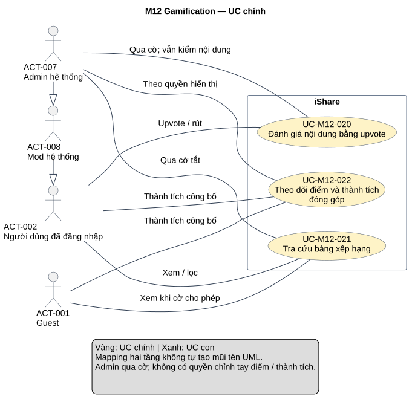
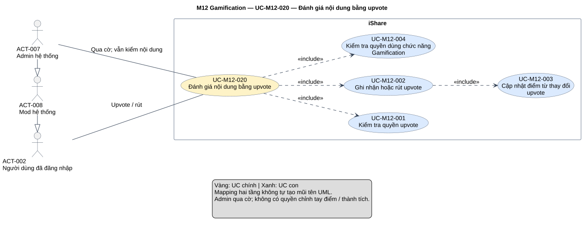
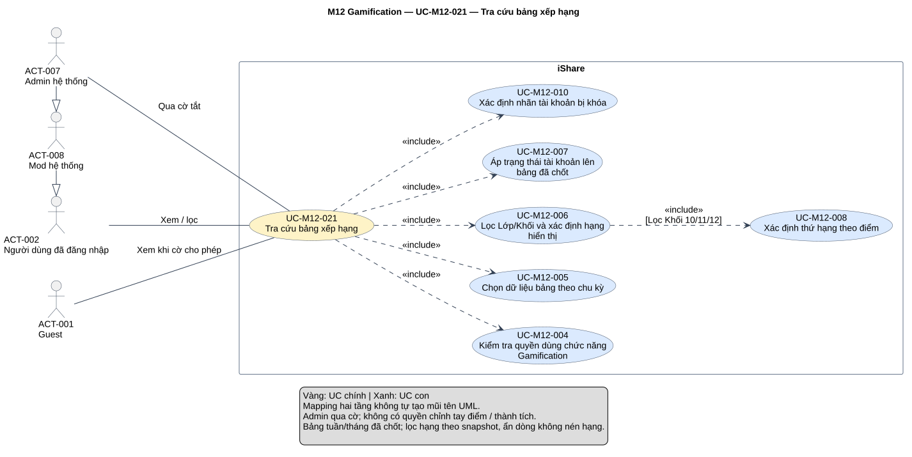
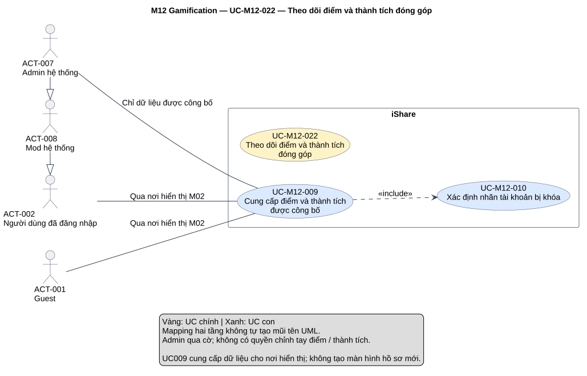

# Phân tích use case — M12 Gamification

[Vietnamese Doc] — Theo skill use-case-analysis v2.2; tiếng Việt, giữ thuật ngữ cần thiết.

Đầu ra gồm **3 UC chính, 10 UC con**, 12 mapping, đặc tả, truy vết và 4 SVG (tổng quan module, một detail cho mỗi core). Sáu AUT giữ các hành vi điểm/thành tích/xếp hạng tự động, không tạo quyền chỉnh tay cho Mod/Admin hoặc actor Hệ thống. Chỉ phân tích M12.

## Metadata và tiến độ

<!-- uc:document -->
| key | value |
|---|---|
| document_id | US-M12 |
| skill_version | 2.2 |
| mode | module |
| modules | M12 |
| scope | ALL |
| status | Chờ duyệt |
| current_step | 7 |
| completed_steps | 1, 2, 3, 4, 5, 6, 7 |
| approved_steps | - |
| source_baseline | FR-M12 v1.1; FR-M01 v1.10; FR-M02 v1.6; FR-M03 v1.10; FR-M04 v1.4; FR-M05 v1.7; FR-M06 v1.5; FR-M07 v1.5; FR-M08 v1.7; FR-M09 v1.2; FR-M10 v1.4; FR-M11 v1.3; FR-M14 v1.1; FR-M15 v1.1 |
| author | Codex |
| date | 2026-11-01 |
| approval_evidence | Người dùng cho phép tự làm các bước cần thiết ở lượt M04, áp dụng chuỗi module hiện tại. Đây là quyền thực hiện liên tục, không phải phê duyệt US-M12 hoặc từng kết quả bước. |
| semantic_review | pass |
| diagram_check | pass |

| Bước | Kết quả | Xác nhận | Baseline | Làm lại khi |
|---|---|---|---|---|
| 1 | 8 nhóm, 106 FR chi tiết, 29 BR; không mã bỏ; boundary/actor/giao tiếp | Được làm liên tục; chưa duyệt | FR-M12 v1.1 | Nguồn đổi |
| 2 | 3 core, 10 sub, 12 mapping; giữ ID actor hệ thống | Chưa duyệt | FR-M12 v1.1 | Mục tiêu/phạm vi đổi |
| 3 | 12 hợp đồng chi tiết và 1 brief Summary; 6 AUT, 6 RULE | Chưa duyệt | FR-M12 v1.1 | Hành vi/quyền đổi |
| 4 | 11 include; rà core–sub/sub–sub, không ép extend/generalization UC | Chưa duyệt | Mô hình tại đây | Điểm chèn/hợp đồng đổi |
| 5 | 143 dòng truy vết, 135 tiêu chí chi tiết/BR; 13 FR liên quan | Chưa duyệt | FR-M12 v1.1; FR-M01 v1.10; FR-M02 v1.6; FR-M03 v1.10; FR-M04 v1.4; FR-M05 v1.7; FR-M06 v1.5; FR-M07 v1.5; FR-M08 v1.7; FR-M09 v1.2; FR-M10 v1.4; FR-M11 v1.3; FR-M14 v1.1; FR-M15 v1.1 | Baseline liên quan đổi |
| 6 | 4 view đã kiểm cú pháp/render/hình, đúng node/11 cạnh; mỗi view chỉ một SVG | Chưa duyệt | PlantUML 1.2026.8 | Mô hình/nguồn đổi |
| 7 | Đã review nguồn/ngữ nghĩa/truy vết/UML/hình/liên kết, hồ sơ Chờ duyệt và giữ giới hạn nguồn | Chưa duyệt | Skill v2.2 | Phản hồi/baseline đổi |

## 1. Phạm vi, nguồn và tổng hợp yêu cầu

**Mục đích sử dụng:** đầu vào thiết kế/kiểm thử điểm, thành tích và bảng xếp hạng; cung cấp UC chính cho tổng quan hệ thống. Mục 2 là danh mục/phân rã, mục 3 là hợp đồng/luồng/quy tắc, mục 4 là quan hệ, mục 5 truy vết/giao tiếp, mục 6 sơ đồ và mục 7 QA/giới hạn nguồn.

**Subject:** toàn iShare. M12 sở hữu upvote/điểm/huy hiệu/danh hiệu/bảng/nhãn ban; M01/M02/M03/M04/M07/M08/M09/M10/M11 là module nội bộ, không actor ngoài subject. M12 không gọi AI hoặc dịch vụ email. Kết quả AI ẩn bình luận của M08 chỉ là nguồn sự kiện làm trừ điểm, không actor AI tự quyết điểm. Tác vụ thời gian/sự kiện dùng AUT, không vẽ scheduler/Hệ thống.

**Trong phạm vi:** bật/tắt upvote và quyền; điểm tức thời theo trọng số, trừ/giữ/hoàn theo nguyên nhân/mốc; badge; batch 60 phút, chốt tuần/tháng và Ngôi sao tuần; bảng công khai/lọc/đồng hạng/trạng thái dòng/cuộn; dữ liệu điểm/thành tích/nhãn cho owner hiển thị; cờ tính năng và sự kiện M07.

**Ngoài phạm vi:** hồ sơ UI M02, nội dung/khóa/xóa M03/M04, chế tài M08, xét khiếu nại M09, quyền nhóm M11, bật cờ M10, gộp/gửi thông báo M07, Trending/tìm kiếm M05/M06/M14, thống kê vận hành M15, thiết kế UI/CSDL/giao thức/giao dịch. Không Accepted Answer, downvote, bảng năm/nhóm/giáo viên, lịch sử bảng cũ, lịch sử danh hiệu ở UI, chỉnh tay điểm/award, AI tự quyết thành tích hoặc tiến độ huy hiệu.

**Baseline:** [FR-M12 — Gamification](../fr/FR-M12.md) v1.1, Đã chốt 2026-10-24; mốc DEC-271, QA-477, ISS-415, OPEN-012. **143 mã hiệu lực = 8 nhóm + 106 FR chi tiết + 29 BR**, không mã FR/BR đã bỏ. Phụ lục B.2 không có TBD/OPEN hoãn hành vi M12. Các điểm chưa mô tả hết khi tổ hợp quy tắc được ghi riêng ở mục 7, không tự ghi vào FR/register.

<!-- uc:sources -->
| path | version | role |
|---|---|---|
| docs/specs/fr/FR-M12.md | 1.1 | owner |
| docs/specs/fr/FR-M01.md | 1.10 | related |
| docs/specs/fr/FR-M02.md | 1.6 | related |
| docs/specs/fr/FR-M03.md | 1.10 | related |
| docs/specs/fr/FR-M04.md | 1.4 | related |
| docs/specs/fr/FR-M05.md | 1.7 | related |
| docs/specs/fr/FR-M06.md | 1.5 | related |
| docs/specs/fr/FR-M07.md | 1.5 | related |
| docs/specs/fr/FR-M08.md | 1.7 | related |
| docs/specs/fr/FR-M09.md | 1.2 | related |
| docs/specs/fr/FR-M10.md | 1.4 | related |
| docs/specs/fr/FR-M11.md | 1.3 | related |
| docs/specs/fr/FR-M14.md | 1.1 | related |
| docs/specs/fr/FR-M15.md | 1.1 | related |

Phương pháp: [skill](../../../.agent-instructions/skills/use-case-analysis/SKILL.md), [modeling rules](../../../.agent-instructions/skills/use-case-analysis/references/modeling-rules.md), [diagram rules](../../../.agent-instructions/skills/use-case-analysis/references/diagram-rules.md). Không dùng ví dụ hoặc US trước làm nguồn tính năng. Đối chiếu [US-M08](US-M08.md), [US-M09](US-M09.md), [US-M10](US-M10.md), [US-M11](US-M11.md) để giữ ID/ranh giới, nguồn chức năng vẫn là FR đã chốt.

### Actor và quyền

<!-- uc:actors -->
| id | name | kind | parent | boundary_reason | sources |
|---|---|---|---|---|---|
| ACT-001 | Guest | human | - | Người ngoài subject xem bảng khi cờ cho phép, đọc thành tích công bố; không upvote. | FR-M12-06.01, FR-M12-01.08, FR-M12-03.06, BR-M12-28 |
| ACT-002 | Người dùng đã đăng nhập | human | - | Đánh giá nội dung người khác, xem bảng và thành tích; tác giả là ngữ cảnh nhận điểm, không quyền chỉnh điểm. | FR-M12-01.01, FR-M12-01.02, BR-M12-03, FR-M12-06.01 |
| ACT-008 | Mod hệ thống | human | ACT-002 | Có quyền người dùng, không chỉnh tay điểm/thành tích, không qua cờ tắt; gỡ vi phạm thực hiện tại M08. | FR-M12-02.06, FR-M12-03.09, BR-M12-06, BR-M12-28 |
| ACT-007 | Admin hệ thống | human | ACT-008 | Qua cờ Gamification tắt nhưng vẫn chịu quyền nội dung/không tự upvote; không chỉnh tay điểm/thành tích. | FR-M12-08.06, FR-M12-02.06, FR-M12-03.09, BR-M12-03, BR-M12-06 |

ACT-007 → ACT-008 → ACT-002 thể hiện kế thừa năng lực người dùng; guard không tự upvote, quyền nội dung và cờ vẫn áp. HEAVY/BANNED/DEACTIVATED/DELETED là trạng thái, không actor. Tác giả là ngữ cảnh hưởng điểm, không một actor có nút nhận/cộng/hoàn điểm. Không cần actor Group Mod/Owner: họ chỉ là điều kiện quyền nhóm do M11 cung cấp trong yêu cầu vote. M01 tiếp tục chặn phiên tài khoản không được thao tác, Admin không vượt trạng thái/điều kiện nội dung bằng cờ.

### Kiểm kê và tổng hợp

| Nhóm FR | Tổng hợp | Số chi tiết | Biểu diễn | Owner |
|---|---|---|---|---|
| FR-M12-01 | Upvote bật/tắt, tối đa một, Post/Comment, không tự vote/Guest; HEAVY còn quyền, Khóa toàn bộ/Private/quyền xem; sự kiện. | 13 | [UC-M12-020](#uc-m12-020), [UC-M12-001](#uc-m12-001), [UC-M12-002](#uc-m12-002), [UC-M12-003](#uc-m12-003) | M12 |
| FR-M12-02 | Điểm 2/1 tức thời, trừ đúng nguyên nhân/mốc/không lặp, hoàn đúng lần gỡ bài; không giảm thời gian/chỉnh tay. | 22 | [UC-M12-003](#uc-m12-003); AUT001/002 | M12 |
| FR-M12-03 | 5 badge ở 25/100/300/600/1000 điểm, vượt nhiều trao tất cả, vĩnh viễn/ngày đầu; chỉ đã đạt, DELETED không hiện. | 12 | [UC-M12-009](#uc-m12-009); AUT003 | M12 |
| FR-M12-04 | Toàn thời gian 60 phút; điểm chu kỳ/đồng hạng/loại/hiện mờ, chỉ snapshot hiện hành; không đổi bảng đã chốt. | 19 | [UC-M12-005](#uc-m12-005), [UC-M12-007](#uc-m12-007), [UC-M12-008](#uc-m12-008); AUT004 | M12 |
| FR-M12-05 | Chốt đúng mốc đầu/cuối tuần-tháng, top hạng 1–3 gồm hòa; tuần ≤60 phút, tháng không trao/báo; lịch sử chỉ lưu. | 13 | [UC-M12-009](#uc-m12-009); AUT005 | M12 |
| FR-M12-06 | Ba tab, Lớp-Khối theo snapshot, đánh lại hạng lọc, dòng đủ trường, mở hồ sơ/cuộn 20 đến hết. | 13 | [UC-M12-021](#uc-m12-021), [UC-M12-005](#uc-m12-005), [UC-M12-006](#uc-m12-006), [UC-M12-007](#uc-m12-007), [UC-M12-008](#uc-m12-008) | M12 |
| FR-M12-07 | Nhãn BANNED công khai nơi tên hiện, bỏ khi không BANNED, khác DEACTIVATED; không tự ẩn nội dung. | 4 | [UC-M12-010](#uc-m12-010) | M12 |
| FR-M12-08 | Cờ tắt chặn tương tác/mở bảng không Admin, giữ lối vào/số liệu/tác vụ/báo thành tích, không làm bù. | 10 | [UC-M12-004](#uc-m12-004) | M12 |

## 2. Danh mục và phân rã

### 2.1 UC chính và UC con

<!-- uc:catalog -->
| id | name | tier | level | primary | supporting | owner | anchor | sources |
|---|---|---|---|---|---|---|---|---|
| UC-M12-020 | Đánh giá nội dung bằng upvote | core | User goal | ACT-002, ACT-007 | - | M12 | #uc-m12-020 | FR-M12-01, FR-M12-02, BR-M12-01, BR-M12-02, BR-M12-03, BR-M12-04, BR-M12-05, BR-M12-07, BR-M12-28 |
| UC-M12-021 | Tra cứu bảng xếp hạng | core | User goal | ACT-001, ACT-002, ACT-007 | - | M12 | #uc-m12-021 | FR-M12-04, FR-M12-05, FR-M12-06, BR-M12-14, BR-M12-16, BR-M12-18, BR-M12-19, BR-M12-20, BR-M12-21, BR-M12-22, BR-M12-24, BR-M12-29 |
| UC-M12-022 | Theo dõi điểm và thành tích đóng góp | core | Summary | ACT-001, ACT-002, ACT-007 | - | M12 | #uc-m12-022 | FR-M12-02, FR-M12-03, FR-M12-05, FR-M12-07, BR-M12-05, BR-M12-06, BR-M12-11, BR-M12-12, BR-M12-13, BR-M12-24, BR-M12-27, BR-M12-28 |
| UC-M12-001 | Kiểm tra quyền upvote | sub | Subfunction | ACT-002, ACT-007 | - | M12 | #uc-m12-001 | FR-M12-01, BR-M12-03, BR-M12-04, FR-M03-14.06, FR-M11-16.04, FR-M11-17.08 |
| UC-M12-002 | Ghi nhận hoặc rút upvote | sub | Subfunction | ACT-002, ACT-007 | - | M12 | #uc-m12-002 | FR-M12-01.01, FR-M12-01.02, FR-M12-01.03, FR-M12-01.04, BR-M12-01, BR-M12-02, BR-M12-07 |
| UC-M12-003 | Cập nhật điểm từ thay đổi upvote | sub | Subfunction | ACT-002, ACT-007 | - | M12 | #uc-m12-003 | FR-M12-02.01, FR-M12-02.02, FR-M12-02.03, FR-M12-02.04, FR-M12-02.18, BR-M12-05, BR-M12-07 |
| UC-M12-004 | Kiểm tra quyền dùng chức năng Gamification | sub | Subfunction | ACT-001, ACT-002, ACT-007 | - | M12 | #uc-m12-004 | FR-M12-08, BR-M12-28, FR-M10-12.04 |
| UC-M12-005 | Chọn dữ liệu bảng theo chu kỳ | sub | Subfunction | ACT-001, ACT-002, ACT-007 | - | M12 | #uc-m12-005 | FR-M12-06.02, FR-M12-06.04, FR-M12-06.06, FR-M12-06.07, FR-M12-04.14, BR-M12-14, BR-M12-19, BR-M12-22 |
| UC-M12-006 | Lọc Lớp/Khối và xác định hạng hiển thị | sub | Subfunction | ACT-001, ACT-002, ACT-007 | - | M12 | #uc-m12-006 | FR-M12-06.03, FR-M12-06.08, FR-M12-06.09, BR-M12-16, BR-M12-18, BR-M12-20 |
| UC-M12-007 | Áp trạng thái tài khoản lên bảng đã chốt | sub | Subfunction | ACT-001, ACT-002, ACT-007 | - | M12 | #uc-m12-007 | FR-M12-04.07, FR-M12-04.08, FR-M12-04.09, FR-M12-04.10, FR-M12-04.11, FR-M12-04.12, FR-M12-04.17, FR-M12-04.18, BR-M12-20, BR-M12-21 |
| UC-M12-008 | Xác định thứ hạng theo điểm | sub | Subfunction | ACT-001, ACT-002, ACT-007 | - | M12 | #uc-m12-008 | FR-M12-04.02, FR-M12-04.06, FR-M12-06.05, FR-M12-06.08, FR-M12-06.10, BR-M12-16, BR-M12-18 |
| UC-M12-009 | Cung cấp điểm và thành tích được công bố | sub | Subfunction | ACT-001, ACT-002, ACT-007 | - | M12 | #uc-m12-009 | FR-M12-03.06, FR-M12-03.07, FR-M12-03.11, FR-M12-05.12, FR-M12-05.13, FR-M12-08.10, BR-M12-12, BR-M12-13, BR-M12-24, BR-M12-28 |
| UC-M12-010 | Xác định nhãn tài khoản bị khóa | sub | Subfunction | ACT-001, ACT-002, ACT-007 | - | M12 | #uc-m12-010 | FR-M12-07, FR-M12-08.10, BR-M12-27, BR-M12-28 |

Tier độc lập level. Core020/021 là User goal; core022 Summary thể hiện giá trị theo dõi đóng góp qua dữ liệu tích hợp, không tạo lại UC Xem hồ sơ của M02. Sub đều là hành vi gắn kết cần dùng lại/làm rõ trong mục tiêu, không phải loại oval theo từng nút hoặc ngưỡng. AUT bao phủ phần nghiệp vụ tự động, không vì không có oval mà bỏ yêu cầu.

### 2.2 Phân rã core → sub

<!-- uc:decomposition -->
| core | sub | rationale | sources |
|---|---|---|---|
| UC-M12-020 | UC-M12-001 | Kiểm quyền/nội dung trước đánh giá. | FR-M12-01, BR-M12-03, BR-M12-04, FR-M03-14.06, FR-M11-16.04, FR-M11-17.08 |
| UC-M12-020 | UC-M12-002 | Đổi trạng thái bật/tắt đúng lượt. | FR-M12-01.01, FR-M12-01.02, FR-M12-01.03, FR-M12-01.04, BR-M12-01, BR-M12-02, BR-M12-07 |
| UC-M12-020 | UC-M12-003 | Điểm theo thay đổi upvote cập nhật tức thời. | FR-M12-02.01, FR-M12-02.02, FR-M12-02.03, FR-M12-02.04, FR-M12-02.18, BR-M12-05, BR-M12-07 |
| UC-M12-020 | UC-M12-004 | Áp cờ cho yêu cầu tương tác/mở bảng, dùng chung. | FR-M12-08, BR-M12-28, FR-M10-12.04 |
| UC-M12-021 | UC-M12-004 | Áp cờ cho yêu cầu tương tác/mở bảng, dùng chung. | FR-M12-08, BR-M12-28, FR-M10-12.04 |
| UC-M12-021 | UC-M12-005 | Lấy đúng bảng hiện hành theo chu kỳ. | FR-M12-06.02, FR-M12-06.04, FR-M12-06.06, FR-M12-06.07, FR-M12-04.14, BR-M12-14, BR-M12-19, BR-M12-22 |
| UC-M12-021 | UC-M12-006 | So sánh đúng nhóm Lớp-Khối theo snapshot. | FR-M12-06.03, FR-M12-06.08, FR-M12-06.09, BR-M12-16, BR-M12-18, BR-M12-20 |
| UC-M12-021 | UC-M12-007 | Giữ cách ẩn/hiện mờ/hạng của bảng đã chốt. | FR-M12-04.07, FR-M12-04.08, FR-M12-04.09, FR-M12-04.10, FR-M12-04.11, FR-M12-04.12, FR-M12-04.17, FR-M12-04.18, BR-M12-20, BR-M12-21 |
| UC-M12-021 | UC-M12-008 | Dùng chung thuật toán nghiệp vụ đồng hạng. | FR-M12-04.02, FR-M12-04.06, FR-M12-06.05, FR-M12-06.08, FR-M12-06.10, BR-M12-16, BR-M12-18 |
| UC-M12-021 | UC-M12-010 | Dùng chung nhãn ban theo trạng thái thực. | FR-M12-07, FR-M12-08.10, BR-M12-27, BR-M12-28 |
| UC-M12-022 | UC-M12-009 | Cung cấp thành tích công bố cho owner hiển thị. | FR-M12-03.06, FR-M12-03.07, FR-M12-03.11, FR-M12-05.12, FR-M12-05.13, FR-M12-08.10, BR-M12-12, BR-M12-13, BR-M12-24, BR-M12-28 |
| UC-M12-022 | UC-M12-010 | Dùng chung nhãn ban theo trạng thái thực. | FR-M12-07, FR-M12-08.10, BR-M12-27, BR-M12-28 |

12 mapping; không sub mồ côi. UC004 dùng chung cho đánh giá/mở bảng, UC010 dùng chung nhãn tại bảng và dữ liệu thành tích. UC008 cũng được AUT tính/chốt dùng cùng quy tắc hạng. Không đổi ID theo caller hoặc loại quan hệ; mapping không tự là UML.

### 2.3 Tổng hợp hệ thống và quyết định phân tích

<!-- uc:module-models -->
| module | path | baseline |
|---|---|---|

Mode module, chưa tổng hợp các core hệ thống ngoài M12.

| Quyết định | Hành vi | Biểu diễn | Lý do | Phương án không chọn |
|---|---|---|---|---|
| D-M12-01 | Đánh giá và rút đánh giá | Core020 User goal, các bước kiểm/ghi/điểm là sub | Một mục tiêu bật/tắt hữu ích trên nội dung, hai trạng thái theo cùng hợp đồng. | Không coi rút là extend một lần upvote đã kết thúc, không mỗi loại nội dung một cha abstract thiếu nhu cầu. |
| D-M12-02 | Điểm từ upvote và nội dung | UC003 trong luồng upvote; AUT001/002 cho sự kiện nội dung/khiếu nại | Điểm tức thời khác batch bảng, mốc/nguyên nhân giữ đúng. | Không actor Hệ thống/AI/Mod tự chỉnh điểm, không một UC Trừ điểm của Admin. |
| D-M12-03 | Badge và Ngôi sao tuần | AUT003/005 và dữ liệu UC009 | Tự động, có trigger/trước-sau/dữ liệu; giá trị thành tích được người xem tiếp nhận. | Không nút yêu cầu/trao tay badge hoặc UC lịch sử danh hiệu. |
| D-M12-04 | Xem bảng và tính bảng | Core021/sub5–8 để đọc/lọc; AUT004/005 tạo bảng | Không tính lại chỉ vì mở hoặc có upvote; quy tắc xếp hạng dùng chung. | Không bảng tuần đang chạy hoặc năm, không coi xem bảng include một lần batch 60 phút. |
| D-M12-05 | Lọc và ẩn sau chốt | UC006/007 tách trách nhiệm | Lớp-Khối theo snapshot, lọc đánh hạng, ẩn không nén hạng người khác; giữ diễn giải và giới hạn tại NOTE04. | Không sửa bảng đã chốt theo hồ sơ mới hoặc tính lại người thắng trong bộ lọc. |
| D-M12-06 | Theo dõi thành tích | Core022 Summary, UC009/010 | M12 sở hữu số liệu/quy tắc công bố, M02 sở hữu trang hồ sơ. | Không UC M12 trùng Xem hồ sơ, không include điều hướng hồ sơ trong mỗi lượt xem bảng. |
| D-M12-07 | Cờ và nhãn | UC004 kiểm yêu cầu; UC010 nhãn/dữ liệu; RULE006 | Chặn thao tác không có nghĩa dừng số liệu hoặc tự động; nhãn không tự thay quyền nội dung. | Không clock/AI actor hoặc UI chỉnh chính sách/điểm. |

## 3. Đặc tả

### 3.1 UC chính Summary

#### UC-M12-022 — Theo dõi điểm và thành tích đóng góp

**Actor:** ACT-001, ACT-002, ACT-007. **Mục tiêu/giá trị:** Người xem thấy đóng góp và thành tích được công bố đúng, giữ minh bạch trạng thái ban.

**Kích hoạt/ranh giới:** Nơi hiển thị như hồ sơ M02 hoặc tên tác giả cần dữ liệu M12. Quyền xem trang/nội dung do owner cung cấp; M12 không mở lại trang hoặc tiết lộ tác giả ẩn danh.

**Quy trình tổng quát:** UC009 cung cấp dữ liệu điểm/thành tích cho M02, chèn UC010 tính nhãn tài khoản khi hiển thị tên. AUT001/002 điều chỉnh điểm theo nội dung và khiếu nại; AUT003 trao huy hiệu; AUT004/005 tính bảng/chốt tuần-tháng và danh hiệu; AUT006 phát sự kiện thông báo. Những hành vi tự động không thành nút của Admin/actor Hệ thống. Theo dõi điểm trên hồ sơ là tích hợp với UC M02, không tạo lại một UC Xem hồ sơ trong M12.

**Kết quả:** Tổng điểm tức thời, huy hiệu đã đạt/ngày đầu, danh hiệu tuần hiện hành và nhãn ban đúng nguồn. **Khi không đạt:** Không cung cấp tiến độ/huy hiệu chưa đạt/lịch sử danh hiệu, không mở quyền chỉnh tay thành tích.

**UC con:** [UC-M12-009](#uc-m12-009), [UC-M12-010](#uc-m12-010). **Nguồn:** FR-M12-02, FR-M12-03, FR-M12-05, FR-M12-07, BR-M12-05, BR-M12-06, BR-M12-11, BR-M12-12, BR-M12-13, BR-M12-24, BR-M12-27, BR-M12-28.

### 3.2 Core User goal và các UC con

Subfunction nhận ngữ cảnh caller, không thành nút tự chạy bỏ qua quyền. UC005–010 trả dữ liệu/chiếu hiển thị, không tự cấp quyền xem hồ sơ/nội dung hoặc chỉnh trạng thái tài khoản. Phần nguồn chưa chốt giữ tại mục 7.

#### UC-M12-020 — Đánh giá nội dung bằng upvote

**UC con:** [UC-M12-001](#uc-m12-001), [UC-M12-002](#uc-m12-002), [UC-M12-003](#uc-m12-003), [UC-M12-004](#uc-m12-004).

<!-- uc:spec UC-M12-020 -->
| key | value |
|---|---|
| goal | Người dùng đánh giá hữu ích hoặc rút đánh giá của mình; tác giả nhận điểm đúng trọng số và trạng thái nội dung. |
| subject | iShare |
| level | User goal |
| primary | ACT-002, ACT-007 |
| supporting | - |
| trigger | Người dùng bấm nút upvote trên bài viết hoặc bình luận của người khác. |
| preconditions | Định danh/phiên theo M01, có nội dung đích; quyền và trạng thái kiểm trong luồng. |
| success | Upvote đổi đúng một trạng thái, số upvote hiệu lực và điểm tác giả cập nhật ngay, phát sự kiện cho M07. |
| failure | Từ chối Guest, tự upvote, nội dung không cho tương tác, cờ không cho; không tự đặt bảo đảm giao dịch thiếu nguồn. |
| abstract | false |
| common_contract | Không áp dụng: không dùng generalization UC. |

**Luồng chính:**

| Bước | Ai | Hành động/phản hồi | Tiếp tục | Nguồn |
|---|---|---|---|---|
| 1 | iShare | Chèn UC-M12-004 với yêu cầu upvote/rút để kiểm cờ Gamification và quyền dùng chức năng. | [Bước 2](#uc-m12-020-main-2) | FR-M12-01, FR-M12-02, BR-M12-01, BR-M12-02, BR-M12-03, BR-M12-04, BR-M12-05, BR-M12-07, BR-M12-28 |
| 2 | iShare | Chèn UC-M12-001 kiểm đăng nhập, không tự upvote và các quyền xem/tương tác của M03/M04/M11; HEAVY vẫn được upvote. | [Bước 3](#uc-m12-020-main-3) | FR-M12-01, FR-M12-02, BR-M12-01, BR-M12-02, BR-M12-03, BR-M12-04, BR-M12-05, BR-M12-07, BR-M12-28 |
| 3 | iShare | Chèn UC-M12-002 để ghi hoặc rút upvote và cập nhật điểm tức thời qua UC003. | [Bước 4](#uc-m12-020-main-4) | FR-M12-01, FR-M12-02, BR-M12-01, BR-M12-02, BR-M12-03, BR-M12-04, BR-M12-05, BR-M12-07, BR-M12-28 |
| 4 | iShare | Trả trạng thái nút và số upvote hiệu lực mới; AUT006 chuyển sự kiện upvote/rút cho M07. Không chờ lần tính bảng xếp hạng. | END: đạt kết quả đường chính của hợp đồng. | FR-M12-01, FR-M12-02, BR-M12-01, BR-M12-02, BR-M12-03, BR-M12-04, BR-M12-05, BR-M12-07, BR-M12-28 |

**Luồng thay thế/ngoại lệ:**

| ID nhánh | Bước rẽ | Điều kiện | Xử lý | Quay lại/kết thúc | Nguồn |
|---|---|---|---|---|---|
| A1 | [Bước 1](#uc-m12-020-main-1) | Cờ tắt, người thao tác không Admin. | UC004 từ chối với thông báo bận; nút và số upvote vẫn hiện theo nguồn. | END: không upvote/rút. | FR-M12-08.01, FR-M12-08.08, FR-M12-08.10, BR-M12-28 |
| A2 | [Bước 2](#uc-m12-020-main-2) | UC001 không đạt quyền hoặc điều kiện nội dung. | Từ chối thao tác; không dùng việc đã xem từ trước để vượt thay đổi khóa/Private. | END: đánh giá không được thực hiện. | FR-M12-01.07, FR-M12-01.08, FR-M12-01.10, FR-M12-01.11, FR-M12-01.12 |
| A3 | [Bước 3](#uc-m12-020-main-3) | Đã có upvote hiệu lực của chính người này. | UC002 đi nhánh rút lại, không thêm một upvote thứ hai. | [Tiếp tục](#uc-m12-020-main-4) | FR-M12-01.02, FR-M12-01.03, BR-M12-02 |

**Quy tắc:** FR-M12-01, FR-M12-02, BR-M12-01, BR-M12-02, BR-M12-03, BR-M12-04, BR-M12-05, BR-M12-07, BR-M12-28. Theo phạm vi, xem [tương tác](#rule-m12-001), [điểm](#rule-m12-002), [chu kỳ](#rule-m12-003), [hạng/trạng thái](#rule-m12-004), [thành tích/nhãn](#rule-m12-005), [cờ/quyền quản trị](#rule-m12-006). Không tự bổ sung hành vi ở các tổ hợp chưa chốt mục 7.

#### UC-M12-021 — Tra cứu bảng xếp hạng

**UC con:** [UC-M12-004](#uc-m12-004), [UC-M12-005](#uc-m12-005), [UC-M12-006](#uc-m12-006), [UC-M12-007](#uc-m12-007), [UC-M12-008](#uc-m12-008), [UC-M12-010](#uc-m12-010).

<!-- uc:spec UC-M12-021 -->
| key | value |
|---|---|
| goal | Người xem biết thứ hạng đóng góp theo bảng tuần/tháng đã chốt hoặc toàn thời gian gần nhất và Lớp/Khối. |
| subject | iShare |
| level | User goal |
| primary | ACT-001, ACT-002, ACT-007 |
| supporting | - |
| trigger | Mở bảng xếp hạng, đổi tab/Lớp-Khối hoặc cuộn tiếp. |
| preconditions | Không cần đăng nhập khi cờ cho phép; dữ liệu bảng do AUT004/005 tạo, không tính lại tổng khi đọc. |
| success | Bảng đúng chu kỳ/bộ lọc, đồng hạng/ẩn/hiện mờ/nhãn đúng; tải mọi dòng đủ điều kiện theo lô20. |
| failure | Từ chối mở khi cờ không cho; không thêm lịch sử chu kỳ, năm hoặc bảng đang chạy. Bảng lần đầu chưa có xem NOTE-M12-01. |
| abstract | false |
| common_contract | Không áp dụng: không dùng generalization UC. |

**Luồng chính:**

| Bước | Ai | Hành động/phản hồi | Tiếp tục | Nguồn |
|---|---|---|---|---|
| 1 | ACT-001 / ACT-002 / ACT-007 | Mở bảng, chọn Tuần/Tháng/Toàn thời gian và Lớp-Khối 10/11/12/Tất cả. | [Bước 2](#uc-m12-021-main-2) | FR-M12-04, FR-M12-05, FR-M12-06, BR-M12-14, BR-M12-16, BR-M12-18, BR-M12-19, BR-M12-20, BR-M12-21, BR-M12-22, BR-M12-24, BR-M12-29 |
| 2 | iShare | Chèn UC-M12-004 ngữ cảnh mở bảng, kiểm cờ; không đòi Guest đăng nhập để xem khi cờ cho phép. | [Bước 3](#uc-m12-021-main-3) | FR-M12-04, FR-M12-05, FR-M12-06, BR-M12-14, BR-M12-16, BR-M12-18, BR-M12-19, BR-M12-20, BR-M12-21, BR-M12-22, BR-M12-24, BR-M12-29 |
| 3 | iShare | Chèn UC-M12-005 chọn đúng bảng đã chốt hoặc lần tính toàn thời gian gần nhất. | [Bước 4](#uc-m12-021-main-4) | FR-M12-04, FR-M12-05, FR-M12-06, BR-M12-14, BR-M12-16, BR-M12-18, BR-M12-19, BR-M12-20, BR-M12-21, BR-M12-22, BR-M12-24, BR-M12-29 |
| 4 | iShare | Chèn UC-M12-006 lọc Lớp/Khối theo giá trị tại lúc chốt/tính và xác định hạng trong tập lọc. | [Bước 5](#uc-m12-021-main-5) | FR-M12-04, FR-M12-05, FR-M12-06, BR-M12-14, BR-M12-16, BR-M12-18, BR-M12-19, BR-M12-20, BR-M12-21, BR-M12-22, BR-M12-24, BR-M12-29 |
| 5 | iShare | Chèn UC-M12-007 áp trạng thái tài khoản lên bảng tuần/tháng đã chốt; không làm lại số liệu/thứ hạng đã chốt của các dòng khác. | [Bước 6](#uc-m12-021-main-6) | FR-M12-04, FR-M12-05, FR-M12-06, BR-M12-14, BR-M12-16, BR-M12-18, BR-M12-19, BR-M12-20, BR-M12-21, BR-M12-22, BR-M12-24, BR-M12-29 |
| 6 | iShare | Chèn UC-M12-010 xác định nhãn Tài khoản đã bị khóa ở nơi còn hiển thị tên; không lộ mức cảnh cáo hoặc dùng nhãn BANNED thay nhãn DELETED. | [Bước 7](#uc-m12-021-main-7) | FR-M12-04, FR-M12-05, FR-M12-06, BR-M12-14, BR-M12-16, BR-M12-18, BR-M12-19, BR-M12-20, BR-M12-21, BR-M12-22, BR-M12-24, BR-M12-29 |
| 7 | iShare | Hiện thứ hạng, avatar, display_name kèm username, điểm chu kỳ, dấu Ngôi sao tuần chỉ tab Tuần và nhãn DELETED khi có. Tải 20 dòng mỗi lượt cuộn, cho xem hết tập đủ điều kiện. | [Bước 8](#uc-m12-021-main-8) | FR-M12-04, FR-M12-05, FR-M12-06, BR-M12-14, BR-M12-16, BR-M12-18, BR-M12-19, BR-M12-20, BR-M12-21, BR-M12-22, BR-M12-24, BR-M12-29 |
| 8 | ACT-001 / ACT-002 / ACT-007 | Có thể bấm tên/avatar để sang hồ sơ M02; đây là mục tiêu độc lập, không include Xem hồ sơ vào mỗi lần xem bảng. | END: đạt kết quả đường chính của hợp đồng. | FR-M12-04, FR-M12-05, FR-M12-06, BR-M12-14, BR-M12-16, BR-M12-18, BR-M12-19, BR-M12-20, BR-M12-21, BR-M12-22, BR-M12-24, BR-M12-29 |

**Luồng thay thế/ngoại lệ:**

| ID nhánh | Bước rẽ | Điều kiện | Xử lý | Quay lại/kết thúc | Nguồn |
|---|---|---|---|---|---|
| A1 | [Bước 2](#uc-m12-021-main-2) | UC004 từ chối do cờ tắt và không Admin. | Hiện Hệ thống đang bận, vui lòng thử lại sau; lối vào vẫn hiện. | END: chưa mở bảng. | FR-M12-08.01, FR-M12-08.02, FR-M12-08.06, FR-M12-08.08 |
| A2 | [Bước 3](#uc-m12-021-main-3) | Chọn bảng của chu kỳ cũ hơn hoặc tuần/tháng đang chạy. | Không có chức năng xem bảng này; chỉ ba loại kết quả hiện hành. | END: không cung cấp bảng ngoài phạm vi. | FR-M12-06.02, FR-M12-06.04, FR-M12-06.06, FR-M12-06.07, BR-M12-22 |
| A3 | [Bước 4](#uc-m12-021-main-4) | Đổi tab hoặc Lớp/Khối. | Thực hiện lại lấy đúng dữ liệu và tập lọc; không dùng Lớp/Khối hồ sơ mới để sửa snapshot đã chốt. | [Tiếp tục](#uc-m12-021-main-3) | FR-M12-06.03, FR-M12-06.08, FR-M12-06.09 |
| A4 | [Bước 7](#uc-m12-021-main-7) | Cuộn tiếp khi còn dòng. | Tải tiếp 20 dòng theo cùng tập/thứ tự, lô cuối ít hơn 20 nếu còn ít; không giới hạn Top20. | [Tiếp tục](#uc-m12-021-main-7) | FR-M12-06.13, BR-M12-29 |

**Quy tắc:** FR-M12-04, FR-M12-05, FR-M12-06, BR-M12-14, BR-M12-16, BR-M12-18, BR-M12-19, BR-M12-20, BR-M12-21, BR-M12-22, BR-M12-24, BR-M12-29. Theo phạm vi, xem [tương tác](#rule-m12-001), [điểm](#rule-m12-002), [chu kỳ](#rule-m12-003), [hạng/trạng thái](#rule-m12-004), [thành tích/nhãn](#rule-m12-005), [cờ/quyền quản trị](#rule-m12-006). Không tự bổ sung hành vi ở các tổ hợp chưa chốt mục 7.

**Tiêu chí nguồn phải bảo toàn:** đối chiếu nguyên nghĩa với luồng/quy tắc tại đây, không thay đặc tả hành vi bằng danh sách mã.

| Mã | Nội dung đối chiếu |
|---|---|
| FR-M12-06.01 | Hệ thống phải cho Guest và người dùng đã đăng nhập xem bảng xếp hạng. |
| FR-M12-06.11 | Hệ thống phải hiển thị ở mỗi dòng: thứ hạng, avatar, tên hiển thị kèm username, điểm trong chu kỳ, dấu "Ngôi sao tuần" ở tab Tuần với người nhận danh hiệu, và nhãn "[Người dùng đã xóa]" với tài khoản đã xóa (BR-M12-29). |
| FR-M12-06.12 | Khi người xem bấm vào tên hoặc avatar trên một dòng, hệ thống phải mở hồ sơ của người đó (BR-M12-29). |
| FR-M12-06.13 | Hệ thống phải hiển thị mọi người có điểm trong chu kỳ lớn hơn 0, tải 20 dòng mỗi lần cuộn (BR-M12-29). |
| BR-M12-29 | Mỗi dòng của bảng xếp hạng hiện: thứ hạng, avatar, tên hiển thị kèm username (bấm vào mở hồ sơ), điểm trong chu kỳ, dấu "Ngôi sao tuần" (chỉ tab Tuần), nhãn "[Người dùng đã xóa]" khi có. Bảng hiện mọi người có điểm trong chu kỳ lớn hơn 0, tải 20 dòng mỗi lần cuộn. |

#### UC-M12-001 — Kiểm tra quyền upvote

**Thuộc core:** [UC-M12-020](#uc-m12-020). Kiểm quyền/nội dung trước đánh giá.

<!-- uc:spec UC-M12-001 -->
| key | value |
|---|---|
| goal | Cho phép đánh giá/rút khi tài khoản và nội dung đủ điều kiện; không tự cho quyền vì có thể đọc trong vụ kiểm duyệt. |
| subject | iShare |
| level | Subfunction |
| primary | ACT-002, ACT-007 |
| supporting | - |
| trigger | Core020 chèn trước đổi upvote. |
| preconditions | Biết người thao tác, nội dung, tác giả, bài cha nếu là bình luận; UC004 kiểm cờ Gamification. |
| success | Trả đủ điều kiện; HEAVY không bị chặn chỉ vì mức cảnh cáo. |
| failure | Từ chối Guest, tự upvote hoặc quyền nội dung không đạt, không cấp đặc quyền upvote cho Admin. |
| abstract | false |
| common_contract | Không áp dụng: không dùng generalization UC. |

**Luồng chính:**

| Bước | Ai | Hành động/phản hồi | Tiếp tục | Nguồn |
|---|---|---|---|---|
| 1 | iShare | Kiểm người thao tác đã đăng nhập theo M01 và không là tác giả nội dung. Nút trên nội dung chính mình ẩn hoặc tắt, nhưng yêu cầu tự upvote vẫn phải bị từ chối. | [Bước 2](#uc-m12-001-main-2) | FR-M12-01, BR-M12-03, BR-M12-04, FR-M03-14.06, FR-M11-16.04, FR-M11-17.08 |
| 2 | iShare | Kiểm nội dung còn hiển thị/tương tác được theo M03/M04/M11: Khóa toàn bộ bài cha chặn upvote mới và rút trên bài/mọi bình luận; Private chặn người ngoài kể cả vừa đổi; nhóm Khóa hoặc cờ Group không cho cũng chặn. | [Bước 3](#uc-m12-001-main-3) | FR-M12-01, BR-M12-03, BR-M12-04, FR-M03-14.06, FR-M11-16.04, FR-M11-17.08 |
| 3 | iShare | Không loại HEAVY khỏi quyền upvote; Admin phải qua cùng điều kiện nội dung. Trả đủ điều kiện cho core020. | END: đạt kết quả đường chính của hợp đồng. | FR-M12-01, BR-M12-03, BR-M12-04, FR-M03-14.06, FR-M11-16.04, FR-M11-17.08 |

**Luồng thay thế/ngoại lệ:**

| ID nhánh | Bước rẽ | Điều kiện | Xử lý | Quay lại/kết thúc | Nguồn |
|---|---|---|---|---|---|
| A1 | [Bước 1](#uc-m12-001-main-1) | Guest hoặc tự upvote. | Từ chối, không chỉ dựa vào trạng thái nút. | END: không đủ quyền. | FR-M12-01.06, FR-M12-01.07, FR-M12-01.08, BR-M12-03, BR-M12-04 |
| A2 | [Bước 2](#uc-m12-001-main-2) | Nội dung không còn hiển thị/đã xóa/bị ẩn hoặc module gốc chặn tương tác. | Từ chối; quyền đọc bằng ngữ cảnh báo cáo không tự tạo quyền vote thường. | END: không được upvote/rút theo điều kiện nội dung. | FR-M12-01.10, FR-M12-01.11, FR-M12-01.12, BR-M12-04, FR-M11-16.04, FR-M11-17.08 |

**Quy tắc:** FR-M12-01, BR-M12-03, BR-M12-04, FR-M03-14.06, FR-M11-16.04, FR-M11-17.08. Theo phạm vi, xem [tương tác](#rule-m12-001), [điểm](#rule-m12-002), [chu kỳ](#rule-m12-003), [hạng/trạng thái](#rule-m12-004), [thành tích/nhãn](#rule-m12-005), [cờ/quyền quản trị](#rule-m12-006). Không tự bổ sung hành vi ở các tổ hợp chưa chốt mục 7.

**Tiêu chí nguồn phải bảo toàn:** đối chiếu nguyên nghĩa với luồng/quy tắc tại đây, không thay đặc tả hành vi bằng danh sách mã.

| Mã | Nội dung đối chiếu |
|---|---|
| FR-M12-01.06 | Hệ thống phải ẩn hoặc tắt nút upvote trên bài viết và bình luận của chính người xem (BR-M12-03). |
| FR-M12-01.07 | Nếu người dùng gửi upvote cho bài viết hoặc bình luận của chính mình, hệ thống phải từ chối (BR-M12-03). |
| FR-M12-01.08 | Nếu người chưa đăng nhập upvote, hệ thống phải từ chối (BR-M12-04). |
| FR-M12-01.09 | Hệ thống phải cho người dùng ở mức cảnh cáo HEAVY upvote như người dùng khác (BR-M12-04). |
| FR-M12-01.10 | Nếu bài viết đang ở mức Khóa toàn bộ, hệ thống phải từ chối upvote mới và rút lại upvote trên bài viết đó và trên mọi bình luận của bài (BR-M12-04). |
| FR-M12-01.11 | Nếu người không là thành viên upvote bài của nhóm Private, kể cả bài của nhóm vừa chuyển sang Private, hệ thống phải từ chối (BR-M12-04). |
| FR-M12-01.12 | Nếu bài viết hoặc bình luận không còn hiển thị với người dùng (đã xóa, bị ẩn), hệ thống phải từ chối upvote trên nội dung đó. |
| BR-M12-03 | Không ai upvote được bài viết hoặc bình luận của chính mình; nút upvote bị ẩn hoặc tắt trên nội dung của chính người xem. |
| BR-M12-04 | Chỉ người dùng đã đăng nhập upvote được. Người ở mức cảnh cáo HEAVY vẫn upvote được. Upvote bị từ chối nơi module khác chặn tương tác: bài nhóm Private với người ngoài nhóm (M11). Bài ở mức Khóa toàn bộ (M03) chặn mọi thao tác upvote: upvote mới và rút lại upvote, trên bài và trên mọi bình luận của bài. |

#### UC-M12-002 — Ghi nhận hoặc rút upvote

**Thuộc core:** [UC-M12-020](#uc-m12-020). Đổi trạng thái bật/tắt đúng lượt.

<!-- uc:spec UC-M12-002 -->
| key | value |
|---|---|
| goal | Đổi trạng thái đánh giá của một người trên một nội dung đúng một lần bật/tắt. |
| subject | iShare |
| level | Subfunction |
| primary | ACT-002, ACT-007 |
| supporting | - |
| trigger | Core020 chèn sau kiểm quyền. |
| preconditions | Caller đã qua UC004/UC001; có loại bài/bình luận và người thao tác. |
| success | Không có→Có hiệu lực kèm thời điểm; Có hiệu lực→Đã rút; tối đa một hiệu lực/người/nội dung và điểm cập nhật qua UC003. |
| failure | Không tạo lượt hiệu lực thứ hai; tính nguyên tử/idempotency kỹ thuật chưa được FR chốt, NOTE-M12-07. |
| abstract | false |
| common_contract | Không áp dụng: không dùng generalization UC. |

**Luồng chính:**

| Bước | Ai | Hành động/phản hồi | Tiếp tục | Nguồn |
|---|---|---|---|---|
| 1 | iShare | Đọc trạng thái upvote của chính người thao tác trên nội dung, phân biệt Post Star và Comment Star. | [Bước 2](#uc-m12-002-main-2) | FR-M12-01.01, FR-M12-01.02, FR-M12-01.03, FR-M12-01.04, BR-M12-01, BR-M12-02, BR-M12-07 |
| 2 | iShare | Đường chính chưa có lượt hiệu lực: ghi nhận Có hiệu lực kèm thời điểm upvote lúc lượt này có hiệu lực. Bấm lại sau Đã rút là lượt hiệu lực tại thời điểm bấm mới, không dùng thời điểm cũ cho chu kỳ mới. | [Bước 3](#uc-m12-002-main-3) | FR-M12-01.01, FR-M12-01.02, FR-M12-01.03, FR-M12-01.04, BR-M12-01, BR-M12-02, BR-M12-07 |
| 3 | iShare | Chèn UC-M12-003 cập nhật điểm tác giả ngay theo chuyển trạng thái và trạng thái tính điểm của nội dung. | [Bước 4](#uc-m12-002-main-4) | FR-M12-01.01, FR-M12-01.02, FR-M12-01.03, FR-M12-01.04, BR-M12-01, BR-M12-02, BR-M12-07 |
| 4 | iShare | Trả trạng thái/số upvote hiệu lực; AUT006 nhận sự kiện tương ứng để chuyển M07. Không có downvote hoặc phản ứng khác. | END: đạt kết quả đường chính của hợp đồng. | FR-M12-01.01, FR-M12-01.02, FR-M12-01.03, FR-M12-01.04, BR-M12-01, BR-M12-02, BR-M12-07 |

**Luồng thay thế/ngoại lệ:**

| ID nhánh | Bước rẽ | Điều kiện | Xử lý | Quay lại/kết thúc | Nguồn |
|---|---|---|---|---|---|
| A1 | [Bước 2](#uc-m12-002-main-2) | Đã có upvote hiệu lực của người này. | Chuyển sang Đã rút, không thêm lượt thứ hai; cập nhật điểm theo nhánh rút. | [Tiếp tục](#uc-m12-002-main-3) | FR-M12-01.02, FR-M12-01.03, BR-M12-02 |
| A2 | [Bước 2](#uc-m12-002-main-2) | Có yêu cầu trùng/đồng thời nhằm tạo thêm lượt hiệu lực. | Giữ ràng buộc tối đa một lượt hiệu lực; cơ chế đồng bộ và cách nhận diện yêu cầu lặp chưa chốt, không tự chọn giao dịch/khóa. | END: không có hai lượt hiệu lực của cùng người/nội dung. | FR-M12-01.03, BR-M12-02 |

**Quy tắc:** FR-M12-01.01, FR-M12-01.02, FR-M12-01.03, FR-M12-01.04, BR-M12-01, BR-M12-02, BR-M12-07. Theo phạm vi, xem [tương tác](#rule-m12-001), [điểm](#rule-m12-002), [chu kỳ](#rule-m12-003), [hạng/trạng thái](#rule-m12-004), [thành tích/nhãn](#rule-m12-005), [cờ/quyền quản trị](#rule-m12-006). Không tự bổ sung hành vi ở các tổ hợp chưa chốt mục 7.

**Tiêu chí nguồn phải bảo toàn:** đối chiếu nguyên nghĩa với luồng/quy tắc tại đây, không thay đặc tả hành vi bằng danh sách mã.

| Mã | Nội dung đối chiếu |
|---|---|
| FR-M12-01.01 | Khi người dùng đã đăng nhập bấm upvote trên một bài viết hoặc bình luận của người khác mà người đó chưa có upvote đang có hiệu lực, hệ thống phải ghi nhận upvote kèm thời điểm upvote (BR-M12-02). |
| FR-M12-01.02 | Khi người dùng bấm lại vào upvote đang có hiệu lực của mình, hệ thống phải rút lại upvote đó (BR-M12-02). |
| FR-M12-01.03 | Nếu người dùng đã có upvote đang có hiệu lực trên một nội dung, hệ thống phải không ghi nhận thêm upvote thứ hai của người đó trên nội dung ấy (BR-M12-02). |
| FR-M12-01.04 | Hệ thống phải phân biệt upvote bài viết (Post Star) với upvote bình luận (Comment Star) (BR-M12-01). |
| FR-M12-01.05 | Hệ thống phải không có downvote hay phản ứng nào khác ngoài upvote trên bài viết và bình luận (BR-M12-01). |
| BR-M12-02 | Upvote là bật/tắt: mỗi người dùng có nhiều nhất một upvote đang có hiệu lực trên mỗi bài viết hoặc bình luận; bấm lại thì rút lại, bấm tiếp thì upvote lại. |

#### UC-M12-003 — Cập nhật điểm từ thay đổi upvote

**Thuộc core:** [UC-M12-020](#uc-m12-020). Điểm theo thay đổi upvote cập nhật tức thời.

<!-- uc:spec UC-M12-003 -->
| key | value |
|---|---|
| goal | Tác giả nhận đúng phần điểm từ thay đổi upvote, không chờ bảng xếp hạng. |
| subject | iShare |
| level | Subfunction |
| primary | ACT-002, ACT-007 |
| supporting | - |
| trigger | UC002 chèn sau một chuyển trạng thái upvote hợp lệ. |
| preconditions | Có nội dung, tác giả, loại upvote, chuyển thêm/rút, trạng thái Đang tính điểm/Đã trừ điểm. |
| success | Tổng khớp công thức 2×Post Star+1×Comment Star trên nội dung chưa trừ; đổi tức thời; upvote của người đã xóa vẫn tính. |
| failure | Không sửa tay hoặc cộng từ nguồn khác. Xung đột rút trên nội dung đã trừ/hoàn nhiều lần xem NOTE-M12-03 và NOTE-M12-07. |
| abstract | false |
| common_contract | Không áp dụng: không dùng generalization UC. |

**Luồng chính:**

| Bước | Ai | Hành động/phản hồi | Tiếp tục | Nguồn |
|---|---|---|---|---|
| 1 | iShare | Xác định trọng số: Post Star 2, Comment Star 1, và nội dung có đang được tính điểm không. | [Bước 2](#uc-m12-003-main-2) | FR-M12-02.01, FR-M12-02.02, FR-M12-02.03, FR-M12-02.04, FR-M12-02.18, BR-M12-05, BR-M12-07 |
| 2 | iShare | Đường chính nội dung Đang tính điểm: thêm upvote cộng ngay 2/1 theo loại; rút trừ ngay đúng phần lượt đó đã cộng. Không dùng một khoản âm của upvote cũ để trừ sai chu kỳ mới. | [Bước 3](#uc-m12-003-main-3) | FR-M12-02.01, FR-M12-02.02, FR-M12-02.03, FR-M12-02.04, FR-M12-02.18, BR-M12-05, BR-M12-07 |
| 3 | iShare | Cập nhật tổng điểm và cung cấp tức thời cho M02; AUT003 kiểm các mốc huy hiệu chưa đạt khi tổng điểm đáp ứng. Không đợi AUT004/005 tính bảng. | END: đạt kết quả đường chính của hợp đồng. | FR-M12-02.01, FR-M12-02.02, FR-M12-02.03, FR-M12-02.04, FR-M12-02.18, BR-M12-05, BR-M12-07 |

**Luồng thay thế/ngoại lệ:**

| ID nhánh | Bước rẽ | Điều kiện | Xử lý | Quay lại/kết thúc | Nguồn |
|---|---|---|---|---|---|
| A1 | [Bước 1](#uc-m12-003-main-1) | Nội dung Đã trừ điểm. | Không tính upvote của nội dung này vào tổng; không tự cộng lại do có sự kiện upvote. Khả năng rút khi đã trừ mà còn xem được chưa được nguồn mô tả riêng; không cấp quyền mới, giữ công thức/giới hạn ở NOTE-M12-03. | END: giữ nguyên phần nội dung không được tính. | FR-M12-02.18, BR-M12-05 |
| A2 | [Bước 1](#uc-m12-003-main-1) | Người đã upvote nay DELETED. | Giữ lượt đã cho trong điểm người nhận, không còn ghi nhận người cho theo M01; không xóa điểm chỉ vì mất danh tính người cho. | [Tiếp tục](#uc-m12-003-main-2) | FR-M12-02.04, BR-M12-05, FR-M01-12.09 |

**Quy tắc:** FR-M12-02.01, FR-M12-02.02, FR-M12-02.03, FR-M12-02.04, FR-M12-02.18, BR-M12-05, BR-M12-07. Theo phạm vi, xem [tương tác](#rule-m12-001), [điểm](#rule-m12-002), [chu kỳ](#rule-m12-003), [hạng/trạng thái](#rule-m12-004), [thành tích/nhãn](#rule-m12-005), [cờ/quyền quản trị](#rule-m12-006). Không tự bổ sung hành vi ở các tổ hợp chưa chốt mục 7.

**Tiêu chí nguồn phải bảo toàn:** đối chiếu nguyên nghĩa với luồng/quy tắc tại đây, không thay đặc tả hành vi bằng danh sách mã.

| Mã | Nội dung đối chiếu |
|---|---|
| FR-M12-02.01 | Khi một upvote bài viết được ghi nhận, hệ thống phải cộng ngay 2 điểm cho tác giả bài viết (BR-M12-05, BR-M12-07). |
| FR-M12-02.02 | Khi một upvote bình luận được ghi nhận, hệ thống phải cộng ngay 1 điểm cho tác giả bình luận (BR-M12-05, BR-M12-07). |
| FR-M12-02.03 | Khi một upvote được rút lại, hệ thống phải trừ ngay khỏi điểm của tác giả đúng số điểm upvote đó đã cộng (BR-M12-07). |
| FR-M12-02.04 | Hệ thống phải giữ trong điểm của người nhận các upvote do tài khoản nay đã xóa trao (BR-M12-05). |
| BR-M12-07 | Khi một upvote được thêm, điểm của tác giả nội dung tăng ngay (2 với bài viết, 1 với bình luận); khi upvote bị rút lại, điểm giảm ngay đúng phần đó. Điểm của từng người cập nhật tức thời, không chờ lần tính bảng xếp hạng. |

#### UC-M12-004 — Kiểm tra quyền dùng chức năng Gamification

**Thuộc core:** [UC-M12-020](#uc-m12-020), [UC-M12-021](#uc-m12-021). Áp cờ cho yêu cầu tương tác/mở bảng, dùng chung.

<!-- uc:spec UC-M12-004 -->
| key | value |
|---|---|
| goal | Áp cờ Gamification cho upvote/rút/mở bảng, giữ các dữ liệu và tác vụ vẫn chạy. |
| subject | iShare |
| level | Subfunction |
| primary | ACT-001, ACT-002, ACT-007 |
| supporting | - |
| trigger | Core020 hoặc core021 chèn khi có yêu cầu người dùng. |
| preconditions | Có loại yêu cầu, trạng thái cờ và vai trò hệ thống; đây không là bộ chặn mọi nơi hiển thị dữ liệu M12. |
| success | Cho phép khi cờ Bật, hoặc người yêu cầu ADMIN; không cấp quyền nội dung thay UC001 hoặc quyền chỉnh điểm. |
| failure | Từ chối khi cờ Tắt và không ADMIN với đúng thông báo; không ẩn nút/lối vào hoặc dừng việc tự làm. |
| abstract | false |
| common_contract | Không áp dụng: không dùng generalization UC. |

**Luồng chính:**

| Bước | Ai | Hành động/phản hồi | Tiếp tục | Nguồn |
|---|---|---|---|---|
| 1 | iShare | Đọc cờ Gamification do M10 quản lý, khởi tạo Bật; phân biệt yêu cầu upvote/rút/mở bảng với việc cung cấp số liệu/nhãn đang được phép hiển thị. | [Bước 2](#uc-m12-004-main-2) | FR-M12-08, BR-M12-28, FR-M10-12.04 |
| 2 | iShare | Nếu cờ Bật hoặc người yêu cầu ADMIN thì trả cho phép. Admin vẫn phải qua quyền nội dung và không được chỉnh tay điểm/thành tích. | END: đạt kết quả đường chính của hợp đồng. | FR-M12-08, BR-M12-28, FR-M10-12.04 |

**Luồng thay thế/ngoại lệ:**

| ID nhánh | Bước rẽ | Điều kiện | Xử lý | Quay lại/kết thúc | Nguồn |
|---|---|---|---|---|---|
| A1 | [Bước 2](#uc-m12-004-main-2) | Cờ Tắt và không ADMIN, gồm Guest/Mod. | Từ chối Hệ thống đang bận, vui lòng thử lại sau; nút upvote/lối vào còn, số upvote/điểm/huy hiệu/danh hiệu/nhãn vẫn hiển thị. AUT trừ-hoàn/trao/tính/chốt/thông báo vẫn chạy. | END: không thực hiện yêu cầu. | FR-M12-08.01, FR-M12-08.02, FR-M12-08.03, FR-M12-08.04, FR-M12-08.08, FR-M12-08.09, FR-M12-08.10, BR-M12-28 |
| A2 | [Bước 1](#uc-m12-004-main-1) | Bật lại cờ sau thời gian tắt. | Cho yêu cầu mới theo quyền, không làm bù những yêu cầu bị từ chối hoặc khôi phục một upvote người dùng chưa thực hiện hợp lệ. | [Tiếp tục](#uc-m12-004-main-2) | FR-M12-08.05, BR-M12-28 |

**Quy tắc:** FR-M12-08, BR-M12-28, FR-M10-12.04. Theo phạm vi, xem [tương tác](#rule-m12-001), [điểm](#rule-m12-002), [chu kỳ](#rule-m12-003), [hạng/trạng thái](#rule-m12-004), [thành tích/nhãn](#rule-m12-005), [cờ/quyền quản trị](#rule-m12-006). Không tự bổ sung hành vi ở các tổ hợp chưa chốt mục 7.

**Tiêu chí nguồn phải bảo toàn:** đối chiếu nguyên nghĩa với luồng/quy tắc tại đây, không thay đặc tả hành vi bằng danh sách mã.

| Mã | Nội dung đối chiếu |
|---|---|
| FR-M12-08.01 | Trong khi cờ Gamification tắt, nếu người dùng không phải Admin gửi yêu cầu tới module, hệ thống phải từ chối và hiển thị "Hệ thống đang bận, vui lòng thử lại sau" (BR-M12-28). |
| FR-M12-08.02 | Trong khi cờ Gamification tắt, hệ thống phải vẫn hiển thị lối vào của module (BR-M12-28). |
| FR-M12-08.05 | Khi cờ Gamification được bật lại, hệ thống phải không bù lại những yêu cầu đã bị từ chối trong lúc tắt (BR-M12-28). |
| FR-M12-08.06 | Trong khi cờ Gamification tắt, hệ thống phải cho Admin dùng module như khi cờ bật (BR-M12-28). |
| FR-M12-08.07 | Hệ thống phải khởi tạo cờ Gamification ở trạng thái Bật (BR-M12-28). |
| FR-M12-08.08 | Trong khi cờ Gamification tắt, nếu người dùng không phải Admin upvote, rút upvote hoặc mở bảng xếp hạng, hệ thống phải từ chối, và vẫn hiển thị nút upvote và lối vào bảng xếp hạng (BR-M12-28). |

#### UC-M12-005 — Chọn dữ liệu bảng theo chu kỳ

**Thuộc core:** [UC-M12-021](#uc-m12-021). Lấy đúng bảng hiện hành theo chu kỳ.

<!-- uc:spec UC-M12-005 -->
| key | value |
|---|---|
| goal | Trả đúng bộ kết quả hiện hành cho tab, không nhầm tuần đang chạy với tuần đã chốt. |
| subject | iShare |
| level | Subfunction |
| primary | ACT-001, ACT-002, ACT-007 |
| supporting | - |
| trigger | Core021 chèn với tab được chọn. |
| preconditions | Cờ đã qua UC004; AUT004/005 sở hữu tạo dữ liệu. Bảng chưa được tạo lần đầu là giới hạn nguồn. |
| success | Tuần/tháng trả bảng vừa chốt đang hiển thị; Toàn thời gian trả lần tính60 phút gần nhất, giữ thời điểm/Lớp-Khối tại lúc tính. |
| failure | Không cung cấp bảng cũ hơn, bảng năm hoặc bảng tuần/tháng đang chạy; không tự đặt bảng rỗng trước lần đầu. |
| abstract | false |
| common_contract | Không áp dụng: không dùng generalization UC. |

**Luồng chính:**

| Bước | Ai | Hành động/phản hồi | Tiếp tục | Nguồn |
|---|---|---|---|---|
| 1 | iShare | Nhận tab Tuần hoặc Tháng hoặc Toàn thời gian. | [Bước 2](#uc-m12-005-main-2) | FR-M12-06.02, FR-M12-06.04, FR-M12-06.06, FR-M12-06.07, FR-M12-04.14, BR-M12-14, BR-M12-19, BR-M12-22 |
| 2 | iShare | Lấy Tuần/Tháng là bảng cuối cùng đã chốt gần nhất của loại tương ứng; Toàn thời gian là kết quả AUT004 gần nhất. Không kích hoạt chốt hoặc tính lại chỉ vì mở tab. | [Bước 3](#uc-m12-005-main-3) | FR-M12-06.02, FR-M12-06.04, FR-M12-06.06, FR-M12-06.07, FR-M12-04.14, BR-M12-14, BR-M12-19, BR-M12-22 |
| 3 | iShare | Trả các dòng/điểm/hạng/Lớp-Khối đã ghi lúc chốt/tính, dấu danh hiệu tuần, thời điểm tính và chu kỳ. | END: đạt kết quả đường chính của hợp đồng. | FR-M12-06.02, FR-M12-06.04, FR-M12-06.06, FR-M12-06.07, FR-M12-04.14, BR-M12-14, BR-M12-19, BR-M12-22 |

**Luồng thay thế/ngoại lệ:**

| ID nhánh | Bước rẽ | Điều kiện | Xử lý | Quay lại/kết thúc | Nguồn |
|---|---|---|---|---|---|
| A1 | [Bước 1](#uc-m12-005-main-1) | Yêu cầu chu kỳ cũ/năm/tuần-tháng đang chạy. | Không có chức năng xem; chỉ các kết quả hiện hành theo nguồn. | END: không trả bảng ngoài phạm vi. | FR-M12-06.06, FR-M12-04.05, FR-M12-04.14, BR-M12-22 |
| A2 | [Bước 2](#uc-m12-005-main-2) | Chưa có lần tính/chốt hoặc chu kỳ kết thúc nhưng chưa đến batch đầu tiên. | Nguồn chưa chốt trạng thái hiển thị lần đầu/khoảng chờ này; không tự bịa số liệu hoặc coi bảng cũ là chu kỳ mới. | END: giữ điểm cần làm rõ NOTE-M12-01. | FR-M12-05.01, FR-M12-05.08, BR-M12-19, BR-M12-22, BR-M12-25 |

**Quy tắc:** FR-M12-06.02, FR-M12-06.04, FR-M12-06.06, FR-M12-06.07, FR-M12-04.14, BR-M12-14, BR-M12-19, BR-M12-22. Theo phạm vi, xem [tương tác](#rule-m12-001), [điểm](#rule-m12-002), [chu kỳ](#rule-m12-003), [hạng/trạng thái](#rule-m12-004), [thành tích/nhãn](#rule-m12-005), [cờ/quyền quản trị](#rule-m12-006). Không tự bổ sung hành vi ở các tổ hợp chưa chốt mục 7.

**Tiêu chí nguồn phải bảo toàn:** đối chiếu nguyên nghĩa với luồng/quy tắc tại đây, không thay đặc tả hành vi bằng danh sách mã.

| Mã | Nội dung đối chiếu |
|---|---|
| FR-M12-04.14 | Hệ thống phải chỉ giữ bảng đã chốt của tuần vừa kết thúc, bảng đã chốt của tháng vừa kết thúc và kết quả lần tính gần nhất của bảng toàn thời gian; không lưu bảng của các chu kỳ cũ hơn (BR-M12-22). |
| FR-M12-06.02 | Hệ thống phải cho người xem chọn một trong ba tab: Tuần (tuần vừa kết thúc), Tháng (tháng vừa kết thúc), Toàn thời gian (BR-M12-14, BR-M12-22). |
| FR-M12-06.04 | Hệ thống phải hiển thị ở tab Tuần, Tháng bảng đã chốt của chu kỳ vừa kết thúc, không hiển thị bảng của tuần, tháng đang diễn ra (BR-M12-22). |
| FR-M12-06.06 | Hệ thống phải không cho xem bảng xếp hạng của các chu kỳ cũ hơn chu kỳ vừa chốt (BR-M12-22). |
| FR-M12-06.07 | Hệ thống phải hiển thị ở tab Toàn thời gian kết quả của lần tính định kỳ gần nhất (BR-M12-19). |
| BR-M12-22 | Tab Tuần, Tháng hiện bảng đã chốt của tuần, tháng vừa kết thúc, không hiện tuần, tháng đang diễn ra. Không xem được bảng của các chu kỳ cũ hơn. Lịch sử chỉ còn qua huy hiệu và danh hiệu đã đạt. |

#### UC-M12-006 — Lọc Lớp/Khối và xác định hạng hiển thị

**Thuộc core:** [UC-M12-021](#uc-m12-021). So sánh đúng nhóm Lớp-Khối theo snapshot.

<!-- uc:spec UC-M12-006 -->
| key | value |
|---|---|
| goal | Người xem so sánh đúng nhóm Lớp/Khối bằng hạng được đánh lại trong tập lọc. |
| subject | iShare |
| level | Subfunction |
| primary | ACT-001, ACT-002, ACT-007 |
| supporting | - |
| trigger | Core021 chèn với bảng đã chọn và bộ lọc. |
| preconditions | Có snapshot bảng từ UC005, gồm Lớp/Khối tại lúc chốt/tính; chưa áp ẩn dòng động của bảng đã chốt. |
| success | Hạng trong Khối 10/11/12 theo cùng quy tắc đồng hạng; Tất cả gồm người chưa đặt Lớp/Khối. Không sửa snapshot nguồn. |
| failure | Không dùng Lớp/Khối hồ sơ hiện tại để sửa bảng đã chốt; kết hợp lọc/ẩn động xem NOTE-M12-04. |
| abstract | false |
| common_contract | Không áp dụng: không dùng generalization UC. |

**Luồng chính:**

| Bước | Ai | Hành động/phản hồi | Tiếp tục | Nguồn |
|---|---|---|---|---|
| 1 | iShare | Đường chính nhận bộ lọc 10/11/12, lấy các dòng theo Lớp/Khối ghi tại lúc chốt (Toàn thời gian: lần tính gần nhất). | [Bước 2](#uc-m12-006-main-2) | FR-M12-06.03, FR-M12-06.08, FR-M12-06.09, BR-M12-16, BR-M12-18, BR-M12-20 |
| 2 | iShare | Giữ điểm chu kỳ theo snapshot và tập đã được xếp hạng, không tính điểm theo hồ sơ mới hoặc tính lại người thắng. | [Bước 3](#uc-m12-006-main-3) | FR-M12-06.03, FR-M12-06.08, FR-M12-06.09, BR-M12-16, BR-M12-18, BR-M12-20 |
| 3 | iShare | Chèn UC-M12-008 đánh hạng trong nhóm lọc theo điểm và đồng hạng. | [Bước 4](#uc-m12-006-main-4) | FR-M12-06.03, FR-M12-06.08, FR-M12-06.09, BR-M12-16, BR-M12-18, BR-M12-20 |
| 4 | iShare | Trả tập/hạng hiển thị cho core021; UC007 tiếp tục ẩn/hiện mờ theo trạng thái mà không nén lại hạng do việc ẩn dòng. | END: đạt kết quả đường chính của hợp đồng. | FR-M12-06.03, FR-M12-06.08, FR-M12-06.09, BR-M12-16, BR-M12-18, BR-M12-20 |

**Luồng thay thế/ngoại lệ:**

| ID nhánh | Bước rẽ | Điều kiện | Xử lý | Quay lại/kết thúc | Nguồn |
|---|---|---|---|---|---|
| A1 | [Bước 1](#uc-m12-006-main-1) | Chọn Tất cả. | Giữ toàn bộ tập của bảng, gồm người chưa đặt Lớp/Khối, dùng hạng đã ghi. Không gọi UC008 để tạo hạng mới do một dòng đang bị ẩn. | [Tiếp tục](#uc-m12-006-main-4) | FR-M12-06.03, FR-M12-06.08, FR-M12-06.09, BR-M12-16, BR-M12-20 |
| A2 | [Bước 1](#uc-m12-006-main-1) | Người trên bảng đã đổi Lớp/Khối sau lần tính/chốt. | Bỏ qua thay đổi đối với snapshot này, lần tính/chốt tương ứng sau lấy giá trị mới theo nguồn. | [Tiếp tục](#uc-m12-006-main-2) | FR-M12-06.09, BR-M12-16 |

**Quy tắc:** FR-M12-06.03, FR-M12-06.08, FR-M12-06.09, BR-M12-16, BR-M12-18, BR-M12-20. Theo phạm vi, xem [tương tác](#rule-m12-001), [điểm](#rule-m12-002), [chu kỳ](#rule-m12-003), [hạng/trạng thái](#rule-m12-004), [thành tích/nhãn](#rule-m12-005), [cờ/quyền quản trị](#rule-m12-006). Không tự bổ sung hành vi ở các tổ hợp chưa chốt mục 7.

**Tiêu chí nguồn phải bảo toàn:** đối chiếu nguyên nghĩa với luồng/quy tắc tại đây, không thay đặc tả hành vi bằng danh sách mã.

| Mã | Nội dung đối chiếu |
|---|---|
| FR-M12-06.03 | Hệ thống phải cho người xem lọc bảng xếp hạng theo Lớp/Khối 10, 11, 12 hoặc Tất cả, trong đó Tất cả gồm cả người chưa đặt Lớp/Khối (BR-M12-16). |
| FR-M12-06.08 | Khi lọc theo Lớp/Khối, hệ thống phải đánh lại thứ hạng trong nhóm lọc theo cùng quy tắc đồng hạng (BR-M12-16). |
| FR-M12-06.09 | Hệ thống phải xét Lớp/Khối của mỗi người tại lúc chốt bảng, với tab Toàn thời gian tại lần tính gần nhất (BR-M12-16). |
| BR-M12-16 | Bảng xếp hạng lọc được theo Lớp/Khối: 10, 11, 12 hoặc Tất cả; Tất cả gồm cả người chưa đặt Lớp/Khối. Khi lọc, thứ hạng được đánh lại trong nhóm lọc theo cùng quy tắc đồng hạng. Lớp/Khối của mỗi người lấy tại lúc chốt (Toàn thời gian: tại lần tính gần nhất). |

#### UC-M12-007 — Áp trạng thái tài khoản lên bảng đã chốt

**Thuộc core:** [UC-M12-021](#uc-m12-021). Giữ cách ẩn/hiện mờ/hạng của bảng đã chốt.

<!-- uc:spec UC-M12-007 -->
| key | value |
|---|---|
| goal | Ẩn hoặc hiện lại dòng trên bảng tuần/tháng đã chốt mà không làm lại bảng. |
| subject | iShare |
| level | Subfunction |
| primary | ACT-001, ACT-002, ACT-007 |
| supporting | - |
| trigger | Core021 chèn sau lấy bảng/lọc; trạng thái hiện hành có thể đã đổi từ lúc chốt. |
| preconditions | Dữ liệu snapshot đã có, chỉ các dòng vốn thuộc bảng; không tạo thêm dòng của người bị loại ngay lúc chốt. |
| success | HEAVY/BANNED/DEACTIVATED sau chốt ẩn dòng, hết điều kiện hiện lại; DELETED sau chốt hiện mờ/nhãn; hạng người khác giữ nguyên. |
| failure | Không xóa snapshot hoặc trao lại danh hiệu khi trạng thái đổi; giao nhau DELETED/HEAVY chưa chốt riêng tại NOTE-M12-04. |
| abstract | false |
| common_contract | Không áp dụng: không dùng generalization UC. |

**Luồng chính:**

| Bước | Ai | Hành động/phản hồi | Tiếp tục | Nguồn |
|---|---|---|---|---|
| 1 | iShare | Đường chính tab Tuần/Tháng: kiểm trạng thái tài khoản và mức cảnh cáo hiện hành cho từng dòng đã có trong bảng. | [Bước 2](#uc-m12-007-main-2) | FR-M12-04.07, FR-M12-04.08, FR-M12-04.09, FR-M12-04.10, FR-M12-04.11, FR-M12-04.12, FR-M12-04.17, FR-M12-04.18, BR-M12-20, BR-M12-21 |
| 2 | iShare | Nếu trở thành HEAVY/BANNED/DEACTIVATED sau chốt thì ẩn dòng, không đổi hạng của các dòng khác; LIGHT/MEDIUM không tự loại. | [Bước 3](#uc-m12-007-main-3) | FR-M12-04.07, FR-M12-04.08, FR-M12-04.09, FR-M12-04.10, FR-M12-04.11, FR-M12-04.12, FR-M12-04.17, FR-M12-04.18, BR-M12-20, BR-M12-21 |
| 3 | iShare | Khi không còn điều kiện bị loại, hiện lại chính dòng đã có, đúng điểm/hạng/Lớp-Khối đã chốt; không cộng thêm một người vốn không thuộc bảng hoặc tính lại suất danh hiệu. | [Bước 4](#uc-m12-007-main-4) | FR-M12-04.07, FR-M12-04.08, FR-M12-04.09, FR-M12-04.10, FR-M12-04.11, FR-M12-04.12, FR-M12-04.17, FR-M12-04.18, BR-M12-20, BR-M12-21 |
| 4 | iShare | Trả cách hiển thị cho caller, giữ nguyên số liệu bảng. | END: đạt kết quả đường chính của hợp đồng. | FR-M12-04.07, FR-M12-04.08, FR-M12-04.09, FR-M12-04.10, FR-M12-04.11, FR-M12-04.12, FR-M12-04.17, FR-M12-04.18, BR-M12-20, BR-M12-21 |

**Luồng thay thế/ngoại lệ:**

| ID nhánh | Bước rẽ | Điều kiện | Xử lý | Quay lại/kết thúc | Nguồn |
|---|---|---|---|---|---|
| A1 | [Bước 1](#uc-m12-007-main-1) | DELETED sau lúc chốt. | Giữ dòng hiện mờ với [Người dùng đã xóa] đến lần chốt sau thay bảng; không đưa tài khoản vào lần chốt mới. Nếu đồng thời còn dấu HEAVY, ưu tiên giao nhau chưa được nguồn chốt riêng, xem NOTE-M12-04. | [Tiếp tục](#uc-m12-007-main-4) | FR-M12-04.11, FR-M12-04.12, BR-M12-21 |
| A2 | [Bước 1](#uc-m12-007-main-1) | Tab Toàn thời gian. | Dùng kết quả lần tính gần nhất; việc loại/đưa trở lại do AUT004 theo kỳ, DELETED loại ở lần tính kế. Không áp phép chỉnh bảng đã chốt để tự tính lại toàn thời gian khi xem. | [Tiếp tục](#uc-m12-007-main-4) | FR-M12-04.01, FR-M12-04.10, FR-M12-04.12, BR-M12-19, BR-M12-20, BR-M12-21 |

**Quy tắc:** FR-M12-04.07, FR-M12-04.08, FR-M12-04.09, FR-M12-04.10, FR-M12-04.11, FR-M12-04.12, FR-M12-04.17, FR-M12-04.18, BR-M12-20, BR-M12-21. Theo phạm vi, xem [tương tác](#rule-m12-001), [điểm](#rule-m12-002), [chu kỳ](#rule-m12-003), [hạng/trạng thái](#rule-m12-004), [thành tích/nhãn](#rule-m12-005), [cờ/quyền quản trị](#rule-m12-006). Không tự bổ sung hành vi ở các tổ hợp chưa chốt mục 7.

**Tiêu chí nguồn phải bảo toàn:** đối chiếu nguyên nghĩa với luồng/quy tắc tại đây, không thay đặc tả hành vi bằng danh sách mã.

| Mã | Nội dung đối chiếu |
|---|---|
| FR-M12-04.10 | Khi người dùng không còn ở mức HEAVY, tài khoản không còn BANNED hoặc DEACTIVATED, hệ thống phải đưa người đó trở lại bảng toàn thời gian từ lần tính kế tiếp và hiện lại dòng của người đó trên bảng tuần, tháng đã chốt (BR-M12-20). |
| FR-M12-04.11 | Khi một tài khoản chuyển sang DELETED, hệ thống phải tiếp tục hiện tài khoản đó trên bảng tuần, tháng đã chốt đang hiển thị ở dạng hiện mờ kèm nhãn "[Người dùng đã xóa]" (BR-M12-21). |
| FR-M12-04.12 | Hệ thống phải không đưa tài khoản DELETED vào bảng của các lần chốt sau và loại tài khoản đó khỏi bảng toàn thời gian từ lần tính kế tiếp (BR-M12-21). |
| FR-M12-04.18 | Nếu một người trên bảng tuần, tháng đã chốt trở thành HEAVY, BANNED hoặc DEACTIVATED sau lúc chốt, hệ thống phải ẩn dòng của người đó khi hiển thị và giữ nguyên thứ hạng đã chốt của những người khác (BR-M12-20). |
| BR-M12-20 | Người ở mức cảnh cáo HEAVY bị loại khỏi bảng xếp hạng trong thời gian ở mức đó; tài khoản BANNED trong thời gian bị ban; tài khoản DEACTIVATED trong thời gian vô hiệu hóa. Mức LIGHT, MEDIUM không ảnh hưởng. Trạng thái xét tại lúc tính bảng; người trở thành bị loại sau lúc chốt thì dòng của họ bị ẩn khi xem bảng đã chốt, người khác giữ thứ hạng đã chốt. Người bị loại vẫn tích điểm bình thường, khi trở lại hiện đủ điểm. Đây là ngoại lệ công khai duy nhất của trạng thái cảnh cáo, chỉ áp cho bảng xếp hạng; Trending và các nơi khác không loại. |
| BR-M12-21 | Tài khoản đã xóa (DELETED): trên bảng tuần, tháng đã chốt đang hiển thị, tài khoản bị xóa sau lúc chốt vẫn hiện mờ kèm nhãn "[Người dùng đã xóa]" cho tới khi bảng của lần chốt sau thay thế; bảng của các lần chốt sau không có tài khoản đó. Bảng toàn thời gian loại tài khoản đã xóa từ lần tính kế tiếp. Huy hiệu của tài khoản đã xóa không hiển thị. |

#### UC-M12-008 — Xác định thứ hạng theo điểm

**Thuộc core:** [UC-M12-021](#uc-m12-021). Dùng chung thuật toán nghiệp vụ đồng hạng.

<!-- uc:spec UC-M12-008 -->
| key | value |
|---|---|
| goal | Áp một quy tắc thứ hạng cạnh tranh và thứ tự đồng hạng cho batch/chốt/tập lọc. |
| subject | iShare |
| level | Subfunction |
| primary | ACT-001, ACT-002, ACT-007 |
| supporting | - |
| trigger | UC006 chèn khi lọc Khối; AUT004/005 sử dụng cho bảng mới. |
| preconditions | Caller cung cấp tập ứng viên có điểm chu kỳ >0 và đủ điều kiện ở thời điểm cần xét; khi lọc snapshot không xét lại dữ liệu điểm. |
| success | Hạng=1+số người có điểm cao hơn; bằng điểm cùng hạng; trong cùng hạng username A→Z, không đổi hạng. |
| failure | Không xếp người0 điểm, không tie-break điểm bằng ngày tham gia hoặc giới hạn Top3/Top20. |
| abstract | false |
| common_contract | Không áp dụng: không dùng generalization UC. |

**Luồng chính:**

| Bước | Ai | Hành động/phản hồi | Tiếp tục | Nguồn |
|---|---|---|---|---|
| 1 | iShare | Nhận tập và điểm đã tính, chỉ xếp điểm chu kỳ >0. | [Bước 2](#uc-m12-008-main-2) | FR-M12-04.02, FR-M12-04.06, FR-M12-06.05, FR-M12-06.08, FR-M12-06.10, BR-M12-16, BR-M12-18 |
| 2 | iShare | Sắp điểm giảm dần; hạng mỗi người bằng số người có điểm cao hơn cộng 1. Ví dụ50,40,40,30→1,2,2,4. | [Bước 3](#uc-m12-008-main-3) | FR-M12-04.02, FR-M12-04.06, FR-M12-06.05, FR-M12-06.08, FR-M12-06.10, BR-M12-16, BR-M12-18 |
| 3 | iShare | Trong cùng điểm/hạng, hiển thị username A→Z; trả hạng/thứ tự, không đổi điểm hoặc quyết danh hiệu theo riêng bộ lọc. | END: đạt kết quả đường chính của hợp đồng. | FR-M12-04.02, FR-M12-04.06, FR-M12-06.05, FR-M12-06.08, FR-M12-06.10, BR-M12-16, BR-M12-18 |

**Luồng thay thế/ngoại lệ:**

| ID nhánh | Bước rẽ | Điều kiện | Xử lý | Quay lại/kết thúc | Nguồn |
|---|---|---|---|---|---|
| A1 | [Bước 1](#uc-m12-008-main-1) | Tập rỗng hoặc không ai điểm >0. | Trả không có người xếp hạng; khi chốt tuần, AUT005 không trao danh hiệu cho ai. | END: không có dòng đủ điều kiện. | FR-M12-04.02, FR-M12-05.09, BR-M12-18, BR-M12-23 |

**Quy tắc:** FR-M12-04.02, FR-M12-04.06, FR-M12-06.05, FR-M12-06.08, FR-M12-06.10, BR-M12-16, BR-M12-18. Theo phạm vi, xem [tương tác](#rule-m12-001), [điểm](#rule-m12-002), [chu kỳ](#rule-m12-003), [hạng/trạng thái](#rule-m12-004), [thành tích/nhãn](#rule-m12-005), [cờ/quyền quản trị](#rule-m12-006). Không tự bổ sung hành vi ở các tổ hợp chưa chốt mục 7.

**Tiêu chí nguồn phải bảo toàn:** đối chiếu nguyên nghĩa với luồng/quy tắc tại đây, không thay đặc tả hành vi bằng danh sách mã.

| Mã | Nội dung đối chiếu |
|---|---|
| FR-M12-04.02 | Hệ thống phải xếp người dùng theo điểm trong chu kỳ, từ cao xuống thấp, chỉ xét người có điểm trong chu kỳ lớn hơn 0 (BR-M12-15, BR-M12-18). |
| FR-M12-04.06 | Hệ thống phải cho những người cùng điểm trong chu kỳ cùng một thứ hạng, và cho người kế tiếp thứ hạng bằng số người đứng trên cộng một (BR-M12-18). |
| FR-M12-06.05 | Hệ thống phải hiển thị cùng một thứ hạng cho những người đồng hạng (BR-M12-18). |
| FR-M12-06.10 | Hệ thống phải hiển thị những người đồng hạng theo username từ A đến Z (BR-M12-18). |
| BR-M12-18 | Chỉ người có điểm trong chu kỳ lớn hơn 0 được xếp hạng. Người có cùng điểm đồng hạng; người kế tiếp nhận thứ hạng bằng số người đứng trên cộng một. Những người đồng hạng hiện theo username từ A đến Z; thứ tự này không đổi thứ hạng. |

#### UC-M12-009 — Cung cấp điểm và thành tích được công bố

**Thuộc core:** [UC-M12-022](#uc-m12-022). Cung cấp thành tích công bố cho owner hiển thị.

<!-- uc:spec UC-M12-009 -->
| key | value |
|---|---|
| goal | Cung cấp dữ liệu đóng góp đúng cho M02 và nơi hiển thị, không xây lại UC hồ sơ. |
| subject | iShare |
| level | Subfunction |
| primary | ACT-001, ACT-002, ACT-007 |
| supporting | - |
| trigger | Nơi hiển thị được phép như M02 yêu cầu dữ liệu M12 cho người dùng được xem. |
| preconditions | Quyền xem hồ sơ/nội dung do module gốc áp; không chạy qua cổng chặn mở bảng/upvote chỉ vì đang hiển thị số liệu. |
| success | Tổng điểm tức thời; badge đã đạt/ngày đầu không ngưỡng-tiến độ, danh hiệu chỉ tuần vừa chốt; nhãn ban đúng; cờ tắt không ngừng những dữ liệu này. |
| failure | Không hiện badge DELETED, chưa đạt, lịch sử danh hiệu hoặc quyền chỉnh tay; không dùng số liệu để mở nội dung không được phép. |
| abstract | false |
| common_contract | Không áp dụng: không dùng generalization UC. |

**Luồng chính:**

| Bước | Ai | Hành động/phản hồi | Tiếp tục | Nguồn |
|---|---|---|---|---|
| 1 | iShare | Lấy tổng điểm hiện hành, huy hiệu đã đạt/ngày đạt đầu tiên và danh hiệu của tuần vừa chốt nếu có. | [Bước 2](#uc-m12-009-main-2) | FR-M12-03.06, FR-M12-03.07, FR-M12-03.11, FR-M12-05.12, FR-M12-05.13, FR-M12-08.10, BR-M12-12, BR-M12-13, BR-M12-24, BR-M12-28 |
| 2 | iShare | Chỉ cung cấp huy hiệu đã đạt/ngày đạt, không ngưỡng hoặc tiến độ; tài khoản DELETED không hiện badge. Chỉ hiện Ngôi sao tuần nếu đạt ở tuần vừa chốt, từ lúc chốt đến chốt tuần sau; không số lần/danh sách tuần/lịch sử. | [Bước 3](#uc-m12-009-main-3) | FR-M12-03.06, FR-M12-03.07, FR-M12-03.11, FR-M12-05.12, FR-M12-05.13, FR-M12-08.10, BR-M12-12, BR-M12-13, BR-M12-24, BR-M12-28 |
| 3 | iShare | Chèn UC-M12-010 xác định nhãn trạng thái tài khoản tại nơi có tên được phép hiển thị. | [Bước 4](#uc-m12-009-main-4) | FR-M12-03.06, FR-M12-03.07, FR-M12-03.11, FR-M12-05.12, FR-M12-05.13, FR-M12-08.10, BR-M12-12, BR-M12-13, BR-M12-24, BR-M12-28 |
| 4 | iShare | Trả dữ liệu cho M02/nơi hiển thị, kể cả cờ Gamification tắt; không buộc người xem mở một trang M12 hoặc mở lại hồ sơ trong UC này. | END: đạt kết quả đường chính của hợp đồng. | FR-M12-03.06, FR-M12-03.07, FR-M12-03.11, FR-M12-05.12, FR-M12-05.13, FR-M12-08.10, BR-M12-12, BR-M12-13, BR-M12-24, BR-M12-28 |

**Luồng thay thế/ngoại lệ:**

| ID nhánh | Bước rẽ | Điều kiện | Xử lý | Quay lại/kết thúc | Nguồn |
|---|---|---|---|---|---|
| A1 | [Bước 2](#uc-m12-009-main-2) | Không đạt danh hiệu ở tuần vừa chốt. | Không cung cấp nhãn Ngôi sao tuần hiện hành, vẫn giữ các bản ghi lần đạt để lưu theo nguồn, không đưa lịch sử ra UI. | [Tiếp tục](#uc-m12-009-main-3) | FR-M12-05.12, FR-M12-05.13, BR-M12-24 |
| A2 | [Bước 2](#uc-m12-009-main-2) | Đã giảm điểm dưới ngưỡng badge. | Vẫn cung cấp badge đã có với ngày đầu; không thu hồi hoặc tạo một lần đạt mới. | [Tiếp tục](#uc-m12-009-main-3) | FR-M12-03.04, FR-M12-03.05, FR-M12-03.06, BR-M12-12 |

**Quy tắc:** FR-M12-03.06, FR-M12-03.07, FR-M12-03.11, FR-M12-05.12, FR-M12-05.13, FR-M12-08.10, BR-M12-12, BR-M12-13, BR-M12-24, BR-M12-28. Theo phạm vi, xem [tương tác](#rule-m12-001), [điểm](#rule-m12-002), [chu kỳ](#rule-m12-003), [hạng/trạng thái](#rule-m12-004), [thành tích/nhãn](#rule-m12-005), [cờ/quyền quản trị](#rule-m12-006). Không tự bổ sung hành vi ở các tổ hợp chưa chốt mục 7.

**Tiêu chí nguồn phải bảo toàn:** đối chiếu nguyên nghĩa với luồng/quy tắc tại đây, không thay đặc tả hành vi bằng danh sách mã.

| Mã | Nội dung đối chiếu |
|---|---|
| FR-M12-03.06 | Hệ thống phải cung cấp cho nơi hiển thị (M02) các huy hiệu người dùng đã đạt kèm ngày đạt, không kèm ngưỡng điểm (BR-M12-12). |
| FR-M12-03.07 | Hệ thống phải không cung cấp huy hiệu chưa đạt hay tiến độ tới huy hiệu chưa đạt (BR-M12-13). |
| FR-M12-03.11 | Nếu tài khoản đã bị xóa (DELETED), hệ thống phải không hiển thị huy hiệu của tài khoản đó (BR-M12-21). |
| FR-M12-05.12 | Hệ thống phải cung cấp cho hồ sơ (M02) danh hiệu "Ngôi sao tuần" chỉ khi người dùng đạt danh hiệu ở tuần vừa chốt, từ lúc chốt tới lần chốt tuần sau, không kèm số lần đạt hay danh sách tuần đạt (BR-M12-24). |
| FR-M12-05.13 | Hệ thống phải không hiển thị lịch sử các lần đạt "Ngôi sao tuần" ở bất kỳ đâu, dù vẫn lưu bản ghi của mỗi lần đạt (BR-M12-24). |
| BR-M12-13 | Chỉ huy hiệu đã đạt được hiển thị; không hiển thị huy hiệu chưa đạt hay tiến độ tới nó. |

#### UC-M12-010 — Xác định nhãn tài khoản bị khóa

**Thuộc core:** [UC-M12-021](#uc-m12-021), [UC-M12-022](#uc-m12-022). Dùng chung nhãn ban theo trạng thái thực.

<!-- uc:spec UC-M12-010 -->
| key | value |
|---|---|
| goal | Gắn nhãn ban công khai đúng lúc ở mọi nơi tên được phép xuất hiện, không thay quyền hiển thị nội dung. |
| subject | iShare |
| level | Subfunction |
| primary | ACT-001, ACT-002, ACT-007 |
| supporting | - |
| trigger | Core021/UC009 chèn khi dựng dòng/nơi hiển thị; các module có tên tài khoản dùng cùng quy tắc. |
| preconditions | Biết trạng thái tài khoản hiện hành, ngữ cảnh tên đã được owner cho hiển thị; không tiết lộ tác giả thật của bài ẩn danh. |
| success | BANNED có nhãn Tài khoản đã bị khóa; hết BANNED bỏ nhãn; DEACTIVATED là nhãn khác thuộc M01/M02; không ẩn hồ sơ/nội dung chỉ vì ban. |
| failure | Không dùng nhãn để hiện lại bài vi phạm/Private/đã xóa hoặc hiển thị mức cảnh cáo HEAVY ở nơi khác. |
| abstract | false |
| common_contract | Không áp dụng: không dùng generalization UC. |

**Luồng chính:**

| Bước | Ai | Hành động/phản hồi | Tiếp tục | Nguồn |
|---|---|---|---|---|
| 1 | iShare | Nhận tài khoản và nơi cần hiện tên, trạng thái hiện hành từ M01/M08/M09. | [Bước 2](#uc-m12-010-main-2) | FR-M12-07, FR-M12-08.10, BR-M12-27, BR-M12-28 |
| 2 | iShare | Nếu BANNED, trả nhãn Tài khoản đã bị khóa cạnh tên ở hồ sơ, tác giả bài/bình luận, tìm kiếm/Trending và mọi nơi tên hiện. Nếu không BANNED, không trả nhãn này. | [Bước 3](#uc-m12-010-main-3) | FR-M12-07, FR-M12-08.10, BR-M12-27, BR-M12-28 |
| 3 | iShare | Giữ hồ sơ/bài/bình luận hiển thị như bình thường nếu các lớp riêng cho phép. Không đồng nhất nhãn BANNED với Tài khoản tạm thời vô hiệu hoá, không dùng nhãn để vượt ẩn danh/Private. Cờ Gamification tắt vẫn hiển thị nhãn. | END: đạt kết quả đường chính của hợp đồng. | FR-M12-07, FR-M12-08.10, BR-M12-27, BR-M12-28 |

**Luồng thay thế/ngoại lệ:**

| ID nhánh | Bước rẽ | Điều kiện | Xử lý | Quay lại/kết thúc | Nguồn |
|---|---|---|---|---|---|
| A1 | [Bước 1](#uc-m12-010-main-1) | Tài khoản được gỡ/hết/lật ban và không còn BANNED. | Bỏ nhãn; nếu lật một ban cũ nhưng còn ban hiện hành khác thì vẫn theo trạng thái thực do M09 cung cấp. | [Tiếp tục](#uc-m12-010-main-3) | FR-M12-07.03, BR-M12-27 |
| A2 | [Bước 1](#uc-m12-010-main-1) | Không có tên thật được phép xuất hiện hoặc nội dung bị lớp khác ẩn. | Không tự tiết lộ tên/hiện lại nội dung chỉ để gắn nhãn; quyền lớp đó do owner. | END: không thay quyền xem hoặc danh tính. | BR-M12-27, FR-M02-01.12, FR-M11-03.09 |

**Quy tắc:** FR-M12-07, FR-M12-08.10, BR-M12-27, BR-M12-28. Theo phạm vi, xem [tương tác](#rule-m12-001), [điểm](#rule-m12-002), [chu kỳ](#rule-m12-003), [hạng/trạng thái](#rule-m12-004), [thành tích/nhãn](#rule-m12-005), [cờ/quyền quản trị](#rule-m12-006). Không tự bổ sung hành vi ở các tổ hợp chưa chốt mục 7.

**Tiêu chí nguồn phải bảo toàn:** đối chiếu nguyên nghĩa với luồng/quy tắc tại đây, không thay đặc tả hành vi bằng danh sách mã.

| Mã | Nội dung đối chiếu |
|---|---|
| FR-M12-07.01 | Trong khi tài khoản ở trạng thái BANNED, hệ thống phải hiển thị nhãn "Tài khoản đã bị khóa" cạnh tên tài khoản ở mọi nơi tên đó xuất hiện, gồm trang hồ sơ, tên tác giả trên bài viết, bình luận, kể cả trong Trending (BR-M12-27). |
| FR-M12-07.02 | Trong khi tài khoản ở trạng thái BANNED, hệ thống phải tiếp tục hiển thị hồ sơ, bài viết, bình luận của tài khoản như bình thường (BR-M12-27). |
| FR-M12-07.03 | Khi tài khoản không còn BANNED, hệ thống phải bỏ nhãn "Tài khoản đã bị khóa" (BR-M12-27). |
| FR-M12-07.04 | Hệ thống phải dùng nhãn "Tài khoản đã bị khóa" riêng, khác nhãn "Tài khoản tạm thời vô hiệu hoá" của tài khoản DEACTIVATED (BR-M12-27). |
| BR-M12-27 | Trong khi tài khoản ở trạng thái BANNED, mọi nơi hiển thị tên người đó (trang hồ sơ, cạnh tên tác giả trên bài viết và bình luận, kể cả trong Trending) có nhãn công khai "Tài khoản đã bị khóa"; hồ sơ, bài viết, bình luận của người đó vẫn hiển thị bình thường. Nhãn này khác nhãn "Tài khoản tạm thời vô hiệu hoá" của tài khoản DEACTIVATED. |

### 3.3 Tác vụ tự động

#### AUT-M12-001 — Trừ hoặc giữ điểm theo nguyên nhân nội dung mất đi

| ID | Trigger | Điều kiện/trạng thái trước | Hành vi | Kết quả/trạng thái sau | Quy tắc dữ liệu | Nguồn |
|---|---|---|---|---|---|---|
| AUT-M12-001 | M03/M04/M08/M11 báo nội dung bị xóa/gỡ/ẩn hoặc kết luận bình luận AI. | Có nội dung/tác giả/nguyên nhân/thời điểm, các upvote còn hiệu lực, trạng thái tính điểm; không suy chỉ từ việc nội dung không còn hiển thị. | Trừ trực tiếp: bài tự xóa khi Đã xóa hẳn (hết 7 ngày khôi phục của M03); bài bị Mod/Admin ẩn vì vi phạm trừ ngay; bình luận tác giả tự xóa hoặc Mod/Admin ẩn vi phạm trừ ngay; AI ẩn bình luận điểm ≥0.9 trừ ngay; điểm 0.5–<0.9 chỉ trừ lúc staff kết luận vi phạm, không vi phạm không trừ. Số trừ bằng phần upvote hiệu lực tại mốc trừ theo trọng số, ghi số điểm đã trừ cho nội dung/lần gỡ cần hoàn. | Nội dung bị trừ chuyển Đã trừ điểm, không còn tính các upvote trên nó vào tổng và không trừ thêm khi tiếp tục bị xóa/gỡ. Những trường hợp gián tiếp giữ Đang tính điểm/tổng. Điểm cá nhân đổi tức thời, không sửa bảng đã chốt. | Giữ điểm khi bài tự xóa còn trong thời hạn/khôi phục trước Đã xóa hẳn; nhóm bị xóa; tác giả rời/kick; Owner/Group Mod gỡ khỏi nhóm; bình luận ẩn theo bài cha vì bất kỳ lý do. Nội dung đã trừ không trừ lần nữa. Upvote cũ không tạo một khoản âm sai chu kỳ hiện hành. Vẫn chạy khi cờ Gamification tắt. Không dựng actor AI hoặc một chức năng gỡ vi phạm của M12. | FR-M12-02, BR-M12-05, BR-M12-08, BR-M12-09, BR-M12-15, BR-M12-28, FR-M03-17.01, FR-M04-05.01, FR-M08-08.04, FR-M08-07.04, FR-M11-14.07 |

**Tiêu chí nguồn phải bảo toàn:** đối chiếu nguyên nghĩa với luồng/quy tắc tại đây, không thay đặc tả hành vi bằng danh sách mã.

| Mã | Nội dung đối chiếu |
|---|---|
| FR-M12-02.08 | Khi bài viết do tác giả tự xóa chuyển sang Đã xóa hẳn (M03), hệ thống phải trừ khỏi điểm của tác giả phần điểm từ các upvote đang có hiệu lực trên bài và ghi số điểm đã trừ (BR-M12-08, BR-M12-09). |
| FR-M12-02.09 | Nếu bài viết do tác giả tự xóa được khôi phục trước khi chuyển sang Đã xóa hẳn, hệ thống phải không trừ điểm của bài (BR-M12-09). |
| FR-M12-02.10 | Khi Mod hoặc Admin hệ thống gỡ một bài viết vì vi phạm (bài sang Bị ẩn), hệ thống phải trừ ngay khỏi điểm của tác giả phần điểm từ các upvote đang có hiệu lực trên bài và ghi số điểm đã trừ (BR-M12-08, BR-M12-09). |
| FR-M12-02.11 | Khi Mod hoặc Admin hệ thống ẩn một bình luận vì vi phạm, hệ thống phải trừ ngay khỏi điểm của tác giả phần điểm từ các upvote đang có hiệu lực trên bình luận (BR-M12-08, BR-M12-09). |
| FR-M12-02.14 | Khi nhóm bị Owner xóa, hệ thống phải giữ nguyên điểm của thành viên từ bài viết, bình luận trong nhóm (BR-M12-08). |
| FR-M12-02.15 | Khi một người rời hoặc bị kick khỏi nhóm, hệ thống phải giữ nguyên điểm của người đó từ bài viết, bình luận trong nhóm (BR-M12-08). |
| FR-M12-02.16 | Khi Owner hoặc Group Mod gỡ một bài viết hoặc bình luận khỏi nhóm, hệ thống phải không trừ điểm của tác giả (BR-M12-08). |
| FR-M12-02.17 | Khi một bình luận bị ẩn theo bài cha bị gỡ hoặc bị xóa, hệ thống phải không trừ điểm của tác giả bình luận (BR-M12-08). |
| FR-M12-02.18 | Nếu điểm của một nội dung đã bị trừ, hệ thống phải không cộng vào điểm các upvote trên nội dung đó và không trừ lại lần nữa khi nội dung tiếp tục bị xóa hoặc gỡ (BR-M12-05). |
| FR-M12-02.19 | Khi tác giả tự xóa một bình luận, hệ thống phải trừ ngay khỏi điểm của tác giả phần điểm từ các upvote đang có hiệu lực trên bình luận (BR-M12-08, BR-M12-09). |
| FR-M12-02.20 | Khi AI tự ẩn một bình luận với điểm quét từ 0,9 trở lên, hệ thống phải trừ ngay khỏi điểm của tác giả phần điểm từ các upvote đang có hiệu lực trên bình luận (BR-M12-08, BR-M12-09). |
| FR-M12-02.21 | Khi Mod hoặc Admin kết luận một bình luận bị AI ẩn với điểm quét từ 0,5 đến dưới 0,9 là vi phạm, hệ thống phải trừ khỏi điểm của tác giả phần điểm từ các upvote đang có hiệu lực trên bình luận tại lúc kết luận (BR-M12-09). |
| FR-M12-02.22 | Nếu Mod hoặc Admin kết luận một bình luận bị AI ẩn với điểm quét từ 0,5 đến dưới 0,9 là không vi phạm, hệ thống phải không trừ điểm của bình luận đó (BR-M12-09). |
| BR-M12-08 | Điểm từ upvote của một nội dung bị trừ khi nội dung mất đi do trực tiếp: tác giả tự xóa; Mod hoặc Admin hệ thống gỡ vì vi phạm của chính nội dung đó (bài sang Bị ẩn, bình luận bị Ẩn); AI tự ẩn bình luận với điểm quét từ 0,9; bình luận bị AI ẩn với điểm quét 0,5–< 0,9 được Mod, Admin kết luận vi phạm. Điểm được giữ khi nội dung mất đi gián tiếp: nhóm bị Owner xóa; tác giả rời hoặc bị kick khỏi nhóm; Owner, Group Mod gỡ khỏi nhóm; bình luận bị ẩn theo bài cha bị gỡ hoặc bị xóa vì bất kỳ lý do gì. |
| BR-M12-09 | Thời điểm trừ: bài do tác giả tự xóa bị trừ lúc bài chuyển sang Đã xóa hẳn (M03); bài được khôi phục trước đó thì không bao giờ bị trừ. Bình luận do tác giả tự xóa bị trừ ngay lúc xóa. Nội dung bị Mod, Admin gỡ vì vi phạm, bình luận bị AI ẩn với điểm từ 0,9 bị trừ ngay; bình luận bị AI ẩn với điểm 0,5–< 0,9 bị trừ lúc Mod, Admin kết luận vi phạm, không bị trừ nếu kết luận không vi phạm. Phần trừ là điểm từ các upvote đang có hiệu lực trên nội dung ở thời điểm trừ. |

#### AUT-M12-002 — Hoàn điểm bài theo khiếu nại được chấp nhận

| ID | Trigger | Điều kiện/trạng thái trước | Hành vi | Kết quả/trạng thái sau | Quy tắc dữ liệu | Nguồn |
|---|---|---|---|---|---|---|
| AUT-M12-002 | M09 chấp nhận khiếu nại lần gỡ bài vì vi phạm. | Có quyết định M09 hợp lệ và số điểm đã trừ vì chính lần gỡ đó; nội dung là bài, không bình luận. | Cộng lại đúng số điểm đã ghi của lần gỡ, không tính một khoản hoàn mới từ số upvote hiện tại hoặc hoàn điểm bình luận. Chuyển phần nội dung về Đang tính điểm theo chuyển trạng thái nguồn, cung cấp tổng mới tức thời và để AUT003 kiểm huy hiệu. | Điểm tác giả được hoàn đúng lần gỡ; không sửa bảng tuần/tháng đã chốt, không coi khoản hoàn là upvote mới của tuần hiện tại. Trường hợp chốt dùng lại upvote có timestamp thuộc đúng chu kỳ theo RULE003. | Không hoàn bình luận hoặc khoản trừ bài tự xóa, không cho yêu cầu hoàn tay. Nhiều lần trừ/gỡ/hoàn cùng nội dung và xử lý sự kiện lặp chưa chốt cơ chế ở NOTE-M12-03/07; không tự thêm giao dịch hoặc hoàn lặp. Vẫn chạy khi cờ tắt. | FR-M12-02.12, FR-M12-02.13, BR-M12-10, BR-M12-15, BR-M12-28, FR-M09-08.09 |

**Tiêu chí nguồn phải bảo toàn:** đối chiếu nguyên nghĩa với luồng/quy tắc tại đây, không thay đặc tả hành vi bằng danh sách mã.

| Mã | Nội dung đối chiếu |
|---|---|
| FR-M12-02.12 | Khi khiếu nại bài bị gỡ được chấp nhận (M09), hệ thống phải cộng lại cho tác giả số điểm đã trừ vì lần gỡ đó (BR-M12-10). |
| FR-M12-02.13 | Hệ thống phải không hoàn điểm đã trừ của bình luận bị gỡ (BR-M12-10). |
| BR-M12-10 | Khi khiếu nại bài bị gỡ được chấp nhận (M09), điểm đã trừ vì lần gỡ đó được hoàn lại. Bình luận bị gỡ không có khiếu nại; điểm đã trừ của bình luận không được hoàn. |

#### AUT-M12-003 — Trao huy hiệu theo tổng điểm

| ID | Trigger | Điều kiện/trạng thái trước | Hành vi | Kết quả/trạng thái sau | Quy tắc dữ liệu | Nguồn |
|---|---|---|---|---|---|---|
| AUT-M12-003 | Tổng điểm thay đổi và đạt/vượt ngưỡng huy hiệu chưa có (gồm tăng do upvote hoặc hoàn điểm). | Có tổng điểm hiện hành và tập huy hiệu/ngày đạt đã có. | Với mỗi ngưỡng đã đạt mà chưa có, trao và ghi ngày đạt đầu tiên: Người mới nổi 25, Cây bút triển vọng 100, Cây bút tích cực 300, Chuyên gia cộng đồng 600, Huyền thoại iShare 1000. Vượt nhiều ngưỡng trao tất cả tương ứng, không chỉ một mốc. | Huy hiệu Đã đạt vĩnh viễn, không thu hồi khi điểm giảm, không trao lại hoặc đổi ngày đầu khi tái chạm; AUT006 phát một thông báo huy hiệu tương ứng, không mốc điểm riêng. | Không badge theo số bài/chủ đề/giáo viên, không tiến độ/huy hiệu chưa đạt. DELETED không hiển thị badge, không tự xóa bản ghi trao hoặc tạo UI quản lý badge. Mod/Admin/AI không trao/thu hồi tay. Cờ tắt vẫn chạy; ngưỡng là hằng số qua triển khai. | FR-M12-03, BR-M12-06, BR-M12-11, BR-M12-12, BR-M12-13, BR-M12-26, BR-M12-28 |

**Tiêu chí nguồn phải bảo toàn:** đối chiếu nguyên nghĩa với luồng/quy tắc tại đây, không thay đặc tả hành vi bằng danh sách mã.

| Mã | Nội dung đối chiếu |
|---|---|
| FR-M12-03.01 | Hệ thống phải có đúng 5 huy hiệu với ngưỡng tổng điểm: Người mới nổi 25, Cây bút triển vọng 100, Cây bút tích cực 300, Chuyên gia cộng đồng 600, Huyền thoại iShare 1000 (BR-M12-11). |
| FR-M12-03.02 | Khi tổng điểm của người dùng lớn hơn hoặc bằng ngưỡng của một huy hiệu người đó chưa có, hệ thống phải trao huy hiệu đó và ghi ngày đạt (BR-M12-11, BR-M12-12). |
| FR-M12-03.03 | Khi tổng điểm vượt nhiều ngưỡng cùng lúc, hệ thống phải trao mọi huy hiệu có ngưỡng đã vượt mà người dùng chưa có (BR-M12-11). |
| FR-M12-03.04 | Hệ thống phải không thu hồi huy hiệu đã trao, kể cả khi điểm sau đó giảm dưới ngưỡng (BR-M12-12). |
| FR-M12-03.05 | Nếu người dùng đã có một huy hiệu, hệ thống phải không trao lại huy hiệu đó khi điểm chạm ngưỡng lần nữa và giữ ngày đạt đầu tiên (BR-M12-12). |
| FR-M12-03.08 | Hệ thống phải không có huy hiệu theo số bài đăng hay theo chủ đề (BR-M12-11). |
| BR-M12-11 | Có 5 huy hiệu, chỉ dựa trên tổng điểm: Người mới nổi (25), Cây bút triển vọng (100), Cây bút tích cực (300), Chuyên gia cộng đồng (600), Huyền thoại iShare (1000). Khi tổng điểm lớn hơn hoặc bằng ngưỡng của một huy hiệu người đó chưa có, người đó đạt huy hiệu ấy; vượt nhiều ngưỡng cùng lúc thì đạt tất cả. Không có huy hiệu theo số bài hay theo chủ đề. |
| BR-M12-12 | Huy hiệu đã đạt là vĩnh viễn, không bị thu hồi kể cả khi điểm giảm dưới ngưỡng; mỗi huy hiệu chỉ đạt một lần, lưu ngày đạt đầu tiên. Nơi hiển thị huy hiệu ghi ngày đạt, không ghi lại ngưỡng điểm. |

#### AUT-M12-004 — Tính bảng toàn thời gian mỗi 60 phút

| ID | Trigger | Điều kiện/trạng thái trước | Hành vi | Kết quả/trạng thái sau | Quy tắc dữ liệu | Nguồn |
|---|---|---|---|---|---|---|
| AUT-M12-004 | Mỗi60 phút, cùng lượt định kỳ kiểm chu kỳ tuần/tháng đã kết thúc. | Có tổng điểm hiện hành, mức cảnh cáo, trạng thái tài khoản và Lớp/Khối để xét tại lúc tính. | Lấy điểm toàn thời gian=tổng điểm; chỉ xét >0, không HEAVY/BANNED/DEACTIVATED/DELETED tại lúc tính, LIGHT/MEDIUM không loại. Dùng UC008 xếp hạng/đồng hạng/username A→Z; ghi Lớp/Khối tại lần tính và thay kết quả toàn thời gian hiện hành. | Tab Toàn thời gian dùng lần tính gần nhất. Người hết điều kiện bị loại trở lại từ lần tính kế; DELETED bị loại từ lần tính kế. Vẫn tiếp tục tích điểm cho người đang bị loại. | Không dùng độ mới bảng làm độ trễ điểm cá nhân; tổng đổi tức thời. Không bảng năm/nhóm/giáo viên, không sửa bảng đã chốt khi upvote rút/trừ điểm, cờ tắt vẫn tính. AUT005 chạy khi phát hiện tuần/tháng đã kết thúc, không tạo actor scheduler. | FR-M12-04, BR-M12-14, BR-M12-15, BR-M12-17, BR-M12-18, BR-M12-19, BR-M12-20, BR-M12-21, BR-M12-22, BR-M12-28 |

**Tiêu chí nguồn phải bảo toàn:** đối chiếu nguyên nghĩa với luồng/quy tắc tại đây, không thay đặc tả hành vi bằng danh sách mã.

| Mã | Nội dung đối chiếu |
|---|---|
| FR-M12-04.01 | Hệ thống phải tính lại bảng toàn thời gian mỗi 60 phút (BR-M12-19). |
| FR-M12-04.07 | Trong khi người dùng ở mức cảnh cáo HEAVY, hệ thống phải loại người đó khỏi bảng xếp hạng (BR-M12-20). |
| FR-M12-04.08 | Trong khi tài khoản ở trạng thái BANNED, hệ thống phải loại tài khoản đó khỏi bảng xếp hạng (BR-M12-20). |
| FR-M12-04.09 | Hệ thống phải không loại người dùng ở mức cảnh cáo LIGHT hoặc MEDIUM khỏi bảng xếp hạng (BR-M12-20). |
| FR-M12-04.17 | Trong khi tài khoản ở trạng thái DEACTIVATED, hệ thống phải loại tài khoản đó khỏi bảng xếp hạng (BR-M12-20). |
| FR-M12-04.19 | Hệ thống phải tiếp tục tính điểm cho người đang bị loại khỏi bảng xếp hạng, để khi trở lại người đó có đủ điểm trong chu kỳ (BR-M12-20). |
| BR-M12-19 | Bảng toàn thời gian được tính lại mỗi 60 phút và tab Toàn thời gian hiện kết quả của lần tính gần nhất. Bảng tuần, tháng được tính một lần khi chốt (BR-M12-23, BR-M12-25). Điểm của từng người cập nhật tức thời. |

#### AUT-M12-005 — Chốt tuần, tháng và trao Ngôi sao tuần

| ID | Trigger | Điều kiện/trạng thái trước | Hành vi | Kết quả/trạng thái sau | Quy tắc dữ liệu | Nguồn |
|---|---|---|---|---|---|---|
| AUT-M12-005 | Lần tính định kỳ đầu tiên sau khi tuần hoặc tháng kết thúc kể từ lần tính trước. | Xác định khoảng lịch UTC+7: tuần[00:00 thứ Hai,00:00 thứ Hai sau), tháng[00:00 ngày 1,00:00 ngày 1 sau). Có số liệu đúng mốc đầu/cuối, không lấy bảng đang hiển thị làm kết quả cuối. | Tính điểm chu kỳ từ upvote có timestamp trong khoảng và trạng thái đúng mốc chốt; xét điều kiện xếp hạng tại lúc tính/chốt theo BR-M12-20/23, dùng UC008. Lưu bảng cuối tuần/tháng thay bảng cùng loại trước. Chốt tuần: trao mọi người điểm>0 và hạng 1–3, gồm mọi người hòa hạng 3; <3 người đủ điều kiện chỉ trao họ, không ai thì không trao. Ghi mỗi người/tuần một lần đạt riêng; người đạt tuần trước vẫn nhận tuần mới nếu đủ. | Tuần/tháng vừa chốt hiện đến chốt sau của cùng loại. Tuần chốt và trao không muộn hơn60 phút sau kết thúc; AUT006 báo danh hiệu. Tháng chỉ chốt, không danh hiệu hoặc thông báo. Hồ sơ/dấu bảng tuần chỉ danh hiệu tuần vừa chốt, kết thúc khi lần chốt tuần sau thay. | Không xem/lưu bảng cũ hơn, nhưng bản ghi từng lần đạt danh hiệu vẫn giữ và không công bố lịch sử/số lần. Người HEAVY/BANNED tại lúc chốt không chiếm suất; DEACTIVATED/DELETED cũng không thuộc tập xếp hạng theo quy tắc chung. Không trao theo hạng lọc Lớp/Khối. Điểm do upvote sau mốc kết thúc không vào chu kỳ vừa kết thúc, kể cả batch chạy muộn. Phân biệt số liệu đúng mốc với thời điểm thực chạy/status/Lớp-Khối ở NOTE-M12-02; không tự thiết kế lưu lịch sử hoặc backfill kỹ thuật. Cờ tắt vẫn chốt/trao/báo. | FR-M12-05, FR-M12-04.03, FR-M12-04.15, FR-M12-04.16, FR-M12-04.17, BR-M12-14, BR-M12-15, BR-M12-16, BR-M12-18, BR-M12-20, BR-M12-21, BR-M12-22, BR-M12-23, BR-M12-24, BR-M12-25, BR-M12-28 |

**Tiêu chí nguồn phải bảo toàn:** đối chiếu nguyên nghĩa với luồng/quy tắc tại đây, không thay đặc tả hành vi bằng danh sách mã.

| Mã | Nội dung đối chiếu |
|---|---|
| FR-M12-05.01 | Khi lần tính định kỳ thấy một tuần hoặc một tháng đã kết thúc từ lần tính trước, hệ thống phải tính bảng cuối cùng của chu kỳ đó bằng số liệu đúng mốc đầu, cuối chu kỳ, không dùng kết quả đang hiển thị (BR-M12-23, BR-M12-25). |
| FR-M12-05.02 | Khi chốt một tuần, hệ thống phải trao danh hiệu "Ngôi sao tuần" cho mọi người có điểm tuần lớn hơn 0 và thứ hạng từ 1 đến 3 trong bảng cuối cùng của tuần, kể cả mọi người đồng hạng ở hạng 3 (BR-M12-23). |
| FR-M12-05.03 | Hệ thống phải ghi mỗi lần trao danh hiệu thành một bản ghi riêng gồm người nhận và tuần đạt (BR-M12-24). |
| FR-M12-05.04 | Nếu người dùng đã đạt danh hiệu ở tuần trước, hệ thống phải vẫn trao danh hiệu ở tuần mới mà người đó đạt (BR-M12-24). |
| FR-M12-05.05 | Hệ thống phải không trao danh hiệu cho chu kỳ tháng và chu kỳ toàn thời gian (BR-M12-24). |
| FR-M12-05.06 | Hệ thống phải chốt tuần và trao danh hiệu không muộn hơn 60 phút sau khi tuần kết thúc (BR-M12-25). |
| FR-M12-05.08 | Khi chốt một tuần hoặc một tháng, hệ thống phải hiển thị bảng cuối cùng đó ở tab Tuần hoặc Tháng cho tới lần chốt sau của cùng loại chu kỳ (BR-M12-22). |
| FR-M12-05.09 | Nếu số người có điểm tuần lớn hơn 0 ít hơn 3, hệ thống phải chỉ trao danh hiệu cho những người đó, và không trao cho ai khi tuần không có người nào có điểm (BR-M12-23). |
| FR-M12-05.10 | Nếu người dùng đang ở mức HEAVY hoặc tài khoản đang BANNED tại lúc chốt tuần, hệ thống phải không xếp hạng và không trao danh hiệu cho người đó, và không để người đó chiếm suất trong 3 hạng đầu (BR-M12-23). |
| FR-M12-05.11 | Khi chốt một tháng, hệ thống phải chỉ chốt bảng tháng, không trao gì và không gửi thông báo (BR-M12-24). |
| BR-M12-23 | Khi một tuần kết thúc, bảng của tuần đó được chốt bằng số liệu đúng mốc đầu, cuối tuần. Người có thứ hạng từ 1 đến 3 nhận danh hiệu "Ngôi sao tuần"; người đồng hạng ở hạng cắt đều nhận, nên số người nhận có thể nhiều hơn 3. Chỉ người có điểm tuần lớn hơn 0 được xét, nên tuần ít người có điểm có thể có ít hơn 3 người nhận, kể cả không ai. Người đang ở HEAVY hoặc BANNED lúc chốt không được xếp hạng, không nhận danh hiệu, không chiếm suất. |
| BR-M12-24 | Chỉ chu kỳ tuần có danh hiệu. Chốt tháng chỉ chốt bảng tháng: không trao gì, không gửi thông báo. Một người có thể đạt "Ngôi sao tuần" ở nhiều tuần; mỗi lần đạt là một bản ghi riêng, nhưng lịch sử các lần đạt không hiển thị ở đâu. Hồ sơ chỉ hiện "Ngôi sao tuần" khi người dùng đạt ở tuần vừa chốt, từ lúc chốt tới lần chốt tuần sau, không kèm số lần đạt hay danh sách tuần; tab Tuần hiện dấu cạnh tên người nhận. Chỉ huy hiệu theo mốc điểm hiện vĩnh viễn. |
| BR-M12-25 | Việc chốt tuần và trao danh hiệu chạy ở lần tính định kỳ đầu tiên sau khi tuần kết thúc, nên trễ tối đa 60 phút so với lúc tuần kết thúc; người nhận luôn đúng vì số liệu chốt theo mốc. |

#### AUT-M12-006 — Phát sự kiện thông báo upvote và thành tích

| ID | Trigger | Điều kiện/trạng thái trước | Hành vi | Kết quả/trạng thái sau | Quy tắc dữ liệu | Nguồn |
|---|---|---|---|---|---|---|
| AUT-M12-006 | Upvote được ghi/rút hợp lệ; một huy hiệu được trao; một danh hiệu tuần được trao. | Có tác giả/người nhận, nội dung/loại thành tích và thời điểm do M12 cung cấp. | Gửi sự kiện upvote/rút cho M07; M07 gộp riêng từng bài/bình luận theo cửa sổ5 phút của mình, rút không đổi thông báo đã gửi. Badge mỗi huy hiệu có sự kiện đạt tương ứng, chính là mốc điểm; danh hiệu có sự kiện tuần đạt. | M07 xử lý thông báo ứng dụng đúng phạm vi. Không gửi email thành tích, không có thông báo mốc điểm riêng, không báo chốt tháng. | Không để mô tả sự kiện ở core020 và UC002 thành hai lần phát cho một thay đổi; đây là cùng sự kiện nghiệp vụ. Upvote lại trong cùng cửa sổ M07 không đếm thêm một người. Khi cờ tắt badge/danh hiệu vẫn báo; không tạo upvote bị từ chối. Kỹ thuật chống lặp/giao thất bại chưa chốt ở NOTE-M12-07. | FR-M12-01.13, FR-M12-03.10, FR-M12-03.12, FR-M12-05.07, FR-M12-05.11, FR-M12-08.09, BR-M12-26, BR-M12-28, FR-M07-02.03, FR-M07-02.19, BR-M07-05 |

**Tiêu chí nguồn phải bảo toàn:** đối chiếu nguyên nghĩa với luồng/quy tắc tại đây, không thay đặc tả hành vi bằng danh sách mã.

| Mã | Nội dung đối chiếu |
|---|---|
| FR-M12-01.13 | Khi một upvote được ghi nhận hoặc được rút lại, hệ thống phải gửi sự kiện tương ứng cho M07 để thông báo cho tác giả theo cách gộp của M07 (BR-M12-26). |
| FR-M12-03.10 | Khi trao một huy hiệu, hệ thống phải gửi sự kiện đạt huy hiệu cho M07 để thông báo trong ứng dụng; đây cũng là sự kiện "mốc điểm" (BR-M12-26). |
| FR-M12-03.12 | Hệ thống phải không gửi thông báo mốc điểm riêng ngoài thông báo đạt huy hiệu (BR-M12-26). |
| FR-M12-05.07 | Khi trao danh hiệu, hệ thống phải gửi sự kiện đạt danh hiệu tuần cho M07 để thông báo trong ứng dụng (BR-M12-26). |
| BR-M12-26 | Đạt huy hiệu và đạt danh hiệu tuần được thông báo trong ứng dụng (M07), không gửi email. "Mốc điểm" là đạt huy hiệu: mỗi huy hiệu một thông báo, không có thông báo mốc điểm riêng. Upvote được thông báo theo cách gộp của M07; rút upvote không đổi thông báo đã gửi. |

### 3.4 Quy tắc xuyên UC

#### RULE-M12-001 — Phản ứng và quyền tương tác

Chỉ upvote, không downvote/phản ứng khác. Mỗi người tối đa một lượt hiệu lực/nội dung, bấm lại rút, bấm tiếp thêm tại thời điểm hiệu lực mới. Cấm tự upvote cả UI (ẩn/tắt) lẫn xử lý yêu cầu. Đăng nhập và điều kiện nội dung theo M01/M03/M04/M11; HEAVY vẫn vote, không suy bị loại khỏi bảng là mất quyền vote. Khóa toàn bộ chặn mới/rút trên bài và mọi bình luận; Private chặn người ngoài kể cả vừa đổi, nhóm Khóa/cờ Group vẫn chặn theo M11. Quyền Admin qua cờ Gamification không vượt các lớp này.

**Căn cứ:** BR-M12-01, BR-M12-02, BR-M12-03, BR-M12-04, FR-M12-01.09, FR-M12-01.10, FR-M12-01.11, FR-M12-01.12, FR-M11-16.04, FR-M11-17.08.

**Tiêu chí nguồn phải bảo toàn:** đối chiếu nguyên nghĩa với luồng/quy tắc tại đây, không thay đặc tả hành vi bằng danh sách mã.

| Mã | Nội dung đối chiếu |
|---|---|
| BR-M12-01 | Phản ứng duy nhất trên bài viết và bình luận là upvote: upvote bài viết là Post Star, upvote bình luận là Comment Star. Không có downvote; nội dung không phù hợp được xử lý bằng báo cáo (M08). |

#### RULE-M12-002 — Tổng điểm và nguyên nhân trừ/hoàn

Tổng=2×số Post Star hiệu lực+1×số Comment Star hiệu lực, chỉ trên nội dung chưa Đã trừ điểm. Upvote do tài khoản đã xóa cho vẫn tính mà không còn ghi người cho. Cộng/rút tức thời, không giảm theo tuổi, không Accepted Answer/nguồn điểm khác hoặc điều chỉnh tay bởi AI/Mod/Admin. Phân biệt trực tiếp/gián tiếp và mốc trừ theo AUT001; trừ một lần, ghi phần đã trừ, không cộng upvote nội dung đã trừ. AUT002 hoàn đúng khoản lần gỡ bài được M09 chấp nhận, không hoàn bình luận. Không áp trừ điểm chỉ vì ẩn do bài cha, gỡ nhóm, rời/kick hoặc xóa nhóm. Không tự chọn một điểm sàn tổng ngoài công thức; điểm chu kỳ thì không âm theo nguồn.

**Căn cứ:** BR-M12-05, BR-M12-06, BR-M12-07, BR-M12-08, BR-M12-09, BR-M12-10, FR-M12-02.18.

**Tiêu chí nguồn phải bảo toàn:** đối chiếu nguyên nghĩa với luồng/quy tắc tại đây, không thay đặc tả hành vi bằng danh sách mã.

| Mã | Nội dung đối chiếu |
|---|---|
| FR-M12-02.05 | Hệ thống phải không giảm điểm theo thời gian (BR-M12-06). |
| FR-M12-02.06 | Hệ thống phải không cho AI, Mod hay Admin cộng, trừ tay điểm của người dùng (BR-M12-06). |
| FR-M12-02.07 | Hệ thống phải không cộng điểm từ nguồn nào khác ngoài upvote bài viết và upvote bình luận (BR-M12-06). |
| BR-M12-05 | Điểm của một người = 2 × số upvote đang có hiệu lực trên các bài viết của người đó + 1 × số upvote đang có hiệu lực trên các bình luận của người đó, chỉ tính trên nội dung chưa bị trừ điểm (BR-M12-08). Upvote của tài khoản đã xóa vẫn được tính. |

#### RULE-M12-003 — Điểm chu kỳ và mốc lịch

Tuần lịch UTC+7 từ 00:00 thứ Hai đến trước 00:00 thứ Hai sau; tháng từ 00:00 ngày 1 đến trước 00:00 ngày 1 sau, không phải7/30ngày trượt, không năm. Điểm chu kỳ chỉ tính trọng số của upvote timestamp nằm trong khoảng, còn hiệu lực và nội dung chưa trừ tại mốc cần xét; toàn thời gian dùng tổng điểm. Rút/trừ/hoàn không là một upvote có timestamp mới. Không trừ một upvote của chu kỳ khác vào chu kỳ đang tính, không cho điểm chu kỳ âm, không thay bảng đã chốt. Chốt đúng số liệu mốc kết thúc dù batch đầu chạy muộn; status/Lớp-Khối tại lúc tính/chốt là trường nguồn định nghĩa riêng, không tự đồng nhất tất cả với thời điểm snapshot kỹ thuật. Chi tiết giao nhau mốc còn thiếu tại NOTE-M12-02.

**Căn cứ:** BR-M12-14, BR-M12-15, BR-M12-19, BR-M12-22, BR-M12-25, FR-M12-04.15, FR-M12-04.16, FR-M12-05.01.

**Tiêu chí nguồn phải bảo toàn:** đối chiếu nguyên nghĩa với luồng/quy tắc tại đây, không thay đặc tả hành vi bằng danh sách mã.

| Mã | Nội dung đối chiếu |
|---|---|
| FR-M12-04.03 | Hệ thống phải xác định chu kỳ tuần từ 00:00 thứ Hai đến trước 00:00 thứ Hai tuần sau và chu kỳ tháng từ 00:00 ngày mùng 1 đến trước 00:00 ngày mùng 1 tháng sau, theo giờ Việt Nam (UTC+7) (BR-M12-14). |
| FR-M12-04.04 | Hệ thống phải dùng tổng điểm làm điểm của chu kỳ toàn thời gian (BR-M12-15). |
| FR-M12-04.05 | Hệ thống phải không có chu kỳ năm (BR-M12-14). |
| FR-M12-04.15 | Hệ thống phải tính điểm trong chu kỳ chỉ từ các upvote có thời điểm upvote trong chu kỳ, còn hiệu lực lúc tính và nằm trên nội dung chưa bị trừ điểm lúc tính (BR-M12-15). |
| FR-M12-04.16 | Khi một upvote bị rút hoặc một nội dung bị trừ điểm, hệ thống phải không trừ vào điểm trong chu kỳ của chu kỳ khác với chu kỳ của upvote đó và không đổi bảng đã chốt (BR-M12-15). |
| BR-M12-14 | Bảng xếp hạng có ba chu kỳ: tuần, tháng, toàn thời gian. Tuần từ 00:00 thứ Hai đến trước 00:00 thứ Hai tuần sau; tháng từ 00:00 ngày mùng 1 đến trước 00:00 ngày mùng 1 tháng sau; tính theo giờ Việt Nam (UTC+7). |
| BR-M12-15 | Điểm trong chu kỳ = điểm theo trọng số của BR-M12-05 từ các upvote có thời điểm upvote trong chu kỳ, còn hiệu lực lúc tính và nằm trên nội dung chưa bị trừ điểm lúc tính. Rút upvote hay trừ điểm nội dung chỉ làm giảm tổng điểm, không trừ vào chu kỳ đang tính khi upvote thuộc chu kỳ khác; bảng đã chốt không đổi. Điểm trong chu kỳ không bao giờ âm. Chu kỳ toàn thời gian dùng tổng điểm. |

#### RULE-M12-004 — Hạng, bộ lọc và trạng thái tài khoản

Chỉ điểm chu kỳ>0; hạng=1+số người điểm cao hơn, đồng điểm cùng hạng, username A→Z trong đồng hạng. Một bảng toàn hệ thống mỗi chu kỳ. Lọc 10/11/12/Tất cả (gồm chưa đặt), Lớp-Khối theo lúc chốt/lần tính; lọc đánh lại hạng trong tập lọc, không trao lại danh hiệu theo bộ lọc. HEAVY/BANNED/DEACTIVATED/DELETED bị loại tại tính/chốt, LIGHT/MEDIUM không loại, người bị loại vẫn tích điểm. Trên bảng tuần/tháng đã có: HEAVY/BANNED/DEACTIVATED sau chốt ẩn dòng, hết điều kiện hiện lại, hạng dòng khác giữ; DELETED sau chốt hiện mờ/[Người dùng đã xóa] tới bảng sau, không vào chốt mới. Toàn thời gian dùng kết quả60 phút, DELETED loại lần tính kế. Không công khai mức cảnh cáo như nhãn HEAVY; loại khỏi bảng không phải loại Trending/nội dung nơi khác. Cách kết hợp lọc/ẩn được nêu là diễn giải thỏa hai ràng buộc ở NOTE-M12-04.

**Căn cứ:** BR-M12-16, BR-M12-17, BR-M12-18, BR-M12-19, BR-M12-20, BR-M12-21, BR-M12-22, BR-M12-29.

**Tiêu chí nguồn phải bảo toàn:** đối chiếu nguyên nghĩa với luồng/quy tắc tại đây, không thay đặc tả hành vi bằng danh sách mã.

| Mã | Nội dung đối chiếu |
|---|---|
| FR-M12-04.13 | Hệ thống phải chỉ có một bảng xếp hạng toàn hệ thống cho mỗi chu kỳ, không có bảng theo nhóm hay bảng riêng cho giáo viên (BR-M12-17). |
| BR-M12-17 | Chỉ có một bảng xếp hạng toàn hệ thống cho mỗi chu kỳ; không có bảng xếp hạng theo nhóm, không có bảng riêng cho giáo viên. |

#### RULE-M12-005 — Thành tích, phạm vi công bố và nhãn ban

Đúng5badge theo tổng 25/100/300/600/1000, vượt nhiều mốc trao tất cả chưa có, lưu ngày đầu, giữ vĩnh viễn, không progress/chưa đạt/ngưỡng trên nơi hiển thị. DELETED không hiển thị badge. Ngôi sao tuần chỉ hạng 1–3 toàn tuần, hòa hạng cắt đều nhận, có thể>3 hoặc<3/0; không tháng/toàn thời gian. Lưu bản ghi từng lần đạt, không hiển thị lịch sử/số lần; hồ sơ chỉ tuần vừa chốt tới chốt sau, tab Tuần có dấu. Chi tiết thân/BR hiện hành này làm rõ câu tổng quan nói có lịch sử. BANNED có nhãn Tài khoản đã bị khóa nơi tên xuất hiện, hết BANNED bỏ nhãn; khác DEACTIVATED. Ban không tự làm ẩn hồ sơ/nội dung, nhưng các lớp riêng tư/kiểm duyệt/xóa vẫn áp và không tiết lộ tác giả ẩn danh.

**Căn cứ:** BR-M12-11, BR-M12-12, BR-M12-13, BR-M12-23, BR-M12-24, BR-M12-26, BR-M12-27, FR-M12-03.11, FR-M12-05.12, FR-M12-05.13, FR-M12-07.01, FR-M12-07.02, FR-M12-07.03, FR-M12-07.04.

#### RULE-M12-006 — Cờ tính năng và giới hạn quyền quản trị

Cờ Gamification khởi tạo Bật (M10). Tắt chặn upvote/rút/mở bảng cho người không ADMIN với đúng thông báo bận; vẫn nút/lối vào, số upvote/điểm/badge/danh hiệu/nhãn. Vẫn cộng/trừ/hoàn theo sự kiện hợp lệ, badge,60 phút toàn thời gian, chốt tuần/tháng, danh hiệu và thông báo badge/danh hiệu. Dữ liệu không đổi do tắt, bật lại không bù các yêu cầu bị từ chối. Admin chỉ qua cờ, không có chức năng cộng/trừ tay hoặc trao/thu hồi huy hiệu/danh hiệu; trọng số/ngưỡng là hằng số chỉ đổi qua triển khai. M12 không gọi AI; AI tự ẩn bình luận của M08 là nguồn sự kiện nội dung, không actor trợ giúp quyết điểm/award.

**Căn cứ:** BR-M12-06, BR-M12-28, FR-M12-08, FR-M12-02.06, FR-M12-02.07, FR-M12-03.09.

**Tiêu chí nguồn phải bảo toàn:** đối chiếu nguyên nghĩa với luồng/quy tắc tại đây, không thay đặc tả hành vi bằng danh sách mã.

| Mã | Nội dung đối chiếu |
|---|---|
| FR-M12-03.09 | Hệ thống phải không cho Mod hay Admin trao, thu hồi tay huy hiệu hoặc danh hiệu (BR-M12-06). |
| FR-M12-08.03 | Trong khi cờ Gamification tắt, hệ thống phải tiếp tục tính điểm và bảng xếp hạng (BR-M12-28). |
| FR-M12-08.04 | Trong khi cờ Gamification tắt, hệ thống phải giữ nguyên dữ liệu của module (BR-M12-28). |
| FR-M12-08.09 | Trong khi cờ Gamification tắt, hệ thống phải tiếp tục trừ, hoàn điểm theo nội dung, trao huy hiệu, tính bảng toàn thời gian, chốt tuần, tháng, trao danh hiệu tuần và gửi thông báo huy hiệu, danh hiệu (BR-M12-28). |
| FR-M12-08.10 | Trong khi cờ Gamification tắt, hệ thống phải tiếp tục hiển thị số upvote trên bài viết, bình luận, điểm, huy hiệu, danh hiệu trên hồ sơ và nhãn "Tài khoản đã bị khóa" (BR-M12-28). |
| BR-M12-06 | Upvote là nguồn điểm duy nhất; không có Accepted Answer. Điểm không giảm theo thời gian. Điểm chỉ thay đổi theo các quy tắc của module: AI, Mod, Admin không cộng, trừ tay điểm, không trao hay thu hồi tay huy hiệu, danh hiệu; trọng số, mốc huy hiệu là hằng số, chỉ đổi bằng triển khai. |
| BR-M12-28 | Trong khi cờ tính năng Gamification tắt: upvote, rút upvote và mở bảng xếp hạng của người dùng không phải Admin bị từ chối với thông báo "Hệ thống đang bận, vui lòng thử lại sau"; nút upvote và lối vào bảng xếp hạng vẫn hiện. Vẫn chạy: trừ, hoàn điểm theo nội dung, trao huy hiệu, tính bảng toàn thời gian, chốt tuần, tháng, trao danh hiệu tuần, thông báo huy hiệu, danh hiệu. Vẫn hiển thị: số upvote trên bài viết, bình luận; điểm, huy hiệu, danh hiệu trên hồ sơ; nhãn "Tài khoản đã bị khóa". Dữ liệu giữ nguyên; bật lại không bù gì; Admin dùng module như bình thường. Cờ khởi tạo ở trạng thái Bật. |

### 3.5 Ví dụ và biên nghiệp vụ để review

| Tình huống | Kết quả cần giữ | Nguồn |
|---|---|---|
| 3 Post Star và 4 Comment Star còn hiệu lực, nội dung đang tính | Tổng 2×3+1×4=10; rút 1 Post Star→8, không đợi bảng 60 phút. | BR-M12-05, BR-M12-07 |
| Tác giả tự xóa bài có 6 điểm, khôi phục ngày 5 | Không trừ; nếu không khôi phục, chỉ trừ 6 khi bài Đã xóa hẳn hết 7 ngày M03. | FR-M12-02.08, FR-M12-02.09 |
| Bình luận 3 upvote bị AI chấm 0.7 | Ẩn chưa trừ; staff kết luận vi phạm trừ 3 tại lúc kết luận; không vi phạm không trừ. | FR-M12-02.21, FR-M12-02.22 |
| Bình luận 3 upvote bị AI chấm ≥0.9; hoặc tác giả tự xóa | Trừ 3 ngay đúng sự kiện; không áp thời hạn 7 ngày của bài cho bình luận. | FR-M12-02.19, FR-M12-02.20 |
| Xóa nhóm/gỡ khỏi nhóm/ẩn bình luận theo bài cha | Giữ điểm, khác gỡ chính nội dung vì vi phạm hệ thống. | FR-M12-02.14, FR-M12-02.16, FR-M12-02.17 |
| Bài đã bị trừ 6 vì lần gỡ được chấp nhận khiếu nại | Hoàn đúng 6 của lần đó, không khoản tính từ số upvote hiện tại; không hoàn bình luận. | FR-M12-02.12, FR-M12-02.13 |
| Tổng 90 được hoàn 220→310 | Trao cả badge 100 và 300 chưa có; đã trao thì giữ/ngày đầu không đổi khi điểm giảm. | BR-M12-11, BR-M12-12 |
| Điểm 50,40,40,30,0 | Hạng 1,2,2,4;0 không vào bảng; username A→Z trong hai người hạng 2. | BR-M12-18 |
| Điểm tuần 30,25,20,20,18 | Hạng 1,2,3,3,5; bốn người đầu nhận danh hiệu, không cắt đúng ba người. | BR-M12-23 |
| Upvote 00:10 thứ Hai, batch chốt tuần cũ 00:40 | Upvote thuộc tuần mới, không cộng tuần cũ; chốt tuần dùng đúng mốc. | BR-M12-14, BR-M12-25 |
| Người hạng 2 bị ban sau chốt; hạng 1 và 3 còn | Ẩn dòng 2, vẫn hạng 1 và 3; hết ban hiện lại dòng 2; không trao lại danh hiệu. | BR-M12-20 |
| Cờ tắt, Mod gỡ nội dung; batch chốt tuần tới hạn | Vẫn trừ điểm/chốt/trao/báo thành tích; người thường upvote/mở bảng báo bận, dữ liệu hồ sơ/nhãn vẫn hiện. | BR-M12-28 |

## 4. Quan hệ UML

### 4.1 Extension points

<!-- uc:extension-points -->
| id | base | at | description |
|---|---|---|---|

Không chọn extend/generalization UC. Rút upvote và đổi bộ lọc là nhánh của mục tiêu, không tự là extension; các loại Post/Comment khác trọng số, không cần cha abstract chỉ để gom chức năng. Actor hierarchy có bằng chứng riêng, không nhầm với UC generalization.

### 4.2 Quan hệ UC–UC

<!-- uc:relations -->
| type | source | target | at | condition | return_to | rationale | sources |
|---|---|---|---|---|---|---|---|
| include | UC-M12-020 | UC-M12-004 | #uc-m12-020-main-1 | Mỗi yêu cầu upvote/rút | #uc-m12-020-main-2 | Chèn bộ kiểm cờ trước thay đổi; không là tiền điều kiện đăng nhập. | FR-M12-08.01, FR-M12-08.06, FR-M12-08.08, BR-M12-28 |
| include | UC-M12-020 | UC-M12-001 | #uc-m12-020-main-2 | Qua cờ | #uc-m12-020-main-3 | Chèn bộ kiểm quyền/nội dung có thể từ chối. | FR-M12-01.06, FR-M12-01.07, FR-M12-01.08, FR-M12-01.09, FR-M12-01.10, FR-M12-01.11, FR-M12-01.12, BR-M12-03, BR-M12-04 |
| include | UC-M12-020 | UC-M12-002 | #uc-m12-020-main-3 | Được phép tương tác | #uc-m12-020-main-4 | Chèn đổi trạng thái bật/tắt; lỗi/nhánh được mô tả tại đích. | FR-M12-01.01, FR-M12-01.02, FR-M12-01.03, FR-M12-01.04, BR-M12-02 |
| include | UC-M12-002 | UC-M12-003 | #uc-m12-002-main-3 | Sau chuyển trạng thái upvote hợp lệ | #uc-m12-002-main-4 | Chèn cập nhật điểm tức thời đúng trọng số/state; không chờ batch xếp hạng. | FR-M12-02.01, FR-M12-02.02, FR-M12-02.03, FR-M12-02.18, BR-M12-05, BR-M12-07 |
| include | UC-M12-021 | UC-M12-004 | #uc-m12-021-main-2 | Mỗi lượt mở bảng | #uc-m12-021-main-3 | Chèn kiểm cờ; Guest không cần đăng nhập nếu được xem. | FR-M12-06.01, FR-M12-08.01, FR-M12-08.06, FR-M12-08.08, BR-M12-28 |
| include | UC-M12-021 | UC-M12-005 | #uc-m12-021-main-3 | Tab được chọn | #uc-m12-021-main-4 | Chèn chọn dữ liệu đúng chu kỳ trước xử lý hiển thị. | FR-M12-06.02, FR-M12-06.04, FR-M12-06.06, FR-M12-06.07, BR-M12-22 |
| include | UC-M12-021 | UC-M12-006 | #uc-m12-021-main-4 | Mỗi bộ lọc, Tất cả là nhánh giữ tập/hạng | #uc-m12-021-main-5 | Chèn xử lý Lớp/Khối theo snapshot; không cập nhật hồ sơ. | FR-M12-06.03, FR-M12-06.08, FR-M12-06.09, BR-M12-16 |
| include | UC-M12-021 | UC-M12-007 | #uc-m12-021-main-5 | Tuần/tháng áp overlay, Toàn thời gian dùng batch | #uc-m12-021-main-6 | Chèn xử lý trạng thái hiển thị, không tính lại bảng đã chốt. | FR-M12-04.10, FR-M12-04.11, FR-M12-04.12, FR-M12-04.18, BR-M12-20, BR-M12-21 |
| include | UC-M12-021 | UC-M12-010 | #uc-m12-021-main-6 | Dòng có tên còn hiển thị | #uc-m12-021-main-7 | Chèn xác định nhãn BANNED theo trạng thái; không công bố HEAVY. | FR-M12-07, BR-M12-27 |
| include | UC-M12-006 | UC-M12-008 | #uc-m12-006-main-3 | Lọc Khối10/11/12; Tất cả không gọi để nén hạng | #uc-m12-006-main-4 | Chèn quy tắc hạng dùng lại, không chỉ đứng trước/sau trong UI. | FR-M12-06.08, FR-M12-06.10, BR-M12-16, BR-M12-18 |
| include | UC-M12-009 | UC-M12-010 | #uc-m12-009-main-3 | Cung cấp dữ liệu tại nơi có tên được phép hiện | #uc-m12-009-main-4 | Dùng lại nhãn tài khoản ở dữ liệu hồ sơ; không chặn dữ liệu khi cờ tắt. | FR-M12-07.01, FR-M12-07.03, FR-M12-07.04, FR-M12-08.10, BR-M12-27 |

11 include: core020/021 chèn các hành vi được chứng minh trong luồng; UC002→UC003, UC006→UC008, UC009→UC010 là quan hệ con–con. Include UC006→UC008 chỉ nhánh lọc Khối; nhánh Tất cả giữ hạng snapshot, không gọi lại để nén các khoảng hạng do ẩn dòng. Các lỗi ở đích làm caller thoát theo nhánh đã ghi.

AUT004/005 sử dụng quy tắc UC008 khi tính/chốt, nhưng AUT không trở thành actor hoặc một oval bắt buộc người xem phải thực thi. Core022 Summary không gọi toàn bộ quá trình trao badge/chốt chỉ vì có người xem thành tích.

### 4.3 Association actor–UC

| Actor ID | UC ID | Vai trò tương tác | Điều kiện quyền | Nguồn |
|---|---|---|---|---|
| ACT-002 | UC-M12-020 | Upvote / rút | Đăng nhập, không tự upvote, qua các lớp quyền nội dung. | FR-M12-01, FR-M12-02, BR-M12-01, BR-M12-02, BR-M12-03, BR-M12-04, BR-M12-05, BR-M12-07, BR-M12-28 |
| ACT-007 | UC-M12-020 | Qua cờ; vẫn kiểm nội dung | Admin được dùng khi cờ tắt, không miễn quyền nội dung. | FR-M12-01, FR-M12-02, BR-M12-01, BR-M12-02, BR-M12-03, BR-M12-04, BR-M12-05, BR-M12-07, BR-M12-28 |
| ACT-001 | UC-M12-021 | Xem khi cờ cho phép | Không cần đăng nhập để xem bảng, chịu cờ. | FR-M12-04, FR-M12-05, FR-M12-06, BR-M12-14, BR-M12-16, BR-M12-18, BR-M12-19, BR-M12-20, BR-M12-21, BR-M12-22, BR-M12-24, BR-M12-29 |
| ACT-002 | UC-M12-021 | Xem / lọc | Theo chu kỳ/bộ lọc; không chỉnh số liệu. | FR-M12-04, FR-M12-05, FR-M12-06, BR-M12-14, BR-M12-16, BR-M12-18, BR-M12-19, BR-M12-20, BR-M12-21, BR-M12-22, BR-M12-24, BR-M12-29 |
| ACT-007 | UC-M12-021 | Qua cờ tắt | Không tự chỉnh hạng/điểm, chỉ xem theo hợp đồng. | FR-M12-04, FR-M12-05, FR-M12-06, BR-M12-14, BR-M12-16, BR-M12-18, BR-M12-19, BR-M12-20, BR-M12-21, BR-M12-22, BR-M12-24, BR-M12-29 |
| ACT-001 | UC-M12-022 | Thành tích công bố | Dữ liệu xem công khai tại nơi được phép. | FR-M12-02, FR-M12-03, FR-M12-05, FR-M12-07, BR-M12-05, BR-M12-06, BR-M12-11, BR-M12-12, BR-M12-13, BR-M12-24, BR-M12-27, BR-M12-28 |
| ACT-002 | UC-M12-022 | Thành tích công bố | Tiếp nhận giá trị đóng góp, không sửa dữ liệu. | FR-M12-02, FR-M12-03, FR-M12-05, FR-M12-07, BR-M12-05, BR-M12-06, BR-M12-11, BR-M12-12, BR-M12-13, BR-M12-24, BR-M12-27, BR-M12-28 |
| ACT-007 | UC-M12-022 | Theo quyền hiển thị | Admin không có chức năng chỉnh tay thành tích. | FR-M12-02, FR-M12-03, FR-M12-05, FR-M12-07, BR-M12-05, BR-M12-06, BR-M12-11, BR-M12-12, BR-M12-13, BR-M12-24, BR-M12-27, BR-M12-28 |
| ACT-001 | UC-M12-009 | Qua nơi hiển thị M02 | Tham gia qua lối xem của owner; không là một nút/cổng M12 mới. | FR-M12-03.06, FR-M12-03.07, FR-M12-03.11, FR-M12-05.12, FR-M12-05.13, FR-M12-08.10, BR-M12-12, BR-M12-13, BR-M12-24, BR-M12-28 |
| ACT-002 | UC-M12-009 | Qua nơi hiển thị M02 | Cung cấp dữ liệu cho mục tiêu xem, quyền trang do owner. | FR-M12-03.06, FR-M12-03.07, FR-M12-03.11, FR-M12-05.12, FR-M12-05.13, FR-M12-08.10, BR-M12-12, BR-M12-13, BR-M12-24, BR-M12-28 |
| ACT-007 | UC-M12-009 | Chỉ dữ liệu được công bố | Không quyền chỉnh tay; cờ tắt vẫn cung cấp số liệu. | FR-M12-03.06, FR-M12-03.07, FR-M12-03.11, FR-M12-05.12, FR-M12-05.13, FR-M12-08.10, BR-M12-12, BR-M12-13, BR-M12-24, BR-M12-28 |

Association ở UC009 thể hiện người xem tiếp nhận dữ liệu qua nơi hiển thị có quyền, không thiết kế thêm màn hình/API công khai hoặc cho chạy Subfunction bỏ qua caller. Các Subfunction còn lại nhận ngữ cảnh từ caller. Tác giả được hưởng điểm không có nút kích hoạt AUT; Mod/Admin không có association tới một UC chỉnh điểm/award.

### 4.4 Rà cặp không tạo quan hệ

| Core đang xét | UC A | UC B | Kết luận/lý do | Cách thể hiện | Nguồn |
|---|---|---|---|---|---|
| UC-M12-020 | UC-M12-020 | UC-M12-003 | Core020 đã chèn UC003 thông qua UC002; không có lời chèn trực tiếp thứ hai để cộng/trừ điểm hai lần. | Core020→UC002→UC003. | FR-M12-01, FR-M12-02, BR-M12-01, BR-M12-02, BR-M12-03, BR-M12-04, BR-M12-05, BR-M12-07, BR-M12-28 |
| UC-M12-020 | UC-M12-001 | UC-M12-002 | Hai hành vi có trách nhiệm riêng và chỉ được caller gọi tại điểm đã nêu; thứ tự hoặc cùng dùng dữ liệu không tạo lời chèn trực tiếp giữa cặp này. | Luồng/bảng relation tại caller và quy tắc dùng chung. | FR-M12-01, FR-M12-02, BR-M12-01, BR-M12-02, BR-M12-03, BR-M12-04, BR-M12-05, BR-M12-07, BR-M12-28 |
| UC-M12-020 | UC-M12-001 | UC-M12-003 | Hai hành vi có trách nhiệm riêng và chỉ được caller gọi tại điểm đã nêu; thứ tự hoặc cùng dùng dữ liệu không tạo lời chèn trực tiếp giữa cặp này. | Luồng/bảng relation tại caller và quy tắc dùng chung. | FR-M12-01, FR-M12-02, BR-M12-01, BR-M12-02, BR-M12-03, BR-M12-04, BR-M12-05, BR-M12-07, BR-M12-28 |
| UC-M12-020 | UC-M12-001 | UC-M12-004 | Hai hành vi có trách nhiệm riêng và chỉ được caller gọi tại điểm đã nêu; thứ tự hoặc cùng dùng dữ liệu không tạo lời chèn trực tiếp giữa cặp này. | Luồng/bảng relation tại caller và quy tắc dùng chung. | FR-M12-01, FR-M12-02, BR-M12-01, BR-M12-02, BR-M12-03, BR-M12-04, BR-M12-05, BR-M12-07, BR-M12-28 |
| UC-M12-020 | UC-M12-002 | UC-M12-004 | Hai hành vi có trách nhiệm riêng và chỉ được caller gọi tại điểm đã nêu; thứ tự hoặc cùng dùng dữ liệu không tạo lời chèn trực tiếp giữa cặp này. | Luồng/bảng relation tại caller và quy tắc dùng chung. | FR-M12-01, FR-M12-02, BR-M12-01, BR-M12-02, BR-M12-03, BR-M12-04, BR-M12-05, BR-M12-07, BR-M12-28 |
| UC-M12-020 | UC-M12-003 | UC-M12-004 | Hai hành vi có trách nhiệm riêng và chỉ được caller gọi tại điểm đã nêu; thứ tự hoặc cùng dùng dữ liệu không tạo lời chèn trực tiếp giữa cặp này. | Luồng/bảng relation tại caller và quy tắc dùng chung. | FR-M12-01, FR-M12-02, BR-M12-01, BR-M12-02, BR-M12-03, BR-M12-04, BR-M12-05, BR-M12-07, BR-M12-28 |
| UC-M12-021 | UC-M12-021 | UC-M12-008 | Chỉ nhánh lọc Khối của UC006 chèn UC008; core không tự tính lại điểm hoặc hạng snapshot khi mở. | Core021→UC006→UC008 khi đúng nhánh. | FR-M12-04, FR-M12-05, FR-M12-06, BR-M12-14, BR-M12-16, BR-M12-18, BR-M12-19, BR-M12-20, BR-M12-21, BR-M12-22, BR-M12-24, BR-M12-29 |
| UC-M12-021 | UC-M12-004 | UC-M12-005 | Hai hành vi có trách nhiệm riêng và chỉ được caller gọi tại điểm đã nêu; thứ tự hoặc cùng dùng dữ liệu không tạo lời chèn trực tiếp giữa cặp này. | Luồng/bảng relation tại caller và quy tắc dùng chung. | FR-M12-04, FR-M12-05, FR-M12-06, BR-M12-14, BR-M12-16, BR-M12-18, BR-M12-19, BR-M12-20, BR-M12-21, BR-M12-22, BR-M12-24, BR-M12-29 |
| UC-M12-021 | UC-M12-004 | UC-M12-006 | Hai hành vi có trách nhiệm riêng và chỉ được caller gọi tại điểm đã nêu; thứ tự hoặc cùng dùng dữ liệu không tạo lời chèn trực tiếp giữa cặp này. | Luồng/bảng relation tại caller và quy tắc dùng chung. | FR-M12-04, FR-M12-05, FR-M12-06, BR-M12-14, BR-M12-16, BR-M12-18, BR-M12-19, BR-M12-20, BR-M12-21, BR-M12-22, BR-M12-24, BR-M12-29 |
| UC-M12-021 | UC-M12-004 | UC-M12-007 | Hai hành vi có trách nhiệm riêng và chỉ được caller gọi tại điểm đã nêu; thứ tự hoặc cùng dùng dữ liệu không tạo lời chèn trực tiếp giữa cặp này. | Luồng/bảng relation tại caller và quy tắc dùng chung. | FR-M12-04, FR-M12-05, FR-M12-06, BR-M12-14, BR-M12-16, BR-M12-18, BR-M12-19, BR-M12-20, BR-M12-21, BR-M12-22, BR-M12-24, BR-M12-29 |
| UC-M12-021 | UC-M12-004 | UC-M12-008 | Hai hành vi có trách nhiệm riêng và chỉ được caller gọi tại điểm đã nêu; thứ tự hoặc cùng dùng dữ liệu không tạo lời chèn trực tiếp giữa cặp này. | Luồng/bảng relation tại caller và quy tắc dùng chung. | FR-M12-04, FR-M12-05, FR-M12-06, BR-M12-14, BR-M12-16, BR-M12-18, BR-M12-19, BR-M12-20, BR-M12-21, BR-M12-22, BR-M12-24, BR-M12-29 |
| UC-M12-021 | UC-M12-004 | UC-M12-010 | Hai hành vi có trách nhiệm riêng và chỉ được caller gọi tại điểm đã nêu; thứ tự hoặc cùng dùng dữ liệu không tạo lời chèn trực tiếp giữa cặp này. | Luồng/bảng relation tại caller và quy tắc dùng chung. | FR-M12-04, FR-M12-05, FR-M12-06, BR-M12-14, BR-M12-16, BR-M12-18, BR-M12-19, BR-M12-20, BR-M12-21, BR-M12-22, BR-M12-24, BR-M12-29 |
| UC-M12-021 | UC-M12-005 | UC-M12-006 | Hai hành vi có trách nhiệm riêng và chỉ được caller gọi tại điểm đã nêu; thứ tự hoặc cùng dùng dữ liệu không tạo lời chèn trực tiếp giữa cặp này. | Luồng/bảng relation tại caller và quy tắc dùng chung. | FR-M12-04, FR-M12-05, FR-M12-06, BR-M12-14, BR-M12-16, BR-M12-18, BR-M12-19, BR-M12-20, BR-M12-21, BR-M12-22, BR-M12-24, BR-M12-29 |
| UC-M12-021 | UC-M12-005 | UC-M12-007 | Hai hành vi có trách nhiệm riêng và chỉ được caller gọi tại điểm đã nêu; thứ tự hoặc cùng dùng dữ liệu không tạo lời chèn trực tiếp giữa cặp này. | Luồng/bảng relation tại caller và quy tắc dùng chung. | FR-M12-04, FR-M12-05, FR-M12-06, BR-M12-14, BR-M12-16, BR-M12-18, BR-M12-19, BR-M12-20, BR-M12-21, BR-M12-22, BR-M12-24, BR-M12-29 |
| UC-M12-021 | UC-M12-005 | UC-M12-008 | Hai hành vi có trách nhiệm riêng và chỉ được caller gọi tại điểm đã nêu; thứ tự hoặc cùng dùng dữ liệu không tạo lời chèn trực tiếp giữa cặp này. | Luồng/bảng relation tại caller và quy tắc dùng chung. | FR-M12-04, FR-M12-05, FR-M12-06, BR-M12-14, BR-M12-16, BR-M12-18, BR-M12-19, BR-M12-20, BR-M12-21, BR-M12-22, BR-M12-24, BR-M12-29 |
| UC-M12-021 | UC-M12-005 | UC-M12-010 | Hai hành vi có trách nhiệm riêng và chỉ được caller gọi tại điểm đã nêu; thứ tự hoặc cùng dùng dữ liệu không tạo lời chèn trực tiếp giữa cặp này. | Luồng/bảng relation tại caller và quy tắc dùng chung. | FR-M12-04, FR-M12-05, FR-M12-06, BR-M12-14, BR-M12-16, BR-M12-18, BR-M12-19, BR-M12-20, BR-M12-21, BR-M12-22, BR-M12-24, BR-M12-29 |
| UC-M12-021 | UC-M12-006 | UC-M12-007 | Hai hành vi có trách nhiệm riêng và chỉ được caller gọi tại điểm đã nêu; thứ tự hoặc cùng dùng dữ liệu không tạo lời chèn trực tiếp giữa cặp này. | Luồng/bảng relation tại caller và quy tắc dùng chung. | FR-M12-04, FR-M12-05, FR-M12-06, BR-M12-14, BR-M12-16, BR-M12-18, BR-M12-19, BR-M12-20, BR-M12-21, BR-M12-22, BR-M12-24, BR-M12-29 |
| UC-M12-021 | UC-M12-006 | UC-M12-010 | Hai hành vi có trách nhiệm riêng và chỉ được caller gọi tại điểm đã nêu; thứ tự hoặc cùng dùng dữ liệu không tạo lời chèn trực tiếp giữa cặp này. | Luồng/bảng relation tại caller và quy tắc dùng chung. | FR-M12-04, FR-M12-05, FR-M12-06, BR-M12-14, BR-M12-16, BR-M12-18, BR-M12-19, BR-M12-20, BR-M12-21, BR-M12-22, BR-M12-24, BR-M12-29 |
| UC-M12-021 | UC-M12-007 | UC-M12-008 | Ẩn/hiện mờ sau chốt không được đánh lại hạng dòng khác; gọi bộ xếp lại ở đây sẽ làm sai yêu cầu. | Giữ thứ hạng đã chốt/hạng lọc trước overlay, xem NOTE04. | FR-M12-04, FR-M12-05, FR-M12-06, BR-M12-14, BR-M12-16, BR-M12-18, BR-M12-19, BR-M12-20, BR-M12-21, BR-M12-22, BR-M12-24, BR-M12-29 |
| UC-M12-021 | UC-M12-007 | UC-M12-010 | Hai hành vi có trách nhiệm riêng và chỉ được caller gọi tại điểm đã nêu; thứ tự hoặc cùng dùng dữ liệu không tạo lời chèn trực tiếp giữa cặp này. | Luồng/bảng relation tại caller và quy tắc dùng chung. | FR-M12-04, FR-M12-05, FR-M12-06, BR-M12-14, BR-M12-16, BR-M12-18, BR-M12-19, BR-M12-20, BR-M12-21, BR-M12-22, BR-M12-24, BR-M12-29 |
| UC-M12-021 | UC-M12-008 | UC-M12-010 | Hai hành vi có trách nhiệm riêng và chỉ được caller gọi tại điểm đã nêu; thứ tự hoặc cùng dùng dữ liệu không tạo lời chèn trực tiếp giữa cặp này. | Luồng/bảng relation tại caller và quy tắc dùng chung. | FR-M12-04, FR-M12-05, FR-M12-06, BR-M12-14, BR-M12-16, BR-M12-18, BR-M12-19, BR-M12-20, BR-M12-21, BR-M12-22, BR-M12-24, BR-M12-29 |
| UC-M12-022 | UC-M12-022 | UC-M12-009 | Core Summary thể hiện giá trị theo dõi điểm/thành tích, không bắt tính điểm/trao/chốt chạy mỗi lần xem và không có hợp đồng kế thừa UC. | Giữ mapping/brief và node core, không mũi tên giả. | FR-M12-02, FR-M12-03, FR-M12-05, FR-M12-07, BR-M12-05, BR-M12-06, BR-M12-11, BR-M12-12, BR-M12-13, BR-M12-24, BR-M12-27, BR-M12-28 |
| UC-M12-022 | UC-M12-022 | UC-M12-010 | Core Summary thể hiện giá trị theo dõi điểm/thành tích, không bắt tính điểm/trao/chốt chạy mỗi lần xem và không có hợp đồng kế thừa UC. | Giữ mapping/brief và node core, không mũi tên giả. | FR-M12-02, FR-M12-03, FR-M12-05, FR-M12-07, BR-M12-05, BR-M12-06, BR-M12-11, BR-M12-12, BR-M12-13, BR-M12-24, BR-M12-27, BR-M12-28 |

Đã rà đủ core–sub và sub–sub, không cycle include hoặc generalization. Điều hướng bảng→hồ sơ không include UC M02 vì mở hồ sơ là một lựa chọn/mục tiêu khác; không tạo UML cho từng sự kiện nội bộ.

## 5. Truy vết

### 5.1 Bao phủ yêu cầu hiệu lực

Mỗi FR chi tiết/BR trỏ tiêu chí nguyên nghĩa bên trong UC/AUT/RULE có luồng/quy tắc thực thi; nhóm trỏ vùng năng lực tương ứng. Từ sub đi theo mapping về core/view. Đủ là nội dung nguồn được bảo toàn, không khẳng định các tổ hợp nguồn chưa chốt đã có quyết định.

<!-- uc:trace -->
| requirement | target | coverage | note |
|---|---|---|---|
| BR-M12-01 | #rule-m12-001-br-m12-01 | Đủ | Đối chiếu [đặc tả](#rule-m12-001); tác vụ/quy tắc xuyên UC ở mục 3. Tiêu chí khớp nguồn và luồng/quy tắc xử lý. |
| BR-M12-02 | #uc-m12-002-br-m12-02 | Đủ | Đối chiếu [đặc tả](#uc-m12-002) → [UC-M12-020](#uc-m12-020). Tiêu chí khớp nguồn và luồng/quy tắc xử lý. |
| BR-M12-03 | #uc-m12-001-br-m12-03 | Đủ | Đối chiếu [đặc tả](#uc-m12-001) → [UC-M12-020](#uc-m12-020). Tiêu chí khớp nguồn và luồng/quy tắc xử lý. |
| BR-M12-04 | #uc-m12-001-br-m12-04 | Đủ | Đối chiếu [đặc tả](#uc-m12-001) → [UC-M12-020](#uc-m12-020). Tiêu chí khớp nguồn và luồng/quy tắc xử lý. |
| BR-M12-05 | #rule-m12-002-br-m12-05 | Đủ | Đối chiếu [đặc tả](#rule-m12-002); tác vụ/quy tắc xuyên UC ở mục 3. Tiêu chí khớp nguồn và luồng/quy tắc xử lý. |
| BR-M12-06 | #rule-m12-006-br-m12-06 | Đủ | Đối chiếu [đặc tả](#rule-m12-006); tác vụ/quy tắc xuyên UC ở mục 3. Tiêu chí khớp nguồn và luồng/quy tắc xử lý. |
| BR-M12-07 | #uc-m12-003-br-m12-07 | Đủ | Đối chiếu [đặc tả](#uc-m12-003) → [UC-M12-020](#uc-m12-020). Tiêu chí khớp nguồn và luồng/quy tắc xử lý. |
| BR-M12-08 | #aut-m12-001-br-m12-08 | Đủ | Đối chiếu [đặc tả](#aut-m12-001); tác vụ/quy tắc xuyên UC ở mục 3. Tiêu chí khớp nguồn và luồng/quy tắc xử lý. |
| BR-M12-09 | #aut-m12-001-br-m12-09 | Đủ | Đối chiếu [đặc tả](#aut-m12-001); tác vụ/quy tắc xuyên UC ở mục 3. Tiêu chí khớp nguồn và luồng/quy tắc xử lý. |
| BR-M12-10 | #aut-m12-002-br-m12-10 | Đủ | Đối chiếu [đặc tả](#aut-m12-002); tác vụ/quy tắc xuyên UC ở mục 3. Tiêu chí khớp nguồn và luồng/quy tắc xử lý. |
| BR-M12-11 | #aut-m12-003-br-m12-11 | Đủ | Đối chiếu [đặc tả](#aut-m12-003); tác vụ/quy tắc xuyên UC ở mục 3. Tiêu chí khớp nguồn và luồng/quy tắc xử lý. |
| BR-M12-12 | #aut-m12-003-br-m12-12 | Đủ | Đối chiếu [đặc tả](#aut-m12-003); tác vụ/quy tắc xuyên UC ở mục 3. Tiêu chí khớp nguồn và luồng/quy tắc xử lý. |
| BR-M12-13 | #uc-m12-009-br-m12-13 | Đủ | Đối chiếu [đặc tả](#uc-m12-009) → [UC-M12-022](#uc-m12-022). Tiêu chí khớp nguồn và luồng/quy tắc xử lý. |
| BR-M12-14 | #rule-m12-003-br-m12-14 | Đủ | Đối chiếu [đặc tả](#rule-m12-003); tác vụ/quy tắc xuyên UC ở mục 3. Tiêu chí khớp nguồn và luồng/quy tắc xử lý. |
| BR-M12-15 | #rule-m12-003-br-m12-15 | Đủ | Đối chiếu [đặc tả](#rule-m12-003); tác vụ/quy tắc xuyên UC ở mục 3. Tiêu chí khớp nguồn và luồng/quy tắc xử lý. |
| BR-M12-16 | #uc-m12-006-br-m12-16 | Đủ | Đối chiếu [đặc tả](#uc-m12-006) → [UC-M12-021](#uc-m12-021). Tiêu chí khớp nguồn và luồng/quy tắc xử lý. |
| BR-M12-17 | #rule-m12-004-br-m12-17 | Đủ | Đối chiếu [đặc tả](#rule-m12-004); tác vụ/quy tắc xuyên UC ở mục 3. Tiêu chí khớp nguồn và luồng/quy tắc xử lý. |
| BR-M12-18 | #uc-m12-008-br-m12-18 | Đủ | Đối chiếu [đặc tả](#uc-m12-008) → [UC-M12-021](#uc-m12-021). Tiêu chí khớp nguồn và luồng/quy tắc xử lý. |
| BR-M12-19 | #aut-m12-004-br-m12-19 | Đủ | Đối chiếu [đặc tả](#aut-m12-004); tác vụ/quy tắc xuyên UC ở mục 3. Tiêu chí khớp nguồn và luồng/quy tắc xử lý. |
| BR-M12-20 | #uc-m12-007-br-m12-20 | Đủ | Đối chiếu [đặc tả](#uc-m12-007) → [UC-M12-021](#uc-m12-021). Tiêu chí khớp nguồn và luồng/quy tắc xử lý. |
| BR-M12-21 | #uc-m12-007-br-m12-21 | Đủ | Đối chiếu [đặc tả](#uc-m12-007) → [UC-M12-021](#uc-m12-021). Tiêu chí khớp nguồn và luồng/quy tắc xử lý. |
| BR-M12-22 | #uc-m12-005-br-m12-22 | Đủ | Đối chiếu [đặc tả](#uc-m12-005) → [UC-M12-021](#uc-m12-021). Tiêu chí khớp nguồn và luồng/quy tắc xử lý. |
| BR-M12-23 | #aut-m12-005-br-m12-23 | Đủ | Đối chiếu [đặc tả](#aut-m12-005); tác vụ/quy tắc xuyên UC ở mục 3. Tiêu chí khớp nguồn và luồng/quy tắc xử lý. |
| BR-M12-24 | #aut-m12-005-br-m12-24 | Đủ | Đối chiếu [đặc tả](#aut-m12-005); tác vụ/quy tắc xuyên UC ở mục 3. Tiêu chí khớp nguồn và luồng/quy tắc xử lý. |
| BR-M12-25 | #aut-m12-005-br-m12-25 | Đủ | Đối chiếu [đặc tả](#aut-m12-005); tác vụ/quy tắc xuyên UC ở mục 3. Tiêu chí khớp nguồn và luồng/quy tắc xử lý. |
| BR-M12-26 | #aut-m12-006-br-m12-26 | Đủ | Đối chiếu [đặc tả](#aut-m12-006); tác vụ/quy tắc xuyên UC ở mục 3. Tiêu chí khớp nguồn và luồng/quy tắc xử lý. |
| BR-M12-27 | #uc-m12-010-br-m12-27 | Đủ | Đối chiếu [đặc tả](#uc-m12-010) → [UC-M12-021](#uc-m12-021), [UC-M12-022](#uc-m12-022). Tiêu chí khớp nguồn và luồng/quy tắc xử lý. |
| BR-M12-28 | #rule-m12-006-br-m12-28 | Đủ | Đối chiếu [đặc tả](#rule-m12-006); tác vụ/quy tắc xuyên UC ở mục 3. Tiêu chí khớp nguồn và luồng/quy tắc xử lý. |
| BR-M12-29 | #uc-m12-021-br-m12-29 | Đủ | Đối chiếu [đặc tả](#uc-m12-021) → [UC-M12-021](#uc-m12-021). Tiêu chí khớp nguồn và luồng/quy tắc xử lý. |
| FR-M12-01 | #uc-m12-020 | Đủ | Đối chiếu [đặc tả](#uc-m12-020) → [UC-M12-020](#uc-m12-020). Các mã con hiệu lực được kiểm riêng. |
| FR-M12-01.01 | #uc-m12-002-fr-m12-01-01 | Đủ | Đối chiếu [đặc tả](#uc-m12-002) → [UC-M12-020](#uc-m12-020). Tiêu chí khớp nguồn và luồng/quy tắc xử lý. |
| FR-M12-01.02 | #uc-m12-002-fr-m12-01-02 | Đủ | Đối chiếu [đặc tả](#uc-m12-002) → [UC-M12-020](#uc-m12-020). Tiêu chí khớp nguồn và luồng/quy tắc xử lý. |
| FR-M12-01.03 | #uc-m12-002-fr-m12-01-03 | Đủ | Đối chiếu [đặc tả](#uc-m12-002) → [UC-M12-020](#uc-m12-020). Tiêu chí khớp nguồn và luồng/quy tắc xử lý. |
| FR-M12-01.04 | #uc-m12-002-fr-m12-01-04 | Đủ | Đối chiếu [đặc tả](#uc-m12-002) → [UC-M12-020](#uc-m12-020). Tiêu chí khớp nguồn và luồng/quy tắc xử lý. |
| FR-M12-01.05 | #uc-m12-002-fr-m12-01-05 | Đủ | Đối chiếu [đặc tả](#uc-m12-002) → [UC-M12-020](#uc-m12-020). Tiêu chí khớp nguồn và luồng/quy tắc xử lý. |
| FR-M12-01.06 | #uc-m12-001-fr-m12-01-06 | Đủ | Đối chiếu [đặc tả](#uc-m12-001) → [UC-M12-020](#uc-m12-020). Tiêu chí khớp nguồn và luồng/quy tắc xử lý. |
| FR-M12-01.07 | #uc-m12-001-fr-m12-01-07 | Đủ | Đối chiếu [đặc tả](#uc-m12-001) → [UC-M12-020](#uc-m12-020). Tiêu chí khớp nguồn và luồng/quy tắc xử lý. |
| FR-M12-01.08 | #uc-m12-001-fr-m12-01-08 | Đủ | Đối chiếu [đặc tả](#uc-m12-001) → [UC-M12-020](#uc-m12-020). Tiêu chí khớp nguồn và luồng/quy tắc xử lý. |
| FR-M12-01.09 | #uc-m12-001-fr-m12-01-09 | Đủ | Đối chiếu [đặc tả](#uc-m12-001) → [UC-M12-020](#uc-m12-020). Tiêu chí khớp nguồn và luồng/quy tắc xử lý. |
| FR-M12-01.10 | #uc-m12-001-fr-m12-01-10 | Đủ | Đối chiếu [đặc tả](#uc-m12-001) → [UC-M12-020](#uc-m12-020). Tiêu chí khớp nguồn và luồng/quy tắc xử lý. |
| FR-M12-01.11 | #uc-m12-001-fr-m12-01-11 | Đủ | Đối chiếu [đặc tả](#uc-m12-001) → [UC-M12-020](#uc-m12-020). Tiêu chí khớp nguồn và luồng/quy tắc xử lý. |
| FR-M12-01.12 | #uc-m12-001-fr-m12-01-12 | Đủ | Đối chiếu [đặc tả](#uc-m12-001) → [UC-M12-020](#uc-m12-020). Tiêu chí khớp nguồn và luồng/quy tắc xử lý. |
| FR-M12-01.13 | #aut-m12-006-fr-m12-01-13 | Đủ | Đối chiếu [đặc tả](#aut-m12-006); tác vụ/quy tắc xuyên UC ở mục 3. Tiêu chí khớp nguồn và luồng/quy tắc xử lý. |
| FR-M12-02 | #rule-m12-002 | Đủ | Đối chiếu [đặc tả](#rule-m12-002); tác vụ/quy tắc xuyên UC ở mục 3. Các mã con hiệu lực được kiểm riêng. |
| FR-M12-02.01 | #uc-m12-003-fr-m12-02-01 | Đủ | Đối chiếu [đặc tả](#uc-m12-003) → [UC-M12-020](#uc-m12-020). Tiêu chí khớp nguồn và luồng/quy tắc xử lý. |
| FR-M12-02.02 | #uc-m12-003-fr-m12-02-02 | Đủ | Đối chiếu [đặc tả](#uc-m12-003) → [UC-M12-020](#uc-m12-020). Tiêu chí khớp nguồn và luồng/quy tắc xử lý. |
| FR-M12-02.03 | #uc-m12-003-fr-m12-02-03 | Đủ | Đối chiếu [đặc tả](#uc-m12-003) → [UC-M12-020](#uc-m12-020). Tiêu chí khớp nguồn và luồng/quy tắc xử lý. |
| FR-M12-02.04 | #uc-m12-003-fr-m12-02-04 | Đủ | Đối chiếu [đặc tả](#uc-m12-003) → [UC-M12-020](#uc-m12-020). Tiêu chí khớp nguồn và luồng/quy tắc xử lý. |
| FR-M12-02.05 | #rule-m12-002-fr-m12-02-05 | Đủ | Đối chiếu [đặc tả](#rule-m12-002); tác vụ/quy tắc xuyên UC ở mục 3. Tiêu chí khớp nguồn và luồng/quy tắc xử lý. |
| FR-M12-02.06 | #rule-m12-002-fr-m12-02-06 | Đủ | Đối chiếu [đặc tả](#rule-m12-002); tác vụ/quy tắc xuyên UC ở mục 3. Tiêu chí khớp nguồn và luồng/quy tắc xử lý. |
| FR-M12-02.07 | #rule-m12-002-fr-m12-02-07 | Đủ | Đối chiếu [đặc tả](#rule-m12-002); tác vụ/quy tắc xuyên UC ở mục 3. Tiêu chí khớp nguồn và luồng/quy tắc xử lý. |
| FR-M12-02.08 | #aut-m12-001-fr-m12-02-08 | Đủ | Đối chiếu [đặc tả](#aut-m12-001); tác vụ/quy tắc xuyên UC ở mục 3. Tiêu chí khớp nguồn và luồng/quy tắc xử lý. |
| FR-M12-02.09 | #aut-m12-001-fr-m12-02-09 | Đủ | Đối chiếu [đặc tả](#aut-m12-001); tác vụ/quy tắc xuyên UC ở mục 3. Tiêu chí khớp nguồn và luồng/quy tắc xử lý. |
| FR-M12-02.10 | #aut-m12-001-fr-m12-02-10 | Đủ | Đối chiếu [đặc tả](#aut-m12-001); tác vụ/quy tắc xuyên UC ở mục 3. Tiêu chí khớp nguồn và luồng/quy tắc xử lý. |
| FR-M12-02.11 | #aut-m12-001-fr-m12-02-11 | Đủ | Đối chiếu [đặc tả](#aut-m12-001); tác vụ/quy tắc xuyên UC ở mục 3. Tiêu chí khớp nguồn và luồng/quy tắc xử lý. |
| FR-M12-02.12 | #aut-m12-002-fr-m12-02-12 | Đủ | Đối chiếu [đặc tả](#aut-m12-002); tác vụ/quy tắc xuyên UC ở mục 3. Tiêu chí khớp nguồn và luồng/quy tắc xử lý. |
| FR-M12-02.13 | #aut-m12-002-fr-m12-02-13 | Đủ | Đối chiếu [đặc tả](#aut-m12-002); tác vụ/quy tắc xuyên UC ở mục 3. Tiêu chí khớp nguồn và luồng/quy tắc xử lý. |
| FR-M12-02.14 | #aut-m12-001-fr-m12-02-14 | Đủ | Đối chiếu [đặc tả](#aut-m12-001); tác vụ/quy tắc xuyên UC ở mục 3. Tiêu chí khớp nguồn và luồng/quy tắc xử lý. |
| FR-M12-02.15 | #aut-m12-001-fr-m12-02-15 | Đủ | Đối chiếu [đặc tả](#aut-m12-001); tác vụ/quy tắc xuyên UC ở mục 3. Tiêu chí khớp nguồn và luồng/quy tắc xử lý. |
| FR-M12-02.16 | #aut-m12-001-fr-m12-02-16 | Đủ | Đối chiếu [đặc tả](#aut-m12-001); tác vụ/quy tắc xuyên UC ở mục 3. Tiêu chí khớp nguồn và luồng/quy tắc xử lý. |
| FR-M12-02.17 | #aut-m12-001-fr-m12-02-17 | Đủ | Đối chiếu [đặc tả](#aut-m12-001); tác vụ/quy tắc xuyên UC ở mục 3. Tiêu chí khớp nguồn và luồng/quy tắc xử lý. |
| FR-M12-02.18 | #aut-m12-001-fr-m12-02-18 | Đủ | Đối chiếu [đặc tả](#aut-m12-001); tác vụ/quy tắc xuyên UC ở mục 3. Tiêu chí khớp nguồn và luồng/quy tắc xử lý. |
| FR-M12-02.19 | #aut-m12-001-fr-m12-02-19 | Đủ | Đối chiếu [đặc tả](#aut-m12-001); tác vụ/quy tắc xuyên UC ở mục 3. Tiêu chí khớp nguồn và luồng/quy tắc xử lý. |
| FR-M12-02.20 | #aut-m12-001-fr-m12-02-20 | Đủ | Đối chiếu [đặc tả](#aut-m12-001); tác vụ/quy tắc xuyên UC ở mục 3. Tiêu chí khớp nguồn và luồng/quy tắc xử lý. |
| FR-M12-02.21 | #aut-m12-001-fr-m12-02-21 | Đủ | Đối chiếu [đặc tả](#aut-m12-001); tác vụ/quy tắc xuyên UC ở mục 3. Tiêu chí khớp nguồn và luồng/quy tắc xử lý. |
| FR-M12-02.22 | #aut-m12-001-fr-m12-02-22 | Đủ | Đối chiếu [đặc tả](#aut-m12-001); tác vụ/quy tắc xuyên UC ở mục 3. Tiêu chí khớp nguồn và luồng/quy tắc xử lý. |
| FR-M12-03 | #aut-m12-003 | Đủ | Đối chiếu [đặc tả](#aut-m12-003); tác vụ/quy tắc xuyên UC ở mục 3. Các mã con hiệu lực được kiểm riêng. |
| FR-M12-03.01 | #aut-m12-003-fr-m12-03-01 | Đủ | Đối chiếu [đặc tả](#aut-m12-003); tác vụ/quy tắc xuyên UC ở mục 3. Tiêu chí khớp nguồn và luồng/quy tắc xử lý. |
| FR-M12-03.02 | #aut-m12-003-fr-m12-03-02 | Đủ | Đối chiếu [đặc tả](#aut-m12-003); tác vụ/quy tắc xuyên UC ở mục 3. Tiêu chí khớp nguồn và luồng/quy tắc xử lý. |
| FR-M12-03.03 | #aut-m12-003-fr-m12-03-03 | Đủ | Đối chiếu [đặc tả](#aut-m12-003); tác vụ/quy tắc xuyên UC ở mục 3. Tiêu chí khớp nguồn và luồng/quy tắc xử lý. |
| FR-M12-03.04 | #aut-m12-003-fr-m12-03-04 | Đủ | Đối chiếu [đặc tả](#aut-m12-003); tác vụ/quy tắc xuyên UC ở mục 3. Tiêu chí khớp nguồn và luồng/quy tắc xử lý. |
| FR-M12-03.05 | #aut-m12-003-fr-m12-03-05 | Đủ | Đối chiếu [đặc tả](#aut-m12-003); tác vụ/quy tắc xuyên UC ở mục 3. Tiêu chí khớp nguồn và luồng/quy tắc xử lý. |
| FR-M12-03.06 | #uc-m12-009-fr-m12-03-06 | Đủ | Đối chiếu [đặc tả](#uc-m12-009) → [UC-M12-022](#uc-m12-022). Tiêu chí khớp nguồn và luồng/quy tắc xử lý. |
| FR-M12-03.07 | #uc-m12-009-fr-m12-03-07 | Đủ | Đối chiếu [đặc tả](#uc-m12-009) → [UC-M12-022](#uc-m12-022). Tiêu chí khớp nguồn và luồng/quy tắc xử lý. |
| FR-M12-03.08 | #aut-m12-003-fr-m12-03-08 | Đủ | Đối chiếu [đặc tả](#aut-m12-003); tác vụ/quy tắc xuyên UC ở mục 3. Tiêu chí khớp nguồn và luồng/quy tắc xử lý. |
| FR-M12-03.09 | #rule-m12-006-fr-m12-03-09 | Đủ | Đối chiếu [đặc tả](#rule-m12-006); tác vụ/quy tắc xuyên UC ở mục 3. Tiêu chí khớp nguồn và luồng/quy tắc xử lý. |
| FR-M12-03.10 | #aut-m12-006-fr-m12-03-10 | Đủ | Đối chiếu [đặc tả](#aut-m12-006); tác vụ/quy tắc xuyên UC ở mục 3. Tiêu chí khớp nguồn và luồng/quy tắc xử lý. |
| FR-M12-03.11 | #uc-m12-009-fr-m12-03-11 | Đủ | Đối chiếu [đặc tả](#uc-m12-009) → [UC-M12-022](#uc-m12-022). Tiêu chí khớp nguồn và luồng/quy tắc xử lý. |
| FR-M12-03.12 | #aut-m12-006-fr-m12-03-12 | Đủ | Đối chiếu [đặc tả](#aut-m12-006); tác vụ/quy tắc xuyên UC ở mục 3. Tiêu chí khớp nguồn và luồng/quy tắc xử lý. |
| FR-M12-04 | #aut-m12-004 | Đủ | Đối chiếu [đặc tả](#aut-m12-004); tác vụ/quy tắc xuyên UC ở mục 3. Các mã con hiệu lực được kiểm riêng. |
| FR-M12-04.01 | #aut-m12-004-fr-m12-04-01 | Đủ | Đối chiếu [đặc tả](#aut-m12-004); tác vụ/quy tắc xuyên UC ở mục 3. Tiêu chí khớp nguồn và luồng/quy tắc xử lý. |
| FR-M12-04.02 | #uc-m12-008-fr-m12-04-02 | Đủ | Đối chiếu [đặc tả](#uc-m12-008) → [UC-M12-021](#uc-m12-021). Tiêu chí khớp nguồn và luồng/quy tắc xử lý. |
| FR-M12-04.03 | #rule-m12-003-fr-m12-04-03 | Đủ | Đối chiếu [đặc tả](#rule-m12-003); tác vụ/quy tắc xuyên UC ở mục 3. Tiêu chí khớp nguồn và luồng/quy tắc xử lý. |
| FR-M12-04.04 | #rule-m12-003-fr-m12-04-04 | Đủ | Đối chiếu [đặc tả](#rule-m12-003); tác vụ/quy tắc xuyên UC ở mục 3. Tiêu chí khớp nguồn và luồng/quy tắc xử lý. |
| FR-M12-04.05 | #rule-m12-003-fr-m12-04-05 | Đủ | Đối chiếu [đặc tả](#rule-m12-003); tác vụ/quy tắc xuyên UC ở mục 3. Tiêu chí khớp nguồn và luồng/quy tắc xử lý. |
| FR-M12-04.06 | #uc-m12-008-fr-m12-04-06 | Đủ | Đối chiếu [đặc tả](#uc-m12-008) → [UC-M12-021](#uc-m12-021). Tiêu chí khớp nguồn và luồng/quy tắc xử lý. |
| FR-M12-04.07 | #aut-m12-004-fr-m12-04-07 | Đủ | Đối chiếu [đặc tả](#aut-m12-004); tác vụ/quy tắc xuyên UC ở mục 3. Tiêu chí khớp nguồn và luồng/quy tắc xử lý. |
| FR-M12-04.08 | #aut-m12-004-fr-m12-04-08 | Đủ | Đối chiếu [đặc tả](#aut-m12-004); tác vụ/quy tắc xuyên UC ở mục 3. Tiêu chí khớp nguồn và luồng/quy tắc xử lý. |
| FR-M12-04.09 | #aut-m12-004-fr-m12-04-09 | Đủ | Đối chiếu [đặc tả](#aut-m12-004); tác vụ/quy tắc xuyên UC ở mục 3. Tiêu chí khớp nguồn và luồng/quy tắc xử lý. |
| FR-M12-04.10 | #uc-m12-007-fr-m12-04-10 | Đủ | Đối chiếu [đặc tả](#uc-m12-007) → [UC-M12-021](#uc-m12-021). Tiêu chí khớp nguồn và luồng/quy tắc xử lý. |
| FR-M12-04.11 | #uc-m12-007-fr-m12-04-11 | Đủ | Đối chiếu [đặc tả](#uc-m12-007) → [UC-M12-021](#uc-m12-021). Tiêu chí khớp nguồn và luồng/quy tắc xử lý. |
| FR-M12-04.12 | #uc-m12-007-fr-m12-04-12 | Đủ | Đối chiếu [đặc tả](#uc-m12-007) → [UC-M12-021](#uc-m12-021). Tiêu chí khớp nguồn và luồng/quy tắc xử lý. |
| FR-M12-04.13 | #rule-m12-004-fr-m12-04-13 | Đủ | Đối chiếu [đặc tả](#rule-m12-004); tác vụ/quy tắc xuyên UC ở mục 3. Tiêu chí khớp nguồn và luồng/quy tắc xử lý. |
| FR-M12-04.14 | #uc-m12-005-fr-m12-04-14 | Đủ | Đối chiếu [đặc tả](#uc-m12-005) → [UC-M12-021](#uc-m12-021). Tiêu chí khớp nguồn và luồng/quy tắc xử lý. |
| FR-M12-04.15 | #rule-m12-003-fr-m12-04-15 | Đủ | Đối chiếu [đặc tả](#rule-m12-003); tác vụ/quy tắc xuyên UC ở mục 3. Tiêu chí khớp nguồn và luồng/quy tắc xử lý. |
| FR-M12-04.16 | #rule-m12-003-fr-m12-04-16 | Đủ | Đối chiếu [đặc tả](#rule-m12-003); tác vụ/quy tắc xuyên UC ở mục 3. Tiêu chí khớp nguồn và luồng/quy tắc xử lý. |
| FR-M12-04.17 | #aut-m12-004-fr-m12-04-17 | Đủ | Đối chiếu [đặc tả](#aut-m12-004); tác vụ/quy tắc xuyên UC ở mục 3. Tiêu chí khớp nguồn và luồng/quy tắc xử lý. |
| FR-M12-04.18 | #uc-m12-007-fr-m12-04-18 | Đủ | Đối chiếu [đặc tả](#uc-m12-007) → [UC-M12-021](#uc-m12-021). Tiêu chí khớp nguồn và luồng/quy tắc xử lý. |
| FR-M12-04.19 | #aut-m12-004-fr-m12-04-19 | Đủ | Đối chiếu [đặc tả](#aut-m12-004); tác vụ/quy tắc xuyên UC ở mục 3. Tiêu chí khớp nguồn và luồng/quy tắc xử lý. |
| FR-M12-05 | #aut-m12-005 | Đủ | Đối chiếu [đặc tả](#aut-m12-005); tác vụ/quy tắc xuyên UC ở mục 3. Các mã con hiệu lực được kiểm riêng. |
| FR-M12-05.01 | #aut-m12-005-fr-m12-05-01 | Đủ | Đối chiếu [đặc tả](#aut-m12-005); tác vụ/quy tắc xuyên UC ở mục 3. Tiêu chí khớp nguồn và luồng/quy tắc xử lý. |
| FR-M12-05.02 | #aut-m12-005-fr-m12-05-02 | Đủ | Đối chiếu [đặc tả](#aut-m12-005); tác vụ/quy tắc xuyên UC ở mục 3. Tiêu chí khớp nguồn và luồng/quy tắc xử lý. |
| FR-M12-05.03 | #aut-m12-005-fr-m12-05-03 | Đủ | Đối chiếu [đặc tả](#aut-m12-005); tác vụ/quy tắc xuyên UC ở mục 3. Tiêu chí khớp nguồn và luồng/quy tắc xử lý. |
| FR-M12-05.04 | #aut-m12-005-fr-m12-05-04 | Đủ | Đối chiếu [đặc tả](#aut-m12-005); tác vụ/quy tắc xuyên UC ở mục 3. Tiêu chí khớp nguồn và luồng/quy tắc xử lý. |
| FR-M12-05.05 | #aut-m12-005-fr-m12-05-05 | Đủ | Đối chiếu [đặc tả](#aut-m12-005); tác vụ/quy tắc xuyên UC ở mục 3. Tiêu chí khớp nguồn và luồng/quy tắc xử lý. |
| FR-M12-05.06 | #aut-m12-005-fr-m12-05-06 | Đủ | Đối chiếu [đặc tả](#aut-m12-005); tác vụ/quy tắc xuyên UC ở mục 3. Tiêu chí khớp nguồn và luồng/quy tắc xử lý. |
| FR-M12-05.07 | #aut-m12-006-fr-m12-05-07 | Đủ | Đối chiếu [đặc tả](#aut-m12-006); tác vụ/quy tắc xuyên UC ở mục 3. Tiêu chí khớp nguồn và luồng/quy tắc xử lý. |
| FR-M12-05.08 | #aut-m12-005-fr-m12-05-08 | Đủ | Đối chiếu [đặc tả](#aut-m12-005); tác vụ/quy tắc xuyên UC ở mục 3. Tiêu chí khớp nguồn và luồng/quy tắc xử lý. |
| FR-M12-05.09 | #aut-m12-005-fr-m12-05-09 | Đủ | Đối chiếu [đặc tả](#aut-m12-005); tác vụ/quy tắc xuyên UC ở mục 3. Tiêu chí khớp nguồn và luồng/quy tắc xử lý. |
| FR-M12-05.10 | #aut-m12-005-fr-m12-05-10 | Đủ | Đối chiếu [đặc tả](#aut-m12-005); tác vụ/quy tắc xuyên UC ở mục 3. Tiêu chí khớp nguồn và luồng/quy tắc xử lý. |
| FR-M12-05.11 | #aut-m12-005-fr-m12-05-11 | Đủ | Đối chiếu [đặc tả](#aut-m12-005); tác vụ/quy tắc xuyên UC ở mục 3. Tiêu chí khớp nguồn và luồng/quy tắc xử lý. |
| FR-M12-05.12 | #uc-m12-009-fr-m12-05-12 | Đủ | Đối chiếu [đặc tả](#uc-m12-009) → [UC-M12-022](#uc-m12-022). Tiêu chí khớp nguồn và luồng/quy tắc xử lý. |
| FR-M12-05.13 | #uc-m12-009-fr-m12-05-13 | Đủ | Đối chiếu [đặc tả](#uc-m12-009) → [UC-M12-022](#uc-m12-022). Tiêu chí khớp nguồn và luồng/quy tắc xử lý. |
| FR-M12-06 | #uc-m12-021 | Đủ | Đối chiếu [đặc tả](#uc-m12-021) → [UC-M12-021](#uc-m12-021). Các mã con hiệu lực được kiểm riêng. |
| FR-M12-06.01 | #uc-m12-021-fr-m12-06-01 | Đủ | Đối chiếu [đặc tả](#uc-m12-021) → [UC-M12-021](#uc-m12-021). Tiêu chí khớp nguồn và luồng/quy tắc xử lý. |
| FR-M12-06.02 | #uc-m12-005-fr-m12-06-02 | Đủ | Đối chiếu [đặc tả](#uc-m12-005) → [UC-M12-021](#uc-m12-021). Tiêu chí khớp nguồn và luồng/quy tắc xử lý. |
| FR-M12-06.03 | #uc-m12-006-fr-m12-06-03 | Đủ | Đối chiếu [đặc tả](#uc-m12-006) → [UC-M12-021](#uc-m12-021). Tiêu chí khớp nguồn và luồng/quy tắc xử lý. |
| FR-M12-06.04 | #uc-m12-005-fr-m12-06-04 | Đủ | Đối chiếu [đặc tả](#uc-m12-005) → [UC-M12-021](#uc-m12-021). Tiêu chí khớp nguồn và luồng/quy tắc xử lý. |
| FR-M12-06.05 | #uc-m12-008-fr-m12-06-05 | Đủ | Đối chiếu [đặc tả](#uc-m12-008) → [UC-M12-021](#uc-m12-021). Tiêu chí khớp nguồn và luồng/quy tắc xử lý. |
| FR-M12-06.06 | #uc-m12-005-fr-m12-06-06 | Đủ | Đối chiếu [đặc tả](#uc-m12-005) → [UC-M12-021](#uc-m12-021). Tiêu chí khớp nguồn và luồng/quy tắc xử lý. |
| FR-M12-06.07 | #uc-m12-005-fr-m12-06-07 | Đủ | Đối chiếu [đặc tả](#uc-m12-005) → [UC-M12-021](#uc-m12-021). Tiêu chí khớp nguồn và luồng/quy tắc xử lý. |
| FR-M12-06.08 | #uc-m12-006-fr-m12-06-08 | Đủ | Đối chiếu [đặc tả](#uc-m12-006) → [UC-M12-021](#uc-m12-021). Tiêu chí khớp nguồn và luồng/quy tắc xử lý. |
| FR-M12-06.09 | #uc-m12-006-fr-m12-06-09 | Đủ | Đối chiếu [đặc tả](#uc-m12-006) → [UC-M12-021](#uc-m12-021). Tiêu chí khớp nguồn và luồng/quy tắc xử lý. |
| FR-M12-06.10 | #uc-m12-008-fr-m12-06-10 | Đủ | Đối chiếu [đặc tả](#uc-m12-008) → [UC-M12-021](#uc-m12-021). Tiêu chí khớp nguồn và luồng/quy tắc xử lý. |
| FR-M12-06.11 | #uc-m12-021-fr-m12-06-11 | Đủ | Đối chiếu [đặc tả](#uc-m12-021) → [UC-M12-021](#uc-m12-021). Tiêu chí khớp nguồn và luồng/quy tắc xử lý. |
| FR-M12-06.12 | #uc-m12-021-fr-m12-06-12 | Đủ | Đối chiếu [đặc tả](#uc-m12-021) → [UC-M12-021](#uc-m12-021). Tiêu chí khớp nguồn và luồng/quy tắc xử lý. |
| FR-M12-06.13 | #uc-m12-021-fr-m12-06-13 | Đủ | Đối chiếu [đặc tả](#uc-m12-021) → [UC-M12-021](#uc-m12-021). Tiêu chí khớp nguồn và luồng/quy tắc xử lý. |
| FR-M12-07 | #uc-m12-010 | Đủ | Đối chiếu [đặc tả](#uc-m12-010) → [UC-M12-021](#uc-m12-021), [UC-M12-022](#uc-m12-022). Các mã con hiệu lực được kiểm riêng. |
| FR-M12-07.01 | #uc-m12-010-fr-m12-07-01 | Đủ | Đối chiếu [đặc tả](#uc-m12-010) → [UC-M12-021](#uc-m12-021), [UC-M12-022](#uc-m12-022). Tiêu chí khớp nguồn và luồng/quy tắc xử lý. |
| FR-M12-07.02 | #uc-m12-010-fr-m12-07-02 | Đủ | Đối chiếu [đặc tả](#uc-m12-010) → [UC-M12-021](#uc-m12-021), [UC-M12-022](#uc-m12-022). Tiêu chí khớp nguồn và luồng/quy tắc xử lý. |
| FR-M12-07.03 | #uc-m12-010-fr-m12-07-03 | Đủ | Đối chiếu [đặc tả](#uc-m12-010) → [UC-M12-021](#uc-m12-021), [UC-M12-022](#uc-m12-022). Tiêu chí khớp nguồn và luồng/quy tắc xử lý. |
| FR-M12-07.04 | #uc-m12-010-fr-m12-07-04 | Đủ | Đối chiếu [đặc tả](#uc-m12-010) → [UC-M12-021](#uc-m12-021), [UC-M12-022](#uc-m12-022). Tiêu chí khớp nguồn và luồng/quy tắc xử lý. |
| FR-M12-08 | #rule-m12-006 | Đủ | Đối chiếu [đặc tả](#rule-m12-006); tác vụ/quy tắc xuyên UC ở mục 3. Các mã con hiệu lực được kiểm riêng. |
| FR-M12-08.01 | #uc-m12-004-fr-m12-08-01 | Đủ | Đối chiếu [đặc tả](#uc-m12-004) → [UC-M12-020](#uc-m12-020), [UC-M12-021](#uc-m12-021). Tiêu chí khớp nguồn và luồng/quy tắc xử lý. |
| FR-M12-08.02 | #uc-m12-004-fr-m12-08-02 | Đủ | Đối chiếu [đặc tả](#uc-m12-004) → [UC-M12-020](#uc-m12-020), [UC-M12-021](#uc-m12-021). Tiêu chí khớp nguồn và luồng/quy tắc xử lý. |
| FR-M12-08.03 | #rule-m12-006-fr-m12-08-03 | Đủ | Đối chiếu [đặc tả](#rule-m12-006); tác vụ/quy tắc xuyên UC ở mục 3. Tiêu chí khớp nguồn và luồng/quy tắc xử lý. |
| FR-M12-08.04 | #rule-m12-006-fr-m12-08-04 | Đủ | Đối chiếu [đặc tả](#rule-m12-006); tác vụ/quy tắc xuyên UC ở mục 3. Tiêu chí khớp nguồn và luồng/quy tắc xử lý. |
| FR-M12-08.05 | #uc-m12-004-fr-m12-08-05 | Đủ | Đối chiếu [đặc tả](#uc-m12-004) → [UC-M12-020](#uc-m12-020), [UC-M12-021](#uc-m12-021). Tiêu chí khớp nguồn và luồng/quy tắc xử lý. |
| FR-M12-08.06 | #uc-m12-004-fr-m12-08-06 | Đủ | Đối chiếu [đặc tả](#uc-m12-004) → [UC-M12-020](#uc-m12-020), [UC-M12-021](#uc-m12-021). Tiêu chí khớp nguồn và luồng/quy tắc xử lý. |
| FR-M12-08.07 | #uc-m12-004-fr-m12-08-07 | Đủ | Đối chiếu [đặc tả](#uc-m12-004) → [UC-M12-020](#uc-m12-020), [UC-M12-021](#uc-m12-021). Tiêu chí khớp nguồn và luồng/quy tắc xử lý. |
| FR-M12-08.08 | #uc-m12-004-fr-m12-08-08 | Đủ | Đối chiếu [đặc tả](#uc-m12-004) → [UC-M12-020](#uc-m12-020), [UC-M12-021](#uc-m12-021). Tiêu chí khớp nguồn và luồng/quy tắc xử lý. |
| FR-M12-08.09 | #rule-m12-006-fr-m12-08-09 | Đủ | Đối chiếu [đặc tả](#rule-m12-006); tác vụ/quy tắc xuyên UC ở mục 3. Tiêu chí khớp nguồn và luồng/quy tắc xử lý. |
| FR-M12-08.10 | #rule-m12-006-fr-m12-08-10 | Đủ | Đối chiếu [đặc tả](#rule-m12-006); tác vụ/quy tắc xuyên UC ở mục 3. Tiêu chí khớp nguồn và luồng/quy tắc xử lý. |

| Mã bỏ/hoãn | Bằng chứng | Cách xử lý |
|---|---|---|
| Không có FR/BR đã bỏ hoặc TBD hoãn hành vi | FR-M12 v1.1, Phụ lục B.2 trống và ghi không OPEN hoãn M12. | 143 mã thuộc phạm vi hiệu lực. Accepted Answer, bảng năm, lịch sử bảng/hiển thị lịch sử danh hiệu là phạm vi đã quyết không làm, không tạo thêm UC. |

### 5.2 Giao tiếp và tác động baseline

Các nguồn liên module đọc theo giao tiếp cần thiết, không mở rộng sang viết US khác. Nếu FR đổi, rà lại quyền/luồng/AUT/RULE/trace/view tại M12 chịu tác động.

| Owner/FR | Mã/đoạn đã đối chiếu | Giao tiếp | Đối chiếu bên nhận/cung cấp | Tác động baseline |
|---|---|---|---|---|
| [FR-M01](../fr/FR-M01.md) v1.10 | FR-M01-05.06, FR-M01-10.01, FR-M01-11.02, FR-M01-12.01, FR-M01-12.09 | Trạng thái/vòng đời tài khoản, upvote của người đã xóa. | Phiên BANNED không vote; DEACTIVATED/DELETED/ban cấp trạng thái cho bảng/nhãn. Upvote đã cho giữ điểm người nhận, bỏ danh tính người cho. | Rà lại phần tương ứng khi nguồn này đổi, không tự sửa FR từ US. |
| [FR-M02](../fr/FR-M02.md) v1.6 | FR-M02-01.09, FR-M02-01.10, FR-M02-01.12, FR-M02-01.24, FR-M02-03.02 | Dữ liệu tổng điểm, badge/ngày, danh hiệu tuần, nhãn; Lớp/Khối. | Hồ sơ cập nhật tổng ngay; không tiến độ; danh hiệu chỉ tuần vừa chốt. M12 lấy Lớp/Khối tại chốt/tính, đổi hồ sơ không sửa snapshot cũ. | Rà lại phần tương ứng khi nguồn này đổi, không tự sửa FR từ US. |
| [FR-M03](../fr/FR-M03.md) v1.10 | FR-M03-17.01, FR-M03-14.06 | Bài upvote, Khóa toàn bộ, tự xóa/Đã xóa hẳn. | Khóa chặn mới/rút cả bài và mọi bình luận. Điểm bài tự xóa chỉ trừ Đã xóa hẳn, khôi phục trước không trừ; không suy từ chỉ còn/xóa khỏi UI. | Rà lại phần tương ứng khi nguồn này đổi, không tự sửa FR từ US. |
| [FR-M04](../fr/FR-M04.md) v1.4 | FR-M04-05.01, FR-M04-05.02, FR-M04-05.03, FR-M04-01.11, FR-M04-01.13, FR-M04-02.06, FR-M04-03.07, FR-M04-04.09, FR-M04-05.08, FR-M04-05.11, FR-M04-01.03, FR-M04-01.04, FR-M04-01.14 | Bình luận upvote/Top/xóa/ẩn theo bài cha. | Tự xóa bình luận trừ ngay, không chờ7ngày của bài; ẩn theo bài cha giữ điểm. Top bình luận theo upvote và thời điểm đăng của M04, khác hạng người dùng M12. | Rà lại phần tương ứng khi nguồn này đổi, không tự sửa FR từ US. |
| [FR-M05](../fr/FR-M05.md) v1.7 | FR-M05-05.01 | Số/thời điểm upvote cho Trending Topic/Tag. | Chỉ cung cấp lượt hiệu lực; rút không còn tính. M12 không tạo bảng theo Topic/nhóm hoặc áp loại HEAVY của bảng người dùng sang Trending. | Rà lại phần tương ứng khi nguồn này đổi, không tự sửa FR từ US. |
| [FR-M06](../fr/FR-M06.md) v1.5 | FR-M06-02.10, FR-M06-04.07, FR-M06-02.14 | Số upvote để xếp/tìm và nhãn BANNED. | Nhãn cạnh tên khi owner hiển thị, không đồng nhất sắp xếp kết quả với BXH người dùng. | Rà lại phần tương ứng khi nguồn này đổi, không tự sửa FR từ US. |
| [FR-M07](../fr/FR-M07.md) v1.5 | FR-M07-02.01, FR-M07-02.03, FR-M07-02.19 | Upvote/rút, badge/mốc điểm, danh hiệu tuần. | Gộp 5 phút riêng mỗi nội dung do M07; rút không đổi thông báo cũ, upvote lại không đếm thêm người cùng cửa sổ. Badge/danh hiệu ứng dụng, không email hoặc thông báo mốc riêng. | Rà lại phần tương ứng khi nguồn này đổi, không tự sửa FR từ US. |
| [FR-M08](../fr/FR-M08.md) v1.7 | FR-M08-06.01, FR-M08-06.02, FR-M08-09.04, FR-M08-14.03, FR-M08-08.04, FR-M08-07.03, FR-M08-07.04 | Gỡ vi phạm, ẩn AI≥0.9/kết luận AI trung bình, HEAVY/ban. | Điểm theo đúng mốc/nội dung trực tiếp; 0.5–<0.9 chưa tự trừ chỉ vì ẩn, kết luận vi phạm mới trừ. Xếp hạng loại và nhãn khác quyền vote/hiển thị nội dung. | Rà lại phần tương ứng khi nguồn này đổi, không tự sửa FR từ US. |
| [FR-M09](../fr/FR-M09.md) v1.2 | FR-M09-08.09 | Khiếu nại bài bị gỡ được chấp nhận và trạng thái ban. | Hoàn đúng số đã trừ vì lần gỡ; không bình luận. M09 xác định trạng thái thực nếu lật một ban cũ, M12 không tự cho ACTIVE khi vẫn còn ban khác. | Rà lại phần tương ứng khi nguồn này đổi, không tự sửa FR từ US. |
| [FR-M10](../fr/FR-M10.md) v1.4 | FR-M10-12.03, FR-M10-12.04, FR-M10-12.05, FR-M10-12.06, FR-M10-12.07, FR-M10-12.08 | Cờ Gamification và giá trị Bật khởi tạo. | M12 thi hành chính xác tập chặn/vẫn chạy/vẫn hiện, Admin chỉ miễn cờ, không quyền chỉnh tay. | Rà lại phần tương ứng khi nguồn này đổi, không tự sửa FR từ US. |
| [FR-M11](../fr/FR-M11.md) v1.3 | FR-M11-15.03, FR-M11-09.05, FR-M11-10.02, FR-M11-14.07, FR-M11-03.07, FR-M11-03.08, FR-M11-03.13, FR-M11-02.03, FR-M11-16.04 | Quyền vote Private/Public/Khóa/cờ và nội dung mất gián tiếp. | Người ngoài Public đăng nhập vote được, Private/Khóa hoặc cờ Group không cho thì chặn. Rời/kick/gỡ nhóm/xóa nhóm giữ điểm. | Rà lại phần tương ứng khi nguồn này đổi, không tự sửa FR từ US. |
| [FR-M14](../fr/FR-M14.md) v1.1 | FR-M14-03.02, FR-M14-03.11, FR-M14-01.06 | Trending dựa upvote và nhãn BANNED. | Cờ Gamification tắt Trending vẫn tính upvote hiện có; HEAVY không bị loại khỏi Trending bởi quy tắc BXH M12. | Rà lại phần tương ứng khi nguồn này đổi, không tự sửa FR từ US. |
| [FR-M15](../fr/FR-M15.md) v1.1 | FR-M15-02.10, FR-M15-03.10, BR-M15-16 | Phân định thống kê vận hành với Gamification. | M15 không có số upvote theo ngày hoặc bảng xếp hạng Mod; US-M12 không thêm dashboard thống kê quản trị. | Rà lại phần tương ứng khi nguồn này đổi, không tự sửa FR từ US. |

## 6. Sơ đồ tổng quan và chi tiết

Subject là iShare. Node vàng là core, xanh là sub. Actor ở ngoài boundary; include nét đứt đúng chiều, association nét liền, actor generalization nét liền/tam giác rỗng. Không vẽ AUT thành oval cho người dùng hoặc biến Hệ thống/module nội bộ thành actor.

### 6.1 Tổng quan module — UC chính

Chỉ UC-M12-020, UC-M12-021, UC-M12-022. Không có quan hệ UC–UC giữa các core có bằng chứng; cùng dữ liệu/chuỗi nghiệp vụ không tự tạo cạnh.

### 6.2 Chi tiết riêng cho từng core

#### UC-M12-020 — Đánh giá nội dung bằng upvote

**Focus:** UC-M12-020. **Node:** UC-M12-020, UC-M12-001, UC-M12-002, UC-M12-003, UC-M12-004. **Cạnh UC–UC:** 4.

| Source | Quan hệ | Target | Điểm chèn | Điều kiện/trở về |
|---|---|---|---|---|
| UC-M12-020 | include | UC-M12-004 | [Đặc tả](#uc-m12-020-main-1) | Mỗi yêu cầu upvote/rút; [Trở về](#uc-m12-020-main-2) |
| UC-M12-020 | include | UC-M12-001 | [Đặc tả](#uc-m12-020-main-2) | Qua cờ; [Trở về](#uc-m12-020-main-3) |
| UC-M12-020 | include | UC-M12-002 | [Đặc tả](#uc-m12-020-main-3) | Được phép tương tác; [Trở về](#uc-m12-020-main-4) |
| UC-M12-002 | include | UC-M12-003 | [Đặc tả](#uc-m12-002-main-3) | Sau chuyển trạng thái upvote hợp lệ; [Trở về](#uc-m12-002-main-4) |

#### UC-M12-021 — Tra cứu bảng xếp hạng

**Focus:** UC-M12-021. **Node:** UC-M12-021, UC-M12-004, UC-M12-005, UC-M12-006, UC-M12-007, UC-M12-008, UC-M12-010. **Cạnh UC–UC:** 6.

| Source | Quan hệ | Target | Điểm chèn | Điều kiện/trở về |
|---|---|---|---|---|
| UC-M12-021 | include | UC-M12-004 | [Đặc tả](#uc-m12-021-main-2) | Mỗi lượt mở bảng; [Trở về](#uc-m12-021-main-3) |
| UC-M12-021 | include | UC-M12-005 | [Đặc tả](#uc-m12-021-main-3) | Tab được chọn; [Trở về](#uc-m12-021-main-4) |
| UC-M12-021 | include | UC-M12-006 | [Đặc tả](#uc-m12-021-main-4) | Mỗi bộ lọc, Tất cả là nhánh giữ tập/hạng; [Trở về](#uc-m12-021-main-5) |
| UC-M12-021 | include | UC-M12-007 | [Đặc tả](#uc-m12-021-main-5) | Tuần/tháng áp overlay, Toàn thời gian dùng batch; [Trở về](#uc-m12-021-main-6) |
| UC-M12-021 | include | UC-M12-010 | [Đặc tả](#uc-m12-021-main-6) | Dòng có tên còn hiển thị; [Trở về](#uc-m12-021-main-7) |
| UC-M12-006 | include | UC-M12-008 | [Đặc tả](#uc-m12-006-main-3) | Lọc Khối10/11/12; Tất cả không gọi để nén hạng; [Trở về](#uc-m12-006-main-4) |

#### UC-M12-022 — Theo dõi điểm và thành tích đóng góp

**Focus:** UC-M12-022. **Node:** UC-M12-022, UC-M12-009, UC-M12-010. **Cạnh UC–UC:** 1.

| Source | Quan hệ | Target | Điểm chèn | Điều kiện/trở về |
|---|---|---|---|---|
| UC-M12-009 | include | UC-M12-010 | [Đặc tả](#uc-m12-009-main-3) | Cung cấp dữ liệu tại nơi có tên được phép hiện; [Trở về](#uc-m12-009-main-4) |

Core Summary giữ node và mapping; UC009/010 là hợp đồng dữ liệu cho nơi hiển thị, không tạo một màn hình hồ sơ mới hay yêu cầu tính/chốt lại mỗi lượt xem.

### 6.3 Tổng quan toàn hệ thống

Chưa có US-overview.md ở baseline; phạm vi lượt này chỉ M12. Khi tổng hợp, lấy nguyên ba core (ID/tên/level/actor/owner) ở catalog và trỏ về tài liệu này; không đưa 10 sub lên view hệ thống hoặc tự viết lại core module khác.

## 7. Kiểm tra và phê duyệt

<!-- uc:diagrams -->
| id | view | focus | members | format | renderer | result | artifact |
|---|---|---|---|---|---|---|---|
| C-M12 | core | - | UC-M12-020, UC-M12-021, UC-M12-022 | plantuml | PlantUML 1.2026.8 | pass | docs/specs/us/diagrams/M12/C-M12.svg |
| D-M12-020 | detail | UC-M12-020 | UC-M12-020, UC-M12-001, UC-M12-002, UC-M12-003, UC-M12-004 | plantuml | PlantUML 1.2026.8 | pass | docs/specs/us/diagrams/M12/D-M12-020.svg |
| D-M12-021 | detail | UC-M12-021 | UC-M12-021, UC-M12-004, UC-M12-005, UC-M12-006, UC-M12-007, UC-M12-008, UC-M12-010 | plantuml | PlantUML 1.2026.8 | pass | docs/specs/us/diagrams/M12/D-M12-021.svg |
| D-M12-022 | detail | UC-M12-022 | UC-M12-022, UC-M12-009, UC-M12-010 | plantuml | PlantUML 1.2026.8 | pass | docs/specs/us/diagrams/M12/D-M12-022.svg |

### 7.1 Bằng chứng kiểm tra

| Hạng mục | Lệnh/phương pháp | Kết quả thực tế | Giới hạn/bằng chứng |
|---|---|---|---|
| Ngữ nghĩa | Đọc FR-M12 v1.1 và giao tiếp 13 FR; rà từng hợp đồng/nhánh/AUT/RULE/quan hệ, ví dụ/biên điểm và hạng | Đạt trong phạm vi nguồn: 143 mã (8 nhóm + 106 FR chi tiết + 29 BR), 135 tiêu chí đúng nội dung; không mã bỏ | 12 hợp đồng, 1 brief Summary, 6 AUT, 6 RULE; rà đủ 34 cặp core–sub/sub–sub: 11 include và 23 cặp không tạo cạnh. Giữ NOTE-M12-01 đến NOTE-M12-07, gồm diễn giải lọc/ẩn cần review; không tự chốt nguồn thiếu. |
| Cấu trúc/truy vết | python -X utf8 .agent-instructions/skills/use-case-analysis/tools/check_us.py docs/specs/us/US-M12.md --final | Exit 0; errors=0, warnings=1 | Cảnh báo duy nhất là lời nhắc review nguồn/mục tiêu/quan hệ/hình thủ công; đã thực hiện ở các dòng QA tương ứng. Tool không tự chứng minh ngữ nghĩa hoặc phê duyệt của người dùng. |
| Sơ đồ | java -jar .agents/.gpt/system_analysis/.work/use-case-m01/plantuml-1.2026.8.jar -version; chạy -checkonly, -tsvg, -tpng với .agents/.gpt/system_analysis/.work/use-case-m12/*.puml; xem ảnh từng view | Tất cả exit 0; đã xem 4 PNG gốc: C-M12 685×669, D020 1379×531, D021 1425×714, D022 1028×658; ID/tiếng Việt/nhãn/boundary/actor/include/tam giác actor đủ đọc, không cắt nội dung | PlantUML 1.2026.8, Java 23.0.2, Graphviz 2.44.1. Chỉ chuyển 4 SVG tới diagrams/M12; PUML/PNG nằm ở cache, không bàn giao kèm. |
| Nhất quán/link | Audit Python dùng parser check_us.py; đối chiếu nguồn/PUML, parse SVG XML, kiểm local/cross-file links | Exit 0: 13 UC, 12 mapping, 4 view đúng node/11 quan hệ/11 cạnh xuất hiện, đúng chiều/loại; không cycle; 255 anchor duy nhất, 428 link nội bộ và 25 link file hợp lệ; 135 tiêu chí chi tiết/BR khớp nguồn | Đối chiếu hình thủ công riêng; giữ actor ACT-007→ACT-008→ACT-002; không dựng AI/scheduler/module actor. Tool không tự chứng minh ngữ nghĩa. |
| Phạm vi sửa | git status --short; kiểm danh sách file đầu ra | Chỉ thêm US-M12.md và diagrams/M12 với đúng 4 SVG | Không sửa FR/register/US khác/.gitignore/index; không xuất kèm PUML/PNG/MMD hoặc tạo tổng quan hệ thống ngoài phạm vi. |

### 7.2 Điểm cần làm rõ và giới hạn nguồn

| ID | Nguồn | Vấn đề | Ảnh hưởng | Trạng thái/quyết định |
|---|---|---|---|---|
| NOTE-M12-01 | FR-M12-04.01, FR-M12-05.01, FR-M12-05.08, BR-M12-22, BR-M12-25 | Chưa chốt tab mặc định, giao diện khi chưa có lần tính/chốt đầu tiên hoặc vừa hết kỳ nhưng batch chưa chốt bảng mới. | Không tự tạo dữ liệu/bảng0 hoặc khẳng định đang có bảng mới trước batch. | Giữ đúng bảng hiện hành tới chốt sau, không xem tuần/tháng đang chạy. Bảng ban đầu/trạng thái chờ cần nguồn quyết định; không tự chọn UI. |
| NOTE-M12-02 | FR-M12-05.01, BR-M12-15, BR-M12-16, BR-M12-20, BR-M12-23, BR-M12-25 | Chốt đòi số liệu đúng mốc đầu/cuối, trong khi điều kiện status/Lớp-Khối nói tại lúc tính/chốt; chưa mô tả đủ trường hợp rút/trừ/hoàn hoặc thay status trong khoảng cuối kỳ→batch đầu. | Ảnh hưởng tái dựng số liệu và ranh giới điều kiện; không được lấy bảng đang hiện làm kết quả cuối hoặc tính upvote tuần mới vào tuần cũ. | Giữ các mốc nghiệp vụ nguồn quy định riêng; không tự đồng nhất mọi timestamp hoặc chọn snapshot/event store. Cần làm rõ chi tiết sự kiện biên; ví dụ upvote sau00:00 không thuộc kỳ trước vẫn được bảo toàn. |
| NOTE-M12-03 | FR-M12-02.12, FR-M12-02.18, BR-M12-05, BR-M12-07, BR-M12-10 | Chưa mô tả hết nhiều lần gỡ/trừ/hoàn cùng nội dung hoặc rút upvote trên nội dung Đã trừ mà còn được xem trong ngữ cảnh đặc biệt. | Không tự hoàn tổng upvote hiện tại hoặc trừ lặp khoản không còn tính; không suy quyền tương tác từ quyền đọc staff. | Giữ số hoàn đúng lần gỡ, công thức nội dung chưa trừ và không trừ hai lần. Quyền rút và trạng thái gắn với nhiều lần xử lý cần nguồn chốt thêm, không tự quyết schema/chống lặp. |
| NOTE-M12-04 | BR-M12-16, BR-M12-20, BR-M12-21, FR-M12-06.08, FR-M12-04.18 | Nguồn chưa nêu ví dụ kết hợp lọc Lớp-Khối với ẩn dòng sau chốt, hoặc DELETED đồng thời còn HEAVY. | Không nén lại hạng người khác vì ẩn dòng; vẫn phải đánh lại hạng đúng bộ lọc; chưa tự chọn ưu tiên HEAVY so với DELETED hiện mờ. | Diễn giải US: lấy snapshot, lập hạng bộ lọc rồi áp ẩn dòng; đây là cách giữ đồng thời hai ràng buộc, cần review. Không trao lại danh hiệu theo bộ lọc hoặc dựng quy tắc ưu tiên trạng thái giao nhau chưa chốt. |
| NOTE-M12-05 (đã đối chiếu) | FR-M12 §1.2; FR-M12-05.12, FR-M12-05.13, BR-M12-24, DEC-247 | Tổng quan nhắc lịch sử lần đạt danh hiệu, nhưng FR chi tiết/BR hiện hành chỉ lưu lịch sử và cấm hiển thị. | Không xây trang lịch sử hoặc số lần đạt từ câu tổng quan. | Áp chi tiết hiện hành: lưu mỗi lần đạt, hồ sơ chỉ tuần vừa chốt; không hiện lịch sử ở đâu, chỉ badge giữ hiển thị vĩnh viễn khi được phép. |
| NOTE-M12-06 | BR-M12-27, FR-M11-03.09, FR-M11-03.10; FR-M01-12.09 | Nhãn BANNED ở mọi nơi tên xuất hiện chưa nêu riêng cách kết hợp tên Ẩn danh hoặc danh tính người cho upvote đã bị xóa. | Không tự tiết lộ tác giả thật/người cho đã xóa để gắn nhãn hoặc thông báo. | Giữ quyền tên/ẩn danh của owner, chỉ gắn nhãn tại dữ liệu tên được phép công bố; kiểu hiển thị nhãn cạnh Ẩn danh hoặc thay đổi thông báo cũ cần nguồn quyết định, không tự thiết kế. |
| NOTE-M12-07 | FR-M12-01.03, BR-M12-07, BR-M12-25, FR-M12-01.13 | Chưa chốt giao dịch khi đổi upvote/điểm/badge/sự kiện, xử lý trùng/đồng thời/lỗi lưu, batch gián đoạn hoặc phát thông báo thất bại. | Không dùng thiếu chi tiết kỹ thuật để bỏ quy tắc một lượt, tức thời hoặc deadline60phút; cũng không khẳng định cơ chế chưa có. | Giữ ràng buộc nghiệp vụ thành công và deadline, đưa bảo đảm khi thất bại về phân tích/kỹ thuật. Không tự chọn khóa, rollback, retry, cron, outbox hoặc lịch backfill. |

### 7.3 ID cũ → mới

| ID cũ | ID hiện hành | Lý do | Tham chiếu đã xử lý |
|---|---|---|---|

Chưa có US-M12 trước lượt này; không đổi ID đã duyệt. Giữ ACT-001/ACT-002/ACT-008/ACT-007. Hoàn tất bước 7 chỉ là hồ sơ Chờ duyệt; chỉ ghi Đã duyệt sau khi người dùng chấp nhận kết quả cuối, quyền làm liên tục không thay bằng chứng phê duyệt.

