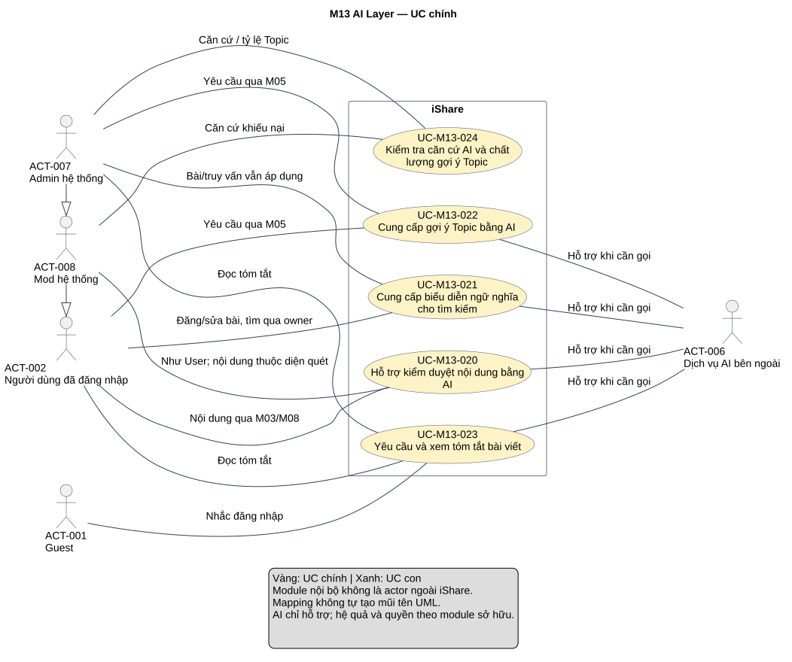
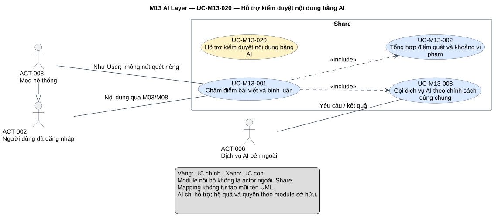
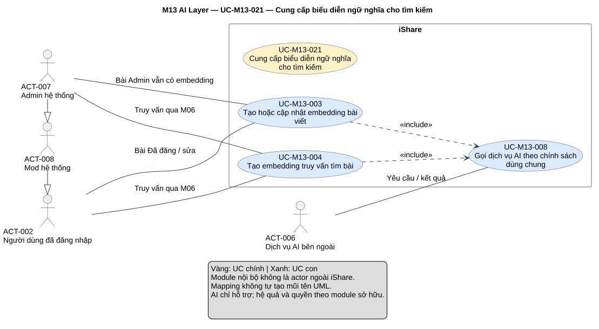
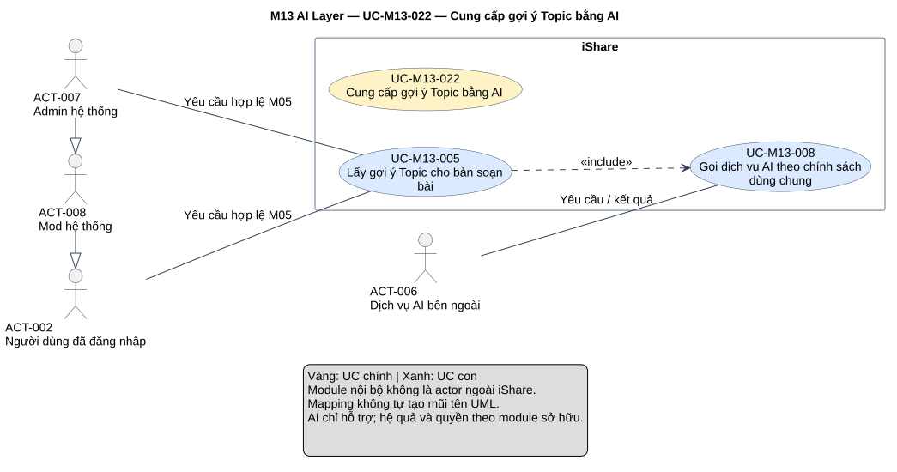
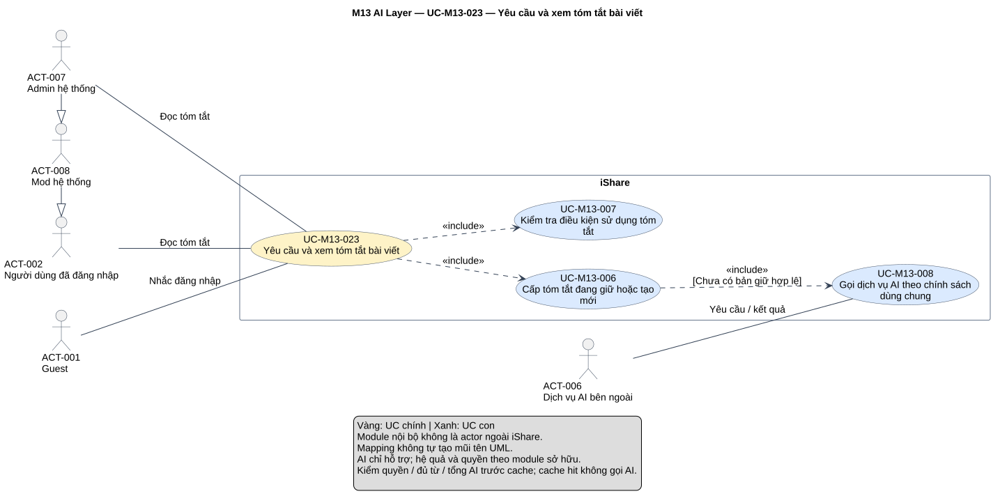
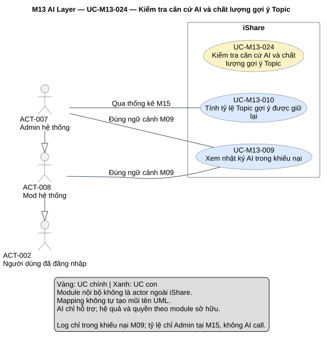

# Phân tích use case — M13 AI Layer

[Vietnamese Doc] — Theo skill use-case-analysis v2.2; tiếng Việt, giữ thuật ngữ cần thiết.

Đầu ra gồm **5 UC chính, 10 UC con**, 13 mapping, đặc tả, truy vết và 6 SVG: tổng quan module, một detail riêng cho từng core. Mô hình giữ subject toàn iShare, không đưa các module nội bộ thành actor; dịch vụ AI bên ngoài là actor hỗ trợ. Tác vụ embedding/log/vòng đời cache được đặc tả, không dựng actor Hệ thống.

## Metadata và tiến độ

<!-- uc:document -->
| key | value |
|---|---|
| document_id | US-M13 |
| skill_version | 2.2 |
| mode | module |
| modules | M13 |
| scope | ALL |
| status | Chờ duyệt |
| current_step | 7 |
| completed_steps | 1, 2, 3, 4, 5, 6, 7 |
| approved_steps | - |
| source_baseline | FR-M13 v1.3; FR-M01 v1.10; FR-M03 v1.10; FR-M04 v1.4; FR-M05 v1.7; FR-M06 v1.5; FR-M08 v1.7; FR-M09 v1.2; FR-M10 v1.4; FR-M11 v1.3; FR-M15 v1.1; FR-M16 v1.0 |
| author | Codex |
| date | 2026-11-02 |
| approval_evidence | Người dùng cho phép tự làm các bước cần thiết ở lượt M04, áp dụng chuỗi module hiện tại. Đây là quyền thực hiện liên tục, không phải phê duyệt US-M13 hoặc kết quả từng bước. |
| semantic_review | pass |
| diagram_check | pass |

| Bước | Kết quả | Xác nhận | Baseline | Làm lại khi |
|---|---|---|---|---|
| 1 | 10 nhóm, 85 FR chi tiết, 29 BR; không mã bỏ; boundary/actor/giao tiếp/TBD | Được làm liên tục; chưa duyệt | FR-M13 v1.3 | Nguồn đổi |
| 2 | 5 core, 10 sub, 13 mapping; giữ ACT-006 và actor staff hiện có | Chưa duyệt | FR-M13 v1.3 | Mục tiêu/phạm vi đổi |
| 3 | 11 hợp đồng chi tiết, 4 brief Summary; 4 AUT, 6 RULE | Chưa duyệt | FR-M13 v1.3 | Hành vi/quyền đổi |
| 4 | 8 include; rà core–sub/sub–sub, không ép extend/generalization UC | Chưa duyệt | Mô hình tại đây | Hợp đồng/điểm gọi đổi |
| 5 | 124 dòng truy vết, 114 tiêu chí chi tiết/BR; 11 FR liên quan | Chưa duyệt | FR-M13 v1.3; FR-M01 v1.10; FR-M03 v1.10; FR-M04 v1.4; FR-M05 v1.7; FR-M06 v1.5; FR-M08 v1.7; FR-M09 v1.2; FR-M10 v1.4; FR-M11 v1.3; FR-M15 v1.1; FR-M16 v1.0 | Baseline liên quan đổi |
| 6 | 6 view đã kiểm cú pháp/render/hình; đúng node/8 cạnh, mỗi view một SVG; tổng quan đã chỉnh bố cục dịch vụ AI | Chưa duyệt | PlantUML 1.2026.8 | Mô hình/nguồn đổi |
| 7 | Đã review nguồn/ngữ nghĩa/truy vết/UML/hình/liên kết, hồ sơ Chờ duyệt và giữ giới hạn nguồn/TBD ngân sách | Chưa duyệt | Skill v2.2 | Phản hồi/baseline đổi |

## 1. Phạm vi, nguồn và tổng hợp yêu cầu

**Mục đích sử dụng:** review ranh giới và hợp đồng tích hợp AI, đầu vào thiết kế/kiểm thử và ghép UC chính hệ thống. Mục 2 là phân rã, mục 3 đặc tả và tiêu chí, mục 4 quan hệ, mục 5 truy vết/giao tiếp, mục 6 sơ đồ, mục 7 QA/giới hạn nguồn.

**Subject:** toàn iShare. M13 cung cấp năng lực AI, M03/M05/M06/M08/M09/M10/M11/M15 là thành phần nội bộ của cùng subject; không actor module để tạo cảm giác có actor chính cho xử lý nền. ACT-006 là dịch vụ AI bên thứ ba ở ngoài iShare. Người dùng tương tác qua gửi/sửa bài, bình luận, tìm kiếm, gợi ý hoặc nút tóm tắt; staff xem log/đánh giá theo M09/M15. Các core Summary nêu giá trị người dùng của năng lực dùng chung, không đòi một màn hình hoặc nút gọi M13 riêng. Hoạt động theo sự kiện/thời gian được ghi bằng AUT.

**Trong phạm vi:** gọi AI có kiểm cờ/timeout/retry, chấm bốn nhóm vi phạm và trả kết quả, embedding bài/truy vấn/tạo bù, gợi ý Topic ở phía dịch vụ, tóm tắt theo yêu cầu/cache 24 giờ, ghi và xem log đúng ngữ cảnh, tỷ lệ Topic theo phản hồi và khoảng thống kê.

**Ngoài phạm vi:** cờ UI M10, chính sách M01, thời điểm/hệ quả quét bài M03 và bình luận/cảnh cáo M08, cổng nhóm M11, UI/chọn/danh mục/feedback Topic M05, tìm/ranking/full-text M06, xét khiếu nại M09, trang thống kê M15, thiết kế API/CSDL/provider/model/vector-index/prompt hoặc triển khai luồng AI thật trong tác vụ này. Không quét chat, gửi tài liệu cho AI, gợi ý Tag, AI ban/chỉnh điểm/trao badge/tự viết nội dung, chatbot/RAG phức tạp/multi-agent/train/fine-tune, Related Posts/feed AI, embedding bình luận, dashboard log ngoài khiếu nại hoặc số đo chất lượng kiểm duyệt.

**Baseline:** [FR-M13 — AI Layer](../fr/FR-M13.md) v1.3, Đã chốt 2026-10-24; mốc DEC-271, QA-477, ISS-415, OPEN-012. **124 mã hiệu lực = 10 nhóm + 85 FR chi tiết + 29 BR**, không mã FR/BR đã bỏ. TBD-M13-01/OPEN-001 ngân sách ở mức Thấp, hoãn có chủ đích; giữ trong mục 7, không tự xác nhận ngân sách/giá/provider/model. M14 không phụ thuộc M13 do không feed AI; M16 được đối chiếu để giữ giới hạn không AI chat.

<!-- uc:sources -->
| path | version | role |
|---|---|---|
| docs/specs/fr/FR-M13.md | 1.3 | owner |
| docs/specs/fr/FR-M01.md | 1.10 | related |
| docs/specs/fr/FR-M03.md | 1.10 | related |
| docs/specs/fr/FR-M04.md | 1.4 | related |
| docs/specs/fr/FR-M05.md | 1.7 | related |
| docs/specs/fr/FR-M06.md | 1.5 | related |
| docs/specs/fr/FR-M08.md | 1.7 | related |
| docs/specs/fr/FR-M09.md | 1.2 | related |
| docs/specs/fr/FR-M10.md | 1.4 | related |
| docs/specs/fr/FR-M11.md | 1.3 | related |
| docs/specs/fr/FR-M15.md | 1.1 | related |
| docs/specs/fr/FR-M16.md | 1.0 | related |

Phương pháp: [skill](../../../.agent-instructions/skills/use-case-analysis/SKILL.md), [modeling rules](../../../.agent-instructions/skills/use-case-analysis/references/modeling-rules.md), [diagram rules](../../../.agent-instructions/skills/use-case-analysis/references/diagram-rules.md). Không lấy ví dụ hoặc US trước làm nguồn tính năng. Đối chiếu [US-M05](US-M05.md), [US-M06](US-M06.md), [US-M08](US-M08.md), [US-M09](US-M09.md), [US-M10](US-M10.md), [US-M11](US-M11.md) để giữ actor/owner và tránh tạo lại mục tiêu frontend của module khác; nguồn yêu cầu vẫn FR đã chốt.

### Actor và điều kiện quyền

<!-- uc:actors -->
| id | name | kind | parent | boundary_reason | sources |
|---|---|---|---|---|---|
| ACT-001 | Guest | human | - | Thấy nút tóm tắt khi đủ từ nhưng được nhắc đăng nhập khi bấm; không tóm tắt/embedding truy vấn. | FR-M13-07.02, FR-M13-07.03, FR-M13-04.04 |
| ACT-002 | Người dùng đã đăng nhập | human | - | Tương tác qua gửi/sửa nội dung M03, tìm M06, gợi ý M05 hoặc nút tóm tắt; không trực tiếp gọi chức năng nội bộ M13. | FR-M13-02.01, FR-M13-04.01, FR-M13-05.01, FR-M13-07.01 |
| ACT-008 | Mod hệ thống | human | ACT-002 | Có hành vi người dùng và xem log trong khiếu nại đúng quyền M09, không dashboard log chung. | FR-M13-09.01, FR-M13-09.04, BR-M09-12 |
| ACT-007 | Admin hệ thống | human | ACT-008 | Thêm xem tỷ lệ Topic trong M15; nội dung Admin miễn quét nhưng vẫn embedding/gợi ý/tóm tắt đúng điều kiện. | FR-M13-02.11, FR-M13-03.01, FR-M13-10.04, FR-M13-07.01 |
| ACT-006 | Dịch vụ AI bên ngoài | external-system | - | Nhà cung cấp nhận nội dung và trả điểm/vector/Topic/tóm tắt; actor hỗ trợ, không là iShare hoặc module M13. | FR-M13-01.01, BR-M13-03 |

ACT-007 → ACT-008 → ACT-002 là năng lực vai trò kế thừa; điều kiện dữ liệu/miễn quét vẫn áp, không suy Admin phải bị chấm bài do kế thừa User. Miễn quét kiểm duyệt không miễn embedding/Topic/tóm tắt. Guest chỉ tham gia nhánh bấm tóm tắt rồi được nhắc đăng nhập; không được trả cache hoặc vector truy vấn. Tác giả, chủ bài, thành viên Private, mức cảnh cáo, trạng thái tài khoản là ngữ cảnh/quyền do owner, không actor mới. Actor hỗ trợ ACT-006 không quyết hệ quả bài/cảnh cáo/ban hoặc đánh giá chất lượng Topic; hai việc đọc log/tính tỷ lệ không cần gọi AI.

### Kiểm kê và tổng hợp

| Nhóm FR | Tổng hợp | Số chi tiết | Biểu diễn | Owner |
|---|---|---|---|---|
| FR-M13-01 | Công tắc tổng/ba riêng, timeout5/10 giây, một retry sau 2 giây, tắt khác lỗi, không rate-limit riêng/năng lực cấm. | 12 | [UC-M13-008](#uc-m13-008) | M13 |
| FR-M13-02 | Payload đúng, bốn nhóm, max/tie-break, ba khoảng chung0.9/0.5, miễn Admin/chat, chỉ trả owner quyết. | 15 | [UC-M13-001](#uc-m13-001), [UC-M13-002](#uc-m13-002) | M13 |
| FR-M13-03 | Mốc Đã đăng/mọi đổi title-body, một vector/bài, không metadata-only/draft/comment, hàng tạo bù. | 10 | [UC-M13-003](#uc-m13-003) | M13 |
| FR-M13-04 | Chỉ truy vấn người đăng nhập qua M06, Search/tổng, tắt/lỗi full-text riêng truy vấn, không log. | 4 | [UC-M13-004](#uc-m13-004) | M13 |
| FR-M13-05 | M05 chuyển hợp lệ, gửi title-body, trả Topic cho đối chiếu, không Tag hoặc tự gán. | 5 | [UC-M13-005](#uc-m13-005) | M13 |
| FR-M13-06 | Tóm tắt theo yêu cầu/cache 24 giờ dùng chung; invalidate, timeout/retry, không tự tạo/bù/bình luận. | 11 | [UC-M13-006](#uc-m13-006), [UC-M13-008](#uc-m13-008) | M13 |
| FR-M13-07 | User đọc bài được phép/≥300 từ, Guest nhắc login, tổng tắt vẫn nút nhưng báo bận, bài đầy đủ luôn đọc. | 8 | [UC-M13-023](#uc-m13-023), [UC-M13-007](#uc-m13-007) | M13 |
| FR-M13-08 | Một log/call sau retry, ba loại có log, một log/comment; bất biến/vĩnh viễn/username DELETED. | 9 | [AUT003](#aut-m13-003) | M13 |
| FR-M13-09 | Chỉ staff trong khiếu nại bài AI tự từ chối, không tra cứu khác, không snapshot nội dung. | 4 | [UC-M13-009](#uc-m13-009) | M13 |
| FR-M13-10 | Tỷ lệ tổng từ feedback M05 theo ngày lịch M15, no-data khác0%, không đo kiểm duyệt/train/correctness labels. | 7 | [UC-M13-010](#uc-m13-010) | M13 |

## 2. UC chính và UC con

### 2.1 Danh mục hai tầng

<!-- uc:catalog -->
| id | name | tier | level | primary | supporting | owner | anchor | sources |
|---|---|---|---|---|---|---|---|---|
| UC-M13-020 | Hỗ trợ kiểm duyệt nội dung bằng AI | core | Summary | ACT-002, ACT-008 | ACT-006 | M13 | #uc-m13-020 | FR-M13-01, FR-M13-02, BR-M13-01, BR-M13-11, BR-M13-12, BR-M13-13, BR-M13-15, BR-M13-16, BR-M13-25 |
| UC-M13-021 | Cung cấp biểu diễn ngữ nghĩa cho tìm kiếm | core | Summary | ACT-002, ACT-007 | ACT-006 | M13 | #uc-m13-021 | FR-M13-03, FR-M13-04, BR-M13-17, BR-M13-18, BR-M13-26 |
| UC-M13-022 | Cung cấp gợi ý Topic bằng AI | core | Summary | ACT-002, ACT-007 | ACT-006 | M13 | #uc-m13-022 | FR-M13-05, BR-M13-05, BR-M13-19, BR-M13-23 |
| UC-M13-023 | Yêu cầu và xem tóm tắt bài viết | core | User goal | ACT-002, ACT-007 | ACT-006 | M13 | #uc-m13-023 | FR-M13-06, FR-M13-07, BR-M13-06, BR-M13-19, BR-M13-20, BR-M13-27, BR-M13-28 |
| UC-M13-024 | Kiểm tra căn cứ AI và chất lượng gợi ý Topic | core | Summary | ACT-008, ACT-007 | - | M13 | #uc-m13-024 | FR-M13-08, FR-M13-09, FR-M13-10, BR-M13-21, BR-M13-22, BR-M13-23, BR-M13-24, BR-M13-29 |
| UC-M13-001 | Chấm điểm bài viết và bình luận | sub | Subfunction | ACT-002, ACT-008 | ACT-006 | M13 | #uc-m13-001 | FR-M13-02, BR-M13-11, BR-M13-15, BR-M13-16, BR-M13-25 |
| UC-M13-002 | Tổng hợp điểm quét và khoảng vi phạm | sub | Subfunction | ACT-002, ACT-008 | - | M13 | #uc-m13-002 | FR-M13-02.04, FR-M13-02.05, FR-M13-02.06, FR-M13-02.07, FR-M13-02.08, FR-M13-02.09, FR-M13-02.10, FR-M13-02.14, BR-M13-01, BR-M13-11, BR-M13-12, BR-M13-13, BR-M13-14, BR-M13-15 |
| UC-M13-003 | Tạo hoặc cập nhật embedding bài viết | sub | Subfunction | ACT-002, ACT-007 | ACT-006 | M13 | #uc-m13-003 | FR-M13-03, BR-M13-17, BR-M13-18, BR-M13-26 |
| UC-M13-004 | Tạo embedding truy vấn tìm bài | sub | Subfunction | ACT-002, ACT-007 | ACT-006 | M13 | #uc-m13-004 | FR-M13-04, BR-M13-06, BR-M13-07, BR-M13-10, BR-M13-19, FR-M06-02.03, FR-M06-02.05 |
| UC-M13-005 | Lấy gợi ý Topic cho bản soạn bài | sub | Subfunction | ACT-002, ACT-007 | ACT-006 | M13 | #uc-m13-005 | FR-M13-05, BR-M13-19, BR-M13-23, FR-M05-02.01, FR-M05-02.05, FR-M05-02.15 |
| UC-M13-006 | Cấp tóm tắt đang giữ hoặc tạo mới | sub | Subfunction | ACT-002, ACT-007 | ACT-006 | M13 | #uc-m13-006 | FR-M13-06, BR-M13-19, BR-M13-20, BR-M13-26, BR-M13-27, BR-M13-28 |
| UC-M13-007 | Kiểm tra điều kiện sử dụng tóm tắt | sub | Subfunction | ACT-002, ACT-007 | - | M13 | #uc-m13-007 | FR-M13-07, BR-M13-06, BR-M13-19, BR-M13-20, BR-M13-27 |
| UC-M13-008 | Gọi dịch vụ AI theo chính sách dùng chung | sub | Subfunction | ACT-002, ACT-008, ACT-007 | ACT-006 | M13 | #uc-m13-008 | FR-M13-01, FR-M13-06.06, BR-M13-03, BR-M13-05, BR-M13-06, BR-M13-07, BR-M13-08, BR-M13-09, BR-M13-10, BR-M13-19 |
| UC-M13-009 | Xem nhật ký AI trong khiếu nại | sub | User goal | ACT-008, ACT-007 | - | M13 | #uc-m13-009 | FR-M13-09, BR-M13-21, BR-M13-22, FR-M09-06.05, BR-M09-12 |
| UC-M13-010 | Tính tỷ lệ Topic gợi ý được giữ lại | sub | Subfunction | ACT-007 | - | M13 | #uc-m13-010 | FR-M13-10, BR-M13-23, BR-M13-24, BR-M13-29, BR-M15-01, BR-M15-04, BR-M15-05, FR-M15-02.09 |

Tier độc lập level. Core023 là User goal có mục tiêu xem tóm tắt M13 sở hữu; bốn core Summary bao quát giá trị tích hợp có ranh giới rõ. Không tạo lại UC tìm kiếm M06, gợi ý/chọn Topic M05, xét khiếu nại M09 hoặc trang thống kê M15. Sub009 là User goal, các sub khác là Subfunction cần đặc tả. Không UC abstract hoặc generalization UC; không quota buộc dùng đủ loại quan hệ.

### 2.2 Phân rã core → sub

<!-- uc:decomposition -->
| core | sub | rationale | sources |
|---|---|---|---|
| UC-M13-020 | UC-M13-001 | Chuyển đúng dữ liệu và một lần chấm phục vụ owner. | FR-M13-02, BR-M13-11, BR-M13-15, BR-M13-16, BR-M13-25 |
| UC-M13-020 | UC-M13-002 | Tổng hợp raw bốn điểm thành kết quả nhất quán. | FR-M13-02.04, FR-M13-02.05, FR-M13-02.06, FR-M13-02.07, FR-M13-02.08, FR-M13-02.09, FR-M13-02.10, FR-M13-02.14, BR-M13-01, BR-M13-11, BR-M13-12, BR-M13-13, BR-M13-14, BR-M13-15 |
| UC-M13-020 | UC-M13-008 | Dùng chung chính sách dịch vụ, cờ, timeout/retry. | FR-M13-01, FR-M13-06.06, BR-M13-03, BR-M13-05, BR-M13-06, BR-M13-07, BR-M13-08, BR-M13-09, BR-M13-10, BR-M13-19 |
| UC-M13-021 | UC-M13-003 | Giữ biểu diễn bài Đã đăng theo nội dung hiện tại. | FR-M13-03, BR-M13-17, BR-M13-18, BR-M13-26 |
| UC-M13-021 | UC-M13-004 | Cung cấp vector truy vấn cho M06, không cho Guest. | FR-M13-04, BR-M13-06, BR-M13-07, BR-M13-10, BR-M13-19, FR-M06-02.03, FR-M06-02.05 |
| UC-M13-021 | UC-M13-008 | Dùng chung chính sách dịch vụ, cờ, timeout/retry. | FR-M13-01, FR-M13-06.06, BR-M13-03, BR-M13-05, BR-M13-06, BR-M13-07, BR-M13-08, BR-M13-09, BR-M13-10, BR-M13-19 |
| UC-M13-022 | UC-M13-005 | Lấy đầu ra Topic cho yêu cầu hợp lệ M05. | FR-M13-05, BR-M13-19, BR-M13-23, FR-M05-02.01, FR-M05-02.05, FR-M05-02.15 |
| UC-M13-022 | UC-M13-008 | Dùng chung chính sách dịch vụ, cờ, timeout/retry. | FR-M13-01, FR-M13-06.06, BR-M13-03, BR-M13-05, BR-M13-06, BR-M13-07, BR-M13-08, BR-M13-09, BR-M13-10, BR-M13-19 |
| UC-M13-023 | UC-M13-006 | Dùng kết quả giữ hoặc tạo tóm tắt theo yêu cầu. | FR-M13-06, BR-M13-19, BR-M13-20, BR-M13-26, BR-M13-27, BR-M13-28 |
| UC-M13-023 | UC-M13-007 | Kiểm quyền/từ/công tắc trước cache và gọi mới. | FR-M13-07, BR-M13-06, BR-M13-19, BR-M13-20, BR-M13-27 |
| UC-M13-023 | UC-M13-008 | Dùng chung chính sách dịch vụ, cờ, timeout/retry. | FR-M13-01, FR-M13-06.06, BR-M13-03, BR-M13-05, BR-M13-06, BR-M13-07, BR-M13-08, BR-M13-09, BR-M13-10, BR-M13-19 |
| UC-M13-024 | UC-M13-009 | Cung cấp căn cứ log đúng khiếu nại M09. | FR-M13-09, BR-M13-21, BR-M13-22, FR-M09-06.05, BR-M09-12 |
| UC-M13-024 | UC-M13-010 | Đánh giá Topic bằng dữ liệu M05 cho M15, không AI call. | FR-M13-10, BR-M13-23, BR-M13-24, BR-M13-29, BR-M15-01, BR-M15-04, BR-M15-05, FR-M15-02.09 |

13 mapping; mọi core có sub và không sub mồ côi. UC008 có một ID và một đặc tả, dùng ở bốn core có lời gọi AI; không nhân bản theo loại lời gọi hoặc cha. Core024 không map UC008 vì đọc log và tính tỷ lệ chỉ xử lý dữ liệu đã có. Mapping không tự tạo UML.

### 2.3 Tổng hợp hệ thống và quyết định phân tích

<!-- uc:module-models -->
| module | path | baseline |
|---|---|---|

Mode module, chỉ M13; không tạo danh mục core khác thay các US module hoặc nhận đã đặc tả cả hệ thống.

| Quyết định | Hành vi | Biểu diễn | Lý do | Phương án không chọn |
|---|---|---|---|---|
| D-M13-01 | Boundary lớp dùng chung | Toàn iShare; người dùng/staff và AI ngoài | Tương tác người dùng đi qua owner, thành phần nội bộ không thành actor ngoài hệ thống. | Không vẽ M03/M05/M06 như actor ngoài iShare hoặc actor Hệ thống. |
| D-M13-02 | Timeout/cờ/retry | UC008 dùng chung | Có hợp đồng/điểm chèn/đầu ra khác biệt tắt-lỗi; mọi loại gọi dùng lại. | Không mỗi công tắc/lần thử một UC và không tự chuyển lỗi thành tắt toàn bộ. |
| D-M13-03 | Chấm và phân khoảng | UC001 include UC002/008 | Chuẩn bị payload, gọi thật và xử lý bốn điểm là trách nhiệm gắn kết; một kết quả cho hai nhánh owner. | Không M13 tự ra chế tài hoặc gọi AI hai lần vì cổng/cảnh cáo. |
| D-M13-04 | Embedding | UC003/004 và AUT001/002 | Bài và truy vấn khác trigger/state/log/fallback; tạo bù là hành vi sự kiện đủ đặc tả. | Không tạo lúc bấm gửi trước Đã đăng hoặc có vector bình luận. |
| D-M13-05 | Cache tóm tắt | Core023→UC007 trước UC006; UC006→UC008 chỉ cache miss | Guest/quyền/AI tổng phải kiểm trước cache; hit không AI call, miss gọi thật. | Không extend chỉ vì nhánh có điều kiện; không cache bypass tổng Tắt. |
| D-M13-06 | Ghi và đọc AI log | AUT003 ghi, UC009 đọc trong M09 | Một log sau retry, scope ba loại; giữ quyền đọc đúng ngữ cảnh. | Không log per-attempt hoặc Admin log dashboard ngoài khiếu nại. |
| D-M13-07 | Chất lượng Topic | UC010 đọc feedback M05 cho M15 | Tổng tử/mẫu, thời điểm ghi; không AI call/nhãn huấn luyện. | Không dùng raw AI log thay phản hồi, không trung bình phần trăm mỗi lượt hoặc chỉ số kiểm duyệt. |
| D-M13-08 | Vòng đời/nguồn thiếu | 4 AUT, 6 RULE và note nguồn | Giữ trigger/trước-sau/dữ liệu, không chọn hạ tầng hoặc bù hành vi chưa chốt. | Không cron/rate-limit AI riêng, mua dịch vụ hoặc chốt TBD ngân sách. |

## 3. Đặc tả

### 3.1 UC chính Summary

#### UC-M13-020 — Hỗ trợ kiểm duyệt nội dung bằng AI

**Actor chính:** ACT-002, ACT-008. **Hỗ trợ:** ACT-006. **Mục tiêu/giá trị:** Đưa nội dung được các module gửi tới qua chấm điểm nhất quán để con người/cổng nội dung có căn cứ xử lý.

**Kích hoạt/ranh giới:** Nội dung người dùng gửi/sửa/hiện lại qua M03 hoặc luồng bình luận được M08 chọn quét. Quyền thao tác nội dung và thời điểm chọn quét do M03/M08; không có nút quét độc lập hoặc AI tự xử lý ngoài các owner.

**Quy trình tổng quát:** UC001 chuẩn bị đúng nội dung, dùng UC008 gọi nhà cung cấp rồi chèn UC002 tổng hợp bốn điểm. Bài gửi/sửa và bình luận là ngữ cảnh do M03/M08 chọn, không để M13 tự quét mọi nội dung hoặc tạo một actor module. M03/M08/M11 quyết đăng/chờ/ẩn/cảnh cáo; M13 không tự ban hay điều chỉnh điểm. AUT003 ghi log đúng mỗi lời gọi liên quan.

**Kết quả:** Trả điểm cao nhất, nhóm vi phạm, khoảng điểm hoặc AI tắt/lỗi; một lần chấm phục vụ cả cổng và cảnh cáo. **Khi không đạt:** Admin/chat/tài liệu ngoài phạm vi không bị quét; lỗi chỉ tác động lời gọi, không tự đổi cờ/ra chế tài.

**UC con:** [UC-M13-001](#uc-m13-001), [UC-M13-002](#uc-m13-002), [UC-M13-008](#uc-m13-008). **Nguồn:** FR-M13-01, FR-M13-02, BR-M13-01, BR-M13-11, BR-M13-12, BR-M13-13, BR-M13-15, BR-M13-16, BR-M13-25.

#### UC-M13-021 — Cung cấp biểu diễn ngữ nghĩa cho tìm kiếm

**Actor chính:** ACT-002, ACT-007. **Hỗ trợ:** ACT-006. **Mục tiêu/giá trị:** Giữ embedding bài theo nội dung hiện tại và tạo embedding truy vấn để M06 tìm bài theo nghĩa.

**Kích hoạt/ranh giới:** Bài Đã đăng/đổi tiêu đề-nội dung qua M03/M11 hoặc người đã đăng nhập tìm bài qua M06. Quyền đăng/sửa/tìm và lọc nội dung thuộc owner; M13 không thay luồng tìm kiếm hay cho Guest tìm ngữ nghĩa.

**Quy trình tổng quát:** UC003 tạo/thay embedding bài khi AUT001/AUT002 kích hoạt; UC004 tạo embedding truy vấn từ M06. Cả hai dùng UC008 với nhóm Search. Tạo bù chỉ bài Đã đăng và theo nội dung hiện tại; không tạo embedding bình luận hoặc dùng chu kỳ tóm tắt để bù. Đây là năng lực hỗ trợ tìm kiếm, không tạo UC Tìm bài thay UC M06. Admin được miễn quét kiểm duyệt nhưng bài Admin vẫn tạo embedding khi Search/tổng cho phép.

**Kết quả:** Embedding bài một bản mỗi bài, truy vấn có kết quả khi AI cho phép; thiếu bài được tạo bù đúng điều kiện. **Khi không đạt:** Tắt/lỗi truy vấn trả M06 dùng full-text riêng yêu cầu; tắt/lỗi bài đưa hàng tạo bù, không làm ẩn bài.

**UC con:** [UC-M13-003](#uc-m13-003), [UC-M13-004](#uc-m13-004), [UC-M13-008](#uc-m13-008). **Nguồn:** FR-M13-03, FR-M13-04, BR-M13-17, BR-M13-18, BR-M13-26.

#### UC-M13-022 — Cung cấp gợi ý Topic bằng AI

**Actor chính:** ACT-002, ACT-007. **Hỗ trợ:** ACT-006. **Mục tiêu/giá trị:** Tác giả nhận đầu ra gợi ý Topic qua M05, có thể tự chọn khi AI tắt/lỗi.

**Kích hoạt/ranh giới:** Tác giả yêu cầu gợi ý hợp lệ tại M05. M05 kiểm ngưỡng 20 từ/tần suất10 lần/60 giây và quản lý UI/danh mục/độ cũ của gợi ý; M13 chỉ thực hiện lời gọi.

**Quy trình tổng quát:** UC005 nhận ngữ cảnh đã qua điều kiện M05, chèn UC008 để lấy gợi ý và trả đầu ra cho M05 đối chiếu danh mục/hiển thị. Phản hồi gợi ý chỉ do M05 ghi ở lúc gửi/lưu khi chưa lỗi thời; M13 không gửi phản hồi ngược nhà cung cấp. Log qua AUT003 và tỷ lệ qua UC010, không tạo lại UC gợi ý phía người dùng của M05.

**Kết quả:** Đầu ra Topic thật từ dịch vụ được trả M05, hoặc tắt/thất bại để M05 giữ luồng chọn tay. **Khi không đạt:** Không tự gán Topic, không gợi ý Tag hoặc gửi tệp đính kèm; không thêm giới hạn AI riêng.

**UC con:** [UC-M13-005](#uc-m13-005), [UC-M13-008](#uc-m13-008). **Nguồn:** FR-M13-05, BR-M13-05, BR-M13-19, BR-M13-23.

#### UC-M13-024 — Kiểm tra căn cứ AI và chất lượng gợi ý Topic

**Actor chính:** ACT-008, ACT-007. **Hỗ trợ:** -. **Mục tiêu/giá trị:** Staff dùng căn cứ AI đúng phạm vi khiếu nại; Admin đánh giá mức gợi ý Topic được giữ lại bằng dữ liệu đã ghi.

**Kích hoạt/ranh giới:** Xét khiếu nại bài bị AI tự từ chối ở M09, hoặc Admin xem/đổi khoảng thống kê M15. Quyền/giới hạn ngữ cảnh do M09/M15 cộng với M13; không có trang tra cứu log độc lập.

**Quy trình tổng quát:** UC009 xem log bài trong khiếu nại hợp lệ, kể cả tác giả đã xóa qua username. UC010 tính tỷ lệ Topic từ phản hồi M05 theo khoảng của M15, không gọi AI và vẫn tính khi cờ AI tắt. Hai mục tiêu độc lập, không include xem log vào tính tỷ lệ. AUT003 tạo log chỉ cho ba loại lời gọi đã chốt, không tóm tắt/embedding truy vấn; không có dashboard log chung hay giao diện gán nhãn dự đoán.

**Kết quả:** Log đúng bài/ngữ cảnh hoặc tỷ lệ theo phản hồi và thời gian, không dữ liệu thì không tỷ lệ. **Khi không đạt:** Guest/User không xem log; Mod không xem thống kê; không đánh dấu AI đúng/sai hoặc đo kiểm duyệt.

**UC con:** [UC-M13-009](#uc-m13-009), [UC-M13-010](#uc-m13-010). **Nguồn:** FR-M13-08, FR-M13-09, FR-M13-10, BR-M13-21, BR-M13-22, BR-M13-23, BR-M13-24, BR-M13-29.

### 3.2 Core User goal và các UC con

Subfunction nhận ngữ cảnh caller, không phải nút/endpoint công khai để bỏ kiểm quyền. Actor chính ở năng lực tích hợp là người tương tác với iShare qua owner hoặc tiếp nhận kết quả; các trigger nội bộ không biến module/clock thành actor. Cột nguồn của luồng giữ bằng chứng chức năng, không tự bổ sung cơ chế triển khai.

#### UC-M13-023 — Yêu cầu và xem tóm tắt bài viết

**UC con:** [UC-M13-006](#uc-m13-006), [UC-M13-007](#uc-m13-007), [UC-M13-008](#uc-m13-008).

<!-- uc:spec UC-M13-023 -->
| key | value |
|---|---|
| goal | Người đã đăng nhập đọc nhanh bài đủ dài mà họ có quyền xem, vẫn đọc đầy đủ bài trong mọi nhánh. |
| subject | iShare |
| level | User goal |
| primary | ACT-002, ACT-007 |
| supporting | ACT-006 |
| trigger | Người dùng bấm Tóm tắt trên bài có tiêu đề+nội dung chữ từ 300 từ. |
| preconditions | Có bài và định danh/ngữ cảnh xem; điều kiện đăng nhập, từ, quyền xem, công tắc được kiểm trong luồng, không giả định đã qua. |
| success | Tóm tắt hợp lệ đang giữ hoặc mới tạo được hiển thị với ghi chú về tệp đính kèm; bài đầy đủ vẫn đọc được. |
| failure | Guest được nhắc đăng nhập; thiếu quyền/không đủ300không tóm tắt; AI tắt/lỗi báo bận mà bài không bị chặn. |
| abstract | false |
| common_contract | Không áp dụng: không dùng generalization UC. |

**Luồng chính:**

| Bước | Ai | Hành động/phản hồi | Tiếp tục | Nguồn |
|---|---|---|---|---|
| 1 | ACT-002 / ACT-007 | Bấm Tóm tắt; nút chỉ hiện khi tiêu đề+nội dung chữ từ 300 từ, kể cả khi AI tổng đang tắt. | [Bước 2](#uc-m13-023-main-2) | FR-M13-06, FR-M13-07, BR-M13-06, BR-M13-19, BR-M13-20, BR-M13-27, BR-M13-28 |
| 2 | iShare | Chèn UC-M13-007 kiểm đăng nhập, quyền xem bài, số từ và AI tổng trước lấy bất kỳ kết quả đang giữ nào. | [Bước 3](#uc-m13-023-main-3) | FR-M13-06, FR-M13-07, BR-M13-06, BR-M13-19, BR-M13-20, BR-M13-27, BR-M13-28 |
| 3 | iShare | Chèn UC-M13-006 lấy tóm tắt đang giữ hoặc tạo mới nếu chưa có; khi cần gọi nhà cung cấp, UC006 chèn UC008. | [Bước 4](#uc-m13-023-main-4) | FR-M13-06, FR-M13-07, BR-M13-06, BR-M13-19, BR-M13-20, BR-M13-27, BR-M13-28 |
| 4 | iShare | Hiển thị tóm tắt kèm Tóm tắt chưa bao gồm nội dung tệp đính kèm. Giữ bài đầy đủ hiển thị khi chưa yêu cầu, đang đợi hoặc có kết quả. | END: đạt kết quả đường chính của hợp đồng. | FR-M13-06, FR-M13-07, BR-M13-06, BR-M13-19, BR-M13-20, BR-M13-27, BR-M13-28 |

**Luồng thay thế/ngoại lệ:**

| ID nhánh | Bước rẽ | Điều kiện | Xử lý | Quay lại/kết thúc | Nguồn |
|---|---|---|---|---|---|
| A1 | [Bước 2](#uc-m13-023-main-2) | Guest bấm nút. | UC007 không tạo/trả tóm tắt và nhắc đăng nhập; không include một lần Đăng nhập vào UC này. | END: chưa sử dụng tóm tắt. | FR-M13-07.03 |
| A2 | [Bước 2](#uc-m13-023-main-2) | Không đủ từ/không xem được bài. | UC007 không cho dùng; nút không hiện khi dưới300 từ. Không tự chọn thông báo lỗi quyền ngoài nguồn. | END: không cung cấp tóm tắt. | FR-M13-07.01, FR-M13-07.02, BR-M13-20 |
| A3 | [Bước 2](#uc-m13-023-main-2) | AI tổng Tắt, dù còn kết quả đang giữ. | Báo hệ thống đang bận ngay, không gọi AI và không trả kết quả giữ thay nhánh tắt; không tự xóa kết quả chỉ vì tắt cờ. | END: đọc bài đầy đủ như thường. | FR-M13-07.06, FR-M13-07.07, FR-M13-07.08, BR-M13-06 |
| A4 | [Bước 3](#uc-m13-023-main-3) | Lời gọi tóm tắt thất bại sau hai lần thử. | Không giữ kết quả, hiện hệ thống đang bận, vui lòng thử lại sau; bài đầy đủ vẫn đọc được. | END: chưa có tóm tắt. | FR-M13-06.07, FR-M13-07.05, FR-M13-07.08 |

**Quy tắc:** FR-M13-06, FR-M13-07, BR-M13-06, BR-M13-19, BR-M13-20, BR-M13-27, BR-M13-28. Theo phạm vi xem [lời gọi/ràng buộc chung](#rule-m13-001), [chấm điểm](#rule-m13-002), [embedding](#rule-m13-003), [tóm tắt](#rule-m13-004), [log](#rule-m13-005), [tỷ lệ Topic](#rule-m13-006). Không tự bù yêu cầu ở các note mục 7.

**Tiêu chí nguồn phải bảo toàn:** đối chiếu nguyên nghĩa với luồng/quy tắc, không thay đặc tả bằng danh sách mã.

| Mã | Nội dung đối chiếu |
|---|---|
| FR-M13-07.01 | Ở nơi công tắc AI tổng bật, khi một người dùng đã đăng nhập bấm "Tóm tắt" trên một bài viết mà họ xem được, hệ thống phải hiển thị tóm tắt của bài lấy từ FR-M13-06 (BR-M13-20). |
| FR-M13-07.04 | Khi hiển thị tóm tắt, hệ thống phải hiển thị kèm ghi chú "Tóm tắt chưa bao gồm nội dung tệp đính kèm" (BR-M13-28). |
| FR-M13-07.05 | Nếu lời gọi tóm tắt thất bại, hệ thống phải hiển thị thông báo hệ thống đang bận, vui lòng thử lại sau, và vẫn cho đọc bài bình thường (BR-M13-10). |
| FR-M13-07.08 | Hệ thống phải hiển thị bài viết đầy đủ dù tóm tắt chưa được yêu cầu, đang chờ AI hay thất bại. |

#### UC-M13-001 — Chấm điểm bài viết và bình luận

**Thuộc core:** [UC-M13-020](#uc-m13-020). Chuyển đúng dữ liệu và một lần chấm phục vụ owner.

<!-- uc:spec UC-M13-001 -->
| key | value |
|---|---|
| goal | Chuyển đúng phần nội dung tới AI và trả một kết quả chấm dùng cho cổng nội dung lẫn cảnh cáo. |
| subject | iShare |
| level | Subfunction |
| primary | ACT-002, ACT-008 |
| supporting | ACT-006 |
| trigger | M03 gửi bài mới/sửa/bài tự ẩn đã sửa được hiện lại, hoặc M08 chuyển bình luận cần quét. |
| preconditions | Có nội dung, loại, tác giả và ngữ cảnh do owner cung cấp; M13 không tự đặt ngưỡng tốc độ hoặc quét bù kiểm duyệt. |
| success | Trả điểm quét/nhóm/khoảng cho từng nội dung hợp lệ; không ra hệ quả hoặc gọi hai lần riêng cổng/cảnh cáo. |
| failure | Admin/chat/tài liệu không được gửi quét; tắt/lỗi trả owner, không tự coi sạch hay tự đăng. |
| abstract | false |
| common_contract | Không áp dụng: không dùng generalization UC. |

**Luồng chính:**

| Bước | Ai | Hành động/phản hồi | Tiếp tục | Nguồn |
|---|---|---|---|---|
| 1 | iShare | Nhận bài từ M03 hoặc các bình luận do M08 chọn quét trong luồng. | [Bước 2](#uc-m13-001-main-2) | FR-M13-02, BR-M13-11, BR-M13-15, BR-M13-16, BR-M13-25 |
| 2 | iShare | Loại nội dung Admin và tin nhắn chat. Với bài, chuẩn bị tiêu đề, nội dung chữ, câu hỏi/lựa chọn poll và ảnh; không gửi PDF/DOCX/XLSX/PPTX. Với bình luận, chỉ nội dung chữ từng bình luận. | [Bước 3](#uc-m13-001-main-3) | FR-M13-02, BR-M13-11, BR-M13-15, BR-M13-16, BR-M13-25 |
| 3 | iShare / ACT-006 | Với mỗi nội dung cần chấm, chèn UC-M13-008 loại Moderation (mỗi lần thử5 giây); có một lời gọi riêng cho từng bình luận, không một log chung cho cả luồng. | [Bước 4](#uc-m13-001-main-4) | FR-M13-02, BR-M13-11, BR-M13-15, BR-M13-16, BR-M13-25 |
| 4 | iShare | Nếu có đầu ra hợp lệ, chèn UC-M13-002 tổng hợp bốn điểm thành điểm quét/nhóm/khoảng. | [Bước 5](#uc-m13-001-main-5) | FR-M13-02, BR-M13-11, BR-M13-15, BR-M13-16, BR-M13-25 |
| 5 | iShare | Trả kết quả cho M03/M08/M11 và các thành phần nhận để quyết cổng nội dung/cảnh cáo. Một kết quả dùng cả hai nhánh, không gọi AI lần nữa chỉ để ra cảnh cáo; AUT003 ghi đúng log theo lời gọi. | END: đạt kết quả đường chính của hợp đồng. | FR-M13-02, BR-M13-11, BR-M13-15, BR-M13-16, BR-M13-25 |

**Luồng thay thế/ngoại lệ:**

| ID nhánh | Bước rẽ | Điều kiện | Xử lý | Quay lại/kết thúc | Nguồn |
|---|---|---|---|---|---|
| A1 | [Bước 2](#uc-m13-001-main-2) | Nội dung của Admin hoặc tin nhắn chat. | Không chấm, không chế tạo điểm 0 hoặc log chấm thành công thay cho việc miễn quét; owner áp ngoại lệ của mình. | END: không có quét loại này. | FR-M13-02.11, FR-M13-02.12, BR-M13-16, FR-M16-05.09 |
| A2 | [Bước 3](#uc-m13-001-main-3) | Tổng/Moderation tắt. | UC008 không gọi AI, báo AI tắt để owner dùng luồng chủ đích. | END: trả AI tắt. | FR-M13-02.13, BR-M13-06 |
| A3 | [Bước 3](#uc-m13-001-main-3) | Hai lần thử đều lỗi. | Báo thất bại đúng nội dung cho M03/M08; giữ nguyên trạng thái bình luận theo M08, bài gửi/sửa/nhóm xử lý theo owner. AUT003 ghi thất bại từng bình luận khi có lời gọi. | END: thất bại có chủ thể, không thay cờ. | FR-M13-02.15, FR-M13-08.09, BR-M13-10 |
| A4 | [Bước 4](#uc-m13-001-main-4) | Đầu ra thiếu/không hợp lệ cho bốn điểm. | Không tự thay điểm thiếu bằng 0 hoặc coi nội dung sạch; xử lý hợp đồng đầu ra chưa được nguồn chốt, ghi NOTE-M13-01. | END: cần làm rõ trường hợp đầu ra không hợp lệ. | FR-M13-02.04, FR-M13-02.05, FR-M13-02.06, FR-M13-02.07 |

**Quy tắc:** FR-M13-02, BR-M13-11, BR-M13-15, BR-M13-16, BR-M13-25. Theo phạm vi xem [lời gọi/ràng buộc chung](#rule-m13-001), [chấm điểm](#rule-m13-002), [embedding](#rule-m13-003), [tóm tắt](#rule-m13-004), [log](#rule-m13-005), [tỷ lệ Topic](#rule-m13-006). Không tự bù yêu cầu ở các note mục 7.

**Tiêu chí nguồn phải bảo toàn:** đối chiếu nguyên nghĩa với luồng/quy tắc, không thay đặc tả bằng danh sách mã.

| Mã | Nội dung đối chiếu |
|---|---|
| FR-M13-02.01 | Khi M03 gửi một bài viết để quét (bài mới gửi, bài đã đăng được sửa, bài tự ẩn đã sửa được hiện lại), hệ thống phải gửi tiêu đề, nội dung chữ, bình chọn (câu hỏi và các lựa chọn) và ảnh đính kèm của bài tới AI kiểm duyệt qua FR-M13-01 (BR-M13-25). |
| FR-M13-02.02 | Hệ thống phải không gửi tài liệu đính kèm của bài (PDF, DOCX, XLSX, PPTX) tới AI kiểm duyệt (BR-M13-25). |
| FR-M13-02.03 | Khi M08 kích hoạt quét một luồng bình luận, hệ thống phải gửi nội dung chữ của từng bình luận M08 chuyển tới để AI kiểm duyệt chấm điểm qua FR-M13-01 (BR-M13-25). |
| FR-M13-02.11 | Hệ thống phải không chấm điểm kiểm duyệt nội dung của tài khoản Admin (BR-M13-16). |
| FR-M13-02.12 | Hệ thống phải không chấm điểm kiểm duyệt tin nhắn chat (BR-M13-16). |
| FR-M13-02.13 | Trong khi công tắc AI tổng hoặc công tắc Moderation tắt, hệ thống phải không chấm điểm kiểm duyệt (BR-M13-06). |
| FR-M13-02.15 | Nếu lời gọi chấm điểm thất bại sau hai lần thử, hệ thống phải báo thất bại cho M03 hoặc M08 để module đó xử lý theo cách đã định (BR-M13-10). |
| BR-M13-15 | Một lần chấm điểm phục vụ cả hai nhánh: cổng nội dung và cảnh cáo. Hệ quả của từng khoảng do module gọi quyết: bài viết (M03), bình luận (M04, M08), cảnh cáo (M08), bài trong nhóm (M11). |
| BR-M13-16 | Không chấm điểm kiểm duyệt nội dung của Admin và tin nhắn chat. |
| BR-M13-25 | Nội dung gửi cho AI kiểm duyệt: với bài viết là tiêu đề, nội dung chữ, bình chọn (câu hỏi và các lựa chọn) và ảnh đính kèm, không gồm tài liệu đính kèm; với bình luận là nội dung chữ. |

#### UC-M13-002 — Tổng hợp điểm quét và khoảng vi phạm

**Thuộc core:** [UC-M13-020](#uc-m13-020). Tổng hợp raw bốn điểm thành kết quả nhất quán.

<!-- uc:spec UC-M13-002 -->
| key | value |
|---|---|
| goal | Tạo một kết quả chấm nhất quán, không quyết chế tài theo vai trò hoặc mức cảnh cáo. |
| subject | iShare |
| level | Subfunction |
| primary | ACT-002, ACT-008 |
| supporting | - |
| trigger | UC001 chèn khi nhận bốn điểm hợp lệ. |
| preconditions | Có bốn điểm 0–1 theo đúng nhóm; các đầu ra bất thường giữ ở NOTE-M13-01. |
| success | Điểm=max, nhóm theo tie-break cố định, khoảng cao/nghi ngờ/sạch theo cặp dùng chung; trả owner. |
| failure | Không tự chấm Spam/bản quyền/sai lệch hoặc chỉnh ngưỡng qua UI, không tự ban/cộng điểm/trao badge. |
| abstract | false |
| common_contract | Không áp dụng: không dùng generalization UC. |

**Luồng chính:**

| Bước | Ai | Hành động/phản hồi | Tiếp tục | Nguồn |
|---|---|---|---|---|
| 1 | iShare | Nhận bốn điểm theo thứ tự Quấy rối, Ngôn từ thù ghét, Nội dung người lớn, Bạo lực. | [Bước 2](#uc-m13-002-main-2) | FR-M13-02.04, FR-M13-02.05, FR-M13-02.06, FR-M13-02.07, FR-M13-02.08, FR-M13-02.09, FR-M13-02.10, FR-M13-02.14, BR-M13-01, BR-M13-11, BR-M13-12, BR-M13-13, BR-M13-14, BR-M13-15 |
| 2 | iShare | Lấy điểm lớn nhất. Nếu hòa lớn nhất, lấy nhóm đứng trước trong thứ tự này. | [Bước 3](#uc-m13-002-main-3) | FR-M13-02.04, FR-M13-02.05, FR-M13-02.06, FR-M13-02.07, FR-M13-02.08, FR-M13-02.09, FR-M13-02.10, FR-M13-02.14, BR-M13-01, BR-M13-11, BR-M13-12, BR-M13-13, BR-M13-14, BR-M13-15 |
| 3 | iShare | Phân khoảng≥0.9 cao, 0.5≤điểm<0.9 nghi ngờ, <0.5 sạch; cùng cặp ngưỡng cho bài/bình luận, cổng/cảnh cáo, mọi mức cảnh cáo. | [Bước 4](#uc-m13-002-main-4) | FR-M13-02.04, FR-M13-02.05, FR-M13-02.06, FR-M13-02.07, FR-M13-02.08, FR-M13-02.09, FR-M13-02.10, FR-M13-02.14, BR-M13-01, BR-M13-11, BR-M13-12, BR-M13-13, BR-M13-14, BR-M13-15 |
| 4 | iShare | Trả điểm/nhóm/khoảng. Module gọi quyết hệ quả; chỉ các xử lý tự động như từ chối/ẩn/cảnh cáo ở khoảng cao được phép theo rule owner. Không biến điều này thành mọi bài sạch phải chờ người duyệt. | END: đạt kết quả đường chính của hợp đồng. | FR-M13-02.04, FR-M13-02.05, FR-M13-02.06, FR-M13-02.07, FR-M13-02.08, FR-M13-02.09, FR-M13-02.10, FR-M13-02.14, BR-M13-01, BR-M13-11, BR-M13-12, BR-M13-13, BR-M13-14, BR-M13-15 |

**Luồng thay thế/ngoại lệ:**

| ID nhánh | Bước rẽ | Điều kiện | Xử lý | Quay lại/kết thúc | Nguồn |
|---|---|---|---|---|---|
| A1 | [Bước 2](#uc-m13-002-main-2) | Hai hoặc nhiều nhóm hòa. | Áp thứ tự cố định, không chọn ngẫu nhiên hoặc theo mức phạt nặng hơn. | [Tiếp tục](#uc-m13-002-main-3) | FR-M13-02.06, BR-M13-12 |
| A2 | [Bước 4](#uc-m13-002-main-4) | Loại vi phạm là Spam/Quảng cáo, Đạo văn/Bản quyền, Nội dung sai/gây hiểu nhầm. | Không có điểm AI phát hiện các loại này, chỉ qua báo cáo M08. | END: giữ phạm vi bốn nhóm chấm. | FR-M13-02.10, BR-M13-11 |

**Quy tắc:** FR-M13-02.04, FR-M13-02.05, FR-M13-02.06, FR-M13-02.07, FR-M13-02.08, FR-M13-02.09, FR-M13-02.10, FR-M13-02.14, BR-M13-01, BR-M13-11, BR-M13-12, BR-M13-13, BR-M13-14, BR-M13-15. Theo phạm vi xem [lời gọi/ràng buộc chung](#rule-m13-001), [chấm điểm](#rule-m13-002), [embedding](#rule-m13-003), [tóm tắt](#rule-m13-004), [log](#rule-m13-005), [tỷ lệ Topic](#rule-m13-006). Không tự bù yêu cầu ở các note mục 7.

**Tiêu chí nguồn phải bảo toàn:** đối chiếu nguyên nghĩa với luồng/quy tắc, không thay đặc tả bằng danh sách mã.

| Mã | Nội dung đối chiếu |
|---|---|
| FR-M13-02.04 | Khi dịch vụ AI trả kết quả, hệ thống phải lấy điểm của bốn nhóm vi phạm: Quấy rối, Ngôn từ thù ghét, Nội dung người lớn, Bạo lực (BR-M13-11). |
| FR-M13-02.05 | Hệ thống phải lấy điểm quét là điểm cao nhất trong bốn nhóm, và nhóm có điểm đó là nhóm vi phạm (BR-M13-12). |
| FR-M13-02.06 | Nếu hai nhóm trở lên cùng có điểm cao nhất, hệ thống phải lấy nhóm đứng trước theo thứ tự Quấy rối, Ngôn từ thù ghét, Nội dung người lớn, Bạo lực làm nhóm vi phạm (BR-M13-12). |
| FR-M13-02.07 | Hệ thống phải xếp điểm quét vào khoảng cao (từ 0,9), nghi ngờ (từ 0,5 đến dưới 0,9) hoặc sạch (dưới 0,5) theo cùng một cặp ngưỡng cho bài viết, bình luận và mọi tác giả (BR-M13-13). |
| FR-M13-02.08 | Khi chấm xong, hệ thống phải trả điểm quét, nhóm vi phạm và khoảng điểm cho module gọi, để M03, M04, M08, M11 quyết hệ quả cho cổng nội dung và cảnh cáo (BR-M13-15). |
| FR-M13-02.09 | Hệ thống phải chỉ cho module gọi tự xử lý nội dung không qua người (tự từ chối bài mới, tự ẩn bình luận, tự cảnh cáo) khi điểm quét ở khoảng cao; ở khoảng nghi ngờ, Mod hoặc Admin quyết (BR-M13-01). |
| FR-M13-02.10 | Hệ thống phải để Spam/Quảng cáo, Đạo văn/Vi phạm bản quyền, Nội dung sai/gây hiểu nhầm chỉ được phát hiện qua báo cáo (M08), không qua AI (BR-M13-11). |
| FR-M13-02.14 | Hệ thống phải chỉ đổi cặp ngưỡng 0,9 và 0,5 qua một lần triển khai mới, không qua giao diện quản trị (BR-M13-14). |
| BR-M13-11 | AI kiểm duyệt chỉ chấm bốn nhóm vi phạm: Quấy rối, Ngôn từ thù ghét, Nội dung người lớn, Bạo lực. Spam/Quảng cáo, Đạo văn/Vi phạm bản quyền, Nội dung sai/gây hiểu nhầm không do AI phát hiện, chỉ qua báo cáo (M08). |
| BR-M13-12 | Điểm quét = điểm cao nhất trong bốn điểm nhóm vi phạm; nhóm có điểm đó là nhóm vi phạm được ghi làm lý do. Nhiều nhóm cùng điểm cao nhất thì lấy nhóm đứng trước theo thứ tự Quấy rối, Ngôn từ thù ghét, Nội dung người lớn, Bạo lực. |
| BR-M13-13 | Một cặp ngưỡng 0,9 / 0,5 chia điểm quét thành ba khoảng: cao (≥ 0,9), nghi ngờ (0,5 đến < 0,9), sạch (< 0,5). Dùng chung cho bài viết và bình luận, cho cả cổng nội dung và cảnh cáo, cho mọi tác giả bất kể mức cảnh cáo. Giá trị là tạm thời, sẽ chỉnh theo dữ liệu thật. |
| BR-M13-14 | Ngưỡng là hằng số chính sách: không chỉnh được qua giao diện quản trị, chỉ đổi qua một lần triển khai mới. Việc chỉnh do đội phát triển đọc nhật ký quyết định AI. |

#### UC-M13-003 — Tạo hoặc cập nhật embedding bài viết

**Thuộc core:** [UC-M13-021](#uc-m13-021). Giữ biểu diễn bài Đã đăng theo nội dung hiện tại.

<!-- uc:spec UC-M13-003 -->
| key | value |
|---|---|
| goal | Đưa biểu diễn theo tiêu đề/nội dung hiện tại của bài Đã đăng cho tìm kiếm ngữ nghĩa. |
| subject | iShare |
| level | Subfunction |
| primary | ACT-002, ACT-007 |
| supporting | ACT-006 |
| trigger | AUT001 theo mốc Đã đăng/đổi tiêu đề-nội dung, hoặc AUT002 tạo bù khi đủ điều kiện. |
| preconditions | Có bài, trạng thái đăng hiện hành, nội dung và lý do kích hoạt; không là thao tác thủ công của actor. |
| success | Một embedding cho bài theo nội dung dùng để tạo, thay bản cũ khi tạo lại; trả M06, tạo bù thành công ra khỏi hàng chờ. |
| failure | Không tạo cho chưa Đã đăng/bình luận; tắt/lỗi vào hàng tạo bù; cập nhật đồng thời và bản cũ chưa thay ở NOTE-M13-02. |
| abstract | false |
| common_contract | Không áp dụng: không dùng generalization UC. |

**Luồng chính:**

| Bước | Ai | Hành động/phản hồi | Tiếp tục | Nguồn |
|---|---|---|---|---|
| 1 | iShare | Nhận bài từ sự kiện xuất bản/đổi tiêu đề-nội dung hoặc hàng tạo bù; bài Admin và bài nhóm vẫn áp cùng quy tắc. | [Bước 2](#uc-m13-003-main-2) | FR-M13-03, BR-M13-17, BR-M13-18, BR-M13-26 |
| 2 | iShare | Kiểm bài Đã đăng và lý do đúng mốc; dùng tiêu đề+nội dung chữ hiện tại. Không dùng ngưỡng sửa đáng kể, mọi đổi hai trường đều tạo lại. | [Bước 3](#uc-m13-003-main-3) | FR-M13-03, BR-M13-17, BR-M13-18, BR-M13-26 |
| 3 | iShare / ACT-006 | Chèn UC-M13-008 loại embedding bài với công tắc Search, thời gian chờ5 giây mỗi lần thử. | [Bước 4](#uc-m13-003-main-4) | FR-M13-03, BR-M13-17, BR-M13-18, BR-M13-26 |
| 4 | iShare | Thành công: giữ đúng một embedding cho bài, thay embedding cũ khi tạo lại, cung cấp M06; nếu là tạo bù thì đưa bài ra khỏi hàng chờ. AUT003 ghi lời gọi. | END: đạt kết quả đường chính của hợp đồng. | FR-M13-03, BR-M13-17, BR-M13-18, BR-M13-26 |

**Luồng thay thế/ngoại lệ:**

| ID nhánh | Bước rẽ | Điều kiện | Xử lý | Quay lại/kết thúc | Nguồn |
|---|---|---|---|---|---|
| A1 | [Bước 2](#uc-m13-003-main-2) | Chỉ Tag/Topic/ảnh/tài liệu thay đổi. | Không tạo lại embedding do thay đổi này. | END: không có lời gọi mới. | FR-M13-03.04, BR-M13-18 |
| A2 | [Bước 2](#uc-m13-003-main-2) | Bài chưa Đã đăng (Nháp/Chờ/Bị từ chối) hoặc đối tượng là bình luận. | Không tạo embedding; xử lý mục tạo bù có trạng thái đổi chưa được nguồn chốt riêng, xem NOTE-M13-02. | END: không tạo cho đối tượng này. | FR-M13-03.05, FR-M13-03.06, BR-M13-17, BR-M13-18 |
| A3 | [Bước 3](#uc-m13-003-main-3) | AI tổng/Search tắt hoặc cả hai lần thử lỗi. | Không làm đổi việc hiển thị bài; đưa bài vào hàng chờ tạo bù theo nội dung hiện tại, không coi embedding cũ là bản mới đã tạo. | END: chờ tạo bù. | FR-M13-03.08, FR-M13-03.09, BR-M13-26 |

**Quy tắc:** FR-M13-03, BR-M13-17, BR-M13-18, BR-M13-26. Theo phạm vi xem [lời gọi/ràng buộc chung](#rule-m13-001), [chấm điểm](#rule-m13-002), [embedding](#rule-m13-003), [tóm tắt](#rule-m13-004), [log](#rule-m13-005), [tỷ lệ Topic](#rule-m13-006). Không tự bù yêu cầu ở các note mục 7.

**Tiêu chí nguồn phải bảo toàn:** đối chiếu nguyên nghĩa với luồng/quy tắc, không thay đặc tả bằng danh sách mã.

| Mã | Nội dung đối chiếu |
|---|---|
| FR-M13-03.03 | Hệ thống phải giữ đúng một embedding cho mỗi bài viết; embedding tạo lại thay embedding cũ (BR-M13-17). |
| FR-M13-03.04 | Khi chỉ Tag, Topic, ảnh hoặc tài liệu đính kèm của bài thay đổi, hệ thống phải không tạo lại embedding (BR-M13-18). |
| FR-M13-03.05 | Hệ thống phải không tạo embedding cho bài chưa Đã đăng: bài nháp, bài đang chờ, bài bị từ chối (BR-M13-18). |
| FR-M13-03.06 | Hệ thống phải không tạo embedding cho bình luận (BR-M13-17). |
| FR-M13-03.07 | Hệ thống phải cung cấp embedding của bài cho M06 để tìm bài theo ngữ nghĩa. |
| BR-M13-17 | Embedding chỉ tạo cho bài viết, mỗi bài một embedding; bình luận không có embedding. |

#### UC-M13-004 — Tạo embedding truy vấn tìm bài

**Thuộc core:** [UC-M13-021](#uc-m13-021). Cung cấp vector truy vấn cho M06, không cho Guest.

<!-- uc:spec UC-M13-004 -->
| key | value |
|---|---|
| goal | Cung cấp vector truy vấn cho M06, tắt/lỗi cho phép fallback đúng truy vấn. |
| subject | iShare |
| level | Subfunction |
| primary | ACT-002, ACT-007 |
| supporting | ACT-006 |
| trigger | M06 chuyển truy vấn tìm bài của người đã đăng nhập đã qua giới hạn tìm kiếm của mình. |
| preconditions | Có truy vấn và ngữ cảnh danh tính do M06 cung cấp; không có rate-limit M13 riêng. |
| success | Trả embedding truy vấn cho M06; không ghi log AI của truy vấn. |
| failure | Guest không được tạo; tắt/lỗi trả owner full-text riêng yêu cầu, không làm AI tắt toàn hệ thống. |
| abstract | false |
| common_contract | Không áp dụng: không dùng generalization UC. |

**Luồng chính:**

| Bước | Ai | Hành động/phản hồi | Tiếp tục | Nguồn |
|---|---|---|---|---|
| 1 | iShare | Nhận truy vấn/người tìm từ M06, kiểm không Guest. | [Bước 2](#uc-m13-004-main-2) | FR-M13-04, BR-M13-06, BR-M13-07, BR-M13-10, BR-M13-19, FR-M06-02.03, FR-M06-02.05 |
| 2 | iShare / ACT-006 | Chèn UC-M13-008 loại embedding truy vấn, theo tổng/Search và thời gian chờ5 giây. | [Bước 3](#uc-m13-004-main-3) | FR-M13-04, BR-M13-06, BR-M13-07, BR-M13-10, BR-M13-19, FR-M06-02.03, FR-M06-02.05 |
| 3 | iShare | Trả embedding để M06 tìm theo ngữ nghĩa; xếp hạng/lọc/quyền nội dung vẫn M06/M11, không tạo ở M13. Không log loại truy vấn. | END: đạt kết quả đường chính của hợp đồng. | FR-M13-04, BR-M13-06, BR-M13-07, BR-M13-10, BR-M13-19, FR-M06-02.03, FR-M06-02.05 |

**Luồng thay thế/ngoại lệ:**

| ID nhánh | Bước rẽ | Điều kiện | Xử lý | Quay lại/kết thúc | Nguồn |
|---|---|---|---|---|---|
| A1 | [Bước 1](#uc-m13-004-main-1) | Guest. | Không tạo embedding, M06 dùng cách tìm dành Guest theo owner. | END: không tạo truy vấn ngữ nghĩa. | FR-M13-04.04 |
| A2 | [Bước 2](#uc-m13-004-main-2) | Tổng/Search tắt. | Không gọi AI, báo AI tắt để M06 full-text. | END: trả AI tắt. | FR-M13-04.02, BR-M13-06 |
| A3 | [Bước 2](#uc-m13-004-main-2) | Hai lần thử lỗi. | Báo thất bại cho M06, chỉ truy vấn này full-text; yêu cầu sau vẫn được gọi nếu đủ công tắc. | END: lỗi riêng truy vấn. | FR-M13-04.03, BR-M13-07, BR-M13-10, FR-M06-02.05 |

**Quy tắc:** FR-M13-04, BR-M13-06, BR-M13-07, BR-M13-10, BR-M13-19, FR-M06-02.03, FR-M06-02.05. Theo phạm vi xem [lời gọi/ràng buộc chung](#rule-m13-001), [chấm điểm](#rule-m13-002), [embedding](#rule-m13-003), [tóm tắt](#rule-m13-004), [log](#rule-m13-005), [tỷ lệ Topic](#rule-m13-006). Không tự bù yêu cầu ở các note mục 7.

**Tiêu chí nguồn phải bảo toàn:** đối chiếu nguyên nghĩa với luồng/quy tắc, không thay đặc tả bằng danh sách mã.

| Mã | Nội dung đối chiếu |
|---|---|
| FR-M13-04.01 | Ở nơi công tắc AI tổng và công tắc Search đều bật, khi M06 nhận một truy vấn tìm bài viết của người dùng đã đăng nhập, hệ thống phải tạo embedding cho truy vấn qua FR-M13-01 và trả cho M06. |
| FR-M13-04.02 | Trong khi công tắc AI tổng hoặc công tắc Search tắt, hệ thống phải không tạo embedding cho truy vấn, để M06 tìm full-text (BR-M13-06). |
| FR-M13-04.03 | Nếu tạo embedding cho truy vấn thất bại sau hai lần thử, hệ thống phải báo thất bại cho M06 để M06 tìm full-text cho riêng truy vấn đó (BR-M13-10). |
| FR-M13-04.04 | Nếu truy vấn đến từ Guest, hệ thống phải không tạo embedding cho truy vấn. |

#### UC-M13-005 — Lấy gợi ý Topic cho bản soạn bài

**Thuộc core:** [UC-M13-022](#uc-m13-022). Lấy đầu ra Topic cho yêu cầu hợp lệ M05.

<!-- uc:spec UC-M13-005 -->
| key | value |
|---|---|
| goal | Trả đầu ra gợi ý Topic thật cho M05 mà không tự gán hoặc quyết danh mục hiển thị. |
| subject | iShare |
| level | Subfunction |
| primary | ACT-002, ACT-007 |
| supporting | ACT-006 |
| trigger | M05 chuyển yêu cầu gợi ý hợp lệ của tác giả. |
| preconditions | Yêu cầu đã qua ngưỡng 20 từ/10 lần/60 giây của M05; có tiêu đề/nội dung chữ và liên hệ bản soạn/bài cho log theo nguồn. |
| success | Trả các Topic AI gợi ý để M05 đối chiếu danh mục/hiển thị; ghi log lời gọi theo AUT003. |
| failure | Tắt/lỗi không chặn soạn bài, không tự chọn Topic; không gợi ý Tag/tệp đính kèm. |
| abstract | false |
| common_contract | Không áp dụng: không dùng generalization UC. |

**Luồng chính:**

| Bước | Ai | Hành động/phản hồi | Tiếp tục | Nguồn |
|---|---|---|---|---|
| 1 | iShare | Nhận yêu cầu hợp lệ/ngữ cảnh bài từ M05; không lặp một hệ thống hạn tần suất M13 mới. | [Bước 2](#uc-m13-005-main-2) | FR-M13-05, BR-M13-19, BR-M13-23, FR-M05-02.01, FR-M05-02.05, FR-M05-02.15 |
| 2 | iShare | Chuẩn bị tiêu đề và nội dung chữ, không tệp đính kèm, không gửi yêu cầu gợi ý Tag. | [Bước 3](#uc-m13-005-main-3) | FR-M13-05, BR-M13-19, BR-M13-23, FR-M05-02.01, FR-M05-02.05, FR-M05-02.15 |
| 3 | iShare / ACT-006 | Chèn UC-M13-008 loại Topic suggestion với thời gian chờ10 giây mỗi lần thử. | [Bước 4](#uc-m13-005-main-4) | FR-M13-05, BR-M13-19, BR-M13-23, FR-M05-02.01, FR-M05-02.05, FR-M05-02.15 |
| 4 | iShare | Trả đầu ra Topic cho M05 để kiểm danh mục/hiển thị, không tự gán; AUT003 ghi raw result của lời gọi. Phản hồi lựa chọn cuối do M05 ghi khi chưa lỗi thời. | END: đạt kết quả đường chính của hợp đồng. | FR-M13-05, BR-M13-19, BR-M13-23, FR-M05-02.01, FR-M05-02.05, FR-M05-02.15 |

**Luồng thay thế/ngoại lệ:**

| ID nhánh | Bước rẽ | Điều kiện | Xử lý | Quay lại/kết thúc | Nguồn |
|---|---|---|---|---|---|
| A1 | [Bước 3](#uc-m13-005-main-3) | Tổng/Topic suggestion tắt. | Không lấy gợi ý, trả AI tắt; M05 cho tự chọn theo luồng của mình. | END: không có lời gọi gợi ý. | FR-M13-05.04, BR-M13-06 |
| A2 | [Bước 3](#uc-m13-005-main-3) | Hai lần thử lỗi. | Trả thất bại, M05 báo lỗi không chặn, tác giả tự chọn; không tự đặt Topic mặc định. | END: thất bại gợi ý. | FR-M13-05.03, BR-M13-10, FR-M05-02.08 |

**Quy tắc:** FR-M13-05, BR-M13-19, BR-M13-23, FR-M05-02.01, FR-M05-02.05, FR-M05-02.15. Theo phạm vi xem [lời gọi/ràng buộc chung](#rule-m13-001), [chấm điểm](#rule-m13-002), [embedding](#rule-m13-003), [tóm tắt](#rule-m13-004), [log](#rule-m13-005), [tỷ lệ Topic](#rule-m13-006). Không tự bù yêu cầu ở các note mục 7.

**Tiêu chí nguồn phải bảo toàn:** đối chiếu nguyên nghĩa với luồng/quy tắc, không thay đặc tả bằng danh sách mã.

| Mã | Nội dung đối chiếu |
|---|---|
| FR-M13-05.01 | Ở nơi công tắc AI tổng và công tắc Topic suggestion đều bật, khi M05 chuyển một yêu cầu gợi ý Topic, hệ thống phải gửi tiêu đề và nội dung chữ của bài, không gồm tệp đính kèm, tới AI gợi ý Topic qua FR-M13-01. |
| FR-M13-05.02 | Khi AI trả kết quả, hệ thống phải chuyển các Topic AI trả về cho M05 để M05 đối chiếu với danh mục Topic và hiển thị cho tác giả. |
| FR-M13-05.03 | Nếu lời gọi gợi ý Topic thất bại sau hai lần thử, hệ thống phải báo thất bại cho M05 để M05 hiện lỗi không chặn và tác giả tự chọn Topic (BR-M13-10). |
| FR-M13-05.04 | Trong khi công tắc AI tổng hoặc công tắc Topic suggestion tắt, hệ thống phải không lấy gợi ý Topic (BR-M13-06). |
| FR-M13-05.05 | Hệ thống phải không lấy gợi ý Tag từ AI. |

#### UC-M13-006 — Cấp tóm tắt đang giữ hoặc tạo mới

**Thuộc core:** [UC-M13-023](#uc-m13-023). Dùng kết quả giữ hoặc tạo tóm tắt theo yêu cầu.

<!-- uc:spec UC-M13-006 -->
| key | value |
|---|---|
| goal | Trả tóm tắt dùng chung đúng bài/nội dung trong24 giờ hoặc tạo thật khi chưa có. |
| subject | iShare |
| level | Subfunction |
| primary | ACT-002, ACT-007 |
| supporting | ACT-006 |
| trigger | Core023 chèn sau UC007 kiểm điều kiện sử dụng. |
| preconditions | Caller đã kiểm đăng nhập/quyền xem/300 từ/AI tổng; có bài và tiêu đề+nội dung chữ. |
| success | Cache hợp lệ được dùng lại không gọi AI; tạo mới thành công giữ một kết quả cho bài24 giờ từ lúc tạo, không gia hạn do có người đọc. |
| failure | Lỗi không giữ kết quả, không tạo bù; điều kiện thay đổi/đua hai yêu cầu cache chưa được nguồn chốt ở NOTE-M13-02/03. |
| abstract | false |
| common_contract | Không áp dụng: không dùng generalization UC. |

**Luồng chính:**

| Bước | Ai | Hành động/phản hồi | Tiếp tục | Nguồn |
|---|---|---|---|---|
| 1 | iShare | Nhận ngữ cảnh bài và người yêu cầu hợp lệ từ core023. | [Bước 2](#uc-m13-006-main-2) | FR-M13-06, BR-M13-19, BR-M13-20, BR-M13-26, BR-M13-27, BR-M13-28 |
| 2 | iShare | Kiểm kết quả đang giữ: chưa đủ24 giờ từ lúc tạo, chưa đổi tiêu đề/nội dung và bài còn từ 300 từ; dùng cùng bản cho các người yêu cầu đủ quyền. | [Bước 3](#uc-m13-006-main-3) | FR-M13-06, BR-M13-19, BR-M13-20, BR-M13-26, BR-M13-27, BR-M13-28 |
| 3 | iShare | Đường chính có kết quả hợp lệ: trả kết quả đó, không gọi AI, không ghi log tóm tắt hoặc tạo bản theo từng người; bài đầy đủ vẫn đọc được. | END: đạt kết quả đường chính của hợp đồng. | FR-M13-06, BR-M13-19, BR-M13-20, BR-M13-26, BR-M13-27, BR-M13-28 |

**Luồng thay thế/ngoại lệ:**

| ID nhánh | Bước rẽ | Điều kiện | Xử lý | Quay lại/kết thúc | Nguồn |
|---|---|---|---|---|---|
| A1 | [Bước 2](#uc-m13-006-main-2) | Chưa có kết quả đang giữ hợp lệ. | Chèn UC008 loại tóm tắt với tiêu đề+nội dung chữ, không attachments/poll;10 giây mỗi lần thử. Thành công giữ kết quả cho bài24 giờ kể từ lúc tạo, trả caller; không tạo tự động trước yêu cầu. | [Tiếp tục](#uc-m13-006-main-3) | FR-M13-06.01, FR-M13-06.02, FR-M13-06.06, FR-M13-06.08, BR-M13-27, BR-M13-28 |
| A2 | [Bước 2](#uc-m13-006-main-2) | Đủ24 giờ hoặc tiêu đề/nội dung đổi/bài dưới300 từ. | AUT004 bỏ kết quả; nếu vẫn đủ điều kiện tạo mới thì đi nhánh A1, dưới300 từ không cấp tóm tắt. | END: bỏ kết quả cũ; yêu cầu hợp lệ xử lý theo A1, không dùng lại bản hết hạn. | FR-M13-06.04, FR-M13-06.05, BR-M13-20, BR-M13-27 |
| A3 | [Bước 2](#uc-m13-006-main-2) | Lời gọi ở A1 bị tắt hoặc thất bại sau hai lần thử. | Không giữ kết quả nào; trả nhánh bận cho core023, không đưa bài vào hàng tạo bù tóm tắt. | END: không có tóm tắt cho yêu cầu này. | FR-M13-06.07, FR-M13-06.11, BR-M13-06, BR-M13-10, BR-M13-26 |

**Quy tắc:** FR-M13-06, BR-M13-19, BR-M13-20, BR-M13-26, BR-M13-27, BR-M13-28. Theo phạm vi xem [lời gọi/ràng buộc chung](#rule-m13-001), [chấm điểm](#rule-m13-002), [embedding](#rule-m13-003), [tóm tắt](#rule-m13-004), [log](#rule-m13-005), [tỷ lệ Topic](#rule-m13-006). Không tự bù yêu cầu ở các note mục 7.

**Tiêu chí nguồn phải bảo toàn:** đối chiếu nguyên nghĩa với luồng/quy tắc, không thay đặc tả bằng danh sách mã.

| Mã | Nội dung đối chiếu |
|---|---|
| FR-M13-06.01 | Khi có yêu cầu tóm tắt một bài viết mà bài chưa có kết quả tóm tắt đang giữ, hệ thống phải gửi tiêu đề và nội dung chữ của bài tới AI qua FR-M13-01, không gửi tệp đính kèm và bình chọn (BR-M13-28). |
| FR-M13-06.02 | Khi AI trả kết quả tóm tắt, hệ thống phải giữ tạm kết quả đó cho bài trong 24 giờ kể từ lúc tạo (BR-M13-27). |
| FR-M13-06.03 | Khi có yêu cầu tóm tắt một bài đang có kết quả tóm tắt đang giữ, hệ thống phải trả kết quả đó mà không gọi AI, bất kể người yêu cầu là ai (BR-M13-27). |
| FR-M13-06.07 | Nếu lời gọi tóm tắt thất bại sau hai lần thử, hệ thống phải không giữ kết quả nào và báo thất bại cho FR-M13-07 (BR-M13-10). |
| FR-M13-06.08 | Hệ thống phải không tạo tóm tắt tự động và không giữ tóm tắt quá thời gian giữ tạm (BR-M13-20). |
| FR-M13-06.09 | Hệ thống phải không tạo tóm tắt cho luồng bình luận (BR-M13-20). |
| FR-M13-06.11 | Hệ thống phải không đưa bài vào hàng chờ tạo bù cho tóm tắt (BR-M13-26). |
| BR-M13-27 | Kết quả tóm tắt đầu tiên của một bài được giữ tạm 24 giờ kể từ lúc tạo và dùng chung cho mọi người yêu cầu bài đó. Kết quả bị bỏ khi đủ 24 giờ, khi tiêu đề hoặc nội dung chữ thay đổi, hoặc khi bài còn dưới 300 từ. Kết quả thất bại không được giữ. |
| BR-M13-28 | Nội dung gửi cho AI tóm tắt là tiêu đề và nội dung chữ của bài; không gồm tệp đính kèm và bình chọn. Tóm tắt luôn hiển thị kèm ghi chú "Tóm tắt chưa bao gồm nội dung tệp đính kèm". |

#### UC-M13-007 — Kiểm tra điều kiện sử dụng tóm tắt

**Thuộc core:** [UC-M13-023](#uc-m13-023). Kiểm quyền/từ/công tắc trước cache và gọi mới.

<!-- uc:spec UC-M13-007 -->
| key | value |
|---|---|
| goal | Không tạo/tiết lộ tóm tắt cho Guest, người không được xem bài hoặc khi tính năng tắt. |
| subject | iShare |
| level | Subfunction |
| primary | ACT-002, ACT-007 |
| supporting | - |
| trigger | Core023 chèn trước cả cache hit và cache miss. |
| preconditions | Có danh tính nếu đăng nhập, quyền xem do owner cung cấp, tiêu đề/nội dung chữ và AI tổng. |
| success | Người đăng nhập được xem bài, từ 300 từ, tổng Bật được chuyển lấy tóm tắt; không áp rate-limit tóm tắt riêng. |
| failure | Guest nhắc đăng nhập; không đủ điều kiện từ/đọc không cấp; tổng tắt báo bận ngay dù có cache, không tự xóa cache vì tắt. |
| abstract | false |
| common_contract | Không áp dụng: không dùng generalization UC. |

**Luồng chính:**

| Bước | Ai | Hành động/phản hồi | Tiếp tục | Nguồn |
|---|---|---|---|---|
| 1 | iShare | Nhận người yêu cầu và bài, lấy quyền xem theo M03/M11/M01; không tự đòi bài phải Đã đăng như điều kiện embedding. | [Bước 2](#uc-m13-007-main-2) | FR-M13-07, BR-M13-06, BR-M13-19, BR-M13-20, BR-M13-27 |
| 2 | iShare | Kiểm người đã đăng nhập và có quyền xem bài; Guest không được dùng bản cache của người khác để bỏ yêu cầu đăng nhập. | [Bước 3](#uc-m13-007-main-3) | FR-M13-07, BR-M13-06, BR-M13-19, BR-M13-20, BR-M13-27 |
| 3 | iShare | Đếm từ theo cụm cách bởi khoảng trắng của tiêu đề+nội dung chữ, âm tiết tiếng Việt tính từ như M05; chỉ từ 300trở lên hiện nút/cấp tóm tắt. | [Bước 4](#uc-m13-007-main-4) | FR-M13-07, BR-M13-06, BR-M13-19, BR-M13-20, BR-M13-27 |
| 4 | iShare | Kiểm AI tổng Bật; không có công tắc riêng tóm tắt. Trả đạt cho core023, không gọi AI hoặc giữ tóm tắt tại bộ kiểm. | END: đạt kết quả đường chính của hợp đồng. | FR-M13-07, BR-M13-06, BR-M13-19, BR-M13-20, BR-M13-27 |

**Luồng thay thế/ngoại lệ:**

| ID nhánh | Bước rẽ | Điều kiện | Xử lý | Quay lại/kết thúc | Nguồn |
|---|---|---|---|---|---|
| A1 | [Bước 2](#uc-m13-007-main-2) | Guest. | Không tạo/trả tóm tắt, hiển thị yêu cầu đăng nhập. | END: chưa đủ điều kiện. | FR-M13-07.03, BR-M13-20 |
| A2 | [Bước 2](#uc-m13-007-main-2) | Không có quyền xem bài. | Không cấp tóm tắt; thông điệp quyền/hiển thị bài theo owner, không tự mở nội dung Private/ẩn/xóa. | END: không được xem tóm tắt. | FR-M13-07.01, BR-M13-20 |
| A3 | [Bước 3](#uc-m13-007-main-3) | Dưới300 từ. | Không hiện nút; AUT004 bỏ kết quả đang giữ nếu có. Không tạo tóm tắt ngắn hơn để bù. | END: không đủ từ. | FR-M13-07.02, BR-M13-20, BR-M13-27 |
| A4 | [Bước 4](#uc-m13-007-main-4) | Tổng Tắt. | Nút vẫn hiện khi đủ từ, bấm báo hệ thống đang bận ngay, không gọi AI hoặc trả cache thay nhánh tắt; bài đầy đủ vẫn đọc. | END: tính năng chủ đích tắt. | FR-M13-07.06, FR-M13-07.07, FR-M13-07.08, BR-M13-06 |

**Quy tắc:** FR-M13-07, BR-M13-06, BR-M13-19, BR-M13-20, BR-M13-27. Theo phạm vi xem [lời gọi/ràng buộc chung](#rule-m13-001), [chấm điểm](#rule-m13-002), [embedding](#rule-m13-003), [tóm tắt](#rule-m13-004), [log](#rule-m13-005), [tỷ lệ Topic](#rule-m13-006). Không tự bù yêu cầu ở các note mục 7.

**Tiêu chí nguồn phải bảo toàn:** đối chiếu nguyên nghĩa với luồng/quy tắc, không thay đặc tả bằng danh sách mã.

| Mã | Nội dung đối chiếu |
|---|---|
| FR-M13-07.02 | Hệ thống phải chỉ hiển thị nút "Tóm tắt" trên bài viết có tiêu đề cộng nội dung chữ từ 300 từ trở lên (BR-M13-20). |
| FR-M13-07.03 | Nếu Guest bấm "Tóm tắt", hệ thống phải không tạo tóm tắt và hiển thị thông báo yêu cầu đăng nhập để sử dụng tính năng. |
| FR-M13-07.06 | Trong khi công tắc AI tổng tắt, hệ thống phải vẫn hiển thị nút "Tóm tắt" trên bài viết từ 300 từ. |
| FR-M13-07.07 | Khi người dùng bấm "Tóm tắt" trong lúc công tắc AI tổng tắt, hệ thống phải hiển thị ngay thông báo hệ thống đang bận mà không gọi AI (BR-M13-06). |
| BR-M13-20 | Tóm tắt chỉ tạo khi người dùng đã đăng nhập yêu cầu, cho bài viết có tiêu đề cộng nội dung chữ từ 300 từ trở lên; không tóm tắt tự động, không lưu lâu dài, không tóm tắt luồng bình luận. |

#### UC-M13-008 — Gọi dịch vụ AI theo chính sách dùng chung

**Thuộc core:** [UC-M13-020](#uc-m13-020), [UC-M13-021](#uc-m13-021), [UC-M13-022](#uc-m13-022), [UC-M13-023](#uc-m13-023). Dùng chung chính sách dịch vụ, cờ, timeout/retry.

<!-- uc:spec UC-M13-008 -->
| key | value |
|---|---|
| goal | Thực hiện tối đa hai lần thử đúng loại/công tắc/timeout, trả thành công/tắt/thất bại riêng cho caller. |
| subject | iShare |
| level | Subfunction |
| primary | ACT-002, ACT-008, ACT-007 |
| supporting | ACT-006 |
| trigger | UC001/003/004/005 hoặc nhánh tạo mới của UC006 chèn. |
| preconditions | Có loại/payload/ngữ cảnh gắn nội dung và các điều kiện nghiệp vụ caller kiểm; M05/M06 chịu rate-limit của mình. |
| success | Trả đầu ra thật nếu một lần thử thành công; các loại có log được AUT003 ghi một bản cho toàn lời gọi. |
| failure | Tắt không gọi; lỗi hai lần báo thất bại, không đổi công tắc hoặc làm ảnh hưởng yêu cầu khác. Đầu ra bất thường chưa có quy tắc tại NOTE-M13-01. |
| abstract | false |
| common_contract | Không áp dụng: không dùng generalization UC. |

**Luồng chính:**

| Bước | Ai | Hành động/phản hồi | Tiếp tục | Nguồn |
|---|---|---|---|---|
| 1 | iShare | Nhận loại lời gọi và payload đã chuẩn bị. Kiểm loại để chọn Moderation/Search/Topic suggestion hoặc tóm tắt chỉ theo tổng. | [Bước 2](#uc-m13-008-main-2) | FR-M13-01, FR-M13-06.06, BR-M13-03, BR-M13-05, BR-M13-06, BR-M13-07, BR-M13-08, BR-M13-09, BR-M13-10, BR-M13-19 |
| 2 | iShare | Đọc công tắc hiện hành cho lời gọi sau lúc Admin đổi: tổng phải Bật, riêng tương ứng phải Bật nếu có. Không thêm rate-limit AI riêng, không dùng kết quả dựng sẵn; cache tóm tắt được quyết trước lời gọi này theo hợp đồng riêng. | [Bước 3](#uc-m13-008-main-3) | FR-M13-01, FR-M13-06.06, BR-M13-03, BR-M13-05, BR-M13-06, BR-M13-07, BR-M13-08, BR-M13-09, BR-M13-10, BR-M13-19 |
| 3 | iShare / ACT-006 | Gửi lần thử đầu tới dịch vụ AI bên thứ ba; timeout5 giây cho chấm điểm/embedding,10 giây cho Topic/tóm tắt, tính riêng mỗi lần thử. | [Bước 4](#uc-m13-008-main-4) | FR-M13-01, FR-M13-06.06, BR-M13-03, BR-M13-05, BR-M13-06, BR-M13-07, BR-M13-08, BR-M13-09, BR-M13-10, BR-M13-19 |
| 4 | iShare | Đường chính nhận kết quả đúng thời gian: trả đầu ra cho caller; AUT003 ghi nếu thuộc chấm điểm/embedding bài/Topic. Một lời gọi thành công sau retry cũng chỉ một log, không một log mỗi lần thử. | END: đạt kết quả đường chính của hợp đồng. | FR-M13-01, FR-M13-06.06, BR-M13-03, BR-M13-05, BR-M13-06, BR-M13-07, BR-M13-08, BR-M13-09, BR-M13-10, BR-M13-19 |

**Luồng thay thế/ngoại lệ:**

| ID nhánh | Bước rẽ | Điều kiện | Xử lý | Quay lại/kết thúc | Nguồn |
|---|---|---|---|---|---|
| A1 | [Bước 2](#uc-m13-008-main-2) | Tổng hoặc riêng tương ứng Tắt. | Không gửi lời gọi, báo AI đang tắt để caller dùng dự phòng. Không coi AI tắt là hai lần thử lỗi hoặc chế tạo đầu ra thô. | END: AI tắt chủ đích. | FR-M13-01.02, FR-M13-01.03, FR-M13-01.09, BR-M13-06, BR-M13-07 |
| A2 | [Bước 3](#uc-m13-008-main-3) | Dịch vụ báo lỗi hoặc hết thời gian chờ chưa có kết quả ở lần đầu. | Đợi2 giây rồi thử lại đúng một lần, cùng timeout theo loại; không chạy song song hai lần thử của cùng lời gọi. Nếu lần hai thành công tiếp bước4; các lời gọi khác vẫn độc lập. | [Tiếp tục](#uc-m13-008-main-4) | FR-M13-01.04, FR-M13-01.05, BR-M13-08, BR-M13-09 |
| A3 | [Bước 3](#uc-m13-008-main-3) | Cả lần đầu và thử lại đều lỗi. | Trả thất bại cho caller, giữ nguyên công tắc và xử lý các lời gọi khác bình thường; AUT003 ghi một thất bại nếu thuộc loại có log. | END: thất bại riêng lời gọi. | FR-M13-01.06, FR-M13-01.07, BR-M13-07, BR-M13-10 |
| A4 | [Bước 3](#uc-m13-008-main-3) | Nhận đầu ra không đúng hợp đồng hoặc phản hồi đến sau timeout. | Hết timeout là lỗi theo nguồn; cách xử lý late response/đầu ra sai schema chưa chốt không được tự dùng làm kết quả sạch hoặc chèn thêm một lần thử thứ ba. | END: giữ giới hạn nguồn NOTE-M13-01/03. | FR-M13-01.04, FR-M13-01.05, FR-M13-01.06, BR-M13-08, BR-M13-09 |

**Quy tắc:** FR-M13-01, FR-M13-06.06, BR-M13-03, BR-M13-05, BR-M13-06, BR-M13-07, BR-M13-08, BR-M13-09, BR-M13-10, BR-M13-19. Theo phạm vi xem [lời gọi/ràng buộc chung](#rule-m13-001), [chấm điểm](#rule-m13-002), [embedding](#rule-m13-003), [tóm tắt](#rule-m13-004), [log](#rule-m13-005), [tỷ lệ Topic](#rule-m13-006). Không tự bù yêu cầu ở các note mục 7.

**Tiêu chí nguồn phải bảo toàn:** đối chiếu nguyên nghĩa với luồng/quy tắc, không thay đặc tả bằng danh sách mã.

| Mã | Nội dung đối chiếu |
|---|---|
| FR-M13-01.01 | Ở nơi công tắc AI tổng bật, khi một module yêu cầu kết quả AI, hệ thống phải gửi yêu cầu tới dịch vụ AI của bên thứ ba (BR-M13-03, BR-M13-05). |
| FR-M13-01.02 | Trong khi công tắc AI tổng tắt, hệ thống phải không gửi lời gọi AI nào và báo cho module gọi rằng AI đang tắt (BR-M13-06). |
| FR-M13-01.03 | Trong khi công tắc AI tổng bật và công tắc riêng của loại yêu cầu tắt (Moderation với chấm điểm kiểm duyệt; Search với embedding bài và embedding truy vấn; Topic suggestion với gợi ý Topic), hệ thống phải không gửi lời gọi đó và báo cho module gọi rằng AI đang tắt (BR-M13-06). |
| FR-M13-01.04 | Hệ thống phải tính một lần thử là lỗi khi dịch vụ AI báo lỗi hoặc chưa có kết quả sau thời gian chờ: 5 giây với chấm điểm kiểm duyệt và embedding, 10 giây với gợi ý Topic và tóm tắt (BR-M13-08). |
| FR-M13-01.05 | Nếu lần thử đầu lỗi, hệ thống phải đợi 2 giây rồi thử lại đúng một lần, không gửi hai lần thử cùng lúc (BR-M13-09). |
| FR-M13-01.06 | Nếu cả hai lần thử đều lỗi, hệ thống phải báo lời gọi thất bại cho module gọi để module đó xử lý theo cách đã định (BR-M13-10). |
| FR-M13-01.07 | Khi một lời gọi thất bại, hệ thống phải giữ nguyên các công tắc AI và tiếp tục xử lý các lời gọi AI khác như bình thường (BR-M13-07). |
| FR-M13-01.08 | Hệ thống phải không áp giới hạn tần suất riêng cho lời gọi AI, ngoài giới hạn tìm kiếm của M06 và giới hạn gợi ý Topic của M05 (BR-M13-19). |
| FR-M13-01.09 | Khi Admin đổi một công tắc AI (M10), hệ thống phải áp dụng trạng thái mới cho các lời gọi AI sau đó mà không cần triển khai lại. |
| FR-M13-06.06 | Hệ thống phải dùng thời gian chờ 10 giây cho mỗi lần thử tóm tắt, và chỉ đổi con số này qua một lần triển khai mới (BR-M13-08). |
| FR-M13-06.10 | Hệ thống phải không áp giới hạn tần suất riêng cho yêu cầu tóm tắt (BR-M13-19). |
| BR-M13-05 | AI chạy thật với mỗi thao tác mới; không dùng kết quả AI dựng sẵn. Phần lõi không phụ thuộc cứng vào AI: khi AI tắt hoặc lỗi, các module vẫn hoạt động bằng cách làm thay thế đã định. |
| BR-M13-06 | Công tắc tổng tắt thì không có lời gọi AI nào. Công tắc tổng bật thì: Moderation tắt → không chấm điểm kiểm duyệt; Search tắt → không tạo embedding cho bài và cho truy vấn; Topic suggestion tắt → không lấy gợi ý Topic. Tóm tắt không có công tắc riêng, chỉ theo công tắc tổng. |
| BR-M13-07 | AI tắt là trạng thái do Admin đặt. AI lỗi tạm thời chỉ ảnh hưởng yêu cầu bị lỗi, không đổi công tắc, không ảnh hưởng yêu cầu khác. |
| BR-M13-08 | Thời gian chờ mỗi lần thử: chấm điểm kiểm duyệt và embedding 5 giây; gợi ý Topic và tóm tắt 10 giây. Thời gian chờ của tóm tắt là hằng số, chỉ đổi qua một lần triển khai mới. |
| BR-M13-09 | Lần thử đầu lỗi hoặc hết thời gian chờ thì đợi 2 giây rồi thử lại đúng một lần. Không thử hai lần song song. |
| BR-M13-19 | Lớp AI không có hệ thống giới hạn tần suất riêng. Lời gọi do hệ thống kích hoạt (chấm điểm, embedding bài) và yêu cầu tóm tắt không bị giới hạn. Tìm kiếm dùng giới hạn của M06; gợi ý Topic tối đa 10 yêu cầu trong 60 giây gần nhất cho mỗi người dùng (M05). |

#### UC-M13-009 — Xem nhật ký AI trong khiếu nại

**Thuộc core:** [UC-M13-024](#uc-m13-024). Cung cấp căn cứ log đúng khiếu nại M09.

<!-- uc:spec UC-M13-009 -->
| key | value |
|---|---|
| goal | Người xét khiếu nại bài bị AI tự từ chối đối chiếu căn cứ AI của đúng bài. |
| subject | iShare |
| level | User goal |
| primary | ACT-008, ACT-007 |
| supporting | - |
| trigger | Mod/Admin mở căn cứ AI trong một khiếu nại thuộc loại này tại M09. |
| preconditions | Có khiếu nại/bài và định danh; M09 kiểm phạm vi người xét, M13 không coi mọi staff được xem mọi log. |
| success | Hiện log bài liên quan gồm loại/thành công-thất bại/đầu ra thô khi có; nội dung tác giả DELETED vẫn tra qua username. |
| failure | Từ chối Guest/User, ngoài ngữ cảnh hoặc không được M09 cho xem; không dashboard log chung, không sửa/xóa log. |
| abstract | false |
| common_contract | Không áp dụng: không dùng generalization UC. |

**Luồng chính:**

| Bước | Ai | Hành động/phản hồi | Tiếp tục | Nguồn |
|---|---|---|---|---|
| 1 | ACT-008 / ACT-007 | Mở nhật ký AI của bài từ khiếu nại bài bị AI tự từ chối tại M09. | [Bước 2](#uc-m13-009-main-2) | FR-M13-09, BR-M13-21, BR-M13-22, FR-M09-06.05, BR-M09-12 |
| 2 | iShare | Kiểm là Mod/Admin, đúng khiếu nại/bài và M09 cho phép ngữ cảnh xét. Mod không tự xét xử lý của mình hoặc người là Mod lúc bị xử lý; Admin theo ngoại lệ M09. Không tự đặt thêm điều kiện phải nhận giữ chỉ để mở căn cứ nếu M09 chưa yêu cầu. | [Bước 3](#uc-m13-009-main-3) | FR-M13-09, BR-M13-21, BR-M13-22, FR-M09-06.05, BR-M09-12 |
| 3 | iShare | Lấy nhật ký AI liên quan của bài, kể cả tác giả DELETED qua username giữ lại; không tự chỉ lấy bản gần nhất hoặc giấu bản thất bại khi nguồn chưa đặt bộ lọc này. | [Bước 4](#uc-m13-009-main-4) | FR-M13-09, BR-M13-21, BR-M13-22, FR-M09-06.05, BR-M09-12 |
| 4 | iShare | Hiện loại lời gọi, kết quả thành công/thất bại, đầu ra thô khi có và liên hệ bài; dùng làm căn cứ M09, không tự xét khiếu nại hay cho sửa/xóa log. | END: đạt kết quả đường chính của hợp đồng. | FR-M13-09, BR-M13-21, BR-M13-22, FR-M09-06.05, BR-M09-12 |

**Luồng thay thế/ngoại lệ:**

| ID nhánh | Bước rẽ | Điều kiện | Xử lý | Quay lại/kết thúc | Nguồn |
|---|---|---|---|---|---|
| A1 | [Bước 2](#uc-m13-009-main-2) | Guest/User hoặc không đúng ngữ cảnh khiếu nại AI tự từ chối, hay M09 không cho xem. | Từ chối xem; không cấp chỗ tra cứu khác kể cả Admin hoặc mục ghi lỗi bình luận cho Admin. | END: không được xem log tại đây. | FR-M13-09.02, FR-M13-09.04, FR-M09-06.07, FR-M09-06.08, BR-M09-12 |
| A2 | [Bước 3](#uc-m13-009-main-3) | Tác giả đã DELETED. | Vẫn trả log theo liên hệ bài/username, không xóa hoặc mất căn cứ. | [Tiếp tục](#uc-m13-009-main-4) | FR-M13-09.03, FR-M13-08.08, BR-M13-22 |

**Quy tắc:** FR-M13-09, BR-M13-21, BR-M13-22, FR-M09-06.05, BR-M09-12. Theo phạm vi xem [lời gọi/ràng buộc chung](#rule-m13-001), [chấm điểm](#rule-m13-002), [embedding](#rule-m13-003), [tóm tắt](#rule-m13-004), [log](#rule-m13-005), [tỷ lệ Topic](#rule-m13-006). Không tự bù yêu cầu ở các note mục 7.

**Tiêu chí nguồn phải bảo toàn:** đối chiếu nguyên nghĩa với luồng/quy tắc, không thay đặc tả bằng danh sách mã.

| Mã | Nội dung đối chiếu |
|---|---|
| FR-M13-09.01 | Khi Mod hoặc Admin xét khiếu nại một bài viết bị AI tự từ chối (M09), hệ thống phải hiển thị nhật ký quyết định AI của bài. |
| FR-M13-09.02 | Nếu người yêu cầu xem nhật ký quyết định AI là Guest hoặc User, hệ thống phải từ chối. |
| FR-M13-09.03 | Hệ thống phải cho Mod, Admin xem nhật ký quyết định AI của nội dung thuộc tài khoản đã xóa qua username giữ lại. |
| FR-M13-09.04 | Hệ thống phải không cung cấp chỗ tra cứu nhật ký quyết định AI nào khác ngoài lúc xét khiếu nại bài bị AI tự từ chối. |

#### UC-M13-010 — Tính tỷ lệ Topic gợi ý được giữ lại

**Thuộc core:** [UC-M13-024](#uc-m13-024). Đánh giá Topic bằng dữ liệu M05 cho M15, không AI call.

<!-- uc:spec UC-M13-010 -->
| key | value |
|---|---|
| goal | Admin nhận một tỷ lệ tổng hợp từ phản hồi gợi ý đã ghi theo khoảng thống kê. |
| subject | iShare |
| level | Subfunction |
| primary | ACT-007 |
| supporting | - |
| trigger | M15 mở trang Nội dung hoặc đổi khoảng, sau kiểm quyền Admin. |
| preconditions | Có ngữ cảnh Admin và khoảng Hôm nay/7 ngày/30 ngày/Toàn thời gian; M05 cung cấp phản hồi hợp lệ đã ghi. |
| success | Tổng số Topic gợi ý được giữ÷tổng số Topic gợi ý trong khoảng, gồm phản hồi đã xóa danh tính; không có phản hồi trả không dữ liệu. |
| failure | Không tự lấy trung bình tỷ lệ từng lượt, không 0% thay no-data; mẫu số 0có phản hồi chưa chốt NOTE-M13-04. Không gọi AI hoặc train/đánh dấu dự đoán. |
| abstract | false |
| common_contract | Không áp dụng: không dùng generalization UC. |

**Luồng chính:**

| Bước | Ai | Hành động/phản hồi | Tiếp tục | Nguồn |
|---|---|---|---|---|
| 1 | ACT-007 | Mở thống kê Nội dung/đổi khoảng ở M15 (mặc định Toàn thời gian theo M15); iShare giữ quyền chỉ Admin. | [Bước 2](#uc-m13-010-main-2) | FR-M13-10, BR-M13-23, BR-M13-24, BR-M13-29, BR-M15-01, BR-M15-04, BR-M15-05, FR-M15-02.09 |
| 2 | iShare | Xác định khoảng theo M15/UTC+7: Hôm nay từ 00:00 tới lúc xem;7/30 ngày lịch gồm hôm nay từ 00:00 ngày đầu tới lúc xem; Toàn thời gian không giới hạn đầu. Không dùng7×24/30×24 giờ trượt. | [Bước 3](#uc-m13-010-main-3) | FR-M13-10, BR-M13-23, BR-M13-24, BR-M13-29, BR-M15-01, BR-M15-04, BR-M15-05, FR-M15-02.09 |
| 3 | iShare | Lấy phản hồi M05 theo thời điểm ghi, kể cả phản hồi tài khoản đã xóa không còn danh tính. Dùng tập Topic gợi ý và lựa chọn cuối trong phản hồi, không đếm raw AI log thay dữ liệu này. | [Bước 4](#uc-m13-010-main-4) | FR-M13-10, BR-M13-23, BR-M13-24, BR-M13-29, BR-M15-01, BR-M15-04, BR-M15-05, FR-M15-02.09 |
| 4 | iShare | Tổng tử số=Σ\|gợi ý∩chọn cuối\|, mẫu số=Σ\|gợi ý\|. Với phản hồi có mẫu số tổng>0, trả thương cho M15; tính từ dữ liệu lúc mở/đổi, không batch định kỳ. | [Bước 5](#uc-m13-010-main-5) | FR-M13-10, BR-M13-23, BR-M13-24, BR-M13-29, BR-M15-01, BR-M15-04, BR-M15-05, FR-M15-02.09 |
| 5 | iShare | M15 trình bày tỷ lệ. Không gửi kết quả cho nhà cung cấp, không train lại, không chỉ số kiểm duyệt/Precision/Recall/F1/Accuracy, không thao tác đánh dấu đúng/sai; AI tổng/Topic tắt vẫn tính phản hồi đã ghi. | END: đạt kết quả đường chính của hợp đồng. | FR-M13-10, BR-M13-23, BR-M13-24, BR-M13-29, BR-M15-01, BR-M15-04, BR-M15-05, FR-M15-02.09 |

**Luồng thay thế/ngoại lệ:**

| ID nhánh | Bước rẽ | Điều kiện | Xử lý | Quay lại/kết thúc | Nguồn |
|---|---|---|---|---|---|
| A1 | [Bước 1](#uc-m13-010-main-1) | Không phải Admin. | M15/M13 từ chối phạm vi thống kê, không cấp quyền vì người này là Mod được xem log. | END: không xem chỉ số. | FR-M13-10.04, BR-M15-01 |
| A2 | [Bước 3](#uc-m13-010-main-3) | Không có phản hồi trong khoảng. | Báo không có dữ liệu thay vì tỷ lệ0 hoặc một giá trị dựng sẵn. | END: không có tỷ lệ. | FR-M13-10.03, BR-M13-29, FR-M15-02.08 |
| A3 | [Bước 4](#uc-m13-010-main-4) | Có phản hồi nhưng tổng số Topic gợi ý bằng 0. | Không tự chia 0 hoặc coi là0/100%; ghi tình huống chưa được nguồn quy định tại NOTE-M13-04. | END: cần làm rõ mẫu số 0. | FR-M13-10.01, FR-M13-10.03, BR-M13-29 |

**Quy tắc:** FR-M13-10, BR-M13-23, BR-M13-24, BR-M13-29, BR-M15-01, BR-M15-04, BR-M15-05, FR-M15-02.09. Theo phạm vi xem [lời gọi/ràng buộc chung](#rule-m13-001), [chấm điểm](#rule-m13-002), [embedding](#rule-m13-003), [tóm tắt](#rule-m13-004), [log](#rule-m13-005), [tỷ lệ Topic](#rule-m13-006). Không tự bù yêu cầu ở các note mục 7.

**Tiêu chí nguồn phải bảo toàn:** đối chiếu nguyên nghĩa với luồng/quy tắc, không thay đặc tả bằng danh sách mã.

| Mã | Nội dung đối chiếu |
|---|---|
| FR-M13-10.01 | Hệ thống phải tính tỷ lệ Topic gợi ý được giữ lại bằng số Topic AI gợi ý mà tác giả giữ lại chia cho tổng số Topic AI gợi ý, trên các phản hồi gợi ý Topic của M05, kể cả phản hồi của tài khoản đã xóa (BR-M13-29, BR-M13-23). |
| FR-M13-10.02 | Hệ thống phải tính tỷ lệ cho khoảng thời gian Admin chọn trong bộ lọc của M15 (Hôm nay, 7 ngày, 30 ngày, Toàn thời gian), xếp mỗi phản hồi theo lúc nó được ghi, theo giờ Việt Nam (BR-M13-29). |
| FR-M13-10.03 | Nếu khoảng thời gian chọn không có phản hồi gợi ý Topic nào, hệ thống phải báo không có dữ liệu thay vì một tỷ lệ (BR-M13-29). |
| FR-M13-10.04 | Hệ thống phải cung cấp tỷ lệ cho bảng thống kê Nội dung của M15, nơi chỉ Admin xem được. |
| FR-M13-10.05 | Hệ thống phải không có thao tác đánh dấu dự đoán của AI là đúng hay sai (BR-M13-24). |
| FR-M13-10.06 | Hệ thống phải không tính chỉ số chất lượng cho AI kiểm duyệt (BR-M13-24). |
| FR-M13-10.07 | Hệ thống phải không gửi kết quả đánh giá cho dịch vụ AI và không dùng kết quả để train lại mô hình (BR-M13-24). |
| BR-M13-23 | Dữ liệu đánh giá chất lượng gợi ý Topic là các phản hồi gợi ý Topic của M05 (Topic gợi ý so với Topic tác giả chọn cuối), kể cả của tài khoản đã xóa (không còn danh tính). |
| BR-M13-24 | Chỉ gợi ý Topic được đánh giá chất lượng. AI kiểm duyệt không được đánh giá bằng chỉ số và không có thao tác đánh dấu dự đoán đúng, sai. Kết quả đánh giá không gửi cho dịch vụ AI, không dùng để train lại mô hình. |
| BR-M13-29 | Tỷ lệ Topic gợi ý được giữ lại = tổng số Topic AI gợi ý mà tác giả giữ lại ÷ tổng số Topic AI gợi ý, trên các phản hồi gợi ý Topic được ghi trong khoảng thời gian chọn (Hôm nay, 7 ngày, 30 ngày, Toàn thời gian; giờ Việt Nam). Khoảng không có phản hồi nào thì không có tỷ lệ. |

### 3.3 Tác vụ tự động

#### AUT-M13-001 — Kích hoạt embedding theo vòng đời bài

| ID | Trigger | Điều kiện/trạng thái trước | Hành vi | Kết quả/trạng thái sau | Quy tắc dữ liệu | Nguồn |
|---|---|---|---|---|---|---|
| AUT-M13-001 | Bài chuyển sang Đã đăng bằng bất kỳ đường nào, hoặc tiêu đề/nội dung chữ của bài Đã đăng thay đổi. | Có mốc trạng thái và nội dung bài từ M03/M11, không chỉ lúc tác giả bấm gửi. | Kích hoạt UC003 tạo/thay embedding: quét sạch, Mod duyệt, đăng thẳng AI tắt, bài Admin, duyệt nhóm hoặc công bố sau cổng nhóm đều tính. Không cần thay đổi đáng kể, mọi thay tiêu đề/nội dung chữ đều kích hoạt. | Embedding theo UC003 hoặc vào hàng tạo bù nếu tắt/lỗi; bài không bị ẩn vì thiếu vector. | Chỉ thay Tag/Topic/ảnh/tài liệu không kích hoạt; Nháp/Chờ/Bị từ chối/bình luận không tạo. Không xóa embedding khi bài bị xóa mềm vì dữ liệu giữ theo M03/CRUD M13. Chấp nhận khiếu nại không quét lại kiểm duyệt không có nghĩa cấm embedding khi có mốc Đã đăng. | FR-M13-03.01, FR-M13-03.02, FR-M13-03.04, FR-M13-03.05, FR-M13-03.06, BR-M13-17, BR-M13-18, FR-M11-13.14 |

**Tiêu chí nguồn phải bảo toàn:** đối chiếu nguyên nghĩa với luồng/quy tắc, không thay đặc tả bằng danh sách mã.

| Mã | Nội dung đối chiếu |
|---|---|
| FR-M13-03.01 | Khi một bài viết chuyển sang Đã đăng (qua bước quét, được Mod duyệt, đăng thẳng khi AI tắt, là bài của Admin, hoặc qua cổng duyệt của nhóm ở M11), hệ thống phải tạo embedding cho bài qua FR-M13-01 (BR-M13-18). |
| FR-M13-03.02 | Khi tiêu đề hoặc nội dung chữ của một bài Đã đăng thay đổi, hệ thống phải tạo lại embedding của bài (BR-M13-18). |
| BR-M13-18 | Embedding của bài được tạo khi bài chuyển sang Đã đăng, qua bất kỳ đường nào (quét sạch, Mod duyệt, đăng thẳng khi AI tắt, bài của Admin), và tạo lại mỗi lần tiêu đề hoặc nội dung chữ thay đổi. Bài nháp, đang chờ, bị từ chối không có embedding. Chỉ đổi Tag, Topic, ảnh, tài liệu thì không tạo lại. |

#### AUT-M13-002 — Đưa bài vào hàng tạo bù và tạo bù embedding

| ID | Trigger | Điều kiện/trạng thái trước | Hành vi | Kết quả/trạng thái sau | Quy tắc dữ liệu | Nguồn |
|---|---|---|---|---|---|---|
| AUT-M13-002 | Bài Đã đăng cần embedding mà tổng/Search tắt hoặc lời gọi lỗi hai lần; có bài thiếu hiện tại và AI tổng/Search cùng Bật, AI trả lời được. | Có bài Đã đăng chưa có embedding theo tiêu đề/nội dung hiện tại, không phải yêu cầu tóm tắt. | Thêm bài vào hàng tạo bù khi tắt/lỗi. Khi đủ điều kiện dùng lại UC003 với nội dung hiện tại; thành công tạo/thay đúng một embedding rồi đưa bài ra khỏi hàng. Bài sửa khi đang chờ phải dùng nội dung đã sửa. | M06 nhận embedding hiện tại khi tạo thành công; không giữ bài trong hàng sau thành công. Thất bại chưa làm bài được coi là đã có embedding hiện tại. | Không quét bù kiểm duyệt và không tạo bù tóm tắt. Không tự chọn cron/tần suất/số lượt tổng/ưu tiên/hạn tạo bù; xử lý bài đổi trạng thái khi chờ xem NOTE-M13-05. Tổng/riêng chỉ ảnh hưởng lời gọi đúng phạm vi. | FR-M13-03.08, FR-M13-03.09, FR-M13-03.10, FR-M13-06.11, BR-M13-06, BR-M13-26 |

**Tiêu chí nguồn phải bảo toàn:** đối chiếu nguyên nghĩa với luồng/quy tắc, không thay đặc tả bằng danh sách mã.

| Mã | Nội dung đối chiếu |
|---|---|
| FR-M13-03.08 | Nếu công tắc AI tổng hoặc công tắc Search đang tắt khi một bài cần tạo embedding, hệ thống phải không gọi AI và đưa bài vào hàng chờ tạo bù embedding (BR-M13-26). |
| FR-M13-03.09 | Nếu tạo embedding cho một bài thất bại sau hai lần thử, hệ thống phải đưa bài vào hàng chờ tạo bù embedding (BR-M13-26). |
| FR-M13-03.10 | Ở nơi công tắc AI tổng và công tắc Search đều bật, hệ thống phải tạo embedding theo nội dung hiện tại cho các bài trong hàng chờ tạo bù khi AI trả lời được, rồi đưa bài ra khỏi hàng chờ (BR-M13-26). |
| BR-M13-26 | Bài Đã đăng chưa có embedding theo nội dung hiện tại vì công tắc tổng hoặc Search đang tắt, hoặc vì lời gọi thất bại, được đưa vào hàng chờ tạo bù embedding. Khi cả hai công tắc bật và AI trả lời được, embedding được tạo theo nội dung hiện tại và bài ra khỏi hàng chờ. Tóm tắt không có tạo bù. |

#### AUT-M13-003 — Ghi nhật ký quyết định AI theo lời gọi

| ID | Trigger | Điều kiện/trạng thái trước | Hành vi | Kết quả/trạng thái sau | Quy tắc dữ liệu | Nguồn |
|---|---|---|---|---|---|---|
| AUT-M13-003 | Một lời gọi chấm điểm, embedding bài hoặc gợi ý Topic kết thúc, thành công hoặc thất bại. | Có loại lời gọi, kết quả cuối sau tối đa hai lần thử, đầu ra thô khi có và bài/bình luận liên quan. | Ghi đúng một bản ghi cho toàn lời gọi, gồm loại, thành công/thất bại, đầu ra thô khi có; gắn bài hoặc bình luận, qua đó tới tác giả. Quét luồng thì mỗi bình luận được chấm có một log riêng; thất bại bình luận cũng ghi là bản ghi lỗi cho Admin. | Giữ log vĩnh viễn, không sửa/xóa; tác giả DELETED vẫn liên hệ bằng username giữ lại. Chỉ UC009/M09 dùng UI xem trong ngữ cảnh đã chốt. | Không log tóm tắt/embedding truy vấn; không một log mỗi attempt hoặc một log gộp cả luồng. Retry đầu lỗi, sau thành công→một log thành công; hai lần lỗi→một thất bại. Tách nhật ký kiểm duyệt M08 và nhật ký Admin M10; không thêm thông báo lỗi/inbox/tra cứu độc lập vì nhắc Admin. Khi AI tắt không có outbound call, không chế tạo log quyết định AI; log yêu cầu bị cờ chặn/bản soạn chưa định danh còn ở NOTE-M13-06. | FR-M13-08, BR-M13-21, BR-M13-22, FR-M01-12.10, FR-M10-14.05 |

**Tiêu chí nguồn phải bảo toàn:** đối chiếu nguyên nghĩa với luồng/quy tắc, không thay đặc tả bằng danh sách mã.

| Mã | Nội dung đối chiếu |
|---|---|
| FR-M13-08.01 | Khi một lời gọi chấm điểm kiểm duyệt, tạo embedding bài hoặc lấy gợi ý Topic kết thúc, kể cả khi thất bại, hệ thống phải ghi đúng một bản ghi nhật ký quyết định AI cho lời gọi đó (BR-M13-21). |
| FR-M13-08.02 | Hệ thống phải ghi trong mỗi bản ghi loại lời gọi, lời gọi thành công hay thất bại, và đầu ra thô khi có (BR-M13-21). |
| FR-M13-08.03 | Hệ thống phải gắn mỗi bản ghi nhật ký quyết định AI với bài viết hoặc bình luận liên quan (BR-M13-21). |
| FR-M13-08.04 | Khi quét một luồng bình luận, hệ thống phải ghi một bản ghi riêng cho mỗi bình luận được chấm điểm (BR-M13-21). |
| FR-M13-08.05 | Hệ thống phải không ghi lời gọi tóm tắt và lời gọi tạo embedding cho truy vấn vào nhật ký quyết định AI (BR-M13-21). |
| FR-M13-08.06 | Hệ thống phải ghi nhật ký quyết định AI tách khỏi nhật ký kiểm duyệt của Mod, Admin (BR-M13-21). |
| FR-M13-08.07 | Hệ thống phải giữ nhật ký quyết định AI vĩnh viễn, không sửa và không xóa bản ghi (BR-M13-22). |
| FR-M13-08.08 | Khi tài khoản của tác giả chuyển sang DELETED, hệ thống phải giữ nhật ký quyết định AI liên quan và vẫn gắn với tài khoản qua username giữ lại (BR-M13-22). |
| FR-M13-08.09 | Khi quét một bình luận thất bại sau hai lần thử, hệ thống phải ghi bản ghi thất bại của bình luận đó làm bản ghi lỗi cho Admin (BR-M13-21). |
| BR-M13-21 | Mỗi lời gọi chấm điểm kiểm duyệt, embedding bài, gợi ý Topic, kể cả lời gọi thất bại, có đúng một bản ghi nhật ký quyết định AI gồm loại lời gọi, thành công hay thất bại, đầu ra thô; bản ghi gắn với bài viết hoặc bình luận. Quét một luồng bình luận ghi mỗi bình luận một bản ghi. Tóm tắt và embedding truy vấn không được ghi. Nhật ký này tách khỏi nhật ký kiểm duyệt. |
| BR-M13-22 | Nhật ký quyết định AI được giữ vĩnh viễn, không sửa, không xóa. Khi tài khoản chuyển DELETED, nhật ký vẫn gắn với tài khoản qua username giữ lại để Mod, Admin tra cứu khi xét khiếu nại. |

#### AUT-M13-004 — Bỏ tóm tắt hết hạn hoặc lỗi thời

| ID | Trigger | Điều kiện/trạng thái trước | Hành vi | Kết quả/trạng thái sau | Quy tắc dữ liệu | Nguồn |
|---|---|---|---|---|---|---|
| AUT-M13-004 | Kết quả tóm tắt đang giữ đủ24 giờ từ tạo; tiêu đề/nội dung chữ thay đổi; bài còn dưới300 từ. | Có kết quả đang giữ của bài. | Bỏ kết quả; dưới300 từ không hiện nút hoặc tạo bản mới. Nếu vẫn đủ từ và có yêu cầu hợp lệ sau đó, UC006 mới gọi lại AI. | Không trả bản đã hết hạn/lỗi thời, không giữ lâu dài, không tạo lại tự động hoặc đưa tóm tắt vào hàng bù. | 24 giờ là24×60 phút, không ngày lịch, cache hit không kéo dài hạn. Đổi quyền xem/cờ không tự tạo một bản riêng theo người; mỗi lượt vẫn qua UC007, cờ tắt không phải trigger xóa cache nguồn đã nêu. Race kết quả đang về lúc nội dung đổi tại NOTE-M13-02/03. | FR-M13-06.04, FR-M13-06.05, FR-M13-06.08, FR-M13-06.11, BR-M13-20, BR-M13-26, BR-M13-27 |

**Tiêu chí nguồn phải bảo toàn:** đối chiếu nguyên nghĩa với luồng/quy tắc, không thay đặc tả bằng danh sách mã.

| Mã | Nội dung đối chiếu |
|---|---|
| FR-M13-06.04 | Khi kết quả tóm tắt đang giữ đủ 24 giờ, hệ thống phải bỏ kết quả đó (BR-M13-27). |
| FR-M13-06.05 | Khi tiêu đề hoặc nội dung chữ của bài thay đổi, hệ thống phải bỏ kết quả tóm tắt đang giữ của bài (BR-M13-27). |

### 3.4 Quy tắc xuyên UC

#### RULE-M13-001 — Ranh giới và chính sách lời gọi AI

Toàn iShare là subject; các module gọi là thành phần nội bộ, không actor ngoài. Dịch vụ AI bên thứ ba ACT-006 là hỗ trợ cho nhu cầu người dùng/staff qua owner; không tự xây/train/fine-tune, chatbot, RAG phức tạp hoặc multi-agent. AI thật cho thao tác mới, không kết quả dựng sẵn; cache tóm tắt24 giờ là ngoại lệ nguồn nêu rõ. Tổng Tắt không outbound call; tổng Bật thì đúng riêng Moderation/Search/Topic; tóm tắt chỉ tổng. Timeout mỗi attempt5 giây chấm/embedding,10 giây Topic/tóm tắt; lần đầu lỗi đợi2 giây rồi một retry, hai attempt cùng call không song song, lỗi cuối không đổi cờ/ảnh hưởng call khác. Không thêm rate-limit M13, dùng giới hạn M05/M06; tóm tắt/quét/embedding không có giới hạn riêng. AI không ban, tự quyết điểm/badge/Accepted Answer hay viết bài/bình luận. Fallback do owner quyết theo RULE002/UC/các giao tiếp, không M13 tự đăng/ra chế tài.

**Căn cứ:** BR-M13-01, BR-M13-02, BR-M13-03, BR-M13-04, BR-M13-05, BR-M13-06, BR-M13-07, BR-M13-08, BR-M13-09, BR-M13-10, BR-M13-19, FR-M13-01.10, FR-M13-01.11, FR-M13-01.12.

**Tiêu chí nguồn phải bảo toàn:** đối chiếu nguyên nghĩa với luồng/quy tắc, không thay đặc tả bằng danh sách mã.

| Mã | Nội dung đối chiếu |
|---|---|
| FR-M13-01.10 | Hệ thống phải cung cấp qua lớp AI năm năng lực: chấm điểm kiểm duyệt (FR-M13-02), embedding cho tìm kiếm ngữ nghĩa (FR-M13-03, FR-M13-04), gợi ý Topic (FR-M13-05), tóm tắt bài viết (FR-M13-06, FR-M13-07) và đánh giá chất lượng gợi ý Topic (FR-M13-10) (BR-M13-04). |
| FR-M13-01.11 | Hệ thống phải không tự xây, train hay fine-tune mô hình AI riêng, và không có chatbot, RAG phức tạp, multi-agent (BR-M13-03). |
| FR-M13-01.12 | Hệ thống phải không để AI ban tài khoản, tự cộng hoặc trừ điểm, tự trao badge, hay tự viết bài, bình luận (BR-M13-02). |
| BR-M13-01 | AI chỉ là lớp hỗ trợ. AI chỉ tự xử lý (tự từ chối bài mới, tự ẩn bình luận, tự cảnh cáo) khi điểm quét ở khoảng cao; mọi trường hợp khác do người quyết. Người bị AI xử lý khiếu nại được (M09). |
| BR-M13-02 | AI không bao giờ ban, không tự cộng, trừ điểm, không tự trao badge, không tự viết bài hoặc bình luận. |
| BR-M13-03 | Lớp AI chỉ dùng dịch vụ AI của bên thứ ba; không xây, train hay fine-tune mô hình riêng; không có chatbot, RAG phức tạp, multi-agent. |
| BR-M13-04 | Năm năng lực AI bắt buộc: kiểm duyệt nội dung, gợi ý Topic, tìm kiếm ngữ nghĩa, tóm tắt bài viết, đánh giá chất lượng gợi ý Topic. |
| BR-M13-10 | Lời gọi thất bại sau hai lần thử thì báo thất bại cho module gọi; module đó xử lý theo cách đã định: tìm kiếm → full-text cho riêng truy vấn đó (M06); gợi ý Topic → báo lỗi không chặn, tác giả tự chọn (M05); quét bài mới gửi → chờ Mod xét, không tự đăng (M03); quét lại bài đã đăng sau khi sửa → giữ nguyên, bài vẫn hiện (M03); quét luồng bình luận → giữ nguyên, ghi bản ghi lỗi cho Admin (M08); embedding bài → vào hàng chờ tạo bù (FR-M13-03); tóm tắt → báo hệ thống đang bận, không giữ kết quả (FR-M13-07). |

#### RULE-M13-002 — Dữ liệu chấm và ngưỡng dùng chung

Bài gửi title/body/poll/ảnh, không tài liệu; bình luận chỉ chữ. Không chấm Admin/chat hoặc các loại spam/bản quyền/sai lệch. Bốn điểm0–1, max làm điểm quét; hòa lấy thứ tự Quấy rối→Ngôn từ thù ghét→Nội dung người lớn→Bạo lực. Cùng cặp tạm 0.9/0.5 cho mọi nội dung/tác giả được quét, không nâng ngưỡng theo HEAVY; ≥0.9 cao, [0.5,0.9) nghi ngờ, <0.5 sạch. Một chấm dùng cổng và cảnh cáo, owner M03/M08/M11 áp kết quả và ngoại lệ. Các xử lý tự động bất lợi ở khoảng cao theo nguồn không đồng nghĩa cấm bài sạch đăng thẳng theo M03; không tự sửa quy tắc Owner/Admin của M11. Ngưỡng chỉ đổi qua triển khai, không UI, không mở một màn hình đo chất lượng kiểm duyệt.

**Căn cứ:** BR-M13-11, BR-M13-12, BR-M13-13, BR-M13-14, BR-M13-15, BR-M13-16, BR-M13-25, FR-M13-02.09.

#### RULE-M13-003 — Embedding bài, truy vấn và tạo bù

Bài Đã đăng mới tạo embedding, mọi đường xuất bản gồm Admin/nhóm. Tiêu đề hoặc chữ đổi thì thay, chỉ một embedding/bài; không vector bình luận, không tạo khi Nháp/Chờ/Bị từ chối, đổi Tag/Topic/ảnh/tài liệu không tạo lại. Bài thiếu hiện tại do tắt/lỗi vào hàng bù, đủ tổng+Search và AI trả được thì tạo theo nội dung hiện tại rồi ra hàng; không suy tạo bù=quét lại kiểm duyệt. Guest không được vector truy vấn, tìm ngữ nghĩa/filters/ranking thuộc M06. Truy vấn lỗi chỉ full-text riêng lượt, không bật/tắt toàn AI; tạo vector bài lỗi không làm mất hiển thị bài. Không chọn model, số chiều, cấu trúc vector, index hoặc thuật toán lưu ở tài liệu UC.

**Căn cứ:** BR-M13-17, BR-M13-18, BR-M13-26, FR-M13-03, FR-M13-04.

#### RULE-M13-004 — Điều kiện và vòng đời tóm tắt

Người đăng nhập xem được bài, title+body≥300 từ mới dùng; từ là cụm cách bởi khoảng trắng như M05, không dùng bộ tách từ tiếng Việt khác. Không tự ép chỉ bài Đã đăng nếu owner cho xem trạng thái khác. Guest thấy nút đủ từ nhưng bấm được nhắc đăng nhập; tổng Tắt vẫn nút và báo bận ngay, không trả cache thay nhánh tắt. Khi được phép, kết quả hợp lệ dùng chung24 giờ từ tạo; cache hit không gọi AI/gia hạn. Đủ24 giờ, title/body đổi hoặc còn<300 thì bỏ; không tự tóm tắt, không lưu lâu dài, không tóm luồng bình luận/tạo bù, không hạn tần suất riêng. Payload chỉ title/body, không attachments/poll; luôn ghi chú Tóm tắt chưa bao gồm nội dung tệp đính kèm. Bài đầy đủ vẫn đọc khi chưa yêu cầu/đợi/lỗi; cache không vượt quyền Private/xóa/ẩn của owner.

**Căn cứ:** BR-M13-06, BR-M13-19, BR-M13-20, BR-M13-27, BR-M13-28, FR-M13-06, FR-M13-07.

#### RULE-M13-005 — Phạm vi log và quyền khai thác

Ba loại có log: chấm điểm, embedding bài, gợi ý Topic. Một lời gọi một log kết quả cuối kể cả thất bại; quét luồng một log mỗi bình luận; không tóm tắt/embedding truy vấn, không log per-attempt. Loại/thành công-thất bại/raw và liên hệ bài/bình luận theo nguồn; không tự thêm token/cost/prompt/latency/độ chính xác hoặc snapshot nội dung. Giữ vĩnh viễn/bất biến, DELETED giữ username. Staff chỉ xem UI trong khiếu nại bài bị AI tự từ chối và đúng quyền M09, không tra cứu chung/Admin error dashboard hoặc quyền đánh dấu đúng/sai. M13 đọc log là cung cấp căn cứ, không xét khiếu nại thay M09; M10/M08 là hai nhật ký riêng.

**Căn cứ:** BR-M13-21, BR-M13-22, FR-M13-08, FR-M13-09, BR-M09-12.

#### RULE-M13-006 — Chỉ số Topic và phạm vi thời gian

Chỉ đo Topic từ phản hồi M05 đã ghi (gợi ý so với chọn cuối), kể cả tài khoản đã xóa không danh tính; không dùng log thô/ý kiến staff làm mẫu đúng-sai. Tỷ lệ=Σsố Topic gợi ý được giữ/Σsố Topic gợi ý, không trung bình tỷ lệ từng lượt và không Precision/Recall/F1/Accuracy. Thời điểm ghi phản hồi quyết khoảng UTC+7 của M15: Hôm nay/7/30 ngày lịch gồm hôm nay/Toàn thời gian, không cửa sổ giờ trượt. Tính khi Admin mở/đổi lọc, không batch, không data thì không tỷ lệ, không 0%. Vẫn tính dữ liệu đã ghi khi tổng/Topic Tắt; không outboundAI, không gửi kết quả/feedback để train, không đo AI kiểm duyệt. Mẫu số 0dù có bản ghi còn là NOTE-M13-04, không tự đặt giá trị.

**Căn cứ:** BR-M13-23, BR-M13-24, BR-M13-29, FR-M13-10, BR-M15-04, BR-M15-05, FR-M15-02.09.

### 3.5 Ma trận lời gọi và ví dụ biên

| Loại | Điều kiện AI | Payload | Timeout mỗi lần thử | AI log | Đích/fallback |
|---|---|---|---|---|---|
| Chấm bài | Tổng+Moderation; không Admin/chat | Tiêu đề, chữ, poll, ảnh; không tài liệu | 5 giây | Có, một/call | M03/M11 áp cổng; lỗi bài mới chờ người đúng owner, sửa bài đã đăng giữ theo M03. |
| Chấm bình luận | Tổng+Moderation; M08 chọn, không Admin | Chữ từng bình luận | 5 giây | Có, mỗi bình luận một/call | M08 áp trạng thái/cảnh cáo; lỗi giữ nguyên và có log thất bại, không thông báo lỗi UI mới. |
| Embedding bài | Tổng+Search; bài Đã đăng | Biểu diễn tiêu đề+nội dung chữ hiện tại | 5 giây | Có | M06; tắt/lỗi đưa hàng tạo bù, không làm bài mất hiển thị. |
| Embedding truy vấn | Tổng+Search; người đăng nhập qua M06 | Truy vấn tìm bài | 5 giây | Không | M06; tắt/lỗi tìm full-text riêng truy vấn. |
| Topic | Tổng+Topic suggestion; M05 chuyển hợp lệ | Tiêu đề+nội dung chữ, không attachments | 10 giây | Có | M05 đối chiếu; lỗi không chặn, tự chọn. |
| Tóm tắt cache miss | Tổng; UC007 đạt, không công tắc riêng | Tiêu đề+nội dung chữ, không attachments/poll | 10 giây | Không | Core023; lỗi báo bận/không giữ, bài vẫn đọc, không tạo bù. |
| Tóm tắt cache hit | Tổng; quyền/đăng nhập/300 từ vẫn kiểm | Không gửi payload AI | Không call | Không | Dùng bản giữ còn hạn, không gia hạn24 giờ. |
| Đọc log / tỷ lệ Topic | Đúng quyền M09/M15; không phụ thuộc AI Bật | Dữ liệu đã ghi, không gửi AI | Không call | Không phát sinh AI log mới | Đọc log đúng khiếu nại; tỷ lệ vẫn tính khi AI tắt. |

| Tình huống | Kết quả cần giữ | Nguồn |
|---|---|---|
| Quấy rối 0.92, Bạo lực 0.92, hai nhóm còn lại thấp | Điểm 0.92, nhóm Quấy rối theo thứ tự, không hai lời gọi cho cổng/cảnh cáo. | BR-M13-12, BR-M13-15 |
| 0.90 / 0.8999 / 0.50 / 0.4999 | Cao / nghi ngờ / nghi ngờ / sạch, không đổi theo HEAVY. | BR-M13-13 |
| Chấm/embedding hết giờ cả hai lần | 5+2+5=12 giây cho lịch hai lần thử; không thêm lần thứ ba hoặc tự tắt công tắc. | BR-M13-08, BR-M13-09 |
| Topic/tóm tắt hết giờ cả hai lần | 10+2+10=22 giây cho lịch hai lần thử; không là SLA toàn bộ thao tác UI. | BR-M13-08, BR-M13-09 |
| Lần1lỗi ở0.5 giây | Lần 2 gửi sau 2 giây nữa, không đợi đủ timeout lần 1 hoặc chạy hai attempts song song. | BR-M13-09 |
| Quét luồng 12 bình luận, một call retry thành công | 12 log cho 12 nội dung được chấm, call retry vẫn một log kết quả cuối, không 13 log. | FR-M13-08.01, FR-M13-08.04 |
| Bài Đã đăng lúc Search tắt, sửa chữ trong lúc chờ | Vào hàng bù, khi đủ AI tạo theo chữ mới; metadata-only không tạo lại. | BR-M13-18, BR-M13-26 |
| Cache tạo 20:00, người khác hỏi 20:05 | Người đủ quyền nhận bản 20:00 không AI; đúng 20:00 ngày sau đủ24 giờ phải bỏ, hit không lùi hạn. | BR-M13-27 |
| Còn cache, tổng AI Tắt hoặc Guest yêu cầu | Không trả cache để bỏ điều kiện: tổng tắt báo bận, Guest nhắc đăng nhập. | FR-M13-07.03, FR-M13-07.07 |
| Feedback giữ 2/3,1/1,2/2 | Tỷ lệ 5/6≈83.3%, không trung bình ba phần trăm; không feedback→không dữ liệu. | BR-M13-29 |
| M15 chọn7 ngày lúc 15:00 ngày 10/10 | Từ 00:00 ngày 04/10 tới lúc xem, ngày lịch UTC+7, không7×24 giờ trượt. | BR-M15-04 |

## 4. Quan hệ UML

### 4.1 Extension points

<!-- uc:extension-points -->
| id | base | at | description |
|---|---|---|---|

Không chọn extend hoặc generalization UC. Cache hit/miss, AI tắt, retry và lỗi là các nhánh có guard/điểm trở về trong hợp đồng; có điều kiện không tự chứng minh cần một UC mở rộng. Cùng thuộc core không phải kế thừa.

### 4.2 Quan hệ UC–UC

<!-- uc:relations -->
| type | source | target | at | condition | return_to | rationale | sources |
|---|---|---|---|---|---|---|---|
| include | UC-M13-001 | UC-M13-008 | #uc-m13-001-main-3 | Mỗi bài/bình luận thuộc phạm vi được quét | #uc-m13-001-main-4 | Chèn một lời gọi với chính sách chung, không gọi thêm riêng cảnh cáo. | FR-M13-02.01, FR-M13-02.03, FR-M13-02.13, FR-M13-02.15, BR-M13-15, BR-M13-25 |
| include | UC-M13-001 | UC-M13-002 | #uc-m13-001-main-4 | Nhận bốn điểm hợp lệ | #uc-m13-001-main-5 | Chèn xử lý đầu ra thành điểm/nhóm/khoảng, khác quyền quyết hệ quả. | FR-M13-02.04, FR-M13-02.05, FR-M13-02.06, FR-M13-02.07, FR-M13-02.08, BR-M13-12, BR-M13-13 |
| include | UC-M13-003 | UC-M13-008 | #uc-m13-003-main-3 | Bài Đã đăng cần tạo/thay/bù | #uc-m13-003-main-4 | Chèn lời gọi embedding bài; tắt/lỗi caller đưa hàng bù. | FR-M13-03.01, FR-M13-03.02, FR-M13-03.08, FR-M13-03.09, FR-M13-03.10, BR-M13-26 |
| include | UC-M13-004 | UC-M13-008 | #uc-m13-004-main-2 | Truy vấn người đã đăng nhập | #uc-m13-004-main-3 | Dùng cùng chính sách Search/timeout, tắt/lỗi trả M06 fallback. | FR-M13-04, BR-M13-06, BR-M13-10 |
| include | UC-M13-005 | UC-M13-008 | #uc-m13-005-main-3 | M05 chuyển yêu cầu hợp lệ | #uc-m13-005-main-4 | Chèn nhà cung cấp thật; M05 chịu danh mục/UI/lựa chọn. | FR-M13-05, BR-M13-19 |
| include | UC-M13-023 | UC-M13-007 | #uc-m13-023-main-2 | Mỗi yêu cầu trước cả cache hit | #uc-m13-023-main-3 | Chèn quyền/300 từ/AI tổng, không phải include đăng nhập. | FR-M13-07, BR-M13-06, BR-M13-20 |
| include | UC-M13-023 | UC-M13-006 | #uc-m13-023-main-3 | Qua điều kiện dùng | #uc-m13-023-main-4 | Chèn cấp cache/tạo theo chính sách, trả nội dung hoặc lỗi về core. | FR-M13-06, FR-M13-07.01, FR-M13-07.04, FR-M13-07.05 |
| include | UC-M13-006 | UC-M13-008 | #uc-m13-006-alt-1 | Chưa có kết quả đang giữ hợp lệ và vẫn đủ điều kiện tạo | #uc-m13-006-main-3 | Cache hit không chạy phần chèn; miss gọi thật với10 giây, thành công giữ24 giờ. | FR-M13-06.01, FR-M13-06.02, FR-M13-06.03, FR-M13-06.06, FR-M13-06.07, BR-M13-27, BR-M13-28 |

8 include: core023→UC007/UC006 là cạnh chính–con; UC001→UC008/UC002, UC003/004/005→UC008, UC006→UC008 là cạnh con–con. UC006 chèn UC008 ở nhánh cache miss, không phải mọi lượt xem tóm tắt đều gọi nhà cung cấp. Core Summary khác giữ mapping/brief, không nối xuống mọi sub để tạo cây giả.

Một lời gọi chấm điểm có thể lặp theo từng bình luận nhưng một kết quả dùng chung cổng/cảnh cáo. Include không tự quyết thứ tự hoặc phương thức chạy song song giữa các nội dung; thứ tự retry trong một lời gọi được UC008 ràng buộc. Các lỗi/tắt ở UC008 quay về nhánh caller, không luôn đi đường thành công sau điểm trở về.

### 4.3 Association actor–UC

| Actor ID | UC ID | Vai trò tương tác | Điều kiện quyền | Nguồn |
|---|---|---|---|---|
| ACT-002 | UC-M13-020 | Nội dung qua M03/M08 | Theo quyền và điều kiện của UC/caller | FR-M13-01, FR-M13-02, BR-M13-01, BR-M13-11, BR-M13-12, BR-M13-13, BR-M13-15, BR-M13-16, BR-M13-25 |
| ACT-008 | UC-M13-020 | Như User; nội dung thuộc diện quét | Theo quyền và điều kiện của UC/caller | FR-M13-01, FR-M13-02, BR-M13-01, BR-M13-11, BR-M13-12, BR-M13-13, BR-M13-15, BR-M13-16, BR-M13-25 |
| ACT-002 | UC-M13-021 | Đăng/sửa bài, tìm qua owner | Theo quyền và điều kiện của UC/caller | FR-M13-03, FR-M13-04, BR-M13-17, BR-M13-18, BR-M13-26 |
| ACT-007 | UC-M13-021 | Bài/truy vấn vẫn áp dụng | Theo quyền và điều kiện của UC/caller | FR-M13-03, FR-M13-04, BR-M13-17, BR-M13-18, BR-M13-26 |
| ACT-002 | UC-M13-022 | Yêu cầu qua M05 | Theo quyền và điều kiện của UC/caller | FR-M13-05, BR-M13-05, BR-M13-19, BR-M13-23 |
| ACT-007 | UC-M13-022 | Yêu cầu qua M05 | Theo quyền và điều kiện của UC/caller | FR-M13-05, BR-M13-05, BR-M13-19, BR-M13-23 |
| ACT-002 | UC-M13-023 | Đọc tóm tắt | Theo quyền và điều kiện của UC/caller | FR-M13-06, FR-M13-07, BR-M13-06, BR-M13-19, BR-M13-20, BR-M13-27, BR-M13-28 |
| ACT-007 | UC-M13-023 | Đọc tóm tắt | Theo quyền và điều kiện của UC/caller | FR-M13-06, FR-M13-07, BR-M13-06, BR-M13-19, BR-M13-20, BR-M13-27, BR-M13-28 |
| ACT-001 | UC-M13-023 | Nhắc đăng nhập | Chỉ nhánh yêu cầu đăng nhập; không được tạo/trả cache | FR-M13-06, FR-M13-07, BR-M13-06, BR-M13-19, BR-M13-20, BR-M13-27, BR-M13-28 |
| ACT-008 | UC-M13-024 | Căn cứ khiếu nại | Theo quyền và điều kiện của UC/caller | FR-M13-08, FR-M13-09, FR-M13-10, BR-M13-21, BR-M13-22, BR-M13-23, BR-M13-24, BR-M13-29 |
| ACT-007 | UC-M13-024 | Căn cứ / tỷ lệ Topic | Theo quyền và điều kiện của UC/caller | FR-M13-08, FR-M13-09, FR-M13-10, BR-M13-21, BR-M13-22, BR-M13-23, BR-M13-24, BR-M13-29 |
| ACT-006 | UC-M13-020 | Hỗ trợ khi cần gọi | Nhà cung cấp chỉ nhận payload/trả kết quả, không quyết hệ quả owner | FR-M13-01, FR-M13-02, BR-M13-01, BR-M13-11, BR-M13-12, BR-M13-13, BR-M13-15, BR-M13-16, BR-M13-25 |
| ACT-006 | UC-M13-021 | Hỗ trợ khi cần gọi | Nhà cung cấp chỉ nhận payload/trả kết quả, không quyết hệ quả owner | FR-M13-03, FR-M13-04, BR-M13-17, BR-M13-18, BR-M13-26 |
| ACT-006 | UC-M13-022 | Hỗ trợ khi cần gọi | Nhà cung cấp chỉ nhận payload/trả kết quả, không quyết hệ quả owner | FR-M13-05, BR-M13-05, BR-M13-19, BR-M13-23 |
| ACT-006 | UC-M13-023 | Hỗ trợ khi cần gọi | Nhà cung cấp chỉ nhận payload/trả kết quả, không quyết hệ quả owner | FR-M13-06, FR-M13-07, BR-M13-06, BR-M13-19, BR-M13-20, BR-M13-27, BR-M13-28 |
| ACT-002 | UC-M13-001 | Nội dung qua M03/M08 | Theo quyền và điều kiện của UC/caller | FR-M13-02, BR-M13-11, BR-M13-15, BR-M13-16, BR-M13-25 |
| ACT-008 | UC-M13-001 | Như User; không nút quét riêng | Theo quyền và điều kiện của UC/caller | FR-M13-02, BR-M13-11, BR-M13-15, BR-M13-16, BR-M13-25 |
| ACT-002 | UC-M13-003 | Bài Đã đăng / sửa | Theo quyền và điều kiện của UC/caller | FR-M13-03, BR-M13-17, BR-M13-18, BR-M13-26 |
| ACT-007 | UC-M13-003 | Bài Admin vẫn có embedding | Theo quyền và điều kiện của UC/caller | FR-M13-03, BR-M13-17, BR-M13-18, BR-M13-26 |
| ACT-002 | UC-M13-004 | Truy vấn qua M06 | Theo quyền và điều kiện của UC/caller | FR-M13-04, BR-M13-06, BR-M13-07, BR-M13-10, BR-M13-19, FR-M06-02.03, FR-M06-02.05 |
| ACT-007 | UC-M13-004 | Truy vấn qua M06 | Theo quyền và điều kiện của UC/caller | FR-M13-04, BR-M13-06, BR-M13-07, BR-M13-10, BR-M13-19, FR-M06-02.03, FR-M06-02.05 |
| ACT-002 | UC-M13-005 | Yêu cầu hợp lệ M05 | Theo quyền và điều kiện của UC/caller | FR-M13-05, BR-M13-19, BR-M13-23, FR-M05-02.01, FR-M05-02.05, FR-M05-02.15 |
| ACT-007 | UC-M13-005 | Yêu cầu hợp lệ M05 | Theo quyền và điều kiện của UC/caller | FR-M13-05, BR-M13-19, BR-M13-23, FR-M05-02.01, FR-M05-02.05, FR-M05-02.15 |
| ACT-006 | UC-M13-008 | Yêu cầu / kết quả | Hỗ trợ lời gọi thật khi đủ công tắc, không tham gia đọc log/tính tỷ lệ | FR-M13-01, FR-M13-06.06, BR-M13-03, BR-M13-05, BR-M13-06, BR-M13-07, BR-M13-08, BR-M13-09, BR-M13-10, BR-M13-19 |
| ACT-008 | UC-M13-009 | Đúng ngữ cảnh M09 | Theo quyền và điều kiện của UC/caller | FR-M13-09, BR-M13-21, BR-M13-22, FR-M09-06.05, BR-M09-12 |
| ACT-007 | UC-M13-009 | Đúng ngữ cảnh M09 | Theo quyền và điều kiện của UC/caller | FR-M13-09, BR-M13-21, BR-M13-22, FR-M09-06.05, BR-M09-12 |
| ACT-007 | UC-M13-010 | Qua thống kê M15 | Tính dữ liệu đã ghi, không lời gọi AI hoặc trang thống kê M13 mới | FR-M13-10, BR-M13-23, BR-M13-24, BR-M13-29, BR-M15-01, BR-M15-04, BR-M15-05, FR-M15-02.09 |

Association người dùng với Subfunction tích hợp thể hiện tác nhân của tương tác iShare qua owner, không một UI/API M13 công khai mới. Lời gọi tự động từ bài/hàng bù không cần tạo actor giả; AUT/caller cung cấp ngữ cảnh. Staff M09/M15 có phạm vi riêng, không kế thừa quyền đánh giá vào việc xem log tự do; Mod không được tỷ lệ Admin chỉ vì xem log được.

### 4.4 Cặp không tạo quan hệ UML

Rà từng core với từng sub và mọi cặp sub–sub. Cặp có cạnh ở bảng 4.2; cặp còn lại dưới đây giữ mapping, dữ liệu hoặc tham chiếu, không nối trình tự nghiệp vụ thành UML.

| Core đang xét | UC A | UC B | Kết luận/lý do | Cách thể hiện | Nguồn |
|---|---|---|---|---|---|
| UC-M13-020 | UC-M13-020 | UC-M13-001 | Core Summary có giá trị/range bao quát, không bắt mọi sub chạy trong cùng một lần; không có hợp đồng hành vi chung đủ để kế thừa. | Node core, brief và mapping. | FR-M13-01, FR-M13-02, BR-M13-01, BR-M13-11, BR-M13-12, BR-M13-13, BR-M13-15, BR-M13-16, BR-M13-25 |
| UC-M13-020 | UC-M13-020 | UC-M13-002 | Core Summary có giá trị/range bao quát, không bắt mọi sub chạy trong cùng một lần; không có hợp đồng hành vi chung đủ để kế thừa. | Node core, brief và mapping. | FR-M13-01, FR-M13-02, BR-M13-01, BR-M13-11, BR-M13-12, BR-M13-13, BR-M13-15, BR-M13-16, BR-M13-25 |
| UC-M13-020 | UC-M13-020 | UC-M13-008 | Core Summary có giá trị/range bao quát, không bắt mọi sub chạy trong cùng một lần; không có hợp đồng hành vi chung đủ để kế thừa. | Node core, brief và mapping. | FR-M13-01, FR-M13-02, BR-M13-01, BR-M13-11, BR-M13-12, BR-M13-13, BR-M13-15, BR-M13-16, BR-M13-25 |
| UC-M13-020 | UC-M13-002 | UC-M13-008 | UC001 chèn gọi AI rồi xử lý kết quả; bộ tổng hợp UC002 không gọi nhà cung cấp lần nữa. | UC001→UC008 rồi UC001→UC002, thứ tự trong luồng. | FR-M13-01, FR-M13-02, BR-M13-01, BR-M13-11, BR-M13-12, BR-M13-13, BR-M13-15, BR-M13-16, BR-M13-25 |
| UC-M13-021 | UC-M13-021 | UC-M13-003 | Core Summary có giá trị/range bao quát, không bắt mọi sub chạy trong cùng một lần; không có hợp đồng hành vi chung đủ để kế thừa. | Node core, brief và mapping. | FR-M13-03, FR-M13-04, BR-M13-17, BR-M13-18, BR-M13-26 |
| UC-M13-021 | UC-M13-021 | UC-M13-004 | Core Summary có giá trị/range bao quát, không bắt mọi sub chạy trong cùng một lần; không có hợp đồng hành vi chung đủ để kế thừa. | Node core, brief và mapping. | FR-M13-03, FR-M13-04, BR-M13-17, BR-M13-18, BR-M13-26 |
| UC-M13-021 | UC-M13-021 | UC-M13-008 | Core Summary có giá trị/range bao quát, không bắt mọi sub chạy trong cùng một lần; không có hợp đồng hành vi chung đủ để kế thừa. | Node core, brief và mapping. | FR-M13-03, FR-M13-04, BR-M13-17, BR-M13-18, BR-M13-26 |
| UC-M13-021 | UC-M13-003 | UC-M13-004 | Embedding bài và truy vấn có trigger/lifetime/log/fallback khác nhau, không phải bước nối tiếp hoặc chuyên biệt hóa một hợp đồng hoàn chỉnh chung. | Cùng dùng UC008, AUT bài và caller M06 riêng. | FR-M13-03, FR-M13-04, BR-M13-17, BR-M13-18, BR-M13-26 |
| UC-M13-022 | UC-M13-022 | UC-M13-005 | Core Summary có giá trị/range bao quát, không bắt mọi sub chạy trong cùng một lần; không có hợp đồng hành vi chung đủ để kế thừa. | Node core, brief và mapping. | FR-M13-05, BR-M13-05, BR-M13-19, BR-M13-23 |
| UC-M13-022 | UC-M13-022 | UC-M13-008 | Core Summary có giá trị/range bao quát, không bắt mọi sub chạy trong cùng một lần; không có hợp đồng hành vi chung đủ để kế thừa. | Node core, brief và mapping. | FR-M13-05, BR-M13-05, BR-M13-19, BR-M13-23 |
| UC-M13-023 | UC-M13-023 | UC-M13-008 | Core Summary có giá trị/range bao quát, không bắt mọi sub chạy trong cùng một lần; không có hợp đồng hành vi chung đủ để kế thừa. | Node core, brief và mapping. | FR-M13-06, FR-M13-07, BR-M13-06, BR-M13-19, BR-M13-20, BR-M13-27, BR-M13-28 |
| UC-M13-023 | UC-M13-006 | UC-M13-007 | Core023 đã kiểm UC007 trước cấp tóm tắt; UC008 kiểm cờ cho outbound call nhưng không tự kiểm quyền xem/cache của người yêu cầu. | Core023→UC007→UC006 theo bước, UC006 chỉ gọi UC008 khi miss. | FR-M13-06, FR-M13-07, BR-M13-06, BR-M13-19, BR-M13-20, BR-M13-27, BR-M13-28 |
| UC-M13-023 | UC-M13-007 | UC-M13-008 | Core023 đã kiểm UC007 trước cấp tóm tắt; UC008 kiểm cờ cho outbound call nhưng không tự kiểm quyền xem/cache của người yêu cầu. | Core023→UC007→UC006 theo bước, UC006 chỉ gọi UC008 khi miss. | FR-M13-06, FR-M13-07, BR-M13-06, BR-M13-19, BR-M13-20, BR-M13-27, BR-M13-28 |
| UC-M13-024 | UC-M13-024 | UC-M13-009 | Core Summary có giá trị/range bao quát, không bắt mọi sub chạy trong cùng một lần; không có hợp đồng hành vi chung đủ để kế thừa. | Node core, brief và mapping. | FR-M13-08, FR-M13-09, FR-M13-10, BR-M13-21, BR-M13-22, BR-M13-23, BR-M13-24, BR-M13-29 |
| UC-M13-024 | UC-M13-024 | UC-M13-010 | Core Summary có giá trị/range bao quát, không bắt mọi sub chạy trong cùng một lần; không có hợp đồng hành vi chung đủ để kế thừa. | Node core, brief và mapping. | FR-M13-08, FR-M13-09, FR-M13-10, BR-M13-21, BR-M13-22, BR-M13-23, BR-M13-24, BR-M13-29 |
| UC-M13-024 | UC-M13-009 | UC-M13-010 | Xem log khiếu nại và tính tỷ lệ Topic là hai mục tiêu dữ liệu khác, khác quyền/scope, không dùng log làm dữ liệu đo chất lượng. | M09/M15 khởi phát độc lập, feedback M05 cho tỷ lệ. | FR-M13-08, FR-M13-09, FR-M13-10, BR-M13-21, BR-M13-22, BR-M13-23, BR-M13-24, BR-M13-29 |

Không cycle include/generalization. Không include Đăng nhập vào mọi caller; không actor M03/M05/M06/AI Layer/Hệ thống hoặc nối tạo bù/log/expiry thành quan hệ UML giả.

## 5. Truy vết

### 5.1 Bao phủ nguồn hiệu lực

Mỗi FR chi tiết/BR trỏ tiêu chí nguyên nghĩa bên trong hợp đồng/luồng/quy tắc/AUT; nhóm trỏ năng lực tương ứng. Từ sub đi mapping về core và view. Đủ nghĩa là nội dung nguồn đã được bảo toàn, không biến các note chưa có quyết định thành yêu cầu mới.

<!-- uc:trace -->
| requirement | target | coverage | note |
|---|---|---|---|
| BR-M13-01 | #rule-m13-001-br-m13-01 | Đủ | Đối chiếu [đặc tả](#rule-m13-001); tác vụ/quy tắc xuyên UC tại mục 3. Tiêu chí khớp nguồn và luồng/quy tắc thực thi. |
| BR-M13-02 | #rule-m13-001-br-m13-02 | Đủ | Đối chiếu [đặc tả](#rule-m13-001); tác vụ/quy tắc xuyên UC tại mục 3. Tiêu chí khớp nguồn và luồng/quy tắc thực thi. |
| BR-M13-03 | #rule-m13-001-br-m13-03 | Đủ | Đối chiếu [đặc tả](#rule-m13-001); tác vụ/quy tắc xuyên UC tại mục 3. Tiêu chí khớp nguồn và luồng/quy tắc thực thi. |
| BR-M13-04 | #rule-m13-001-br-m13-04 | Đủ | Đối chiếu [đặc tả](#rule-m13-001); tác vụ/quy tắc xuyên UC tại mục 3. Tiêu chí khớp nguồn và luồng/quy tắc thực thi. |
| BR-M13-05 | #uc-m13-008-br-m13-05 | Đủ | Đối chiếu [đặc tả](#uc-m13-008) → [UC-M13-020](#uc-m13-020), [UC-M13-021](#uc-m13-021), [UC-M13-022](#uc-m13-022), [UC-M13-023](#uc-m13-023). Tiêu chí khớp nguồn và luồng/quy tắc thực thi. |
| BR-M13-06 | #uc-m13-008-br-m13-06 | Đủ | Đối chiếu [đặc tả](#uc-m13-008) → [UC-M13-020](#uc-m13-020), [UC-M13-021](#uc-m13-021), [UC-M13-022](#uc-m13-022), [UC-M13-023](#uc-m13-023). Tiêu chí khớp nguồn và luồng/quy tắc thực thi. |
| BR-M13-07 | #uc-m13-008-br-m13-07 | Đủ | Đối chiếu [đặc tả](#uc-m13-008) → [UC-M13-020](#uc-m13-020), [UC-M13-021](#uc-m13-021), [UC-M13-022](#uc-m13-022), [UC-M13-023](#uc-m13-023). Tiêu chí khớp nguồn và luồng/quy tắc thực thi. |
| BR-M13-08 | #uc-m13-008-br-m13-08 | Đủ | Đối chiếu [đặc tả](#uc-m13-008) → [UC-M13-020](#uc-m13-020), [UC-M13-021](#uc-m13-021), [UC-M13-022](#uc-m13-022), [UC-M13-023](#uc-m13-023). Tiêu chí khớp nguồn và luồng/quy tắc thực thi. |
| BR-M13-09 | #uc-m13-008-br-m13-09 | Đủ | Đối chiếu [đặc tả](#uc-m13-008) → [UC-M13-020](#uc-m13-020), [UC-M13-021](#uc-m13-021), [UC-M13-022](#uc-m13-022), [UC-M13-023](#uc-m13-023). Tiêu chí khớp nguồn và luồng/quy tắc thực thi. |
| BR-M13-10 | #rule-m13-001-br-m13-10 | Đủ | Đối chiếu [đặc tả](#rule-m13-001); tác vụ/quy tắc xuyên UC tại mục 3. Tiêu chí khớp nguồn và luồng/quy tắc thực thi. |
| BR-M13-11 | #uc-m13-002-br-m13-11 | Đủ | Đối chiếu [đặc tả](#uc-m13-002) → [UC-M13-020](#uc-m13-020). Tiêu chí khớp nguồn và luồng/quy tắc thực thi. |
| BR-M13-12 | #uc-m13-002-br-m13-12 | Đủ | Đối chiếu [đặc tả](#uc-m13-002) → [UC-M13-020](#uc-m13-020). Tiêu chí khớp nguồn và luồng/quy tắc thực thi. |
| BR-M13-13 | #uc-m13-002-br-m13-13 | Đủ | Đối chiếu [đặc tả](#uc-m13-002) → [UC-M13-020](#uc-m13-020). Tiêu chí khớp nguồn và luồng/quy tắc thực thi. |
| BR-M13-14 | #uc-m13-002-br-m13-14 | Đủ | Đối chiếu [đặc tả](#uc-m13-002) → [UC-M13-020](#uc-m13-020). Tiêu chí khớp nguồn và luồng/quy tắc thực thi. |
| BR-M13-15 | #uc-m13-001-br-m13-15 | Đủ | Đối chiếu [đặc tả](#uc-m13-001) → [UC-M13-020](#uc-m13-020). Tiêu chí khớp nguồn và luồng/quy tắc thực thi. |
| BR-M13-16 | #uc-m13-001-br-m13-16 | Đủ | Đối chiếu [đặc tả](#uc-m13-001) → [UC-M13-020](#uc-m13-020). Tiêu chí khớp nguồn và luồng/quy tắc thực thi. |
| BR-M13-17 | #uc-m13-003-br-m13-17 | Đủ | Đối chiếu [đặc tả](#uc-m13-003) → [UC-M13-021](#uc-m13-021). Tiêu chí khớp nguồn và luồng/quy tắc thực thi. |
| BR-M13-18 | #aut-m13-001-br-m13-18 | Đủ | Đối chiếu [đặc tả](#aut-m13-001); tác vụ/quy tắc xuyên UC tại mục 3. Tiêu chí khớp nguồn và luồng/quy tắc thực thi. |
| BR-M13-19 | #uc-m13-008-br-m13-19 | Đủ | Đối chiếu [đặc tả](#uc-m13-008) → [UC-M13-020](#uc-m13-020), [UC-M13-021](#uc-m13-021), [UC-M13-022](#uc-m13-022), [UC-M13-023](#uc-m13-023). Tiêu chí khớp nguồn và luồng/quy tắc thực thi. |
| BR-M13-20 | #uc-m13-007-br-m13-20 | Đủ | Đối chiếu [đặc tả](#uc-m13-007) → [UC-M13-023](#uc-m13-023). Tiêu chí khớp nguồn và luồng/quy tắc thực thi. |
| BR-M13-21 | #aut-m13-003-br-m13-21 | Đủ | Đối chiếu [đặc tả](#aut-m13-003); tác vụ/quy tắc xuyên UC tại mục 3. Tiêu chí khớp nguồn và luồng/quy tắc thực thi. |
| BR-M13-22 | #aut-m13-003-br-m13-22 | Đủ | Đối chiếu [đặc tả](#aut-m13-003); tác vụ/quy tắc xuyên UC tại mục 3. Tiêu chí khớp nguồn và luồng/quy tắc thực thi. |
| BR-M13-23 | #uc-m13-010-br-m13-23 | Đủ | Đối chiếu [đặc tả](#uc-m13-010) → [UC-M13-024](#uc-m13-024). Tiêu chí khớp nguồn và luồng/quy tắc thực thi. |
| BR-M13-24 | #uc-m13-010-br-m13-24 | Đủ | Đối chiếu [đặc tả](#uc-m13-010) → [UC-M13-024](#uc-m13-024). Tiêu chí khớp nguồn và luồng/quy tắc thực thi. |
| BR-M13-25 | #uc-m13-001-br-m13-25 | Đủ | Đối chiếu [đặc tả](#uc-m13-001) → [UC-M13-020](#uc-m13-020). Tiêu chí khớp nguồn và luồng/quy tắc thực thi. |
| BR-M13-26 | #aut-m13-002-br-m13-26 | Đủ | Đối chiếu [đặc tả](#aut-m13-002); tác vụ/quy tắc xuyên UC tại mục 3. Tiêu chí khớp nguồn và luồng/quy tắc thực thi. |
| BR-M13-27 | #uc-m13-006-br-m13-27 | Đủ | Đối chiếu [đặc tả](#uc-m13-006) → [UC-M13-023](#uc-m13-023). Tiêu chí khớp nguồn và luồng/quy tắc thực thi. |
| BR-M13-28 | #uc-m13-006-br-m13-28 | Đủ | Đối chiếu [đặc tả](#uc-m13-006) → [UC-M13-023](#uc-m13-023). Tiêu chí khớp nguồn và luồng/quy tắc thực thi. |
| BR-M13-29 | #uc-m13-010-br-m13-29 | Đủ | Đối chiếu [đặc tả](#uc-m13-010) → [UC-M13-024](#uc-m13-024). Tiêu chí khớp nguồn và luồng/quy tắc thực thi. |
| FR-M13-01 | #rule-m13-001 | Đủ | Đối chiếu [đặc tả](#rule-m13-001); tác vụ/quy tắc xuyên UC tại mục 3. Các mã con hiệu lực được kiểm riêng. |
| FR-M13-01.01 | #uc-m13-008-fr-m13-01-01 | Đủ | Đối chiếu [đặc tả](#uc-m13-008) → [UC-M13-020](#uc-m13-020), [UC-M13-021](#uc-m13-021), [UC-M13-022](#uc-m13-022), [UC-M13-023](#uc-m13-023). Tiêu chí khớp nguồn và luồng/quy tắc thực thi. |
| FR-M13-01.02 | #uc-m13-008-fr-m13-01-02 | Đủ | Đối chiếu [đặc tả](#uc-m13-008) → [UC-M13-020](#uc-m13-020), [UC-M13-021](#uc-m13-021), [UC-M13-022](#uc-m13-022), [UC-M13-023](#uc-m13-023). Tiêu chí khớp nguồn và luồng/quy tắc thực thi. |
| FR-M13-01.03 | #uc-m13-008-fr-m13-01-03 | Đủ | Đối chiếu [đặc tả](#uc-m13-008) → [UC-M13-020](#uc-m13-020), [UC-M13-021](#uc-m13-021), [UC-M13-022](#uc-m13-022), [UC-M13-023](#uc-m13-023). Tiêu chí khớp nguồn và luồng/quy tắc thực thi. |
| FR-M13-01.04 | #uc-m13-008-fr-m13-01-04 | Đủ | Đối chiếu [đặc tả](#uc-m13-008) → [UC-M13-020](#uc-m13-020), [UC-M13-021](#uc-m13-021), [UC-M13-022](#uc-m13-022), [UC-M13-023](#uc-m13-023). Tiêu chí khớp nguồn và luồng/quy tắc thực thi. |
| FR-M13-01.05 | #uc-m13-008-fr-m13-01-05 | Đủ | Đối chiếu [đặc tả](#uc-m13-008) → [UC-M13-020](#uc-m13-020), [UC-M13-021](#uc-m13-021), [UC-M13-022](#uc-m13-022), [UC-M13-023](#uc-m13-023). Tiêu chí khớp nguồn và luồng/quy tắc thực thi. |
| FR-M13-01.06 | #uc-m13-008-fr-m13-01-06 | Đủ | Đối chiếu [đặc tả](#uc-m13-008) → [UC-M13-020](#uc-m13-020), [UC-M13-021](#uc-m13-021), [UC-M13-022](#uc-m13-022), [UC-M13-023](#uc-m13-023). Tiêu chí khớp nguồn và luồng/quy tắc thực thi. |
| FR-M13-01.07 | #uc-m13-008-fr-m13-01-07 | Đủ | Đối chiếu [đặc tả](#uc-m13-008) → [UC-M13-020](#uc-m13-020), [UC-M13-021](#uc-m13-021), [UC-M13-022](#uc-m13-022), [UC-M13-023](#uc-m13-023). Tiêu chí khớp nguồn và luồng/quy tắc thực thi. |
| FR-M13-01.08 | #uc-m13-008-fr-m13-01-08 | Đủ | Đối chiếu [đặc tả](#uc-m13-008) → [UC-M13-020](#uc-m13-020), [UC-M13-021](#uc-m13-021), [UC-M13-022](#uc-m13-022), [UC-M13-023](#uc-m13-023). Tiêu chí khớp nguồn và luồng/quy tắc thực thi. |
| FR-M13-01.09 | #uc-m13-008-fr-m13-01-09 | Đủ | Đối chiếu [đặc tả](#uc-m13-008) → [UC-M13-020](#uc-m13-020), [UC-M13-021](#uc-m13-021), [UC-M13-022](#uc-m13-022), [UC-M13-023](#uc-m13-023). Tiêu chí khớp nguồn và luồng/quy tắc thực thi. |
| FR-M13-01.10 | #rule-m13-001-fr-m13-01-10 | Đủ | Đối chiếu [đặc tả](#rule-m13-001); tác vụ/quy tắc xuyên UC tại mục 3. Tiêu chí khớp nguồn và luồng/quy tắc thực thi. |
| FR-M13-01.11 | #rule-m13-001-fr-m13-01-11 | Đủ | Đối chiếu [đặc tả](#rule-m13-001); tác vụ/quy tắc xuyên UC tại mục 3. Tiêu chí khớp nguồn và luồng/quy tắc thực thi. |
| FR-M13-01.12 | #rule-m13-001-fr-m13-01-12 | Đủ | Đối chiếu [đặc tả](#rule-m13-001); tác vụ/quy tắc xuyên UC tại mục 3. Tiêu chí khớp nguồn và luồng/quy tắc thực thi. |
| FR-M13-02 | #uc-m13-020 | Đủ | Đối chiếu [đặc tả](#uc-m13-020) → [UC-M13-020](#uc-m13-020). Các mã con hiệu lực được kiểm riêng. |
| FR-M13-02.01 | #uc-m13-001-fr-m13-02-01 | Đủ | Đối chiếu [đặc tả](#uc-m13-001) → [UC-M13-020](#uc-m13-020). Tiêu chí khớp nguồn và luồng/quy tắc thực thi. |
| FR-M13-02.02 | #uc-m13-001-fr-m13-02-02 | Đủ | Đối chiếu [đặc tả](#uc-m13-001) → [UC-M13-020](#uc-m13-020). Tiêu chí khớp nguồn và luồng/quy tắc thực thi. |
| FR-M13-02.03 | #uc-m13-001-fr-m13-02-03 | Đủ | Đối chiếu [đặc tả](#uc-m13-001) → [UC-M13-020](#uc-m13-020). Tiêu chí khớp nguồn và luồng/quy tắc thực thi. |
| FR-M13-02.04 | #uc-m13-002-fr-m13-02-04 | Đủ | Đối chiếu [đặc tả](#uc-m13-002) → [UC-M13-020](#uc-m13-020). Tiêu chí khớp nguồn và luồng/quy tắc thực thi. |
| FR-M13-02.05 | #uc-m13-002-fr-m13-02-05 | Đủ | Đối chiếu [đặc tả](#uc-m13-002) → [UC-M13-020](#uc-m13-020). Tiêu chí khớp nguồn và luồng/quy tắc thực thi. |
| FR-M13-02.06 | #uc-m13-002-fr-m13-02-06 | Đủ | Đối chiếu [đặc tả](#uc-m13-002) → [UC-M13-020](#uc-m13-020). Tiêu chí khớp nguồn và luồng/quy tắc thực thi. |
| FR-M13-02.07 | #uc-m13-002-fr-m13-02-07 | Đủ | Đối chiếu [đặc tả](#uc-m13-002) → [UC-M13-020](#uc-m13-020). Tiêu chí khớp nguồn và luồng/quy tắc thực thi. |
| FR-M13-02.08 | #uc-m13-002-fr-m13-02-08 | Đủ | Đối chiếu [đặc tả](#uc-m13-002) → [UC-M13-020](#uc-m13-020). Tiêu chí khớp nguồn và luồng/quy tắc thực thi. |
| FR-M13-02.09 | #uc-m13-002-fr-m13-02-09 | Đủ | Đối chiếu [đặc tả](#uc-m13-002) → [UC-M13-020](#uc-m13-020). Tiêu chí khớp nguồn và luồng/quy tắc thực thi. |
| FR-M13-02.10 | #uc-m13-002-fr-m13-02-10 | Đủ | Đối chiếu [đặc tả](#uc-m13-002) → [UC-M13-020](#uc-m13-020). Tiêu chí khớp nguồn và luồng/quy tắc thực thi. |
| FR-M13-02.11 | #uc-m13-001-fr-m13-02-11 | Đủ | Đối chiếu [đặc tả](#uc-m13-001) → [UC-M13-020](#uc-m13-020). Tiêu chí khớp nguồn và luồng/quy tắc thực thi. |
| FR-M13-02.12 | #uc-m13-001-fr-m13-02-12 | Đủ | Đối chiếu [đặc tả](#uc-m13-001) → [UC-M13-020](#uc-m13-020). Tiêu chí khớp nguồn và luồng/quy tắc thực thi. |
| FR-M13-02.13 | #uc-m13-001-fr-m13-02-13 | Đủ | Đối chiếu [đặc tả](#uc-m13-001) → [UC-M13-020](#uc-m13-020). Tiêu chí khớp nguồn và luồng/quy tắc thực thi. |
| FR-M13-02.14 | #uc-m13-002-fr-m13-02-14 | Đủ | Đối chiếu [đặc tả](#uc-m13-002) → [UC-M13-020](#uc-m13-020). Tiêu chí khớp nguồn và luồng/quy tắc thực thi. |
| FR-M13-02.15 | #uc-m13-001-fr-m13-02-15 | Đủ | Đối chiếu [đặc tả](#uc-m13-001) → [UC-M13-020](#uc-m13-020). Tiêu chí khớp nguồn và luồng/quy tắc thực thi. |
| FR-M13-03 | #uc-m13-021 | Đủ | Đối chiếu [đặc tả](#uc-m13-021) → [UC-M13-021](#uc-m13-021). Các mã con hiệu lực được kiểm riêng. |
| FR-M13-03.01 | #aut-m13-001-fr-m13-03-01 | Đủ | Đối chiếu [đặc tả](#aut-m13-001); tác vụ/quy tắc xuyên UC tại mục 3. Tiêu chí khớp nguồn và luồng/quy tắc thực thi. |
| FR-M13-03.02 | #aut-m13-001-fr-m13-03-02 | Đủ | Đối chiếu [đặc tả](#aut-m13-001); tác vụ/quy tắc xuyên UC tại mục 3. Tiêu chí khớp nguồn và luồng/quy tắc thực thi. |
| FR-M13-03.03 | #uc-m13-003-fr-m13-03-03 | Đủ | Đối chiếu [đặc tả](#uc-m13-003) → [UC-M13-021](#uc-m13-021). Tiêu chí khớp nguồn và luồng/quy tắc thực thi. |
| FR-M13-03.04 | #uc-m13-003-fr-m13-03-04 | Đủ | Đối chiếu [đặc tả](#uc-m13-003) → [UC-M13-021](#uc-m13-021). Tiêu chí khớp nguồn và luồng/quy tắc thực thi. |
| FR-M13-03.05 | #uc-m13-003-fr-m13-03-05 | Đủ | Đối chiếu [đặc tả](#uc-m13-003) → [UC-M13-021](#uc-m13-021). Tiêu chí khớp nguồn và luồng/quy tắc thực thi. |
| FR-M13-03.06 | #uc-m13-003-fr-m13-03-06 | Đủ | Đối chiếu [đặc tả](#uc-m13-003) → [UC-M13-021](#uc-m13-021). Tiêu chí khớp nguồn và luồng/quy tắc thực thi. |
| FR-M13-03.07 | #uc-m13-003-fr-m13-03-07 | Đủ | Đối chiếu [đặc tả](#uc-m13-003) → [UC-M13-021](#uc-m13-021). Tiêu chí khớp nguồn và luồng/quy tắc thực thi. |
| FR-M13-03.08 | #aut-m13-002-fr-m13-03-08 | Đủ | Đối chiếu [đặc tả](#aut-m13-002); tác vụ/quy tắc xuyên UC tại mục 3. Tiêu chí khớp nguồn và luồng/quy tắc thực thi. |
| FR-M13-03.09 | #aut-m13-002-fr-m13-03-09 | Đủ | Đối chiếu [đặc tả](#aut-m13-002); tác vụ/quy tắc xuyên UC tại mục 3. Tiêu chí khớp nguồn và luồng/quy tắc thực thi. |
| FR-M13-03.10 | #aut-m13-002-fr-m13-03-10 | Đủ | Đối chiếu [đặc tả](#aut-m13-002); tác vụ/quy tắc xuyên UC tại mục 3. Tiêu chí khớp nguồn và luồng/quy tắc thực thi. |
| FR-M13-04 | #uc-m13-021 | Đủ | Đối chiếu [đặc tả](#uc-m13-021) → [UC-M13-021](#uc-m13-021). Các mã con hiệu lực được kiểm riêng. |
| FR-M13-04.01 | #uc-m13-004-fr-m13-04-01 | Đủ | Đối chiếu [đặc tả](#uc-m13-004) → [UC-M13-021](#uc-m13-021). Tiêu chí khớp nguồn và luồng/quy tắc thực thi. |
| FR-M13-04.02 | #uc-m13-004-fr-m13-04-02 | Đủ | Đối chiếu [đặc tả](#uc-m13-004) → [UC-M13-021](#uc-m13-021). Tiêu chí khớp nguồn và luồng/quy tắc thực thi. |
| FR-M13-04.03 | #uc-m13-004-fr-m13-04-03 | Đủ | Đối chiếu [đặc tả](#uc-m13-004) → [UC-M13-021](#uc-m13-021). Tiêu chí khớp nguồn và luồng/quy tắc thực thi. |
| FR-M13-04.04 | #uc-m13-004-fr-m13-04-04 | Đủ | Đối chiếu [đặc tả](#uc-m13-004) → [UC-M13-021](#uc-m13-021). Tiêu chí khớp nguồn và luồng/quy tắc thực thi. |
| FR-M13-05 | #uc-m13-022 | Đủ | Đối chiếu [đặc tả](#uc-m13-022) → [UC-M13-022](#uc-m13-022). Các mã con hiệu lực được kiểm riêng. |
| FR-M13-05.01 | #uc-m13-005-fr-m13-05-01 | Đủ | Đối chiếu [đặc tả](#uc-m13-005) → [UC-M13-022](#uc-m13-022). Tiêu chí khớp nguồn và luồng/quy tắc thực thi. |
| FR-M13-05.02 | #uc-m13-005-fr-m13-05-02 | Đủ | Đối chiếu [đặc tả](#uc-m13-005) → [UC-M13-022](#uc-m13-022). Tiêu chí khớp nguồn và luồng/quy tắc thực thi. |
| FR-M13-05.03 | #uc-m13-005-fr-m13-05-03 | Đủ | Đối chiếu [đặc tả](#uc-m13-005) → [UC-M13-022](#uc-m13-022). Tiêu chí khớp nguồn và luồng/quy tắc thực thi. |
| FR-M13-05.04 | #uc-m13-005-fr-m13-05-04 | Đủ | Đối chiếu [đặc tả](#uc-m13-005) → [UC-M13-022](#uc-m13-022). Tiêu chí khớp nguồn và luồng/quy tắc thực thi. |
| FR-M13-05.05 | #uc-m13-005-fr-m13-05-05 | Đủ | Đối chiếu [đặc tả](#uc-m13-005) → [UC-M13-022](#uc-m13-022). Tiêu chí khớp nguồn và luồng/quy tắc thực thi. |
| FR-M13-06 | #uc-m13-023 | Đủ | Đối chiếu [đặc tả](#uc-m13-023) → [UC-M13-023](#uc-m13-023). Các mã con hiệu lực được kiểm riêng. |
| FR-M13-06.01 | #uc-m13-006-fr-m13-06-01 | Đủ | Đối chiếu [đặc tả](#uc-m13-006) → [UC-M13-023](#uc-m13-023). Tiêu chí khớp nguồn và luồng/quy tắc thực thi. |
| FR-M13-06.02 | #uc-m13-006-fr-m13-06-02 | Đủ | Đối chiếu [đặc tả](#uc-m13-006) → [UC-M13-023](#uc-m13-023). Tiêu chí khớp nguồn và luồng/quy tắc thực thi. |
| FR-M13-06.03 | #uc-m13-006-fr-m13-06-03 | Đủ | Đối chiếu [đặc tả](#uc-m13-006) → [UC-M13-023](#uc-m13-023). Tiêu chí khớp nguồn và luồng/quy tắc thực thi. |
| FR-M13-06.04 | #aut-m13-004-fr-m13-06-04 | Đủ | Đối chiếu [đặc tả](#aut-m13-004); tác vụ/quy tắc xuyên UC tại mục 3. Tiêu chí khớp nguồn và luồng/quy tắc thực thi. |
| FR-M13-06.05 | #aut-m13-004-fr-m13-06-05 | Đủ | Đối chiếu [đặc tả](#aut-m13-004); tác vụ/quy tắc xuyên UC tại mục 3. Tiêu chí khớp nguồn và luồng/quy tắc thực thi. |
| FR-M13-06.06 | #uc-m13-008-fr-m13-06-06 | Đủ | Đối chiếu [đặc tả](#uc-m13-008) → [UC-M13-020](#uc-m13-020), [UC-M13-021](#uc-m13-021), [UC-M13-022](#uc-m13-022), [UC-M13-023](#uc-m13-023). Tiêu chí khớp nguồn và luồng/quy tắc thực thi. |
| FR-M13-06.07 | #uc-m13-006-fr-m13-06-07 | Đủ | Đối chiếu [đặc tả](#uc-m13-006) → [UC-M13-023](#uc-m13-023). Tiêu chí khớp nguồn và luồng/quy tắc thực thi. |
| FR-M13-06.08 | #uc-m13-006-fr-m13-06-08 | Đủ | Đối chiếu [đặc tả](#uc-m13-006) → [UC-M13-023](#uc-m13-023). Tiêu chí khớp nguồn và luồng/quy tắc thực thi. |
| FR-M13-06.09 | #uc-m13-006-fr-m13-06-09 | Đủ | Đối chiếu [đặc tả](#uc-m13-006) → [UC-M13-023](#uc-m13-023). Tiêu chí khớp nguồn và luồng/quy tắc thực thi. |
| FR-M13-06.10 | #uc-m13-008-fr-m13-06-10 | Đủ | Đối chiếu [đặc tả](#uc-m13-008) → [UC-M13-020](#uc-m13-020), [UC-M13-021](#uc-m13-021), [UC-M13-022](#uc-m13-022), [UC-M13-023](#uc-m13-023). Tiêu chí khớp nguồn và luồng/quy tắc thực thi. |
| FR-M13-06.11 | #uc-m13-006-fr-m13-06-11 | Đủ | Đối chiếu [đặc tả](#uc-m13-006) → [UC-M13-023](#uc-m13-023). Tiêu chí khớp nguồn và luồng/quy tắc thực thi. |
| FR-M13-07 | #uc-m13-023 | Đủ | Đối chiếu [đặc tả](#uc-m13-023) → [UC-M13-023](#uc-m13-023). Các mã con hiệu lực được kiểm riêng. |
| FR-M13-07.01 | #uc-m13-023-fr-m13-07-01 | Đủ | Đối chiếu [đặc tả](#uc-m13-023) → [UC-M13-023](#uc-m13-023). Tiêu chí khớp nguồn và luồng/quy tắc thực thi. |
| FR-M13-07.02 | #uc-m13-007-fr-m13-07-02 | Đủ | Đối chiếu [đặc tả](#uc-m13-007) → [UC-M13-023](#uc-m13-023). Tiêu chí khớp nguồn và luồng/quy tắc thực thi. |
| FR-M13-07.03 | #uc-m13-007-fr-m13-07-03 | Đủ | Đối chiếu [đặc tả](#uc-m13-007) → [UC-M13-023](#uc-m13-023). Tiêu chí khớp nguồn và luồng/quy tắc thực thi. |
| FR-M13-07.04 | #uc-m13-023-fr-m13-07-04 | Đủ | Đối chiếu [đặc tả](#uc-m13-023) → [UC-M13-023](#uc-m13-023). Tiêu chí khớp nguồn và luồng/quy tắc thực thi. |
| FR-M13-07.05 | #uc-m13-023-fr-m13-07-05 | Đủ | Đối chiếu [đặc tả](#uc-m13-023) → [UC-M13-023](#uc-m13-023). Tiêu chí khớp nguồn và luồng/quy tắc thực thi. |
| FR-M13-07.06 | #uc-m13-007-fr-m13-07-06 | Đủ | Đối chiếu [đặc tả](#uc-m13-007) → [UC-M13-023](#uc-m13-023). Tiêu chí khớp nguồn và luồng/quy tắc thực thi. |
| FR-M13-07.07 | #uc-m13-007-fr-m13-07-07 | Đủ | Đối chiếu [đặc tả](#uc-m13-007) → [UC-M13-023](#uc-m13-023). Tiêu chí khớp nguồn và luồng/quy tắc thực thi. |
| FR-M13-07.08 | #uc-m13-023-fr-m13-07-08 | Đủ | Đối chiếu [đặc tả](#uc-m13-023) → [UC-M13-023](#uc-m13-023). Tiêu chí khớp nguồn và luồng/quy tắc thực thi. |
| FR-M13-08 | #aut-m13-003 | Đủ | Đối chiếu [đặc tả](#aut-m13-003); tác vụ/quy tắc xuyên UC tại mục 3. Các mã con hiệu lực được kiểm riêng. |
| FR-M13-08.01 | #aut-m13-003-fr-m13-08-01 | Đủ | Đối chiếu [đặc tả](#aut-m13-003); tác vụ/quy tắc xuyên UC tại mục 3. Tiêu chí khớp nguồn và luồng/quy tắc thực thi. |
| FR-M13-08.02 | #aut-m13-003-fr-m13-08-02 | Đủ | Đối chiếu [đặc tả](#aut-m13-003); tác vụ/quy tắc xuyên UC tại mục 3. Tiêu chí khớp nguồn và luồng/quy tắc thực thi. |
| FR-M13-08.03 | #aut-m13-003-fr-m13-08-03 | Đủ | Đối chiếu [đặc tả](#aut-m13-003); tác vụ/quy tắc xuyên UC tại mục 3. Tiêu chí khớp nguồn và luồng/quy tắc thực thi. |
| FR-M13-08.04 | #aut-m13-003-fr-m13-08-04 | Đủ | Đối chiếu [đặc tả](#aut-m13-003); tác vụ/quy tắc xuyên UC tại mục 3. Tiêu chí khớp nguồn và luồng/quy tắc thực thi. |
| FR-M13-08.05 | #aut-m13-003-fr-m13-08-05 | Đủ | Đối chiếu [đặc tả](#aut-m13-003); tác vụ/quy tắc xuyên UC tại mục 3. Tiêu chí khớp nguồn và luồng/quy tắc thực thi. |
| FR-M13-08.06 | #aut-m13-003-fr-m13-08-06 | Đủ | Đối chiếu [đặc tả](#aut-m13-003); tác vụ/quy tắc xuyên UC tại mục 3. Tiêu chí khớp nguồn và luồng/quy tắc thực thi. |
| FR-M13-08.07 | #aut-m13-003-fr-m13-08-07 | Đủ | Đối chiếu [đặc tả](#aut-m13-003); tác vụ/quy tắc xuyên UC tại mục 3. Tiêu chí khớp nguồn và luồng/quy tắc thực thi. |
| FR-M13-08.08 | #aut-m13-003-fr-m13-08-08 | Đủ | Đối chiếu [đặc tả](#aut-m13-003); tác vụ/quy tắc xuyên UC tại mục 3. Tiêu chí khớp nguồn và luồng/quy tắc thực thi. |
| FR-M13-08.09 | #aut-m13-003-fr-m13-08-09 | Đủ | Đối chiếu [đặc tả](#aut-m13-003); tác vụ/quy tắc xuyên UC tại mục 3. Tiêu chí khớp nguồn và luồng/quy tắc thực thi. |
| FR-M13-09 | #uc-m13-024 | Đủ | Đối chiếu [đặc tả](#uc-m13-024) → [UC-M13-024](#uc-m13-024). Các mã con hiệu lực được kiểm riêng. |
| FR-M13-09.01 | #uc-m13-009-fr-m13-09-01 | Đủ | Đối chiếu [đặc tả](#uc-m13-009) → [UC-M13-024](#uc-m13-024). Tiêu chí khớp nguồn và luồng/quy tắc thực thi. |
| FR-M13-09.02 | #uc-m13-009-fr-m13-09-02 | Đủ | Đối chiếu [đặc tả](#uc-m13-009) → [UC-M13-024](#uc-m13-024). Tiêu chí khớp nguồn và luồng/quy tắc thực thi. |
| FR-M13-09.03 | #uc-m13-009-fr-m13-09-03 | Đủ | Đối chiếu [đặc tả](#uc-m13-009) → [UC-M13-024](#uc-m13-024). Tiêu chí khớp nguồn và luồng/quy tắc thực thi. |
| FR-M13-09.04 | #uc-m13-009-fr-m13-09-04 | Đủ | Đối chiếu [đặc tả](#uc-m13-009) → [UC-M13-024](#uc-m13-024). Tiêu chí khớp nguồn và luồng/quy tắc thực thi. |
| FR-M13-10 | #uc-m13-024 | Đủ | Đối chiếu [đặc tả](#uc-m13-024) → [UC-M13-024](#uc-m13-024). Các mã con hiệu lực được kiểm riêng. |
| FR-M13-10.01 | #uc-m13-010-fr-m13-10-01 | Đủ | Đối chiếu [đặc tả](#uc-m13-010) → [UC-M13-024](#uc-m13-024). Tiêu chí khớp nguồn và luồng/quy tắc thực thi. |
| FR-M13-10.02 | #uc-m13-010-fr-m13-10-02 | Đủ | Đối chiếu [đặc tả](#uc-m13-010) → [UC-M13-024](#uc-m13-024). Tiêu chí khớp nguồn và luồng/quy tắc thực thi. |
| FR-M13-10.03 | #uc-m13-010-fr-m13-10-03 | Đủ | Đối chiếu [đặc tả](#uc-m13-010) → [UC-M13-024](#uc-m13-024). Tiêu chí khớp nguồn và luồng/quy tắc thực thi. |
| FR-M13-10.04 | #uc-m13-010-fr-m13-10-04 | Đủ | Đối chiếu [đặc tả](#uc-m13-010) → [UC-M13-024](#uc-m13-024). Tiêu chí khớp nguồn và luồng/quy tắc thực thi. |
| FR-M13-10.05 | #uc-m13-010-fr-m13-10-05 | Đủ | Đối chiếu [đặc tả](#uc-m13-010) → [UC-M13-024](#uc-m13-024). Tiêu chí khớp nguồn và luồng/quy tắc thực thi. |
| FR-M13-10.06 | #uc-m13-010-fr-m13-10-06 | Đủ | Đối chiếu [đặc tả](#uc-m13-010) → [UC-M13-024](#uc-m13-024). Tiêu chí khớp nguồn và luồng/quy tắc thực thi. |
| FR-M13-10.07 | #uc-m13-010-fr-m13-10-07 | Đủ | Đối chiếu [đặc tả](#uc-m13-010) → [UC-M13-024](#uc-m13-024). Tiêu chí khớp nguồn và luồng/quy tắc thực thi. |

| Mã bỏ/hoãn | Bằng chứng | Cách xử lý |
|---|---|---|
| Không mã FR/BR đã bỏ | FR-M13 v1.3, thân chức năng | 124 mã đều thuộc mẫu số hiệu lực; các tính năng đã quyết không làm không tạo UC mới. |
| TBD-M13-01 / OPEN-001 | Phụ lục B.2, ngân sách MS1 mức Thấp, hoãn có chủ đích | Giữ TBD/ngữ cảnh nguồn; không tự chọn/ngân sách hoặc ghi đã chốt. Không ảnh hưởng việc lập mô hình từ FR đã duyệt. |

### 5.2 Giao tiếp và tác động baseline

Nguồn liên module được đọc theo giao tiếp cần dùng, không viết lại US khác. Nếu phiên bản đổi, rà hợp đồng, quyền, fallback, trace/view liên quan. Các module đều nội bộ iShare, không association với actor module.

| Owner/FR | Mã/đoạn đã đối chiếu | Giao tiếp | Đối chiếu bên nhận/cung cấp | Tác động baseline |
|---|---|---|---|---|
| [FR-M01](../fr/FR-M01.md) v1.10 | FR-M01-12.10 | Giữ username DELETED cho log/chính sách công bố xử lý AI. | Log bất biến vẫn truy được khi tác giả xóa; M13 không tạo lại UI chính sách/phiên/quyền đăng nhập. | Rà phần tương ứng khi nguồn đổi; không tự sửa FR/register bằng phân tích US. |
| [FR-M03](../fr/FR-M03.md) v1.10 | FR-M03-05.04, FR-M03-04.03, FR-M03-04.11, FR-M03-05.01, FR-M03-06.02, FR-M03-11.01 | Quét mới/sửa/hiện lại, payload, mốc Đã đăng/embedding, tóm tắt. | M13 trả kết quả, M03 quyết cổng; bài sửa lỗi quét giữ theo M03. Mọi đường Đã đăng tạo vector; không đòi Published cho summary nếu owner cho xem trạng thái khác. | Rà phần tương ứng khi nguồn đổi; không tự sửa FR/register bằng phân tích US. |
| [FR-M04](../fr/FR-M04.md) v1.4 | Mục tài liệu liên quan/Giao tiếp | Hiển thị bình luận, phụ thuộc ngưỡng/hệ quả qua M08. | M13 chỉ chấm nội dung M08 chuyển; không tự quét mỗi lần đăng bình luận, lỗi bình luận không tự ẩn/đổi trạng thái. | Rà phần tương ứng khi nguồn đổi; không tự sửa FR/register bằng phân tích US. |
| [FR-M05](../fr/FR-M05.md) v1.7 | FR-M05-02.01, FR-M05-02.12, FR-M05-02.05, FR-M05-02.15 | Yêu cầu hợp lệ, nội dung gợi ý, phản hồi chưa cũ. | M05 sở hữu20 từ/10 lần/60 giây, tối đa/danh mục Topic, đánh cũ và feedback khi gửi/lưu. M13 dùng feedback đã ghi để đo, không raw log và không gửi feedback AI. | Rà phần tương ứng khi nguồn đổi; không tự sửa FR/register bằng phân tích US. |
| [FR-M06](../fr/FR-M06.md) v1.5 | FR-M06-02.03, FR-M06-02.05, FR-M06-02.20 | Embedding bài/truy vấn, fallback và rate-limit tìm. | Chỉ người đăng nhập có vector truy vấn; tắt/lỗi full-text đúng lượt, không đổi công tắc. Rank/filter/tập ứng viên do M06, cách dùng vector cũ chờ bù chưa chốt thêm. | Rà phần tương ứng khi nguồn đổi; không tự sửa FR/register bằng phân tích US. |
| [FR-M08](../fr/FR-M08.md) v1.7 | FR-M08-08.01, FR-M08-08.09, FR-M08-08.11, FR-M08-08.12 | Trigger quét luồng, max bốn điểm, loại Admin, bản ghi lỗi. | Một chấm dùng cổng/cảnh cáo, M08 chọn luồng và quyết hệ quả. Comment≥0.9 và[0.5,0.9) không cần M13 hai lần chấm riêng; sai ngưỡng theo mức cảnh cáo bị loại. | Rà phần tương ứng khi nguồn đổi; không tự sửa FR/register bằng phân tích US. |
| [FR-M09](../fr/FR-M09.md) v1.2 | FR-M09-06.05 | Log khi xét bài bị AI tự từ chối và quyền người xét. | Mod không tự xét/không xét người là Mod lúc xử lý; Admin theo ngoại lệ M09. Không áp M13 log UI vào khiếu nại khác hoặc tạo chỗ tra cứu chung. | Rà phần tương ứng khi nguồn đổi; không tự sửa FR/register bằng phân tích US. |
| [FR-M10](../fr/FR-M10.md) v1.4 | FR-M10-09.02, FR-M10-09.05, FR-M10-09.09, FR-M10-14.05 | Công tắc tổng/riêng, hiệu lực khi chạy, hằng số, log riêng. | M13 áp lời gọi sau đổi; tóm tắt chỉ tổng, log/metric không gọi AI vẫn đọc/tính đúng quyền. Lỗi không tự tắt cờ, ngưỡng/timeout không qua UI. | Rà phần tương ứng khi nguồn đổi; không tự sửa FR/register bằng phân tích US. |
| [FR-M11](../fr/FR-M11.md) v1.3 | FR-M11-12.05, FR-M11-12.06, FR-M11-13.05, FR-M11-13.14, FR-M11-12.02, FR-M11-12.03, FR-M11-12.04 | Điểm trước cổng nhóm; mốc Đã đăng qua nhóm/AI appeal. | Owner/Admin/công tắc duyệt trước do M11 áp, M13 không chuyển mọi bài Owner vào queue nhóm. Không quét lại sau AI appeal không cấm embedding khi chuyển Đã đăng. | Rà phần tương ứng khi nguồn đổi; không tự sửa FR/register bằng phân tích US. |
| [FR-M15](../fr/FR-M15.md) v1.1 | FR-M15-02.07, FR-M15-02.08, FR-M15-02.09, BR-M15-04, BR-M15-05, FR-M15-02.09 | Tỷ lệ Topic theo ngày lịch UTC+7, no-data, chỉ Admin. | Hôm nay/7/30 ngày/Toàn thời gian, tính khi mở/đổi; AI tắt vẫn dùng phản hồi. Không có phản hồi hiển thị không dữ liệu, không 0%; UI M15. | Rà phần tương ứng khi nguồn đổi; không tự sửa FR/register bằng phân tích US. |
| [FR-M16](../fr/FR-M16.md) v1.0 | FR-M16-05.09 | Không đưa chat đi AI. | Không mở rộng pipeline chấm bài/bình luận sang tin nhắn hoặc AI báo cáo chat. | Rà phần tương ứng khi nguồn đổi; không tự sửa FR/register bằng phân tích US. |

## 6. Sơ đồ tổng quan và chi tiết

Subject là iShare. Vàng là core, xanh là sub; actor ở ngoài boundary. Include nét đứt đúng chiều, association nét liền, actor generalization nét liền/tam giác rỗng. ACT-006 chỉ có ở năng lực cần gọi dịch vụ; log/tỷ lệ là dữ liệu nội bộ, không call AI.

### 6.1 Tổng quan module — UC chính

Chỉ UC-M13-020, UC-M13-021, UC-M13-022, UC-M13-023, UC-M13-024. Năm năng lực có giá trị/phạm vi rõ, không cần quan hệ core–core khi không có lời chèn. Năng lực Topic phía dịch vụ khác luồng chọn Topic frontend M05; embedding khác mục tiêu tìm M06.

### 6.2 Chi tiết riêng từng UC chính

#### UC-M13-020 — Hỗ trợ kiểm duyệt nội dung bằng AI

**Focus:** UC-M13-020. **Node:** UC-M13-020, UC-M13-001, UC-M13-002, UC-M13-008. **Cạnh UC–UC:** 2.

| Source | Quan hệ | Target | Điểm chèn | Điều kiện/trở về |
|---|---|---|---|---|
| UC-M13-001 | include | UC-M13-008 | [Đặc tả](#uc-m13-001-main-3) | Mỗi bài/bình luận thuộc phạm vi được quét; [Trở về](#uc-m13-001-main-4) |
| UC-M13-001 | include | UC-M13-002 | [Đặc tả](#uc-m13-001-main-4) | Nhận bốn điểm hợp lệ; [Trở về](#uc-m13-001-main-5) |

Core Summary giữ node ngữ cảnh; các UC con và hành vi dùng chung đều có mặt. Mapping không tự thành mũi tên core xuống sub hoặc generalization.

#### UC-M13-021 — Cung cấp biểu diễn ngữ nghĩa cho tìm kiếm

**Focus:** UC-M13-021. **Node:** UC-M13-021, UC-M13-003, UC-M13-004, UC-M13-008. **Cạnh UC–UC:** 2.

| Source | Quan hệ | Target | Điểm chèn | Điều kiện/trở về |
|---|---|---|---|---|
| UC-M13-003 | include | UC-M13-008 | [Đặc tả](#uc-m13-003-main-3) | Bài Đã đăng cần tạo/thay/bù; [Trở về](#uc-m13-003-main-4) |
| UC-M13-004 | include | UC-M13-008 | [Đặc tả](#uc-m13-004-main-2) | Truy vấn người đã đăng nhập; [Trở về](#uc-m13-004-main-3) |

Core Summary giữ node ngữ cảnh; các UC con và hành vi dùng chung đều có mặt. Mapping không tự thành mũi tên core xuống sub hoặc generalization.

#### UC-M13-022 — Cung cấp gợi ý Topic bằng AI

**Focus:** UC-M13-022. **Node:** UC-M13-022, UC-M13-005, UC-M13-008. **Cạnh UC–UC:** 1.

| Source | Quan hệ | Target | Điểm chèn | Điều kiện/trở về |
|---|---|---|---|---|
| UC-M13-005 | include | UC-M13-008 | [Đặc tả](#uc-m13-005-main-3) | M05 chuyển yêu cầu hợp lệ; [Trở về](#uc-m13-005-main-4) |

Core Summary giữ node ngữ cảnh; các UC con và hành vi dùng chung đều có mặt. Mapping không tự thành mũi tên core xuống sub hoặc generalization.

#### UC-M13-023 — Yêu cầu và xem tóm tắt bài viết

**Focus:** UC-M13-023. **Node:** UC-M13-023, UC-M13-006, UC-M13-007, UC-M13-008. **Cạnh UC–UC:** 3.

| Source | Quan hệ | Target | Điểm chèn | Điều kiện/trở về |
|---|---|---|---|---|
| UC-M13-023 | include | UC-M13-007 | [Đặc tả](#uc-m13-023-main-2) | Mỗi yêu cầu trước cả cache hit; [Trở về](#uc-m13-023-main-3) |
| UC-M13-023 | include | UC-M13-006 | [Đặc tả](#uc-m13-023-main-3) | Qua điều kiện dùng; [Trở về](#uc-m13-023-main-4) |
| UC-M13-006 | include | UC-M13-008 | [Đặc tả](#uc-m13-006-alt-1) | Chưa có kết quả đang giữ hợp lệ và vẫn đủ điều kiện tạo; [Trở về](#uc-m13-006-main-3) |

#### UC-M13-024 — Kiểm tra căn cứ AI và chất lượng gợi ý Topic

**Focus:** UC-M13-024. **Node:** UC-M13-024, UC-M13-009, UC-M13-010. **Cạnh UC–UC:** 0.

Không có cạnh UC–UC có bằng chứng trong nhóm; hai mục tiêu log và tỷ lệ dùng nguồn/quyền riêng, không gọi nhau. Vẫn giữ core và đầy đủ sub, đối chiếu mapping/brief/bảng 4.4.

Core Summary giữ node ngữ cảnh; các UC con và hành vi dùng chung đều có mặt. Mapping không tự thành mũi tên core xuống sub hoặc generalization.

### 6.3 Tổng quan toàn hệ thống

Chưa có US-overview.md ở baseline. Lượt này chỉ M13; khi tổng hợp, lấy nguyên năm core (ID/tên/level/actor/owner) tại catalog và trỏ về đây. Không đưa10sub lên tổng quan hệ thống hoặc đổi actor nội bộ thành actor ngoài subject.

## 7. Kiểm tra và phê duyệt

<!-- uc:diagrams -->
| id | view | focus | members | format | renderer | result | artifact |
|---|---|---|---|---|---|---|---|
| C-M13 | core | - | UC-M13-020, UC-M13-021, UC-M13-022, UC-M13-023, UC-M13-024 | plantuml | PlantUML 1.2026.8 | pass | docs/specs/us/diagrams/M13/C-M13.svg |
| D-M13-020 | detail | UC-M13-020 | UC-M13-020, UC-M13-001, UC-M13-002, UC-M13-008 | plantuml | PlantUML 1.2026.8 | pass | docs/specs/us/diagrams/M13/D-M13-020.svg |
| D-M13-021 | detail | UC-M13-021 | UC-M13-021, UC-M13-003, UC-M13-004, UC-M13-008 | plantuml | PlantUML 1.2026.8 | pass | docs/specs/us/diagrams/M13/D-M13-021.svg |
| D-M13-022 | detail | UC-M13-022 | UC-M13-022, UC-M13-005, UC-M13-008 | plantuml | PlantUML 1.2026.8 | pass | docs/specs/us/diagrams/M13/D-M13-022.svg |
| D-M13-023 | detail | UC-M13-023 | UC-M13-023, UC-M13-006, UC-M13-007, UC-M13-008 | plantuml | PlantUML 1.2026.8 | pass | docs/specs/us/diagrams/M13/D-M13-023.svg |
| D-M13-024 | detail | UC-M13-024 | UC-M13-024, UC-M13-009, UC-M13-010 | plantuml | PlantUML 1.2026.8 | pass | docs/specs/us/diagrams/M13/D-M13-024.svg |

### 7.1 Bằng chứng kiểm tra

| Hạng mục | Lệnh/phương pháp | Kết quả thực tế | Giới hạn/bằng chứng |
|---|---|---|---|
| Ngữ nghĩa | Đọc FR-M13 v1.3 và giao tiếp 11 FR; rà ranh giới, hợp đồng, nhánh tắt/lỗi/cache, log và mẫu số tỷ lệ | Đạt trong phạm vi nguồn: 124 mã (10 nhóm + 85 FR chi tiết + 29 BR), 114 tiêu chí đúng nội dung; không mã bỏ | 11 hợp đồng, 4 brief Summary, 4 AUT, 6 RULE; rà đủ 24 cặp core–sub/sub–sub: 8 include, 16 cặp không tạo cạnh. Giữ NOTE-M13-01 đến NOTE-M13-06 và TBD-M13-01/OPEN-001, không tự chốt dữ liệu/nhà cung cấp/ngân sách. |
| Cấu trúc/truy vết | python -X utf8 .agent-instructions/skills/use-case-analysis/tools/check_us.py docs/specs/us/US-M13.md --final | Exit 0; errors=0, warnings=1 | Cảnh báo duy nhất là lời nhắc review nguồn/mục tiêu/quan hệ/hình thủ công; đã thực hiện ở các dòng QA tương ứng. Tool không tự chứng minh ngữ nghĩa hoặc phê duyệt của người dùng. |
| Sơ đồ | java -jar .agents/.gpt/system_analysis/.work/use-case-m01/plantuml-1.2026.8.jar -version; chạy -checkonly, -tsvg, -tpng với .agents/.gpt/system_analysis/.work/use-case-m13/*.puml; xem ảnh từng view, render/kiểm lại C-M13 sau chỉnh bố cục | Tất cả exit 0; đã xem 6 view cuối: C-M13 1051×879, D020 1140×509, D021 1108×608, D022 1044×549, D023 1434×721, D024 642×670; ID/tiếng Việt/nhãn/boundary/actor/include/tam giác actor đủ đọc, không cắt nội dung | PlantUML 1.2026.8, Java 23.0.2, Graphviz 2.44.1. ACT-006 ở ngoài subject, không xuất hiện ở detail log/tỷ lệ; cache miss có điều kiện chèn rõ. Chỉ SVG bàn giao, PUML/PNG ở cache agent. |
| Nhất quán/link | Audit Python dùng parser check_us.py; đối chiếu nguồn/PUML, parse SVG XML, kiểm local/cross-file links và actor hierarchy | Exit 0: 15 UC, 13 mapping, 6 view đúng node/8 quan hệ/8 cạnh xuất hiện, đúng chiều/loại; không cycle; 239 anchor duy nhất, 461 link nội bộ, 27 link file hợp lệ; 114 tiêu chí chi tiết/BR khớp nguồn | Đã đối chiếu hình thủ công riêng; actor ACT-007→ACT-008→ACT-002, dịch vụ AI chỉ hỗ trợ nơi cần gọi, không module/scheduler actor. Tool không tự chứng minh ngữ nghĩa. |
| Phạm vi sửa | git status --short; kiểm danh sách file đầu ra | Chỉ thêm US-M13.md và diagrams/M13 với đúng 6 SVG | Không đổi FR/register/US khác/.gitignore/index, không xuất kèm PUML/PNG/MMD hoặc tạo tổng quan hệ thống ngoài phạm vi. |

### 7.2 Điểm cần làm rõ và giới hạn nguồn

| ID | Nguồn | Vấn đề | Ảnh hưởng | Trạng thái/quyết định |
|---|---|---|---|---|
| NOTE-M13-01 | FR-M13-01.04, FR-M13-02.04, BR-M13-08, BR-M13-12 | Chưa quy định xử lý đầu ra AI thiếu điểm, sai kiểu/range, vector/Topic/tóm tắt không đúng hợp đồng, hoặc trạng thái log khi transport thành công nhưng dữ liệu không dùng được. | Không tự thay thiếu bằng0/coi sạch/chọn Topic hoặc thêm một retry thứ ba. | Giữ hợp đồng thành công theo nguồn và giới hạn hai lần thử; cần chốt cách phân loại lỗi/đầu ra bất thường, không tự thiết kế schema hay nội dung AI giả. |
| NOTE-M13-02 | FR-M13-03.02, FR-M13-03.03, FR-M13-06.02, BR-M13-26, BR-M13-27 | Nội dung đổi trong lúc AI đang tạo embedding/tóm tắt hoặc hai yêu cầu cache miss cùng lúc chưa có quy tắc công bố kết quả; chưa nói cách dùng embedding cũ trong lúc bản hiện tại thiếu. | Ảnh hưởng một kết quả/bài và dữ liệu mới nhất; không được coi đầu ra của nội dung cũ là đã tạo cho nội dung mới. | Giữ một embedding/kết quả đang giữ theo hợp đồng; không tự chọn versioning, khóa, single-flight hoặc dùng vector cũ cho search. Trình quy tắc chuyển tiếp khi thiết kế cần nguồn bổ sung. |
| NOTE-M13-03 | FR-M13-01.05, FR-M13-01.09, FR-M13-07.07, BR-M13-27 | Đổi công tắc giữa hai lần thử hoặc giữa kiểm điều kiện với cache trả về, phản hồi đến sau timeout, quyền xem đổi khi đang chờ chưa được mô tả hết. | Không đồng nhất một lần thử lại với một lời gọi nghiệp vụ mới, không tự hủy/chấp nhận kết quả muộn/cho truy cập theo quyền cũ. | Giữ cờ mới cho lời gọi sau đổi, mỗi call tối đa hai attempts; request tóm tắt khi tổng Tắt báo bận trước cache. Chính sách giao nhau/cancel/kết quả muộn cần chốt, không tự thêm cơ chế. |
| NOTE-M13-04 | FR-M13-10.01, FR-M13-10.03, BR-M13-29; FR-M05-02.12 | Nguồn nói không có phản hồi thì không dữ liệu, chưa nói có phản hồi nhưng tổng Topic gợi ý bằng0. | Chưa có phép chia xác định cho mẫu số0 với tập bản ghi không rỗng. | Không tự gán0%/100% hoặc loại phản hồi trống; giữ công thức và chuyển tình huống này về phân tích yêu cầu. |
| NOTE-M13-05 | FR-M13-03.05, FR-M13-03.10, BR-M13-26 | Chưa chốt cadence/ưu tiên tạo bù, xử lý mục chờ khi bài không còn Đã đăng hoặc cờ/AI đổi trong lúc tạo. | Không tạo cho Nháp/Chờ/Bị từ chối, nhưng chưa tự quyết xóa/giữ mục queue hoặc thời hạn hoàn tất. | Giữ điều kiện đủ công tắc/AI dùng được và nội dung hiện tại; không tự đặt cron, SLA, số lần bù hay retry vô hạn. Embedding/data của bài xóa mềm vẫn giữ theo source CRUD. |
| NOTE-M13-06 | FR-M13-08.01, FR-M13-08.03, FR-M13-08.09, FR-M13-09.04; FR-M05-02.01 | Gợi ý có thể diễn ra trên bản soạn, nguồn chưa chỉ rõ liên hệ bài trong log nếu bản soạn chưa có định danh bền; yêu cầu bị cờ chặn không tạo outbound call chưa có loại log riêng. | Không được bỏ yêu cầu log/bịa bài hoặc log quyết định giả; ghi lỗi cho Admin không là quyền tra cứu ngoài M09. | Giữ gắn log với bài/bình luận cho các lời gọi có thật, cần làm rõ định danh bản soạn nếu cần. Không thêm dashboard/email/inbox lỗi hay log thất bại cho việc AI tắt chủ đích khi chưa có nguồn. |
| TBD-M13-01 | FR-M13 Phụ lục B.2; OPEN-001 | Ngân sách AI cho MS1 hoãn có chủ đích, mức Thấp. | Ảnh hưởng quyết định ngân sách/vận hành dịch vụ thật, không chặn việc lập mô hình từ FR đã chốt. | Giữ TBD theo nguồn, không tự chốt ngân sách/nhà cung cấp/model hoặc khẳng định ước tính cũ là giá hiện hành; không mua/nạp dịch vụ trong tác vụ phân tích. |

### 7.3 ID cũ → mới

| ID cũ | ID hiện hành | Lý do | Tham chiếu đã xử lý |
|---|---|---|---|

Chưa có US-M13 trước lượt này, không đổi ID đã duyệt. Giữ ACT-001/ACT-002/ACT-008/ACT-007/ACT-006 hiện có. Hoàn tất bước 7 chỉ chuyển Chờ duyệt; chỉ ghi Đã duyệt khi người dùng chấp nhận kết quả cuối, quyền làm liên tục không thay bằng chứng phê duyệt.

