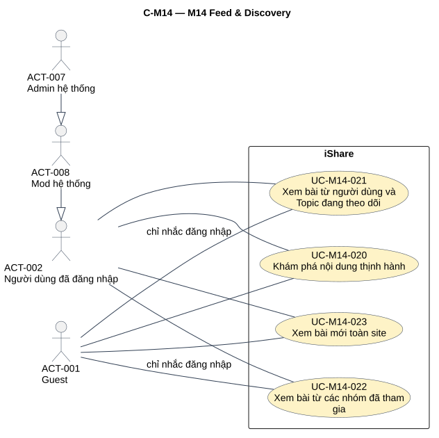
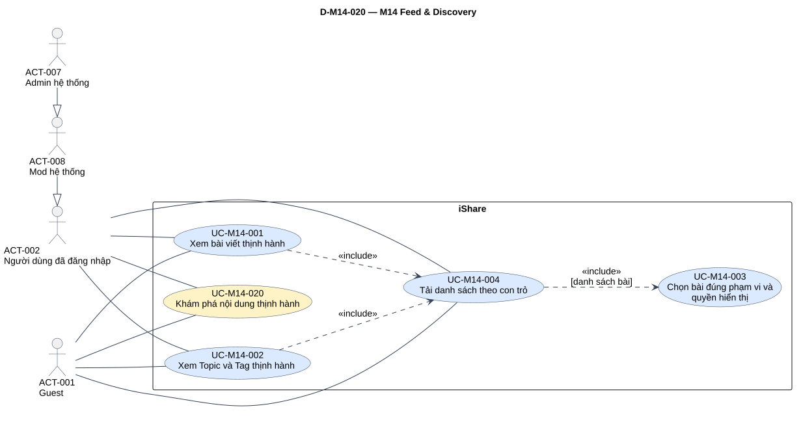
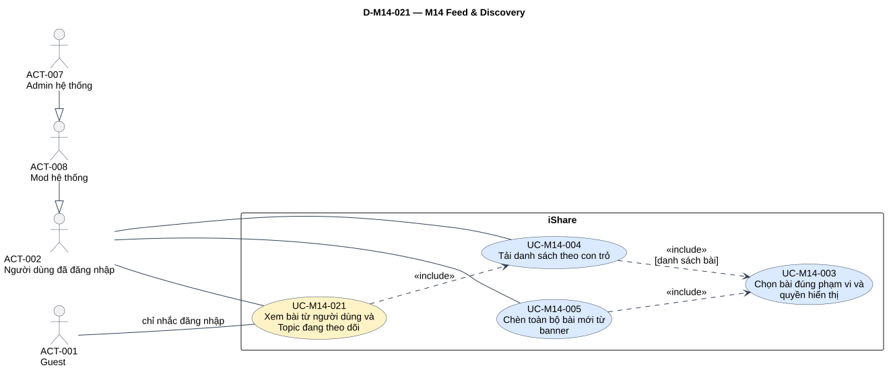
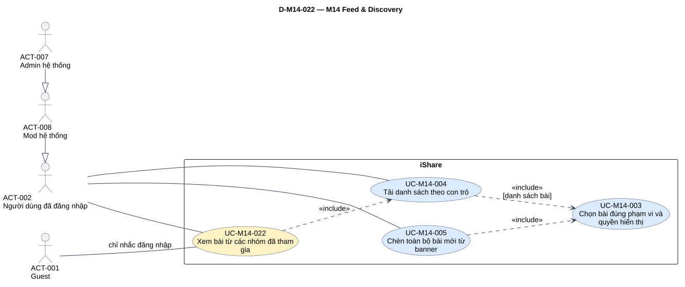
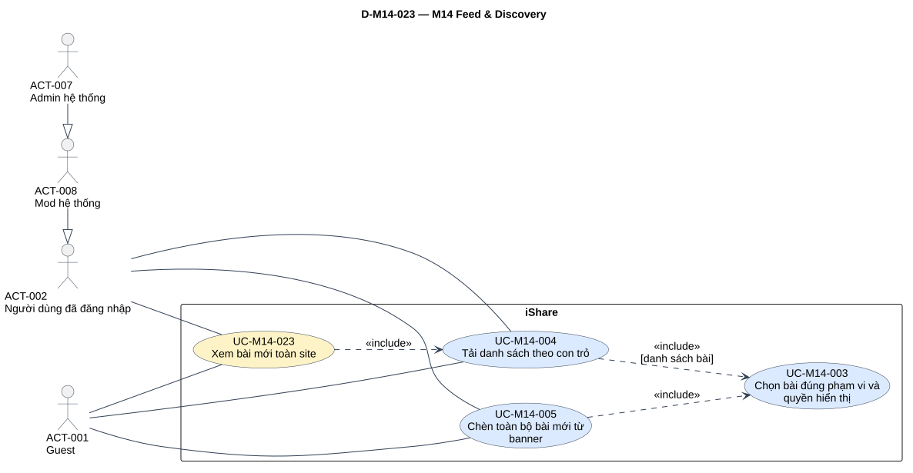

# Phân tích use case — M14 Feed & Discovery

[Vietnamese Doc] — Theo skill use-case-analysis v2.2; tiếng Việt, giữ thuật ngữ cần thiết.

Đầu ra gồm **4 UC chính, 5 UC con**, 13 mapping, 8 đặc tả chi tiết và một brief Summary; 2 AUT, 6 RULE, 104 dòng truy vết. Năm view bắt buộc gồm tổng quan module và một sơ đồ chi tiết cho mỗi UC chính, mỗi view chỉ bàn giao một SVG.

## Metadata và tiến độ

<!-- uc:document -->
| key | value |
| --- | --- |
| document_id | US-M14 |
| skill_version | 2.2 |
| mode | module |
| modules | M14 |
| scope | ALL |
| status | Chờ duyệt |
| current_step | 7 |
| completed_steps | 1, 2, 3, 4, 5, 6, 7 |
| approved_steps | - |
| source_baseline | FR-M14 v1.1; FR-M01 v1.10; FR-M02 v1.6; FR-M03 v1.10; FR-M04 v1.4; FR-M05 v1.7; FR-M06 v1.5; FR-M07 v1.5; FR-M08 v1.7; FR-M10 v1.4; FR-M11 v1.3; FR-M12 v1.1 |
| author | Codex |
| date | 2026-11-02 |
| approval_evidence | Người dùng cho phép tự thực hiện các bước cần thiết ở lượt M04, áp dụng chuỗi module hiện tại. Quyền làm liên tục không phải chấp thuận US-M14 hoặc duyệt kết quả từng bước. |
| semantic_review | pass |
| diagram_check | pass |

| Bước | Kết quả | Xác nhận | Baseline | Làm lại khi |
| --- | --- | --- | --- | --- |
| 1 | 8 nhóm,72 FR chi tiết,24 BR hiệu lực;1 FR đã bỏ; boundary/actor/phạm vi/TBD | Được làm liên tục; chưa duyệt | FR-M14 v1.1 | Nguồn đổi |
| 2 | 4 core,5 sub,13 mapping; giữ actor chung | Chưa duyệt | FR-M14 v1.1 | Mục tiêu đổi |
| 3 | 8 hợp đồng đầy đủ,1 brief Summary;2 AUT,6 RULE | Chưa duyệt | Mô hình tại đây | Hành vi/quyền đổi |
| 4 | 7 include, rà28 cặp core–sub/sub–sub;16 cặp không cạnh trong các view | Chưa duyệt | Luồng/hợp đồng tại đây | Điểm gọi đổi |
| 5 | 104 dòng truy vết và96 tiêu chí chi tiết/BR;11 FR giao tiếp | Chưa duyệt | FR-M14 v1.1; FR-M01 v1.10; FR-M02 v1.6; FR-M03 v1.10; FR-M04 v1.4; FR-M05 v1.7; FR-M06 v1.5; FR-M07 v1.5; FR-M08 v1.7; FR-M10 v1.4; FR-M11 v1.3; FR-M12 v1.1 | Baseline giao tiếp đổi |
| 6 | Đã render/kiểm hình 5 view; đúng node/cạnh, một SVG mỗi view | Chưa duyệt | PlantUML cục bộ | Mô hình/QA đổi |
| 7 | Đã review nguồn/ngữ nghĩa, kiểm cấu trúc, render/hình, audit và link; hồ sơ Chờ duyệt | Chưa duyệt | Skill v2.2 | Phản hồi/nguồn đổi |

## 1. Phạm vi, nguồn và tổng hợp yêu cầu

**Mục đích sử dụng:** review mô hình M14, đầu vào thiết kế/kiểm thử và tổng hợp UC chính hệ thống. Mục2 là hai tầng, mục 3 đặc tả, mục 4 quan hệ, mục 5 truy vết, mục 6 sơ đồ và mục 7 QA/giới hạn nguồn.

**Subject/boundary:** toàn iShare. Các module liên quan là thành phần nội bộ, không actor ngoài iShare. M14 không dùng AI; không có actor AI, Hệ thống, clock hay scheduler giả. Tính Trending và kiểm tra bài mới là AUT có trigger/kết quả.

**Trong phạm vi:** trang chủ bốn tab; Trending Post/Topic/Tag; công thức/phạm vi/thứ tự/chu kỳ Trending Post; tập bài/quyền theo tab; con trỏ, lượt xem Trending; polling và banner; rỗng Following/Group; trạng thái tác giả và cờ liên quan.

**Ngoài phạm vi:** CRUD bài/bình luận/bookmark/theo dõi/upvote/nhóm/báo cáo, đăng nhập, tính Trending Topic/Tag M05, tìm kiếm M06, quản trị cờ M10, bảng xếp hạng M12, thiết kế UI/CSDL/API/cron/cursor schema và hiện thực feed. Không For You/Popular/Personalized, ưu tiên Lớp-Khối/AI, realtime, ngưỡng Trending Post, lọc Trending Post theo Topic, SSR/SEO ở MS1.

**Baseline:** [FR-M14](../fr/FR-M14.md) v1.1, Đã chốt 2026-10-24; mốc DEC-271, QA-477, ISS-415, OPEN-012. **104 mã hiệu lực =8 nhóm +72 FR chi tiết +24 BR**. FR-M14-04.08 đã bỏ, không tái tạo bài Private trong Following. TBD-M14-01 đóng bởi DEC-259 (bookmark trọng số1). TBD-M14-02/OPEN-006 hoãn SSR/SEO có chủ đích mức Thấp, giữ mục 7.2.

<!-- uc:sources -->
| path | version | role |
| --- | --- | --- |
| docs/specs/fr/FR-M14.md | 1.1 | owner |
| docs/specs/fr/FR-M01.md | 1.10 | related |
| docs/specs/fr/FR-M02.md | 1.6 | related |
| docs/specs/fr/FR-M03.md | 1.10 | related |
| docs/specs/fr/FR-M04.md | 1.4 | related |
| docs/specs/fr/FR-M05.md | 1.7 | related |
| docs/specs/fr/FR-M06.md | 1.5 | related |
| docs/specs/fr/FR-M07.md | 1.5 | related |
| docs/specs/fr/FR-M08.md | 1.7 | related |
| docs/specs/fr/FR-M10.md | 1.4 | related |
| docs/specs/fr/FR-M11.md | 1.3 | related |
| docs/specs/fr/FR-M12.md | 1.1 | related |

Phương pháp: [skill](../../../.agent-instructions/skills/use-case-analysis/SKILL.md), [modeling rules](../../../.agent-instructions/skills/use-case-analysis/references/modeling-rules.md), [diagram rules](../../../.agent-instructions/skills/use-case-analysis/references/diagram-rules.md). Ví dụ và US trước không thay nguồn tính năng. Giữ ACT-001/ACT-002/ACT-008/ACT-007; yêu cầu sản phẩm theo FR hiện hành.

### 1.1 Actor và điều kiện quyền

<!-- uc:actors -->
| id | name | kind | parent | boundary_reason | sources |
| --- | --- | --- | --- | --- | --- |
| ACT-001 | Guest | human | - | Người ngoài iShare xem Trending/Newest; chọn Following/Group được nhắc đăng nhập, không nhận bài riêng. | FR-M14-01.03, FR-M14-02.02, FR-M14-04.04, FR-M14-05.05, FR-M14-06.04 |
| ACT-002 | Người dùng đã đăng nhập | human | - | Chọn/đọc bốn tab; Following/Group dùng quan hệ của chính mình, không quyền của hồ sơ đang xem. | FR-M14-01.08, FR-M14-04.01, FR-M14-05.01 |
| ACT-008 | Mod hệ thống | human | ACT-002 | Kế thừa hành vi User trên feed, không công cụ riêng chỉnh thứ hạng hoặc duyệt bài ẩn trên feed. | FR-M14-01, FR-M14-02, FR-M14-04, FR-M14-05, FR-M14-06 |
| ACT-007 | Admin hệ thống | human | ACT-008 | Không quyền riêng xếp feed; M10/M11/M12 giữ ngoại lệ Admin sử dụng module đang tắt, quyền bài/nhóm khác vẫn áp. | FR-M14-01.07, BR-M14-22, FR-M10-12.08, FR-M11-17.03, FR-M12-08.06 |

ACT-007 → ACT-008 → ACT-002 là khả năng thay thế vai trò User; quyền bài/nhóm vẫn áp. Thành viên nhóm/tác giả/BANNED/HEAVY là ngữ cảnh, không actor mới. Guest chỉ tham gia nhánh từ chối Following/Group, không primary đường thành công. Bài của người BANNED hiện không cấp feed cho tài khoản BANNED: cổng M01 vẫn áp. Quyền staff đặc biệt/nhãn giao với ẩn danh giữ giới hạn NOTE-M14-04.

### 1.2 Kiểm kê và tổng hợp

| Nhóm FR | Tổng hợp | Số chi tiết hiệu lực | Biểu diễn | Owner |
| --- | --- | --- | --- | --- |
| FR-M14-01 | Bốn tab hiện với Guest; mọi người vào Trending Post; bài đủ điều kiện/nhãn/cờ, không cá nhân hóa. | 9 | [RULE001](#rule-m14-001), [RULE006](#rule-m14-006) | M14 |
| FR-M14-02 | Post chung, Topic/Tag do M05; giữ kết quả lượt, bỏ bài mất quyền,20 mục, không banner. | 12 | [Core020](#uc-m14-020), [UC001](#uc-m14-001), [UC002](#uc-m14-002) | M14 |
| FR-M14-03 | Decay/tuổi phân số≤28, U/C/B hiện hành, chu kỳ15–30 phút/deadline30 phút, tie-break. | 15 | [AUT001](#aut-m14-001), [RULE003](#rule-m14-003) | M14 |
| FR-M14-04 | Following OR người/Topic, Public có/Private không, ẩn danh qua Topic, không trùng, rỗng dẫn Search. | 12 | [Core021](#uc-m14-021), [UC003](#uc-m14-003) | M14;1 mã đã bỏ |
| FR-M14-05 | Nhóm hiện tham gia Public/Private; Guest chặn; rỗng dẫn danh sách nhóm; cờ tắt còn lối vào. | 8 | [Core022](#uc-m14-022), [UC003](#uc-m14-003) | M14 |
| FR-M14-06 | Newest chỉ ngoài nhóm, mới trước, Guest xem được. | 4 | [Core023](#uc-m14-023) | M14 |
| FR-M14-07 | Trang đầu/cuộn20, con trỏ, dừng, không lặp/mất; cố định Trending. | 5 | [UC004](#uc-m14-004), [RULE004](#rule-m14-004) | M14 |
| FR-M14-08 | Polling≤60 giây, banner≤60 giây từ đăng; bấm chèn tất cả/giữ chỗ đọc. | 7 | [AUT002](#aut-m14-002), [UC005](#uc-m14-005) | M14 |

| Tab/mục | Nguồn | Thứ tự | Guest | Bài mới |
| --- | --- | --- | --- | --- |
| Trending Post | Ngoài nhóm + Public; Private không có kể cả thành viên | Điểm giảm; bằng điểm mới trước | Có | Giữ kết quả lúc mở; mở lại/reload mới đổi |
| Trending Topic/Tag | Mọi mục điểm>0 do M05, Tag hoạt động | M05: điểm, số bài mới, tên | Có | Không banner; hợp đồng lượt Trending, giao tiếp NOTE02 |
| Following | Người/Topic theo dõi; Public có, Private không; ẩn danh chỉ Topic | Thời điểm đăng mới trước | Nhắc đăng nhập | Polling/banner; bấm mới chèn |
| Group | Nhóm hiện tham gia Public/Private | Thời điểm đăng mới trước | Nhắc đăng nhập | Polling/banner; bấm mới chèn |
| Newest | Bài không thuộc nhóm | Thời điểm đăng mới trước | Có | Polling/banner; bấm mới chèn |

## 2. UC chính và UC con

### 2.1 Danh mục hai tầng

<!-- uc:catalog -->
| id | name | tier | level | primary | supporting | owner | anchor | sources |
| --- | --- | --- | --- | --- | --- | --- | --- | --- |
| UC-M14-020 | Khám phá nội dung thịnh hành | core | Summary | ACT-001, ACT-002 | - | M14 | #uc-m14-020 | FR-M14-01, FR-M14-02, FR-M14-03, BR-M14-01, BR-M14-03, BR-M14-19, BR-M14-24 |
| UC-M14-021 | Xem bài từ người dùng và Topic đang theo dõi | core | User goal | ACT-002 | - | M14 | #uc-m14-021 | FR-M14-04, FR-M14-07, FR-M14-08, BR-M14-08, BR-M14-20 |
| UC-M14-022 | Xem bài từ các nhóm đã tham gia | core | User goal | ACT-002 | - | M14 | #uc-m14-022 | FR-M14-05, FR-M14-07, FR-M14-08, BR-M14-07, BR-M14-21 |
| UC-M14-023 | Xem bài mới toàn site | core | User goal | ACT-001, ACT-002 | - | M14 | #uc-m14-023 | FR-M14-06, FR-M14-07, FR-M14-08, BR-M14-06, BR-M14-09 |
| UC-M14-001 | Xem bài viết thịnh hành | sub | User goal | ACT-001, ACT-002 | - | M14 | #uc-m14-001 | FR-M14-02, FR-M14-07, BR-M14-05, BR-M14-13, BR-M14-19 |
| UC-M14-002 | Xem Topic và Tag thịnh hành | sub | User goal | ACT-001, ACT-002 | - | M14 | #uc-m14-002 | FR-M14-02.06, FR-M14-02.10, BR-M14-24, BR-M05-29, BR-M05-31 |
| UC-M14-003 | Chọn bài đúng phạm vi và quyền hiển thị | sub | Subfunction | ACT-001, ACT-002 | - | M14 | #uc-m14-003 | FR-M14-01.05, FR-M14-01.06, FR-M14-02.05, FR-M14-04, FR-M14-05, FR-M14-06, BR-M14-04, BR-M14-05, BR-M14-06, BR-M14-07, BR-M14-08, BR-M14-15, BR-M14-23 |
| UC-M14-004 | Tải danh sách theo con trỏ | sub | Subfunction | ACT-001, ACT-002 | - | M14 | #uc-m14-004 | FR-M14-07, FR-M14-02.10, BR-M14-16, BR-M14-19, BR-M14-24 |
| UC-M14-005 | Chèn toàn bộ bài mới từ banner | sub | User goal | ACT-001, ACT-002 | - | M14 | #uc-m14-005 | FR-M14-08, BR-M14-17, BR-M14-18 |

Core020 là Summary đặt các mục khám phá vào bối cảnh; core021/022/023 là User goal có kết quả đọc mỗi lần mở tab. Sub001/002/005 là User goal, sub003/004 là Subfunction dùng chung; tier độc lập level. UC003 phục vụ actor qua caller, không tạo nút lọc mới.

### 2.2 Phân rã chính → con

<!-- uc:decomposition -->
| core | sub | rationale | sources |
| --- | --- | --- | --- |
| UC-M14-020 | UC-M14-001 | Mục tiêu đọc bài thịnh hành. | FR-M14-02, FR-M14-07, BR-M14-05, BR-M14-13, BR-M14-19 |
| UC-M14-020 | UC-M14-002 | Khám phá Topic/Tag cùng hợp đồng, hai lựa chọn loại. | FR-M14-02.06, FR-M14-02.10, BR-M14-24, BR-M05-29, BR-M05-31 |
| UC-M14-020 | UC-M14-003 | Chọn đúng tập bài/quyền ở mỗi lần tải. | FR-M14-01.05, FR-M14-01.06, FR-M14-02.05, FR-M14-04, FR-M14-05, FR-M14-06, BR-M14-04, BR-M14-05, BR-M14-06, BR-M14-07, BR-M14-08, BR-M14-15, BR-M14-23 |
| UC-M14-020 | UC-M14-004 | Cấp trang đầu/tải tiếp ổn định, không lặp/mất. | FR-M14-07, FR-M14-02.10, BR-M14-16, BR-M14-19, BR-M14-24 |
| UC-M14-021 | UC-M14-003 | Chọn đúng tập bài/quyền ở mỗi lần tải. | FR-M14-01.05, FR-M14-01.06, FR-M14-02.05, FR-M14-04, FR-M14-05, FR-M14-06, BR-M14-04, BR-M14-05, BR-M14-06, BR-M14-07, BR-M14-08, BR-M14-15, BR-M14-23 |
| UC-M14-021 | UC-M14-004 | Cấp trang đầu/tải tiếp ổn định, không lặp/mất. | FR-M14-07, FR-M14-02.10, BR-M14-16, BR-M14-19, BR-M14-24 |
| UC-M14-021 | UC-M14-005 | Nhận bài mới từ banner, trigger riêng với mở tab. | FR-M14-08, BR-M14-17, BR-M14-18 |
| UC-M14-022 | UC-M14-003 | Chọn đúng tập bài/quyền ở mỗi lần tải. | FR-M14-01.05, FR-M14-01.06, FR-M14-02.05, FR-M14-04, FR-M14-05, FR-M14-06, BR-M14-04, BR-M14-05, BR-M14-06, BR-M14-07, BR-M14-08, BR-M14-15, BR-M14-23 |
| UC-M14-022 | UC-M14-004 | Cấp trang đầu/tải tiếp ổn định, không lặp/mất. | FR-M14-07, FR-M14-02.10, BR-M14-16, BR-M14-19, BR-M14-24 |
| UC-M14-022 | UC-M14-005 | Nhận bài mới từ banner, trigger riêng với mở tab. | FR-M14-08, BR-M14-17, BR-M14-18 |
| UC-M14-023 | UC-M14-003 | Chọn đúng tập bài/quyền ở mỗi lần tải. | FR-M14-01.05, FR-M14-01.06, FR-M14-02.05, FR-M14-04, FR-M14-05, FR-M14-06, BR-M14-04, BR-M14-05, BR-M14-06, BR-M14-07, BR-M14-08, BR-M14-15, BR-M14-23 |
| UC-M14-023 | UC-M14-004 | Cấp trang đầu/tải tiếp ổn định, không lặp/mất. | FR-M14-07, FR-M14-02.10, BR-M14-16, BR-M14-19, BR-M14-24 |
| UC-M14-023 | UC-M14-005 | Nhận bài mới từ banner, trigger riêng với mở tab. | FR-M14-08, BR-M14-17, BR-M14-18 |

Mapping là phân rã, không tự sinh cạnh UML. UC003/004/005 giữ một ID trên mọi view. Core Summary có thể không nối trực tiếp UC–UC; cạnh thật ở mục 4.

### 2.3 Mô hình module cho tổng quan hệ thống

<!-- uc:module-models -->
| module | path | baseline |
| --- | --- | --- |

Chưa có US-overview.md tại baseline; tổng hợp hệ thống ngoài phạm vi. Khi tổng hợp lấy nguyên bốn core ở catalog, không đưa sub lên tổng quan hoặc tự viết lại module khác.

### 2.4 Quyết định giữ/gộp/tách

| Quyết định | Hành vi | Biểu diễn | Lý do | Phương án không chọn |
| --- | --- | --- | --- | --- |
| D01 | Bốn tab | 4 core | Bốn giá trị/tập bài khác nhau, ghép tổng quan hệ thống. | Một core Quản lý feed quá rộng. |
| D02 | Post và Topic/Tag | Summary020,UC001/002 | Post khác công thức/owner; Topic/Tag cùng hợp đồng, nhánh loại. | Tách oval theo mỗi nút mà không khác hợp đồng. |
| D03 | Điều kiện bài/phạm vi/quyền | UC003 chung | Dùng khi phân trang và chèn bài mới, đủ trạng thái/ẩn danh. | Mỗi điều kiện/API một UC. |
| D04 | Trang đầu và cuộn | UC004 chung | Cùng con trỏ/20, có nhánh bài và danh mục. | Oval cho mỗi trang/offset tự chọn. |
| D05 | Phát hiện và nhận bài mới | AUT002 + UC005 | Polling tự động, chèn do người xem; tất cả bài mới khác trần20. | Ép include UC004 hoặc extend vì cùng trang. |
| D06 | Tính Trending | AUT001 + RULE003 | Hành vi nội bộ có trigger/kết quả; không người bấm tính lại. | Actor clock/Hệ thống. |
| D07 | Mặc định/Guest/cờ/nhãn | RULE + bước/nhánh | Giữ yêu cầu không nhân oval cho hiện tab/nhắc login. | Include đăng nhập/quản trị cờ. |
| D08 | Tương tác bài và lối ra | Giao tiếp owner mục 5 | M14 liệt kê/điều hướng, không CRUD/tìm kiếm. | Nhân bản UC module khác. |
| D09 | Kết quả cố định và quyền mới | RULE004 + UC003 | Giữ thứ hạng không giữ quyền đã mất. | Đổi batch giữa lượt hoặc trả bài mất quyền để đủ20. |

## 3. Đặc tả

### 3.1 UC chính

### UC-M14-020 — Khám phá nội dung thịnh hành

**Level:** Summary. **Primary:** ACT-001, ACT-002. **Subject:** iShare. **Giá trị:** Giúp người xem khám phá bài viết, Topic và Tag đang được quan tâm theo danh sách chung.

**Trigger:** Mở trang chủ hoặc chọn tab Trending. **Điều kiện:** Không cần đăng nhập để xem; quyền mở bài/tương tác vẫn do owner.

**Quy trình tổng quát:** Guest và người dùng đã đăng nhập mở trang chủ đều thấy đủ bốn tab và được đưa vào Trending → Trending Post. Người xem có thể xem danh sách bài (UC001), hoặc chọn Trending Topic/Tag (UC002). Các mục này là lựa chọn thay thế, không cần chạy tất cả trong một lượt. UC004 tải danh sách theo con trỏ; với bài viết, UC003 chọn bài đúng phạm vi/quyền tại lần tải. AUT001 tạo kết quả Trending Post theo chu kỳ, không được gọi lại mỗi lượt xem. Giá trị là khám phá nội dung chung, không cá nhân hóa/Lớp-Khối/AI; core Summary chỉ đặt bối cảnh nên không ép include tới cả hai lựa chọn.

**Kết quả:** Người xem thấy nội dung theo mục con đã chọn; Trending Post dùng kết quả lúc mở tab, Topic/Tag theo M05. **Giới hạn thất bại:** Không tự tạo thứ hạng/dữ liệu thay thế khi chưa có kết quả; xem NOTE-M14-01.

**UC con:** [UC-M14-001](#uc-m14-001), [UC-M14-002](#uc-m14-002), [UC-M14-003](#uc-m14-003), [UC-M14-004](#uc-m14-004). **Nguồn:** FR-M14-01, FR-M14-02, FR-M14-03, BR-M14-01, BR-M14-03, BR-M14-19, BR-M14-24.

### UC-M14-021 — Xem bài từ người dùng và Topic đang theo dõi

**UC con:** [UC-M14-003](#uc-m14-003), [UC-M14-004](#uc-m14-004), [UC-M14-005](#uc-m14-005). **Nguồn:** FR-M14-04, FR-M14-07, FR-M14-08, BR-M14-08, BR-M14-20.

<!-- uc:spec UC-M14-021 -->
| key | value |
| --- | --- |
| goal | Đọc một dòng bài mới từ các đối tượng chính mình đã chọn theo dõi, không lộ tác giả ẩn danh. |
| subject | iShare |
| level | User goal |
| primary | ACT-002 |
| supporting | - |
| trigger | Người xem chọn tab Following. |
| preconditions | Tab vẫn hiện với mọi người; phiên đăng nhập được kiểm trong luồng, không coi Guest là không thể kích hoạt. |
| success | Trả tối đa 20 bài đầu theo thời điểm đăng giảm dần, mỗi bài một lần; hoặc trạng thái rỗng dẫn tới tìm kiếm. |
| failure | Guest được yêu cầu đăng nhập, không thấy bài; lỗi tải chưa có chính sách cụ thể, không suy retry hay dữ liệu giả (NOTE-M14-01). |
| abstract | false |
| common_contract | Không áp dụng generalization UC; hợp đồng cụ thể ở trigger/điều kiện/luồng/kết quả dưới đây. |

#### Luồng chính

| Bước | Ai | Hành động/phản hồi | Tiếp tục | Nguồn |
| --- | --- | --- | --- | --- |
| 1 | ACT-002 | Chọn Following; Guest cũng có thể chọn nhưng đi nhánh A1. | [Bước 2](#uc-m14-021-main-2) | FR-M14-04.01, FR-M14-04.04 |

| Bước | Ai | Hành động/phản hồi | Tiếp tục | Nguồn |
| --- | --- | --- | --- | --- |
| 2 | iShare | Kiểm phiên và thiết lập phạm vi Following của chính người xem: người dùng/Topic đang theo dõi; không dùng hồ sơ của người khác. | [Bước 3](#uc-m14-021-main-3) | FR-M14-04.01, BR-M14-08, FR-M07-01.01 |

| Bước | Ai | Hành động/phản hồi | Tiếp tục | Nguồn |
| --- | --- | --- | --- | --- |
| 3 | iShare | Chèn UC-M14-004 để tải trang đầu trong phạm vi Following. UC004 gọi UC003 để lọc bài, xử lý OR, ẩn danh, Public/Private và bỏ trùng. | [Bước 4](#uc-m14-021-main-4) | FR-M14-04.01, FR-M14-04.02, FR-M14-04.09, FR-M14-04.10, FR-M14-04.13, FR-M14-07.01 |

| Bước | Ai | Hành động/phản hồi | Tiếp tục | Nguồn |
| --- | --- | --- | --- | --- |
| 4 | iShare | Hiển thị kết quả mới trước theo thời điểm đăng; nếu rỗng áp A2/A3. Trong khi ở tab, AUT002 chỉ báo bài mới; người xem bấm banner thực hiện UC005. Cuộn tiếp là lần gọi UC004 tiếp theo, không tải lại toàn bộ tab. | END: kết quả thành công theo hợp đồng. | FR-M14-04.03, FR-M14-04.05, FR-M14-04.11, FR-M14-07.02, FR-M14-08.01, FR-M14-08.03 |

#### Luồng thay thế và ngoại lệ

| ID nhánh | Bước rẽ | Điều kiện | Xử lý | Quay lại/kết thúc | Nguồn |
| --- | --- | --- | --- | --- | --- |
| A1 | [Bước 2](#uc-m14-021-main-2) | Guest chưa đăng nhập | Yêu cầu đăng nhập; không hiển thị bài Following; không tự chạy Đăng nhập như một include. | END: chưa được xem Following. | FR-M14-04.04, BR-M14-02 |

| ID nhánh | Bước rẽ | Điều kiện | Xử lý | Quay lại/kết thúc | Nguồn |
| --- | --- | --- | --- | --- | --- |
| A2 | [Bước 4](#uc-m14-021-main-4) | Không theo dõi người dùng hoặc Topic nào | Hiển thị trạng thái rỗng kèm nút dẫn sang trang tìm kiếm M06; bấm nút là chuyển sang nghiệp vụ M06. | END: trạng thái rỗng có lối tìm nguồn theo dõi. | FR-M14-04.05, BR-M14-20 |

| ID nhánh | Bước rẽ | Điều kiện | Xử lý | Quay lại/kết thúc | Nguồn |
| --- | --- | --- | --- | --- | --- |
| A3 | [Bước 4](#uc-m14-021-main-4) | Có theo dõi nhưng không có bài thuộc phạm vi đang xem | Hiển thị cùng trạng thái rỗng kèm nút dẫn sang trang tìm kiếm. | END: trạng thái rỗng có lối tìm kiếm. | FR-M14-04.11, BR-M14-20 |

| ID nhánh | Bước rẽ | Điều kiện | Xử lý | Quay lại/kết thúc | Nguồn |
| --- | --- | --- | --- | --- | --- |
| A4 | [Bước 3](#uc-m14-021-main-3) | Bỏ theo dõi người dùng/Topic sau một lần tải | Từ lần tải kế tiếp UC003 không giữ bài chỉ còn thỏa nhờ đối tượng đã bỏ; bài vẫn thỏa một đối tượng khác còn theo dõi chỉ hiện một lần. | [Trở về bước của UC](#uc-m14-021-main-4) | FR-M14-04.02, FR-M14-04.06, BR-M14-08 |

| ID nhánh | Bước rẽ | Điều kiện | Xử lý | Quay lại/kết thúc | Nguồn |
| --- | --- | --- | --- | --- | --- |
| A5 | [Bước 3](#uc-m14-021-main-3) | Cờ Group tắt | Vẫn trả bài nhóm Public hợp lệ như lối vào; M11 quyết định mở/tương tác theo RULE005, có ngoại lệ Admin của owner. | [Trở về bước của UC](#uc-m14-021-main-4) | FR-M14-04.12, BR-M14-22, FR-M11-17.03, FR-M11-17.08 |

#### Quy tắc và điểm chưa rõ

Áp [RULE001](#rule-m14-001), [RULE002](#rule-m14-002), [RULE003](#rule-m14-003), [RULE004](#rule-m14-004), [RULE005](#rule-m14-005), [RULE006](#rule-m14-006) theo ngữ cảnh; chỉ Trending Post dùng công thức Post, Topic/Tag theo M05. Trigger/nhánh không tự tạo cạnh UML. Các NOTE mục 7.2 là giới hạn nguồn, không giả định hoặc tự thêm retry/lỗi.

### UC-M14-022 — Xem bài từ các nhóm đã tham gia

**UC con:** [UC-M14-003](#uc-m14-003), [UC-M14-004](#uc-m14-004), [UC-M14-005](#uc-m14-005). **Nguồn:** FR-M14-05, FR-M14-07, FR-M14-08, BR-M14-07, BR-M14-21.

<!-- uc:spec UC-M14-022 -->
| key | value |
| --- | --- |
| goal | Đọc bài từ mọi nhóm mình đang là thành viên ở một nơi, bao gồm Public và Private. |
| subject | iShare |
| level | User goal |
| primary | ACT-002 |
| supporting | - |
| trigger | Người xem chọn tab Group. |
| preconditions | Tab hiện cả với Guest; thành viên là điều kiện chọn nguồn từng nhóm tại lần tải, không bắt phải tham gia ít nhất một nhóm trước UC. |
| success | Trả tối đa 20 bài đầu của các nhóm hiện tham gia, mới trước; hoặc trạng thái rỗng có Khám phá Group. |
| failure | Guest không thấy bài và được yêu cầu đăng nhập; không tự mở bài Private cho người ngoài nhóm. |
| abstract | false |
| common_contract | Không áp dụng generalization UC; hợp đồng cụ thể ở trigger/điều kiện/luồng/kết quả dưới đây. |

#### Luồng chính

| Bước | Ai | Hành động/phản hồi | Tiếp tục | Nguồn |
| --- | --- | --- | --- | --- |
| 1 | ACT-002 | Chọn tab Group; Guest chọn tab đi nhánh A1. | [Bước 2](#uc-m14-022-main-2) | FR-M14-05.01, FR-M14-05.05 |

| Bước | Ai | Hành động/phản hồi | Tiếp tục | Nguồn |
| --- | --- | --- | --- | --- |
| 2 | iShare | Kiểm phiên; xác định tập nhóm người xem đang tham gia tại lần tải, gồm cả Public và Private. | [Bước 3](#uc-m14-022-main-3) | FR-M14-05.01, BR-M14-07 |

| Bước | Ai | Hành động/phản hồi | Tiếp tục | Nguồn |
| --- | --- | --- | --- | --- |
| 3 | iShare | Chèn UC-M14-004 với phạm vi Group để tải trang đầu; UC003 loại bài nhóm chưa tham gia/đã rời và bài không còn hiển thị. | [Bước 4](#uc-m14-022-main-4) | FR-M14-05.01, FR-M14-05.03, FR-M14-05.04, FR-M14-07.01 |

| Bước | Ai | Hành động/phản hồi | Tiếp tục | Nguồn |
| --- | --- | --- | --- | --- |
| 4 | iShare | Hiển thị mới trước theo thời điểm đăng; áp trạng thái rỗng nếu cần. AUT002 báo bài mới; bấm banner gọi UC005, cuộn tiếp gọi UC004. | END: kết quả thành công theo hợp đồng. | FR-M14-05.02, FR-M14-05.06, FR-M14-05.07, FR-M14-08.01, FR-M14-08.03, FR-M14-07.02 |

#### Luồng thay thế và ngoại lệ

| ID nhánh | Bước rẽ | Điều kiện | Xử lý | Quay lại/kết thúc | Nguồn |
| --- | --- | --- | --- | --- | --- |
| A1 | [Bước 2](#uc-m14-022-main-2) | Guest chưa đăng nhập | Yêu cầu đăng nhập; không trả bài nhóm từ tab Group. | END: chưa được xem Group. | FR-M14-05.05, BR-M14-02 |

| ID nhánh | Bước rẽ | Điều kiện | Xử lý | Quay lại/kết thúc | Nguồn |
| --- | --- | --- | --- | --- | --- |
| A2 | [Bước 4](#uc-m14-022-main-4) | Chưa tham gia nhóm nào | Hiện trạng thái rỗng và nút Khám phá Group dẫn sang trang danh sách nhóm M11. | END: có lối khám phá nhóm. | FR-M14-05.06, BR-M14-21, FR-M11-03.01, FR-M11-03.03 |

| ID nhánh | Bước rẽ | Điều kiện | Xử lý | Quay lại/kết thúc | Nguồn |
| --- | --- | --- | --- | --- | --- |
| A3 | [Bước 4](#uc-m14-022-main-4) | Đã tham gia nhóm nhưng tab không có bài đủ điều kiện | Hiện trạng thái rỗng kèm Khám phá Group. | END: có lối khám phá nhóm. | FR-M14-05.07, BR-M14-21 |

| ID nhánh | Bước rẽ | Điều kiện | Xử lý | Quay lại/kết thúc | Nguồn |
| --- | --- | --- | --- | --- | --- |
| A4 | [Bước 3](#uc-m14-022-main-3) | Người xem đã rời một nhóm | Từ lần tải kế tiếp loại bài nhóm đó, kể cả nhóm Public; bài đã tải sẵn chưa có quy tắc tự xóa UI (NOTE-M14-03). | [Trở về bước của UC](#uc-m14-022-main-4) | FR-M14-05.03, FR-M14-05.04, BR-M14-07 |

| ID nhánh | Bước rẽ | Điều kiện | Xử lý | Quay lại/kết thúc | Nguồn |
| --- | --- | --- | --- | --- | --- |
| A5 | [Bước 3](#uc-m14-022-main-3) | Cờ Group tắt | Tab vẫn hiện và vẫn liệt kê bài nhóm hợp lệ như lối vào; quyền mở/tương tác theo RULE005/M11, không xóa dữ liệu feed hoặc giấu tab. | [Trở về bước của UC](#uc-m14-022-main-4) | FR-M14-05.08, BR-M14-22, FR-M11-17.03, FR-M11-17.07, FR-M11-17.08 |

#### Quy tắc và điểm chưa rõ

Áp [RULE001](#rule-m14-001), [RULE002](#rule-m14-002), [RULE003](#rule-m14-003), [RULE004](#rule-m14-004), [RULE005](#rule-m14-005), [RULE006](#rule-m14-006) theo ngữ cảnh; chỉ Trending Post dùng công thức Post, Topic/Tag theo M05. Trigger/nhánh không tự tạo cạnh UML. Các NOTE mục 7.2 là giới hạn nguồn, không giả định hoặc tự thêm retry/lỗi.

### UC-M14-023 — Xem bài mới toàn site

**UC con:** [UC-M14-003](#uc-m14-003), [UC-M14-004](#uc-m14-004), [UC-M14-005](#uc-m14-005). **Nguồn:** FR-M14-06, FR-M14-07, FR-M14-08, BR-M14-06, BR-M14-09.

<!-- uc:spec UC-M14-023 -->
| key | value |
| --- | --- |
| goal | Đọc dòng bài mới theo thời gian của toàn site, chỉ gồm bài ngoài nhóm. |
| subject | iShare |
| level | User goal |
| primary | ACT-001, ACT-002 |
| supporting | - |
| trigger | Guest hoặc người dùng đã đăng nhập chọn tab Newest. |
| preconditions | Không cần đăng nhập; feed luôn truy cập được theo cổng tài khoản M01 và không có cờ riêng. |
| success | Hiện tối đa 20 bài ngoài nhóm mới nhất đủ điều kiện, hỗ trợ đọc tiếp và báo bài mới. |
| failure | Không thêm bài nhóm Public/Private; không tự bù UI rỗng/lỗi chưa được nguồn chốt (NOTE-M14-01). |
| abstract | false |
| common_contract | Không áp dụng generalization UC; hợp đồng cụ thể ở trigger/điều kiện/luồng/kết quả dưới đây. |

#### Luồng chính

| Bước | Ai | Hành động/phản hồi | Tiếp tục | Nguồn |
| --- | --- | --- | --- | --- |
| 1 | ACT-001, ACT-002 | Chọn tab Newest. | [Bước 2](#uc-m14-023-main-2) | FR-M14-06.01, FR-M14-06.04 |

| Bước | Ai | Hành động/phản hồi | Tiếp tục | Nguồn |
| --- | --- | --- | --- | --- |
| 2 | iShare | Thiết lập phạm vi Newest: bài ngoài mọi nhóm; không cần đăng nhập và không ưu tiên Lớp/Khối. | [Bước 3](#uc-m14-023-main-3) | FR-M14-06.01, FR-M14-06.03, BR-M14-01, BR-M14-02, BR-M14-06 |

| Bước | Ai | Hành động/phản hồi | Tiếp tục | Nguồn |
| --- | --- | --- | --- | --- |
| 3 | iShare | Chèn UC-M14-004 với phạm vi Newest để tải trang đầu; UC003 kiểm bài hiện hành trước khi trả. | [Bước 4](#uc-m14-023-main-4) | FR-M14-06.01, FR-M14-07.01, BR-M14-04 |

| Bước | Ai | Hành động/phản hồi | Tiếp tục | Nguồn |
| --- | --- | --- | --- | --- |
| 4 | iShare | Hiển thị bài theo thời điểm đăng giảm dần. Trong khi ở tab, AUT002 báo bài mới; người xem có thể cuộn gọi UC004 hoặc bấm banner gọi UC005 mà vẫn giữ chỗ đọc. | END: kết quả thành công theo hợp đồng. | FR-M14-06.02, FR-M14-07.02, FR-M14-08.01, FR-M14-08.03, FR-M14-08.04 |

#### Luồng thay thế và ngoại lệ

| ID nhánh | Bước rẽ | Điều kiện | Xử lý | Quay lại/kết thúc | Nguồn |
| --- | --- | --- | --- | --- | --- |
| A1 | [Bước 3](#uc-m14-023-main-3) | Ứng viên thuộc nhóm Public hoặc Private | UC003 loại khỏi Newest, kể cả khi người xem là thành viên nhóm. | [Trở về bước của UC](#uc-m14-023-main-4) | FR-M14-06.03, BR-M14-06 |

| ID nhánh | Bước rẽ | Điều kiện | Xử lý | Quay lại/kết thúc | Nguồn |
| --- | --- | --- | --- | --- | --- |
| A2 | [Bước 3](#uc-m14-023-main-3) | Không có bài đủ điều kiện | Trả tập rỗng; nguồn chưa chốt nội dung trạng thái rỗng riêng Newest, không tự thêm CTA như Following/Group. | END: không có bài để hiển thị; NOTE-M14-01. | FR-M14-06.01, BR-M14-04, BR-M14-06 |

#### Quy tắc và điểm chưa rõ

Áp [RULE001](#rule-m14-001), [RULE002](#rule-m14-002), [RULE003](#rule-m14-003), [RULE004](#rule-m14-004), [RULE005](#rule-m14-005), [RULE006](#rule-m14-006) theo ngữ cảnh; chỉ Trending Post dùng công thức Post, Topic/Tag theo M05. Trigger/nhánh không tự tạo cạnh UML. Các NOTE mục 7.2 là giới hạn nguồn, không giả định hoặc tự thêm retry/lỗi.

### 3.2 UC con

### UC-M14-001 — Xem bài viết thịnh hành

**UC chính liên quan:** UC-M14-020. **Nguồn:** FR-M14-02, FR-M14-07, BR-M14-05, BR-M14-13, BR-M14-19.

<!-- uc:spec UC-M14-001 -->
| key | value |
| --- | --- |
| goal | Đọc danh sách Trending Post chung theo điểm, ổn định khi cuộn trong một lượt xem. |
| subject | iShare |
| level | User goal |
| primary | ACT-001, ACT-002 |
| supporting | - |
| trigger | Trang chủ mở mặc định Trending Post hoặc người xem chọn mục Trending Post. |
| preconditions | Không cần đăng nhập; kiểm kết quả lần tính trong luồng, không giả định đã có lần tính đầu tiên. |
| success | Trang đầu từ kết quả lúc mở tab được hiển thị, các lần tải thêm dùng cùng kết quả và kiểm quyền tại lúc tải. |
| failure | Không hiển thị bài đã mất điều kiện để giữ nguyên một kết quả cũ; chưa có kết quả ban đầu xem NOTE-M14-01. |
| abstract | false |
| common_contract | Không áp dụng generalization UC; hợp đồng cụ thể ở trigger/điều kiện/luồng/kết quả dưới đây. |

#### Luồng chính

| Bước | Ai | Hành động/phản hồi | Tiếp tục | Nguồn |
| --- | --- | --- | --- | --- |
| 1 | ACT-001, ACT-002 | Mở trang chủ hoặc chọn Trending Post trong tab Trending. | [Bước 2](#uc-m14-001-main-2) | FR-M14-01.02, FR-M14-01.08, FR-M14-01.09, FR-M14-02.01, FR-M14-02.02 |

| Bước | Ai | Hành động/phản hồi | Tiếp tục | Nguồn |
| --- | --- | --- | --- | --- |
| 2 | iShare | Khi bắt đầu lượt xem tab Trending, ghi nhận kết quả lần tính gần nhất. Dùng một danh sách chung theo điểm giảm dần, bằng điểm mới trước; không lọc Topic, không banner và không tính lại theo mỗi người. | [Bước 3](#uc-m14-001-main-3) | FR-M14-02.03, FR-M14-02.04, FR-M14-02.07, FR-M14-02.11, BR-M14-13, BR-M14-14, BR-M14-19 |

| Bước | Ai | Hành động/phản hồi | Tiếp tục | Nguồn |
| --- | --- | --- | --- | --- |
| 3 | iShare | Chèn UC-M14-004 với phạm vi Trending Post và kết quả đã ghi nhận, lấy tối đa 20 bài đầu; UC003 bỏ bài không còn đủ điều kiện hiện tại. | [Bước 4](#uc-m14-001-main-4) | FR-M14-02.03, FR-M14-02.05, FR-M14-07.01, BR-M14-04, BR-M14-19 |

| Bước | Ai | Hành động/phản hồi | Tiếp tục | Nguồn |
| --- | --- | --- | --- | --- |
| 4 | iShare | Hiển thị danh sách. Cuộn gọi lại UC004 cùng kết quả; rời rồi mở lại Trending hoặc tải lại trang bắt đầu lượt mới, nhận kết quả gần nhất. Chuyển mục con khi vẫn ở lượt xem không tự đổi lần tính của Post. | END: kết quả thành công theo hợp đồng. | FR-M14-02.11, FR-M14-02.12, FR-M14-07.05, BR-M14-19 |

#### Luồng thay thế và ngoại lệ

| ID nhánh | Bước rẽ | Điều kiện | Xử lý | Quay lại/kết thúc | Nguồn |
| --- | --- | --- | --- | --- | --- |
| A1 | [Bước 2](#uc-m14-001-main-2) | Chưa có lần tính khả dụng | Không tự tính điểm theo yêu cầu xem hoặc dựng thứ hạng giả; ghi giới hạn dữ liệu ban đầu NOTE-M14-01. | END: đường phục vụ kết quả ban đầu chưa được nguồn quy định. | FR-M14-02.03, FR-M14-03.03, FR-M14-03.04 |

| ID nhánh | Bước rẽ | Điều kiện | Xử lý | Quay lại/kết thúc | Nguồn |
| --- | --- | --- | --- | --- | --- |
| A2 | [Bước 3](#uc-m14-001-main-3) | Bài trong kết quả cũ không còn đủ điều kiện ở lần tải này | UC003 bỏ bài: đã xóa/ẩn, tác giả DEACTIVATED/DELETED, nhóm Private hoặc điều kiện owner khác; không làm lại thứ hạng toàn bộ theo batch mới. | [Trở về bước của UC](#uc-m14-001-main-4) | FR-M14-02.05, FR-M14-02.09, BR-M14-04, BR-M14-05, BR-M14-19, FR-M03-07.01 |

| ID nhánh | Bước rẽ | Điều kiện | Xử lý | Quay lại/kết thúc | Nguồn |
| --- | --- | --- | --- | --- | --- |
| A3 | [Bước 3](#uc-m14-001-main-3) | Cờ Group tắt | Bài nhóm Public vẫn được liệt kê; mở bài/tương tác do M11 theo RULE005. | [Trở về bước của UC](#uc-m14-001-main-4) | FR-M14-02.08, BR-M14-22 |

| ID nhánh | Bước rẽ | Điều kiện | Xử lý | Quay lại/kết thúc | Nguồn |
| --- | --- | --- | --- | --- | --- |
| A4 | [Bước 4](#uc-m14-001-main-4) | Có lần tính mới khi người xem chưa rời tab | Giữ kết quả đã chọn cho cả tải thêm; chỉ mở lại tab hoặc reload mới nhận kết quả mới. | [Trở về bước của UC](#uc-m14-001-main-4) | FR-M14-02.11, FR-M14-02.12, FR-M14-07.05, BR-M14-19 |

#### Quy tắc và điểm chưa rõ

Áp [RULE001](#rule-m14-001), [RULE002](#rule-m14-002), [RULE003](#rule-m14-003), [RULE004](#rule-m14-004), [RULE005](#rule-m14-005), [RULE006](#rule-m14-006) theo ngữ cảnh; chỉ Trending Post dùng công thức Post, Topic/Tag theo M05. Trigger/nhánh không tự tạo cạnh UML. Các NOTE mục 7.2 là giới hạn nguồn, không giả định hoặc tự thêm retry/lỗi.

### UC-M14-002 — Xem Topic và Tag thịnh hành

**UC chính liên quan:** UC-M14-020. **Nguồn:** FR-M14-02.06, FR-M14-02.10, BR-M14-24, BR-M05-29, BR-M05-31.

<!-- uc:spec UC-M14-002 -->
| key | value |
| --- | --- |
| goal | Khám phá mọi Topic hoặc Tag có điểm dương theo đúng danh sách/thứ tự M05 cung cấp. |
| subject | iShare |
| level | User goal |
| primary | ACT-001, ACT-002 |
| supporting | - |
| trigger | Người xem chọn Trending Topic hoặc Trending Tag. |
| preconditions | Không cần đăng nhập; lựa chọn là một trong hai loại danh sách do M05 sở hữu. |
| success | Hiển thị tối đa 20 mục mỗi lần, tiếp tục khi cuộn, giữ thứ tự M05 và không đưa mục điểm0. |
| failure | Không tự áp công thức decay/28 ngày của Post vào Topic/Tag; lỗi/dữ liệu ban đầu chưa quy định xem NOTE-M14-01. |
| abstract | false |
| common_contract | Không áp dụng generalization UC; hợp đồng cụ thể ở trigger/điều kiện/luồng/kết quả dưới đây. |

#### Luồng chính

| Bước | Ai | Hành động/phản hồi | Tiếp tục | Nguồn |
| --- | --- | --- | --- | --- |
| 1 | ACT-001, ACT-002 | Chọn Trending Topic; Trending Tag là nhánh thay thế A1. | [Bước 2](#uc-m14-002-main-2) | FR-M14-02.01, FR-M14-02.02, FR-M14-02.06 |

| Bước | Ai | Hành động/phản hồi | Tiếp tục | Nguồn |
| --- | --- | --- | --- | --- |
| 2 | iShare | Nhận danh sách Topic có điểm >0 và thứ tự M05: điểm giảm dần, số bài mới giảm dần, tên A–Z. M14 không tính lại điểm hay đặt top-N tổng danh sách. | [Bước 3](#uc-m14-002-main-3) | FR-M14-02.06, FR-M14-02.10, BR-M14-24, BR-M05-31 |

| Bước | Ai | Hành động/phản hồi | Tiếp tục | Nguồn |
| --- | --- | --- | --- | --- |
| 3 | iShare | Chèn UC-M14-004 với loại mục Topic để tải tối đa 20 mục đầu; các lần cuộn gọi UC004 cùng ngữ cảnh danh sách. Không chạy UC003 vì đây không phải tập bài. | [Bước 4](#uc-m14-002-main-4) | FR-M14-02.10, BR-M14-24 |

| Bước | Ai | Hành động/phản hồi | Tiếp tục | Nguồn |
| --- | --- | --- | --- | --- |
| 4 | iShare | Hiển thị mục và thứ tự; không hiện banner ở Trending. Kết quả dùng trong lượt xem Trending theo RULE004; mở lại tab/tải lại nhận kết quả gần nhất, cơ chế M05 snapshot qua giao tiếp xem NOTE-M14-02. | END: kết quả thành công theo hợp đồng. | FR-M14-02.07, FR-M14-02.11, FR-M14-02.12, BR-M14-19, BR-M14-24 |

#### Luồng thay thế và ngoại lệ

| ID nhánh | Bước rẽ | Điều kiện | Xử lý | Quay lại/kết thúc | Nguồn |
| --- | --- | --- | --- | --- | --- |
| A1 | [Bước 1](#uc-m14-002-main-1) | Người xem chọn Trending Tag | Lấy danh sách Tag điểm >0, chỉ Tag hoạt động theo M05, giữ thứ tự M05; tiếp tục bước 3 với loại Tag. | [Trở về bước của UC](#uc-m14-002-main-3) | FR-M14-02.06, FR-M14-02.10, BR-M14-24, FR-M05-05.07, BR-M05-26, BR-M05-31 |

| ID nhánh | Bước rẽ | Điều kiện | Xử lý | Quay lại/kết thúc | Nguồn |
| --- | --- | --- | --- | --- | --- |
| A2 | [Bước 2](#uc-m14-002-main-2) | Danh sách không có mục điểm >0 | Trả danh sách rỗng; không thêm mục điểm0 để đủ20. Kiểu trình bày rỗng chưa chốt NOTE-M14-01. | END: danh sách không có mục hợp lệ. | FR-M14-02.10, BR-M14-24 |

| ID nhánh | Bước rẽ | Điều kiện | Xử lý | Quay lại/kết thúc | Nguồn |
| --- | --- | --- | --- | --- | --- |
| A3 | [Bước 3](#uc-m14-002-main-3) | Người xem cuộn tới cuối mục đã tải | Gọi lại UC004 để lấy tối đa20 mục kế tiếp theo thứ tự M05; hết mục thì dừng. | [Trở về bước của UC](#uc-m14-002-main-4) | FR-M14-02.10, BR-M14-24 |

| ID nhánh | Bước rẽ | Điều kiện | Xử lý | Quay lại/kết thúc | Nguồn |
| --- | --- | --- | --- | --- | --- |
| A4 | [Bước 4](#uc-m14-002-main-4) | Một Tag bị vô hiệu hóa sau khi đã có kết quả | M05 không cung cấp Tag bị vô hiệu hóa; không phục hồi Tag chỉ vì giữ kết quả cũ. Cách kết hợp snapshot và thay đổi danh mục cần NOTE-M14-02. | END: không tự đưa Tag đã vô hiệu hóa trở lại. | BR-M05-26, FR-M14-02.11, BR-M14-24 |

#### Quy tắc và điểm chưa rõ

Áp [RULE001](#rule-m14-001), [RULE002](#rule-m14-002), [RULE003](#rule-m14-003), [RULE004](#rule-m14-004), [RULE005](#rule-m14-005), [RULE006](#rule-m14-006) theo ngữ cảnh; chỉ Trending Post dùng công thức Post, Topic/Tag theo M05. Trigger/nhánh không tự tạo cạnh UML. Các NOTE mục 7.2 là giới hạn nguồn, không giả định hoặc tự thêm retry/lỗi.

### UC-M14-003 — Chọn bài đúng phạm vi và quyền hiển thị

**UC chính liên quan:** UC-M14-020, UC-M14-021, UC-M14-022, UC-M14-023. **Nguồn:** FR-M14-01.05, FR-M14-01.06, FR-M14-02.05, FR-M14-04, FR-M14-05, FR-M14-06, BR-M14-04, BR-M14-05, BR-M14-06, BR-M14-07, BR-M14-08, BR-M14-15, BR-M14-23.

<!-- uc:spec UC-M14-003 -->
| key | value |
| --- | --- |
| goal | Trả tập bài được phép dùng tại lần tải hiện tại, đúng phạm vi tab và bảo toàn ẩn danh. |
| subject | iShare |
| level | Subfunction |
| primary | ACT-001, ACT-002 |
| supporting | - |
| trigger | UC004 cần lấy một trang bài, hoặc UC005 cần kiểm tập bài mới trước khi chèn. |
| preconditions | Nhận người xem/phiên hiện hành, tab, tập ứng viên có thứ tự, mục đích tải; các owner cung cấp trạng thái bài/tài khoản/nhóm/quan hệ. |
| success | Tập giữ lại đúng tab và quyền hiện hành, không trùng bài, giữ thứ tự đầu vào; chỉ trả danh tính được phép. |
| failure | Không trả nội dung không được phép để cố đủ20 hoặc giữ snapshot; không suy quyền tương tác từ quyền liệt kê. |
| abstract | false |
| common_contract | Không áp dụng generalization UC; hợp đồng cụ thể ở trigger/điều kiện/luồng/kết quả dưới đây. |

#### Luồng chính

| Bước | Ai | Hành động/phản hồi | Tiếp tục | Nguồn |
| --- | --- | --- | --- | --- |
| 1 | iShare | Nhận ngữ cảnh tab, người xem và tập ứng viên có thứ tự từ caller; nếu Following/Group kiểm quyền đăng nhập và dùng quan hệ của chính người xem. | [Bước 2](#uc-m14-003-main-2) | FR-M14-04.01, FR-M14-04.04, FR-M14-05.01, FR-M14-05.05, BR-M14-02 |

| Bước | Ai | Hành động/phản hồi | Tiếp tục | Nguồn |
| --- | --- | --- | --- | --- |
| 2 | iShare | Chỉ giữ bài Đã đăng, kiểm duyệt Bình thường, chưa xóa mềm, không bị owner khác ẩn/gỡ; loại bài tác giả DEACTIVATED/DELETED khỏi feed. Mức khóa không tự làm ẩn bài. Quyền staff đặc biệt tại M01 không tự biến feed thành hàng kiểm duyệt (NOTE-M14-04). | [Bước 3](#uc-m14-003-main-3) | FR-M14-01.05, BR-M14-04, FR-M03-07.01, FR-M03-15.02, FR-M01-13.01 |

| Bước | Ai | Hành động/phản hồi | Tiếp tục | Nguồn |
| --- | --- | --- | --- | --- |
| 3 | iShare | Áp phạm vi RULE002 tại lần tải: Trending Post chỉ ngoài nhóm/nhóm Public; Newest chỉ ngoài nhóm; Following OR người/Topic nhưng loại Private với mọi người; Group chỉ nhóm hiện đang tham gia kể cả Private. | [Bước 4](#uc-m14-003-main-4) | BR-M14-05, BR-M14-06, BR-M14-07, BR-M14-08, FR-M14-04.13, FR-M14-05.03 |

| Bước | Ai | Hành động/phản hồi | Tiếp tục | Nguồn |
| --- | --- | --- | --- | --- |
| 4 | iShare | Với Following, bài ẩn danh chỉ có thể thỏa qua Topic đang theo dõi, không qua tác giả; loại trùng khi thỏa nhiều điều kiện. Giữ dạng ẩn danh đúng M14, không lộ tác giả nhờ thuật toán theo dõi. | [Bước 5](#uc-m14-003-main-5) | FR-M14-04.02, FR-M14-04.09, FR-M14-04.10, BR-M14-08 |

| Bước | Ai | Hành động/phản hồi | Tiếp tục | Nguồn |
| --- | --- | --- | --- | --- |
| 5 | iShare | Giữ nguyên thứ tự đầu vào; bài BANNED/HEAVY không bị loại hoặc giảm điểm do các trạng thái này. Chỉ gắn nhãn Tài khoản đã bị khóa tại tên được phép hiện, không hiện cảnh cáo, không tiết lộ danh tính ẩn danh để gắn nhãn; giao nhau hiển thị xem NOTE-M14-04. | [Bước 6](#uc-m14-003-main-6) | FR-M14-01.06, BR-M14-15, BR-M12-27, BR-M11-17 |

| Bước | Ai | Hành động/phản hồi | Tiếp tục | Nguồn |
| --- | --- | --- | --- | --- |
| 6 | iShare | Trả tập hợp lệ cho caller. Cờ Group/Gamification không tự loại bài ở lối vào; khi mở/tương tác chuyển owner theo RULE005. | END: kết quả thành công theo hợp đồng. | BR-M14-22, FR-M11-17.07, FR-M12-08.10 |

#### Luồng thay thế và ngoại lệ

| ID nhánh | Bước rẽ | Điều kiện | Xử lý | Quay lại/kết thúc | Nguồn |
| --- | --- | --- | --- | --- | --- |
| A1 | [Bước 1](#uc-m14-003-main-1) | Guest tải Following/Group | Không trả tập bài; caller yêu cầu đăng nhập. | END: từ chối nội dung tab riêng. | FR-M14-04.04, FR-M14-05.05, BR-M14-02 |

| ID nhánh | Bước rẽ | Điều kiện | Xử lý | Quay lại/kết thúc | Nguồn |
| --- | --- | --- | --- | --- | --- |
| A2 | [Bước 3](#uc-m14-003-main-3) | Bỏ theo dõi hoặc rời nhóm kể từ lần tải trước | Dùng quan hệ hiện tại: bài chỉ nhờ đối tượng đã bỏ không còn vào Following; bài nhóm đã rời không vào Group kể cả Public. | [Trở về bước của UC](#uc-m14-003-main-4) | FR-M14-04.06, FR-M14-05.04, BR-M14-07, BR-M14-08 |

| ID nhánh | Bước rẽ | Điều kiện | Xử lý | Quay lại/kết thúc | Nguồn |
| --- | --- | --- | --- | --- | --- |
| A3 | [Bước 3](#uc-m14-003-main-3) | Nhóm từ Public chuyển Private | Không trả bài ở Trending/Following kể cả cho thành viên theo phạm vi feed chính; Group còn cho thành viên hiện tại. Ngoại lệ bài đã tải sẵn của người ngoài nhóm: vẫn đọc, không tương tác; không suy ngoại lệ thành quyền tải lại. | [Trở về bước của UC](#uc-m14-003-main-4) | FR-M14-02.09, FR-M14-04.13, BR-M14-05, BR-M14-08, BR-M14-23, BR-M11-14, BR-M11-15 |

| ID nhánh | Bước rẽ | Điều kiện | Xử lý | Quay lại/kết thúc | Nguồn |
| --- | --- | --- | --- | --- | --- |
| A4 | [Bước 3](#uc-m14-003-main-3) | Không còn bài thỏa phạm vi/quyền | Trả tập rỗng; caller quyết định dừng tải hoặc trạng thái rỗng đã có nguồn. Không bù bài Private/bài khác tab. | END: tập hợp lệ rỗng. | BR-M14-04, BR-M14-05, BR-M14-06, BR-M14-07, BR-M14-08, BR-M14-16 |

#### Quy tắc và điểm chưa rõ

Áp [RULE001](#rule-m14-001), [RULE002](#rule-m14-002), [RULE003](#rule-m14-003), [RULE004](#rule-m14-004), [RULE005](#rule-m14-005), [RULE006](#rule-m14-006) theo ngữ cảnh; chỉ Trending Post dùng công thức Post, Topic/Tag theo M05. Trigger/nhánh không tự tạo cạnh UML. Các NOTE mục 7.2 là giới hạn nguồn, không giả định hoặc tự thêm retry/lỗi.

### UC-M14-004 — Tải danh sách theo con trỏ

**UC chính liên quan:** UC-M14-020, UC-M14-021, UC-M14-022, UC-M14-023. **Nguồn:** FR-M14-07, FR-M14-02.10, BR-M14-16, BR-M14-19, BR-M14-24.

<!-- uc:spec UC-M14-004 -->
| key | value |
| --- | --- |
| goal | Cấp từng phần danh sách đúng thứ tự, không lặp/mất bài khi có bài mới hoặc batch Trending mới. |
| subject | iShare |
| level | Subfunction |
| primary | ACT-001, ACT-002 |
| supporting | - |
| trigger | Một UC mở danh sách yêu cầu trang đầu hoặc người xem cuộn tới cuối danh sách đã tải. |
| preconditions | Caller cung cấp loại danh sách, phạm vi/thứ tự và vị trí tải tiếp nếu là lần sau; Post Trending còn có kết quả của lượt xem. Quyền vẫn kiểm trước khi trả. |
| success | Trả tối đa20 bài/mục phù hợp từ sau vị trí tải tiếp, giữ ngữ cảnh và dừng khi hết. |
| failure | Không đổi sang batch Trending mới giữa lượt, không tự trả trang theo offset khiến lặp/mất; lỗi con trỏ/mạng chưa chốt NOTE-M14-01/02. |
| abstract | false |
| common_contract | Không áp dụng generalization UC; hợp đồng cụ thể ở trigger/điều kiện/luồng/kết quả dưới đây. |

#### Luồng chính

| Bước | Ai | Hành động/phản hồi | Tiếp tục | Nguồn |
| --- | --- | --- | --- | --- |
| 1 | iShare | Nhận yêu cầu trang đầu hoặc tải tiếp: trang đầu bắt đầu đầu danh sách; tải tiếp bắt đầu ngay sau bài/mục cuối đã tải. Giữ riêng ngữ cảnh tab/mục và thứ tự nguồn. | [Bước 2](#uc-m14-004-main-2) | FR-M14-07.01, FR-M14-07.02, BR-M14-16, BR-M14-24 |

| Bước | Ai | Hành động/phản hồi | Tiếp tục | Nguồn |
| --- | --- | --- | --- | --- |
| 2 | iShare | Với danh sách bài: chèn UC-M14-003 để chọn bài hợp lệ theo trạng thái và quan hệ hiện tại; Trending Post vẫn đọc tập/thứ tự của lần tính đã chọn. Topic/Tag đi A1 và không gọi UC003. | [Bước 3](#uc-m14-004-main-3) | FR-M14-02.05, FR-M14-07.04, FR-M14-07.05, BR-M14-04, BR-M14-16, BR-M14-19 |

| Bước | Ai | Hành động/phản hồi | Tiếp tục | Nguồn |
| --- | --- | --- | --- | --- |
| 3 | iShare | Trả tối đa20 bài/mục tiếp theo theo đúng thứ tự nguồn, xác định vị trí tải tiếp là bài/mục cuối đã tải. Bài mới đăng không làm lặp/mất bài cũ; loại bài không còn hợp lệ theo UC003 vẫn phải đúng. Không tự chốt khóa phụ khi bằng cả điểm và thời gian (NOTE-M14-02). | [Bước 4](#uc-m14-004-main-4) | FR-M14-07.01, FR-M14-07.02, FR-M14-07.04, BR-M14-16, BR-M14-19, BR-M14-24 |

| Bước | Ai | Hành động/phản hồi | Tiếp tục | Nguồn |
| --- | --- | --- | --- | --- |
| 4 | iShare | Kết thúc lần tải, trả kết quả và vị trí cho caller; khi không còn bài/mục phía sau thì dừng, không tạo trang giả. Banner tải tất cả bài mới dùng UC005, không bị trần20 của lần cuộn. | END: kết quả thành công theo hợp đồng. | FR-M14-07.03, BR-M14-16, FR-M14-08.07, BR-M14-18 |

#### Luồng thay thế và ngoại lệ

| ID nhánh | Bước rẽ | Điều kiện | Xử lý | Quay lại/kết thúc | Nguồn |
| --- | --- | --- | --- | --- | --- |
| A1 | [Bước 2](#uc-m14-004-main-2) | Loại danh sách là Trending Topic hoặc Trending Tag | Dùng danh sách điểm >0/thứ tự M05 do UC002 nhận; giữ ngữ cảnh lượt xem, không tự lọc bài hay tính điểm Topic/Tag. | [Trở về bước của UC](#uc-m14-004-main-3) | FR-M14-02.06, FR-M14-02.10, FR-M14-02.11, BR-M14-24 |

| ID nhánh | Bước rẽ | Điều kiện | Xử lý | Quay lại/kết thúc | Nguồn |
| --- | --- | --- | --- | --- | --- |
| A2 | [Bước 2](#uc-m14-004-main-2) | UC003 từ chối quyền đăng nhập | Không trả nội dung; caller xử lý yêu cầu đăng nhập. | END: không có trang dữ liệu riêng. | FR-M14-04.04, FR-M14-05.05 |

| ID nhánh | Bước rẽ | Điều kiện | Xử lý | Quay lại/kết thúc | Nguồn |
| --- | --- | --- | --- | --- | --- |
| A3 | [Bước 3](#uc-m14-004-main-3) | Không còn bài/mục hợp lệ phía sau vị trí tải tiếp | Dừng tải thêm; không đưa bài không đủ điều kiện vào để lấp20. | END: đã hết danh sách hợp lệ. | FR-M14-07.03, FR-M14-02.05, BR-M14-16, BR-M14-24 |

| ID nhánh | Bước rẽ | Điều kiện | Xử lý | Quay lại/kết thúc | Nguồn |
| --- | --- | --- | --- | --- | --- |
| A4 | [Bước 2](#uc-m14-004-main-2) | Có batch Trending mới hoặc bài mới đăng sau lần đầu | Trending giữ batch cũ của lượt xem; các tab thời gian giữ tải tiếp sau vị trí đã có, không chèn bài mới vào trang sau làm lặp/mất. Bài mới báo qua AUT002/UC005, riêng Trending chỉ nhận batch mới khi mở lại/reload. | [Trở về bước của UC](#uc-m14-004-main-3) | FR-M14-07.04, FR-M14-07.05, FR-M14-02.12, BR-M14-16, BR-M14-19 |

#### Quy tắc và điểm chưa rõ

Áp [RULE001](#rule-m14-001), [RULE002](#rule-m14-002), [RULE003](#rule-m14-003), [RULE004](#rule-m14-004), [RULE005](#rule-m14-005), [RULE006](#rule-m14-006) theo ngữ cảnh; chỉ Trending Post dùng công thức Post, Topic/Tag theo M05. Trigger/nhánh không tự tạo cạnh UML. Các NOTE mục 7.2 là giới hạn nguồn, không giả định hoặc tự thêm retry/lỗi.

### UC-M14-005 — Chèn toàn bộ bài mới từ banner

**UC chính liên quan:** UC-M14-021, UC-M14-022, UC-M14-023. **Nguồn:** FR-M14-08, BR-M14-17, BR-M14-18.

<!-- uc:spec UC-M14-005 -->
| key | value |
| --- | --- |
| goal | Nhận tất cả bài mới của tab đang đọc mà không mất chỗ đang đọc hoặc tải lại toàn bộ. |
| subject | iShare |
| level | User goal |
| primary | ACT-001, ACT-002 |
| supporting | - |
| trigger | Người xem bấm banner có bài mới ở Newest, Following hoặc Group. |
| preconditions | Đang xem tab được phép; AUT002 đã phát hiện có bài mới và hiện banner. Trending không có banner; quyền/quan hệ vẫn kiểm tại lúc tải. |
| success | Tất cả bài mới hơn bài mới nhất đang hiện và còn thuộc tab được chèn lên đầu, không trùng, giữ vị trí đọc; không giới hạn tổng ở20. |
| failure | Không chèn bài ngoài phạm vi hoặc mới mất quyền; hành vi khi tập mới không còn gì/lỗi/nhấp đồng thời cần NOTE-M14-03/05. |
| abstract | false |
| common_contract | Không áp dụng generalization UC; hợp đồng cụ thể ở trigger/điều kiện/luồng/kết quả dưới đây. |

#### Luồng chính

| Bước | Ai | Hành động/phản hồi | Tiếp tục | Nguồn |
| --- | --- | --- | --- | --- |
| 1 | ACT-001, ACT-002 | Bấm banner có bài mới của tab hiện tại. Ghi nhận bài mới nhất đang hiện và vị trí người xem đang đọc, không tải lại tab. | [Bước 2](#uc-m14-005-main-2) | FR-M14-08.03, FR-M14-08.04, BR-M14-18 |

| Bước | Ai | Hành động/phản hồi | Tiếp tục | Nguồn |
| --- | --- | --- | --- | --- |
| 2 | iShare | Lấy các bài mới hơn bài mới nhất đang hiện và chèn hành vi UC-M14-003 với phạm vi tab để chỉ giữ bài mới hợp lệ; Following/Group dùng quan hệ hiện tại. | [Bước 3](#uc-m14-005-main-3) | FR-M14-08.03, FR-M14-08.05, BR-M14-17, BR-M14-18, FR-M14-04.06, FR-M14-05.04 |

| Bước | Ai | Hành động/phản hồi | Tiếp tục | Nguồn |
| --- | --- | --- | --- | --- |
| 3 | iShare | Theo thứ tự thời điểm đăng mới trước, chèn tất cả bài mới hợp lệ lên đầu danh sách, không lặp bài đã có. Có30 bài mới thì chèn cả 30; không dùng trần20 của phân trang để bỏ10 bài. | [Bước 4](#uc-m14-005-main-4) | FR-M14-08.03, FR-M14-08.07, BR-M14-09, BR-M14-18, BR-M14-16 |

| Bước | Ai | Hành động/phản hồi | Tiếp tục | Nguồn |
| --- | --- | --- | --- | --- |
| 4 | iShare | Giữ nguyên vị trí/chỗ đọc, ví dụ vẫn ở bài đang đọc trước khi thêm; giữ phần danh sách đã tải và không tải lại toàn bộ tab. UC kết thúc; AUT002 tiếp tục theo thời gian người xem còn ở tab. | END: kết quả thành công theo hợp đồng. | FR-M14-08.04, BR-M14-18, FR-M14-08.01 |

#### Luồng thay thế và ngoại lệ

| ID nhánh | Bước rẽ | Điều kiện | Xử lý | Quay lại/kết thúc | Nguồn |
| --- | --- | --- | --- | --- | --- |
| A1 | [Bước 2](#uc-m14-005-main-2) | Quyền/quan hệ thay đổi trước khi chèn | UC003 loại bài không còn thuộc tab/đã mất quyền, không chèn chỉ vì banner cũ từng báo. Không tự xóa bài cũ khỏi màn hình nếu nguồn chưa quy định; NOTE-M14-03. | [Trở về bước của UC](#uc-m14-005-main-3) | FR-M14-01.05, FR-M14-04.06, FR-M14-05.04, FR-M14-08.05, BR-M14-04, BR-M14-17 |

| ID nhánh | Bước rẽ | Điều kiện | Xử lý | Quay lại/kết thúc | Nguồn |
| --- | --- | --- | --- | --- | --- |
| A2 | [Bước 2](#uc-m14-005-main-2) | Guest gửi yêu cầu banner của Following/Group | Không trả bài; yêu cầu đăng nhập theo tab, không biến banner thành đường bỏ qua quyền. | END: chưa được xem tab riêng. | FR-M14-04.04, FR-M14-05.05, BR-M14-02 |

| ID nhánh | Bước rẽ | Điều kiện | Xử lý | Quay lại/kết thúc | Nguồn |
| --- | --- | --- | --- | --- | --- |
| A3 | [Bước 2](#uc-m14-005-main-2) | Bài mới đã bị xóa/ẩn hoặc tập mới không còn hợp lệ | Không chèn bài sai quyền. Cách cập nhật/ẩn banner khi tập rỗng chưa chốt; ghi NOTE-M14-03, không tự trả thông báo mới. | END: không thêm bài không hợp lệ. | FR-M14-01.05, FR-M14-08.05, BR-M14-04, BR-M14-17 |

#### Quy tắc và điểm chưa rõ

Áp [RULE001](#rule-m14-001), [RULE002](#rule-m14-002), [RULE003](#rule-m14-003), [RULE004](#rule-m14-004), [RULE005](#rule-m14-005), [RULE006](#rule-m14-006) theo ngữ cảnh; chỉ Trending Post dùng công thức Post, Topic/Tag theo M05. Trigger/nhánh không tự tạo cạnh UML. Các NOTE mục 7.2 là giới hạn nguồn, không giả định hoặc tự thêm retry/lỗi.

### 3.3 Hành vi tự động

#### AUT-M14-001 — Tính lại danh sách Trending Post

| Thuộc tính | Đặc tả |
| --- | --- |
| Trigger | Đến chu kỳ định kỳ, hai lần cách nhau 15–30 phút; không phải mỗi lần người xem mở tab hoặc mỗi lượt tương tác. |
| Điều kiện/trạng thái trước | Có dữ liệu bài/thời điểm đăng/trạng thái hiện hành và số tương tác M02/M04/M12; chạy cả khi cờ Gamification tắt. |
| Hành động | 1. Chọn bài đủ điều kiện của feed chính: ngoài nhóm và nhóm Public, không nhóm Private với bất kỳ người xem nào. Bài đã xóa/ẩn, nhóm bị ẩn/bài bị gỡ, tác giả DEACTIVATED/DELETED không thuộc nguồn feed thông thường. 2. Tại thời điểm tính, t = thời gian từ lúc bài chuyển Đã đăng tới lúc tính / 24 giờ, giữ phần lẻ; không làm tròn ngày/đổi sang ngày lịch. Chỉ lấy t ≤28; đúng28 còn, >28 loại bất kể tương tác. 3. Lấy U = upvote bài đang có, C = số bình luận gốc + trả lời đang hiển thị bình thường theo M04, B = bookmark đang có theo M02. Không tính upvote đã rút, bình luận xóa/ẩn/dấu thay thế, bookmark đã bỏ; không dùng upvote bình luận, điểm tài khoản hoặc lượt xem. 4. Tính S = 0,5^(t/7) × (1 + 2U + C + B). Không yêu cầu tương tác tối thiểu, không lọc Topic, không sửa điểm/loại bài chỉ vì BANNED/HEAVY. Cờ Group tắt không loại bài Public; Gamification tắt vẫn dùng U hiện có. 5. Xếp S giảm dần, bằng S thì thời điểm đăng sau trước; bằng cả hai chưa chốt khóa phụ (NOTE-M14-02). Tạo kết quả lần tính mới cho mọi người; không cá nhân hóa và không tự chèn đổi thứ hạng vào lượt xem Trending đã mở. 6. Mỗi upvote/bình luận/bookmark có mặt trong kết quả tính mới nhất chậm nhất30 phút sau khi xảy ra; giữa các lần dùng kết quả gần nhất. Deadline này áp kết quả tính, không phá yêu cầu giữ kết quả của lượt xem cũ. |
| Kết quả/trạng thái sau | Kết quả hiện hành được thay bằng kết quả lần tính mới; UC001 mở lượt mới dùng kết quả này. Lượt đã mở tiếp tục dùng lần tính đã chọn nhưng kiểm quyền/bài hợp lệ khi tải. |
| Quy tắc dữ liệu | Kết quả gắn bài/điểm/lần tính; không xóa dữ liệu bài/tương tác vì bài quá28 ngày. Không sao chép cửa sổ7 ngày M05 hoặc chu kỳ60 phút M12; lỗi/chạy gián đoạn chưa chốt NOTE-M14-05. |
| Nguồn | FR-M14-03, BR-M14-04, BR-M14-05, BR-M14-10, BR-M14-11, BR-M14-12, BR-M14-13, BR-M14-14, BR-M14-15, BR-M14-22, BR-M04-18, BR-M05-29 |

#### AUT-M14-002 — Kiểm tra và báo bài mới của tab thời gian

| Thuộc tính | Đặc tả |
| --- | --- |
| Trigger | Trong khi người xem ở Newest/Following/Group, kiểm tra định kỳ; khoảng giữa hai kiểm tra không quá60 giây. |
| Điều kiện/trạng thái trước | Người xem được phép xem tab hiện tại; biết bài mới nhất đang hiện để so thời điểm đăng. Trending không kích hoạt tác vụ; Following/Group của Guest không được đọc dữ liệu. |
| Hành động | 1. Kiểm xem có bài mới hơn bài mới nhất đang hiện, đồng thời thuộc phạm vi và điều kiện hiện hành của tab theo RULE002/RULE006: Newest ngoài nhóm, Following quan hệ người/Topic cùng ẩn danh/Public, Group nhóm đang tham gia. 2. Nếu có, hiện banner đúng nội dung có bài mới chậm nhất60 giây từ lúc bài thuộc tab được đăng; không tự chèn bài, không tải lại toàn bộ tab và không đẩy vị trí đọc. 3. Nếu không có, không tạo banner khẳng định có bài mới. Không dùng thông báo M07 hay realtime thay cho việc kiểm tra định kỳ của feed. 4. Việc chèn chỉ xảy ra khi người xem bấm banner, theo UC005. Tiếp tục kiểm tra khi còn ở tab được phép; chuyển sang Trending không có banner của các tab thời gian. |
| Kết quả/trạng thái sau | Người xem biết có bài mới, danh sách/chỗ đọc giữ nguyên trước khi bấm; không có bài mới ngoài tab bị tính vào thông báo. |
| Quy tắc dữ liệu | Không tạo bản ghi thông báo M07, không tính bài mới theo ngưỡng20, không quét toàn site cho Following/Group. Tab ban đầu rỗng, bài cùng timestamp, dữ liệu đổi sau banner và lỗi polling xem NOTE-M14-03/05; không tự chốt cron/giao thức. |
| Nguồn | FR-M14-08.01, FR-M14-08.02, FR-M14-08.05, FR-M14-08.06, BR-M14-17, BR-M14-19, FR-M14-04.04, FR-M14-05.05 |

### 3.4 Quy tắc xuyên UC

#### RULE-M14-001 — Trang chủ và quyền theo tab

- Khi Guest hoặc người đã đăng nhập truy cập trang chủ, iShare hiển thị đúng bốn tab Trending, Following, Group, Newest và mở Trending → Trending Post. Không khôi phục một tab khác làm mặc định theo sở thích hoặc trạng thái phiên cũ khi nguồn chưa cho phép.
- Tab Trending có đúng ba mục Post, Topic, Tag. Guest thấy đủ bốn tab, xem Trending cả ba mục và Newest; chọn Following/Group thì yêu cầu đăng nhập, không hiện bài. Nhánh yêu cầu đăng nhập không tự bao hàm UC Đăng nhập.
- User, Mod, Admin có cùng mục tiêu feed; Following/Group chỉ dữ liệu của chính người xem. Có0 nhóm hoặc0đối tượng theo dõi vẫn có thể mở tab và nhận trạng thái rỗng đúng nguồn.
- M14 không có tab For You/Popular/Personalized, không ưu tiên Lớp/Khối, không phụ thuộc M13; tắt AI không đổi feed. Quyền vào hệ thống vẫn do M01: người BANNED chỉ vào màn hình tài khoản bị khóa, việc bài của tác giả BANNED còn hiện không có nghĩa người đó được truy cập feed.

**Nguồn:** FR-M14-01, FR-M14-02.01, FR-M14-02.02, FR-M14-04.04, FR-M14-05.05, FR-M14-06.04, BR-M14-01, BR-M14-02, BR-M14-03, BR-M01-18.

#### RULE-M14-002 — Tập bài và thứ tự của từng tab

- Trending Post = bài ngoài nhóm ∪ bài nhóm Public trong tập kết quả tính; mọi nhóm Private đều bị loại kể cả người xem là thành viên. Điểm giảm dần, bằng điểm mới trước.
- Following = bài đủ điều kiện [tác giả thuộc người đang theo dõi OR ít nhất một Topic đang theo dõi], chỉ ngoài nhóm hoặc nhóm Public; Private bị loại kể cả thành viên. Bài thỏa nhiều người/Topic chỉ có một lần. Bài ẩn danh không thỏa nhờ theo dõi tác giả; chỉ nhờ Topic còn theo dõi và luôn giữ dạng ẩn danh của tab.
- Group = bài đủ điều kiện của mọi nhóm người xem hiện tham gia, Public hoặc Private; không có bài nhóm chưa tham gia, kể cả Public. Rời nhóm làm bài nhóm đó không được trả từ lần tải kế tiếp.
- Newest = bài đủ điều kiện không thuộc nhóm nào; không có bài nhóm Public hoặc Private kể cả nhóm đã tham gia.
- Following/Group/Newest đều thời điểm đăng giảm dần, không theo thời điểm sửa. Bỏ theo dõi loại từ lần tải kế tiếp bài chỉ nhờ đối tượng đã bỏ; nếu vẫn thỏa đối tượng khác thì còn. Theo dõi chỉ người dùng/Topic, không bài/Tag/Group; M07 giữ quan hệ đã có với tác giả BANNED/DEACTIVATED, M14 không tự xóa quan hệ.
- Đối chiếu ví dụ: người A theo dõi U và Toán, là thành viên Private N2: bài U/Văn ngoài nhóm có; V/Toán có; U/Toán một lần; U/Toán ở Public có; U/Toán ở Private không vào Following/Trending nhưng vào Group nếu thuộc N2; bài ẩn danh Public/Văn không vào nhờ U, Public/Toán có ở dạng ẩn danh.

**Nguồn:** BR-M14-05, BR-M14-06, BR-M14-07, BR-M14-08, BR-M14-09, FR-M14-04.06, FR-M14-05.04, FR-M14-04.13, BR-M07-15.

#### RULE-M14-003 — Điểm Trending Post và ranh giới với Topic/Tag

- Áp công thức/tập dữ liệu của AUT001, không dùng tổng điểm gamification của tác giả. t là tuổi liên tục tính tại lần tính, không ngày lịch UTC+7. 7 ngày trọng số0,5; 14 ngày0,25; 28 ngày0,0625; đúng28 hợp lệ, quá28 loại ở lần tính.
- Ví dụ: t0, U0, C0, B0 →1; t7, U3, C2, B0 →4,5; t14, U10, C4, B2 →6,75. t3,5, U2, C1, B3 →0,5^0,5×9≈6,364; không làm tròn t thành3 hoặc4.
- Bằng điểm: t7, U1, C0, B0 →1,5 và t14, U2, C1, B0 →1,5, bài7 ngày đứng trước. Tác giả BANNED/HEAVY không đổi hệ số hoặc bị loại; không có ngưỡng tối thiểu, không dùng lượt xem.
- C do M04 cung cấp loại bình luận bị xóa/ẩn/dấu thay thế và tính cả trả lời bình thường; không đếm dòng trích dẫn thành bình luận. U dùng lượt hiệu lực trên bài, không upvote bình luận. Khi tài khoản người tương tác DELETED, upvote được giữ theo M01, bookmark đã bị xóa không còn được tính; không khôi phục danh tính đã xóa.
- Trending Topic/Tag thuộc M05: cửa sổ tương tác7 ngày, không decay theo tuổi bài/không giới hạn bài28 ngày; M14 chỉ hiển thị mọi mục điểm>0/thứ tự M05. M05 dùng chu kỳ15–30 phút, tie-break số bài mới rồi tên A–Z, không dùng tie-break của Post. Một lượt xem giữ kết quả theo RULE004; giao tiếp snapshot Topic/Tag cần NOTE-M14-02.

**Nguồn:** FR-M14-03, BR-M14-10, BR-M14-11, BR-M14-12, BR-M14-13, BR-M14-14, BR-M14-24, BR-M04-18, BR-M05-29, BR-M05-30, BR-M05-31, FR-M01-12.09, FR-M02-07.06.

#### RULE-M14-004 — Phân trang, lượt xem và banner

- Bốn tab tải trang đầu tối đa20 bài, tải tiếp sau vị trí bài cuối đã tải; không lặp/bỏ sót vì bài mới đăng. Topic/Tag cũng tối đa20 mục mỗi lần, tải thêm khi cuộn; giới hạn20 là số mỗi lần tải, không top20 cho toàn danh sách. Hết bài/mục thì dừng.
- Một lượt xem Trending là từ mở tab tới rời tab hoặc reload. Giữ kết quả của lần tính hiện hành lúc mở tab, kể cả batch mới; tải tiếp không nhảy rank khiến lặp/mất. Bài mất quyền/điều kiện vẫn bị bỏ khi tải. Mở lại tab hoặc reload nhận kết quả gần nhất; không có banner trong Trending. Giao tiếp M05/khóa phụ/các thay đổi đúng biên xem NOTE-M14-02/06.
- Newest/Following/Group kiểm tra định kỳ cách≤60 giây, banner hiện chậm nhất60 giây từ bài được đăng, chỉ khi bài thuộc tab và mới hơn bài mới nhất đang hiện. Chưa bấm thì không chèn. Đây không phải realtime hoặc thông báo theo dõi M07.
- Bấm banner chỉ tải và chèn tất cả bài mới hơn lên đầu, không tải lại toàn bộ, giữ chỗ đọc. Có30 bài mới thì chèn30, dù mỗi lần cuộn thường tối đa20. Không tự chọn số request mạng hoặc lấy trần20 làm giới hạn tổng. Quy tắc thu hồi banner/cutoff khi đồng thời xem NOTE-M14-03.
- Ví dụ45 bài →20+20+5 rồi dừng. Sau lần đầu có 3 bài mới, trang kế tiếp vẫn lấy đoạn cũ tiếp theo; khi bấm banner, chỉ 3 bài mới được thêm đầu, đang đọc bài35 vẫn ở bài đó. Trending mở10:10 giữ kết quả10:00, batch10:20 đổi X từhạng 21 lên5; cuộn10:22 vẫn nhận X theohạng 21 cũ, reload10:25 mới thấyhạng 5.

**Nguồn:** FR-M14-02.10, FR-M14-02.11, FR-M14-02.12, FR-M14-07, FR-M14-08, BR-M14-16, BR-M14-17, BR-M14-18, BR-M14-19, BR-M14-24.

#### RULE-M14-005 — Cờ tính năng và quyền tương tác của owner

- M14 là trang chủ, không có cờ tính năng; trạng thái cờ Group/Chat/Gamification không chặn việc mở feed. Không thêm cờ Feed hoặc một nhánh tắt AI.
- Cờ Group tắt: vẫn hiện Trending với bài Public, Following với bài Public thỏa theo dõi, tab Group và bài nhóm thỏa thành viên. Liệt kê chỉ là lối vào; không biến tab Group thành thao tác mở nhóm để chặn cả danh sách feed.
- Đối chiếu M10/M11: người không phải Admin mở nhóm/mở bài nhóm/tương tác thì M11 từ chối bằng đúng Hệ thống đang bận, vui lòng thử lại sau. Admin vẫn dùng M11 như khi cờ bật theo FR-M11-17.03/FR-M10-12.08; đây là ngoại lệ owner của phát biểu chung BR-M14-22, không quyền riêng xếp feed. Admin vẫn phải thỏa quyền Private/nội dung; tắt cờ không tự cấp membership.
- Cờ Gamification tắt: số upvote và nhãn BANNED vẫn hiện, Trending Post vẫn tính U đang có; owner M12 từ chối upvote/rút của người không Admin nhưng Admin được dùng đúng quyền. Không đặt U=0/ẩn nút/tính bù điểm vì cờ tắt.
- Bookmark/bình luận/báo cáo/theo dõi/tham gia nhóm/upvote thuộc M02/M04/M08/M07/M11/M12, không tạo lại UC trong M14; Guest tương tác được xử lý đăng nhập theo owner. Một link đi sang Search/Group không tự tạo include hoặc extend.

**Nguồn:** FR-M14-01.07, FR-M14-02.08, FR-M14-04.12, FR-M14-05.08, FR-M14-03.11, BR-M14-22, BR-M10-19, FR-M10-12.08, FR-M11-17.03, FR-M11-17.08, FR-M12-08.06, FR-M12-08.10.

#### RULE-M14-006 — Điều kiện bài, trạng thái tác giả và chuyển Private

- Ở lần trả dữ liệu, bài phải Đã đăng/kiểm duyệt Bình thường/chưa xóa mềm và không bị module khác ẩn: tác giả DEACTIVATED/DELETED, nhóm Bị ẩn, bài bị gỡ khỏi nhóm. Nháp/chờ duyệt/từ chối/tự ẩn không được đưa vào feed. Khóa bình luận/toàn bộ không tự làm bài biến mất; quyền tương tác kiểm riêng tại owner.
- Không áp quy tắc loại HEAVY/BANNED của bảng xếp hạng M12 lên feed. Bài những tác giả này vẫn cùng tập/thứ hạng như bài khác. Tại tên được phép hiển thị, BANNED có nhãn Tài khoản đã bị khóa; hết ban bỏ nhãn theo M12. Không hiện mức cảnh cáo; không lộ tác giả Ẩn danh để gắn nhãn.
- Khi nhóm Public chuyển Private, bài đang hiện trên màn hình người ngoài nhóm trước khi đổi vẫn đọc được nhưng không tương tác được theo M11; mở lại bằng link/bookmark/thông báo hoặc tải dữ liệu sau đó không có quyền đọc của người ngoài nhóm. Không cập nhật lại DOM để tự xóa nội dung đã tải khi nguồn cho giữ đọc.
- Trending/Following từ lần tải sau chỉ feed chính nên mọi Private bị loại kể cả thành viên; Group vẫn theo membership hiện tại. Ngoại lệ màn hình cũ không làm phát sinh quyền tải thêm, không làm bài Private vào feed chính.
- M01 cho staff xem bài DEACTIVATED/danh tính thật trong ngữ cảnh được phép; M14 mô tả feed chung loại các bài này. Không tự thêm chế độ feed staff/giảm quyền kiểm duyệt M01; phạm vi áp dụng cần review NOTE-M14-04. Quyền biết danh tính tác giả ẩn danh ở trang nhóm không biến theo dõi tác giả thành điều kiện hợp lệ của Following.

**Nguồn:** FR-M14-01.05, FR-M14-01.06, FR-M14-02.05, FR-M14-02.09, BR-M14-04, BR-M14-15, BR-M14-23, FR-M03-07.01, FR-M03-15.02, FR-M01-13.01, FR-M01-13.05, BR-M11-15, BR-M12-27.

### 3.5 Tiêu chí chi tiết đối chiếu nguồn

Mỗi tiêu chí giữ đúng nội dung mã hiệu lực để kiểm biên; cột triển khai dẫn tới đặc tả thực hiện, không dùng việc chép nguồn thay luồng. Nhóm FR nằm trong kiểm kê/truy vết; mã đã bỏ tách ở mục5.

| Mã | Tiêu chí nguồn hiện hành | Triển khai |
| --- | --- | --- |
| FR-M14-01.01 | Khi người xem truy cập trang chủ, hệ thống phải hiển thị feed gồm bốn tab Trending, Following, Group, Newest (BR-M14-01). | [rule-m14-001](#rule-m14-001), [uc-m14-020](#uc-m14-020) |

| Mã | Tiêu chí nguồn hiện hành | Triển khai |
| --- | --- | --- |
| FR-M14-01.02 | Khi Guest truy cập trang chủ, hệ thống phải mở feed ở tab Trending (BR-M14-03). | [rule-m14-001](#rule-m14-001), [uc-m14-020](#uc-m14-020) |

| Mã | Tiêu chí nguồn hiện hành | Triển khai |
| --- | --- | --- |
| FR-M14-01.03 | Hệ thống phải hiển thị cả bốn tab với Guest, kể cả tab Following và tab Group (BR-M14-02). | [rule-m14-001](#rule-m14-001), [uc-m14-020](#uc-m14-020) |

| Mã | Tiêu chí nguồn hiện hành | Triển khai |
| --- | --- | --- |
| FR-M14-01.04 | Hệ thống phải không cung cấp tab xếp hạng bài theo cá nhân hóa ngoài bốn tab của feed (BR-M14-01). | [rule-m14-001](#rule-m14-001), [uc-m14-020](#uc-m14-020) |

| Mã | Tiêu chí nguồn hiện hành | Triển khai |
| --- | --- | --- |
| FR-M14-01.05 | Hệ thống phải chỉ hiển thị bài đủ điều kiện hiển thị ở mọi tab của feed (BR-M14-04). | [uc-m14-003-main-2](#uc-m14-003-main-2), [rule-m14-006](#rule-m14-006) |

| Mã | Tiêu chí nguồn hiện hành | Triển khai |
| --- | --- | --- |
| FR-M14-01.06 | Hệ thống phải hiển thị ở mọi tab bài của tài khoản BANNED hoặc đang ở mức HEAVY như bài khác, với tên tài khoản BANNED kèm nhãn "Tài khoản đã bị khóa" và không hiện mức cảnh cáo (BR-M14-15). | [uc-m14-003-main-5](#uc-m14-003-main-5), [rule-m14-006](#rule-m14-006) |

| Mã | Tiêu chí nguồn hiện hành | Triển khai |
| --- | --- | --- |
| FR-M14-01.07 | Hệ thống phải cho truy cập feed bất kể trạng thái các cờ tính năng (BR-M14-22). | [rule-m14-005](#rule-m14-005) |

| Mã | Tiêu chí nguồn hiện hành | Triển khai |
| --- | --- | --- |
| FR-M14-01.08 | Khi người dùng đã đăng nhập truy cập trang chủ, hệ thống phải mở feed ở tab Trending như với Guest (BR-M14-03). | [rule-m14-001](#rule-m14-001), [uc-m14-020](#uc-m14-020) |

| Mã | Tiêu chí nguồn hiện hành | Triển khai |
| --- | --- | --- |
| FR-M14-01.09 | Khi feed mở ở tab Trending, hệ thống phải hiện mục con Trending Post trước (BR-M14-03). | [rule-m14-001](#rule-m14-001), [uc-m14-020](#uc-m14-020) |

| Mã | Tiêu chí nguồn hiện hành | Triển khai |
| --- | --- | --- |
| FR-M14-02.01 | Khi người xem chọn tab Trending, hệ thống phải hiển thị ba mục con Trending Post, Trending Topic, Trending Tag (BR-M14-01). | [uc-m14-020](#uc-m14-020), [rule-m14-001](#rule-m14-001) |

| Mã | Tiêu chí nguồn hiện hành | Triển khai |
| --- | --- | --- |
| FR-M14-02.02 | Hệ thống phải cho Guest xem tab Trending với đủ ba mục con như người đã đăng nhập (BR-M14-02). | [uc-m14-020](#uc-m14-020), [rule-m14-001](#rule-m14-001) |

| Mã | Tiêu chí nguồn hiện hành | Triển khai |
| --- | --- | --- |
| FR-M14-02.03 | Khi người xem mở mục con Trending Post, hệ thống phải hiển thị bài theo kết quả của lần tính gần nhất tại lúc mở tab, xếp theo điểm Trending Post giảm dần (BR-M14-13, BR-M14-14). | [uc-m14-001-main-2](#uc-m14-001-main-2), [aut-m14-001](#aut-m14-001) |

| Mã | Tiêu chí nguồn hiện hành | Triển khai |
| --- | --- | --- |
| FR-M14-02.04 | Hệ thống phải hiển thị cùng một danh sách Trending Post cho mọi người xem và không cho lọc danh sách này theo Topic (BR-M14-13). | [uc-m14-001-main-2](#uc-m14-001-main-2), [aut-m14-001](#aut-m14-001) |

| Mã | Tiêu chí nguồn hiện hành | Triển khai |
| --- | --- | --- |
| FR-M14-02.05 | Nếu một bài có trong kết quả đang dùng của lượt xem nhưng không còn đủ điều kiện hiển thị lúc tải, hệ thống phải không hiển thị bài đó trong Trending Post (BR-M14-04). | [uc-m14-001-alt-2](#uc-m14-001-alt-2), [uc-m14-003-main-2](#uc-m14-003-main-2) |

| Mã | Tiêu chí nguồn hiện hành | Triển khai |
| --- | --- | --- |
| FR-M14-02.06 | Khi người xem mở mục con Trending Topic hoặc Trending Tag, hệ thống phải hiển thị danh sách và thứ tự do M05 cung cấp (BR-M14-24). | [uc-m14-002](#uc-m14-002), [uc-m14-004-alt-1](#uc-m14-004-alt-1) |

| Mã | Tiêu chí nguồn hiện hành | Triển khai |
| --- | --- | --- |
| FR-M14-02.07 | Hệ thống phải không hiển thị banner "có bài mới" ở tab Trending (BR-M14-19). | [uc-m14-001-main-2](#uc-m14-001-main-2), [uc-m14-001-main-4](#uc-m14-001-main-4), [rule-m14-004](#rule-m14-004) |

| Mã | Tiêu chí nguồn hiện hành | Triển khai |
| --- | --- | --- |
| FR-M14-02.08 | Trong khi cờ Group tắt, hệ thống phải tiếp tục hiển thị bài nhóm Public trong Trending Post; việc mở bài nhóm do M11 xử lý (BR-M14-22). | [uc-m14-001-alt-3](#uc-m14-001-alt-3), [rule-m14-005](#rule-m14-005) |

| Mã | Tiêu chí nguồn hiện hành | Triển khai |
| --- | --- | --- |
| FR-M14-02.09 | Khi một nhóm đổi từ Public sang Private, hệ thống phải không đưa bài của nhóm đó vào Trending Post của người ngoài nhóm từ lần tải kế tiếp; bài đang hiện trên màn hình đã tải do M11 xử lý (BR-M14-23). | [uc-m14-003-alt-3](#uc-m14-003-alt-3), [rule-m14-006](#rule-m14-006) |

| Mã | Tiêu chí nguồn hiện hành | Triển khai |
| --- | --- | --- |
| FR-M14-02.10 | Hệ thống phải hiển thị trong mục con Trending Topic, Trending Tag mọi mục có điểm lớn hơn 0, mỗi lần tải tối đa 20 mục, tải thêm khi người xem cuộn (BR-M14-24). | [uc-m14-002](#uc-m14-002), [uc-m14-004-alt-1](#uc-m14-004-alt-1) |

| Mã | Tiêu chí nguồn hiện hành | Triển khai |
| --- | --- | --- |
| FR-M14-02.11 | Trong khi người xem còn ở một lượt xem tab Trending, hệ thống phải giữ kết quả của lần tính hiện hành lúc người xem mở tab, kể cả khi đã có lần tính mới (BR-M14-19). | [uc-m14-001-main-2](#uc-m14-001-main-2), [uc-m14-001-main-4](#uc-m14-001-main-4), [rule-m14-004](#rule-m14-004) |

| Mã | Tiêu chí nguồn hiện hành | Triển khai |
| --- | --- | --- |
| FR-M14-02.12 | Khi người xem mở lại tab Trending hoặc tải lại trang, hệ thống phải hiển thị kết quả của lần tính gần nhất (BR-M14-19). | [uc-m14-001-main-2](#uc-m14-001-main-2), [uc-m14-001-main-4](#uc-m14-001-main-4), [rule-m14-004](#rule-m14-004) |

| Mã | Tiêu chí nguồn hiện hành | Triển khai |
| --- | --- | --- |
| FR-M14-03.01 | Khi đến chu kỳ tính lại, hệ thống phải tính điểm Trending Post cho mọi bài của feed chính có tuổi không quá 28 ngày (BR-M14-05, BR-M14-11). | [aut-m14-001](#aut-m14-001), [rule-m14-003](#rule-m14-003) |

| Mã | Tiêu chí nguồn hiện hành | Triển khai |
| --- | --- | --- |
| FR-M14-03.02 | Hệ thống phải tính điểm Trending Post của một bài bằng 0,5^(t / 7) × (1 + 2 × số upvote + 1 × số bình luận + 1 × số bookmark), với t là tuổi bài (BR-M14-10). | [aut-m14-001](#aut-m14-001), [rule-m14-003](#rule-m14-003) |

| Mã | Tiêu chí nguồn hiện hành | Triển khai |
| --- | --- | --- |
| FR-M14-03.03 | Hệ thống phải tính lại điểm Trending Post định kỳ, mỗi lần cách nhau 15–30 phút (BR-M14-14). | [aut-m14-001](#aut-m14-001), [rule-m14-003](#rule-m14-003) |

| Mã | Tiêu chí nguồn hiện hành | Triển khai |
| --- | --- | --- |
| FR-M14-03.04 | Trong khi chưa đến lần tính kế tiếp, hệ thống phải cung cấp kết quả của lần tính gần nhất (BR-M14-14). | [aut-m14-001](#aut-m14-001), [rule-m14-003](#rule-m14-003) |

| Mã | Tiêu chí nguồn hiện hành | Triển khai |
| --- | --- | --- |
| FR-M14-03.05 | Nếu bài có tuổi lớn hơn 28 ngày, hệ thống phải loại bài khỏi Trending Post bất kể điểm (BR-M14-11). | [aut-m14-001](#aut-m14-001), [rule-m14-003](#rule-m14-003) |

| Mã | Tiêu chí nguồn hiện hành | Triển khai |
| --- | --- | --- |
| FR-M14-03.06 | Hệ thống phải đưa vào Trending Post mọi bài trong phạm vi, kể cả bài chưa có tương tác, không áp ngưỡng tối thiểu (BR-M14-12). | [aut-m14-001](#aut-m14-001), [rule-m14-003](#rule-m14-003) |

| Mã | Tiêu chí nguồn hiện hành | Triển khai |
| --- | --- | --- |
| FR-M14-03.07 | Hệ thống phải không tính lượt xem bài vào điểm Trending Post (BR-M14-10). | [aut-m14-001](#aut-m14-001), [rule-m14-003](#rule-m14-003) |

| Mã | Tiêu chí nguồn hiện hành | Triển khai |
| --- | --- | --- |
| FR-M14-03.08 | Hệ thống phải không loại, không chỉnh điểm bài của tài khoản BANNED hoặc đang ở mức HEAVY (BR-M14-15). | [aut-m14-001](#aut-m14-001), [rule-m14-003](#rule-m14-003) |

| Mã | Tiêu chí nguồn hiện hành | Triển khai |
| --- | --- | --- |
| FR-M14-03.09 | Nếu bài thuộc nhóm Private, hệ thống phải không đưa bài vào Trending Post, kể cả với thành viên của nhóm (BR-M14-05). | [aut-m14-001](#aut-m14-001), [rule-m14-003](#rule-m14-003) |

| Mã | Tiêu chí nguồn hiện hành | Triển khai |
| --- | --- | --- |
| FR-M14-03.10 | Khi tính điểm, hệ thống phải dùng số upvote, số bình luận và số bookmark bài đang có tại lúc tính; upvote đã rút, bình luận đã xóa và bookmark đã bỏ không được tính (BR-M14-10). | [aut-m14-001](#aut-m14-001), [rule-m14-003](#rule-m14-003) |

| Mã | Tiêu chí nguồn hiện hành | Triển khai |
| --- | --- | --- |
| FR-M14-03.11 | Trong khi cờ Gamification tắt, hệ thống phải tiếp tục tính điểm Trending Post với số upvote bài đang có (BR-M14-22). | [aut-m14-001](#aut-m14-001), [rule-m14-003](#rule-m14-003) |

| Mã | Tiêu chí nguồn hiện hành | Triển khai |
| --- | --- | --- |
| FR-M14-03.12 | Hệ thống phải tính tuổi bài liên tục bằng thời gian đã trôi từ thời điểm đăng, 24 giờ là một ngày, giữ phần lẻ, không làm tròn theo ngày (BR-M14-10). | [aut-m14-001](#aut-m14-001), [rule-m14-003](#rule-m14-003) |

| Mã | Tiêu chí nguồn hiện hành | Triển khai |
| --- | --- | --- |
| FR-M14-03.13 | Khi tính số bình luận của bài, hệ thống phải tính cả trả lời (BR-M14-10). | [aut-m14-001](#aut-m14-001), [rule-m14-003](#rule-m14-003) |

| Mã | Tiêu chí nguồn hiện hành | Triển khai |
| --- | --- | --- |
| FR-M14-03.14 | Nếu hai bài có cùng điểm Trending Post, hệ thống phải xếp bài có thời điểm đăng sau đứng trước (BR-M14-13). | [aut-m14-001](#aut-m14-001), [rule-m14-003](#rule-m14-003) |

| Mã | Tiêu chí nguồn hiện hành | Triển khai |
| --- | --- | --- |
| FR-M14-03.15 | Hệ thống phải đưa mỗi upvote, bình luận và bookmark vào điểm Trending Post chậm nhất 30 phút sau khi xảy ra (BR-M14-14). | [aut-m14-001](#aut-m14-001), [rule-m14-003](#rule-m14-003) |

| Mã | Tiêu chí nguồn hiện hành | Triển khai |
| --- | --- | --- |
| FR-M14-04.01 | Khi người dùng đã đăng nhập chọn tab Following, hệ thống phải hiển thị bài đủ điều kiện hiển thị có tác giả là người dùng đang theo dõi hoặc có ít nhất một Topic đang theo dõi (BR-M14-08). | [uc-m14-021-main-3](#uc-m14-021-main-3), [uc-m14-003-main-3](#uc-m14-003-main-3), [uc-m14-003-main-4](#uc-m14-003-main-4), [rule-m14-002](#rule-m14-002) |

| Mã | Tiêu chí nguồn hiện hành | Triển khai |
| --- | --- | --- |
| FR-M14-04.02 | Hệ thống phải hiển thị mỗi bài một lần trong tab Following, kể cả khi bài thỏa cả hai điều kiện (BR-M14-08). | [uc-m14-021-main-3](#uc-m14-021-main-3), [uc-m14-003-main-3](#uc-m14-003-main-3), [uc-m14-003-main-4](#uc-m14-003-main-4), [rule-m14-002](#rule-m14-002) |

| Mã | Tiêu chí nguồn hiện hành | Triển khai |
| --- | --- | --- |
| FR-M14-04.03 | Hệ thống phải xếp bài trong tab Following theo thời điểm đăng, bài đăng sau đứng trước (BR-M14-09). | [uc-m14-021-main-4](#uc-m14-021-main-4), [rule-m14-002](#rule-m14-002) |

| Mã | Tiêu chí nguồn hiện hành | Triển khai |
| --- | --- | --- |
| FR-M14-04.04 | Nếu Guest chọn tab Following, hệ thống phải yêu cầu đăng nhập và không hiển thị bài (BR-M14-02). | [uc-m14-021-alt-1](#uc-m14-021-alt-1), [uc-m14-003-alt-1](#uc-m14-003-alt-1) |

| Mã | Tiêu chí nguồn hiện hành | Triển khai |
| --- | --- | --- |
| FR-M14-04.05 | Nếu người xem chưa theo dõi người dùng hay Topic nào, hệ thống phải hiển thị trạng thái rỗng kèm nút dẫn sang trang tìm kiếm (BR-M14-20). | [uc-m14-021-alt-2](#uc-m14-021-alt-2) |

| Mã | Tiêu chí nguồn hiện hành | Triển khai |
| --- | --- | --- |
| FR-M14-04.06 | Khi người xem bỏ theo dõi một người dùng hoặc Topic, hệ thống phải không đưa vào tab Following từ lần tải kế tiếp các bài chỉ thỏa điều kiện nhờ đối tượng đó (BR-M14-08). | [uc-m14-021-alt-4](#uc-m14-021-alt-4), [uc-m14-003-alt-2](#uc-m14-003-alt-2) |

| Mã | Tiêu chí nguồn hiện hành | Triển khai |
| --- | --- | --- |
| FR-M14-04.07 | Hệ thống phải đưa vào tab Following bài nhóm Public của đối tượng đang theo dõi, dù người xem có là thành viên nhóm hay không (BR-M14-08). | [uc-m14-021-main-3](#uc-m14-021-main-3), [uc-m14-003-main-3](#uc-m14-003-main-3), [uc-m14-003-main-4](#uc-m14-003-main-4), [rule-m14-002](#rule-m14-002) |

| Mã | Tiêu chí nguồn hiện hành | Triển khai |
| --- | --- | --- |
| FR-M14-04.09 | Nếu bài là bài ẩn danh, hệ thống phải không đưa bài vào tab Following nhờ việc người xem theo dõi tác giả (BR-M14-08). | [uc-m14-021-main-3](#uc-m14-021-main-3), [uc-m14-003-main-3](#uc-m14-003-main-3), [uc-m14-003-main-4](#uc-m14-003-main-4), [rule-m14-002](#rule-m14-002) |

| Mã | Tiêu chí nguồn hiện hành | Triển khai |
| --- | --- | --- |
| FR-M14-04.10 | Khi bài ẩn danh thuộc một Topic người xem đang theo dõi, hệ thống phải đưa bài vào tab Following và hiển thị bài ở dạng ẩn danh (BR-M14-08). | [uc-m14-021-main-3](#uc-m14-021-main-3), [uc-m14-003-main-3](#uc-m14-003-main-3), [uc-m14-003-main-4](#uc-m14-003-main-4), [rule-m14-002](#rule-m14-002) |

| Mã | Tiêu chí nguồn hiện hành | Triển khai |
| --- | --- | --- |
| FR-M14-04.11 | Nếu người xem có đối tượng đang theo dõi nhưng tab Following không có bài nào, hệ thống phải hiển thị trạng thái rỗng kèm nút dẫn sang trang tìm kiếm (BR-M14-20). | [uc-m14-021-alt-3](#uc-m14-021-alt-3) |

| Mã | Tiêu chí nguồn hiện hành | Triển khai |
| --- | --- | --- |
| FR-M14-04.12 | Trong khi cờ Group tắt, hệ thống phải tiếp tục đưa bài nhóm vào tab Following như một lối vào; việc mở bài và tương tác do M11 xử lý (BR-M14-22). | [uc-m14-021-alt-5](#uc-m14-021-alt-5), [rule-m14-005](#rule-m14-005) |

| Mã | Tiêu chí nguồn hiện hành | Triển khai |
| --- | --- | --- |
| FR-M14-04.13 | Nếu bài thuộc nhóm Private, hệ thống phải không đưa bài vào tab Following, kể cả khi người xem là thành viên của nhóm đó (BR-M14-08). | [uc-m14-021-main-3](#uc-m14-021-main-3), [uc-m14-003-main-3](#uc-m14-003-main-3), [uc-m14-003-main-4](#uc-m14-003-main-4), [rule-m14-002](#rule-m14-002) |

| Mã | Tiêu chí nguồn hiện hành | Triển khai |
| --- | --- | --- |
| FR-M14-05.01 | Khi người dùng đã đăng nhập chọn tab Group, hệ thống phải hiển thị bài đủ điều kiện hiển thị của mọi nhóm đã tham gia, cả nhóm Public lẫn nhóm Private (BR-M14-07). | [uc-m14-022-main-2](#uc-m14-022-main-2), [uc-m14-003-main-3](#uc-m14-003-main-3), [rule-m14-002](#rule-m14-002) |

| Mã | Tiêu chí nguồn hiện hành | Triển khai |
| --- | --- | --- |
| FR-M14-05.02 | Hệ thống phải xếp bài trong tab Group theo thời điểm đăng, bài đăng sau đứng trước (BR-M14-09). | [uc-m14-022-main-4](#uc-m14-022-main-4), [rule-m14-002](#rule-m14-002) |

| Mã | Tiêu chí nguồn hiện hành | Triển khai |
| --- | --- | --- |
| FR-M14-05.03 | Hệ thống phải không hiển thị trong tab Group bài của nhóm mà người xem không tham gia, kể cả nhóm Public (BR-M14-07). | [uc-m14-022-main-2](#uc-m14-022-main-2), [uc-m14-003-main-3](#uc-m14-003-main-3), [rule-m14-002](#rule-m14-002) |

| Mã | Tiêu chí nguồn hiện hành | Triển khai |
| --- | --- | --- |
| FR-M14-05.04 | Khi người xem rời một nhóm, hệ thống phải không đưa bài của nhóm đó vào tab Group từ lần tải kế tiếp (BR-M14-07). | [uc-m14-022-alt-4](#uc-m14-022-alt-4), [uc-m14-003-alt-2](#uc-m14-003-alt-2) |

| Mã | Tiêu chí nguồn hiện hành | Triển khai |
| --- | --- | --- |
| FR-M14-05.05 | Nếu Guest chọn tab Group, hệ thống phải yêu cầu đăng nhập và không hiển thị bài (BR-M14-02). | [uc-m14-022-alt-1](#uc-m14-022-alt-1) |

| Mã | Tiêu chí nguồn hiện hành | Triển khai |
| --- | --- | --- |
| FR-M14-05.06 | Nếu người xem chưa tham gia nhóm nào, hệ thống phải hiển thị trạng thái rỗng kèm nút "Khám phá Group" dẫn sang trang danh sách nhóm (BR-M14-21). | [uc-m14-022-alt-2](#uc-m14-022-alt-2) |

| Mã | Tiêu chí nguồn hiện hành | Triển khai |
| --- | --- | --- |
| FR-M14-05.07 | Nếu người xem đã tham gia nhóm nhưng tab Group không có bài nào, hệ thống phải hiển thị trạng thái rỗng kèm nút "Khám phá Group" (BR-M14-21). | [uc-m14-022-alt-3](#uc-m14-022-alt-3) |

| Mã | Tiêu chí nguồn hiện hành | Triển khai |
| --- | --- | --- |
| FR-M14-05.08 | Trong khi cờ Group tắt, hệ thống phải tiếp tục hiển thị tab Group và liệt kê bài nhóm như một lối vào; việc mở bài và tương tác do M11 xử lý (BR-M14-22). | [uc-m14-022-alt-5](#uc-m14-022-alt-5), [rule-m14-005](#rule-m14-005) |

| Mã | Tiêu chí nguồn hiện hành | Triển khai |
| --- | --- | --- |
| FR-M14-06.01 | Khi người xem chọn tab Newest, hệ thống phải hiển thị bài đủ điều kiện hiển thị không thuộc nhóm nào (BR-M14-06). | [uc-m14-023](#uc-m14-023), [rule-m14-002](#rule-m14-002) |

| Mã | Tiêu chí nguồn hiện hành | Triển khai |
| --- | --- | --- |
| FR-M14-06.02 | Hệ thống phải xếp bài trong tab Newest theo thời điểm đăng, bài đăng sau đứng trước (BR-M14-09). | [uc-m14-023](#uc-m14-023), [rule-m14-002](#rule-m14-002) |

| Mã | Tiêu chí nguồn hiện hành | Triển khai |
| --- | --- | --- |
| FR-M14-06.03 | Hệ thống phải không hiển thị trong tab Newest bài nhóm, cả nhóm Public lẫn nhóm Private (BR-M14-06). | [uc-m14-023](#uc-m14-023), [rule-m14-002](#rule-m14-002) |

| Mã | Tiêu chí nguồn hiện hành | Triển khai |
| --- | --- | --- |
| FR-M14-06.04 | Hệ thống phải cho Guest xem tab Newest như người đã đăng nhập (BR-M14-02). | [uc-m14-023](#uc-m14-023), [rule-m14-002](#rule-m14-002) |

| Mã | Tiêu chí nguồn hiện hành | Triển khai |
| --- | --- | --- |
| FR-M14-07.01 | Khi người xem mở một trong bốn tab, hệ thống phải tải tối đa 20 bài đầu tiên của tab (BR-M14-16). | [uc-m14-004](#uc-m14-004), [rule-m14-004](#rule-m14-004) |

| Mã | Tiêu chí nguồn hiện hành | Triển khai |
| --- | --- | --- |
| FR-M14-07.02 | Khi người xem cuộn tới cuối danh sách đã tải, hệ thống phải tải tối đa 20 bài tiếp theo, bắt đầu ngay sau vị trí tải tiếp (BR-M14-16). | [uc-m14-004](#uc-m14-004), [rule-m14-004](#rule-m14-004) |

| Mã | Tiêu chí nguồn hiện hành | Triển khai |
| --- | --- | --- |
| FR-M14-07.03 | Nếu tab không còn bài nào sau vị trí tải tiếp, hệ thống phải dừng tải thêm (BR-M14-16). | [uc-m14-004](#uc-m14-004), [rule-m14-004](#rule-m14-004) |

| Mã | Tiêu chí nguồn hiện hành | Triển khai |
| --- | --- | --- |
| FR-M14-07.04 | Khi có bài mới đăng sau lần tải đầu, hệ thống phải không lặp bài và không bỏ sót bài ở các lần tải sau (BR-M14-16). | [uc-m14-004](#uc-m14-004), [rule-m14-004](#rule-m14-004) |

| Mã | Tiêu chí nguồn hiện hành | Triển khai |
| --- | --- | --- |
| FR-M14-07.05 | Trong khi người xem còn ở một lượt xem tab Trending, hệ thống phải tải thêm theo cùng kết quả đã dùng lúc mở tab, không lặp và không bỏ sót bài, kể cả khi đã có lần tính mới (BR-M14-19). | [uc-m14-004](#uc-m14-004), [rule-m14-004](#rule-m14-004) |

| Mã | Tiêu chí nguồn hiện hành | Triển khai |
| --- | --- | --- |
| FR-M14-08.01 | Trong khi người xem ở tab Newest, Following hoặc Group, hệ thống phải kiểm tra định kỳ, mỗi lần cách nhau không quá 60 giây, xem có bài mới hơn bài mới nhất đang hiện không (BR-M14-17). | [aut-m14-002](#aut-m14-002), [rule-m14-004](#rule-m14-004) |

| Mã | Tiêu chí nguồn hiện hành | Triển khai |
| --- | --- | --- |
| FR-M14-08.02 | Khi phát hiện có bài mới, hệ thống phải hiện banner "có bài mới" và không tự chèn bài vào danh sách (BR-M14-17). | [aut-m14-002](#aut-m14-002), [rule-m14-004](#rule-m14-004) |

| Mã | Tiêu chí nguồn hiện hành | Triển khai |
| --- | --- | --- |
| FR-M14-08.03 | Khi người xem bấm banner "có bài mới", hệ thống phải chỉ tải các bài mới hơn bài mới nhất đang hiện và chèn chúng lên đầu danh sách (BR-M14-18). | [uc-m14-005](#uc-m14-005), [rule-m14-004](#rule-m14-004) |

| Mã | Tiêu chí nguồn hiện hành | Triển khai |
| --- | --- | --- |
| FR-M14-08.04 | Khi chèn bài mới từ banner, hệ thống phải giữ nguyên vị trí người xem đang đọc và không tải lại toàn bộ tab (BR-M14-18). | [uc-m14-005](#uc-m14-005), [rule-m14-004](#rule-m14-004) |

| Mã | Tiêu chí nguồn hiện hành | Triển khai |
| --- | --- | --- |
| FR-M14-08.05 | Hệ thống phải chỉ tính là bài mới những bài thuộc phạm vi của tab đang xem (BR-M14-17). | [aut-m14-002](#aut-m14-002), [rule-m14-004](#rule-m14-004) |

| Mã | Tiêu chí nguồn hiện hành | Triển khai |
| --- | --- | --- |
| FR-M14-08.06 | Hệ thống phải hiện banner "có bài mới" chậm nhất 60 giây sau khi một bài mới thuộc tab được đăng (BR-M14-17). | [aut-m14-002](#aut-m14-002), [rule-m14-004](#rule-m14-004) |

| Mã | Tiêu chí nguồn hiện hành | Triển khai |
| --- | --- | --- |
| FR-M14-08.07 | Khi người xem bấm banner "có bài mới", hệ thống phải chèn tất cả các bài mới đó lên đầu danh sách (BR-M14-18). | [uc-m14-005](#uc-m14-005), [rule-m14-004](#rule-m14-004) |

| Mã | Tiêu chí nguồn hiện hành | Triển khai |
| --- | --- | --- |
| BR-M14-01 | Feed gồm đúng bốn tab: Trending, Following, Group, Newest. Tab Trending có ba mục con: Trending Post, Trending Topic, Trending Tag. Không có tab xếp hạng cá nhân hóa. | [rule-m14-001](#rule-m14-001) |

| Mã | Tiêu chí nguồn hiện hành | Triển khai |
| --- | --- | --- |
| BR-M14-02 | Guest xem được tab Trending (cả ba mục con) và tab Newest. Tab Following, Group vẫn hiện với Guest; Guest chọn vào thì được yêu cầu đăng nhập, không thấy bài. | [rule-m14-001](#rule-m14-001), [uc-m14-021-alt-1](#uc-m14-021-alt-1), [uc-m14-022-alt-1](#uc-m14-022-alt-1) |

| Mã | Tiêu chí nguồn hiện hành | Triển khai |
| --- | --- | --- |
| BR-M14-03 | Mọi người xem, kể cả Guest và người đã đăng nhập, mở trang chủ thì feed mở ở tab Trending, mục con Trending Post. | [rule-m14-001](#rule-m14-001), [uc-m14-020](#uc-m14-020) |

| Mã | Tiêu chí nguồn hiện hành | Triển khai |
| --- | --- | --- |
| BR-M14-04 | Feed chỉ hiện bài đủ điều kiện hiển thị. | [uc-m14-003-main-2](#uc-m14-003-main-2), [rule-m14-006](#rule-m14-006) |

| Mã | Tiêu chí nguồn hiện hành | Triển khai |
| --- | --- | --- |
| BR-M14-05 | Trending Post lấy bài của feed chính: bài không thuộc nhóm và bài nhóm Public; không lấy bài nhóm Private, kể cả với thành viên nhóm đó. | [uc-m14-003-main-3](#uc-m14-003-main-3), [aut-m14-001](#aut-m14-001) |

| Mã | Tiêu chí nguồn hiện hành | Triển khai |
| --- | --- | --- |
| BR-M14-06 | Newest lấy bài đủ điều kiện hiển thị không thuộc nhóm nào; bài nhóm Public và Private đều không vào Newest. | [uc-m14-023](#uc-m14-023), [rule-m14-002](#rule-m14-002) |

| Mã | Tiêu chí nguồn hiện hành | Triển khai |
| --- | --- | --- |
| BR-M14-07 | Tab Group lấy bài đủ điều kiện hiển thị của mọi nhóm đã tham gia, cả Public lẫn Private. Bài của nhóm người xem không tham gia hoặc đã rời không vào tab Group. | [uc-m14-022](#uc-m14-022), [rule-m14-002](#rule-m14-002) |

| Mã | Tiêu chí nguồn hiện hành | Triển khai |
| --- | --- | --- |
| BR-M14-08 | Tab Following lấy bài đủ điều kiện hiển thị có tác giả là người dùng đang theo dõi, hoặc có ít nhất một Topic đang theo dõi, kể cả bài nhóm Public; bài nhóm Private không vào tab Following, kể cả với thành viên nhóm (thành viên xem ở tab Group). Bài ẩn danh (chỉ có ở bài nhóm) không vào tab nhờ việc theo dõi tác giả; chỉ vào nhờ Topic đang theo dõi và hiện ở dạng ẩn danh. Bài thỏa nhiều điều kiện chỉ hiện một lần. | [uc-m14-021](#uc-m14-021), [uc-m14-003](#uc-m14-003), [rule-m14-002](#rule-m14-002) |

| Mã | Tiêu chí nguồn hiện hành | Triển khai |
| --- | --- | --- |
| BR-M14-09 | Tab Newest, Following, Group xếp bài theo thời điểm đăng, bài đăng sau đứng trước. | [rule-m14-002](#rule-m14-002) |

| Mã | Tiêu chí nguồn hiện hành | Triển khai |
| --- | --- | --- |
| BR-M14-10 | Điểm Trending Post của một bài = 0,5^(t / 7) × (1 + 2 × U + C + B), với t là tuổi bài (ngày, liên tục, giữ phần lẻ), U là số upvote, C là số bình luận (kể cả trả lời), B là số bookmark bài đang có tại lúc tính. Upvote đã rút, bình luận đã xóa, bookmark đã bỏ không tính. Trọng số giảm một nửa sau mỗi 7 ngày. Không tính lượt xem. | [aut-m14-001](#aut-m14-001), [rule-m14-003](#rule-m14-003) |

| Mã | Tiêu chí nguồn hiện hành | Triển khai |
| --- | --- | --- |
| BR-M14-11 | Bài có tuổi lớn hơn 28 ngày bị loại khỏi Trending Post, bất kể điểm. | [aut-m14-001](#aut-m14-001), [rule-m14-003](#rule-m14-003) |

| Mã | Tiêu chí nguồn hiện hành | Triển khai |
| --- | --- | --- |
| BR-M14-12 | Trending Post không có ngưỡng tối thiểu: mọi bài trong phạm vi BR-M14-05 có tuổi không quá 28 ngày đều có mặt, kể cả bài chưa có tương tác. | [aut-m14-001](#aut-m14-001), [rule-m14-003](#rule-m14-003) |

| Mã | Tiêu chí nguồn hiện hành | Triển khai |
| --- | --- | --- |
| BR-M14-13 | Trending Post là một danh sách chung cho mọi người xem, không lọc theo Topic, xếp theo điểm Trending Post giảm dần; hai bài bằng điểm thì bài có thời điểm đăng sau đứng trước. | [uc-m14-001-main-2](#uc-m14-001-main-2), [aut-m14-001](#aut-m14-001) |

| Mã | Tiêu chí nguồn hiện hành | Triển khai |
| --- | --- | --- |
| BR-M14-14 | Điểm Trending Post được tính lại định kỳ, mỗi lần cách nhau 15–30 phút; mỗi upvote, bình luận, bookmark có mặt trong điểm chậm nhất 30 phút sau khi xảy ra. Giữa hai lần tính, Trending Post dùng kết quả của lần tính gần nhất. | [aut-m14-001](#aut-m14-001) |

| Mã | Tiêu chí nguồn hiện hành | Triển khai |
| --- | --- | --- |
| BR-M14-15 | Bài của tài khoản BANNED hoặc đang ở mức HEAVY không bị loại, không bị chỉnh điểm ở mọi tab. Tên tài khoản BANNED hiện kèm nhãn "Tài khoản đã bị khóa" (M12); mức cảnh cáo không hiện gì. | [rule-m14-006](#rule-m14-006), [uc-m14-003-main-5](#uc-m14-003-main-5), [aut-m14-001](#aut-m14-001) |

| Mã | Tiêu chí nguồn hiện hành | Triển khai |
| --- | --- | --- |
| BR-M14-16 | Cả bốn tab tải bài kiểu cuộn vô hạn: mỗi lần tải tối đa 20 bài, bắt đầu ngay sau vị trí tải tiếp; hết bài thì dừng. Bài mới xuất hiện sau lần tải đầu không làm lặp hay mất bài ở các lần tải sau. | [uc-m14-004](#uc-m14-004), [rule-m14-004](#rule-m14-004) |

| Mã | Tiêu chí nguồn hiện hành | Triển khai |
| --- | --- | --- |
| BR-M14-17 | Trong khi người xem ở tab Newest, Following hoặc Group, hệ thống kiểm tra định kỳ, mỗi lần cách nhau không quá 60 giây, xem có bài mới thuộc tab, mới hơn bài mới nhất đang hiện không; có thì hiện banner "có bài mới", chậm nhất 60 giây sau khi bài được đăng. Bài mới không tự chèn vào danh sách. | [aut-m14-002](#aut-m14-002), [uc-m14-005](#uc-m14-005) |

| Mã | Tiêu chí nguồn hiện hành | Triển khai |
| --- | --- | --- |
| BR-M14-18 | Người xem bấm banner thì hệ thống chỉ tải các bài mới hơn bài mới nhất đang hiện, chèn tất cả các bài đó lên đầu danh sách, giữ nguyên vị trí đang đọc; không tải lại toàn bộ tab. | [uc-m14-005](#uc-m14-005), [rule-m14-004](#rule-m14-004) |

| Mã | Tiêu chí nguồn hiện hành | Triển khai |
| --- | --- | --- |
| BR-M14-19 | Tab Trending không có banner "có bài mới". Một lượt xem tab Trending giữ kết quả của lần tính hiện hành lúc mở tab; mọi lần tải thêm trong lượt xem dùng cùng kết quả nên không lặp, không bỏ sót bài (bài không còn đủ điều kiện hiển thị vẫn bị bỏ). Kết quả mới hiện khi người xem mở lại tab hoặc tải lại trang. | [uc-m14-001](#uc-m14-001), [uc-m14-004](#uc-m14-004), [rule-m14-004](#rule-m14-004) |

| Mã | Tiêu chí nguồn hiện hành | Triển khai |
| --- | --- | --- |
| BR-M14-20 | Người xem đã đăng nhập chưa theo dõi người dùng hay Topic nào, hoặc có theo dõi nhưng tab không có bài nào, thì tab Following hiện trạng thái rỗng kèm nút dẫn sang trang tìm kiếm (M06). | [uc-m14-021-alt-2](#uc-m14-021-alt-2), [uc-m14-021-alt-3](#uc-m14-021-alt-3) |

| Mã | Tiêu chí nguồn hiện hành | Triển khai |
| --- | --- | --- |
| BR-M14-21 | Người xem đã đăng nhập chưa tham gia nhóm nào, hoặc đã tham gia nhưng tab không có bài nào, thì tab Group hiện trạng thái rỗng kèm nút "Khám phá Group" dẫn sang trang danh sách nhóm (M11). | [uc-m14-022-alt-2](#uc-m14-022-alt-2), [uc-m14-022-alt-3](#uc-m14-022-alt-3) |

| Mã | Tiêu chí nguồn hiện hành | Triển khai |
| --- | --- | --- |
| BR-M14-22 | M14 không có cờ tính năng. Khi cờ Group tắt: bài nhóm vẫn hiện ở Trending và tab Following, tab Group vẫn hiện và vẫn liệt kê bài nhóm như một lối vào; mở bài nhóm ra thì báo "Hệ thống đang bận, vui lòng thử lại sau" và mọi tương tác bị từ chối (M11). Khi cờ Gamification tắt: số upvote vẫn hiện trên bài, điểm Trending Post vẫn tính như thường. | [rule-m14-005](#rule-m14-005), [aut-m14-001](#aut-m14-001) |

| Mã | Tiêu chí nguồn hiện hành | Triển khai |
| --- | --- | --- |
| BR-M14-23 | Nếu nhóm đổi từ Public sang Private, bài của nhóm đang hiện trên màn hình đã tải của người ngoài nhóm vẫn đọc được nhưng không tương tác được; từ lần tải sau, bài không còn ở Trending Post của người ngoài nhóm (M11). | [uc-m14-003-alt-3](#uc-m14-003-alt-3), [rule-m14-006](#rule-m14-006) |

| Mã | Tiêu chí nguồn hiện hành | Triển khai |
| --- | --- | --- |
| BR-M14-24 | Mục con Trending Topic, Trending Tag hiện mọi mục có điểm lớn hơn 0, theo thứ tự do M05 cung cấp; mỗi lần tải tối đa 20 mục, tải thêm khi cuộn. | [uc-m14-002](#uc-m14-002), [uc-m14-004-alt-1](#uc-m14-004-alt-1) |

## 4. Quan hệ

### 4.1 Extension points

<!-- uc:extension-points -->
| id | base | at | description |
| --- | --- | --- | --- |

Không dùng extend: quyền/loại mục/rỗng là nhánh; bấm banner có trigger riêng sau lần mở danh sách. Không ép đủ loại quan hệ.

### 4.2 Quan hệ UC–UC

<!-- uc:relations -->
| type | source | target | at | condition | return_to | rationale | sources |
| --- | --- | --- | --- | --- | --- | --- | --- |
| include | UC-M14-001 | UC-M14-004 | #uc-m14-001-main-3 | Mỗi lần mở/tải tiếp danh sách Post; lần cuộn tái sử dụng cùng ngữ cảnh. | #uc-m14-001-main-4 | Chèn hợp đồng cấp trang vào luồng xem, không gọi AUT tính điểm. | FR-M14-02.03, FR-M14-07.01, FR-M14-07.02, FR-M14-07.05 |
| include | UC-M14-002 | UC-M14-004 | #uc-m14-002-main-3 | Mỗi lần tải Topic hoặc Tag. | #uc-m14-002-main-4 | Tái dùng cơ chế tối đa20/tải tiếp, chọn nhánh mục thay vì lọc bài. | FR-M14-02.06, FR-M14-02.10, BR-M14-24 |
| include | UC-M14-004 | UC-M14-003 | #uc-m14-004-main-2 | Loại danh sách là bài viết; nhánh Topic/Tag không gọi. | #uc-m14-004-main-3 | Hành vi lọc thật được chèn tại mỗi lần cấp trang bài; quyền hiện tại không bị đóng băng cùng thứ hạng. | FR-M14-01.05, FR-M14-02.05, FR-M14-04.06, FR-M14-05.04, BR-M14-04, BR-M14-19 |
| include | UC-M14-021 | UC-M14-004 | #uc-m14-021-main-3 | Đã qua kiểm đăng nhập; mở hoặc cuộn Following. | #uc-m14-021-main-4 | Luồng xem Following gọi hành vi tải trang theo ngữ cảnh đã thiết lập. | FR-M14-04.01, FR-M14-07.01, FR-M14-07.02 |
| include | UC-M14-022 | UC-M14-004 | #uc-m14-022-main-3 | Đã qua kiểm đăng nhập; mở hoặc cuộn Group. | #uc-m14-022-main-4 | Luồng xem Group gọi hành vi tải trang theo nhóm hiện tham gia. | FR-M14-05.01, FR-M14-07.01, FR-M14-07.02 |
| include | UC-M14-023 | UC-M14-004 | #uc-m14-023-main-3 | Mở hoặc cuộn Newest; Guest cũng được xem. | #uc-m14-023-main-4 | Luồng Newest chèn tải trang chung, không lặp đặc tả con trỏ. | FR-M14-06.01, FR-M14-06.04, FR-M14-07.01, FR-M14-07.02 |
| include | UC-M14-005 | UC-M14-003 | #uc-m14-005-main-2 | Bấm banner ở Newest/Following/Group đang được phép. | #uc-m14-005-main-3 | Bài mới phải được lọc lại theo tab/quyền khi chèn; không include UC004 vì cần tất cả bài mới. | FR-M14-08.03, FR-M14-08.05, BR-M14-04, BR-M14-17, BR-M14-18 |

Bảy include có điểm gọi/trả về thật, không quan hệ nhóm cha–con, tiền điều kiện đăng nhập hoặc thứ tự batch→xem. UC004→UC003 chỉ ở nhánh danh sách bài; Topic/Tag dùng M05. UC005→UC003 lọc tất cả bài mới, không gọi UC004 để vô tình giới hạn20. Nếu included từ chối quyền hoặc trả rỗng, caller áp nhánh tương ứng/kết thúc, không trả nội dung riêng.

Không generalization UC vì nhánh/phân rã đủ biểu diễn, chưa có hợp đồng cha–chuyên biệt cần quản lý riêng. Actor generalization kiểm riêng với quyền.

### 4.3 Association actor–UC

| Actor ID | UC ID | Vai trò tương tác | Điều kiện quyền | Nguồn |
| --- | --- | --- | --- | --- |
| ACT-001 | UC-M14-020 | Tham gia chọn/đọc, mở hoặc cuộn/bấm banner phù hợp ngữ cảnh | Theo điều kiện tab/owner; không tự cấp quyền tương tác | FR-M14-01, FR-M14-02, FR-M14-03, BR-M14-01, BR-M14-03, BR-M14-19, BR-M14-24 |
| ACT-002 | UC-M14-020 | Tham gia chọn/đọc, mở hoặc cuộn/bấm banner phù hợp ngữ cảnh | Theo điều kiện tab/owner; không tự cấp quyền tương tác | FR-M14-01, FR-M14-02, FR-M14-03, BR-M14-01, BR-M14-03, BR-M14-19, BR-M14-24 |
| ACT-002 | UC-M14-021 | Tham gia chọn/đọc, mở hoặc cuộn/bấm banner phù hợp ngữ cảnh | Theo điều kiện tab/owner; không tự cấp quyền tương tác | FR-M14-04, FR-M14-07, FR-M14-08, BR-M14-08, BR-M14-20 |
| ACT-001 | UC-M14-021 | Khởi tạo nhưng chỉ nhận yêu cầu đăng nhập | Không trả dữ liệu Following/Group | FR-M14-04, FR-M14-07, FR-M14-08, BR-M14-08, BR-M14-20 |
| ACT-002 | UC-M14-022 | Tham gia chọn/đọc, mở hoặc cuộn/bấm banner phù hợp ngữ cảnh | Theo điều kiện tab/owner; không tự cấp quyền tương tác | FR-M14-05, FR-M14-07, FR-M14-08, BR-M14-07, BR-M14-21 |
| ACT-001 | UC-M14-022 | Khởi tạo nhưng chỉ nhận yêu cầu đăng nhập | Không trả dữ liệu Following/Group | FR-M14-05, FR-M14-07, FR-M14-08, BR-M14-07, BR-M14-21 |
| ACT-001 | UC-M14-023 | Tham gia chọn/đọc, mở hoặc cuộn/bấm banner phù hợp ngữ cảnh | Theo điều kiện tab/owner; không tự cấp quyền tương tác | FR-M14-06, FR-M14-07, FR-M14-08, BR-M14-06, BR-M14-09 |
| ACT-002 | UC-M14-023 | Tham gia chọn/đọc, mở hoặc cuộn/bấm banner phù hợp ngữ cảnh | Theo điều kiện tab/owner; không tự cấp quyền tương tác | FR-M14-06, FR-M14-07, FR-M14-08, BR-M14-06, BR-M14-09 |
| ACT-001 | UC-M14-001 | Tham gia chọn/đọc, mở hoặc cuộn/bấm banner phù hợp ngữ cảnh | Theo điều kiện tab/owner; không tự cấp quyền tương tác | FR-M14-02, FR-M14-07, BR-M14-05, BR-M14-13, BR-M14-19 |
| ACT-002 | UC-M14-001 | Tham gia chọn/đọc, mở hoặc cuộn/bấm banner phù hợp ngữ cảnh | Theo điều kiện tab/owner; không tự cấp quyền tương tác | FR-M14-02, FR-M14-07, BR-M14-05, BR-M14-13, BR-M14-19 |
| ACT-001 | UC-M14-002 | Tham gia chọn/đọc, mở hoặc cuộn/bấm banner phù hợp ngữ cảnh | Theo điều kiện tab/owner; không tự cấp quyền tương tác | FR-M14-02.06, FR-M14-02.10, BR-M14-24, BR-M05-29, BR-M05-31 |
| ACT-002 | UC-M14-002 | Tham gia chọn/đọc, mở hoặc cuộn/bấm banner phù hợp ngữ cảnh | Theo điều kiện tab/owner; không tự cấp quyền tương tác | FR-M14-02.06, FR-M14-02.10, BR-M14-24, BR-M05-29, BR-M05-31 |
| ACT-001 | UC-M14-004 | Tham gia chọn/đọc, mở hoặc cuộn/bấm banner phù hợp ngữ cảnh | Theo điều kiện tab/owner; không tự cấp quyền tương tác | FR-M14-07, FR-M14-02.10, BR-M14-16, BR-M14-19, BR-M14-24 |
| ACT-002 | UC-M14-004 | Tham gia chọn/đọc, mở hoặc cuộn/bấm banner phù hợp ngữ cảnh | Theo điều kiện tab/owner; không tự cấp quyền tương tác | FR-M14-07, FR-M14-02.10, BR-M14-16, BR-M14-19, BR-M14-24 |
| ACT-001 | UC-M14-005 | Tham gia chọn/đọc, mở hoặc cuộn/bấm banner phù hợp ngữ cảnh | Guest chỉ Newest; Following/Group cần phiên và quan hệ của chính mình | FR-M14-08, BR-M14-17, BR-M14-18 |
| ACT-002 | UC-M14-005 | Tham gia chọn/đọc, mở hoặc cuộn/bấm banner phù hợp ngữ cảnh | Guest chỉ Newest; Following/Group cần phiên và quan hệ của chính mình | FR-M14-08, BR-M14-17, BR-M14-18 |

Mod/Admin kế thừa association User, không nối trùng. UC003 phục vụ actor qua caller, không mục tiêu kiểm tra được khởi tạo độc lập, không actor Hệ thống. Guest nối core021/022 chỉ chọn tab/nhận nhắc đăng nhập. Trong detail Following/Group không nối Guest tới UC004/005 vì không có quyền tải bài hoặc nhận bài mới của hai tab đó; association Guest với các UC dùng chung chỉ xuất hiện ở ngữ cảnh được phép như Newest/Trending.

### 4.4 Cặp không có quan hệ UML

| UC chính đang xét | UC A | UC B | Kết luận/lý do | Cách thể hiện | Nguồn |
| --- | --- | --- | --- | --- | --- |
| UC-M14-020 | UC-M14-020 | UC-M14-001 | Core Summary tổ chức các lựa chọn khám phá và cơ chế hỗ trợ; không phải một lần thực thi gọi tất cả sub. Mapping không sinh quan hệ UML. | Mapping/luồng/nhánh hoặc tham chiếu, không thêm cạnh. | FR-M14-01, FR-M14-02, FR-M14-03, BR-M14-01, BR-M14-03, BR-M14-19, BR-M14-24 |
| UC-M14-020 | UC-M14-020 | UC-M14-002 | Core Summary tổ chức các lựa chọn khám phá và cơ chế hỗ trợ; không phải một lần thực thi gọi tất cả sub. Mapping không sinh quan hệ UML. | Mapping/luồng/nhánh hoặc tham chiếu, không thêm cạnh. | FR-M14-01, FR-M14-02, FR-M14-03, BR-M14-01, BR-M14-03, BR-M14-19, BR-M14-24 |
| UC-M14-020 | UC-M14-020 | UC-M14-003 | Core Summary tổ chức các lựa chọn khám phá và cơ chế hỗ trợ; không phải một lần thực thi gọi tất cả sub. Mapping không sinh quan hệ UML. | Mapping/luồng/nhánh hoặc tham chiếu, không thêm cạnh. | FR-M14-01, FR-M14-02, FR-M14-03, BR-M14-01, BR-M14-03, BR-M14-19, BR-M14-24 |
| UC-M14-020 | UC-M14-020 | UC-M14-004 | Core Summary tổ chức các lựa chọn khám phá và cơ chế hỗ trợ; không phải một lần thực thi gọi tất cả sub. Mapping không sinh quan hệ UML. | Mapping/luồng/nhánh hoặc tham chiếu, không thêm cạnh. | FR-M14-01, FR-M14-02, FR-M14-03, BR-M14-01, BR-M14-03, BR-M14-19, BR-M14-24 |
| UC-M14-020 | UC-M14-001 | UC-M14-002 | Post và Topic/Tag là lựa chọn mục con độc lập, không gọi hoặc kế thừa nhau; công thức/owner khác. | Mapping/luồng/nhánh hoặc tham chiếu, không thêm cạnh. | FR-M14-01, FR-M14-02, FR-M14-03, BR-M14-01, BR-M14-03, BR-M14-19, BR-M14-24 |
| UC-M14-020 | UC-M14-001 | UC-M14-003 | UC001 dùng UC004, UC004 gọi UC003; không thêm include bắc cầu trực tiếp. | Mapping/luồng/nhánh hoặc tham chiếu, không thêm cạnh. | FR-M14-01, FR-M14-02, FR-M14-03, BR-M14-01, BR-M14-03, BR-M14-19, BR-M14-24 |
| UC-M14-020 | UC-M14-002 | UC-M14-003 | Topic/Tag là mục danh mục từ M05, không phải bài cần UC003 chọn phạm vi. | Mapping/luồng/nhánh hoặc tham chiếu, không thêm cạnh. | FR-M14-01, FR-M14-02, FR-M14-03, BR-M14-01, BR-M14-03, BR-M14-19, BR-M14-24 |
| UC-M14-021 | UC-M14-021 | UC-M14-003 | Core gọi UC004; UC004 mới chèn UC003. Quan hệ tới chọn bài đã có qua luồng, không tạo thêm include trực tiếp vì phụ thuộc bắc cầu. | Mapping/luồng/nhánh hoặc tham chiếu, không thêm cạnh. | FR-M14-04, FR-M14-07, FR-M14-08, BR-M14-08, BR-M14-20 |
| UC-M14-021 | UC-M14-021 | UC-M14-005 | Mở tab trả trang đầu rồi kết thúc; UC005 có trigger bấm banner sau đó, không là bước bắt buộc của mỗi lần mở/cuộn và chưa cần hợp đồng extend độc lập. | Mapping/luồng/nhánh hoặc tham chiếu, không thêm cạnh. | FR-M14-04, FR-M14-07, FR-M14-08, BR-M14-08, BR-M14-20 |
| UC-M14-021 | UC-M14-004 | UC-M14-005 | Cuộn trả tối đa20; banner phải chèn tất cả bài mới, không chia sẻ hợp đồng tải trang ở UC004 hoặc gọi nhau. Dùng chung UC003 để chọn đúng bài. | Mapping/luồng/nhánh hoặc tham chiếu, không thêm cạnh. | FR-M14-04, FR-M14-07, FR-M14-08, BR-M14-08, BR-M14-20 |
| UC-M14-022 | UC-M14-022 | UC-M14-003 | Core gọi UC004; UC004 mới chèn UC003. Quan hệ tới chọn bài đã có qua luồng, không tạo thêm include trực tiếp vì phụ thuộc bắc cầu. | Mapping/luồng/nhánh hoặc tham chiếu, không thêm cạnh. | FR-M14-05, FR-M14-07, FR-M14-08, BR-M14-07, BR-M14-21 |
| UC-M14-022 | UC-M14-022 | UC-M14-005 | Mở tab trả trang đầu rồi kết thúc; UC005 có trigger bấm banner sau đó, không là bước bắt buộc của mỗi lần mở/cuộn và chưa cần hợp đồng extend độc lập. | Mapping/luồng/nhánh hoặc tham chiếu, không thêm cạnh. | FR-M14-05, FR-M14-07, FR-M14-08, BR-M14-07, BR-M14-21 |
| UC-M14-022 | UC-M14-004 | UC-M14-005 | Cuộn trả tối đa20; banner phải chèn tất cả bài mới, không chia sẻ hợp đồng tải trang ở UC004 hoặc gọi nhau. Dùng chung UC003 để chọn đúng bài. | Mapping/luồng/nhánh hoặc tham chiếu, không thêm cạnh. | FR-M14-05, FR-M14-07, FR-M14-08, BR-M14-07, BR-M14-21 |
| UC-M14-023 | UC-M14-023 | UC-M14-003 | Core gọi UC004; UC004 mới chèn UC003. Quan hệ tới chọn bài đã có qua luồng, không tạo thêm include trực tiếp vì phụ thuộc bắc cầu. | Mapping/luồng/nhánh hoặc tham chiếu, không thêm cạnh. | FR-M14-06, FR-M14-07, FR-M14-08, BR-M14-06, BR-M14-09 |
| UC-M14-023 | UC-M14-023 | UC-M14-005 | Mở tab trả trang đầu rồi kết thúc; UC005 có trigger bấm banner sau đó, không là bước bắt buộc của mỗi lần mở/cuộn và chưa cần hợp đồng extend độc lập. | Mapping/luồng/nhánh hoặc tham chiếu, không thêm cạnh. | FR-M14-06, FR-M14-07, FR-M14-08, BR-M14-06, BR-M14-09 |
| UC-M14-023 | UC-M14-004 | UC-M14-005 | Cuộn trả tối đa20; banner phải chèn tất cả bài mới, không chia sẻ hợp đồng tải trang ở UC004 hoặc gọi nhau. Dùng chung UC003 để chọn đúng bài. | Mapping/luồng/nhánh hoặc tham chiếu, không thêm cạnh. | FR-M14-06, FR-M14-07, FR-M14-08, BR-M14-06, BR-M14-09 |

Đã rà28 cặp theo bốn tập detail:12 cặp có cạnh xuất hiện (7 quan hệ duy nhất do tái sử dụng qua view),16 cặp không cạnh. Cặp dùng chung ở nhiều view không thành nhiều UC hoặc quan hệ nghiệp vụ.

## 5. Truy vết hai chiều

Mọi UC/AUT/RULE/quan hệ/bước có nguồn ở trên. Bảng sau ghi từng mã hiệu lực; từ sub về core theo mục 2.2, từ core lên tổng quan hệ thống theo mục 2.3/6.3. Tiêu chí chi tiết/BR có thêm anchor nguyên văn ở mục 3.5.

<!-- uc:trace -->
| requirement | target | coverage | note |
| --- | --- | --- | --- |
| FR-M14-01 | #rule-m14-001, #rule-m14-005, #rule-m14-006 | Đủ | Bao quát các mã con còn hiệu lực; từng mã con có dòng riêng, không lấy nhóm thay chi tiết. |
| FR-M14-02 | #uc-m14-020, #uc-m14-001, #uc-m14-002 | Đủ | Bao quát các mã con còn hiệu lực; từng mã con có dòng riêng, không lấy nhóm thay chi tiết. |
| FR-M14-03 | #aut-m14-001, #rule-m14-003 | Đủ | Bao quát các mã con còn hiệu lực; từng mã con có dòng riêng, không lấy nhóm thay chi tiết. |
| FR-M14-04 | #uc-m14-021, #uc-m14-003 | Đủ | Bao quát các mã con còn hiệu lực; từng mã con có dòng riêng, không lấy nhóm thay chi tiết. |
| FR-M14-05 | #uc-m14-022, #uc-m14-003 | Đủ | Bao quát các mã con còn hiệu lực; từng mã con có dòng riêng, không lấy nhóm thay chi tiết. |
| FR-M14-06 | #uc-m14-023 | Đủ | Bao quát các mã con còn hiệu lực; từng mã con có dòng riêng, không lấy nhóm thay chi tiết. |
| FR-M14-07 | #uc-m14-004, #rule-m14-004 | Đủ | Bao quát các mã con còn hiệu lực; từng mã con có dòng riêng, không lấy nhóm thay chi tiết. |
| FR-M14-08 | #aut-m14-002, #uc-m14-005 | Đủ | Bao quát các mã con còn hiệu lực; từng mã con có dòng riêng, không lấy nhóm thay chi tiết. |
| FR-M14-01.01 | #rule-m14-001, #uc-m14-020, #owner-fr-m14-01-01 | Đủ | Cấu trúc trang chủ, quyền/tab mặc định và không cá nhân hóa. |
| FR-M14-01.02 | #rule-m14-001, #uc-m14-020, #owner-fr-m14-01-02 | Đủ | Cấu trúc trang chủ, quyền/tab mặc định và không cá nhân hóa. |
| FR-M14-01.03 | #rule-m14-001, #uc-m14-020, #owner-fr-m14-01-03 | Đủ | Cấu trúc trang chủ, quyền/tab mặc định và không cá nhân hóa. |
| FR-M14-01.04 | #rule-m14-001, #uc-m14-020, #owner-fr-m14-01-04 | Đủ | Cấu trúc trang chủ, quyền/tab mặc định và không cá nhân hóa. |
| FR-M14-01.05 | #uc-m14-003-main-2, #rule-m14-006, #owner-fr-m14-01-05 | Đủ | Điều kiện hiển thị của mọi tab được kiểm ở mỗi lần trả. |
| FR-M14-01.06 | #uc-m14-003-main-5, #rule-m14-006, #owner-fr-m14-01-06 | Đủ | BANNED/HEAVY không bị loại/giảm, nhãn/quyền danh tính và riêng tư cảnh cáo. |
| FR-M14-01.07 | #rule-m14-005, #owner-fr-m14-01-07 | Đủ | Không cờ Feed; vẫn liệt kê khi cờ owner tắt, ngoại lệ Admin tại owner. |
| FR-M14-01.08 | #rule-m14-001, #uc-m14-020, #owner-fr-m14-01-08 | Đủ | Cấu trúc trang chủ, quyền/tab mặc định và không cá nhân hóa. |
| FR-M14-01.09 | #rule-m14-001, #uc-m14-020, #owner-fr-m14-01-09 | Đủ | Cấu trúc trang chủ, quyền/tab mặc định và không cá nhân hóa. |
| FR-M14-02.01 | #uc-m14-020, #rule-m14-001, #owner-fr-m14-02-01 | Đủ | Ba mục Trending và quyền Guest. |
| FR-M14-02.02 | #uc-m14-020, #rule-m14-001, #owner-fr-m14-02-02 | Đủ | Ba mục Trending và quyền Guest. |
| FR-M14-02.03 | #uc-m14-001-main-2, #aut-m14-001, #owner-fr-m14-02-03 | Đủ | Kết quả gần nhất tại mở tab, chung không lọc Topic, điểm/thứ tự. |
| FR-M14-02.04 | #uc-m14-001-main-2, #aut-m14-001, #owner-fr-m14-02-04 | Đủ | Kết quả gần nhất tại mở tab, chung không lọc Topic, điểm/thứ tự. |
| FR-M14-02.05 | #uc-m14-001-alt-2, #uc-m14-003-main-2, #owner-fr-m14-02-05 | Đủ | Bỏ bài đã mất điều kiện tại lần tải dù còn trong kết quả cũ. |
| FR-M14-02.06 | #uc-m14-002, #uc-m14-004-alt-1, #owner-fr-m14-02-06 | Đủ | Mọi Topic/Tag điểm dương, thứ tự M05,20 mục mỗi lần và cuộn tiếp. |
| FR-M14-02.07 | #uc-m14-001-main-2, #uc-m14-001-main-4, #rule-m14-004, #owner-fr-m14-02-07 | Đủ | Giữ kết quả cả lượt, không banner; mở lại/reload nhận gần nhất. |
| FR-M14-02.08 | #uc-m14-001-alt-3, #rule-m14-005, #owner-fr-m14-02-08 | Đủ | Cờ Group tắt vẫn liệt kê Public; mở/tương tác xử lý M11. |
| FR-M14-02.09 | #uc-m14-003-alt-3, #rule-m14-006, #owner-fr-m14-02-09 | Đủ | Public→Private: bỏ ở lần tải sau; màn hình đã tải chỉ còn đọc. |
| FR-M14-02.10 | #uc-m14-002, #uc-m14-004-alt-1, #owner-fr-m14-02-10 | Đủ | Mọi Topic/Tag điểm dương, thứ tự M05,20 mục mỗi lần và cuộn tiếp. |
| FR-M14-02.11 | #uc-m14-001-main-2, #uc-m14-001-main-4, #rule-m14-004, #owner-fr-m14-02-11 | Đủ | Giữ kết quả cả lượt, không banner; mở lại/reload nhận gần nhất. |
| FR-M14-02.12 | #uc-m14-001-main-2, #uc-m14-001-main-4, #rule-m14-004, #owner-fr-m14-02-12 | Đủ | Giữ kết quả cả lượt, không banner; mở lại/reload nhận gần nhất. |
| FR-M14-03.01 | #aut-m14-001, #rule-m14-003, #owner-fr-m14-03-01 | Đủ | Tác vụ tính đầy đủ tập bài, công thức/tuổi/28 ngày, số hiện hành, chu kỳ/deadline/tie-break/cờ. |
| FR-M14-03.02 | #aut-m14-001, #rule-m14-003, #owner-fr-m14-03-02 | Đủ | Tác vụ tính đầy đủ tập bài, công thức/tuổi/28 ngày, số hiện hành, chu kỳ/deadline/tie-break/cờ. |
| FR-M14-03.03 | #aut-m14-001, #rule-m14-003, #owner-fr-m14-03-03 | Đủ | Tác vụ tính đầy đủ tập bài, công thức/tuổi/28 ngày, số hiện hành, chu kỳ/deadline/tie-break/cờ. |
| FR-M14-03.04 | #aut-m14-001, #rule-m14-003, #owner-fr-m14-03-04 | Đủ | Tác vụ tính đầy đủ tập bài, công thức/tuổi/28 ngày, số hiện hành, chu kỳ/deadline/tie-break/cờ. |
| FR-M14-03.05 | #aut-m14-001, #rule-m14-003, #owner-fr-m14-03-05 | Đủ | Tác vụ tính đầy đủ tập bài, công thức/tuổi/28 ngày, số hiện hành, chu kỳ/deadline/tie-break/cờ. |
| FR-M14-03.06 | #aut-m14-001, #rule-m14-003, #owner-fr-m14-03-06 | Đủ | Tác vụ tính đầy đủ tập bài, công thức/tuổi/28 ngày, số hiện hành, chu kỳ/deadline/tie-break/cờ. |
| FR-M14-03.07 | #aut-m14-001, #rule-m14-003, #owner-fr-m14-03-07 | Đủ | Tác vụ tính đầy đủ tập bài, công thức/tuổi/28 ngày, số hiện hành, chu kỳ/deadline/tie-break/cờ. |
| FR-M14-03.08 | #aut-m14-001, #rule-m14-003, #owner-fr-m14-03-08 | Đủ | Tác vụ tính đầy đủ tập bài, công thức/tuổi/28 ngày, số hiện hành, chu kỳ/deadline/tie-break/cờ. |
| FR-M14-03.09 | #aut-m14-001, #rule-m14-003, #owner-fr-m14-03-09 | Đủ | Tác vụ tính đầy đủ tập bài, công thức/tuổi/28 ngày, số hiện hành, chu kỳ/deadline/tie-break/cờ. |
| FR-M14-03.10 | #aut-m14-001, #rule-m14-003, #owner-fr-m14-03-10 | Đủ | Tác vụ tính đầy đủ tập bài, công thức/tuổi/28 ngày, số hiện hành, chu kỳ/deadline/tie-break/cờ. |
| FR-M14-03.11 | #aut-m14-001, #rule-m14-003, #owner-fr-m14-03-11 | Đủ | Tác vụ tính đầy đủ tập bài, công thức/tuổi/28 ngày, số hiện hành, chu kỳ/deadline/tie-break/cờ. |
| FR-M14-03.12 | #aut-m14-001, #rule-m14-003, #owner-fr-m14-03-12 | Đủ | Tác vụ tính đầy đủ tập bài, công thức/tuổi/28 ngày, số hiện hành, chu kỳ/deadline/tie-break/cờ. |
| FR-M14-03.13 | #aut-m14-001, #rule-m14-003, #owner-fr-m14-03-13 | Đủ | Tác vụ tính đầy đủ tập bài, công thức/tuổi/28 ngày, số hiện hành, chu kỳ/deadline/tie-break/cờ. |
| FR-M14-03.14 | #aut-m14-001, #rule-m14-003, #owner-fr-m14-03-14 | Đủ | Tác vụ tính đầy đủ tập bài, công thức/tuổi/28 ngày, số hiện hành, chu kỳ/deadline/tie-break/cờ. |
| FR-M14-03.15 | #aut-m14-001, #rule-m14-003, #owner-fr-m14-03-15 | Đủ | Tác vụ tính đầy đủ tập bài, công thức/tuổi/28 ngày, số hiện hành, chu kỳ/deadline/tie-break/cờ. |
| FR-M14-04.01 | #uc-m14-021-main-3, #uc-m14-003-main-3, #uc-m14-003-main-4, #rule-m14-002, #owner-fr-m14-04-01 | Đủ | OR người/Topic, Public không phụ thuộc membership, Private loại, ẩn danh qua Topic và không trùng. |
| FR-M14-04.02 | #uc-m14-021-main-3, #uc-m14-003-main-3, #uc-m14-003-main-4, #rule-m14-002, #owner-fr-m14-04-02 | Đủ | OR người/Topic, Public không phụ thuộc membership, Private loại, ẩn danh qua Topic và không trùng. |
| FR-M14-04.03 | #uc-m14-021-main-4, #rule-m14-002, #owner-fr-m14-04-03 | Đủ | Thời điểm đăng giảm dần. |
| FR-M14-04.04 | #uc-m14-021-alt-1, #uc-m14-003-alt-1, #owner-fr-m14-04-04 | Đủ | Guest yêu cầu đăng nhập, không trả bài. |
| FR-M14-04.05 | #uc-m14-021-alt-2, #owner-fr-m14-04-05 | Đủ | Không theo dõi: trạng thái rỗng dẫn Search. |
| FR-M14-04.06 | #uc-m14-021-alt-4, #uc-m14-003-alt-2, #owner-fr-m14-04-06 | Đủ | Quan hệ bỏ theo dõi có hiệu lực từ lần tải kế, bài còn thỏa điều kiện khác vẫn được giữ. |
| FR-M14-04.07 | #uc-m14-021-main-3, #uc-m14-003-main-3, #uc-m14-003-main-4, #rule-m14-002, #owner-fr-m14-04-07 | Đủ | OR người/Topic, Public không phụ thuộc membership, Private loại, ẩn danh qua Topic và không trùng. |
| FR-M14-04.09 | #uc-m14-021-main-3, #uc-m14-003-main-3, #uc-m14-003-main-4, #rule-m14-002, #owner-fr-m14-04-09 | Đủ | OR người/Topic, Public không phụ thuộc membership, Private loại, ẩn danh qua Topic và không trùng. |
| FR-M14-04.10 | #uc-m14-021-main-3, #uc-m14-003-main-3, #uc-m14-003-main-4, #rule-m14-002, #owner-fr-m14-04-10 | Đủ | OR người/Topic, Public không phụ thuộc membership, Private loại, ẩn danh qua Topic và không trùng. |
| FR-M14-04.11 | #uc-m14-021-alt-3, #owner-fr-m14-04-11 | Đủ | Có theo dõi nhưng không bài: cùng trạng thái rỗng dẫn Search. |
| FR-M14-04.12 | #uc-m14-021-alt-5, #rule-m14-005, #owner-fr-m14-04-12 | Đủ | Cờ Group tắt vẫn liệt kê bài Public hợp lệ như lối vào. |
| FR-M14-04.13 | #uc-m14-021-main-3, #uc-m14-003-main-3, #uc-m14-003-main-4, #rule-m14-002, #owner-fr-m14-04-13 | Đủ | OR người/Topic, Public không phụ thuộc membership, Private loại, ẩn danh qua Topic và không trùng. |
| FR-M14-05.01 | #uc-m14-022-main-2, #uc-m14-003-main-3, #rule-m14-002, #owner-fr-m14-05-01 | Đủ | Chỉ mọi nhóm đang tham gia, gồm Public/Private; nhóm Public chưa tham gia không có. |
| FR-M14-05.02 | #uc-m14-022-main-4, #rule-m14-002, #owner-fr-m14-05-02 | Đủ | Xếp theo thời điểm đăng giảm dần. |
| FR-M14-05.03 | #uc-m14-022-main-2, #uc-m14-003-main-3, #rule-m14-002, #owner-fr-m14-05-03 | Đủ | Chỉ mọi nhóm đang tham gia, gồm Public/Private; nhóm Public chưa tham gia không có. |
| FR-M14-05.04 | #uc-m14-022-alt-4, #uc-m14-003-alt-2, #owner-fr-m14-05-04 | Đủ | Rời nhóm: bài không được trả từ lần tải sau. |
| FR-M14-05.05 | #uc-m14-022-alt-1, #owner-fr-m14-05-05 | Đủ | Guest không thấy bài và được yêu cầu đăng nhập. |
| FR-M14-05.06 | #uc-m14-022-alt-2, #owner-fr-m14-05-06 | Đủ | Chưa tham gia: rỗng có Khám phá Group dẫn danh sách nhóm. |
| FR-M14-05.07 | #uc-m14-022-alt-3, #owner-fr-m14-05-07 | Đủ | Có tham gia nhưng không bài: rỗng cùng nút. |
| FR-M14-05.08 | #uc-m14-022-alt-5, #rule-m14-005, #owner-fr-m14-05-08 | Đủ | Tab Group và bài nhóm còn là lối vào khi cờ tắt. |
| FR-M14-06.01 | #uc-m14-023, #rule-m14-002, #owner-fr-m14-06-01 | Đủ | Newest cho cả Guest, bài ngoài nhóm, thời điểm đăng mới trước; loại cả Public/Private. |
| FR-M14-06.02 | #uc-m14-023, #rule-m14-002, #owner-fr-m14-06-02 | Đủ | Newest cho cả Guest, bài ngoài nhóm, thời điểm đăng mới trước; loại cả Public/Private. |
| FR-M14-06.03 | #uc-m14-023, #rule-m14-002, #owner-fr-m14-06-03 | Đủ | Newest cho cả Guest, bài ngoài nhóm, thời điểm đăng mới trước; loại cả Public/Private. |
| FR-M14-06.04 | #uc-m14-023, #rule-m14-002, #owner-fr-m14-06-04 | Đủ | Newest cho cả Guest, bài ngoài nhóm, thời điểm đăng mới trước; loại cả Public/Private. |
| FR-M14-07.01 | #uc-m14-004, #rule-m14-004, #owner-fr-m14-07-01 | Đủ | Trang đầu/tải tiếp20, con trỏ, dừng, không lặp/mất; snapshot Trending giữ ổn định. |
| FR-M14-07.02 | #uc-m14-004, #rule-m14-004, #owner-fr-m14-07-02 | Đủ | Trang đầu/tải tiếp20, con trỏ, dừng, không lặp/mất; snapshot Trending giữ ổn định. |
| FR-M14-07.03 | #uc-m14-004, #rule-m14-004, #owner-fr-m14-07-03 | Đủ | Trang đầu/tải tiếp20, con trỏ, dừng, không lặp/mất; snapshot Trending giữ ổn định. |
| FR-M14-07.04 | #uc-m14-004, #rule-m14-004, #owner-fr-m14-07-04 | Đủ | Trang đầu/tải tiếp20, con trỏ, dừng, không lặp/mất; snapshot Trending giữ ổn định. |
| FR-M14-07.05 | #uc-m14-004, #rule-m14-004, #owner-fr-m14-07-05 | Đủ | Trang đầu/tải tiếp20, con trỏ, dừng, không lặp/mất; snapshot Trending giữ ổn định. |
| FR-M14-08.01 | #aut-m14-002, #rule-m14-004, #owner-fr-m14-08-01 | Đủ | Kiểm định kỳ≤60 giây, banner≤60 giây từ đăng, đúng tab, không tự chèn. |
| FR-M14-08.02 | #aut-m14-002, #rule-m14-004, #owner-fr-m14-08-02 | Đủ | Kiểm định kỳ≤60 giây, banner≤60 giây từ đăng, đúng tab, không tự chèn. |
| FR-M14-08.03 | #uc-m14-005, #rule-m14-004, #owner-fr-m14-08-03 | Đủ | Chỉ tất cả bài mới hơn, chèn đầu/giữ chỗ đọc/không tải toàn tab,30 bài vẫn đủ. |
| FR-M14-08.04 | #uc-m14-005, #rule-m14-004, #owner-fr-m14-08-04 | Đủ | Chỉ tất cả bài mới hơn, chèn đầu/giữ chỗ đọc/không tải toàn tab,30 bài vẫn đủ. |
| FR-M14-08.05 | #aut-m14-002, #rule-m14-004, #owner-fr-m14-08-05 | Đủ | Kiểm định kỳ≤60 giây, banner≤60 giây từ đăng, đúng tab, không tự chèn. |
| FR-M14-08.06 | #aut-m14-002, #rule-m14-004, #owner-fr-m14-08-06 | Đủ | Kiểm định kỳ≤60 giây, banner≤60 giây từ đăng, đúng tab, không tự chèn. |
| FR-M14-08.07 | #uc-m14-005, #rule-m14-004, #owner-fr-m14-08-07 | Đủ | Chỉ tất cả bài mới hơn, chèn đầu/giữ chỗ đọc/không tải toàn tab,30 bài vẫn đủ. |
| BR-M14-01 | #rule-m14-001, #owner-br-m14-01 | Đủ | Quy tắc được triển khai trong hợp đồng/luồng hoặc AUT/RULE được dẫn; xem tiêu chí nguyên văn tương ứng. |
| BR-M14-02 | #rule-m14-001, #uc-m14-021-alt-1, #uc-m14-022-alt-1, #owner-br-m14-02 | Đủ | Quy tắc được triển khai trong hợp đồng/luồng hoặc AUT/RULE được dẫn; xem tiêu chí nguyên văn tương ứng. |
| BR-M14-03 | #rule-m14-001, #uc-m14-020, #owner-br-m14-03 | Đủ | Quy tắc được triển khai trong hợp đồng/luồng hoặc AUT/RULE được dẫn; xem tiêu chí nguyên văn tương ứng. |
| BR-M14-04 | #uc-m14-003-main-2, #rule-m14-006, #owner-br-m14-04 | Đủ | Quy tắc được triển khai trong hợp đồng/luồng hoặc AUT/RULE được dẫn; xem tiêu chí nguyên văn tương ứng. |
| BR-M14-05 | #uc-m14-003-main-3, #aut-m14-001, #owner-br-m14-05 | Đủ | Quy tắc được triển khai trong hợp đồng/luồng hoặc AUT/RULE được dẫn; xem tiêu chí nguyên văn tương ứng. |
| BR-M14-06 | #uc-m14-023, #rule-m14-002, #owner-br-m14-06 | Đủ | Quy tắc được triển khai trong hợp đồng/luồng hoặc AUT/RULE được dẫn; xem tiêu chí nguyên văn tương ứng. |
| BR-M14-07 | #uc-m14-022, #rule-m14-002, #owner-br-m14-07 | Đủ | Quy tắc được triển khai trong hợp đồng/luồng hoặc AUT/RULE được dẫn; xem tiêu chí nguyên văn tương ứng. |
| BR-M14-08 | #uc-m14-021, #uc-m14-003, #rule-m14-002, #owner-br-m14-08 | Đủ | Quy tắc được triển khai trong hợp đồng/luồng hoặc AUT/RULE được dẫn; xem tiêu chí nguyên văn tương ứng. |
| BR-M14-09 | #rule-m14-002, #owner-br-m14-09 | Đủ | Quy tắc được triển khai trong hợp đồng/luồng hoặc AUT/RULE được dẫn; xem tiêu chí nguyên văn tương ứng. |
| BR-M14-10 | #aut-m14-001, #rule-m14-003, #owner-br-m14-10 | Đủ | Quy tắc được triển khai trong hợp đồng/luồng hoặc AUT/RULE được dẫn; xem tiêu chí nguyên văn tương ứng. |
| BR-M14-11 | #aut-m14-001, #rule-m14-003, #owner-br-m14-11 | Đủ | Quy tắc được triển khai trong hợp đồng/luồng hoặc AUT/RULE được dẫn; xem tiêu chí nguyên văn tương ứng. |
| BR-M14-12 | #aut-m14-001, #rule-m14-003, #owner-br-m14-12 | Đủ | Quy tắc được triển khai trong hợp đồng/luồng hoặc AUT/RULE được dẫn; xem tiêu chí nguyên văn tương ứng. |
| BR-M14-13 | #uc-m14-001-main-2, #aut-m14-001, #owner-br-m14-13 | Đủ | Quy tắc được triển khai trong hợp đồng/luồng hoặc AUT/RULE được dẫn; xem tiêu chí nguyên văn tương ứng. |
| BR-M14-14 | #aut-m14-001, #owner-br-m14-14 | Đủ | Quy tắc được triển khai trong hợp đồng/luồng hoặc AUT/RULE được dẫn; xem tiêu chí nguyên văn tương ứng. |
| BR-M14-15 | #rule-m14-006, #uc-m14-003-main-5, #aut-m14-001, #owner-br-m14-15 | Đủ | Quy tắc được triển khai trong hợp đồng/luồng hoặc AUT/RULE được dẫn; xem tiêu chí nguyên văn tương ứng. |
| BR-M14-16 | #uc-m14-004, #rule-m14-004, #owner-br-m14-16 | Đủ | Quy tắc được triển khai trong hợp đồng/luồng hoặc AUT/RULE được dẫn; xem tiêu chí nguyên văn tương ứng. |
| BR-M14-17 | #aut-m14-002, #uc-m14-005, #owner-br-m14-17 | Đủ | Quy tắc được triển khai trong hợp đồng/luồng hoặc AUT/RULE được dẫn; xem tiêu chí nguyên văn tương ứng. |
| BR-M14-18 | #uc-m14-005, #rule-m14-004, #owner-br-m14-18 | Đủ | Quy tắc được triển khai trong hợp đồng/luồng hoặc AUT/RULE được dẫn; xem tiêu chí nguyên văn tương ứng. |
| BR-M14-19 | #uc-m14-001, #uc-m14-004, #rule-m14-004, #owner-br-m14-19 | Đủ | Quy tắc được triển khai trong hợp đồng/luồng hoặc AUT/RULE được dẫn; xem tiêu chí nguyên văn tương ứng. |
| BR-M14-20 | #uc-m14-021-alt-2, #uc-m14-021-alt-3, #owner-br-m14-20 | Đủ | Quy tắc được triển khai trong hợp đồng/luồng hoặc AUT/RULE được dẫn; xem tiêu chí nguyên văn tương ứng. |
| BR-M14-21 | #uc-m14-022-alt-2, #uc-m14-022-alt-3, #owner-br-m14-21 | Đủ | Quy tắc được triển khai trong hợp đồng/luồng hoặc AUT/RULE được dẫn; xem tiêu chí nguyên văn tương ứng. |
| BR-M14-22 | #rule-m14-005, #aut-m14-001, #owner-br-m14-22 | Đủ | Quy tắc được triển khai trong hợp đồng/luồng hoặc AUT/RULE được dẫn; xem tiêu chí nguyên văn tương ứng. |
| BR-M14-23 | #uc-m14-003-alt-3, #rule-m14-006, #owner-br-m14-23 | Đủ | Quy tắc được triển khai trong hợp đồng/luồng hoặc AUT/RULE được dẫn; xem tiêu chí nguyên văn tương ứng. |
| BR-M14-24 | #uc-m14-002, #uc-m14-004-alt-1, #owner-br-m14-24 | Đủ | Quy tắc được triển khai trong hợp đồng/luồng hoặc AUT/RULE được dẫn; xem tiêu chí nguyên văn tương ứng. |

### 5.1 Mã đã bỏ/hoãn

| Mã | Bằng chứng | Xử lý |
| --- | --- | --- |
| FR-M14-04.08 | FR-M14 v1.1 ghi đã bỏ từ 0.1; thay bằng FR-M14-04.13. | Không đưa Private vào Following kể cả thành viên; loại khỏi104 mã hiệu lực. |
| TBD-M14-01 | DEC-259 chốt bookmark trọng số1. | Đã có AUT001/RULE003, không mở lại OPEN-009. |
| TBD-M14-02 / OPEN-006 | Phụ lục B: SSR/SEO ở MS1 hoãn có chủ đích mức Thấp. | Giữ mục 7.2, không triển khai hoặc tự phê duyệt. |

### 5.2 Giao tiếp và tác động thay đổi

| Owner | FR liên quan | Sự kiện/điều kiện/kết quả | Đối chiếu M14 | Làm lại khi |
| --- | --- | --- | --- | --- |
| M01 | FR-M01-13.01, FR-M01-13.05, BR-M01-18, FR-M01-12.09 | Cổng tài khoản/phiên; bài DEACTIVATED/DELETED ẩn, ngoại lệ staff; giữ upvote đã cho của Deleted. | UC003/RULE001/006, NOTE04; không cấp feed cho BANNED vì bài của họ vẫn hiện. | Cổng/quyền/ẩn bài đổi. |
| M02 | FR-M02-06.01, FR-M02-07.06 | Bỏ lưu/xóa bookmark; cấp số hiện hành. | AUT001/RULE003 không dùng bookmark đã bỏ. | Vòng đời/cách đếm đổi. |
| M03 | FR-M03-07.01, FR-M03-15.02 | Đã đăng/Bình thường, không xóa/ẩn; quyền riêng owner; thời điểm đăng. | UC003/RULE002/006, AUT001; khóa không tự ẩn; tuổi từ chuyển Đã đăng. | Trạng thái/thời điểm đăng đổi. |
| M04 | BR-M04-18 | Bình luận gồm gốc+trả lời hiển thị bình thường; không dấu xóa/ẩn. | AUT001/RULE003 dùng số này, không upvote bình luận. | Hợp đồng số bình luận đổi. |
| M05 | FR-M05-05.01, FR-M05-05.03, FR-M05-05.07, FR-M05-05.09, FR-M05-05.14, BR-M05-26, BR-M05-29, BR-M05-30, BR-M05-31 | Danh sách điểm>0, cửa sổ7 ngày không decay; thứ tự riêng, Tag hoạt động. | UC002/004 nhánh danh mục;20 mỗi lần không top 20 tổng; NOTE02 về snapshot. | Điểm/thứ tự/Tag/giao tiếp đổi. |
| M06 | FR-M06-04.04, BR-M06-11, BR-M06-15 | Đích nút Following rỗng; định nghĩa theo dõi/ẩn danh giống lọc Search. | Core021 nhánh rỗng; Search có Private với thành viên không có nghĩa Following có Private. | Lối ra/định nghĩa đổi. |
| M07 | FR-M07-01.01, FR-M07-01.02, FR-M07-01.08, FR-M07-01.13, BR-M07-15, BR-M07-23 | Quan hệ người/Topic và bỏ theo dõi; giữ BANNED/DEACTIVATED; thông báo bài mới độc lập. | UC003/core021 dùng quan hệ lúc tải; AUT002 không phải thông báo M07, không follow bài/Tag/Group. | Quan hệ/đối tượng đổi. |
| M08 | BR-M08-15, BR-M08-16; FR-M14-01.06 | Cảnh cáo riêng tư, nội dung bị ẩn; quyền staff theo ngữ cảnh. | UC003/RULE006: HEAVY không giảm/loại bài feed; bài ẩn vẫn bỏ; không feed nội dung xóa. | Quyền/trạng thái kiểm duyệt đổi. |
| M10 | FR-M10-12.03, FR-M10-12.04, FR-M10-12.05, FR-M10-12.08, BR-M10-19, BR-M10-28 | Chỉ3 cờ Group/Chat/Gamification; M14 không cờ; Admin bypass cờ owner. | RULE005 giữ lối vào và ngoại lệ Admin, không vượt Private/nội dung. | Cờ/ngoại lệ đổi. |
| M11 | FR-M11-03.01, FR-M11-03.03, FR-M11-12.12, FR-M11-12.13, FR-M11-02.04, FR-M11-17.03, FR-M11-17.07, FR-M11-17.08, BR-M11-14, BR-M11-15, BR-M11-17 | Public vào Trending/Following; Private chỉ Group thành viên; chế độ/membership/ẩn danh; lối vào khi tắt, danh sách nhóm. | UC003/RULE002/005/006: màn hình cũ chuyển Private chỉ đọc; Group/Search có Private không mở quyền feed chính. | Chế độ/membership/quyền/cờ đổi. |
| M12 | FR-M12-01.01, FR-M12-01.02, FR-M12-07.01, FR-M12-07.03, FR-M12-08.06, FR-M12-08.10, BR-M12-02, BR-M12-20, BR-M12-27, BR-M12-28 | Upvote hiệu lực, nhãn BANNED; cờ tắt giữ số/nhãn, Admin dùng; loại HEAVY chỉ bảng xếp hạng. | AUT001/RULE003/005/006: không dùng điểm tài khoản/chu kỳ bảng60 phút, không loại do HEAVY/BANNED. | Số/nhãn/cờ/quyền đổi. |

M13 không còn phụ thuộc, không thêm actor AI/nguồn M13 chỉ vì module trước đã phân tích. M09/M15/M16 ngoài giao tiếp cần thiết lượt này, không mở rộng hoặc sửa.

## 6. Sơ đồ tổng quan và chi tiết

Subject mọi view: **iShare**; scope M14. Association nét liền, include nét đứt hướng tới hành vi được chèn, actor generalization tam giác rỗng. Màu phân biệt core/sub, không thay ký pháp. Mỗi detail giữ node core và mọi sub.

### 6.1 Tổng quan module

Chỉ bốn core, không sub/AUT. Guest có nhánh chọn Following/Group nhưng không được đọc bài; User/Mod/Admin xem theo điều kiện chính mình. Core020 là Summary, ba core còn lại là User goal.

### 6.2 Sơ đồ chi tiết từng UC chính

#### 6.2.1 UC-M14-020 — Khám phá nội dung thịnh hành

**Focus:** UC-M14-020. **Node:** UC-M14-020, UC-M14-001, UC-M14-002, UC-M14-003, UC-M14-004. **Cạnh UC–UC:** 3.

| Source | Quan hệ | Target | Điểm gọi | Điều kiện/trở về |
| --- | --- | --- | --- | --- |
| UC-M14-001 | include | UC-M14-004 | [Bước gọi](#uc-m14-001-main-3) | Mỗi lần mở/tải tiếp danh sách Post; lần cuộn tái sử dụng cùng ngữ cảnh. [Trở về](#uc-m14-001-main-4) |
| UC-M14-002 | include | UC-M14-004 | [Bước gọi](#uc-m14-002-main-3) | Mỗi lần tải Topic hoặc Tag. [Trở về](#uc-m14-002-main-4) |
| UC-M14-004 | include | UC-M14-003 | [Bước gọi](#uc-m14-004-main-2) | Loại danh sách là bài viết; nhánh Topic/Tag không gọi. [Trở về](#uc-m14-004-main-3) |

Core Summary giữ bối cảnh; không cạnh trực tiếp tới các lựa chọn. UC001/002 gọi UC004; UC004 gọi UC003 chỉ khi danh sách bài. Không nối UC002→UC003 vì danh mục không phải bài.

#### 6.2.2 UC-M14-021 — Xem bài từ người dùng và Topic đang theo dõi

**Focus:** UC-M14-021. **Node:** UC-M14-021, UC-M14-003, UC-M14-004, UC-M14-005. **Cạnh UC–UC:** 3.

| Source | Quan hệ | Target | Điểm gọi | Điều kiện/trở về |
| --- | --- | --- | --- | --- |
| UC-M14-004 | include | UC-M14-003 | [Bước gọi](#uc-m14-004-main-2) | Loại danh sách là bài viết; nhánh Topic/Tag không gọi. [Trở về](#uc-m14-004-main-3) |
| UC-M14-021 | include | UC-M14-004 | [Bước gọi](#uc-m14-021-main-3) | Đã qua kiểm đăng nhập; mở hoặc cuộn Following. [Trở về](#uc-m14-021-main-4) |
| UC-M14-005 | include | UC-M14-003 | [Bước gọi](#uc-m14-005-main-2) | Bấm banner ở Newest/Following/Group đang được phép. [Trở về](#uc-m14-005-main-3) |

Giữ cả core→UC004 và các cạnh sub–sub. UC005 có trigger bấm banner sau khi mở tab, không tự nối core→UC005. UC004 và UC005 cùng dùng UC003 nhưng tập tải và giới hạn khác nhau.

#### 6.2.3 UC-M14-022 — Xem bài từ các nhóm đã tham gia

**Focus:** UC-M14-022. **Node:** UC-M14-022, UC-M14-003, UC-M14-004, UC-M14-005. **Cạnh UC–UC:** 3.

| Source | Quan hệ | Target | Điểm gọi | Điều kiện/trở về |
| --- | --- | --- | --- | --- |
| UC-M14-004 | include | UC-M14-003 | [Bước gọi](#uc-m14-004-main-2) | Loại danh sách là bài viết; nhánh Topic/Tag không gọi. [Trở về](#uc-m14-004-main-3) |
| UC-M14-022 | include | UC-M14-004 | [Bước gọi](#uc-m14-022-main-3) | Đã qua kiểm đăng nhập; mở hoặc cuộn Group. [Trở về](#uc-m14-022-main-4) |
| UC-M14-005 | include | UC-M14-003 | [Bước gọi](#uc-m14-005-main-2) | Bấm banner ở Newest/Following/Group đang được phép. [Trở về](#uc-m14-005-main-3) |

Giữ cả core→UC004 và các cạnh sub–sub. UC005 có trigger bấm banner sau khi mở tab, không tự nối core→UC005. UC004 và UC005 cùng dùng UC003 nhưng tập tải và giới hạn khác nhau.

#### 6.2.4 UC-M14-023 — Xem bài mới toàn site

**Focus:** UC-M14-023. **Node:** UC-M14-023, UC-M14-003, UC-M14-004, UC-M14-005. **Cạnh UC–UC:** 3.

| Source | Quan hệ | Target | Điểm gọi | Điều kiện/trở về |
| --- | --- | --- | --- | --- |
| UC-M14-004 | include | UC-M14-003 | [Bước gọi](#uc-m14-004-main-2) | Loại danh sách là bài viết; nhánh Topic/Tag không gọi. [Trở về](#uc-m14-004-main-3) |
| UC-M14-023 | include | UC-M14-004 | [Bước gọi](#uc-m14-023-main-3) | Mở hoặc cuộn Newest; Guest cũng được xem. [Trở về](#uc-m14-023-main-4) |
| UC-M14-005 | include | UC-M14-003 | [Bước gọi](#uc-m14-005-main-2) | Bấm banner ở Newest/Following/Group đang được phép. [Trở về](#uc-m14-005-main-3) |

Giữ cả core→UC004 và các cạnh sub–sub. UC005 có trigger bấm banner sau khi mở tab, không tự nối core→UC005. UC004 và UC005 cùng dùng UC003 nhưng tập tải và giới hạn khác nhau.

### 6.3 Tổng quan toàn hệ thống

Chưa có US-overview.md tại baseline; chỉ hoàn thiện M14. Khi tổng hợp lấy nguyên bốn core ở mục 2.1, trỏ về phân rã/đặc tả tại đây. Không tạo view hệ thống ngoài phạm vi hoặc đưa sub lên tổng quan.

## 7. Kiểm tra và phê duyệt

<!-- uc:diagrams -->
| id | view | focus | members | format | renderer | result | artifact |
| --- | --- | --- | --- | --- | --- | --- | --- |
| C-M14 | core | - | UC-M14-020, UC-M14-021, UC-M14-022, UC-M14-023 | plantuml | PlantUML 1.2026.8 | pass | docs/specs/us/diagrams/M14/C-M14.svg |
| D-M14-020 | detail | UC-M14-020 | UC-M14-020, UC-M14-001, UC-M14-002, UC-M14-003, UC-M14-004 | plantuml | PlantUML 1.2026.8 | pass | docs/specs/us/diagrams/M14/D-M14-020.svg |
| D-M14-021 | detail | UC-M14-021 | UC-M14-021, UC-M14-003, UC-M14-004, UC-M14-005 | plantuml | PlantUML 1.2026.8 | pass | docs/specs/us/diagrams/M14/D-M14-021.svg |
| D-M14-022 | detail | UC-M14-022 | UC-M14-022, UC-M14-003, UC-M14-004, UC-M14-005 | plantuml | PlantUML 1.2026.8 | pass | docs/specs/us/diagrams/M14/D-M14-022.svg |
| D-M14-023 | detail | UC-M14-023 | UC-M14-023, UC-M14-003, UC-M14-004, UC-M14-005 | plantuml | PlantUML 1.2026.8 | pass | docs/specs/us/diagrams/M14/D-M14-023.svg |

### 7.1 Bằng chứng kiểm tra

| Hạng mục | Lệnh/phương pháp | Kết quả thực tế | Giới hạn/bằng chứng |
| --- | --- | --- | --- |
| Ngữ nghĩa | Đọc FR-M14 v1.1 và giao tiếp11 FR, rà luồng/nhánh/AUT/RULE/quan hệ/trace. | Đã review104 mã hiệu lực,96 tiêu chí; giữ giới hạn nguồn mục 7.2. | Tool không chứng minh ngữ nghĩa hoặc phê duyệt. |
| Cấu trúc/truy vết | python -X utf8 .agent-instructions/skills/use-case-analysis/tools/check_us.py docs/specs/us/US-M14.md --final | Exit 0; errors=0, warnings=1. | Cảnh báo duy nhất nhắc review nguồn/mục tiêu/quan hệ/hình thủ công; đã thực hiện và ghi ở các dòng tương ứng. Tool không chứng minh ngữ nghĩa hoặc phê duyệt. |
| Sơ đồ | java -jar .agents/.gpt/system_analysis/.work/use-case-m01/plantuml-1.2026.8.jar -version; -checkonly, -tsvg, -tpng với các file trong .agents/.gpt/system_analysis/.work/use-case-m14; xem từng PNG gốc | Đã render và xem 5 view; đã sửa/review lại association Guest ở D021/022. PNG: C-M14 631×629, D-M14-020 1230×651, D-M14-021 1325×558, D-M14-022 1330×558, D-M14-023 1185×614. | PlantUML 1.2026.8, Java 23.0.2, Graphviz 2.44.1. Lệnh render cuối exit 0; nguồn/PNG chỉ ở cache. Chỉ chuyển 5 SVG đã kiểm sang diagrams/M14. |
| Nhất quán/link | Audit Python dùng parser check_us.py, nguồn/PUML, SVG XML, anchor và mọi link tương đối | Exit 0: 104 mã hiệu lực, 96 tiêu chí khớp nguyên văn nguồn; 9 UC,13 mapping,7 quan hệ/12 cạnh xuất hiện,5 view đúng node/chiều/loại; không cycle;194 anchor duy nhất,61 đích link nội bộ và9 link file hợp lệ. | Actor ACT-007→ACT-008→ACT-002 khớp; Guest chỉ nhắc đăng nhập ở Following/Group, không nối tải tiếp/banner trong hai view đó. Đã kiểm hình/ngữ nghĩa riêng; giữ NOTE ở mục7.2. |
| Phạm vi sửa | git status --short; danh sách đầu ra | Chỉ thêm US-M14.md và diagrams/M14 với đúng 5 SVG. | Không sửa FR/register/US khác/.gitignore/index; không staging/commit hoặc xuất kèm PUML/PNG/MMD. |

### 7.2 Điểm cần làm rõ và giới hạn nguồn

| ID | Nguồn | Vấn đề | Ảnh hưởng | Trạng thái/quyết định |
| --- | --- | --- | --- | --- |
| NOTE-M14-01 | FR-M14-02.03, FR-M14-02.06, FR-M14-06.01, FR-M14-07.02, BR-M14-14 | Nguồn chưa nêu hiển thị trước lần tính Trending đầu tiên, trạng thái rỗng riêng Trending/Newest/Topic/Tag, lỗi tải/dữ liệu hoặc con trỏ không còn hợp lệ. | Không tự gán bảng0, tính điểm on-demand, CTA, thông báo lỗi hay retry/fallback ngoài nguồn. | Giữ hợp đồng kết quả thành công và các trạng thái rỗng Following/Group đã chốt; hành vi lỗi/khởi tạo phải được phân tích yêu cầu bổ sung. |
| NOTE-M14-02 | FR-M14-02.11, FR-M14-07.04, BR-M14-13, BR-M14-16, BR-M14-19, BR-M14-24, BR-M05-26, BR-M05-30, BR-M05-31 | Chưa chốt thứ tự khi bằng cả điểm và thời điểm đăng, hoặc nhiều bài cùng thời điểm đăng ở tab thời gian; M14 giữ kết quả cả lượt Trending, M05 chỉ cam kết cung cấp kết quả gần nhất/ẩn Tag bị vô hiệu hóa. | Cần giao tiếp bảo toàn kết quả/thứ tự và cập nhật quyền/danh mục để không lặp/mất khi cuộn; không tự dùng thời điểm+ID, offset, snapshot schema hoặc Tag vô hiệu hóa cũ. | Giữ yêu cầu không lặp/mất, giữ kết quả lượt xem và điều kiện hiện hành; cách xác định vị trí/truy xuất phiên bản M05 cùng ưu tiên khi đổi danh mục cần chốt giao tiếp/kỹ thuật. |
| NOTE-M14-03 | FR-M14-04.06, FR-M14-05.04, FR-M14-08.03, FR-M14-08.05, FR-M14-08.07, BR-M14-17, BR-M14-18 | Chưa rõ mốc so khi tab ban đầu rỗng, bài có cùng thời điểm đăng, bài cũ mới được khôi phục/thay đổi quan hệ, tập mới mất quyền trước lúc bấm hoặc có bài mới tiếp tục tới trong khi chèn. | Không biến thay đổi quan hệ thành một bài vừa đăng, không tự chọn cutoff/request count/thu hồi banner hoặc tự gỡ bài cũ trên màn hình; ngoại lệ Public→Private đã rõ vẫn giữ đọc cũ. | Đặc tả bảo toàn chỉ bài mới hơn và đúng tab, tất cả bài mới khi bấm/giữ chỗ đọc; quy tắc biên/tập rỗng/cập nhật banner và bài đã tải cần nguồn quyết định. |
| NOTE-M14-04 | FR-M14-01.05, FR-M14-01.06, FR-M14-04.10, BR-M14-15, FR-M01-13.05, BR-M01-41, BR-M11-17, BR-M12-27 | Quyền staff xem bài DEACTIVATED/danh tính ẩn danh tại owner chưa nêu rõ áp dụng trên feed chung; nhãn BANNED khi chỉ được hiện Ẩn danh cũng chưa có cách trình bày riêng. | Không tự đưa bài bị ẩn vào feed chung hoặc tiết lộ tác giả nhờ điều kiện theo dõi/nhãn; không phủ nhận quyền xem hợp pháp ở owner. | Áp hợp đồng feed M14 và giới hạn danh tính ở mỗi ngữ cảnh; cần review phạm vi hiển thị staff/nhãn giao nhau, không tự thiết kế hoặc coi mọi feed staff có bypass. |
| NOTE-M14-05 | FR-M14-03.03, FR-M14-03.15, FR-M14-08.01, FR-M14-08.06, BR-M14-16, BR-M14-18 | Chưa chốt lỗi tính/polling/tải/chèn, hai lần bấm cùng lúc, dữ liệu/tư cách đổi trong lúc lấy trang; không có cam kết giao dịch hoặc cơ chế retry. | Không dùng thiếu chi tiết để bỏ deadline15–30 phút/30 phút/60 giây, quyền hiện hành hay không lặp/mất; không khẳng định atomic/rollback/single-flight/version-lock chưa có nguồn. | Giữ ràng buộc nghiệp vụ; chuyển bảo đảm khi thất bại/đồng thời về phân tích/kỹ thuật, không tự chọn hạ tầng. |
| NOTE-M14-06 | FR-M14-03.05, FR-M14-03.12, FR-M14-02.11, BR-M14-11, BR-M14-19 | Tuổi tính tại batch và kết quả giữ cả lượt có thể giao nhau khi bài vượt28 ngày trong lượt xem kéo dài; FR chưa mô tả ưu tiên loại ngay theo tuổi thực hay giữ điều kiện tuổi tại batch. | Không tự làm live-decay/recompute hoặc đổi batch giữa lượt; bài mất quyền vẫn phải bỏ ngay ở lần tải như nguồn đã nêu. | AUT001 loại >28 tại lần tính; ví dụ source biên28 được giữ. Cách xử lý bài vượt tuổi trong lượt kéo dài cần review, không tự bổ sung TTL kết quả. |
| TBD-M14-02 / OPEN-006 | FR-M14 Phụ lục B; DEC-134; OPEN-006 | SSR/SEO và xem trước chia sẻ của lần tải đầu Guest hoãn có chủ đích ở MS1, mức Thấp. | Không đưa yêu cầu SSR/SEO vào UC hoặc tự xây hiện thực tối ưu. | Giữ hoãn; không coi là lỗ hổng cần tự triển khai. TBD-M14-01 đã đóng bởi DEC-259, bookmark trọng số1 đã được đưa vào AUT001/RULE003. |

### 7.3 ID cũ → mới

| ID cũ | ID hiện hành | Lý do | Tham chiếu đã xử lý |
| --- | --- | --- | --- |

Chưa có US-M14 trước lượt này, không đổi ID đã duyệt; giữ actor chung. Quyền làm liên tục không thay phê duyệt: hoàn tất bước 7 chỉ chuyển Chờ duyệt; chỉ ghi Đã duyệt/approved_steps sau chấp nhận thật của người dùng.

