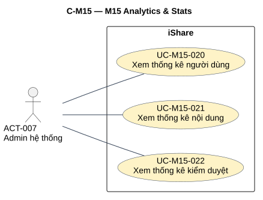
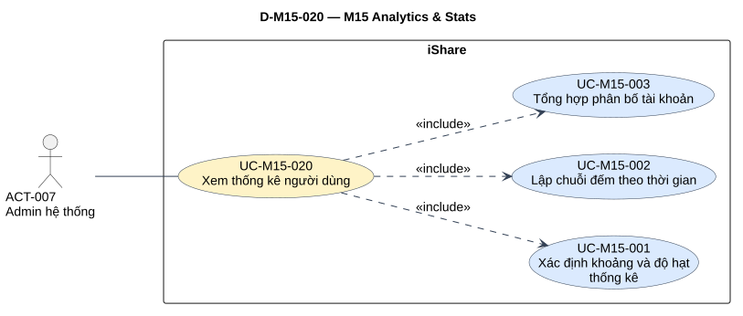
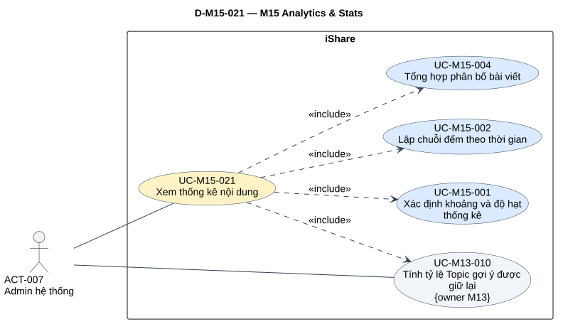
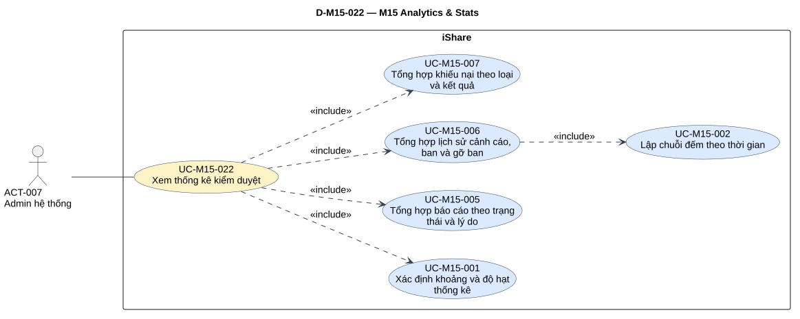

# Phân tích use case — M15 Analytics & Stats

[Vietnamese Doc] — Theo skill use-case-analysis v2.2; tiếng Việt, giữ thuật ngữ cần thiết.

Đầu ra: **3 UC chính, 7 UC con do M15 sở hữu**, tái sử dụng **UC-M13-010**; 12 mapping, 10 đặc tả chi tiết M15, 7 RULE, 93 mã hiệu lực. Bàn giao 4 SVG: tổng quan module và một detail cho mỗi core.

## Metadata và tiến độ

<!-- uc:document -->
| key | value |
| --- | --- |
| document_id | US-M15 |
| skill_version | 2.2 |
| mode | module |
| modules | M15 |
| scope | ALL |
| status | Chờ duyệt |
| current_step | 7 |
| completed_steps | 1, 2, 3, 4, 5, 6, 7 |
| approved_steps | - |
| source_baseline | FR-M15 v1.1; FR-M01 v1.10; FR-M02 v1.6; FR-M03 v1.10; FR-M04 v1.4; FR-M05 v1.7; FR-M08 v1.7; FR-M09 v1.2; FR-M10 v1.4; FR-M11 v1.3; FR-M13 v1.3 |
| author | Codex |
| date | 2026-11-02 |
| approval_evidence | Người dùng cho phép tự thực hiện các bước cần thiết ở lượt M04 trong chuỗi module. Thực hiện liên tục không phải phê duyệt US-M15 hoặc duyệt kết quả từng bước. |
| semantic_review | pass |
| diagram_check | pass |

| Bước | Kết quả | Xác nhận | Baseline | Làm lại khi |
| --- | --- | --- | --- | --- |
| 1 | 3 nhóm,68 FR chi tiết,22 BR; không mã bỏ; boundary/actor/TBD/giao tiếp | Được làm liên tục; chưa duyệt | FR-M15 v1.1 | Nguồn đổi |
| 2 | 3 core,7 sub M15 và 1 sub tham chiếu M13; 12 mapping | Chưa duyệt | FR-M15 v1.1; UC-M13-010 | Mục tiêu/owner đổi |
| 3 | 10 hợp đồng M15, brief tham chiếu M13,7 RULE; không AUT giả | Chưa duyệt | Luồng tại đây | Quyền/hành vi đổi |
| 4 | 12 include, có sub–sub UC006→UC002; 31 cặp/19 cặp không cạnh | Chưa duyệt | Hợp đồng tại đây | Điểm gọi đổi |
| 5 | 93 dòng truy vết,90 tiêu chí chi tiết/BR; 10 FR liên quan | Chưa duyệt | FR-M15 v1.1; FR-M01 v1.10; FR-M02 v1.6; FR-M03 v1.10; FR-M04 v1.4; FR-M05 v1.7; FR-M08 v1.7; FR-M09 v1.2; FR-M10 v1.4; FR-M11 v1.3; FR-M13 v1.3 | Baseline đổi |
| 6 | Đã render/kiểm hình 4 view; đúng node/12 cạnh; mỗi view một SVG | Chưa duyệt | PlantUML cục bộ | Mô hình/QA đổi |
| 7 | Đã review nguồn/ngữ nghĩa/truy vết/UML/hình/link và giới hạn nguồn; hồ sơ Chờ duyệt | Chưa duyệt | Skill v2.2 | Phản hồi/nguồn đổi |

## 1. Phạm vi, nguồn và tổng hợp yêu cầu

**Mục đích sử dụng:** review nghiệp vụ M15, đầu vào thiết kế/kiểm thử và ghép UC chính hệ thống. Mục 2 là catalog/phân rã; mục 3 hợp đồng/quy tắc; mục 4 quan hệ; mục 5 truy vết/giao tiếp; mục 6 sơ đồ; mục 7 QA/giới hạn nguồn.

**Subject/boundary:** toàn iShare. M01/M02/M03/M04/M05/M08/M09/M10/M11/M13 là thành phần nội bộ, không actor ngoài subject. M15 không gọi AI; phép tính tỷ lệ M13 cũng không gọi provider. Không actor Hệ thống/clock/scheduler/M13 hoặc dịch vụ AI giả.

**Trong phạm vi:** ba trang người dùng/nội dung/kiểm duyệt chỉ Admin; bốn khoảng thời gian; tính khi mở/đổi; cohort/timestamp/nhóm hiện tại; biểu đồ xu hướng; tỷ lệ Topic owner M13; nhóm rỗng 0 và tỷ lệ no-data.

**Ngoài phạm vi:** thiết kế/hiện thực UI/API/CSDL/cron/truy vấn/cache, ghi dữ liệu nghiệp vụ/hoạt động mới, batch số tổng, realtime/polling; xuất tệp/CSV, khoảng tùy ý, DAU/WAU/MAU; leaderboard Mod, thống kê cá nhân/bảng xếp hạng, upvote/ngày/Tag phổ biến, tỷ lệ bài nhóm/ẩn danh, đánh giá AI kiểm duyệt/precision/recall/F 1/accuracy/train; drill-down xem nội dung/log từ số tổng hoặc sửa dữ liệu owner.

**Baseline:** [FR-M15](../fr/FR-M15.md) v1.1, Đã chốt 2026-10-24; mốc DEC-271, QA-477, ISS-415, OPEN-012. **93 mã hiệu lực =3 nhóm +68 FR chi tiết +22 BR**, không FR/BR đã bỏ. Hai TBD/OPEN về CSV và hoạt động hoãn có chủ đích mức Thấp, giữ mục 7. 2. Tái sử dụng [UC-M13-010](US-M13.md#uc-m13-010), giữ ID/tên/owner/level/actor, không lấy US thay nguồn tính năng FR.

<!-- uc:sources -->
| path | version | role |
| --- | --- | --- |
| docs/specs/fr/FR-M15.md | 1.1 | owner |
| docs/specs/fr/FR-M01.md | 1.10 | related |
| docs/specs/fr/FR-M02.md | 1.6 | related |
| docs/specs/fr/FR-M03.md | 1.10 | related |
| docs/specs/fr/FR-M04.md | 1.4 | related |
| docs/specs/fr/FR-M05.md | 1.7 | related |
| docs/specs/fr/FR-M08.md | 1.7 | related |
| docs/specs/fr/FR-M09.md | 1.2 | related |
| docs/specs/fr/FR-M10.md | 1.4 | related |
| docs/specs/fr/FR-M11.md | 1.3 | related |
| docs/specs/fr/FR-M13.md | 1.3 | related |

Phương pháp: [skill](../../../.agent-instructions/skills/use-case-analysis/SKILL.md), [modeling rules](../../../.agent-instructions/skills/use-case-analysis/references/modeling-rules.md), [diagram rules](../../../.agent-instructions/skills/use-case-analysis/references/diagram-rules.md). Ví dụ phương pháp không cung cấp tính năng; không sửa FR/register/US khác.

### 1.1 Actor và quyền

<!-- uc:actors -->
| id | name | kind | parent | boundary_reason | sources |
| --- | --- | --- | --- | --- | --- |
| ACT-007 | Admin hệ thống | human | - | Người ngoài iShare có mục tiêu xem ba trang thống kê; kiểm quyền trong mỗi core. Không Root Admin riêng. | FR-M15-01.12, FR-M15-02.16, FR-M15-03.16, BR-M15-01 |
| ACT-001 | Guest | human | - | Vai trò có thể gửi yêu cầu mở trang nhưng chỉ nhận từ chối; không actor mục tiêu thống kê/không association xem trong hình. | FR-M15-01.12, FR-M15-02.16, FR-M15-03.16 |
| ACT-002 | Người dùng đã đăng nhập | human | - | Vai trò User không được xem số liệu; chỉ là nhánh kiểm quyền, không goal được cấp. | FR-M15-01.12, FR-M15-02.16, FR-M15-03.16 |
| ACT-008 | Mod hệ thống | human | - | Không quyền thống kê, kể cả kiểm duyệt của chính mình; không association xem và không suy kế thừa quyền Admin. | FR-M15-03.09, FR-M15-03.16, BR-M15-01 |

Giữ ID actor chung. Chỉ ACT-007 có association mục tiêu xem. Guest/User/Mod được khai báo để truy nhánh từ chối, không gắn oval xem như mục tiêu được cấp. Không vẽ generalization actor trong view Admin-only vì không có tương tác kế thừa cần biểu diễn; không đổi hierarchy RBAC M10. Primary của Subfunction hưởng lợi qua core, không nút gọi trực tiếp mới.

### 1.2 Kiểm kê và tổng hợp

| Nhóm FR | Nội dung | Chi tiết | Biểu diễn | Owner |
| --- | --- | --- | --- | --- |
| FR-M15-01 | Sáu trạng thái; xu hướng mọi tài khoản tạo; role/Lớp-Khối/mức chỉ hoàn tất không DELETED; quyền/khoảng/tính trực tiếp/0. | 19 | [UC-M15-020](#uc-m15-020), [UC-M15-003](#uc-m15-003) | M15 |
| FR-M15-02 | Không Nháp; nhóm/ẩn danh/ẩn/xóa vẫn đếm; tạo khác đăng; Topic gộp; bình luận lịch sử; tỷ lệ M13/no-data. | 27 | [UC-M15-021](#uc-m15-021), [UC-M15-004](#uc-m15-004), [UC-M13-010](#uc-m13-010) | M15; tỷ lệ M13 |
| FR-M15-03 | Báo cáo per-record, lý do tách loại; mức sau cảnh cáo; mọi ban/gỡ thủ công; khiếu nại cohort gửi/nhóm hiện tại. | 22 | [UC-M15-022](#uc-m15-022), [UC-M15-005](#uc-m15-005), [UC-M15-006](#uc-m15-006), [UC-M15-007](#uc-m15-007) | M15 |

| Chỉ số | Mốc chọn khoảng | Nhóm/eligibility | Khác biệt cần giữ |
| --- | --- | --- | --- |
| Ô trạng thái tài khoản | Tạo tài khoản | Sáu nhóm hiện tại, gồm chờ và DELETED | Không đợi hoàn tất mới đếm |
| Role/Lớp-Khối/mức | Tạo tài khoản | Đã xong bước 3, không DELETED; giá trị hiện tại | Khác tổng trạng thái; dùng Lớp/Khối hồ sơ |
| Đăng ký mới | Tạo tài khoản | Mọi tài khoản, gồm chưa xong/đã xóa | Không đăng nhập/lần liên kết Google |
| Trạng thái bài/kiểm duyệt/Topic | Tạo bài | Không Nháp; giá trị/danh mục hiện tại | Không feed filter; gộp Topic chống trùng |
| Bài mới | Đăng bài | Bài không Nháp từng đăng trong khoảng | Khác cohort tạo của phân bố |
| Bình luận mới | Đăng bình luận | Gốc/trả lời; về sau xóa/ẩn vẫn tính | Không số comment đang hiển thị của bài |
| Tỷ lệ Topic | Ghi phản hồi M05 | M13 tính, gồm phản hồi Deleted vô danh | Không call/log AI; không phản hồi=no-data |
| Báo cáo | Tạo từng báo cáo | Trạng thái/kết luận hiện tại, lý do theo loại | Không đếm vụ/lý do kết luận |
| Cảnh cáo | Ra cảnh cáo | Mức ngay sau lần ra; gồm đã bỏ/bị lật | Không mức hiện tại của người đó |
| Ban | Ra/bắt đầu ban | Tạm thời/vĩnh viễn, kể cả bị lật | Khác công thức leo thang loại ban bị lật |
| Gỡ ban | Gỡ Mod/Admin | Chỉ gỡ thủ công | Không hết hạn/lật, không mốc ra ban |
| Khiếu nại | Gửi khiếu nại | Loại/kết quả hiện tại | Gộp là một bài viết, không cohort ngày kết luận |

## 2. UC chính và UC con

### 2.1 Catalog hai tầng

<!-- uc:catalog -->
| id | name | tier | level | primary | supporting | owner | anchor | sources |
| --- | --- | --- | --- | --- | --- | --- | --- | --- |
| UC-M15-020 | Xem thống kê người dùng | core | User goal | ACT-007 | - | M15 | #uc-m15-020 | FR-M15-01, BR-M15-07, BR-M15-20 |
| UC-M15-021 | Xem thống kê nội dung | core | User goal | ACT-007 | - | M15 | #uc-m15-021 | FR-M15-02, BR-M15-08, BR-M15-09, BR-M15-17, BR-M15-21 |
| UC-M15-022 | Xem thống kê kiểm duyệt | core | User goal | ACT-007 | - | M15 | #uc-m15-022 | FR-M15-03, BR-M15-10, BR-M15-11, BR-M15-12, BR-M15-13, BR-M15-14, BR-M15-22 |
| UC-M15-001 | Xác định khoảng và độ hạt thống kê | sub | Subfunction | ACT-007 | - | M15 | #uc-m15-001 | BR-M15-03, BR-M15-04, BR-M15-18, BR-M15-19 |
| UC-M15-002 | Lập chuỗi đếm theo thời gian | sub | Subfunction | ACT-007 | - | M15 | #uc-m15-002 | BR-M15-04, BR-M15-05, BR-M15-19, BR-M15-20, BR-M15-21, BR-M15-22 |
| UC-M15-003 | Tổng hợp phân bố tài khoản | sub | Subfunction | ACT-007 | - | M15 | #uc-m15-003 | FR-M15-01.01, FR-M15-01.03, FR-M15-01.04, FR-M15-01.05, FR-M15-01.15, FR-M15-01.17, BR-M15-07, BR-M15-18, BR-M15-20 |
| UC-M15-004 | Tổng hợp phân bố bài viết | sub | Subfunction | ACT-007 | - | M15 | #uc-m15-004 | FR-M15-02.01, FR-M15-02.02, FR-M15-02.04, FR-M15-02.05, FR-M15-02.19, FR-M15-02.20, FR-M15-02.21, FR-M15-02.22, FR-M15-02.27, BR-M15-08, BR-M15-17, BR-M15-21 |
| UC-M15-005 | Tổng hợp báo cáo theo trạng thái và lý do | sub | Subfunction | ACT-007 | - | M15 | #uc-m15-005 | FR-M15-03.01, FR-M15-03.02, FR-M15-03.03, BR-M15-11, BR-M15-12, BR-M15-18, BR-M15-22 |
| UC-M15-006 | Tổng hợp lịch sử cảnh cáo, ban và gỡ ban | sub | Subfunction | ACT-007 | - | M15 | #uc-m15-006 | FR-M15-03.04, FR-M15-03.05, FR-M15-03.06, BR-M15-13, BR-M15-14, BR-M15-22 |
| UC-M15-007 | Tổng hợp khiếu nại theo loại và kết quả | sub | Subfunction | ACT-007 | - | M15 | #uc-m15-007 | FR-M15-03.07, FR-M15-03.08, BR-M15-10, BR-M15-18, BR-M15-22 |
| UC-M13-010 | Tính tỷ lệ Topic gợi ý được giữ lại | sub | Subfunction | ACT-007 | - | M13 | #uc-m13-010 | FR-M13-10, BR-M13-23, BR-M13-24, BR-M13-29, FR-M15-02.07, FR-M15-02.08, FR-M15-02.09, BR-M15-09 |

Ba core là User goal có kết quả mỗi lần Admin mở/đổi trang; bảy sub M15 là Subfunction gắn kết/dùng chung, không mỗi nhãn biểu đồ một oval. UC-M13-010 là sub tham chiếu owner M13 đã có, không đổi ID/tên hoặc tạo phép tính trùng.

### 2.2 Phân rã chính → con

<!-- uc:decomposition -->
| core | sub | rationale | sources |
| --- | --- | --- | --- |
| UC-M15-020 | UC-M15-001 | Khoảng/độ hạt dùng chung. | BR-M15-03, BR-M15-04, BR-M15-18, BR-M15-19 |
| UC-M15-020 | UC-M15-002 | Chuỗi số đếm thời gian; core 022 dùng qua UC006. | BR-M15-04, BR-M15-05, BR-M15-19, BR-M15-20, BR-M15-21, BR-M15-22 |
| UC-M15-020 | UC-M15-003 | Cơ cấu tài khoản với eligibility riêng. | FR-M15-01.01, FR-M15-01.03, FR-M15-01.04, FR-M15-01.05, FR-M15-01.15, FR-M15-01.17, BR-M15-07, BR-M15-18, BR-M15-20 |
| UC-M15-021 | UC-M15-001 | Khoảng/độ hạt dùng chung. | BR-M15-03, BR-M15-04, BR-M15-18, BR-M15-19 |
| UC-M15-021 | UC-M15-002 | Chuỗi số đếm thời gian; core 022 dùng qua UC006. | BR-M15-04, BR-M15-05, BR-M15-19, BR-M15-20, BR-M15-21, BR-M15-22 |
| UC-M15-021 | UC-M15-004 | Cơ cấu bài/Topic hiện tại theo cohort tạo. | FR-M15-02.01, FR-M15-02.02, FR-M15-02.04, FR-M15-02.05, FR-M15-02.19, FR-M15-02.20, FR-M15-02.21, FR-M15-02.22, FR-M15-02.27, BR-M15-08, BR-M15-17, BR-M15-21 |
| UC-M15-021 | UC-M13-010 | Tỷ lệ do owner M13 tính, dùng trong trang Nội dung, giữ ID. | FR-M13-10, BR-M13-23, BR-M13-24, BR-M13-29, FR-M15-02.07, FR-M15-02.08, FR-M15-02.09, BR-M15-09 |
| UC-M15-022 | UC-M15-001 | Khoảng/độ hạt dùng chung. | BR-M15-03, BR-M15-04, BR-M15-18, BR-M15-19 |
| UC-M15-022 | UC-M15-002 | Chuỗi số đếm thời gian; core 022 dùng qua UC006. | BR-M15-04, BR-M15-05, BR-M15-19, BR-M15-20, BR-M15-21, BR-M15-22 |
| UC-M15-022 | UC-M15-005 | Số báo cáo đúng đơn vị/trạng thái/lý do. | FR-M15-03.01, FR-M15-03.02, FR-M15-03.03, BR-M15-11, BR-M15-12, BR-M15-18, BR-M15-22 |
| UC-M15-022 | UC-M15-006 | Lịch sử cảnh cáo/ban/gỡ và chuỗi sự kiện. | FR-M15-03.04, FR-M15-03.05, FR-M15-03.06, BR-M15-13, BR-M15-14, BR-M15-22 |
| UC-M15-022 | UC-M15-007 | Cơ cấu khiếu nại loại/kết quả hiện tại. | FR-M15-03.07, FR-M15-03.08, BR-M15-10, BR-M15-18, BR-M15-22 |

Mapping là phân rã, không tự sinh UML. UC001/002 giữ một ID qua view; mapping UC002 trong core 022 không buộc core gọi trực tiếp vì UC006 mới là nơi chèn.

### 2.3 Mô hình cho tổng quan hệ thống

<!-- uc:module-models -->
| module | path | baseline |
| --- | --- | --- |

Chưa có US-overview.md tại baseline. Khi tổng hợp sau, lấy nguyên ba core M15 ở catalog và link về module; không đưa sub/UC-M13-010 lên tổng quan như core M15.

### 2.4 Quyết định phân tích

| Quyết định | Hành vi | Biểu diễn | Lý do | Không chọn |
| --- | --- | --- | --- | --- |
| D 01 | Ba trang | 3 core User goal | Từng lần xem có mục tiêu/kết quả cụ thể. | Core chỉ là package Quản lý thống kê. |
| D 02 | Khoảng và chia cột | UC001/002 dùng chung | Khoảng độc lập loại sự kiện, chuỗi có timestamp caller chỉ định. | Oval cho mỗi nút lọc/cột. |
| D 03 | Phân bố các miền | UC003/004/005/007 | Eligibility/đơn vị/nhóm khác, hợp đồng riêng. | Một oval mỗi chỉ số hoặc CRUD. |
| D 04 | Cảnh cáo/ban/gỡ | UC006 include UC002 | Phân loại lịch sử rồi chia cột dùng chung; sub–sub thật. | Core 022 gọi UC002 hai lần/bắc cầu. |
| D 05 | Chất lượng Topic | UC-M13-010 tham chiếu | Owner M13 tính, M15 trình bày, một ID. | Tính lại ở M15 hoặc actor M13/AI giả. |
| D 06 | Quyền/rỗng/giới hạn | Bước/nhánh/RULE | Đủ hành vi không cần mỗi guard một oval. | Include Đăng nhập/extend mọi nhóm 0. |
| D 07 | Tính khi mở/đổi | Luồng UC, không AUT | Không tác vụ nền độc lập trong M15. | Batch/cron/ghi log hoạt động mới. |
| D 08 | Đếm dữ liệu riêng/ẩn/xóa | Aggregate theo nguồn | Số tổng không cấp quyền browse. | Drill-down hoặc feedfilter loại bài khỏi tổng. |

## 3. Đặc tả

### 3.1 UC chính

#### UC-M15-020 — Xem thống kê người dùng

**UC con:** [UC-M15-001](#uc-m15-001), [UC-M15-002](#uc-m15-002), [UC-M15-003](#uc-m15-003). **Nguồn:** FR-M15-01, BR-M15-07, BR-M15-20.

<!-- uc:spec UC-M15-020 -->
| key | value |
| --- | --- |
| goal | Nắm tình hình tài khoản theo cohort tạo trong khoảng, các phân bố hiện tại và xu hướng đăng ký mới. |
| subject | iShare |
| level | User goal |
| primary | ACT-007 |
| supporting | - |
| trigger | Mở trang thống kê người dùng hoặc đổi khoảng thời gian trên trang. |
| preconditions | iShare nhận được yêu cầu mở/đổi khoảng; phiên và vai trò kiểm trong luồng, không giả định mọi người gọi đều là Admin. |
| success | Các phân bố và chuỗi đăng ký mới đúng khoảng/nhóm, nhóm không có dữ liệu là 0; lần mở mới mặc định Toàn thời gian. |
| failure | Người không phải Admin bị từ chối; không cấp số liệu vì cờ tắt/bật, không xuất tệp hoặc dùng thống kê cũ thay tính lại. Lỗi truy xuất xem NOTE-M15-01. |
| abstract | false |
| common_contract | Không áp dụng generalization UC; hợp đồng cụ thể ở trigger/điều kiện/luồng/kết quả. |

**Luồng chính:**

| Bước | Ai | Hành động/phản hồi | Tiếp tục | Nguồn |
| --- | --- | --- | --- | --- |
| 1 | ACT-007 / iShare | Admin yêu cầu mở trang hoặc đổi khoảng; iShare kiểm phiên và vai trò ADMIN trước khi cấp số liệu. | [Bước2](#uc-m15-020-main-2) | FR-M15-01.12, BR-M15-01 |
| 2 | iShare | Chèn UC-M15-001 để lấy ngữ cảnh thời gian: khi mở trang mặc định Toàn thời gian, khi đổi dùng một trong bốn lựa chọn; ranh giới/độ hạt giờ Việt Nam. | [Bước3](#uc-m15-020-main-3) | FR-M15-01.07, FR-M15-01.08, FR-M15-01.10, FR-M15-01.16, FR-M15-01.18, FR-M15-01.19 |
| 3 | iShare | Chèn UC-M15-003 để tính trực tiếp các phân bố tài khoản tạo trong khoảng, dùng trạng thái/role/Lớp-Khối/mức hiện tại và eligibility riêng từng chỉ số. | [Bước4](#uc-m15-020-main-4) | FR-M15-01.01, FR-M15-01.03, FR-M15-01.04, FR-M15-01.05, FR-M15-01.09, FR-M15-01.15, FR-M15-01.17 |
| 4 | iShare | Chèn UC-M15-002 với chuỗi đăng ký mới: mỗi tài khoản được tạo một lần theo thời điểm tạo, email xong bước 1 hoặc Google lần đầu tạo tài khoản mới; gồm tài khoản chưa hoàn tất/DELETED. | [Bước5](#uc-m15-020-main-5) | FR-M15-01.02, FR-M15-01.19, BR-M15-20, FR-M01-01.01, FR-M01-04.01 |
| 5 | iShare | Hiển thị đủ số đếm/phân bố và biểu đồ xu hướng, nhóm/cột không có dữ liệu hiện 0. Không DAU/WAU/MAU, CSV hoặc tự làm mới theo chu kỳ. Mọi chỉ số tính lại khi mở/đổi, không phụ thuộc cờ tính năng. | END: kết quả thành công theo hợp đồng. | FR-M15-01.06, FR-M15-01.09, FR-M15-01.11, FR-M15-01.13, FR-M15-01.14, BR-M15-05, BR-M15-06 |

**Luồng thay thế và ngoại lệ:**

| ID nhánh | Bước rẽ | Điều kiện | Xử lý | Quay lại/kết thúc | Nguồn |
| --- | --- | --- | --- | --- | --- |
| A 1 | [Bước1](#uc-m15-020-main-1) | Người chưa đăng nhập hoặc vai trò không phải ADMIN | Từ chối trang/số liệu; Mod cũng không được xem số liệu xử lý của chính mình. Nguồn chưa chốt câu báo lỗi/đích chuyển trang. | END: không được xem thống kê. | FR-M15-01.12, BR-M15-01 |
| A 2 | [Bước2](#uc-m15-020-main-2) | Admin đổi sang Hôm nay,7 ngày hoặc 30 ngày | UC001 cấp khoảng lịch/độ hạt tương ứng, thực hiện lại toàn bộ UC003/UC002 cho trang; không chỉ thay nhãn hoặc một biểu đồ. | [Trở về bước](#uc-m15-020-main-3) | FR-M15-01.07, FR-M15-01.08, FR-M15-01.18, FR-M15-01.19 |
| A 3 | [Bước3](#uc-m15-020-main-3) | Trong khoảng không có tài khoản thuộc một nhóm hoặc không có đăng ký mới | Nhóm/cột đếm có giá trị 0; không dùng thông báo không dữ liệu của tỷ lệ Topic thay cho số đếm. | [Trở về bước](#uc-m15-020-main-5) | FR-M15-01.11, BR-M15-19 |

**Quy tắc:** áp [RULE-M15-001](#rule-m15-001), [RULE-M15-002](#rule-m15-002), [RULE-M15-003](#rule-m15-003), [RULE-M15-004](#rule-m15-004), [RULE-M15-005](#rule-m15-005), [RULE-M15-006](#rule-m15-006), [RULE-M15-007](#rule-m15-007) theo ngữ cảnh. Không lấy dữ liệu công khai làm tập thống kê hoặc tự bổ sung hành vi thiếu nguồn; các NOTE mục 7. 2 là giới hạn cần review.

#### UC-M15-021 — Xem thống kê nội dung

**UC con:** [UC-M15-001](#uc-m15-001), [UC-M15-002](#uc-m15-002), [UC-M15-004](#uc-m15-004), [UC-M13-010](#uc-m13-010). **Nguồn:** FR-M15-02, BR-M15-08, BR-M15-09, BR-M15-17, BR-M15-21.

<!-- uc:spec UC-M15-021 -->
| key | value |
| --- | --- |
| goal | Nắm cơ cấu bài, diễn biến bài/bình luận mới và chất lượng gợi ý Topic từ dữ liệu đã ghi. |
| subject | iShare |
| level | User goal |
| primary | ACT-007 |
| supporting | - |
| trigger | Mở trang thống kê nội dung hoặc đổi khoảng thời gian. |
| preconditions | Nhận yêu cầu; kiểm quyền trong luồng. Không yêu cầu AI tổng/Topic hay cờ module nguồn phải bật. |
| success | Sáu trạng thái đăng, ba trạng thái kiểm duyệt, Topic hiện tại, hai xu hướng và tỷ lệ M13/no-data được trình bày đúng hợp đồng. |
| failure | Không loại dữ liệu thống kê vì bài không còn công khai; không đưa Nháp vào chỉ số. Người không Admin bị từ chối; lỗi nguồn/mẫu số 0 được giữ là giới hạn, không tự dựng tỷ lệ. |
| abstract | false |
| common_contract | Không áp dụng generalization UC; hợp đồng cụ thể ở trigger/điều kiện/luồng/kết quả. |

**Luồng chính:**

| Bước | Ai | Hành động/phản hồi | Tiếp tục | Nguồn |
| --- | --- | --- | --- | --- |
| 1 | ACT-007 / iShare | Admin mở trang hoặc đổi khoảng; iShare kiểm quyền ADMIN trước khi truy xuất số liệu. | [Bước2](#uc-m15-021-main-2) | FR-M15-02.16, BR-M15-01 |
| 2 | iShare | Chèn UC-M15-001 để lấy khoảng/độ hạt cùng múi giờ; lần mở trang mặc định Toàn thời gian. | [Bước3](#uc-m15-021-main-3) | FR-M15-02.11, FR-M15-02.12, FR-M15-02.14, FR-M15-02.23, FR-M15-02.25, FR-M15-02.26 |
| 3 | iShare | Chèn UC-M15-004 để tổng hợp phân bố bài không phải Nháp: cohort theo thời điểm tạo, trạng thái/Topic hiện tại, gồm bài nhóm/ẩn danh/bị ẩn do tác giả hoặc nhóm/bị gỡ khỏi nhóm. | [Bước4](#uc-m15-021-main-4) | FR-M15-02.01, FR-M15-02.02, FR-M15-02.04, FR-M15-02.05, FR-M15-02.19, FR-M15-02.20, FR-M15-02.21, FR-M15-02.22, FR-M15-02.27 |
| 4 | iShare | Chèn UC-M15-002 cho hai chuỗi độc lập: bài mới theo thời điểm đăng và bình luận mới theo thời điểm đăng. Bài phải không Nháp; bình luận gốc/trả lời đã đăng vẫn được đếm dù về sau xóa/ẩn. Không lấy cùng cohort thời điểm tạo của bước 3 cho chuỗi bài mới. | [Bước5](#uc-m15-021-main-5) | FR-M15-02.03, FR-M15-02.06, FR-M15-02.19, FR-M15-02.26, BR-M15-21, BR-M04-03 |
| 5 | iShare | Chèn UC-M13-010 (owner M13, giữ ID) với đúng khoảng đã chọn để nhận tỷ lệ tổng hợp từ phản hồi M05 hoặc không có dữ liệu. Không gọi nhà cung cấp AI, kể cả khi AI tổng/Topic tắt. | [Bước6](#uc-m15-021-main-6) | FR-M15-02.07, FR-M15-02.08, FR-M15-02.09, BR-M15-09, FR-M13-10.01, FR-M13-10.02, FR-M13-10.03 |
| 6 | iShare | Trình bày các số đếm/biểu đồ và chỉ số Topic: nhóm/cột không dữ liệu là 0, còn không có phản hồi Topic thì hiển thị không có dữ liệu thay vì 0%. Không chỉ số bị bỏ/CSV/drill-down nội dung. | END: kết quả thành công theo hợp đồng. | FR-M15-02.10, FR-M15-02.13, FR-M15-02.15, FR-M15-02.17, FR-M15-02.18, BR-M15-05, BR-M15-09, BR-M15-16 |

**Luồng thay thế và ngoại lệ:**

| ID nhánh | Bước rẽ | Điều kiện | Xử lý | Quay lại/kết thúc | Nguồn |
| --- | --- | --- | --- | --- | --- |
| A 1 | [Bước1](#uc-m15-021-main-1) | Người chưa đăng nhập hoặc vai trò không phải ADMIN | Từ chối trang/số liệu; Mod cũng không được xem số liệu xử lý của chính mình. Nguồn chưa chốt câu báo lỗi/đích chuyển trang. | END: không được xem thống kê. | FR-M15-02.16, BR-M15-01 |
| A 2 | [Bước2](#uc-m15-021-main-2) | Admin đổi khoảng thời gian | Tính lại mọi chỉ số gồm tỷ lệ M13, mỗi chỉ số theo timestamp riêng; không dùng số tính sẵn hoặc chỉ đổi một khung biểu đồ. | [Trở về bước](#uc-m15-021-main-3) | FR-M15-02.11, FR-M15-02.13, FR-M15-02.24 |
| A 3 | [Bước5](#uc-m15-021-main-5) | Không có phản hồi gợi ý Topic trong khoảng | M13 trả no-data; M15 hiện không có dữ liệu tại tỷ lệ, các số đếm/biểu đồ khác vẫn theo dữ liệu của chúng. | [Trở về bước](#uc-m15-021-main-6) | FR-M15-02.08, BR-M15-09, FR-M13-10.03 |
| A 4 | [Bước5](#uc-m15-021-main-5) | AI tổng hoặc Topic suggestion tắt | Vẫn dùng UC-M13-010 tính phản hồi đã ghi, gồm tài khoản đã xóa; không thay tỷ lệ bằng thông báo AI bận. | [Trở về bước](#uc-m15-021-main-6) | FR-M15-02.09, BR-M15-09, BR-M13-23 |
| A 5 | [Bước5](#uc-m15-021-main-5) | Có phản hồi nhưng tổng Topic gợi ý bằng 0 | Không tự gán 0%/100%, chia 0 hoặc bỏ các phản hồi; tình huống chưa chốt ở NOTE-M15-04/NOTE-M13-04. | END: giữ giới hạn nguồn cho chỉ số tỷ lệ. | BR-M15-09, BR-M13-29 |

**Quy tắc:** áp [RULE-M15-001](#rule-m15-001), [RULE-M15-002](#rule-m15-002), [RULE-M15-003](#rule-m15-003), [RULE-M15-004](#rule-m15-004), [RULE-M15-005](#rule-m15-005), [RULE-M15-006](#rule-m15-006), [RULE-M15-007](#rule-m15-007) theo ngữ cảnh. Không lấy dữ liệu công khai làm tập thống kê hoặc tự bổ sung hành vi thiếu nguồn; các NOTE mục 7. 2 là giới hạn cần review.

#### UC-M15-022 — Xem thống kê kiểm duyệt

**UC con:** [UC-M15-001](#uc-m15-001), [UC-M15-002](#uc-m15-002), [UC-M15-005](#uc-m15-005), [UC-M15-006](#uc-m15-006), [UC-M15-007](#uc-m15-007). **Nguồn:** FR-M15-03, BR-M15-10, BR-M15-11, BR-M15-12, BR-M15-13, BR-M15-14, BR-M15-22.

<!-- uc:spec UC-M15-022 -->
| key | value |
| --- | --- |
| goal | Nắm số báo cáo, lịch sử cảnh cáo/ban/gỡ và kết quả khiếu nại theo đúng đơn vị đếm của từng nghiệp vụ. |
| subject | iShare |
| level | User goal |
| primary | ACT-007 |
| supporting | - |
| trigger | Mở trang thống kê kiểm duyệt hoặc đổi khoảng thời gian. |
| preconditions | Nhận yêu cầu mở/đổi khoảng; quyền ADMIN được kiểm trước số liệu, Mod không có ngoại lệ xem chính mình. |
| success | Các phân bố báo cáo/khiếu nại và chuỗi cảnh cáo/ban/gỡ đúng khoảng và loại, tính từ dữ liệu đang có, số đếm rỗng 0. |
| failure | Không đưa số vụ thay số báo cáo; không giảm sự kiện lịch sử vì bị lật, không đếm tự hết hạn/lật là gỡ. Không xuất dữ liệu/Mod leaderboard. |
| abstract | false |
| common_contract | Không áp dụng generalization UC; hợp đồng cụ thể ở trigger/điều kiện/luồng/kết quả. |

**Luồng chính:**

| Bước | Ai | Hành động/phản hồi | Tiếp tục | Nguồn |
| --- | --- | --- | --- | --- |
| 1 | ACT-007 / iShare | Admin mở/đổi khoảng; iShare kiểm phiên và vai trò ADMIN, không cấp dữ liệu cho Mod kể cả số xử lý của chính Mod. | [Bước2](#uc-m15-022-main-2) | FR-M15-03.09, FR-M15-03.16, BR-M15-01 |
| 2 | iShare | Chèn UC-M15-001 xác lập khoảng/độ hạt, mặc định Toàn thời gian ở mỗi lần mở trang. | [Bước3](#uc-m15-022-main-3) | FR-M15-03.11, FR-M15-03.12, FR-M15-03.14, FR-M15-03.19, FR-M15-03.21, FR-M15-03.22 |
| 3 | iShare | Chèn UC-M15-005 tổng hợp từng báo cáo theo thời điểm tạo, nhóm trạng thái/kết luận tại lúc xem và lý do tách theo loại đối tượng. | [Bước4](#uc-m15-022-main-4) | FR-M15-03.01, FR-M15-03.02, FR-M15-03.03, FR-M15-03.20 |
| 4 | iShare | Chèn UC-M15-006 tổng hợp cảnh cáo theo mức đạt ngay sau sự kiện và ban/gỡ ban theo loại/thời điểm nghiệp vụ; UC006 chèn UC002 để tạo chuỗi theo thời gian. | [Bước5](#uc-m15-022-main-5) | FR-M15-03.04, FR-M15-03.05, FR-M15-03.06, FR-M15-03.22 |
| 5 | iShare | Chèn UC-M15-007 tổng hợp mỗi khiếu nại theo thời điểm gửi, loại ban/cảnh cáo/bài viết và kết quả hiện tại Chờ xét/Chấp nhận/Từ chối. | [Bước6](#uc-m15-022-main-6) | FR-M15-03.07, FR-M15-03.08, FR-M15-03.20 |
| 6 | iShare | Trình bày đủ số liệu, nhóm/cột không có dữ liệu 0. Không leaderboard Mod/CSV; cờ module khác tắt không chặn trang và không dùng batch hoặc kết quả cũ. | END: kết quả thành công theo hợp đồng. | FR-M15-03.10, FR-M15-03.13, FR-M15-03.15, FR-M15-03.17, FR-M15-03.18, BR-M15-05 |

**Luồng thay thế và ngoại lệ:**

| ID nhánh | Bước rẽ | Điều kiện | Xử lý | Quay lại/kết thúc | Nguồn |
| --- | --- | --- | --- | --- | --- |
| A 1 | [Bước1](#uc-m15-022-main-1) | Người chưa đăng nhập hoặc vai trò không phải ADMIN | Từ chối trang/số liệu; Mod cũng không được xem số liệu xử lý của chính mình. Nguồn chưa chốt câu báo lỗi/đích chuyển trang. | END: không được xem thống kê. | FR-M15-03.16, BR-M15-01 |
| A 2 | [Bước1](#uc-m15-022-main-1) | Người gọi là Mod xin chỉ xem thống kê kiểm duyệt của bản thân | Từ chối như các vai trò không Admin, không thêm bộ lọc theo người xử lý hoặc leaderboard cá nhân. | END: không được xem thống kê. | FR-M15-03.09, FR-M15-03.10, BR-M15-01, BR-M15-16 |
| A 3 | [Bước2](#uc-m15-022-main-2) | Admin đổi khoảng | Chạy lại UC005/UC006/UC007 với khoảng mới, UC006 gọi lại UC002; mọi chỉ số theo timestamp thích hợp. | [Trở về bước](#uc-m15-022-main-3) | FR-M15-03.11, FR-M15-03.13, FR-M15-03.20 |
| A 4 | [Bước3](#uc-m15-022-main-3) | Không có dữ liệu của một nhóm/loại/chuỗi trong khoảng | Hiển thị 0 ở nhóm/cột đó, không loại bỏ hoặc tạo sự kiện giả. | [Trở về bước](#uc-m15-022-main-6) | FR-M15-03.15, BR-M15-19 |

**Quy tắc:** áp [RULE-M15-001](#rule-m15-001), [RULE-M15-002](#rule-m15-002), [RULE-M15-003](#rule-m15-003), [RULE-M15-004](#rule-m15-004), [RULE-M15-005](#rule-m15-005), [RULE-M15-006](#rule-m15-006), [RULE-M15-007](#rule-m15-007) theo ngữ cảnh. Không lấy dữ liệu công khai làm tập thống kê hoặc tự bổ sung hành vi thiếu nguồn; các NOTE mục 7. 2 là giới hạn cần review.

### 3.2 UC con do M15 sở hữu

#### UC-M15-001 — Xác định khoảng và độ hạt thống kê

**Thuộc core:** UC-M15-020, UC-M15-021, UC-M15-022. **Nguồn:** BR-M15-03, BR-M15-04, BR-M15-18, BR-M15-19.

<!-- uc:spec UC-M15-001 -->
| key | value |
| --- | --- |
| goal | Cấp một ngữ cảnh khoảng lịch/độ hạt thống nhất để mọi chỉ số trên trang dùng cùng lựa chọn của Admin. |
| subject | iShare |
| level | Subfunction |
| primary | ACT-007 |
| supporting | - |
| trigger | Một core đã kiểm quyền yêu cầu ngữ cảnh cho mở trang hoặc đổi bộ lọc. |
| preconditions | Caller đã kiểm ADMIN; truyền loại yêu cầu và lựa chọn thời gian khi đổi. Không cần dữ liệu dương để xác định khoảng. |
| success | Khoảng Hôm nay/7 ngày/30 ngày/Toàn thời gian cùng mốc lúc xem, múi giờ UTC+7 và độ hạt giờ/ngày/tháng đúng nguồn. |
| failure | Không tự đổi sang giờ trượt hoặc nhận khoảng tùy ý; mốc bắt đầu biểu đồ Toàn thời gian khi dữ liệu rỗng chưa chốt NOTE-M15-02. |
| abstract | false |
| common_contract | Không áp dụng generalization UC; hợp đồng cụ thể ở trigger/điều kiện/luồng/kết quả. |

**Luồng chính:**

| Bước | Ai | Hành động/phản hồi | Tiếp tục | Nguồn |
| --- | --- | --- | --- | --- |
| 1 | iShare | Nhận ngữ cảnh trang và mở mới/đổi khoảng. Mở trang chọn Toàn thời gian; đổi khoảng dùng đúng một trong bốn lựa chọn có sẵn, không nhớ bộ lọc trang trước làm mặc định mới. | [Bước2](#uc-m15-001-main-2) | BR-M15-03, FR-M15-01.16, FR-M15-02.23, FR-M15-03.19 |
| 2 | iShare | Xác lập lúc xem theo giờ Việt Nam Asia/Ho_Chi_Minh (UTC+7). Hôm nay từ 00:00 ngày đang xem tới lúc xem; 7/30 ngày từ 00:00 ngày đầu tính lùi gồm hôm nay. Toàn thời gian không giới hạn dữ liệu theo thời gian. | [Bước3](#uc-m15-001-main-3) | BR-M15-04, FR-M15-01.18, FR-M15-02.25, FR-M15-03.21 |
| 3 | iShare | Chọn độ hạt biểu đồ: Hôm nay mỗi cột một giờ,7/30 ngày mỗi cột một ngày, Toàn thời gian mỗi cột một tháng; không đồng nhất độ hạt với cách chọn cohort của phân bố. | [Bước4](#uc-m15-001-main-4) | BR-M15-19, FR-M15-01.19, FR-M15-02.26, FR-M15-03.22 |
| 4 | iShare | Trả ngữ cảnh cho caller. Mỗi chỉ số lọc bằng timestamp đã quy định riêng và dùng trạng thái/nhóm tại lúc xem, không dựng snapshot lịch sử của đầu/cuối kỳ; mức cảnh cáo ngay sau một cảnh cáo là ngoại lệ dữ liệu lịch sử rõ ở UC006. | END: kết quả thành công theo hợp đồng. | BR-M15-18, BR-M15-20, BR-M15-21, BR-M15-22 |

**Luồng thay thế và ngoại lệ:**

| ID nhánh | Bước rẽ | Điều kiện | Xử lý | Quay lại/kết thúc | Nguồn |
| --- | --- | --- | --- | --- | --- |
| A 1 | [Bước1](#uc-m15-001-main-1) | Admin muốn khoảng tự chọn như 01/10–15/10 | Không cung cấp lựa chọn tùy ý; tiếp tục bằng một trong bốn lựa chọn hợp lệ, không tự thêm UX/thông báo lỗi cho request không hợp lệ. | END: phạm vi chỉ bốn lựa chọn đã chốt. | BR-M15-03 |
| A 2 | [Bước2](#uc-m15-001-main-2) | Chọn 7 ngày hoặc 30 ngày | Lùi 6 hoặc 29 ngày lịch từ ngày đang xem rồi lấy 00:00 giờ Việt Nam, không trừ 7×24/30×24 giờ từ lúc xem. | [Trở về bước](#uc-m15-001-main-3) | BR-M15-04 |
| A 3 | [Bước2](#uc-m15-001-main-2) | Chọn Toàn thời gian | Không đặt cận dưới lọc đối tượng; biểu đồ theo tháng. Nguồn chỉ minh họa mốc hệ thống bắt đầu chạy, phần khởi đầu/rỗng giữ NOTE-M15-02. | [Trở về bước](#uc-m15-001-main-3) | BR-M15-03, BR-M15-19 |

**Quy tắc:** áp [RULE-M15-001](#rule-m15-001), [RULE-M15-002](#rule-m15-002), [RULE-M15-003](#rule-m15-003), [RULE-M15-004](#rule-m15-004), [RULE-M15-005](#rule-m15-005), [RULE-M15-006](#rule-m15-006), [RULE-M15-007](#rule-m15-007) theo ngữ cảnh. Không lấy dữ liệu công khai làm tập thống kê hoặc tự bổ sung hành vi thiếu nguồn; các NOTE mục 7. 2 là giới hạn cần review.

#### UC-M15-002 — Lập chuỗi đếm theo thời gian

**Thuộc core:** UC-M15-020, UC-M15-021, UC-M15-022. **Nguồn:** BR-M15-04, BR-M15-05, BR-M15-19, BR-M15-20, BR-M15-21, BR-M15-22.

<!-- uc:spec UC-M15-002 -->
| key | value |
| --- | --- |
| goal | Cấp chuỗi số đếm theo giờ/ngày/tháng cho các sự kiện nghiệp vụ đã có, không thay đổi cách chọn dữ liệu của caller. |
| subject | iShare |
| level | Subfunction |
| primary | ACT-007 |
| supporting | - |
| trigger | Core 020 cần xu hướng đăng ký, core 021 cần bài/bình luận mới hoặc UC006 cần chuỗi cảnh cáo/ban/gỡ. |
| preconditions | Caller có quyền ADMIN/ngữ cảnh UC001 và xác định loại chuỗi, tập dữ liệu/thời điểm nghiệp vụ. Không lấy số tổng hiển thị công khai làm lịch sử thống kê. |
| success | Các sự kiện đúng khoảng được đếm một lần vào cột UTC+7 tương ứng, tách chuỗi theo loại/mức, cột không sự kiện 0. |
| failure | Không dùng timestamp cập nhật thay timestamp sự kiện, không tạo thêm log hoạt động; lỗi dữ liệu/mốc Toàn thời gian không tự điền. |
| abstract | false |
| common_contract | Không áp dụng generalization UC; hợp đồng cụ thể ở trigger/điều kiện/luồng/kết quả. |

**Luồng chính:**

| Bước | Ai | Hành động/phản hồi | Tiếp tục | Nguồn |
| --- | --- | --- | --- | --- |
| 1 | iShare | Nhận một hoặc nhiều chuỗi từ caller, từng chuỗi có timestamp và quy tắc eligibility: đăng ký dùng tạo tài khoản; bài mới dùng đăng bài không Nháp; bình luận mới dùng đăng bình luận; UC006 cấp cảnh cáo/ban/gỡ. | [Bước2](#uc-m15-002-main-2) | FR-M15-01.02, FR-M15-02.03, FR-M15-02.06, FR-M15-03.04, FR-M15-03.05, FR-M15-03.06, BR-M15-19 |
| 2 | iShare | Lọc bản ghi/sự kiện trong khoảng chọn bằng timestamp của chính loại đó; tài khoản chưa hoàn tất/DELETED, bình luận xóa/ẩn và cảnh cáo/ban bị lật vẫn có mặt khi caller quy định. Không lọc lại bằng điều kiện bài đang hiện trong feed hoặc chỉ cảnh cáo đang tính. | [Bước3](#uc-m15-002-main-3) | BR-M15-18, BR-M15-20, BR-M15-21, BR-M15-22 |
| 3 | iShare | Phân vào cột giờ/ngày/tháng theo UC001/UTC+7. Đếm từng tài khoản/bài/bình luận hoặc lần xử lý một lần; giữ riêng LIGHT/MEDIUM/HEAVY, ban tạm thời/vĩnh viễn và gỡ ban khi đầu vào có nhiều chuỗi. Chuỗi bình luận gồm bình luận gốc/trả lời, không dòng trích dẫn hoặc dấu xóa trên UI. | [Bước4](#uc-m15-002-main-4) | BR-M15-19, FR-M15-01.02, FR-M15-02.06, FR-M15-03.04, FR-M15-03.05, FR-M15-03.06, BR-M04-03 |
| 4 | iShare | Trả chuỗi đếm tính từ dữ liệu tại lượt xem/đổi khoảng; cột không có sự kiện hiện 0. Không lưu số tổng tính sẵn hoặc chạy một lịch batch. | END: kết quả thành công theo hợp đồng. | BR-M15-05, FR-M15-01.11, FR-M15-02.15, FR-M15-03.15 |

**Luồng thay thế và ngoại lệ:**

| ID nhánh | Bước rẽ | Điều kiện | Xử lý | Quay lại/kết thúc | Nguồn |
| --- | --- | --- | --- | --- | --- |
| A 1 | [Bước2](#uc-m15-002-main-2) | Cột trong khoảng không có sự kiện | Giữ cột và giá trị 0, không nội suy hoặc tạo sự kiện giả. | [Trở về bước](#uc-m15-002-main-4) | FR-M15-01.11, FR-M15-02.15, FR-M15-03.15, BR-M15-19 |
| A 2 | [Bước1](#uc-m15-002-main-1) | Không có dữ liệu hoặc chưa biết tháng bắt đầu biểu đồ Toàn thời gian | Số đếm nhóm rỗng vẫn 0; hình dạng/số cột Toàn thời gian rỗng chưa chốt NOTE-M15-02, không tự đặt tháng bắt đầu theo lần đăng nhập hoặc bản ghi đầu tiên. | END: phần biểu đồ khởi đầu cần nguồn bổ sung. | BR-M15-03, BR-M15-19 |

**Quy tắc:** áp [RULE-M15-001](#rule-m15-001), [RULE-M15-002](#rule-m15-002), [RULE-M15-003](#rule-m15-003), [RULE-M15-004](#rule-m15-004), [RULE-M15-005](#rule-m15-005), [RULE-M15-006](#rule-m15-006), [RULE-M15-007](#rule-m15-007) theo ngữ cảnh. Không lấy dữ liệu công khai làm tập thống kê hoặc tự bổ sung hành vi thiếu nguồn; các NOTE mục 7. 2 là giới hạn cần review.

#### UC-M15-003 — Tổng hợp phân bố tài khoản

**Thuộc core:** UC-M15-020. **Nguồn:** FR-M15-01.01, FR-M15-01.03, FR-M15-01.04, FR-M15-01.05, FR-M15-01.15, FR-M15-01.17, BR-M15-07, BR-M15-18, BR-M15-20.

<!-- uc:spec UC-M15-003 -->
| key | value |
| --- | --- |
| goal | Đếm đúng từng nhóm tài khoản hiện tại trong cohort tạo trong khoảng, bảo toàn sự khác nhau giữa ô trạng thái và các phân bố khác. |
| subject | iShare |
| level | Subfunction |
| primary | ACT-007 |
| supporting | - |
| trigger | Core 020 cần các phân bố người dùng sau khi có khoảng thời gian. |
| preconditions | Ngữ cảnh ADMIN/UC001; M01/M02/M08/M10 cung cấp dữ liệu nghiệp vụ hiện có. |
| success | Sáu nhóm trạng thái không trùng; ba phân bố vai trò/Lớp-Khối/mức chỉ đếm đã hoàn tất bước 3 và không DELETED; nhóm rỗng 0. |
| failure | Không đếm ACTIVE chưa hoàn tất vào nhóm ACTIVE đã hoàn tất, không đưa DELETED/chưa xong vào ba phân bố; không suy dữ liệu lịch sử đã xóa. |
| abstract | false |
| common_contract | Không áp dụng generalization UC; hợp đồng cụ thể ở trigger/điều kiện/luồng/kết quả. |

**Luồng chính:**

| Bước | Ai | Hành động/phản hồi | Tiếp tục | Nguồn |
| --- | --- | --- | --- | --- |
| 1 | iShare | Lấy tài khoản có thời điểm tạo nằm trong khoảng; Toàn thời gian lấy mọi tài khoản còn bản ghi, kể cả DELETED và chưa hoàn tất đăng ký. Không lọc theo ngày xác minh/xong bước 3 hoặc ngày đổi trạng thái. | [Bước2](#uc-m15-003-main-2) | FR-M15-01.17, BR-M15-18, BR-M15-20, FR-M01-12.03 |
| 2 | iShare | Xếp trạng thái hiện tại thành sáu nhóm loại trừ nhau: ACTIVE+NONE →Chờ xác minh email; ACTIVE+EMAIL_VERIFIED chưa SETUP_COMPLETED (kể cả Google) →Chờ hoàn tất hồ sơ; ACTIVE+SETUP_COMPLETED →ACTIVE; DEACTIVATED/BANNED/DELETED vào đúng trạng thái đó, không đồng thời ở nhóm chờ. | [Bước3](#uc-m15-003-main-3) | FR-M15-01.01, BR-M15-20, FR-M01-04.01 |
| 3 | iShare | Với ba phân bố sau, chỉ giữ tài khoản đã xong bước 3 và hiện không DELETED; vẫn có thể gồm DEACTIVATED/BANNED nếu đã hoàn tất. Đếm theo vai trò hiện tại USER/MODERATOR/ADMIN, mỗi tài khoản một vai trò. | [Bước4](#uc-m15-003-main-4) | FR-M15-01.03, FR-M15-01.15, BR-M15-20, BR-M10-01 |
| 4 | iShare | Đếm theo Lớp/Khối hiện tại trên hồ sơ 10/11/12/Chưa khai, không dùng Lớp/Khối trên bài và không khôi phục Lớp/Khối cá nhân của DELETED. | [Bước5](#uc-m15-003-main-5) | FR-M15-01.04, FR-M15-01.15, BR-M15-20, BR-M02-09, FR-M01-12.08 |
| 5 | iShare | Đếm năm nhóm mức: BANNED chỉ ở BANNED, các tài khoản ADMIN ở Sạch; tài khoản hợp lệ còn lại theo mức hiện tại Sạch/LIGHT/MEDIUM/HEAVY. Không đếm BANNED lần nữa ở mức cảnh cáo; Admin không nhận cảnh cáo/ban theo owner. | [Bước6](#uc-m15-003-main-6) | FR-M15-01.05, BR-M15-20, BR-M08-28, BR-M08-46 |
| 6 | iShare | Trả đủ phân bố, nhóm không có tài khoản hiện 0. Tổng ba phân bố chỉ bằng tập đã hoàn tất không DELETED, có thể nhỏ hơn tổng ô trạng thái/đăng ký mới. | END: kết quả thành công theo hợp đồng. | FR-M15-01.11, FR-M15-01.15, BR-M15-20 |

**Luồng thay thế và ngoại lệ:**

| ID nhánh | Bước rẽ | Điều kiện | Xử lý | Quay lại/kết thúc | Nguồn |
| --- | --- | --- | --- | --- | --- |
| A 1 | [Bước2](#uc-m15-003-main-2) | Tài khoản tạo trong khoảng nhưng về sau DELETED/chưa xong đăng ký | Vẫn đếm trong ô trạng thái đúng nhóm và xu hướng đăng ký; không vào vai trò/Lớp-Khối/mức nếu không đạt eligibility. | [Trở về bước](#uc-m15-003-main-3) | FR-M15-01.02, FR-M15-01.15, BR-M15-20 |
| A 2 | [Bước3](#uc-m15-003-main-3) | Tài khoản đổi role/trạng thái/Lớp-Khối/mức sau khi được tạo | Dùng giá trị tại lúc xem; thay role do ban/lật ban không làm quay lại role cũ để đếm, không biến cohort thành snapshot cuối kỳ. | [Trở về bước](#uc-m15-003-main-4) | FR-M15-01.17, BR-M15-18, BR-M10-09 |
| A 3 | [Bước4](#uc-m15-003-main-4) | Tài khoản hợp lệ không khai Lớp/Khối | Đếm vào Chưa khai, không bỏ tài khoản hoặc suy từ bài viết. | [Trở về bước](#uc-m15-003-main-5) | FR-M15-01.04, BR-M15-20, BR-M02-09 |

**Quy tắc:** áp [RULE-M15-001](#rule-m15-001), [RULE-M15-002](#rule-m15-002), [RULE-M15-003](#rule-m15-003), [RULE-M15-004](#rule-m15-004), [RULE-M15-005](#rule-m15-005), [RULE-M15-006](#rule-m15-006), [RULE-M15-007](#rule-m15-007) theo ngữ cảnh. Không lấy dữ liệu công khai làm tập thống kê hoặc tự bổ sung hành vi thiếu nguồn; các NOTE mục 7. 2 là giới hạn cần review.

#### UC-M15-004 — Tổng hợp phân bố bài viết

**Thuộc core:** UC-M15-021. **Nguồn:** FR-M15-02.01, FR-M15-02.02, FR-M15-02.04, FR-M15-02.05, FR-M15-02.19, FR-M15-02.20, FR-M15-02.21, FR-M15-02.22, FR-M15-02.27, BR-M15-08, BR-M15-17, BR-M15-21.

<!-- uc:spec UC-M15-004 -->
| key | value |
| --- | --- |
| goal | Đếm cơ cấu bài theo trạng thái và Topic hiện tại mà không nhầm tập bài công khai hoặc thời điểm đăng. |
| subject | iShare |
| level | Subfunction |
| primary | ACT-007 |
| supporting | - |
| trigger | Core 021 cần phân bố bài sau khi xác lập khoảng. |
| preconditions | Có quyền ADMIN/ngữ cảnh UC001; trạng thái/thời điểm tạo bài, danh mục/liên kết Topic hiện tại từ M03/M05/M11. |
| success | Ba phân bố dùng cohort tạo trong khoảng, loại Nháp, giữ bài ẩn/xóa/nhóm/ẩn danh, Topic gộp đúng/không trùng trong mỗi Topic. |
| failure | Không dùng feed filter, không đếm Nháp, không dựng Topic đã xóa hoặc truy cập nội dung riêng từ thống kê số lượng. |
| abstract | false |
| common_contract | Không áp dụng generalization UC; hợp đồng cụ thể ở trigger/điều kiện/luồng/kết quả. |

**Luồng chính:**

| Bước | Ai | Hành động/phản hồi | Tiếp tục | Nguồn |
| --- | --- | --- | --- | --- |
| 1 | iShare | Chọn bài có thời điểm tạo trong khoảng và hiện không Nháp. Không dùng thời điểm đăng để lấy cohort của ba phân bố này; loại Nháp khỏi mọi chỉ số nội dung. | [Bước2](#uc-m15-004-main-2) | FR-M15-02.19, FR-M15-02.21, BR-M15-21, FR-M03-01.08 |
| 2 | iShare | Đếm sáu trạng thái đăng hiện tại: Chờ duyệt, Đã đăng, Tự ẩn, Bị từ chối, Đã xóa, Đã xóa hẳn. Không bỏ bài vì nhóm/ẩn danh/tác giả DEACTIVATED/DELETED/nhóm Bị ẩn/dấu bị gỡ khỏi nhóm; gỡ nhóm không đổi trạng thái đăng. | [Bước3](#uc-m15-004-main-3) | FR-M15-02.01, FR-M15-02.20, FR-M15-02.27, BR-M15-21, FR-M03-17.02, FR-M11-14.01 |
| 3 | iShare | Đếm theo ba trạng thái kiểm duyệt hiện tại của cùng tập: Bình thường, Bị gắn cờ, Bị Mod ẩn. Không lấy quyền xem công khai làm điều kiện đếm và không biến dấu gỡ nhóm thành Bị Mod ẩn. | [Bước4](#uc-m15-004-main-4) | FR-M15-02.02, FR-M15-02.27, BR-M15-21 |
| 4 | iShare | Đếm mỗi bài một lần trong từng Topic hiện tại của bài, theo danh mục hiện hành. Bài có nhiều Topic góp vào mỗi Topic, tổng các dòng có thể lớn hơn tổng bài; Topic không có bài hợp lệ hiện 0. | [Bước5](#uc-m15-004-main-5) | FR-M15-02.04, FR-M15-02.22, FR-M15-02.15, BR-M15-17, BR-M15-21 |
| 5 | iShare | Trả các phân bố tính lúc xem. Bài bị ẩn/xóa vẫn được đếm theo chính trạng thái và Topic, không cung cấp danh sách chi tiết/drill-down đọc nội dung bị hạn chế từ số tổng. | END: kết quả thành công theo hợp đồng. | FR-M15-02.13, FR-M15-02.27, BR-M15-05, BR-M03-49, BR-M11-33 |

**Luồng thay thế và ngoại lệ:**

| ID nhánh | Bước rẽ | Điều kiện | Xử lý | Quay lại/kết thúc | Nguồn |
| --- | --- | --- | --- | --- | --- |
| A 1 | [Bước4](#uc-m15-004-main-4) | Topic nguồn đã gộp vào Topic đích | Dùng quan hệ sau gộp của M05: nguồn không còn dòng, bài có cả hai chỉ đóng góp một lần vào đích. Ví dụ 40+5 bài, giao 2 →43 bài ở đích, không 45. | [Trở về bước](#uc-m15-004-main-5) | FR-M15-02.05, BR-M15-17, FR-M05-07.01, FR-M05-07.02, BR-M05-09 |
| A 2 | [Bước2](#uc-m15-004-main-2) | Bài có trạng thái Đã xóa hẳn hoặc tác giả/nhóm bị ẩn | Bản ghi/liên kết còn theo owner, vẫn đếm trạng thái/Topic nếu trong cohort; không làm bài hiện lại hoặc mở quyền đọc bài. | [Trở về bước](#uc-m15-004-main-3) | FR-M15-02.27, BR-M15-21, FR-M03-17.02, BR-M11-27 |
| A 3 | [Bước1](#uc-m15-004-main-1) | Không có bài thuộc một nhóm hoặc Topic hiện tại | Trả 0 cho nhóm/Topic ấy, không đưa Nháp vào để lấp số. | [Trở về bước](#uc-m15-004-main-5) | FR-M15-02.15, FR-M15-02.19 |

**Quy tắc:** áp [RULE-M15-001](#rule-m15-001), [RULE-M15-002](#rule-m15-002), [RULE-M15-003](#rule-m15-003), [RULE-M15-004](#rule-m15-004), [RULE-M15-005](#rule-m15-005), [RULE-M15-006](#rule-m15-006), [RULE-M15-007](#rule-m15-007) theo ngữ cảnh. Không lấy dữ liệu công khai làm tập thống kê hoặc tự bổ sung hành vi thiếu nguồn; các NOTE mục 7. 2 là giới hạn cần review.

#### UC-M15-005 — Tổng hợp báo cáo theo trạng thái và lý do

**Thuộc core:** UC-M15-022. **Nguồn:** FR-M15-03.01, FR-M15-03.02, FR-M15-03.03, BR-M15-11, BR-M15-12, BR-M15-18, BR-M15-22.

<!-- uc:spec UC-M15-005 -->
| key | value |
| --- | --- |
| goal | Đếm từng báo cáo một lần, đúng kết luận hiện tại và đúng danh mục lý do theo loại đối tượng. |
| subject | iShare |
| level | Subfunction |
| primary | ACT-007 |
| supporting | - |
| trigger | Core 022 cần phân bố báo cáo trong khoảng. |
| preconditions | ADMIN/ngữ cảnh UC001; M08 có từng báo cáo, thời điểm tạo, loại/lý do/trạng thái và kết luận của vụ liên quan. |
| success | Số ở Mở/Đã xử lý–Có xử lý/Đã xử lý–Bác bỏ và các nhóm lý do tách theo loại; AI/request ban không bị mất hoặc nhân đôi. |
| failure | Không đếm vụ thay báo cáo, không gộp lý do Khác của nhiều loại, không dùng lý do kết luận thay lý do trên từng báo cáo. |
| abstract | false |
| common_contract | Không áp dụng generalization UC; hợp đồng cụ thể ở trigger/điều kiện/luồng/kết quả. |

**Luồng chính:**

| Bước | Ai | Hành động/phản hồi | Tiếp tục | Nguồn |
| --- | --- | --- | --- | --- |
| 1 | iShare | Lấy từng báo cáo có thời điểm tạo trong khoảng, kể cả mục do Hệ thống (AI) tạo và yêu cầu ban do hệ thống tạo. Một mục là một báo cáo; không đếm thêm một báo cáo chỉ vì vụ mang dấu yêu cầu ban. | [Bước2](#uc-m15-005-main-2) | FR-M15-03.01, FR-M15-03.02, BR-M15-11, BR-M15-18, BR-M15-22, BR-M08-49 |
| 2 | iShare | Xếp mỗi báo cáo theo trạng thái hiện tại: Mở; hoặc Đã xử lý với kết luận Có xử lý/Bác bỏ của chính vụ gắn báo cáo. Không gán kết luận của một vụ khác mở về cùng đối tượng cho báo cáo cũ. | [Bước3](#uc-m15-005-main-3) | FR-M15-03.01, BR-M15-11, BR-M15-22, BR-M08-10 |
| 3 | iShare | Đếm lý do của từng báo cáo, tách loại bài viết/bình luận/người dùng/nhóm theo RULE005. Cùng nhãn ở hai loại vẫn hai nhóm, không dùng lý do Mod chọn để kết luận thay lý do được ghi trên báo cáo. | [Bước4](#uc-m15-005-main-4) | FR-M15-03.03, BR-M15-12, BR-M15-22, FR-M08-01.19, FR-M08-05.03 |
| 4 | iShare | Trả phân bố, nhóm không có báo cáo 0. Chỉ số là dữ liệu tổng, không bảng xếp hạng người xử lý hoặc nơi xem lại nội dung/chi tiết người tố cáo. | END: kết quả thành công theo hợp đồng. | FR-M15-03.10, FR-M15-03.15, BR-M15-16 |

**Luồng thay thế và ngoại lệ:**

| ID nhánh | Bước rẽ | Điều kiện | Xử lý | Quay lại/kết thúc | Nguồn |
| --- | --- | --- | --- | --- | --- |
| A 1 | [Bước1](#uc-m15-005-main-1) | Một vụ có nhiều người báo cáo | Đếm đủ từng báo cáo, kể cả cùng lý do; 5 báo cáo trong vụ Bác bỏ góp 5 vào Bác bỏ, không 1. | [Trở về bước](#uc-m15-005-main-2) | FR-M15-03.01, BR-M15-22 |
| A 2 | [Bước3](#uc-m15-005-main-3) | Lý do/nhóm vi phạm của mục AI chưa có ánh xạ nhãn thống kê được nguồn chốt | Vẫn giữ mục trong số báo cáo theo trạng thái; không tự gộp Khác hoặc bỏ mục. Giao tiếp lý do AI cần NOTE-M15-03. | END: phần phân loại nhãn cần làm rõ giao tiếp owner. | FR-M15-03.02, FR-M15-03.03, BR-M15-12, BR-M08-49, BR-M08-51 |

**Quy tắc:** áp [RULE-M15-001](#rule-m15-001), [RULE-M15-002](#rule-m15-002), [RULE-M15-003](#rule-m15-003), [RULE-M15-004](#rule-m15-004), [RULE-M15-005](#rule-m15-005), [RULE-M15-006](#rule-m15-006), [RULE-M15-007](#rule-m15-007) theo ngữ cảnh. Không lấy dữ liệu công khai làm tập thống kê hoặc tự bổ sung hành vi thiếu nguồn; các NOTE mục 7. 2 là giới hạn cần review.

#### UC-M15-006 — Tổng hợp lịch sử cảnh cáo, ban và gỡ ban

**Thuộc core:** UC-M15-022. **Nguồn:** FR-M15-03.04, FR-M15-03.05, FR-M15-03.06, BR-M15-13, BR-M15-14, BR-M15-22.

<!-- uc:spec UC-M15-006 -->
| key | value |
| --- | --- |
| goal | Phản ánh những lần xử lý đã xảy ra trong khoảng, không làm mất lịch sử khi trạng thái xử lý thay đổi. |
| subject | iShare |
| level | Subfunction |
| primary | ACT-007 |
| supporting | - |
| trigger | Core 022 cần chuỗi cảnh cáo/ban/gỡ theo thời gian. |
| preconditions | ADMIN/ngữ cảnh UC001; M08 cung cấp cảnh cáo với mức đạt ngay sau lần ra, ban với loại/thời điểm bắt đầu và các lần gỡ thủ công. Dữ liệu mức lịch sử cần đối chiếu NOTE-M15-03. |
| success | Cảnh cáo theo LIGHT/MEDIUM/HEAVY ngay sau lần ra; mọi ban tách tạm thời/vĩnh viễn; gỡ chỉ sự kiện Mod/Admin, chuỗi theo UC002. |
| failure | Không lấy mức hiện tại để sửa mức của cảnh cáo cũ, không dùng số lần ban hợp lệ để leo thang của M08 thay số ban đã ra cho M15. |
| abstract | false |
| common_contract | Không áp dụng generalization UC; hợp đồng cụ thể ở trigger/điều kiện/luồng/kết quả. |

**Luồng chính:**

| Bước | Ai | Hành động/phản hồi | Tiếp tục | Nguồn |
| --- | --- | --- | --- | --- |
| 1 | iShare | Nhận khoảng và lấy dữ liệu nghiệp vụ hiện có; không tạo log/event hoạt động hoặc chạy tác vụ nền để phục vụ thống kê. | [Bước2](#uc-m15-006-main-2) | BR-M15-05, BR-M15-06, BR-M15-22 |
| 2 | iShare | Lập chuỗi cảnh cáo theo thời điểm ra, tách LIGHT/MEDIUM/HEAVY là mức tài khoản đạt ngay sau từng cảnh cáo; gồm AI/Mod/Admin và bản ghi về sau Đã bỏ/Bị lật. Không suy mức từ số thứ tự suốt đời khi cảnh cáo cũ đã bỏ hoặc mức đã giảm. | [Bước3](#uc-m15-006-main-3) | FR-M15-03.04, BR-M15-13, BR-M15-22, BR-M08-28, BR-M08-54 |
| 3 | iShare | Lập chuỗi ban theo thời điểm bắt đầu/ra ban, tách tạm thời/vĩnh viễn; gồm ban hết hạn, đã gỡ hoặc Bị lật. Không loại ban Bị lật như công thức số lần đã ban để leo thang M08. | [Bước4](#uc-m15-006-main-4) | FR-M15-03.05, BR-M15-14, BR-M15-22, BR-M08-34, FR-M09-08.01 |
| 4 | iShare | Lập chuỗi gỡ ban theo thời điểm thao tác của Mod/Admin từ dữ liệu M08, độc lập thời điểm ra ban. Không đếm tự hết hạn hoặc khiếu nại lật ban. Ban ngoài khoảng nhưng được gỡ trong khoảng vẫn có sự kiện gỡ trong khoảng. | [Bước5](#uc-m15-006-main-5) | FR-M15-03.06, BR-M15-14, BR-M15-18, BR-M15-22, FR-M08-15.01, BR-M08-39 |
| 5 | iShare | Chèn UC-M15-002 với các chuỗi đã chọn loại/timestamp/mức để chia cột cùng độ hạt UC001. Việc chèn không tính lại mức cảnh cáo hoặc sửa trạng thái ban. | [Bước6](#uc-m15-006-main-6) | FR-M15-03.04, FR-M15-03.05, FR-M15-03.06, FR-M15-03.22, BR-M15-19 |
| 6 | iShare | Trả chuỗi đếm; cột không có sự kiện 0. Cảnh cáo/ban lịch sử không bị xóa khỏi chuỗi chỉ vì hiện tại xử lý đã hết hiệu lực. | END: kết quả thành công theo hợp đồng. | FR-M15-03.15, BR-M15-13, BR-M15-22 |

**Luồng thay thế và ngoại lệ:**

| ID nhánh | Bước rẽ | Điều kiện | Xử lý | Quay lại/kết thúc | Nguồn |
| --- | --- | --- | --- | --- | --- |
| A 1 | [Bước2](#uc-m15-006-main-2) | Cảnh cáo đã bị bỏ hoặc bị lật, hoặc mức người đó hiện giảm | Vẫn đếm một cảnh cáo đã ra tại thời điểm gốc/mức ngay sau lần ra; không đếm sự kiện giảm mức thành cảnh cáo mới. | [Trở về bước](#uc-m15-006-main-3) | FR-M15-03.04, BR-M15-13, BR-M15-22, BR-M09-17 |
| A 2 | [Bước3](#uc-m15-006-main-3) | Ban về sau bị lật bởi khiếu nại | M15 vẫn đếm lần ban lịch sử; M08/M09 có thể loại ban ấy khỏi số lần để leo thang, đó là chỉ số khác. | [Trở về bước](#uc-m15-006-main-4) | FR-M15-03.05, BR-M15-22, FR-M09-08.03 |
| A 3 | [Bước4](#uc-m15-006-main-4) | Ban tự hết hạn hoặc bị lật mà không có thao tác gỡ thủ công | Không góp vào gỡ ban; không tạo bản ghi gỡ thống kê giả. | [Trở về bước](#uc-m15-006-main-5) | FR-M15-03.06, BR-M15-22, FR-M08-14.08, FR-M09-08.01 |
| A 4 | [Bước2](#uc-m15-006-main-2) | Không có mức đạt ngay sau cảnh cáo hoặc thiếu thời điểm gỡ trong dữ liệu nguồn | Không lấy mức hiện tại/thời điểm cập nhật thay thế. NOTE-M15-03 ghi yêu cầu giao tiếp; không bịa kết quả hoặc ghi sự kiện mới trong M15. | END: dữ liệu lịch sử cần đủ theo hợp đồng. | FR-M15-03.04, FR-M15-03.06, BR-M15-06, BR-M15-22 |

**Quy tắc:** áp [RULE-M15-001](#rule-m15-001), [RULE-M15-002](#rule-m15-002), [RULE-M15-003](#rule-m15-003), [RULE-M15-004](#rule-m15-004), [RULE-M15-005](#rule-m15-005), [RULE-M15-006](#rule-m15-006), [RULE-M15-007](#rule-m15-007) theo ngữ cảnh. Không lấy dữ liệu công khai làm tập thống kê hoặc tự bổ sung hành vi thiếu nguồn; các NOTE mục 7. 2 là giới hạn cần review.

#### UC-M15-007 — Tổng hợp khiếu nại theo loại và kết quả

**Thuộc core:** UC-M15-022. **Nguồn:** FR-M15-03.07, FR-M15-03.08, BR-M15-10, BR-M15-18, BR-M15-22.

<!-- uc:spec UC-M15-007 -->
| key | value |
| --- | --- |
| goal | Đếm từng khiếu nại gửi trong khoảng theo đúng loại nghiệp vụ và kết quả hiện tại. |
| subject | iShare |
| level | Subfunction |
| primary | ACT-007 |
| supporting | - |
| trigger | Core 022 cần các phân bố khiếu nại. |
| preconditions | ADMIN/ngữ cảnh UC001; M09 cung cấp thời điểm gửi, loại và kết quả hiện tại từng khiếu nại. |
| success | Mỗi khiếu nại thuộc một loại ban/cảnh cáo/bài viết và một nhóm Chờ xét/Chấp nhận/Từ chối; số đếm nhóm rỗng 0. |
| failure | Không lấy ngày kết luận thay ngày gửi để chọn cohort, không nhân đôi khiếu nại gộp thành bài+cảnh cáo. |
| abstract | false |
| common_contract | Không áp dụng generalization UC; hợp đồng cụ thể ở trigger/điều kiện/luồng/kết quả. |

**Luồng chính:**

| Bước | Ai | Hành động/phản hồi | Tiếp tục | Nguồn |
| --- | --- | --- | --- | --- |
| 1 | iShare | Lấy từng khiếu nại gửi/tạo trong khoảng chọn, không lọc bằng thời điểm kết luận hoặc thời điểm ban/cảnh cáo gốc. | [Bước2](#uc-m15-007-main-2) | FR-M15-03.20, BR-M15-18 |
| 2 | iShare | Đếm theo loại M09: ban, cảnh cáo, bài viết. Khiếu nại bài bị gỡ và khiếu nại gộp bài bị AI từ chối+cảnh cáo cùng lần là loại bài viết, mỗi bản ghi một lần. | [Bước3](#uc-m15-007-main-3) | FR-M15-03.07, FR-M09-01.03, BR-M09-24 |
| 3 | iShare | Đếm kết quả hiện tại thành Chờ xét, Chấp nhận, Từ chối. Đã kết luận dùng kết luận tương ứng; bản ghi gửi ngoài khoảng không được thêm chỉ vì vừa được xét trong khoảng. | [Bước4](#uc-m15-007-main-4) | FR-M15-03.08, FR-M15-03.20, BR-M15-18, BR-M15-22 |
| 4 | iShare | Trả đủ nhóm, nhóm rỗng 0. Số Chấp nhận không tự bằng số lần gỡ ban vì lật ban khác thao tác gỡ và có cả khiếu nại khác loại. | END: kết quả thành công theo hợp đồng. | FR-M15-03.15, FR-M15-03.06, BR-M15-22 |

**Luồng thay thế và ngoại lệ:**

| ID nhánh | Bước rẽ | Điều kiện | Xử lý | Quay lại/kết thúc | Nguồn |
| --- | --- | --- | --- | --- | --- |
| A 1 | [Bước2](#uc-m15-007-main-2) | Khiếu nại gộp gồm cả bài và cảnh cáo AI | Chỉ một bản ghi ở loại bài viết; không tăng thêm nhóm cảnh cáo. | [Trở về bước](#uc-m15-007-main-3) | FR-M15-03.07, BR-M09-06, BR-M09-24 |
| A 2 | [Bước3](#uc-m15-007-main-3) | Khiếu nại gửi trong khoảng, được kết luận sau đó trước lượt xem hiện tại | Xếp Chấp nhận/Từ chối hiện tại dù thời điểm kết luận ở ngoài khoảng; đây là cohort theo lúc gửi, không snapshot kết quả cuối kỳ. | [Trở về bước](#uc-m15-007-main-4) | FR-M15-03.20, BR-M15-18 |

**Quy tắc:** áp [RULE-M15-001](#rule-m15-001), [RULE-M15-002](#rule-m15-002), [RULE-M15-003](#rule-m15-003), [RULE-M15-004](#rule-m15-004), [RULE-M15-005](#rule-m15-005), [RULE-M15-006](#rule-m15-006), [RULE-M15-007](#rule-m15-007) theo ngữ cảnh. Không lấy dữ liệu công khai làm tập thống kê hoặc tự bổ sung hành vi thiếu nguồn; các NOTE mục 7. 2 là giới hạn cần review.

### 3.3 UC dùng chung liên module — UC-M13-010

**Tên:** Tính tỷ lệ Topic gợi ý được giữ lại. **Owner:** M13. **Tier/level:** sub/Subfunction. **Primary:** ACT-007. **Supporting:** không có.

Tái sử dụng [hợp đồng và luồng UC-M13-010](US-M13.md#uc-m13-010) từ US-M13 theo FR-M13 v1.3; không sao chép hoặc thay thuật toán. Caller là [UC-M15-021 bước5](#uc-m15-021-main-5), sau kiểm ADMIN và xác định khoảng UC001. M15 truyền cùng ngữ cảnh UTC+7, M13 dùng phản hồi M05 theo thời điểm ghi, gồm tài khoản đã xóa không danh tính; trả tỷ lệ tổng hoặc không có dữ liệu, M15 trình bày trong trang. Bước mở/đổi và khoảng ở đặc tả owner diễn tả cùng ngữ cảnh caller, không yêu cầu Admin mở trang lần hai hoặc nhập bộ lọc lại.

M13 tính tổng Topic gợi ý được giữ / tổng Topic gợi ý (ví dụ 5/6≈83,3%), không trung bình tỷ lệ từng phản hồi; không có phản hồi không phải 0%. Có bản ghi nhưng tổng gợi ý 0 chưa chốt, theo NOTE-M13-04 và NOTE-M15-04. AI tổng/Topic tắt vẫn tính phản hồi đã ghi; không lời gọi AI/đánh giá kiểm duyệt/train. M15 giữ quyền hiển thị/tính lại theo mở/đổi, không giữ kết quả từ lượt trước thay tính trực tiếp.

**Nguồn:** FR-M13-10, BR-M13-23, BR-M13-24, BR-M13-29, FR-M15-02.07, FR-M15-02.08, FR-M15-02.09, BR-M15-09. Mục 3. 5/5 chỉ truy vết phạm vi M15; không tuyên bố phân tích lại toàn module M13.

### 3.4 Quy tắc xuyên UC và cơ chế kích hoạt

M15 không có AUT độc lập: nguồn quy định tính ngay lúc mở trang/đổi bộ lọc, không batch/scheduler, không tạo sự kiện hoạt động. Các phép tính đều đã có trigger, đầu vào, trước/sau và quy tắc dữ liệu trong hợp đồng UC; không gắn nhãn tiến trình nền để miễn đặc tả.

#### RULE-M15-001 — Quyền xem, phạm vi đọc và giới hạn MS1

- Chỉ ADMIN xem cả ba trang; Guest/User/Mod từ chối, kể cả Mod xin số của chính mình. Kiểm quyền trong luồng, không giấu nhánh bằng tiền điều kiện đã là Admin. Không tự thêm quyền của Root Admin riêng hoặc Mod xem thống kê kiểm duyệt.
- M15 không có cờ tính năng, không phụ thuộc cờ Group/Chat/Gamification hay công tắc AI để mở trang. Quyền vào hệ thống M01 vẫn áp; không biến số liệu từ module tắt thành dữ liệu mất hoặc 0.
- M15 chỉ đọc/tính dữ liệu nghiệp vụ đang có; không tạo thực thể thống kê, bản ghi hoạt động DAU/WAU/MAU, chỉ số tính sẵn hoặc batch định kỳ. Chạy lại khi mở trang/đổi khoảng, không tự polling/live refresh. Việc xem không phải một thao tác dữ liệu Admin cần ghi nhật ký M10.
- Không CSV/xuất tệp, chọn khoảng tùy ý, số upvote/ngày, Tag phổ biến, tỷ lệ bài nhóm/ẩn danh, leaderboard Mod hoặc thống kê cá nhân/bảng xếp hạng M02/M12. Không AI kiểm duyệt metrics/precision/recall/F 1/accuracy, đánh dấu đúng-sai hoặc train.
- Số đếm tổng hợp không mở thêm quyền xem bài Nháp/Bị từ chối/Tự ẩn/xóa hoặc nhóm Private. Không tự thêm drill-down/link danh sách tài khoản/nội dung, lọc theo người xử lý, sửa dữ liệu nguồn hoặc UI đọc log ngoài phạm vi.

**Nguồn:** BR-M15-01, BR-M15-02, BR-M15-05, BR-M15-06, BR-M15-15, BR-M15-16, BR-M10-19, BR-M10-21, BR-M03-49, BR-M11-33.

#### RULE-M15-002 — Khoảng lịch, thời điểm nghiệp vụ và độ hạt

- Mỗi trang mở mới chọn Toàn thời gian; bộ lọc có đúng Hôm nay,7 ngày,30 ngày, Toàn thời gian. Dùng chung định nghĩa không có nghĩa tự lưu lựa chọn giữa ba trang; không tự thiết kế cơ chế nhớ lọc.
- Hôm nay từ 00:00 của ngày đang xem đến lúc xem. 7/30 ngày từ 00:00 ngày đầu tính lùi gồm hôm nay (lùi 6/29 ngày lịch) tới lúc xem; không 7×24/30×24 giờ trượt. Mọi ranh giới/cột dùng Asia/Ho_Chi_Minh UTC+7.
- Ví dụ xem 15:00 ngày 10/10:7 ngày từ 00:00 ngày 04/10; 30 ngày từ 00:00 ngày 11/09. Bản ghi 23:30 ngày 10/10 giờ Việt Nam thuộc ngày 10/10, còn 00:10 ngày 11/10 không thuộc Hôm nay của ngày 10/10, dù cả hai có thể cùng ngày UTC.
- Biểu đồ Hôm nay cột giờ (ví dụ 15:00 có 00 h…15 h),7/30 ngày cột ngày (7/30 cột), Toàn thời gian cột tháng. Ví dụ hệ thống chạy từ tháng 3, xem tháng 10 thì 8 cột tháng 3…10; không tự chốt mốc đầu khi dữ liệu rỗng (NOTE-M15-02).
- Phân bố chọn đối tượng được tạo trong khoảng rồi phân nhóm theo trạng thái/giá trị tại lúc xem; không tái dựng snapshot đầu/cuối kỳ. Chuỗi thời gian chọn sự kiện theo timestamp của chính nó. Cảnh cáo theo mức ngay sau cảnh cáo là thuộc tính lịch sử rõ, không lấy mức hiện tại.
- Lần mở/đổi tính trực tiếp mọi chỉ số của trang, không dùng số tổng cũ. Nhóm/cột số đếm không có dữ liệu hiện 0; riêng tỷ lệ Topic không phản hồi là không có dữ liệu. Bảo đảm nhất quán nhiều truy vấn khi dữ liệu đổi giữa lượt xem chưa được nguồn chốt, NOTE-M15-01.

**Nguồn:** BR-M15-03, BR-M15-04, BR-M15-05, BR-M15-18, BR-M15-19.

#### RULE-M15-003 — Cohort và phân nhóm tài khoản

- Ô trạng thái lấy mọi tài khoản tạo trong khoảng, mỗi tài khoản đúng một nhóm: ACTIVE+NONE chờ email; ACTIVE+EMAIL_VERIFIED (kể cả Google), chưa SETUP_COMPLETED chờ hồ sơ; ACTIVE+SETUP_COMPLETED là ACTIVE đã xong; DEACTIVATED/BANNED/DELETED vào nhóm trạng thái tương ứng. Không đồng thời đếm tài khoản BANNED chưa hoàn tất ở nhóm chờ.
- Đăng ký mới là tạo tài khoản: email xong bước 1 hoặc Google lần đầu tạo mới, không chờ xác minh/xong hồ sơ. Liên kết Google/đăng nhập lại tài khoản cũ không tạo đăng ký mới. Tài khoản về sau DELETED hoặc chưa xong vẫn được đếm theo lúc tạo.
- Vai trò, Lớp/Khối, mức cảnh cáo chỉ lấy tài khoản đã xong bước 3 và không DELETED; vẫn gồm DEACTIVATED/BANNED đã hoàn tất. Dùng vai trò hiện tại USER/MODERATOR/ADMIN; Lớp/Khối hồ sơ 10/11/12/Chưa khai, không Lớp/Khối bài.
- Phân bố mức có Sạch/LIGHT/MEDIUM/HEAVY/BANNED; BANNED chỉ BANNED, ADMIN Sạch, còn lại mức hiện tại. Tài khoản Admin không bị cảnh cáo/ban theo M08. Đây là phân bố hiện tại, khác lịch sử cảnh cáo từng lần ở UC006.
- Ví dụ 60 tài khoản tạo trong 7 ngày: trạng thái 6/4/48/0/1/1 →đăng ký mới 60; nếu 48 ACTIVE và 1 BANNED đều đã xong, phân bố role có 49 USER. Không ép tổng phân bố role bằng 60 hoặc khôi phục thông tin cá nhân đã xóa của DELETED.

**Nguồn:** BR-M15-07, BR-M15-18, BR-M15-20, FR-M01-01.01, FR-M01-04.01, FR-M01-12.03, BR-M02-09, BR-M08-28, BR-M08-46, BR-M10-01.

#### RULE-M15-004 — Cohort bài, Topic hiện tại và xu hướng nội dung

- Bài Nháp không tính vào chỉ số nội dung. Phân bố trạng thái đăng/kiểm duyệt/Topic chọn cohort theo thời điểm tạo, phân nhóm theo chính trạng thái/liên kết tại lúc xem. Sáu trạng thái đăng không có Nháp; ba kiểm duyệt Bình thường/Bị gắn cờ/Bị Mod ẩn. Không đổi tên hoặc nhập một dấu kiểm duyệt nhóm thành trạng thái hệ thống mới.
- Bài nhóm Public/Private, ẩn danh, ẩn vì tác giả DEACTIVATED/DELETED, vì nhóm Bị ẩn hoặc bị gỡ khỏi nhóm vẫn đếm theo trạng thái chính bài. M15 không dùng tập feed đủ điều kiện hoặc tư cách thành viên của Admin để lọc số tổng; tổng hợp không cấp quyền đọc bài/nhóm.
- Topic lấy danh mục/quan hệ hiện tại. Bài có nhiều Topic đếm một lần mỗi Topic; tổng theo Topic có thể lớn hơn tổng bài. Gộp nguồn vào đích: nguồn biến khỏi danh mục, bài có cả hai chỉ đếm một lần tại đích. Ví dụ 40 và 5 bài, giao 2 →43 ở đích. Topic hiện tại không có bài cohort thì 0.
- Xu hướng bài mới dùng thời điểm đăng chứ không thời điểm tạo, không chỉ lấy các bài hiện đang Đã đăng/công khai để loại lịch sử. Ví dụ 30 bài tạo trong 7 ngày không Nháp,25 đã đăng cộng 2 bài tạo trước khoảng nhưng đăng trong khoảng →phân bố tổng 30, xu hướng đăng 27.
- Xu hướng bình luận dùng từng bình luận gốc/trả lời được ghi khi đăng, kể cả về sau xóa/ẩn; không lấy số bình luận hiện đang hiển thị của bài hoặc đếm dòng trích dẫn/dấu xóa. 62 bình luận đăng ngày  05/10,3 về sau xóa/ẩn →cột 05/10 vẫn 62.
- Không có tỷ lệ bài nhóm/độc lập hoặc ẩn danh dù vẫn đếm các bài đó trong số tổng. 500 bài Đã đăng gồm 15 tác giả DEACTIVATED/DELETED và 5 trong nhóm bị ẩn vẫn đếm  500 theo nguồn; không trừ thành 480.

**Nguồn:** BR-M15-08, BR-M15-17, BR-M15-18, BR-M15-21, FR-M03-17.02, BR-M04-03, BR-M04-08, BR-M05-09, FR-M11-14.01, BR-M11-27.

#### RULE-M15-005 — Đơn vị báo cáo và danh mục lý do

- Đơn vị đếm là từng báo cáo tạo trong khoảng, không từng vụ. Cả người dùng và Hệ thống(AI), kể cả mục yêu cầu ban hệ thống, đều mỗi bản ghi một báo cáo. Không nhân đôi do vụ vừa có mục AI vừa mang dấu yêu cầu ban.
- Ba nhóm hiện tại: Mở; Đã xử lý–Có xử lý; Đã xử lý–Bác bỏ. Báo cáo đã xử lý theo kết luận vụ gắn bản ghi đó. Giữ lý do được ghi của mỗi báo cáo, không thay bằng lý do Mod/Admin ra kết luận; không lấy trạng thái mới của đối tượng hoặc vụ khác để sửa lịch sử bản ghi.
- Bài viết 8 lý do: Spam/Quảng cáo; Nội dung sai/hiểu nhầm; Đạo văn/Vi phạm bản quyền; Quấy rối/Bắt nạt; Ngôn từ thù ghét/Phân biệt; Nội dung người lớn/Không phù hợp; Bạo lực/Đe dọa; Khác.
- Bình luận 7 lý do: như bài viết nhưng bỏ Đạo văn/Vi phạm bản quyền. Người dùng 2: Quấy rối/Bắt nạt có hệ thống; Khác. Nhóm 4: Nội dung người lớn/Không phù hợp; Group giả mạo; Quấy rối/Bắt nạt có hệ thống; Khác. Cùng tên khác loại vẫn tách, không gộp mọi Khác.
- Ví dụ 5 báo cáo Spam bài X/vụ Bác bỏ, bình luận Y có 1 người và  1 AI Quấy rối/vụ Mở, người Z  1 báo cáo Khác/Có xử lý →Mở 2/Bác bỏ 5/Có xử lý 1. Lý do tương ứng Bài–Spam 5/Bình luận–Quấy rối 2/Người dùng–Khác 1, không ba vụ.
- Mục AI có lý do là nhóm vi phạm AI phát hiện. Cách chuẩn hóa nhãn AI vào thống kê lý do ở M15 phải được owner đối chiếu, không tự ép Khác hoặc bỏ báo cáo (NOTE-M15-03).

**Nguồn:** BR-M15-11, BR-M15-12, BR-M15-22, FR-M08-01.19, BR-M08-10, BR-M08-49.

#### RULE-M15-006 — Lịch sử xử lý và cohort khiếu nại

- Cảnh cáo đã ra theo timestamp của lần ra, phân loại LIGHT/MEDIUM/HEAVY là mức tài khoản đạt ngay sau cảnh cáo; bao gồm AI/Mod/Admin, Đã bỏ/Bị lật. Cảnh cáo thứ 3 đưa người từ LIGHT sang MEDIUM thì chuỗi MEDIUM+1, về sau giảm mức không sửa lại mức ngay sau. Một lần cảnh cáo không đổi mức vẫn thuộc mức ngay sau đó, không chỉ đếm sự kiện chuyển mức.
- Ban là mọi ban ra trong khoảng, tách tạm thời/vĩnh viễn, kể cả về sau hết hạn/gỡ/Bị lật. Số ban M15 khác số lần ban để leo thang thời hạn M08 vì M08 loại ban Bị lật khỏi công thức đó.
- Gỡ ban chỉ là thao tác Mod/Admin tại timestamp gỡ, không tự hết hạn hoặc lật theo khiếu nại. Dùng sự kiện gỡ đã xảy ra kể cả ban được ra ở kỳ khác; không lấy trạng thái cuối ban để suy đã từng gỡ hay không khi sau đó bị lật. 10 ban(8 tạm,2 vĩnh,1 về sau bị lật),2 gỡ thủ công,3 hết hạn →Ban 10/Gỡ 2.
- Khiếu nại lấy cohort theo thời điểm gửi, phân loại ban/cảnh cáo/bài viết và kết quả hiện tại Chờ xét/Chấp nhận/Từ chối. Bài bị gỡ và khiếu nại gộp bài AI từ chối+cảnh cáo cùng lần thuộc bài viết, không nhân một bản ghi thành hai loại.
- Kết luận ngoài khoảng vẫn đổi nhóm hiện tại của khiếu nại gửi trong khoảng; khiếu nại gửi ngoài khoảng không được thêm chỉ vì kết luận trong khoảng. Không đo hiệu suất Mod hoặc dựng tỷ lệ chấp nhận/chỉ số mới chưa được yêu cầu.

**Nguồn:** BR-M15-10, BR-M15-13, BR-M15-14, BR-M15-18, BR-M15-22, BR-M08-34, BR-M08-39, BR-M08-54, FR-M09-08.01, BR-M09-06, BR-M09-24.

#### RULE-M15-007 — Tỷ lệ Topic và giá trị không có dữ liệu

- Giữ UC-M13-010 do M13 sở hữu; M15 truyền khoảng M15/UTC+7 rồi hiển thị giá trị/no-data. Không tạo UC-M15 tính lại cùng thuật toán hoặc actor AI/module M13 ngoài subject iShare.
- Dữ liệu là phản hồi M05 đã ghi theo timestamp ghi, gồm phản hồi tài khoản đã xóa không danh tính; không dùng log quyết định AI hoặc số lần gọi AI thay mẫu. Công thức M13 là tổng Topic gợi ý được giữ/tổng Topic gợi ý, không trung bình tỷ lệ mỗi lượt.
- Ví dụ 2/3,1/1,2/2 →5/6≈83,3%. Có phản hồi và không Topic nào được giữ với mẫu số dương thì 0% là giá trị hợp lệ; không có phản hồi thì không có dữ liệu, không 0%. Có bản ghi nhưng tổng Topic gợi ý 0 còn NOTE-M15-04/NOTE-M13-04.
- AI tổng/Topic suggestion tắt vẫn tính dữ liệu phản hồi cũ, không gọi provider, không bật AI lại, không báo AI bận vì một phép tính dữ liệu. Không đánh giá AI kiểm duyệt/Precision/Recall/F 1/Accuracy/đúng-sai/train.
- Phân bố bài theo Topic dùng danh mục hiện tại, còn chỉ số giữ lại dùng dữ liệu phản hồi theo hợp đồng M13; không tự cập nhật lại phản hồi khi gộp Topic để thay công thức đánh giá.

**Nguồn:** BR-M15-09, FR-M15-02.07, FR-M15-02.08, FR-M15-02.09, FR-M13-10.01, FR-M13-10.02, FR-M13-10.03, BR-M13-23, BR-M13-24, BR-M13-29.

### 3.5 Tiêu chí nguồn chi tiết

Các tiêu chí giữ nguyên nội dung FR/BR để kiểm biên; cột triển khai dẫn tới hợp đồng/bước/nhánh/RULE thật. Chép nguồn không thay đặc tả. Ba nhóm nằm ở kiểm kê/truy vết,90 tiêu chí dưới đây là 68 FR chi tiết và 22 BR.

| Mã | Tiêu chí nguồn hiện hành | Triển khai |
| --- | --- | --- |
| FR-M15-01.01 | Khi Admin mở trang thống kê người dùng, hệ thống phải hiện số tài khoản theo sáu nhóm trạng thái Chờ xác minh email, Chờ hoàn tất hồ sơ, ACTIVE, DEACTIVATED, BANNED, DELETED, mỗi tài khoản thuộc đúng một nhóm (BR-M15-07, BR-M15-20). | [uc-m15-003-main-2](#uc-m15-003-main-2) |

| Mã | Tiêu chí nguồn hiện hành | Triển khai |
| --- | --- | --- |
| FR-M15-01.02 | Khi Admin mở trang thống kê người dùng, hệ thống phải hiện xu hướng đăng ký mới dạng biểu đồ, đếm mọi tài khoản được tạo trong khoảng, kể cả tài khoản về sau chưa hoàn tất đăng ký hoặc đã xóa (BR-M15-07, BR-M15-20). | [uc-m15-020-main-4](#uc-m15-020-main-4), [uc-m15-002](#uc-m15-002) |

| Mã | Tiêu chí nguồn hiện hành | Triển khai |
| --- | --- | --- |
| FR-M15-01.03 | Khi Admin mở trang thống kê người dùng, hệ thống phải hiện số tài khoản theo từng vai trò USER, MODERATOR, ADMIN (BR-M15-07). | [uc-m15-003-main-3](#uc-m15-003-main-3) |

| Mã | Tiêu chí nguồn hiện hành | Triển khai |
| --- | --- | --- |
| FR-M15-01.04 | Khi Admin mở trang thống kê người dùng, hệ thống phải hiện số tài khoản theo bốn nhóm Lớp/Khối trên hồ sơ 10, 11, 12, Chưa khai (BR-M15-07, BR-M15-20). | [uc-m15-003-main-4](#uc-m15-003-main-4) |

| Mã | Tiêu chí nguồn hiện hành | Triển khai |
| --- | --- | --- |
| FR-M15-01.05 | Khi Admin mở trang thống kê người dùng, hệ thống phải hiện số tài khoản theo năm nhóm Sạch, LIGHT, MEDIUM, HEAVY, BANNED, mỗi tài khoản thuộc đúng một nhóm: tài khoản BANNED chỉ ở nhóm BANNED, tài khoản ADMIN ở nhóm Sạch (BR-M15-07, BR-M15-20). | [uc-m15-003-main-5](#uc-m15-003-main-5) |

| Mã | Tiêu chí nguồn hiện hành | Triển khai |
| --- | --- | --- |
| FR-M15-01.06 | Hệ thống phải không có chỉ số người dùng hoạt động (DAU, WAU, MAU) và không ghi thêm dữ liệu hoạt động của người dùng để thống kê (BR-M15-06). | [rule-m15-001](#rule-m15-001) |

| Mã | Tiêu chí nguồn hiện hành | Triển khai |
| --- | --- | --- |
| FR-M15-01.07 | Khi Admin chọn một khoảng thời gian khác, hệ thống phải tính lại mọi chỉ số của trang theo khoảng đó (BR-M15-03). | [uc-m15-020-alt-2](#uc-m15-020-alt-2), [uc-m15-001](#uc-m15-001) |

| Mã | Tiêu chí nguồn hiện hành | Triển khai |
| --- | --- | --- |
| FR-M15-01.08 | Hệ thống phải chỉ cho chọn khoảng thời gian trong bốn lựa chọn Hôm nay, 7 ngày, 30 ngày, Toàn thời gian; không có chọn khoảng tùy ý (BR-M15-03). | [uc-m15-001-main-1](#uc-m15-001-main-1), [uc-m15-001-alt-1](#uc-m15-001-alt-1) |

| Mã | Tiêu chí nguồn hiện hành | Triển khai |
| --- | --- | --- |
| FR-M15-01.09 | Hệ thống phải tính số liệu từ dữ liệu hiện có tại lúc Admin mở trang hoặc đổi khoảng thời gian, không dùng số liệu tính sẵn từ trước (BR-M15-05). | [uc-m15-020-main-5](#uc-m15-020-main-5), [rule-m15-002](#rule-m15-002) |

| Mã | Tiêu chí nguồn hiện hành | Triển khai |
| --- | --- | --- |
| FR-M15-01.10 | Hệ thống phải xếp mỗi dữ liệu vào khoảng thời gian theo ngày giờ Việt Nam của thời điểm gắn với nó (BR-M15-04). | [uc-m15-001-main-2](#uc-m15-001-main-2), [uc-m15-002-main-3](#uc-m15-002-main-3) |

| Mã | Tiêu chí nguồn hiện hành | Triển khai |
| --- | --- | --- |
| FR-M15-01.11 | Nếu trong khoảng đã chọn không có dữ liệu nào thuộc một nhóm, hệ thống phải hiện số 0 cho nhóm đó. | [uc-m15-020-alt-3](#uc-m15-020-alt-3), [uc-m15-003-main-6](#uc-m15-003-main-6), [uc-m15-002-main-4](#uc-m15-002-main-4) |

| Mã | Tiêu chí nguồn hiện hành | Triển khai |
| --- | --- | --- |
| FR-M15-01.12 | Nếu người chưa đăng nhập hoặc tài khoản không có vai trò ADMIN mở trang, hệ thống phải từ chối (BR-M15-01). | [uc-m15-020-alt-1](#uc-m15-020-alt-1), [rule-m15-001](#rule-m15-001) |

| Mã | Tiêu chí nguồn hiện hành | Triển khai |
| --- | --- | --- |
| FR-M15-01.13 | Hệ thống phải cho Admin mở trang mà không phụ thuộc cờ tính năng nào (BR-M15-02). | [rule-m15-001](#rule-m15-001) |

| Mã | Tiêu chí nguồn hiện hành | Triển khai |
| --- | --- | --- |
| FR-M15-01.14 | Hệ thống phải không có thao tác xuất số liệu của trang ra tệp (BR-M15-15). | [rule-m15-001](#rule-m15-001) |

| Mã | Tiêu chí nguồn hiện hành | Triển khai |
| --- | --- | --- |
| FR-M15-01.15 | Hệ thống phải chỉ đếm tài khoản đã xong bước 3 đăng ký và không ở trạng thái DELETED ở các phân bố theo vai trò, Lớp/Khối, mức cảnh cáo (BR-M15-20). | [uc-m15-003-main-3](#uc-m15-003-main-3), [uc-m15-003-main-4](#uc-m15-003-main-4), [uc-m15-003-main-5](#uc-m15-003-main-5) |

| Mã | Tiêu chí nguồn hiện hành | Triển khai |
| --- | --- | --- |
| FR-M15-01.16 | Khi Admin mở trang, hệ thống phải chọn sẵn khoảng Toàn thời gian (BR-M15-03). | [uc-m15-001-main-1](#uc-m15-001-main-1) |

| Mã | Tiêu chí nguồn hiện hành | Triển khai |
| --- | --- | --- |
| FR-M15-01.17 | Hệ thống phải đếm ở mọi chỉ số của trang các đối tượng được tạo, hoặc các sự kiện xảy ra, trong khoảng đã chọn, và xếp nhóm theo trạng thái của đối tượng tại lúc xem (BR-M15-18). | [uc-m15-003-main-1](#uc-m15-003-main-1), [uc-m15-003-alt-2](#uc-m15-003-alt-2), [rule-m15-002](#rule-m15-002) |

| Mã | Tiêu chí nguồn hiện hành | Triển khai |
| --- | --- | --- |
| FR-M15-01.18 | Khi Admin chọn 7 ngày hoặc 30 ngày, hệ thống phải lấy khoảng từ 00:00 của ngày thứ 7 hoặc thứ 30 tính lùi cả hôm nay, giờ Việt Nam, tới lúc xem (BR-M15-04). | [uc-m15-001-main-2](#uc-m15-001-main-2), [uc-m15-001-alt-2](#uc-m15-001-alt-2) |

| Mã | Tiêu chí nguồn hiện hành | Triển khai |
| --- | --- | --- |
| FR-M15-01.19 | Hệ thống phải chia biểu đồ xu hướng theo giờ khi chọn Hôm nay, theo ngày khi chọn 7 ngày hoặc 30 ngày, theo tháng khi chọn Toàn thời gian (BR-M15-19). | [uc-m15-001-main-3](#uc-m15-001-main-3), [uc-m15-002-main-3](#uc-m15-002-main-3) |

| Mã | Tiêu chí nguồn hiện hành | Triển khai |
| --- | --- | --- |
| FR-M15-02.01 | Khi Admin mở trang thống kê nội dung, hệ thống phải hiện số bài viết theo sáu trạng thái đăng Chờ duyệt, Đã đăng, Tự ẩn, Bị từ chối, Đã xóa, Đã xóa hẳn (BR-M15-08, BR-M15-21). | [uc-m15-004-main-2](#uc-m15-004-main-2) |

| Mã | Tiêu chí nguồn hiện hành | Triển khai |
| --- | --- | --- |
| FR-M15-02.02 | Khi Admin mở trang thống kê nội dung, hệ thống phải hiện số bài viết theo từng trạng thái kiểm duyệt Bình thường, Bị gắn cờ, Bị Mod ẩn (BR-M15-08). | [uc-m15-004-main-3](#uc-m15-004-main-3) |

| Mã | Tiêu chí nguồn hiện hành | Triển khai |
| --- | --- | --- |
| FR-M15-02.03 | Khi Admin mở trang thống kê nội dung, hệ thống phải hiện xu hướng bài viết mới dạng biểu đồ, xếp mỗi bài theo thời điểm đăng (BR-M15-08, BR-M15-21). | [uc-m15-021-main-4](#uc-m15-021-main-4), [uc-m15-002](#uc-m15-002) |

| Mã | Tiêu chí nguồn hiện hành | Triển khai |
| --- | --- | --- |
| FR-M15-02.04 | Khi Admin mở trang thống kê nội dung, hệ thống phải hiện số bài viết theo từng Topic trong danh mục Topic hiện tại (BR-M15-08). | [uc-m15-004-main-4](#uc-m15-004-main-4) |

| Mã | Tiêu chí nguồn hiện hành | Triển khai |
| --- | --- | --- |
| FR-M15-02.05 | Hệ thống phải đếm bài của một Topic đã được gộp vào Topic khác ở Topic đích (BR-M15-17). | [uc-m15-004-alt-1](#uc-m15-004-alt-1) |

| Mã | Tiêu chí nguồn hiện hành | Triển khai |
| --- | --- | --- |
| FR-M15-02.06 | Khi Admin mở trang thống kê nội dung, hệ thống phải hiện xu hướng bình luận mới dạng biểu đồ, đếm mọi bình luận đăng trong khoảng theo thời điểm đăng, kể cả bình luận về sau bị ẩn hoặc bị xóa (BR-M15-08, BR-M15-21). | [uc-m15-021-main-4](#uc-m15-021-main-4), [uc-m15-002-main-1](#uc-m15-002-main-1), [uc-m15-002-main-2](#uc-m15-002-main-2) |

| Mã | Tiêu chí nguồn hiện hành | Triển khai |
| --- | --- | --- |
| FR-M15-02.07 | Khi Admin mở trang thống kê nội dung, hệ thống phải hiện tỷ lệ Topic gợi ý được giữ lại của khoảng thời gian chọn, do M13 tính (BR-M15-09). | [uc-m15-021-main-5](#uc-m15-021-main-5), [uc-m13-010](#uc-m13-010), [rule-m15-007](#rule-m15-007) |

| Mã | Tiêu chí nguồn hiện hành | Triển khai |
| --- | --- | --- |
| FR-M15-02.08 | Nếu khoảng thời gian chọn không có phản hồi gợi ý Topic nào, hệ thống phải báo không có dữ liệu ở chỉ số tỷ lệ Topic gợi ý được giữ lại thay vì một tỷ lệ (BR-M15-09). | [uc-m15-021-alt-3](#uc-m15-021-alt-3), [rule-m15-007](#rule-m15-007) |

| Mã | Tiêu chí nguồn hiện hành | Triển khai |
| --- | --- | --- |
| FR-M15-02.09 | Trong khi công tắc AI tổng hoặc công tắc Topic suggestion tắt, hệ thống phải vẫn hiện tỷ lệ Topic gợi ý được giữ lại tính từ các phản hồi đã ghi trong khoảng thời gian chọn (BR-M15-09). | [uc-m15-021-alt-4](#uc-m15-021-alt-4), [rule-m15-007](#rule-m15-007) |

| Mã | Tiêu chí nguồn hiện hành | Triển khai |
| --- | --- | --- |
| FR-M15-02.10 | Hệ thống phải không có chỉ số số upvote theo ngày, Tag phổ biến, tỷ lệ bài trong nhóm so với bài độc lập, tỷ lệ bài ẩn danh, chỉ số chất lượng của AI kiểm duyệt (BR-M15-16). | [rule-m15-001](#rule-m15-001) |

| Mã | Tiêu chí nguồn hiện hành | Triển khai |
| --- | --- | --- |
| FR-M15-02.11 | Khi Admin chọn một khoảng thời gian khác, hệ thống phải tính lại mọi chỉ số của trang theo khoảng đó (BR-M15-03). | [uc-m15-021-alt-2](#uc-m15-021-alt-2) |

| Mã | Tiêu chí nguồn hiện hành | Triển khai |
| --- | --- | --- |
| FR-M15-02.12 | Hệ thống phải chỉ cho chọn khoảng thời gian trong bốn lựa chọn Hôm nay, 7 ngày, 30 ngày, Toàn thời gian; không có chọn khoảng tùy ý (BR-M15-03). | [uc-m15-001-main-1](#uc-m15-001-main-1), [uc-m15-001-alt-1](#uc-m15-001-alt-1) |

| Mã | Tiêu chí nguồn hiện hành | Triển khai |
| --- | --- | --- |
| FR-M15-02.13 | Hệ thống phải tính số liệu từ dữ liệu hiện có tại lúc Admin mở trang hoặc đổi khoảng thời gian, không dùng số liệu tính sẵn từ trước (BR-M15-05). | [rule-m15-002](#rule-m15-002), [uc-m15-021-main-6](#uc-m15-021-main-6) |

| Mã | Tiêu chí nguồn hiện hành | Triển khai |
| --- | --- | --- |
| FR-M15-02.14 | Hệ thống phải xếp mỗi dữ liệu vào khoảng thời gian theo ngày giờ Việt Nam của thời điểm gắn với nó (BR-M15-04). | [uc-m15-001-main-2](#uc-m15-001-main-2), [uc-m15-002-main-3](#uc-m15-002-main-3) |

| Mã | Tiêu chí nguồn hiện hành | Triển khai |
| --- | --- | --- |
| FR-M15-02.15 | Nếu trong khoảng đã chọn không có dữ liệu nào thuộc một nhóm, hệ thống phải hiện số 0 cho nhóm đó. | [uc-m15-004-main-4](#uc-m15-004-main-4), [uc-m15-002-main-4](#uc-m15-002-main-4), [uc-m15-021-main-6](#uc-m15-021-main-6) |

| Mã | Tiêu chí nguồn hiện hành | Triển khai |
| --- | --- | --- |
| FR-M15-02.16 | Nếu người chưa đăng nhập hoặc tài khoản không có vai trò ADMIN mở trang, hệ thống phải từ chối (BR-M15-01). | [uc-m15-021-alt-1](#uc-m15-021-alt-1), [rule-m15-001](#rule-m15-001) |

| Mã | Tiêu chí nguồn hiện hành | Triển khai |
| --- | --- | --- |
| FR-M15-02.17 | Hệ thống phải cho Admin mở trang mà không phụ thuộc cờ tính năng nào (BR-M15-02). | [rule-m15-001](#rule-m15-001) |

| Mã | Tiêu chí nguồn hiện hành | Triển khai |
| --- | --- | --- |
| FR-M15-02.18 | Hệ thống phải không có thao tác xuất số liệu của trang ra tệp (BR-M15-15). | [rule-m15-001](#rule-m15-001) |

| Mã | Tiêu chí nguồn hiện hành | Triển khai |
| --- | --- | --- |
| FR-M15-02.19 | Hệ thống phải không đếm bài đang ở trạng thái Nháp ở bất kỳ chỉ số nào của trang thống kê nội dung (BR-M15-21). | [uc-m15-004-main-1](#uc-m15-004-main-1), [uc-m15-021-main-4](#uc-m15-021-main-4), [rule-m15-004](#rule-m15-004) |

| Mã | Tiêu chí nguồn hiện hành | Triển khai |
| --- | --- | --- |
| FR-M15-02.20 | Hệ thống phải đếm bài trong nhóm và bài ẩn danh như mọi bài viết khác (BR-M15-21). | [uc-m15-004-main-2](#uc-m15-004-main-2), [rule-m15-004](#rule-m15-004) |

| Mã | Tiêu chí nguồn hiện hành | Triển khai |
| --- | --- | --- |
| FR-M15-02.21 | Hệ thống phải xếp bài vào khoảng thời gian theo thời điểm tạo bài ở các chỉ số theo trạng thái đăng, trạng thái kiểm duyệt và Topic (BR-M15-21). | [uc-m15-004-main-1](#uc-m15-004-main-1) |

| Mã | Tiêu chí nguồn hiện hành | Triển khai |
| --- | --- | --- |
| FR-M15-02.22 | Hệ thống phải đếm một bài có nhiều Topic một lần ở mỗi Topic của bài (BR-M15-21). | [uc-m15-004-main-4](#uc-m15-004-main-4) |

| Mã | Tiêu chí nguồn hiện hành | Triển khai |
| --- | --- | --- |
| FR-M15-02.23 | Khi Admin mở trang, hệ thống phải chọn sẵn khoảng Toàn thời gian (BR-M15-03). | [uc-m15-001-main-1](#uc-m15-001-main-1) |

| Mã | Tiêu chí nguồn hiện hành | Triển khai |
| --- | --- | --- |
| FR-M15-02.24 | Hệ thống phải đếm ở mọi chỉ số của trang các đối tượng được tạo, hoặc các sự kiện xảy ra, trong khoảng đã chọn, và xếp nhóm theo trạng thái của đối tượng tại lúc xem (BR-M15-18). | [uc-m15-004-main-1](#uc-m15-004-main-1), [uc-m15-021-main-4](#uc-m15-021-main-4), [uc-m15-021-main-5](#uc-m15-021-main-5), [rule-m15-002](#rule-m15-002) |

| Mã | Tiêu chí nguồn hiện hành | Triển khai |
| --- | --- | --- |
| FR-M15-02.25 | Khi Admin chọn 7 ngày hoặc 30 ngày, hệ thống phải lấy khoảng từ 00:00 của ngày thứ 7 hoặc thứ 30 tính lùi cả hôm nay, giờ Việt Nam, tới lúc xem (BR-M15-04). | [uc-m15-001-main-2](#uc-m15-001-main-2), [uc-m15-001-alt-2](#uc-m15-001-alt-2) |

| Mã | Tiêu chí nguồn hiện hành | Triển khai |
| --- | --- | --- |
| FR-M15-02.26 | Hệ thống phải chia biểu đồ xu hướng theo giờ khi chọn Hôm nay, theo ngày khi chọn 7 ngày hoặc 30 ngày, theo tháng khi chọn Toàn thời gian (BR-M15-19). | [uc-m15-001-main-3](#uc-m15-001-main-3), [uc-m15-002-main-3](#uc-m15-002-main-3) |

| Mã | Tiêu chí nguồn hiện hành | Triển khai |
| --- | --- | --- |
| FR-M15-02.27 | Hệ thống phải đếm bài theo trạng thái đăng, trạng thái kiểm duyệt và Topic của chính bài, kể cả bài bị ẩn vì tác giả ở trạng thái DEACTIVATED, DELETED, vì nhóm của bài bị ẩn, hoặc bài bị gỡ khỏi nhóm (M11) (BR-M15-21). | [uc-m15-004-main-2](#uc-m15-004-main-2), [uc-m15-004-main-3](#uc-m15-004-main-3), [rule-m15-004](#rule-m15-004) |

| Mã | Tiêu chí nguồn hiện hành | Triển khai |
| --- | --- | --- |
| FR-M15-03.01 | Khi Admin mở trang thống kê kiểm duyệt, hệ thống phải hiện số báo cáo, đếm theo từng báo cáo, theo ba nhóm Mở, Đã xử lý – Có xử lý, Đã xử lý – Bác bỏ (BR-M15-11, BR-M15-22). | [uc-m15-005-main-1](#uc-m15-005-main-1), [uc-m15-005-main-2](#uc-m15-005-main-2) |

| Mã | Tiêu chí nguồn hiện hành | Triển khai |
| --- | --- | --- |
| FR-M15-03.02 | Hệ thống phải đếm mỗi mục do AI tạo (người báo cáo "Hệ thống (AI)"), kể cả yêu cầu ban do hệ thống tạo, là một báo cáo (BR-M15-11, BR-M15-22). | [uc-m15-005-main-1](#uc-m15-005-main-1) |

| Mã | Tiêu chí nguồn hiện hành | Triển khai |
| --- | --- | --- |
| FR-M15-03.03 | Khi Admin mở trang thống kê kiểm duyệt, hệ thống phải hiện số báo cáo theo lý do, tách theo loại đối tượng bài viết, bình luận, người dùng, nhóm, không gộp các lý do cùng tên của hai loại đối tượng khác nhau (BR-M15-12, BR-M15-22). | [uc-m15-005-main-3](#uc-m15-005-main-3), [rule-m15-005](#rule-m15-005) |

| Mã | Tiêu chí nguồn hiện hành | Triển khai |
| --- | --- | --- |
| FR-M15-03.04 | Khi Admin mở trang thống kê kiểm duyệt, hệ thống phải hiện số cảnh cáo đã ra theo thời gian, xếp mỗi cảnh cáo theo mức LIGHT, MEDIUM, HEAVY tài khoản đạt ngay sau cảnh cáo đó, gồm cảnh cáo do AI và do Mod, Admin ra, kể cả cảnh cáo về sau bị bỏ hoặc bị lật (BR-M15-13, BR-M15-22). | [uc-m15-006-main-2](#uc-m15-006-main-2), [uc-m15-006-main-5](#uc-m15-006-main-5), [uc-m15-006-alt-1](#uc-m15-006-alt-1) |

| Mã | Tiêu chí nguồn hiện hành | Triển khai |
| --- | --- | --- |
| FR-M15-03.05 | Khi Admin mở trang thống kê kiểm duyệt, hệ thống phải hiện số lần ban theo thời gian, tách ban tạm thời và ban vĩnh viễn, kể cả ban về sau bị lật (BR-M15-14, BR-M15-22). | [uc-m15-006-main-3](#uc-m15-006-main-3), [uc-m15-006-alt-2](#uc-m15-006-alt-2) |

| Mã | Tiêu chí nguồn hiện hành | Triển khai |
| --- | --- | --- |
| FR-M15-03.06 | Khi Admin mở trang thống kê kiểm duyệt, hệ thống phải hiện số lần gỡ ban theo thời gian, chỉ đếm thao tác gỡ ban của Mod, Admin; ban hết hạn và ban bị lật không được đếm là gỡ ban (BR-M15-14, BR-M15-22). | [uc-m15-006-main-4](#uc-m15-006-main-4), [uc-m15-006-alt-3](#uc-m15-006-alt-3) |

| Mã | Tiêu chí nguồn hiện hành | Triển khai |
| --- | --- | --- |
| FR-M15-03.07 | Khi Admin mở trang thống kê kiểm duyệt, hệ thống phải hiện số khiếu nại theo loại ban, cảnh cáo, bài viết; khiếu nại bài bị gỡ và khiếu nại gộp thuộc loại bài viết (BR-M15-10). | [uc-m15-007-main-2](#uc-m15-007-main-2), [uc-m15-007-alt-1](#uc-m15-007-alt-1) |

| Mã | Tiêu chí nguồn hiện hành | Triển khai |
| --- | --- | --- |
| FR-M15-03.08 | Khi Admin mở trang thống kê kiểm duyệt, hệ thống phải hiện số khiếu nại theo ba nhóm kết quả Chờ xét, Chấp nhận, Từ chối (BR-M15-10, BR-M15-22). | [uc-m15-007-main-3](#uc-m15-007-main-3) |

| Mã | Tiêu chí nguồn hiện hành | Triển khai |
| --- | --- | --- |
| FR-M15-03.09 | Nếu một Mod mở trang thống kê kiểm duyệt, hệ thống phải từ chối, kể cả khi chỉ xem số liệu xử lý của chính Mod đó (BR-M15-01). | [uc-m15-022-alt-2](#uc-m15-022-alt-2), [rule-m15-001](#rule-m15-001) |

| Mã | Tiêu chí nguồn hiện hành | Triển khai |
| --- | --- | --- |
| FR-M15-03.10 | Hệ thống phải không có bảng xếp hạng Mod theo số báo cáo đã xử lý (BR-M15-16). | [rule-m15-001](#rule-m15-001) |

| Mã | Tiêu chí nguồn hiện hành | Triển khai |
| --- | --- | --- |
| FR-M15-03.11 | Khi Admin chọn một khoảng thời gian khác, hệ thống phải tính lại mọi chỉ số của trang theo khoảng đó (BR-M15-03). | [uc-m15-022-alt-3](#uc-m15-022-alt-3) |

| Mã | Tiêu chí nguồn hiện hành | Triển khai |
| --- | --- | --- |
| FR-M15-03.12 | Hệ thống phải chỉ cho chọn khoảng thời gian trong bốn lựa chọn Hôm nay, 7 ngày, 30 ngày, Toàn thời gian; không có chọn khoảng tùy ý (BR-M15-03). | [uc-m15-001-main-1](#uc-m15-001-main-1), [uc-m15-001-alt-1](#uc-m15-001-alt-1) |

| Mã | Tiêu chí nguồn hiện hành | Triển khai |
| --- | --- | --- |
| FR-M15-03.13 | Hệ thống phải tính số liệu từ dữ liệu hiện có tại lúc Admin mở trang hoặc đổi khoảng thời gian, không dùng số liệu tính sẵn từ trước (BR-M15-05). | [rule-m15-002](#rule-m15-002), [uc-m15-022-main-6](#uc-m15-022-main-6) |

| Mã | Tiêu chí nguồn hiện hành | Triển khai |
| --- | --- | --- |
| FR-M15-03.14 | Hệ thống phải xếp mỗi dữ liệu vào khoảng thời gian theo ngày giờ Việt Nam của thời điểm gắn với nó (BR-M15-04). | [uc-m15-001-main-2](#uc-m15-001-main-2), [uc-m15-002-main-3](#uc-m15-002-main-3) |

| Mã | Tiêu chí nguồn hiện hành | Triển khai |
| --- | --- | --- |
| FR-M15-03.15 | Nếu trong khoảng đã chọn không có dữ liệu nào thuộc một nhóm, hệ thống phải hiện số 0 cho nhóm đó. | [uc-m15-022-alt-4](#uc-m15-022-alt-4), [uc-m15-002-main-4](#uc-m15-002-main-4) |

| Mã | Tiêu chí nguồn hiện hành | Triển khai |
| --- | --- | --- |
| FR-M15-03.16 | Nếu người chưa đăng nhập hoặc tài khoản không có vai trò ADMIN mở trang, hệ thống phải từ chối (BR-M15-01). | [uc-m15-022-alt-1](#uc-m15-022-alt-1), [rule-m15-001](#rule-m15-001) |

| Mã | Tiêu chí nguồn hiện hành | Triển khai |
| --- | --- | --- |
| FR-M15-03.17 | Hệ thống phải cho Admin mở trang mà không phụ thuộc cờ tính năng nào (BR-M15-02). | [rule-m15-001](#rule-m15-001) |

| Mã | Tiêu chí nguồn hiện hành | Triển khai |
| --- | --- | --- |
| FR-M15-03.18 | Hệ thống phải không có thao tác xuất số liệu của trang ra tệp (BR-M15-15). | [rule-m15-001](#rule-m15-001) |

| Mã | Tiêu chí nguồn hiện hành | Triển khai |
| --- | --- | --- |
| FR-M15-03.19 | Khi Admin mở trang, hệ thống phải chọn sẵn khoảng Toàn thời gian (BR-M15-03). | [uc-m15-001-main-1](#uc-m15-001-main-1) |

| Mã | Tiêu chí nguồn hiện hành | Triển khai |
| --- | --- | --- |
| FR-M15-03.20 | Hệ thống phải đếm ở mọi chỉ số của trang các đối tượng được tạo, hoặc các sự kiện xảy ra, trong khoảng đã chọn, và xếp nhóm theo trạng thái của đối tượng tại lúc xem (BR-M15-18). | [uc-m15-005-main-1](#uc-m15-005-main-1), [uc-m15-006-main-2](#uc-m15-006-main-2), [uc-m15-006-main-3](#uc-m15-006-main-3), [uc-m15-006-main-4](#uc-m15-006-main-4), [uc-m15-007-main-1](#uc-m15-007-main-1), [uc-m15-007-alt-2](#uc-m15-007-alt-2), [rule-m15-002](#rule-m15-002) |

| Mã | Tiêu chí nguồn hiện hành | Triển khai |
| --- | --- | --- |
| FR-M15-03.21 | Khi Admin chọn 7 ngày hoặc 30 ngày, hệ thống phải lấy khoảng từ 00:00 của ngày thứ 7 hoặc thứ 30 tính lùi cả hôm nay, giờ Việt Nam, tới lúc xem (BR-M15-04). | [uc-m15-001-main-2](#uc-m15-001-main-2), [uc-m15-001-alt-2](#uc-m15-001-alt-2) |

| Mã | Tiêu chí nguồn hiện hành | Triển khai |
| --- | --- | --- |
| FR-M15-03.22 | Hệ thống phải chia biểu đồ xu hướng theo giờ khi chọn Hôm nay, theo ngày khi chọn 7 ngày hoặc 30 ngày, theo tháng khi chọn Toàn thời gian (BR-M15-19). | [uc-m15-001-main-3](#uc-m15-001-main-3), [uc-m15-006-main-5](#uc-m15-006-main-5), [uc-m15-002-main-3](#uc-m15-002-main-3) |

| Mã | Tiêu chí nguồn hiện hành | Triển khai |
| --- | --- | --- |
| BR-M15-01 | Chỉ tài khoản ADMIN xem được các trang thống kê. Guest, User, Mod bị từ chối, kể cả với thống kê kiểm duyệt. | [rule-m15-001](#rule-m15-001) |

| Mã | Tiêu chí nguồn hiện hành | Triển khai |
| --- | --- | --- |
| BR-M15-02 | Module không có cờ tính năng; Admin luôn mở được các trang thống kê. | [rule-m15-001](#rule-m15-001) |

| Mã | Tiêu chí nguồn hiện hành | Triển khai |
| --- | --- | --- |
| BR-M15-03 | Bộ lọc thời gian chỉ có bốn lựa chọn Hôm nay, 7 ngày, 30 ngày, Toàn thời gian, dùng chung cho ba trang; không chọn được khoảng tùy ý. Khi mở trang, lựa chọn sẵn là Toàn thời gian (không giới hạn thời gian). | [uc-m15-001-main-1](#uc-m15-001-main-1), [uc-m15-001-alt-1](#uc-m15-001-alt-1) |

| Mã | Tiêu chí nguồn hiện hành | Triển khai |
| --- | --- | --- |
| BR-M15-04 | Một dữ liệu thuộc một ngày theo giờ Việt Nam của thời điểm gắn với nó. Hôm nay là từ 00:00 ngày đang xem, giờ Việt Nam, tới lúc xem. 7 ngày, 30 ngày là ngày lịch gồm hôm nay: từ 00:00 của ngày thứ 7, thứ 30 tính lùi cả hôm nay, tới lúc xem. | [uc-m15-001-main-2](#uc-m15-001-main-2), [rule-m15-002](#rule-m15-002) |

| Mã | Tiêu chí nguồn hiện hành | Triển khai |
| --- | --- | --- |
| BR-M15-05 | Số liệu được tính trực tiếp từ dữ liệu hiện có mỗi lần Admin mở trang hoặc đổi khoảng thời gian; không lưu sẵn, không tính theo lô định kỳ. | [rule-m15-002](#rule-m15-002), [uc-m15-002-main-4](#uc-m15-002-main-4) |

| Mã | Tiêu chí nguồn hiện hành | Triển khai |
| --- | --- | --- |
| BR-M15-06 | Mọi chỉ số lấy từ dữ liệu nghiệp vụ các module đã có. Module không ghi thêm dữ liệu hoạt động của người dùng và không có chỉ số người dùng hoạt động (DAU, WAU, MAU). | [rule-m15-001](#rule-m15-001) |

| Mã | Tiêu chí nguồn hiện hành | Triển khai |
| --- | --- | --- |
| BR-M15-07 | Trang thống kê người dùng gồm: số tài khoản theo trạng thái (Chờ xác minh email, Chờ hoàn tất hồ sơ, ACTIVE, DEACTIVATED, BANNED, DELETED); xu hướng đăng ký mới; số tài khoản theo vai trò (USER, MODERATOR, ADMIN); theo Lớp/Khối trên hồ sơ (10, 11, 12, Chưa khai); theo mức cảnh cáo (Sạch, LIGHT, MEDIUM, HEAVY, BANNED). | [uc-m15-020](#uc-m15-020), [uc-m15-003](#uc-m15-003), [rule-m15-003](#rule-m15-003) |

| Mã | Tiêu chí nguồn hiện hành | Triển khai |
| --- | --- | --- |
| BR-M15-08 | Trang thống kê nội dung gồm: số bài theo trạng thái đăng (Chờ duyệt, Đã đăng, Tự ẩn, Bị từ chối, Đã xóa, Đã xóa hẳn); số bài theo trạng thái kiểm duyệt (Bình thường, Bị gắn cờ, Bị Mod ẩn); xu hướng bài đăng mới; số bài theo Topic; xu hướng bình luận mới; tỷ lệ Topic gợi ý được giữ lại. | [uc-m15-021](#uc-m15-021), [uc-m15-004](#uc-m15-004), [rule-m15-004](#rule-m15-004) |

| Mã | Tiêu chí nguồn hiện hành | Triển khai |
| --- | --- | --- |
| BR-M15-09 | Tỷ lệ Topic gợi ý được giữ lại tính theo BR-M13-29 (M13 sở hữu cách tính), trên các phản hồi gợi ý Topic được ghi trong khoảng thời gian chọn, kể cả phản hồi của tài khoản đã xóa; khoảng không có phản hồi nào thì không có tỷ lệ. M13 tính, M15 hiển thị. | [uc-m15-021-main-5](#uc-m15-021-main-5), [uc-m15-021-alt-3](#uc-m15-021-alt-3), [rule-m15-007](#rule-m15-007), [uc-m13-010](#uc-m13-010) |

| Mã | Tiêu chí nguồn hiện hành | Triển khai |
| --- | --- | --- |
| BR-M15-10 | Trang thống kê kiểm duyệt gồm: số báo cáo theo trạng thái; số báo cáo theo lý do; số cảnh cáo đã ra theo mức, theo thời gian; số lần ban và gỡ ban theo thời gian; số khiếu nại theo loại (ban, cảnh cáo, bài viết) và theo kết quả (Chờ xét, Chấp nhận, Từ chối). | [uc-m15-022](#uc-m15-022), [uc-m15-007](#uc-m15-007), [rule-m15-006](#rule-m15-006) |

| Mã | Tiêu chí nguồn hiện hành | Triển khai |
| --- | --- | --- |
| BR-M15-11 | Báo cáo ở trạng thái Mở hoặc Đã xử lý; vụ đã xử lý có kết luận Có xử lý hoặc Bác bỏ. Mục do AI tạo (người báo cáo "Hệ thống (AI)") là một báo cáo. | [uc-m15-005-main-1](#uc-m15-005-main-1), [uc-m15-005-main-2](#uc-m15-005-main-2), [rule-m15-005](#rule-m15-005) |

| Mã | Tiêu chí nguồn hiện hành | Triển khai |
| --- | --- | --- |
| BR-M15-12 | Lý do báo cáo theo loại đối tượng. Bài viết (8): Spam/Quảng cáo; Nội dung sai/hiểu nhầm; Đạo văn/Vi phạm bản quyền; Quấy rối/Bắt nạt; Ngôn từ thù ghét/Phân biệt; Nội dung người lớn/Không phù hợp; Bạo lực/Đe dọa; Khác. Bình luận (7): như bài viết, bỏ Đạo văn/Vi phạm bản quyền. Người dùng (2): Quấy rối/Bắt nạt có hệ thống; Khác. Nhóm (4): Nội dung người lớn/Không phù hợp; Group giả mạo; Quấy rối/Bắt nạt có hệ thống; Khác. | [uc-m15-005-main-3](#uc-m15-005-main-3), [rule-m15-005](#rule-m15-005) |

| Mã | Tiêu chí nguồn hiện hành | Triển khai |
| --- | --- | --- |
| BR-M15-13 | Cảnh cáo do AI hoặc Mod, Admin ra. Cảnh cáo bị bỏ hoặc bị lật vẫn còn bản ghi, có đánh dấu Đã bỏ hoặc Bị lật. | [uc-m15-006-main-2](#uc-m15-006-main-2), [uc-m15-006-alt-1](#uc-m15-006-alt-1) |

| Mã | Tiêu chí nguồn hiện hành | Triển khai |
| --- | --- | --- |
| BR-M15-14 | Ban có hai loại, tạm thời và vĩnh viễn. Một ban đang hiệu lực kết thúc khi hết hạn (ban tạm thời, tài khoản tự về ACTIVE), khi Mod, Admin gỡ ban, hoặc khi khiếu nại được chấp nhận (ban Bị lật). Không ra ban mới khi tài khoản đang có ban hiệu lực. | [uc-m15-006-main-3](#uc-m15-006-main-3), [uc-m15-006-main-4](#uc-m15-006-main-4) |

| Mã | Tiêu chí nguồn hiện hành | Triển khai |
| --- | --- | --- |
| BR-M15-15 | Không xuất dữ liệu thống kê ra tệp ở MS1. | [rule-m15-001](#rule-m15-001) |

| Mã | Tiêu chí nguồn hiện hành | Triển khai |
| --- | --- | --- |
| BR-M15-16 | Không có: số upvote theo ngày; Tag phổ biến; thống kê cho Mod; bảng xếp hạng Mod xử lý nhiều báo cáo; tỷ lệ bài trong nhóm so với bài độc lập; tỷ lệ bài ẩn danh; chỉ số chất lượng của AI kiểm duyệt. | [rule-m15-001](#rule-m15-001) |

| Mã | Tiêu chí nguồn hiện hành | Triển khai |
| --- | --- | --- |
| BR-M15-17 | Phân bố bài theo Topic theo danh mục Topic hiện tại. Khi Admin gộp Topic A vào Topic B, mọi bài của A thuộc B (bài có cả A và B giữ B một lần) và A không còn trong danh mục. | [uc-m15-004-alt-1](#uc-m15-004-alt-1), [rule-m15-004](#rule-m15-004) |

| Mã | Tiêu chí nguồn hiện hành | Triển khai |
| --- | --- | --- |
| BR-M15-18 | Mọi chỉ số đếm các đối tượng được tạo, hoặc các sự kiện xảy ra, trong khoảng đã chọn, và xếp nhóm theo trạng thái của đối tượng tại lúc xem. Toàn thời gian cho số toàn hệ thống. | [uc-m15-001-main-4](#uc-m15-001-main-4), [rule-m15-002](#rule-m15-002) |

| Mã | Tiêu chí nguồn hiện hành | Triển khai |
| --- | --- | --- |
| BR-M15-19 | Biểu đồ xu hướng: Hôm nay mỗi cột một giờ; 7 ngày, 30 ngày mỗi cột một ngày; Toàn thời gian mỗi cột một tháng; ranh giới theo giờ Việt Nam. | [uc-m15-001-main-3](#uc-m15-001-main-3), [uc-m15-002-main-3](#uc-m15-002-main-3), [rule-m15-002](#rule-m15-002) |

| Mã | Tiêu chí nguồn hiện hành | Triển khai |
| --- | --- | --- |
| BR-M15-20 | Thống kê người dùng: ô trạng thái có sáu nhóm, mỗi tài khoản đúng một nhóm — Chờ xác minh email (ACTIVE, chưa xác minh email), Chờ hoàn tất hồ sơ (ACTIVE, đã xác minh email hoặc tài khoản Google, chưa xong bước 3), ACTIVE (đã xong bước 3), DEACTIVATED, BANNED, DELETED. Đăng ký mới đếm mọi tài khoản được tạo. Phân bố vai trò, Lớp/Khối, mức cảnh cáo chỉ đếm tài khoản đã xong bước 3 và không DELETED; Lớp/Khối có nhóm Chưa khai; ở mức cảnh cáo, tài khoản BANNED chỉ ở nhóm BANNED, tài khoản ADMIN ở nhóm Sạch. | [uc-m15-003](#uc-m15-003), [rule-m15-003](#rule-m15-003) |

| Mã | Tiêu chí nguồn hiện hành | Triển khai |
| --- | --- | --- |
| BR-M15-21 | Thống kê nội dung: bài Nháp không được đếm ở chỉ số nào; bài nhóm, bài ẩn danh đếm như bài khác; ô trạng thái đăng, trạng thái kiểm duyệt, Topic xếp bài theo thời điểm tạo; xu hướng bài viết mới xếp theo thời điểm đăng; bài nhiều Topic đếm một lần ở mỗi Topic; xu hướng bình luận mới đếm mọi bình luận đăng trong khoảng, kể cả về sau bị ẩn hoặc bị xóa; bài bị ẩn vì tác giả DEACTIVATED, DELETED, vì nhóm bị ẩn, hoặc bài bị gỡ khỏi nhóm (giữ trạng thái đăng, M11) vẫn được đếm theo trạng thái của chính bài. | [uc-m15-004](#uc-m15-004), [uc-m15-021-main-4](#uc-m15-021-main-4), [rule-m15-004](#rule-m15-004) |

| Mã | Tiêu chí nguồn hiện hành | Triển khai |
| --- | --- | --- |
| BR-M15-22 | Thống kê kiểm duyệt: đếm theo từng báo cáo, không theo vụ; mục do AI tạo, kể cả yêu cầu ban của hệ thống, là một báo cáo; lý do tách theo loại đối tượng; cảnh cáo xếp theo mức tài khoản đạt ngay sau cảnh cáo đó, kể cả cảnh cáo về sau bị bỏ hoặc bị lật; ban đếm mọi ban ra trong khoảng, tách tạm thời và vĩnh viễn, kể cả ban về sau bị lật; gỡ ban chỉ đếm thao tác gỡ của Mod, Admin; khiếu nại theo kết quả có ba nhóm Chờ xét, Chấp nhận, Từ chối. | [uc-m15-005](#uc-m15-005), [uc-m15-006](#uc-m15-006), [uc-m15-007](#uc-m15-007), [rule-m15-005](#rule-m15-005), [rule-m15-006](#rule-m15-006) |

## 4. Quan hệ

### 4.1 Extension points

<!-- uc:extension-points -->
| id | base | at | description |
| --- | --- | --- | --- |

Không dùng extend: chọn khoảng, từ chối quyền, nhóm 0/no-data là nhánh của hợp đồng. Không có UC mở rộng độc lập với extension point được nguồn yêu cầu.

### 4.2 Quan hệ UC–UC

<!-- uc:relations -->
| type | source | target | at | condition | return_to | rationale | sources |
| --- | --- | --- | --- | --- | --- | --- | --- |
| include | UC-M15-020 | UC-M15-001 | #uc-m15-020-main-2 | Mỗi lần mở/đổi sau kiểm ADMIN. | #uc-m15-020-main-3 | Chèn hành vi xác định khoảng, không phải trạng thái chọn lọc từ một lần trước. | FR-M15-01.07, FR-M15-01.08, FR-M15-01.16, FR-M15-01.18, FR-M15-01.19 |
| include | UC-M15-020 | UC-M15-003 | #uc-m15-020-main-3 | Đã có ngữ cảnh UC001. | #uc-m15-020-main-4 | Chèn phép tổng hợp tài khoản; không sao chép luồng eligibility. | FR-M15-01.01, FR-M15-01.03, FR-M15-01.04, FR-M15-01.05, FR-M15-01.15 |
| include | UC-M15-020 | UC-M15-002 | #uc-m15-020-main-4 | Chuỗi đăng ký mới. | #uc-m15-020-main-5 | Chèn hành vi chia cột/count cho mọi tài khoản tạo trong khoảng. | FR-M15-01.02, FR-M15-01.19 |
| include | UC-M15-021 | UC-M15-001 | #uc-m15-021-main-2 | Mỗi lần mở/đổi sau kiểm ADMIN. | #uc-m15-021-main-3 | Cùng hợp đồng khoảng/độ hạt như các trang khác. | FR-M15-02.11, FR-M15-02.12, FR-M15-02.23, FR-M15-02.25, FR-M15-02.26 |
| include | UC-M15-021 | UC-M15-004 | #uc-m15-021-main-3 | Tập bài theo thời điểm tạo, loại Nháp. | #uc-m15-021-main-4 | Chèn hành vi cơ cấu bài, giữ khác biệt với xu hướng theo lúc đăng. | FR-M15-02.01, FR-M15-02.02, FR-M15-02.04, FR-M15-02.05, FR-M15-02.27 |
| include | UC-M15-021 | UC-M15-002 | #uc-m15-021-main-4 | Hai chuỗi bài mới/bình luận mới. | #uc-m15-021-main-5 | Tái dùng chia cột, các loại có timestamp và eligibility riêng. | FR-M15-02.03, FR-M15-02.06, FR-M15-02.26 |
| include | UC-M15-021 | UC-M13-010 | #uc-m15-021-main-5 | Mỗi lần mở/đổi trang Nội dung, kể cả công tắc AI tắt. | #uc-m15-021-main-6 | Chèn UC do M13 sở hữu, trả tỷ lệ/no-data; giữ một ID, không tạo thuật toán M15 trùng. | FR-M15-02.07, FR-M15-02.08, FR-M15-02.09, BR-M15-09, FR-M13-10.04 |
| include | UC-M15-022 | UC-M15-001 | #uc-m15-022-main-2 | Mỗi lần mở/đổi sau kiểm ADMIN. | #uc-m15-022-main-3 | Dùng chung khoảng lịch/độ hạt. | FR-M15-03.11, FR-M15-03.12, FR-M15-03.19, FR-M15-03.21, FR-M15-03.22 |
| include | UC-M15-022 | UC-M15-005 | #uc-m15-022-main-3 | Tập báo cáo tạo trong khoảng. | #uc-m15-022-main-4 | Chèn phân bố per-report có lý do/kết luận; không dùng số vụ. | FR-M15-03.01, FR-M15-03.02, FR-M15-03.03 |
| include | UC-M15-022 | UC-M15-006 | #uc-m15-022-main-4 | Các sự kiện xử lý trong khoảng. | #uc-m15-022-main-5 | Chèn phân loại cảnh cáo/ban/gỡ trước khi UC006 gọi chuỗi thời gian. | FR-M15-03.04, FR-M15-03.05, FR-M15-03.06 |
| include | UC-M15-022 | UC-M15-007 | #uc-m15-022-main-5 | Khiếu nại gửi trong khoảng. | #uc-m15-022-main-6 | Chèn phân bố loại/kết quả hiện tại. | FR-M15-03.07, FR-M15-03.08, FR-M15-03.20 |
| include | UC-M15-006 | UC-M15-002 | #uc-m15-006-main-5 | Sau khi xác định mức lịch sử/loại/timestamp ba nhóm chuỗi. | #uc-m15-006-main-6 | Quan hệ sub–sub: hành vi chia cột dùng chung được chèn, không tạo lại ở UC006. | FR-M15-03.04, FR-M15-03.05, FR-M15-03.06, FR-M15-03.22, BR-M15-19 |

Mười hai include có hành vi chèn tại bước nguồn và điểm trả về, không mũi tên vì phân rã hoặc thứ tự dữ liệu. Core 022 gọi UC006; UC006 mới gọi UC002. Không thêm include bắc cầu core 022→UC002. Core 021→UC-M13-010 giữ ID/owner; node tham chiếu xuất hiện trong detail Nội dung, không đổi đích thành core M13 cho dễ vẽ.

Included trả tập đếm rỗng thì caller dùng 0; tỷ lệ no-data ở M13 trả về nhánh hiển thị không có dữ liệu. Các tình huống thiếu nguồn/lỗi trong note không được biến thành số 0 thành công hoặc tự chế bảo đảm rollback/retry.

Không generalization UC: ba trang gọi những phép tính khác nhau trên cùng định nghĩa khoảng, không cần hợp đồng cha abstract hoặc kế thừa để nhóm trang.

### 4.3 Association actor–UC

| Actor ID | UC ID | Vai trò tương tác | Điều kiện quyền | Nguồn |
| --- | --- | --- | --- | --- |
| ACT-007 | UC-M15-020 | Mở trang/chọn khoảng và nhận số liệu | Đã qua kiểm phiên/vai trò ADMIN; không phụ thuộc cờ tính năng. | FR-M15-01, BR-M15-07, BR-M15-20 |
| ACT-007 | UC-M15-021 | Mở trang/chọn khoảng và nhận số liệu | Đã qua kiểm phiên/vai trò ADMIN; không phụ thuộc cờ tính năng. | FR-M15-02, BR-M15-08, BR-M15-09, BR-M15-17, BR-M15-21 |
| ACT-007 | UC-M15-022 | Mở trang/chọn khoảng và nhận số liệu | Đã qua kiểm phiên/vai trò ADMIN; không phụ thuộc cờ tính năng. | FR-M15-03, BR-M15-10, BR-M15-11, BR-M15-12, BR-M15-13, BR-M15-14, BR-M15-22 |
| ACT-007 | UC-M13-010 | Tham gia qua trang Nội dung M15, nhận tỷ lệ từ owner | Đã qua kiểm phiên/vai trò ADMIN; không phụ thuộc cờ tính năng. | FR-M13-10, BR-M13-23, BR-M13-24, BR-M13-29, FR-M15-02.07, FR-M15-02.08, FR-M15-02.09, BR-M15-09 |

Các Subfunction M15 được thực hiện nội bộ qua caller, không UI/API Admin khởi tạo riêng. Association Admin→UC-M13-010 giữ tương tác qua trang Nội dung như owner đã đặc tả, không actor nhà cung cấp AI. Guest/User/Mod không có association xem thành công, được xử lý ở nhánh từ chối của từng core.

### 4.4 Các cặp không có quan hệ UML

| UC chính đang xét | UC A | UC B | Kết luận/lý do | Cách thể hiện | Nguồn |
| --- | --- | --- | --- | --- | --- |
| UC-M15-020 | UC-M15-001 | UC-M15-002 | UC001 trả khoảng/độ hạt, không gọi phép đếm sau đó. Dùng chung đầu vào hoặc xảy ra trước không đủ include/extend/generalization. | Mapping/luồng hoặc tham chiếu, không thêm cạnh. | FR-M15-01, BR-M15-07, BR-M15-20 |
| UC-M15-020 | UC-M15-001 | UC-M15-003 | UC001 trả khoảng/độ hạt, không gọi phép đếm sau đó. Dùng chung đầu vào hoặc xảy ra trước không đủ include/extend/generalization. | Mapping/luồng hoặc tham chiếu, không thêm cạnh. | FR-M15-01, BR-M15-07, BR-M15-20 |
| UC-M15-020 | UC-M15-002 | UC-M15-003 | Hai hành vi không chèn hoặc chuyên biệt hóa nhau. Chúng nhận cùng ngữ cảnh và trả các số liệu độc lập cho core; thứ tự/điều kiện dữ liệu không tạo cạnh UML. | Mapping/luồng hoặc tham chiếu, không thêm cạnh. | FR-M15-01, BR-M15-07, BR-M15-20 |
| UC-M15-021 | UC-M15-001 | UC-M15-002 | UC001 trả khoảng/độ hạt, không gọi phép đếm sau đó. Dùng chung đầu vào hoặc xảy ra trước không đủ include/extend/generalization. | Mapping/luồng hoặc tham chiếu, không thêm cạnh. | FR-M15-02, BR-M15-08, BR-M15-09, BR-M15-17, BR-M15-21 |
| UC-M15-021 | UC-M15-001 | UC-M15-004 | UC001 trả khoảng/độ hạt, không gọi phép đếm sau đó. Dùng chung đầu vào hoặc xảy ra trước không đủ include/extend/generalization. | Mapping/luồng hoặc tham chiếu, không thêm cạnh. | FR-M15-02, BR-M15-08, BR-M15-09, BR-M15-17, BR-M15-21 |
| UC-M15-021 | UC-M15-001 | UC-M13-010 | Phép tính Topic do M13 sở hữu chỉ được core Nội dung gọi; không dùng phân bố bài/chuỗi đăng hoặc UC001 gọi lại M13. Cùng khoảng không có nghĩa các sub chèn nhau. | Mapping/luồng hoặc tham chiếu, không thêm cạnh. | FR-M15-02, BR-M15-08, BR-M15-09, BR-M15-17, BR-M15-21 |
| UC-M15-021 | UC-M15-002 | UC-M15-004 | Hai hành vi không chèn hoặc chuyên biệt hóa nhau. Chúng nhận cùng ngữ cảnh và trả các số liệu độc lập cho core; thứ tự/điều kiện dữ liệu không tạo cạnh UML. | Mapping/luồng hoặc tham chiếu, không thêm cạnh. | FR-M15-02, BR-M15-08, BR-M15-09, BR-M15-17, BR-M15-21 |
| UC-M15-021 | UC-M15-002 | UC-M13-010 | Phép tính Topic do M13 sở hữu chỉ được core Nội dung gọi; không dùng phân bố bài/chuỗi đăng hoặc UC001 gọi lại M13. Cùng khoảng không có nghĩa các sub chèn nhau. | Mapping/luồng hoặc tham chiếu, không thêm cạnh. | FR-M15-02, BR-M15-08, BR-M15-09, BR-M15-17, BR-M15-21 |
| UC-M15-021 | UC-M15-004 | UC-M13-010 | Phép tính Topic do M13 sở hữu chỉ được core Nội dung gọi; không dùng phân bố bài/chuỗi đăng hoặc UC001 gọi lại M13. Cùng khoảng không có nghĩa các sub chèn nhau. | Mapping/luồng hoặc tham chiếu, không thêm cạnh. | FR-M15-02, BR-M15-08, BR-M15-09, BR-M15-17, BR-M15-21 |
| UC-M15-022 | UC-M15-022 | UC-M15-002 | Core 022 gọi UC006; chỉ UC006 chèn UC002 cho các chuỗi xử lý. Không thêm include trực tiếp bắc cầu hoặc gọi tính chuỗi hai lần. | Mapping/luồng hoặc tham chiếu, không thêm cạnh. | FR-M15-03, BR-M15-10, BR-M15-11, BR-M15-12, BR-M15-13, BR-M15-14, BR-M15-22 |
| UC-M15-022 | UC-M15-001 | UC-M15-002 | UC001 trả khoảng/độ hạt, không gọi phép đếm sau đó. Dùng chung đầu vào hoặc xảy ra trước không đủ include/extend/generalization. | Mapping/luồng hoặc tham chiếu, không thêm cạnh. | FR-M15-03, BR-M15-10, BR-M15-11, BR-M15-12, BR-M15-13, BR-M15-14, BR-M15-22 |
| UC-M15-022 | UC-M15-001 | UC-M15-005 | UC001 trả khoảng/độ hạt, không gọi phép đếm sau đó. Dùng chung đầu vào hoặc xảy ra trước không đủ include/extend/generalization. | Mapping/luồng hoặc tham chiếu, không thêm cạnh. | FR-M15-03, BR-M15-10, BR-M15-11, BR-M15-12, BR-M15-13, BR-M15-14, BR-M15-22 |
| UC-M15-022 | UC-M15-001 | UC-M15-006 | UC001 trả khoảng/độ hạt, không gọi phép đếm sau đó. Dùng chung đầu vào hoặc xảy ra trước không đủ include/extend/generalization. | Mapping/luồng hoặc tham chiếu, không thêm cạnh. | FR-M15-03, BR-M15-10, BR-M15-11, BR-M15-12, BR-M15-13, BR-M15-14, BR-M15-22 |
| UC-M15-022 | UC-M15-001 | UC-M15-007 | UC001 trả khoảng/độ hạt, không gọi phép đếm sau đó. Dùng chung đầu vào hoặc xảy ra trước không đủ include/extend/generalization. | Mapping/luồng hoặc tham chiếu, không thêm cạnh. | FR-M15-03, BR-M15-10, BR-M15-11, BR-M15-12, BR-M15-13, BR-M15-14, BR-M15-22 |
| UC-M15-022 | UC-M15-002 | UC-M15-005 | Hai hành vi không chèn hoặc chuyên biệt hóa nhau. Chúng nhận cùng ngữ cảnh và trả các số liệu độc lập cho core; thứ tự/điều kiện dữ liệu không tạo cạnh UML. | Mapping/luồng hoặc tham chiếu, không thêm cạnh. | FR-M15-03, BR-M15-10, BR-M15-11, BR-M15-12, BR-M15-13, BR-M15-14, BR-M15-22 |
| UC-M15-022 | UC-M15-002 | UC-M15-007 | Hai hành vi không chèn hoặc chuyên biệt hóa nhau. Chúng nhận cùng ngữ cảnh và trả các số liệu độc lập cho core; thứ tự/điều kiện dữ liệu không tạo cạnh UML. | Mapping/luồng hoặc tham chiếu, không thêm cạnh. | FR-M15-03, BR-M15-10, BR-M15-11, BR-M15-12, BR-M15-13, BR-M15-14, BR-M15-22 |
| UC-M15-022 | UC-M15-005 | UC-M15-006 | Hai hành vi không chèn hoặc chuyên biệt hóa nhau. Chúng nhận cùng ngữ cảnh và trả các số liệu độc lập cho core; thứ tự/điều kiện dữ liệu không tạo cạnh UML. | Mapping/luồng hoặc tham chiếu, không thêm cạnh. | FR-M15-03, BR-M15-10, BR-M15-11, BR-M15-12, BR-M15-13, BR-M15-14, BR-M15-22 |
| UC-M15-022 | UC-M15-005 | UC-M15-007 | Hai hành vi không chèn hoặc chuyên biệt hóa nhau. Chúng nhận cùng ngữ cảnh và trả các số liệu độc lập cho core; thứ tự/điều kiện dữ liệu không tạo cạnh UML. | Mapping/luồng hoặc tham chiếu, không thêm cạnh. | FR-M15-03, BR-M15-10, BR-M15-11, BR-M15-12, BR-M15-13, BR-M15-14, BR-M15-22 |
| UC-M15-022 | UC-M15-006 | UC-M15-007 | Hai hành vi không chèn hoặc chuyên biệt hóa nhau. Chúng nhận cùng ngữ cảnh và trả các số liệu độc lập cho core; thứ tự/điều kiện dữ liệu không tạo cạnh UML. | Mapping/luồng hoặc tham chiếu, không thêm cạnh. | FR-M15-03, BR-M15-10, BR-M15-11, BR-M15-12, BR-M15-13, BR-M15-14, BR-M15-22 |

Đã rà 31 cặp trong ba tập detail:12 cặp có include,19 cặp không cạnh. Quan hệ có thể có hai endpoint đều là sub; không ép mô hình thành hình sao. Không quan hệ UC–UC nào phát sinh chỉ vì hai chỉ số cùng trang/bộ lọc.

## 5. Truy vết hai chiều

Từng UC/bước/nhánh/RULE/quan hệ có nguồn ở trên. Bảng sau ghi mỗi mã M15 một dòng, target dẫn tới hành vi và tiêu chí. Chiều sub→core ở mục 2. 2; core→tổng quan hệ thống ở mục 2. 3/6.3. Đủ 93 dòng không tự chứng minh ngữ nghĩa; đã đọc nội dung từng mã/đích trước ghi Đủ.

<!-- uc:trace -->
| requirement | target | coverage | note |
| --- | --- | --- | --- |
| FR-M15-01 | #uc-m15-020 | Đủ | Nhóm được cụ thể hóa bằng các hợp đồng/luồng và từng mã con ở bảng truy vết; không dùng dòng nhóm thay chi tiết. |
| FR-M15-02 | #uc-m15-021 | Đủ | Nhóm được cụ thể hóa bằng các hợp đồng/luồng và từng mã con ở bảng truy vết; không dùng dòng nhóm thay chi tiết. |
| FR-M15-03 | #uc-m15-022 | Đủ | Nhóm được cụ thể hóa bằng các hợp đồng/luồng và từng mã con ở bảng truy vết; không dùng dòng nhóm thay chi tiết. |
| FR-M15-01.01 | #uc-m15-003-main-2, #owner-fr-m15-01-01 | Đủ | Sáu nhóm trạng thái hiện tại, một tài khoản chỉ một nhóm. |
| FR-M15-01.02 | #uc-m15-020-main-4, #uc-m15-002, #owner-fr-m15-01-02 | Đủ | Đăng ký theo lúc tạo, gồm chưa hoàn tất/DELETED, chia cột theo lựa chọn. |
| FR-M15-01.03 | #uc-m15-003-main-3, #owner-fr-m15-01-03 | Đủ | Vai trò hiện tại, chỉ đã hoàn tất và không DELETED. |
| FR-M15-01.04 | #uc-m15-003-main-4, #owner-fr-m15-01-04 | Đủ | Lớp/Khối hồ sơ với Chưa khai, eligibility riêng. |
| FR-M15-01.05 | #uc-m15-003-main-5, #owner-fr-m15-01-05 | Đủ | BANNED chỉ BANNED, ADMIN Sạch, mỗi tài khoản đủ điều kiện một mức. |
| FR-M15-01.06 | #rule-m15-001, #owner-fr-m15-01-06 | Đủ | Không DAU/WAU/MAU hoặc ghi hoạt động mới. |
| FR-M15-01.07 | #uc-m15-020-alt-2, #uc-m15-001, #owner-fr-m15-01-07 | Đủ | Đổi khoảng làm tính lại mọi chỉ số. |
| FR-M15-01.08 | #uc-m15-001-main-1, #uc-m15-001-alt-1, #owner-fr-m15-01-08 | Đủ | Đúng bốn lựa chọn, không tùy ý. |
| FR-M15-01.09 | #uc-m15-020-main-5, #rule-m15-002, #owner-fr-m15-01-09 | Đủ | Tính trực tiếp lúc mở/đổi, không batch/kết quả tính sẵn. |
| FR-M15-01.10 | #uc-m15-001-main-2, #uc-m15-002-main-3, #owner-fr-m15-01-10 | Đủ | Mốc/ranh giới UTC+7. |
| FR-M15-01.11 | #uc-m15-020-alt-3, #uc-m15-003-main-6, #uc-m15-002-main-4, #owner-fr-m15-01-11 | Đủ | Nhóm/cột số đếm rỗng hiện 0. |
| FR-M15-01.12 | #uc-m15-020-alt-1, #rule-m15-001, #owner-fr-m15-01-12 | Đủ | Guest/User/Mod bị từ chối. |
| FR-M15-01.13 | #rule-m15-001, #owner-fr-m15-01-13 | Đủ | M15 không cờ, Admin xem không phụ thuộc cờ khác. |
| FR-M15-01.14 | #rule-m15-001, #owner-fr-m15-01-14 | Đủ | Không thao tác xuất tệp MS1. |
| FR-M15-01.15 | #uc-m15-003-main-3, #uc-m15-003-main-4, #uc-m15-003-main-5, #owner-fr-m15-01-15 | Đủ | Ba phân bố chỉ đã xong bước 3 và không DELETED. |
| FR-M15-01.16 | #uc-m15-001-main-1, #owner-fr-m15-01-16 | Đủ | Mở trang mặc định Toàn thời gian. |
| FR-M15-01.17 | #uc-m15-003-main-1, #uc-m15-003-alt-2, #rule-m15-002, #owner-fr-m15-01-17 | Đủ | Cohort theo tạo, nhóm theo lúc xem; xu hướng theo sự kiện. |
| FR-M15-01.18 | #uc-m15-001-main-2, #uc-m15-001-alt-2, #owner-fr-m15-01-18 | Đủ | Ngày lịch gồm hôm nay,00:00 ngày đầu tới lúc xem. |
| FR-M15-01.19 | #uc-m15-001-main-3, #uc-m15-002-main-3, #owner-fr-m15-01-19 | Đủ | Hôm nay/7-30 ngày/Toàn thời gian tương ứng giờ/ngày/tháng. |
| FR-M15-02.01 | #uc-m15-004-main-2, #owner-fr-m15-02-01 | Đủ | Sáu trạng thái đăng, không Nháp. |
| FR-M15-02.02 | #uc-m15-004-main-3, #owner-fr-m15-02-02 | Đủ | Ba trạng thái kiểm duyệt của cohort bài. |
| FR-M15-02.03 | #uc-m15-021-main-4, #uc-m15-002, #owner-fr-m15-02-03 | Đủ | Xu hướng theo thời điểm đăng, không cohort thời điểm tạo. |
| FR-M15-02.04 | #uc-m15-004-main-4, #owner-fr-m15-02-04 | Đủ | Mỗi Topic trong danh mục hiện tại. |
| FR-M15-02.05 | #uc-m15-004-alt-1, #owner-fr-m15-02-05 | Đủ | Gộp sang đích, chống đếm hai lần bài có cả nguồn/đích. |
| FR-M15-02.06 | #uc-m15-021-main-4, #uc-m15-002-main-1, #uc-m15-002-main-2, #owner-fr-m15-02-06 | Đủ | Mọi bình luận gốc/trả lời theo lúc đăng, về sau xóa/ẩn vẫn tính. |
| FR-M15-02.07 | #uc-m15-021-main-5, #uc-m13-010, #rule-m15-007, #owner-fr-m15-02-07 | Đủ | Tái sử dụng owner UC-M13-010, M15 hiển thị. |
| FR-M15-02.08 | #uc-m15-021-alt-3, #rule-m15-007, #owner-fr-m15-02-08 | Đủ | Không phản hồi →không có dữ liệu, không tỷ lệ 0. |
| FR-M15-02.09 | #uc-m15-021-alt-4, #rule-m15-007, #owner-fr-m15-02-09 | Đủ | Tắt tổng/Topic vẫn tính dữ liệu phản hồi đã ghi. |
| FR-M15-02.10 | #rule-m15-001, #owner-fr-m15-02-10 | Đủ | Quy tắc quyền/khoảng/hiển thị và tính lại được thực hiện tại luồng/quy tắc được dẫn. |
| FR-M15-02.11 | #uc-m15-021-alt-2, #owner-fr-m15-02-11 | Đủ | Quy tắc quyền/khoảng/hiển thị và tính lại được thực hiện tại luồng/quy tắc được dẫn. |
| FR-M15-02.12 | #uc-m15-001-main-1, #uc-m15-001-alt-1, #owner-fr-m15-02-12 | Đủ | Quy tắc quyền/khoảng/hiển thị và tính lại được thực hiện tại luồng/quy tắc được dẫn. |
| FR-M15-02.13 | #rule-m15-002, #uc-m15-021-main-6, #owner-fr-m15-02-13 | Đủ | Quy tắc quyền/khoảng/hiển thị và tính lại được thực hiện tại luồng/quy tắc được dẫn. |
| FR-M15-02.14 | #uc-m15-001-main-2, #uc-m15-002-main-3, #owner-fr-m15-02-14 | Đủ | Quy tắc quyền/khoảng/hiển thị và tính lại được thực hiện tại luồng/quy tắc được dẫn. |
| FR-M15-02.15 | #uc-m15-004-main-4, #uc-m15-002-main-4, #uc-m15-021-main-6, #owner-fr-m15-02-15 | Đủ | Quy tắc quyền/khoảng/hiển thị và tính lại được thực hiện tại luồng/quy tắc được dẫn. |
| FR-M15-02.16 | #uc-m15-021-alt-1, #rule-m15-001, #owner-fr-m15-02-16 | Đủ | Quy tắc quyền/khoảng/hiển thị và tính lại được thực hiện tại luồng/quy tắc được dẫn. |
| FR-M15-02.17 | #rule-m15-001, #owner-fr-m15-02-17 | Đủ | Quy tắc quyền/khoảng/hiển thị và tính lại được thực hiện tại luồng/quy tắc được dẫn. |
| FR-M15-02.18 | #rule-m15-001, #owner-fr-m15-02-18 | Đủ | Quy tắc quyền/khoảng/hiển thị và tính lại được thực hiện tại luồng/quy tắc được dẫn. |
| FR-M15-02.19 | #uc-m15-004-main-1, #uc-m15-021-main-4, #rule-m15-004, #owner-fr-m15-02-19 | Đủ | Loại Nháp khỏi chỉ số bài; không áp filter feed. |
| FR-M15-02.20 | #uc-m15-004-main-2, #rule-m15-004, #owner-fr-m15-02-20 | Đủ | Nhóm/ẩn danh đếm như bài khác. |
| FR-M15-02.21 | #uc-m15-004-main-1, #owner-fr-m15-02-21 | Đủ | Ba phân bố lọc bằng lúc tạo, không lúc đăng. |
| FR-M15-02.22 | #uc-m15-004-main-4, #owner-fr-m15-02-22 | Đủ | Bài nhiều Topic một lần mỗi Topic. |
| FR-M15-02.23 | #uc-m15-001-main-1, #owner-fr-m15-02-23 | Đủ | Quy tắc quyền/khoảng/hiển thị và tính lại được thực hiện tại luồng/quy tắc được dẫn. |
| FR-M15-02.24 | #uc-m15-004-main-1, #uc-m15-021-main-4, #uc-m15-021-main-5, #rule-m15-002, #owner-fr-m15-02-24 | Đủ | Quy tắc quyền/khoảng/hiển thị và tính lại được thực hiện tại luồng/quy tắc được dẫn. |
| FR-M15-02.25 | #uc-m15-001-main-2, #uc-m15-001-alt-2, #owner-fr-m15-02-25 | Đủ | Quy tắc quyền/khoảng/hiển thị và tính lại được thực hiện tại luồng/quy tắc được dẫn. |
| FR-M15-02.26 | #uc-m15-001-main-3, #uc-m15-002-main-3, #owner-fr-m15-02-26 | Đủ | Quy tắc quyền/khoảng/hiển thị và tính lại được thực hiện tại luồng/quy tắc được dẫn. |
| FR-M15-02.27 | #uc-m15-004-main-2, #uc-m15-004-main-3, #rule-m15-004, #owner-fr-m15-02-27 | Đủ | Ẩn vì tài khoản/nhóm hoặc dấu gỡ nhóm không loại khỏi thống kê. |
| FR-M15-03.01 | #uc-m15-005-main-1, #uc-m15-005-main-2, #owner-fr-m15-03-01 | Đủ | Từng báo cáo, ba nhóm theo trạng thái/kết luận hiện tại của vụ gắn báo cáo. |
| FR-M15-03.02 | #uc-m15-005-main-1, #owner-fr-m15-03-02 | Đủ | Mục AI và yêu cầu ban hệ thống mỗi bản ghi một báo cáo. |
| FR-M15-03.03 | #uc-m15-005-main-3, #rule-m15-005, #owner-fr-m15-03-03 | Đủ | Lý do trên báo cáo, tách loại đối tượng, không gộp trùng tên. |
| FR-M15-03.04 | #uc-m15-006-main-2, #uc-m15-006-main-5, #uc-m15-006-alt-1, #owner-fr-m15-03-04 | Đủ | Mức ngay sau từng cảnh cáo, gồm AI/Mod/Admin/đã bỏ/bị lật. |
| FR-M15-03.05 | #uc-m15-006-main-3, #uc-m15-006-alt-2, #owner-fr-m15-03-05 | Đủ | Mọi ban đã ra tách hai loại, không loại ban bị lật. |
| FR-M15-03.06 | #uc-m15-006-main-4, #uc-m15-006-alt-3, #owner-fr-m15-03-06 | Đủ | Gỡ Mod/Admin theo lúc gỡ; loại tự hết hạn/lật. |
| FR-M15-03.07 | #uc-m15-007-main-2, #uc-m15-007-alt-1, #owner-fr-m15-03-07 | Đủ | Ba loại, gộp/bài bị gỡ là bài viết, mỗi bản ghi một lần. |
| FR-M15-03.08 | #uc-m15-007-main-3, #owner-fr-m15-03-08 | Đủ | Ba kết quả hiện tại, không snapshot cuối kỳ. |
| FR-M15-03.09 | #uc-m15-022-alt-2, #rule-m15-001, #owner-fr-m15-03-09 | Đủ | Mod bị từ chối kể cả số của chính mình. |
| FR-M15-03.10 | #rule-m15-001, #owner-fr-m15-03-10 | Đủ | Áp hành vi/quy tắc dùng chung đã đặc tả, có anchor cụ thể. |
| FR-M15-03.11 | #uc-m15-022-alt-3, #owner-fr-m15-03-11 | Đủ | Áp hành vi/quy tắc dùng chung đã đặc tả, có anchor cụ thể. |
| FR-M15-03.12 | #uc-m15-001-main-1, #uc-m15-001-alt-1, #owner-fr-m15-03-12 | Đủ | Áp hành vi/quy tắc dùng chung đã đặc tả, có anchor cụ thể. |
| FR-M15-03.13 | #rule-m15-002, #uc-m15-022-main-6, #owner-fr-m15-03-13 | Đủ | Áp hành vi/quy tắc dùng chung đã đặc tả, có anchor cụ thể. |
| FR-M15-03.14 | #uc-m15-001-main-2, #uc-m15-002-main-3, #owner-fr-m15-03-14 | Đủ | Áp hành vi/quy tắc dùng chung đã đặc tả, có anchor cụ thể. |
| FR-M15-03.15 | #uc-m15-022-alt-4, #uc-m15-002-main-4, #owner-fr-m15-03-15 | Đủ | Áp hành vi/quy tắc dùng chung đã đặc tả, có anchor cụ thể. |
| FR-M15-03.16 | #uc-m15-022-alt-1, #rule-m15-001, #owner-fr-m15-03-16 | Đủ | Áp hành vi/quy tắc dùng chung đã đặc tả, có anchor cụ thể. |
| FR-M15-03.17 | #rule-m15-001, #owner-fr-m15-03-17 | Đủ | Áp hành vi/quy tắc dùng chung đã đặc tả, có anchor cụ thể. |
| FR-M15-03.18 | #rule-m15-001, #owner-fr-m15-03-18 | Đủ | Áp hành vi/quy tắc dùng chung đã đặc tả, có anchor cụ thể. |
| FR-M15-03.19 | #uc-m15-001-main-1, #owner-fr-m15-03-19 | Đủ | Áp hành vi/quy tắc dùng chung đã đặc tả, có anchor cụ thể. |
| FR-M15-03.20 | #uc-m15-005-main-1, #uc-m15-006-main-2, #uc-m15-006-main-3, #uc-m15-006-main-4, #uc-m15-007-main-1, #uc-m15-007-alt-2, #rule-m15-002, #owner-fr-m15-03-20 | Đủ | Áp hành vi/quy tắc dùng chung đã đặc tả, có anchor cụ thể. |
| FR-M15-03.21 | #uc-m15-001-main-2, #uc-m15-001-alt-2, #owner-fr-m15-03-21 | Đủ | Áp hành vi/quy tắc dùng chung đã đặc tả, có anchor cụ thể. |
| FR-M15-03.22 | #uc-m15-001-main-3, #uc-m15-006-main-5, #uc-m15-002-main-3, #owner-fr-m15-03-22 | Đủ | Áp hành vi/quy tắc dùng chung đã đặc tả, có anchor cụ thể. |
| BR-M15-01 | #rule-m15-001, #owner-br-m15-01 | Đủ | Quy tắc có luồng/hành vi thực hiện và tiêu chí nguyên văn, không chỉ nhãn miễn bao phủ. |
| BR-M15-02 | #rule-m15-001, #owner-br-m15-02 | Đủ | Quy tắc có luồng/hành vi thực hiện và tiêu chí nguyên văn, không chỉ nhãn miễn bao phủ. |
| BR-M15-03 | #uc-m15-001-main-1, #uc-m15-001-alt-1, #owner-br-m15-03 | Đủ | Quy tắc có luồng/hành vi thực hiện và tiêu chí nguyên văn, không chỉ nhãn miễn bao phủ. |
| BR-M15-04 | #uc-m15-001-main-2, #rule-m15-002, #owner-br-m15-04 | Đủ | Quy tắc có luồng/hành vi thực hiện và tiêu chí nguyên văn, không chỉ nhãn miễn bao phủ. |
| BR-M15-05 | #rule-m15-002, #uc-m15-002-main-4, #owner-br-m15-05 | Đủ | Quy tắc có luồng/hành vi thực hiện và tiêu chí nguyên văn, không chỉ nhãn miễn bao phủ. |
| BR-M15-06 | #rule-m15-001, #owner-br-m15-06 | Đủ | Quy tắc có luồng/hành vi thực hiện và tiêu chí nguyên văn, không chỉ nhãn miễn bao phủ. |
| BR-M15-07 | #uc-m15-020, #uc-m15-003, #rule-m15-003, #owner-br-m15-07 | Đủ | Quy tắc có luồng/hành vi thực hiện và tiêu chí nguyên văn, không chỉ nhãn miễn bao phủ. |
| BR-M15-08 | #uc-m15-021, #uc-m15-004, #rule-m15-004, #owner-br-m15-08 | Đủ | Quy tắc có luồng/hành vi thực hiện và tiêu chí nguyên văn, không chỉ nhãn miễn bao phủ. |
| BR-M15-09 | #uc-m15-021-main-5, #uc-m15-021-alt-3, #rule-m15-007, #uc-m13-010, #owner-br-m15-09 | Đủ | Quy tắc có luồng/hành vi thực hiện và tiêu chí nguyên văn, không chỉ nhãn miễn bao phủ. |
| BR-M15-10 | #uc-m15-022, #uc-m15-007, #rule-m15-006, #owner-br-m15-10 | Đủ | Quy tắc có luồng/hành vi thực hiện và tiêu chí nguyên văn, không chỉ nhãn miễn bao phủ. |
| BR-M15-11 | #uc-m15-005-main-1, #uc-m15-005-main-2, #rule-m15-005, #owner-br-m15-11 | Đủ | Quy tắc có luồng/hành vi thực hiện và tiêu chí nguyên văn, không chỉ nhãn miễn bao phủ. |
| BR-M15-12 | #uc-m15-005-main-3, #rule-m15-005, #owner-br-m15-12 | Đủ | Quy tắc có luồng/hành vi thực hiện và tiêu chí nguyên văn, không chỉ nhãn miễn bao phủ. |
| BR-M15-13 | #uc-m15-006-main-2, #uc-m15-006-alt-1, #owner-br-m15-13 | Đủ | Quy tắc có luồng/hành vi thực hiện và tiêu chí nguyên văn, không chỉ nhãn miễn bao phủ. |
| BR-M15-14 | #uc-m15-006-main-3, #uc-m15-006-main-4, #owner-br-m15-14 | Đủ | Quy tắc có luồng/hành vi thực hiện và tiêu chí nguyên văn, không chỉ nhãn miễn bao phủ. |
| BR-M15-15 | #rule-m15-001, #owner-br-m15-15 | Đủ | Quy tắc có luồng/hành vi thực hiện và tiêu chí nguyên văn, không chỉ nhãn miễn bao phủ. |
| BR-M15-16 | #rule-m15-001, #owner-br-m15-16 | Đủ | Quy tắc có luồng/hành vi thực hiện và tiêu chí nguyên văn, không chỉ nhãn miễn bao phủ. |
| BR-M15-17 | #uc-m15-004-alt-1, #rule-m15-004, #owner-br-m15-17 | Đủ | Quy tắc có luồng/hành vi thực hiện và tiêu chí nguyên văn, không chỉ nhãn miễn bao phủ. |
| BR-M15-18 | #uc-m15-001-main-4, #rule-m15-002, #owner-br-m15-18 | Đủ | Quy tắc có luồng/hành vi thực hiện và tiêu chí nguyên văn, không chỉ nhãn miễn bao phủ. |
| BR-M15-19 | #uc-m15-001-main-3, #uc-m15-002-main-3, #rule-m15-002, #owner-br-m15-19 | Đủ | Quy tắc có luồng/hành vi thực hiện và tiêu chí nguyên văn, không chỉ nhãn miễn bao phủ. |
| BR-M15-20 | #uc-m15-003, #rule-m15-003, #owner-br-m15-20 | Đủ | Quy tắc có luồng/hành vi thực hiện và tiêu chí nguyên văn, không chỉ nhãn miễn bao phủ. |
| BR-M15-21 | #uc-m15-004, #uc-m15-021-main-4, #rule-m15-004, #owner-br-m15-21 | Đủ | Quy tắc có luồng/hành vi thực hiện và tiêu chí nguyên văn, không chỉ nhãn miễn bao phủ. |
| BR-M15-22 | #uc-m15-005, #uc-m15-006, #uc-m15-007, #rule-m15-005, #rule-m15-006, #owner-br-m15-22 | Đủ | Quy tắc có luồng/hành vi thực hiện và tiêu chí nguyên văn, không chỉ nhãn miễn bao phủ. |

### 5.1 Mã đã bỏ/hoãn

| Mã | Bằng chứng | Xử lý |
| --- | --- | --- |
| Không có FR/BR đã bỏ | FR-M15 v1.1, kiểm kê phần yêu cầu trước lịch sử/phụ lục. | Mẫu số là 3 nhóm+68 FR chi tiết+22 BR, không bỏ mã đang hiệu lực. |
| TBD-M15-01 / OPEN-004 | Phụ lục B: CSV hoãn có chủ đích mức Thấp. | Không đưa thao tác xuất tệp vào UC hoặc coi đã thực hiện. |
| TBD-M15-02 / OPEN-005 | Phụ lục B: hoạt động DAU/WAU/MAU và hạ tầng sự kiện hoãn mức Thấp. | Không tạo dữ liệu hoạt động mới hoặc chỉ số hoạt động. |

### 5.2 Giao tiếp và tác động baseline

| Owner | FR/UC liên quan | Sự kiện/điều kiện/kết quả | Đối chiếu M15 | Làm lại khi |
| --- | --- | --- | --- | --- |
| M01 | FR-M01-01.01, FR-M01-03.01, FR-M01-04.01, FR-M01-12.03, FR-M01-12.08, FR-M01-12.11 | Tạo tài khoản, xác minh/hoàn tất, giữ bản ghi DELETED/xóa dữ liệu cá nhân, giữ feedback vô danh. | UC003/chuỗi UC002; đăng ký email bước 1 hoặc Google tạo mới, không hoàn tất; DELETED còn ô trạng thái nhưng không ba phân bố. | Vòng đời/dữ liệu nguồn đổi. |
| M02 | BR-M02-09, FR-M02-03.06 | Lớp/Khối hồ sơ 10/11/12/trống, độc lập bài. | UC003/RULE003 có Chưa khai; không suy từ bài viết. | Định nghĩa/giá trị hồ sơ đổi. |
| M03 | FR-M03-01.08, FR-M03-17.01, FR-M03-17.02, BR-M03-37, BR-M03-49 | Tạo/đăng, trạng thái, Đã xóa hẳn giữ dữ liệu/liên kết; quyền đọc hạn chế theo ngữ cảnh. | UC004/UC002/RULE004; loại Nháp, đếm bài không công khai, không cấp quyền xem nội dung từ số tổng. | Timestamp/trạng thái/dữ liệu lưu đổi. |
| M04 | FR-M04-02.01, FR-M04-03.02, FR-M04-05.01, FR-M04-05.03, BR-M04-03, BR-M04-08 | Bình luận gốc/trả lời ghi khi đăng, xóa/ẩn còn bản ghi. | Core 021/UC002 dùng mọi bản ghi đăng trong khoảng, không số bình luận đang hiện. | Vòng đời/timestamp bình luận đổi. |
| M05 | FR-M05-02.12, FR-M05-02.13, FR-M05-02.14, FR-M05-02.22, FR-M05-07.01, FR-M05-07.02, BR-M05-09 | Danh mục/liên kết hiện tại/gộp Topic; feedback đủ điều kiện và giữ khi tác giả Deleted. | UC004 gộp không trùng, UC-M13-010 dùng feedback; không dùng số call/log hoặc biến việc gộp bài thành sửa feedback. | Danh mục/gộp/feedback đổi. |
| M08 | FR-M08-01.02, FR-M08-01.19, FR-M08-04.09, FR-M08-05.03, FR-M08-14.01, FR-M08-15.01, BR-M08-10, BR-M08-28, BR-M08-34, BR-M08-39, BR-M08-46, BR-M08-49, BR-M08-54 | Mức hiện tại, từng report/vụ/kết luận, cảnh cáo lịch sử, ban/gỡ/time, lý do AI, Admin không cảnh cáo/ban. | UC003/005/006, RULE005/006; report≠case, số ban lịch sử≠ban leo thang; NOTE 03 cho mức lịch sử/time gỡ/nhãn AI. | Lưu lịch sử/trạng thái/lý do đổi. |
| M09 | FR-M09-01.03, FR-M09-07.01, FR-M09-08.01, FR-M09-08.03, FR-M09-08.04, BR-M09-06, BR-M09-24 | Khiếu nại gửi/loại/kết luận, gộp bài+cảnh cáo; lật giữ bản ghi xử lý. | UC007/RULE006 dùng cohort gửi/kết quả hiện tại, gộp một bài viết; UC006 vẫn đếm ban/cảnh cáo đã ra, lật không gỡ. | Loại/kết quả/giữ bản ghi đổi. |
| M10 | BR-M10-01, BR-M10-09, BR-M10-19, BR-M10-21 | Ba vai trò/role hiện tại, M 15 khôngcờ; xem không phải audit thay đổi dữ liệu. | Chỉ ACT-007 được xem; role phân bố theo hiện tại, không tự trả vai trò Mod vì ban đã kết thúc; không log xem mới. | Quyền/role/cờ đổi. |
| M11 | FR-M11-14.01, FR-M11-16.01, BR-M11-27, BR-M11-33; FR-M11 mục Dữ liệu nghiệp vụ/giao tiếp M15 | Gỡ khỏi nhóm là dấu, giữ trạng thái đăng; nhóm ẩn giữ dữ liệu; Private có giới hạn browse. | UC004/RULE004 đếm bài nhóm/ẩn danh/gỡ/ẩn, không lọc membership Admin hoặc cấp đọc Private. | Dấu gỡ/trạng thái/quyền đổi. |
| M13 | UC-M13-010; FR-M13-10.01, FR-M13-10.02, FR-M13-10.03, FR-M13-10.04, BR-M13-23, BR-M13-24, BR-M13-29 | Tính tỷ lệ từ M05 theo khoảng M15, gồm feedback Deleted; không phản hồi=no-data; không outbound AI. | Core 021 include cùng ID, M15 hiển thị khi mở/đổi, AI tắt vẫn tính; mẫu số 0 giữ NOTE 04. | Hợp đồng owner/cách tính/thời gian đổi. |

M06/M07/M12/M14/M16 không là owner đầu vào cần thiết ở đây; không lấy chu kỳ/bộ lọc/feed visibility/bảng xếp hạng của các module đó áp vào M15. Không sửa các tài liệu liên module trong tác vụ này.

## 6. Sơ đồ tổng quan và chi tiết

Subject mọi view: **iShare**, scope M15. Association Admin–UC nét liền; include nét đứt hướng tới hành vi được chèn. Màu phân biệt core/sub/tham chiếu owner, không thay ký pháp. Mỗi detail có node core và mọi sub mapping.

### 6.1 Tổng quan module

Chỉ core M15 và Admin; không sub hoặc actor M13/AI. Guest/User/Mod bị từ chối, không gắn association xem.

### 6.2 Sơ đồ riêng mỗi UC chính

#### 6.2.1 UC-M15-020 — Xem thống kê người dùng

**Focus:** UC-M15-020. **Node:** UC-M15-020, UC-M15-001, UC-M15-002, UC-M15-003. **Cạnh UC–UC:** 3.

| Source | Quan hệ | Target | Bước gọi | Điều kiện/trở về |
| --- | --- | --- | --- | --- |
| UC-M15-020 | include | UC-M15-001 | [Điểm chèn](#uc-m15-020-main-2) | Mỗi lần mở/đổi sau kiểm ADMIN. [Trở về](#uc-m15-020-main-3) |
| UC-M15-020 | include | UC-M15-003 | [Điểm chèn](#uc-m15-020-main-3) | Đã có ngữ cảnh UC001. [Trở về](#uc-m15-020-main-4) |
| UC-M15-020 | include | UC-M15-002 | [Điểm chèn](#uc-m15-020-main-4) | Chuỗi đăng ký mới. [Trở về](#uc-m15-020-main-5) |

Các sub nhận cùng ngữ cảnh nhưng không tự include nhau vì dùng đầu vào của UC001; luồng core ghi thứ tự gọi thật.

#### 6.2.2 UC-M15-021 — Xem thống kê nội dung

**Focus:** UC-M15-021. **Node:** UC-M15-021, UC-M15-001, UC-M15-002, UC-M15-004, UC-M13-010. **Cạnh UC–UC:** 4.

| Source | Quan hệ | Target | Bước gọi | Điều kiện/trở về |
| --- | --- | --- | --- | --- |
| UC-M15-021 | include | UC-M15-001 | [Điểm chèn](#uc-m15-021-main-2) | Mỗi lần mở/đổi sau kiểm ADMIN. [Trở về](#uc-m15-021-main-3) |
| UC-M15-021 | include | UC-M15-004 | [Điểm chèn](#uc-m15-021-main-3) | Tập bài theo thời điểm tạo, loại Nháp. [Trở về](#uc-m15-021-main-4) |
| UC-M15-021 | include | UC-M15-002 | [Điểm chèn](#uc-m15-021-main-4) | Hai chuỗi bài mới/bình luận mới. [Trở về](#uc-m15-021-main-5) |
| UC-M15-021 | include | UC-M13-010 | [Điểm chèn](#uc-m15-021-main-5) | Mỗi lần mở/đổi trang Nội dung, kể cả công tắc AI tắt. [Trở về](#uc-m15-021-main-6) |

UC-M13-010 là node tham chiếu cùng ID/owner M13, giữ quan hệ đúng đích; không nhân bản thành UC-M15. Ba miền phân bố bài/chuỗi mới/tỷ lệ khác nhau, không gọi nhau.

#### 6.2.3 UC-M15-022 — Xem thống kê kiểm duyệt

**Focus:** UC-M15-022. **Node:** UC-M15-022, UC-M15-001, UC-M15-002, UC-M15-005, UC-M15-006, UC-M15-007. **Cạnh UC–UC:** 5.

| Source | Quan hệ | Target | Bước gọi | Điều kiện/trở về |
| --- | --- | --- | --- | --- |
| UC-M15-022 | include | UC-M15-001 | [Điểm chèn](#uc-m15-022-main-2) | Mỗi lần mở/đổi sau kiểm ADMIN. [Trở về](#uc-m15-022-main-3) |
| UC-M15-022 | include | UC-M15-005 | [Điểm chèn](#uc-m15-022-main-3) | Tập báo cáo tạo trong khoảng. [Trở về](#uc-m15-022-main-4) |
| UC-M15-022 | include | UC-M15-006 | [Điểm chèn](#uc-m15-022-main-4) | Các sự kiện xử lý trong khoảng. [Trở về](#uc-m15-022-main-5) |
| UC-M15-022 | include | UC-M15-007 | [Điểm chèn](#uc-m15-022-main-5) | Khiếu nại gửi trong khoảng. [Trở về](#uc-m15-022-main-6) |
| UC-M15-006 | include | UC-M15-002 | [Điểm chèn](#uc-m15-006-main-5) | Sau khi xác định mức lịch sử/loại/timestamp ba nhóm chuỗi. [Trở về](#uc-m15-006-main-6) |

Có cạnh sub–sub UC006→UC002 cho các chuỗi xử lý; không nối thẳng core 022→UC002 chỉ vì mapping. Các phép tính báo cáo/khiếu nại có trigger qua core riêng và không chèn nhau.

### 6.3 Tổng quan toàn hệ thống

Chưa có US-overview.md tại baseline. Lượt này chỉ M15; khi tổng hợp lấy nguyên ba core ở catalog, giữ ID/tên/owner/actor và link về module, không đưa sub hoặc UC-M13-010 lên tổng quan M15.

## 7. Kiểm tra và phê duyệt

<!-- uc:diagrams -->
| id | view | focus | members | format | renderer | result | artifact |
| --- | --- | --- | --- | --- | --- | --- | --- |
| C-M15 | core | - | UC-M15-020, UC-M15-021, UC-M15-022 | plantuml | PlantUML 1.2026.8 | pass | docs/specs/us/diagrams/M15/C-M15.svg |
| D-M15-020 | detail | UC-M15-020 | UC-M15-020, UC-M15-001, UC-M15-002, UC-M15-003 | plantuml | PlantUML 1.2026.8 | pass | docs/specs/us/diagrams/M15/D-M15-020.svg |
| D-M15-021 | detail | UC-M15-021 | UC-M15-021, UC-M15-001, UC-M15-002, UC-M15-004, UC-M13-010 | plantuml | PlantUML 1.2026.8 | pass | docs/specs/us/diagrams/M15/D-M15-021.svg |
| D-M15-022 | detail | UC-M15-022 | UC-M15-022, UC-M15-001, UC-M15-002, UC-M15-005, UC-M15-006, UC-M15-007 | plantuml | PlantUML 1.2026.8 | pass | docs/specs/us/diagrams/M15/D-M15-022.svg |

### 7.1 Bằng chứng kiểm tra

| Hạng mục | Lệnh/phương pháp | Kết quả thực tế | Giới hạn/bằng chứng |
| --- | --- | --- | --- |
| Ngữ nghĩa | Đọc FR-M15 v1.1 và 10 FR giao tiếp; rà từng cohort/timestamp/nhóm/luồng/nhánh/RULE/quan hệ. | Đã review 93 mã hiệu lực/90 tiêu chí; 31 cặp quan hệ,12 include/19 không cạnh; giữ giới hạn nguồn mục 7. 2. | Đối chiếu M13 giữ đúng ID/owner, không tính lại hoặc lời gọi AI. |
| Cấu trúc/truy vết | python -X utf8 .agent-instructions/skills/use-case-analysis/tools/check_us.py docs/specs/us/US-M15.md --final | Exit 0; errors=0, warnings=2. | Hai cảnh báo dự kiến: UC-M13-010 có owner ngoài M15 là chủ ý tái sử dụng và lời nhắc review nguồn/mục tiêu/quan hệ/hình. Đã review riêng, không thay phê duyệt người dùng. |
| Sơ đồ | java -jar .agents/.gpt/system_analysis/.work/use-case-m01/plantuml-1.2026.8.jar -version; -checkonly, -tsvg, -tpng cho .agents/.gpt/system_analysis/.work/use-case-m15/*.puml; xem từng PNG gốc | Tất cả exit 0; đã xem 4 view: C-M15 437×332, D-M15-020 812×345, D-M15-021 791×462, D-M15-022 1162×464. ID/tiếng Việt/boundary/actor/include đủ đọc, không cắt hoặc chồng nhãn làm sai nghĩa. | PlantUML 1.2026.8, Java 23.0.2, Graphviz 2.44.1. Chỉ 4 SVG tại diagrams/M15; nguồn/PNG ở cache, không bàn giao kèm. |
| Nhất quán/link | Audit Python dùng parser check_us.py, nguồn/PUML/SVG XML, ID owner M13 và mọi liên kết | Exit 0: 93 mã/90 tiêu chí khớp nguồn;11 UC (10 M15+1 tham chiếu),12 mapping/12 include/12 cạnh xuất hiện;4 view đúng node/chiều/loại, không cycle;209 anchor duy nhất,87 đích link nội bộ và9 link file hợp lệ. | UC-M13-010 khớp ID/tên/tier/level/owner/actor với US-M13. Chỉ Admin có association trên hình; đủ cạnh sub–sub ở D022. Kiểm hình/ngữ nghĩa riêng; giữ NOTE mục7.2. |
| Phạm vi sửa | git status --short; danh sách đầu ra | Chỉ thêm US-M15.md và diagrams/M15 với đúng 4 SVG. | Không sửa FR/register/US khác/.gitignore/index, không staging/commit, không xuất kèm PUML/PNG/MMD. |

### 7.2 Điểm cần làm rõ và giới hạn nguồn

| ID | Nguồn | Vấn đề | Ảnh hưởng | Trạng thái/quyết định |
| --- | --- | --- | --- | --- |
| NOTE-M15-01 | BR-M15-01, BR-M15-05, FR-M15-01.09, FR-M15-02.13, FR-M15-03.13 | Chưa chốt câu báo/đích chuyển khi từ chối, lỗi nguồn hoặc tính một phần, quyền bị thu hồi/dữ liệu đổi giữa nhiều phép đếm của cùng lượt xem. | Không dựng thông báo, fallback số cũ/0 cho lỗi, retry/polling hoặc cam kết snapshot giao dịch chưa có nguồn. | Giữ ADMIN-only, tính trực tiếp và đầy đủ theo nguồn; chuyển bảo đảm lỗi/nhất quán về phân tích/kỹ thuật, không tự triển khai. |
| NOTE-M15-02 | BR-M15-03, BR-M15-19; ví dụ hệ thống chạy từ 01/03 | Chưa quy định chính xác mốc đầu lưới tháng Toàn thời gian khi triển khai hoặc khi toàn hệ thống chưa có dữ liệu; nguồn chỉ minh họa theo thời điểm hệ thống bắt đầu chạy. | Không tự đặt ngày bản ghi đầu tiên, ngày triển khai hay cột tháng giả. Số đếm của nhóm rỗng vẫn 0; thời gian không bị lọc hẹp để tránh biểu đồ rỗng. | Giữ độ hạt giờ/ngày/tháng và mọi dữ liệu Toàn thời gian; mốc biểu đồ khởi đầu/rỗng cần được chốt. |
| NOTE-M15-03 | FR-M15-03.03, FR-M15-03.04, FR-M15-03.06, BR-M15-12, BR-M15-22; mục Dữ liệu nghiệp vụ của FR-M08, BR-M08-39, BR-M08-49, BR-M08-51 | M15 đòi mức đạt ngay sau từng cảnh cáo; bảng dữ liệu M08 chưa nêu riêng thuộc tính mức lịch sử. M15 cần thời điểm gỡ thủ công kể cả ban sau đó bị lật và cách ánh xạ nhãn nhóm AI vào lý do theo loại. | Không suy mức lịch sử từ mức hiện tại/STT suốt đời; không suy gỡ từ trạng thái cuối; không bỏ báo cáo AI hoặc tự ghép nhãn Khác. M08 đã có nhật ký nghiệp vụ, không cần hạ tầng theo dõi hoạt động mới của M15. | Yêu cầu giao tiếp đã mô tả ở UC005/006; cần đối chiếu dữ liệu owner/kỹ thuật giữ được thông tin, không tự sửa FR/register/schema trong lượt này. |
| NOTE-M15-04 | BR-M15-09, BR-M13-29; NOTE-M13-04 tại US-M13 | Có phản hồi trong khoảng nhưng tổng số Topic đã gợi ý bằng 0 chưa được quy định. | Không gán 0%/100%, chia 0 hoặc tự loại các phản hồi trống; khác trường hợp hoàn toàn không có phản hồi đã rõ no-data. | Giữ giới hạn đã ghi của UC-M13-010, không đổi thuật toán owner. |
| TBD-M15-01 / OPEN-004 | FR-M15 Phụ lục B | Xuất CSV cho ba trang hoãn có chủ đích, mức Thấp. | Không sinh UC/nút xuất tệp hoặc ngầm coi hoàn tất tính năng xuất. | Giữ hoãn MS1; không tự mở rộng. |
| TBD-M15-02 / OPEN-005 | FR-M15 Phụ lục B | DAU/WAU/MAU và hạ tầng ghi sự kiện hoạt động hoãn có chủ đích, mức Thấp. | Không tạo log hoạt động/user tracking hoặc chỉ số người dùng hoạt động. | Giữ hoãn, số liệu chỉ đọc dữ liệu nghiệp vụ có sẵn. |

### 7.3 ID cũ → mới

| ID cũ | ID hiện hành | Lý do | Tham chiếu đã xử lý |
| --- | --- | --- | --- |

Chưa có US-M15 trước lượt này, không đổi ID đã duyệt. Tái dùng UC-M13-010 giữ nguyên owner/ID; không migration. Hoàn tất bước 7 chỉ Chờ duyệt, chỉ ghi Đã duyệt/approved_steps sau khi người dùng chấp nhận thật.

