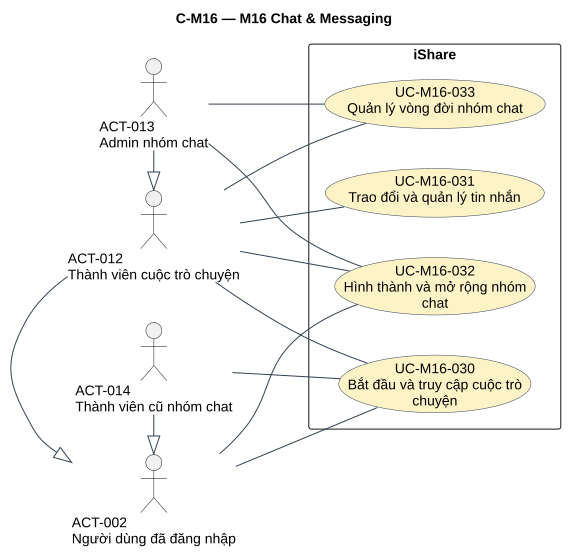
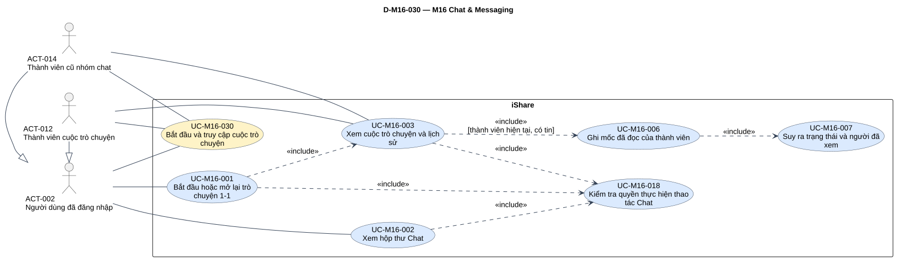
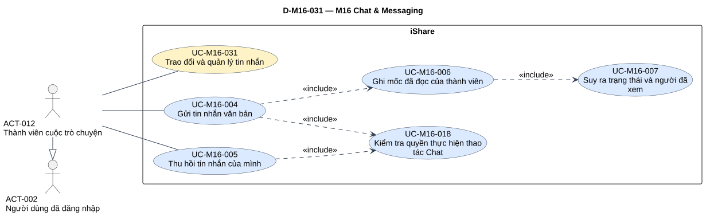
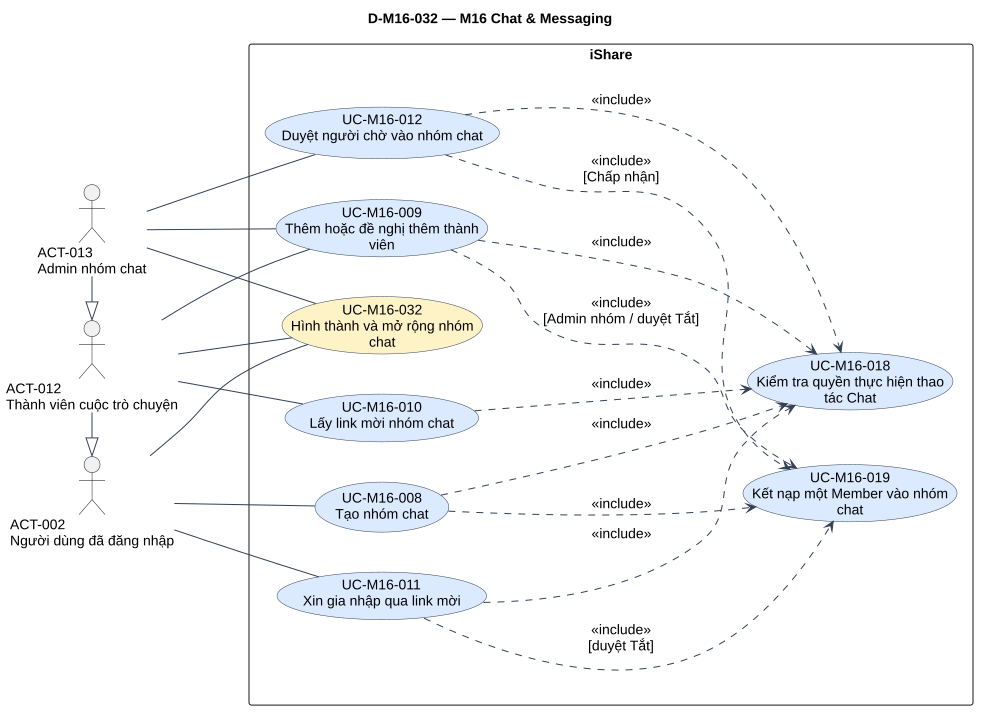
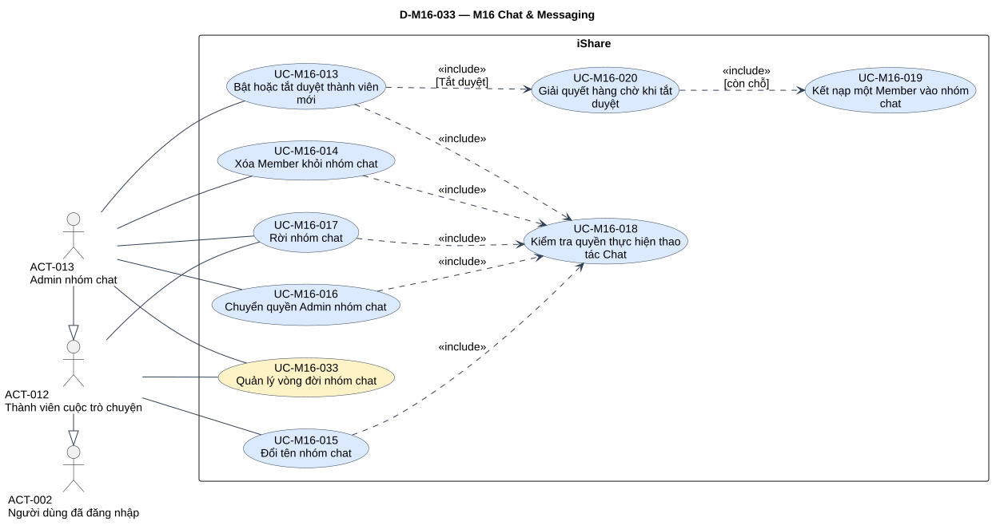

# Phân tích use case — M16 Chat & Messaging

[Vietnamese Doc] — Theo skill use-case-analysis v2.2.

Đầu ra: **4 UC chính, 20 UC con**, 26 mapping, 20 đặc tả chi tiết và 4 brief Summary; 25 include, 3 AUT, 8 RULE, truy vết 177 mã hiệu lực. Bàn giao 5 SVG: tổng quan module và một detail riêng mỗi core.

## Metadata và tiến độ

<!-- uc:document -->
| key | value |
| --- | --- |
| document_id | US-M16 |
| skill_version | 2.2 |
| mode | module |
| modules | M16 |
| scope | ALL |
| status | Chờ duyệt |
| current_step | 7 |
| completed_steps | 1, 2, 3, 4, 5, 6, 7 |
| approved_steps | - |
| source_baseline | FR-M16 v1.0; FR-M01 v1.10; FR-M02 v1.6; FR-M07 v1.5; FR-M08 v1.7; FR-M09 v1.2; FR-M10 v1.4; FR-M11 v1.3; FR-M13 v1.3 |
| author | Codex |
| date | 2026-11-02 |
| approval_evidence | Người dùng cho phép tự thực hiện các bước cần thiết ở lượt M04 trong chuỗi module. Quyền làm liên tục không thay phê duyệt US-M16 hoặc kết quả từng bước. |
| semantic_review | pass |
| diagram_check | pass |

| Bước | Kết quả | Xác nhận | Baseline | Làm lại khi |
| --- | --- | --- | --- | --- |
| 1 | 17 nhóm,127 FR chi tiết,33 BR, không mã bỏ; boundary/actor/TBD | Được làm liên tục; chưa duyệt | FR-M16 v1.0 | Nguồn đổi |
| 2 | 4 core/20 sub/26 mapping, tách Admin nhóm chat và hệ thống | Chưa duyệt | Mô hình tại đây | Mục tiêu đổi |
| 3 | 20 đặc tả,4 brief,3 AUT,8 RULE | Chưa duyệt | FR-M16 v1.0 | Hành vi/quyền đổi |
| 4 | 25 include/26 cạnh xuất hiện; 100 cặp xét,74 không cạnh | Chưa duyệt | Hợp đồng | Điểm gọi đổi |
| 5 | 177 trace/160 tiêu chí nguồn; 8 FR liên quan | Chưa duyệt | FR-M16 v1.0; FR-M01 v1.10; FR-M02 v1.6; FR-M07 v1.5; FR-M08 v1.7; FR-M09 v1.2; FR-M10 v1.4; FR-M11 v1.3; FR-M13 v1.3 | Baseline đổi |
| 6 | Đã render/kiểm hình 5 view; đủ node/26 cạnh và nhãn điều kiện, mỗi view một SVG | Chưa duyệt | PlantUML cục bộ | Mô hình/QA đổi |
| 7 | Đã review nguồn/ngữ nghĩa/UML/truy vết/hình/link và giới hạn nguồn, hồ sơ Chờ duyệt | Chưa duyệt | Skill v2.2 | Phản hồi/nguồn đổi |

## 1. Phạm vi, nguồn và tổng hợp

**Mục đích sử dụng:** review hành vi Chat & Messaging, đầu vào thiết kế/kiểm thử và tổng hợp UC chính hệ thống. Mục 2 phân rã; mục 3 đặc tả/quy tắc/tác vụ; mục 4 quan hệ; mục 5 truy vết; mục 6 sơ đồ; mục 7 QA/giới hạn nguồn.

**Subject:** toàn iShare. M01/M02/M07/M08/M09/M10/M11/M13 là nội bộ, không actor ngoài subject. Không actor Hệ thống/clock/scheduler/AI; Chat không quét AI. Nhóm chat độc lập Group M11. Admin nhóm chat khác ADMIN hệ thống.

**Trong phạm vi:**1-1 duy nhất mỗi cặp; hộp thư/lịch sử current/former; gửi text/emoji/rate; thu hồi/mốc/receipt; tạo/nhập/rời/quản trị nhóm; cờ/tài khoản; link/pending/FIFO; tự tắt duyệt khi Admin không thể khôi phục; dữ liệu M07 và lưu giữ tin.

**Ngoài phạm vi:** triển khai UI/API/CSDL/protocol/retry, popup/số biểu tượng/mute M07, cờ M10, chính sách tài khoản/khiếu nại M01/M08/M09, nghiệp vụ Group M11. Không gọi thoại/video/ảnh/tệp/sửa/xóa chỉ tôi/Block/report/quét AI/đọc gốc đã thu hồi/email/message request/online/đang gõ/kế nhiệm Admin/danh sách chặn/thu hồi hoặc tạo lại link/thông báo được mời.

**Baseline:** [FR-M16](../fr/FR-M16.md) v1.0, Đã chốt 2026-10-24; mốc **DEC-257, QA-455, ISS-393, OPEN-012**, giữ đúng mốc riêng M16. **177 mã =17 nhóm +127 FR chi tiết +33 BR**, không mã bỏ. MS1/Should. TBD-M16-01/OPEN-003hoãn Block/report mức Thấp; TBD-M16-02đóng DEC-248: thu hồi xóa mềm/giữ gốc/không ai xem ở MS1.

<!-- uc:sources -->

| path | version | role |
| --- | --- | --- |
| docs/specs/fr/FR-M16.md | 1.0 | owner |
| docs/specs/fr/FR-M01.md | 1.10 | related |
| docs/specs/fr/FR-M02.md | 1.6 | related |
| docs/specs/fr/FR-M07.md | 1.5 | related |
| docs/specs/fr/FR-M08.md | 1.7 | related |
| docs/specs/fr/FR-M09.md | 1.2 | related |
| docs/specs/fr/FR-M10.md | 1.4 | related |
| docs/specs/fr/FR-M11.md | 1.3 | related |
| docs/specs/fr/FR-M13.md | 1.3 | related |

Phương pháp: [skill](../../../.agent-instructions/skills/use-case-analysis/SKILL.md), [modeling rules](../../../.agent-instructions/skills/use-case-analysis/references/modeling-rules.md), [diagram rules](../../../.agent-instructions/skills/use-case-analysis/references/diagram-rules.md). Ví dụ và US cũ không cung cấp tính năng; không sửa FR/register/US khác.

### 1.1 Actor

<!-- uc:actors -->

| id | name | kind | parent | boundary_reason | sources |
| --- | --- | --- | --- | --- | --- |
| ACT-001 | Guest | human | - | Người ngoài subject bị từ chối Chat, riêng link được yêu cầu đăng nhập; không association thành công. | FR-M16-01.03, FR-M16-03.02, FR-M16-16.02 |
| ACT-002 | Người dùng đã đăng nhập | human | - | Bắt đầu 1-1, tạo/xin nhóm, hộp thư của mình; không mặc nhiên thuộc mọi cuộc. | FR-M16-01.01, FR-M16-02.01, FR-M16-03.01, FR-M16-16.01 |
| ACT-008 | Mod hệ thống | human | ACT-002 | Có năng lực User, không quyền đọc/kiểm duyệt chat ngoài membership; không qua cờ tắt. | FR-M16-04.08, FR-M16-05.06, BR-M16-20, FR-M16-15.01 |
| ACT-007 | Admin hệ thống | human | ACT-008 | Qua cờ Chat tắt, vẫn cần membership/vai trò nhóm/sở hữu/hạn và dữ liệu như thường. | FR-M16-15.04, FR-M16-04.08, FR-M16-06.04 |
| ACT-012 | Thành viên cuộc trò chuyện | human | ACT-002 | Một trong hai người 1-1 hoặc current member nhóm, là vai trò tương tác đọc/gửi/thu hồi và việc nhóm khi thích hợp. | FR-M16-04.01, FR-M16-05.01, FR-M16-06.01, BR-M16-05 |
| ACT-013 | Admin nhóm chat | human | ACT-012 | Quản trị chính nhóm đang xét, có hành vi member và thêm duyệt/công tắc/xóa/chuyển; không ADMIN hệ thống. | FR-M16-02.02, FR-M16-09.01, FR-M16-10.01, FR-M16-13.01, BR-M16-04, BR-M16-05 |
| ACT-014 | Thành viên cũ nhóm chat | human | ACT-002 | Đã rời/bị xóa, chỉ đọc phần lịch sử trước cutoff và giữ hộp thư; không generalization từ current member. | FR-M16-04.10, FR-M16-11.01, FR-M16-14.01, BR-M16-27 |

Giữ ACT-001/002/007/008, bổ sung ACT-012/013/014 sau kiểm actor hiện có tới ACT-011. Hai trục độc lập: ACT-007→ACT-008→ACT-002 và ACT-013→ACT-012→ACT-002; ACT-014→ACT-002 không kế thừa current member. ADMIN hệ thống chỉ qua cờ, không tự thành Admin nhóm chat hoặc đọc cuộc ngoài membership. View chỉ vẽ actor có association và ancestor cần thiết; Guest chỉ nhánh từ chối/link nhắc login.

### 1.2 Kiểm kê

| Nhóm FR | Tổng hợp chức năng | Số chi tiết | Biểu diễn | Owner |
| --- | --- | --- | --- | --- |
| FR-M16-01 | Bắt đầu trò chuyện 1-1 | 7 | [UC-M16-001](#uc-m16-001) | M16 |
| FR-M16-02 | Tạo nhóm chat | 9 | [UC-M16-008](#uc-m16-008) | M16 |
| FR-M16-03 | Xem hộp thư Chat | 8 | [UC-M16-002](#uc-m16-002) | M16 |
| FR-M16-04 | Xem cuộc trò chuyện và lịch sử tin nhắn | 12 | [UC-M16-003](#uc-m16-003) | M16 |
| FR-M16-05 | Gửi tin nhắn | 14 | [UC-M16-004](#uc-m16-004) | M16 |
| FR-M16-06 | Thu hồi tin nhắn | 9 | [UC-M16-005](#uc-m16-005) | M16 |
| FR-M16-07 | Ghi nhận đã đọc và hiển thị Đã xem | 11 | [UC-M16-006](#uc-m16-006), [UC-M16-007](#uc-m16-007) | M16 |
| FR-M16-08 | Thêm, mời thành viên vào nhóm chat | 13 | [UC-M16-009](#uc-m16-009), [UC-M16-010](#uc-m16-010) | M16 |
| FR-M16-09 | Bật, tắt duyệt thành viên mới | 4 | [UC-M16-013](#uc-m16-013), [UC-M16-020](#uc-m16-020) | M16 |
| FR-M16-10 | Duyệt người chờ vào nhóm chat | 7 | [UC-M16-012](#uc-m16-012) | M16 |
| FR-M16-11 | Xóa thành viên khỏi nhóm chat | 3 | [UC-M16-014](#uc-m16-014) | M16 |
| FR-M16-12 | Đổi tên nhóm chat | 3 | [UC-M16-015](#uc-m16-015) | M16 |
| FR-M16-13 | Chuyển quyền Admin nhóm chat | 3 | [UC-M16-016](#uc-m16-016) | M16 |
| FR-M16-14 | Rời nhóm chat | 5 | [UC-M16-017](#uc-m16-017) | M16 |
| FR-M16-15 | Chặn thao tác Chat khi cờ tính năng tắt | 8 | [UC-M16-018](#uc-m16-018) | M16 |
| FR-M16-16 | Xin gia nhập nhóm chat qua link mời | 8 | [UC-M16-011](#uc-m16-011) | M16 |
| FR-M16-17 | Tự tắt duyệt khi Admin nhóm chat không thể khôi phục | 3 | [AUT-M16-001](#aut-m16-001) | M16 |

### 1.3 Điểm nghiệp vụ trọng tâm

- Mỗi cặp một 1-1, không tự nhắn, không follow/message request. Không tạo mới với ban/vô hiệu hóa/Deleted; cuộc cũ gửi tới ban/vô hiệu hóa được, Deleted không.
- Current/new/rejoin đọc toàn lịch sử; former chỉ tin gửi trước lúc rời/bị xóa, giữ hộp thư, chỉ đọc. Không đưa tin sau cutoff vào payload/unread/thứ tự.
- Tin text/emoji≤1.000 từ,30 tin/60 giây riêng người-cuộc; đúng 60 giây trước không tính. Thu hồi sender≤300 giây, đúng 300 được, gốc giữ/không ai xem.
- Tạo nhóm 3–100, dưới 3 sau rời/xóa vẫn hoạt động; pending không chiếm 100, tài khoản không ACTIVE vẫn còn membership cũ.
- Admin nhóm thêm ngay; Member/link theo công tắc. Tắt duyệt FIFO tới 100, dư Đã từ chối, thủ công và tự tắt cùng hợp đồng.
- Admin không thể khôi phục mới mất vai trò/tự tắt duyệt, không kế nhiệm; ban tạm/vô hiệu hóa/còn khả năng khiếu nại chưa kích hoạt tự tắt.
- M07 đếm số cuộc chưa đọc trong phần thấy được, popup/mute owner M07; không số tin/chuông/email/được mời.

## 2. UC chính và UC con

### 2.1 Catalog hai tầng

<!-- uc:catalog -->

| id | name | tier | level | primary | supporting | owner | anchor | sources |
| --- | --- | --- | --- | --- | --- | --- | --- | --- |
| UC-M16-030 | Bắt đầu và truy cập cuộc trò chuyện | core | Summary | ACT-002, ACT-012, ACT-014 | - | M16 | #uc-m16-030 | FR-M16-01, FR-M16-03, FR-M16-04, FR-M16-07, FR-M16-15 |
| UC-M16-031 | Trao đổi và quản lý tin nhắn | core | Summary | ACT-012 | - | M16 | #uc-m16-031 | FR-M16-05, FR-M16-06, FR-M16-07, FR-M16-15 |
| UC-M16-032 | Hình thành và mở rộng nhóm chat | core | Summary | ACT-002, ACT-012, ACT-013 | - | M16 | #uc-m16-032 | FR-M16-02, FR-M16-08, FR-M16-10, FR-M16-16, FR-M16-15 |
| UC-M16-033 | Quản lý vòng đời nhóm chat | core | Summary | ACT-012, ACT-013 | - | M16 | #uc-m16-033 | FR-M16-09, FR-M16-11, FR-M16-12, FR-M16-13, FR-M16-14, FR-M16-17, FR-M16-15 |
| UC-M16-001 | Bắt đầu hoặc mở lại trò chuyện 1-1 | sub | User goal | ACT-002 | - | M16 | #uc-m16-001 | FR-M16-01, BR-M16-01, BR-M16-02, BR-M16-24, BR-M16-25 |
| UC-M16-002 | Xem hộp thư Chat | sub | User goal | ACT-002 | - | M16 | #uc-m16-002 | FR-M16-03, BR-M16-31, BR-M16-27 |
| UC-M16-003 | Xem cuộc trò chuyện và lịch sử | sub | User goal | ACT-012, ACT-014 | - | M16 | #uc-m16-003 | FR-M16-04, BR-M16-17, BR-M16-26, BR-M16-27 |
| UC-M16-004 | Gửi tin nhắn văn bản | sub | User goal | ACT-012 | - | M16 | #uc-m16-004 | FR-M16-05, FR-M16-01.02, BR-M16-08, BR-M16-09, BR-M16-21, BR-M16-25 |
| UC-M16-005 | Thu hồi tin nhắn của mình | sub | User goal | ACT-012 | - | M16 | #uc-m16-005 | FR-M16-06, BR-M16-11, BR-M16-12, BR-M16-18 |
| UC-M16-006 | Ghi mốc đã đọc của thành viên | sub | Subfunction | ACT-012 | - | M16 | #uc-m16-006 | FR-M16-07, BR-M16-13, BR-M16-14 |
| UC-M16-007 | Suy ra trạng thái và người đã xem | sub | Subfunction | ACT-012 | - | M16 | #uc-m16-007 | FR-M16-07.06, FR-M16-07.07, FR-M16-07.08, FR-M16-07.09, FR-M16-06.09, BR-M16-15, BR-M16-16 |
| UC-M16-008 | Tạo nhóm chat | sub | User goal | ACT-002 | - | M16 | #uc-m16-008 | FR-M16-02, BR-M16-01, BR-M16-03, BR-M16-04, BR-M16-06, BR-M16-25, BR-M16-32 |
| UC-M16-009 | Thêm hoặc đề nghị thêm thành viên | sub | User goal | ACT-012, ACT-013 | - | M16 | #uc-m16-009 | FR-M16-08, BR-M16-03, BR-M16-06, BR-M16-25, BR-M16-28 |
| UC-M16-010 | Lấy link mời nhóm chat | sub | User goal | ACT-012 | - | M16 | #uc-m16-010 | FR-M16-08.10, FR-M16-08.11, FR-M16-08.12, FR-M16-08.13, BR-M16-29 |
| UC-M16-011 | Xin gia nhập qua link mời | sub | User goal | ACT-002 | - | M16 | #uc-m16-011 | FR-M16-16, BR-M16-06, BR-M16-28, BR-M16-29 |
| UC-M16-012 | Duyệt người chờ vào nhóm chat | sub | User goal | ACT-013 | - | M16 | #uc-m16-012 | FR-M16-10, BR-M16-03, BR-M16-05, BR-M16-06 |
| UC-M16-013 | Bật hoặc tắt duyệt thành viên mới | sub | User goal | ACT-013 | - | M16 | #uc-m16-013 | FR-M16-09, BR-M16-06, BR-M16-33 |
| UC-M16-014 | Xóa Member khỏi nhóm chat | sub | User goal | ACT-013 | - | M16 | #uc-m16-014 | FR-M16-11, FR-M16-14.03, BR-M16-05, BR-M16-27 |
| UC-M16-015 | Đổi tên nhóm chat | sub | User goal | ACT-012 | - | M16 | #uc-m16-015 | FR-M16-12, BR-M16-05, BR-M16-32 |
| UC-M16-016 | Chuyển quyền Admin nhóm chat | sub | User goal | ACT-013 | - | M16 | #uc-m16-016 | FR-M16-13, BR-M16-04, BR-M16-05, BR-M16-07, BR-M16-30 |
| UC-M16-017 | Rời nhóm chat | sub | User goal | ACT-012, ACT-013 | - | M16 | #uc-m16-017 | FR-M16-14, BR-M16-03, BR-M16-07, BR-M16-27, BR-M16-28 |
| UC-M16-018 | Kiểm tra quyền thực hiện thao tác Chat | sub | Subfunction | ACT-002, ACT-012, ACT-013, ACT-014 | - | M16 | #uc-m16-018 | FR-M16-03.02, FR-M16-03.03, FR-M16-04.08, FR-M16-05.06, FR-M16-15, BR-M16-02, BR-M16-05, BR-M16-22, BR-M16-23 |
| UC-M16-019 | Kết nạp một Member vào nhóm chat | sub | Subfunction | ACT-002, ACT-012, ACT-013 | - | M16 | #uc-m16-019 | FR-M16-02.02, FR-M16-08.01, FR-M16-08.02, FR-M16-08.05, FR-M16-08.07, FR-M16-08.09, FR-M16-10.01, FR-M16-10.03, FR-M16-10.07, FR-M16-16.03, BR-M16-03, BR-M16-25, BR-M16-27 |
| UC-M16-020 | Giải quyết hàng chờ khi tắt duyệt | sub | Subfunction | ACT-013, ACT-002 | - | M16 | #uc-m16-020 | FR-M16-09.03, FR-M16-09.04, FR-M16-17.02, BR-M16-33 |

Core đều Summary đặt nhiều mục tiêu có trigger riêng vào bối cảnh giá trị. Sub User goal là công việc cụ thể; UC006/007/018/019/020 là Subfunction dùng chung/đáng đặc tả riêng. Tier độc lập level, không quota. Một sub dùng nhiều core giữ cùng ID.

### 2.2 Phân rã chính → con

<!-- uc:decomposition -->

| core | sub | rationale | sources |
| --- | --- | --- | --- |
| UC-M16-030 | UC-M16-001 | Mục tiêu cụ thể có trigger/hợp đồng đóng góp vào phạm vi core. | FR-M16-01, BR-M16-01, BR-M16-02, BR-M16-24, BR-M16-25 |
| UC-M16-030 | UC-M16-002 | Mục tiêu cụ thể có trigger/hợp đồng đóng góp vào phạm vi core. | FR-M16-03, BR-M16-31, BR-M16-27 |
| UC-M16-030 | UC-M16-003 | Mục tiêu cụ thể có trigger/hợp đồng đóng góp vào phạm vi core. | FR-M16-04, BR-M16-17, BR-M16-26, BR-M16-27 |
| UC-M16-030 | UC-M16-006 | Mốc/receipt phục vụ đọc/trao đổi đúng trạng thái. | FR-M16-07, BR-M16-13, BR-M16-14 |
| UC-M16-030 | UC-M16-007 | Mốc/receipt phục vụ đọc/trao đổi đúng trạng thái. | FR-M16-07.06, FR-M16-07.07, FR-M16-07.08, FR-M16-07.09, FR-M16-06.09, BR-M16-15, BR-M16-16 |
| UC-M16-030 | UC-M16-018 | Cổng quyền theo thao tác, dùng chung. | FR-M16-03.02, FR-M16-03.03, FR-M16-04.08, FR-M16-05.06, FR-M16-15, BR-M16-02, BR-M16-05, BR-M16-22, BR-M16-23 |
| UC-M16-031 | UC-M16-004 | Mục tiêu cụ thể có trigger/hợp đồng đóng góp vào phạm vi core. | FR-M16-05, FR-M16-01.02, BR-M16-08, BR-M16-09, BR-M16-21, BR-M16-25 |
| UC-M16-031 | UC-M16-005 | Mục tiêu cụ thể có trigger/hợp đồng đóng góp vào phạm vi core. | FR-M16-06, BR-M16-11, BR-M16-12, BR-M16-18 |
| UC-M16-031 | UC-M16-006 | Mốc/receipt phục vụ đọc/trao đổi đúng trạng thái. | FR-M16-07, BR-M16-13, BR-M16-14 |
| UC-M16-031 | UC-M16-007 | Mốc/receipt phục vụ đọc/trao đổi đúng trạng thái. | FR-M16-07.06, FR-M16-07.07, FR-M16-07.08, FR-M16-07.09, FR-M16-06.09, BR-M16-15, BR-M16-16 |
| UC-M16-031 | UC-M16-018 | Cổng quyền theo thao tác, dùng chung. | FR-M16-03.02, FR-M16-03.03, FR-M16-04.08, FR-M16-05.06, FR-M16-15, BR-M16-02, BR-M16-05, BR-M16-22, BR-M16-23 |
| UC-M16-032 | UC-M16-008 | Mục tiêu cụ thể có trigger/hợp đồng đóng góp vào phạm vi core. | FR-M16-02, BR-M16-01, BR-M16-03, BR-M16-04, BR-M16-06, BR-M16-25, BR-M16-32 |
| UC-M16-032 | UC-M16-009 | Mục tiêu cụ thể có trigger/hợp đồng đóng góp vào phạm vi core. | FR-M16-08, BR-M16-03, BR-M16-06, BR-M16-25, BR-M16-28 |
| UC-M16-032 | UC-M16-010 | Mục tiêu cụ thể có trigger/hợp đồng đóng góp vào phạm vi core. | FR-M16-08.10, FR-M16-08.11, FR-M16-08.12, FR-M16-08.13, BR-M16-29 |
| UC-M16-032 | UC-M16-011 | Mục tiêu cụ thể có trigger/hợp đồng đóng góp vào phạm vi core. | FR-M16-16, BR-M16-06, BR-M16-28, BR-M16-29 |
| UC-M16-032 | UC-M16-012 | Mục tiêu cụ thể có trigger/hợp đồng đóng góp vào phạm vi core. | FR-M16-10, BR-M16-03, BR-M16-05, BR-M16-06 |
| UC-M16-032 | UC-M16-018 | Cổng quyền theo thao tác, dùng chung. | FR-M16-03.02, FR-M16-03.03, FR-M16-04.08, FR-M16-05.06, FR-M16-15, BR-M16-02, BR-M16-05, BR-M16-22, BR-M16-23 |
| UC-M16-032 | UC-M16-019 | Admission chung cho các đường vào. | FR-M16-02.02, FR-M16-08.01, FR-M16-08.02, FR-M16-08.05, FR-M16-08.07, FR-M16-08.09, FR-M16-10.01, FR-M16-10.03, FR-M16-10.07, FR-M16-16.03, BR-M16-03, BR-M16-25, BR-M16-27 |
| UC-M16-033 | UC-M16-013 | Mục tiêu cụ thể có trigger/hợp đồng đóng góp vào phạm vi core. | FR-M16-09, BR-M16-06, BR-M16-33 |
| UC-M16-033 | UC-M16-014 | Mục tiêu cụ thể có trigger/hợp đồng đóng góp vào phạm vi core. | FR-M16-11, FR-M16-14.03, BR-M16-05, BR-M16-27 |
| UC-M16-033 | UC-M16-015 | Mục tiêu cụ thể có trigger/hợp đồng đóng góp vào phạm vi core. | FR-M16-12, BR-M16-05, BR-M16-32 |
| UC-M16-033 | UC-M16-016 | Mục tiêu cụ thể có trigger/hợp đồng đóng góp vào phạm vi core. | FR-M16-13, BR-M16-04, BR-M16-05, BR-M16-07, BR-M16-30 |
| UC-M16-033 | UC-M16-017 | Mục tiêu cụ thể có trigger/hợp đồng đóng góp vào phạm vi core. | FR-M16-14, BR-M16-03, BR-M16-07, BR-M16-27, BR-M16-28 |
| UC-M16-033 | UC-M16-018 | Cổng quyền theo thao tác, dùng chung. | FR-M16-03.02, FR-M16-03.03, FR-M16-04.08, FR-M16-05.06, FR-M16-15, BR-M16-02, BR-M16-05, BR-M16-22, BR-M16-23 |
| UC-M16-033 | UC-M16-019 | Admission chung cho các đường vào. | FR-M16-02.02, FR-M16-08.01, FR-M16-08.02, FR-M16-08.05, FR-M16-08.07, FR-M16-08.09, FR-M16-10.01, FR-M16-10.03, FR-M16-10.07, FR-M16-16.03, BR-M16-03, BR-M16-25, BR-M16-27 |
| UC-M16-033 | UC-M16-020 | Nhả pending khi tắt duyệt theo FIFO/chỗ. | FR-M16-09.03, FR-M16-09.04, FR-M16-17.02, BR-M16-33 |

Mapping không sinh UML. Core Summary không include tất cả sub; mũi tên lấy từ bước gọi thật.

### 2.3 Mô hình module cho tổng quan hệ thống

<!-- uc:module-models -->
| module | path | baseline |
| --- | --- | --- |

Chưa có US-overview.md tại baseline; tổng hợp ngoài scope. Khi làm sau lấy nguyên bốn core catalog, giữ ID/tên/owner/actor và link về đây, không đưa sub/AUT lên tổng quan như core mới.

### 2.4 Quyết định phân tích

| Quyết định | Hành vi | Biểu diễn | Lý do | Không chọn |
| --- | --- | --- | --- | --- |
| D 01 | Bốn năng lực | 4 core Summary | Mục tiêu độc lập trong bối cảnh giá trị. | Quota/core chỉ là package. |
| D 02 | Mở 1-1/lịch sử | UC001 includeUC003 | Mở cuộc thật sau tạo/tái dùng. | Include gửi vì mở trước gửi. |
| D 03 | Gửi/thu hồi | Hai User goal | Thu hồi bắt đầu sau lần gửi kết thúc. | Extend Gửi hoặc luôn gọi thu hồi. |
| D 04 | Mốc/receipt | UC006 includeUC007, mở/gửi gọi UC006 | Sub–sub có điểm gọi thật. | State lưu trên từng tin hoặc avatar=đã xem. |
| D 05 | Quyền | UC018+nhánh/RULE | Cổng chung theo thao tác. | Include Đăng nhập/actor Hệ thống. |
| D 06 | Admission/pending | UC019/020 dùng chung | Giữ trigger từng đường, cùng capacity/lịch sử. | Copy admission/ép mọi yêu cầu duyệt. |
| D 07 | Chuyển quyền/rời | UC016/017 riêng | Chuyển trước là trạng thái cần, không hành vi chèn. | Include chuyển quyền chỉ vì tiền điều kiện. |
| D 08 | Tự động | AUT001/002/003 | Trigger/trước/sau/data rõ. | Clock/actor AI hoặc kế nhiệm M11. |
| D 09 | Thiếu nguồn | NOTE mục 7.2 | Không tự chốt hành vi biên. | Pending trùng/receipt của cựu/reconnect/tie-break tự đặt. |

## 3. Đặc tả

### 3.1 UC chính

#### UC-M16-030 — Bắt đầu và truy cập cuộc trò chuyện

**Level:** Summary. **Primary:** ACT-002, ACT-012, ACT-014. **Subject:** iShare.

**Giá trị/phạm vi/quy trình:** Giúp người dùng tìm/mở đúng cuộc riêng hoặc nhóm, đọc được lịch sử theo tư cách hiện tại/cựu. UC001 bắt đầu hoặc mở lại đúng một 1-1 mỗi cặp; UC002 xem hộp thư; UC003 đọc cuộc. UC018 áp cổng quyền, UC006/007 xử lý mốc/receipt khi hiện tại mở cuộc. Đây là các mục tiêu có trigger riêng, không bắt mở mọi cuộc hoặc gửi tin khi chỉ xem hộp thư.

**UC con:** [UC-M16-001](#uc-m16-001), [UC-M16-002](#uc-m16-002), [UC-M16-003](#uc-m16-003), [UC-M16-006](#uc-m16-006), [UC-M16-007](#uc-m16-007), [UC-M16-018](#uc-m16-018). **Nguồn:** FR-M16-01, FR-M16-03, FR-M16-04, FR-M16-07, FR-M16-15. Các sub không bắt buộc chạy cùng một lần; mapping không tự tạo quan hệ.

#### UC-M16-031 — Trao đổi và quản lý tin nhắn

**Level:** Summary. **Primary:** ACT-012. **Subject:** iShare.

**Giá trị/phạm vi/quy trình:** Giúp thành viên nhắn văn bản/emoji và thu hồi tin của mình đúng 5 phút, nhận tin/receipt thời gian thực mà không mất chỗ đọc. UC004 gửi, UC005 thu hồi là hai mục tiêu độc lập; UC006 ghi mốc và UC007 suy trạng thái chỉ tin mới nhất, UC018 kiểm quyền. Thu hồi không extend một lần gửi đã kết thúc; không có sửa/xóa chỉ tôi/quét AI.

**UC con:** [UC-M16-004](#uc-m16-004), [UC-M16-005](#uc-m16-005), [UC-M16-006](#uc-m16-006), [UC-M16-007](#uc-m16-007), [UC-M16-018](#uc-m16-018). **Nguồn:** FR-M16-05, FR-M16-06, FR-M16-07, FR-M16-15. Các sub không bắt buộc chạy cùng một lần; mapping không tự tạo quan hệ.

#### UC-M16-032 — Hình thành và mở rộng nhóm chat

**Level:** Summary. **Primary:** ACT-002, ACT-012, ACT-013. **Subject:** iShare.

**Giá trị/phạm vi/quy trình:** Giúp tạo nhóm độc lập Group và đưa người vào đúng cổng. UC008 tạo nhóm 3–100, UC009 thêm/đề nghị, UC010 lấy link, UC011 mở/xin qua link, UC012 duyệt hai loại chờ. UC019 là admission chung; UC018 giữ quyền. Mỗi đường có trigger riêng, không include duyệt vào mọi yêu cầu vì nhiều trường hợp vào ngay; không coi link là quyền đọc lịch sử.

**UC con:** [UC-M16-008](#uc-m16-008), [UC-M16-009](#uc-m16-009), [UC-M16-010](#uc-m16-010), [UC-M16-011](#uc-m16-011), [UC-M16-012](#uc-m16-012), [UC-M16-018](#uc-m16-018), [UC-M16-019](#uc-m16-019). **Nguồn:** FR-M16-02, FR-M16-08, FR-M16-10, FR-M16-16, FR-M16-15. Các sub không bắt buộc chạy cùng một lần; mapping không tự tạo quan hệ.

#### UC-M16-033 — Quản lý vòng đời nhóm chat

**Level:** Summary. **Primary:** ACT-012, ACT-013. **Subject:** iShare.

**Giá trị/phạm vi/quy trình:** Giúp thành viên đổi tên/rời và Admin nhóm chat quản trị công tắc, loại Member, chuyển quyền. UC013/014/015/016/017 là các mục tiêu riêng; UC020 nhả hàng chờ khi duyệt tắt, gọi UC019 admission; UC018 kiểm quyền thao tác. AUT001 giữ nguyên nhóm khi Admin còn khôi phục, tự tắt duyệt và để nhóm không Admin khi thật sự không thể khôi phục, tuyệt đối không kế nhiệm theo GroupM 11. Nhóm dưới 3 vẫn hoạt động, rời/bị xóa giữ lịch sử tới cutoff.

**UC con:** [UC-M16-013](#uc-m16-013), [UC-M16-014](#uc-m16-014), [UC-M16-015](#uc-m16-015), [UC-M16-016](#uc-m16-016), [UC-M16-017](#uc-m16-017), [UC-M16-018](#uc-m16-018), [UC-M16-019](#uc-m16-019), [UC-M16-020](#uc-m16-020). **Nguồn:** FR-M16-09, FR-M16-11, FR-M16-12, FR-M16-13, FR-M16-14, FR-M16-17, FR-M16-15. Các sub không bắt buộc chạy cùng một lần; mapping không tự tạo quan hệ.

### 3.2 UC con

#### UC-M16-001 — Bắt đầu hoặc mở lại trò chuyện 1-1

**Thuộc core:** UC-M16-030. **Nguồn:** FR-M16-01, BR-M16-01, BR-M16-02, BR-M16-24, BR-M16-25.

<!-- uc:spec UC-M16-001 -->
| key | value |
| --- | --- |
| goal | Có một cuộc riêng với đúng người nhận, tái dùng lịch sử giữa cùng cặp thay vì tạo cuộc trùng. |
| subject | iShare |
| level | User goal |
| primary | ACT-002 |
| supporting | - |
| trigger | Người dùng chọn nhắn tin cho người khác, có thể từ nút hồ sơ M02. |
| preconditions | Nhận người gọi/người nhận; phiên/trạng thái/cờ kiểm trong luồng, không yêu cầu theo dõi hoặc cùng Group. |
| success | Mở cuộc duy nhất của cặp, đúng hai thành viên; cuộc cũ giữ toàn bộ lịch sử, cuộc mới chưa cần người nhận chấp nhận. |
| failure | Từ chối/giới hạn theo các nhánh có nguồn; không tự bảo đảm rollback, retry hoặc kết quả giả khi nguồn chưa quy định. Các tình huống biên/đồng thời xem mục 7.2. |
| abstract | false |
| common_contract | Không áp dụng generalization UC; hợp đồng cụ thể ở trigger/điều kiện/luồng/kết quả. |

**Luồng chính:**

| Bước | Ai | Hành động/phản hồi | Tiếp tục | Nguồn |
| --- | --- | --- | --- | --- |
| 1 | ACT-002 | Chọn người nhận và nhắn tin; không yêu cầu theo dõi/cùng Group hoặc message request. | [Bước2](#uc-m16-001-main-2) | FR-M16-01.01, FR-M16-01.02, FR-M02-01.26 |
| 2 | iShare | Chèn UC-M16-018 với thao tác bắt đầu 1-1, phạm vi người gọi và người nhận; chỉ tiếp tục khi được phép, bị từ chối kết thúc theo hợp đồng UC018. | [Bước3](#uc-m16-001-main-3) | FR-M16-03.03, FR-M16-15.01, FR-M16-15.04, BR-M16-02, BR-M16-23 |
| 3 | iShare | Từ chối tự nhắn; tìm cuộc 1-1 đã có của cặp. Nếu có dùng lại; nếu chưa có thì kiểm người nhận không BANNED/DEACTIVATED/DELETED và tạo cuộc đúng hai người. | [Bước4](#uc-m16-001-main-4) | FR-M16-01.04, FR-M16-01.05, FR-M16-01.06, FR-M16-01.07, BR-M16-24, BR-M16-25 |
| 4 | iShare | Chèn UC-M16-003 để mở cuộc hợp lệ với toàn bộ lịch sử được phép (cuộc mới có thể rỗng). Gửi tin đầu tiên là mục tiêu UC004 riêng, không tự gửi tin chỉ vì mở. | [Bước5](#uc-m16-001-main-5) | FR-M16-01.05, FR-M16-04.01, BR-M16-24 |
| 5 | iShare | Trả cuộc và lịch sử; nếu gửi tin sau đó, không có bước chấp nhận của người nhận. Cuộc 1-1 rỗng chưa hiện trong hộp thư. | END: kết quả thành công theo hợp đồng. | FR-M16-01.02, FR-M16-03.07, BR-M16-31 |

**Luồng thay thế/ngoại lệ:**

| ID nhánh | Bước rẽ | Điều kiện | Xử lý | Quay lại/kết thúc | Nguồn |
| --- | --- | --- | --- | --- | --- |
| A 1 | [Bước2](#uc-m16-001-main-2) | Guest hoặc không qua cổng tài khoản/cờ | UC018 từ chối; không tạo hoặc mở cuộc. | END: không bắt đầu 1-1. | FR-M16-01.03, FR-M16-03.03, FR-M16-15.01 |
| A 2 | [Bước3](#uc-m16-001-main-3) | Người nhận là chính người gọi | Từ chối, không tạo cuộc tự nhắn. | END: không có cuộc mới. | FR-M16-01.06 |
| A 3 | [Bước3](#uc-m16-001-main-3) | Chưa có cuộc và người nhận BANNED/DEACTIVATED/DELETED | Từ chối bắt đầu mới; không lấy quyền gửi vào cuộc cũ làm quyền tạo cuộc mới. | END: không tạo 1-1. | FR-M16-01.07, BR-M16-25 |
| A 4 | [Bước3](#uc-m16-001-main-3) | Đã có cuộc với người nhận đang ban/vô hiệu hóa/đã xóa | Mở cuộc cũ theo UC003; việc gửi sau đó do UC004: ban/vô hiệu hóa được, DELETED không. | [Trở về bước](#uc-m16-001-main-4) | FR-M16-01.05, FR-M16-05.13, FR-M16-05.14, BR-M16-25 |

**Quy tắc:** [RULE-M16-001](#rule-m16-001), [RULE-M16-002](#rule-m16-002), [RULE-M16-003](#rule-m16-003), [RULE-M16-004](#rule-m16-004), [RULE-M16-005](#rule-m16-005), [RULE-M16-006](#rule-m16-006), [RULE-M16-007](#rule-m16-007), [RULE-M16-008](#rule-m16-008) theo ngữ cảnh. Giữ NOTE mục 7.2, không coi thiếu nguồn là quyền tự thêm hành vi.

#### UC-M16-002 — Xem hộp thư Chat

**Thuộc core:** UC-M16-030. **Nguồn:** FR-M16-03, BR-M16-31, BR-M16-27.

<!-- uc:spec UC-M16-002 -->
| key | value |
| --- | --- |
| goal | Tìm các cuộc của mình theo tin cuối mình được thấy và nhận biết chưa đọc đúng phạm vi. |
| subject | iShare |
| level | User goal |
| primary | ACT-002 |
| supporting | - |
| trigger | Người dùng mở hộp thư hoặc cuộn xuống tải tiếp. |
| preconditions | Có yêu cầu của người xem; quyền kiểm trong luồng. |
| success | Trả tối đa 20 cuộc/lần, cả nhóm là cựu thành viên, mới trước theo tin được thấy; không liệt kê cuộc người khác hoặc 1-1 rỗng. |
| failure | Từ chối/giới hạn theo các nhánh có nguồn; không tự bảo đảm rollback, retry hoặc kết quả giả khi nguồn chưa quy định. Các tình huống biên/đồng thời xem mục 7.2. |
| abstract | false |
| common_contract | Không áp dụng generalization UC; hợp đồng cụ thể ở trigger/điều kiện/luồng/kết quả. |

**Luồng chính:**

| Bước | Ai | Hành động/phản hồi | Tiếp tục | Nguồn |
| --- | --- | --- | --- | --- |
| 1 | ACT-002 | Mở hộp thư từ biểu tượng Tin nhắn hoặc cuộn xuống xem thêm. | [Bước2](#uc-m16-002-main-2) | FR-M16-03.01, FR-M16-03.08, FR-M07-07.03 |
| 2 | iShare | Chèn UC-M16-018 với thao tác mở/tải hộp thư, phạm vi hộp thư của chính người gọi; chỉ tiếp tục khi được phép, bị từ chối kết thúc theo hợp đồng UC018. | [Bước3](#uc-m16-002-main-3) | FR-M16-03.03, FR-M16-15.01, FR-M16-15.04, BR-M16-02, BR-M16-23 |
| 3 | iShare | Chọn cuộc đang là thành viên hoặc nhóm là cựu thành viên. Cựu thành viên chỉ xét tin gửi trước lúc rời; không dùng tin mới sau khi rời để xếp hạng, trích nội dung hoặc đánh dấu chưa đọc. Loại 1-1 chưa có tin. | [Bước4](#uc-m16-002-main-4) | FR-M16-03.01, FR-M16-03.04, FR-M16-03.06, FR-M16-03.07, BR-M16-27, BR-M16-31 |
| 4 | iShare | Xếp theo thời điểm tin cuối được thấy mới trước; trả 20 cuộc mỗi lần, cuộn xuống tải tiếp không giới hạn tổng. Mỗi dòng có tên nhóm hoặc tên/avatar người kia, nội dung/placeholder thu hồi và thời điểm tin cuối; áp RULE002 cho danh tính. | [Bước5](#uc-m16-002-main-5) | FR-M16-03.04, FR-M16-03.05, FR-M16-03.08, BR-M16-26, BR-M16-31 |
| 5 | iShare | Đánh dấu chưa đọc nếu có tin được thấy mới hơn mốc người xem, cùng ngữ nghĩa cung cấp M07. Chọn một cuộc là trigger UC003, không bắt mở mọi cuộc khi xem hộp thư. | END: kết quả thành công theo hợp đồng. | FR-M16-03.06, FR-M16-07.10, BR-M16-31 |

**Luồng thay thế/ngoại lệ:**

| ID nhánh | Bước rẽ | Điều kiện | Xử lý | Quay lại/kết thúc | Nguồn |
| --- | --- | --- | --- | --- | --- |
| A 1 | [Bước2](#uc-m16-002-main-2) | Guest/BANNED hoặc Chat tắt với người không phải Admin hệ thống | Từ chối theo UC018; lối vào/số chưa đọc M07 vẫn theo cờ, không xóa dữ liệu. | END: không trả hộp thư. | FR-M16-03.02, FR-M16-03.03, FR-M16-15.01, FR-M16-15.07 |
| A 2 | [Bước3](#uc-m16-002-main-3) | Không có cuộc hợp lệ hoặc chỉ có 1-1 rỗng | Trả tập rỗng; nguồn chưa chốt nội dung trạng thái rỗng/CTA (NOTE-M16-01). | END: không có dòng để trả. | FR-M16-03.07, BR-M16-31 |

**Quy tắc:** [RULE-M16-001](#rule-m16-001), [RULE-M16-002](#rule-m16-002), [RULE-M16-003](#rule-m16-003), [RULE-M16-004](#rule-m16-004), [RULE-M16-005](#rule-m16-005), [RULE-M16-006](#rule-m16-006), [RULE-M16-007](#rule-m16-007), [RULE-M16-008](#rule-m16-008) theo ngữ cảnh. Giữ NOTE mục 7.2, không coi thiếu nguồn là quyền tự thêm hành vi.

#### UC-M16-003 — Xem cuộc trò chuyện và lịch sử

**Thuộc core:** UC-M16-030. **Nguồn:** FR-M16-04, BR-M16-17, BR-M16-26, BR-M16-27.

<!-- uc:spec UC-M16-003 -->
| key | value |
| --- | --- |
| goal | Đọc lịch sử và tin mới trong phạm vi tư cách của mình, không lộ dữ liệu sau khi đã rời. |
| subject | iShare |
| level | User goal |
| primary | ACT-012, ACT-014 |
| supporting | - |
| trigger | Mở cuộc hợp lệ hoặc cuộn lên tới tin cũ nhất đang tải. |
| preconditions | Có ID cuộc/người xem và trạng thái tư cách; quyền/trạng thái/cờ kiểm trong luồng. |
| success | Thành viên hiện tại xem toàn bộ từ tin đầu, kể cả mới vào/vào lại; cựu chỉ lịch sử trước lúc rời; mỗi lần 20 tin, tin mới và vị trí đọc đúng nguồn. |
| failure | Từ chối/giới hạn theo các nhánh có nguồn; không tự bảo đảm rollback, retry hoặc kết quả giả khi nguồn chưa quy định. Các tình huống biên/đồng thời xem mục 7.2. |
| abstract | false |
| common_contract | Không áp dụng generalization UC; hợp đồng cụ thể ở trigger/điều kiện/luồng/kết quả. |

**Luồng chính:**

| Bước | Ai | Hành động/phản hồi | Tiếp tục | Nguồn |
| --- | --- | --- | --- | --- |
| 1 | ACT-012, ACT-014 | Mở cuộc hoặc cuộn lên đọc thêm lịch sử. | [Bước2](#uc-m16-003-main-2) | FR-M16-04.01, FR-M16-04.02, FR-M16-04.10 |
| 2 | iShare | Chèn UC-M16-018 với thao tác mở/tải cuộc, phạm vi thành viên hiện tại hoặc cựu thành viên của đúng nhóm; chỉ tiếp tục khi được phép, bị từ chối kết thúc theo hợp đồng UC018. | [Bước3](#uc-m16-003-main-3) | FR-M16-03.03, FR-M16-15.01, FR-M16-15.04, BR-M16-02, BR-M16-23 |
| 3 | iShare | Tải 20 tin mới nhất trong phạm vi được xem; cuộn lên tải 20 tin cũ hơn tới tin đầu, không giới hạn tổng. Hiện người gửi/nội dung/thời gian UTC+7; placeholder thu hồi che nội dung với mọi người. Cựu chỉ tin gửi trước lúc rời; mới vào/vào lại có toàn lịch sử. | [Bước4](#uc-m16-003-main-4) | FR-M16-04.01, FR-M16-04.02, FR-M16-04.03, FR-M16-04.04, FR-M16-04.07, FR-M16-04.10, FR-M16-04.11, FR-M16-04.12, BR-M16-12, BR-M16-27 |
| 4 | iShare | Khi thành viên hiện tại mở cuộc có tin, chèn UC-M16-006 với tin mới nhất để ghi mốc không lùi và nhận dữ liệu trạng thái từ UC007. Cuộn lịch sử đơn thuần không tự ghi tới tin mới chưa đọc; cựu đọc lịch sử giữ giới hạn NOTE-M16-03. | [Bước5](#uc-m16-003-main-5) | FR-M16-07.01, FR-M16-07.05, BR-M16-13, BR-M16-14, FR-M16-04.10 |
| 5 | iShare | Cung cấp cuộc người dùng đang mở cho M07; khi có tin mới, AUT002 giao/hiển thị tức thời cho thành viên hợp lệ. Nếu đang đọc tin cũ giữ vị trí và nhãn tin nhắn mới; chỉ ghi mốc theo AUT003. Không popup M07 khi đang xem đúng cuộc. | END: kết quả thành công theo hợp đồng. | FR-M16-04.05, FR-M16-04.06, FR-M16-04.09, FR-M07-07.06, BR-M16-16 |

**Luồng thay thế/ngoại lệ:**

| ID nhánh | Bước rẽ | Điều kiện | Xử lý | Quay lại/kết thúc | Nguồn |
| --- | --- | --- | --- | --- | --- |
| A 1 | [Bước2](#uc-m16-003-main-2) | Không là thành viên/cựu của cuộc, kể cả Mod/Admin hệ thống | Từ chối. Vai trò hệ thống không cấp quyền đọc chat của người khác. | END: không hiện lịch sử. | FR-M16-04.08 |
| A 2 | [Bước3](#uc-m16-003-main-3) | Cựu thành viên nhóm | Chỉ đọc tin gửi trước cutoff rời/bị xóa, không thấy tin sau; không gửi/đổi tên/thêm người/thu hồi theo phạm vi chỉ đọc. Mốc/receipt cho cựu chưa được nguồn mô tả đủ, NOTE-M16-03. | [Trở về bước](#uc-m16-003-main-5) | FR-M16-04.10, BR-M16-27 |
| A 3 | [Bước3](#uc-m16-003-main-3) | Cuộc chưa có tin hoặc đã tải tới tin đầu | Hiện tập hợp lệ rỗng hoặc dừng tải cũ; không dựng tin/mốc giả. | END: đã trả hết phần lịch sử hợp lệ. | FR-M16-04.03, BR-M16-17 |
| A 4 | [Bước5](#uc-m16-003-main-5) | Tin mới tới khi cửa sổ ẩn hoặc đang cuộn lên | Không tự kéo xuống/ghi đã đọc cho tin mới; đợi cửa sổ hiển thị lại/đến cuối theo UC006 và AUT003. | END: lịch sử và vị trí đọc được giữ. | FR-M16-04.06, FR-M16-07.03, FR-M16-07.04, BR-M16-14 |

**Quy tắc:** [RULE-M16-001](#rule-m16-001), [RULE-M16-002](#rule-m16-002), [RULE-M16-003](#rule-m16-003), [RULE-M16-004](#rule-m16-004), [RULE-M16-005](#rule-m16-005), [RULE-M16-006](#rule-m16-006), [RULE-M16-007](#rule-m16-007), [RULE-M16-008](#rule-m16-008) theo ngữ cảnh. Giữ NOTE mục 7.2, không coi thiếu nguồn là quyền tự thêm hành vi.

#### UC-M16-004 — Gửi tin nhắn văn bản

**Thuộc core:** UC-M16-031. **Nguồn:** FR-M16-05, FR-M16-01.02, BR-M16-08, BR-M16-09, BR-M16-21, BR-M16-25.

<!-- uc:spec UC-M16-004 -->
| key | value |
| --- | --- |
| goal | Giao một tin văn bản/emoji hợp lệ tới cuộc của mình, đúng giới hạn và không cần message request. |
| subject | iShare |
| level | User goal |
| primary | ACT-012 |
| supporting | - |
| trigger | Thành viên gửi nội dung trong cuộc. |
| preconditions | Có người gửi/cuộc/nội dung; quyền và giới hạn kiểm trong luồng. |
| success | Tin được ghi với người gửi/thời điểm hệ thống nhận, mốc người gửi cập nhật, giao thời gian thực và sự kiện M07; dữ liệu giữ vĩnh viễn. |
| failure | Từ chối/giới hạn theo các nhánh có nguồn; không tự bảo đảm rollback, retry hoặc kết quả giả khi nguồn chưa quy định. Các tình huống biên/đồng thời xem mục 7.2. |
| abstract | false |
| common_contract | Không áp dụng generalization UC; hợp đồng cụ thể ở trigger/điều kiện/luồng/kết quả. |

**Luồng chính:**

| Bước | Ai | Hành động/phản hồi | Tiếp tục | Nguồn |
| --- | --- | --- | --- | --- |
| 1 | ACT-012 | Gửi văn bản có thể kèm emoji vào cuộc. | [Bước2](#uc-m16-004-main-2) | FR-M16-05.01, BR-M16-08 |
| 2 | iShare | Chèn UC-M16-018 với thao tác gửi tin, phạm vi thành viên hiện tại của cuộc; chỉ tiếp tục khi được phép, bị từ chối kết thúc theo hợp đồng UC018. | [Bước3](#uc-m16-004-main-3) | FR-M16-03.03, FR-M16-15.01, FR-M16-15.04, BR-M16-02, BR-M16-23 |
| 3 | iShare | Kiểm không rỗng/chỉ khoảng trắng, tối đa 1.000 từ theo chuỗi ngăn bởi khoảng trắng, không ảnh/tệp. Kiểm riêng cặp(người gửi, cuộc): nếu đã có 30 tin gửi sau mốc hiện tại−60 giây thì từ chối; tin đúng 60 giây trước không tính. Với 1-1 từ chối người nhận DELETED, cuộc cũ với ban/vô hiệu hóa vẫn nhận. | [Bước4](#uc-m16-004-main-4) | FR-M16-05.04, FR-M16-05.05, FR-M16-05.11, FR-M16-05.12, FR-M16-05.13, FR-M16-05.14, BR-M16-09, BR-M16-25 |
| 4 | iShare | Ghi tin với người gửi và thời điểm hệ thống nhận, nội dung văn bản/emoji; giữ vĩnh viễn, không sửa nội dung, không AI/quét/báo cáo/Block, không request người nhận. | [Bước5](#uc-m16-004-main-5) | FR-M16-05.01, FR-M16-05.07, FR-M16-05.08, FR-M16-05.09, FR-M16-05.10, FR-M16-01.02 |
| 5 | iShare | Chèn UC-M16-006 với tin vừa gửi để đưa mốc người gửi tới tin đó, không phụ thuộc đang kéo lên/cửa sổ ẩn cho trường hợp gửi. | [Bước6](#uc-m16-004-main-6) | FR-M16-07.11, BR-M16-13 |
| 6 | iShare | Phát tin mới tới thành viên hợp lệ đang mở theo AUT002 và cung cấp sự kiện cho M07 để báo trong ứng dụng, không email/chuông. M07 sở hữu popup/mute, không chờ việc hiện popup để coi đã ghi tin. | END: kết quả thành công theo hợp đồng. | FR-M16-05.02, FR-M16-05.03, BR-M16-16, BR-M16-21, BR-M07-02, BR-M07-08 |

**Luồng thay thế/ngoại lệ:**

| ID nhánh | Bước rẽ | Điều kiện | Xử lý | Quay lại/kết thúc | Nguồn |
| --- | --- | --- | --- | --- | --- |
| A 1 | [Bước2](#uc-m16-004-main-2) | Không là thành viên hiện tại, kể cả cựu/Guest/Mod/Admin ngoài cuộc | Từ chối gửi theo UC018. | END: không nhận tin gửi. | FR-M16-05.06 |
| A 2 | [Bước3](#uc-m16-004-main-3) | Ảnh/tệp hoặc tin trống/chỉ trắng hoặc hơn 1.000 từ | Từ chối nội dung không hợp lệ, không quét AI thay kiểm tra. | END: không ghi tin không hợp lệ. | FR-M16-05.04, FR-M16-05.11, FR-M16-05.12 |
| A 3 | [Bước3](#uc-m16-004-main-3) | Đã gửi 30 tin trong cửa sổ trượt của cùng cuộc | Từ chối tin kế tiếp, báo đã gửi quá nhanh; câu chữ do thiết kế. Cuộc khác có cửa sổ riêng, không đặt rate-limit toàn tài khoản. | END: bị giới hạn gửi. | FR-M16-05.05, BR-M16-09 |
| A 4 | [Bước3](#uc-m16-004-main-3) | Người nhận 1-1 đã DELETED | Từ chối gửi; lịch sử cuộc cũ vẫn được xem theo quyền. | END: không có tin mới. | FR-M16-05.13, BR-M16-25 |

**Quy tắc:** [RULE-M16-001](#rule-m16-001), [RULE-M16-002](#rule-m16-002), [RULE-M16-003](#rule-m16-003), [RULE-M16-004](#rule-m16-004), [RULE-M16-005](#rule-m16-005), [RULE-M16-006](#rule-m16-006), [RULE-M16-007](#rule-m16-007), [RULE-M16-008](#rule-m16-008) theo ngữ cảnh. Giữ NOTE mục 7.2, không coi thiếu nguồn là quyền tự thêm hành vi.

#### UC-M16-005 — Thu hồi tin nhắn của mình

**Thuộc core:** UC-M16-031. **Nguồn:** FR-M16-06, BR-M16-11, BR-M16-12, BR-M16-18.

<!-- uc:spec UC-M16-005 -->
| key | value |
| --- | --- |
| goal | Gỡ nội dung một tin vừa gửi khỏi hiển thị của mọi phía, giữ dấu vết và dữ liệu gốc theo nguồn. |
| subject | iShare |
| level | User goal |
| primary | ACT-012 |
| supporting | - |
| trigger | Người gửi chọn thu hồi tin của mình. |
| preconditions | Nhận tin/người gọi; tư cách, quyền sở hữu, thời hạn kiểm trong luồng. |
| success | Tin gắn cờ, gốc giữ nhưng không ai đọc được ở MS1; placeholder đúng vị trí được cập nhật ngay, tin cuối vẫn mang trạng thái. |
| failure | Từ chối/giới hạn theo các nhánh có nguồn; không tự bảo đảm rollback, retry hoặc kết quả giả khi nguồn chưa quy định. Các tình huống biên/đồng thời xem mục 7.2. |
| abstract | false |
| common_contract | Không áp dụng generalization UC; hợp đồng cụ thể ở trigger/điều kiện/luồng/kết quả. |

**Luồng chính:**

| Bước | Ai | Hành động/phản hồi | Tiếp tục | Nguồn |
| --- | --- | --- | --- | --- |
| 1 | ACT-012 | Chọn thu hồi một tin. | [Bước2](#uc-m16-005-main-2) | FR-M16-06.01 |
| 2 | iShare | Chèn UC-M16-018 với thao tác thu hồi, phạm vi thành viên hiện tại, tin thuộc cuộc; chỉ tiếp tục khi được phép, bị từ chối kết thúc theo hợp đồng UC018. | [Bước3](#uc-m16-005-main-3) | FR-M16-03.03, FR-M16-15.01, FR-M16-15.04, BR-M16-02, BR-M16-23 |
| 3 | iShare | Kiểm người gọi là người gửi, tin chưa thu hồi và thời gian từ hệ thống nhận tin tới lúc thu hồi≤5×60 giây. Không có bypass cho Admin nhóm chat hoặc Admin hệ thống. | [Bước4](#uc-m16-005-main-4) | FR-M16-06.01, FR-M16-06.03, FR-M16-06.04, FR-M16-06.06, BR-M16-11 |
| 4 | iShare | Gắn cờ thu hồi, giữ nguyên nội dung gốc nhưng không cung cấp cho bất kỳ ai kể cả Mod/Admin. Chỉ một kiểu cho mọi phía, không xóa chỉ ở tôi. | [Bước5](#uc-m16-005-main-5) | FR-M16-06.02, FR-M16-06.05, FR-M16-06.07, BR-M16-12 |
| 5 | iShare | AUT002 cập nhật ngay placeholder Tin nhắn đã bị thu hồi ở vị trí cũ cho người đang mở hợp lệ. Nếu là tin mới nhất, placeholder vẫn là tin mới nhất; UC007/AUT002 dùng mốc đã đọc để hiển thị trạng thái, không lùi sang tin trước. | END: kết quả thành công theo hợp đồng. | FR-M16-06.08, FR-M16-06.09, BR-M16-12 |

**Luồng thay thế/ngoại lệ:**

| ID nhánh | Bước rẽ | Điều kiện | Xử lý | Quay lại/kết thúc | Nguồn |
| --- | --- | --- | --- | --- | --- |
| A 1 | [Bước3](#uc-m16-005-main-3) | Không phải người gửi hoặc tin đã thu hồi | Từ chối, không xóa nội dung gốc/đổi dữ liệu lần nữa. | END: không có thu hồi mới. | FR-M16-06.04, FR-M16-06.06 |
| A 2 | [Bước3](#uc-m16-005-main-3) | Đã quá 5 phút | Từ chối. Đúng 5 phút còn được; cờ tắt không dừng đồng hồ hoặc gia hạn khi bật lại. | END: hết quyền thu hồi theo hạn. | FR-M16-06.03, FR-M16-15.08, BR-M16-11, BR-M16-23 |

**Quy tắc:** [RULE-M16-001](#rule-m16-001), [RULE-M16-002](#rule-m16-002), [RULE-M16-003](#rule-m16-003), [RULE-M16-004](#rule-m16-004), [RULE-M16-005](#rule-m16-005), [RULE-M16-006](#rule-m16-006), [RULE-M16-007](#rule-m16-007), [RULE-M16-008](#rule-m16-008) theo ngữ cảnh. Giữ NOTE mục 7.2, không coi thiếu nguồn là quyền tự thêm hành vi.

#### UC-M16-006 — Ghi mốc đã đọc của thành viên

**Thuộc core:** UC-M16-030, UC-M16-031. **Nguồn:** FR-M16-07, BR-M16-13, BR-M16-14.

<!-- uc:spec UC-M16-006 -->
| key | value |
| --- | --- |
| goal | Cập nhật tiến độ đọc đơn điệu theo sự kiện thực tế, cung cấp cơ sở Đã xem/chưa đọc M07. |
| subject | iShare |
| level | Subfunction |
| primary | ACT-012 |
| supporting | - |
| trigger | Mở cuộc; gửi tin; tin mới tới khi đang xem cuối; cửa sổ hiện lại/đọc xuống cuối theo AUT003. |
| preconditions | Đã xác định thành viên hiện tại và tin ứng viên được phép đọc; không dùng mốc giả cho cuộc rỗng. Trường hợp cựu xem NOTE-M16-03. |
| success | Mốc là tin mới hơn giữa mốc cũ/tin vừa đọc, sender lên tin vừa gửi, receipt và dữ liệu M07 cập nhật đúng quyền. |
| failure | Từ chối/giới hạn theo các nhánh có nguồn; không tự bảo đảm rollback, retry hoặc kết quả giả khi nguồn chưa quy định. Các tình huống biên/đồng thời xem mục 7.2. |
| abstract | false |
| common_contract | Không áp dụng generalization UC; hợp đồng cụ thể ở trigger/điều kiện/luồng/kết quả. |

**Luồng chính:**

| Bước | Ai | Hành động/phản hồi | Tiếp tục | Nguồn |
| --- | --- | --- | --- | --- |
| 1 | iShare | Nhận sự kiện và tin ứng viên: mở cuộc tới tin mới nhất; gửi tới tin vừa gửi; nhận tin khi cửa sổ hiển thị/ở cuối, hoặc đến cuối sau đọc cũ. | [Bước2](#uc-m16-006-main-2) | FR-M16-07.01, FR-M16-07.02, FR-M16-07.04, FR-M16-07.11, BR-M16-14 |
| 2 | iShare | Với tin mới tự tới, kiểm cửa sổ đang hiển thị và danh sách ở cuối. Nếu bị ẩn/đang đọc cũ thì chưa ghi tới tin mới; gửi tin của chính mình vẫn ghi theo sự kiện gửi. | [Bước3](#uc-m16-006-main-3) | FR-M16-07.03, FR-M16-07.04, FR-M16-07.11, BR-M16-13, BR-M16-14 |
| 3 | iShare | Ghi một mốc mỗi người mỗi cuộc bằng tin mới hơn trong mốc hiện tại/ứng viên, không lùi khi thao tác đọc cũ hoặc phản hồi đến chậm. | [Bước4](#uc-m16-006-main-4) | FR-M16-07.05, BR-M16-13 |
| 4 | iShare | Chèn UC-M16-007 để suy ra dữ liệu trạng thái của tin mới nhất cho các view được phép; nếu mốc đổi, AUT002 đẩy thay đổi cho các thành viên khác đang mở. | [Bước5](#uc-m16-006-main-5) | FR-M16-07.06, FR-M16-07.07, FR-M16-07.08, FR-M16-07.09, BR-M16-15, BR-M16-16 |
| 5 | iShare | Cung cấp M07 mốc của từng người/các cuộc và tình trạng có tin chưa đọc trong phạm vi người đó thấy được; không đếm số tin thành số trên biểu tượng. | END: kết quả thành công theo hợp đồng. | FR-M16-07.10, FR-M07-07.02 |

**Luồng thay thế/ngoại lệ:**

| ID nhánh | Bước rẽ | Điều kiện | Xử lý | Quay lại/kết thúc | Nguồn |
| --- | --- | --- | --- | --- | --- |
| A 1 | [Bước2](#uc-m16-006-main-2) | Cửa sổ ẩn hoặc đang cuộn lên đọc cũ khi nhận tin mới | Hoãn ghi; hiện lại/đến cuối là sự kiện AUT003 xét tiếp, không tự cuộn xuống. | END: chưa đánh dấu tin mới đã đọc. | FR-M16-07.03, FR-M16-07.04, BR-M16-14 |
| A 2 | [Bước3](#uc-m16-006-main-3) | Ứng viên không mới hơn mốc đã có | Giữ mốc mới hơn, không làm xuất hiện chưa đọc lại vì mốc lùi. | [Trở về bước](#uc-m16-006-main-4) | FR-M16-07.05, BR-M16-13 |

**Quy tắc:** [RULE-M16-001](#rule-m16-001), [RULE-M16-002](#rule-m16-002), [RULE-M16-003](#rule-m16-003), [RULE-M16-004](#rule-m16-004), [RULE-M16-005](#rule-m16-005), [RULE-M16-006](#rule-m16-006), [RULE-M16-007](#rule-m16-007), [RULE-M16-008](#rule-m16-008) theo ngữ cảnh. Giữ NOTE mục 7.2, không coi thiếu nguồn là quyền tự thêm hành vi.

#### UC-M16-007 — Suy ra trạng thái và người đã xem

**Thuộc core:** UC-M16-030, UC-M16-031. **Nguồn:** FR-M16-07.06, FR-M16-07.07, FR-M16-07.08, FR-M16-07.09, FR-M16-06.09, BR-M16-15, BR-M16-16.

<!-- uc:spec UC-M16-007 -->
| key | value |
| --- | --- |
| goal | Hiện trạng thái đúng cho duy nhất tin mới nhất, không lẫn danh sách avatar với điều kiện Đã xem. |
| subject | iShare |
| level | Subfunction |
| primary | ACT-012 |
| supporting | - |
| trigger | UC006 cần dữ liệu receipt; mở view/có tin hoặc thu hồi mới nhất cần trình bày lại theo AUT002. |
| preconditions | Có tin mới nhất/mốc từng thành viên và người xem hiện tại hợp lệ. Phạm vi cựu thành viên xem NOTE-M16-03. |
| success | Đã gửi nếu chưa ai khác sender đọc tới; Đã xem nếu đã có; avatar loại sender và người đang xem, cũ hơn không trạng thái. |
| failure | Từ chối/giới hạn theo các nhánh có nguồn; không tự bảo đảm rollback, retry hoặc kết quả giả khi nguồn chưa quy định. Các tình huống biên/đồng thời xem mục 7.2. |
| abstract | false |
| common_contract | Không áp dụng generalization UC; hợp đồng cụ thể ở trigger/điều kiện/luồng/kết quả. |

**Luồng chính:**

| Bước | Ai | Hành động/phản hồi | Tiếp tục | Nguồn |
| --- | --- | --- | --- | --- |
| 1 | iShare | Xác định tin mới nhất của cuộc kể cả đã thu hồi; dùng placeholder như tin cuối, không lưu state đọc trên mỗi tin. | [Bước2](#uc-m16-007-main-2) | FR-M16-06.09, BR-M16-15 |
| 2 | iShare | Xét mốc: nếu không thành viên nào khác người gửi đọc tới tin mới nhất thì Đã gửi; nếu có ít nhất một thì Đã xem. Không coi danh sách avatar trống sau khi loại người xem là bằng chưa ai xem. | [Bước3](#uc-m16-007-main-3) | FR-M16-07.07, BR-M16-15 |
| 3 | iShare | Lập avatar dưới tin mới nhất của những người đã đọc tới, trừ người gửi và chính người đang xem; nhiều người thì gộp, người chưa đọc không hiện ở đâu. Tin cũ không hiển thị trạng thái. | [Bước4](#uc-m16-007-main-4) | FR-M16-07.06, FR-M16-07.08, BR-M16-15 |
| 4 | iShare | Trả dữ liệu hiển thị cho caller/AUT002; 1-1 dùng cùng cách, thay đổi mốc được giao tức thời cho view hợp lệ. Không online/offline hoặc đang gõ. | END: kết quả thành công theo hợp đồng. | FR-M16-07.09, BR-M16-16 |

**Luồng thay thế/ngoại lệ:**

| ID nhánh | Bước rẽ | Điều kiện | Xử lý | Quay lại/kết thúc | Nguồn |
| --- | --- | --- | --- | --- | --- |
| A 1 | [Bước1](#uc-m16-007-main-1) | Không có tin trong cuộc | Không tạo tin/state/mốc giả để trình bày receipt. | END: không receipt khi chưa có tin. | BR-M16-15, FR-M16-03.07 |
| A 2 | [Bước3](#uc-m16-007-main-3) | Người đang xem là người duy nhất khác sender đã đọc | Trạng thái vẫn Đã xem dù avatar người xem bị loại và có thể không còn avatar để hiện; không lưu Đã gửi chỉ vì danh sách rỗng. | [Trở về bước](#uc-m16-007-main-4) | FR-M16-07.06, BR-M16-15 |

**Quy tắc:** [RULE-M16-001](#rule-m16-001), [RULE-M16-002](#rule-m16-002), [RULE-M16-003](#rule-m16-003), [RULE-M16-004](#rule-m16-004), [RULE-M16-005](#rule-m16-005), [RULE-M16-006](#rule-m16-006), [RULE-M16-007](#rule-m16-007), [RULE-M16-008](#rule-m16-008) theo ngữ cảnh. Giữ NOTE mục 7.2, không coi thiếu nguồn là quyền tự thêm hành vi.

#### UC-M16-008 — Tạo nhóm chat

**Thuộc core:** UC-M16-032. **Nguồn:** FR-M16-02, BR-M16-01, BR-M16-03, BR-M16-04, BR-M16-06, BR-M16-25, BR-M16-32.

<!-- uc:spec UC-M16-008 -->
| key | value |
| --- | --- |
| goal | Tạo cuộc nhiều người độc lập Group với tên hợp lệ, quyền ban đầu rõ và 3–100 người. |
| subject | iShare |
| level | User goal |
| primary | ACT-002 |
| supporting | - |
| trigger | Người dùng chọn tạo nhóm, đặt tên và chọn người khác. |
| preconditions | Có yêu cầu tạo/tập người được chọn; kiểm quyền và dữ liệu trong luồng, không đòi theo dõi/cùng Group. |
| success | Nhóm có người tạo làm Admin nhóm chat, người chọn hợp lệ làm Member, duyệt mặc định Tắt; từ 3 đến 100 người lúc tạo. |
| failure | Từ chối/giới hạn theo nhánh có nguồn; không tự chốt rollback/retry/thông báo hoặc xử lý đồng thời thiếu nguồn, xem mục 7.2. |
| abstract | false |
| common_contract | Không áp dụng generalization UC; hợp đồng cụ thể ở trigger/điều kiện/luồng/kết quả. |

**Luồng chính:**

| Bước | Ai | Hành động/phản hồi | Tiếp tục | Nguồn |
| --- | --- | --- | --- | --- |
| 1 | ACT-002 | Đặt tên và chọn những người dùng khác cho nhóm chat độc lập M11. | [Bước2](#uc-m16-008-main-2) | FR-M16-02.01, FR-M16-02.03 |
| 2 | iShare | Chèn UC-M16-018 với thao tác tạo nhóm chat, phạm vi người gọi; bị từ chối thì kết thúc, không thực hiện bước dữ liệu tiếp. | [Bước3](#uc-m16-008-main-3) | FR-M16-03.03, FR-M16-15.01, FR-M16-15.04, BR-M16-02, BR-M16-23 |
| 3 | iShare | Bỏ trắng đầu/cuối tên, yêu cầu 1–100 ký tự; kiểm tổng số người khác nhau gồm người tạo từ 3 đến 100 và các người chọn không BANNED/DEACTIVATED/DELETED. Tên trùng nhóm khác được. | [Bước4](#uc-m16-008-main-4) | FR-M16-02.04, FR-M16-02.05, FR-M16-02.07, FR-M16-02.09, BR-M16-32 |
| 4 | iShare | Tạo ngữ cảnh nhóm hợp lệ; đặt người tạo là Admin nhóm chat, công tắc duyệt Tắt. Chèn UC-M16-019 cho từng người được chọn để ghi Member trong giới hạn 100, không qua chờ duyệt. | [Bước5](#uc-m16-008-main-5) | FR-M16-02.01, FR-M16-02.02, FR-M16-02.08, BR-M16-04 |
| 5 | iShare | Trả nhóm đã tạo; thành viên được xem lịch sử/gửi theo luồng chung, không yêu cầu người được chọn chấp nhận lời mời hoặc gửi thông báo được mời. | END: kết quả thành công theo hợp đồng. | FR-M16-08.13, BR-M16-27, BR-M16-29 |

**Luồng thay thế/ngoại lệ:**

| ID nhánh | Bước rẽ | Điều kiện | Xử lý | Quay lại/kết thúc | Nguồn |
| --- | --- | --- | --- | --- | --- |
| A 1 | [Bước2](#uc-m16-008-main-2) | Guest hoặc không qua UC018 | Từ chối tạo nhóm. | END: không tạo nhóm theo yêu cầu. | FR-M16-02.06, FR-M16-15.01 |
| A 2 | [Bước3](#uc-m16-008-main-3) | Tên trống/quá 100 ký tự sau trim hoặc tổng dưới 3/trên 100 | Từ chối tạo nhóm không hợp lệ; không lấy quy tắc nhóm còn dưới 3 sau khi rời để bỏ giới hạn lúc tạo. | END: dữ liệu tạo không hợp lệ. | FR-M16-02.04, FR-M16-02.05, FR-M16-02.07, BR-M16-03 |
| A 3 | [Bước3](#uc-m16-008-main-3) | Người được chọn bị ban/vô hiệu hóa/đã xóa | Từ chối đưa người đó vào; nguồn chưa chốt tính giao dịch/tạo một phần khi nhiều người chọn, NOTE-M16-01. | END: yêu cầu cần tập thành viên hợp lệ. | FR-M16-02.09, BR-M16-25 |

**Quy tắc:** [RULE-M16-001](#rule-m16-001), [RULE-M16-002](#rule-m16-002), [RULE-M16-003](#rule-m16-003), [RULE-M16-004](#rule-m16-004), [RULE-M16-005](#rule-m16-005), [RULE-M16-006](#rule-m16-006), [RULE-M16-007](#rule-m16-007), [RULE-M16-008](#rule-m16-008) theo ngữ cảnh. Giữ NOTE mục 7.2, không coi thiếu nguồn là quyền tự thêm hành vi.

#### UC-M16-009 — Thêm hoặc đề nghị thêm thành viên

**Thuộc core:** UC-M16-032. **Nguồn:** FR-M16-08, BR-M16-03, BR-M16-06, BR-M16-25, BR-M16-28.

<!-- uc:spec UC-M16-009 -->
| key | value |
| --- | --- |
| goal | Mở rộng nhóm bằng thêm trực tiếp hoặc đề nghị chờ đúng công tắc/quyền. |
| subject | iShare |
| level | User goal |
| primary | ACT-012, ACT-013 |
| supporting | - |
| trigger | Thành viên nhóm chat chọn thêm một người. |
| preconditions | Có nhóm/người gọi/người được thêm; không đòi theo dõi/cùng Group. Quyền/trạng thái kiểm trong luồng. |
| success | Admin nhóm chat luôn thêm ngay; Member thêm ngay khi duyệt tắt, còn duyệt bật tạo đề nghị Chờ duyệt; vào lại theo cùng luồng. |
| failure | Từ chối/giới hạn theo nhánh có nguồn; không tự chốt rollback/retry/thông báo hoặc xử lý đồng thời thiếu nguồn, xem mục 7.2. |
| abstract | false |
| common_contract | Không áp dụng generalization UC; hợp đồng cụ thể ở trigger/điều kiện/luồng/kết quả. |

**Luồng chính:**

| Bước | Ai | Hành động/phản hồi | Tiếp tục | Nguồn |
| --- | --- | --- | --- | --- |
| 1 | ACT-012, ACT-013 | Chọn người thêm vào nhóm, kể cả cựu thành viên. | [Bước2](#uc-m16-009-main-2) | FR-M16-08.01, FR-M16-08.08 |
| 2 | iShare | Chèn UC-M16-018 với thao tác thêm người, phạm vi thành viên hiện tại của nhóm chat; bị từ chối thì kết thúc, không thực hiện bước dữ liệu tiếp. | [Bước3](#uc-m16-009-main-3) | FR-M16-03.03, FR-M16-15.01, FR-M16-15.04, BR-M16-02, BR-M16-23 |
| 3 | iShare | Kiểm người được thêm chưa là thành viên và không BANNED/DEACTIVATED/DELETED; không yêu cầu quan hệ theo dõi hoặc membership Group. Đọc công tắc và vai trò trong chính nhóm. | [Bước4](#uc-m16-009-main-4) | FR-M16-08.04, FR-M16-08.07, FR-M16-08.09 |
| 4 | iShare | Nếu người thêm là Admin nhóm chat hoặc công tắc Tắt, chèn UC-M16-019 để đưa người được chọn vào làm Member ngay. Nếu Member và công tắc Bật, tạo đề nghị Chờ duyệt, chưa cho xem tin/chưa chiếm chỗ 100. | [Bước5](#uc-m16-009-main-5) | FR-M16-08.01, FR-M16-08.02, FR-M16-08.03, FR-M16-10.07, BR-M16-06 |
| 5 | iShare | Trả kết quả vào ngay hoặc đang chờ, không gửi thông báo được mời. Cựu vào lại sau khi được thêm có toàn bộ lịch sử; nhóm không có danh sách chặn. | END: kết quả thành công theo hợp đồng. | FR-M16-08.08, FR-M16-08.13, BR-M16-27, BR-M16-28 |

**Luồng thay thế/ngoại lệ:**

| ID nhánh | Bước rẽ | Điều kiện | Xử lý | Quay lại/kết thúc | Nguồn |
| --- | --- | --- | --- | --- | --- |
| A 1 | [Bước2](#uc-m16-009-main-2) | Ngoài nhóm, kể cả cựu/Guest/Mod/Admin hệ thống | Từ chối; Admin hệ thống không đồng nghĩa Admin nhóm chat. | END: không thêm hoặc đề nghị. | FR-M16-08.06 |
| A 2 | [Bước3](#uc-m16-009-main-3) | Đã là thành viên hoặc tài khoản đích ban/vô hiệu hóa/đã xóa | Không thêm lần nữa hoặc từ chối tài khoản không hợp lệ. | END: không có thành viên mới. | FR-M16-08.07, FR-M16-08.09 |
| A 3 | [Bước4](#uc-m16-009-main-4) | Nhánh vào ngay nhưng nhóm đã đủ 100 | UC019 từ chối admission. Với đề nghị chờ khi nhóm đủ 100, nguồn chưa nói đủ rõ việc có được tạo đề nghị, NOTE-M16-04; không tự mở rộng hạn mức. | END: không vượt 100 thành viên. | FR-M16-08.05, FR-M16-10.07, BR-M16-03 |

**Quy tắc:** [RULE-M16-001](#rule-m16-001), [RULE-M16-002](#rule-m16-002), [RULE-M16-003](#rule-m16-003), [RULE-M16-004](#rule-m16-004), [RULE-M16-005](#rule-m16-005), [RULE-M16-006](#rule-m16-006), [RULE-M16-007](#rule-m16-007), [RULE-M16-008](#rule-m16-008) theo ngữ cảnh. Giữ NOTE mục 7.2, không coi thiếu nguồn là quyền tự thêm hành vi.

#### UC-M16-010 — Lấy link mời nhóm chat

**Thuộc core:** UC-M16-032. **Nguồn:** FR-M16-08.10, FR-M16-08.11, FR-M16-08.12, FR-M16-08.13, BR-M16-29.

<!-- uc:spec UC-M16-010 -->
| key | value |
| --- | --- |
| goal | Lấy link chung để gửi qua kênh bất kỳ, không tạo một lời mời cá nhân có quyền đọc. |
| subject | iShare |
| level | User goal |
| primary | ACT-012 |
| supporting | - |
| trigger | Thành viên chọn lấy link mời nhóm chat. |
| preconditions | Có nhóm/người gọi; quyền kiểm trong luồng. |
| success | Trả đúng một link chung không hết hạn; không thu hồi/tạo lại và không tạo thông báo được mời. |
| failure | Từ chối/giới hạn theo nhánh có nguồn; không tự chốt rollback/retry/thông báo hoặc xử lý đồng thời thiếu nguồn, xem mục 7.2. |
| abstract | false |
| common_contract | Không áp dụng generalization UC; hợp đồng cụ thể ở trigger/điều kiện/luồng/kết quả. |

**Luồng chính:**

| Bước | Ai | Hành động/phản hồi | Tiếp tục | Nguồn |
| --- | --- | --- | --- | --- |
| 1 | ACT-012 | Chọn lấy link mời của nhóm. | [Bước2](#uc-m16-010-main-2) | FR-M16-08.10 |
| 2 | iShare | Chèn UC-M16-018 với thao tác lấy link mời, phạm vi thành viên hiện tại nhóm; bị từ chối thì kết thúc, không thực hiện bước dữ liệu tiếp. | [Bước3](#uc-m16-010-main-3) | FR-M16-03.03, FR-M16-15.01, FR-M16-15.04, BR-M16-02, BR-M16-23 |
| 3 | iShare | Trả link chung duy nhất của nhóm, giữ nguyên link, không cung cấp thao tác hết hạn/thu hồi/tạo lại. | [Bước4](#uc-m16-010-main-4) | FR-M16-08.10, FR-M16-08.11, BR-M16-29 |
| 4 | ACT-012 / iShare | Thành viên có thể chuyển link qua kênh bất kỳ; M16 không tự gửi tin/thông báo được mời. Người khác mở link thực hiện UC011 riêng, không vì lấy link mà thực hiện join. | END: kết quả thành công theo hợp đồng. | FR-M16-08.13, BR-M16-29 |

**Luồng thay thế/ngoại lệ:**

| ID nhánh | Bước rẽ | Điều kiện | Xử lý | Quay lại/kết thúc | Nguồn |
| --- | --- | --- | --- | --- | --- |
| A 1 | [Bước2](#uc-m16-010-main-2) | Người gọi không là thành viên hiện tại | Từ chối lấy link, kể cả cựu hoặc staff ngoài nhóm. | END: không cấp link qua thao tác này. | FR-M16-08.12 |

**Quy tắc:** [RULE-M16-001](#rule-m16-001), [RULE-M16-002](#rule-m16-002), [RULE-M16-003](#rule-m16-003), [RULE-M16-004](#rule-m16-004), [RULE-M16-005](#rule-m16-005), [RULE-M16-006](#rule-m16-006), [RULE-M16-007](#rule-m16-007), [RULE-M16-008](#rule-m16-008) theo ngữ cảnh. Giữ NOTE mục 7.2, không coi thiếu nguồn là quyền tự thêm hành vi.

#### UC-M16-011 — Xin gia nhập qua link mời

**Thuộc core:** UC-M16-032. **Nguồn:** FR-M16-16, BR-M16-06, BR-M16-28, BR-M16-29.

<!-- uc:spec UC-M16-011 -->
| key | value |
| --- | --- |
| goal | Xem tên nhóm trước khi xin, vào ngay hoặc chờ duyệt theo công tắc mà không đọc tin trước khi là thành viên. |
| subject | iShare |
| level | User goal |
| primary | ACT-002 |
| supporting | - |
| trigger | Người dùng mở link và chọn Xin gia nhập. |
| preconditions | Có link được mở; không mặc định người mở đã đăng nhập/được vào. |
| success | Trước khi vào chỉ tên/nút; sau xin, Member ngay khi duyệt tắt hoặc yêu cầu Chờ duyệt khi bật; cựu vào lại theo luồng thường. |
| failure | Từ chối/giới hạn theo nhánh có nguồn; không tự chốt rollback/retry/thông báo hoặc xử lý đồng thời thiếu nguồn, xem mục 7.2. |
| abstract | false |
| common_contract | Không áp dụng generalization UC; hợp đồng cụ thể ở trigger/điều kiện/luồng/kết quả. |

**Luồng chính:**

| Bước | Ai | Hành động/phản hồi | Tiếp tục | Nguồn |
| --- | --- | --- | --- | --- |
| 1 | ACT-002 | Mở link mời nhóm chat; Guest được xử lý nhánhA 1. | [Bước2](#uc-m16-011-main-2) | FR-M16-16.01, FR-M16-16.02 |
| 2 | iShare | Chèn UC-M16-018 với thao tác mở link/xin gia nhập, phạm vi người mở link, không yêu cầu đã là thành viên để xem tên/nút; bị từ chối thì kết thúc, không thực hiện bước dữ liệu tiếp. | [Bước3](#uc-m16-011-main-3) | FR-M16-03.03, FR-M16-15.01, FR-M16-15.04, BR-M16-02, BR-M16-23 |
| 3 | iShare | Hiện tên nhóm và nút Xin gia nhập, không tin nhắn. Khi người dùng chọn xin, kiểm nhóm chưa đủ 100 và người đó chưa có yêu cầu gia nhập Chờ duyệt tới nhóm. | [Bước4](#uc-m16-011-main-4) | FR-M16-16.01, FR-M16-16.05, FR-M16-16.06, BR-M16-29 |
| 4 | iShare | Nếu công tắc Tắt, chèn UC-M16-019 để vào Member ngay. Nếu Bật, tạo yêu cầu Chờ duyệt, chưa là thành viên/chưa đọc lịch sử. Cựu xin lại cùng luồng, không danh sách chặn. | [Bước5](#uc-m16-011-main-5) | FR-M16-16.03, FR-M16-16.04, FR-M16-16.08, BR-M16-28 |
| 5 | iShare | Trả kết quả. Khi bị từ chối, được xin lại ngay không giới hạn số lần, không cooldown; khi đã vào, đọc toàn bộ lịch sử như người mới. | END: kết quả thành công theo hợp đồng. | FR-M16-16.07, FR-M16-16.08, BR-M16-27, BR-M16-29 |

**Luồng thay thế/ngoại lệ:**

| ID nhánh | Bước rẽ | Điều kiện | Xử lý | Quay lại/kết thúc | Nguồn |
| --- | --- | --- | --- | --- | --- |
| A 1 | [Bước2](#uc-m16-011-main-2) | Guest mở link | Yêu cầu đăng nhập trước khi xin; không hiển thị tin hoặc tự include đăng nhập. Sau có phiên có thể tiếp tục luồng bình thường, không tự hứa redirect chưa chốt. | END: cần đăng nhập. | FR-M16-16.02 |
| A 2 | [Bước3](#uc-m16-011-main-3) | Nhóm đã đủ 100 hoặc có yêu cầu gia nhập Chờ duyệt | Từ chối xin mới; điều kiện đủ 100 áp cả trước khi tạo yêu cầu chờ theo FR-M16-16.05, không chỉ lúc xét. | END: chưa gia nhập. | FR-M16-16.05, FR-M16-16.06 |
| A 3 | [Bước4](#uc-m16-011-main-4) | Tài khoản thay đổi trạng thái hoặc đã là thành viên do một đường khác | Admission không thêm trùng/người không hợp lệ. Xử lý yêu cầu chờ trùng giữa các đường và UI mở link khi đã là thành viên giữ NOTE-M16-04. | END: không suy thêm quyền từ link. | BR-M16-25, FR-M16-08.07, FR-M16-16.06 |

**Quy tắc:** [RULE-M16-001](#rule-m16-001), [RULE-M16-002](#rule-m16-002), [RULE-M16-003](#rule-m16-003), [RULE-M16-004](#rule-m16-004), [RULE-M16-005](#rule-m16-005), [RULE-M16-006](#rule-m16-006), [RULE-M16-007](#rule-m16-007), [RULE-M16-008](#rule-m16-008) theo ngữ cảnh. Giữ NOTE mục 7.2, không coi thiếu nguồn là quyền tự thêm hành vi.

#### UC-M16-012 — Duyệt người chờ vào nhóm chat

**Thuộc core:** UC-M16-032. **Nguồn:** FR-M16-10, BR-M16-03, BR-M16-05, BR-M16-06.

<!-- uc:spec UC-M16-012 -->
| key | value |
| --- | --- |
| goal | Xem và quyết định từng đề nghị/yêu cầu đang chờ, chỉ người đủ quyền mới kết nạp. |
| subject | iShare |
| level | User goal |
| primary | ACT-013 |
| supporting | - |
| trigger | Admin nhóm chat mở hàng chờ và chọn Chấp nhận/Từ chối. |
| preconditions | Có nhóm/người gọi; quyền và trạng thái pending kiểm trong luồng. |
| success | Chấp nhận đưa vào Member và trạng thái Đã chấp nhận; từ chối đánh Đã từ chối/không thêm; số chờ không chiếm 100. |
| failure | Từ chối/giới hạn theo nhánh có nguồn; không tự chốt rollback/retry/thông báo hoặc xử lý đồng thời thiếu nguồn, xem mục 7.2. |
| abstract | false |
| common_contract | Không áp dụng generalization UC; hợp đồng cụ thể ở trigger/điều kiện/luồng/kết quả. |

**Luồng chính:**

| Bước | Ai | Hành động/phản hồi | Tiếp tục | Nguồn |
| --- | --- | --- | --- | --- |
| 1 | ACT-013 | Mở danh sách đề nghị thêm thành viên và yêu cầu gia nhập Chờ duyệt. | [Bước2](#uc-m16-012-main-2) | FR-M16-10.05 |
| 2 | iShare | Chèn UC-M16-018 với thao tác xem/duyệt hàng chờ, phạm vi Admin nhóm chat của đúng nhóm; bị từ chối thì kết thúc, không thực hiện bước dữ liệu tiếp. | [Bước3](#uc-m16-012-main-3) | FR-M16-03.03, FR-M16-15.01, FR-M16-15.04, BR-M16-02, BR-M16-23 |
| 3 | iShare | Hiển thị hai loại bản ghi Chờ duyệt; khi có lựa chọn kiểm bản ghi vẫn Chờ duyệt. Không tính số chờ vào 100. | [Bước4](#uc-m16-012-main-4) | FR-M16-10.05, FR-M16-10.06, FR-M16-10.07 |
| 4 | ACT-013 / iShare | Admin chọn Chấp nhận: chèn UC-M16-019 để kết nạp trong giới hạn rồi chuyển đề nghị/yêu cầu Đã chấp nhận. Từ chối: chuyển Đã từ chối và không kết nạp. | [Bước5](#uc-m16-012-main-5) | FR-M16-10.01, FR-M16-10.02, FR-M16-10.03, BR-M16-06 |
| 5 | iShare | Trả quyết định; người được kết nạp đọc toàn bộ lịch sử. Không gửi thông báo được mời, không dựng luồng khiếu nại hoặc danh sách chặn của chat. | END: kết quả thành công theo hợp đồng. | FR-M16-08.13, BR-M16-27, BR-M16-28, BR-M16-29 |

**Luồng thay thế/ngoại lệ:**

| ID nhánh | Bước rẽ | Điều kiện | Xử lý | Quay lại/kết thúc | Nguồn |
| --- | --- | --- | --- | --- | --- |
| A 1 | [Bước2](#uc-m16-012-main-2) | Member/người ngoài/cựu hoặc staff không có vai trò Admin nhóm chat | Từ chối chấp nhận/từ chối hàng chờ. | END: không duyệt. | FR-M16-10.04 |
| A 2 | [Bước3](#uc-m16-012-main-3) | Bản ghi không còn Chờ duyệt | Từ chối cả hai loại quyết định, không ra quyết định lần hai. | END: không đổi bản ghi lần nữa. | FR-M16-10.06 |
| A 3 | [Bước4](#uc-m16-012-main-4) | Nhóm đủ 100 khi chấp nhận | Từ chối thao tác, không kết nạp vượt hạn. Nguồn không nói chuyển pending thành Đã từ chối trong trường hợp duyệt tay này; khác bulk tắt duyệt. | END: không admission. | FR-M16-10.03, FR-M16-10.07, BR-M16-03 |

**Quy tắc:** [RULE-M16-001](#rule-m16-001), [RULE-M16-002](#rule-m16-002), [RULE-M16-003](#rule-m16-003), [RULE-M16-004](#rule-m16-004), [RULE-M16-005](#rule-m16-005), [RULE-M16-006](#rule-m16-006), [RULE-M16-007](#rule-m16-007), [RULE-M16-008](#rule-m16-008) theo ngữ cảnh. Giữ NOTE mục 7.2, không coi thiếu nguồn là quyền tự thêm hành vi.

#### UC-M16-013 — Bật hoặc tắt duyệt thành viên mới

**Thuộc core:** UC-M16-033. **Nguồn:** FR-M16-09, BR-M16-06, BR-M16-33.

<!-- uc:spec UC-M16-013 -->
| key | value |
| --- | --- |
| goal | Đổi cách kết nạp mới và giải quyết người chờ khi tắt theo thứ tự/chỗ còn lại. |
| subject | iShare |
| level | User goal |
| primary | ACT-013 |
| supporting | - |
| trigger | Admin nhóm chat đổi công tắc duyệt. |
| preconditions | Có yêu cầu nhóm; quyền kiểm trong luồng. |
| success | Cài đặt áp cho thêm/xin sau đó; nếu tắt thì FIFOchấp nhận tới 100, còn lại Đã từ chối. |
| failure | Từ chối/giới hạn theo nhánh có nguồn; không tự chốt rollback/retry/thông báo hoặc xử lý đồng thời thiếu nguồn, xem mục 7.2. |
| abstract | false |
| common_contract | Không áp dụng generalization UC; hợp đồng cụ thể ở trigger/điều kiện/luồng/kết quả. |

**Luồng chính:**

| Bước | Ai | Hành động/phản hồi | Tiếp tục | Nguồn |
| --- | --- | --- | --- | --- |
| 1 | ACT-013 | Chọn Bật hoặc Tắt công tắc duyệt. | [Bước2](#uc-m16-013-main-2) | FR-M16-09.01 |
| 2 | iShare | Chèn UC-M16-018 với thao tác đổi công tắc duyệt, phạm vi Admin nhóm chat; bị từ chối thì kết thúc, không thực hiện bước dữ liệu tiếp. | [Bước3](#uc-m16-013-main-3) | FR-M16-03.03, FR-M16-15.01, FR-M16-15.04, BR-M16-02, BR-M16-23 |
| 3 | iShare | Áp cài đặt mới cho các lần thêm/xin gia nhập sau đó; Bật không tạo bước chấp nhận cho thành viên đã có. | [Bước4](#uc-m16-013-main-4) | FR-M16-09.01, BR-M16-06 |
| 4 | iShare | Khi hành động là Tắt, chèn UC-M16-020 xử lý hàng chờ theo lúc bắt đầu chờ tới khi 100, không đủ chỗ chuyển Đã từ chối. Bật không gọi UC020. | [Bước5](#uc-m16-013-main-5) | FR-M16-09.03, FR-M16-09.04, BR-M16-33 |
| 5 | iShare | Trả trạng thái cài đặt và kết quả hàng chờ; không chuyển quyền Admin nhóm chat hoặc thêm quan hệ GroupM 11. | END: kết quả thành công theo hợp đồng. | FR-M16-09.01, BR-M16-01, BR-M16-33 |

**Luồng thay thế/ngoại lệ:**

| ID nhánh | Bước rẽ | Điều kiện | Xử lý | Quay lại/kết thúc | Nguồn |
| --- | --- | --- | --- | --- | --- |
| A 1 | [Bước2](#uc-m16-013-main-2) | Member hoặc ngoài nhóm yêu cầu đổi | Từ chối. | END: không đổi công tắc. | FR-M16-09.02 |
| A 2 | [Bước4](#uc-m16-013-main-4) | Không có người chờ hoặc không đủ chỗ cho tất cả | Không chờ thì không thêm ai; thiếu chỗ dùng kết quả UC020, không vượt 100/không giữ những người dư ở Chờ duyệt trong bulk. | [Trở về bước](#uc-m16-013-main-5) | FR-M16-09.03, FR-M16-09.04, BR-M16-33 |

**Quy tắc:** [RULE-M16-001](#rule-m16-001), [RULE-M16-002](#rule-m16-002), [RULE-M16-003](#rule-m16-003), [RULE-M16-004](#rule-m16-004), [RULE-M16-005](#rule-m16-005), [RULE-M16-006](#rule-m16-006), [RULE-M16-007](#rule-m16-007), [RULE-M16-008](#rule-m16-008) theo ngữ cảnh. Giữ NOTE mục 7.2, không coi thiếu nguồn là quyền tự thêm hành vi.

#### UC-M16-014 — Xóa Member khỏi nhóm chat

**Thuộc core:** UC-M16-033. **Nguồn:** FR-M16-11, FR-M16-14.03, BR-M16-05, BR-M16-27.

<!-- uc:spec UC-M16-014 -->
| key | value |
| --- | --- |
| goal | Đưa một Member ra khỏi nhóm nhưng giữ lịch sử người đó được đọc trước khi bị xóa. |
| subject | iShare |
| level | User goal |
| primary | ACT-013 |
| supporting | - |
| trigger | Admin nhóm chat chọn xóa một Member. |
| preconditions | Có người gọi/nhóm/Member đích; quyền kiểm trong luồng. |
| success | Đích Bị xóa, cutoffthời điểm xóa; còn nhóm trong hộp thư/chỉ lịch sử trước cutoff; nhóm dưới 3 vẫn hoạt động. |
| failure | Từ chối/giới hạn theo nhánh có nguồn; không tự chốt rollback/retry/thông báo hoặc xử lý đồng thời thiếu nguồn, xem mục 7.2. |
| abstract | false |
| common_contract | Không áp dụng generalization UC; hợp đồng cụ thể ở trigger/điều kiện/luồng/kết quả. |

**Luồng chính:**

| Bước | Ai | Hành động/phản hồi | Tiếp tục | Nguồn |
| --- | --- | --- | --- | --- |
| 1 | ACT-013 | Chọn xóa một Member của nhóm, không thay thế thao tác tự rời. | [Bước2](#uc-m16-014-main-2) | FR-M16-11.01, FR-M16-14.03 |
| 2 | iShare | Chèn UC-M16-018 với thao tác xóa thành viên, phạm vi Admin nhóm chat; đích là Member của nhóm; bị từ chối thì kết thúc, không thực hiện bước dữ liệu tiếp. | [Bước3](#uc-m16-014-main-3) | FR-M16-03.03, FR-M16-15.01, FR-M16-15.04, BR-M16-02, BR-M16-23 |
| 3 | iShare | Đưa Member ra, ghi Bị xóa và thời điểm rời tương ứng thao tác; giữ dữ liệu và hộp thư cựu, chỉ cho đọc tin gửi trước mốc đó, không gửi tin hoặc quản lý nhóm. | [Bước4](#uc-m16-014-main-4) | FR-M16-11.01, BR-M16-27 |
| 4 | iShare | Nhóm còn 2 hoặc 1 vẫn hoạt động, không áp lại số tối thiểu tạo nhóm. Cung cấp thay đổi thành viên cho M07 để bỏ mute riêng nhóm của người rời; vào lại theo luồng thường, không danh sách chặn. | END: kết quả thành công theo hợp đồng. | FR-M16-11.03, BR-M16-28, FR-M07-09.08 |

**Luồng thay thế/ngoại lệ:**

| ID nhánh | Bước rẽ | Điều kiện | Xử lý | Quay lại/kết thúc | Nguồn |
| --- | --- | --- | --- | --- | --- |
| A 1 | [Bước2](#uc-m16-014-main-2) | Member hoặc ngoài nhóm/cựu/staffkhông có quyền Admin nhóm chat | Từ chối xóa; người có quyền hệ thống không tự quản trị chat này. | END: không xóa thành viên. | FR-M16-11.02 |

**Quy tắc:** [RULE-M16-001](#rule-m16-001), [RULE-M16-002](#rule-m16-002), [RULE-M16-003](#rule-m16-003), [RULE-M16-004](#rule-m16-004), [RULE-M16-005](#rule-m16-005), [RULE-M16-006](#rule-m16-006), [RULE-M16-007](#rule-m16-007), [RULE-M16-008](#rule-m16-008) theo ngữ cảnh. Giữ NOTE mục 7.2, không coi thiếu nguồn là quyền tự thêm hành vi.

#### UC-M16-015 — Đổi tên nhóm chat

**Thuộc core:** UC-M16-033. **Nguồn:** FR-M16-12, BR-M16-05, BR-M16-32.

<!-- uc:spec UC-M16-015 -->
| key | value |
| --- | --- |
| goal | Đổi tên chung của nhóm bằng tên hợp lệ, mọi thành viên dùng tên mới. |
| subject | iShare |
| level | User goal |
| primary | ACT-012 |
| supporting | - |
| trigger | Thành viên nhóm yêu cầu đổi tên. |
| preconditions | Có yêu cầu nhóm/tên mới, quyền kiểm trong luồng. |
| success | Tên đã trim dài 1–100 ký tự, có thể trùng nhóm khác, áp cho nhóm với mọi thành viên. |
| failure | Từ chối/giới hạn theo nhánh có nguồn; không tự chốt rollback/retry/thông báo hoặc xử lý đồng thời thiếu nguồn, xem mục 7.2. |
| abstract | false |
| common_contract | Không áp dụng generalization UC; hợp đồng cụ thể ở trigger/điều kiện/luồng/kết quả. |

**Luồng chính:**

| Bước | Ai | Hành động/phản hồi | Tiếp tục | Nguồn |
| --- | --- | --- | --- | --- |
| 1 | ACT-012 | Nhập tên nhóm chat mới. | [Bước2](#uc-m16-015-main-2) | FR-M16-12.01 |
| 2 | iShare | Chèn UC-M16-018 với thao tác đổi tên nhóm, phạm vi thành viên hiện tại của nhóm; không được phép thì kết thúc theo hợp đồng UC018. | [Bước3](#uc-m16-015-main-3) | FR-M16-03.03, FR-M16-15.01, FR-M16-15.04, BR-M16-02, BR-M16-23 |
| 3 | iShare | Bỏ trắng đầu/cuối, kiểm tên không trống và không quá 100 ký tự; không kiểm trùng tên với nhóm khác. | [Bước4](#uc-m16-015-main-4) | FR-M16-12.03, BR-M16-32 |
| 4 | iShare | Áp tên hợp lệ với mọi thành viên, không đổi link mời hoặc vai trò vì đổi tên. | END: kết quả thành công theo hợp đồng. | FR-M16-12.01, BR-M16-29, BR-M16-32 |

**Luồng thay thế/ngoại lệ:**

| ID nhánh | Bước rẽ | Điều kiện | Xử lý | Quay lại/kết thúc | Nguồn |
| --- | --- | --- | --- | --- | --- |
| A 1 | [Bước2](#uc-m16-015-main-2) | Ngoài nhóm/cựu/Guest/Mod/Admin hệ thống không có membership | Từ chối đổi tên. | END: tên không được thay theo yêu cầu. | FR-M16-12.02 |
| A 2 | [Bước3](#uc-m16-015-main-3) | Tên sau trim trống hoặc hơn 100 ký tự | Từ chối; đúng 100 ký tự còn hợp lệ. | END: tên mới không hợp lệ. | FR-M16-12.03, BR-M16-32 |

**Quy tắc:** [RULE-M16-001](#rule-m16-001), [RULE-M16-002](#rule-m16-002), [RULE-M16-003](#rule-m16-003), [RULE-M16-004](#rule-m16-004), [RULE-M16-005](#rule-m16-005), [RULE-M16-006](#rule-m16-006), [RULE-M16-007](#rule-m16-007), [RULE-M16-008](#rule-m16-008) theo ngữ cảnh. Giữ NOTE mục 7.2, không coi thiếu nguồn là quyền tự thêm hành vi.

#### UC-M16-016 — Chuyển quyền Admin nhóm chat

**Thuộc core:** UC-M16-033. **Nguồn:** FR-M16-13, BR-M16-04, BR-M16-05, BR-M16-07, BR-M16-30.

<!-- uc:spec UC-M16-016 -->
| key | value |
| --- | --- |
| goal | Chủ động giao quyền quản trị cho một Member và trở lại vai trò Member. |
| subject | iShare |
| level | User goal |
| primary | ACT-013 |
| supporting | - |
| trigger | Admin nhóm chat chọn chuyển quyền cho một Member. |
| preconditions | Nhận nhóm/người gọi/Member đích; kiểm quyền trong luồng. Không tự thêm điều kiện đích ACTIVE nếu nguồn chưa quy định. |
| success | Đích Admin nhóm chat, người chuyển Member; không tự chuyển hoặc bổ nhiệm thêm Admin thứ hai. |
| failure | Từ chối/giới hạn theo nhánh có nguồn; không tự chốt rollback/retry/thông báo hoặc xử lý đồng thời thiếu nguồn, xem mục 7.2. |
| abstract | false |
| common_contract | Không áp dụng generalization UC; hợp đồng cụ thể ở trigger/điều kiện/luồng/kết quả. |

**Luồng chính:**

| Bước | Ai | Hành động/phản hồi | Tiếp tục | Nguồn |
| --- | --- | --- | --- | --- |
| 1 | ACT-013 | Chọn một Member của chính nhóm nhận quyền. | [Bước2](#uc-m16-016-main-2) | FR-M16-13.01 |
| 2 | iShare | Chèn UC-M16-018 với thao tác chuyển quyền, phạm vi Admin nhóm chat hiện tại, đích là Member của nhóm; không được phép thì kết thúc theo hợp đồng UC018. | [Bước3](#uc-m16-016-main-3) | FR-M16-03.03, FR-M16-15.01, FR-M16-15.04, BR-M16-02, BR-M16-23 |
| 3 | iShare | Đặt Member đích thành Admin nhóm chat và người chuyển thành Member, giữ tối đa một Admin. | [Bước4](#uc-m16-016-main-4) | FR-M16-13.01, BR-M16-04, BR-M16-07 |
| 4 | iShare | Trả vai trò mới; việc rời nhóm sau chuyển là UC017 riêng. Không tự gọi rời/khôi phục quyền cũ hoặc kế nhiệm khi tài khoản có biến cố. | END: kết quả thành công theo hợp đồng. | FR-M16-13.03, FR-M16-14.02, BR-M16-07, BR-M16-30 |

**Luồng thay thế/ngoại lệ:**

| ID nhánh | Bước rẽ | Điều kiện | Xử lý | Quay lại/kết thúc | Nguồn |
| --- | --- | --- | --- | --- | --- |
| A 1 | [Bước2](#uc-m16-016-main-2) | Member hoặc người ngoài nhóm yêu cầu chuyển | Từ chối; Admin hệ thống không có quyền quản trị cuộc ngoài membership/vai trò nhóm. | END: không chuyển quyền. | FR-M16-13.02 |
| A2 | [Bước 2](#uc-m16-016-main-2) | Đích không là Member của nhóm | Từ chối chuyển cho người ngoài hoặc đích không đúng vai trò Member. Không tự thêm điều kiện mọi Member đích phải ACTIVE; giao nhau với AUT001 khi chuyển cho Member không thể khôi phục giữ NOTE-M16-06. | END: không chuyển cho đích không hợp lệ. | FR-M16-13.01, BR-M16-25, BR-M16-30 |

**Quy tắc:** [RULE-M16-001](#rule-m16-001), [RULE-M16-002](#rule-m16-002), [RULE-M16-003](#rule-m16-003), [RULE-M16-004](#rule-m16-004), [RULE-M16-005](#rule-m16-005), [RULE-M16-006](#rule-m16-006), [RULE-M16-007](#rule-m16-007), [RULE-M16-008](#rule-m16-008) theo ngữ cảnh. Giữ NOTE mục 7.2, không coi thiếu nguồn là quyền tự thêm hành vi.

#### UC-M16-017 — Rời nhóm chat

**Thuộc core:** UC-M16-033. **Nguồn:** FR-M16-14, BR-M16-03, BR-M16-07, BR-M16-27, BR-M16-28.

<!-- uc:spec UC-M16-017 -->
| key | value |
| --- | --- |
| goal | Tự kết thúc tư cách thành viên, giữ hộp thư/lịch sử tới khi rời và đúng điều kiện Admin. |
| subject | iShare |
| level | User goal |
| primary | ACT-012, ACT-013 |
| supporting | - |
| trigger | Thành viên chọn rời nhóm. |
| preconditions | Có nhóm/người gọi; kiểm quyền/cờ/tư cách trong luồng. |
| success | Trạng thái Đã rời khác Bị xóa, giữ cutoff/hộp thư; Admin còn người khác phải chuyển trước, Admin cuối rời được, nhóm không có người gửi khi rỗng. |
| failure | Từ chối/giới hạn theo nhánh có nguồn; không tự chốt rollback/retry/thông báo hoặc xử lý đồng thời thiếu nguồn, xem mục 7.2. |
| abstract | false |
| common_contract | Không áp dụng generalization UC; hợp đồng cụ thể ở trigger/điều kiện/luồng/kết quả. |

**Luồng chính:**

| Bước | Ai | Hành động/phản hồi | Tiếp tục | Nguồn |
| --- | --- | --- | --- | --- |
| 1 | ACT-012, ACT-013 | Chọn rời nhóm chat. | [Bước2](#uc-m16-017-main-2) | FR-M16-14.01, FR-M16-14.04 |
| 2 | iShare | Chèn UC-M16-018 với thao tác rời nhóm, phạm vi thành viên hiện tại, có thể là Admin nhóm chat; không được phép thì kết thúc theo hợp đồng UC018. | [Bước3](#uc-m16-017-main-3) | FR-M16-03.03, FR-M16-15.01, FR-M16-15.04, BR-M16-02, BR-M16-23 |
| 3 | iShare | Nếu người gọi còn là Admin và còn người khác, từ chối đến khi đã chủ động chuyển quyền ở UC016. Nếu Member hoặc Admin cuối cùng, cho rời; không tự chuyển quyền trong luồng rời. | [Bước4](#uc-m16-017-main-4) | FR-M16-14.02, FR-M16-14.04, BR-M16-07 |
| 4 | iShare | Ghi Đã rời và thời điểm rời, giữ hộp thư/chỉ lịch sử trước lúc rời, không gửi hoặc quản lý nhóm. Phân biệt Bị xóa do UC014, giữ dữ liệu tin vĩnh viễn. | [Bước5](#uc-m16-017-main-5) | FR-M16-14.01, FR-M16-14.03, BR-M16-18, BR-M16-27 |
| 5 | iShare | Nhóm dưới 3 vẫn hoạt động; không còn thành viên thì không ai gửi được. Cung cấp thay đổi cho M07 bỏ mute riêng nhóm của người rời; vào lại theo luồng thường, không tự trao Admin cho người vào đầu tiên. | END: kết quả thành công theo hợp đồng. | FR-M16-14.04, FR-M16-14.05, BR-M16-28, FR-M07-09.08 |

**Luồng thay thế/ngoại lệ:**

| ID nhánh | Bước rẽ | Điều kiện | Xử lý | Quay lại/kết thúc | Nguồn |
| --- | --- | --- | --- | --- | --- |
| A 1 | [Bước3](#uc-m16-017-main-3) | Admin còn thành viên khác và chưa chuyển quyền | Từ chối rời, không tự include UC016; người dùng có thể thực hiện mục tiêu chuyển quyền rồi rời ở lần sau. | END: chưa rời. | FR-M16-14.02, BR-M16-07 |
| A 2 | [Bước3](#uc-m16-017-main-3) | Admin là thành viên cuối | Cho rời không cần chuyển quyền; không tự xóa lịch sử/nhóm hoặc chuyển Admin cho một người không có mặt. | [Trở về bước](#uc-m16-017-main-4) | FR-M16-14.04, BR-M16-07, BR-M16-18 |

**Quy tắc:** [RULE-M16-001](#rule-m16-001), [RULE-M16-002](#rule-m16-002), [RULE-M16-003](#rule-m16-003), [RULE-M16-004](#rule-m16-004), [RULE-M16-005](#rule-m16-005), [RULE-M16-006](#rule-m16-006), [RULE-M16-007](#rule-m16-007), [RULE-M16-008](#rule-m16-008) theo ngữ cảnh. Giữ NOTE mục 7.2, không coi thiếu nguồn là quyền tự thêm hành vi.

#### UC-M16-018 — Kiểm tra quyền thực hiện thao tác Chat

**Thuộc core:** UC-M16-030, UC-M16-031, UC-M16-032, UC-M16-033. **Nguồn:** FR-M16-03.02, FR-M16-03.03, FR-M16-04.08, FR-M16-05.06, FR-M16-15, BR-M16-02, BR-M16-05, BR-M16-22, BR-M16-23.

<!-- uc:spec UC-M16-018 -->
| key | value |
| --- | --- |
| goal | Áp thống nhất cổng tài khoản/cờ và quyền cuộc/vai trò theo đúng thao tác, không biến bypass cờ thành quyền đọc chat. |
| subject | iShare |
| level | Subfunction |
| primary | ACT-002, ACT-012, ACT-013, ACT-014 |
| supporting | - |
| trigger | Một UC theo yêu cầu người dùng gọi kiểm trước đọc/ghi dữ liệu. |
| preconditions | Caller truyền người gọi, thao tác và cuộc/nhóm nếu có; đây là kiểm thực tế trong luồng, không bắt đăng nhập lại. |
| success | Chỉ trả được phép khi thỏa cổng tài khoản/cờ và phạm vi thao tác; Guest/BANNED hoặc thiếu quyền từ chối, Admin hệ thống chỉ bypass cờ. |
| failure | Từ chối/giới hạn theo nhánh có nguồn; không tự chốt rollback/retry/thông báo hoặc xử lý đồng thời thiếu nguồn, xem mục 7.2. |
| abstract | false |
| common_contract | Không áp dụng generalization UC; hợp đồng cụ thể ở trigger/điều kiện/luồng/kết quả. |

**Luồng chính:**

| Bước | Ai | Hành động/phản hồi | Tiếp tục | Nguồn |
| --- | --- | --- | --- | --- |
| 1 | iShare | Nhận ngữ cảnh yêu cầu, xác định phiên và trạng thái tài khoản theo M01. Guest từ chối; riêng mở link cần nhắc đăng nhập. BANNED chặn mọi thao tác, kể cả hộp thư; DEACTIVATED/DELETED không có quyền phiên theo M01. | [Bước2](#uc-m16-018-main-2) | FR-M16-01.03, FR-M16-03.02, FR-M16-03.03, FR-M16-16.02, BR-M01-18 |
| 2 | iShare | Kiểm cờ Chat hiện tại: nếu Tắt và không ADMIN hệ thống thì từ chối bằng đúng Hệ thống đang bận, vui lòng thử lại sau. ADMIN hệ thống qua cổng cờ, vẫn kiểm tư cách/role/ownership/dữ liệu như thường. | [Bước3](#uc-m16-018-main-3) | FR-M16-15.01, FR-M16-15.04, FR-M16-15.06, BR-M16-23, FR-M10-12.08 |
| 3 | iShare | Kiểm phạm vi thao tác: hộp thư của mình; lịch sử chỉ current hoặc former nhóm với cutoff; gửi/thu hồi/thêm/lấy link/đổi tên/rời cần current membership; duyệt/công tắc/xóa Member/chuyển quyền cần Admin nhóm chat. Mở link/xin gia nhập không đòi đã là thành viên; quyền sở hữu/thời hạn thu hồi và dữ liệu đích do caller kiểm tiếp. | [Bước4](#uc-m16-018-main-4) | FR-M16-04.08, FR-M16-04.10, FR-M16-05.06, FR-M16-08.06, FR-M16-08.12, FR-M16-09.02, FR-M16-10.04, FR-M16-11.02, FR-M16-12.02, FR-M16-13.02, BR-M16-05, BR-M16-27, BR-M16-29 |
| 4 | iShare | Trả được phép hoặc kết thúc từ chối. Không tạo actor Hệ thống/quét AI/kiểm duyệt chat; AUT001/AUT003 có điều kiện riêng, không chạy qua kiểm quyền một Admin nhóm chat đã mất khả năng hoạt động. | END: kết quả thành công theo hợp đồng. | BR-M16-20, BR-M16-23, BR-M16-30 |

**Luồng thay thế/ngoại lệ:**

| ID nhánh | Bước rẽ | Điều kiện | Xử lý | Quay lại/kết thúc | Nguồn |
| --- | --- | --- | --- | --- | --- |
| A 1 | [Bước1](#uc-m16-018-main-1) | Chưa đăng nhập/BANNED hoặc phiên tài khoản không còn hợp lệ | Từ chối theo điều kiện nguồn; nhắc login ở link. Không tự include mục tiêu Đăng nhập hoặc cho BANNED vào chat chỉ vì tài khoản có thể đăng nhập. | END: không được thao tác Chat. | FR-M16-03.02, FR-M16-03.03, FR-M16-16.02, BR-M01-18 |
| A 2 | [Bước2](#uc-m16-018-main-2) | Chat tắt với người không ADMIN hệ thống | Báo đúng câu bận; giữ biểu tượng/số chưa đọc/nút hồ sơ, không sửa dữ liệu/hứa làm bù. Hạn 5 phút vẫn trôi, AUT001 vẫn chạy. | END: bị chặn bởi cờ. | FR-M16-15.01, FR-M16-15.02, FR-M16-15.03, FR-M16-15.05, FR-M16-15.07, FR-M16-15.08 |
| A 3 | [Bước3](#uc-m16-018-main-3) | Không có membership/vai trò đúng thao tác | Từ chối cả Mod/Admin ngoài cuộc. Cựu chỉ có nhánh đọc lịch sử trước cutoff, không kế thừa quyền current member. | END: không có quyền cuộc/nhóm. | FR-M16-04.08, FR-M16-04.10, BR-M16-05, BR-M16-27 |

**Quy tắc:** [RULE-M16-001](#rule-m16-001), [RULE-M16-002](#rule-m16-002), [RULE-M16-003](#rule-m16-003), [RULE-M16-004](#rule-m16-004), [RULE-M16-005](#rule-m16-005), [RULE-M16-006](#rule-m16-006), [RULE-M16-007](#rule-m16-007), [RULE-M16-008](#rule-m16-008) theo ngữ cảnh. Giữ NOTE mục 7.2, không coi thiếu nguồn là quyền tự thêm hành vi.

#### UC-M16-019 — Kết nạp một Member vào nhóm chat

**Thuộc core:** UC-M16-032, UC-M16-033. **Nguồn:** FR-M16-02.02, FR-M16-08.01, FR-M16-08.02, FR-M16-08.05, FR-M16-08.07, FR-M16-08.09, FR-M16-10.01, FR-M16-10.03, FR-M16-10.07, FR-M16-16.03, BR-M16-03, BR-M16-25, BR-M16-27.

<!-- uc:spec UC-M16-019 -->
| key | value |
| --- | --- |
| goal | Thực hiện một lần vào nhóm đúng hạn mức, quyền Member và lịch sử đầy đủ, dùng chung mọi đường admission. |
| subject | iShare |
| level | Subfunction |
| primary | ACT-002, ACT-012, ACT-013 |
| supporting | - |
| trigger | UC008 tạo nhóm, UC009 thêm ngay, UC011 join ngay, UC012 chấp nhận hoặc UC020 nhả hàng chờ gọi. |
| preconditions | Caller đã xác định đúng căn cứ admission; nếu đang duyệt có bản ghi Chờ duyệt. Không đi qua cổng cờ của người dùng khi AUT001 xử lý nghiệp vụ tự động. |
| success | Người vào thành Member hiện tại, không nhân bản tư cách, không vượt 100; cựu vào lại đọc toàn lịch sử; caller cập nhật pending khi tương ứng. |
| failure | Từ chối/giới hạn theo nhánh có nguồn; không tự chốt rollback/retry/thông báo hoặc xử lý đồng thời thiếu nguồn, xem mục 7.2. |
| abstract | false |
| common_contract | Không áp dụng generalization UC; hợp đồng cụ thể ở trigger/điều kiện/luồng/kết quả. |

**Luồng chính:**

| Bước | Ai | Hành động/phản hồi | Tiếp tục | Nguồn |
| --- | --- | --- | --- | --- |
| 1 | iShare | Nhận người/nhóm/căn cứ vào, kiểm chưa là thành viên hiện tại và người được đưa vào không BANNED/DEACTIVATED/DELETED theo quy tắc thêm. Trường hợp trạng thái đổi trong lúc chờ cần NOTE-M16-04. | [Bước2](#uc-m16-019-main-2) | FR-M16-08.07, FR-M16-08.09, BR-M16-25 |
| 2 | iShare | Kiểm số thành viên hiện tại ngay lúc admission gồm mọi tài khoản còn là thành viên, không chỉ người ACTIVE; người chờ/cựu chưa vào không chiếm chỗ. Nếu đã 100 không kết nạp. | [Bước3](#uc-m16-019-main-3) | FR-M16-08.05, FR-M16-10.03, FR-M16-10.07, BR-M16-03, BR-M16-25 |
| 3 | iShare | Đưa người vào/khôi phục tư cách hiện tại với vai trò Member; không trao Admin tự động. Người mới/vào lại được toàn lịch sử từ tin đầu, không giữ cutoff cựu để chặn lịch sử sau khi đã vào. | [Bước4](#uc-m16-019-main-4) | FR-M16-02.02, FR-M16-08.08, FR-M16-16.08, BR-M16-27, BR-M16-28 |
| 4 | iShare | Trả thành công cho caller để chuyển đúng đề nghị/yêu cầu Đã chấp nhận nếu có. Không thông báo được mời; cựu vào lại thông báo riêng nhóm bắt đầu Đang nhận theo M07, không tự bật toàn bộ Chat đang mute. | END: kết quả thành công theo hợp đồng. | FR-M16-08.13, FR-M16-10.01, FR-M07-09.08, BR-M07-08 |

**Luồng thay thế/ngoại lệ:**

| ID nhánh | Bước rẽ | Điều kiện | Xử lý | Quay lại/kết thúc | Nguồn |
| --- | --- | --- | --- | --- | --- |
| A 1 | [Bước1](#uc-m16-019-main-1) | Đã là thành viên hoặc người đích không hợp lệ | Không thêm trùng/người bị cấm. Pending chồng/cấp quyền gián tiếp và trạng thái người chờ đổi xử lý theo NOTE-M16-04, không tự chọn skip/đổi trạng thái. | END: không admission mới. | FR-M16-08.07, FR-M16-08.09, BR-M16-25 |
| A 2 | [Bước2](#uc-m16-019-main-2) | Đã đủ 100 | Từ chối admission; caller phân biệt duyệt tay bị từ chối thao tác với bulk tắt duyệt đổi những người không đủ chỗ sang Đã từ chối. | END: không vượt 100. | FR-M16-10.03, FR-M16-09.04, BR-M16-33 |

**Quy tắc:** [RULE-M16-001](#rule-m16-001), [RULE-M16-002](#rule-m16-002), [RULE-M16-003](#rule-m16-003), [RULE-M16-004](#rule-m16-004), [RULE-M16-005](#rule-m16-005), [RULE-M16-006](#rule-m16-006), [RULE-M16-007](#rule-m16-007), [RULE-M16-008](#rule-m16-008) theo ngữ cảnh. Giữ NOTE mục 7.2, không coi thiếu nguồn là quyền tự thêm hành vi.

#### UC-M16-020 — Giải quyết hàng chờ khi tắt duyệt

**Thuộc core:** UC-M16-033. **Nguồn:** FR-M16-09.03, FR-M16-09.04, FR-M16-17.02, BR-M16-33.

<!-- uc:spec UC-M16-020 -->
| key | value |
| --- | --- |
| goal | Giải quyết hai loại người chờ theo thứ tự và dung lượng khi không còn cổng duyệt. |
| subject | iShare |
| level | Subfunction |
| primary | ACT-013, ACT-002 |
| supporting | - |
| trigger | UC013 tắt công tắc hoặc AUT001 tự tắt do Admin không thể khôi phục. |
| preconditions | Công tắc được tắt, có danh sách pending/hạn mức; caller là thao tác Admin hợp lệ hoặc trigger nghiệp vụ tự động, không actor Hệ thống. |
| success | Người chờ sớm vào trước tới 100, các bản ghi không đủ chỗ Đã từ chối; không để tồn pending chỉ vì hết chỗ. |
| failure | Từ chối/giới hạn theo nhánh có nguồn; không tự chốt rollback/retry/thông báo hoặc xử lý đồng thời thiếu nguồn, xem mục 7.2. |
| abstract | false |
| common_contract | Không áp dụng generalization UC; hợp đồng cụ thể ở trigger/điều kiện/luồng/kết quả. |

**Luồng chính:**

| Bước | Ai | Hành động/phản hồi | Tiếp tục | Nguồn |
| --- | --- | --- | --- | --- |
| 1 | iShare | Lấy người có đề nghị thêm hoặc yêu cầu gia nhập Chờ duyệt, theo lúc bắt đầu chờ chung, sớm trước. Người chờ không tính vào 100. | [Bước2](#uc-m16-020-main-2) | FR-M16-10.07, BR-M16-33 |
| 2 | iShare | Theo từng lượt còn chỗ, chèn UC-M16-019 để kết nạp Member. Áp cùng thứ tự cho hai loại; không để loại do Member thêm mặc nhiên ưu tiên loại qua link. | [Bước3](#uc-m16-020-main-3) | FR-M16-09.03, FR-M16-17.02, BR-M16-33 |
| 3 | iShare | Mỗi người vào thành công thì chuyển đề nghị/yêu cầu tương ứng Đã chấp nhận; tới khi 100 thành viên thì dừng admission và chuyển những người không đủ chỗ sang Đã từ chối. | [Bước4](#uc-m16-020-main-4) | FR-M16-09.03, FR-M16-09.04, BR-M16-33 |
| 4 | iShare | Trả kết quả; người Đã từ chối có thể quay lại luồng thường, không cooldown/danh sách chặn. AUT001 không bổ nhiệm Admin mới cho nhóm. | END: kết quả thành công theo hợp đồng. | BR-M16-28, BR-M16-29, BR-M16-30, BR-M16-33 |

**Luồng thay thế/ngoại lệ:**

| ID nhánh | Bước rẽ | Điều kiện | Xử lý | Quay lại/kết thúc | Nguồn |
| --- | --- | --- | --- | --- | --- |
| A 1 | [Bước1](#uc-m16-020-main-1) | Hàng chờ rỗng | Không admission hoặc tạo yêu cầu giả. | END: công tắc Tắt, không người chờ. | BR-M16-33 |
| A 2 | [Bước2](#uc-m16-020-main-2) | Nhóm 98 thành viên,5 người chờ hợp lệ | Hai người sớm nhất vào, ba người còn lại Đã từ chối; không giữ họ Chờ duyệt/không thêm cả 5 người để vượt 100. | [Trở về bước](#uc-m16-020-main-4) | BR-M16-33 |
| A 3 | [Bước2](#uc-m16-020-main-2) | Thời điểm chờ bằng nhau, pending trùng/người đã vào hoặc tài khoản không còn hợp lệ | Không tự ưu tiên theo ID/loại yêu cầu, bỏ qua người rồi lấy người sau hoặc chọn trạng thái thay thế. Ghi NOTE-M16-04 về chính sách chưa chốt; không vi phạm 100. | END: giữ giới hạn nguồn cho trường hợp biên hàng chờ. | BR-M16-25, BR-M16-33, FR-M16-08.07, FR-M16-08.09 |

**Quy tắc:** [RULE-M16-001](#rule-m16-001), [RULE-M16-002](#rule-m16-002), [RULE-M16-003](#rule-m16-003), [RULE-M16-004](#rule-m16-004), [RULE-M16-005](#rule-m16-005), [RULE-M16-006](#rule-m16-006), [RULE-M16-007](#rule-m16-007), [RULE-M16-008](#rule-m16-008) theo ngữ cảnh. Giữ NOTE mục 7.2, không coi thiếu nguồn là quyền tự thêm hành vi.

### 3.3 Tác vụ tự động

#### AUT-M16-001 — Xử lý Admin nhóm chat không thể khôi phục

| Thuộc tính | Đặc tả |
| --- | --- |
| Trigger | Sự kiện tài khoản Admin nhóm chat chuyển DELETED, hết hạn quyền khiếu nại ban vĩnh viễn không có khiếu nại, hoặc chính khiếu nại ban vĩnh viễn được kết luận Từ chối. |
| Điều kiện/trạng thái trước | Đúng Admin của nhóm tại lúc xét. Dùng trạng thái ban/khôi phục/khiếu nại hiện tại M01/M08/M09; không lấy một ban cũ đã gỡ/lật làm bằng chứng còn bị ban. Chạy cả khi cờ Chat tắt. |
| Hành động | 1. Xác định còn khôi phục theo RULE007: DEACTIVATED còn 14 ngày, ban tạm thời, ban vĩnh viễn trong hạn hoặc khiếu nại đúng ban còn chờ thì giữ Admin và mọi cài đặt; không đánh đồng hết 90 ngày với thất bại khi đã khiếu nại đúng hạn còn chờ. 2. Khi thật sự không thể khôi phục, để nhóm không còn Admin nhóm chat; không tự chọn bất kỳ Member/ADMIN hệ thống làm Admin, không chuyển sang mô hình kế nhiệm GroupM 11. 3. Nếu công tắc Bật, chuyển Tắt và thực hiện đúng hợp đồng UC-M16-020: FIFOngười chờ tới 100, dư Đã từ chối; nếu đã Tắt không có hành vi tự bật hoặc bổ nhiệm người thay. 4. Giữ thành viên/cựu, dữ liệu cuộc/tin và link theo chính sách đã có; không tự xóa nhóm/tin hoặc loại tài khoản khỏi nhóm chỉ vì trạng thái tài khoản, không làm bù thao tác người dùng khi cờ bật lại. |
| Kết quả/trạng thái sau | Nhóm có thể không Admin, công tắc Tắt khi đã tự tắt, hàng chờ hợp lệ giải quyết theo cùng hợp đồng thủ công; current members còn lại vẫn có quyền Member đúng nguồn. |
| Quy tắc dữ liệu | Không AUTactor/cron/poll interval hoặc SLA kỹ thuật tự đặt; gắn trigger với thời hạn M09 đủ 90×24 giờ. Đụng với chuyển quyền/capacity/pending biên xem NOTE-M16-01/04/06. |
| Nguồn | FR-M16-17, FR-M16-13.03, FR-M16-15.08, BR-M16-30, BR-M16-33, BR-M01-21, BR-M09-04, BR-M09-05 |

#### AUT-M16-002 — Giao và cập nhật tin/receipt thời gian thực

| Thuộc tính | Đặc tả |
| --- | --- |
| Trigger | Tin được ghi thành công, tin đã thu hồi hoặc mốc đã đọc mới có dữ liệu hiển thị thay đổi. |
| Điều kiện/trạng thái trước | Có dữ liệu hợp lệ từ UC004/005/006/007, thành viên đang mở view được phép. Không có tài khoản ngoài cuộc được nghe nội dung, cựu không nhận tin sau cutoff. |
| Hành động | 1. Đưa tin mới ngay tới các thành viên đang mở cuộc hợp lệ, không đợi tải lại; xử lý dữ liệu receipt theo UC007 cho tin mới nhất, không giữ status ở tin cũ. 2. Khi thu hồi, cập nhật placeholder ngay tại vị trí cũ; nếu là tin mới nhất giữ nó làm cuối, không gửi lại nội dung gốc qua sự kiện hoặc payload cho staff. 3. Khi mốc đổi, cập nhật hiển thị đã xem ngay cho các thành viên khác đang mở, avatar theo viewer và không lộ tin/receipt ngoài quyền; trường hợp former receipt chưa chốt NOTE-M16-03. 4. Người đang đọc cũ giữ vị trí/nhãn tin mới, không tự kéo cuối. Việc ghi mốc đi qua AUT003/UC006, không dùng đã giao hoặc M 07 không popup làm bằng chứng đã đọc. |
| Kết quả/trạng thái sau | Tin/placeholder/receipt của view hợp lệ được cập nhật tức thời theo nguồn; không online/offline/đang gõ. |
| Quy tắc dữ liệu | Không chọn protocol/API trong US; nguồn phương pháp hệ thống đã có quyết định push ở FR-M16 Phụ lục C.2, không quay lại WebSocket draft. Reconnect/replay/sự kiện đến đảo/đổi quyền khi đang mở chưa chốt NOTE-M16-01. |
| Nguồn | FR-M16-04.05, FR-M16-04.06, FR-M16-05.02, FR-M16-06.08, FR-M16-06.09, FR-M16-07.09, BR-M16-12, BR-M16-16 |

#### AUT-M16-003 — Ghi nhận đọc theo trạng thái cửa sổ và vị trí

| Thuộc tính | Đặc tả |
| --- | --- |
| Trigger | Tin mới tới khi view hiện tại ở cuối; cửa sổ hiện lại sau ẩn; hoặc người đọc cũ cuộn tới cuối. |
| Điều kiện/trạng thái trước | Thành viên hiện tại đã có quyền mở cuộc, có tin ứng viên hợp lệ; không suy quyền cho cựu/khách. Sự kiện mở ban đầu và gửi có điểm gọi UC006 riêng trong UC003/004. |
| Hành động | 1. Xét đồng thời cửa sổ hiển thị và vị trí cuối. Nếu bị ẩn thì hoãn; nếu đang đọc cũ thì giữ chỗ/nhãn tin mới, không đánh đọc tin chưa tới. 2. Khi điều kiện đọc đủ, thực hiện hợp đồng UC-M16-006 với tin mới nhất; mốc chỉ tiến, UC006 gọi UC007 suy receipt và dữ liệu M07. 3. Không tạo mốc cho cuộc chưa có tin, không lấy việc ứng dụng mở hoặc đang xem đúng cuộc nhưng ở phần cũ làm tương đương đã xem tin mới nhất. |
| Kết quả/trạng thái sau | Mốc/receipt và tình trạng chưa đọc được cập nhật đúng sự kiện, không lùi hoặc đánh đọc khi cửa sổ ẩn. |
| Quy tắc dữ liệu | Không thêm nút Đánh dấu đã đọc hoặc lịch polling; giao nhau mở nhiều thiết bị/cựu/thu hồi/mất quyền xem NOTE-M16-01/03. |
| Nguồn | FR-M16-07.02, FR-M16-07.03, FR-M16-07.04, FR-M16-07.05, BR-M16-13, BR-M16-14 |

### 3.4 Quy tắc xuyên UC

#### RULE-M16-001 — Cổng tài khoản, cờ Chat và quyền cuộc

- Guest không dùng Chat, mở link phải đăng nhập trước khi xin. BANNED chặn mọi thao tác kể cả hộp thư, chỉ khiếu nại chính ban theo M09; DEACTIVATED/DELETED không có phiên hợp lệ theo M01. Trạng thái tài khoản không phải actor riêng.
- ADMIN hệ thống chỉ bypass cờ Chat, không vượt membership/vai trò nhóm/sở hữu tin/hạn 5 phút/độ dài/rate. Mod/Admin ngoài cuộc không đọc hoặc gửi, không đọc nội dung đã thu hồi. Admin nhóm chat khác ADMIN hệ thống và không tự được miễn cờ.
- Cờ tắt chặn yêu cầu của người không ADMIN: hộp thư/mở cuộc/bắt đầu 1-1/tạo nhóm/gửi/thu hồi/thêm/xóa/duyệt/đổi tên/chuyển quyền/rời/công tắc/lấy link/xin gia nhập. Thông báo đúng: Hệ thống đang bận, vui lòng thử lại sau.
- Vẫn có biểu tượng Tin nhắn và số chưa đọc M07, nút Nhắn tin M02. Dữ liệu giữ nguyên, hạn thu hồi vẫn trôi, AUT001 vẫn chạy; bật lại không làm bù. Việc AUT001 xử lý hàng chờ là ngoại lệ nghiệp vụ tự động đã chốt, không được chặn vì tài khoản Admin nhóm chat cũ không thao tác được.
- Chat không cùng Group M11, không thừa kế quyền Owner/Group Mod, danh sách chặn hay kế nhiệm Owner. Không actor M07/M01/AI/clock ngoài subject iShare; không AI quét/chatbot hoặc báo cáo/Block ở MS1.

**Nguồn:** FR-M16-03.02, FR-M16-03.03, FR-M16-04.08, FR-M16-15, BR-M16-02, BR-M16-05, BR-M16-22, BR-M16-23, BR-M01-18, BR-M10-28.

#### RULE-M16-002 — Tài khoản đích, tư cách và danh tính

- Không bắt đầu 1-1 mới hoặc đưa vào nhóm tài khoản BANNED/DEACTIVATED/DELETED. Đã có 1-1 thì gửi tới ban/vô hiệu hóa được để họ đọc khi hoạt động lại; gửi 1-1 tới DELETED bị từ chối. Không tự nhắn, mỗi cặp chỉ một cuộc; lần bắt đầu lại mở toàn lịch sử cũ.
- Những tài khoản này vẫn là thành viên nhóm chat đã có, không tự kick hoặc giải phóng chỗ 100 chỉ vì tài khoản không ACTIVE. Người đang BANNED vẫn không thao tác; người khác trong nhóm vẫn có thể gửi vì không có điều kiện mọi người nhận đều ACTIVE.
- Người gửi ACTIVE/BANNED hiện như bình thường; DEACTIVATED hiện Tài khoản tạm thời vô hiệu hoá với avatar mặc định; DELETED hiện [Người dùng đã xóa], giữ tin/nội dung/vị trí. Tên/avatar thường từ M02, tên thay thế M01; không đặt nhãn BANNED của bài viết công khai lên người gửi chat.
- Quyền đọc: current có toàn lịch sử; former chỉ tin có thời điểm gửi trước lúc rời/bị xóa, chỉ đọc. Vào lại được qua thêm/link như người mới, khi thành current đọc lại toàn lịch sử từ tin đầu; không danh sách chặn hoặc cooldown tự đặt.

**Nguồn:** BR-M16-24, BR-M16-25, BR-M16-26, BR-M16-27, FR-M01-13.06, FR-M01-13.07, FR-M02-01.26.

#### RULE-M16-003 — Hộp thư, lịch sử và dữ liệu được thấy

- Hộp thư chỉ cuộc current/former của người xem,20 cuộc/lần cuộn xuống tới hết không giới hạn tổng. Thứ tự theo tin cuối người đó được thấy mới trước; former không dùng tin sau cutoff để đẩy nhóm lên đầu hoặc làm lộ trích tin/thời điểm/chưa đọc.
- Mỗi dòng có tên nhóm hoặc display_name/avatar người kia 1-1, nội dung tin cuối/placeholder nếu thu hồi và thời điểm gửi.1-1 chưa có tin không hiện. Nguồn chưa nêu đầy đủ dòng nhóm chat vừa tạo chưa có tin và thứ tự bằng thời điểm, NOTE-M16-02.
- Lịch sử mở 20 tin mới nhất, cuộn lên 20 tin cũ hơn kế tiếp, không giới hạn tổng.45 tin: lần đầu#26–#45, sau#6–#25, cuối#1–#5. Không đổi thành phân trang 20 cuộc hoặc áp trần 20 tổng.
- Tin mới tới khi đang đọc cũ vẫn cập nhật theo yêu cầu thời gian thực nhưng giữ vị trí/không tự kéo cuối, hiện nhãn tin nhắn mới; không tự đánh đã đọc. Mốc mới khi thật sự đến cuối/hiện cửa sổ theo UC006/AUT003. Mọi thời điểm hiển thị giờ Việt Nam UTC+7.
- Cutoff former là thời điểm tự rời/bị xóa, không thời điểm vừa tải lịch sử; không đưa tin sau đó vào payload, hộp thư/unread hoặc sự kiện cho người không được thấy. Mốc/receipt của former còn là NOTE-M16-03, không tự giả định tin cuối toàn cuộc được phép cho former.

**Nguồn:** FR-M16-03, FR-M16-04, BR-M16-17, BR-M16-27, BR-M16-31.

#### RULE-M16-004 — Nội dung, cửa sổ gửi và thu hồi

- Tin chỉ văn bản/emoji, không rỗng/chỉ trắng, tối đa 1.000 từ: đơn vị là chuỗi ký tự ngăn bằng khoảng trắng; không tự thêm giới hạn ký tự/byte. Không ảnh/tệp/gọi thoại/video, không sửa dưới bất kỳ hình thức nào, không xóa chỉ tôi.
- Mốc gửi do hệ thống nhận tin, dùng cho thứ tự/rate/hạn thu hồi. Mỗi cặp(người gửi, cuộc) tối đa 30 tin trong 60 giây gần nhất: đếm tin có thời điểm>thời điểm xét−60 giây, đúng 60 giây trước bị loại. Đã có 30 thì tin 31 bị từ chối và báo quá nhanh; cuộc khác độc lập. Thu hồi không được nguồn nói là xóa lượt gửi khỏi cửa sổ, không tự cho hoàn quota.
- Thu hồi chỉ sender/current đúng quyền, tin chưa thu hồi, thời gian đã trôi≤300 giây. Đúng 300 giây được, hơn 300 bị từ chối. Admin nhóm chat không thu hồi tin người khác, ADMIN hệ thống không bypass ownership/hạn. Cờ tắt không dừng thời gian.
- Thu hồi gắn cờ, nội dung giữ vĩnh viễn nhưng không ai xem được ở MS1 kể cả Mod/Admin. Mọi phía thấy Tin nhắn đã bị thu hồi tại vị trí cũ, người đang mở hợp lệ được cập nhật ngay. Tin cuối thu hồi vẫn là tin cuối và có receipt, không lấy tin trước thay.
- Tin thường và nội dung gốc đã thu hồi giữ lâu dài, không tự xóa vì thời gian/thoát/rời/xóa tài khoản/cờ tắt. Không công cụ đọc nội dung thu hồi hoặc kiểm duyệt chat dù dữ liệu được giữ cho phase sau.

**Nguồn:** FR-M16-05, FR-M16-06, BR-M16-08, BR-M16-09, BR-M16-10, BR-M16-11, BR-M16-12, BR-M16-18.

#### RULE-M16-005 — Mốc đọc, receipt và giao tiếp M07

- Mỗi người mỗi cuộc một mốc tin đã đọc; mốc mới=max theo độ mới của mốc hiện tại/tin ứng viên, không lùi. Gửi tin đưa mốc sender tới tin vừa gửi, ngay cả đang có bối cảnh đọc cũ. Mở cuộc current tới tin mới nhất; tin mới chỉ tự ghi khi cửa sổ hiển thị và ở cuối.
- Cửa sổ ẩn đợi hiển thị lại; đang đọc cũ giữ chỗ/nhãn tin mới, chỉ tới cuối mới ghi. Cửa sổ hiện lại nhưng vẫn ở phần cũ không được dùng như bằng chứng đã đọc hết. Không tự đặt polling/online/offline/đang gõ.
- Chỉ tin mới nhất mang Đã gửi/Đã xem, suy từ mốc, không lưu trạng thái trên từng tin. Có ít nhất một người khác sender đọc tới là Đã xem; avatar dưới tin cuối chỉ người đã đọc, loại sender và người đang xem, gộp nếu nhiều. Không avatar người chưa tới mốc, không trạng thái tin cũ.1-1 dùng cùng cơ chế.
- Ví dụ A gửi#50, mốc A/B/C=#50, D=#47. A xem hiện avatarB, C; C xem chỉB; D không ở danh sách. Nếu chỉ B là người khác sender đã đọc và B đang xem thì avatar có thể rỗng nhưng trạng thái vẫn Đã xem.
- M16 cung cấp M07 sự kiện tin mới cho các thành viên khác, membership/mốc/tin chưa đọc được thấy, và cuộc đang mở. M07 đếm số cuộc chưa đọc, không số tin; không chuông/email. Đang mở đúng cuộc thì không popup kể cả đang đọc cũ nên mốc chưa tới cuối: điều kiện không popup khác điều kiện đã đọc.
- Mute từng cuộc/toàn Chat thuộc M07, chỉ chặn popup, không thay số chưa đọc hoặc ngăn giao tin/mốc. Rời/bị xóa cung cấp sự kiện membership để M07 bỏ mute riêng; vào lại Đang nhận riêng nhóm, không tự bỏ mute toàn Chat. Không thông báo được mời từ thêm/link.

**Nguồn:** FR-M16-04.09, FR-M16-05.03, FR-M16-07, BR-M16-13, BR-M16-14, BR-M16-15, BR-M16-16, BR-M16-21, FR-M07-07.02, FR-M07-07.06, FR-M07-09.08, BR-M07-02, BR-M07-08.

#### RULE-M16-006 — Tạo nhóm, thêm người và link mời

- Nhóm chat độc lập Group, không đòi follow/cùng Group. Tạo gồm người tạo và người khác, ít nhất 3 tổng, tối đa 100; chỉ lúc tạo kiểm tối thiểu 3. Sau rời/xóa còn 2/1 vẫn gửi/thêm được. Số chờ không chiếm 100; mọi admission kiểm lại số người thực tế, kể cả tài khoản vẫn là thành viên nhưng không ACTIVE.
- Tên nhóm bắt buộc trim 1–100 ký tự, được trùng, quy tắc đổi tên giống tạo. Người tạo Admin nhóm chat, người còn lại Member; tối đa một Admin, công tắc duyệt mặc định Tắt.
- Admin nhóm chat thêm thì vào ngay dù Bật duyệt. Member thêm: Tắt vào ngay, Bật tạo Đề nghị thêm thành viên Chờ duyệt. Link: người có phiên mở chỉ tên/nút Xin gia nhập, không tin; Guest nhắc login. Xin lúc Tắt vào ngay, Bật tạo Yêu cầu gia nhập Chờ duyệt.
- Chấp nhận một bản ghi còn Chờ duyệt: admission thành công rồi bản ghi Đã chấp nhận; Từ chối: Đã từ chối không admission. Duyệt tay khi đủ 100 bị từ chối thao tác, nguồn không nói đổi bản ghi thành Đã từ chối; bulk tắt duyệt có quy tắc riêng ở RULE008.
- Một link chung/nhóm, mọi current member lấy được, không hết hạn/thu hồi/tạo lại; gửi qua kênh bất kỳ không phát thông báo được mời. Không link cấp quyền đọc. Người đã có yêu cầu gia nhập Chờ duyệt không gửi thêm; khi từ chối có thể xin lại ngay không giới hạn lần.
- Không tự mở rộng ràng buộc một yêu cầu gia nhập thành một pending chung cho cả đề nghị thêm/người hoặc tự tạo thời hạn/rút pending/danh sách chặn. Cựu được thêm/xin lại theo cổng hiện tại, vào lại mới có toàn lịch sử. Giao nhau pending/stale/capacity ghi NOTE-M16-04.

**Nguồn:** FR-M16-02, FR-M16-08, FR-M16-10, FR-M16-16, BR-M16-01, BR-M16-03, BR-M16-04, BR-M16-06, BR-M16-28, BR-M16-29, BR-M16-32.

#### RULE-M16-007 — Vai trò, rời nhóm và Admin không thể khôi phục

- Current members đều thêm/lấy link/đổi tên/tự rời; chỉ Admin nhóm chat đổi duyệt/duyệt/xóa Member/chuyển quyền.1-1 không có Admin quản trị. Admin hệ thống khi không là Admin nhóm chat không được làm các việc riêng đó.
- Chuyển quyền chủ động cho Member: người nhận Admin, người chuyển Member. Muốn rời mà còn người khác phải đã chuyển trước; rời là mục tiêu sau, không tự include chuyển quyền. Admin là người cuối rời được, nhóm không ai gửi được, không tự xóa cuộc/tin hoặc chọn Admin từ người ngoài.
- Rời ghi Đã rời; bị Admin xóa ghi Bị xóa, cả hai có thời điểm rời/cutoff và giữ hộp thư/lịch sử trước đó. Không gộp thao tác rời thành xóa hoặc buộc nhóm còn≥3 sau rời.
- Admin nhóm chat còn khôi phục được khi vô hiệu hóa trong 14 ngày, ban tạm thời, ban vĩnh viễn còn quyền khiếu nại hoặc đang có khiếu nại của chính ban chưa kết luận. Không tự chuyển quyền, không tự tắt duyệt trong các tình huống đó.
- Không thể khôi phục: DELETED; hoặc hiện bị ban vĩnh viễn đã hết 90 ngày khiếu nại mà không khiếu nại; hoặc khiếu nại chính lệnh ban vĩnh viễn bị Từ chối. Hạn 90 ngày là 90×24 giờ theo M09, không ngày lịch như thống kê M15. Ban đã gỡ/bị lật không phải một ban vĩnh viễn đang hiệu lực chỉ vì có bản ghi cũ.
- Khi đúng trigger không thể khôi phục, AUT001 để nhóm không Admin; nếu duyệt Bật thì tắt và xử lý UC020. Không kế nhiệm tự động hoặc tái dùng thuật toán Owner M11, không tự cấp quyền Admin cho thành viên đầu vào lại.

**Nguồn:** FR-M16-11, FR-M16-12, FR-M16-13, FR-M16-14, FR-M16-17, BR-M16-04, BR-M16-05, BR-M16-07, BR-M16-27, BR-M16-30, BR-M01-21, BR-M09-04, BR-M09-05.

#### RULE-M16-008 — Hàng chờ khi tắt duyệt

- Khi Admin nhóm chat tắt duyệt hoặc AUT001 tự tắt, xử lý chung người Chờ duyệt của hai loại theo lúc bắt đầu chờ, sớm trước; vào đến giới hạn 100, những người không đủ chỗ Đã từ chối. Không giữ dư ở Chờ duyệt, không ưu tiên mặc nhiên đề nghị thêm hơn yêu cầu qua link.
- Mỗi lần vào dùng UC019, chuyển bản ghi tương ứng Đã chấp nhận sau admission thành công. Pending không chiếm slot trước khi admission.50 thành viên/5 chờ hợp lệ →cả 5 vào; 98/5→2 sớm nhất vào,3 còn lại từ chối.
- AUT001 vẫn chạy khi Chat Tắt, không chờ Admin hệ thống bật lại/cấp quyền quản trị mới. Không coi từ chối bulk là chặn người; họ quay lại luồng thêm/xin theo công tắc hiện tại và còn chỗ.
- Thứ tự bằng timestamp, pending trùng hai loại/người đã là thành viên, tài khoản đổi ban/vô hiệu hóa khi chờ hoặc admission đồng thời chưa được nguồn chốt đủ, NOTE-M16-04. Không tự dùng ID tie-break, bỏ qua/vòng lại hoặc chuyển trạng thái khác để coi đã rõ.

**Nguồn:** FR-M16-09.03, FR-M16-09.04, FR-M16-10.07, FR-M16-17.02, BR-M16-30, BR-M16-33.

### 3.5 Tiêu chí nguồn chi tiết

Giữ nguyên nội dung 127 FR chi tiết/33 BR; đích là hành vi/nhánh/RULE/AUT thật, chép nguồn không thay đặc tả.17 nhóm có kiểm kê/truy vết riêng.

| Mã | Tiêu chí nguồn hiện hành | Triển khai |
| --- | --- | --- |
| FR-M16-01.01 | Khi người dùng đã đăng nhập chọn nhắn tin cho một người dùng khác, hệ thống phải cho bắt đầu trò chuyện 1-1 với người đó mà không yêu cầu hai người theo dõi nhau (BR-M16-02). | [uc-m16-001-main-1](#uc-m16-001-main-1) |

| Mã | Tiêu chí nguồn hiện hành | Triển khai |
| --- | --- | --- |
| FR-M16-01.02 | Khi người dùng gửi tin đầu tiên trong trò chuyện 1-1, hệ thống phải giao tin tới người nhận mà không chờ người nhận chấp nhận (BR-M16-02). | [uc-m16-001-main-1](#uc-m16-001-main-1), [uc-m16-001-main-5](#uc-m16-001-main-5) |

| Mã | Tiêu chí nguồn hiện hành | Triển khai |
| --- | --- | --- |
| FR-M16-01.03 | Nếu Guest chọn nhắn tin cho một người dùng, hệ thống phải từ chối (BR-M16-02). | [uc-m16-001-alt-1](#uc-m16-001-alt-1) |

| Mã | Tiêu chí nguồn hiện hành | Triển khai |
| --- | --- | --- |
| FR-M16-01.04 | Khi một trò chuyện 1-1 được bắt đầu, hệ thống phải đặt đúng hai người dùng làm thành viên của cuộc (BR-M16-01). | [uc-m16-001-main-3](#uc-m16-001-main-3) |

| Mã | Tiêu chí nguồn hiện hành | Triển khai |
| --- | --- | --- |
| FR-M16-01.05 | Khi người dùng chọn nhắn tin cho người đã có trò chuyện 1-1 với mình, hệ thống phải mở cuộc đã có với toàn bộ lịch sử thay vì tạo cuộc mới (BR-M16-24). | [uc-m16-001-main-3](#uc-m16-001-main-3), [uc-m16-001-main-4](#uc-m16-001-main-4), [uc-m16-001-alt-4](#uc-m16-001-alt-4) |

| Mã | Tiêu chí nguồn hiện hành | Triển khai |
| --- | --- | --- |
| FR-M16-01.06 | Nếu người dùng chọn nhắn tin cho chính mình, hệ thống phải từ chối (BR-M16-24). | [uc-m16-001-main-3](#uc-m16-001-main-3), [uc-m16-001-alt-2](#uc-m16-001-alt-2) |

| Mã | Tiêu chí nguồn hiện hành | Triển khai |
| --- | --- | --- |
| FR-M16-01.07 | Nếu người dùng chọn nhắn tin cho một tài khoản đang bị ban, đang vô hiệu hóa hoặc đã xóa mà hai người chưa có trò chuyện 1-1, hệ thống phải từ chối bắt đầu cuộc mới (BR-M16-25). | [uc-m16-001-main-3](#uc-m16-001-main-3), [uc-m16-001-alt-3](#uc-m16-001-alt-3) |

| Mã | Tiêu chí nguồn hiện hành | Triển khai |
| --- | --- | --- |
| FR-M16-02.01 | Khi người dùng đã đăng nhập tạo nhóm chat và chọn các người dùng khác, hệ thống phải tạo nhóm chat gồm người tạo và những người được chọn (BR-M16-01). | [uc-m16-008-main-1](#uc-m16-008-main-1), [uc-m16-008-main-4](#uc-m16-008-main-4) |

| Mã | Tiêu chí nguồn hiện hành | Triển khai |
| --- | --- | --- |
| FR-M16-02.02 | Khi tạo nhóm chat, hệ thống phải đặt người tạo làm Admin nhóm chat và những người được chọn làm Member (BR-M16-04). | [uc-m16-008-main-4](#uc-m16-008-main-4), [uc-m16-019-main-3](#uc-m16-019-main-3) |

| Mã | Tiêu chí nguồn hiện hành | Triển khai |
| --- | --- | --- |
| FR-M16-02.03 | Hệ thống phải cho chọn thành viên nhóm chat mà không đòi họ theo dõi người tạo hay cùng thuộc một Group nào (BR-M16-01). | [uc-m16-008-main-1](#uc-m16-008-main-1) |

| Mã | Tiêu chí nguồn hiện hành | Triển khai |
| --- | --- | --- |
| FR-M16-02.04 | Nếu tổng số thành viên, gồm cả người tạo, ít hơn 3, hệ thống phải từ chối tạo nhóm chat (BR-M16-03). | [uc-m16-008-main-3](#uc-m16-008-main-3), [uc-m16-008-alt-2](#uc-m16-008-alt-2) |

| Mã | Tiêu chí nguồn hiện hành | Triển khai |
| --- | --- | --- |
| FR-M16-02.05 | Nếu tổng số thành viên, gồm cả người tạo, nhiều hơn 100, hệ thống phải từ chối tạo nhóm chat (BR-M16-03). | [uc-m16-008-main-3](#uc-m16-008-main-3), [uc-m16-008-alt-2](#uc-m16-008-alt-2) |

| Mã | Tiêu chí nguồn hiện hành | Triển khai |
| --- | --- | --- |
| FR-M16-02.06 | Nếu Guest chọn tạo nhóm chat, hệ thống phải từ chối (BR-M16-02). | [uc-m16-008-alt-1](#uc-m16-008-alt-1) |

| Mã | Tiêu chí nguồn hiện hành | Triển khai |
| --- | --- | --- |
| FR-M16-02.07 | Nếu tên nhóm chat trống hoặc dài hơn 100 ký tự sau khi bỏ khoảng trắng đầu và cuối, hệ thống phải từ chối tạo nhóm chat (BR-M16-32). | [uc-m16-008-main-3](#uc-m16-008-main-3), [uc-m16-008-alt-2](#uc-m16-008-alt-2) |

| Mã | Tiêu chí nguồn hiện hành | Triển khai |
| --- | --- | --- |
| FR-M16-02.08 | Khi tạo nhóm chat, hệ thống phải đặt công tắc duyệt thành viên mới ở trạng thái Tắt (BR-M16-06). | [uc-m16-008-main-4](#uc-m16-008-main-4) |

| Mã | Tiêu chí nguồn hiện hành | Triển khai |
| --- | --- | --- |
| FR-M16-02.09 | Nếu người được chọn đang bị ban, đang vô hiệu hóa hoặc đã xóa, hệ thống phải từ chối đưa người đó vào nhóm chat (BR-M16-25). | [uc-m16-008-main-3](#uc-m16-008-main-3), [uc-m16-008-alt-3](#uc-m16-008-alt-3) |

| Mã | Tiêu chí nguồn hiện hành | Triển khai |
| --- | --- | --- |
| FR-M16-03.01 | Khi người dùng đã đăng nhập mở hộp thư Chat, hệ thống phải liệt kê các cuộc trò chuyện mà người đó là thành viên hoặc thành viên cũ, không liệt kê cuộc của người khác (BR-M16-31). | [uc-m16-002-main-1](#uc-m16-002-main-1), [uc-m16-002-main-3](#uc-m16-002-main-3) |

| Mã | Tiêu chí nguồn hiện hành | Triển khai |
| --- | --- | --- |
| FR-M16-03.02 | Nếu Guest mở hộp thư Chat, hệ thống phải từ chối (BR-M16-02). | [uc-m16-002-alt-1](#uc-m16-002-alt-1), [uc-m16-018-main-1](#uc-m16-018-main-1), [uc-m16-018-alt-1](#uc-m16-018-alt-1) |

| Mã | Tiêu chí nguồn hiện hành | Triển khai |
| --- | --- | --- |
| FR-M16-03.03 | Nếu tài khoản đang bị ban thao tác bất kỳ với Chat, kể cả mở hộp thư, hệ thống phải từ chối (BR-M16-22). | [uc-m16-002-main-2](#uc-m16-002-main-2), [uc-m16-002-alt-1](#uc-m16-002-alt-1), [uc-m16-018-main-1](#uc-m16-018-main-1), [uc-m16-018-alt-1](#uc-m16-018-alt-1) |

| Mã | Tiêu chí nguồn hiện hành | Triển khai |
| --- | --- | --- |
| FR-M16-03.04 | Hệ thống phải xếp các cuộc trong hộp thư theo thời điểm gửi của tin nhắn mới nhất, mới nhất trước; với nhóm chat mình là thành viên cũ thì theo tin cuối cùng mình còn thấy (BR-M16-31). | [uc-m16-002-main-3](#uc-m16-002-main-3), [uc-m16-002-main-4](#uc-m16-002-main-4) |

| Mã | Tiêu chí nguồn hiện hành | Triển khai |
| --- | --- | --- |
| FR-M16-03.05 | Hệ thống phải hiển thị ở mỗi dòng: tên nhóm chat, hoặc display_name và avatar của người kia với trò chuyện 1-1; nội dung tin mới nhất ("Tin nhắn đã bị thu hồi" nếu tin đó đã thu hồi); thời điểm gửi của tin đó (BR-M16-31). | [uc-m16-002-main-4](#uc-m16-002-main-4) |

| Mã | Tiêu chí nguồn hiện hành | Triển khai |
| --- | --- | --- |
| FR-M16-03.06 | Hệ thống phải đánh dấu chưa đọc cuộc có tin nhắn mới hơn mốc đã đọc của người xem trong số tin người đó thấy được (thành viên cũ: tin gửi trước thời điểm rời), theo cùng cách đếm với biểu tượng Tin nhắn (BR-M16-31). | [uc-m16-002-main-3](#uc-m16-002-main-3), [uc-m16-002-main-5](#uc-m16-002-main-5) |

| Mã | Tiêu chí nguồn hiện hành | Triển khai |
| --- | --- | --- |
| FR-M16-03.07 | Hệ thống phải không đưa vào hộp thư trò chuyện 1-1 chưa có tin nhắn nào (BR-M16-31). | [uc-m16-002-main-3](#uc-m16-002-main-3), [uc-m16-002-alt-2](#uc-m16-002-alt-2) |

| Mã | Tiêu chí nguồn hiện hành | Triển khai |
| --- | --- | --- |
| FR-M16-03.08 | Hệ thống phải tải hộp thư 20 cuộc mỗi lần, cuộn xuống tải tiếp, không giới hạn tổng số cuộc (BR-M16-31). | [uc-m16-002-main-1](#uc-m16-002-main-1), [uc-m16-002-main-4](#uc-m16-002-main-4) |

| Mã | Tiêu chí nguồn hiện hành | Triển khai |
| --- | --- | --- |
| FR-M16-04.01 | Khi thành viên mở một cuộc trò chuyện, hệ thống phải hiển thị 20 tin nhắn mới nhất của cuộc (BR-M16-17). | [uc-m16-003-main-1](#uc-m16-003-main-1), [uc-m16-003-main-3](#uc-m16-003-main-3) |

| Mã | Tiêu chí nguồn hiện hành | Triển khai |
| --- | --- | --- |
| FR-M16-04.02 | Khi thành viên cuộn lên tới tin cũ nhất đang hiển thị, hệ thống phải tải thêm 20 tin cũ hơn kế tiếp (BR-M16-17). | [uc-m16-003-main-1](#uc-m16-003-main-1), [uc-m16-003-main-3](#uc-m16-003-main-3) |

| Mã | Tiêu chí nguồn hiện hành | Triển khai |
| --- | --- | --- |
| FR-M16-04.03 | Hệ thống phải cho thành viên tải tiếp cho tới tin đầu tiên của cuộc, không giới hạn tổng số tin, kể cả với thành viên mới vào hoặc vào lại nhóm chat (BR-M16-17, BR-M16-27). | [uc-m16-003-main-3](#uc-m16-003-main-3), [uc-m16-003-alt-3](#uc-m16-003-alt-3) |

| Mã | Tiêu chí nguồn hiện hành | Triển khai |
| --- | --- | --- |
| FR-M16-04.04 | Hệ thống phải hiển thị với mỗi tin nhắn: người gửi, nội dung và thời điểm gửi theo giờ Việt Nam. | [uc-m16-003-main-3](#uc-m16-003-main-3) |

| Mã | Tiêu chí nguồn hiện hành | Triển khai |
| --- | --- | --- |
| FR-M16-04.05 | Trong khi thành viên đang mở cuộc trò chuyện, hệ thống phải hiển thị tin nhắn mới của cuộc ngay khi có, không cần tải lại trang (BR-M16-16). | [uc-m16-003-main-5](#uc-m16-003-main-5) |

| Mã | Tiêu chí nguồn hiện hành | Triển khai |
| --- | --- | --- |
| FR-M16-04.06 | Nếu có tin mới tới trong lúc thành viên đang cuộn lên đọc tin cũ, hệ thống phải giữ nguyên vị trí đang đọc và hiện nhãn "tin nhắn mới" (BR-M16-14). | [uc-m16-003-main-5](#uc-m16-003-main-5), [uc-m16-003-alt-4](#uc-m16-003-alt-4) |

| Mã | Tiêu chí nguồn hiện hành | Triển khai |
| --- | --- | --- |
| FR-M16-04.07 | Hệ thống phải hiển thị tin nhắn của tài khoản đã xóa với nội dung giữ nguyên và người gửi "[Người dùng đã xóa]" (BR-M16-19). | [uc-m16-003-main-3](#uc-m16-003-main-3) |

| Mã | Tiêu chí nguồn hiện hành | Triển khai |
| --- | --- | --- |
| FR-M16-04.08 | Nếu người không là thành viên và không là thành viên cũ của cuộc trò chuyện, kể cả Guest, Mod và Admin, mở cuộc đó, hệ thống phải từ chối. | [uc-m16-003-alt-1](#uc-m16-003-alt-1) |

| Mã | Tiêu chí nguồn hiện hành | Triển khai |
| --- | --- | --- |
| FR-M16-04.09 | Hệ thống phải cung cấp cho M07 cuộc trò chuyện mà mỗi người dùng đang mở, để M07 không hiện popup tin mới của chính cuộc đó. | [uc-m16-003-main-5](#uc-m16-003-main-5) |

| Mã | Tiêu chí nguồn hiện hành | Triển khai |
| --- | --- | --- |
| FR-M16-04.10 | Khi thành viên cũ mở nhóm chat mình đã rời hoặc bị xóa, hệ thống phải chỉ hiển thị các tin gửi trước thời điểm rời của người đó, chỉ để đọc (BR-M16-27). | [uc-m16-003-main-1](#uc-m16-003-main-1), [uc-m16-003-main-3](#uc-m16-003-main-3), [uc-m16-003-main-4](#uc-m16-003-main-4), [uc-m16-003-alt-2](#uc-m16-003-alt-2) |

| Mã | Tiêu chí nguồn hiện hành | Triển khai |
| --- | --- | --- |
| FR-M16-04.11 | Hệ thống phải hiển thị người gửi của tài khoản đang vô hiệu hóa là "Tài khoản tạm thời vô hiệu hoá" với avatar mặc định (BR-M16-26). | [uc-m16-003-main-3](#uc-m16-003-main-3) |

| Mã | Tiêu chí nguồn hiện hành | Triển khai |
| --- | --- | --- |
| FR-M16-04.12 | Hệ thống phải hiển thị người gửi của tài khoản đang bị ban như tài khoản bình thường (BR-M16-26). | [uc-m16-003-main-3](#uc-m16-003-main-3) |

| Mã | Tiêu chí nguồn hiện hành | Triển khai |
| --- | --- | --- |
| FR-M16-05.01 | Khi thành viên gửi một tin nhắn văn bản, có thể kèm emoji, hệ thống phải thêm tin vào cuộc trò chuyện với người gửi và thời điểm gửi (BR-M16-08). | [uc-m16-004-main-1](#uc-m16-004-main-1), [uc-m16-004-main-4](#uc-m16-004-main-4) |

| Mã | Tiêu chí nguồn hiện hành | Triển khai |
| --- | --- | --- |
| FR-M16-05.02 | Khi một tin nhắn được gửi, hệ thống phải giao tin tới các thành viên khác đang mở cuộc ngay khi có (BR-M16-16). | [uc-m16-004-main-6](#uc-m16-004-main-6) |

| Mã | Tiêu chí nguồn hiện hành | Triển khai |
| --- | --- | --- |
| FR-M16-05.03 | Khi một tin nhắn được gửi, hệ thống phải báo sự kiện tin nhắn mới cho M07 để gửi thông báo trong ứng dụng tới các thành viên khác của cuộc, không gửi email (BR-M16-21). | [uc-m16-004-main-6](#uc-m16-004-main-6) |

| Mã | Tiêu chí nguồn hiện hành | Triển khai |
| --- | --- | --- |
| FR-M16-05.04 | Nếu thành viên đính kèm ảnh hoặc tệp vào tin nhắn, hệ thống phải từ chối (BR-M16-08). | [uc-m16-004-main-3](#uc-m16-004-main-3), [uc-m16-004-alt-2](#uc-m16-004-alt-2) |

| Mã | Tiêu chí nguồn hiện hành | Triển khai |
| --- | --- | --- |
| FR-M16-05.05 | Nếu người gửi đã gửi 30 tin vào cùng một cuộc trò chuyện trong 60 giây gần nhất, hệ thống phải từ chối tin kế tiếp của người đó trong cuộc đó và báo người gửi đã gửi quá nhanh (BR-M16-09). | [uc-m16-004-main-3](#uc-m16-004-main-3), [uc-m16-004-alt-3](#uc-m16-004-alt-3) |

| Mã | Tiêu chí nguồn hiện hành | Triển khai |
| --- | --- | --- |
| FR-M16-05.06 | Nếu người không là thành viên của cuộc trò chuyện, kể cả thành viên cũ, Guest, Mod và Admin, gửi tin vào cuộc đó, hệ thống phải từ chối. | [uc-m16-004-alt-1](#uc-m16-004-alt-1) |

| Mã | Tiêu chí nguồn hiện hành | Triển khai |
| --- | --- | --- |
| FR-M16-05.07 | Hệ thống phải không cho bất kỳ ai sửa nội dung tin nhắn đã gửi (BR-M16-10). | [uc-m16-004-main-4](#uc-m16-004-main-4) |

| Mã | Tiêu chí nguồn hiện hành | Triển khai |
| --- | --- | --- |
| FR-M16-05.08 | Hệ thống phải giữ tin nhắn vĩnh viễn, không tự xóa theo thời gian (BR-M16-18). | [uc-m16-004-main-4](#uc-m16-004-main-4) |

| Mã | Tiêu chí nguồn hiện hành | Triển khai |
| --- | --- | --- |
| FR-M16-05.09 | Hệ thống phải không gửi nội dung tin nhắn đi quét AI (BR-M16-20). | [uc-m16-004-main-4](#uc-m16-004-main-4) |

| Mã | Tiêu chí nguồn hiện hành | Triển khai |
| --- | --- | --- |
| FR-M16-05.10 | Hệ thống phải không có thao tác báo cáo tin nhắn và chặn người dùng trong Chat ở MS1 (BR-M16-20). | [uc-m16-004-main-4](#uc-m16-004-main-4) |

| Mã | Tiêu chí nguồn hiện hành | Triển khai |
| --- | --- | --- |
| FR-M16-05.11 | Nếu tin nhắn trống hoặc chỉ gồm khoảng trắng, hệ thống phải từ chối gửi (BR-M16-08). | [uc-m16-004-main-3](#uc-m16-004-main-3), [uc-m16-004-alt-2](#uc-m16-004-alt-2) |

| Mã | Tiêu chí nguồn hiện hành | Triển khai |
| --- | --- | --- |
| FR-M16-05.12 | Nếu tin nhắn dài hơn 1.000 từ, hệ thống phải từ chối gửi (BR-M16-08). | [uc-m16-004-main-3](#uc-m16-004-main-3), [uc-m16-004-alt-2](#uc-m16-004-alt-2) |

| Mã | Tiêu chí nguồn hiện hành | Triển khai |
| --- | --- | --- |
| FR-M16-05.13 | Nếu thành viên gửi tin trong trò chuyện 1-1 với một tài khoản đã xóa, hệ thống phải từ chối (BR-M16-25). | [uc-m16-004-main-3](#uc-m16-004-main-3), [uc-m16-004-alt-4](#uc-m16-004-alt-4) |

| Mã | Tiêu chí nguồn hiện hành | Triển khai |
| --- | --- | --- |
| FR-M16-05.14 | Khi thành viên gửi tin trong trò chuyện 1-1 đã có với một tài khoản đang bị ban hoặc đang vô hiệu hóa, hệ thống phải nhận tin để người đó đọc khi tài khoản hoạt động trở lại (BR-M16-25). | [uc-m16-004-main-3](#uc-m16-004-main-3) |

| Mã | Tiêu chí nguồn hiện hành | Triển khai |
| --- | --- | --- |
| FR-M16-06.01 | Khi người gửi chọn thu hồi một tin nhắn của mình mà thời gian từ thời điểm gửi chưa quá 5 phút, hệ thống phải thu hồi tin đó với mọi thành viên của cuộc (BR-M16-11). | [uc-m16-005-main-1](#uc-m16-005-main-1), [uc-m16-005-main-3](#uc-m16-005-main-3) |

| Mã | Tiêu chí nguồn hiện hành | Triển khai |
| --- | --- | --- |
| FR-M16-06.02 | Khi một tin nhắn bị thu hồi, hệ thống phải hiển thị dòng "Tin nhắn đã bị thu hồi" ở đúng vị trí của tin đó cho mọi thành viên (BR-M16-12). | [uc-m16-005-main-4](#uc-m16-005-main-4) |

| Mã | Tiêu chí nguồn hiện hành | Triển khai |
| --- | --- | --- |
| FR-M16-06.03 | Nếu thời gian từ thời điểm gửi đã quá 5 phút, hệ thống phải từ chối thu hồi (BR-M16-11). | [uc-m16-005-main-3](#uc-m16-005-main-3), [uc-m16-005-alt-2](#uc-m16-005-alt-2) |

| Mã | Tiêu chí nguồn hiện hành | Triển khai |
| --- | --- | --- |
| FR-M16-06.04 | Nếu người không phải người gửi, kể cả Admin nhóm chat, chọn thu hồi một tin nhắn, hệ thống phải từ chối (BR-M16-11). | [uc-m16-005-main-3](#uc-m16-005-main-3), [uc-m16-005-alt-1](#uc-m16-005-alt-1) |

| Mã | Tiêu chí nguồn hiện hành | Triển khai |
| --- | --- | --- |
| FR-M16-06.05 | Hệ thống phải chỉ có một kiểu thu hồi áp cho mọi thành viên, không có xóa tin chỉ ở phía người gửi (BR-M16-11). | [uc-m16-005-main-4](#uc-m16-005-main-4) |

| Mã | Tiêu chí nguồn hiện hành | Triển khai |
| --- | --- | --- |
| FR-M16-06.06 | Nếu tin nhắn đã bị thu hồi, hệ thống phải từ chối thu hồi lần nữa. | [uc-m16-005-main-3](#uc-m16-005-main-3), [uc-m16-005-alt-1](#uc-m16-005-alt-1) |

| Mã | Tiêu chí nguồn hiện hành | Triển khai |
| --- | --- | --- |
| FR-M16-06.07 | Khi thu hồi một tin nhắn, hệ thống phải gắn cờ đã thu hồi và giữ nội dung gốc, không hiển thị nội dung đó với bất kỳ ai, kể cả Mod và Admin (BR-M16-12). | [uc-m16-005-main-4](#uc-m16-005-main-4) |

| Mã | Tiêu chí nguồn hiện hành | Triển khai |
| --- | --- | --- |
| FR-M16-06.08 | Khi một tin nhắn bị thu hồi, hệ thống phải cập nhật dòng giữ chỗ ngay cho các thành viên đang mở cuộc, không cần tải lại trang (BR-M16-12). | [uc-m16-005-main-5](#uc-m16-005-main-5) |

| Mã | Tiêu chí nguồn hiện hành | Triển khai |
| --- | --- | --- |
| FR-M16-06.09 | Khi tin nhắn mới nhất bị thu hồi, hệ thống phải giữ dòng giữ chỗ làm tin nhắn mới nhất, mang trạng thái Đã gửi, Đã xem (BR-M16-12). | [uc-m16-005-main-5](#uc-m16-005-main-5) |

| Mã | Tiêu chí nguồn hiện hành | Triển khai |
| --- | --- | --- |
| FR-M16-07.01 | Khi thành viên mở một cuộc trò chuyện, hệ thống phải ghi mốc đã đọc của thành viên tới tin nhắn mới nhất của cuộc (BR-M16-14). | [uc-m16-006-main-1](#uc-m16-006-main-1) |

| Mã | Tiêu chí nguồn hiện hành | Triển khai |
| --- | --- | --- |
| FR-M16-07.02 | Khi có tin mới tới trong lúc thành viên đang xem ở cuối cuộc trò chuyện, hệ thống phải ghi mốc đã đọc của thành viên tới tin đó (BR-M16-14). | [uc-m16-006-main-1](#uc-m16-006-main-1) |

| Mã | Tiêu chí nguồn hiện hành | Triển khai |
| --- | --- | --- |
| FR-M16-07.03 | Trong khi cửa sổ cuộc trò chuyện đang bị ẩn, hệ thống phải hoãn ghi mốc cho tin mới tới khi cửa sổ hiển thị lại (BR-M16-14). | [uc-m16-006-main-2](#uc-m16-006-main-2), [uc-m16-006-alt-1](#uc-m16-006-alt-1) |

| Mã | Tiêu chí nguồn hiện hành | Triển khai |
| --- | --- | --- |
| FR-M16-07.04 | Khi thành viên đang đọc tin cũ cuộn xuống tới cuối cuộc trò chuyện, hệ thống phải ghi mốc đã đọc tới tin nhắn mới nhất (BR-M16-14). | [uc-m16-006-main-1](#uc-m16-006-main-1), [uc-m16-006-main-2](#uc-m16-006-main-2), [uc-m16-006-alt-1](#uc-m16-006-alt-1) |

| Mã | Tiêu chí nguồn hiện hành | Triển khai |
| --- | --- | --- |
| FR-M16-07.05 | Khi ghi mốc đã đọc, hệ thống phải giữ tin mới hơn giữa mốc hiện tại và tin vừa đọc, không để mốc lùi (BR-M16-13). | [uc-m16-006-main-3](#uc-m16-006-main-3), [uc-m16-006-alt-2](#uc-m16-006-alt-2) |

| Mã | Tiêu chí nguồn hiện hành | Triển khai |
| --- | --- | --- |
| FR-M16-07.06 | Hệ thống phải hiển thị dưới tin nhắn mới nhất avatar của các thành viên đã đọc tới tin đó, gộp khi có nhiều người, trừ người gửi tin đó và chính người đang xem (BR-M16-15). | [uc-m16-006-main-4](#uc-m16-006-main-4), [uc-m16-007-main-3](#uc-m16-007-main-3), [uc-m16-007-alt-2](#uc-m16-007-alt-2) |

| Mã | Tiêu chí nguồn hiện hành | Triển khai |
| --- | --- | --- |
| FR-M16-07.07 | Hệ thống phải hiển thị Đã gửi ở tin nhắn mới nhất khi chưa có thành viên nào khác người gửi đọc tới tin đó (BR-M16-15). | [uc-m16-006-main-4](#uc-m16-006-main-4), [uc-m16-007-main-2](#uc-m16-007-main-2) |

| Mã | Tiêu chí nguồn hiện hành | Triển khai |
| --- | --- | --- |
| FR-M16-07.08 | Hệ thống phải không hiển thị trạng thái Đã gửi, Đã xem ở các tin cũ hơn tin nhắn mới nhất, và không hiển thị avatar của thành viên chưa đọc tới tin nhắn mới nhất (BR-M16-15). | [uc-m16-006-main-4](#uc-m16-006-main-4), [uc-m16-007-main-3](#uc-m16-007-main-3) |

| Mã | Tiêu chí nguồn hiện hành | Triển khai |
| --- | --- | --- |
| FR-M16-07.09 | Khi một thành viên có mốc đã đọc mới, hệ thống phải cập nhật hiển thị đã xem cho các thành viên khác đang mở cuộc ngay, không cần tải lại trang (BR-M16-16). | [uc-m16-006-main-4](#uc-m16-006-main-4), [uc-m16-007-main-4](#uc-m16-007-main-4) |

| Mã | Tiêu chí nguồn hiện hành | Triển khai |
| --- | --- | --- |
| FR-M16-07.10 | Hệ thống phải cung cấp cho M07 mốc đã đọc của từng người trong mỗi cuộc trò chuyện và việc cuộc đó có tin chưa đọc mà người đó thấy được hay không (thành viên cũ chỉ tính tin gửi trước thời điểm rời), để M07 đếm số cuộc có tin chưa đọc trên biểu tượng Tin nhắn. | [uc-m16-006-main-5](#uc-m16-006-main-5) |

| Mã | Tiêu chí nguồn hiện hành | Triển khai |
| --- | --- | --- |
| FR-M16-07.11 | Khi thành viên gửi một tin nhắn, hệ thống phải ghi mốc đã đọc của người gửi tới tin đó (BR-M16-13). | [uc-m16-006-main-1](#uc-m16-006-main-1), [uc-m16-006-main-2](#uc-m16-006-main-2) |

| Mã | Tiêu chí nguồn hiện hành | Triển khai |
| --- | --- | --- |
| FR-M16-08.01 | Khi thành viên nhóm chat thêm một người dùng trong lúc công tắc duyệt thành viên mới đang tắt, hệ thống phải đưa người đó vào nhóm làm Member ngay (BR-M16-06). | [uc-m16-009-main-1](#uc-m16-009-main-1), [uc-m16-009-main-4](#uc-m16-009-main-4) |

| Mã | Tiêu chí nguồn hiện hành | Triển khai |
| --- | --- | --- |
| FR-M16-08.02 | Khi Admin nhóm chat thêm một người dùng, hệ thống phải đưa người đó vào nhóm làm Member ngay, kể cả khi công tắc duyệt đang bật (BR-M16-06). | [uc-m16-009-main-4](#uc-m16-009-main-4) |

| Mã | Tiêu chí nguồn hiện hành | Triển khai |
| --- | --- | --- |
| FR-M16-08.03 | Khi Member thêm một người dùng trong lúc công tắc duyệt đang bật, hệ thống phải tạo đề nghị thêm thành viên ở trạng thái Chờ duyệt thay vì đưa người đó vào nhóm (BR-M16-06). | [uc-m16-009-main-4](#uc-m16-009-main-4) |

| Mã | Tiêu chí nguồn hiện hành | Triển khai |
| --- | --- | --- |
| FR-M16-08.04 | Hệ thống phải cho thêm người dùng mà không đòi người đó theo dõi người thêm hay cùng thuộc một Group nào (BR-M16-01). | [uc-m16-009-main-3](#uc-m16-009-main-3) |

| Mã | Tiêu chí nguồn hiện hành | Triển khai |
| --- | --- | --- |
| FR-M16-08.05 | Nếu nhóm chat đã có 100 thành viên, hệ thống phải từ chối đưa thêm người vào nhóm (BR-M16-03). | [uc-m16-009-alt-3](#uc-m16-009-alt-3), [uc-m16-019-main-2](#uc-m16-019-main-2) |

| Mã | Tiêu chí nguồn hiện hành | Triển khai |
| --- | --- | --- |
| FR-M16-08.06 | Nếu người không là thành viên của nhóm chat, kể cả thành viên cũ, Guest, Mod và Admin, thêm người vào nhóm, hệ thống phải từ chối (BR-M16-05). | [uc-m16-009-alt-1](#uc-m16-009-alt-1) |

| Mã | Tiêu chí nguồn hiện hành | Triển khai |
| --- | --- | --- |
| FR-M16-08.07 | Nếu người được thêm đã là thành viên của nhóm chat, hệ thống phải không thêm lần nữa. | [uc-m16-009-main-3](#uc-m16-009-main-3), [uc-m16-009-alt-2](#uc-m16-009-alt-2), [uc-m16-019-main-1](#uc-m16-019-main-1), [uc-m16-019-alt-1](#uc-m16-019-alt-1) |

| Mã | Tiêu chí nguồn hiện hành | Triển khai |
| --- | --- | --- |
| FR-M16-08.08 | Khi thành viên thêm một thành viên cũ của nhóm, hệ thống phải xử lý như thêm người dùng mới, theo công tắc duyệt hiện tại (BR-M16-28). | [uc-m16-009-main-1](#uc-m16-009-main-1), [uc-m16-009-main-5](#uc-m16-009-main-5), [uc-m16-019-main-3](#uc-m16-019-main-3) |

| Mã | Tiêu chí nguồn hiện hành | Triển khai |
| --- | --- | --- |
| FR-M16-08.09 | Nếu người được thêm đang bị ban, đang vô hiệu hóa hoặc đã xóa, hệ thống phải từ chối thêm (BR-M16-25). | [uc-m16-009-main-3](#uc-m16-009-main-3), [uc-m16-009-alt-2](#uc-m16-009-alt-2), [uc-m16-019-main-1](#uc-m16-019-main-1), [uc-m16-019-alt-1](#uc-m16-019-alt-1) |

| Mã | Tiêu chí nguồn hiện hành | Triển khai |
| --- | --- | --- |
| FR-M16-08.10 | Khi thành viên nhóm chat lấy link mời, hệ thống phải đưa ra link mời chung duy nhất của nhóm (BR-M16-29). | [uc-m16-010-main-1](#uc-m16-010-main-1), [uc-m16-010-main-3](#uc-m16-010-main-3) |

| Mã | Tiêu chí nguồn hiện hành | Triển khai |
| --- | --- | --- |
| FR-M16-08.11 | Hệ thống phải giữ link mời của nhóm chat không hết hạn và không cho thu hồi hay tạo lại (BR-M16-29). | [uc-m16-010-main-3](#uc-m16-010-main-3) |

| Mã | Tiêu chí nguồn hiện hành | Triển khai |
| --- | --- | --- |
| FR-M16-08.12 | Nếu người không là thành viên của nhóm chat lấy link mời, hệ thống phải từ chối (BR-M16-29). | [uc-m16-010-alt-1](#uc-m16-010-alt-1) |

| Mã | Tiêu chí nguồn hiện hành | Triển khai |
| --- | --- | --- |
| FR-M16-08.13 | Hệ thống phải không gửi thông báo "được mời" khi thành viên thêm người hay gửi link mời (BR-M16-29). | [uc-m16-009-main-5](#uc-m16-009-main-5), [uc-m16-010-main-4](#uc-m16-010-main-4), [uc-m16-019-main-4](#uc-m16-019-main-4) |

| Mã | Tiêu chí nguồn hiện hành | Triển khai |
| --- | --- | --- |
| FR-M16-09.01 | Khi Admin nhóm chat bật hoặc tắt công tắc duyệt thành viên mới, hệ thống phải áp cài đặt mới cho các lần thêm thành viên và xin gia nhập sau đó (BR-M16-06). | [uc-m16-013-main-1](#uc-m16-013-main-1), [uc-m16-013-main-3](#uc-m16-013-main-3), [uc-m16-013-main-5](#uc-m16-013-main-5) |

| Mã | Tiêu chí nguồn hiện hành | Triển khai |
| --- | --- | --- |
| FR-M16-09.02 | Nếu Member hoặc người không là thành viên của nhóm chat đổi công tắc duyệt, hệ thống phải từ chối (BR-M16-05). | [uc-m16-013-alt-1](#uc-m16-013-alt-1) |

| Mã | Tiêu chí nguồn hiện hành | Triển khai |
| --- | --- | --- |
| FR-M16-09.03 | Khi Admin nhóm chat tắt công tắc duyệt, hệ thống phải chấp nhận ngay người chờ duyệt của nhóm theo thứ tự bắt đầu chờ, sớm nhất trước, cho tới khi nhóm đủ 100 thành viên (BR-M16-33). | [uc-m16-013-main-4](#uc-m16-013-main-4), [uc-m16-013-alt-2](#uc-m16-013-alt-2), [uc-m16-020-main-2](#uc-m16-020-main-2), [uc-m16-020-main-3](#uc-m16-020-main-3) |

| Mã | Tiêu chí nguồn hiện hành | Triển khai |
| --- | --- | --- |
| FR-M16-09.04 | Khi công tắc duyệt được tắt mà nhóm không đủ chỗ cho mọi người chờ duyệt, hệ thống phải chuyển những người không vào được sang Đã từ chối (BR-M16-33). | [uc-m16-013-main-4](#uc-m16-013-main-4), [uc-m16-013-alt-2](#uc-m16-013-alt-2), [uc-m16-020-main-3](#uc-m16-020-main-3) |

| Mã | Tiêu chí nguồn hiện hành | Triển khai |
| --- | --- | --- |
| FR-M16-10.01 | Khi Admin nhóm chat chấp nhận một đề nghị thêm thành viên hoặc yêu cầu gia nhập đang Chờ duyệt, hệ thống phải đưa người đó vào nhóm làm Member và chuyển đề nghị, yêu cầu sang Đã chấp nhận (BR-M16-06). | [uc-m16-012-main-4](#uc-m16-012-main-4), [uc-m16-019-main-4](#uc-m16-019-main-4) |

| Mã | Tiêu chí nguồn hiện hành | Triển khai |
| --- | --- | --- |
| FR-M16-10.02 | Khi Admin nhóm chat từ chối một đề nghị thêm thành viên hoặc yêu cầu gia nhập đang Chờ duyệt, hệ thống phải chuyển đề nghị, yêu cầu sang Đã từ chối và không đưa người đó vào nhóm (BR-M16-06). | [uc-m16-012-main-4](#uc-m16-012-main-4) |

| Mã | Tiêu chí nguồn hiện hành | Triển khai |
| --- | --- | --- |
| FR-M16-10.03 | Nếu Admin nhóm chat chấp nhận khi nhóm đã có 100 thành viên, hệ thống phải từ chối thao tác (BR-M16-03). | [uc-m16-012-main-4](#uc-m16-012-main-4), [uc-m16-012-alt-3](#uc-m16-012-alt-3), [uc-m16-019-main-2](#uc-m16-019-main-2), [uc-m16-019-alt-2](#uc-m16-019-alt-2) |

| Mã | Tiêu chí nguồn hiện hành | Triển khai |
| --- | --- | --- |
| FR-M16-10.04 | Nếu Member hoặc người không là thành viên của nhóm chat chấp nhận hoặc từ chối người chờ duyệt, hệ thống phải từ chối (BR-M16-05). | [uc-m16-012-alt-1](#uc-m16-012-alt-1) |

| Mã | Tiêu chí nguồn hiện hành | Triển khai |
| --- | --- | --- |
| FR-M16-10.05 | Hệ thống phải hiển thị cho Admin nhóm chat các đề nghị thêm thành viên và yêu cầu gia nhập đang Chờ duyệt của nhóm. | [uc-m16-012-main-1](#uc-m16-012-main-1), [uc-m16-012-main-3](#uc-m16-012-main-3) |

| Mã | Tiêu chí nguồn hiện hành | Triển khai |
| --- | --- | --- |
| FR-M16-10.06 | Nếu đề nghị hoặc yêu cầu không còn ở trạng thái Chờ duyệt, hệ thống phải từ chối chấp nhận hoặc từ chối nó. | [uc-m16-012-main-3](#uc-m16-012-main-3), [uc-m16-012-alt-2](#uc-m16-012-alt-2) |

| Mã | Tiêu chí nguồn hiện hành | Triển khai |
| --- | --- | --- |
| FR-M16-10.07 | Hệ thống phải không tính người chờ duyệt vào giới hạn 100 thành viên; giới hạn được kiểm lúc người đó vào nhóm (BR-M16-03). | [uc-m16-012-main-3](#uc-m16-012-main-3), [uc-m16-012-alt-3](#uc-m16-012-alt-3), [uc-m16-019-main-2](#uc-m16-019-main-2) |

| Mã | Tiêu chí nguồn hiện hành | Triển khai |
| --- | --- | --- |
| FR-M16-11.01 | Khi Admin nhóm chat xóa một Member, hệ thống phải đưa người đó ra khỏi nhóm với trạng thái Bị xóa và giữ nhóm trong hộp thư của người đó như thành viên cũ (BR-M16-05, BR-M16-27). | [uc-m16-014-main-1](#uc-m16-014-main-1), [uc-m16-014-main-3](#uc-m16-014-main-3) |

| Mã | Tiêu chí nguồn hiện hành | Triển khai |
| --- | --- | --- |
| FR-M16-11.02 | Nếu Member hoặc người không là thành viên của nhóm chat xóa thành viên, hệ thống phải từ chối (BR-M16-05). | [uc-m16-014-alt-1](#uc-m16-014-alt-1) |

| Mã | Tiêu chí nguồn hiện hành | Triển khai |
| --- | --- | --- |
| FR-M16-11.03 | Khi nhóm chat còn dưới 3 thành viên sau khi có người bị xóa, hệ thống phải giữ nhóm hoạt động bình thường (BR-M16-03). | [uc-m16-014-main-4](#uc-m16-014-main-4) |

| Mã | Tiêu chí nguồn hiện hành | Triển khai |
| --- | --- | --- |
| FR-M16-12.01 | Khi một thành viên nhóm chat đổi tên nhóm, hệ thống phải áp tên mới cho nhóm với mọi thành viên (BR-M16-05). | [uc-m16-015-main-1](#uc-m16-015-main-1), [uc-m16-015-main-4](#uc-m16-015-main-4) |

| Mã | Tiêu chí nguồn hiện hành | Triển khai |
| --- | --- | --- |
| FR-M16-12.02 | Nếu người không là thành viên của nhóm chat, kể cả thành viên cũ, Guest, Mod và Admin, đổi tên nhóm, hệ thống phải từ chối (BR-M16-05). | [uc-m16-015-alt-1](#uc-m16-015-alt-1) |

| Mã | Tiêu chí nguồn hiện hành | Triển khai |
| --- | --- | --- |
| FR-M16-12.03 | Nếu tên mới trống hoặc dài hơn 100 ký tự sau khi bỏ khoảng trắng đầu và cuối, hệ thống phải từ chối (BR-M16-32). | [uc-m16-015-main-3](#uc-m16-015-main-3), [uc-m16-015-alt-2](#uc-m16-015-alt-2) |

| Mã | Tiêu chí nguồn hiện hành | Triển khai |
| --- | --- | --- |
| FR-M16-13.01 | Khi Admin nhóm chat chuyển quyền cho một Member, hệ thống phải đặt Member đó làm Admin nhóm chat và người chuyển làm Member (BR-M16-07). | [uc-m16-016-main-1](#uc-m16-016-main-1), [uc-m16-016-main-3](#uc-m16-016-main-3), [uc-m16-016-alt-2](#uc-m16-016-alt-2) |

| Mã | Tiêu chí nguồn hiện hành | Triển khai |
| --- | --- | --- |
| FR-M16-13.02 | Nếu Member hoặc người không là thành viên của nhóm chat chuyển quyền Admin nhóm chat, hệ thống phải từ chối (BR-M16-05). | [uc-m16-016-alt-1](#uc-m16-016-alt-1) |

| Mã | Tiêu chí nguồn hiện hành | Triển khai |
| --- | --- | --- |
| FR-M16-13.03 | Hệ thống phải không tự chuyển quyền Admin nhóm chat cho thành viên nào, kể cả khi Admin nhóm chat bị ban, vô hiệu hóa hoặc xóa tài khoản (BR-M16-07, BR-M16-30). | [uc-m16-016-main-4](#uc-m16-016-main-4) |

| Mã | Tiêu chí nguồn hiện hành | Triển khai |
| --- | --- | --- |
| FR-M16-14.01 | Khi Member chọn rời nhóm chat, hệ thống phải đưa người đó ra khỏi nhóm với trạng thái Đã rời và giữ nhóm trong hộp thư của người đó như thành viên cũ (BR-M16-05, BR-M16-27). | [uc-m16-017-main-1](#uc-m16-017-main-1), [uc-m16-017-main-4](#uc-m16-017-main-4) |

| Mã | Tiêu chí nguồn hiện hành | Triển khai |
| --- | --- | --- |
| FR-M16-14.02 | Nếu Admin nhóm chat chọn rời nhóm còn thành viên khác khi chưa chuyển quyền, hệ thống phải từ chối (BR-M16-07). | [uc-m16-017-main-3](#uc-m16-017-main-3), [uc-m16-017-alt-1](#uc-m16-017-alt-1) |

| Mã | Tiêu chí nguồn hiện hành | Triển khai |
| --- | --- | --- |
| FR-M16-14.03 | Hệ thống phải phân biệt thành viên tự rời nhóm với thành viên bị Admin nhóm chat xóa (BR-M16-05). | [uc-m16-017-main-4](#uc-m16-017-main-4) |

| Mã | Tiêu chí nguồn hiện hành | Triển khai |
| --- | --- | --- |
| FR-M16-14.04 | Khi Admin nhóm chat là thành viên cuối cùng chọn rời, hệ thống phải cho rời mà không cần chuyển quyền; nhóm không còn thành viên nào gửi được tin (BR-M16-07). | [uc-m16-017-main-1](#uc-m16-017-main-1), [uc-m16-017-main-3](#uc-m16-017-main-3), [uc-m16-017-main-5](#uc-m16-017-main-5), [uc-m16-017-alt-2](#uc-m16-017-alt-2) |

| Mã | Tiêu chí nguồn hiện hành | Triển khai |
| --- | --- | --- |
| FR-M16-14.05 | Khi nhóm chat còn dưới 3 thành viên sau khi có người rời, hệ thống phải giữ nhóm hoạt động bình thường (BR-M16-03). | [uc-m16-017-main-5](#uc-m16-017-main-5) |

| Mã | Tiêu chí nguồn hiện hành | Triển khai |
| --- | --- | --- |
| FR-M16-15.01 | Trong khi cờ tính năng Chat tắt, nếu người dùng không phải Admin thao tác với Chat, hệ thống phải từ chối với thông báo "Hệ thống đang bận, vui lòng thử lại sau" (BR-M16-23). | [uc-m16-018-main-2](#uc-m16-018-main-2), [uc-m16-018-alt-2](#uc-m16-018-alt-2), [rule-m16-001](#rule-m16-001) |

| Mã | Tiêu chí nguồn hiện hành | Triển khai |
| --- | --- | --- |
| FR-M16-15.02 | Trong khi cờ tính năng Chat tắt, hệ thống phải giữ nguyên các lối vào Chat (BR-M16-23). | [uc-m16-018-alt-2](#uc-m16-018-alt-2), [rule-m16-001](#rule-m16-001) |

| Mã | Tiêu chí nguồn hiện hành | Triển khai |
| --- | --- | --- |
| FR-M16-15.03 | Trong khi cờ tính năng Chat tắt, hệ thống phải không xóa hay đổi dữ liệu của Chat (BR-M16-23). | [uc-m16-018-alt-2](#uc-m16-018-alt-2), [rule-m16-001](#rule-m16-001) |

| Mã | Tiêu chí nguồn hiện hành | Triển khai |
| --- | --- | --- |
| FR-M16-15.04 | Trong khi cờ tính năng Chat tắt, hệ thống phải cho Admin dùng Chat như khi cờ bật (BR-M16-23). | [uc-m16-018-main-2](#uc-m16-018-main-2), [rule-m16-001](#rule-m16-001) |

| Mã | Tiêu chí nguồn hiện hành | Triển khai |
| --- | --- | --- |
| FR-M16-15.05 | Khi cờ tính năng Chat được bật lại, hệ thống phải không làm bù thao tác đã bị từ chối trong lúc cờ tắt (BR-M16-23). | [uc-m16-018-alt-2](#uc-m16-018-alt-2), [rule-m16-001](#rule-m16-001) |

| Mã | Tiêu chí nguồn hiện hành | Triển khai |
| --- | --- | --- |
| FR-M16-15.06 | Trong khi cờ tính năng Chat tắt, hệ thống phải từ chối theo FR-M16-15.01 các thao tác: mở hộp thư, mở cuộc trò chuyện, bắt đầu trò chuyện 1-1, tạo nhóm chat, gửi tin, thu hồi tin, thêm thành viên, xóa thành viên, duyệt người chờ, đổi tên nhóm, chuyển quyền Admin nhóm chat, rời nhóm, bật tắt duyệt, lấy link mời, xin gia nhập (BR-M16-23). | [uc-m16-018-main-2](#uc-m16-018-main-2), [rule-m16-001](#rule-m16-001) |

| Mã | Tiêu chí nguồn hiện hành | Triển khai |
| --- | --- | --- |
| FR-M16-15.07 | Trong khi cờ tính năng Chat tắt, hệ thống phải vẫn hiển thị biểu tượng Tin nhắn cùng số chưa đọc (M07) và nút "Nhắn tin" trên hồ sơ (BR-M16-23). | [uc-m16-018-alt-2](#uc-m16-018-alt-2), [rule-m16-001](#rule-m16-001) |

| Mã | Tiêu chí nguồn hiện hành | Triển khai |
| --- | --- | --- |
| FR-M16-15.08 | Trong khi cờ tính năng Chat tắt, hệ thống phải vẫn tự tắt duyệt khi Admin nhóm chat không thể khôi phục (FR-M16-17) và vẫn tính hạn thu hồi 5 phút theo thời gian thực (BR-M16-23). | [uc-m16-018-alt-2](#uc-m16-018-alt-2), [rule-m16-001](#rule-m16-001), [aut-m16-001](#aut-m16-001), [rule-m16-004](#rule-m16-004) |

| Mã | Tiêu chí nguồn hiện hành | Triển khai |
| --- | --- | --- |
| FR-M16-16.01 | Khi người dùng đã đăng nhập mở link mời của một nhóm chat, hệ thống phải hiển thị tên nhóm chat và nút "Xin gia nhập", không hiển thị tin nhắn của nhóm (BR-M16-29). | [uc-m16-011-main-1](#uc-m16-011-main-1), [uc-m16-011-main-3](#uc-m16-011-main-3) |

| Mã | Tiêu chí nguồn hiện hành | Triển khai |
| --- | --- | --- |
| FR-M16-16.02 | Nếu Guest mở link mời, hệ thống phải yêu cầu đăng nhập trước khi xin gia nhập (BR-M16-29). | [uc-m16-011-main-1](#uc-m16-011-main-1), [uc-m16-011-alt-1](#uc-m16-011-alt-1) |

| Mã | Tiêu chí nguồn hiện hành | Triển khai |
| --- | --- | --- |
| FR-M16-16.03 | Khi người dùng xin gia nhập trong lúc công tắc duyệt đang tắt, hệ thống phải đưa người đó vào nhóm làm Member ngay (BR-M16-06). | [uc-m16-011-main-4](#uc-m16-011-main-4) |

| Mã | Tiêu chí nguồn hiện hành | Triển khai |
| --- | --- | --- |
| FR-M16-16.04 | Khi người dùng xin gia nhập trong lúc công tắc duyệt đang bật, hệ thống phải tạo yêu cầu gia nhập ở trạng thái Chờ duyệt (BR-M16-06). | [uc-m16-011-main-4](#uc-m16-011-main-4) |

| Mã | Tiêu chí nguồn hiện hành | Triển khai |
| --- | --- | --- |
| FR-M16-16.05 | Nếu nhóm chat đã có 100 thành viên, hệ thống phải từ chối xin gia nhập (BR-M16-29). | [uc-m16-011-main-3](#uc-m16-011-main-3), [uc-m16-011-alt-2](#uc-m16-011-alt-2) |

| Mã | Tiêu chí nguồn hiện hành | Triển khai |
| --- | --- | --- |
| FR-M16-16.06 | Nếu người dùng đang có một yêu cầu gia nhập Chờ duyệt tới cùng nhóm chat, hệ thống phải từ chối gửi thêm yêu cầu (BR-M16-29). | [uc-m16-011-main-3](#uc-m16-011-main-3), [uc-m16-011-alt-2](#uc-m16-011-alt-2), [uc-m16-011-alt-3](#uc-m16-011-alt-3) |

| Mã | Tiêu chí nguồn hiện hành | Triển khai |
| --- | --- | --- |
| FR-M16-16.07 | Khi yêu cầu gia nhập của một người bị từ chối, hệ thống phải cho người đó gửi yêu cầu mới ngay, không giới hạn số lần (BR-M16-29). | [uc-m16-011-main-5](#uc-m16-011-main-5) |

| Mã | Tiêu chí nguồn hiện hành | Triển khai |
| --- | --- | --- |
| FR-M16-16.08 | Khi thành viên cũ xin gia nhập lại qua link mời, hệ thống phải xử lý như người dùng mới, theo công tắc duyệt hiện tại (BR-M16-28). | [uc-m16-011-main-4](#uc-m16-011-main-4), [uc-m16-011-main-5](#uc-m16-011-main-5), [uc-m16-019-main-3](#uc-m16-019-main-3) |

| Mã | Tiêu chí nguồn hiện hành | Triển khai |
| --- | --- | --- |
| FR-M16-17.01 | Trong khi tài khoản Admin nhóm chat còn khôi phục được, hệ thống phải giữ nguyên Admin và mọi cài đặt của nhóm chat (BR-M16-30). | [aut-m16-001](#aut-m16-001), [rule-m16-007](#rule-m16-007) |

| Mã | Tiêu chí nguồn hiện hành | Triển khai |
| --- | --- | --- |
| FR-M16-17.02 | Khi Admin nhóm chat trở thành không thể khôi phục và công tắc duyệt đang bật, hệ thống phải tắt công tắc duyệt và xử lý người chờ duyệt như FR-M16-09.03, FR-M16-09.04 (BR-M16-30, BR-M16-33). | [aut-m16-001](#aut-m16-001), [rule-m16-007](#rule-m16-007) |

| Mã | Tiêu chí nguồn hiện hành | Triển khai |
| --- | --- | --- |
| FR-M16-17.03 | Khi Admin nhóm chat trở thành không thể khôi phục, hệ thống phải để nhóm chat không có Admin nhóm chat (BR-M16-30). | [aut-m16-001](#aut-m16-001), [rule-m16-007](#rule-m16-007) |

| Mã | Tiêu chí nguồn hiện hành | Triển khai |
| --- | --- | --- |
| BR-M16-01 | Chat có hai loại cuộc trò chuyện: trò chuyện 1-1 giữa đúng hai người dùng, và nhóm chat nhiều người. Nhóm chat độc lập với Group (M11): ai cũng tạo được, không đòi các thành viên cùng thuộc một nhóm nào. | [rule-m16-006](#rule-m16-006) |

| Mã | Tiêu chí nguồn hiện hành | Triển khai |
| --- | --- | --- |
| BR-M16-02 | Mọi người dùng đã đăng nhập bắt đầu được trò chuyện 1-1 với bất kỳ người dùng nào khác, không cần theo dõi nhau, không có bước yêu cầu nhắn tin chờ người nhận chấp nhận. Guest không dùng được Chat. | [rule-m16-001](#rule-m16-001) |

| Mã | Tiêu chí nguồn hiện hành | Triển khai |
| --- | --- | --- |
| BR-M16-03 | Nhóm chat phải có từ 3 thành viên (gồm người tạo) khi tạo, và có tối đa 100 thành viên ở mọi lúc. Quy tắc "từ 3" chỉ kiểm khi tạo: nhóm còn 2 hoặc 1 thành viên sau khi có người rời, bị xóa vẫn là nhóm chat bình thường, vẫn nhắn và thêm người được. Người chờ duyệt không tính vào 100; giới hạn được kiểm lúc người đó vào nhóm. | [rule-m16-006](#rule-m16-006), [rule-m16-008](#rule-m16-008) |

| Mã | Tiêu chí nguồn hiện hành | Triển khai |
| --- | --- | --- |
| BR-M16-04 | Nhóm chat có hai vai trò: Admin nhóm chat và Member. Người tạo là Admin nhóm chat đầu tiên; mỗi nhóm chat có tối đa một Admin nhóm chat. | [rule-m16-006](#rule-m16-006), [rule-m16-007](#rule-m16-007) |

| Mã | Tiêu chí nguồn hiện hành | Triển khai |
| --- | --- | --- |
| BR-M16-05 | Quyền trong nhóm chat: mọi thành viên thêm được người khác, lấy được link mời, đổi tên nhóm, tự rời nhóm; chỉ Admin nhóm chat bật, tắt công tắc duyệt thành viên mới, duyệt người chờ, xóa thành viên, chuyển quyền Admin nhóm chat. Rời nhóm (thành viên tự làm) và bị xóa (Admin nhóm chat làm) là hai thao tác tách biệt. | [rule-m16-001](#rule-m16-001), [rule-m16-007](#rule-m16-007) |

| Mã | Tiêu chí nguồn hiện hành | Triển khai |
| --- | --- | --- |
| BR-M16-06 | Công tắc duyệt thành viên mới là Tắt khi tạo nhóm. Khi công tắc bật: người do Member thêm thành đề nghị thêm thành viên, người xin qua link mời thành yêu cầu gia nhập, cả hai chờ Admin nhóm chat chấp nhận hoặc từ chối; người do Admin nhóm chat thêm vào ngay. Khi công tắc tắt: người được thêm hay xin qua link đều vào ngay. Admin nhóm chat tắt công tắc thì người chờ duyệt được chấp nhận ngay theo BR-M16-33. | [rule-m16-006](#rule-m16-006), [rule-m16-008](#rule-m16-008) |

| Mã | Tiêu chí nguồn hiện hành | Triển khai |
| --- | --- | --- |
| BR-M16-07 | Admin nhóm chat muốn rời nhóm còn thành viên khác phải chủ động chuyển quyền cho một thành viên khác trước; chưa chuyển thì không rời được. Admin nhóm chat là thành viên cuối cùng thì rời không cần chuyển quyền; nhóm không còn thành viên nào gửi được tin. Hệ thống không tự chuyển quyền Admin nhóm chat (khác kế nhiệm Owner của Group M11). Sau khi chuyển, người nhận là Admin nhóm chat, người chuyển là Member. | [rule-m16-007](#rule-m16-007) |

| Mã | Tiêu chí nguồn hiện hành | Triển khai |
| --- | --- | --- |
| BR-M16-08 | Nội dung tin nhắn là văn bản, có thể kèm emoji; tối đa 1.000 từ; không trống, không chỉ gồm khoảng trắng. Không gửi được ảnh, tệp đính kèm; không có gọi thoại, gọi video. | [rule-m16-004](#rule-m16-004) |

| Mã | Tiêu chí nguồn hiện hành | Triển khai |
| --- | --- | --- |
| BR-M16-09 | Mỗi người gửi được tối đa 30 tin nhắn trong 60 giây gần nhất trong cùng một cuộc trò chuyện; giới hạn tính riêng cho từng cuộc của người đó. Tin vượt giới hạn bị từ chối và người gửi được báo đã gửi quá nhanh. | [rule-m16-004](#rule-m16-004) |

| Mã | Tiêu chí nguồn hiện hành | Triển khai |
| --- | --- | --- |
| BR-M16-10 | Tin nhắn đã gửi không sửa được dưới bất kỳ hình thức nào. | [rule-m16-004](#rule-m16-004) |

| Mã | Tiêu chí nguồn hiện hành | Triển khai |
| --- | --- | --- |
| BR-M16-11 | Người gửi thu hồi được tin nhắn của mình khi thời gian từ thời điểm gửi tới lúc thu hồi không quá 5 phút. Chỉ có một kiểu thu hồi, áp cho mọi thành viên của cuộc trò chuyện; không có xóa "chỉ ở phía tôi". Quá 5 phút thì tin không xóa hay ẩn được nữa. | [rule-m16-004](#rule-m16-004) |

| Mã | Tiêu chí nguồn hiện hành | Triển khai |
| --- | --- | --- |
| BR-M16-12 | Thu hồi là xóa mềm: tin được gắn cờ đã thu hồi, nội dung gốc được giữ nhưng không hiện với ai, kể cả Mod, Admin, ở MS1. Mọi thành viên thấy dòng "Tin nhắn đã bị thu hồi" ở đúng vị trí cũ; thành viên đang mở cuộc thấy ngay. Tin mới nhất bị thu hồi thì dòng giữ chỗ vẫn là tin mới nhất và mang trạng thái Đã gửi, Đã xem. | [rule-m16-004](#rule-m16-004), [rule-m16-005](#rule-m16-005) |

| Mã | Tiêu chí nguồn hiện hành | Triển khai |
| --- | --- | --- |
| BR-M16-13 | Mỗi thành viên có một mốc đã đọc trong mỗi cuộc trò chuyện. Khi ghi mốc mới, mốc lấy tin mới hơn trong hai tin: mốc hiện tại và tin vừa đọc; mốc không bao giờ lùi. Một tin được coi là thành viên đã đọc khi tin đó không mới hơn mốc của thành viên. Gửi một tin thì mốc của người gửi được đưa tới tin đó. | [rule-m16-005](#rule-m16-005) |

| Mã | Tiêu chí nguồn hiện hành | Triển khai |
| --- | --- | --- |
| BR-M16-14 | Hệ thống ghi mốc đã đọc của thành viên tới tin nhắn mới nhất khi: (1) thành viên mở cuộc trò chuyện; hoặc (2) có tin mới tới trong lúc thành viên đang xem ở cuối cuộc trò chuyện. Nếu cửa sổ đang ẩn thì đợi tới khi cửa sổ hiển thị lại mới ghi. Nếu thành viên đang cuộn lên đọc tin cũ thì danh sách không tự cuộn xuống, hệ thống hiện nhãn "tin nhắn mới" và chỉ ghi mốc khi thành viên cuộn xuống tới cuối. | [rule-m16-005](#rule-m16-005) |

| Mã | Tiêu chí nguồn hiện hành | Triển khai |
| --- | --- | --- |
| BR-M16-15 | Trạng thái hiển thị của tin nhắn suy ra từ mốc đã đọc, không lưu trên tin. Chỉ tin nhắn mới nhất mang trạng thái: dưới tin đó hiện avatar của các thành viên đã đọc tới tin đó, trừ người gửi tin đó và chính người đang xem, gộp khi có nhiều người; có thành viên khác người gửi đã đọc thì là Đã xem, chưa có thì là Đã gửi. Thành viên chưa đọc tới tin mới nhất không hiện avatar ở đâu; các tin cũ hơn không hiện trạng thái. Trò chuyện 1-1 dùng cùng cơ chế. | [rule-m16-005](#rule-m16-005) |

| Mã | Tiêu chí nguồn hiện hành | Triển khai |
| --- | --- | --- |
| BR-M16-16 | Tin nhắn mới và mốc đã đọc mới tới các thành viên đang mở cuộc trò chuyện ngay khi có, không cần tải lại trang. Không có trạng thái online/offline, không có "đang gõ". | [rule-m16-005](#rule-m16-005) |

| Mã | Tiêu chí nguồn hiện hành | Triển khai |
| --- | --- | --- |
| BR-M16-17 | Lịch sử cuộc trò chuyện tải 20 tin mỗi lần, mới nhất trước; cuộn lên tải tiếp 20 tin cũ hơn; không giới hạn tổng số tin, cuộn được tới tin đầu tiên của cuộc. | [rule-m16-003](#rule-m16-003) |

| Mã | Tiêu chí nguồn hiện hành | Triển khai |
| --- | --- | --- |
| BR-M16-18 | Tin nhắn được giữ vĩnh viễn, kể cả nội dung tin đã thu hồi; không tự xóa theo thời gian. | [rule-m16-004](#rule-m16-004) |

| Mã | Tiêu chí nguồn hiện hành | Triển khai |
| --- | --- | --- |
| BR-M16-19 | Tài khoản người gửi bị xóa (DELETED, M01): tin nhắn của tài khoản đó giữ nguyên nội dung và vị trí; người gửi hiện "[Người dùng đã xóa]". | [rule-m16-002](#rule-m16-002) |

| Mã | Tiêu chí nguồn hiện hành | Triển khai |
| --- | --- | --- |
| BR-M16-20 | Tin nhắn không bị AI quét và không thuộc kiểm duyệt; ở MS1 không có chặn (Block) người dùng và không báo cáo được tin nhắn (TBD-M16-01). | [rule-m16-001](#rule-m16-001), [rule-m16-004](#rule-m16-004) |

| Mã | Tiêu chí nguồn hiện hành | Triển khai |
| --- | --- | --- |
| BR-M16-21 | Tin nhắn mới tạo thông báo trong ứng dụng (M07) cho các thành viên khác của cuộc trò chuyện; không gửi email. | [rule-m16-005](#rule-m16-005) |

| Mã | Tiêu chí nguồn hiện hành | Triển khai |
| --- | --- | --- |
| BR-M16-22 | Tài khoản đang bị ban: mọi thao tác Chat bị chặn; tài khoản chỉ khiếu nại được chính lệnh ban (M09). | [rule-m16-001](#rule-m16-001) |

| Mã | Tiêu chí nguồn hiện hành | Triển khai |
| --- | --- | --- |
| BR-M16-23 | Trong khi cờ tính năng Chat tắt: các thao tác của người dùng với Chat (mở hộp thư, mở cuộc, bắt đầu 1-1, tạo nhóm chat, gửi, thu hồi, thêm, xóa thành viên, duyệt, đổi tên, chuyển quyền, rời nhóm, bật tắt duyệt, lấy link mời, xin gia nhập) bị từ chối với thông báo "Hệ thống đang bận, vui lòng thử lại sau". Vẫn hiển thị: biểu tượng Tin nhắn và số chưa đọc (M07), nút "Nhắn tin" trên hồ sơ. Vẫn chạy: tự tắt duyệt khi Admin nhóm chat không thể khôi phục; hạn thu hồi 5 phút vẫn trôi. Dữ liệu không bị xóa hay đổi; bật lại cờ thì không làm bù. Admin vẫn dùng được Chat. | [rule-m16-001](#rule-m16-001), [rule-m16-004](#rule-m16-004) |

| Mã | Tiêu chí nguồn hiện hành | Triển khai |
| --- | --- | --- |
| BR-M16-24 | Mỗi cặp người dùng có đúng một trò chuyện 1-1. Bắt đầu lại 1-1 với người đã có cuộc thì mở cuộc cũ với toàn bộ lịch sử. Người dùng không nhắn cho chính mình. | [rule-m16-002](#rule-m16-002) |

| Mã | Tiêu chí nguồn hiện hành | Triển khai |
| --- | --- | --- |
| BR-M16-25 | Với tài khoản đang bị ban, đang vô hiệu hóa hoặc đã xóa: không bắt đầu được trò chuyện 1-1 mới, không thêm được vào nhóm chat. Trong trò chuyện 1-1 đã có, gửi tin tới tài khoản bị ban hoặc vô hiệu hóa được (người đó đọc khi hoạt động lại), tới tài khoản đã xóa thì không. Các tài khoản này vẫn là thành viên các nhóm chat đang có. | [rule-m16-002](#rule-m16-002), [rule-m16-006](#rule-m16-006) |

| Mã | Tiêu chí nguồn hiện hành | Triển khai |
| --- | --- | --- |
| BR-M16-26 | Người gửi của tin nhắn hiện theo trạng thái tài khoản: đang hoạt động hoặc bị ban — như bình thường; đang vô hiệu hóa — "Tài khoản tạm thời vô hiệu hoá" với avatar mặc định; đã xóa — "[Người dùng đã xóa]" (BR-M16-19). | [rule-m16-002](#rule-m16-002) |

| Mã | Tiêu chí nguồn hiện hành | Triển khai |
| --- | --- | --- |
| BR-M16-27 | Thành viên cũ (đã rời hoặc bị xóa) giữ nhóm chat trong hộp thư, chỉ đọc các tin gửi trước thời điểm rời; không gửi tin, không thấy tin sau đó. Thành viên mới, kể cả người vào lại, đọc được toàn bộ lịch sử từ tin đầu tiên. | [rule-m16-002](#rule-m16-002), [rule-m16-003](#rule-m16-003) |

| Mã | Tiêu chí nguồn hiện hành | Triển khai |
| --- | --- | --- |
| BR-M16-28 | Thành viên cũ vào lại nhóm chat theo luồng thường: được thành viên thêm thẳng hoặc xin gia nhập qua link mời, qua duyệt nếu công tắc bật. Nhóm chat không có danh sách chặn. | [rule-m16-006](#rule-m16-006) |

| Mã | Tiêu chí nguồn hiện hành | Triển khai |
| --- | --- | --- |
| BR-M16-29 | Mỗi nhóm chat có một link mời chung; mọi thành viên lấy được; link không hết hạn, không thu hồi hay tạo lại được; không có thông báo "được mời". Mở link: người đã đăng nhập thấy tên nhóm chat và nút "Xin gia nhập", không thấy tin nhắn; Guest phải đăng nhập. Xin gia nhập: theo công tắc duyệt (BR-M16-06); nhóm đã đủ 100 thì bị từ chối; người đang có yêu cầu Chờ duyệt tới nhóm không gửi thêm; bị từ chối thì gửi lại ngay được, không giới hạn số lần. | [rule-m16-006](#rule-m16-006) |

| Mã | Tiêu chí nguồn hiện hành | Triển khai |
| --- | --- | --- |
| BR-M16-30 | Khi tài khoản Admin nhóm chat còn khôi phục được, nhóm chat giữ nguyên. Khi Admin nhóm chat trở thành không thể khôi phục: nếu công tắc duyệt đang bật thì hệ thống tắt, người chờ duyệt được xử lý theo BR-M16-33; nhóm chat không còn Admin nhóm chat. Hệ thống không tự chuyển quyền trong mọi trường hợp. | [rule-m16-007](#rule-m16-007) |

| Mã | Tiêu chí nguồn hiện hành | Triển khai |
| --- | --- | --- |
| BR-M16-31 | Hộp thư Chat liệt kê các cuộc mà người xem là thành viên hoặc thành viên cũ, xếp theo tin mới nhất (với thành viên cũ: tin cuối cùng mình còn thấy), mới nhất trước. Mỗi dòng hiện: tên nhóm chat, hoặc display_name và avatar của người kia với 1-1; nội dung tin mới nhất ("Tin nhắn đã bị thu hồi" nếu đã thu hồi); thời điểm gửi tin đó. Cuộc có tin mới hơn mốc đã đọc, trong số tin người xem thấy được, được đánh dấu chưa đọc. Trò chuyện 1-1 chưa có tin không hiện. Tải 20 cuộc mỗi lần, không giới hạn tổng. | [rule-m16-003](#rule-m16-003) |

| Mã | Tiêu chí nguồn hiện hành | Triển khai |
| --- | --- | --- |
| BR-M16-32 | Tên nhóm chat bắt buộc khi tạo, 1–100 ký tự sau khi bỏ khoảng trắng đầu và cuối, được trùng với nhóm chat khác. Đổi tên theo cùng quy tắc. | [rule-m16-006](#rule-m16-006) |

| Mã | Tiêu chí nguồn hiện hành | Triển khai |
| --- | --- | --- |
| BR-M16-33 | Khi công tắc duyệt được tắt (Admin nhóm chat tắt, hoặc hệ thống tự tắt theo BR-M16-30), người chờ duyệt vào nhóm theo thứ tự bắt đầu chờ, sớm nhất trước, cho tới khi nhóm đủ 100 thành viên; những người không vào được chuyển sang Đã từ chối và vào lại được theo luồng thường (BR-M16-28). | [rule-m16-008](#rule-m16-008) |

## 4. Quan hệ

### 4.1 Extension points

<!-- uc:extension-points -->
| id | base | at | description |
| --- | --- | --- | --- |

Không extend trong mô hình này: thu hồi sau gửi đã kết thúc; duyệt sau đề nghị là mục tiêu khác; quyền/rỗng/loại thao tác là nhánh. Không generalization UC vì có mapping/luồng và không hợp đồng cha–chuyên biệt cần quản lý. Actor generalization kiểm riêng với quyền.

### 4.2 Quan hệ UC–UC

<!-- uc:relations -->

| type | source | target | at | condition | return_to | rationale | sources |
| --- | --- | --- | --- | --- | --- | --- | --- |
| include | UC-M16-001 | UC-M16-018 | #uc-m16-001-main-2 | Mỗi yêu cầu bắt đầu/mở lại 1-1. | #uc-m16-001-main-3 | Chèn kiểm quyền theo thao tác, không yêu cầu đăng nhập lại hoặc suy quyền từ association. | FR-M16-01.03, FR-M16-03.03, FR-M16-15.01 |
| include | UC-M16-001 | UC-M16-003 | #uc-m16-001-main-4 | Sau chọn/tạo được cuộc hợp lệ. | #uc-m16-001-main-5 | Chèn việc mở/lịch sử cuộc thực sự sau chọn 1-1, không nối thứ tự giữa hai mục tiêu độc lập. | FR-M16-01.05, FR-M16-04.01 |
| include | UC-M16-002 | UC-M16-018 | #uc-m16-002-main-2 | Mở/tải thêm hộp thư. | #uc-m16-002-main-3 | Chèn kiểm quyền theo thao tác, không yêu cầu đăng nhập lại hoặc suy quyền từ association. | FR-M16-03.02, FR-M16-03.03, FR-M16-15.01 |
| include | UC-M16-003 | UC-M16-018 | #uc-m16-003-main-2 | Mở/tải cuộc với tư cách hợp lệ. | #uc-m16-003-main-3 | Chèn kiểm quyền theo thao tác, không yêu cầu đăng nhập lại hoặc suy quyền từ association. | FR-M16-04.08, FR-M16-04.10, FR-M16-15.01 |
| include | UC-M16-003 | UC-M16-006 | #uc-m16-003-main-4 | Thành viên hiện tại mở cuộc có tin; không tự áp mốc global cho cựu. | #uc-m16-003-main-5 | Ghi mốc là hành vi thật được chèn tại mở/gửi hợp lệ, không state tiền điều kiện. | FR-M16-07.01, FR-M16-07.05, FR-M16-04.10 |
| include | UC-M16-004 | UC-M16-018 | #uc-m16-004-main-2 | Trước ghi tin. | #uc-m16-004-main-3 | Chèn kiểm quyền theo thao tác, không yêu cầu đăng nhập lại hoặc suy quyền từ association. | FR-M16-05.06, FR-M16-03.03, FR-M16-15.01 |
| include | UC-M16-004 | UC-M16-006 | #uc-m16-004-main-5 | Sau ghi thành công tin, cập nhật sender. | #uc-m16-004-main-6 | Ghi mốc là hành vi thật được chèn tại mở/gửi hợp lệ, không state tiền điều kiện. | FR-M16-07.11, BR-M16-13 |
| include | UC-M16-005 | UC-M16-018 | #uc-m16-005-main-2 | Trước kiểm sở hữu/hạn thu hồi. | #uc-m16-005-main-3 | Chèn kiểm quyền theo thao tác, không yêu cầu đăng nhập lại hoặc suy quyền từ association. | FR-M16-03.03, FR-M16-15.01, BR-M16-27 |
| include | UC-M16-006 | UC-M16-007 | #uc-m16-006-main-4 | Ghi/xét mốc hợp lệ, suy dữ liệu trạng thái của tin mới nhất. | #uc-m16-006-main-5 | Hành vi suy receipt được chèn từ mốc, không gán loại include cho node hoặc lưu per-message. | FR-M16-07.06, FR-M16-07.07, FR-M16-07.08, FR-M16-07.09 |
| include | UC-M16-008 | UC-M16-018 | #uc-m16-008-main-2 | Mỗi yêu cầu theo vai trò/phạm vi thao tác. | #uc-m16-008-main-3 | Chèn kiểm quyền theo thao tác, không yêu cầu đăng nhập lại hoặc suy quyền từ association. | FR-M16-03.03, FR-M16-15.01, FR-M16-15.04, BR-M16-05 |
| include | UC-M16-009 | UC-M16-018 | #uc-m16-009-main-2 | Mỗi yêu cầu theo vai trò/phạm vi thao tác. | #uc-m16-009-main-3 | Chèn kiểm quyền theo thao tác, không yêu cầu đăng nhập lại hoặc suy quyền từ association. | FR-M16-03.03, FR-M16-15.01, FR-M16-15.04, BR-M16-05 |
| include | UC-M16-010 | UC-M16-018 | #uc-m16-010-main-2 | Mỗi yêu cầu theo vai trò/phạm vi thao tác. | #uc-m16-010-main-3 | Chèn kiểm quyền theo thao tác, không yêu cầu đăng nhập lại hoặc suy quyền từ association. | FR-M16-03.03, FR-M16-15.01, FR-M16-15.04, BR-M16-05 |
| include | UC-M16-011 | UC-M16-018 | #uc-m16-011-main-2 | Mỗi yêu cầu theo vai trò/phạm vi thao tác. | #uc-m16-011-main-3 | Chèn kiểm quyền theo thao tác, không yêu cầu đăng nhập lại hoặc suy quyền từ association. | FR-M16-03.03, FR-M16-15.01, FR-M16-15.04, BR-M16-05 |
| include | UC-M16-012 | UC-M16-018 | #uc-m16-012-main-2 | Mỗi yêu cầu theo vai trò/phạm vi thao tác. | #uc-m16-012-main-3 | Chèn kiểm quyền theo thao tác, không yêu cầu đăng nhập lại hoặc suy quyền từ association. | FR-M16-03.03, FR-M16-15.01, FR-M16-15.04, BR-M16-05 |
| include | UC-M16-013 | UC-M16-018 | #uc-m16-013-main-2 | Mỗi yêu cầu theo vai trò/phạm vi thao tác. | #uc-m16-013-main-3 | Chèn kiểm quyền theo thao tác, không yêu cầu đăng nhập lại hoặc suy quyền từ association. | FR-M16-03.03, FR-M16-15.01, FR-M16-15.04, BR-M16-05 |
| include | UC-M16-014 | UC-M16-018 | #uc-m16-014-main-2 | Mỗi yêu cầu theo vai trò/phạm vi thao tác. | #uc-m16-014-main-3 | Chèn kiểm quyền theo thao tác, không yêu cầu đăng nhập lại hoặc suy quyền từ association. | FR-M16-03.03, FR-M16-15.01, FR-M16-15.04, BR-M16-05 |
| include | UC-M16-015 | UC-M16-018 | #uc-m16-015-main-2 | Mỗi yêu cầu theo vai trò/phạm vi thao tác. | #uc-m16-015-main-3 | Chèn kiểm quyền theo thao tác, không yêu cầu đăng nhập lại hoặc suy quyền từ association. | FR-M16-03.03, FR-M16-15.01, FR-M16-15.04, BR-M16-05 |
| include | UC-M16-016 | UC-M16-018 | #uc-m16-016-main-2 | Mỗi yêu cầu theo vai trò/phạm vi thao tác. | #uc-m16-016-main-3 | Chèn kiểm quyền theo thao tác, không yêu cầu đăng nhập lại hoặc suy quyền từ association. | FR-M16-03.03, FR-M16-15.01, FR-M16-15.04, BR-M16-05 |
| include | UC-M16-017 | UC-M16-018 | #uc-m16-017-main-2 | Mỗi yêu cầu theo vai trò/phạm vi thao tác. | #uc-m16-017-main-3 | Chèn kiểm quyền theo thao tác, không yêu cầu đăng nhập lại hoặc suy quyền từ association. | FR-M16-03.03, FR-M16-15.01, FR-M16-15.04, BR-M16-05 |
| include | UC-M16-008 | UC-M16-019 | #uc-m16-008-main-4 | Từng người được chọn hợp lệ khi tạo, không gồm người tạo đã là Admin. | #uc-m16-008-main-5 | Tái dùng hành vi admission với quyền Member/capacity/lịch sử; caller giữ trigger và trạng thái pending. | FR-M16-02.01, FR-M16-02.02, FR-M16-02.09 |
| include | UC-M16-009 | UC-M16-019 | #uc-m16-009-main-4 | Admin nhóm chat thêm hoặc công tắc Tắt; không gọi ở nhánh đề nghị chờ. | #uc-m16-009-main-5 | Tái dùng hành vi admission với quyền Member/capacity/lịch sử; caller giữ trigger và trạng thái pending. | FR-M16-08.01, FR-M16-08.02, FR-M16-08.03 |
| include | UC-M16-011 | UC-M16-019 | #uc-m16-011-main-4 | Công tắc Tắt, sau kiểm request/link. | #uc-m16-011-main-5 | Tái dùng hành vi admission với quyền Member/capacity/lịch sử; caller giữ trigger và trạng thái pending. | FR-M16-16.03, FR-M16-16.05 |
| include | UC-M16-012 | UC-M16-019 | #uc-m16-012-main-4 | Quyết định Chấp nhận còn hợp lệ; Từ chối không admission. | #uc-m16-012-main-5 | Tái dùng hành vi admission với quyền Member/capacity/lịch sử; caller giữ trigger và trạng thái pending. | FR-M16-10.01, FR-M16-10.02, FR-M16-10.03 |
| include | UC-M16-013 | UC-M16-020 | #uc-m16-013-main-4 | Hành động Tắt duyệt; Bật không nhả hàng chờ. | #uc-m16-013-main-5 | Tách bulk cùng hợp đồng cho tắt thủ công và AUT001, không biến công tắc thành quyền Admin mới. | FR-M16-09.03, FR-M16-09.04, BR-M16-33 |
| include | UC-M16-020 | UC-M16-019 | #uc-m16-020-main-2 | Theo FIFO từng người chờ còn chỗ; không qua cổng của Admin đã mất quyền trong AUT. | #uc-m16-020-main-3 | Tái dùng hành vi admission với quyền Member/capacity/lịch sử; caller giữ trigger và trạng thái pending. | FR-M16-09.03, FR-M16-17.02, BR-M16-33 |

Các include có điểm chèn/return của source, không nối vì tiền điều kiện hoặc cùng package. Nhánh included từ chối kết thúc caller theo kết quả từ chối; caller không được đi tiếp để trả nội dung/ghi không có quyền. UC018 không gọi Đăng nhập; UC019 không duyệt hay tự trao Admin; UC020 được tái dùng trong AUT001 nhưng không vẽ mũi tên UML từ AUT hoặc actor Hệ thống.

### 4.3 Association actor–UC

| Actor ID | UC ID | Vai trò tương tác | Điều kiện quyền | Nguồn |
| --- | --- | --- | --- | --- |
| ACT-002 | UC-M16-030 | Khởi phát/nhận kết quả mục tiêu phù hợp vai trò. | Theo quyền tài khoản/cờ và tư cách/vai trò trong chính cuộc; Admin nhóm chat khác Admin hệ thống. | FR-M16-01, FR-M16-03, FR-M16-04, FR-M16-07, FR-M16-15 |
| ACT-012 | UC-M16-030 | Khởi phát/nhận kết quả mục tiêu phù hợp vai trò. | Theo quyền tài khoản/cờ và tư cách/vai trò trong chính cuộc; Admin nhóm chat khác Admin hệ thống. | FR-M16-01, FR-M16-03, FR-M16-04, FR-M16-07, FR-M16-15 |
| ACT-014 | UC-M16-030 | Khởi phát/nhận kết quả mục tiêu phù hợp vai trò. | Chỉ phần lịch sử của chính nhóm trước lúc rời; không dữ liệu sau cutoff. | FR-M16-01, FR-M16-03, FR-M16-04, FR-M16-07, FR-M16-15 |
| ACT-012 | UC-M16-031 | Khởi phát/nhận kết quả mục tiêu phù hợp vai trò. | Theo quyền tài khoản/cờ và tư cách/vai trò trong chính cuộc; Admin nhóm chat khác Admin hệ thống. | FR-M16-05, FR-M16-06, FR-M16-07, FR-M16-15 |
| ACT-002 | UC-M16-032 | Khởi phát/nhận kết quả mục tiêu phù hợp vai trò. | Theo quyền tài khoản/cờ và tư cách/vai trò trong chính cuộc; Admin nhóm chat khác Admin hệ thống. | FR-M16-02, FR-M16-08, FR-M16-10, FR-M16-16, FR-M16-15 |
| ACT-012 | UC-M16-032 | Khởi phát/nhận kết quả mục tiêu phù hợp vai trò. | Theo quyền tài khoản/cờ và tư cách/vai trò trong chính cuộc; Admin nhóm chat khác Admin hệ thống. | FR-M16-02, FR-M16-08, FR-M16-10, FR-M16-16, FR-M16-15 |
| ACT-013 | UC-M16-032 | Khởi phát/nhận kết quả mục tiêu phù hợp vai trò. | Theo quyền tài khoản/cờ và tư cách/vai trò trong chính cuộc; Admin nhóm chat khác Admin hệ thống. | FR-M16-02, FR-M16-08, FR-M16-10, FR-M16-16, FR-M16-15 |
| ACT-012 | UC-M16-033 | Khởi phát/nhận kết quả mục tiêu phù hợp vai trò. | Theo quyền tài khoản/cờ và tư cách/vai trò trong chính cuộc; Admin nhóm chat khác Admin hệ thống. | FR-M16-09, FR-M16-11, FR-M16-12, FR-M16-13, FR-M16-14, FR-M16-17, FR-M16-15 |
| ACT-013 | UC-M16-033 | Khởi phát/nhận kết quả mục tiêu phù hợp vai trò. | Theo quyền tài khoản/cờ và tư cách/vai trò trong chính cuộc; Admin nhóm chat khác Admin hệ thống. | FR-M16-09, FR-M16-11, FR-M16-12, FR-M16-13, FR-M16-14, FR-M16-17, FR-M16-15 |
| ACT-002 | UC-M16-001 | Khởi phát/nhận kết quả mục tiêu phù hợp vai trò. | Theo quyền tài khoản/cờ và tư cách/vai trò trong chính cuộc; Admin nhóm chat khác Admin hệ thống. | FR-M16-01, BR-M16-01, BR-M16-02, BR-M16-24, BR-M16-25 |
| ACT-002 | UC-M16-002 | Khởi phát/nhận kết quả mục tiêu phù hợp vai trò. | Theo quyền tài khoản/cờ và tư cách/vai trò trong chính cuộc; Admin nhóm chat khác Admin hệ thống. | FR-M16-03, BR-M16-31, BR-M16-27 |
| ACT-012 | UC-M16-003 | Khởi phát/nhận kết quả mục tiêu phù hợp vai trò. | Theo quyền tài khoản/cờ và tư cách/vai trò trong chính cuộc; Admin nhóm chat khác Admin hệ thống. | FR-M16-04, BR-M16-17, BR-M16-26, BR-M16-27 |
| ACT-014 | UC-M16-003 | Khởi phát/nhận kết quả mục tiêu phù hợp vai trò. | Chỉ phần lịch sử của chính nhóm trước lúc rời; không dữ liệu sau cutoff. | FR-M16-04, BR-M16-17, BR-M16-26, BR-M16-27 |
| ACT-012 | UC-M16-004 | Khởi phát/nhận kết quả mục tiêu phù hợp vai trò. | Theo quyền tài khoản/cờ và tư cách/vai trò trong chính cuộc; Admin nhóm chat khác Admin hệ thống. | FR-M16-05, FR-M16-01.02, BR-M16-08, BR-M16-09, BR-M16-21, BR-M16-25 |
| ACT-012 | UC-M16-005 | Khởi phát/nhận kết quả mục tiêu phù hợp vai trò. | Theo quyền tài khoản/cờ và tư cách/vai trò trong chính cuộc; Admin nhóm chat khác Admin hệ thống. | FR-M16-06, BR-M16-11, BR-M16-12, BR-M16-18 |
| ACT-002 | UC-M16-008 | Khởi phát/nhận kết quả mục tiêu phù hợp vai trò. | Theo quyền tài khoản/cờ và tư cách/vai trò trong chính cuộc; Admin nhóm chat khác Admin hệ thống. | FR-M16-02, BR-M16-01, BR-M16-03, BR-M16-04, BR-M16-06, BR-M16-25, BR-M16-32 |
| ACT-012 | UC-M16-009 | Khởi phát/nhận kết quả mục tiêu phù hợp vai trò. | Theo quyền tài khoản/cờ và tư cách/vai trò trong chính cuộc; Admin nhóm chat khác Admin hệ thống. | FR-M16-08, BR-M16-03, BR-M16-06, BR-M16-25, BR-M16-28 |
| ACT-013 | UC-M16-009 | Khởi phát/nhận kết quả mục tiêu phù hợp vai trò. | Theo quyền tài khoản/cờ và tư cách/vai trò trong chính cuộc; Admin nhóm chat khác Admin hệ thống. | FR-M16-08, BR-M16-03, BR-M16-06, BR-M16-25, BR-M16-28 |
| ACT-012 | UC-M16-010 | Khởi phát/nhận kết quả mục tiêu phù hợp vai trò. | Theo quyền tài khoản/cờ và tư cách/vai trò trong chính cuộc; Admin nhóm chat khác Admin hệ thống. | FR-M16-08.10, FR-M16-08.11, FR-M16-08.12, FR-M16-08.13, BR-M16-29 |
| ACT-002 | UC-M16-011 | Khởi phát/nhận kết quả mục tiêu phù hợp vai trò. | Theo quyền tài khoản/cờ và tư cách/vai trò trong chính cuộc; Admin nhóm chat khác Admin hệ thống. | FR-M16-16, BR-M16-06, BR-M16-28, BR-M16-29 |
| ACT-013 | UC-M16-012 | Khởi phát/nhận kết quả mục tiêu phù hợp vai trò. | Theo quyền tài khoản/cờ và tư cách/vai trò trong chính cuộc; Admin nhóm chat khác Admin hệ thống. | FR-M16-10, BR-M16-03, BR-M16-05, BR-M16-06 |
| ACT-013 | UC-M16-013 | Khởi phát/nhận kết quả mục tiêu phù hợp vai trò. | Theo quyền tài khoản/cờ và tư cách/vai trò trong chính cuộc; Admin nhóm chat khác Admin hệ thống. | FR-M16-09, BR-M16-06, BR-M16-33 |
| ACT-013 | UC-M16-014 | Khởi phát/nhận kết quả mục tiêu phù hợp vai trò. | Theo quyền tài khoản/cờ và tư cách/vai trò trong chính cuộc; Admin nhóm chat khác Admin hệ thống. | FR-M16-11, FR-M16-14.03, BR-M16-05, BR-M16-27 |
| ACT-012 | UC-M16-015 | Khởi phát/nhận kết quả mục tiêu phù hợp vai trò. | Theo quyền tài khoản/cờ và tư cách/vai trò trong chính cuộc; Admin nhóm chat khác Admin hệ thống. | FR-M16-12, BR-M16-05, BR-M16-32 |
| ACT-013 | UC-M16-016 | Khởi phát/nhận kết quả mục tiêu phù hợp vai trò. | Theo quyền tài khoản/cờ và tư cách/vai trò trong chính cuộc; Admin nhóm chat khác Admin hệ thống. | FR-M16-13, BR-M16-04, BR-M16-05, BR-M16-07, BR-M16-30 |
| ACT-012 | UC-M16-017 | Khởi phát/nhận kết quả mục tiêu phù hợp vai trò. | Theo quyền tài khoản/cờ và tư cách/vai trò trong chính cuộc; Admin nhóm chat khác Admin hệ thống. | FR-M16-14, BR-M16-03, BR-M16-07, BR-M16-27, BR-M16-28 |
| ACT-013 | UC-M16-017 | Khởi phát/nhận kết quả mục tiêu phù hợp vai trò. | Theo quyền tài khoản/cờ và tư cách/vai trò trong chính cuộc; Admin nhóm chat khác Admin hệ thống. | FR-M16-14, BR-M16-03, BR-M16-07, BR-M16-27, BR-M16-28 |

Subfunction qua caller/AUTkhông là nút gọi trực tiếp nên không thêm association giả. Mô hình hai trục vai trò: ADMIN hệ thống qua cờ không đồng nghĩa được quản trị/đọc cuộc; Admin nhóm chat kế thừa member trong chính nhóm. Các view lọc actor có association và ancestor; không cần đưa mọi vai trò từ chối vào hình.

### 4.4 Cặp không có quan hệ UML

| UC chính đang xét | UC A | UC B | Kết luận/lý do | Cách thể hiện | Nguồn |
| --- | --- | --- | --- | --- | --- |
| UC-M16-030 | UC-M16-030 | UC-M16-001 | Core Summary nêu giá trị và tập mục tiêu có trigger riêng; không phải lần thực thi gọi mọi sub, mapping không tạo include/extend/generalization. | Mapping/luồng/nhánh hoặc tham chiếu, không thêm cạnh. | FR-M16-01, FR-M16-03, FR-M16-04, FR-M16-07, FR-M16-15 |
| UC-M16-030 | UC-M16-030 | UC-M16-002 | Core Summary nêu giá trị và tập mục tiêu có trigger riêng; không phải lần thực thi gọi mọi sub, mapping không tạo include/extend/generalization. | Mapping/luồng/nhánh hoặc tham chiếu, không thêm cạnh. | FR-M16-01, FR-M16-03, FR-M16-04, FR-M16-07, FR-M16-15 |
| UC-M16-030 | UC-M16-030 | UC-M16-003 | Core Summary nêu giá trị và tập mục tiêu có trigger riêng; không phải lần thực thi gọi mọi sub, mapping không tạo include/extend/generalization. | Mapping/luồng/nhánh hoặc tham chiếu, không thêm cạnh. | FR-M16-01, FR-M16-03, FR-M16-04, FR-M16-07, FR-M16-15 |
| UC-M16-030 | UC-M16-030 | UC-M16-006 | Core Summary nêu giá trị và tập mục tiêu có trigger riêng; không phải lần thực thi gọi mọi sub, mapping không tạo include/extend/generalization. | Mapping/luồng/nhánh hoặc tham chiếu, không thêm cạnh. | FR-M16-01, FR-M16-03, FR-M16-04, FR-M16-07, FR-M16-15 |
| UC-M16-030 | UC-M16-030 | UC-M16-007 | Core Summary nêu giá trị và tập mục tiêu có trigger riêng; không phải lần thực thi gọi mọi sub, mapping không tạo include/extend/generalization. | Mapping/luồng/nhánh hoặc tham chiếu, không thêm cạnh. | FR-M16-01, FR-M16-03, FR-M16-04, FR-M16-07, FR-M16-15 |
| UC-M16-030 | UC-M16-030 | UC-M16-018 | Core Summary nêu giá trị và tập mục tiêu có trigger riêng; không phải lần thực thi gọi mọi sub, mapping không tạo include/extend/generalization. | Mapping/luồng/nhánh hoặc tham chiếu, không thêm cạnh. | FR-M16-01, FR-M16-03, FR-M16-04, FR-M16-07, FR-M16-15 |
| UC-M16-030 | UC-M16-001 | UC-M16-002 | Không có điểm chèn/hợp đồng kế thừa hoặc extension point; cùng dữ liệu/cùng nhóm hoặc một việc xảy ra trước không đủ quan hệ UML. Giữ luồng/mapping/nhánh. | Mapping/luồng/nhánh hoặc tham chiếu, không thêm cạnh. | FR-M16-01, FR-M16-03, FR-M16-04, FR-M16-07, FR-M16-15 |
| UC-M16-030 | UC-M16-001 | UC-M16-006 | Không có điểm chèn/hợp đồng kế thừa hoặc extension point; cùng dữ liệu/cùng nhóm hoặc một việc xảy ra trước không đủ quan hệ UML. Giữ luồng/mapping/nhánh. | Mapping/luồng/nhánh hoặc tham chiếu, không thêm cạnh. | FR-M16-01, FR-M16-03, FR-M16-04, FR-M16-07, FR-M16-15 |
| UC-M16-030 | UC-M16-001 | UC-M16-007 | Không có điểm chèn/hợp đồng kế thừa hoặc extension point; cùng dữ liệu/cùng nhóm hoặc một việc xảy ra trước không đủ quan hệ UML. Giữ luồng/mapping/nhánh. | Mapping/luồng/nhánh hoặc tham chiếu, không thêm cạnh. | FR-M16-01, FR-M16-03, FR-M16-04, FR-M16-07, FR-M16-15 |
| UC-M16-030 | UC-M16-002 | UC-M16-003 | Không có điểm chèn/hợp đồng kế thừa hoặc extension point; cùng dữ liệu/cùng nhóm hoặc một việc xảy ra trước không đủ quan hệ UML. Giữ luồng/mapping/nhánh. | Mapping/luồng/nhánh hoặc tham chiếu, không thêm cạnh. | FR-M16-01, FR-M16-03, FR-M16-04, FR-M16-07, FR-M16-15 |
| UC-M16-030 | UC-M16-002 | UC-M16-006 | Không có điểm chèn/hợp đồng kế thừa hoặc extension point; cùng dữ liệu/cùng nhóm hoặc một việc xảy ra trước không đủ quan hệ UML. Giữ luồng/mapping/nhánh. | Mapping/luồng/nhánh hoặc tham chiếu, không thêm cạnh. | FR-M16-01, FR-M16-03, FR-M16-04, FR-M16-07, FR-M16-15 |
| UC-M16-030 | UC-M16-002 | UC-M16-007 | Không có điểm chèn/hợp đồng kế thừa hoặc extension point; cùng dữ liệu/cùng nhóm hoặc một việc xảy ra trước không đủ quan hệ UML. Giữ luồng/mapping/nhánh. | Mapping/luồng/nhánh hoặc tham chiếu, không thêm cạnh. | FR-M16-01, FR-M16-03, FR-M16-04, FR-M16-07, FR-M16-15 |
| UC-M16-030 | UC-M16-003 | UC-M16-007 | Không có điểm chèn/hợp đồng kế thừa hoặc extension point; cùng dữ liệu/cùng nhóm hoặc một việc xảy ra trước không đủ quan hệ UML. Giữ luồng/mapping/nhánh. | Mapping/luồng/nhánh hoặc tham chiếu, không thêm cạnh. | FR-M16-01, FR-M16-03, FR-M16-04, FR-M16-07, FR-M16-15 |
| UC-M16-030 | UC-M16-006 | UC-M16-018 | Không có điểm chèn/hợp đồng kế thừa hoặc extension point; cùng dữ liệu/cùng nhóm hoặc một việc xảy ra trước không đủ quan hệ UML. Giữ luồng/mapping/nhánh. | Mapping/luồng/nhánh hoặc tham chiếu, không thêm cạnh. | FR-M16-01, FR-M16-03, FR-M16-04, FR-M16-07, FR-M16-15 |
| UC-M16-030 | UC-M16-007 | UC-M16-018 | Không có điểm chèn/hợp đồng kế thừa hoặc extension point; cùng dữ liệu/cùng nhóm hoặc một việc xảy ra trước không đủ quan hệ UML. Giữ luồng/mapping/nhánh. | Mapping/luồng/nhánh hoặc tham chiếu, không thêm cạnh. | FR-M16-01, FR-M16-03, FR-M16-04, FR-M16-07, FR-M16-15 |
| UC-M16-031 | UC-M16-031 | UC-M16-004 | Core Summary nêu giá trị và tập mục tiêu có trigger riêng; không phải lần thực thi gọi mọi sub, mapping không tạo include/extend/generalization. | Mapping/luồng/nhánh hoặc tham chiếu, không thêm cạnh. | FR-M16-05, FR-M16-06, FR-M16-07, FR-M16-15 |
| UC-M16-031 | UC-M16-031 | UC-M16-005 | Core Summary nêu giá trị và tập mục tiêu có trigger riêng; không phải lần thực thi gọi mọi sub, mapping không tạo include/extend/generalization. | Mapping/luồng/nhánh hoặc tham chiếu, không thêm cạnh. | FR-M16-05, FR-M16-06, FR-M16-07, FR-M16-15 |
| UC-M16-031 | UC-M16-031 | UC-M16-006 | Core Summary nêu giá trị và tập mục tiêu có trigger riêng; không phải lần thực thi gọi mọi sub, mapping không tạo include/extend/generalization. | Mapping/luồng/nhánh hoặc tham chiếu, không thêm cạnh. | FR-M16-05, FR-M16-06, FR-M16-07, FR-M16-15 |
| UC-M16-031 | UC-M16-031 | UC-M16-007 | Core Summary nêu giá trị và tập mục tiêu có trigger riêng; không phải lần thực thi gọi mọi sub, mapping không tạo include/extend/generalization. | Mapping/luồng/nhánh hoặc tham chiếu, không thêm cạnh. | FR-M16-05, FR-M16-06, FR-M16-07, FR-M16-15 |
| UC-M16-031 | UC-M16-031 | UC-M16-018 | Core Summary nêu giá trị và tập mục tiêu có trigger riêng; không phải lần thực thi gọi mọi sub, mapping không tạo include/extend/generalization. | Mapping/luồng/nhánh hoặc tham chiếu, không thêm cạnh. | FR-M16-05, FR-M16-06, FR-M16-07, FR-M16-15 |
| UC-M16-031 | UC-M16-004 | UC-M16-005 | Thu hồi có trigger sau khi gửi kết thúc, không extend một lần gửi còn đang chạy và không là bước bắt buộc của gửi. | Mapping/luồng/nhánh hoặc tham chiếu, không thêm cạnh. | FR-M16-05, FR-M16-06, FR-M16-07, FR-M16-15 |
| UC-M16-031 | UC-M16-004 | UC-M16-007 | Không có điểm chèn/hợp đồng kế thừa hoặc extension point; cùng dữ liệu/cùng nhóm hoặc một việc xảy ra trước không đủ quan hệ UML. Giữ luồng/mapping/nhánh. | Mapping/luồng/nhánh hoặc tham chiếu, không thêm cạnh. | FR-M16-05, FR-M16-06, FR-M16-07, FR-M16-15 |
| UC-M16-031 | UC-M16-005 | UC-M16-006 | Không có điểm chèn/hợp đồng kế thừa hoặc extension point; cùng dữ liệu/cùng nhóm hoặc một việc xảy ra trước không đủ quan hệ UML. Giữ luồng/mapping/nhánh. | Mapping/luồng/nhánh hoặc tham chiếu, không thêm cạnh. | FR-M16-05, FR-M16-06, FR-M16-07, FR-M16-15 |
| UC-M16-031 | UC-M16-005 | UC-M16-007 | Không có điểm chèn/hợp đồng kế thừa hoặc extension point; cùng dữ liệu/cùng nhóm hoặc một việc xảy ra trước không đủ quan hệ UML. Giữ luồng/mapping/nhánh. | Mapping/luồng/nhánh hoặc tham chiếu, không thêm cạnh. | FR-M16-05, FR-M16-06, FR-M16-07, FR-M16-15 |
| UC-M16-031 | UC-M16-006 | UC-M16-018 | Không có điểm chèn/hợp đồng kế thừa hoặc extension point; cùng dữ liệu/cùng nhóm hoặc một việc xảy ra trước không đủ quan hệ UML. Giữ luồng/mapping/nhánh. | Mapping/luồng/nhánh hoặc tham chiếu, không thêm cạnh. | FR-M16-05, FR-M16-06, FR-M16-07, FR-M16-15 |
| UC-M16-031 | UC-M16-007 | UC-M16-018 | Không có điểm chèn/hợp đồng kế thừa hoặc extension point; cùng dữ liệu/cùng nhóm hoặc một việc xảy ra trước không đủ quan hệ UML. Giữ luồng/mapping/nhánh. | Mapping/luồng/nhánh hoặc tham chiếu, không thêm cạnh. | FR-M16-05, FR-M16-06, FR-M16-07, FR-M16-15 |
| UC-M16-032 | UC-M16-032 | UC-M16-008 | Core Summary nêu giá trị và tập mục tiêu có trigger riêng; không phải lần thực thi gọi mọi sub, mapping không tạo include/extend/generalization. | Mapping/luồng/nhánh hoặc tham chiếu, không thêm cạnh. | FR-M16-02, FR-M16-08, FR-M16-10, FR-M16-16, FR-M16-15 |
| UC-M16-032 | UC-M16-032 | UC-M16-009 | Core Summary nêu giá trị và tập mục tiêu có trigger riêng; không phải lần thực thi gọi mọi sub, mapping không tạo include/extend/generalization. | Mapping/luồng/nhánh hoặc tham chiếu, không thêm cạnh. | FR-M16-02, FR-M16-08, FR-M16-10, FR-M16-16, FR-M16-15 |
| UC-M16-032 | UC-M16-032 | UC-M16-010 | Core Summary nêu giá trị và tập mục tiêu có trigger riêng; không phải lần thực thi gọi mọi sub, mapping không tạo include/extend/generalization. | Mapping/luồng/nhánh hoặc tham chiếu, không thêm cạnh. | FR-M16-02, FR-M16-08, FR-M16-10, FR-M16-16, FR-M16-15 |
| UC-M16-032 | UC-M16-032 | UC-M16-011 | Core Summary nêu giá trị và tập mục tiêu có trigger riêng; không phải lần thực thi gọi mọi sub, mapping không tạo include/extend/generalization. | Mapping/luồng/nhánh hoặc tham chiếu, không thêm cạnh. | FR-M16-02, FR-M16-08, FR-M16-10, FR-M16-16, FR-M16-15 |
| UC-M16-032 | UC-M16-032 | UC-M16-012 | Core Summary nêu giá trị và tập mục tiêu có trigger riêng; không phải lần thực thi gọi mọi sub, mapping không tạo include/extend/generalization. | Mapping/luồng/nhánh hoặc tham chiếu, không thêm cạnh. | FR-M16-02, FR-M16-08, FR-M16-10, FR-M16-16, FR-M16-15 |
| UC-M16-032 | UC-M16-032 | UC-M16-018 | Core Summary nêu giá trị và tập mục tiêu có trigger riêng; không phải lần thực thi gọi mọi sub, mapping không tạo include/extend/generalization. | Mapping/luồng/nhánh hoặc tham chiếu, không thêm cạnh. | FR-M16-02, FR-M16-08, FR-M16-10, FR-M16-16, FR-M16-15 |
| UC-M16-032 | UC-M16-032 | UC-M16-019 | Core Summary nêu giá trị và tập mục tiêu có trigger riêng; không phải lần thực thi gọi mọi sub, mapping không tạo include/extend/generalization. | Mapping/luồng/nhánh hoặc tham chiếu, không thêm cạnh. | FR-M16-02, FR-M16-08, FR-M16-10, FR-M16-16, FR-M16-15 |
| UC-M16-032 | UC-M16-008 | UC-M16-009 | Không có điểm chèn/hợp đồng kế thừa hoặc extension point; cùng dữ liệu/cùng nhóm hoặc một việc xảy ra trước không đủ quan hệ UML. Giữ luồng/mapping/nhánh. | Mapping/luồng/nhánh hoặc tham chiếu, không thêm cạnh. | FR-M16-02, FR-M16-08, FR-M16-10, FR-M16-16, FR-M16-15 |
| UC-M16-032 | UC-M16-008 | UC-M16-010 | Không có điểm chèn/hợp đồng kế thừa hoặc extension point; cùng dữ liệu/cùng nhóm hoặc một việc xảy ra trước không đủ quan hệ UML. Giữ luồng/mapping/nhánh. | Mapping/luồng/nhánh hoặc tham chiếu, không thêm cạnh. | FR-M16-02, FR-M16-08, FR-M16-10, FR-M16-16, FR-M16-15 |
| UC-M16-032 | UC-M16-008 | UC-M16-011 | Không có điểm chèn/hợp đồng kế thừa hoặc extension point; cùng dữ liệu/cùng nhóm hoặc một việc xảy ra trước không đủ quan hệ UML. Giữ luồng/mapping/nhánh. | Mapping/luồng/nhánh hoặc tham chiếu, không thêm cạnh. | FR-M16-02, FR-M16-08, FR-M16-10, FR-M16-16, FR-M16-15 |
| UC-M16-032 | UC-M16-008 | UC-M16-012 | Không có điểm chèn/hợp đồng kế thừa hoặc extension point; cùng dữ liệu/cùng nhóm hoặc một việc xảy ra trước không đủ quan hệ UML. Giữ luồng/mapping/nhánh. | Mapping/luồng/nhánh hoặc tham chiếu, không thêm cạnh. | FR-M16-02, FR-M16-08, FR-M16-10, FR-M16-16, FR-M16-15 |
| UC-M16-032 | UC-M16-009 | UC-M16-010 | Không có điểm chèn/hợp đồng kế thừa hoặc extension point; cùng dữ liệu/cùng nhóm hoặc một việc xảy ra trước không đủ quan hệ UML. Giữ luồng/mapping/nhánh. | Mapping/luồng/nhánh hoặc tham chiếu, không thêm cạnh. | FR-M16-02, FR-M16-08, FR-M16-10, FR-M16-16, FR-M16-15 |
| UC-M16-032 | UC-M16-009 | UC-M16-011 | Không có điểm chèn/hợp đồng kế thừa hoặc extension point; cùng dữ liệu/cùng nhóm hoặc một việc xảy ra trước không đủ quan hệ UML. Giữ luồng/mapping/nhánh. | Mapping/luồng/nhánh hoặc tham chiếu, không thêm cạnh. | FR-M16-02, FR-M16-08, FR-M16-10, FR-M16-16, FR-M16-15 |
| UC-M16-032 | UC-M16-009 | UC-M16-012 | Thêm có nhánh vào ngay hoặc tạo đề nghị; duyệt là trigger Admin khác về sau, không include mọi lần thêm. | Mapping/luồng/nhánh hoặc tham chiếu, không thêm cạnh. | FR-M16-02, FR-M16-08, FR-M16-10, FR-M16-16, FR-M16-15 |
| UC-M16-032 | UC-M16-010 | UC-M16-011 | Lấy link của current member và mở/xin link của người khác là hai mục tiêu độc lập; link không tự kích hoạt join. | Mapping/luồng/nhánh hoặc tham chiếu, không thêm cạnh. | FR-M16-02, FR-M16-08, FR-M16-10, FR-M16-16, FR-M16-15 |
| UC-M16-032 | UC-M16-010 | UC-M16-012 | Không có điểm chèn/hợp đồng kế thừa hoặc extension point; cùng dữ liệu/cùng nhóm hoặc một việc xảy ra trước không đủ quan hệ UML. Giữ luồng/mapping/nhánh. | Mapping/luồng/nhánh hoặc tham chiếu, không thêm cạnh. | FR-M16-02, FR-M16-08, FR-M16-10, FR-M16-16, FR-M16-15 |
| UC-M16-032 | UC-M16-010 | UC-M16-019 | Không có điểm chèn/hợp đồng kế thừa hoặc extension point; cùng dữ liệu/cùng nhóm hoặc một việc xảy ra trước không đủ quan hệ UML. Giữ luồng/mapping/nhánh. | Mapping/luồng/nhánh hoặc tham chiếu, không thêm cạnh. | FR-M16-02, FR-M16-08, FR-M16-10, FR-M16-16, FR-M16-15 |
| UC-M16-032 | UC-M16-011 | UC-M16-012 | Không có điểm chèn/hợp đồng kế thừa hoặc extension point; cùng dữ liệu/cùng nhóm hoặc một việc xảy ra trước không đủ quan hệ UML. Giữ luồng/mapping/nhánh. | Mapping/luồng/nhánh hoặc tham chiếu, không thêm cạnh. | FR-M16-02, FR-M16-08, FR-M16-10, FR-M16-16, FR-M16-15 |
| UC-M16-032 | UC-M16-018 | UC-M16-019 | Không có điểm chèn/hợp đồng kế thừa hoặc extension point; cùng dữ liệu/cùng nhóm hoặc một việc xảy ra trước không đủ quan hệ UML. Giữ luồng/mapping/nhánh. | Mapping/luồng/nhánh hoặc tham chiếu, không thêm cạnh. | FR-M16-02, FR-M16-08, FR-M16-10, FR-M16-16, FR-M16-15 |
| UC-M16-033 | UC-M16-033 | UC-M16-013 | Core Summary nêu giá trị và tập mục tiêu có trigger riêng; không phải lần thực thi gọi mọi sub, mapping không tạo include/extend/generalization. | Mapping/luồng/nhánh hoặc tham chiếu, không thêm cạnh. | FR-M16-09, FR-M16-11, FR-M16-12, FR-M16-13, FR-M16-14, FR-M16-17, FR-M16-15 |
| UC-M16-033 | UC-M16-033 | UC-M16-014 | Core Summary nêu giá trị và tập mục tiêu có trigger riêng; không phải lần thực thi gọi mọi sub, mapping không tạo include/extend/generalization. | Mapping/luồng/nhánh hoặc tham chiếu, không thêm cạnh. | FR-M16-09, FR-M16-11, FR-M16-12, FR-M16-13, FR-M16-14, FR-M16-17, FR-M16-15 |
| UC-M16-033 | UC-M16-033 | UC-M16-015 | Core Summary nêu giá trị và tập mục tiêu có trigger riêng; không phải lần thực thi gọi mọi sub, mapping không tạo include/extend/generalization. | Mapping/luồng/nhánh hoặc tham chiếu, không thêm cạnh. | FR-M16-09, FR-M16-11, FR-M16-12, FR-M16-13, FR-M16-14, FR-M16-17, FR-M16-15 |
| UC-M16-033 | UC-M16-033 | UC-M16-016 | Core Summary nêu giá trị và tập mục tiêu có trigger riêng; không phải lần thực thi gọi mọi sub, mapping không tạo include/extend/generalization. | Mapping/luồng/nhánh hoặc tham chiếu, không thêm cạnh. | FR-M16-09, FR-M16-11, FR-M16-12, FR-M16-13, FR-M16-14, FR-M16-17, FR-M16-15 |
| UC-M16-033 | UC-M16-033 | UC-M16-017 | Core Summary nêu giá trị và tập mục tiêu có trigger riêng; không phải lần thực thi gọi mọi sub, mapping không tạo include/extend/generalization. | Mapping/luồng/nhánh hoặc tham chiếu, không thêm cạnh. | FR-M16-09, FR-M16-11, FR-M16-12, FR-M16-13, FR-M16-14, FR-M16-17, FR-M16-15 |
| UC-M16-033 | UC-M16-033 | UC-M16-018 | Core Summary nêu giá trị và tập mục tiêu có trigger riêng; không phải lần thực thi gọi mọi sub, mapping không tạo include/extend/generalization. | Mapping/luồng/nhánh hoặc tham chiếu, không thêm cạnh. | FR-M16-09, FR-M16-11, FR-M16-12, FR-M16-13, FR-M16-14, FR-M16-17, FR-M16-15 |
| UC-M16-033 | UC-M16-033 | UC-M16-019 | Core Summary nêu giá trị và tập mục tiêu có trigger riêng; không phải lần thực thi gọi mọi sub, mapping không tạo include/extend/generalization. | Mapping/luồng/nhánh hoặc tham chiếu, không thêm cạnh. | FR-M16-09, FR-M16-11, FR-M16-12, FR-M16-13, FR-M16-14, FR-M16-17, FR-M16-15 |
| UC-M16-033 | UC-M16-033 | UC-M16-020 | Core Summary nêu giá trị và tập mục tiêu có trigger riêng; không phải lần thực thi gọi mọi sub, mapping không tạo include/extend/generalization. | Mapping/luồng/nhánh hoặc tham chiếu, không thêm cạnh. | FR-M16-09, FR-M16-11, FR-M16-12, FR-M16-13, FR-M16-14, FR-M16-17, FR-M16-15 |
| UC-M16-033 | UC-M16-013 | UC-M16-014 | Không có điểm chèn/hợp đồng kế thừa hoặc extension point; cùng dữ liệu/cùng nhóm hoặc một việc xảy ra trước không đủ quan hệ UML. Giữ luồng/mapping/nhánh. | Mapping/luồng/nhánh hoặc tham chiếu, không thêm cạnh. | FR-M16-09, FR-M16-11, FR-M16-12, FR-M16-13, FR-M16-14, FR-M16-17, FR-M16-15 |
| UC-M16-033 | UC-M16-013 | UC-M16-015 | Không có điểm chèn/hợp đồng kế thừa hoặc extension point; cùng dữ liệu/cùng nhóm hoặc một việc xảy ra trước không đủ quan hệ UML. Giữ luồng/mapping/nhánh. | Mapping/luồng/nhánh hoặc tham chiếu, không thêm cạnh. | FR-M16-09, FR-M16-11, FR-M16-12, FR-M16-13, FR-M16-14, FR-M16-17, FR-M16-15 |
| UC-M16-033 | UC-M16-013 | UC-M16-016 | Không có điểm chèn/hợp đồng kế thừa hoặc extension point; cùng dữ liệu/cùng nhóm hoặc một việc xảy ra trước không đủ quan hệ UML. Giữ luồng/mapping/nhánh. | Mapping/luồng/nhánh hoặc tham chiếu, không thêm cạnh. | FR-M16-09, FR-M16-11, FR-M16-12, FR-M16-13, FR-M16-14, FR-M16-17, FR-M16-15 |
| UC-M16-033 | UC-M16-013 | UC-M16-017 | Không có điểm chèn/hợp đồng kế thừa hoặc extension point; cùng dữ liệu/cùng nhóm hoặc một việc xảy ra trước không đủ quan hệ UML. Giữ luồng/mapping/nhánh. | Mapping/luồng/nhánh hoặc tham chiếu, không thêm cạnh. | FR-M16-09, FR-M16-11, FR-M16-12, FR-M16-13, FR-M16-14, FR-M16-17, FR-M16-15 |
| UC-M16-033 | UC-M16-013 | UC-M16-019 | Không có điểm chèn/hợp đồng kế thừa hoặc extension point; cùng dữ liệu/cùng nhóm hoặc một việc xảy ra trước không đủ quan hệ UML. Giữ luồng/mapping/nhánh. | Mapping/luồng/nhánh hoặc tham chiếu, không thêm cạnh. | FR-M16-09, FR-M16-11, FR-M16-12, FR-M16-13, FR-M16-14, FR-M16-17, FR-M16-15 |
| UC-M16-033 | UC-M16-014 | UC-M16-015 | Không có điểm chèn/hợp đồng kế thừa hoặc extension point; cùng dữ liệu/cùng nhóm hoặc một việc xảy ra trước không đủ quan hệ UML. Giữ luồng/mapping/nhánh. | Mapping/luồng/nhánh hoặc tham chiếu, không thêm cạnh. | FR-M16-09, FR-M16-11, FR-M16-12, FR-M16-13, FR-M16-14, FR-M16-17, FR-M16-15 |
| UC-M16-033 | UC-M16-014 | UC-M16-016 | Không có điểm chèn/hợp đồng kế thừa hoặc extension point; cùng dữ liệu/cùng nhóm hoặc một việc xảy ra trước không đủ quan hệ UML. Giữ luồng/mapping/nhánh. | Mapping/luồng/nhánh hoặc tham chiếu, không thêm cạnh. | FR-M16-09, FR-M16-11, FR-M16-12, FR-M16-13, FR-M16-14, FR-M16-17, FR-M16-15 |
| UC-M16-033 | UC-M16-014 | UC-M16-017 | Không có điểm chèn/hợp đồng kế thừa hoặc extension point; cùng dữ liệu/cùng nhóm hoặc một việc xảy ra trước không đủ quan hệ UML. Giữ luồng/mapping/nhánh. | Mapping/luồng/nhánh hoặc tham chiếu, không thêm cạnh. | FR-M16-09, FR-M16-11, FR-M16-12, FR-M16-13, FR-M16-14, FR-M16-17, FR-M16-15 |
| UC-M16-033 | UC-M16-014 | UC-M16-019 | Không có điểm chèn/hợp đồng kế thừa hoặc extension point; cùng dữ liệu/cùng nhóm hoặc một việc xảy ra trước không đủ quan hệ UML. Giữ luồng/mapping/nhánh. | Mapping/luồng/nhánh hoặc tham chiếu, không thêm cạnh. | FR-M16-09, FR-M16-11, FR-M16-12, FR-M16-13, FR-M16-14, FR-M16-17, FR-M16-15 |
| UC-M16-033 | UC-M16-014 | UC-M16-020 | Không có điểm chèn/hợp đồng kế thừa hoặc extension point; cùng dữ liệu/cùng nhóm hoặc một việc xảy ra trước không đủ quan hệ UML. Giữ luồng/mapping/nhánh. | Mapping/luồng/nhánh hoặc tham chiếu, không thêm cạnh. | FR-M16-09, FR-M16-11, FR-M16-12, FR-M16-13, FR-M16-14, FR-M16-17, FR-M16-15 |
| UC-M16-033 | UC-M16-015 | UC-M16-016 | Không có điểm chèn/hợp đồng kế thừa hoặc extension point; cùng dữ liệu/cùng nhóm hoặc một việc xảy ra trước không đủ quan hệ UML. Giữ luồng/mapping/nhánh. | Mapping/luồng/nhánh hoặc tham chiếu, không thêm cạnh. | FR-M16-09, FR-M16-11, FR-M16-12, FR-M16-13, FR-M16-14, FR-M16-17, FR-M16-15 |
| UC-M16-033 | UC-M16-015 | UC-M16-017 | Không có điểm chèn/hợp đồng kế thừa hoặc extension point; cùng dữ liệu/cùng nhóm hoặc một việc xảy ra trước không đủ quan hệ UML. Giữ luồng/mapping/nhánh. | Mapping/luồng/nhánh hoặc tham chiếu, không thêm cạnh. | FR-M16-09, FR-M16-11, FR-M16-12, FR-M16-13, FR-M16-14, FR-M16-17, FR-M16-15 |
| UC-M16-033 | UC-M16-015 | UC-M16-019 | Không có điểm chèn/hợp đồng kế thừa hoặc extension point; cùng dữ liệu/cùng nhóm hoặc một việc xảy ra trước không đủ quan hệ UML. Giữ luồng/mapping/nhánh. | Mapping/luồng/nhánh hoặc tham chiếu, không thêm cạnh. | FR-M16-09, FR-M16-11, FR-M16-12, FR-M16-13, FR-M16-14, FR-M16-17, FR-M16-15 |
| UC-M16-033 | UC-M16-015 | UC-M16-020 | Không có điểm chèn/hợp đồng kế thừa hoặc extension point; cùng dữ liệu/cùng nhóm hoặc một việc xảy ra trước không đủ quan hệ UML. Giữ luồng/mapping/nhánh. | Mapping/luồng/nhánh hoặc tham chiếu, không thêm cạnh. | FR-M16-09, FR-M16-11, FR-M16-12, FR-M16-13, FR-M16-14, FR-M16-17, FR-M16-15 |
| UC-M16-033 | UC-M16-016 | UC-M16-017 | Chuyển quyền là mục tiêu có thể làm trước; rời kiểm đã chuyển nhưng không chèn việc chuyển trong lần rời. Không include/extend vì thứ tự/tiền điều kiện. | Mapping/luồng/nhánh hoặc tham chiếu, không thêm cạnh. | FR-M16-09, FR-M16-11, FR-M16-12, FR-M16-13, FR-M16-14, FR-M16-17, FR-M16-15 |
| UC-M16-033 | UC-M16-016 | UC-M16-019 | Không có điểm chèn/hợp đồng kế thừa hoặc extension point; cùng dữ liệu/cùng nhóm hoặc một việc xảy ra trước không đủ quan hệ UML. Giữ luồng/mapping/nhánh. | Mapping/luồng/nhánh hoặc tham chiếu, không thêm cạnh. | FR-M16-09, FR-M16-11, FR-M16-12, FR-M16-13, FR-M16-14, FR-M16-17, FR-M16-15 |
| UC-M16-033 | UC-M16-016 | UC-M16-020 | Không có điểm chèn/hợp đồng kế thừa hoặc extension point; cùng dữ liệu/cùng nhóm hoặc một việc xảy ra trước không đủ quan hệ UML. Giữ luồng/mapping/nhánh. | Mapping/luồng/nhánh hoặc tham chiếu, không thêm cạnh. | FR-M16-09, FR-M16-11, FR-M16-12, FR-M16-13, FR-M16-14, FR-M16-17, FR-M16-15 |
| UC-M16-033 | UC-M16-017 | UC-M16-019 | Không có điểm chèn/hợp đồng kế thừa hoặc extension point; cùng dữ liệu/cùng nhóm hoặc một việc xảy ra trước không đủ quan hệ UML. Giữ luồng/mapping/nhánh. | Mapping/luồng/nhánh hoặc tham chiếu, không thêm cạnh. | FR-M16-09, FR-M16-11, FR-M16-12, FR-M16-13, FR-M16-14, FR-M16-17, FR-M16-15 |
| UC-M16-033 | UC-M16-017 | UC-M16-020 | Không có điểm chèn/hợp đồng kế thừa hoặc extension point; cùng dữ liệu/cùng nhóm hoặc một việc xảy ra trước không đủ quan hệ UML. Giữ luồng/mapping/nhánh. | Mapping/luồng/nhánh hoặc tham chiếu, không thêm cạnh. | FR-M16-09, FR-M16-11, FR-M16-12, FR-M16-13, FR-M16-14, FR-M16-17, FR-M16-15 |
| UC-M16-033 | UC-M16-018 | UC-M16-019 | Không có điểm chèn/hợp đồng kế thừa hoặc extension point; cùng dữ liệu/cùng nhóm hoặc một việc xảy ra trước không đủ quan hệ UML. Giữ luồng/mapping/nhánh. | Mapping/luồng/nhánh hoặc tham chiếu, không thêm cạnh. | FR-M16-09, FR-M16-11, FR-M16-12, FR-M16-13, FR-M16-14, FR-M16-17, FR-M16-15 |
| UC-M16-033 | UC-M16-018 | UC-M16-020 | Không có điểm chèn/hợp đồng kế thừa hoặc extension point; cùng dữ liệu/cùng nhóm hoặc một việc xảy ra trước không đủ quan hệ UML. Giữ luồng/mapping/nhánh. | Mapping/luồng/nhánh hoặc tham chiếu, không thêm cạnh. | FR-M16-09, FR-M16-11, FR-M16-12, FR-M16-13, FR-M16-14, FR-M16-17, FR-M16-15 |

Đã rà 100 cặp trong 4 detail:26 cặp có cạnh xuất hiện (25 quan hệ duy nhất, UC006→UC007 lặp ở hai view),74 cặp không cạnh. Không ép sơ đồ thành hình sao: có chuỗi UC001→UC003→UC006→UC007 và UC013→UC020→UC019 cùng các cạnh con–con khác.

## 5. Truy vết hai chiều

Mỗi UC/bước/nhánh/AUT/RULE/quan hệ có nguồn. Từng mã M16 có một dòng dưới đây; sub→core ở mục 2.2; core→tổng quan hệ thống khi thực hiện theo mục 2.3/6.3. Đủ mã không tự chứng minh ngữ nghĩa, đã review nội dung trước ghi Đủ.

<!-- uc:trace -->

| requirement | target | coverage | note |
| --- | --- | --- | --- |
| FR-M16-01 | #uc-m16-030, #uc-m16-001 | Đủ | Nhóm được triển khai bởi các mã con hiệu lực; mỗi chi tiết có dòng riêng. |
| FR-M16-02 | #uc-m16-032, #uc-m16-008, #uc-m16-019 | Đủ | Nhóm được triển khai bởi các mã con hiệu lực; mỗi chi tiết có dòng riêng. |
| FR-M16-03 | #uc-m16-030, #uc-m16-002, #uc-m16-018 | Đủ | Nhóm được triển khai bởi các mã con hiệu lực; mỗi chi tiết có dòng riêng. |
| FR-M16-04 | #uc-m16-030, #uc-m16-003 | Đủ | Nhóm được triển khai bởi các mã con hiệu lực; mỗi chi tiết có dòng riêng. |
| FR-M16-05 | #uc-m16-031, #uc-m16-004 | Đủ | Nhóm được triển khai bởi các mã con hiệu lực; mỗi chi tiết có dòng riêng. |
| FR-M16-06 | #uc-m16-031, #uc-m16-005 | Đủ | Nhóm được triển khai bởi các mã con hiệu lực; mỗi chi tiết có dòng riêng. |
| FR-M16-07 | #uc-m16-031, #uc-m16-006, #uc-m16-007 | Đủ | Nhóm được triển khai bởi các mã con hiệu lực; mỗi chi tiết có dòng riêng. |
| FR-M16-08 | #uc-m16-032, #uc-m16-009, #uc-m16-010, #uc-m16-019 | Đủ | Nhóm được triển khai bởi các mã con hiệu lực; mỗi chi tiết có dòng riêng. |
| FR-M16-09 | #uc-m16-033, #uc-m16-013, #uc-m16-020 | Đủ | Nhóm được triển khai bởi các mã con hiệu lực; mỗi chi tiết có dòng riêng. |
| FR-M16-10 | #uc-m16-032, #uc-m16-012, #uc-m16-019 | Đủ | Nhóm được triển khai bởi các mã con hiệu lực; mỗi chi tiết có dòng riêng. |
| FR-M16-11 | #uc-m16-033, #uc-m16-014 | Đủ | Nhóm được triển khai bởi các mã con hiệu lực; mỗi chi tiết có dòng riêng. |
| FR-M16-12 | #uc-m16-033, #uc-m16-015 | Đủ | Nhóm được triển khai bởi các mã con hiệu lực; mỗi chi tiết có dòng riêng. |
| FR-M16-13 | #uc-m16-033, #uc-m16-016 | Đủ | Nhóm được triển khai bởi các mã con hiệu lực; mỗi chi tiết có dòng riêng. |
| FR-M16-14 | #uc-m16-033, #uc-m16-017 | Đủ | Nhóm được triển khai bởi các mã con hiệu lực; mỗi chi tiết có dòng riêng. |
| FR-M16-15 | #uc-m16-030, #uc-m16-018, #rule-m16-001 | Đủ | Nhóm được triển khai bởi các mã con hiệu lực; mỗi chi tiết có dòng riêng. |
| FR-M16-16 | #uc-m16-032, #uc-m16-011, #uc-m16-019 | Đủ | Nhóm được triển khai bởi các mã con hiệu lực; mỗi chi tiết có dòng riêng. |
| FR-M16-17 | #uc-m16-033, #aut-m16-001, #rule-m16-007 | Đủ | Nhóm được triển khai bởi các mã con hiệu lực; mỗi chi tiết có dòng riêng. |
| FR-M16-01.01 | #uc-m16-001-main-1, #owner-fr-m16-01-01 | Đủ | Hành vi/điều kiện/nhánh được đặc tả tại đích; tiêu chí nguyên văn đối chiếu từng mã, không thay luồng bằng nhãn. |
| FR-M16-01.02 | #uc-m16-001-main-1, #uc-m16-001-main-5, #owner-fr-m16-01-02 | Đủ | Hành vi/điều kiện/nhánh được đặc tả tại đích; tiêu chí nguyên văn đối chiếu từng mã, không thay luồng bằng nhãn. |
| FR-M16-01.03 | #uc-m16-001-alt-1, #owner-fr-m16-01-03 | Đủ | Hành vi/điều kiện/nhánh được đặc tả tại đích; tiêu chí nguyên văn đối chiếu từng mã, không thay luồng bằng nhãn. |
| FR-M16-01.04 | #uc-m16-001-main-3, #owner-fr-m16-01-04 | Đủ | Hành vi/điều kiện/nhánh được đặc tả tại đích; tiêu chí nguyên văn đối chiếu từng mã, không thay luồng bằng nhãn. |
| FR-M16-01.05 | #uc-m16-001-main-3, #uc-m16-001-main-4, #uc-m16-001-alt-4, #owner-fr-m16-01-05 | Đủ | Hành vi/điều kiện/nhánh được đặc tả tại đích; tiêu chí nguyên văn đối chiếu từng mã, không thay luồng bằng nhãn. |
| FR-M16-01.06 | #uc-m16-001-main-3, #uc-m16-001-alt-2, #owner-fr-m16-01-06 | Đủ | Hành vi/điều kiện/nhánh được đặc tả tại đích; tiêu chí nguyên văn đối chiếu từng mã, không thay luồng bằng nhãn. |
| FR-M16-01.07 | #uc-m16-001-main-3, #uc-m16-001-alt-3, #owner-fr-m16-01-07 | Đủ | Hành vi/điều kiện/nhánh được đặc tả tại đích; tiêu chí nguyên văn đối chiếu từng mã, không thay luồng bằng nhãn. |
| FR-M16-02.01 | #uc-m16-008-main-1, #uc-m16-008-main-4, #owner-fr-m16-02-01 | Đủ | Hành vi/điều kiện/nhánh được đặc tả tại đích; tiêu chí nguyên văn đối chiếu từng mã, không thay luồng bằng nhãn. |
| FR-M16-02.02 | #uc-m16-008-main-4, #uc-m16-019-main-3, #owner-fr-m16-02-02 | Đủ | Hành vi/điều kiện/nhánh được đặc tả tại đích; tiêu chí nguyên văn đối chiếu từng mã, không thay luồng bằng nhãn. |
| FR-M16-02.03 | #uc-m16-008-main-1, #owner-fr-m16-02-03 | Đủ | Hành vi/điều kiện/nhánh được đặc tả tại đích; tiêu chí nguyên văn đối chiếu từng mã, không thay luồng bằng nhãn. |
| FR-M16-02.04 | #uc-m16-008-main-3, #uc-m16-008-alt-2, #owner-fr-m16-02-04 | Đủ | Hành vi/điều kiện/nhánh được đặc tả tại đích; tiêu chí nguyên văn đối chiếu từng mã, không thay luồng bằng nhãn. |
| FR-M16-02.05 | #uc-m16-008-main-3, #uc-m16-008-alt-2, #owner-fr-m16-02-05 | Đủ | Hành vi/điều kiện/nhánh được đặc tả tại đích; tiêu chí nguyên văn đối chiếu từng mã, không thay luồng bằng nhãn. |
| FR-M16-02.06 | #uc-m16-008-alt-1, #owner-fr-m16-02-06 | Đủ | Hành vi/điều kiện/nhánh được đặc tả tại đích; tiêu chí nguyên văn đối chiếu từng mã, không thay luồng bằng nhãn. |
| FR-M16-02.07 | #uc-m16-008-main-3, #uc-m16-008-alt-2, #owner-fr-m16-02-07 | Đủ | Hành vi/điều kiện/nhánh được đặc tả tại đích; tiêu chí nguyên văn đối chiếu từng mã, không thay luồng bằng nhãn. |
| FR-M16-02.08 | #uc-m16-008-main-4, #owner-fr-m16-02-08 | Đủ | Hành vi/điều kiện/nhánh được đặc tả tại đích; tiêu chí nguyên văn đối chiếu từng mã, không thay luồng bằng nhãn. |
| FR-M16-02.09 | #uc-m16-008-main-3, #uc-m16-008-alt-3, #owner-fr-m16-02-09 | Đủ | Hành vi/điều kiện/nhánh được đặc tả tại đích; tiêu chí nguyên văn đối chiếu từng mã, không thay luồng bằng nhãn. |
| FR-M16-03.01 | #uc-m16-002-main-1, #uc-m16-002-main-3, #owner-fr-m16-03-01 | Đủ | Hành vi/điều kiện/nhánh được đặc tả tại đích; tiêu chí nguyên văn đối chiếu từng mã, không thay luồng bằng nhãn. |
| FR-M16-03.02 | #uc-m16-002-alt-1, #uc-m16-018-main-1, #uc-m16-018-alt-1, #owner-fr-m16-03-02 | Đủ | Hành vi/điều kiện/nhánh được đặc tả tại đích; tiêu chí nguyên văn đối chiếu từng mã, không thay luồng bằng nhãn. |
| FR-M16-03.03 | #uc-m16-002-main-2, #uc-m16-002-alt-1, #uc-m16-018-main-1, #uc-m16-018-alt-1, #owner-fr-m16-03-03 | Đủ | Hành vi/điều kiện/nhánh được đặc tả tại đích; tiêu chí nguyên văn đối chiếu từng mã, không thay luồng bằng nhãn. |
| FR-M16-03.04 | #uc-m16-002-main-3, #uc-m16-002-main-4, #owner-fr-m16-03-04 | Đủ | Hành vi/điều kiện/nhánh được đặc tả tại đích; tiêu chí nguyên văn đối chiếu từng mã, không thay luồng bằng nhãn. |
| FR-M16-03.05 | #uc-m16-002-main-4, #owner-fr-m16-03-05 | Đủ | Hành vi/điều kiện/nhánh được đặc tả tại đích; tiêu chí nguyên văn đối chiếu từng mã, không thay luồng bằng nhãn. |
| FR-M16-03.06 | #uc-m16-002-main-3, #uc-m16-002-main-5, #owner-fr-m16-03-06 | Đủ | Hành vi/điều kiện/nhánh được đặc tả tại đích; tiêu chí nguyên văn đối chiếu từng mã, không thay luồng bằng nhãn. |
| FR-M16-03.07 | #uc-m16-002-main-3, #uc-m16-002-alt-2, #owner-fr-m16-03-07 | Đủ | Hành vi/điều kiện/nhánh được đặc tả tại đích; tiêu chí nguyên văn đối chiếu từng mã, không thay luồng bằng nhãn. |
| FR-M16-03.08 | #uc-m16-002-main-1, #uc-m16-002-main-4, #owner-fr-m16-03-08 | Đủ | Hành vi/điều kiện/nhánh được đặc tả tại đích; tiêu chí nguyên văn đối chiếu từng mã, không thay luồng bằng nhãn. |
| FR-M16-04.01 | #uc-m16-003-main-1, #uc-m16-003-main-3, #owner-fr-m16-04-01 | Đủ | Hành vi/điều kiện/nhánh được đặc tả tại đích; tiêu chí nguyên văn đối chiếu từng mã, không thay luồng bằng nhãn. |
| FR-M16-04.02 | #uc-m16-003-main-1, #uc-m16-003-main-3, #owner-fr-m16-04-02 | Đủ | Hành vi/điều kiện/nhánh được đặc tả tại đích; tiêu chí nguyên văn đối chiếu từng mã, không thay luồng bằng nhãn. |
| FR-M16-04.03 | #uc-m16-003-main-3, #uc-m16-003-alt-3, #owner-fr-m16-04-03 | Đủ | Hành vi/điều kiện/nhánh được đặc tả tại đích; tiêu chí nguyên văn đối chiếu từng mã, không thay luồng bằng nhãn. |
| FR-M16-04.04 | #uc-m16-003-main-3, #owner-fr-m16-04-04 | Đủ | Hành vi/điều kiện/nhánh được đặc tả tại đích; tiêu chí nguyên văn đối chiếu từng mã, không thay luồng bằng nhãn. |
| FR-M16-04.05 | #uc-m16-003-main-5, #owner-fr-m16-04-05 | Đủ | Hành vi/điều kiện/nhánh được đặc tả tại đích; tiêu chí nguyên văn đối chiếu từng mã, không thay luồng bằng nhãn. |
| FR-M16-04.06 | #uc-m16-003-main-5, #uc-m16-003-alt-4, #owner-fr-m16-04-06 | Đủ | Hành vi/điều kiện/nhánh được đặc tả tại đích; tiêu chí nguyên văn đối chiếu từng mã, không thay luồng bằng nhãn. |
| FR-M16-04.07 | #uc-m16-003-main-3, #owner-fr-m16-04-07 | Đủ | Hành vi/điều kiện/nhánh được đặc tả tại đích; tiêu chí nguyên văn đối chiếu từng mã, không thay luồng bằng nhãn. |
| FR-M16-04.08 | #uc-m16-003-alt-1, #owner-fr-m16-04-08 | Đủ | Hành vi/điều kiện/nhánh được đặc tả tại đích; tiêu chí nguyên văn đối chiếu từng mã, không thay luồng bằng nhãn. |
| FR-M16-04.09 | #uc-m16-003-main-5, #owner-fr-m16-04-09 | Đủ | Hành vi/điều kiện/nhánh được đặc tả tại đích; tiêu chí nguyên văn đối chiếu từng mã, không thay luồng bằng nhãn. |
| FR-M16-04.10 | #uc-m16-003-main-1, #uc-m16-003-main-3, #uc-m16-003-main-4, #uc-m16-003-alt-2, #owner-fr-m16-04-10 | Đủ | Hành vi/điều kiện/nhánh được đặc tả tại đích; tiêu chí nguyên văn đối chiếu từng mã, không thay luồng bằng nhãn. |
| FR-M16-04.11 | #uc-m16-003-main-3, #owner-fr-m16-04-11 | Đủ | Hành vi/điều kiện/nhánh được đặc tả tại đích; tiêu chí nguyên văn đối chiếu từng mã, không thay luồng bằng nhãn. |
| FR-M16-04.12 | #uc-m16-003-main-3, #owner-fr-m16-04-12 | Đủ | Hành vi/điều kiện/nhánh được đặc tả tại đích; tiêu chí nguyên văn đối chiếu từng mã, không thay luồng bằng nhãn. |
| FR-M16-05.01 | #uc-m16-004-main-1, #uc-m16-004-main-4, #owner-fr-m16-05-01 | Đủ | Hành vi/điều kiện/nhánh được đặc tả tại đích; tiêu chí nguyên văn đối chiếu từng mã, không thay luồng bằng nhãn. |
| FR-M16-05.02 | #uc-m16-004-main-6, #owner-fr-m16-05-02 | Đủ | Hành vi/điều kiện/nhánh được đặc tả tại đích; tiêu chí nguyên văn đối chiếu từng mã, không thay luồng bằng nhãn. |
| FR-M16-05.03 | #uc-m16-004-main-6, #owner-fr-m16-05-03 | Đủ | Hành vi/điều kiện/nhánh được đặc tả tại đích; tiêu chí nguyên văn đối chiếu từng mã, không thay luồng bằng nhãn. |
| FR-M16-05.04 | #uc-m16-004-main-3, #uc-m16-004-alt-2, #owner-fr-m16-05-04 | Đủ | Hành vi/điều kiện/nhánh được đặc tả tại đích; tiêu chí nguyên văn đối chiếu từng mã, không thay luồng bằng nhãn. |
| FR-M16-05.05 | #uc-m16-004-main-3, #uc-m16-004-alt-3, #owner-fr-m16-05-05 | Đủ | Hành vi/điều kiện/nhánh được đặc tả tại đích; tiêu chí nguyên văn đối chiếu từng mã, không thay luồng bằng nhãn. |
| FR-M16-05.06 | #uc-m16-004-alt-1, #owner-fr-m16-05-06 | Đủ | Hành vi/điều kiện/nhánh được đặc tả tại đích; tiêu chí nguyên văn đối chiếu từng mã, không thay luồng bằng nhãn. |
| FR-M16-05.07 | #uc-m16-004-main-4, #owner-fr-m16-05-07 | Đủ | Hành vi/điều kiện/nhánh được đặc tả tại đích; tiêu chí nguyên văn đối chiếu từng mã, không thay luồng bằng nhãn. |
| FR-M16-05.08 | #uc-m16-004-main-4, #owner-fr-m16-05-08 | Đủ | Hành vi/điều kiện/nhánh được đặc tả tại đích; tiêu chí nguyên văn đối chiếu từng mã, không thay luồng bằng nhãn. |
| FR-M16-05.09 | #uc-m16-004-main-4, #owner-fr-m16-05-09 | Đủ | Hành vi/điều kiện/nhánh được đặc tả tại đích; tiêu chí nguyên văn đối chiếu từng mã, không thay luồng bằng nhãn. |
| FR-M16-05.10 | #uc-m16-004-main-4, #owner-fr-m16-05-10 | Đủ | Hành vi/điều kiện/nhánh được đặc tả tại đích; tiêu chí nguyên văn đối chiếu từng mã, không thay luồng bằng nhãn. |
| FR-M16-05.11 | #uc-m16-004-main-3, #uc-m16-004-alt-2, #owner-fr-m16-05-11 | Đủ | Hành vi/điều kiện/nhánh được đặc tả tại đích; tiêu chí nguyên văn đối chiếu từng mã, không thay luồng bằng nhãn. |
| FR-M16-05.12 | #uc-m16-004-main-3, #uc-m16-004-alt-2, #owner-fr-m16-05-12 | Đủ | Hành vi/điều kiện/nhánh được đặc tả tại đích; tiêu chí nguyên văn đối chiếu từng mã, không thay luồng bằng nhãn. |
| FR-M16-05.13 | #uc-m16-004-main-3, #uc-m16-004-alt-4, #owner-fr-m16-05-13 | Đủ | Hành vi/điều kiện/nhánh được đặc tả tại đích; tiêu chí nguyên văn đối chiếu từng mã, không thay luồng bằng nhãn. |
| FR-M16-05.14 | #uc-m16-004-main-3, #owner-fr-m16-05-14 | Đủ | Hành vi/điều kiện/nhánh được đặc tả tại đích; tiêu chí nguyên văn đối chiếu từng mã, không thay luồng bằng nhãn. |
| FR-M16-06.01 | #uc-m16-005-main-1, #uc-m16-005-main-3, #owner-fr-m16-06-01 | Đủ | Hành vi/điều kiện/nhánh được đặc tả tại đích; tiêu chí nguyên văn đối chiếu từng mã, không thay luồng bằng nhãn. |
| FR-M16-06.02 | #uc-m16-005-main-4, #owner-fr-m16-06-02 | Đủ | Hành vi/điều kiện/nhánh được đặc tả tại đích; tiêu chí nguyên văn đối chiếu từng mã, không thay luồng bằng nhãn. |
| FR-M16-06.03 | #uc-m16-005-main-3, #uc-m16-005-alt-2, #owner-fr-m16-06-03 | Đủ | Hành vi/điều kiện/nhánh được đặc tả tại đích; tiêu chí nguyên văn đối chiếu từng mã, không thay luồng bằng nhãn. |
| FR-M16-06.04 | #uc-m16-005-main-3, #uc-m16-005-alt-1, #owner-fr-m16-06-04 | Đủ | Hành vi/điều kiện/nhánh được đặc tả tại đích; tiêu chí nguyên văn đối chiếu từng mã, không thay luồng bằng nhãn. |
| FR-M16-06.05 | #uc-m16-005-main-4, #owner-fr-m16-06-05 | Đủ | Hành vi/điều kiện/nhánh được đặc tả tại đích; tiêu chí nguyên văn đối chiếu từng mã, không thay luồng bằng nhãn. |
| FR-M16-06.06 | #uc-m16-005-main-3, #uc-m16-005-alt-1, #owner-fr-m16-06-06 | Đủ | Hành vi/điều kiện/nhánh được đặc tả tại đích; tiêu chí nguyên văn đối chiếu từng mã, không thay luồng bằng nhãn. |
| FR-M16-06.07 | #uc-m16-005-main-4, #owner-fr-m16-06-07 | Đủ | Hành vi/điều kiện/nhánh được đặc tả tại đích; tiêu chí nguyên văn đối chiếu từng mã, không thay luồng bằng nhãn. |
| FR-M16-06.08 | #uc-m16-005-main-5, #owner-fr-m16-06-08 | Đủ | Hành vi/điều kiện/nhánh được đặc tả tại đích; tiêu chí nguyên văn đối chiếu từng mã, không thay luồng bằng nhãn. |
| FR-M16-06.09 | #uc-m16-005-main-5, #owner-fr-m16-06-09 | Đủ | Hành vi/điều kiện/nhánh được đặc tả tại đích; tiêu chí nguyên văn đối chiếu từng mã, không thay luồng bằng nhãn. |
| FR-M16-07.01 | #uc-m16-006-main-1, #owner-fr-m16-07-01 | Đủ | Hành vi/điều kiện/nhánh được đặc tả tại đích; tiêu chí nguyên văn đối chiếu từng mã, không thay luồng bằng nhãn. |
| FR-M16-07.02 | #uc-m16-006-main-1, #owner-fr-m16-07-02 | Đủ | Hành vi/điều kiện/nhánh được đặc tả tại đích; tiêu chí nguyên văn đối chiếu từng mã, không thay luồng bằng nhãn. |
| FR-M16-07.03 | #uc-m16-006-main-2, #uc-m16-006-alt-1, #owner-fr-m16-07-03 | Đủ | Hành vi/điều kiện/nhánh được đặc tả tại đích; tiêu chí nguyên văn đối chiếu từng mã, không thay luồng bằng nhãn. |
| FR-M16-07.04 | #uc-m16-006-main-1, #uc-m16-006-main-2, #uc-m16-006-alt-1, #owner-fr-m16-07-04 | Đủ | Hành vi/điều kiện/nhánh được đặc tả tại đích; tiêu chí nguyên văn đối chiếu từng mã, không thay luồng bằng nhãn. |
| FR-M16-07.05 | #uc-m16-006-main-3, #uc-m16-006-alt-2, #owner-fr-m16-07-05 | Đủ | Hành vi/điều kiện/nhánh được đặc tả tại đích; tiêu chí nguyên văn đối chiếu từng mã, không thay luồng bằng nhãn. |
| FR-M16-07.06 | #uc-m16-006-main-4, #uc-m16-007-main-3, #uc-m16-007-alt-2, #owner-fr-m16-07-06 | Đủ | Hành vi/điều kiện/nhánh được đặc tả tại đích; tiêu chí nguyên văn đối chiếu từng mã, không thay luồng bằng nhãn. |
| FR-M16-07.07 | #uc-m16-006-main-4, #uc-m16-007-main-2, #owner-fr-m16-07-07 | Đủ | Hành vi/điều kiện/nhánh được đặc tả tại đích; tiêu chí nguyên văn đối chiếu từng mã, không thay luồng bằng nhãn. |
| FR-M16-07.08 | #uc-m16-006-main-4, #uc-m16-007-main-3, #owner-fr-m16-07-08 | Đủ | Hành vi/điều kiện/nhánh được đặc tả tại đích; tiêu chí nguyên văn đối chiếu từng mã, không thay luồng bằng nhãn. |
| FR-M16-07.09 | #uc-m16-006-main-4, #uc-m16-007-main-4, #owner-fr-m16-07-09 | Đủ | Hành vi/điều kiện/nhánh được đặc tả tại đích; tiêu chí nguyên văn đối chiếu từng mã, không thay luồng bằng nhãn. |
| FR-M16-07.10 | #uc-m16-006-main-5, #owner-fr-m16-07-10 | Đủ | Hành vi/điều kiện/nhánh được đặc tả tại đích; tiêu chí nguyên văn đối chiếu từng mã, không thay luồng bằng nhãn. |
| FR-M16-07.11 | #uc-m16-006-main-1, #uc-m16-006-main-2, #owner-fr-m16-07-11 | Đủ | Hành vi/điều kiện/nhánh được đặc tả tại đích; tiêu chí nguyên văn đối chiếu từng mã, không thay luồng bằng nhãn. |
| FR-M16-08.01 | #uc-m16-009-main-1, #uc-m16-009-main-4, #owner-fr-m16-08-01 | Đủ | Hành vi/điều kiện/nhánh được đặc tả tại đích; tiêu chí nguyên văn đối chiếu từng mã, không thay luồng bằng nhãn. |
| FR-M16-08.02 | #uc-m16-009-main-4, #owner-fr-m16-08-02 | Đủ | Hành vi/điều kiện/nhánh được đặc tả tại đích; tiêu chí nguyên văn đối chiếu từng mã, không thay luồng bằng nhãn. |
| FR-M16-08.03 | #uc-m16-009-main-4, #owner-fr-m16-08-03 | Đủ | Hành vi/điều kiện/nhánh được đặc tả tại đích; tiêu chí nguyên văn đối chiếu từng mã, không thay luồng bằng nhãn. |
| FR-M16-08.04 | #uc-m16-009-main-3, #owner-fr-m16-08-04 | Đủ | Hành vi/điều kiện/nhánh được đặc tả tại đích; tiêu chí nguyên văn đối chiếu từng mã, không thay luồng bằng nhãn. |
| FR-M16-08.05 | #uc-m16-009-alt-3, #uc-m16-019-main-2, #owner-fr-m16-08-05 | Đủ | Hành vi/điều kiện/nhánh được đặc tả tại đích; tiêu chí nguyên văn đối chiếu từng mã, không thay luồng bằng nhãn. |
| FR-M16-08.06 | #uc-m16-009-alt-1, #owner-fr-m16-08-06 | Đủ | Hành vi/điều kiện/nhánh được đặc tả tại đích; tiêu chí nguyên văn đối chiếu từng mã, không thay luồng bằng nhãn. |
| FR-M16-08.07 | #uc-m16-009-main-3, #uc-m16-009-alt-2, #uc-m16-019-main-1, #uc-m16-019-alt-1, #owner-fr-m16-08-07 | Đủ | Hành vi/điều kiện/nhánh được đặc tả tại đích; tiêu chí nguyên văn đối chiếu từng mã, không thay luồng bằng nhãn. |
| FR-M16-08.08 | #uc-m16-009-main-1, #uc-m16-009-main-5, #uc-m16-019-main-3, #owner-fr-m16-08-08 | Đủ | Hành vi/điều kiện/nhánh được đặc tả tại đích; tiêu chí nguyên văn đối chiếu từng mã, không thay luồng bằng nhãn. |
| FR-M16-08.09 | #uc-m16-009-main-3, #uc-m16-009-alt-2, #uc-m16-019-main-1, #uc-m16-019-alt-1, #owner-fr-m16-08-09 | Đủ | Hành vi/điều kiện/nhánh được đặc tả tại đích; tiêu chí nguyên văn đối chiếu từng mã, không thay luồng bằng nhãn. |
| FR-M16-08.10 | #uc-m16-010-main-1, #uc-m16-010-main-3, #owner-fr-m16-08-10 | Đủ | Hành vi/điều kiện/nhánh được đặc tả tại đích; tiêu chí nguyên văn đối chiếu từng mã, không thay luồng bằng nhãn. |
| FR-M16-08.11 | #uc-m16-010-main-3, #owner-fr-m16-08-11 | Đủ | Hành vi/điều kiện/nhánh được đặc tả tại đích; tiêu chí nguyên văn đối chiếu từng mã, không thay luồng bằng nhãn. |
| FR-M16-08.12 | #uc-m16-010-alt-1, #owner-fr-m16-08-12 | Đủ | Hành vi/điều kiện/nhánh được đặc tả tại đích; tiêu chí nguyên văn đối chiếu từng mã, không thay luồng bằng nhãn. |
| FR-M16-08.13 | #uc-m16-009-main-5, #uc-m16-010-main-4, #uc-m16-019-main-4, #owner-fr-m16-08-13 | Đủ | Hành vi/điều kiện/nhánh được đặc tả tại đích; tiêu chí nguyên văn đối chiếu từng mã, không thay luồng bằng nhãn. |
| FR-M16-09.01 | #uc-m16-013-main-1, #uc-m16-013-main-3, #uc-m16-013-main-5, #owner-fr-m16-09-01 | Đủ | Hành vi/điều kiện/nhánh được đặc tả tại đích; tiêu chí nguyên văn đối chiếu từng mã, không thay luồng bằng nhãn. |
| FR-M16-09.02 | #uc-m16-013-alt-1, #owner-fr-m16-09-02 | Đủ | Hành vi/điều kiện/nhánh được đặc tả tại đích; tiêu chí nguyên văn đối chiếu từng mã, không thay luồng bằng nhãn. |
| FR-M16-09.03 | #uc-m16-013-main-4, #uc-m16-013-alt-2, #uc-m16-020-main-2, #uc-m16-020-main-3, #owner-fr-m16-09-03 | Đủ | Hành vi/điều kiện/nhánh được đặc tả tại đích; tiêu chí nguyên văn đối chiếu từng mã, không thay luồng bằng nhãn. |
| FR-M16-09.04 | #uc-m16-013-main-4, #uc-m16-013-alt-2, #uc-m16-020-main-3, #owner-fr-m16-09-04 | Đủ | Hành vi/điều kiện/nhánh được đặc tả tại đích; tiêu chí nguyên văn đối chiếu từng mã, không thay luồng bằng nhãn. |
| FR-M16-10.01 | #uc-m16-012-main-4, #uc-m16-019-main-4, #owner-fr-m16-10-01 | Đủ | Hành vi/điều kiện/nhánh được đặc tả tại đích; tiêu chí nguyên văn đối chiếu từng mã, không thay luồng bằng nhãn. |
| FR-M16-10.02 | #uc-m16-012-main-4, #owner-fr-m16-10-02 | Đủ | Hành vi/điều kiện/nhánh được đặc tả tại đích; tiêu chí nguyên văn đối chiếu từng mã, không thay luồng bằng nhãn. |
| FR-M16-10.03 | #uc-m16-012-main-4, #uc-m16-012-alt-3, #uc-m16-019-main-2, #uc-m16-019-alt-2, #owner-fr-m16-10-03 | Đủ | Hành vi/điều kiện/nhánh được đặc tả tại đích; tiêu chí nguyên văn đối chiếu từng mã, không thay luồng bằng nhãn. |
| FR-M16-10.04 | #uc-m16-012-alt-1, #owner-fr-m16-10-04 | Đủ | Hành vi/điều kiện/nhánh được đặc tả tại đích; tiêu chí nguyên văn đối chiếu từng mã, không thay luồng bằng nhãn. |
| FR-M16-10.05 | #uc-m16-012-main-1, #uc-m16-012-main-3, #owner-fr-m16-10-05 | Đủ | Hành vi/điều kiện/nhánh được đặc tả tại đích; tiêu chí nguyên văn đối chiếu từng mã, không thay luồng bằng nhãn. |
| FR-M16-10.06 | #uc-m16-012-main-3, #uc-m16-012-alt-2, #owner-fr-m16-10-06 | Đủ | Hành vi/điều kiện/nhánh được đặc tả tại đích; tiêu chí nguyên văn đối chiếu từng mã, không thay luồng bằng nhãn. |
| FR-M16-10.07 | #uc-m16-012-main-3, #uc-m16-012-alt-3, #uc-m16-019-main-2, #owner-fr-m16-10-07 | Đủ | Hành vi/điều kiện/nhánh được đặc tả tại đích; tiêu chí nguyên văn đối chiếu từng mã, không thay luồng bằng nhãn. |
| FR-M16-11.01 | #uc-m16-014-main-1, #uc-m16-014-main-3, #owner-fr-m16-11-01 | Đủ | Hành vi/điều kiện/nhánh được đặc tả tại đích; tiêu chí nguyên văn đối chiếu từng mã, không thay luồng bằng nhãn. |
| FR-M16-11.02 | #uc-m16-014-alt-1, #owner-fr-m16-11-02 | Đủ | Hành vi/điều kiện/nhánh được đặc tả tại đích; tiêu chí nguyên văn đối chiếu từng mã, không thay luồng bằng nhãn. |
| FR-M16-11.03 | #uc-m16-014-main-4, #owner-fr-m16-11-03 | Đủ | Hành vi/điều kiện/nhánh được đặc tả tại đích; tiêu chí nguyên văn đối chiếu từng mã, không thay luồng bằng nhãn. |
| FR-M16-12.01 | #uc-m16-015-main-1, #uc-m16-015-main-4, #owner-fr-m16-12-01 | Đủ | Hành vi/điều kiện/nhánh được đặc tả tại đích; tiêu chí nguyên văn đối chiếu từng mã, không thay luồng bằng nhãn. |
| FR-M16-12.02 | #uc-m16-015-alt-1, #owner-fr-m16-12-02 | Đủ | Hành vi/điều kiện/nhánh được đặc tả tại đích; tiêu chí nguyên văn đối chiếu từng mã, không thay luồng bằng nhãn. |
| FR-M16-12.03 | #uc-m16-015-main-3, #uc-m16-015-alt-2, #owner-fr-m16-12-03 | Đủ | Hành vi/điều kiện/nhánh được đặc tả tại đích; tiêu chí nguyên văn đối chiếu từng mã, không thay luồng bằng nhãn. |
| FR-M16-13.01 | #uc-m16-016-main-1, #uc-m16-016-main-3, #uc-m16-016-alt-2, #owner-fr-m16-13-01 | Đủ | Hành vi/điều kiện/nhánh được đặc tả tại đích; tiêu chí nguyên văn đối chiếu từng mã, không thay luồng bằng nhãn. |
| FR-M16-13.02 | #uc-m16-016-alt-1, #owner-fr-m16-13-02 | Đủ | Hành vi/điều kiện/nhánh được đặc tả tại đích; tiêu chí nguyên văn đối chiếu từng mã, không thay luồng bằng nhãn. |
| FR-M16-13.03 | #uc-m16-016-main-4, #owner-fr-m16-13-03 | Đủ | Hành vi/điều kiện/nhánh được đặc tả tại đích; tiêu chí nguyên văn đối chiếu từng mã, không thay luồng bằng nhãn. |
| FR-M16-14.01 | #uc-m16-017-main-1, #uc-m16-017-main-4, #owner-fr-m16-14-01 | Đủ | Hành vi/điều kiện/nhánh được đặc tả tại đích; tiêu chí nguyên văn đối chiếu từng mã, không thay luồng bằng nhãn. |
| FR-M16-14.02 | #uc-m16-017-main-3, #uc-m16-017-alt-1, #owner-fr-m16-14-02 | Đủ | Hành vi/điều kiện/nhánh được đặc tả tại đích; tiêu chí nguyên văn đối chiếu từng mã, không thay luồng bằng nhãn. |
| FR-M16-14.03 | #uc-m16-017-main-4, #owner-fr-m16-14-03 | Đủ | Hành vi/điều kiện/nhánh được đặc tả tại đích; tiêu chí nguyên văn đối chiếu từng mã, không thay luồng bằng nhãn. |
| FR-M16-14.04 | #uc-m16-017-main-1, #uc-m16-017-main-3, #uc-m16-017-main-5, #uc-m16-017-alt-2, #owner-fr-m16-14-04 | Đủ | Hành vi/điều kiện/nhánh được đặc tả tại đích; tiêu chí nguyên văn đối chiếu từng mã, không thay luồng bằng nhãn. |
| FR-M16-14.05 | #uc-m16-017-main-5, #owner-fr-m16-14-05 | Đủ | Hành vi/điều kiện/nhánh được đặc tả tại đích; tiêu chí nguyên văn đối chiếu từng mã, không thay luồng bằng nhãn. |
| FR-M16-15.01 | #uc-m16-018-main-2, #uc-m16-018-alt-2, #rule-m16-001, #owner-fr-m16-15-01 | Đủ | Hành vi/điều kiện/nhánh được đặc tả tại đích; tiêu chí nguyên văn đối chiếu từng mã, không thay luồng bằng nhãn. |
| FR-M16-15.02 | #uc-m16-018-alt-2, #rule-m16-001, #owner-fr-m16-15-02 | Đủ | Hành vi/điều kiện/nhánh được đặc tả tại đích; tiêu chí nguyên văn đối chiếu từng mã, không thay luồng bằng nhãn. |
| FR-M16-15.03 | #uc-m16-018-alt-2, #rule-m16-001, #owner-fr-m16-15-03 | Đủ | Hành vi/điều kiện/nhánh được đặc tả tại đích; tiêu chí nguyên văn đối chiếu từng mã, không thay luồng bằng nhãn. |
| FR-M16-15.04 | #uc-m16-018-main-2, #rule-m16-001, #owner-fr-m16-15-04 | Đủ | Hành vi/điều kiện/nhánh được đặc tả tại đích; tiêu chí nguyên văn đối chiếu từng mã, không thay luồng bằng nhãn. |
| FR-M16-15.05 | #uc-m16-018-alt-2, #rule-m16-001, #owner-fr-m16-15-05 | Đủ | Hành vi/điều kiện/nhánh được đặc tả tại đích; tiêu chí nguyên văn đối chiếu từng mã, không thay luồng bằng nhãn. |
| FR-M16-15.06 | #uc-m16-018-main-2, #rule-m16-001, #owner-fr-m16-15-06 | Đủ | Hành vi/điều kiện/nhánh được đặc tả tại đích; tiêu chí nguyên văn đối chiếu từng mã, không thay luồng bằng nhãn. |
| FR-M16-15.07 | #uc-m16-018-alt-2, #rule-m16-001, #owner-fr-m16-15-07 | Đủ | Hành vi/điều kiện/nhánh được đặc tả tại đích; tiêu chí nguyên văn đối chiếu từng mã, không thay luồng bằng nhãn. |
| FR-M16-15.08 | #uc-m16-018-alt-2, #rule-m16-001, #aut-m16-001, #rule-m16-004, #owner-fr-m16-15-08 | Đủ | Hành vi/điều kiện/nhánh được đặc tả tại đích; tiêu chí nguyên văn đối chiếu từng mã, không thay luồng bằng nhãn. |
| FR-M16-16.01 | #uc-m16-011-main-1, #uc-m16-011-main-3, #owner-fr-m16-16-01 | Đủ | Hành vi/điều kiện/nhánh được đặc tả tại đích; tiêu chí nguyên văn đối chiếu từng mã, không thay luồng bằng nhãn. |
| FR-M16-16.02 | #uc-m16-011-main-1, #uc-m16-011-alt-1, #owner-fr-m16-16-02 | Đủ | Hành vi/điều kiện/nhánh được đặc tả tại đích; tiêu chí nguyên văn đối chiếu từng mã, không thay luồng bằng nhãn. |
| FR-M16-16.03 | #uc-m16-011-main-4, #owner-fr-m16-16-03 | Đủ | Hành vi/điều kiện/nhánh được đặc tả tại đích; tiêu chí nguyên văn đối chiếu từng mã, không thay luồng bằng nhãn. |
| FR-M16-16.04 | #uc-m16-011-main-4, #owner-fr-m16-16-04 | Đủ | Hành vi/điều kiện/nhánh được đặc tả tại đích; tiêu chí nguyên văn đối chiếu từng mã, không thay luồng bằng nhãn. |
| FR-M16-16.05 | #uc-m16-011-main-3, #uc-m16-011-alt-2, #owner-fr-m16-16-05 | Đủ | Hành vi/điều kiện/nhánh được đặc tả tại đích; tiêu chí nguyên văn đối chiếu từng mã, không thay luồng bằng nhãn. |
| FR-M16-16.06 | #uc-m16-011-main-3, #uc-m16-011-alt-2, #uc-m16-011-alt-3, #owner-fr-m16-16-06 | Đủ | Hành vi/điều kiện/nhánh được đặc tả tại đích; tiêu chí nguyên văn đối chiếu từng mã, không thay luồng bằng nhãn. |
| FR-M16-16.07 | #uc-m16-011-main-5, #owner-fr-m16-16-07 | Đủ | Hành vi/điều kiện/nhánh được đặc tả tại đích; tiêu chí nguyên văn đối chiếu từng mã, không thay luồng bằng nhãn. |
| FR-M16-16.08 | #uc-m16-011-main-4, #uc-m16-011-main-5, #uc-m16-019-main-3, #owner-fr-m16-16-08 | Đủ | Hành vi/điều kiện/nhánh được đặc tả tại đích; tiêu chí nguyên văn đối chiếu từng mã, không thay luồng bằng nhãn. |
| FR-M16-17.01 | #aut-m16-001, #rule-m16-007, #owner-fr-m16-17-01 | Đủ | Hành vi/điều kiện/nhánh được đặc tả tại đích; tiêu chí nguyên văn đối chiếu từng mã, không thay luồng bằng nhãn. |
| FR-M16-17.02 | #aut-m16-001, #rule-m16-007, #owner-fr-m16-17-02 | Đủ | Hành vi/điều kiện/nhánh được đặc tả tại đích; tiêu chí nguyên văn đối chiếu từng mã, không thay luồng bằng nhãn. |
| FR-M16-17.03 | #aut-m16-001, #rule-m16-007, #owner-fr-m16-17-03 | Đủ | Hành vi/điều kiện/nhánh được đặc tả tại đích; tiêu chí nguyên văn đối chiếu từng mã, không thay luồng bằng nhãn. |
| BR-M16-01 | #rule-m16-006, #owner-br-m16-01 | Đủ | Quy tắc có hợp đồng/bước/nhánh hoặc tác vụ thực hiện và ví dụ biên, không chỉ gắn nhãn đã bao phủ. |
| BR-M16-02 | #rule-m16-001, #owner-br-m16-02 | Đủ | Quy tắc có hợp đồng/bước/nhánh hoặc tác vụ thực hiện và ví dụ biên, không chỉ gắn nhãn đã bao phủ. |
| BR-M16-03 | #rule-m16-006, #rule-m16-008, #owner-br-m16-03 | Đủ | Quy tắc có hợp đồng/bước/nhánh hoặc tác vụ thực hiện và ví dụ biên, không chỉ gắn nhãn đã bao phủ. |
| BR-M16-04 | #rule-m16-006, #rule-m16-007, #owner-br-m16-04 | Đủ | Quy tắc có hợp đồng/bước/nhánh hoặc tác vụ thực hiện và ví dụ biên, không chỉ gắn nhãn đã bao phủ. |
| BR-M16-05 | #rule-m16-001, #rule-m16-007, #owner-br-m16-05 | Đủ | Quy tắc có hợp đồng/bước/nhánh hoặc tác vụ thực hiện và ví dụ biên, không chỉ gắn nhãn đã bao phủ. |
| BR-M16-06 | #rule-m16-006, #rule-m16-008, #owner-br-m16-06 | Đủ | Quy tắc có hợp đồng/bước/nhánh hoặc tác vụ thực hiện và ví dụ biên, không chỉ gắn nhãn đã bao phủ. |
| BR-M16-07 | #rule-m16-007, #owner-br-m16-07 | Đủ | Quy tắc có hợp đồng/bước/nhánh hoặc tác vụ thực hiện và ví dụ biên, không chỉ gắn nhãn đã bao phủ. |
| BR-M16-08 | #rule-m16-004, #owner-br-m16-08 | Đủ | Quy tắc có hợp đồng/bước/nhánh hoặc tác vụ thực hiện và ví dụ biên, không chỉ gắn nhãn đã bao phủ. |
| BR-M16-09 | #rule-m16-004, #owner-br-m16-09 | Đủ | Quy tắc có hợp đồng/bước/nhánh hoặc tác vụ thực hiện và ví dụ biên, không chỉ gắn nhãn đã bao phủ. |
| BR-M16-10 | #rule-m16-004, #owner-br-m16-10 | Đủ | Quy tắc có hợp đồng/bước/nhánh hoặc tác vụ thực hiện và ví dụ biên, không chỉ gắn nhãn đã bao phủ. |
| BR-M16-11 | #rule-m16-004, #owner-br-m16-11 | Đủ | Quy tắc có hợp đồng/bước/nhánh hoặc tác vụ thực hiện và ví dụ biên, không chỉ gắn nhãn đã bao phủ. |
| BR-M16-12 | #rule-m16-004, #rule-m16-005, #owner-br-m16-12 | Đủ | Quy tắc có hợp đồng/bước/nhánh hoặc tác vụ thực hiện và ví dụ biên, không chỉ gắn nhãn đã bao phủ. |
| BR-M16-13 | #rule-m16-005, #owner-br-m16-13 | Đủ | Quy tắc có hợp đồng/bước/nhánh hoặc tác vụ thực hiện và ví dụ biên, không chỉ gắn nhãn đã bao phủ. |
| BR-M16-14 | #rule-m16-005, #owner-br-m16-14 | Đủ | Quy tắc có hợp đồng/bước/nhánh hoặc tác vụ thực hiện và ví dụ biên, không chỉ gắn nhãn đã bao phủ. |
| BR-M16-15 | #rule-m16-005, #owner-br-m16-15 | Đủ | Quy tắc có hợp đồng/bước/nhánh hoặc tác vụ thực hiện và ví dụ biên, không chỉ gắn nhãn đã bao phủ. |
| BR-M16-16 | #rule-m16-005, #owner-br-m16-16 | Đủ | Quy tắc có hợp đồng/bước/nhánh hoặc tác vụ thực hiện và ví dụ biên, không chỉ gắn nhãn đã bao phủ. |
| BR-M16-17 | #rule-m16-003, #owner-br-m16-17 | Đủ | Quy tắc có hợp đồng/bước/nhánh hoặc tác vụ thực hiện và ví dụ biên, không chỉ gắn nhãn đã bao phủ. |
| BR-M16-18 | #rule-m16-004, #owner-br-m16-18 | Đủ | Quy tắc có hợp đồng/bước/nhánh hoặc tác vụ thực hiện và ví dụ biên, không chỉ gắn nhãn đã bao phủ. |
| BR-M16-19 | #rule-m16-002, #owner-br-m16-19 | Đủ | Quy tắc có hợp đồng/bước/nhánh hoặc tác vụ thực hiện và ví dụ biên, không chỉ gắn nhãn đã bao phủ. |
| BR-M16-20 | #rule-m16-001, #rule-m16-004, #owner-br-m16-20 | Đủ | Quy tắc có hợp đồng/bước/nhánh hoặc tác vụ thực hiện và ví dụ biên, không chỉ gắn nhãn đã bao phủ. |
| BR-M16-21 | #rule-m16-005, #owner-br-m16-21 | Đủ | Quy tắc có hợp đồng/bước/nhánh hoặc tác vụ thực hiện và ví dụ biên, không chỉ gắn nhãn đã bao phủ. |
| BR-M16-22 | #rule-m16-001, #owner-br-m16-22 | Đủ | Quy tắc có hợp đồng/bước/nhánh hoặc tác vụ thực hiện và ví dụ biên, không chỉ gắn nhãn đã bao phủ. |
| BR-M16-23 | #rule-m16-001, #rule-m16-004, #owner-br-m16-23 | Đủ | Quy tắc có hợp đồng/bước/nhánh hoặc tác vụ thực hiện và ví dụ biên, không chỉ gắn nhãn đã bao phủ. |
| BR-M16-24 | #rule-m16-002, #owner-br-m16-24 | Đủ | Quy tắc có hợp đồng/bước/nhánh hoặc tác vụ thực hiện và ví dụ biên, không chỉ gắn nhãn đã bao phủ. |
| BR-M16-25 | #rule-m16-002, #rule-m16-006, #owner-br-m16-25 | Đủ | Quy tắc có hợp đồng/bước/nhánh hoặc tác vụ thực hiện và ví dụ biên, không chỉ gắn nhãn đã bao phủ. |
| BR-M16-26 | #rule-m16-002, #owner-br-m16-26 | Đủ | Quy tắc có hợp đồng/bước/nhánh hoặc tác vụ thực hiện và ví dụ biên, không chỉ gắn nhãn đã bao phủ. |
| BR-M16-27 | #rule-m16-002, #rule-m16-003, #owner-br-m16-27 | Đủ | Quy tắc có hợp đồng/bước/nhánh hoặc tác vụ thực hiện và ví dụ biên, không chỉ gắn nhãn đã bao phủ. |
| BR-M16-28 | #rule-m16-006, #owner-br-m16-28 | Đủ | Quy tắc có hợp đồng/bước/nhánh hoặc tác vụ thực hiện và ví dụ biên, không chỉ gắn nhãn đã bao phủ. |
| BR-M16-29 | #rule-m16-006, #owner-br-m16-29 | Đủ | Quy tắc có hợp đồng/bước/nhánh hoặc tác vụ thực hiện và ví dụ biên, không chỉ gắn nhãn đã bao phủ. |
| BR-M16-30 | #rule-m16-007, #owner-br-m16-30 | Đủ | Quy tắc có hợp đồng/bước/nhánh hoặc tác vụ thực hiện và ví dụ biên, không chỉ gắn nhãn đã bao phủ. |
| BR-M16-31 | #rule-m16-003, #owner-br-m16-31 | Đủ | Quy tắc có hợp đồng/bước/nhánh hoặc tác vụ thực hiện và ví dụ biên, không chỉ gắn nhãn đã bao phủ. |
| BR-M16-32 | #rule-m16-006, #owner-br-m16-32 | Đủ | Quy tắc có hợp đồng/bước/nhánh hoặc tác vụ thực hiện và ví dụ biên, không chỉ gắn nhãn đã bao phủ. |
| BR-M16-33 | #rule-m16-008, #owner-br-m16-33 | Đủ | Quy tắc có hợp đồng/bước/nhánh hoặc tác vụ thực hiện và ví dụ biên, không chỉ gắn nhãn đã bao phủ. |

### 5.1 Mã đã bỏ/hoãn

| Mã | Bằng chứng | Xử lý |
| --- | --- | --- |
| Không có FR/BR đã bỏ | FR-M16 v1.0 phần yêu cầu hiện hành. | Mẫu số 177, không loại mã hiệu lực. |
| TBD-M16-01 / OPEN-003 | Phụ lục B: Block/report hoãn mức Thấp. | Không tạo use case hoặc bước báo cáo/quét/chặn chat. |
| TBD-M16-02 / OPEN-011 phần M16 | Đã đóng DEC-248, thu hồi xóa mềm/giữ gốc/không ai đọc MS1. | Đã có UC005/RULE004, không tự chuyển sang xóa hẳn gốc hoặc mở lại TBD. |

### 5.2 Giao tiếp và tác động thay đổi

| Owner | FR liên quan | Sự kiện/điều kiện/kết quả | Đối chiếu M16 | Làm lại khi |
| --- | --- | --- | --- | --- |
| M01 | BR-M01-18, BR-M01-21, FR-M01-10.02, FR-M01-12.03, FR-M01-13.06, FR-M01-13.07 | Phiên/trạng thái,14 ngày vô hiệu hóa→Deleted, tên thay thế và giữ tin. | UC018/RULE001/002/AUT001; ban không thao tác, đích ban khác sender ban; Deleted không tự xóa tin/membership. | Vòng đời/quyền/tên đổi. |
| M02 | FR-M02-01.26 | Nút Nhắn tin/metadata hồ sơ tên/avatar. | UC001 lối vào 1-1, hộp thư/người gửi/receipt lấy tên/avatar phù hợp tài khoản, không lộ dữ liệu đã xóa. | Lối vào/dữ liệu hồ sơ đổi. |
| M07 | FR-M07-07.01, FR-M07-07.02, FR-M07-07.03, FR-M07-07.05, FR-M07-07.06, FR-M07-07.07, FR-M07-09.07, FR-M07-09.08, BR-M07-02, BR-M07-08 | Tin mới, số cuộc chưa đọc theo mốc/phần thấy được; popup/mute; rời bỏ mute riêng/vào lại Đang nhận. | UC002/003/004/006/014/017, RULE005; không email/chuông, không popup khác điều kiện đã đọc; former cutoff áp count. | Phạm vi unread/mute/popup/membership đổi. |
| M08 | BR-M08-34, BR-M08-43, BR-M08-46 | Ban tạm/vĩnh và trạng thái hiệu lực; tài khoảnAdmin không ban; chat không report/quét. | Gate và AUT001 không lấy mọi ban thành không khôi phục; không mở kênh Mod kiểm duyệt chat. | Trạng thái/thời hạn/quyền đổi. |
| M09 | BR-M09-04, BR-M09-05, FR-M09-07.02, FR-M09-08.01 | 90×24 giờ ban vĩnh viễn, đã nộp đúng hạn còn chờ, Từ chối/Chấp nhận. | AUT001 chỉ đúng ban hiện hành, giữ nhóm khi còn khôi phục; không hết 90 là tự mất quyền nếu đã khiếu nại còn chờ. | Hạn/kết quả/cổng khiếu nại đổi. |
| M10 | FR-M10-12.01, FR-M10-12.04, FR-M10-12.08, BR-M10-28, BR-M10-21 | Cờ Chat áp thao tác sau đổi; ADMIN bypass; việc hệ thống vẫn chạy. | UC018/RULE001/AUT001; giữ lối vào/data/no backfill. Admin nhắn như User không tạo audit quyền Admin mới. | Cờ/bypass/audit đổi. |
| M11 | BR-M11-26, BR-M11-10; FR-M16-13.03, BR-M16-01, BR-M16-30 | Đối chiếu khác biệt: Group có kế nhiệm Owner/danh sách chặn; Chat độc lập, không áp hai việc đó. | Không tái dùng cổng Group/membership/cấp quyền hoặc chuyển Owner cho chat; link chung chỉ tương đồng cách cấp link. | Ranh giới/quyền chat thay đổi. |
| M13 | FR-M13-02.12, BR-M13-16 | Không chấm/quét chat. | Không actor AI/call/logAI hoặc trạng thái công tắc AI trong Chat. | Chính sách quét chat đổi. |

Chỉ đọc FR liên quan để hiểu giao tiếp; không đổi baseline nguồn để khớp US, không sửa tài liệu module khác. Các khoảng lịch M15 hoặc thuật toán feed M14 không áp cho deadline 5 phút/60 giây/90 ngày của Chat.

## 6. Sơ đồ

Subject tất cả view: **iShare**, scope M16. Association nét liền; include nét đứt hướng tới hành vi được chèn; generalization actor tam giác rỗng. Màu chỉ phân core/sub, không thay ký pháp. Mỗi view chỉ bàn giao một SVG.

### 6.1 Tổng quan module

Chỉ core; current/former/Admin nhóm chat là vai trò có guard, không cấp quyền ADMIN hệ thống vào mọi cuộc.

### 6.2 Chi tiết riêng từng core

#### 6.2.1 UC-M16-030 — Bắt đầu và truy cập cuộc trò chuyện

**Focus:** UC-M16-030. **Node:** UC-M16-030, UC-M16-001, UC-M16-002, UC-M16-003, UC-M16-006, UC-M16-007, UC-M16-018. **Cạnh UC–UC:** 6.

| Source | Quan hệ | Target | Bước gọi | Điều kiện/trở về |
| --- | --- | --- | --- | --- |
| UC-M16-001 | include | UC-M16-018 | [Điểm chèn](#uc-m16-001-main-2) | Mỗi yêu cầu bắt đầu/mở lại 1-1. [Trở về](#uc-m16-001-main-3) |
| UC-M16-001 | include | UC-M16-003 | [Điểm chèn](#uc-m16-001-main-4) | Sau chọn/tạo được cuộc hợp lệ. [Trở về](#uc-m16-001-main-5) |
| UC-M16-002 | include | UC-M16-018 | [Điểm chèn](#uc-m16-002-main-2) | Mở/tải thêm hộp thư. [Trở về](#uc-m16-002-main-3) |
| UC-M16-003 | include | UC-M16-018 | [Điểm chèn](#uc-m16-003-main-2) | Mở/tải cuộc với tư cách hợp lệ. [Trở về](#uc-m16-003-main-3) |
| UC-M16-003 | include | UC-M16-006 | [Điểm chèn](#uc-m16-003-main-4) | Thành viên hiện tại mở cuộc có tin; không tự áp mốc global cho cựu. [Trở về](#uc-m16-003-main-5) |
| UC-M16-006 | include | UC-M16-007 | [Điểm chèn](#uc-m16-006-main-4) | Ghi/xét mốc hợp lệ, suy dữ liệu trạng thái của tin mới nhất. [Trở về](#uc-m16-006-main-5) |

Core Summary giữ node và mapping, không ép cạnh trực tiếp core–sub. Các cạnh sub–sub được giữ đủ, actor/gate đúng điều kiện; cặp không cạnh xem mục 4.4.

#### 6.2.2 UC-M16-031 — Trao đổi và quản lý tin nhắn

**Focus:** UC-M16-031. **Node:** UC-M16-031, UC-M16-004, UC-M16-005, UC-M16-006, UC-M16-007, UC-M16-018. **Cạnh UC–UC:** 4.

| Source | Quan hệ | Target | Bước gọi | Điều kiện/trở về |
| --- | --- | --- | --- | --- |
| UC-M16-004 | include | UC-M16-018 | [Điểm chèn](#uc-m16-004-main-2) | Trước ghi tin. [Trở về](#uc-m16-004-main-3) |
| UC-M16-004 | include | UC-M16-006 | [Điểm chèn](#uc-m16-004-main-5) | Sau ghi thành công tin, cập nhật sender. [Trở về](#uc-m16-004-main-6) |
| UC-M16-005 | include | UC-M16-018 | [Điểm chèn](#uc-m16-005-main-2) | Trước kiểm sở hữu/hạn thu hồi. [Trở về](#uc-m16-005-main-3) |
| UC-M16-006 | include | UC-M16-007 | [Điểm chèn](#uc-m16-006-main-4) | Ghi/xét mốc hợp lệ, suy dữ liệu trạng thái của tin mới nhất. [Trở về](#uc-m16-006-main-5) |

Core Summary giữ node và mapping, không ép cạnh trực tiếp core–sub. Các cạnh sub–sub được giữ đủ, actor/gate đúng điều kiện; cặp không cạnh xem mục 4.4.

#### 6.2.3 UC-M16-032 — Hình thành và mở rộng nhóm chat

**Focus:** UC-M16-032. **Node:** UC-M16-032, UC-M16-008, UC-M16-009, UC-M16-010, UC-M16-011, UC-M16-012, UC-M16-018, UC-M16-019. **Cạnh UC–UC:** 9.

| Source | Quan hệ | Target | Bước gọi | Điều kiện/trở về |
| --- | --- | --- | --- | --- |
| UC-M16-008 | include | UC-M16-018 | [Điểm chèn](#uc-m16-008-main-2) | Mỗi yêu cầu theo vai trò/phạm vi thao tác. [Trở về](#uc-m16-008-main-3) |
| UC-M16-009 | include | UC-M16-018 | [Điểm chèn](#uc-m16-009-main-2) | Mỗi yêu cầu theo vai trò/phạm vi thao tác. [Trở về](#uc-m16-009-main-3) |
| UC-M16-010 | include | UC-M16-018 | [Điểm chèn](#uc-m16-010-main-2) | Mỗi yêu cầu theo vai trò/phạm vi thao tác. [Trở về](#uc-m16-010-main-3) |
| UC-M16-011 | include | UC-M16-018 | [Điểm chèn](#uc-m16-011-main-2) | Mỗi yêu cầu theo vai trò/phạm vi thao tác. [Trở về](#uc-m16-011-main-3) |
| UC-M16-012 | include | UC-M16-018 | [Điểm chèn](#uc-m16-012-main-2) | Mỗi yêu cầu theo vai trò/phạm vi thao tác. [Trở về](#uc-m16-012-main-3) |
| UC-M16-008 | include | UC-M16-019 | [Điểm chèn](#uc-m16-008-main-4) | Từng người được chọn hợp lệ khi tạo, không gồm người tạo đã là Admin. [Trở về](#uc-m16-008-main-5) |
| UC-M16-009 | include | UC-M16-019 | [Điểm chèn](#uc-m16-009-main-4) | Admin nhóm chat thêm hoặc công tắc Tắt; không gọi ở nhánh đề nghị chờ. [Trở về](#uc-m16-009-main-5) |
| UC-M16-011 | include | UC-M16-019 | [Điểm chèn](#uc-m16-011-main-4) | Công tắc Tắt, sau kiểm request/link. [Trở về](#uc-m16-011-main-5) |
| UC-M16-012 | include | UC-M16-019 | [Điểm chèn](#uc-m16-012-main-4) | Quyết định Chấp nhận còn hợp lệ; Từ chối không admission. [Trở về](#uc-m16-012-main-5) |

Core Summary giữ node và mapping, không ép cạnh trực tiếp core–sub. Các cạnh sub–sub được giữ đủ, actor/gate đúng điều kiện; cặp không cạnh xem mục 4.4.

#### 6.2.4 UC-M16-033 — Quản lý vòng đời nhóm chat

**Focus:** UC-M16-033. **Node:** UC-M16-033, UC-M16-013, UC-M16-014, UC-M16-015, UC-M16-016, UC-M16-017, UC-M16-018, UC-M16-019, UC-M16-020. **Cạnh UC–UC:** 7.

| Source | Quan hệ | Target | Bước gọi | Điều kiện/trở về |
| --- | --- | --- | --- | --- |
| UC-M16-013 | include | UC-M16-018 | [Điểm chèn](#uc-m16-013-main-2) | Mỗi yêu cầu theo vai trò/phạm vi thao tác. [Trở về](#uc-m16-013-main-3) |
| UC-M16-014 | include | UC-M16-018 | [Điểm chèn](#uc-m16-014-main-2) | Mỗi yêu cầu theo vai trò/phạm vi thao tác. [Trở về](#uc-m16-014-main-3) |
| UC-M16-015 | include | UC-M16-018 | [Điểm chèn](#uc-m16-015-main-2) | Mỗi yêu cầu theo vai trò/phạm vi thao tác. [Trở về](#uc-m16-015-main-3) |
| UC-M16-016 | include | UC-M16-018 | [Điểm chèn](#uc-m16-016-main-2) | Mỗi yêu cầu theo vai trò/phạm vi thao tác. [Trở về](#uc-m16-016-main-3) |
| UC-M16-017 | include | UC-M16-018 | [Điểm chèn](#uc-m16-017-main-2) | Mỗi yêu cầu theo vai trò/phạm vi thao tác. [Trở về](#uc-m16-017-main-3) |
| UC-M16-013 | include | UC-M16-020 | [Điểm chèn](#uc-m16-013-main-4) | Hành động Tắt duyệt; Bật không nhả hàng chờ. [Trở về](#uc-m16-013-main-5) |
| UC-M16-020 | include | UC-M16-019 | [Điểm chèn](#uc-m16-020-main-2) | Theo FIFO từng người chờ còn chỗ; không qua cổng của Admin đã mất quyền trong AUT. [Trở về](#uc-m16-020-main-3) |

Core Summary giữ node và mapping, không ép cạnh trực tiếp core–sub. Các cạnh sub–sub được giữ đủ, actor/gate đúng điều kiện; cặp không cạnh xem mục 4.4.

### 6.3 Tổng quan toàn hệ thống

Chưa có US-overview.md tại baseline. Khi tổng hợp sau lấy nguyên bốn coreM 16 catalog, giữ ID/tên/owner/actor và link về đây; không đưa 20 sub/AUT lên view hệ thống.

## 7. Kiểm tra và phê duyệt

<!-- uc:diagrams -->

| id | view | focus | members | format | renderer | result | artifact |
| --- | --- | --- | --- | --- | --- | --- | --- |
| C-M16 | core | - | UC-M16-030, UC-M16-031, UC-M16-032, UC-M16-033 | plantuml | PlantUML 1.2026.8 | pass | docs/specs/us/diagrams/M16/C-M16.svg |
| D-M16-030 | detail | UC-M16-030 | UC-M16-030, UC-M16-001, UC-M16-002, UC-M16-003, UC-M16-006, UC-M16-007, UC-M16-018 | plantuml | PlantUML 1.2026.8 | pass | docs/specs/us/diagrams/M16/D-M16-030.svg |
| D-M16-031 | detail | UC-M16-031 | UC-M16-031, UC-M16-004, UC-M16-005, UC-M16-006, UC-M16-007, UC-M16-018 | plantuml | PlantUML 1.2026.8 | pass | docs/specs/us/diagrams/M16/D-M16-031.svg |
| D-M16-032 | detail | UC-M16-032 | UC-M16-032, UC-M16-008, UC-M16-009, UC-M16-010, UC-M16-011, UC-M16-012, UC-M16-018, UC-M16-019 | plantuml | PlantUML 1.2026.8 | pass | docs/specs/us/diagrams/M16/D-M16-032.svg |
| D-M16-033 | detail | UC-M16-033 | UC-M16-033, UC-M16-013, UC-M16-014, UC-M16-015, UC-M16-016, UC-M16-017, UC-M16-018, UC-M16-019, UC-M16-020 | plantuml | PlantUML 1.2026.8 | pass | docs/specs/us/diagrams/M16/D-M16-033.svg |

### 7.1 Bằng chứng kiểm tra

| Hạng mục | Lệnh/phương pháp | Kết quả thực tế | Giới hạn/bằng chứng |
| --- | --- | --- | --- |
| Ngữ nghĩa | Đọc FR-M16 v1.0 và 8 FR liên quan, rà mục tiêu/flows/AUT/RULE/trace/quan hệ. | Đã review 177 mã/160 tiêu chí,100 cặp/25 include/74 không cạnh. | Giữ các NOTE; không tự chốt sourcegap. |
| Cấu trúc/truy vết | python -X utf8 .agent-instructions/skills/use-case-analysis/tools/check_us.py docs/specs/us/US-M16.md --final | Exit 0; errors=0, warnings=1. | Cảnh báo dự kiến duy nhất nhắc review nguồn/mục tiêu/quan hệ/hình thủ công; đã thực hiện và ghi riêng, không thay phê duyệt người dùng. |
| Sơ đồ | java -jar .agents/.gpt/system_analysis/.work/use-case-m01/plantuml-1.2026.8.jar -version; -checkonly, -tsvg, -tpng cho .agents/.gpt/system_analysis/.work/use-case-m16/*.puml; xem từng PNG gốc | Tất cả exit 0; đã xem đủ 5 view và review lại D030/032/033 sau thêm nhãn điều kiện: C-M16 573×558, D-M16-030 1690×497, D-M16-031 1237×383, D-M16-032 986×718, D-M16-033 1250×662. ID/tiếng Việt/actor/boundary/include/tam giác actor đủ đọc, không cắt hoặc chồng nhãn làm sai nghĩa. | PlantUML 1.2026.8, Java 23.0.2, Graphviz 2.44.1. Chỉ 5 SVG sang diagrams/M16; nguồn/PNG ở cache. D030 dài, SVG giữ khả năng phóng to đọc nhãn. |
| Nhất quán/link | Audit Python dùng parser check_us.py, nguồn/PUML/SVG XML, actor hierarchy/association và mọi link | Exit 0: 177 mã/160 tiêu chí nguyên văn khớp nguồn,24 UC/26 mapping/25 include/26 cạnh xuất hiện,5 view đúng node/loại/chiều, không cycle;378 anchor duy nhất,167 đích link nội bộ và9 link file hợp lệ. | ACT-012/013/014 không trùng actor module trước. Nhãn current/có tin, Admin nhóm hoặc Tắt duyệt, Chấp nhận, Tắt duyệt/còn chỗ hiện trên cạnh cần thiết; đã kiểm hình/ngữ nghĩa riêng. |
| Phạm vi sửa | git status --short; danh sách đầu ra | Chỉ thêm US-M16.md và diagrams/M16 với đúng 5 SVG. | Không FR/register/US khác/.gitignore/index, không staging/commit, không xuất PUML/PNG/MMD kèm. |

### 7.2 Điểm cần làm rõ và giới hạn nguồn

| ID | Nguồn | Vấn đề | Ảnh hưởng | Trạng thái/quyết định |
| --- | --- | --- | --- | --- |
| NOTE-M16-01 | FR-M16-01.05, FR-M16-05.02, FR-M16-06.08, FR-M16-07.05, BR-M16-23, BR-M16-24 | Chưa chốt lỗi giao/ghi, gửi lại/reconnect/replay, tin cùng thời điểm, nhiều thiết bị/sự kiện đảo, mất quyền/BANNED/cờ đổi khi stream đang mở; tạo nhóm nhiều người không hợp lệ chưa có cam kết nguyên tử. | Không tự tạo retry/offline queue/transaction/khóa/messageID tie-break hoặc cho stale stream vượt quyền; giữ tức thời/không lùi/duy nhất mỗi cặp/100/ownership theo nghiệp vụ. | Giữ hợp đồng thành công và nhánh từ chối đã chốt; xác định bảo đảm kỹ thuật/giao dịch và lỗi về phân tích/kỹ thuật, không tự thêm UI hoặc triển khai. |
| NOTE-M16-02 | FR-M16-03.04, FR-M16-03.05, FR-M16-03.07, BR-M16-31 | Nguồn loại rõ 1-1 rỗng nhưng chưa nêu đủ nhóm mới tạo chưa có tin: trích nội dung/thời điểm/thứ tự; thứ tự khi cùng thời điểm cũng chưa chốt. | Không tự ẩn mọi nhóm rỗng, tạo tin hệ thống chào mừng, dùng thời điểm tạo thay tin cuối hoặc chọnID làm tie-break. | Danh sách vẫn theo phạm vi current/former và không hiện 1-1 rỗng. Trạng thái rỗng/hình thức lỗi/dòng nhóm chưa tin cần nguồn bổ sung. |
| NOTE-M16-03 | FR-M16-04.10, FR-M16-07.01, FR-M16-07.06, FR-M16-07.10, BR-M16-15, BR-M16-27 | Cựu chỉ đọc tới cutoff nhưng nguồn chưa quy định rõ cập nhật mốc khi họ đọc lại và cách hiển thị receipt khi tin mới nhất toàn cuộc nằm sau cutoff; danh sách người xem sau khi rời cũng chưa rõ. | Không ghi mốc cựu tới tin toàn cuộc chưa được thấy, không lộ tin/avatar/hoạt động sau cutoff hoặc tự đổi định nghĩa tin mới nhất sang tin cuối cựu được thấy cho receipt. | UC003 gọi UC006 cho current; cựu giữ lịch sử và unread trong phạm vi thấy được. Quy tắc mốc/receipt cho cựu cần làm rõ với M07, không tuyên bố đã chốt thuật toán. |
| NOTE-M16-04 | FR-M16-08.03, FR-M16-08.05, FR-M16-08.07, FR-M16-08.09, FR-M16-10.03, FR-M16-16.05, FR-M16-16.06, BR-M16-33 | Chưa chốt pending trùng giữa đề nghị và join, thêm trực tiếp khi còn pending, tài khoản đổi ban/vô hiệu hóa/Deleted lúc chờ, tie thời điểm FIFO, tạo đề nghị Member khi nhóm đã 100; duyệt tay đủ 100 khác bulk tắt duyệt. | Không mở rộng một join pending thành mọi pending hoặc tự skip/tie-break/sửa trạng thái/nhả chỗ của tài khoản không ACTIVE. FR-M16-16.05 vẫn từ chối xin qua link khi 100; bulk dư rõ Đã từ chối. | Giữ limit kiểm lúc vào, không duplicate membership, FIFO/các trạng thái đã rõ. Xử lý giao nhau/hàng chờ biên cần chốt, không tự tạo rút pending/cooldown. |
| NOTE-M16-05 | FR-M16-06.09, FR-M16-07.06, BR-M16-15, FR-M07-07.02, FR-M07-09.08 | Chưa mô tả đầy đủ receipt/hiển thị avatar của tài khoản DEACTIVATED/DELETED trong danh sách đã xem, hoặc mốc khi cựu vào lại. M07 rõ bỏ mute riêng khi rời nhưng không nói reset mốc. | Không khôi phục danh tính đã xóa, tự reset mốc/read-all hoặc thay số cuộc bằng số tin. Tin thu hồi vẫn là tin cuối/readstate có thật. | Dùng M01/M 02 cho danh tính được cung cấp, một mốc không lùi; quy tắc hiển thị giao nhau cần review, không tự thiết kế. |
| NOTE-M16-06 | FR-M16-13.01, FR-M16-14.04, FR-M16-17.02, BR-M16-25, BR-M16-30 | Nguồn chỉ đòi đích chuyển quyền là Member, không nêu thêm điều kiện trạng thái; chuyển cho Member đã không khôi phục được, nhóm 0 thành viên còn link, và chạy AUT đồng thời chuyển quyền cần làm rõ. | Không tự cấm mọi Member BANNED/DEACTIVATED, xóa nhóm/link, bổ nhiệm người vào đầu tiên hoặc kế nhiệm Owner kiểu M11. | Giữ tối đa 1 Admin, không tự chuyển, Member cũ còn dữ liệu; admission theo luồng thường và cổng hiện tại, giao nhau vòng đời cần nguồn quyết định. |
| TBD-M16-01 / OPEN-003 | FR-M16 Phụ lục B | Block và báo cáo tin nhắn hoãn có chủ đích, mức Thấp, chưa có ở MS1. | Không tạo UC/report chat/quét AI/hệ thống chặn hoặc màn hình đọc nội dung đã thu hồi. | Giữ hoãn. TBD-M16-02 đã đóng bởi DEC-248: thu hồi là xóa mềm, gốc giữ nhưng không ai xem ở MS1; không mở lại OPEN-011. |

### 7.3 ID cũ → mới

| ID cũ | ID hiện hành | Lý do | Tham chiếu đã xử lý |
| --- | --- | --- | --- |

Chưa có US-M16 trước lượt này; không đổi ID đã duyệt. Giữ actor cũ, thêm ACT-012/013/014 độc lập GroupM 11. Hoàn tất bước 7 chỉ Chờ duyệt; không ghi approved_steps hoặc Đã duyệt nếu chưa có chấp nhận thật.

