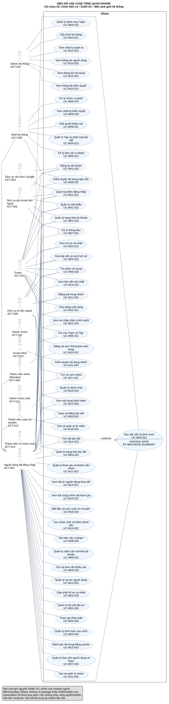

# US-overview — Use case tổng quan hệ thống iShare

[Vietnamese Doc]

**Mục đích:** trình bày các nghiệp vụ chính của toàn iShare thông qua **việc lựa chọn từ UC chính đã xác định tại US-M01–US-M16**. Tài liệu giữ nguyên ID, tên, owner, mức và actor nguồn; không tạo UC mới, không đặt lại tên để gom nhiều UC, không thay thế đặc tả module.

<!-- uc:document -->
| key | value |
|---|---|
| document_id | US-overview |
| version | 1.3 |
| profile | selected-module-core-overview |
| skill_version | 2.3 |
| modules | M01, M02, M03, M04, M05, M06, M07, M08, M09, M10, M11, M12, M13, M14, M15, M16 |
| status | Chờ duyệt |
| date | 2026-11-24 |
| current_step | 7 |
| completed_steps | 1, 2, 3, 4, 5, 6, 7 |
| approved_steps | - |
| source_baseline | FR-M01 1.10; FR-M02 1.6; FR-M03 1.10; FR-M04 1.4; FR-M05 1.7; FR-M06 1.5; FR-M07 1.5; FR-M08 1.7; FR-M09 1.2; FR-M10 1.4; FR-M11 1.3; FR-M12 1.1; FR-M13 1.3; FR-M14 1.1; FR-M15 1.1; FR-M16 1.0 |
| approval_evidence | Người dùng yêu cầu cập nhật bộ US theo skill mới; được thực hiện liên tục trong phạm vi hiện có. Chưa có phê duyệt bản v2.3 hoặc quan hệ đề xuất. |
| semantic_review | pass |
| diagram_check | pass |
| mode | overview |
| overview_selection | selected |
| scope | ALL |
| author | Codex — hỗ trợ phân tích nghiệp vụ |

## 1. Phạm vi và nguyên tắc lựa chọn

**Boundary:** toàn hệ thống iShare. M01–M16 là thành phần nội bộ, không phải actor bên ngoài. Biểu đồ có **đúng một khối iShare**, tất cả oval nằm trực tiếp trong khối đó; không package, không khung module, không khối chức năng con.

Nguồn có **64 UC chính**. Tổng quan chọn **51 UC chính hiện có**, không đưa 13 UC hỗ trợ lên hình. Một UC được giữ khi actor có thể hoàn tất một mục tiêu nghiệp vụ có kết quả rõ; UC mức Summary được giữ khi thể hiện một vòng đời/nghiệp vụ độc lập, có các nhánh đúng quyền. Không ép mọi nhánh của Summary chạy trong một lần.

Không chọn một UC chỉ vì được gắn `core` ở module. Các UC phục vụ một đoạn luồng như nhắc tên, phân loại, gợi ý/embedding, chỉ báo tin mới, lịch sử tìm kiếm hoặc hợp đồng abstract được giải thích tại mục 5 và giữ nguyên trong mô hình module. **Không đưa lên hình không có nghĩa xóa yêu cầu hoặc đổi UC đó thành UC khác.**

Không đặt quota số UC hoặc gom tên để làm hình ít oval hơn. Những nghiệp vụ độc lập như quản lý mật khẩu, vòng đời tài khoản, gửi báo cáo, xét khiếu nại, quản trị vai trò, thống kê và các mục tiêu Group/Chat vẫn cần được phân biệt bằng ID đã có.

Cách lựa chọn này áp dụng [skill use-case-analysis](../../../.agent-instructions/skills/use-case-analysis/SKILL.md) theo yêu cầu hiện tại: lấy **một tập con** core module, giữ định danh/hợp đồng; không tự xây một tầng mục tiêu thay thế. Sơ đồ chỉ vẽ quan hệ có bằng chứng, không dùng mũi tên để diễn đạt thứ tự hay phụ thuộc dữ liệu.

## 2. Sơ đồ tổng quan toàn hệ thống

[Mở SVG để phóng to](diagrams/overview/SYS-overview.svg).

**Nội dung:** 51 oval, đều là core được chọn từ module; 13 actor ngoài boundary; một khối iShare. Sơ đồ không chia module. Vị trí oval chỉ phục vụ bố cục và không mang nghĩa phân rã.

**Ký pháp:** association actor–UC là nét liền; actor generalization đi từ vai trò chuyên biệt đến vai trò chung bằng tam giác rỗng; «extend» là nét đứt từ UC mở rộng đến UC cơ sở. Không vẽ include/generalization giữa UC chỉ để đủ ba loại quan hệ. Quan hệ chi tiết có endpoint là UC không được chọn vẫn giữ tại US owner, không đổi endpoint thành core khác.

## 3. Actor tương tác trực tiếp

<!-- uc:actors -->
| id | name | kind | parent | boundary_reason | sources |
|---|---|---|---|---|---|
| ACT-001 | Guest | human | - | Con người chưa có phiên ngoài iShare; chỉ đọc/tìm nội dung được phép và các luồng xác thực theo nguồn; không ghi nội dung, vote hoặc đọc Chat thành công. | FR-M16-01.03, FR-M16-03.02, FR-M16-16.02 |
| ACT-002 | Người dùng đã đăng nhập | human | - | Con người có phiên ngoài iShare; mỗi UC vẫn kiểm trạng thái tài khoản, quyền nội dung, membership và cờ; không mặc nhiên thuộc mọi nhóm/cuộc trò chuyện. | FR-M16-01.01, FR-M16-02.01, FR-M16-03.01, FR-M16-16.01 |
| ACT-003 | Mod hoặc Admin — nhãn gộp từ US nguồn | human | - | Vai trò gộp đã có ở M01–M05, giữ để tham chiếu nguyên catalog nguồn; chiếu đúng nhánh sang ACT-008/ACT-007 trên hình, không thêm actor độc lập hoặc quyền mới. | FR-M01-13.05, FR-M01-10.04, BR-M01-41 |
| ACT-004 | Dịch vụ xác thực Google | external-system | - | Dịch vụ ngoài iShare cung cấp danh tính đã xác thực cho luồng Google | FR-M01-04.01, FR-M01-04.04, FR-M01-04.06, BR-M01-08 |
| ACT-005 | Dịch vụ gửi email bên ngoài | external-system | - | Hỗ trợ giao email ra ngoài iShare; tích hợp/điều phối thuộc M07. Không coi M07 là actor hoặc cấp quyền nhà cung cấp vào dữ liệu tài khoản | FR-M01-15.05, FR-M01-01.03, FR-M01-11.01, FR-M07-04.01, FR-M07-04.02 |
| ACT-006 | Dịch vụ AI bên ngoài | external-system | - | Nhà cung cấp ngoài iShare trả điểm, vector, Topic hoặc tóm tắt qua M13 đúng loại lời gọi được cho phép; không gọi khi dùng cache, đọc log hoặc tính metric. | FR-M13-01.10, FR-M13-02.01, FR-M13-04.01, FR-M13-05.01, FR-M13-06.02, FR-M11-12.02 |
| ACT-007 | Admin hệ thống | human | ACT-008 | Qua cờ Chat tắt, vẫn cần membership/vai trò nhóm/sở hữu/hạn và dữ liệu như thường. | FR-M16-15.04, FR-M16-04.08, FR-M16-06.04 |
| ACT-008 | Mod hệ thống | human | ACT-002 | Có năng lực User, không quyền đọc/kiểm duyệt chat ngoài membership; không qua cờ tắt. | FR-M16-04.08, FR-M16-05.06, BR-M16-20, FR-M16-15.01 |
| ACT-009 | Thành viên nhóm (Member) | human | ACT-002 | Vai trò tương tác theo nhóm cụ thể; đăng bài/mời/rời, không là vai trò hệ thống mới. | BR-M11-06, FR-M11-05.01, FR-M11-10.01, FR-M11-12.01 |
| ACT-010 | Group Mod | human | ACT-009 | Thành viên được phân công duyệt/gỡ/quản trị thành viên đúng nhóm; khác ACT-008. | BR-M11-05, BR-M11-06, BR-M11-39 |
| ACT-011 | Owner nhóm | human | ACT-010 | Chủ nhóm; thêm quyền cấu hình/quản trị, tự rời có điều kiện; mỗi nhóm một Owner. | BR-M11-04, BR-M11-06, BR-M11-25, BR-M11-40 |
| ACT-012 | Thành viên cuộc trò chuyện | human | ACT-002 | Một trong hai người 1-1 hoặc current member nhóm, là vai trò tương tác đọc/gửi/thu hồi và việc nhóm khi thích hợp. | FR-M16-04.01, FR-M16-05.01, FR-M16-06.01, BR-M16-05 |
| ACT-013 | Admin nhóm chat | human | ACT-012 | Quản trị chính nhóm đang xét, có hành vi member và thêm duyệt/công tắc/xóa/chuyển; không ADMIN hệ thống. | FR-M16-02.02, FR-M16-09.01, FR-M16-10.01, FR-M16-13.01, BR-M16-04, BR-M16-05 |
| ACT-014 | Thành viên cũ nhóm chat | human | ACT-002 | Đã rời/bị xóa, chỉ đọc phần lịch sử trước cutoff và giữ hộp thư; không generalization từ current member. | FR-M16-04.10, FR-M16-11.01, FR-M16-14.01, BR-M16-27 |

Trên hình có **10 vai trò người dùng** và **3 dịch vụ hỗ trợ**. Bảng có thêm ACT-003 là nhãn gộp tương thích đã tồn tại ở nguồn, không là actor thứ 14 trên hình. Vai trò chính/hỗ trợ áp cho từng UC; bảng catalog giữ actor nguyên gốc của tài liệu module.

| Quy ước trên sơ đồ | Diễn giải |
|---|---|
| ACT-003 trong một số US cũ | Là nhãn gộp Mod/Admin, được chiếu sang ACT-008/ACT-007 khi vẽ, đúng nhánh/quyền tương ứng. Không tạo thêm một vai trò hệ thống. Catalog nguồn bên dưới vẫn giữ chuỗi actor gốc. |
| Các cạnh kế thừa actor | Giữ đúng chuỗi gốc: Admin → Mod → User; Owner → Group Mod → Member → User; Chat Admin → thành viên cuộc trò chuyện → User. Thành viên cũ → User, không kế thừa current member. |
| Association kế thừa | Không vẽ lặp association của actor con nếu actor cha đã nối cùng UC ở cùng vai trò. Danh sách tham gia trực tiếp trước khi rút gọn có 145 cặp duy nhất; hình vẽ 79 cạnh association, phần còn lại kế thừa. |
| Guest | Chỉ nhánh được phép: đọc công khai, tìm, xem hồ sơ/bảng/nhóm, nhận banner, khôi phục truy cập theo nguồn; không vì cùng oval Summary mà được vote/sửa bài/điều hành. |
| User / chủ nội dung | Quyền sở hữu, membership, trạng thái tài khoản/cảnh cáo/cờ vẫn kiểm theo từng nhánh. Association không thay ma trận quyền. |
| Admin hệ thống / Owner Group / Admin nhóm chat | Không đồng nhất. Admin hệ thống không đương nhiên đọc Private/Chat hoặc duyệt hàng chờ Group. |
| Google / email / AI | Chỉ hỗ trợ nhánh thật sự tích hợp. AI chỉ khi cổng cho phép và cần gọi; tóm tắt có cache, thống kê không gọi AI. Không có actor M07/M13/Clock/iShare. |

## 4. Các UC chính được chọn

Catalog dưới đây lấy **nguyên các trường của core nguồn**, không tái phân loại hoặc thay tên/actor/owner. Mỗi dòng có liên kết tới đặc tả module; các ID trong cột actor có thể là vai trò khởi tạo hoặc vai trò tham gia theo nhánh Summary.

<!-- uc:catalog -->
| id | name | tier | level | primary | supporting | owner | anchor | Đặc tả nguồn | sources |
|---|---|---|---|---|---|---|---|---|---|
| UC-M01-020 | Đăng ký tài khoản | core | User goal | ACT-001 | ACT-004, ACT-005 | M01 | #uc-m01-020 | [UC-M01-020](US-M01.md#uc-m01-020) | FR-M01-01, FR-M01-02, FR-M01-03, FR-M01-04, BR-M01-02, BR-M01-03, BR-M01-08 |
| UC-M01-021 | Quản lý phiên đăng nhập | core | Summary | ACT-001, ACT-002, ACT-003 | ACT-004, ACT-005 | M01 | #uc-m01-021 | [UC-M01-021](US-M01.md#uc-m01-021) | FR-M01-04, FR-M01-05, FR-M01-06, FR-M01-07 |
| UC-M01-022 | Quản lý mật khẩu | core | Summary | ACT-001, ACT-002, ACT-003 | ACT-005 | M01 | #uc-m01-022 | [UC-M01-022](US-M01.md#uc-m01-022) | FR-M01-08, FR-M01-09, BR-M01-13, BR-M01-14, BR-M01-15 |
| UC-M01-023 | Quản lý trạng thái tài khoản | core | Summary | ACT-001, ACT-002, ACT-003 | ACT-005 | M01 | #uc-m01-023 | [UC-M01-023](US-M01.md#uc-m01-023) | FR-M01-10, FR-M01-11, FR-M01-12, FR-M01-13, BR-M01-20, BR-M01-21 |
| UC-M01-024 | Xem và chấp nhận chính sách | core | Summary | ACT-001, ACT-002, ACT-003 |  | M01 | #uc-m01-024 | [UC-M01-024](US-M01.md#uc-m01-024) | FR-M01-15, FR-M01-16, BR-M01-44, BR-M01-45 |
| UC-M02-010 | Xem hồ sơ cá nhân | core | Summary | ACT-001, ACT-002, ACT-003 |  | M02 | #uc-m02-010 | [UC-M02-010](US-M02.md#uc-m02-010) | FR-M02-01, FR-M02-02, BR-M02-01, BR-M02-14, BR-M02-28 |
| UC-M02-020 | Cập nhật hồ sơ cá nhân | core | Summary | ACT-002, ACT-003 |  | M02 | #uc-m02-020 | [UC-M02-020](US-M02.md#uc-m02-020) | FR-M02-03, FR-M02-04, BR-M02-18, BR-M02-36 |
| UC-M02-030 | Quản lý bài viết đã lưu | core | Summary | ACT-002, ACT-003 |  | M02 | #uc-m02-030 | [UC-M02-030](US-M02.md#uc-m02-030) | FR-M02-05, FR-M02-06, FR-M02-07, BR-M02-21, BR-M02-23, BR-M02-30 |
| UC-M03-020 | Soạn và đăng bài viết | core | Summary | ACT-002, ACT-003 | ACT-006 | M03 | #uc-m03-020 | [UC-M03-020](US-M03.md#uc-m03-020) | FR-M03-01, FR-M03-02, FR-M03-03, FR-M03-04, FR-M03-05, FR-M03-06 |
| UC-M03-021 | Đọc bài viết và bình chọn | core | Summary | ACT-001, ACT-002, ACT-003 |  | M03 | #uc-m03-021 | [UC-M03-021](US-M03.md#uc-m03-021) | FR-M03-07, FR-M03-08, FR-M03-09, FR-M03-10 |
| UC-M03-022 | Sửa bài viết và xem lịch sử | core | Summary | ACT-001, ACT-002, ACT-003 | ACT-006 | M03 | #uc-m03-022 | [UC-M03-022](US-M03.md#uc-m03-022) | FR-M03-02.02, FR-M03-11, FR-M03-12, BR-M03-26, BR-M03-27 |
| UC-M03-023 | Quản lý trạng thái bài viết | core | Summary | ACT-002, ACT-003 | ACT-006 | M03 | #uc-m03-023 | [UC-M03-023](US-M03.md#uc-m03-023) | FR-M03-13, FR-M03-14, FR-M03-15, FR-M03-16, FR-M03-17, FR-M03-07.08 |
| UC-M04-020 | Tham gia thảo luận | core | User goal | ACT-002, ACT-003 |  | M04 | #uc-m04-020 | [UC-M04-020](US-M04.md#uc-m04-020) | FR-M04-02, FR-M04-03, BR-M04-03, BR-M04-12, BR-M04-14, BR-M04-15, BR-M04-16, BR-M04-19 |
| UC-M04-030 | Quản lý bình luận của mình | core | Summary | ACT-002, ACT-003 |  | M04 | #uc-m04-030 | [UC-M04-030](US-M04.md#uc-m04-030) | FR-M04-04, FR-M04-05, BR-M04-07, BR-M04-08, BR-M04-20, BR-M04-21 |
| UC-M05-021 | Tra cứu Topic và Tag | core | Summary | ACT-001, ACT-002, ACT-003, ACT-007 |  | M05 | #uc-m05-021 | [UC-M05-021](US-M05.md#uc-m05-021) | FR-M05-04, FR-M05-05, BR-M05-01, BR-M05-29, BR-M05-30, BR-M05-31 |
| UC-M05-022 | Quản lý danh mục Topic | core | Summary | ACT-007 |  | M05 | #uc-m05-022 | [UC-M05-022](US-M05.md#uc-m05-022) | FR-M05-06, FR-M05-07, FR-M05-08, BR-M05-05, BR-M05-08, BR-M05-09 |
| UC-M05-023 | Quản lý Tag và phân loại bài viết | core | Summary | ACT-003, ACT-007 |  | M05 | #uc-m05-023 | [UC-M05-023](US-M05.md#uc-m05-023) | FR-M05-09, FR-M05-10, FR-M05-11, BR-M05-04, BR-M05-25, BR-M05-26, BR-M05-27 |
| UC-M06-020 | Tìm kiếm nội dung | core | User goal | ACT-001, ACT-002, ACT-003 | ACT-006 | M06 | #uc-m06-020 | [UC-M06-020](US-M06.md#uc-m06-020) | FR-M06-02, FR-M06-03, FR-M06-04, BR-M06-16, BR-M06-17, BR-M06-19, BR-M06-21 |
| UC-M07-020 | Quản lý theo dõi người dùng và Topic | core | Summary | ACT-002, ACT-003 |  | M07 | #uc-m07-020 | [UC-M07-020](US-M07.md#uc-m07-020) | FR-M07-01, BR-M07-15, BR-M07-23, BR-M07-25 |
| UC-M07-021 | Xử lý thông báo | core | Summary | ACT-002, ACT-003 | ACT-005 | M07 | #uc-m07-021 | [UC-M07-021](US-M07.md#uc-m07-021) | FR-M07-02, FR-M07-03, FR-M07-04, FR-M07-05, FR-M07-06, BR-M07-01, BR-M07-03, BR-M07-09, BR-M07-20 |
| UC-M08-020 | Gửi báo cáo vi phạm | core | User goal | ACT-002, ACT-008, ACT-007 |  | M08 | #uc-m08-020 | [UC-M08-020](US-M08.md#uc-m08-020) | FR-M08-01, BR-M08-01, BR-M08-02, BR-M08-03, BR-M08-04, BR-M08-47, BR-M08-55 |
| UC-M08-021 | Xử lý báo cáo vi phạm | core | User goal | ACT-008, ACT-007 |  | M08 | #uc-m08-021 | [UC-M08-021](US-M08.md#uc-m08-021) | FR-M08-02, FR-M08-03, FR-M08-04, FR-M08-05, BR-M08-08, BR-M08-10, BR-M08-46, BR-M08-48 |
| UC-M08-022 | Kiểm duyệt nội dung nghi vấn | core | Summary | ACT-008, ACT-007 | ACT-006 | M08 | #uc-m08-022 | [UC-M08-022](US-M08.md#uc-m08-022) | FR-M08-06, FR-M08-07, FR-M08-08, FR-M08-09, BR-M08-22, BR-M08-23, BR-M08-55 |
| UC-M08-023 | Quản lý cảnh cáo và khóa tài khoản | core | Summary | ACT-002, ACT-008, ACT-007 |  | M08 | #uc-m08-023 | [UC-M08-023](US-M08.md#uc-m08-023) | FR-M08-09, FR-M08-10, FR-M08-11, FR-M08-12, FR-M08-13, FR-M08-14, FR-M08-15, BR-M08-31, BR-M08-33, BR-M08-46 |
| UC-M08-024 | Xử lý nhóm vi phạm | core | Summary | ACT-008, ACT-007 |  | M08 | #uc-m08-024 | [UC-M08-024](US-M08.md#uc-m08-024) | FR-M08-18, BR-M08-46, BR-M08-48, BR-M08-50, BR-M11-28 |
| UC-M08-025 | Xem nhật ký kiểm duyệt | core | User goal | ACT-008, ACT-007 |  | M08 | #uc-m08-025 | [UC-M08-025](US-M08.md#uc-m08-025) | FR-M08-16, FR-M08-17, BR-M08-39, BR-M08-40, BR-M08-41 |
| UC-M09-020 | Gửi và theo dõi khiếu nại | core | Summary | ACT-002, ACT-008 |  | M09 | #uc-m09-020 | [UC-M09-020](US-M09.md#uc-m09-020) | FR-M09-01, FR-M09-02, BR-M09-01, BR-M09-04, BR-M09-21, BR-M09-27 |
| UC-M09-021 | Giải quyết khiếu nại | core | User goal | ACT-008, ACT-007 |  | M09 | #uc-m09-021 | [UC-M09-021](US-M09.md#uc-m09-021) | FR-M09-03, FR-M09-04, FR-M09-06, FR-M09-07, BR-M09-11, BR-M09-12, BR-M09-27 |
| UC-M10-020 | Quản lý vai trò người dùng | core | Summary | ACT-007, ACT-002, ACT-008 |  | M10 | #uc-m10-020 | [UC-M10-020](US-M10.md#uc-m10-020) | FR-M10-01, FR-M10-02, FR-M10-03, FR-M10-04, FR-M10-05, FR-M10-06, FR-M10-07, FR-M10-08, BR-M10-01, BR-M10-02, BR-M10-05, BR-M10-07, BR-M10-10, BR-M10-11, BR-M10-25, BR-M10-27 |
| UC-M10-021 | Cấu hình hệ thống | core | Summary | ACT-007 |  | M10 | #uc-m10-021 | [UC-M10-021](US-M10.md#uc-m10-021) | FR-M10-09, FR-M10-10, FR-M10-11, FR-M10-12, BR-M10-04, BR-M10-12, BR-M10-13, BR-M10-14, BR-M10-15, BR-M10-16, BR-M10-17, BR-M10-18, BR-M10-19, BR-M10-26, BR-M10-28 |
| UC-M10-022 | Đăng và xem thông báo toàn trang | core | Summary | ACT-007, ACT-001, ACT-002 |  | M10 | #uc-m10-022 | [UC-M10-022](US-M10.md#uc-m10-022) | FR-M10-13, BR-M10-20, BR-M10-26 |
| UC-M10-023 | Xem nhật ký quản trị | core | User goal | ACT-007 |  | M10 | #uc-m10-023 | [UC-M10-023](US-M10.md#uc-m10-023) | FR-M10-14, FR-M10-15, BR-M10-02, BR-M10-21, BR-M10-22, BR-M10-23, BR-M10-24 |
| UC-M11-030 | Tạo và quản lý nhóm | core | Summary | ACT-002, ACT-011 |  | M11 | #uc-m11-030 | [UC-M11-030](US-M11.md#uc-m11-030) | FR-M11-01, FR-M11-02, FR-M11-15, BR-M11-03, BR-M11-04, BR-M11-06, BR-M11-23, BR-M11-31, BR-M11-32 |
| UC-M11-031 | Tìm và xem nhóm | core | Summary | ACT-001, ACT-002, ACT-009, ACT-008, ACT-007 |  | M11 | #uc-m11-031 | [UC-M11-031](US-M11.md#uc-m11-031) | FR-M11-03, BR-M11-11, BR-M11-13, BR-M11-14, BR-M11-15, BR-M11-17, BR-M11-33, BR-M11-34, BR-M11-35 |
| UC-M11-032 | Quản lý tham gia và thành viên nhóm | core | Summary | ACT-002, ACT-009, ACT-010, ACT-011 |  | M11 | #uc-m11-032 | [UC-M11-032](US-M11.md#uc-m11-032) | FR-M11-04, FR-M11-05, FR-M11-06, FR-M11-07, FR-M11-08, FR-M11-09, FR-M11-10, FR-M11-11, BR-M11-05, BR-M11-06, BR-M11-07, BR-M11-08, BR-M11-09, BR-M11-10, BR-M11-12, BR-M11-24, BR-M11-25, BR-M11-26 |
| UC-M11-033 | Đăng bài trong nhóm | core | User goal | ACT-009, ACT-010, ACT-011 | ACT-006 | M11 | #uc-m11-033 | [UC-M11-033](US-M11.md#uc-m11-033) | FR-M11-12, FR-M11-13.11, FR-M11-13.12, FR-M11-13.14, BR-M11-01, BR-M11-16, BR-M11-17, BR-M11-18, BR-M11-19, BR-M11-38, BR-M11-40 |
| UC-M11-034 | Kiểm duyệt nội dung nhóm | core | Summary | ACT-010, ACT-011 |  | M11 | #uc-m11-034 | [UC-M11-034](US-M11.md#uc-m11-034) | FR-M11-13, FR-M11-14, BR-M11-05, BR-M11-06, BR-M11-20, BR-M11-21, BR-M11-22, BR-M11-30, BR-M11-38, BR-M11-39 |
| UC-M12-020 | Đánh giá nội dung bằng upvote | core | User goal | ACT-002, ACT-007 |  | M12 | #uc-m12-020 | [UC-M12-020](US-M12.md#uc-m12-020) | FR-M12-01, FR-M12-02, BR-M12-01, BR-M12-02, BR-M12-03, BR-M12-04, BR-M12-05, BR-M12-07, BR-M12-28 |
| UC-M12-021 | Xem bảng xếp hạng | core | User goal | ACT-001, ACT-002, ACT-007 |  | M12 | #uc-m12-021 | [UC-M12-021](US-M12.md#uc-m12-021) | FR-M12-04, FR-M12-05, FR-M12-06, BR-M12-14, BR-M12-16, BR-M12-18, BR-M12-19, BR-M12-20, BR-M12-21, BR-M12-22, BR-M12-24, BR-M12-29 |
| UC-M13-023 | Tóm tắt bài viết | core | User goal | ACT-002, ACT-007 | ACT-006 | M13 | #uc-m13-023 | [UC-M13-023](US-M13.md#uc-m13-023) | FR-M13-06, FR-M13-07, BR-M13-06, BR-M13-19, BR-M13-20, BR-M13-27, BR-M13-28 |
| UC-M14-020 | Xem nội dung thịnh hành | core | Summary | ACT-001, ACT-002 |  | M14 | #uc-m14-020 | [UC-M14-020](US-M14.md#uc-m14-020) | FR-M14-01, FR-M14-02, FR-M14-03, BR-M14-01, BR-M14-03, BR-M14-19, BR-M14-24 |
| UC-M14-021 | Xem bài từ nguồn đang theo dõi | core | User goal | ACT-002 |  | M14 | #uc-m14-021 | [UC-M14-021](US-M14.md#uc-m14-021) | FR-M14-04, FR-M14-07, FR-M14-08, BR-M14-08, BR-M14-20 |
| UC-M14-022 | Xem bài trong nhóm đã tham gia | core | User goal | ACT-002 |  | M14 | #uc-m14-022 | [UC-M14-022](US-M14.md#uc-m14-022) | FR-M14-05, FR-M14-07, FR-M14-08, BR-M14-07, BR-M14-21 |
| UC-M14-023 | Xem bài viết mới nhất | core | User goal | ACT-001, ACT-002 |  | M14 | #uc-m14-023 | [UC-M14-023](US-M14.md#uc-m14-023) | FR-M14-06, FR-M14-07, FR-M14-08, BR-M14-06, BR-M14-09 |
| UC-M15-020 | Xem thống kê người dùng | core | User goal | ACT-007 |  | M15 | #uc-m15-020 | [UC-M15-020](US-M15.md#uc-m15-020) | FR-M15-01, BR-M15-07, BR-M15-20 |
| UC-M15-021 | Xem thống kê nội dung | core | User goal | ACT-007 |  | M15 | #uc-m15-021 | [UC-M15-021](US-M15.md#uc-m15-021) | FR-M15-02, BR-M15-08, BR-M15-09, BR-M15-17, BR-M15-21 |
| UC-M15-022 | Xem thống kê kiểm duyệt | core | User goal | ACT-007 |  | M15 | #uc-m15-022 | [UC-M15-022](US-M15.md#uc-m15-022) | FR-M15-03, BR-M15-10, BR-M15-11, BR-M15-12, BR-M15-13, BR-M15-14, BR-M15-22 |
| UC-M16-030 | Bắt đầu và xem cuộc trò chuyện | core | Summary | ACT-002, ACT-012, ACT-014 |  | M16 | #uc-m16-030 | [UC-M16-030](US-M16.md#uc-m16-030) | FR-M16-01, FR-M16-03, FR-M16-04, FR-M16-07, FR-M16-15 |
| UC-M16-031 | Gửi và quản lý tin nhắn | core | Summary | ACT-012 |  | M16 | #uc-m16-031 | [UC-M16-031](US-M16.md#uc-m16-031) | FR-M16-05, FR-M16-06, FR-M16-07, FR-M16-15 |
| UC-M16-032 | Tạo nhóm chat và thêm thành viên | core | Summary | ACT-002, ACT-012, ACT-013 |  | M16 | #uc-m16-032 | [UC-M16-032](US-M16.md#uc-m16-032) | FR-M16-02, FR-M16-08, FR-M16-10, FR-M16-16, FR-M16-15 |
| UC-M16-033 | Quản lý nhóm chat | core | Summary | ACT-012, ACT-013 |  | M16 | #uc-m16-033 | [UC-M16-033](US-M16.md#uc-m16-033) | FR-M16-09, FR-M16-11, FR-M16-12, FR-M16-13, FR-M16-14, FR-M16-17, FR-M16-15 |

### 4.1 Định vị các UC trong tài liệu tổng quan

Các anchor dưới đây định vị cùng ID để các bảng quan hệ/truy vết liên kết. Hợp đồng trigger, tiền điều kiện, kết quả, nhánh, UC con và AUT/BR được đọc trực tiếp ở owner; không lập một đặc tả khác cho cùng ID.

**UC-M01-020 — Đăng ký tài khoản:** owner M01, mức User goal. [Đọc hợp đồng và phân rã](US-M01.md#uc-m01-020).

**UC-M01-021 — Quản lý phiên đăng nhập:** owner M01, mức Summary. [Đọc hợp đồng và phân rã](US-M01.md#uc-m01-021).

**UC-M01-022 — Quản lý mật khẩu:** owner M01, mức Summary. [Đọc hợp đồng và phân rã](US-M01.md#uc-m01-022).

**UC-M01-023 — Quản lý trạng thái tài khoản:** owner M01, mức Summary. [Đọc hợp đồng và phân rã](US-M01.md#uc-m01-023).

**UC-M01-024 — Xem và chấp nhận chính sách:** owner M01, mức Summary. [Đọc hợp đồng và phân rã](US-M01.md#uc-m01-024).

**UC-M02-010 — Xem hồ sơ cá nhân:** owner M02, mức Summary. [Đọc hợp đồng và phân rã](US-M02.md#uc-m02-010).

**UC-M02-020 — Cập nhật hồ sơ cá nhân:** owner M02, mức Summary. [Đọc hợp đồng và phân rã](US-M02.md#uc-m02-020).

**UC-M02-030 — Quản lý bài viết đã lưu:** owner M02, mức Summary. [Đọc hợp đồng và phân rã](US-M02.md#uc-m02-030).

**UC-M03-020 — Soạn và đăng bài viết:** owner M03, mức Summary. [Đọc hợp đồng và phân rã](US-M03.md#uc-m03-020).

**UC-M03-021 — Đọc bài viết và bình chọn:** owner M03, mức Summary. [Đọc hợp đồng và phân rã](US-M03.md#uc-m03-021).

**UC-M03-022 — Sửa bài viết và xem lịch sử:** owner M03, mức Summary. [Đọc hợp đồng và phân rã](US-M03.md#uc-m03-022).

**UC-M03-023 — Quản lý trạng thái bài viết:** owner M03, mức Summary. [Đọc hợp đồng và phân rã](US-M03.md#uc-m03-023).

**UC-M04-020 — Tham gia thảo luận:** owner M04, mức User goal. [Đọc hợp đồng và phân rã](US-M04.md#uc-m04-020).

**UC-M04-030 — Quản lý bình luận của mình:** owner M04, mức Summary. [Đọc hợp đồng và phân rã](US-M04.md#uc-m04-030).

**UC-M05-021 — Tra cứu Topic và Tag:** owner M05, mức Summary. [Đọc hợp đồng và phân rã](US-M05.md#uc-m05-021).

**UC-M05-022 — Quản lý danh mục Topic:** owner M05, mức Summary. [Đọc hợp đồng và phân rã](US-M05.md#uc-m05-022).

**UC-M05-023 — Quản lý Tag và phân loại bài viết:** owner M05, mức Summary. [Đọc hợp đồng và phân rã](US-M05.md#uc-m05-023).

**UC-M06-020 — Tìm kiếm nội dung:** owner M06, mức User goal. [Đọc hợp đồng và phân rã](US-M06.md#uc-m06-020).

**UC-M07-020 — Quản lý theo dõi người dùng và Topic:** owner M07, mức Summary. [Đọc hợp đồng và phân rã](US-M07.md#uc-m07-020).

**UC-M07-021 — Xử lý thông báo:** owner M07, mức Summary. [Đọc hợp đồng và phân rã](US-M07.md#uc-m07-021).

**UC-M08-020 — Gửi báo cáo vi phạm:** owner M08, mức User goal. [Đọc hợp đồng và phân rã](US-M08.md#uc-m08-020).

**UC-M08-021 — Xử lý báo cáo vi phạm:** owner M08, mức User goal. [Đọc hợp đồng và phân rã](US-M08.md#uc-m08-021).

**UC-M08-022 — Kiểm duyệt nội dung nghi vấn:** owner M08, mức Summary. [Đọc hợp đồng và phân rã](US-M08.md#uc-m08-022).

**UC-M08-023 — Quản lý cảnh cáo và khóa tài khoản:** owner M08, mức Summary. [Đọc hợp đồng và phân rã](US-M08.md#uc-m08-023).

**UC-M08-024 — Xử lý nhóm vi phạm:** owner M08, mức Summary. [Đọc hợp đồng và phân rã](US-M08.md#uc-m08-024).

**UC-M08-025 — Xem nhật ký kiểm duyệt:** owner M08, mức User goal. [Đọc hợp đồng và phân rã](US-M08.md#uc-m08-025).

**UC-M09-020 — Gửi và theo dõi khiếu nại:** owner M09, mức Summary. [Đọc hợp đồng và phân rã](US-M09.md#uc-m09-020).

**UC-M09-021 — Giải quyết khiếu nại:** owner M09, mức User goal. [Đọc hợp đồng và phân rã](US-M09.md#uc-m09-021).

**UC-M10-020 — Quản lý vai trò người dùng:** owner M10, mức Summary. [Đọc hợp đồng và phân rã](US-M10.md#uc-m10-020).

**UC-M10-021 — Cấu hình hệ thống:** owner M10, mức Summary. [Đọc hợp đồng và phân rã](US-M10.md#uc-m10-021).

**UC-M10-022 — Đăng và xem thông báo toàn trang:** owner M10, mức Summary. [Đọc hợp đồng và phân rã](US-M10.md#uc-m10-022).

**UC-M10-023 — Xem nhật ký quản trị:** owner M10, mức User goal. [Đọc hợp đồng và phân rã](US-M10.md#uc-m10-023).

**UC-M11-030 — Tạo và quản lý nhóm:** owner M11, mức Summary. [Đọc hợp đồng và phân rã](US-M11.md#uc-m11-030).

**UC-M11-031 — Tìm và xem nhóm:** owner M11, mức Summary. [Đọc hợp đồng và phân rã](US-M11.md#uc-m11-031).

**UC-M11-032 — Quản lý tham gia và thành viên nhóm:** owner M11, mức Summary. [Đọc hợp đồng và phân rã](US-M11.md#uc-m11-032).

**UC-M11-033 — Đăng bài trong nhóm:** owner M11, mức User goal. [Đọc hợp đồng và phân rã](US-M11.md#uc-m11-033).

**UC-M11-034 — Kiểm duyệt nội dung nhóm:** owner M11, mức Summary. [Đọc hợp đồng và phân rã](US-M11.md#uc-m11-034).

**UC-M12-020 — Đánh giá nội dung bằng upvote:** owner M12, mức User goal. [Đọc hợp đồng và phân rã](US-M12.md#uc-m12-020).

**UC-M12-021 — Xem bảng xếp hạng:** owner M12, mức User goal. [Đọc hợp đồng và phân rã](US-M12.md#uc-m12-021).

**UC-M13-023 — Tóm tắt bài viết:** owner M13, mức User goal. [Đọc hợp đồng và phân rã](US-M13.md#uc-m13-023).

**UC-M14-020 — Xem nội dung thịnh hành:** owner M14, mức Summary. [Đọc hợp đồng và phân rã](US-M14.md#uc-m14-020).

**UC-M14-021 — Xem bài từ nguồn đang theo dõi:** owner M14, mức User goal. [Đọc hợp đồng và phân rã](US-M14.md#uc-m14-021).

**UC-M14-022 — Xem bài trong nhóm đã tham gia:** owner M14, mức User goal. [Đọc hợp đồng và phân rã](US-M14.md#uc-m14-022).

**UC-M14-023 — Xem bài viết mới nhất:** owner M14, mức User goal. [Đọc hợp đồng và phân rã](US-M14.md#uc-m14-023).

**UC-M15-020 — Xem thống kê người dùng:** owner M15, mức User goal. [Đọc hợp đồng và phân rã](US-M15.md#uc-m15-020).

**UC-M15-021 — Xem thống kê nội dung:** owner M15, mức User goal. [Đọc hợp đồng và phân rã](US-M15.md#uc-m15-021).

**UC-M15-022 — Xem thống kê kiểm duyệt:** owner M15, mức User goal. [Đọc hợp đồng và phân rã](US-M15.md#uc-m15-022).

**UC-M16-030 — Bắt đầu và xem cuộc trò chuyện:** owner M16, mức Summary. [Đọc hợp đồng và phân rã](US-M16.md#uc-m16-030).

**UC-M16-031 — Gửi và quản lý tin nhắn:** owner M16, mức Summary. [Đọc hợp đồng và phân rã](US-M16.md#uc-m16-031).

**UC-M16-032 — Tạo nhóm chat và thêm thành viên:** owner M16, mức Summary. [Đọc hợp đồng và phân rã](US-M16.md#uc-m16-032).

**UC-M16-033 — Quản lý nhóm chat:** owner M16, mức Summary. [Đọc hợp đồng và phân rã](US-M16.md#uc-m16-033).

## 5. UC chính nguồn không đưa lên sơ đồ

<!-- inventory:excluded -->
| ID / tên nguyên gốc | Owner | Lý do không thể hiện thành oval tổng quan |
|---|---|---|
| [UC-M01-025](US-M01.md#uc-m01-025) — Nhắc tên người dùng | M01 | Mention hoàn tất một phần nội dung đang soạn, chưa hoàn tất nghiệp vụ công bố bài/thảo luận. Giữ trong chi tiết M01/M03/M04. |
| [UC-M04-010](US-M04.md#uc-m04-010) — Đọc bình luận | M04 | Đọc bình luận là phần đọc thảo luận gắn với bài; giữ đầy đủ ở chi tiết M04 và giao tiếp đọc bài, không bổ sung oval riêng trong view tổng quan. UC-M03-021 không bị đổi tên hay mở rộng đặc tả. |
| [UC-M05-020](US-M05.md#uc-m05-020) — Phân loại bài viết | M05 | Chốt Topic/Tag là hợp đồng của nhánh soạn/gửi/sửa bài. Kết quả là dữ liệu phân loại, chưa hoàn tất nghiệp vụ công bố nội dung; giữ ở chi tiết M03/M05. |
| [UC-M06-021](US-M06.md#uc-m06-021) — Tra cứu nhanh theo tên | M06 | Tra cứu nhanh phục vụ nhập/chọn đối tượng tìm, giữ ở chi tiết tìm kiếm thay vì một mục tiêu tổng quan riêng. |
| [UC-M06-022](US-M06.md#uc-m06-022) — Quản lý lịch sử tìm kiếm | M06 | Dùng lại/xóa lịch sử là hành vi hỗ trợ quản lý truy vấn trên thiết bị; giữ ở chi tiết M06. |
| [UC-M07-022](US-M07.md#uc-m07-022) — Cài đặt thông báo | M07 | Cài đặt mute theo bài/cuộc/toàn Chat là lựa chọn trong trải nghiệm thông báo, không thêm oval cấu hình cá nhân trên tổng quan. |
| [UC-M07-023](US-M07.md#uc-m07-023) — Kiểm tra tin nhắn mới | M07 | Tín hiệu cuộc chưa đọc/popup/icon là điểm vào Chat; nghiệp vụ truy cập và trao đổi do các core M16 thể hiện. |
| [UC-M09-022](US-M09.md#uc-m09-022) — Đảo ngược quyết định xử lý | M09 | Hợp đồng abstract thi hành phán quyết Chấp nhận; không khởi chạy như mục tiêu độc lập. Giữ nguyên ID và các chuyên biệt trong chi tiết M09. |
| [UC-M12-022](US-M12.md#uc-m12-022) — Xem điểm và thành tích | M12 | Điểm/huy hiệu/nhãn được đọc trong hồ sơ và bối cảnh thành tích; tác vụ cập nhật giữ ở M12, không thêm mục tiêu riêng trên view này. |
| [UC-M13-020](US-M13.md#uc-m13-020) — Chấm điểm nội dung bằng AI | M13 | Năng lực chấm điểm/điều phối AI hỗ trợ luồng kiểm duyệt, không mục tiêu độc lập do người dùng hoàn tất. |
| [UC-M13-021](US-M13.md#uc-m13-021) — Tạo embedding cho tìm kiếm | M13 | Embedding bài/truy vấn là năng lực nội bộ hỗ trợ tìm kiếm, không mục tiêu trực tiếp của actor. |
| [UC-M13-022](US-M13.md#uc-m13-022) — Gợi ý Topic bằng AI | M13 | Provider gợi ý Topic hỗ trợ phân loại trong bài viết, không mục tiêu nghiệp vụ cấp hệ thống riêng. |
| [UC-M13-024](US-M13.md#uc-m13-024) — Xem nhật ký AI và tỷ lệ giữ Topic | M13 | Log căn cứ và metric phục vụ khiếu nại/thống kê; giữ ở chi tiết M09/M13/M15, không nâng năng lực hỗ trợ thành mục tiêu độc lập. |

Đây là **quyết định phạm vi view**, không phải bảng đổi ID, không khẳng định UC được chọn bao hàm toàn bộ core không vẽ bằng quan hệ include. Khi cần xem các hành vi này, dùng phân rã/sơ đồ chi tiết module.

## 6. Quan hệ giữa UC và giao tiếp liên module

### 6.1 Quan hệ thể hiện trên hình

Tổng quan này có **một quan hệ extend giữa hai core có sẵn**. Chưa có bằng chứng để thêm include hoặc generalization giữa các core được chọn mà vẫn giữ đúng hợp đồng và endpoint. Không tạo UC cha mới để nối Feed/Search; không chuyển đích từ UC con sang core chỉ để có cạnh liên module.

**Điểm trong UC-M03-021:** ở nhánh đọc, sau khi nội dung đầy đủ đã hiển thị bởi [bước 2 của UC-M03-007](US-M03.md#uc-m03-007-main-2). Người xem tiếp tục đọc bài/poll/lịch sử theo luồng nguồn; không cần yêu cầu tóm tắt để hoàn tất đọc.

<!-- uc:extension-points -->
| id | base | at | description |
|---|---|---|---|
| EP-M03-READ-SUMMARY | UC-M03-021 | #uc-m03-021-read-point | Sau khi hiện bài đầy đủ trong nhánh đọc. EP của bản đề xuất tổng quan; base ở M03 và extension ở M13. Có căn cứ FR-M13-07, không thêm chức năng hoặc khẳng định owner đã nhập cạnh. |

<!-- uc:relations -->
| id | type | source | target | at | condition | return_to | rationale | sources |
|---|---|---|---|---|---|---|---|---|
| REL-OV-01 | extend | UC-M13-023 | UC-M03-021 | EP-M03-READ-SUMMARY | Trong nhánh đọc của UC-M03-021, User bấm Tóm tắt trên bài được quyền xem, tiêu đề+nội dung chữ từ 300 từ và công tắc AI tổng bật. | #uc-m03-021-read-point | UC-M03-021 ở nhánh đọc đã hiển thị đầy đủ bài và hoàn tất được khi không yêu cầu tóm tắt. UC-M13-023 bổ sung tóm tắt theo yêu cầu; cache/lỗi không chặn bài gốc. Điểm mở rộng thuộc nhánh đọc, không thuộc nhánh quản lý poll. Đề xuất quan hệ từ FR hiện có; nơi khai báo chính của bản đề xuất là mục6 tổng quan, có impact record M03/M13; không thêm UC hoặc sửa hợp đồng module. | FR-M13-07.01, FR-M13-07.03, FR-M13-07.05, FR-M13-07.08, FR-M03-07.01, BR-M13-20 |

**Thực hiện và trở về:** User yêu cầu tóm tắt → UC-M13-023 kiểm phiên/quyền/độ dài/công tắc → nhận tóm tắt hợp lệ đang giữ hoặc tạo mới → hiển thị ghi chú không bao gồm tệp → tiếp tục đọc tại điểm trên. Nếu AI tắt/lỗi hoặc không đủ điều kiện, xử lý theo M13 và bài đầy đủ vẫn đọc được. Guest chỉ được nhắc đăng nhập, không thực thi nhánh thành công của extension. EP không áp cho một lần chỉ quản lý poll.

### 6.2 Phụ thuộc module không tự tạo quan hệ UML

<!-- selected:interfaces -->
| Module liên quan | UC / luồng nguồn liên quan | Kết luận và cách thể hiện | Căn cứ |
|---|---|---|---|
| M01 ↔ các module cần phiên | UC-M01-021, UC-M01-024 và các thao tác được bảo vệ | Phiên/chính sách/trạng thái là cổng hoặc tiền điều kiện. Không include Đăng nhập vào mọi UC; đồng ý lại có thể phát sinh khi phiên còn hiệu lực. | FR-M01-05, FR-M01-16, BR-M01-18 |
| M01 ↔ M02 | UC-M01-020; UC-M02-010, UC-M02-020 | Đăng ký/thiết lập tạo hồ sơ, xem/sửa về sau có trigger riêng; không include đăng ký lại khi sửa. | FR-M01-03, FR-M02-01, FR-M02-03 |
| M03 ↔ M05 | UC-M03-020, UC-M03-022; hợp đồng phân loại của M05 | Phân loại là hành vi trong nhánh soạn/gửi/sửa. Core phân loại không chọn trên view, nên không thêm oval hoặc đổi đích include sang core danh mục/quản trị Topic. | FR-M03-01, FR-M03-04, FR-M03-11, FR-M05-01, FR-M05-03 |
| M05 ↔ M13 | Gợi ý Topic/feedback trong chi tiết bài viết | Năng lực hỗ trợ; gợi ý hợp lệ chọn sẵn tối đa 3 Topic, tác giả thay đổi lựa chọn cuối. Không actor M13 hay mục tiêu provider mới. | FR-M05-02.01, FR-M05-02.03, FR-M05-02.04, FR-M13-05 |
| M03 ↔ M11 | UC-M03-020, UC-M11-033, UC-M11-034 | Cổng công bố và hàng chờ khác phạm vi. Không generalization chỉ vì đều đăng bài; không include việc staff duyệt từ mọi lần tác giả gửi. | FR-M03-04, FR-M03-06, FR-M11-12, FR-M11-13 |
| M03/M04/M11 ↔ M08/M13 | UC-M03-020, UC-M04-020, UC-M08-022/023 | Quét/chấm điểm/cảnh cáo/ẩn là chính sách và tác vụ đúng ngữ cảnh. Không biến năng lực AI nội bộ thành actor; không quét mọi lần bình luận. | FR-M03-05, FR-M08-08, FR-M08-09, FR-M13-02 |
| M03 ↔ M13 | UC-M13-023 → UC-M03-021 | Đề xuất extend tại EP-M03-READ-SUMMARY; đúng hai UC nguồn được chọn, có điều kiện và điểm trở về; ownership/backlink ở mục9.5, chưa nhận owner đã nhập cạnh UML. | FR-M13-07.01, FR-M13-07.05, FR-M13-07.08 |
| M02 ↔ M03/M11 | UC-M02-030; UC-M03-021 | Bookmark giữ tham chiếu, không cấp quyền nội dung. Mở bài có lựa chọn và cổng riêng, không include mọi lần đọc từ lưu bài. | FR-M02-05, FR-M02-07, FR-M03-07 |
| M05/M07/M11 ↔ M06/M14 | UC-M05-021, UC-M07-020, UC-M06-020; các core M14 | Topic/follow/membership cung cấp dữ liệu ứng viên; điều hướng sang tìm không include. Feed/Search không kế thừa nhau vì chưa có core cha chung hiện hữu. Search có thể cho thành viên tìm bài Private; Trending/Following không lấy Private kể cả thành viên. | FR-M05-04, FR-M06-02, FR-M07-01, FR-M14-04, FR-M14-05 |
| M03/M04/M08/M09/M10/M11/M12/M16 ↔ M07 | Các nghiệp vụ phát sự kiện; UC-M07-021 | Tạo/giao thông báo là sự kiện; người nhận đọc/đánh dấu bằng trigger khác. Không include đọc thông báo trong mọi lần công bố/ra phán quyết. | FR-M07-02, FR-M07-03, FR-M07-04, FR-M07-05 |
| M16 ↔ M07 | Các core M16; chỉ báo Chat giữ trong chi tiết M07 | M16 sở hữu read marker, M07 hiển thị số cuộc/popup/icon. Mute không đổi unread; Chat không vào chuông/email. Không đổi tương tác dữ liệu thành include kiểm tra tin mới từ mọi lần gửi. | FR-M16-03, FR-M16-07, FR-M07-07, FR-M07-09 |
| M11 ↔ M16 | Các core Group và Chat được chọn | Đối tượng/vai trò/vòng đời khác nhau, không generalization. Tự chuyển Owner Group không áp cho Chat Admin. | FR-M11-11, FR-M16-13, FR-M16-17 |
| M03/M04/M11 ↔ M08 | UC-M08-020 và UC-M08-021 | Gửi báo cáo hoàn tất ở ghi nhận; staff nhận/xét bằng trigger khác. Không include Giải quyết từ Gửi báo cáo; chưa kết luận không đồng nghĩa vi phạm. | FR-M08-01, FR-M08-02, FR-M08-05 |
| M08/M13 ↔ M09 | UC-M09-020, UC-M09-021 | Hồ sơ và căn cứ được dùng khi xét; gửi đơn không include xét đơn. Mở log đã ghi không tự gọi AI lại. | FR-M09-01, FR-M09-03, FR-M09-06, FR-M13-08, FR-M13-09 |
| M09 ↔ M01/M03/M08/M11/M12 | Chi tiết thi hành trong UC-M09-021 | Include thật ở module là UC-M09-006 → UC-M09-022. Không thay source thành core khi vẽ; hai endpoint không được chọn nên cạnh giữ ở chi tiết M09. Đảo ngược đúng loại, không tự phục hồi Mod/hiện mọi bình luận; bài Group có thể vẫn chờ duyệt. | FR-M09-07, FR-M09-08 |
| M12 ↔ M02/M03/M04/M08/M09/M14 | UC-M12-020/021; hồ sơ, chế tài, feed | Upvote/vi phạm/chu kỳ tạo sự kiện điểm/rank theo M12; xem bảng không tính lại. Không include xem Feed hoặc bảng từ upvote. HEAVY loại bảng không tự loại bài khỏi Feed. | FR-M12-01, FR-M12-02, FR-M12-04, FR-M12-05, FR-M14-03 |
| M10 ↔ M01/M07/M08 | Các core M10, UC-M07-021 | Đề xuất vai trò cần người nhận phản hồi; ban có AUT thu hồi Mod; cờ/audit áp đúng điều kiện, không xóa/làm bù dữ liệu. Không chuỗi include chỉ vì thao tác trước/sau. | FR-M10-02, FR-M10-03, FR-M10-06, FR-M10-09, FR-M10-12 |
| M15 ↔ M01/M03/M08/M09 | UC-M15-020/021/022 | Dữ liệu đầu vào thống kê, không include hoạt động được đếm. Admin xem số liệu không thực hiện đăng ký/đăng bài/ban/xét đơn. | FR-M15-01, FR-M15-02, FR-M15-03 |
| M15 ↔ M13/M05 | UC-M15-021 và metric ở chi tiết M13 | Include nguồn là UC-M15-021 → UC-M13-010 (UC con). Không đưa UC con lên tổng quan, không đổi đích thành core hỗ trợ AI. Chỉ số từ feedback cùng kỳ, vẫn tính khi AI tắt, không gọi provider. | FR-M15-02.07, FR-M15-02.08, FR-M15-02.09, FR-M13-10, BR-M13-29 |

## 7. Truy vết và tài liệu nguồn

### 7.1 Đối chiếu đủ 16 module

Mỗi core nguồn thuộc đúng một trong hai tập: **được chọn (51)** hoặc **không vẽ (13)**. Không có core nguồn bị thay tên, thay ID hoặc mất quyết định lựa chọn. Tất cả FR nguồn đang Đã chốt; US module đang Chờ duyệt, không tự nâng trạng thái phê duyệt khi tổng hợp.

<!-- inventory:module-models -->
| Module | FR / phiên bản | US nguồn | UC được chọn | UC không vẽ |
|---|---|---|---|---|
| M01 | [FR-M01](../fr/FR-M01.md) v1.10 | [US-M01](US-M01.md) | [UC-M01-020](#uc-m01-020), [UC-M01-021](#uc-m01-021), [UC-M01-022](#uc-m01-022), [UC-M01-023](#uc-m01-023), [UC-M01-024](#uc-m01-024) | [UC-M01-025](US-M01.md#uc-m01-025) |
| M02 | [FR-M02](../fr/FR-M02.md) v1.6 | [US-M02](US-M02.md) | [UC-M02-010](#uc-m02-010), [UC-M02-020](#uc-m02-020), [UC-M02-030](#uc-m02-030) | - |
| M03 | [FR-M03](../fr/FR-M03.md) v1.10 | [US-M03](US-M03.md) | [UC-M03-020](#uc-m03-020), [UC-M03-021](#uc-m03-021), [UC-M03-022](#uc-m03-022), [UC-M03-023](#uc-m03-023) | - |
| M04 | [FR-M04](../fr/FR-M04.md) v1.4 | [US-M04](US-M04.md) | [UC-M04-020](#uc-m04-020), [UC-M04-030](#uc-m04-030) | [UC-M04-010](US-M04.md#uc-m04-010) |
| M05 | [FR-M05](../fr/FR-M05.md) v1.7 | [US-M05](US-M05.md) | [UC-M05-021](#uc-m05-021), [UC-M05-022](#uc-m05-022), [UC-M05-023](#uc-m05-023) | [UC-M05-020](US-M05.md#uc-m05-020) |
| M06 | [FR-M06](../fr/FR-M06.md) v1.5 | [US-M06](US-M06.md) | [UC-M06-020](#uc-m06-020) | [UC-M06-021](US-M06.md#uc-m06-021), [UC-M06-022](US-M06.md#uc-m06-022) |
| M07 | [FR-M07](../fr/FR-M07.md) v1.5 | [US-M07](US-M07.md) | [UC-M07-020](#uc-m07-020), [UC-M07-021](#uc-m07-021) | [UC-M07-022](US-M07.md#uc-m07-022), [UC-M07-023](US-M07.md#uc-m07-023) |
| M08 | [FR-M08](../fr/FR-M08.md) v1.7 | [US-M08](US-M08.md) | [UC-M08-020](#uc-m08-020), [UC-M08-021](#uc-m08-021), [UC-M08-022](#uc-m08-022), [UC-M08-023](#uc-m08-023), [UC-M08-024](#uc-m08-024), [UC-M08-025](#uc-m08-025) | - |
| M09 | [FR-M09](../fr/FR-M09.md) v1.2 | [US-M09](US-M09.md) | [UC-M09-020](#uc-m09-020), [UC-M09-021](#uc-m09-021) | [UC-M09-022](US-M09.md#uc-m09-022) |
| M10 | [FR-M10](../fr/FR-M10.md) v1.4 | [US-M10](US-M10.md) | [UC-M10-020](#uc-m10-020), [UC-M10-021](#uc-m10-021), [UC-M10-022](#uc-m10-022), [UC-M10-023](#uc-m10-023) | - |
| M11 | [FR-M11](../fr/FR-M11.md) v1.3 | [US-M11](US-M11.md) | [UC-M11-030](#uc-m11-030), [UC-M11-031](#uc-m11-031), [UC-M11-032](#uc-m11-032), [UC-M11-033](#uc-m11-033), [UC-M11-034](#uc-m11-034) | - |
| M12 | [FR-M12](../fr/FR-M12.md) v1.1 | [US-M12](US-M12.md) | [UC-M12-020](#uc-m12-020), [UC-M12-021](#uc-m12-021) | [UC-M12-022](US-M12.md#uc-m12-022) |
| M13 | [FR-M13](../fr/FR-M13.md) v1.3 | [US-M13](US-M13.md) | [UC-M13-023](#uc-m13-023) | [UC-M13-020](US-M13.md#uc-m13-020), [UC-M13-021](US-M13.md#uc-m13-021), [UC-M13-022](US-M13.md#uc-m13-022), [UC-M13-024](US-M13.md#uc-m13-024) |
| M14 | [FR-M14](../fr/FR-M14.md) v1.1 | [US-M14](US-M14.md) | [UC-M14-020](#uc-m14-020), [UC-M14-021](#uc-m14-021), [UC-M14-022](#uc-m14-022), [UC-M14-023](#uc-m14-023) | - |
| M15 | [FR-M15](../fr/FR-M15.md) v1.1 | [US-M15](US-M15.md) | [UC-M15-020](#uc-m15-020), [UC-M15-021](#uc-m15-021), [UC-M15-022](#uc-m15-022) | - |
| M16 | [FR-M16](../fr/FR-M16.md) v1.0 | [US-M16](US-M16.md) | [UC-M16-030](#uc-m16-030), [UC-M16-031](#uc-m16-031), [UC-M16-032](#uc-m16-032), [UC-M16-033](#uc-m16-033) | - |

### 7.2 Truy vết nhóm FR

Bảng là **kiểm kê tổng quan**, không chứng nhận đặc tả lại toàn bộ FR chi tiết/BR. Cột UC được chọn chỉ lấy nguồn core trực tiếp có căn cứ trong catalog module. Các nhóm chỉ hỗ trợ không bị ép ánh xạ sang một core khác; chúng trỏ về core hỗ trợ hoặc RULE/AUT tại module.

Mở bảng 174 nhóm FR còn hiệu lực

<!-- inventory:trace -->
| Nhóm FR | Nội dung | UC có mặt trên tổng quan | Phần giữ ở mô hình module |
|---|---|---|---|
| FR-M01-01 | Đăng ký tài khoản bằng email | [UC-M01-020](#uc-m01-020) | [chi tiết M01](US-M01.md) |
| FR-M01-02 | Xác minh email | [UC-M01-020](#uc-m01-020) | [chi tiết M01](US-M01.md) |
| FR-M01-03 | Thiết lập tài khoản | [UC-M01-020](#uc-m01-020) | [chi tiết M01](US-M01.md) |
| FR-M01-04 | Đăng ký, đăng nhập bằng Google | [UC-M01-020](#uc-m01-020), [UC-M01-021](#uc-m01-021) | [chi tiết M01](US-M01.md) |
| FR-M01-05 | Đăng nhập bằng email và mật khẩu | [UC-M01-021](#uc-m01-021) | [chi tiết M01](US-M01.md) |
| FR-M01-06 | Duy trì phiên đăng nhập | [UC-M01-021](#uc-m01-021) | [chi tiết M01](US-M01.md) |
| FR-M01-07 | Đăng xuất | [UC-M01-021](#uc-m01-021) | [chi tiết M01](US-M01.md) |
| FR-M01-08 | Đổi mật khẩu | [UC-M01-022](#uc-m01-022) | [chi tiết M01](US-M01.md) |
| FR-M01-09 | Lấy lại mật khẩu | [UC-M01-022](#uc-m01-022) | [chi tiết M01](US-M01.md) |
| FR-M01-10 | Vô hiệu hóa tài khoản | [UC-M01-023](#uc-m01-023) | [chi tiết M01](US-M01.md) |
| FR-M01-11 | Kích hoạt lại tài khoản | [UC-M01-023](#uc-m01-023) | [chi tiết M01](US-M01.md) |
| FR-M01-12 | Tự xóa tài khoản hết hạn vô hiệu hóa | [UC-M01-023](#uc-m01-023) | [chi tiết M01](US-M01.md) |
| FR-M01-13 | Hiển thị nội dung của tài khoản đã vô hiệu hóa hoặc đã xóa | [UC-M01-023](#uc-m01-023) | [chi tiết M01](US-M01.md) |
| FR-M01-14 | Nhắc tên người dùng (@mention) | Không có oval riêng | [UC-M01-025](US-M01.md#uc-m01-025); [chi tiết M01](US-M01.md) |
| FR-M01-15 | Xem trang Privacy Policy/ToS | [UC-M01-024](#uc-m01-024) | [chi tiết M01](US-M01.md) |
| FR-M01-16 | Đồng ý lại khi chính sách đổi | [UC-M01-024](#uc-m01-024) | [chi tiết M01](US-M01.md) |
| FR-M02-01 | Xem trang hồ sơ | [UC-M02-010](#uc-m02-010) | [chi tiết M02](US-M02.md) |
| FR-M02-02 | Xem danh sách người theo dõi và đang theo dõi | [UC-M02-010](#uc-m02-010) | [chi tiết M02](US-M02.md) |
| FR-M02-03 | Sửa thông tin hồ sơ | [UC-M02-020](#uc-m02-020) | [chi tiết M02](US-M02.md) |
| FR-M02-04 | Đổi avatar | [UC-M02-020](#uc-m02-020) | [chi tiết M02](US-M02.md) |
| FR-M02-05 | Lưu bài viết (Bookmark) | [UC-M02-030](#uc-m02-030) | [chi tiết M02](US-M02.md) |
| FR-M02-06 | Bỏ lưu bài viết | [UC-M02-030](#uc-m02-030) | [chi tiết M02](US-M02.md) |
| FR-M02-07 | Xem danh sách bài đã lưu | [UC-M02-030](#uc-m02-030) | [chi tiết M02](US-M02.md) |
| FR-M03-01 | Soạn và lưu nháp bài viết | [UC-M03-020](#uc-m03-020) | [chi tiết M03](US-M03.md) |
| FR-M03-02 | Đính kèm tệp vào bài viết | [UC-M03-020](#uc-m03-020), [UC-M03-022](#uc-m03-022) | [chi tiết M03](US-M03.md) |
| FR-M03-03 | Tạo bình chọn trong bài viết | [UC-M03-020](#uc-m03-020) | [chi tiết M03](US-M03.md) |
| FR-M03-04 | Gửi bài viết để đăng | [UC-M03-020](#uc-m03-020) | [chi tiết M03](US-M03.md) |
| FR-M03-05 | Quét nội dung bài viết | [UC-M03-020](#uc-m03-020) | [chi tiết M03](US-M03.md) |
| FR-M03-06 | Duyệt bài viết chờ đăng | [UC-M03-020](#uc-m03-020) | [chi tiết M03](US-M03.md) |
| FR-M03-07 | Xem bài viết | [UC-M03-021](#uc-m03-021), [UC-M03-023](#uc-m03-023) | [chi tiết M03](US-M03.md) |
| FR-M03-08 | Bình chọn trong poll | [UC-M03-021](#uc-m03-021) | [chi tiết M03](US-M03.md) |
| FR-M03-09 | Đổi hạn, kết thúc và thêm lựa chọn cho poll | [UC-M03-021](#uc-m03-021) | [chi tiết M03](US-M03.md) |
| FR-M03-10 | Kết thúc poll khi hết hạn | [UC-M03-021](#uc-m03-021) | [chi tiết M03](US-M03.md) |
| FR-M03-11 | Sửa bài viết đã gửi | [UC-M03-022](#uc-m03-022) | [chi tiết M03](US-M03.md) |
| FR-M03-12 | Xem lịch sử sửa bài viết | [UC-M03-022](#uc-m03-022) | [chi tiết M03](US-M03.md) |
| FR-M03-13 | Tự ẩn và hiện lại bài viết | [UC-M03-023](#uc-m03-023) | [chi tiết M03](US-M03.md) |
| FR-M03-14 | Khóa và mở khóa bài viết | [UC-M03-023](#uc-m03-023) | [chi tiết M03](US-M03.md) |
| FR-M03-15 | Xóa bài viết | [UC-M03-023](#uc-m03-023) | [chi tiết M03](US-M03.md) |
| FR-M03-16 | Khôi phục bài viết đã xóa | [UC-M03-023](#uc-m03-023) | [chi tiết M03](US-M03.md) |
| FR-M03-17 | Chuyển bài hết hạn khôi phục sang Đã xóa hẳn | [UC-M03-023](#uc-m03-023) | [chi tiết M03](US-M03.md) |
| FR-M04-01 | Xem bình luận của bài viết | Không có oval riêng | [UC-M04-010](US-M04.md#uc-m04-010); [chi tiết M04](US-M04.md) |
| FR-M04-02 | Viết bình luận vào bài viết | [UC-M04-020](#uc-m04-020) | [chi tiết M04](US-M04.md) |
| FR-M04-03 | Trả lời bình luận | [UC-M04-020](#uc-m04-020) | [chi tiết M04](US-M04.md) |
| FR-M04-04 | Sửa bình luận | [UC-M04-030](#uc-m04-030) | [chi tiết M04](US-M04.md) |
| FR-M04-05 | Xóa bình luận | [UC-M04-030](#uc-m04-030) | [chi tiết M04](US-M04.md) |
| FR-M04-06 | Xem lại bình luận đã bị xử lý của mình | Không có oval riêng | [UC-M04-010](US-M04.md#uc-m04-010); [chi tiết M04](US-M04.md) |
| FR-M05-01 | Gán Topic cho bài viết | Không có oval riêng | [UC-M05-020](US-M05.md#uc-m05-020); [chi tiết M05](US-M05.md) |
| FR-M05-02 | Gợi ý Topic bằng AI | Không có oval riêng | [UC-M05-020](US-M05.md#uc-m05-020); [chi tiết M05](US-M05.md) |
| FR-M05-03 | Gắn Tag cho bài viết | Không có oval riêng | [UC-M05-020](US-M05.md#uc-m05-020); [chi tiết M05](US-M05.md) |
| FR-M05-04 | Xem danh sách Topic và Tag | [UC-M05-021](#uc-m05-021) | [chi tiết M05](US-M05.md) |
| FR-M05-05 | Tính Trending Topic và Trending Tag | [UC-M05-021](#uc-m05-021) | [chi tiết M05](US-M05.md) |
| FR-M05-06 | Thêm Topic | [UC-M05-022](#uc-m05-022) | [chi tiết M05](US-M05.md) |
| FR-M05-07 | Gộp Topic | [UC-M05-022](#uc-m05-022) | [chi tiết M05](US-M05.md) |
| FR-M05-08 | Xóa Topic | [UC-M05-022](#uc-m05-022) | [chi tiết M05](US-M05.md) |
| FR-M05-09 | Vô hiệu hóa Tag | [UC-M05-023](#uc-m05-023) | [chi tiết M05](US-M05.md) |
| FR-M05-10 | Kích hoạt lại Tag | [UC-M05-023](#uc-m05-023) | [chi tiết M05](US-M05.md) |
| FR-M05-11 | Đổi Topic, Tag trên bài viết của người khác | [UC-M05-023](#uc-m05-023) | [chi tiết M05](US-M05.md) |
| FR-M06-01 | Gợi ý người dùng, Tag, Topic, Group khi gõ | Không có oval riêng | [UC-M06-021](US-M06.md#uc-m06-021); [chi tiết M06](US-M06.md) |
| FR-M06-02 | Tìm bài viết | [UC-M06-020](#uc-m06-020) | [chi tiết M06](US-M06.md) |
| FR-M06-03 | Tìm người dùng, Tag, Topic, Group | [UC-M06-020](#uc-m06-020) | [UC-M06-021](US-M06.md#uc-m06-021); [chi tiết M06](US-M06.md) |
| FR-M06-04 | Lọc và sắp xếp kết quả bài viết | [UC-M06-020](#uc-m06-020) | [chi tiết M06](US-M06.md) |
| FR-M06-05 | Dùng lịch sử tìm kiếm | Không có oval riêng | [UC-M06-022](US-M06.md#uc-m06-022); [chi tiết M06](US-M06.md) |
| FR-M07-01 | Theo dõi và bỏ theo dõi người dùng, Topic | [UC-M07-020](#uc-m07-020) | [chi tiết M07](US-M07.md) |
| FR-M07-02 | Tạo thông báo khi có sự kiện | [UC-M07-021](#uc-m07-021) | [chi tiết M07](US-M07.md) |
| FR-M07-03 | Đẩy thông báo mới tới người dùng đang mở ứng dụng | [UC-M07-021](#uc-m07-021) | [chi tiết M07](US-M07.md) |
| FR-M07-04 | Gửi email thông báo | [UC-M07-021](#uc-m07-021) | [chi tiết M07](US-M07.md) |
| FR-M07-05 | Xem thông báo | [UC-M07-021](#uc-m07-021) | [chi tiết M07](US-M07.md) |
| FR-M07-06 | Đánh dấu thông báo đã đọc | [UC-M07-021](#uc-m07-021) | [chi tiết M07](US-M07.md) |
| FR-M07-07 | Báo tin nhắn mới qua popup và biểu tượng Tin nhắn | Không có oval riêng | [UC-M07-023](US-M07.md#uc-m07-023); [chi tiết M07](US-M07.md) |
| FR-M07-08 | Tắt thông báo cho một bài viết | Không có oval riêng | [UC-M07-022](US-M07.md#uc-m07-022); [chi tiết M07](US-M07.md) |
| FR-M07-09 | Tắt thông báo Chat | Không có oval riêng | [UC-M07-022](US-M07.md#uc-m07-022); [chi tiết M07](US-M07.md) |
| FR-M08-01 | Báo cáo bài viết, bình luận, người dùng hoặc nhóm | [UC-M08-020](#uc-m08-020) | [chi tiết M08](US-M08.md) |
| FR-M08-02 | Xem hàng chờ vụ báo cáo | [UC-M08-021](#uc-m08-021) | [chi tiết M08](US-M08.md) |
| FR-M08-03 | Nhận và nhả vụ báo cáo | [UC-M08-021](#uc-m08-021) | [chi tiết M08](US-M08.md) |
| FR-M08-04 | Xem chi tiết vụ báo cáo | [UC-M08-021](#uc-m08-021) | [chi tiết M08](US-M08.md) |
| FR-M08-05 | Kết luận vụ báo cáo | [UC-M08-021](#uc-m08-021) | [chi tiết M08](US-M08.md) |
| FR-M08-06 | Ẩn bài viết, bình luận vi phạm | [UC-M08-022](#uc-m08-022) | [chi tiết M08](US-M08.md) |
| FR-M08-07 | Xét nội dung bị gắn cờ | [UC-M08-022](#uc-m08-022) | [chi tiết M08](US-M08.md) |
| FR-M08-08 | Quét AI luồng bình luận | [UC-M08-022](#uc-m08-022) | [chi tiết M08](US-M08.md) |
| FR-M08-09 | Tự cảnh cáo bằng AI | [UC-M08-022](#uc-m08-022), [UC-M08-023](#uc-m08-023) | [chi tiết M08](US-M08.md) |
| FR-M08-10 | Cảnh cáo người dùng | [UC-M08-023](#uc-m08-023) | [chi tiết M08](US-M08.md) |
| FR-M08-11 | Bỏ cảnh cáo do AI ra | [UC-M08-023](#uc-m08-023) | [chi tiết M08](US-M08.md) |
| FR-M08-12 | Giảm mức cảnh cáo khi hết thời gian thử thách | [UC-M08-023](#uc-m08-023) | [chi tiết M08](US-M08.md) |
| FR-M08-13 | Xem mức cảnh cáo của mình | [UC-M08-023](#uc-m08-023) | [chi tiết M08](US-M08.md) |
| FR-M08-14 | Ban người dùng | [UC-M08-023](#uc-m08-023) | [chi tiết M08](US-M08.md) |
| FR-M08-15 | Gỡ ban | [UC-M08-023](#uc-m08-023) | [chi tiết M08](US-M08.md) |
| FR-M08-16 | Ghi nhật ký kiểm duyệt | [UC-M08-025](#uc-m08-025) | [chi tiết M08](US-M08.md) |
| FR-M08-17 | Xem nhật ký kiểm duyệt | [UC-M08-025](#uc-m08-025) | [chi tiết M08](US-M08.md) |
| FR-M08-18 | Ẩn, khóa và mở khóa nhóm | [UC-M08-024](#uc-m08-024) | [chi tiết M08](US-M08.md) |
| FR-M09-01 | Gửi khiếu nại | [UC-M09-020](#uc-m09-020) | [chi tiết M09](US-M09.md) |
| FR-M09-02 | Xem khiếu nại của mình | [UC-M09-020](#uc-m09-020) | [chi tiết M09](US-M09.md) |
| FR-M09-03 | Xem hàng chờ khiếu nại | [UC-M09-021](#uc-m09-021) | [chi tiết M09](US-M09.md) |
| FR-M09-04 | Nhận và nhả khiếu nại | [UC-M09-021](#uc-m09-021) | [chi tiết M09](US-M09.md) |
| FR-M09-06 | Xem chi tiết khiếu nại | [UC-M09-021](#uc-m09-021) | [chi tiết M09](US-M09.md) |
| FR-M09-07 | Kết luận khiếu nại | [UC-M09-021](#uc-m09-021) | [chi tiết M09](US-M09.md) |
| FR-M09-08 | Đảo ngược xử lý khi khiếu nại được chấp nhận | Không có oval riêng | [UC-M09-022](US-M09.md#uc-m09-022); [chi tiết M09](US-M09.md) |
| FR-M10-01 | Xem người dùng trong Admin Panel | [UC-M10-020](#uc-m10-020) | [chi tiết M10](US-M10.md) |
| FR-M10-02 | Đề xuất người dùng làm Mod | [UC-M10-020](#uc-m10-020) | [chi tiết M10](US-M10.md) |
| FR-M10-03 | Trả lời đề xuất làm Mod hoặc làm Admin | [UC-M10-020](#uc-m10-020) | [chi tiết M10](US-M10.md) |
| FR-M10-04 | Giáng cấp Mod | [UC-M10-020](#uc-m10-020) | [chi tiết M10](US-M10.md) |
| FR-M10-05 | Tự từ chức vai trò Mod hoặc Admin | [UC-M10-020](#uc-m10-020) | [chi tiết M10](US-M10.md) |
| FR-M10-06 | Thu hồi vai trò Mod khi Mod bị ban | [UC-M10-020](#uc-m10-020) | [chi tiết M10](US-M10.md) |
| FR-M10-07 | Đề xuất làm Admin | [UC-M10-020](#uc-m10-020) | [chi tiết M10](US-M10.md) |
| FR-M10-08 | Thu hồi vai trò Admin | [UC-M10-020](#uc-m10-020) | [chi tiết M10](US-M10.md) |
| FR-M10-09 | Bật, tắt công tắc AI | [UC-M10-021](#uc-m10-021) | [chi tiết M10](US-M10.md) |
| FR-M10-10 | Bật, tắt chế độ bảo trì | [UC-M10-021](#uc-m10-021) | [chi tiết M10](US-M10.md) |
| FR-M10-11 | Bật, tắt tạm dừng đăng ký | [UC-M10-021](#uc-m10-021) | [chi tiết M10](US-M10.md) |
| FR-M10-12 | Bật, tắt cờ tính năng | [UC-M10-021](#uc-m10-021) | [chi tiết M10](US-M10.md) |
| FR-M10-13 | Đặt, sửa, gỡ banner thông báo toàn trang | [UC-M10-022](#uc-m10-022) | [chi tiết M10](US-M10.md) |
| FR-M10-14 | Ghi nhật ký thao tác Admin | [UC-M10-023](#uc-m10-023) | [chi tiết M10](US-M10.md) |
| FR-M10-15 | Xem nhật ký thao tác Admin | [UC-M10-023](#uc-m10-023) | [chi tiết M10](US-M10.md) |
| FR-M11-01 | Tạo nhóm | [UC-M11-030](#uc-m11-030) | [chi tiết M11](US-M11.md) |
| FR-M11-02 | Sửa thông tin và cài đặt nhóm | [UC-M11-030](#uc-m11-030) | [chi tiết M11](US-M11.md) |
| FR-M11-03 | Xem danh sách nhóm và trang nhóm | [UC-M11-031](#uc-m11-031) | [chi tiết M11](US-M11.md) |
| FR-M11-04 | Tham gia nhóm | [UC-M11-032](#uc-m11-032) | [chi tiết M11](US-M11.md) |
| FR-M11-05 | Mời người khác vào nhóm | [UC-M11-032](#uc-m11-032) | [chi tiết M11](US-M11.md) |
| FR-M11-06 | Duyệt yêu cầu tham gia | [UC-M11-032](#uc-m11-032) | [chi tiết M11](US-M11.md) |
| FR-M11-07 | Chặn người gửi yêu cầu tham gia | [UC-M11-032](#uc-m11-032) | [chi tiết M11](US-M11.md) |
| FR-M11-08 | Bổ nhiệm, giáng Group Mod | [UC-M11-032](#uc-m11-032) | [chi tiết M11](US-M11.md) |
| FR-M11-09 | Kick thành viên khỏi nhóm | [UC-M11-032](#uc-m11-032) | [chi tiết M11](US-M11.md) |
| FR-M11-10 | Rời nhóm | [UC-M11-032](#uc-m11-032) | [chi tiết M11](US-M11.md) |
| FR-M11-11 | Tự chuyển quyền Owner khi Owner mất quyền | [UC-M11-032](#uc-m11-032) | [chi tiết M11](US-M11.md) |
| FR-M11-12 | Đăng bài trong nhóm | [UC-M11-033](#uc-m11-033) | [chi tiết M11](US-M11.md) |
| FR-M11-13 | Duyệt bài chờ đăng của nhóm | [UC-M11-033](#uc-m11-033), [UC-M11-034](#uc-m11-034) | [chi tiết M11](US-M11.md) |
| FR-M11-14 | Gỡ bài và bình luận khỏi nhóm | [UC-M11-034](#uc-m11-034) | [chi tiết M11](US-M11.md) |
| FR-M11-15 | Xóa nhóm | [UC-M11-030](#uc-m11-030) | [chi tiết M11](US-M11.md) |
| FR-M11-16 | Áp dụng trạng thái Ẩn, Khóa của nhóm | Không có oval riêng | [AUT-M11-006](US-M11.md#aut-m11-006); [chi tiết M11](US-M11.md) |
| FR-M11-17 | Chặn thao tác nhóm khi cờ Group tắt | Không có oval riêng | [RULE-M11-006](US-M11.md#rule-m11-006); [chi tiết M11](US-M11.md) |
| FR-M12-01 | Upvote và rút lại upvote | [UC-M12-020](#uc-m12-020) | [chi tiết M12](US-M12.md) |
| FR-M12-02 | Cập nhật điểm đóng góp | [UC-M12-020](#uc-m12-020) | [UC-M12-022](US-M12.md#uc-m12-022); [chi tiết M12](US-M12.md) |
| FR-M12-03 | Trao huy hiệu theo mốc điểm | Không có oval riêng | [UC-M12-022](US-M12.md#uc-m12-022); [chi tiết M12](US-M12.md) |
| FR-M12-04 | Tính bảng xếp hạng định kỳ | [UC-M12-021](#uc-m12-021) | [chi tiết M12](US-M12.md) |
| FR-M12-05 | Chốt chu kỳ và trao danh hiệu "Ngôi sao tuần" | [UC-M12-021](#uc-m12-021) | [UC-M12-022](US-M12.md#uc-m12-022); [chi tiết M12](US-M12.md) |
| FR-M12-06 | Xem bảng xếp hạng | [UC-M12-021](#uc-m12-021) | [chi tiết M12](US-M12.md) |
| FR-M12-07 | Gắn nhãn "Tài khoản đã bị khóa" | Không có oval riêng | [UC-M12-022](US-M12.md#uc-m12-022); [chi tiết M12](US-M12.md) |
| FR-M12-08 | Chặn thao tác Gamification khi cờ tắt | Không có oval riêng | [RULE-M12-006](US-M12.md#rule-m12-006); [chi tiết M12](US-M12.md) |
| FR-M13-01 | Gọi dịch vụ AI | Không có oval riêng | [UC-M13-020](US-M13.md#uc-m13-020); [chi tiết M13](US-M13.md) |
| FR-M13-02 | Chấm điểm kiểm duyệt bài viết, bình luận | Không có oval riêng | [UC-M13-020](US-M13.md#uc-m13-020); [chi tiết M13](US-M13.md) |
| FR-M13-03 | Tạo embedding cho bài viết | Không có oval riêng | [UC-M13-021](US-M13.md#uc-m13-021); [chi tiết M13](US-M13.md) |
| FR-M13-04 | Tạo embedding cho truy vấn tìm kiếm | Không có oval riêng | [UC-M13-021](US-M13.md#uc-m13-021); [chi tiết M13](US-M13.md) |
| FR-M13-05 | Lấy gợi ý Topic từ AI | Không có oval riêng | [UC-M13-022](US-M13.md#uc-m13-022); [chi tiết M13](US-M13.md) |
| FR-M13-06 | Tạo và giữ tạm tóm tắt bài viết | [UC-M13-023](#uc-m13-023) | [chi tiết M13](US-M13.md) |
| FR-M13-07 | Yêu cầu xem tóm tắt bài viết | [UC-M13-023](#uc-m13-023) | [chi tiết M13](US-M13.md) |
| FR-M13-08 | Ghi nhật ký quyết định AI | Không có oval riêng | [UC-M13-024](US-M13.md#uc-m13-024); [chi tiết M13](US-M13.md) |
| FR-M13-09 | Xem nhật ký quyết định AI | Không có oval riêng | [UC-M13-024](US-M13.md#uc-m13-024); [chi tiết M13](US-M13.md) |
| FR-M13-10 | Đánh giá chất lượng gợi ý Topic | Không có oval riêng | [UC-M13-024](US-M13.md#uc-m13-024); [chi tiết M13](US-M13.md) |
| FR-M14-01 | Mở trang chủ feed | [UC-M14-020](#uc-m14-020) | [chi tiết M14](US-M14.md) |
| FR-M14-02 | Xem tab Trending | [UC-M14-020](#uc-m14-020) | [chi tiết M14](US-M14.md) |
| FR-M14-03 | Tính điểm Trending Post | [UC-M14-020](#uc-m14-020) | [chi tiết M14](US-M14.md) |
| FR-M14-04 | Xem tab Following | [UC-M14-021](#uc-m14-021) | [chi tiết M14](US-M14.md) |
| FR-M14-05 | Xem tab Group | [UC-M14-022](#uc-m14-022) | [chi tiết M14](US-M14.md) |
| FR-M14-06 | Xem tab Newest | [UC-M14-023](#uc-m14-023) | [chi tiết M14](US-M14.md) |
| FR-M14-07 | Tải thêm bài khi cuộn | [UC-M14-021](#uc-m14-021), [UC-M14-022](#uc-m14-022), [UC-M14-023](#uc-m14-023) | [chi tiết M14](US-M14.md) |
| FR-M14-08 | Xem bài mới qua banner | [UC-M14-021](#uc-m14-021), [UC-M14-022](#uc-m14-022), [UC-M14-023](#uc-m14-023) | [chi tiết M14](US-M14.md) |
| FR-M15-01 | Xem thống kê người dùng | [UC-M15-020](#uc-m15-020) | [chi tiết M15](US-M15.md) |
| FR-M15-02 | Xem thống kê nội dung | [UC-M15-021](#uc-m15-021) | [chi tiết M15](US-M15.md) |
| FR-M15-03 | Xem thống kê kiểm duyệt | [UC-M15-022](#uc-m15-022) | [chi tiết M15](US-M15.md) |
| FR-M16-01 | Bắt đầu trò chuyện 1-1 | [UC-M16-030](#uc-m16-030) | [chi tiết M16](US-M16.md) |
| FR-M16-02 | Tạo nhóm chat | [UC-M16-032](#uc-m16-032) | [chi tiết M16](US-M16.md) |
| FR-M16-03 | Xem hộp thư Chat | [UC-M16-030](#uc-m16-030) | [chi tiết M16](US-M16.md) |
| FR-M16-04 | Xem cuộc trò chuyện và lịch sử tin nhắn | [UC-M16-030](#uc-m16-030) | [chi tiết M16](US-M16.md) |
| FR-M16-05 | Gửi tin nhắn | [UC-M16-031](#uc-m16-031) | [chi tiết M16](US-M16.md) |
| FR-M16-06 | Thu hồi tin nhắn | [UC-M16-031](#uc-m16-031) | [chi tiết M16](US-M16.md) |
| FR-M16-07 | Ghi nhận đã đọc và hiển thị Đã xem | [UC-M16-030](#uc-m16-030), [UC-M16-031](#uc-m16-031) | [chi tiết M16](US-M16.md) |
| FR-M16-08 | Thêm, mời thành viên vào nhóm chat | [UC-M16-032](#uc-m16-032) | [chi tiết M16](US-M16.md) |
| FR-M16-09 | Bật, tắt duyệt thành viên mới | [UC-M16-033](#uc-m16-033) | [chi tiết M16](US-M16.md) |
| FR-M16-10 | Duyệt người chờ vào nhóm chat | [UC-M16-032](#uc-m16-032) | [chi tiết M16](US-M16.md) |
| FR-M16-11 | Xóa thành viên khỏi nhóm chat | [UC-M16-033](#uc-m16-033) | [chi tiết M16](US-M16.md) |
| FR-M16-12 | Đổi tên nhóm chat | [UC-M16-033](#uc-m16-033) | [chi tiết M16](US-M16.md) |
| FR-M16-13 | Chuyển quyền Admin nhóm chat | [UC-M16-033](#uc-m16-033) | [chi tiết M16](US-M16.md) |
| FR-M16-14 | Rời nhóm chat | [UC-M16-033](#uc-m16-033) | [chi tiết M16](US-M16.md) |
| FR-M16-15 | Chặn thao tác Chat khi cờ tính năng tắt | [UC-M16-030](#uc-m16-030), [UC-M16-031](#uc-m16-031), [UC-M16-032](#uc-m16-032), [UC-M16-033](#uc-m16-033) | [chi tiết M16](US-M16.md) |
| FR-M16-16 | Xin gia nhập nhóm chat qua link mời | [UC-M16-032](#uc-m16-032) | [chi tiết M16](US-M16.md) |
| FR-M16-17 | Tự tắt duyệt khi Admin nhóm chat không thể khôi phục | [UC-M16-033](#uc-m16-033) | [chi tiết M16](US-M16.md) |

FR-M09-05 đã bỏ trong [FR-M09](../fr/FR-M09.md); quy tắc lọc chuyển Admin nằm ở FR-M09-03.09. Không tạo lại một UC “Chuyển lên Admin”.

## 8. Kiểm tra và giới hạn

### 8.1 Bằng chứng và giới hạn kiểm tra v2.3

| Hạng mục | Phương pháp | Kết quả / giới hạn |
|---|---|---|
| Catalog/lựa chọn | Đối chiếu 64 core nguồn và manifest selected/excluded | Giữ 51 core, loại 13 khỏi view; giữ ID/tên/owner/level/actor/nguồn. Không chứng nhận mọi nhánh module đã chốt. |
| Nguồn | Đối chiếu phiên bản/trạng thái 16 FR và baseline US module | Bảng nguồn và module-models bên dưới; FR/register/skill không sửa trong lượt cập nhật tài liệu. |
| Cấu trúc/truy vết | check_us.py --final trên US-overview.md | Kết quả lệnh thực tế được tổng hợp ở UC-V23-REVIEW.md; selected chỉ kiểm nhóm FR gắn với core được chọn. |
| SVG | Một file diagrams/overview/SYS-overview.svg; đối chiếu XML/nguồn PlantUML nhúng với model | Giữ 51 UC, 13 actor vẽ, 79 association trực tiếp, 8 actor generalization, 1 extend; không thay nội dung hình trong migration schema. Kiểm parser/render hồi quy ghi tại báo cáo chung. |
| Lịch sử render | Bản trước ghi PlantUML1.2026.8/Graphviz2.44.1, ảnh884×3663 | Là bằng chứng lịch sử; không giả đây là một lượt xem hình mới của v2.3. |
| Phê duyệt | Đối chiếu yêu cầu sửa và trạng thái | Chờ duyệt; quyền cập nhật không là chấp thuận kết quả. |

### 8.2 Giới hạn và điểm cần giữ khi review

- 51 mục tiêu không phải một luồng tuần tự chạy cả hệ thống. Summary giữ nguyên nghĩa/phạm vi nguồn; mỗi instance theo nhánh và cổng quyền riêng.
- Các quan hệ include/extend/generalization có endpoint ở chi tiết module không được nâng hoặc đổi đích sang core trên hình tổng quan. Xem mục 6 để phân biệt giao tiếp với quan hệ UML.
- UC-M13-023 → UC-M03-021 là quan hệ được xác định tại tổng quan từ hành vi FR hiện có, không phải tuyên bố cặp này đã có trong bảng quan hệ của US module. EP có nơi khai báo chính tại mục6 của tài liệu này trong bản đề xuất; M03/M13 ghi impact/backlink, chưa coi là quan hệ đã được stakeholder duyệt hoặc owner UML đã nhập cạnh.
- NOTE-M13-04 vẫn còn: có feedback nhưng tổng số Topic gợi ý bằng 0 chưa được nguồn quy định kết quả metric. Không suy ra 0%, 100% hoặc Không có dữ liệu cho trường hợp này.
- Mọi tác vụ tự động/quy tắc/UC hỗ trợ vẫn ở module; việc lọc view không bỏ nghiệp vụ hoặc đóng các note chưa rõ của nguồn.
- Tài liệu là tổng quan nghiệp vụ với một boundary, không là kiến trúc module hoặc activity diagram. Chi tiết thực hiện xem [US-M01](US-M01.md) đến [US-M16](US-M16.md).

### 8.3 Trạng thái bàn giao

**Chờ duyệt.** Đã thực hiện quyền chỉnh sửa và kiểm tra, chưa coi phản hồi yêu cầu sửa là phê duyệt kết quả cuối. FR, register và skill giữ nguyên; US module được cập nhật v2.3 trong cùng lượt và giữ nguyên ID/yêu cầu nguồn.

## Chuẩn hóa tên use case — 2026-11-24

Tên UC đã được đối chiếu theo hướng dẫn IBM/Visual Paradigm và cập nhật đồng bộ với sơ đồ. Xem [nguyên tắc, nguồn tham khảo và bảng tên cũ → mới](UC-NAMING.md). ID, anchor, actor, phân rã, quan hệ và nội dung luồng nghiệp vụ được giữ nguyên; phạm vi tổng quan vẫn chỉ chọn các core hiện có trong một boundary iShare.

## 9. Hồ sơ cấu trúc và quyết định v2.3

Các bảng dưới là hợp đồng máy đọc của cùng mô hình đã trình bày, không tạo
UC/actor nghiệp vụ mới. ACT-003 chỉ giữ tham chiếu gộp của owner; hình chiếu
sang ACT-008/ACT-007 như quy ước mục3. Quy chuẩn tên UC-NAMING.md đang Chờ duyệt
cách diễn đạt; lượt này không tự nâng trạng thái quy chuẩn hoặc đổi tên UC.

### 9.1 Baseline nguồn và mô hình module

<!-- uc:sources -->
| path | version | role |
|---|---|---|
| docs/specs/fr/FR-M01.md | 1.10 | owner |
| docs/specs/fr/FR-M02.md | 1.6 | owner |
| docs/specs/fr/FR-M03.md | 1.10 | owner |
| docs/specs/fr/FR-M04.md | 1.4 | owner |
| docs/specs/fr/FR-M05.md | 1.7 | owner |
| docs/specs/fr/FR-M06.md | 1.5 | owner |
| docs/specs/fr/FR-M07.md | 1.5 | owner |
| docs/specs/fr/FR-M08.md | 1.7 | owner |
| docs/specs/fr/FR-M09.md | 1.2 | owner |
| docs/specs/fr/FR-M10.md | 1.4 | owner |
| docs/specs/fr/FR-M11.md | 1.3 | owner |
| docs/specs/fr/FR-M12.md | 1.1 | owner |
| docs/specs/fr/FR-M13.md | 1.3 | owner |
| docs/specs/fr/FR-M14.md | 1.1 | owner |
| docs/specs/fr/FR-M15.md | 1.1 | owner |
| docs/specs/fr/FR-M16.md | 1.0 | owner |

<!-- uc:module-models -->
| module | path | baseline |
|---|---|---|
| M01 | docs/specs/us/US-M01.md | FR-M01 1.10; FR-M02 1.6; FR-M03 1.10; FR-M04 1.4; FR-M05 1.7; FR-M06 1.5; FR-M07 1.5; FR-M08 1.7; FR-M09 1.2; FR-M10 1.4; FR-M11 1.3; FR-M12 1.1; FR-M13 1.3; FR-M14 1.1; FR-M15 1.1; FR-M16 1.0 |
| M02 | docs/specs/us/US-M02.md | FR-M02 1.6; FR-M01 1.10; FR-M03 1.10; FR-M04 1.4; FR-M05 1.7; FR-M07 1.5; FR-M08 1.7; FR-M11 1.3; FR-M12 1.1; FR-M14 1.1; FR-M15 1.1; FR-M16 1.0 |
| M03 | docs/specs/us/US-M03.md | FR-M03 1.10; FR-M01 1.10; FR-M02 1.6; FR-M04 1.4; FR-M05 1.7; FR-M06 1.5; FR-M07 1.5; FR-M08 1.7; FR-M09 1.2; FR-M10 1.4; FR-M11 1.3; FR-M12 1.1; FR-M13 1.3; FR-M14 1.1; FR-M15 1.1 |
| M04 | docs/specs/us/US-M04.md | FR-M04 1.4; FR-M01 1.10; FR-M02 1.6; FR-M03 1.10; FR-M05 1.7; FR-M06 1.5; FR-M07 1.5; FR-M08 1.7; FR-M09 1.2; FR-M10 1.4; FR-M11 1.3; FR-M12 1.1; FR-M13 1.3; FR-M14 1.1; FR-M15 1.1 |
| M05 | docs/specs/us/US-M05.md | FR-M05 1.7; FR-M01 1.10; FR-M02 1.6; FR-M03 1.10; FR-M04 1.4; FR-M06 1.5; FR-M07 1.5; FR-M08 1.7; FR-M10 1.4; FR-M11 1.3; FR-M12 1.1; FR-M13 1.3; FR-M14 1.1; FR-M15 1.1 |
| M06 | docs/specs/us/US-M06.md | FR-M06 v1.5; FR-M01 v1.10; FR-M03 v1.10; FR-M04 v1.4; FR-M05 v1.7; FR-M07 v1.5; FR-M08 v1.7; FR-M10 v1.4; FR-M11 v1.3; FR-M12 v1.1; FR-M13 v1.3; FR-M14 v1.1 |
| M07 | docs/specs/us/US-M07.md | FR-M07 v1.5; FR-M01 v1.10; FR-M02 v1.6; FR-M03 v1.10; FR-M04 v1.4; FR-M05 v1.7; FR-M06 v1.5; FR-M08 v1.7; FR-M09 v1.2; FR-M10 v1.4; FR-M11 v1.3; FR-M12 v1.1; FR-M14 v1.1; FR-M16 v1.0 |
| M08 | docs/specs/us/US-M08.md | FR-M08 v1.7; FR-M01 v1.10; FR-M02 v1.6; FR-M03 v1.10; FR-M04 v1.4; FR-M05 v1.7; FR-M06 v1.5; FR-M07 v1.5; FR-M09 v1.2; FR-M10 v1.4; FR-M11 v1.3; FR-M12 v1.1; FR-M13 v1.3; FR-M14 v1.1; FR-M15 v1.1; FR-M16 v1.0 |
| M09 | docs/specs/us/US-M09.md | FR-M09 v1.2; FR-M01 v1.10; FR-M03 v1.10; FR-M04 v1.4; FR-M07 v1.5; FR-M08 v1.7; FR-M10 v1.4; FR-M11 v1.3; FR-M12 v1.1; FR-M13 v1.3; FR-M15 v1.1; FR-M16 v1.0 |
| M10 | docs/specs/us/US-M10.md | FR-M10 v1.4; FR-M01 v1.10; FR-M03 v1.10; FR-M04 v1.4; FR-M05 v1.7; FR-M06 v1.5; FR-M07 v1.5; FR-M08 v1.7; FR-M09 v1.2; FR-M11 v1.3; FR-M12 v1.1; FR-M13 v1.3; FR-M14 v1.1; FR-M15 v1.1; FR-M16 v1.0 |
| M11 | docs/specs/us/US-M11.md | FR-M11 v1.3; FR-M01 v1.10; FR-M02 v1.6; FR-M03 v1.10; FR-M04 v1.4; FR-M05 v1.7; FR-M06 v1.5; FR-M07 v1.5; FR-M08 v1.7; FR-M09 v1.2; FR-M10 v1.4; FR-M12 v1.1; FR-M13 v1.3; FR-M14 v1.1; FR-M15 v1.1 |
| M12 | docs/specs/us/US-M12.md | FR-M12 v1.1; FR-M01 v1.10; FR-M02 v1.6; FR-M03 v1.10; FR-M04 v1.4; FR-M05 v1.7; FR-M06 v1.5; FR-M07 v1.5; FR-M08 v1.7; FR-M09 v1.2; FR-M10 v1.4; FR-M11 v1.3; FR-M14 v1.1; FR-M15 v1.1 |
| M13 | docs/specs/us/US-M13.md | FR-M13 v1.3; FR-M01 v1.10; FR-M03 v1.10; FR-M04 v1.4; FR-M05 v1.7; FR-M06 v1.5; FR-M08 v1.7; FR-M09 v1.2; FR-M10 v1.4; FR-M11 v1.3; FR-M15 v1.1; FR-M16 v1.0 |
| M14 | docs/specs/us/US-M14.md | FR-M14 v1.1; FR-M01 v1.10; FR-M02 v1.6; FR-M03 v1.10; FR-M04 v1.4; FR-M05 v1.7; FR-M06 v1.5; FR-M07 v1.5; FR-M08 v1.7; FR-M10 v1.4; FR-M11 v1.3; FR-M12 v1.1 |
| M15 | docs/specs/us/US-M15.md | FR-M15 v1.1; FR-M01 v1.10; FR-M02 v1.6; FR-M03 v1.10; FR-M04 v1.4; FR-M05 v1.7; FR-M08 v1.7; FR-M09 v1.2; FR-M10 v1.4; FR-M11 v1.3; FR-M13 v1.3 |
| M16 | docs/specs/us/US-M16.md | FR-M16 v1.0; FR-M01 v1.10; FR-M02 v1.6; FR-M07 v1.5; FR-M08 v1.7; FR-M09 v1.2; FR-M10 v1.4; FR-M11 v1.3; FR-M13 v1.3 |

### 9.2 Quyết định lựa chọn và phân rã

Manifest kiểm kê toàn bộ64 core nguồn, không bỏ nghiệp vụ khỏi mô hình owner.
Module-summary có nhiều nhánh không bắt mọi nhánh chạy cùng lần; không suy cạnh
UML từ việc gộp/loại core trên view này.

<!-- uc:overview-selection -->
| id | decision | rationale | sources |
|---|---|---|---|
| UC-M01-020 | selected | Guest hoàn tất tạo tài khoản và đi qua thiết lập có nguồn. | FR-M01-01, FR-M01-02, FR-M01-03, FR-M01-04, BR-M01-02, BR-M01-03, BR-M01-08 |
| UC-M01-021 | selected | Chủ tài khoản bắt đầu, duy trì hoặc kết thúc phiên; Summary giữ các hành trình khác nhau. | FR-M01-04, FR-M01-05, FR-M01-06, FR-M01-07 |
| UC-M01-022 | selected | Chủ tài khoản thay/khôi phục mật khẩu, có kết quả bảo vệ quyền truy cập. | FR-M01-08, FR-M01-09, BR-M01-13, BR-M01-14, BR-M01-15 |
| UC-M01-023 | selected | Người dùng quản lý vòng đời/trạng thái tài khoản và xem danh tính theo quyền. | FR-M01-10, FR-M01-11, FR-M01-12, FR-M01-13, BR-M01-20, BR-M01-21 |
| UC-M01-024 | selected | Người dùng đọc và quyết định chính sách; từ chối/rút lại vẫn theo hợp đồng nguồn. | FR-M01-15, FR-M01-16, BR-M01-44, BR-M01-45 |
| UC-M01-025 | excluded | Mention hoàn tất một phần nội dung đang soạn, chưa hoàn tất nghiệp vụ công bố bài/thảo luận. Giữ trong chi tiết M01/M03/M04. | FR-M01-14, BR-M01-28, BR-M01-29, BR-M01-30 |
| UC-M02-010 | selected | Người xem nhận hồ sơ và bài viết được phép, không vượt quyền nội dung. | FR-M02-01, FR-M02-02, BR-M02-01, BR-M02-14, BR-M02-28 |
| UC-M02-020 | selected | Chủ tài khoản lưu thông tin hoặc avatar của mình theo quy tắc nguồn. | FR-M02-03, FR-M02-04, BR-M02-18, BR-M02-36 |
| UC-M02-030 | selected | Người dùng lưu, tìm lại hoặc bỏ lưu bài; tham chiếu không cấp quyền bài. | FR-M02-05, FR-M02-06, FR-M02-07, BR-M02-21, BR-M02-23, BR-M02-30 |
| UC-M03-020 | selected | Tác giả soạn/gửi bài qua cổng kiểm duyệt, có kết quả công bố hoặc hàng chờ theo nguồn. | FR-M03-01, FR-M03-02, FR-M03-03, FR-M03-04, FR-M03-05, FR-M03-06 |
| UC-M03-021 | selected | Người xem đọc bài và tham gia poll theo quyền; các nhánh khác nhau giữ trong Summary. | FR-M03-07, FR-M03-08, FR-M03-09, FR-M03-10 |
| UC-M03-022 | selected | Tác giả sửa và người có quyền xem lịch sử; Summary không đổi thành một thao tác UI. | FR-M03-02.02, FR-M03-11, FR-M03-12, BR-M03-26, BR-M03-27 |
| UC-M03-023 | selected | Chủ thể được phép xử lý vòng đời bài, giữ nhánh ẩn/xóa/khôi phục theo nguồn. | FR-M03-13, FR-M03-14, FR-M03-15, FR-M03-16, FR-M03-17, FR-M03-07.08 |
| UC-M04-010 | excluded | Đọc bình luận là phần đọc thảo luận gắn với bài; giữ đầy đủ ở chi tiết M04 và giao tiếp đọc bài, không bổ sung oval riêng trong view tổng quan. UC-M03-021 không bị đổi tên hay mở rộng đặc tả. | FR-M04-01, FR-M04-06, BR-M04-17, BR-M04-22 |
| UC-M04-020 | selected | Người dùng đóng góp thảo luận vào bài đủ điều kiện, kết quả bình luận theo nguồn. | FR-M04-02, FR-M04-03, BR-M04-03, BR-M04-12, BR-M04-14, BR-M04-15, BR-M04-16, BR-M04-19 |
| UC-M04-030 | selected | Tác giả sửa/xóa bình luận của mình theo hạn và trạng thái. | FR-M04-04, FR-M04-05, BR-M04-07, BR-M04-08, BR-M04-20, BR-M04-21 |
| UC-M05-020 | excluded | Chốt Topic/Tag là hợp đồng của nhánh soạn/gửi/sửa bài. Kết quả là dữ liệu phân loại, chưa hoàn tất nghiệp vụ công bố nội dung; giữ ở chi tiết M03/M05. | FR-M05-01, FR-M05-02, FR-M05-03, BR-M05-03, BR-M05-04, BR-M05-22 |
| UC-M05-021 | selected | Người xem tra cứu Topic/Tag làm kết quả tìm hiểu nội dung phân loại. | FR-M05-04, FR-M05-05, BR-M05-01, BR-M05-29, BR-M05-30, BR-M05-31 |
| UC-M05-022 | selected | Admin duy trì danh mục Topic; nghiệp vụ quản trị riêng với người chọn phân loại bài. | FR-M05-06, FR-M05-07, FR-M05-08, BR-M05-05, BR-M05-08, BR-M05-09 |
| UC-M05-023 | selected | Vai trò được phép xử lý Tag/phân loại; giữ ranh giới quản trị của hợp đồng. | FR-M05-09, FR-M05-10, FR-M05-11, BR-M05-04, BR-M05-25, BR-M05-26, BR-M05-27 |
| UC-M06-020 | selected | Người tìm nhận kết quả nội dung được quyền xem; không nâng các bước embedding/lịch sử thành mục tiêu mới. | FR-M06-02, FR-M06-03, FR-M06-04, BR-M06-16, BR-M06-17, BR-M06-19, BR-M06-21 |
| UC-M06-021 | excluded | Tra cứu nhanh phục vụ nhập/chọn đối tượng tìm, giữ ở chi tiết tìm kiếm thay vì một mục tiêu tổng quan riêng. | FR-M06-01, FR-M06-03, BR-M06-02, BR-M06-04, BR-M06-09, BR-M06-22 |
| UC-M06-022 | excluded | Dùng lại/xóa lịch sử là hành vi hỗ trợ quản lý truy vấn trên thiết bị; giữ ở chi tiết M06. | FR-M06-05, BR-M06-20 |
| UC-M07-020 | selected | Người dùng quản lý quan hệ theo dõi người/Topic với kết quả quan hệ theo nguồn. | FR-M07-01, BR-M07-15, BR-M07-23, BR-M07-25 |
| UC-M07-021 | selected | Người nhận nhận/xem/đánh dấu thông báo; giữ kênh email theo cổng nguồn. | FR-M07-02, FR-M07-03, FR-M07-04, FR-M07-05, FR-M07-06, BR-M07-01, BR-M07-03, BR-M07-09, BR-M07-20 |
| UC-M07-022 | excluded | Cài đặt mute theo bài/cuộc/toàn Chat là lựa chọn trong trải nghiệm thông báo, không thêm oval cấu hình cá nhân trên tổng quan. | FR-M07-08, FR-M07-09, BR-M07-07, BR-M07-08 |
| UC-M07-023 | excluded | Tín hiệu cuộc chưa đọc/popup/icon là điểm vào Chat; nghiệp vụ truy cập và trao đổi do các core M16 thể hiện. | FR-M07-07.01, FR-M07-07.02, FR-M07-07.03, FR-M07-07.04, BR-M07-02 |
| UC-M08-020 | selected | Người báo cáo gửi được báo cáo, chưa đồng nghĩa nội dung bị xử lý. | FR-M08-01, BR-M08-01, BR-M08-02, BR-M08-03, BR-M08-04, BR-M08-47, BR-M08-55 |
| UC-M08-021 | selected | Staff xử lý báo cáo trong phạm vi được giao, tách trigger khỏi người gửi. | FR-M08-02, FR-M08-03, FR-M08-04, FR-M08-05, BR-M08-08, BR-M08-10, BR-M08-46, BR-M08-48 |
| UC-M08-022 | selected | Kiểm duyệt nội dung nghi vấn qua điểm AI và xử lý theo quyền; độc lập với trigger người dùng gửi báo cáo. | FR-M08-06, FR-M08-07, FR-M08-08, FR-M08-09, BR-M08-22, BR-M08-23, BR-M08-55 |
| UC-M08-023 | selected | Staff quản lý cảnh cáo và khóa tài khoản theo điều kiện, thời hạn và quyền; không đổi thành khóa bài. | FR-M08-09, FR-M08-10, FR-M08-11, FR-M08-12, FR-M08-13, FR-M08-14, FR-M08-15, BR-M08-31, BR-M08-33, BR-M08-46 |
| UC-M08-024 | selected | Staff xử lý nhóm vi phạm theo chế độ nhóm và chế tài nguồn; không dùng quyền Owner thay quyền hệ thống. | FR-M08-18, BR-M08-46, BR-M08-48, BR-M08-50, BR-M11-28 |
| UC-M08-025 | selected | Staff xem nhật ký kiểm duyệt theo phạm vi quyền và bộ lọc nguồn; không thực thi lại hành động đã ghi. | FR-M08-16, FR-M08-17, BR-M08-39, BR-M08-40, BR-M08-41 |
| UC-M09-020 | selected | Người chịu quyết định gửi khiếu nại hợp lệ; không bao hàm staff xét đơn. | FR-M09-01, FR-M09-02, BR-M09-01, BR-M09-04, BR-M09-21, BR-M09-27 |
| UC-M09-021 | selected | Staff giải quyết hồ sơ theo quyền/loại quyết định; thực thi chuyên biệt giữ ở chi tiết. | FR-M09-03, FR-M09-04, FR-M09-06, FR-M09-07, BR-M09-11, BR-M09-12, BR-M09-27 |
| UC-M09-022 | excluded | Hợp đồng abstract thi hành phán quyết Chấp nhận; không khởi chạy như mục tiêu độc lập. Giữ nguyên ID và các chuyên biệt trong chi tiết M09. | FR-M09-08, BR-M09-16, BR-M09-17, BR-M09-18, BR-M09-24, BR-M09-25, BR-M09-26, BR-M09-29 |
| UC-M10-020 | selected | Admin quản lý vai trò với phản hồi đề xuất theo nguồn. | FR-M10-01, FR-M10-02, FR-M10-03, FR-M10-04, FR-M10-05, FR-M10-06, FR-M10-07, FR-M10-08, BR-M10-01, BR-M10-02, BR-M10-05, BR-M10-07, BR-M10-10, BR-M10-11, BR-M10-25, BR-M10-27 |
| UC-M10-021 | selected | Admin cấu hình công tắc, ngưỡng và tham số hệ thống theo nguồn; không tạo thêm mục tiêu vận hành ngoài FR. | FR-M10-09, FR-M10-10, FR-M10-11, FR-M10-12, BR-M10-04, BR-M10-12, BR-M10-13, BR-M10-14, BR-M10-15, BR-M10-16, BR-M10-17, BR-M10-18, BR-M10-19, BR-M10-26, BR-M10-28 |
| UC-M10-022 | selected | Admin công bố và người xem nhận thông báo toàn trang. | FR-M10-13, BR-M10-20, BR-M10-26 |
| UC-M10-023 | selected | Admin xem nhật ký quản trị, kết quả truy vấn độc lập với hành động được ghi. | FR-M10-14, FR-M10-15, BR-M10-02, BR-M10-21, BR-M10-22, BR-M10-23, BR-M10-24 |
| UC-M11-030 | selected | Người dùng/Owner tạo và quản lý vòng đời nhóm nội dung. | FR-M11-01, FR-M11-02, FR-M11-15, BR-M11-03, BR-M11-04, BR-M11-06, BR-M11-23, BR-M11-31, BR-M11-32 |
| UC-M11-031 | selected | Người xem tìm và nhận thông tin nhóm theo chế độ công khai/riêng tư. | FR-M11-03, BR-M11-11, BR-M11-13, BR-M11-14, BR-M11-15, BR-M11-17, BR-M11-33, BR-M11-34, BR-M11-35 |
| UC-M11-032 | selected | Người tham gia và người quản trị quản lý membership đúng nhóm, tách vai trò hệ thống. | FR-M11-04, FR-M11-05, FR-M11-06, FR-M11-07, FR-M11-08, FR-M11-09, FR-M11-10, FR-M11-11, BR-M11-05, BR-M11-06, BR-M11-07, BR-M11-08, BR-M11-09, BR-M11-10, BR-M11-12, BR-M11-24, BR-M11-25, BR-M11-26 |
| UC-M11-033 | selected | Thành viên đăng bài nhóm qua đúng cổng và hàng chờ, không tự bao hàm staff duyệt. | FR-M11-12, FR-M11-13.11, FR-M11-13.12, FR-M11-13.14, BR-M11-01, BR-M11-16, BR-M11-17, BR-M11-18, BR-M11-19, BR-M11-38, BR-M11-40 |
| UC-M11-034 | selected | Group Mod/Owner kiểm duyệt nội dung trong nhóm có quyền. | FR-M11-13, FR-M11-14, BR-M11-05, BR-M11-06, BR-M11-20, BR-M11-21, BR-M11-22, BR-M11-30, BR-M11-38, BR-M11-39 |
| UC-M12-020 | selected | Người dùng upvote nội dung theo giới hạn nguồn, khác bình chọn poll. | FR-M12-01, FR-M12-02, BR-M12-01, BR-M12-02, BR-M12-03, BR-M12-04, BR-M12-05, BR-M12-07, BR-M12-28 |
| UC-M12-021 | selected | Người xem nhận bảng xếp hạng đúng kỳ/quyền; không tính lại điểm từ việc xem. | FR-M12-04, FR-M12-05, FR-M12-06, BR-M12-14, BR-M12-16, BR-M12-18, BR-M12-19, BR-M12-20, BR-M12-21, BR-M12-22, BR-M12-24, BR-M12-29 |
| UC-M12-022 | excluded | Điểm/huy hiệu/nhãn được đọc trong hồ sơ và bối cảnh thành tích; tác vụ cập nhật giữ ở M12, không thêm mục tiêu riêng trên view này. | FR-M12-02, FR-M12-03, FR-M12-05, FR-M12-07, BR-M12-05, BR-M12-06, BR-M12-11, BR-M12-12, BR-M12-13, BR-M12-24, BR-M12-27, BR-M12-28 |
| UC-M13-020 | excluded | Năng lực chấm điểm/điều phối AI hỗ trợ luồng kiểm duyệt, không mục tiêu độc lập do người dùng hoàn tất. | FR-M13-01, FR-M13-02, BR-M13-01, BR-M13-11, BR-M13-12, BR-M13-13, BR-M13-15, BR-M13-16, BR-M13-25 |
| UC-M13-021 | excluded | Embedding bài/truy vấn là năng lực nội bộ hỗ trợ tìm kiếm, không mục tiêu trực tiếp của actor. | FR-M13-03, FR-M13-04, BR-M13-17, BR-M13-18, BR-M13-26 |
| UC-M13-022 | excluded | Provider gợi ý Topic hỗ trợ phân loại trong bài viết, không mục tiêu nghiệp vụ cấp hệ thống riêng. | FR-M13-05, BR-M13-05, BR-M13-19, BR-M13-23 |
| UC-M13-023 | selected | Người đọc yêu cầu tóm tắt bài đủ điều kiện, giữ độc lập việc đọc toàn văn. | FR-M13-06, FR-M13-07, BR-M13-06, BR-M13-19, BR-M13-20, BR-M13-27, BR-M13-28 |
| UC-M13-024 | excluded | Log căn cứ và metric phục vụ khiếu nại/thống kê; giữ ở chi tiết M09/M13/M15, không nâng năng lực hỗ trợ thành mục tiêu độc lập. | FR-M13-08, FR-M13-09, FR-M13-10, BR-M13-21, BR-M13-22, BR-M13-23, BR-M13-24, BR-M13-29 |
| UC-M14-020 | selected | Người xem khám phá nội dung thịnh hành theo tập ứng viên/ranking nguồn. | FR-M14-01, FR-M14-02, FR-M14-03, BR-M14-01, BR-M14-03, BR-M14-19, BR-M14-24 |
| UC-M14-021 | selected | Người dùng xem bài từ nguồn đang theo dõi, có quy tắc Private riêng. | FR-M14-04, FR-M14-07, FR-M14-08, BR-M14-08, BR-M14-20 |
| UC-M14-022 | selected | Thành viên xem bài trong nhóm đã tham gia theo quyền và trạng thái membership. | FR-M14-05, FR-M14-07, FR-M14-08, BR-M14-07, BR-M14-21 |
| UC-M14-023 | selected | Người xem khám phá bài mới nhất trong tập được phép. | FR-M14-06, FR-M14-07, FR-M14-08, BR-M14-06, BR-M14-09 |
| UC-M15-020 | selected | Admin nhận thống kê người dùng đúng khoảng thời gian, không thực hiện hành động được đếm. | FR-M15-01, BR-M15-07, BR-M15-20 |
| UC-M15-021 | selected | Admin nhận thống kê nội dung và metric nguồn, không gọi AI để xem thống kê. | FR-M15-02, BR-M15-08, BR-M15-09, BR-M15-17, BR-M15-21 |
| UC-M15-022 | selected | Admin nhận thống kê kiểm duyệt theo dữ liệu/quy tắc kỳ của nguồn. | FR-M15-03, BR-M15-10, BR-M15-11, BR-M15-12, BR-M15-13, BR-M15-14, BR-M15-22 |
| UC-M16-030 | selected | Người có quyền bắt đầu hoặc xem cuộc trò chuyện theo membership/cutoff. | FR-M16-01, FR-M16-03, FR-M16-04, FR-M16-07, FR-M16-15 |
| UC-M16-031 | selected | Thành viên trao đổi/quản lý tin nhắn trong giới hạn thời gian và quyền. | FR-M16-05, FR-M16-06, FR-M16-07, FR-M16-15 |
| UC-M16-032 | selected | Người dùng tạo nhóm chat và đưa người vào theo quy trình nguồn, khác nhóm nội dung. | FR-M16-02, FR-M16-08, FR-M16-10, FR-M16-16, FR-M16-15 |
| UC-M16-033 | selected | Thành viên/Admin nhóm chat quản lý nhóm theo vai trò, không lấy quyền Admin hệ thống. | FR-M16-09, FR-M16-11, FR-M16-12, FR-M16-13, FR-M16-14, FR-M16-17, FR-M16-15 |

<!-- uc:decomposition -->
| core | sub | rationale | sources |
|---|---|---|---|

Phân rã core→sub được giữ ở từng module. Bảng tổng quan rỗng là có chủ ý,
không dùng tier thay level hoặc tạo thêm tầng UC khác.

### 9.3 Association trực tiếp trên hình

79 cặp dưới đây là cạnh trực tiếp đã rút gọn qua8 cạnh kế thừa actor;
các tương tác kế thừa được suy theo chuỗi ở mục3, không phải quyền mới.
145 cặp trước rút gọn là bằng chứng lịch sử, không thay bảng quyền hoặc làm
tăng số actor/UC trên hình. Source role của UC không bị viết lại khi chiếu ACT-003.

<!-- uc:associations -->
| actor | use_case | role | permission | sources |
|---|---|---|---|---|
| ACT-001 | UC-M01-020 | Tham gia mục tiêu theo nhánh được phép | Chỉ nhánh Guest/công khai hoặc xác thực của UC-M01-020; không vote/ghi nội dung/đọc riêng tư nếu nguồn không cho. | FR-M01-01, FR-M01-02, FR-M01-03, FR-M01-04, BR-M01-02, BR-M01-03, BR-M01-08 |
| ACT-004 | UC-M01-020 | Hỗ trợ tích hợp theo nhánh | Theo hợp đồng UC-M01-020 tại M01; chỉ nhánh nguồn cho vai trò này, không cấp mọi quyền của Summary hoặc của UC con. | FR-M01-01, FR-M01-02, FR-M01-03, FR-M01-04, BR-M01-02, BR-M01-03, BR-M01-08 |
| ACT-005 | UC-M01-020 | Hỗ trợ tích hợp theo nhánh | Theo hợp đồng UC-M01-020 tại M01; chỉ nhánh nguồn cho vai trò này, không cấp mọi quyền của Summary hoặc của UC con. | FR-M01-01, FR-M01-02, FR-M01-03, FR-M01-04, BR-M01-02, BR-M01-03, BR-M01-08 |
| ACT-001 | UC-M01-021 | Tham gia mục tiêu theo nhánh được phép | Chỉ nhánh Guest/công khai hoặc xác thực của UC-M01-021; không vote/ghi nội dung/đọc riêng tư nếu nguồn không cho. | FR-M01-04, FR-M01-05, FR-M01-06, FR-M01-07 |
| ACT-002 | UC-M01-021 | Tham gia mục tiêu theo nhánh được phép | Theo hợp đồng UC-M01-021 tại M01; chỉ nhánh nguồn cho vai trò này, không cấp mọi quyền của Summary hoặc của UC con. | FR-M01-04, FR-M01-05, FR-M01-06, FR-M01-07 |
| ACT-004 | UC-M01-021 | Hỗ trợ tích hợp theo nhánh | Theo hợp đồng UC-M01-021 tại M01; chỉ nhánh nguồn cho vai trò này, không cấp mọi quyền của Summary hoặc của UC con. | FR-M01-04, FR-M01-05, FR-M01-06, FR-M01-07 |
| ACT-005 | UC-M01-021 | Hỗ trợ tích hợp theo nhánh | Theo hợp đồng UC-M01-021 tại M01; chỉ nhánh nguồn cho vai trò này, không cấp mọi quyền của Summary hoặc của UC con. | FR-M01-04, FR-M01-05, FR-M01-06, FR-M01-07 |
| ACT-001 | UC-M01-022 | Tham gia mục tiêu theo nhánh được phép | Chỉ nhánh Guest/công khai hoặc xác thực của UC-M01-022; không vote/ghi nội dung/đọc riêng tư nếu nguồn không cho. | FR-M01-08, FR-M01-09, BR-M01-13, BR-M01-14, BR-M01-15 |
| ACT-002 | UC-M01-022 | Tham gia mục tiêu theo nhánh được phép | Theo hợp đồng UC-M01-022 tại M01; chỉ nhánh nguồn cho vai trò này, không cấp mọi quyền của Summary hoặc của UC con. | FR-M01-08, FR-M01-09, BR-M01-13, BR-M01-14, BR-M01-15 |
| ACT-005 | UC-M01-022 | Hỗ trợ tích hợp theo nhánh | Theo hợp đồng UC-M01-022 tại M01; chỉ nhánh nguồn cho vai trò này, không cấp mọi quyền của Summary hoặc của UC con. | FR-M01-08, FR-M01-09, BR-M01-13, BR-M01-14, BR-M01-15 |
| ACT-001 | UC-M01-023 | Tham gia mục tiêu theo nhánh được phép | Chỉ nhánh Guest/công khai hoặc xác thực của UC-M01-023; không vote/ghi nội dung/đọc riêng tư nếu nguồn không cho. | FR-M01-10, FR-M01-11, FR-M01-12, FR-M01-13, BR-M01-20, BR-M01-21 |
| ACT-002 | UC-M01-023 | Tham gia mục tiêu theo nhánh được phép | Theo hợp đồng UC-M01-023 tại M01; chỉ nhánh nguồn cho vai trò này, không cấp mọi quyền của Summary hoặc của UC con. | FR-M01-10, FR-M01-11, FR-M01-12, FR-M01-13, BR-M01-20, BR-M01-21 |
| ACT-005 | UC-M01-023 | Hỗ trợ tích hợp theo nhánh | Theo hợp đồng UC-M01-023 tại M01; chỉ nhánh nguồn cho vai trò này, không cấp mọi quyền của Summary hoặc của UC con. | FR-M01-10, FR-M01-11, FR-M01-12, FR-M01-13, BR-M01-20, BR-M01-21 |
| ACT-001 | UC-M01-024 | Tham gia mục tiêu theo nhánh được phép | Chỉ nhánh Guest/công khai hoặc xác thực của UC-M01-024; không vote/ghi nội dung/đọc riêng tư nếu nguồn không cho. | FR-M01-15, FR-M01-16, BR-M01-44, BR-M01-45 |
| ACT-002 | UC-M01-024 | Tham gia mục tiêu theo nhánh được phép | Theo hợp đồng UC-M01-024 tại M01; chỉ nhánh nguồn cho vai trò này, không cấp mọi quyền của Summary hoặc của UC con. | FR-M01-15, FR-M01-16, BR-M01-44, BR-M01-45 |
| ACT-001 | UC-M02-010 | Tham gia mục tiêu theo nhánh được phép | Chỉ nhánh Guest/công khai hoặc xác thực của UC-M02-010; không vote/ghi nội dung/đọc riêng tư nếu nguồn không cho. | FR-M02-01, FR-M02-02, BR-M02-01, BR-M02-14, BR-M02-28 |
| ACT-002 | UC-M02-010 | Tham gia mục tiêu theo nhánh được phép | Theo hợp đồng UC-M02-010 tại M02; chỉ nhánh nguồn cho vai trò này, không cấp mọi quyền của Summary hoặc của UC con. | FR-M02-01, FR-M02-02, BR-M02-01, BR-M02-14, BR-M02-28 |
| ACT-002 | UC-M02-020 | Tham gia mục tiêu theo nhánh được phép | Theo hợp đồng UC-M02-020 tại M02; chỉ nhánh nguồn cho vai trò này, không cấp mọi quyền của Summary hoặc của UC con. | FR-M02-03, FR-M02-04, BR-M02-18, BR-M02-36 |
| ACT-002 | UC-M02-030 | Tham gia mục tiêu theo nhánh được phép | Theo hợp đồng UC-M02-030 tại M02; chỉ nhánh nguồn cho vai trò này, không cấp mọi quyền của Summary hoặc của UC con. | FR-M02-05, FR-M02-06, FR-M02-07, BR-M02-21, BR-M02-23, BR-M02-30 |
| ACT-002 | UC-M03-020 | Tham gia mục tiêu theo nhánh được phép | Theo hợp đồng UC-M03-020 tại M03; chỉ nhánh nguồn cho vai trò này, không cấp mọi quyền của Summary hoặc của UC con. | FR-M03-01, FR-M03-02, FR-M03-03, FR-M03-04, FR-M03-05, FR-M03-06 |
| ACT-006 | UC-M03-020 | Hỗ trợ tích hợp theo nhánh | Chỉ khi cổng AI và quyền/ngữ cảnh nguồn cho phép; cache hit/đọc log/metric không gọi nhà cung cấp. | FR-M03-01, FR-M03-02, FR-M03-03, FR-M03-04, FR-M03-05, FR-M03-06 |
| ACT-001 | UC-M03-021 | Tham gia mục tiêu theo nhánh được phép | Chỉ nhánh Guest/công khai hoặc xác thực của UC-M03-021; không vote/ghi nội dung/đọc riêng tư nếu nguồn không cho. | FR-M03-07, FR-M03-08, FR-M03-09, FR-M03-10 |
| ACT-002 | UC-M03-021 | Tham gia mục tiêu theo nhánh được phép | Theo hợp đồng UC-M03-021 tại M03; chỉ nhánh nguồn cho vai trò này, không cấp mọi quyền của Summary hoặc của UC con. | FR-M03-07, FR-M03-08, FR-M03-09, FR-M03-10 |
| ACT-001 | UC-M03-022 | Tham gia mục tiêu theo nhánh được phép | Chỉ nhánh Guest/công khai hoặc xác thực của UC-M03-022; không vote/ghi nội dung/đọc riêng tư nếu nguồn không cho. | FR-M03-02.02, FR-M03-11, FR-M03-12, BR-M03-26, BR-M03-27 |
| ACT-002 | UC-M03-022 | Tham gia mục tiêu theo nhánh được phép | Theo hợp đồng UC-M03-022 tại M03; chỉ nhánh nguồn cho vai trò này, không cấp mọi quyền của Summary hoặc của UC con. | FR-M03-02.02, FR-M03-11, FR-M03-12, BR-M03-26, BR-M03-27 |
| ACT-006 | UC-M03-022 | Hỗ trợ tích hợp theo nhánh | Chỉ khi cổng AI và quyền/ngữ cảnh nguồn cho phép; cache hit/đọc log/metric không gọi nhà cung cấp. | FR-M03-02.02, FR-M03-11, FR-M03-12, BR-M03-26, BR-M03-27 |
| ACT-002 | UC-M03-023 | Tham gia mục tiêu theo nhánh được phép | Theo hợp đồng UC-M03-023 tại M03; chỉ nhánh nguồn cho vai trò này, không cấp mọi quyền của Summary hoặc của UC con. | FR-M03-13, FR-M03-14, FR-M03-15, FR-M03-16, FR-M03-17, FR-M03-07.08 |
| ACT-006 | UC-M03-023 | Hỗ trợ tích hợp theo nhánh | Chỉ khi cổng AI và quyền/ngữ cảnh nguồn cho phép; cache hit/đọc log/metric không gọi nhà cung cấp. | FR-M03-13, FR-M03-14, FR-M03-15, FR-M03-16, FR-M03-17, FR-M03-07.08 |
| ACT-002 | UC-M04-020 | Tham gia mục tiêu theo nhánh được phép | Theo hợp đồng UC-M04-020 tại M04; chỉ nhánh nguồn cho vai trò này, không cấp mọi quyền của Summary hoặc của UC con. | FR-M04-02, FR-M04-03, BR-M04-03, BR-M04-12, BR-M04-14, BR-M04-15, BR-M04-16, BR-M04-19 |
| ACT-002 | UC-M04-030 | Tham gia mục tiêu theo nhánh được phép | Theo hợp đồng UC-M04-030 tại M04; chỉ nhánh nguồn cho vai trò này, không cấp mọi quyền của Summary hoặc của UC con. | FR-M04-04, FR-M04-05, BR-M04-07, BR-M04-08, BR-M04-20, BR-M04-21 |
| ACT-001 | UC-M05-021 | Tham gia mục tiêu theo nhánh được phép | Chỉ nhánh Guest/công khai hoặc xác thực của UC-M05-021; không vote/ghi nội dung/đọc riêng tư nếu nguồn không cho. | FR-M05-04, FR-M05-05, BR-M05-01, BR-M05-29, BR-M05-30, BR-M05-31 |
| ACT-002 | UC-M05-021 | Tham gia mục tiêu theo nhánh được phép | Theo hợp đồng UC-M05-021 tại M05; chỉ nhánh nguồn cho vai trò này, không cấp mọi quyền của Summary hoặc của UC con. | FR-M05-04, FR-M05-05, BR-M05-01, BR-M05-29, BR-M05-30, BR-M05-31 |
| ACT-007 | UC-M05-022 | Tham gia mục tiêu theo nhánh được phép | Theo hợp đồng UC-M05-022 tại M05; chỉ nhánh nguồn cho vai trò này, không cấp mọi quyền của Summary hoặc của UC con. | FR-M05-06, FR-M05-07, FR-M05-08, BR-M05-05, BR-M05-08, BR-M05-09 |
| ACT-008 | UC-M05-023 | Tham gia mục tiêu theo nhánh được phép | Theo hợp đồng UC-M05-023 tại M05; chỉ nhánh nguồn cho vai trò này, không cấp mọi quyền của Summary hoặc của UC con. | FR-M05-09, FR-M05-10, FR-M05-11, BR-M05-04, BR-M05-25, BR-M05-26, BR-M05-27 |
| ACT-001 | UC-M06-020 | Tham gia mục tiêu theo nhánh được phép | Chỉ nhánh Guest/công khai hoặc xác thực của UC-M06-020; không vote/ghi nội dung/đọc riêng tư nếu nguồn không cho. | FR-M06-02, FR-M06-03, FR-M06-04, BR-M06-16, BR-M06-17, BR-M06-19, BR-M06-21 |
| ACT-002 | UC-M06-020 | Tham gia mục tiêu theo nhánh được phép | Theo hợp đồng UC-M06-020 tại M06; chỉ nhánh nguồn cho vai trò này, không cấp mọi quyền của Summary hoặc của UC con. | FR-M06-02, FR-M06-03, FR-M06-04, BR-M06-16, BR-M06-17, BR-M06-19, BR-M06-21 |
| ACT-006 | UC-M06-020 | Hỗ trợ tích hợp theo nhánh | Chỉ khi cổng AI và quyền/ngữ cảnh nguồn cho phép; cache hit/đọc log/metric không gọi nhà cung cấp. | FR-M06-02, FR-M06-03, FR-M06-04, BR-M06-16, BR-M06-17, BR-M06-19, BR-M06-21 |
| ACT-002 | UC-M07-020 | Tham gia mục tiêu theo nhánh được phép | Theo hợp đồng UC-M07-020 tại M07; chỉ nhánh nguồn cho vai trò này, không cấp mọi quyền của Summary hoặc của UC con. | FR-M07-01, BR-M07-15, BR-M07-23, BR-M07-25 |
| ACT-002 | UC-M07-021 | Tham gia mục tiêu theo nhánh được phép | Theo hợp đồng UC-M07-021 tại M07; chỉ nhánh nguồn cho vai trò này, không cấp mọi quyền của Summary hoặc của UC con. | FR-M07-02, FR-M07-03, FR-M07-04, FR-M07-05, FR-M07-06, BR-M07-01, BR-M07-03, BR-M07-09, BR-M07-20 |
| ACT-005 | UC-M07-021 | Hỗ trợ tích hợp theo nhánh | Theo hợp đồng UC-M07-021 tại M07; chỉ nhánh nguồn cho vai trò này, không cấp mọi quyền của Summary hoặc của UC con. | FR-M07-02, FR-M07-03, FR-M07-04, FR-M07-05, FR-M07-06, BR-M07-01, BR-M07-03, BR-M07-09, BR-M07-20 |
| ACT-002 | UC-M08-020 | Tham gia mục tiêu theo nhánh được phép | Theo hợp đồng UC-M08-020 tại M08; chỉ nhánh nguồn cho vai trò này, không cấp mọi quyền của Summary hoặc của UC con. | FR-M08-01, BR-M08-01, BR-M08-02, BR-M08-03, BR-M08-04, BR-M08-47, BR-M08-55 |
| ACT-008 | UC-M08-021 | Tham gia mục tiêu theo nhánh được phép | Theo hợp đồng UC-M08-021 tại M08; chỉ nhánh nguồn cho vai trò này, không cấp mọi quyền của Summary hoặc của UC con. | FR-M08-02, FR-M08-03, FR-M08-04, FR-M08-05, BR-M08-08, BR-M08-10, BR-M08-46, BR-M08-48 |
| ACT-008 | UC-M08-022 | Tham gia mục tiêu theo nhánh được phép | Theo hợp đồng UC-M08-022 tại M08; chỉ nhánh nguồn cho vai trò này, không cấp mọi quyền của Summary hoặc của UC con. | FR-M08-06, FR-M08-07, FR-M08-08, FR-M08-09, BR-M08-22, BR-M08-23, BR-M08-55 |
| ACT-006 | UC-M08-022 | Hỗ trợ tích hợp theo nhánh | Chỉ khi cổng AI và quyền/ngữ cảnh nguồn cho phép; cache hit/đọc log/metric không gọi nhà cung cấp. | FR-M08-06, FR-M08-07, FR-M08-08, FR-M08-09, BR-M08-22, BR-M08-23, BR-M08-55 |
| ACT-002 | UC-M08-023 | Tham gia mục tiêu theo nhánh được phép | Theo hợp đồng UC-M08-023 tại M08; chỉ nhánh nguồn cho vai trò này, không cấp mọi quyền của Summary hoặc của UC con. | FR-M08-09, FR-M08-10, FR-M08-11, FR-M08-12, FR-M08-13, FR-M08-14, FR-M08-15, BR-M08-31, BR-M08-33, BR-M08-46 |
| ACT-008 | UC-M08-024 | Tham gia mục tiêu theo nhánh được phép | Theo hợp đồng UC-M08-024 tại M08; chỉ nhánh nguồn cho vai trò này, không cấp mọi quyền của Summary hoặc của UC con. | FR-M08-18, BR-M08-46, BR-M08-48, BR-M08-50, BR-M11-28 |
| ACT-008 | UC-M08-025 | Tham gia mục tiêu theo nhánh được phép | Theo hợp đồng UC-M08-025 tại M08; chỉ nhánh nguồn cho vai trò này, không cấp mọi quyền của Summary hoặc của UC con. | FR-M08-16, FR-M08-17, BR-M08-39, BR-M08-40, BR-M08-41 |
| ACT-002 | UC-M09-020 | Tham gia mục tiêu theo nhánh được phép | Theo hợp đồng UC-M09-020 tại M09; chỉ nhánh nguồn cho vai trò này, không cấp mọi quyền của Summary hoặc của UC con. | FR-M09-01, FR-M09-02, BR-M09-01, BR-M09-04, BR-M09-21, BR-M09-27 |
| ACT-008 | UC-M09-021 | Tham gia mục tiêu theo nhánh được phép | Theo hợp đồng UC-M09-021 tại M09; chỉ nhánh nguồn cho vai trò này, không cấp mọi quyền của Summary hoặc của UC con. | FR-M09-03, FR-M09-04, FR-M09-06, FR-M09-07, BR-M09-11, BR-M09-12, BR-M09-27 |
| ACT-002 | UC-M10-020 | Tham gia mục tiêu theo nhánh được phép | Theo hợp đồng UC-M10-020 tại M10; chỉ nhánh nguồn cho vai trò này, không cấp mọi quyền của Summary hoặc của UC con. | FR-M10-01, FR-M10-02, FR-M10-03, FR-M10-04, FR-M10-05, FR-M10-06, FR-M10-07, FR-M10-08, BR-M10-01, BR-M10-02, BR-M10-05, BR-M10-07, BR-M10-10, BR-M10-11, BR-M10-25, BR-M10-27 |
| ACT-007 | UC-M10-021 | Tham gia mục tiêu theo nhánh được phép | Theo hợp đồng UC-M10-021 tại M10; chỉ nhánh nguồn cho vai trò này, không cấp mọi quyền của Summary hoặc của UC con. | FR-M10-09, FR-M10-10, FR-M10-11, FR-M10-12, BR-M10-04, BR-M10-12, BR-M10-13, BR-M10-14, BR-M10-15, BR-M10-16, BR-M10-17, BR-M10-18, BR-M10-19, BR-M10-26, BR-M10-28 |
| ACT-001 | UC-M10-022 | Tham gia mục tiêu theo nhánh được phép | Chỉ nhánh Guest/công khai hoặc xác thực của UC-M10-022; không vote/ghi nội dung/đọc riêng tư nếu nguồn không cho. | FR-M10-13, BR-M10-20, BR-M10-26 |
| ACT-002 | UC-M10-022 | Tham gia mục tiêu theo nhánh được phép | Theo hợp đồng UC-M10-022 tại M10; chỉ nhánh nguồn cho vai trò này, không cấp mọi quyền của Summary hoặc của UC con. | FR-M10-13, BR-M10-20, BR-M10-26 |
| ACT-007 | UC-M10-023 | Tham gia mục tiêu theo nhánh được phép | Theo hợp đồng UC-M10-023 tại M10; chỉ nhánh nguồn cho vai trò này, không cấp mọi quyền của Summary hoặc của UC con. | FR-M10-14, FR-M10-15, BR-M10-02, BR-M10-21, BR-M10-22, BR-M10-23, BR-M10-24 |
| ACT-002 | UC-M11-030 | Tham gia mục tiêu theo nhánh được phép | Theo hợp đồng UC-M11-030 tại M11; chỉ nhánh nguồn cho vai trò này, không cấp mọi quyền của Summary hoặc của UC con. | FR-M11-01, FR-M11-02, FR-M11-15, BR-M11-03, BR-M11-04, BR-M11-06, BR-M11-23, BR-M11-31, BR-M11-32 |
| ACT-001 | UC-M11-031 | Tham gia mục tiêu theo nhánh được phép | Chỉ nhánh Guest/công khai hoặc xác thực của UC-M11-031; không vote/ghi nội dung/đọc riêng tư nếu nguồn không cho. | FR-M11-03, BR-M11-11, BR-M11-13, BR-M11-14, BR-M11-15, BR-M11-17, BR-M11-33, BR-M11-34, BR-M11-35 |
| ACT-002 | UC-M11-031 | Tham gia mục tiêu theo nhánh được phép | Theo hợp đồng UC-M11-031 tại M11; chỉ nhánh nguồn cho vai trò này, không cấp mọi quyền của Summary hoặc của UC con. | FR-M11-03, BR-M11-11, BR-M11-13, BR-M11-14, BR-M11-15, BR-M11-17, BR-M11-33, BR-M11-34, BR-M11-35 |
| ACT-002 | UC-M11-032 | Tham gia mục tiêu theo nhánh được phép | Theo hợp đồng UC-M11-032 tại M11; chỉ nhánh nguồn cho vai trò này, không cấp mọi quyền của Summary hoặc của UC con. | FR-M11-04, FR-M11-05, FR-M11-06, FR-M11-07, FR-M11-08, FR-M11-09, FR-M11-10, FR-M11-11, BR-M11-05, BR-M11-06, BR-M11-07, BR-M11-08, BR-M11-09, BR-M11-10, BR-M11-12, BR-M11-24, BR-M11-25, BR-M11-26 |
| ACT-009 | UC-M11-033 | Tham gia mục tiêu theo nhánh được phép | Theo hợp đồng UC-M11-033 tại M11; chỉ nhánh nguồn cho vai trò này, không cấp mọi quyền của Summary hoặc của UC con. | FR-M11-12, FR-M11-13.11, FR-M11-13.12, FR-M11-13.14, BR-M11-01, BR-M11-16, BR-M11-17, BR-M11-18, BR-M11-19, BR-M11-38, BR-M11-40 |
| ACT-006 | UC-M11-033 | Hỗ trợ tích hợp theo nhánh | Chỉ khi cổng AI và quyền/ngữ cảnh nguồn cho phép; cache hit/đọc log/metric không gọi nhà cung cấp. | FR-M11-12, FR-M11-13.11, FR-M11-13.12, FR-M11-13.14, BR-M11-01, BR-M11-16, BR-M11-17, BR-M11-18, BR-M11-19, BR-M11-38, BR-M11-40 |
| ACT-010 | UC-M11-034 | Tham gia mục tiêu theo nhánh được phép | Theo hợp đồng UC-M11-034 tại M11; chỉ nhánh nguồn cho vai trò này, không cấp mọi quyền của Summary hoặc của UC con. | FR-M11-13, FR-M11-14, BR-M11-05, BR-M11-06, BR-M11-20, BR-M11-21, BR-M11-22, BR-M11-30, BR-M11-38, BR-M11-39 |
| ACT-002 | UC-M12-020 | Tham gia mục tiêu theo nhánh được phép | Theo hợp đồng UC-M12-020 tại M12; chỉ nhánh nguồn cho vai trò này, không cấp mọi quyền của Summary hoặc của UC con. | FR-M12-01, FR-M12-02, BR-M12-01, BR-M12-02, BR-M12-03, BR-M12-04, BR-M12-05, BR-M12-07, BR-M12-28 |
| ACT-001 | UC-M12-021 | Tham gia mục tiêu theo nhánh được phép | Chỉ nhánh Guest/công khai hoặc xác thực của UC-M12-021; không vote/ghi nội dung/đọc riêng tư nếu nguồn không cho. | FR-M12-04, FR-M12-05, FR-M12-06, BR-M12-14, BR-M12-16, BR-M12-18, BR-M12-19, BR-M12-20, BR-M12-21, BR-M12-22, BR-M12-24, BR-M12-29 |
| ACT-002 | UC-M12-021 | Tham gia mục tiêu theo nhánh được phép | Theo hợp đồng UC-M12-021 tại M12; chỉ nhánh nguồn cho vai trò này, không cấp mọi quyền của Summary hoặc của UC con. | FR-M12-04, FR-M12-05, FR-M12-06, BR-M12-14, BR-M12-16, BR-M12-18, BR-M12-19, BR-M12-20, BR-M12-21, BR-M12-22, BR-M12-24, BR-M12-29 |
| ACT-002 | UC-M13-023 | Tham gia mục tiêu theo nhánh được phép | Theo hợp đồng UC-M13-023 tại M13; chỉ nhánh nguồn cho vai trò này, không cấp mọi quyền của Summary hoặc của UC con. | FR-M13-06, FR-M13-07, BR-M13-06, BR-M13-19, BR-M13-20, BR-M13-27, BR-M13-28 |
| ACT-006 | UC-M13-023 | Hỗ trợ tích hợp theo nhánh | Chỉ khi cổng AI và quyền/ngữ cảnh nguồn cho phép; cache hit/đọc log/metric không gọi nhà cung cấp. | FR-M13-06, FR-M13-07, BR-M13-06, BR-M13-19, BR-M13-20, BR-M13-27, BR-M13-28 |
| ACT-001 | UC-M14-020 | Tham gia mục tiêu theo nhánh được phép | Chỉ nhánh Guest/công khai hoặc xác thực của UC-M14-020; không vote/ghi nội dung/đọc riêng tư nếu nguồn không cho. | FR-M14-01, FR-M14-02, FR-M14-03, BR-M14-01, BR-M14-03, BR-M14-19, BR-M14-24 |
| ACT-002 | UC-M14-020 | Tham gia mục tiêu theo nhánh được phép | Theo hợp đồng UC-M14-020 tại M14; chỉ nhánh nguồn cho vai trò này, không cấp mọi quyền của Summary hoặc của UC con. | FR-M14-01, FR-M14-02, FR-M14-03, BR-M14-01, BR-M14-03, BR-M14-19, BR-M14-24 |
| ACT-002 | UC-M14-021 | Tham gia mục tiêu theo nhánh được phép | Theo hợp đồng UC-M14-021 tại M14; chỉ nhánh nguồn cho vai trò này, không cấp mọi quyền của Summary hoặc của UC con. | FR-M14-04, FR-M14-07, FR-M14-08, BR-M14-08, BR-M14-20 |
| ACT-002 | UC-M14-022 | Tham gia mục tiêu theo nhánh được phép | Theo hợp đồng UC-M14-022 tại M14; chỉ nhánh nguồn cho vai trò này, không cấp mọi quyền của Summary hoặc của UC con. | FR-M14-05, FR-M14-07, FR-M14-08, BR-M14-07, BR-M14-21 |
| ACT-001 | UC-M14-023 | Tham gia mục tiêu theo nhánh được phép | Chỉ nhánh Guest/công khai hoặc xác thực của UC-M14-023; không vote/ghi nội dung/đọc riêng tư nếu nguồn không cho. | FR-M14-06, FR-M14-07, FR-M14-08, BR-M14-06, BR-M14-09 |
| ACT-002 | UC-M14-023 | Tham gia mục tiêu theo nhánh được phép | Theo hợp đồng UC-M14-023 tại M14; chỉ nhánh nguồn cho vai trò này, không cấp mọi quyền của Summary hoặc của UC con. | FR-M14-06, FR-M14-07, FR-M14-08, BR-M14-06, BR-M14-09 |
| ACT-007 | UC-M15-020 | Tham gia mục tiêu theo nhánh được phép | Theo hợp đồng UC-M15-020 tại M15; chỉ nhánh nguồn cho vai trò này, không cấp mọi quyền của Summary hoặc của UC con. | FR-M15-01, BR-M15-07, BR-M15-20 |
| ACT-007 | UC-M15-021 | Tham gia mục tiêu theo nhánh được phép | Theo hợp đồng UC-M15-021 tại M15; chỉ nhánh nguồn cho vai trò này, không cấp mọi quyền của Summary hoặc của UC con. | FR-M15-02, BR-M15-08, BR-M15-09, BR-M15-17, BR-M15-21 |
| ACT-007 | UC-M15-022 | Tham gia mục tiêu theo nhánh được phép | Theo hợp đồng UC-M15-022 tại M15; chỉ nhánh nguồn cho vai trò này, không cấp mọi quyền của Summary hoặc của UC con. | FR-M15-03, BR-M15-10, BR-M15-11, BR-M15-12, BR-M15-13, BR-M15-14, BR-M15-22 |
| ACT-002 | UC-M16-030 | Tham gia mục tiêu theo nhánh được phép | Theo hợp đồng UC-M16-030 tại M16; chỉ nhánh nguồn cho vai trò này, không cấp mọi quyền của Summary hoặc của UC con. | FR-M16-01, FR-M16-03, FR-M16-04, FR-M16-07, FR-M16-15 |
| ACT-012 | UC-M16-031 | Tham gia mục tiêu theo nhánh được phép | Theo hợp đồng UC-M16-031 tại M16; chỉ nhánh nguồn cho vai trò này, không cấp mọi quyền của Summary hoặc của UC con. | FR-M16-05, FR-M16-06, FR-M16-07, FR-M16-15 |
| ACT-002 | UC-M16-032 | Tham gia mục tiêu theo nhánh được phép | Theo hợp đồng UC-M16-032 tại M16; chỉ nhánh nguồn cho vai trò này, không cấp mọi quyền của Summary hoặc của UC con. | FR-M16-02, FR-M16-08, FR-M16-10, FR-M16-16, FR-M16-15 |
| ACT-012 | UC-M16-033 | Tham gia mục tiêu theo nhánh được phép | Theo hợp đồng UC-M16-033 tại M16; chỉ nhánh nguồn cho vai trò này, không cấp mọi quyền của Summary hoặc của UC con. | FR-M16-09, FR-M16-11, FR-M16-12, FR-M16-13, FR-M16-14, FR-M16-17, FR-M16-15 |

### 9.4 Truy vết phần core được chọn

Bảng174 nhóm ở mục7 giữ kiểm kê đầy đủ nguồn. Bảng máy đọc dưới chỉ đánh Đủ cho
kiểm kê phần core được chọn; cùng nhóm có thể có phần ở core excluded. Không
ghi Đủ cho đặc tả chi tiết, công thức metric hoặc nhánh chưa rõ tại module.

<!-- uc:trace -->
| requirement | target | coverage | note |
|---|---|---|---|
| FR-M01-01 | #uc-m01-020 | Đủ | Đủ kiểm kê phần core được chọn có dẫn nhóm này; chi tiết/BR/nhánh cần làm rõ giữ tại owner, không chứng nhận phủ toàn nhóm ở mức đặc tả. |
| FR-M01-02 | #uc-m01-020 | Đủ | Đủ kiểm kê phần core được chọn có dẫn nhóm này; chi tiết/BR/nhánh cần làm rõ giữ tại owner, không chứng nhận phủ toàn nhóm ở mức đặc tả. |
| FR-M01-03 | #uc-m01-020 | Đủ | Đủ kiểm kê phần core được chọn có dẫn nhóm này; chi tiết/BR/nhánh cần làm rõ giữ tại owner, không chứng nhận phủ toàn nhóm ở mức đặc tả. |
| FR-M01-04 | #uc-m01-020, #uc-m01-021 | Đủ | Đủ kiểm kê phần core được chọn có dẫn nhóm này; chi tiết/BR/nhánh cần làm rõ giữ tại owner, không chứng nhận phủ toàn nhóm ở mức đặc tả. |
| FR-M01-05 | #uc-m01-021 | Đủ | Đủ kiểm kê phần core được chọn có dẫn nhóm này; chi tiết/BR/nhánh cần làm rõ giữ tại owner, không chứng nhận phủ toàn nhóm ở mức đặc tả. |
| FR-M01-06 | #uc-m01-021 | Đủ | Đủ kiểm kê phần core được chọn có dẫn nhóm này; chi tiết/BR/nhánh cần làm rõ giữ tại owner, không chứng nhận phủ toàn nhóm ở mức đặc tả. |
| FR-M01-07 | #uc-m01-021 | Đủ | Đủ kiểm kê phần core được chọn có dẫn nhóm này; chi tiết/BR/nhánh cần làm rõ giữ tại owner, không chứng nhận phủ toàn nhóm ở mức đặc tả. |
| FR-M01-08 | #uc-m01-022 | Đủ | Đủ kiểm kê phần core được chọn có dẫn nhóm này; chi tiết/BR/nhánh cần làm rõ giữ tại owner, không chứng nhận phủ toàn nhóm ở mức đặc tả. |
| FR-M01-09 | #uc-m01-022 | Đủ | Đủ kiểm kê phần core được chọn có dẫn nhóm này; chi tiết/BR/nhánh cần làm rõ giữ tại owner, không chứng nhận phủ toàn nhóm ở mức đặc tả. |
| FR-M01-10 | #uc-m01-023 | Đủ | Đủ kiểm kê phần core được chọn có dẫn nhóm này; chi tiết/BR/nhánh cần làm rõ giữ tại owner, không chứng nhận phủ toàn nhóm ở mức đặc tả. |
| FR-M01-11 | #uc-m01-023 | Đủ | Đủ kiểm kê phần core được chọn có dẫn nhóm này; chi tiết/BR/nhánh cần làm rõ giữ tại owner, không chứng nhận phủ toàn nhóm ở mức đặc tả. |
| FR-M01-12 | #uc-m01-023 | Đủ | Đủ kiểm kê phần core được chọn có dẫn nhóm này; chi tiết/BR/nhánh cần làm rõ giữ tại owner, không chứng nhận phủ toàn nhóm ở mức đặc tả. |
| FR-M01-13 | #uc-m01-023 | Đủ | Đủ kiểm kê phần core được chọn có dẫn nhóm này; chi tiết/BR/nhánh cần làm rõ giữ tại owner, không chứng nhận phủ toàn nhóm ở mức đặc tả. |
| FR-M01-15 | #uc-m01-024 | Đủ | Đủ kiểm kê phần core được chọn có dẫn nhóm này; chi tiết/BR/nhánh cần làm rõ giữ tại owner, không chứng nhận phủ toàn nhóm ở mức đặc tả. |
| FR-M01-16 | #uc-m01-024 | Đủ | Đủ kiểm kê phần core được chọn có dẫn nhóm này; chi tiết/BR/nhánh cần làm rõ giữ tại owner, không chứng nhận phủ toàn nhóm ở mức đặc tả. |
| FR-M02-01 | #uc-m02-010 | Đủ | Đủ kiểm kê phần core được chọn có dẫn nhóm này; chi tiết/BR/nhánh cần làm rõ giữ tại owner, không chứng nhận phủ toàn nhóm ở mức đặc tả. |
| FR-M02-02 | #uc-m02-010 | Đủ | Đủ kiểm kê phần core được chọn có dẫn nhóm này; chi tiết/BR/nhánh cần làm rõ giữ tại owner, không chứng nhận phủ toàn nhóm ở mức đặc tả. |
| FR-M02-03 | #uc-m02-020 | Đủ | Đủ kiểm kê phần core được chọn có dẫn nhóm này; chi tiết/BR/nhánh cần làm rõ giữ tại owner, không chứng nhận phủ toàn nhóm ở mức đặc tả. |
| FR-M02-04 | #uc-m02-020 | Đủ | Đủ kiểm kê phần core được chọn có dẫn nhóm này; chi tiết/BR/nhánh cần làm rõ giữ tại owner, không chứng nhận phủ toàn nhóm ở mức đặc tả. |
| FR-M02-05 | #uc-m02-030 | Đủ | Đủ kiểm kê phần core được chọn có dẫn nhóm này; chi tiết/BR/nhánh cần làm rõ giữ tại owner, không chứng nhận phủ toàn nhóm ở mức đặc tả. |
| FR-M02-06 | #uc-m02-030 | Đủ | Đủ kiểm kê phần core được chọn có dẫn nhóm này; chi tiết/BR/nhánh cần làm rõ giữ tại owner, không chứng nhận phủ toàn nhóm ở mức đặc tả. |
| FR-M02-07 | #uc-m02-030 | Đủ | Đủ kiểm kê phần core được chọn có dẫn nhóm này; chi tiết/BR/nhánh cần làm rõ giữ tại owner, không chứng nhận phủ toàn nhóm ở mức đặc tả. |
| FR-M03-01 | #uc-m03-020 | Đủ | Đủ kiểm kê phần core được chọn có dẫn nhóm này; chi tiết/BR/nhánh cần làm rõ giữ tại owner, không chứng nhận phủ toàn nhóm ở mức đặc tả. |
| FR-M03-02 | #uc-m03-020, #uc-m03-022 | Đủ | Đủ kiểm kê phần core được chọn có dẫn nhóm này; chi tiết/BR/nhánh cần làm rõ giữ tại owner, không chứng nhận phủ toàn nhóm ở mức đặc tả. |
| FR-M03-03 | #uc-m03-020 | Đủ | Đủ kiểm kê phần core được chọn có dẫn nhóm này; chi tiết/BR/nhánh cần làm rõ giữ tại owner, không chứng nhận phủ toàn nhóm ở mức đặc tả. |
| FR-M03-04 | #uc-m03-020 | Đủ | Đủ kiểm kê phần core được chọn có dẫn nhóm này; chi tiết/BR/nhánh cần làm rõ giữ tại owner, không chứng nhận phủ toàn nhóm ở mức đặc tả. |
| FR-M03-05 | #uc-m03-020 | Đủ | Đủ kiểm kê phần core được chọn có dẫn nhóm này; chi tiết/BR/nhánh cần làm rõ giữ tại owner, không chứng nhận phủ toàn nhóm ở mức đặc tả. |
| FR-M03-06 | #uc-m03-020 | Đủ | Đủ kiểm kê phần core được chọn có dẫn nhóm này; chi tiết/BR/nhánh cần làm rõ giữ tại owner, không chứng nhận phủ toàn nhóm ở mức đặc tả. |
| FR-M03-07 | #uc-m03-021, #uc-m03-023 | Đủ | Đủ kiểm kê phần core được chọn có dẫn nhóm này; chi tiết/BR/nhánh cần làm rõ giữ tại owner, không chứng nhận phủ toàn nhóm ở mức đặc tả. |
| FR-M03-08 | #uc-m03-021 | Đủ | Đủ kiểm kê phần core được chọn có dẫn nhóm này; chi tiết/BR/nhánh cần làm rõ giữ tại owner, không chứng nhận phủ toàn nhóm ở mức đặc tả. |
| FR-M03-09 | #uc-m03-021 | Đủ | Đủ kiểm kê phần core được chọn có dẫn nhóm này; chi tiết/BR/nhánh cần làm rõ giữ tại owner, không chứng nhận phủ toàn nhóm ở mức đặc tả. |
| FR-M03-10 | #uc-m03-021 | Đủ | Đủ kiểm kê phần core được chọn có dẫn nhóm này; chi tiết/BR/nhánh cần làm rõ giữ tại owner, không chứng nhận phủ toàn nhóm ở mức đặc tả. |
| FR-M03-11 | #uc-m03-022 | Đủ | Đủ kiểm kê phần core được chọn có dẫn nhóm này; chi tiết/BR/nhánh cần làm rõ giữ tại owner, không chứng nhận phủ toàn nhóm ở mức đặc tả. |
| FR-M03-12 | #uc-m03-022 | Đủ | Đủ kiểm kê phần core được chọn có dẫn nhóm này; chi tiết/BR/nhánh cần làm rõ giữ tại owner, không chứng nhận phủ toàn nhóm ở mức đặc tả. |
| FR-M03-13 | #uc-m03-023 | Đủ | Đủ kiểm kê phần core được chọn có dẫn nhóm này; chi tiết/BR/nhánh cần làm rõ giữ tại owner, không chứng nhận phủ toàn nhóm ở mức đặc tả. |
| FR-M03-14 | #uc-m03-023 | Đủ | Đủ kiểm kê phần core được chọn có dẫn nhóm này; chi tiết/BR/nhánh cần làm rõ giữ tại owner, không chứng nhận phủ toàn nhóm ở mức đặc tả. |
| FR-M03-15 | #uc-m03-023 | Đủ | Đủ kiểm kê phần core được chọn có dẫn nhóm này; chi tiết/BR/nhánh cần làm rõ giữ tại owner, không chứng nhận phủ toàn nhóm ở mức đặc tả. |
| FR-M03-16 | #uc-m03-023 | Đủ | Đủ kiểm kê phần core được chọn có dẫn nhóm này; chi tiết/BR/nhánh cần làm rõ giữ tại owner, không chứng nhận phủ toàn nhóm ở mức đặc tả. |
| FR-M03-17 | #uc-m03-023 | Đủ | Đủ kiểm kê phần core được chọn có dẫn nhóm này; chi tiết/BR/nhánh cần làm rõ giữ tại owner, không chứng nhận phủ toàn nhóm ở mức đặc tả. |
| FR-M04-02 | #uc-m04-020 | Đủ | Đủ kiểm kê phần core được chọn có dẫn nhóm này; chi tiết/BR/nhánh cần làm rõ giữ tại owner, không chứng nhận phủ toàn nhóm ở mức đặc tả. |
| FR-M04-03 | #uc-m04-020 | Đủ | Đủ kiểm kê phần core được chọn có dẫn nhóm này; chi tiết/BR/nhánh cần làm rõ giữ tại owner, không chứng nhận phủ toàn nhóm ở mức đặc tả. |
| FR-M04-04 | #uc-m04-030 | Đủ | Đủ kiểm kê phần core được chọn có dẫn nhóm này; chi tiết/BR/nhánh cần làm rõ giữ tại owner, không chứng nhận phủ toàn nhóm ở mức đặc tả. |
| FR-M04-05 | #uc-m04-030 | Đủ | Đủ kiểm kê phần core được chọn có dẫn nhóm này; chi tiết/BR/nhánh cần làm rõ giữ tại owner, không chứng nhận phủ toàn nhóm ở mức đặc tả. |
| FR-M05-04 | #uc-m05-021 | Đủ | Đủ kiểm kê phần core được chọn có dẫn nhóm này; chi tiết/BR/nhánh cần làm rõ giữ tại owner, không chứng nhận phủ toàn nhóm ở mức đặc tả. |
| FR-M05-05 | #uc-m05-021 | Đủ | Đủ kiểm kê phần core được chọn có dẫn nhóm này; chi tiết/BR/nhánh cần làm rõ giữ tại owner, không chứng nhận phủ toàn nhóm ở mức đặc tả. |
| FR-M05-06 | #uc-m05-022 | Đủ | Đủ kiểm kê phần core được chọn có dẫn nhóm này; chi tiết/BR/nhánh cần làm rõ giữ tại owner, không chứng nhận phủ toàn nhóm ở mức đặc tả. |
| FR-M05-07 | #uc-m05-022 | Đủ | Đủ kiểm kê phần core được chọn có dẫn nhóm này; chi tiết/BR/nhánh cần làm rõ giữ tại owner, không chứng nhận phủ toàn nhóm ở mức đặc tả. |
| FR-M05-08 | #uc-m05-022 | Đủ | Đủ kiểm kê phần core được chọn có dẫn nhóm này; chi tiết/BR/nhánh cần làm rõ giữ tại owner, không chứng nhận phủ toàn nhóm ở mức đặc tả. |
| FR-M05-09 | #uc-m05-023 | Đủ | Đủ kiểm kê phần core được chọn có dẫn nhóm này; chi tiết/BR/nhánh cần làm rõ giữ tại owner, không chứng nhận phủ toàn nhóm ở mức đặc tả. |
| FR-M05-10 | #uc-m05-023 | Đủ | Đủ kiểm kê phần core được chọn có dẫn nhóm này; chi tiết/BR/nhánh cần làm rõ giữ tại owner, không chứng nhận phủ toàn nhóm ở mức đặc tả. |
| FR-M05-11 | #uc-m05-023 | Đủ | Đủ kiểm kê phần core được chọn có dẫn nhóm này; chi tiết/BR/nhánh cần làm rõ giữ tại owner, không chứng nhận phủ toàn nhóm ở mức đặc tả. |
| FR-M06-02 | #uc-m06-020 | Đủ | Đủ kiểm kê phần core được chọn có dẫn nhóm này; chi tiết/BR/nhánh cần làm rõ giữ tại owner, không chứng nhận phủ toàn nhóm ở mức đặc tả. |
| FR-M06-03 | #uc-m06-020 | Đủ | Đủ kiểm kê phần core được chọn có dẫn nhóm này; chi tiết/BR/nhánh cần làm rõ giữ tại owner, không chứng nhận phủ toàn nhóm ở mức đặc tả. |
| FR-M06-04 | #uc-m06-020 | Đủ | Đủ kiểm kê phần core được chọn có dẫn nhóm này; chi tiết/BR/nhánh cần làm rõ giữ tại owner, không chứng nhận phủ toàn nhóm ở mức đặc tả. |
| FR-M07-01 | #uc-m07-020 | Đủ | Đủ kiểm kê phần core được chọn có dẫn nhóm này; chi tiết/BR/nhánh cần làm rõ giữ tại owner, không chứng nhận phủ toàn nhóm ở mức đặc tả. |
| FR-M07-02 | #uc-m07-021 | Đủ | Đủ kiểm kê phần core được chọn có dẫn nhóm này; chi tiết/BR/nhánh cần làm rõ giữ tại owner, không chứng nhận phủ toàn nhóm ở mức đặc tả. |
| FR-M07-03 | #uc-m07-021 | Đủ | Đủ kiểm kê phần core được chọn có dẫn nhóm này; chi tiết/BR/nhánh cần làm rõ giữ tại owner, không chứng nhận phủ toàn nhóm ở mức đặc tả. |
| FR-M07-04 | #uc-m07-021 | Đủ | Đủ kiểm kê phần core được chọn có dẫn nhóm này; chi tiết/BR/nhánh cần làm rõ giữ tại owner, không chứng nhận phủ toàn nhóm ở mức đặc tả. |
| FR-M07-05 | #uc-m07-021 | Đủ | Đủ kiểm kê phần core được chọn có dẫn nhóm này; chi tiết/BR/nhánh cần làm rõ giữ tại owner, không chứng nhận phủ toàn nhóm ở mức đặc tả. |
| FR-M07-06 | #uc-m07-021 | Đủ | Đủ kiểm kê phần core được chọn có dẫn nhóm này; chi tiết/BR/nhánh cần làm rõ giữ tại owner, không chứng nhận phủ toàn nhóm ở mức đặc tả. |
| FR-M08-01 | #uc-m08-020 | Đủ | Đủ kiểm kê phần core được chọn có dẫn nhóm này; chi tiết/BR/nhánh cần làm rõ giữ tại owner, không chứng nhận phủ toàn nhóm ở mức đặc tả. |
| FR-M08-02 | #uc-m08-021 | Đủ | Đủ kiểm kê phần core được chọn có dẫn nhóm này; chi tiết/BR/nhánh cần làm rõ giữ tại owner, không chứng nhận phủ toàn nhóm ở mức đặc tả. |
| FR-M08-03 | #uc-m08-021 | Đủ | Đủ kiểm kê phần core được chọn có dẫn nhóm này; chi tiết/BR/nhánh cần làm rõ giữ tại owner, không chứng nhận phủ toàn nhóm ở mức đặc tả. |
| FR-M08-04 | #uc-m08-021 | Đủ | Đủ kiểm kê phần core được chọn có dẫn nhóm này; chi tiết/BR/nhánh cần làm rõ giữ tại owner, không chứng nhận phủ toàn nhóm ở mức đặc tả. |
| FR-M08-05 | #uc-m08-021 | Đủ | Đủ kiểm kê phần core được chọn có dẫn nhóm này; chi tiết/BR/nhánh cần làm rõ giữ tại owner, không chứng nhận phủ toàn nhóm ở mức đặc tả. |
| FR-M08-06 | #uc-m08-022 | Đủ | Đủ kiểm kê phần core được chọn có dẫn nhóm này; chi tiết/BR/nhánh cần làm rõ giữ tại owner, không chứng nhận phủ toàn nhóm ở mức đặc tả. |
| FR-M08-07 | #uc-m08-022 | Đủ | Đủ kiểm kê phần core được chọn có dẫn nhóm này; chi tiết/BR/nhánh cần làm rõ giữ tại owner, không chứng nhận phủ toàn nhóm ở mức đặc tả. |
| FR-M08-08 | #uc-m08-022 | Đủ | Đủ kiểm kê phần core được chọn có dẫn nhóm này; chi tiết/BR/nhánh cần làm rõ giữ tại owner, không chứng nhận phủ toàn nhóm ở mức đặc tả. |
| FR-M08-09 | #uc-m08-022, #uc-m08-023 | Đủ | Đủ kiểm kê phần core được chọn có dẫn nhóm này; chi tiết/BR/nhánh cần làm rõ giữ tại owner, không chứng nhận phủ toàn nhóm ở mức đặc tả. |
| FR-M08-10 | #uc-m08-023 | Đủ | Đủ kiểm kê phần core được chọn có dẫn nhóm này; chi tiết/BR/nhánh cần làm rõ giữ tại owner, không chứng nhận phủ toàn nhóm ở mức đặc tả. |
| FR-M08-11 | #uc-m08-023 | Đủ | Đủ kiểm kê phần core được chọn có dẫn nhóm này; chi tiết/BR/nhánh cần làm rõ giữ tại owner, không chứng nhận phủ toàn nhóm ở mức đặc tả. |
| FR-M08-12 | #uc-m08-023 | Đủ | Đủ kiểm kê phần core được chọn có dẫn nhóm này; chi tiết/BR/nhánh cần làm rõ giữ tại owner, không chứng nhận phủ toàn nhóm ở mức đặc tả. |
| FR-M08-13 | #uc-m08-023 | Đủ | Đủ kiểm kê phần core được chọn có dẫn nhóm này; chi tiết/BR/nhánh cần làm rõ giữ tại owner, không chứng nhận phủ toàn nhóm ở mức đặc tả. |
| FR-M08-14 | #uc-m08-023 | Đủ | Đủ kiểm kê phần core được chọn có dẫn nhóm này; chi tiết/BR/nhánh cần làm rõ giữ tại owner, không chứng nhận phủ toàn nhóm ở mức đặc tả. |
| FR-M08-15 | #uc-m08-023 | Đủ | Đủ kiểm kê phần core được chọn có dẫn nhóm này; chi tiết/BR/nhánh cần làm rõ giữ tại owner, không chứng nhận phủ toàn nhóm ở mức đặc tả. |
| FR-M08-16 | #uc-m08-025 | Đủ | Đủ kiểm kê phần core được chọn có dẫn nhóm này; chi tiết/BR/nhánh cần làm rõ giữ tại owner, không chứng nhận phủ toàn nhóm ở mức đặc tả. |
| FR-M08-17 | #uc-m08-025 | Đủ | Đủ kiểm kê phần core được chọn có dẫn nhóm này; chi tiết/BR/nhánh cần làm rõ giữ tại owner, không chứng nhận phủ toàn nhóm ở mức đặc tả. |
| FR-M08-18 | #uc-m08-024 | Đủ | Đủ kiểm kê phần core được chọn có dẫn nhóm này; chi tiết/BR/nhánh cần làm rõ giữ tại owner, không chứng nhận phủ toàn nhóm ở mức đặc tả. |
| FR-M09-01 | #uc-m09-020 | Đủ | Đủ kiểm kê phần core được chọn có dẫn nhóm này; chi tiết/BR/nhánh cần làm rõ giữ tại owner, không chứng nhận phủ toàn nhóm ở mức đặc tả. |
| FR-M09-02 | #uc-m09-020 | Đủ | Đủ kiểm kê phần core được chọn có dẫn nhóm này; chi tiết/BR/nhánh cần làm rõ giữ tại owner, không chứng nhận phủ toàn nhóm ở mức đặc tả. |
| FR-M09-03 | #uc-m09-021 | Đủ | Đủ kiểm kê phần core được chọn có dẫn nhóm này; chi tiết/BR/nhánh cần làm rõ giữ tại owner, không chứng nhận phủ toàn nhóm ở mức đặc tả. |
| FR-M09-04 | #uc-m09-021 | Đủ | Đủ kiểm kê phần core được chọn có dẫn nhóm này; chi tiết/BR/nhánh cần làm rõ giữ tại owner, không chứng nhận phủ toàn nhóm ở mức đặc tả. |
| FR-M09-06 | #uc-m09-021 | Đủ | Đủ kiểm kê phần core được chọn có dẫn nhóm này; chi tiết/BR/nhánh cần làm rõ giữ tại owner, không chứng nhận phủ toàn nhóm ở mức đặc tả. |
| FR-M09-07 | #uc-m09-021 | Đủ | Đủ kiểm kê phần core được chọn có dẫn nhóm này; chi tiết/BR/nhánh cần làm rõ giữ tại owner, không chứng nhận phủ toàn nhóm ở mức đặc tả. |
| FR-M10-01 | #uc-m10-020 | Đủ | Đủ kiểm kê phần core được chọn có dẫn nhóm này; chi tiết/BR/nhánh cần làm rõ giữ tại owner, không chứng nhận phủ toàn nhóm ở mức đặc tả. |
| FR-M10-02 | #uc-m10-020 | Đủ | Đủ kiểm kê phần core được chọn có dẫn nhóm này; chi tiết/BR/nhánh cần làm rõ giữ tại owner, không chứng nhận phủ toàn nhóm ở mức đặc tả. |
| FR-M10-03 | #uc-m10-020 | Đủ | Đủ kiểm kê phần core được chọn có dẫn nhóm này; chi tiết/BR/nhánh cần làm rõ giữ tại owner, không chứng nhận phủ toàn nhóm ở mức đặc tả. |
| FR-M10-04 | #uc-m10-020 | Đủ | Đủ kiểm kê phần core được chọn có dẫn nhóm này; chi tiết/BR/nhánh cần làm rõ giữ tại owner, không chứng nhận phủ toàn nhóm ở mức đặc tả. |
| FR-M10-05 | #uc-m10-020 | Đủ | Đủ kiểm kê phần core được chọn có dẫn nhóm này; chi tiết/BR/nhánh cần làm rõ giữ tại owner, không chứng nhận phủ toàn nhóm ở mức đặc tả. |
| FR-M10-06 | #uc-m10-020 | Đủ | Đủ kiểm kê phần core được chọn có dẫn nhóm này; chi tiết/BR/nhánh cần làm rõ giữ tại owner, không chứng nhận phủ toàn nhóm ở mức đặc tả. |
| FR-M10-07 | #uc-m10-020 | Đủ | Đủ kiểm kê phần core được chọn có dẫn nhóm này; chi tiết/BR/nhánh cần làm rõ giữ tại owner, không chứng nhận phủ toàn nhóm ở mức đặc tả. |
| FR-M10-08 | #uc-m10-020 | Đủ | Đủ kiểm kê phần core được chọn có dẫn nhóm này; chi tiết/BR/nhánh cần làm rõ giữ tại owner, không chứng nhận phủ toàn nhóm ở mức đặc tả. |
| FR-M10-09 | #uc-m10-021 | Đủ | Đủ kiểm kê phần core được chọn có dẫn nhóm này; chi tiết/BR/nhánh cần làm rõ giữ tại owner, không chứng nhận phủ toàn nhóm ở mức đặc tả. |
| FR-M10-10 | #uc-m10-021 | Đủ | Đủ kiểm kê phần core được chọn có dẫn nhóm này; chi tiết/BR/nhánh cần làm rõ giữ tại owner, không chứng nhận phủ toàn nhóm ở mức đặc tả. |
| FR-M10-11 | #uc-m10-021 | Đủ | Đủ kiểm kê phần core được chọn có dẫn nhóm này; chi tiết/BR/nhánh cần làm rõ giữ tại owner, không chứng nhận phủ toàn nhóm ở mức đặc tả. |
| FR-M10-12 | #uc-m10-021 | Đủ | Đủ kiểm kê phần core được chọn có dẫn nhóm này; chi tiết/BR/nhánh cần làm rõ giữ tại owner, không chứng nhận phủ toàn nhóm ở mức đặc tả. |
| FR-M10-13 | #uc-m10-022 | Đủ | Đủ kiểm kê phần core được chọn có dẫn nhóm này; chi tiết/BR/nhánh cần làm rõ giữ tại owner, không chứng nhận phủ toàn nhóm ở mức đặc tả. |
| FR-M10-14 | #uc-m10-023 | Đủ | Đủ kiểm kê phần core được chọn có dẫn nhóm này; chi tiết/BR/nhánh cần làm rõ giữ tại owner, không chứng nhận phủ toàn nhóm ở mức đặc tả. |
| FR-M10-15 | #uc-m10-023 | Đủ | Đủ kiểm kê phần core được chọn có dẫn nhóm này; chi tiết/BR/nhánh cần làm rõ giữ tại owner, không chứng nhận phủ toàn nhóm ở mức đặc tả. |
| FR-M11-01 | #uc-m11-030 | Đủ | Đủ kiểm kê phần core được chọn có dẫn nhóm này; chi tiết/BR/nhánh cần làm rõ giữ tại owner, không chứng nhận phủ toàn nhóm ở mức đặc tả. |
| FR-M11-02 | #uc-m11-030 | Đủ | Đủ kiểm kê phần core được chọn có dẫn nhóm này; chi tiết/BR/nhánh cần làm rõ giữ tại owner, không chứng nhận phủ toàn nhóm ở mức đặc tả. |
| FR-M11-03 | #uc-m11-031 | Đủ | Đủ kiểm kê phần core được chọn có dẫn nhóm này; chi tiết/BR/nhánh cần làm rõ giữ tại owner, không chứng nhận phủ toàn nhóm ở mức đặc tả. |
| FR-M11-04 | #uc-m11-032 | Đủ | Đủ kiểm kê phần core được chọn có dẫn nhóm này; chi tiết/BR/nhánh cần làm rõ giữ tại owner, không chứng nhận phủ toàn nhóm ở mức đặc tả. |
| FR-M11-05 | #uc-m11-032 | Đủ | Đủ kiểm kê phần core được chọn có dẫn nhóm này; chi tiết/BR/nhánh cần làm rõ giữ tại owner, không chứng nhận phủ toàn nhóm ở mức đặc tả. |
| FR-M11-06 | #uc-m11-032 | Đủ | Đủ kiểm kê phần core được chọn có dẫn nhóm này; chi tiết/BR/nhánh cần làm rõ giữ tại owner, không chứng nhận phủ toàn nhóm ở mức đặc tả. |
| FR-M11-07 | #uc-m11-032 | Đủ | Đủ kiểm kê phần core được chọn có dẫn nhóm này; chi tiết/BR/nhánh cần làm rõ giữ tại owner, không chứng nhận phủ toàn nhóm ở mức đặc tả. |
| FR-M11-08 | #uc-m11-032 | Đủ | Đủ kiểm kê phần core được chọn có dẫn nhóm này; chi tiết/BR/nhánh cần làm rõ giữ tại owner, không chứng nhận phủ toàn nhóm ở mức đặc tả. |
| FR-M11-09 | #uc-m11-032 | Đủ | Đủ kiểm kê phần core được chọn có dẫn nhóm này; chi tiết/BR/nhánh cần làm rõ giữ tại owner, không chứng nhận phủ toàn nhóm ở mức đặc tả. |
| FR-M11-10 | #uc-m11-032 | Đủ | Đủ kiểm kê phần core được chọn có dẫn nhóm này; chi tiết/BR/nhánh cần làm rõ giữ tại owner, không chứng nhận phủ toàn nhóm ở mức đặc tả. |
| FR-M11-11 | #uc-m11-032 | Đủ | Đủ kiểm kê phần core được chọn có dẫn nhóm này; chi tiết/BR/nhánh cần làm rõ giữ tại owner, không chứng nhận phủ toàn nhóm ở mức đặc tả. |
| FR-M11-12 | #uc-m11-033 | Đủ | Đủ kiểm kê phần core được chọn có dẫn nhóm này; chi tiết/BR/nhánh cần làm rõ giữ tại owner, không chứng nhận phủ toàn nhóm ở mức đặc tả. |
| FR-M11-13 | #uc-m11-033, #uc-m11-034 | Đủ | Đủ kiểm kê phần core được chọn có dẫn nhóm này; chi tiết/BR/nhánh cần làm rõ giữ tại owner, không chứng nhận phủ toàn nhóm ở mức đặc tả. |
| FR-M11-14 | #uc-m11-034 | Đủ | Đủ kiểm kê phần core được chọn có dẫn nhóm này; chi tiết/BR/nhánh cần làm rõ giữ tại owner, không chứng nhận phủ toàn nhóm ở mức đặc tả. |
| FR-M11-15 | #uc-m11-030 | Đủ | Đủ kiểm kê phần core được chọn có dẫn nhóm này; chi tiết/BR/nhánh cần làm rõ giữ tại owner, không chứng nhận phủ toàn nhóm ở mức đặc tả. |
| FR-M12-01 | #uc-m12-020 | Đủ | Đủ kiểm kê phần core được chọn có dẫn nhóm này; chi tiết/BR/nhánh cần làm rõ giữ tại owner, không chứng nhận phủ toàn nhóm ở mức đặc tả. |
| FR-M12-02 | #uc-m12-020 | Đủ | Đủ kiểm kê phần core được chọn có dẫn nhóm này; chi tiết/BR/nhánh cần làm rõ giữ tại owner, không chứng nhận phủ toàn nhóm ở mức đặc tả. |
| FR-M12-04 | #uc-m12-021 | Đủ | Đủ kiểm kê phần core được chọn có dẫn nhóm này; chi tiết/BR/nhánh cần làm rõ giữ tại owner, không chứng nhận phủ toàn nhóm ở mức đặc tả. |
| FR-M12-05 | #uc-m12-021 | Đủ | Đủ kiểm kê phần core được chọn có dẫn nhóm này; chi tiết/BR/nhánh cần làm rõ giữ tại owner, không chứng nhận phủ toàn nhóm ở mức đặc tả. |
| FR-M12-06 | #uc-m12-021 | Đủ | Đủ kiểm kê phần core được chọn có dẫn nhóm này; chi tiết/BR/nhánh cần làm rõ giữ tại owner, không chứng nhận phủ toàn nhóm ở mức đặc tả. |
| FR-M13-06 | #uc-m13-023 | Đủ | Đủ kiểm kê phần core được chọn có dẫn nhóm này; chi tiết/BR/nhánh cần làm rõ giữ tại owner, không chứng nhận phủ toàn nhóm ở mức đặc tả. |
| FR-M13-07 | #uc-m13-023 | Đủ | Đủ kiểm kê phần core được chọn có dẫn nhóm này; chi tiết/BR/nhánh cần làm rõ giữ tại owner, không chứng nhận phủ toàn nhóm ở mức đặc tả. |
| FR-M14-01 | #uc-m14-020 | Đủ | Đủ kiểm kê phần core được chọn có dẫn nhóm này; chi tiết/BR/nhánh cần làm rõ giữ tại owner, không chứng nhận phủ toàn nhóm ở mức đặc tả. |
| FR-M14-02 | #uc-m14-020 | Đủ | Đủ kiểm kê phần core được chọn có dẫn nhóm này; chi tiết/BR/nhánh cần làm rõ giữ tại owner, không chứng nhận phủ toàn nhóm ở mức đặc tả. |
| FR-M14-03 | #uc-m14-020 | Đủ | Đủ kiểm kê phần core được chọn có dẫn nhóm này; chi tiết/BR/nhánh cần làm rõ giữ tại owner, không chứng nhận phủ toàn nhóm ở mức đặc tả. |
| FR-M14-04 | #uc-m14-021 | Đủ | Đủ kiểm kê phần core được chọn có dẫn nhóm này; chi tiết/BR/nhánh cần làm rõ giữ tại owner, không chứng nhận phủ toàn nhóm ở mức đặc tả. |
| FR-M14-05 | #uc-m14-022 | Đủ | Đủ kiểm kê phần core được chọn có dẫn nhóm này; chi tiết/BR/nhánh cần làm rõ giữ tại owner, không chứng nhận phủ toàn nhóm ở mức đặc tả. |
| FR-M14-06 | #uc-m14-023 | Đủ | Đủ kiểm kê phần core được chọn có dẫn nhóm này; chi tiết/BR/nhánh cần làm rõ giữ tại owner, không chứng nhận phủ toàn nhóm ở mức đặc tả. |
| FR-M14-07 | #uc-m14-021, #uc-m14-022, #uc-m14-023 | Đủ | Đủ kiểm kê phần core được chọn có dẫn nhóm này; chi tiết/BR/nhánh cần làm rõ giữ tại owner, không chứng nhận phủ toàn nhóm ở mức đặc tả. |
| FR-M14-08 | #uc-m14-021, #uc-m14-022, #uc-m14-023 | Đủ | Đủ kiểm kê phần core được chọn có dẫn nhóm này; chi tiết/BR/nhánh cần làm rõ giữ tại owner, không chứng nhận phủ toàn nhóm ở mức đặc tả. |
| FR-M15-01 | #uc-m15-020 | Đủ | Đủ kiểm kê phần core được chọn có dẫn nhóm này; chi tiết/BR/nhánh cần làm rõ giữ tại owner, không chứng nhận phủ toàn nhóm ở mức đặc tả. |
| FR-M15-02 | #uc-m15-021 | Đủ | Đủ kiểm kê phần core được chọn có dẫn nhóm này; chi tiết/BR/nhánh cần làm rõ giữ tại owner, không chứng nhận phủ toàn nhóm ở mức đặc tả. |
| FR-M15-03 | #uc-m15-022 | Đủ | Đủ kiểm kê phần core được chọn có dẫn nhóm này; chi tiết/BR/nhánh cần làm rõ giữ tại owner, không chứng nhận phủ toàn nhóm ở mức đặc tả. |
| FR-M16-01 | #uc-m16-030 | Đủ | Đủ kiểm kê phần core được chọn có dẫn nhóm này; chi tiết/BR/nhánh cần làm rõ giữ tại owner, không chứng nhận phủ toàn nhóm ở mức đặc tả. |
| FR-M16-02 | #uc-m16-032 | Đủ | Đủ kiểm kê phần core được chọn có dẫn nhóm này; chi tiết/BR/nhánh cần làm rõ giữ tại owner, không chứng nhận phủ toàn nhóm ở mức đặc tả. |
| FR-M16-03 | #uc-m16-030 | Đủ | Đủ kiểm kê phần core được chọn có dẫn nhóm này; chi tiết/BR/nhánh cần làm rõ giữ tại owner, không chứng nhận phủ toàn nhóm ở mức đặc tả. |
| FR-M16-04 | #uc-m16-030 | Đủ | Đủ kiểm kê phần core được chọn có dẫn nhóm này; chi tiết/BR/nhánh cần làm rõ giữ tại owner, không chứng nhận phủ toàn nhóm ở mức đặc tả. |
| FR-M16-05 | #uc-m16-031 | Đủ | Đủ kiểm kê phần core được chọn có dẫn nhóm này; chi tiết/BR/nhánh cần làm rõ giữ tại owner, không chứng nhận phủ toàn nhóm ở mức đặc tả. |
| FR-M16-06 | #uc-m16-031 | Đủ | Đủ kiểm kê phần core được chọn có dẫn nhóm này; chi tiết/BR/nhánh cần làm rõ giữ tại owner, không chứng nhận phủ toàn nhóm ở mức đặc tả. |
| FR-M16-07 | #uc-m16-030, #uc-m16-031 | Đủ | Đủ kiểm kê phần core được chọn có dẫn nhóm này; chi tiết/BR/nhánh cần làm rõ giữ tại owner, không chứng nhận phủ toàn nhóm ở mức đặc tả. |
| FR-M16-08 | #uc-m16-032 | Đủ | Đủ kiểm kê phần core được chọn có dẫn nhóm này; chi tiết/BR/nhánh cần làm rõ giữ tại owner, không chứng nhận phủ toàn nhóm ở mức đặc tả. |
| FR-M16-09 | #uc-m16-033 | Đủ | Đủ kiểm kê phần core được chọn có dẫn nhóm này; chi tiết/BR/nhánh cần làm rõ giữ tại owner, không chứng nhận phủ toàn nhóm ở mức đặc tả. |
| FR-M16-10 | #uc-m16-032 | Đủ | Đủ kiểm kê phần core được chọn có dẫn nhóm này; chi tiết/BR/nhánh cần làm rõ giữ tại owner, không chứng nhận phủ toàn nhóm ở mức đặc tả. |
| FR-M16-11 | #uc-m16-033 | Đủ | Đủ kiểm kê phần core được chọn có dẫn nhóm này; chi tiết/BR/nhánh cần làm rõ giữ tại owner, không chứng nhận phủ toàn nhóm ở mức đặc tả. |
| FR-M16-12 | #uc-m16-033 | Đủ | Đủ kiểm kê phần core được chọn có dẫn nhóm này; chi tiết/BR/nhánh cần làm rõ giữ tại owner, không chứng nhận phủ toàn nhóm ở mức đặc tả. |
| FR-M16-13 | #uc-m16-033 | Đủ | Đủ kiểm kê phần core được chọn có dẫn nhóm này; chi tiết/BR/nhánh cần làm rõ giữ tại owner, không chứng nhận phủ toàn nhóm ở mức đặc tả. |
| FR-M16-14 | #uc-m16-033 | Đủ | Đủ kiểm kê phần core được chọn có dẫn nhóm này; chi tiết/BR/nhánh cần làm rõ giữ tại owner, không chứng nhận phủ toàn nhóm ở mức đặc tả. |
| FR-M16-15 | #uc-m16-030, #uc-m16-031, #uc-m16-032, #uc-m16-033 | Đủ | Đủ kiểm kê phần core được chọn có dẫn nhóm này; chi tiết/BR/nhánh cần làm rõ giữ tại owner, không chứng nhận phủ toàn nhóm ở mức đặc tả. |
| FR-M16-16 | #uc-m16-032 | Đủ | Đủ kiểm kê phần core được chọn có dẫn nhóm này; chi tiết/BR/nhánh cần làm rõ giữ tại owner, không chứng nhận phủ toàn nhóm ở mức đặc tả. |
| FR-M16-17 | #uc-m16-033 | Đủ | Đủ kiểm kê phần core được chọn có dẫn nhóm này; chi tiết/BR/nhánh cần làm rõ giữ tại owner, không chứng nhận phủ toàn nhóm ở mức đặc tả. |

### 9.5 View và nơi khai báo quan hệ

<!-- uc:diagrams -->
| id | view | focus | members | format | renderer | result | artifact |
|---|---|---|---|---|---|---|---|
| SYS-overview | system | - | UC-M01-020, UC-M01-021, UC-M01-022, UC-M01-023, UC-M01-024, UC-M02-010, UC-M02-020, UC-M02-030, UC-M03-020, UC-M03-021, UC-M03-022, UC-M03-023, UC-M04-020, UC-M04-030, UC-M05-021, UC-M05-022, UC-M05-023, UC-M06-020, UC-M07-020, UC-M07-021, UC-M08-020, UC-M08-021, UC-M08-022, UC-M08-023, UC-M08-024, UC-M08-025, UC-M09-020, UC-M09-021, UC-M10-020, UC-M10-021, UC-M10-022, UC-M10-023, UC-M11-030, UC-M11-031, UC-M11-032, UC-M11-033, UC-M11-034, UC-M12-020, UC-M12-021, UC-M13-023, UC-M14-020, UC-M14-021, UC-M14-022, UC-M14-023, UC-M15-020, UC-M15-021, UC-M15-022, UC-M16-030, UC-M16-031, UC-M16-032, UC-M16-033 | plantuml | PlantUML 1.2026.8 / Graphviz 2.44.1 | pass | diagrams/overview/SYS-overview.svg |

| Quan hệ | Nơi khai báo chính | Trách nhiệm/đối chiếu | View chịu tác động | Trạng thái |
|---|---|---|---|---|
| UC-M13-023 extend UC-M03-021 | US-overview.md mục6, REL-OV-01 và EP-M03-READ-SUMMARY | M03 sở hữu base/điểm đọc; M13 sở hữu extension/quyền/cache/lỗi; backlink ở hai owner để review | SYS-overview và nhánh đọc M03/tóm tắt M13 | Proposal phân tích có căn cứ FR-M13-07; chưa phê duyệt. Chưa nhập cạnh vào bảng UML owner, không đổi catalog/endpoint để ép đồng bộ. |
| UC-M15-021 include UC-M13-010 | US-M15 bảng relations | M15 caller, M13 owner metric; shared ID/hợp đồng giữ nguyên | Chi tiết M15/M13; endpoint sub không lên tổng quan | Tham chiếu model owner, không đổi target thành core. |
| UC-M09-006 include UC-M09-022 | US-M09 bảng relations | Chỉ chèn ở nhánh Chấp nhận theo hợp đồng nguồn, Từ chối không thi hành | Chi tiết M09 | Giữ endpoint thật; không nâng006 thành core021 trên hình tổng quan. |

### 9.6 Walkthrough và điểm cần xác nhận trong scope tổng quan

| Đường đi/phạm vi | Trạng thái/quyền | Kết quả/return | Nguồn và kết luận |
|---|---|---|---|
| Đọc không yêu cầu tóm tắt | Có quyền đọc đúng trạng thái/public-private nguồn | Bài đầy đủ vẫn đọc được; base hoàn tất độc lập | FR-M03-07.01, FR-M13-07.08; không ép gọi extension |
| Yêu cầu tóm tắt, cache hợp lệ | Có phiên/quyền, bài>=300 từ, AI bật | Dùng cache, không gọi AI, quay tiếp tục đọc | FR-M13-06.03, FR-M13-07.01, BR-M13-20 |
| Yêu cầu hợp lệ, cache miss | Cùng guard, chưa có bản hợp lệ | Gọi AI theo M13, giữ24h nếu thành công, tiếp tục đọc | FR-M13-06.01, FR-M13-06.02; không tự tạo trước yêu cầu |
| Guest/AI tắt/lỗi | Điều kiện thành công extension không đạt | Nhắc đăng nhập hoặc báo bận theo nhánh; đọc bài không bị chặn | FR-M13-07.03, FR-M13-07.05, FR-M13-07.07, FR-M13-07.08 |
| Quản lý poll thay vì đọc | Instance chỉ quản lý poll trong Summary | Không kích EP tóm tắt ở nhánh không hiển thị bài | EP ở nhánh đọc, không suy từ chung oval |
| Core khác có nhánh/gap mở | Theo hợp đồng và gap của owner | Tổng quan giữ mục tiêu và link; không tự chốt kết quả nhánh thiếu nguồn | Xem walkthrough/gap v2.3 tại từng US module |

| ID | Nguồn/baseline | Vấn đề/ảnh hưởng | Mức chặn | Người xác nhận | Register | Trạng thái/điều kiện đóng |
|---|---|---|---|---|---|---|
| NOTE-OV-01 | FR-M03 1.10; FR-M13 1.3; REL-OV-01 | Chọn nơi sở hữu UML chính thức cho quan hệ/EP liên module, cập nhật owner và view liên quan sau xác nhận | nonblocking cho view đề xuất đã ghi rõ; chặn tuyên bố hai owner đã đồng bộ UML | Chủ sản phẩm/người duyệt mô hình; đầu mối cụ thể chưa xác định | Đề xuất ghi register, chưa cấp mã ISS/DEC | pending-confirmation; cần bằng chứng chấp thuận cách sở hữu, thay đổi owner/view và kiểm tra lại |
| NOTE-OV-02 | Gap nguồn các US-M01–US-M16 | Các trường hợp chưa chốt như poll0 lượt, lựa chọn Topic AI, metric mẫu số0, receipts thành viên cũ vẫn ở owner | nonblocking cho lựa chọn core/view; blocking cho nhánh đặc tả tương ứng, không nhận bao phủ sâu | Đầu mối quyết định theo gap owner | Tham chiếu gap tại owner; không tự tạo bản register thứ hai | open; chỉ đóng phần liên quan sau quyết định được chấp thuận và cập nhật FR/baseline/US chịu tác động |

Lượt cập nhật không sửa FR/register/skill, không tạo chức năng hoặc ID mới.
Tổng quan đang Chờ duyệt; semantic_review=pass chỉ áp dụng lựa chọn/mapping/view
và quan hệ đề xuất trong scope tổng quan, không áp dụng mọi nhánh của16module.
